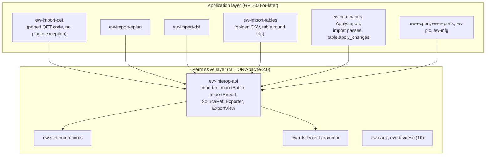
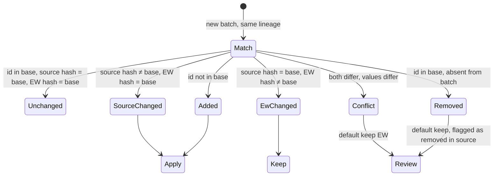

# Interoperability: import, export and migration

**Status:** Draft v0.3 · **Date:** 2026-10-21 (cycle-35 design pass 2026-10-29: the parts import as built, §1.2, decision log ID-824, ID-827; v0.3: cycle-12 design pass: the grid-line nudge (§4.2), the migration scheme on imports (§2.5, §4.16), the importer detections still missing; v0.2: the QET project importer as built in cycle 11, decision log ID-273 to ID-284) · **Part of:** ElektraWatt design document set

**Purpose.** This document specifies how ElektraWatt (EW) reads and writes foreign formats: the permissive
importer and exporter contracts, the QElectroTech (QET) migration path in detail, EPLAN part and report data, DXF
and DWG, catalogue formats, and the spreadsheet round trip with stable IDs. It summarises the STEP and PLC exchange
formats owned by other documents, states the legal limits on third-party content, and defines size limits, fuzzing
and test corpora per format. It elaborates the IMP and EXP rows of [02b](02b-requirements-extended.md) §7–§8
within the accepted [architecture](04-architecture.md) (§3, §5, §10.6; ADR-0004, ADR-0009, ADR-0021, ADR-0024).
Format facts come from [interop-formats](../research/interop-formats.md), as corrected by
[gaps-and-corrections](../research/gaps-and-corrections.md) (C-1 EDZ container, C-4 DWG route, C-14 corpus size,
C-15 `%f` versus `%F`).

**Contents**
1. [Scope and context](#1-scope-and-context)
2. [Contracts and data](#2-contracts-and-data)
3. [The import pipeline](#3-the-import-pipeline)
4. [QElectroTech importer](#4-qelectrotech-importer)
5. [EPLAN data](#5-eplan-data)
6. [DXF and DWG](#6-dxf-and-dwg)
7. [STEP, PLC and catalogue exchange](#7-step-plc-and-catalogue-exchange)
8. [Tables: XLSX and CSV with stable IDs](#8-tables-xlsx-and-csv-with-stable-ids)
9. [Other exports](#9-other-exports)
10. [Legal constraints](#10-legal-constraints)
11. [Hostile input: limits and fuzzing](#11-hostile-input-limits-and-fuzzing)
12. [Test corpora](#12-test-corpora)
13. [UI and UX touchpoints](#13-ui-and-ux-touchpoints)
14. [Edge cases and pitfalls](#14-edge-cases-and-pitfalls)
15. [The reference project](#15-the-reference-project)
16. [Scope by release](#16-scope-by-release)
17. [Dependencies](#17-dependencies)

---

## 1. Scope and context

### 1.1 What this document decides

| Decided here | Delegated |
|---|---|
| `ew-interop-api` types (`Importer`, `ImportBatch`, `ImportReport`, `SourceRef`, `Exporter`, `ExportView`) | Record kinds and invariants: [domain model](03-domain-model.md) |
| Import lineage, re-import without duplicates, the persisted import run | File layout and merge of the new record kinds: [05](05-project-format-and-persistence.md) |
| QET `.qet`/`.qetz` mapping, the migration report and its finding codes `EW-IMP-nnn` | Rule engine and live rule IDs (EW-TERM, EW-POT, EW-CORE): [08](08-connections-terminals-cables.md), [15](15-checks-revisions-collaboration.md) |
| EDZ, EPLAN parts XML, EPLAN report spreadsheets, underlays | Part, symbol and library content and library tiers: [07](07-symbols-parts-macros.md) |
| DXF and DWG reading; the DXF→symbol wizard | DXF page export details: [09](09-reports-forms-output.md) §4.4; drilling DXF: [12](12-panel-layout.md) §10, [13](13-manufacturing-outputs.md) |
| Spreadsheet round trip (FR-EXP-002 … FR-EXP-005), CSV dialect handling on import, translation files (XLIFF, CSV) | AML, TIA XLSX, PLCopen, I/O lists, GSD/GSDML/IODD: [10](10-plc-and-bus.md) §4 |
| Legal constraints, input limits, fuzz targets, corpora | STEP worker pipeline: [12](12-panel-layout.md) §6.2; machine formats: [13](13-manufacturing-outputs.md) |

### 1.2 Format catalogue

| Format | Direction | Crate (parser) | Release | Requirements |
|---|---|---|---|---|
| QET `.qet` 0.3–0.200, embedded `.elmt`, title blocks | read | `ew-import-qet` (roxmltree 0.21.1) | MVP | FR-IMP-006 … FR-IMP-021 |
| QET `.qetz` formats 2–4 | read | `ew-import-qet` (zip 9.0.4); `project.sqlite` read by the host through `ew-library` (§4.14) | 1.x | FR-IMP-024 |
| QET `.elmt` directory (the user's QET collection) | read | `ew-import-qet` (§4.3 mapper) into a user library | 1.0 ([07](07-symbols-parts-macros.md) §3.6) | FR-SYM-029 (07) |
| Golden tables (CSV) | read | `csv` importer (report format `golden-csv`) in `ew-import-tables` (ARCH §3), the CSV bootstrap of ARCH §13, exposed as `ew import csv` and reused by `ew-testkit` | MVP | FR-IMP-022 |
| Parts CSV/XLSX | read | `ew-import-catalog` column mapper into a user or company library ([07](07-symbols-parts-macros.md) §3.6) | MVP | FR-PRT-016 (07) |
| EDZ (7-Zip, ZIP) | read | `ew-import-eplan` (sevenz-rust2 0.24.0, zip, quick-xml 0.42.0) | 1.0 | FR-IMP-025 … FR-IMP-027 |
| EPLAN parts XML | read | `ew-import-eplan` | 1.0 | FR-IMP-028 |
| EPLAN report exports (XLSX/CSV) | read | `ew-import-eplan` (calamine 0.36.1, csv 1.4.0) | 1.0 | FR-IMP-029 |
| PDF/DXF underlays | read | `ew-import-dxf`; PDF via hayro 0.8.0 in `ew-scene`, a runtime dependency from 1.0 (ARCH §3) | 1.0 | FR-IMP-030 |
| EPLAN `.epj` project XML | read | experimental, behind a flag | Later | FR-IMP-031 |
| DXF R12–2018 | read | `ew-import-dxf` (dxf 0.6.2) | 1.0 | FR-IMP-032 … FR-IMP-035 |
| DXF AC1015 pages | write | `ew-export` (dxf 0.6.2) | 1.0 | FR-OUT-015 (09) |
| DWG | read | ODA File Converter (user-installed); acadrust 0.6.4 behind a feature | 1.0 / 1.x | FR-IMP-036, FR-IMP-037 |
| XLSX/CSV tables | read/write | written by `ew-reports` (rust_xlsxwriter 0.100.0, csv 1.4.0); read by `ew-import-tables` (calamine 0.36.1, csv) | MVP | FR-EXP-002 … FR-EXP-005 |
| XLIFF 2.1, translation CSV | read/write | quick-xml, csv; the translation tables of `ew-import-tables`, next to the table round trip (ARCH §3) | 1.0 | FR-I18N-006, FR-I18N-007 |
| glTF 2.0, STL | write | the glTF (glb) and STL writer of `ew-panel` for `layout_scene` (gltf-json **(verify)**, ARCH §3; [12](12-panel-layout.md) §14) | 1.0 | FR-EXP-007 (12) |
| STEP AP214/AP242 | read / write | `ew-step-worker` (OCCT) | 1.0 | FR-LAY-021 (12), FR-EXP-008 |
| AML AR APC 1.4.0 and 1.2.0, TIA "PLC Tags" XLSX, PLCopen XML, generic and instrument I/O lists, GSD/GSDML/IODD (ESI, EDS at 1.x) | read/write | `ew-plc` with the permissive `ew-caex`, `ew-devdesc` and `ew-plcaddr` (ARCH §3) | MVP (generic I/O list, Should) / 1.0 / 1.x | FR-PLC-025 … FR-PLC-039, FR-PLC-050, FR-BUS-013 (10) |
| BMEcat 2005, ETIM xChange, ECLASS XML | read | `ew-import-eplan` sibling module `catalogue` | 1.x | FR-PRT-020 (07) |
| QET `.qet` 0.100 | write | `ew-export` | 1.x | FR-EXP-010 |
| EPLAN-importable XML | write | — | Later | FR-EXP-011 |

*As built (cycle 35, WP-S1.19 part 4; decision log ID-824, ID-827).* **The parts import** (row "Parts CSV/XLSX") is in
`ew-import-catalog` behind `ew-interop-api`, which re-exports `ew_schema` and `ew_ids` so the importer keeps its one
edge. It reads CSV (UTF-8 with or without a BOM, comma or semicolon from the header line, RFC 4180 quoting) and XLSX
with an **own bounded reader** on `miniz_oxide` and `quick-xml`, not calamine, whose zip changed Golden A's PDF bytes
through flate2's backend (ID-827; FT-652). A saved column map per source key turns rows into part copies with item IDs
`v5(lineage(catalog, library), parts|<maker key>|<pn_norm>)` ([07](07-symbols-parts-macros.md) §3.6).
`ew import parts --map` writes into a project, `ew lib import parts` (`--bump`, `--take-over`) into a user or company library; every row
is reported with its line. The window's mapping card is FT-649, a CSV and XLSX fuzz arm FT-650.

### 1.3 Two kinds of import

EW has two import styles, and every format uses exactly one:

1. **Batch import** (QET, QETZ, EDZ, parts XML, DXF, EPLAN report spreadsheets, golden CSV). A pure importer turns
   bytes into an `ImportBatch` of `ew-schema` records. `ApplyImport` turns the batch into one previewed transaction
   in lenient mode (ADR-0021).
2. **Exchange import** (AML, TIA XLSX, I/O lists, the table round trip and translation files of §8). The file is parsed into a neutral
   image and **merged** against the current model and a stored base, with per-field ownership. The PLC variant is
   specified in [10](10-plc-and-bus.md) §4.2–§4.4. The table variant is in §8 of this document.

The distinction matters: a batch import creates or updates records it owns (keyed by lineage), while an exchange
import edits fields of records EW already owns.



---

## 2. Contracts and data

### 2.1 Importer contract

The contract of [architecture](04-architecture.md) §10.6 is kept; this section fixes its members. Everything here
lives in `ew-interop-api`, which depends directly only on `ew-schema` and `ew-ids` (and `sha2` for the input
digest); value types reach it through `ew-schema`'s records.

```rust
pub trait Importer: Send + Sync {
    fn id(&self) -> &'static str;                         // "qet", "qetz", "edz", "eplan-parts-xml", "dxf", "csv"
    fn version(&self) -> &'static str;                    // recorded in the import run; bumps on mapping changes
    fn sniff(&self, head: &[u8], path: &Path) -> Confidence;               // content first, extension last
    fn import(&self, src: &mut dyn Source, cx: &ImportCx) -> Result<ImportBatch, ImportError>;
}
pub enum Confidence { No, Maybe(u8), Certain }
pub trait Source { fn name(&self) -> &str; fn len(&self) -> u64; fn sha256(&mut self) -> [u8; 32];
                   fn read(&mut self, limit: u64) -> Result<Bytes, LimitError>; }   // no path, no sibling access
pub struct ImportCx<'a> {
    pub project: Id<Project>,          // target project ID: library_id of the "QET import" library (§4.3)
    pub lineage: LineageInfo,          // namespace for v5 IDs (§2.3)
    pub as_of: Date,                   // command parameter; no wall clock (07 §3.6)
    pub limits: Limits,                // §11
    pub hints: TargetHints,            // plain data about the target, never the model
    pub options: serde_json::Value,    // per-importer options, validated against its JSON Schema
    pub cancel: &'a CancelToken, pub progress: &'a dyn Progress,
}
pub struct TargetHints {               // copied from the target project or basic project by the host
    pub identifier_set: IdentifierSetKey, pub structure: Vec<(Aspect, Ident, Vec<Ident>)>, // code + aliases
    pub manufacturers: Vec<ManufacturerAlias>, pub colour_aliases: Vec<(String, ColourSpec)>,
    pub frames: Vec<FrameFingerprint>, pub symbol_map: Vec<SymbolMapRow>, pub font_map: Vec<FontMapRow>,
    pub text_patterns: TextPatterns,   // §4.12
}
pub struct Limits {                    // §11; a violation refuses the file or skips the item (EW-IMP-001)
    pub max_input_bytes: u64,          // 512 MiB
    pub max_xml_depth: u32,            // 256
    pub max_xml_nodes: u32,            // 1,000,000; the pre-scan counts the root, elements and comments as a lower bound; roxmltree's own limit also counts texts and processing instructions; attributes have their own limits
    pub max_attribute_bytes: usize,    // 16 MiB per attribute value
    pub max_xml_attributes_per_element: u32,  // 8,192 (roxmltree checks duplicates quadratically per element)
    pub max_xml_attributes: u32,       // 1,048,576 per document
    pub max_xml_attribute_work: u64,   // 2^26: the sum over elements of (attribute count)^2
    pub max_text_bytes: u32,           // 1 MiB per text node or CDATA section; the pre-scan counts the bytes between `>` and the next `<`
}
// Limits::element_definition(): the defaults with max_input_bytes = 16 MiB, max_xml_attributes = 131,072
// and max_xml_nodes = 262,144, for standalone element definitions (kilobytes and hundreds of primitives in
// practice); 512 MiB, 1,048,576 attributes and 1,000,000 nodes stay the defaults for project files, whose
// importer reads them under its own budget. Limits::stricter(self, other) is the field-wise minimum of all eight
// limits, so a caller can only tighten, never loosen, the limits it is given; the element importer reads with
// ctx.limits.stricter(Limits::element_definition()).
// crate constant, not a Limits member: MAX_ENTRIES_PER_DEFINITION = 1,000 report entries per element
// definition; the rest are summarised in one EW-IMP-001 entry
pub struct ImportBatch {
    pub records: Vec<ew_schema::AnyRecord>,   // sorted by (kind, id); IDs already final
    pub assets: Vec<AssetBlob>,               // {sha256, media_type, bytes}: logos, images (ARCH §10.6)
    pub report: ImportReport,
    pub provenance: Vec<SourceRef>,           // provenance[i] belongs to records[i]
}
```

The attribute work budget exists because `roxmltree` 0.21.1 checks the duplicate attributes of an element
quadratically, so a document can stay under both attribute counts and still be slow: the budget bounds the sum over
all elements of the squared attribute count. `max_xml_nodes` counts nodes (the document root, elements, texts, comments and processing instructions), not attributes; the pre-scan counts the root, elements and comments as a lower bound, and the parser's own limit also counts texts and processing instructions; a project
importer may raise it explicitly under its own budget.

`ew-interop-api` implements `ImportCx` as `ImportContext`, in a minimal form (`project`, `lineage`, `as_of`,
`limits`); the other members arrive with the importers that need them.

**Importer IDs, input sets and bootstrap importers** ([ADR-0021](../adr/0021-importers-emit-format-level-records.md)
amendment 6; decision log ID-64, ID-65). The importer ID is the `<importer>` of the lineage names of §2.3, so the
golden CSV bootstrap's ID is `csv` (`csv␟fixed␟golden`); `golden-csv` is only the name of its report format. An
importer may read a **set of inputs** instead of one `Source`: an `ImportInput` carries a file name (never a path),
the bytes and their SHA-256, and `TablesImporter::import(&[ImportInput], &ImportContext)` reads a directory of tables
as one batch. The rules below apply to the set as a whole: the file count, each file and the total are limited, a
repeated name is refused, and the order of the inputs does not change the batch. A **bootstrap importer** creates the
project record itself and derives its ID; `ImportContext.project` must be nil or equal to that ID, otherwise the
import is refused, and the batch is applied only into an empty project.

**Rules.**
- **Purity.** `import` reads only `src`. It never opens another file, follows an external reference or touches the
  network (NFR-SEC-18). It is deterministic: the same bytes, options, hints and `as_of` give a
  byte-identical batch.
- **No dangling references.** A batch must satisfy the structural invariants of ARCH §4.6 on its own plus the
  hinted target. An item whose reference cannot be resolved is dropped and reported (EW-IMP-003); it is never
  emitted. If `ApplyImport` still finds a structural violation, that is an importer bug: the import is refused
  with the report and the model stays unchanged (NFR-REL-12).
- **Prevent rules are not the importer's business.** Empty or duplicate terminal designations, duplicate tags and
  similar are emitted as found and reported later by the lenient validators (ADR-0009).
- **Proposals instead of guesses.** Where the mapping needs a human decision (a structure merge, a text-to-data
  match, a layout binding), the importer emits the conservative record and attaches a `Proposal` to a report
  entry (§2.4).

### 2.2 Exporter contract

```rust
pub trait Exporter: Send + Sync {
    fn id(&self) -> &'static str;
    fn export(&self, view: &ExportView, opts: &ExportOpts, sink: &mut dyn Sink) -> Result<ExportReport, ExportError>;
}
pub struct ExportView<'a> {            // built by the GPL host on a snapshot fork
    pub rev: Rev, pub records: &'a dyn RecordSource,      // ew-schema records of the snapshot
    pub rows: &'a dyn RowSource,       // materialised RowSets (09 §2.3) by key: "bom_component", "wires" …
    pub context: ExportContext,        // dates per 09 §4.3, language, personal-data policy, EW version
}
pub struct ExportReport { pub rev: Rev, pub outputs: Vec<OutputMeta{name, sha256, media_type}>, pub findings: Vec<ReportEntry> }
```

- An exporter sees records and row sets as plain data, so third-party exporters (WASM plugins at 1.x, FR-EXT-019)
  need no GPL code.
- Exports run on a fork and never block editing (FR-EXP-001). Every output records the revision it reflects; a
  release-mode export refuses stale Class II inputs (ADR-0003).
- **Determinism** (FR-EXP-006, NFR-REL-07): ordered maps only; dates from the export context (release context,
  scheme date, `SOURCE_DATE_EPOCH`, model edited date, in that order, [09](09-reports-forms-output.md) §4.3); ZIP
  entries (XLSX, `.ewpp`) in sorted order with that date and fixed compression settings; no absolute paths, user
  names or random IDs.
- **Personal data** (FR-EXP-009, NFR-PRIV-06): `ExportContext.omit_personal_data` removes every field that
  `ew-schema` marks personal (engineer, checker, party persons, XMP authors) from XLSX, CSV, AML, `.ewpp` and
  `.ewz`. The CI search of FR-EXP-009 runs over all outputs of the golden project.

### 2.3 Identity and lineage

ADR-0004 fixes imported IDs as `v5(namespace, source_file_hash, source_id)`. Hashing each new file version would
mint new IDs whenever the pilot edits a `.qet` in QET during the transition ([02b](02b-requirements-extended.md)
OQ 5). EW therefore anchors the hash in an **import lineage** (ADR-0004 amendment 1, FR-IMP-002, FR-IMP-040):

```text
ImportLineage { id, importer: "qet", source_name: "<file name, no path>", anchor: Anchor, namespace: Uuid,
                last_source_sha256, last_run: Id<ImportRun> }
Anchor = QetProjectUuid(Uuid)          # QET 0.200+ <project uuid>
       | FirstImportSha256([u8; 32])   # older files: hash of the file at first import
       | Copy{ of: Uuid, n: u32 }             # "import as copy" (§3.4); of = the original lineage's namespace (ADR-0004 amendment 4)
       | Fixed(&'static str)           # "golden": the golden CSV bootstrap (§8.4)
namespace = v5(NS_IMPORT, importer ␟ anchor kind ␟ anchor value)     # ␟ = U+001F, 05 §3.2a
record id = v5(namespace, source_key)                               # source key byte for byte
```

**Namespace derivation** (ADR-0004 amendment 4). The anchor is never used as the namespace itself; every lineage
namespace is a UUIDv5 under the fixed constant `NS_IMPORT` = `7b75186c-f28e-49ce-b7f7-26b137095a65`, which `ew-ids`
owns beside `NS_LIBCOPY`. The name is built by the layout of [05](05-project-format-and-persistence.md) §3.2a:

| Anchor | Name bytes (`importer` = `ImportLineage.importer`, lower case) | Example |
|---|---|---|
| `QetProjectUuid(u)` | `qet␟project␟<u, lower-case hyphenated>` | `qet␟project␟6f1c9a0e-3b7d-4e2f-8a5c-1d0e9b8a7c6f` |
| `FirstImportSha256(d)` | `<importer>␟sha256␟<d as 64 lower-case hex digits>` | `dxf␟sha256␟e3b0c442…7852b855` |
| `Copy{of, n}` | `<importer>␟copy␟<namespace of the lineage of>␟<n>` | `qet␟copy␟a1ba512b-…␟2` |
| `Fixed(label)` | `<importer>␟fixed␟<label>` | `csv␟fixed␟golden` |

The namespace is stored in `ImportLineage.namespace` and computed once, when the lineage is created. A copy names its
original by namespace rather than by record ID, so two branches that import the same file as a copy mint the same
IDs. Importers emit source keys in NFC, so the stored `source_ref.key` re-derives every record ID. The worked
vector of 05 §3.2a (the empty file's digest gives `a1ba512b-c515-50c5-af0b-26fa3b5599f5`) is a fixed test of
`ew-ids`.

With `FirstImportSha256` the formula is literally ADR-0004's, with `source_file_hash` read as "hash of the
lineage's first file". Re-importing the identical file reproduces every ID and yields an empty diff (FR-IMP-002).
Re-importing an edited file into the same lineage keeps the IDs of every item whose source key is unchanged
(FR-IMP-040).

**Source keys** are stable strings derived from the source's own identifiers:

| Source | Key | Stability |
|---|---|---|
| QET element instance | `qet:el:{uuid}`; for a UUID shared by copy-paste (QET #1408), the n-th further copy on a folio: `qet:el:{uuid}#{folio key}#{n}` (EW-IMP-120); an element without UUID: `{folio key}#el#{n}` at source position n. The device takes the key, its main function `…#fn`, its representation `…#rep` | stable |
| QET junction element | `qet:junction:{element key}` | stable |
| QET project record | `qet:project` (when the import creates the project) | stable |
| QET folio | `qet:folio:{uuid}` (0.200); else `qet:folio:{label}`, falling back to `qet:folio-order:{order}` | label-stable before 0.200 |
| QET conductor | `qet:wire:{uuid}` (0.200); else `qet:wire:{end key 1}\|{end key 2}` with the end keys sorted; an end key is `{element key}/{terminal index}`, and parallel conductors between the same ends add `#{n}` | endpoint-stable |
| QET element definition | content hash of the canonical definition XML (05 §13.2: element-hash UUIDv5) | content-addressed |
| QET strip (inferred, §4.11) | `qet:strip:{structure}-{product}` (its own designation with the structure prefix, sign dropped); the fallback strip of a folio `qet:strip:folio:{folio key}`; never a line number | stable under re-import |
| QET cable, shape, text | 0.100/0.200 UUIDs; else `{folio key}#{kind}#{n}` in document order | order-stable |
| EDZ / parts XML part | `edz:part:{manufacturer}\|{P_ARTICLE_PARTNR}` (+ `\|{variant}`) | stable |
| DXF entity | `dxf:{layout}\|{handle}`; R12 files without handles: `dxf:{layout}\|#{n}` | handle-stable |
| EPLAN report row (§5.4) | `eplan:{target}\|{row key}`, the row key being the mapped DT plus designation (`=P01+J-E-2416-X1031:1`) | stable while the DT is |
| Spreadsheet row | the hidden `id` column (§8) | stable |
| Golden CSV | `{table}\|{row key}` in the lineage anchored `Fixed("golden")`, i.e. `v5(v5(NS_IMPORT, "csv␟fixed␟golden"), "{table}\|{row key}")` ([20](20-golden-project.md) §3.2) | stable |

**As built (cycle 11; decision log ID-274).** The folio key of these keys is the printed folio label
(`qet:folio-order:{position}` for a repeated label). The lineage is anchored on the QET 0.200 project UUID where the
file has one, else on `FirstImportSha256`. A conductor end that names a UUID repeated on its folio is resolved to the
copy whose terminal position matches the conductor's route (its first or last point), through one terminal-position
index per folio and repeated UUID, so the matching is linear in the number of copies and conductors; a conductor
gets at most 16 pair probes, and an ambiguous pair beyond them binds the first copy in document order with an
EW-IMP-120 finding. The keys depend on
neither line numbers nor document order where the source has identifiers, so an edited file re-imports into the same
IDs (FR-IMP-040).

**Persisted provenance.** Every imported record carries `source_ref: {lineage, key}`. Locations (file, member,
folio, cell, line) live only in the import run, which keeps entity files small. Golden C's equivalence test ignores
the `id`, `source_ref` and provenance columns ([20](20-golden-project.md) §20.3).

### 2.4 Report, proposals and the import run

```rust
pub struct ImportReport { pub importer: String, pub importer_version: String,
                          pub source: SourceInfo /* name, sha256, size, detected format and version */,
                          pub entries: Vec<ReportEntry>, pub stats: ImportStats }
pub struct ReportEntry { pub code: Code /* "EW-IMP-101" */, pub severity: Severity, pub defect: Option<DefectClass>,
                         pub at: SourceLoc, pub targets: Vec<RecordKey>, pub message: FluentKey, pub args: Args,
                         pub proposal: Option<Proposal> }
pub struct SourceLoc { pub file: String, pub member: Option<String>, pub folio: Option<Ident>,
                       pub cell: Option<String> /* "103-A3" */, pub item: Option<String> /* uuid, handle, part no. */,
                       pub line: Option<u32> }
pub enum Proposal { MergeStructure{from, into}, SetFields{target, fields}, BindText{text, target, field, value, confidence},
                    BindPlacement{item, device, score}, MapSymbol{symbol, to}, AdoptRule{class, rule}, Split{target}, … }
```

- `ImportStats` counts records per kind, dropped and inferred items, and **lost connections**. FR-IMP-007's
  acceptance is `lost_connections == 0`. It also carries `suppressed`: per code, the number of entries that a report
  cap (`MAX_ENTRIES_PER_DEFINITION`, the project importer's entry cap) folded into a summary entry, so a capped
  report still counts every condition. The member is an additive change of the permissive `ew-interop-api`, checked
  against its MSRV (cycle 11; decision log ID-275).
- A `Proposal` is format-level intent. `ApplyImport` translates an accepted proposal into a command inside the import
  transaction; a pending one becomes a quick fix on the finding.
- **`ImportRun`** (record kind `import_run`, rank 72, one file `imports/<run-uuid>.jsonl` per run,
  [05](05-project-format-and-persistence.md) §2.1; FR-IMP-041) persists `{lineage, importer, importer_version, source info, as_of, options digest,
  entries, stats, record_hashes, acknowledged}`. `record_hashes` maps each imported record ID to a 128-bit hash of
  the record as imported; it is the base of the re-import diff (§3.4). The run survives saves and merges, so
  import-only facts such as "Tahoma substituted" or "custom SQL dropped" stay visible after the import (MF-22
  "stays as an info in the migration history").

### 2.5 The migration report

The migration report of FR-IMP-003 is one check-run view over two sources:

| Source | Content | Lifetime |
|---|---|---|
| **Import findings** `EW-IMP-nnn` from the `ImportRun` | Facts visible only at import: dropped, substituted, inferred, recognised, conflicting per-folio values | Persisted; acknowledged items turn into info |
| **Lenient check findings** of the `migration` scheme on the candidate ([15](15-checks-revisions-collaboration.md) §10.2) | EW-TERM-001/002 (D-11, D-12), EW-RDS-010 (D-03), EW-CORE-023 (D-06), EW-CORE-031 (D-17), EW-POT-013 (D-13), EW-CORE-053 (D-14, FR-CHK-035) … | Live: they disappear when the model is fixed |

**As built (cycle 12; decision log ID-312).** The import front door runs the `migration` scheme of `ew-checks` on the
imported model (`ew_api::import::lenient_findings`): every `pre-delivery` rule that is built (EW-TERM-001/002/005,
EW-RDS-004, EW-POT-001/008/011/012/014, EW-CORE-033/051/052/081), lenient. This replaces the two hand-written
duplicate checks of ID-276. EW-TERM-002 skips the fallback strips `X?<page>` (ID-308). The path through `ApplyImport`
is still open (FT-143); rules that are not built yet are not evaluated on an import.

The panel filters both by lineage, sorts by folio and cell, and offers each quick fix as a previewed command
(FR-CHK-010). `ew import … --report json|csv|md` writes the same list.

**One row per condition.** An `EW-IMP` entry records what the importer did or saw; a live rule reports a condition
that is still in the model. Where both name the same targets and defect class (EW-IMP-102 and EW-RDS-010 on
+JE2416; EW-IMP-105 and EW-CORE-023 on folio 101; EW-IMP-114 and EW-CORE-063), the migration report shows one row
under the live rule ID, with the import code as its origin and the import proposal as its quick fix. EW-IMP-110 has
no live counterpart until the assembly exists; EW-CORE-046 (FR-CHK-022) takes over after the reconstruction step
(§4.13). Golden C therefore lists each MF row exactly once (AC-25).

**Import finding catalogue.**

| Code | Finding | Sev. | Defect class | Proposal / quick fix |
|---|---|---|---|---|
| EW-IMP-001 | Input limit exceeded; item or file refused | error | — | — |
| EW-IMP-002 | Malformed or refused item skipped (NaN, overflow, unparsable node; in a strict import, a value that a prevent rule refuses, the message naming the rule, for example EW-CORE-031 for a foreign colour code) | error | — | — |
| EW-IMP-003 | Unresolvable reference dropped (conductor end, link UUID) | error | — | — |
| EW-IMP-004 | Content dropped by design (QET custom SQL, `.ema` geometry, `.e3d`, DXF 3D solids) | info | — | — |
| EW-IMP-005 | Object inferred (strip, cable, section, junction), review | warning | — | confirm / split |
| EW-IMP-006 | Font substituted | info | — | — |
| EW-IMP-007 | Value mapped through an alias table (manufacturer, colour code, structure alias) | info | D-17, D-18 | revert / choose |
| EW-IMP-008 | Value kept as foreign or opaque text | warning | D-17, D-18 | map |
| EW-IMP-009 | Print-equivalence deviation: EW's derived text differs from the source's printed text | warning | — | per case |
| EW-IMP-101 | Stored label differs from the formula result | warning | D-01 | use derived tag |
| EW-IMP-102 | Structure-code spelling variants | warning | D-03 | merge, keep alias |
| EW-IMP-103 | Label does not fit an inferred rule; kept as frozen tag | info | D-03 | convert where conforming |
| EW-IMP-104 | Per-folio title-block value conflict (revision, author, date) | warning | D-05 | create revisions, drop per-page values |
| EW-IMP-105 | Per-folio description differs; kept as `description_override` | info | D-06 | drop override |
| EW-IMP-106 | Title-block party differs from the cover party | warning | D-30 | bind role |
| EW-IMP-107 | Free text converted to data (wire marker, address, port, process tag, bus address) | info | D-08, D-15, D-26 | revert |
| EW-IMP-108 | Data-like text not converted (review list) | warning | D-08, D-26 | bind manually |
| EW-IMP-109 | Strip drawn in several segments; merged into one strip | info | D-42 | split |
| EW-IMP-110 | Hand-drawn overview differs from the linked detail | warning | D-10 | regenerate overview |
| EW-IMP-111 | Layout item binding proposal | warning | D-02 | confirm |
| EW-IMP-112 | Symbol of a device class without device tag | warning | D-27 | build assembly and children |
| EW-IMP-113 | Imported table rows differ from the derived report | info | D-04 | — |
| EW-IMP-114 | Imported text styles not bound to slot kinds | info | D-29 | apply style |
| EW-IMP-115 | Folio-report pair names differ, or pairing needs chain mode | warning | D-24 | rename / set mode |
| EW-IMP-116 | Slave without master; master above `max_slaves` | warning | — | link |
| EW-IMP-117 | Project uses QET's default `%f` folio-index formula | info | — | switch to folio label |
| EW-IMP-118 | Junction wiring assumed (Star) at a QET junction element | info | D-20 | set Chain |
| EW-IMP-119 | Element without function semantics; generic black box | warning | — | map symbol |
| EW-IMP-120 | Shared element UUID disambiguated | info | — | — |
| EW-IMP-121 | Several interruption-point names on one potential | info | D-24 | — |
| EW-IMP-122 | Unlabelled element, tag synthesised: the device keeps its `prefix` letter (else "A") without counter and prints "?" | info | — | label (hiding the synthesised tag: FT-144) |
| EW-IMP-123 | Cross-section mark differs from the derived wire property: the mark is dropped, the wire keeps the derived value, the mark's value is in the finding | warning | D-08 | set the override to the mark's value |
| EW-IMP-2nn | EDZ and EPLAN: 201 terms notice shown, 202 function definition unmapped, 203 ZIP-format EDZ, 204 extras ignored, 205 unit converted, 206 report column unmapped, 207 multi-level terminals folded | info–warning | — | map |
| EW-IMP-25n | DXF and DWG: 251 units missing (prompted), 252 SHX substituted, 253 entity unsupported, 254 external reference not followed, 255 hatch pattern reduced to its boundary, 256 CP snapped, 257 DWG converted through ODA | info–warning | — | — |
| EW-IMP-30n | Tables: 301 derived column edited, 302 row changed in EW since export, 303 unknown ID, 304 cell conflict, 305 lossy Excel conversion | info–warning | — | resolve |

Golden C's MF-01 … MF-27 map onto these codes and live rules in §15.2. The `EW-IMP` family is registered with the
rule catalogue of [15](15-checks-revisions-collaboration.md) as message class 160 (EW-IMP-101 prints as `160101`)
and documented per code like every rule (NFR-DOC-02).

*Decided (cycle 15; decision log ID-375).* A strict import that meets a value a prevent rule would refuse drops only that row, under EW-IMP-002 with the rule in the message; no separate code is added, because the row is skipped exactly like a malformed one and the rule ID keeps the cause visible.

---

## 3. The import pipeline

### 3.1 Stages


1. **Sniff.** Content decides; the extension only breaks ties:

   | Content | Format |
   |---|---|
   | 7-Zip magic `7z\xBC\xAF\x27\x1C`, or ZIP `PK\x03\x04` with `*.part.xml` members | EDZ (renamed to `.zip` it is still EDZ, FR-IMP-001) |
   | ZIP whose first, stored member `mimetype` is `application/x-qet-project+zip` or the older `application/x-qelectrotech-project+zip` | QETZ |
   | ZIP with `xl/workbook.xml` | XLSX: the round trip of §8 if a hidden `_ew` sheet exists, else the column mapper of §5.4 |
   | XML root `<project>` with a `version` attribute | QET project |
   | XML root `<definition type="element">` / `<titleblocktemplate>` | QET element / title-block template (library targets only) |
   | XML root `<partsmanagement>` | EPLAN parts XML |
   | Group code 0 `SECTION` within the first 4 KiB, or the `AutoCAD Binary DXF` sentinel | DXF |
   | `AC10nn` version magic in the first 6 bytes (AC1012 … AC1032) | DWG (converter route, §6.5) |
   | `%PDF-` | PDF underlay |
   | none of the above, text | CSV: dialect detection on the first 20 rows (§5.4, §8.2) |

2. **Parse and map** run as a `Cost::Bulk` job on the pool (progress within 200 ms, cooperative cancel,
   NFR-PERF-08, NFR-PERF-19).
3. **Resolve** assigns the batch to the target: a new project (created from the chosen basic project, FR-PRJ-009),
   the open project, or a library ([07](07-symbols-parts-macros.md) §3.6: part importers write to a user or company
   library, never directly into a project).
4. **Import passes** need derived data and therefore run in `ApplyImport`, not in the importer (§3.2).
5. **Normalisers and validators** run in lenient mode (FR-CHK-011): CP instantiation, junction clean-up, online
   numbering of records without counters, conductor assignment; prevent-rule violations become findings.
6. **Preview** shows the candidate: rendered pages, entity diff, report diffs (BOM, wire list, terminals, xref texts)
   (FR-IMP-004, ARCH §5.4).
7. **Review.** The user accepts or rejects proposals, singly or by group ("accept all high-confidence wire
   markers"). Accepted proposals append commands to the same prepared transaction, and the affected passes re-run.
8. **Commit** as one transaction `import.apply{lineage, run}`. Into an empty project it is the confirmed,
   non-undoable checkpoint of ARCH §5.3; into an existing project it is one undo step.

`ew import` takes the project lock like every writing command ([05](05-project-format-and-persistence.md) §6.4).

### 3.2 Import passes

| Pass | Purpose | Needs |
|---|---|---|
| P1 Potential definitions | Merge duplicate `PotentialDef` candidates (from QET conductor `function`/`tension_protocol` and IP names) that fall into one derived potential | `potential_partition` |
| P2 Override pruning | Drop imported wire colours and cross-sections equal to the profile value at level ≤ 6; keep the rest as CDP overrides (FR-IMP-012) | `wire_props_of` |
| P3 IP pairing check | Compare EW's derived pairs with the source links; repair with `IpSpec.sort` or report (§4.6) | xref relations |
| P4 Print equivalence | Compare derived tags and xref texts with the texts the source printed; report each deviation (EW-IMP-009) | `device_tag`, `xref_text` |
| P5 Table diff | Compare QET nomenclature rows with `bom_rows` (EW-IMP-113) | `bom_rows` |
| P6 Layout binding | Score layout items against derived tags (FR-IMP-019) | `device_tag` |
| P7 Text binding | Bind recognised texts to channels, ports and cables once targets exist | channel and CP queries |

Passes are deterministic functions of (candidate, batch, accepted proposals). They never loop with each other: P1
and P2 precede P3–P7, and a re-run after review starts at the first affected pass.

### 3.3 Lenient mode boundaries

| Never relaxed (structural) | Relaxed to findings (prevent rules) |
|---|---|
| References resolve; connection endpoints exist and differ; one main function per device; acyclic assemblies; placement → device; channel → one module | Empty or duplicate terminal designations (D-11, D-12; FR-TRM-002); duplicate tags in a scope; duplicate IP names per scope and direction; PLC address overlap; foreign colour codes (D-17); conductor colours inconsistent with the cable part |

A lenient project stays lenient for exactly the records that violate a prevent rule. A new violation drawn
afterwards is rejected in strict mode (FR-CHK-011 acceptance).

### 3.4 Re-import without duplicates



- The base is `ImportRun.record_hashes` of the lineage's last run. "EW hash" is the hash of the current record with
  `source_ref` excluded.
- **Field-level detail.** For a conflict the preview shows ours and theirs per field; the base value is not stored,
  so the resolution is a choice, not an automatic merge.
- **Never silent deletion.** A record removed in the source is listed and kept until the user deletes it.
- **Typicals and copies.** "Import as copy" creates a new lineage (`Anchor::Copy`), so the same file can be imported
  twice into one project, for example as a second cabinet.
- **Lineage detection.** QET 0.200 project UUID → automatic. Otherwise a proposal when the file name matches and at
  least 50 % of the batch's source keys exist in a lineage (threshold configurable).

---

## 4. QElectroTech importer

`ew-import-qet` is the only crate that may contain ported QET code (GPL-2.0-or-later, with original notices; NFR-LIC-05,
C-8). Porting is used where fidelity depends on QET's own algorithms: formula evaluation (`assignvariables.cpp`),
conductor auto-routing for paths without stored segments, and title-block layout. A `.qet` embeds every placed
element definition, so the importer never reads the user's QET library (FR-IMP-006).

### 4.1 Versions

| Source version | Handling |
|---|---|
| 0.3–0.6 | Element texts as `<input tagg="label">`; no terminal UUIDs; conductors reference per-folio integer terminal IDs only |
| 0.7 | `dynamic_elmt_text` with `text_from` UserText, ElementInfo or CompositeText; text groups |
| 0.8 | Terminal UUIDs (mixed with integer ends); `graphics_table` (nomenclature, summary) |
| 0.9 | `properties/element_type` on terminals; slave type "Other" |
| 0.100 | `terminal_strips` data model and drawn `terminal_strip` items; folio `version="0.100.0-dev"` (the pilot's files) |
| 0.200 | UUIDs on project, folio, wire and shape; `<cables>` with cores; `mirror`; `plcMasterData`; `slaveContactGroups`; wire hops; `wiring_list_view` |

Element definitions inside one project carry their own versions (0.3 … 0.90 in one corpus file) and are mapped per
definition. The XML is parsed with roxmltree with DTDs refused; a non-UTF-8 prolog encoding is transcoded or
rejected (§14).

### 4.2 Geometry on the native rational grid

- **Units.** 1 QET px = 25.4/96 mm = `793_750/3` nm; the 10 px grid is `7_937_500/3` nm (ADR-0005). Qt writes
  coordinates with `QString::number`, so values such as `12.5`, `-3.33333` and `1.23457e+06` occur. The importer
  parses each decimal string **exactly** into a mantissa and a power of ten, computes
  `nm = round_half_even(m × 793_750 / (3 × 10^e))` in `i128`, and never passes through `f64`. A point on the
  10 px grid therefore lands on `round(k × 7_937_500 / 3)` nm with grid index `k`, and FR-IMP-008's "0 nm deviation"
  is an equality test on indices.
- **Axes.** QET's origin is the top-left and y points down, like `Pt2` (03 §3.1); no flip is applied.
- **Instances.** Element `x`, `y` places the definition origin, the hotspot. QET writes definition coordinates
  already relative to the hotspot; `hotspot_x`, `hotspot_y` only place the bounding box (`width`, `height`) around
  it. The importer therefore takes definition coordinates as written (hotspot = definition origin). A terminal's
  page position is `instance + R(orientation, mirror)·terminal`, exact in integers because rotations are multiples
  of 90°.
- **Orientation.** `orientation` k = 0–3 maps to R(90k): R0, R90, R180, R270, clockwise on the sheet
  ([06](06-schematic-editor.md) §2.5, where Mn mirrors about the symbol's vertical axis and then rotates by n). With
  QET 0.200 `mirror`, and assuming QET mirrors in the element frame before rotating: `horizontal` → M(90k),
  `vertical` → M(180 + 90k), `both` → R(180 + 90k), angles mod 360. The assumption is unverified and is fixed by
  rendering mirrored corpus elements in QET and in EW (Open question 12).
- **Grid-line positions (as built, cycle 12; decision log ID-301).** On QET's default border (17 × 60 px columns,
  8 × 80 px rows, 20 px headers), an element whose cell a cross-reference prints (an interruption point
  `next_report`/`previous_report`, a master or a slave) that lies exactly on an inner column or row line
  (x = 20 + k × 60, y = 20 + k × 80 px) moves 2 nm left or up. QET's `convertPosition` takes the ceiling, so a line
  point belongs to the left column or upper row; EW's cell rule (floor, unchanged) would put it right or below, and
  2 nm leave the cell rule's 1 nm snap window, so the printed cells are QET's (Golden C: 102-C15, 103-G6, (202-E1)).
  Every other element (terminals, simple elements) keeps its exact position. This is an exception to FR-IMP-008's
  "0 nm deviation": the connection points of a nudged element are 2 nm off the 10 px grid (in the reference file:
  three masters and one slave). The proper home is a cell-boundary policy for imported pages (ADR-0027 open item,
  FT-179), which would remove the nudge. The row "element position" of `crates/ew-import-qet/README.md` states the
  same rule.
- **Pages.** Imported pages keep the 10 px grid permanently (ADR-0027, FR-PAG-021); "convert to native grid" is the
  previewed command of FR-PAG-022 (1.x).
- **Frame.** A border of 17 × 60 px columns, 8 × 80 px rows and 20 px headers maps to the shipped QET-compatible
  frame (FR-PAG-015) instead of a duplicate form; other borders become frame forms in the "QET import" library.
  Column numbering keeps the source offset (the reference numbers 0–16). The form carries the page-to-sheet
  transform of QET's fit-to-page export ([20](20-golden-project.md) §17.1, FR-PAG-029: scale 0.986282578, offset
  9.79 mm on the golden frame), so printed geometry matches the reference to ±0.2 mm (REF-096).

### 4.3 Element definitions → symbols and function definitions

Each distinct definition (identified by the hash of its canonical XML, not by its `embed://` path) becomes a
`SymbolDef` and a generated `FnDef` in the per-project "QET import" library (FR-SYM-018, FR-IMP-008), with source
element name, path, UUID and definition version as provenance. The library's `library_id` is the target project's
ID (`ImportCx.project`, §2.1) and its human key is `qet-import` ([05](05-project-format-and-persistence.md) §13.2).
Built-in FnDefs that the importer references live in the system library, whose `library_id` is
`ew_interop_api::SYSTEM_LIBRARY` (7202fd8b-1024-4bf1-9e99-670772eaa589, the starter content's ID; named in cycle 34
by WP-S1.19 part 1, FT-24, which settles [07](07-symbols-parts-macros.md) open question 17). The importer has exactly one built-in FnDef,
the interruption point `ew.fn.ip` of §4.6 (`BUILTIN_FNDEF_KEYS`), referenced by key in `LibRef.extra["key"]` with
`version_req` `^0.1` (`BUILTIN_VERSION_REQ`), because every starter item is version 0.1.0; `ew.gen.ip` is its
*symbol* key ([07](07-symbols-parts-macros.md) §2.3; decision log ID-33). The generic black box of EW-IMP-119 is not
a built-in: it is a generated FnDef in the "QET import" library at version 1.0.0, referenced with `^1`. Primitives
map one to one:

| QET primitive | EW geometry | Notes |
|---|---|---|
| `line x1 y1 x2 y2 end1 end2 length1 length2` | path segment with end markers | `simple`, `triangle`, `circle`, `diamond` ends; unsupported ends expand to polygons |
| `rect x y width height rx ry` | rectangle, optionally rounded | corner radius semantics per definition version (verify on corpus) |
| `ellipse x y width height`, `circle x y diameter` | ellipse, circle | `x y` is the bounding box's top-left |
| `arc x y width height start angle` | elliptic arc | degrees; 0° at 3 o'clock; positive span counter-clockwise on screen, so a point is `(cx + rx·cosθ, cy − ry·sinθ)`; the importer keeps `start` and `angle` as given, and lowering in `ew-scene` evaluates the arc with `ew-dl`'s deterministic trigonometry |
| `polygon x1 … xn y1 … yn closed` | polyline or closed polygon | |
| `text x y text size\|font color rotation` | static symbol text | font per §4.10; `rotation` is Qt's clockwise-positive angle and becomes the negated `Angle2` (counter-clockwise positive, [03](03-domain-model.md) §3.1; ADR-0005 amendment 2) |
| `dynamic_text`, legacy `input tagg` | text slot | `label` → tag slot, `function` → function-text slot, `CompositeText` → slot with a format; `UserText` → static text |
| `terminal x y orientation name type uuid` | connection point | index = definition order; designation = `name` (empty allowed); direction from `orientation`; `type` Generic, Inner or Outer kept |

- **Style mini-language.** `line-style: normal|dashed|dotted|dashdotted`, `line-weight: none|thin|normal|hight|eleve`
  (the historical tokens `hight` and `eleve` are accepted), `filling`, `color`, `antialias`. Line weights map to the
  house widths of [20](20-golden-project.md) §17.4 (`thin` 0.5 px, `normal` 1 px).
- **Anchor policy.** QET-import symbols keep QET's **element-origin** cross-reference anchor, so imported xref
  texts equal QET's, "3-B0" included (FR-IMP-038; [07](07-symbols-parts-macros.md) §3.6). The MF-13 quick fix sets
  the anchor policy "graphics" (a named anchor on the bus-port graphics), which gives "3-B2".
- **Function semantics.** The generated FnDef is resolved in this order:
  1. a `symbol-map.csv` row (element UUID or path → EW FnDef and CP map; generalises FR-IMP-018);
  2. `kindInformations`: master `coil|protection|commutator|plc`; slave `simple|power|delayOn|delayOff|delayOnOff`
     with `state` NO, NC or SW → a contact FnDef with `PassThrough{opens: true}` between its two terminals; terminal
     `generic|fuse|sectional|diode|ground` with function `phase|neutral|PE`;
  3. a shipped table from QET collection category paths (`10_electric/…/switches`) to EW categories;
  4. otherwise a generic black box (EW-IMP-119).

  Rules such as EW-POT-013 need `PassThrough` semantics, so Golden C's MF-23 depends on steps 1–3 resolving T55's
  and S56's elements.
- **Link type.** `simple` and `master` form devices; `slave` forms auxiliary functions; `next_report` and
  `previous_report` become interruption points (the built-in FnDef `ew.fn.ip`, §4.3, not generated); `terminal`
  forms terminals; `thumbnail` becomes a graphic (as built in cycle 11 a thumbnail is not imported yet and is
  reported with EW-IMP-004 until free graphics are, follow-up task FT-134; decision log ID-279).
- **Coverage of the pilot corpus.** [23](23-symbol-coverage-pilot-corpus.md) maps the 81 element types of the pilot's
  three real projects to the starter set (§4.3 step 1) and lists the mapping entries for the project importer (M-01 to
  M-09): 37 types resolve to starter symbols, 29 stay black boxes (EW-IMP-119), 2 are replaced by report blocks or
  layout, 13 wait for new symbols.

### 4.4 Element instances → devices, functions, representations

| QET element information | EW target |
|---|---|
| `label`, `formula`, `prefix` | `TagSpec` by the inference of §4.4.1 |
| `plant` (=), `location` (+), or prefixes inside `label` | structure nodes through `ew-rds` lenient parsing (FR-NUM-015) and the alias hints; spelling variants ("+JE2416" against "+J-E-2416") stay two nodes with a merge proposal (FR-PRJ-018) |
| `function` | `Device.function_text` (MlText neutral) |
| `description`, `designation` | `function_text` when `function` is empty, else user property `description`; `designation` → part type text |
| `manufacturer`, `manufacturer_reference`, `supplier`, `machine_manufacturer_reference`, `quantity`, `unity` | `PartUse` + project `PartCopy` (source "QET element information", no catalogue link); manufacturer through the master's aliases (FR-PRT-002) |
| `auxiliary1..4` with `*_auxiliaryN` | further `PartUse` entries (D-04: the second part 550208 of -201U1) |
| `voltage_rating`, `current_rating` | `tech_data` as `Quantity` when parsable ("40A" → 40 A), else text with EW-IMP-008 |
| `width`, `height`, `depth` | part dimensions when the part is created from element information |
| `plc_type`, `plc_address`, `plc_function`, `plc_comment`, `plc_crossref` | pending channel binding (P7) |
| `exclude_from_bom` | device scope "supplied by others" (FR-DEV-037; [20](20-golden-project.md) §6.2) |
| `comment`, `notes` | `Comment` anchored to the representation |

#### 4.4.1 Tag inference

1. **Formula present.** Translate the QET formula into an EW tag format (§4.8) and evaluate it for the element. The
   result is what QET printed. If the stored `label` differs, the derived tag wins and EW-IMP-101 reports the stale
   copy (D-01: stored -4W1, printed and derived -3W1).
2. **No formula.** Parse `label` leniently. Test the product part against candidate rules with the folio label of
   the master's page: R1 `{page}{letter}{counter}` (-101F1), R2 `{letter}{page}{counter}` (X1031 on folio 103),
   R3 `{letter}{counter}`. The leading aspect sign is added by the formatter and is never part of a format
   ([03](03-domain-model.md) §8.2).
3. **Choose rules.** The project rule is the candidate explaining most labels; a letter class gets its own rule when
   another candidate explains all its labels (X → R2). The choice is an `AdoptRule` proposal, accepted by default.
4. **Conforming** labels become derived `TagSpec{letter, counter, scheme}` with the counter taken from the label.
   **Non-conforming** labels become `FrozenTag{text, sign}`, with `sign: Hidden` when the label has no product sign
   (S51), and EW-IMP-103 lists them (FR-NUM-010).
5. **As built (cycle 11; decision log ID-277).** The project importer applies one rule, R1 on the element's own
   folio: a label of the form `-{page}{letter}{counter}` whose page is the folio of the element, whose letters are
   upper case and whose counter has no leading zero becomes a derived `TagSpec{letter, counter}`. Every other label
   stays a `FrozenTag` that prints the source text unchanged, so a label EW would print differently (`-101K01`,
   `-101f1`) is frozen rather than re-derived, and EW-IMP-009 never fires for a tag. EW-IMP-103 lists the frozen
   labels, strips excepted. A structure prefix (`+…-X1`) is kept in `Device.extra` until structure nodes are created
   (FT-130). Steps 1 and 3, R2, R3 and the `AdoptRule` proposal are follow-up tasks FT-128 and FT-129. An element
   without any label gets `TagSpec{letter: prefix attribute, else "A", counter: none}`, prints "?" (the derivation's
   placeholder for an underivable token), and is reported once per folio as EW-IMP-122; whether such a synthesised
   tag should rather be hidden is FT-144.
6. **Identifier set.** EN 81346-2:2009 single letters unless the letter analysis is explained only by IEC 60750, in
   which case that set is proposed (ADR-0026). The importer never switches to IEC 81346-2:2019; that is the
   previewed renumber of FR-NUM-014.

### 4.5 Master and slave → main and auxiliary functions

- A master element and its linked slaves (`links_uuids`) form **one device**: the master's function is `Main`, each
  slave an `Aux` function with its own representation. On the reference set, -201U1's master sits on 201-E1 and its
  slaves on folio 3 (bus port) and 106-G3 (power connector), which print "(201-E1)".
- A slave's own `label` is ignored when it equals the master's; a different one is reported (EW-IMP-009).
- An orphan slave becomes a device whose single function is promoted to `Main` (EW-IMP-116); EW's "one main
  function per device" invariant holds by construction.
- More slaves than the definition's `max_slaves` are kept and reported.

### 4.6 Folio reports → interruption points

QET pairs reports explicitly, one to one; EW pairs IPs by `(name, scope)` in star or chain mode (03 §10). The
importer reconstructs QET's pairs exactly:

1. **Collect pairs** from `links_uuids` between `next_report` (→ `direction: Source`) and `previous_report`
   (→ `Target`). An unlinked report becomes an unpaired IP (FR-CHK-017).
2. **Name** each pair from the first non-empty of: the source's `label`, the target's `label`, the `function` of
   the conductor at the source. Both ends get the same name; a differing target name is kept as an alias and
   reported (EW-IMP-115). A pair without any name gets `IP-{page}-{cell}` and a warning.
3. **Group** pairs by `(name, scope key)`. A single-pair group needs no mode.
4. **Multi-pair groups** use chain mode with `IpSpec.sort = 2i, 2i+1` for pair `i`, so EW's chain order
   reproduces QET's pairs. If the target project requires star mode, the group is reported (EW-IMP-115) with the
   quick fix "rename the extra pairs".
5. **Verify** (pass P3): the derived pairs must equal the QET pairs; every difference is an error finding.

   *As built (cycle 11; decision log ID-278).* Step 2 takes one name per linked pair from the first non-empty of: the
   source's `label`, the target's `label`, the source's first `UserText` dynamic text, the target's first `UserText`
   (the reference set stores interruption-point names in `UserText`); both ends get that name and the other end's
   differing text is kept as an alias and reported in one EW-IMP-115 entry that quotes both texts. A pair without any
   name gets one synthesised name `IP-{folio}-{n}` for both ends (EW-IMP-115). Several pairs that share a name get
   `IpSpec.sort` 2i and 2i+1 and an EW-IMP-115 saying the project needs chain mode; switching the project to chain
   mode, pass P3 and the external ends of step 6 are follow-up task FT-138. The conductor `function` of the
   specified step 2 is not read yet (FT-136). On the third pilot project this pairing moved two pairs that only
   shared a name into separate potentials (214 → 212 potentials), which is the correct result.
6. **External ends.** A report whose partner is missing but which sits inside or next to a dashed external box with
   a target text gets the proposal `IpSpec.external = Some(ExternalRef)`, the reference parsed from the box text
   (REF-018, FR-PRJ-021). Golden A has four external points: J-E-206-L, J-E-206-N and J-E-206-PE at 101-G0 (box
   "External Connection (J-E-206 / JE-N1000-03)") and DP at 3-G15 (box "To J-E-206 / JE-N1000-03"), each printing
   "+J-E-206 / JE-N1000-03" ([20](20-golden-project.md) §15). Each one drawn as an unpaired QET report gets the
   proposal; one drawn as a plain element or text is listed for a manual conversion (which applies depends on the
   file, PQ-02).

Cross-reference texts are recomputed, never imported (FR-IMP-009). The golden import yields the 22 IP pairs (44
texts) and 10 main/aux pairs on 9 devices (19 texts with 20 targets): 63 texts with 64 targets, equal to the reference as printed.

### 4.7 Conductors → connections

**End resolution**, per end independently (FR-IMP-007):

1. If `element{i}` is present, look the element up by UUID. Unique → done; shared by copy-paste → candidates on
   this folio only (EW-IMP-120), decided by the route position of the conductor's end (§2.3, as built in cycle 11:
   linear in the number of copies and conductors; ambiguous pairs beyond 16 probes bind the first copy with a
   finding).
2. If `terminal{i}` is a UUID, find it among the candidate's terminals. If the definition has no terminal UUIDs or
   none matches, fall through.
3. If `terminal{i}` is an integer, use the folio's map `terminal id → (element, definition index)` built from
   `<element><terminals><terminal id>`.
4. If both forms resolve and disagree, a unique UUID result wins and the disagreement is reported.
5. Unresolvable → the conductor is dropped (EW-IMP-003) and counted in `lost_connections`. A conductor whose two
   ends resolve to the same CP is dropped as well.

**Mapping.**
- The connection is `Connection{kind: Wire, a: Cp{function, idx}, b: Cp{…}, page}`; `idx` is the definition index of
  the terminal.
- **Route.** Stored `<segment>`s are replayed from end 1 into `route` points. Conductors without segments get the
  path QET computes (ported profile algorithm), stored explicitly, so EW draws them exactly as QET did
  (FR-IMP-043).
- **Properties.** A non-empty `num` → `NumberSpec::Frozen` (FR-IMP-012, 08 §5.3), an empty one → `Unassigned`; `conductor_color` and `conductor_section` →
  overrides, pruned by pass P2; colour text through the alias table (BR → BN proposed, §4.12); `function` and
  `tension_protocol` → `PotentialDef` candidates (pass P1); display attributes (`numsize`, `onetextperfolio`,
  text position) → wire-number slot overrides; `cable`/`cable_uuid`/`cable_slot` (0.200) → `Connection.kind =
  Core(conductor)`.
- **Junctions.** QET has no conductor-to-conductor joints. A junction element (one terminal, three or more
  conductors) becomes `Junction{style: Dot, wiring: Star}` with the conductors in document order and EW-IMP-118
  (08 §12 item 14). Bevelled corners where conductors overlap (D-20) are separate terminal-to-terminal conductors and
  stay separate connections, so the topology is right.

**Nets and potentials** are never imported: QET has no such objects. EW derives nets, signals and potentials from
the imported connections, IP pairs and bridges (03 §9.3). Wire properties then come from the profile chosen in the
import wizard, with provenance (D-08).

### 4.8 Formulas and cross-reference formats

The importer reads each project's own formulas and never assumes QET's defaults (C-15, FR-IMP-010). Every QET
variable has an EW xref-format token (FR-XRF-003):

| QET | EW token | Note |
|---|---|---|
| `%F` | `{page}` | folio label: "102" |
| `%f` | `{page_index}` | folio position: folio 102 is the 6th page, so "6" |
| `%l`, `%c` | `{row}`, `{column}` | of the target cell on the target page's own frame |
| `%M`, `%LM` | `{function}`, `{location}` | = and + aspects |
| `%id`, `%total` | page index, page count | |
| `%prefix` | letter | tag formats |
| sequential parts of `<element_autonums>` / `<conductor_autonums>` (unit, ten, hundred, folio-scoped) | counter | variable spelling (`%sequ_n` style in QET's source) to verify on the corpus |
| `%wf %wv %wc %ws` | potential function, voltage, colour, cross-section | wire-number formats |
| `%{key}` | the EW field that element-information `key` maps to (§4.4), else a user property | |

- `<newdiagrams><report label>` becomes the IP xref format; `<xrefs><xref type>` per master type gives the main and
  auxiliary formats (`master_label`, `slave_label` "(…)" → aux wrap, `…prefix` → main marker such as "∞ ",
  `displayhas cross|contacts` → list or contact image, `snapto`).
- If the master types use different formats, the majority becomes the project format and the others are reported
  as print-equivalence deviations (EW-IMP-009) unless the target supports per-category formats.
- `formula` is kept next to the resolved label, and "convert to EW numbering rule" is offered (FR-IMP-010).
- A project still on the default `%f-%l%c` prints "6-A1" for folio 102, exactly as QET did; EW-IMP-117 offers the
  switch to `{page}`.

### 4.9 Folios, sections and title blocks

- **Pages.** `<diagram>` → `Page{folio, kind: Schematic, title, structure, form}` in `order`. The folio label is the
  evaluated `folio` attribute; QET's default `%id/%total` would yield "6/18", so the importer takes `%id` as the
  label and reports it.
- **Sections.** Proposed from numeric folio hundreds (1xx → section 1, 2xx → 2, 9xx → 9). Separator pages such as
  100, 200 and 900 stay drawn pages; converting them to generated dividers is a later, previewed step
  ([20](20-golden-project.md) §20.2 step 4).
- **Title-block templates** (FR-IMP-015) become title-block forms. Rows are absolute px. Columns are px, `tN%` (of the
  total width) or `rN%` (of the width left after absolute and `t` columns); they are resolved to nm for the
  diagram's actual width, producing one form per distinct width. Cells keep alignment, `hadjust` (shrink to fit),
  font size, label and value; `<translation lang>` values become `MlText`. Logos (`png|svg`, base64 or XML) become
  content-addressed assets; SVG is parsed with usvg without external resources (FR-SYM-025). The reference's raster
  logo stays raster until replaced in the company basic project.
- **Variables → bindings.**

| QET | EW binding | Per-folio conflict handling |
|---|---|---|
| `%title` | `page.title` | per page by design |
| `%author` | revision author | differing values: EW-IMP-104 |
| `%date`, property `saveddate` | `project.created`, `project.edited` | latest value wins; reported |
| `%indexrev` | current revision label | differing values: EW-IMP-104 (D-05) |
| `%plant`, `%locmach` | `page.function`, `page.location` | through structure nodes |
| `%folio`, `%folio-id`, `%folio-total`, `%auto_page_num` | folio label, page index, page count | derived |
| `%previous-folio-num`, `%next-folio-num` | Prev, Next | derived |
| `%filename` | proposed as `Project.master.drawing_id` (FR-PRJ-002) | — |
| `%version` | generator version (derived; QET's version is kept in the import run) | — |
| `%{var}` (custom) | project property if equal on all folios, else page user property | EW-IMP-104/105 |

- **As built (cycle 11; decision log ID-279).** The project importer lifts a title-block value or folio property to
  the project only when it is equal on **all** folios, in one linear pass; every other value stays on its page and
  differing `author`, `date` and `indexrev` values and properties are EW-IMP-104. The majority rule and the revision
  records below are follow-up work with FT-139. The project property `savedfilepath` (a local path of the author's
  machine) is dropped and reported with EW-IMP-004; the import runs under the default `Limits` of §2.1.
- **Lifting.** EW has no per-page revision, author or description text (ARCH §11). For each value the majority goes
  to the project or revision record; the per-folio values stay listed in the finding with "lift to project
  property" and "create revision history" quick fixes. A deviating description becomes `Page.description_override`
  with EW-IMP-105 (D-06). The importer creates one open revision labelled with the natural-sort maximum ("V2.0" on
  the reference); the history V1.0 → V2.0 is the MF-04 quick fix.
- **Parties.** Cover texts and title-block cells naming parties stay text; EW-IMP-106 compares the title-block
  "Customer" value with the cover's and proposes role bindings (FR-PRJ-003, D-30).

### 4.10 Fonts and text styles

- Qt `QFont::toString()` strings come in the Qt 5 form (10 fields, or 11 with a trailing style name; weight 0–99)
  and the Qt 6 form (16 or more fields, weight 1–1000), both within one file. A string is read as Qt 6 when it has
  at least 16 fields or its weight exceeds 99, otherwise as Qt 5: the field count alone does not tell an 11-field
  Qt 5 string from Qt 6. Fields used: family, point size (pixel size × 0.75 when the point size is
  −1), weight (bold at ≥ 63 on the Qt 5 scale, ≥ 600 on the Qt 6 scale), italic.
- Families map through the font table of the hints: Tahoma, "Sans Serif", "MS Shell Dlg 2", Arial, Helvetica and
  Liberation Sans → the bundled default family (Noto Sans, proposed ADR-0028). Bundled families map to themselves.
  Each substitution is recorded once per family (EW-IMP-006), in the migration report and the PDF XMP (FR-IMP-020,
  FR-OUT-009), with a warning that line breaks may change.
- One import text style per distinct (family, size, weight, italic) is created, named `qet.<size>[.b][.i]`. These
  styles are not bound to slot kinds (EW-IMP-114); "apply `tag.main`" restores one tag height (D-29).
- Sizes stay in native points: QET 12 px → 9.00 pt native → 8.88 pt printed through the frame transform (20 §17.5).

### 4.11 Strips, terminals and cables

- **QET 0.100+ strip data** (FR-IMP-013): `terminal_strip_data` → strip device; `physical_terminal` → terminal device
  in `seq` order; each `real_terminal` element → one level, whose element becomes a representation of that level's
  CPs through `pin_map`; `terminal_strip_bridge` → `Connection{kind: Bridge}` over consecutive terminals. The
  designation is the terminal element's label ("1+"); empty and duplicate designations are emitted as found
  (EW-TERM-001/002, MF-08/09).
- **Older projects:** terminal elements are grouped by label prefix (`X1031:1+` → strip X1031, designation "1+"),
  else by the strip header element on the same folio; each inferred strip is EW-IMP-005.
- **As built (cycle 11; decision log ID-280).** A terminal element joins a strip by, in this order: (1) its label
  prefix, with an optional structure prefix (`+JE2416-X1031:1+`); (2) the strip header that heads its line, a header
  being an element labelled with a strip designation (optional structure prefix and sign, then digits, letters and
  digits: `X1031`, `-X1031`, `1X1`); lines are per folio, a column per x for elements turned a quarter, else a row
  per y, and the header is itself a terminal of its strip; (3) the fallback strip `X?{page}` of its folio (§14 item 5,
  EW-IMP-005). A strip is identified by its own designation including the structure prefix (`+A-X1` and `+B-X1` are
  two strips), the fallback by its folio, never by a line number, so its key (§2.3) is stable under re-import
  (FR-IMP-040). One designation drawn in several lines or folios is one strip (EW-IMP-109). A terminal's designation
  is its label suffix, else its first `UserText` dynamic text (where the reference set writes "1+" and "PE"), else a
  label that is not a strip designation, else its sequence number with EW-IMP-008, because an empty designation
  cannot be stored (`Ident` is never empty; MF-08 needs a schema decision, FT-141). The 0.100+ `<terminal_strips>`
  data and its bridges are not read yet (EW-IMP-004; FT-140). On the pilot's three projects the importer forms 22,
  6 and 48 strips.
- **Segments.** Several drawn segments or header elements with one strip identity become one strip with several
  segment representations (D-42), reported as EW-IMP-109 with a "split" quick fix.
- **Cables, 0.200:** `<cable>` → cable device (`designation` → tag, `length` → `LengthSource::Manual`, `type` →
  part text); `<core index part conductor>` → `Conductor` assigned to the connection.
- **Cables, older** (FR-IMP-014): a cable-marker element (label -106W1) crossing conductors becomes a cable whose
  cores are the crossed conductors in crossing order; colours from `conductor_color` or colour texts beside the
  crossing; EW-IMP-005 for review. "BR" is not an IEC 60757 code, so the core keeps the foreign code with the
  proposal "BN" (§4.12, MF-11).

### 4.12 Text to data

Free texts carry data in QET drawings (D-08). After geometry mapping, every free text and `UserText` runs through
the recognisers of FR-IMP-017:

| Recogniser | Pattern (default, configurable in the hints) | Attachment | Target |
|---|---|---|---|
| Wire marker | `^(?:(\d+(?:[.,]\d+)?)\s*(?:mm²\|mm2)?\s+)?COLOUR(?:\s+COLOUR)*$`, COLOUR from IEC 60757, profile codes (DBU) and aliases; matches "2.5 BK BU", "1.5 DBU", "WH", "2,5 BK" | conductors crossing the text's reach band (perpendicular to the text, ±2 grid steps), ordered along the text; one colour per crossed wire, or one colour for all of them (medium confidence) | CDP overrides (level 7), pruned by pass P2: "1.5 DBU" keeps only the 1.5 mm² override, because DBU equals the profile |
| PLC address | `^%?(I\|Q\|E\|A)(\d+)\.([0-7])$`, `^%?(IW\|QW\|EW\|AW)\d+$` | nearest coil or I/O element within one frame cell | pending channel binding (pass P7), then a binding: the channel keeps its `Auto` address when the text equals the derived address, else the text is kept as `Manual(Q0.1)` ([10](10-plc-and-bus.md) §3.3, A7) |
| Process tag | project regex, default `^[A-Z]{2}\d{2}-[A-Z]-\d{2}$`; "Spare" | nearest valve or field element | `Device.process_tag` ("TA05-V-15"); "Spare" → state Spare proposed |
| Port number | `^(1\|2\|3\|4\|5\|12\|14\|82\|84)$` and grouped "3 1 5" | nearest terminal of a fluid symbol | CP designation and port role |
| Bus address | `^Node\s+(\d+\|TBD)$` | bus node element | `BusPort.address = Value(n)` or `Tbd` on the node's bus port (D-15; [03](03-domain-model.md) §14) |
| Termination | `Switch to "?ON"?` | bus connector element | `BusPort.termination = On` (FR-BUS-004) |

- **Confidence.** High: exact pattern, one candidate within one grid step, counts match. Medium: one candidate
  within one cell. Low: several candidates or a count mismatch. High-confidence matches are pre-ticked in the review
  queue; medium ones are listed; low ones are not proposed but appear in the review list (EW-IMP-108), so "every
  unconverted address-like text" is visible.
- **Cross-section marks** (decision log ID-284). QET cross-section mark elements (`section1conducteur`,
  `section2conducteurs`, 456 uses in the pilot corpus, [23](23-symbol-coverage-pilot-corpus.md) M-03) are not
  symbols. A mark whose value equals the crossed wire's derived cross-section is dropped. A mark whose value differs
  is dropped as well, the wire keeps its derived property, and EW-IMP-123 carries the mark's value with the quick fix
  "set the override to the mark's value", so nothing the mark said is lost and no override is created silently.
  Implementation: FT-132.
- Converted texts are removed from the page in the same transaction and listed (EW-IMP-107), with a revert action.
  The conversion of the reference's four marker groups into ten CDPs is MF-07.
- **Colour aliases.** The shipped table maps foreign colour notations to IEC 60757: BR → BN, SW → BK, BL → BU,
  RT → RD, GE → YE, WS → WH, GR → GY, GNGE and "GN/YE" → GNYE. GR is ambiguous (German *grau*, but "green" in some
  English shorthand), so its proposal is medium confidence. Mapping is a proposal; until accepted the core keeps
  `ColourCode::Foreign("BR")`, which only lenient imports can create (FR-IMP-044, EW-CORE-031, FR-CBL-005,
  FR-CHK-032; [03](03-domain-model.md) §3.4).
- **Fluid symbols** (FR-IMP-018): QET's 5/2 valve has six unnamed generic terminals. A `symbol-map.csv` row maps
  terminal positions to ports 1–5 and the coil 14 function, so the 28 golden valves import with ports and coils.

### 4.13 Tables, shapes, images and layout pages

- **`graphics_table`** (FR-IMP-016): SQL against `element_nomenclature_view` → BOM block (component mode);
  `project_summary_view` → TOC block; `wiring_list_view` (0.200) → wire-list block. Custom SQL and columns are
  dropped (EW-IMP-004). A table filling its folio replaces the drawn page by a `ReportBlock{first_folio}`; a partial
  table becomes an embedded report block. Pass P5 compares QET's nomenclature rows, evaluated by the importer from
  element information, with the derived BOM (EW-IMP-113: on the reference, rows -4W1 and -4X1 disappear and missing
  parts appear).
- **Shapes, `<inputs>` and `<images>`** become `PageItem::Graphic`, `FreeText` and `Image` items; QET pen styles map
  to the dash patterns of 20 §17.4. A free text's `rotation` counts clockwise (Qt), so the importer stores it
  negated as an `Angle2`, which counts counter-clockwise as seen on the sheet (ADR-0005 amendment 2): QET 90°
  becomes `Angle2(-90_000)`.
- **Layout pages** (FR-IMP-019): a page whose rectangles carry tag-like texts is offered as a layout page. Pass P6
  scores each text against derived tags: exact (-102G1), after identifier suppression ("X1031" → -X1031), and fuzzy
  within the same letter and number group (Levenshtein ≤ 1: "T51" → T55, folio 101's 5x group). Every binding is a
  review proposal (EW-IMP-111); confirmed ones become placements on a plate in drawn order ([12](12-panel-layout.md)
  §16.3), unmatched items stay layout graphics.
- **Assemblies.** Elements of valve or module classes without a tag (the 28 valves on 203–206) are reported
  (EW-IMP-112). Drawn overview positions per module are counted against the slaves on the detail pages
  (EW-IMP-110: 5 drawn on -202U2 against 4). The assembly and its children are built after `ApplyImport` by the
  valve-terminal reconstruction assistant of [11](11-fluid-power.md) (FR-IMP-039; Golden C fix step
  6): -201U1 with its 11 children -201U2 … -202U3 and the 28 valves, bound to Q0.1 … Q6.7. EW-CORE-046
  (FR-CHK-022) then takes over from EW-IMP-110.

### 4.14 QETZ (1.x)

`.qetz` formats 2–4 are re-joined into the `.qet` DOM, as QET does, and passed to the same mapper (FR-IMP-024):
`mimetype` first and stored (`application/x-qet-project+zip`, or the older `application/x-qelectrotech-project+zip`);
`manifest.xml` `<qetz format min-reader writer>` checked (a `min-reader` above 4 is refused); `<qetz-part file>`
and `<qetz-db block>` markers resolved from `folios/<uuid>.xml`, `elements/…`, `titleblocks/…`,
`images/<sha256>.png` and `project.sqlite`; member names with `..`, `\`, `:` or an absolute path are refused. Only `ew-sqlview` and `ew-library` may link
rusqlite (ARCH §3 rule 2), and importers depend only on `ew-interop-api` and their parsers (rule 4; both enforced
by NFR-MAINT-01). The host
therefore opens the SQLite member with `ew-library`'s hardened opener (read-only, `trusted_schema=OFF`, defensive
mode, schema check against `meta`, `project_property`, `folio`, `folio_property`, `element`, `element_info`, `link`, `conductor`,
`terminal_strip`, `strip_terminal`, `strip_bridge`, `strip_bridge_terminal`; any view or trigger rejects the file,
ARCH §7.7) and passes the importer a neutral `TableImage` of those tables through `ImportCx` (ARCH §10.6).

### 4.15 Migration verifier and acceptance

- **Verifier** (FR-IMP-021): renders each imported page with the CPU renderer at 150 dpi through the frame
  transform, rasterises the matching page of a reference PDF with hayro, and compares (1) text runs (string and
  anchor within 0.5 mm) and (2) the raster per frame cell with text boxes masked, so font substitution does not
  swamp the result. Pages pair by folio label, else by order (the reference PDF has physical page labels, D-33).
  Expected deltas are declared per project. For Golden C they are the [20](20-golden-project.md) §3.4 items that
  apply to an import (AC-27): the font substitution, and "3-B0" listed as flagged. "3-B0" matches the reference
  because the import reproduces it (§4.3); MF-13 reports it. FR-IMP-021's criterion expects exactly these deltas
  (Open question 4). `ew verify-migration <project> --reference <pdf>` prints the deviations. The verifier makes
  hayro a runtime dependency of the shipped `ew` binary (ARCH §3; Open question 10).
- **Corpus acceptance** (SC-4, FR-IMP-006; SC-4 closes at gate G-M3 in the plan of record, [vision](00-vision-and-scope.md) §3.2): at least 22 of the 24 QET example projects (C-14) and every pilot
  project import without a structural error; `photovoltaique.qet` (31 of 64 wires with modern ends) and
  `schema_indus.qet` (integer ends only) lose no connection; pass P4 reports no print-equivalence deviation on the
  corpus except declared ones; each project's batch is byte-identical across platforms.
- **Pilot acceptance:** Golden C (AC-25 … AC-27) and NFR-UX-06 (one hour from import to zero migration errors on a
  reference-size project).

### 4.16 The project importer as built (cycle 11)

*Decision log ID-273 to ID-284.* The lenient import of whole projects (`QetProjectImporter`, `ew import qet`) was
pulled forward from lever (b) as a spike on the pilot's three projects. The sections above carry its rules as
"As built" paragraphs: keys (§2.3), report statistics and the interim lenient checks (§2.4, §2.5), tags (§4.4.1),
interruption points (§4.6), conductor ends (§4.7), title blocks (§4.9), strips (§4.11) and cross-section marks
(§4.12). What it does beyond them:

- **Route into a session (interim, ID-281).** The batch is opened through `Session::from_records`: no
  `ApplyImport`, no lenient validators, no import passes P1 to P7, no proposals and no `ImportRun` record yet. The
  front door `ew_api::import` runs the `migration` scheme of `ew-checks` on the imported model, every built
  `pre-delivery` rule, lenient (§2.5, ID-312). Moving to the pipeline of §3 is follow-up task FT-143, which is
  partly done (the scheme). Definition findings are reported only for definitions that placed elements use, and a font substitution
  once per family.
- **Not imported yet** (each reported, mostly as EW-IMP-004 or EW-IMP-008 with counts): formulas and EW-IMP-101
  (FT-128), rules R2/R3 (FT-129), structure nodes and EW-IMP-102 (FT-130), parts from element information (FT-131),
  text-to-data recognisers (FT-132), `graphics_table` report blocks (FT-133), free texts, shapes, images and
  thumbnails (FT-134), cables (FT-135), conductor properties as potential definitions and overrides (FT-136), QET's
  auto-route (FT-137; conductors without segments get EW's provisional route), chain mode and external points
  (FT-138), title-block template forms (FT-139), `<terminal_strips>` and their bridges (FT-140), empty terminal
  designations (FT-141), and the exchange of QET-import symbols for starter symbols through `symbol-map.csv`
  (FT-127, [23](23-symbol-coverage-pilot-corpus.md) M-01 to M-09; the symbol exchange `rep.exchange_symbol` is part of
  FT-127). The import detections EW-IMP-105 (FT-173), EW-IMP-106 (FT-174), EW-IMP-110 and EW-IMP-112 (FT-175),
  EW-IMP-111 (FT-176), EW-IMP-114 (FT-177) and EW-IMP-121 (FT-178) are not built yet (decision log ID-302, ID-304). A junction element is counted against the first
  of several pasted copies (FT-142, minor; no corpus file has one).
- **Evidence.** All three pilot projects import, derive and export to PDF with no lost connection: 34 folios, 1,004
  devices, 645 connections and 22 strips; 18, 110, 106 and 6 (the reference set, Golden C's source); 36, 734, 718
  and 48. The import of each is byte-identical across runs. On the reference set the duplicate-designation check
  reports exactly the 8 EW-TERM-002 groups that MF-09 expects ([20](20-golden-project.md) §20.1); Golden C's
  migration report and fix script are built (cycle 12, decision log ID-302; [20](20-golden-project.md) §20). The synthetic fixture of golden
  folios 101 to 103 imports its 50 wires as 50 connections; its differences (strips without a strip
  representation, no drawn bridges, terminals with two CPs where Golden A's part has four) are limits of the QET
  source, except the bridges that QET 0.100+ stores in `<terminal_strips>` (FT-140).

---

## 5. EPLAN data

### 5.1 What EW reads

| Tier | Data | Release |
|---|---|---|
| A | EDZ part data, parts XML, report spreadsheets (device, terminal, wire lists), PDF/DXF pages as underlays | 1.0 |
| B | Project XML `.epj` (structure, devices, part numbers, connections), built from observed files | Later, experimental (FR-IMP-031) |
| C | `.elk`, `.edb`, `.zw1`, `.zw0`, `.elp`/`.els`/`.elx`/`.elr`/`.ell` | never |

EPLAN macros (`.ema`, `.ems`, `.emp`) reference EPLAN's own symbol libraries; their graphics are never reproduced.

### 5.2 EDZ part import

- **Container.** 7-Zip normally, ZIP for a minority (C-1, EW-IMP-203); content sniffing decides. Encrypted archives
  are refused. Members are read under the archive limits of §11, and only `*.part.xml`, pictures, drilling and
  connection-point data are opened.
- **Initiation.** User action only, local file only; the Data Portal terms notice is shown before the first EDZ
  import of a session and logged (EW-IMP-201, FR-IMP-026; wording in [07](07-symbols-parts-macros.md) §3.6). The
  network sandbox job asserts that the import opens no connection (NFR-PRIV-01).
- **Target.** A user or company library, never a project directly; projects pick parts up through assignment or the
  previewed "update from library" (FR-PRT-014, AC-38).

| EDZ / parts XML | EW part field |
|---|---|
| `P_ARTICLE_PARTNR`, `P_ARTICLE_MANUFACTURER` | part number (`pn`, `pn_norm`); manufacturer through the master's aliases |
| `P_ARTICLE_ORDERNR`, `P_ARTICLE_TYPENR` | order number, type number |
| `P_ARTICLE_DESCR1`, `P_ARTICLE_DESCR2` | `MlText`: `de_DE@text;en_US@text;` → {de-DE, en-US} (FR-I18N-008); `;;` inside a string is a literal separator |
| `P_ARTICLE_PICTUREFILE` | picture asset, user library only |
| `<variant>` (`P_ARTICLE_VARIANT`) | part variant |
| `<functiontemplate connectionDesignation connectiondescription terminalNr functiondefinition>` | template function with CPs; FnDef through `fndef-map.toml` (EPLAN category/group/id → EW FnDef), else a generic pin (EW-IMP-202) |
| `<accessorylist>`, `<freeproperty>` | accessories; user properties |
| `<drillingPosition>`, connection-point patterns | `FeaturePattern`, 3D CP data in the EW part frame with the source transform kept ([12](12-panel-layout.md) OQ 13) (FR-IMP-027) |
| `.e3d` | ignored in favour of STEP (EW-IMP-204) |
| provenance | source file SHA-256, import date (`as_of`), source "EDZ", licence "vendor terms" (FR-PRT-017) |

- **Pins.** The template order is kept; natural sort applies within a group of equal function definitions. Duplicate
  designations stay distinct by CP index (REF-029): the 2904602 template yields L, N, PE, +, +, −, −.

### 5.3 Parts XML

`<partsmanagement>` (FR-IMP-028) is streamed with quick-xml: `length-unit` (default mm) scales every length to nm
(EW-IMP-205 when not mm); `<part>` with its `P_ARTICLE_*` attributes, `<variant>`s, function templates, free
properties and accessory lists map as in §5.2. Duplicates on `(manufacturer, pn_norm)` update in place under the
library's dedupe rule ([07](07-symbols-parts-macros.md) §3.6).

### 5.4 Report spreadsheets

EPLAN device, terminal-diagram and wire lists in XLSX or CSV (FR-IMP-029) are imported through the **column
mapper**:

```toml
# Illustrative only: real column names depend on the customer's EPLAN report scheme (Open question 9).
[mapping.eplan-terminal-diagram-de]
target = "terminals"              # devices | terminals | connections
sheet = "Klemmenplan"             # XLSX sheet; a CSV source sets delimiter and decimal instead
header_row = 3
row_key = ["strip", "designation", "level"]

[mapping.eplan-terminal-diagram-de.csv]
delimiter = ";"
decimal = ","
encoding = "windows-1252"

[mapping.eplan-terminal-diagram-de.columns]
strip = "Klemmleiste"
designation = "Klemme"
level = "Ebene"
part = "Artikelnummer"
target_a = "Ziel 1"
target_b = "Ziel 2"
```

- Header row and CSV dialect (delimiter, decimal mark, encoding) are auto-detected on the first 20 rows; the user
  confirms or edits the mapping, which is saved in the company basic project for the next file. Column names are
  localised in EPLAN, so presets per UI language ship as data (Open question 9).
- Full DTs (`=P01+J-E-2416-102F2:13`, `+J-E-2416-X1031:1`) are parsed by `ew-rds`; devices are created unplaced, with functions whose
  CPs are created on demand by designation; connections join CPs without graphics. Consecutive same-designation
  terminals with rising levels fold into one multi-level terminal (EW-IMP-207, [08](08-connections-terminals-cables.md)
  §6.3).
- The result is a project without drawings that the user places from the navigators; the import is a batch with
  row-key lineage, so a newer export of the same list updates in place.

### 5.5 Underlays

A PDF page or a DXF layout can be placed on a page as a locked underlay (FR-IMP-030) that no query of the
engineering model reads. It is excluded from checks, reports and exports unless the user enables "print underlay".
- **DXF:** the layout is imported once (§6) into graphic page items on a locked `underlay` layer.
- **PDF:** a page item `Underlay{asset sha256, page, transform, opacity}`; the page is rasterised with hayro at the
  view's resolution and cached by hash (Class III).

The source file is embedded as an asset only when the user ticks "embed"; the dialog warns that a customer drawing
may be confidential (Open question 10).

---

## 6. DXF and DWG

### 6.1 Reading

`ew-import-dxf` reads ASCII and binary DXF R12–2018 with the dxf crate (FR-IMP-032):

| Group | Coverage |
|---|---|
| Geometry | LINE; LWPOLYLINE and POLYLINE with bulges (arcs) and widths; ARC; CIRCLE; ELLIPSE; SPLINE flattened at 0.01 mm; SOLID; TRACE; POINT; HATCH solid fill with boundary, patterns as boundary only (EW-IMP-255) |
| Text | TEXT with alignment; MTEXT with `\P`, `\f`, `\H`, `\C`, `\S` stacks, `%%c`/`%%d`/`%%p`, `\U+XXXX`; `$DWGCODEPAGE` for pre-2007 files |
| Blocks | INSERT nested, scaled (also non-uniformly), mirrored (negative scale, `MIRRTEXT`), MINSERT arrays; ATTDEF and ATTRIB |
| Annotations | DIMENSION and LEADER/MLEADER through their anonymous `*D…` blocks |
| Raster | IMAGE: the referenced file is never opened (EW-IMP-254); a placeholder with its path text is drawn |
| Tables | LAYER (colour by ACI, on/off, linetype), LTYPE (dash patterns), STYLE (font → §6.3), BLOCK_RECORD |
| Header | `$INSUNITS`, `$MEASUREMENT`, `$EXTMIN`/`$EXTMAX`; without units the dialog asks with an extents preview (EW-IMP-251) |
| Spaces | model space and each paper-space layout; viewports clip model content |
| Not imported | 3DFACE, 3DSOLID, REGION, BODY (ACIS), proxy objects (EW-IMP-253) |

Coordinates are `f64` in the file. Conversion is `round_half_even(v × unit_nm)` after a finiteness and range check.
DXF y points up and sheet y down, so the importer flips y (`y_sheet = y_top − y`, with `y_top` the top of the
imported extents) and leaves x as it is.
INSERT rotations, bulge arcs and spline flattening use the deterministic helpers of `ew-dl`, its pure-Rust
`libm`-style trigonometry (the `ew-import-dxf` → `ew-dl` edge is added with WP-S3.19;
[09](09-reports-forms-output.md) §4.3), never platform `sin`/`cos` or fused multiply-add, so the result is the same
on every platform. The rotation angles of `TEXT`, `MTEXT` and `INSERT` entities that become free texts and graphics
are stored as `Angle2` (10⁻³ degree, `round_half_even`, [03](03-domain-model.md) §3.1) with their DXF value
unchanged: DXF counts counter-clockwise with y up, and after the importer's y flip the same value is
counter-clockwise as seen on the sheet, which is `Angle2`'s sense (ADR-0005 amendment 2). Geometry inside a block
that becomes a symbol is transformed into the symbol frame, whose placements keep `Orient2`.

### 6.2 Import targets

| Target | Result |
|---|---|
| Graphic page | a page of `PageItem`s grouped per block insert, layers mapped to page layers (FR-PAG-026) |
| Underlay | §5.5 |
| Symbol | the DXF→symbol wizard below |
| Part outline / drilling pattern | the front outline as part geometry; holes and cut-outs by layer preset into `FeaturePattern` (FR-IMP-035; the EPLAN 802–805 preset, layer meanings unverified, [12](12-panel-layout.md) §10) |

**DXF→symbol wizard** (FR-IMP-034):
1. Pick a block; its insertion base becomes the symbol origin; scale to nm by `$INSUNITS`.
2. ATTDEF tags matching `^(TAG|DT|BMK|LABEL)$` → tag slot; `^(DESC|FUNC)` → function-text slot.
3. ATTDEF tags matching `^(PIN|CONN|TERM|X)_?(\w+)$` → CPs at their insertion points, designation = suffix or
   default value.
4. Else entities on a layer named `CONN*`, `PIN*` or `EW-CP` → CPs at POINT or small CIRCLE centres.
5. Else an interactive pick of line ends touching the block's bounding box.
6. Snap CPs to the native connection grid (ADR-0027). If any CP moves by more than 0.1 mm, offer a uniform scale that
   puts the CP spacing on the grid, or "move CPs" (EW-IMP-256).
7. CP direction is the outward normal of the nearest bounding-box side; the FnDef is a black box with n CPs.
8. Save into a user library with provenance and licence "vendor terms, not redistributable" (EW-LIB-011 in
   [07](07-symbols-parts-macros.md) §5).

A vendor block with ATTDEFs PIN1–PIN4 yields a symbol with four CPs on the native grid.

### 6.3 SHX and font substitution

SHX fonts are proprietary and never shipped. A data table maps SHX names to bundled fonts with a width factor
(`romans.shx`, `simplex.shx`, `isocp.shx` → osifont; `txt.shx`, `arial.shx` → Noto Sans); unknown SHX names use
the default family. Each substitution is EW-IMP-252 (FR-IMP-033).

### 6.4 Writing

DXF page export is specified in [09](09-reports-forms-output.md) §4.4: AC1015, `$INSUNITS` = mm, layers per
export scheme (`EW-FRAME`, `EW-SYMBOLS`, `EW-WIRES`, `EW-TEXTS`, `EW-GRAPHICS`, `EW-TABLES`), symbols as BLOCK/INSERT
per symbol and variant, Béziers flattened at 0.01 mm. The interop requirement is the **round trip**: EW's own DXF of
folios 101–106 re-imports as graphic pages within 0.01 mm (AC-37). Drilling DXF per surface is FR-MFG-028.

### 6.5 DWG

- **1.0 (Should), FR-IMP-036.** The user configures the path of an installed ODA File Converter. EW runs it as an
  external process on a copy in a temporary directory (DWG → DXF 2018), with a timeout, and imports the DXF. The
  converter is never bundled or downloaded; without it, the dialog explains how to configure it (EW-IMP-257).
- **1.x, FR-IMP-037.** Native reading through acadrust (MPL-2.0) behind a cargo feature, enabled by default only
  once the DWG corpus imports with the same entity counts as its ODA-converted DXF. LibreDWG is not used (C-4).
  The 1.0 placement deviates from [vision](00-vision-and-scope.md) §9 and is raised in [02b](02b-requirements-extended.md)
  OQ 3.

---

## 7. STEP, PLC and catalogue exchange

### 7.1 STEP and 3D

STEP is not imported as model records. A vendor STEP file is attached to a part by hash, and `ew-step-worker`
produces Class III artefacts (meshes, edges, hulls, frames) in the cache ([12](12-panel-layout.md) §6.2; ADR-0016).
The worker isolation is the importer security model applied out of process: per-job timeout, memory cap, input size
limit, quarantine after two crashes, fuzzed IPC decoder (NFR-REL-12, NFR-SEC-03). Budgets: 20 MB in ≤ 30 s, cached
reopen ≤ 1 s (NFR-PERF-18).

Exports: glTF 2.0 `.glb` with node names = placement UUIDs and DT and part in the extras, and STL per layout space
(FR-EXP-007); STEP AP242 (AP214 optional) assembly named by DTs through the worker's `ExportStep` (FR-EXP-008,
Could).

### 7.2 PLC and bus

Specified in [10](10-plc-and-bus.md) §4 and summarised here for completeness:

| Format | Direction | Style | Release | Requirements |
|---|---|---|---|---|
| AML AR APC 1.4.0 (CAEX 2.15 write; 2.15 and 3.0 read) | export, import | exchange: matched three-way merge with ownership, parking list | 1.0 Must | FR-PLC-029, FR-PLC-031 … FR-PLC-033 |
| AML AR APC 1.2.0 (older TIA versions, EPLAN) | export | same writer, version table | 1.0 Should | FR-PLC-030 |
| TIA "PLC Tags" XLSX (10 fixed columns) | export, import | exchange | 1.0 Must | FR-PLC-036 |
| PLCopen XML TC6 v2.01 GVL (CODESYS) | export | — | 1.0 Must | FR-PLC-037 |
| Generic I/O list CSV/XLSX | round trip | exchange (§8 mechanism) | MVP Should | FR-PLC-038 |
| Instrument / I/O list | import | exchange | 1.0 Should | FR-PLC-050 |
| GSD, GSDML, IODD 1.1; ESI, EDS | import | device types into a library, never into a project | 1.0; ESI, EDS 1.x | FR-PLC-025 … FR-PLC-027, FR-BUS-013 |
| TIA Selection Tool AML; Rockwell L5X, Beckhoff TE1120 | import; export | — | 1.x | FR-PLC-034, FR-PLC-039 |
| TIA Openness bridge | — | separate Windows tool outside the Rust core | Later | FR-PLC-040 |

AML, GSD, GSDML and IODD parsers follow the importer rules of §2.1 and §11 (pure, limits, fuzz targets). They live
in the permissive `ew-caex` and `ew-devdesc` crates of ARCH §3 ([10](10-plc-and-bus.md) §4.9); `ew-plc` keeps the
exchange orchestration, merge and writers.

### 7.3 Catalogues (1.x)

- **BMEcat 2005** (FR-PRT-020): streamed parse of `ARTICLE`/`PRODUCT`: supplier and manufacturer IDs, short and long
  descriptions per `lang` → `MlText`, GTIN, `ARTICLE_FEATURES` with `REFERENCE_FEATURE_SYSTEM_NAME` (ETIM-x.y or
  ECLASS-x.y), group ID and `FEATURE` name, value, unit → classification references plus features mapped to native
  keys through the ETIM mapping table ([07](07-symbols-parts-macros.md) §2.6); prices → library section L4 with source
  and `as_of`; `MIME_INFO` images are references and are not fetched. Element names are verified against the
  specification before implementation.
- **ETIM xChange** (JSON): products and trade items with ETIM classification, same target fields.
- **ECLASS Advanced XML** supplied by the user: IRDIs and values are kept; the dictionary is never shipped.
- Targets are user or company libraries; a 100,000-row catalogue streams under the limits of §11 with the index
  built off the UI thread.
- **VDMA 66413**, which EPLAN's parts management also imports ([eplan-features](../research/eplan-features.md)
  §6), has no import requirement and is not planned; BMEcat covers most of the same supplier data. The *export* of
  the functional-safety values of parts and safety functions as a SISTEMA / VDMA 66413 data file is FR-EXP-012
  (Could, Later); EW stores and exports these values and calculates nothing ([vision](00-vision-and-scope.md) §9.2).

---

## 8. Tables: XLSX and CSV with stable IDs

### 8.1 Export

Every report row source and navigator table exports as XLSX and CSV with the rows and order of the report
(FR-EXP-002, FR-REP-030; [09](09-reports-forms-output.md) §4.6). For the round trip (FR-EXP-004) an XLSX carries:
- a hidden `id` column: the record ID of the row's owner (terminal device, channel, connection, device), or the
  documented composite for aggregated rows (a BOM row keys on `(part, mode)` and is read-only);
- a hidden sheet `_ew`: format `ew-table/1`, project ID, table key, export revision, locale, and the column schema
  `{key, editable, type, language}`;
- a hidden sheet `_ew_base`: the editable cells as exported, with a SHA-256 over the sheet, so an edited base is
  detected and the import falls back to a two-way diff.

Tags and locations are string cells, so Excel never evaluates "-101F1" or "+J-E-2416". CSV dialects are `excel-nl`
(semicolon, decimal comma, UTF-8 BOM, CRLF), `excel-en` and `rfc4180` (FR-EXP-003); the formula-injection guard for
the Excel presets is [09](09-reports-forms-output.md) OQ 8.

### 8.2 Re-import

1. **Read** with calamine (formulas never evaluated; cached values only) or csv; locate `_ew`. A CSV, or an XLSX
   without `_ew`, needs a visible `id` column and is diffed two-way against the current model.
2. **Match** rows by `id`. Row order, sorting, filtering and hidden rows are irrelevant. Unknown IDs: a new row
   where the table supports creation (terminals with a strip column, channels with a module column), else
   EW-IMP-303. Rows missing from the file are listed, never deleted.
3. **Parse** each editable cell by its column type: `Ident` (NFC, confusable check), `MlText` per language column
   ("Function text [nl-NL]"), `Dec3` with the locale recorded in `_ew` ("0,75"), enums by code or localised label.
   Excel's conversions are detected: a number in a string column is converted canonically and warned when lossy
   ("1.10" → "1.1", EW-IMP-305); a date where a designation was expected is refused. A CSV written with an `excel-*`
   preset carries the formula-injection guard prefix on cells such as "-101F1" and "+J-E-2416"; the importer strips
   exactly that prefix again and nothing else ([09](09-reports-forms-output.md) OQ 8). An `rfc4180` file is read
   unaltered.
4. **Three-way per cell** against `_ew_base`: changed only in the file → apply; changed only in EW since the export
   → keep, listed (EW-IMP-302); changed in both to different values → conflict, default keep EW (EW-IMP-304).
5. **Derived columns** (tag, xref, potential, effective colour with provenance) are read-only; an edit there is
   reported with a hint ("rename through Renumber"; "set an override in the colour column") (EW-IMP-301).
6. **Apply** as one command `table.apply_changes{table, changes}`: one transaction, one undo step, previewed with a
   per-cell diff grid.

Acceptance (FR-EXP-004): editing five function texts of -X1031 in the exported table and re-importing changes
exactly five fields in one undo step; editing a row whose terminal was deleted in EW meanwhile is reported.

### 8.3 BOM for purchasing

FR-EXP-005 is a column-map profile over `bom_component` or `bom_assembly`, like the machine profiles of
[13](13-manufacturing-outputs.md): aggregated by part with quantity and unit, manufacturer, part number, type,
description, ETIM or ECLASS class and DTs (compressed into ranges). The golden component export lists each -X1031
terminal part once with its quantity and 571334 once with quantity 28 (D-04).

### 8.4 Golden CSV bootstrap

`ew import csv <tables dir>` (FR-IMP-022) reads the golden tables of [20](20-golden-project.md) (pages, structure,
devices, parts, potentials, connections, terminals, cables, PLC, fluid, placements), with IDs
`v5(namespace, "{table}|{row key}")` in the fixed lineage `Fixed("golden")`, whose namespace is
`v5(NS_IMPORT, "csv␟fixed␟golden")` (§2.3). It runs in **strict** mode: Golden A must contain no prevent-rule violation, so the
bootstrap is itself a test. `ew import csv` followed by `ew export pdf` produces the 18 folios plus 903–911 (SC-1).

*As built (cycle 6).* `TablesImporter` (§2.1) reads the 23 tables of `golden/J-E-2416/tables/`, whose schemas its
README gives: project, parties and structure, sections, pages and report blocks, parts, devices, terminals, functions,
representations and the connectivity tables. PLC and bus, fluid, layout and the configured products of
[20](20-golden-project.md) §11–§14.2 are not covered yet, because their record kinds are reserved in schema v0, and
`colour_profile`, `size_profile` and `revisions` are read but not emitted (one EW-IMP-004 each). The importer never
repairs a table: a malformed or duplicate row is dropped with EW-IMP-002, a row with an unresolved reference with
EW-IMP-003, and a position or symbol anchor off the page's connection grid is an EW-IMP-002 error that drops the
row, never a snap, because the grid rule binds every origin ([06](06-schematic-editor.md) §5.7; decision log ID-71,
ID-110); a key that is not in NFC is refused with EW-IMP-002 as well. The cycle-6 code still snaps and accepts both
until task FT-19. A function is template-origin when its device carries a part whose template declares a function
with the same FnDef (and role, if given); the part's CP pattern then defines its CP index space (ID-108). A
manufacturer is referenced by its name in a `LibRef`'s `extra.key` until a manufacturer library copy exists (FT-39).
Not covered yet: the MICO 4.10 13-14 signal-contact template, FR-DEV-037 "supplied by others", the -201U1:DP port,
and doc 20 §11–§13 and §14.2. `ew import csv` is not wired yet, because `bin/ew` has no subcommands (task FT-27).

*As built (cycle 15; decision log ID-375, ID-376).* `ImportContext.mode` (`Strict`, the default, or `Lenient`) reaches the table readers, and `bootstrap_context()` is strict. A colour cell whose two-letter codes are IEC 60757 codes or aliases of §4.12, at least one of them an alias, holds a foreign code. A strict import refuses the row (EW-IMP-002, naming EW-CORE-031). A lenient one keeps `ColourCode::Foreign` and reports EW-IMP-008 with the quick fix "use BN" on conductors and connection overrides: a declarative `fields.set` with the alias mapped, which the session applies like any command (D-17). Cable cores and the colour profile get the finding without a fix. `assembly_configs.csv` emits the assembly aspect (doc 20 §14.2). The QET project import sets `Lenient`. The subcommand `ew import csv` with `--strict` and `--lenient` is FT-27; the "GN/YE" alias of §4.12 is not yet accepted by the table reader (FT-259); EW-CORE-031 as a live check, which then owns the fix, is FT-261.

*As built (cycle 7, decision log ID-181).* A black box without drawn geometry gets its `Representation.box` from the
part's CP pattern: the first ⌊n/2⌋ pattern CPs sit on the top edge leaving up, the rest on the bottom edge leaving
down, at x = 1 + 2i grid steps, and the outline is 2·max(n_top, n_bottom, 5) × 6 grid steps, all on exact page-grid
points. The representation table carries an `arrangement` column for the hidden tags of doc 20 §6.2.

### 8.5 Translation exchange: XLIFF 2.1 and CSV (1.0)

No other document specifies the file side of FR-I18N-006 and FR-I18N-007, so it is fixed here; the language model
itself is [09](09-reports-forms-output.md) §4.7 and [03](03-domain-model.md) §3.

- **Export.** One XLIFF 2.1 file per target language: `<xliff version="2.1" srcLang="en-GB" trgLang="nl-NL">`, one
  `<file id>` per project, one `<unit id="{entity uuid}/{field path}">` per `MlText` field (for example the function
  text of -102G1), `<segment state>` with the XLIFF states `initial`, `translated`, `reviewed`, `final`, and a
  read-only `<notes>` context (DT and folio, "-102G1, folio 102"). Identifiers never appear (FR-I18N-002); neutral texts
  are exported only when the user asks to translate them.
- **Stale targets.** The export records a hash of each source string. On import, a unit whose source changed in EW
  since the export keeps its old target with `subState="ew:source-changed"` and the target is marked "needs review".
- **Import.** Units match by ID; unknown IDs are EW-IMP-303, units missing from the file are left alone. The
  changes apply as one previewed transaction (one undo step), as for `table.apply_changes` (§8.2).
- **CSV variant** (FR-I18N-007): columns `id`, `field`, `source [en-GB]`, `target [nl-NL]` …, read through the
  dialects and the guard-prefix rule of §8.2, with the same matching and result as XLIFF.
- **Hostile input.** XLIFF is parsed with quick-xml under the XML limits of §11 (DTD refused), with its own fuzz
  target `xliff`.

Acceptance is FR-I18N-006's: 30 Dutch targets round-tripped through a CAT tool set 30 nl-NL strings in one undo
step.

---

## 9. Other exports

| Export | Rule | Release |
|---|---|---|
| QET `.qet` (FR-EXP-010) | `version="0.100.0"`; UUID conductor ends; EW symbols converted to embedded definitions; xref formula `%F-%l%c`; EW-only fields (process tag, channel, potential names) as folio `<properties>`; every lossy item listed in an export report | 1.x Could |
| EPLAN-importable XML (FR-EXP-011) | not designed in v1 | Later |
| Personal-data stripping (FR-EXP-009) | §2.2 | 1.0 |
| Determinism (FR-EXP-006) | §2.2; CI compares SHA-256 of CSV, XLSX, AML, PLCopen, glTF and `.ewpp` of the golden project on Windows and Linux | MVP |

---

## 10. Legal constraints

Not legal advice; the rows marked *verify* need a review before the release that ships the feature.

| Subject | Constraint | EW handling |
|---|---|---|
| EPLAN Data Portal | Terms reportedly restrict downloaded data to EPLAN products (*verify* the primary text); downloads need an EPLAN service agreement | User-initiated, local EDZ import of factual part data; notice once per session; no bundling, mirroring, scraping or download; provenance per part; prefer manufacturers' own download sites (NFR-LIC-06, K-5) |
| Manufacturer EDZ, STEP, DXF, pictures | Per vendor; usually use but no redistribution | User or company library only; `embeddable` flag per part; EW-LIB-011 blocks packs without an explicit licence |
| EPLAN `.epj`/`.ema` | Undocumented; EU Directive 2009/24/EC permits observation for interoperability (*verify*) | Later, experimental, built from observed outputs only; no decompilation of EPLAN binaries |
| EPLAN `.elk`/`.edb`/`.zw1` | Closed | Never |
| QET source code | GPL-2.0-or-later | Ported only into `ew-import-qet`, with notices and `NOTICE` entry; no plugin exception; plugins never link it (NFR-LIC-05, C-8) |
| QET element collection | Free inside diagrams; CC-BY 3.0 outside; anti-ML clause | Never bundled; elements embedded in a user's project go to its "QET import" library; on-demand conversion only into a user library (07); never training data; geometry-fingerprint check EW-LIB-006 |
| QET example projects | GPL; embed collection elements | Test fixtures fetched at a pinned commit in CI, never committed or shipped (§12) |
| IEC 60617 database | No extraction for sharing | Own drawings; optional S-number reference |
| ECLASS | Licensed | IRDIs and values from user files only; no dictionary content |
| ETIM | ODC-By | English model bundled with attribution ([07](07-symbols-parts-macros.md)) |
| BMEcat, AML AR APC, DXF reference | Public specifications (*verify* BMEcat and AR APC download terms) | Implemented from the specifications |
| DWG | No official specification; ODA converter licence binds its user | acadrust (MPL-2.0, file-level copyleft, compatible with GPL-3.0); ODA converter user-installed, never bundled; "DWG" used only as a format name |
| SHX fonts, Tahoma | Proprietary | Never bundled; substitution tables |
| GSD, GSDML, ESI, EDS, IODD files | Vendor files; some specifications members-only | Parsed from user files; never redistributed ([10](10-plc-and-bus.md)) |
| Catalogue databases | EU database right (96/9/EC) on substantial extraction | No bulk import into community packs without a licence |

---

## 11. Hostile input: limits and fuzzing

Every parser of external bytes enforces NFR-SEC-02 and FR-IMP-005 and has a cargo-fuzz target (NFR-SEC-03). A limit
violation yields EW-IMP-001 or EW-IMP-002 for the item, or refuses the file; it never crashes the session
(NFR-REL-12). A hostile input is rejected within 1 s and 256 MB of extra allocation, measured by the counting
allocator of [18](18-quality-security-release.md) §3.12. The per-parser values:

| Parser | Limits beyond NFR-SEC-02 |
|---|---|
| XML (QET, parts XML, AML, GSDML, IODD, BMEcat) | DTD refused (no internal or external entities, no XInclude); depth ≤ 256; attribute value ≤ 16 MiB; base64 payload ≤ 64 MiB decoded; decoded images ≤ 16,384 × 16,384 px; ≤ 8,192 attributes per element (`max_xml_attributes_per_element`) and ≤ 1,048,576 per document (`max_xml_attributes`); attribute work ≤ 2^26, the sum over elements of the squared attribute count (`max_xml_attribute_work`); ≤ 1,000,000 nodes per document (`max_xml_nodes`), counting nodes (root, elements and comments in the pre-scan; texts and processing instructions by the parser), not attributes; a project importer may raise the node limit explicitly under its own budget; at most 2 × `max_xml_nodes` + `max_xml_attributes` markup bytes (`<` and `=`, 3,048,576 by default), because roxmltree 0.21.1 reserves about 72 bytes per such byte before any node limit applies; each text node or CDATA section ≤ 1 MiB (`max_text_bytes`), because text is copied several times downstream and no other bound covers it; a standalone element definition is read under the preset `Limits::element_definition()`, an input of ≤ 16 MiB with ≤ 131,072 attributes and ≤ 262,144 nodes (review N7: under the general limits a 16 MiB file of about 349,000 three-attribute `<text>` primitives allocated about 0.5 GB extra; under the preset about 44,000 fit, well under 100 MiB) |
| Archives (EDZ 7z/ZIP, QETZ, `.ewz`, XLSX) | ≤ 100,000 entries; ≤ 2 GiB expanded; ≤ 512 MiB per entry; ratio ≤ 200 : 1 per entry; names with `..`, absolute or drive paths, `\`, `:` or NUL rejected; symlink and encrypted entries refused; 7z solid block ≤ 512 MiB |
| DXF | file ≤ 512 MiB; ≤ 5 million entities; block nesting ≤ 32; INSERT/MINSERT expansion ≤ 10 million primitives; spline control points ≤ 100,000; coordinates finite and within ±2^62 nm after scaling |
| CSV, XLSX | ≤ 1,000,000 rows; ≤ 1,024 columns; cell ≤ 32 KiB (each XLSX shared string too; the parts-table importer reads under the preset `table_limits()`, `max_text_bytes` = 32 KiB); formulas never evaluated |
| SQLite (QETZ) | read-only, `trusted_schema=OFF`, defensive mode, schema check, views and triggers refused, ≤ 1 GiB |
| SVG logos | usvg with external references disabled; ≤ 8 MiB; ≤ 100,000 nodes |
| PDF underlays | ≤ 10,000 pages; rendering as a cancellable job with a per-page deadline |
| External tools (ODA converter) | runs on a copy in a temporary directory; timeout 120 s; output read under the DXF limits |

**Report volume.** One hostile element definition could produce a finding per primitive. Report entries are
therefore capped at 1,000 per element definition (the crate constant `MAX_ENTRIES_PER_DEFINITION`); the rest are
summarised in one EW-IMP-001 entry that gives their count. At most 64 style pairs are parsed per primitive, and at most 8 unsupported pairs per primitive and 1,000 per definition are kept in `extra`; the rest are reported by count. The attribute counts, the attribute work budget, the
node limit, the text-node limit, the 16 MiB element-definition input preset and this cap (`Limits`, §2.1) serve the rule above: a hostile input is rejected within 1 s and 256 MB of
extra allocation. Report locations use a sparse line index (one checkpoint per 64 KiB of input), so memory stays
O(size / 64 KiB) whatever the number of newlines. The attribute work budget and the node default are what make the
1 s / 256 MB rule hold against inputs that stay under the per-element and per-document attribute counts.

**Algorithmic complexity.** Bounding the input is not enough: the work an importer does per item must not grow with
the input either. Every structural walk of an importer (parent and inheritance walks, junction cascades, clean-ups,
reference resolution) is linear or O(n log n) in the number of rows or nodes, never quadratic, so a hostile input
under every limit still meets the 1 s / 256 MB rule (decision log ID-115).

**Fuzz targets:** `qet_project`, `qet_element`, `qet_titleblock`, `qetz`, `edz_7z`, `edz_zip`, `parts_xml`,
`eplan_table`, `dxf`, `dwg` (1.x), `table_xlsx`, `table_csv`, `xliff`, `svg_logo`, `pdf_underlay`, `bmecat` (1.x), plus the
AML, GSD, GSDML and IODD targets of [10](10-plc-and-bus.md). Each target asserts three properties: no panic; the
batch validates against the `ew-schema` JSON Schemas; `ApplyImport` of the batch on an empty project either commits
in lenient mode or refuses with a report, never violating a structural invariant. A grammar-based generator for the
QET DOM reaches the mapping code beyond the XML parser. Fuzz corpora live in the separate `ew-fuzz-corpus`
repository; every crash becomes a committed regression input ([18](18-quality-security-release.md) §3.12).

---

## 12. Test corpora

| Format | Corpus | Storage | Assertions |
|---|---|---|---|
| QET | 24 examples of the QET mirror (0.80–0.200.1, C-14) | fetched at a pinned commit in CI, never committed | §4.15; zero lost connections; deterministic batches |
| QET | pilot projects including the reference project (PQ-02); three received 2026-10-20 | private store outside the repository, private CI job (20 §3.5); agents read sanitised derived lists only, documents carry counts only (decision log ID-299) | AC-25 … AC-27; 0 lost connections (§4.16) |
| QET | hostile set: NaN coordinates, shared UUIDs, unknown link types, billion-laughs DTD | committed in `tests/hostile/` (own files, CC0; [18](18-quality-security-release.md) §3.12) | EW-IMP-001/002, no crash |
| QETZ | `.qetz` saved by QET 0.200.1-dev and its `.qet` export; a SQLite file with a view | fetched / generated | equal import; view rejected |
| EDZ | own synthetic 7z and ZIP EDZ built from CC0 `part.xml` files; vendor EDZ for golden parts as available | committed / private | FR-IMP-025, AC-38 |
| Parts XML | synthetic 50-part export with variants and accessories | committed | FR-IMP-028 |
| EPLAN tables | terminal-diagram XLSX in German and English layouts (from the pilot or EPLAN users, PQ-04) | private | FR-IMP-029 |
| DXF | R12, 2000 and 2018 samples generated with open tools; EW's own DXF exports | committed (CC0) | FR-IMP-032, AC-37 |
| DWG | DWG files with ODA-converted DXF twins | private until licence-clean samples exist | FR-IMP-036, FR-IMP-037 |
| Tables | golden exports edited by script and by hand in Excel with nl-NL and en-US locales | committed | FR-EXP-003, FR-EXP-004 |
| STEP, AML | as in [12](12-panel-layout.md) and [10](10-plc-and-bus.md) | — | — |

---

## 13. UI and UX touchpoints

Personas P1 (engineer) and P6 (library maintainer); journey J2 of [vision](00-vision-and-scope.md). Panel layouts
are specified in [16](16-ux-ui.md).

| Touchpoint | Behaviour |
|---|---|
| **Import wizard** | 1 Source: detected format, version and lineage ("re-import of …, 3 folios changed"). 2 Target: new project from a basic project, the open project, or a library. 3 Options: colour and size profile, identifier set, xref adoption, text patterns, font and symbol maps. 4 Preview: rendered pages, entity diff, report diffs. 5 Review queue grouped by proposal kind with confidence, bulk accept. 6 Commit, with the checkpoint confirmation for an empty project |
| **Migration report** | Check panel filtered to a lineage: code or rule ID, MF/D class, severity, folio and cell, quick fix, status; jump to location; export CSV, JSON or Markdown; F1 opens the code's documentation page |
| **Column mapper** | First 20 rows, header-row and dialect detection, drag-to-map, unit and locale per column, saved mappings |
| **EDZ notice** | Modal once per session, logged in the report |
| **DXF import** | Units with an extents preview, layer list with visibility and mapping, model or paper space, target choice |
| **DXF→symbol wizard** | Block list with thumbnails, attribute mapping, CP pick tool, grid-snap result with the scale proposal |
| **Table round trip** | "Export table…" and "Import changes…" with a per-cell diff grid and conflict resolution |
| **CLI** (FR-EXT-008) | `ew import qet <file> [--into <project>] [--basic <project>] [--lineage auto\|new\|<id>] [--proposals pending\|safe\|all] [--report json\|csv\|md] [--report-out <file>] [--strict]` (MVP; as built in cycle 11: `ew import qet <file.qet> [--content <dir>] [--report md\|csv\|json] [--report-out <file>] [--strict]`); `ew import qet --batch <dir> --out <dir>` (FR-IMP-023, 1.0); `ew import csv <dir>` (MVP); `ew import edz <file> --library <lib>` (1.0); `ew import dxf <file> --as page\|underlay\|symbol [--units mm]` (1.0); `ew import table <xlsx> --project <p>` (1.0, FR-EXT-028 of [17](17-extensibility.md) §3.3); `ew verify-migration <project> --reference <pdf>` (MVP). Exit codes follow FR-EXT-002 as [17](17-extensibility.md) §3.2 applies them to imports (decision log ID-282): a lenient import that completes exits 0 and prints its summary, whatever its findings, because the findings are the migration report's content; `--strict` exits 1 when a connection was lost or an error finding exists; 2 for an unreadable file or a usage error. With `--report` on stdout (no `--report-out`), stdout is exactly the report and the summary goes to stderr |
| **Concept glossary** | The wizard and the migration report link the QET ↔ EW glossary (element → symbol and FnDef, master/slave → main/auxiliary function, folio report → interruption point, conductor → connection; NFR-DOC-05) |

The CLI default `--proposals pending` applies no proposal, so headless imports are reproducible and Golden C lists
its findings unresolved; the GUI pre-ticks high-confidence proposals (Open question 6).

---

## 14. Edge cases and pitfalls

The body already covers default formulas (§4.8), shared UUIDs (§4.7), NaN and exponent notation (§4.2) and
`%id/%total` (§4.9). Further cases:

1. **"Fixing" while importing.** The importer reproduces what QET printed, "3-B0" and "6-A1" included, and offers
   corrections as quick fixes. Silent corrections would break the migration verifier and the user's trust.
2. **Rotated free texts** keep their source rotation as an `Angle2` (10⁻³ degree, counter-clockwise positive as
   seen on the sheet, [03](03-domain-model.md) §3.1): QET text `rotation` negated, DXF `TEXT`/`INSERT` angles
   unchanged (§4.13, §6.1); the "readable from bottom or right" rule of
   [06](06-schematic-editor.md) §2.5 applies only to text slots.
3. **Non-UTF-8 XML prologs** in old files: ISO-8859-1 and Windows-1252 are transcoded; other encodings are refused.
4. **A folio report linked to a report on the same folio** is kept and reported as a degenerate pair.
5. **Terminals without a strip header** and without a label prefix form a strip per folio named `X?{page}`,
   reported for review (EW-IMP-005); its key is the folio's (`qet:strip:folio:{folio key}`), never a line number,
   so it survives re-import (§4.11, decision log ID-280).
6. **Duplicate designations used as function texts** ("1+" ×4): the quick fix renumbers 1–n and moves the old
   designation into the terminal's function text, which is how Golden A prints "1+" ([08](08-connections-terminals-cables.md) §6.8).
7. **Excel damage:** dates made from "1-2", lost leading zeros, merged cells (refused per row), a deleted `id` column
   (the import refuses with a hint).
8. **DXF with `$INSUNITS` 0** is common in EPLAN exports in mm; the prompt pre-selects mm when the extents fit a
   sheet.
9. **Mirrored INSERTs with `MIRRTEXT` 0:** geometry mirrors, texts stay readable.
10. **EDZ pin "-" versus "−":** designations are kept as in the source; confusable detection flags mixed use.
11. **Re-import after renumbering in EW:** IDs do not depend on tags, so renumbered devices match; a QET label
    changed on a device frozen in EW is a conflict, not an overwrite.
12. **Import into a project with another numbering rule:** "keep source tags" (frozen) or "adopt target numbering"
    (normalisers renumber the imported devices in the preview).
13. **Large embedded images** in title blocks are stored once by hash; images above the limit become placeholders.

---

## 15. The reference project

### 15.1 Walk-through of Golden C

| Folio | Source content | Import result |
|---|---|---|
| 1 | cover texts and tables as free texts | drawn page; the colour and size tables stay text until replaced by generated cover tables from the profile (REF-005); "50hz" and "0.75 mm ²" are reported by the description lint only from 1.0 (FR-CHK-040, D-18), so not in Golden C |
| 2 | `graphics_table` on `project_summary_view` | TOC report block, first folio 2 |
| 3 | -201U1 slave (bus port), -3X1, cable element -3W1, "Node TBD", "Switch to ON", report "DP", dashed box "To J-E-206 / JE-N1000-03" | aux function of -201U1; -3X1 and -3W1 derived from their formulas, stored -4X1/-4W1 reported (MF-01); cable inferred with length `Missing` (EW-CORE-033 belongs to the pre-delivery scheme, not to the migration report); `BusPort.address = Tbd` on the DP port (MF-18); termination On; IP "DP" with the proposal `external = +J-E-206 / JE-N1000-03` (§4.6) |
| 100, 200, 900 | separator pages | drawn pages; generated dividers by fix step 4 |
| 101 | S51, F55, T55, E55, S56, E56, 1X1; -101F1; markers "2.5 BK BU" below and above S51; reports L-1, N-1, PE-1.1; box "External Connection (J-E-206 / JE-N1000-03)" with J-E-206-L, -N, -PE | seven frozen tags (MF-03); -101F1 derived (letter F, counter 1); 2.5 mm² overrides on W4, W5, W7, W9 (part of MF-07); IP L-1 Source at 101-H16 → "102-A1"; PE-1.1 at 101-G15 → "103-G6"; three external points at 101-G0 (§4.6); description override "Control Cabinet Expansion" (MF-05); T55 and S56 switch only N (MF-23) |
| 102 | -102G1 element with terminals L, N, PE, +, +, −, −; -102F1; -102F2 with 13-14; markers "1.5 DBU", "WH" below -102G1 and above -102F2; reports 0VDC, PE-0VDC, 24VDC-1 … 4 | black-box symbol in the "QET import" library with seven CPs; 1.5 mm² overrides on W20–W25 with colours left to the profile (rest of MF-07); 13 and 14 unconnected (MF-24); the PE-0VDC wire becomes MF-16 |
| 103 | strips "+JE2416-X1031", "+JE2416-X1032", X1031 drawn at A3 and A10 | two structure nodes +J-E-2416 and +JE2416 with the merge proposal (MF-02); one strip -X1031 with two segments (MF-10); the empty 8th designation (MF-08) and the duplicate groups (MF-09) as lenient findings |
| 106 | cables -106W1, -106W2 with cores BK, BU, GNYE, WH, BR | cables inferred with five cores; "BR" kept as `Foreign` with the proposal BN (MF-11); CPX pin 3 on PE stays as drawn (EW-POT-003 reports it in the pre-delivery scheme, EF-10, not in the migration report) |
| 201, 202 | overview elements -201U1 … -202U3, "PART DATA" texts | masters of the modules; "∞ 203-B4" recomputed; 5 drawn valves on -202U2 against 4 (MF-14) |
| 203–206 | 28 valve elements without tags; texts Q0.1 … Q6.7, TA05-V-15 …, "Spare", ports "3 1 5", "2", "4" | valves through `symbol-map.csv` (ports 1–5, coil 14); MF-20; 28 address texts pending binding (MF-19); 8 process tags; spare states |
| 901 | `graphics_table` on `element_nomenclature_view` | BOM report block; table diff MF-21 (-4W1, -4X1 vanish) |
| 902 | rectangles and texts "T51", "X1031", "-102G1" … | layout page; review queue T51 → T55, X1031 → -X1031, X1032 → -X1032 (MF-15) |

All 18 folios import without a structural error, and the 63 cross-reference texts (64 targets) equal the reference as printed:
the formula `%F-%l%c` yields "102-A1" where `%f` would yield "6-A1", and "3-B0" is reproduced through the
element-origin anchor and reported (MF-13).

### 15.2 MF findings and their sources

"Import code" is the `EW-IMP` entry of the import run; "live rule" is the rule ID that
[15](15-checks-revisions-collaboration.md) §10.2 assigns. Where both exist, the report shows one row under the live
rule (§2.5).

| MF | Import code | Live rule | MF | Import code | Live rule |
|---|---|---|---|---|---|
| MF-01 | EW-IMP-101 | — | MF-15 | EW-IMP-111 | — |
| MF-02 | EW-IMP-102 (merge proposal) | EW-RDS-010 | MF-16 | — | EW-POT-001 (bond B1 quick fix) |
| MF-03 | EW-IMP-103 | — | MF-17 | EW-IMP-121 | — |
| MF-04 | EW-IMP-104 | — | MF-18 | EW-IMP-107 | — |
| MF-05 | EW-IMP-105 | EW-CORE-023 (FR-REP-036) | MF-19 | EW-IMP-107 | — |
| MF-06 | EW-IMP-106 | — | MF-20 | EW-IMP-112 | — |
| MF-07 | EW-IMP-107 | — | MF-21 | EW-IMP-113 | — (EW-CORE-049 only for part-list pages kept as graphics; Open question 16) |
| MF-08 | — | EW-TERM-001 | MF-22 | EW-IMP-006 | — (EW-CORE-064 retired; Open question 16) |
| MF-09 | — | EW-TERM-002 | MF-23 | — | EW-POT-013 |
| MF-10 | EW-IMP-109 | — | MF-24 | — | EW-POT-009 (FR-CHK-018) |
| MF-11 | EW-IMP-007 (alias proposal BN) | EW-CORE-031 | MF-25 | — | EW-CORE-061 (FR-CHK-023, 1.8 mm) |
| MF-12 | EW-IMP-007 / -008 (manufacturer master; FR-PRT-004 split of "UK5N / ULSKG5") | — | MF-26 | EW-IMP-114 | EW-CORE-063 |
| MF-13 | — | EW-CORE-053 (FR-CHK-035); quick fix: anchor policy "graphics" → "3-B2" | MF-27 | — | EW-CORE-034 |
| MF-14 | EW-IMP-110 | EW-CORE-046 once the assembly exists (FR-CHK-022) | | | |

### 15.3 Defects detected at import and prevented afterwards

| Defect | At import | Afterwards |
|---|---|---|
| D-01 stale -4W1 | MF-01; derived tag printed | tags are derived, never stored |
| D-02 T51 vs T55 | layout review queue | placements reference devices |
| D-03 mixed schemes, "+JE2416" | MF-02, MF-03 with rule inference | one structure node with alias; frozen tags listed |
| D-04 BOM gaps | auxiliary parts imported; MF-21 | BOM from devices |
| D-05, D-06 title-block drift | MF-04, MF-05 | revision record; bound title block |
| D-08 free-text wire rule | text to data, MF-07 | profile-derived properties |
| D-10 5 vs 4 valves | MF-14 | generated overview |
| D-11, D-12 designations | lenient MF-08, MF-09 | strict prevent rule |
| D-13 N switching | MF-23 (needs pass-through FnDefs) | EW-POT-013 |
| D-14 "3-B0" | reproduced, MF-13 (EW-CORE-053) | anchor policy |
| D-15 "TBD" | MF-18 as typed `Tbd` | release blocker |
| D-17 "BR" | MF-11 | `ColourCode` enum |
| D-18 spelling | MF-12, description lint | manufacturer master |
| D-19 missing cable | MF-27 | EW-CORE-034 |
| D-20 junctions | junction elements → `Junction` (EW-IMP-118) | explicit junction sequence |
| D-22 0 V–PE wire | MF-16 | `Bond` |
| D-24 IP names | MF-17 | canonical potential name |
| D-26 odd bits | MF-19, then EW-PLC-012 | derived addresses |
| D-27 untagged valves | MF-20 | child tags |
| D-29, D-31 text sizes | MF-26, MF-25 | text styles |
| D-30 parties | MF-06 | party roles |
| D-42 strip twice | MF-10 | one strip, several segments |

---

## 16. Scope by release

| Capability | MVP | 1.0 | 1.x | Later |
|---|---|---|---|---|
| Contracts, lineage, import run, migration report, input limits and fuzz targets (FR-IMP-005) | ● | | | |
| QET `.qet` 0.3–0.200: pages, symbols, devices, main/aux, IPs, conductors, strips, title blocks, tables, fonts | ● | | | |
| QET cables (Should), text to data, fluid symbol map (Should), layout binding (Should), verifier (Should) | ● | | | |
| Re-import into a lineage (FR-IMP-040, Should) | ● | | | |
| `ew import csv` golden bootstrap | ● | | | |
| Table export and round trip, CSV dialects, BOM for purchasing, deterministic exports | ● | | | |
| Parts CSV/XLSX into libraries (07); generic I/O list round trip (10, Should) | ● | | | |
| `ew import qet --batch`; import as copy (FR-IMP-045, Could); QET `.elmt` collection into a user library (FR-SYM-029, 07) | | ● | | |
| EDZ (7-Zip and ZIP), extras, parts XML | | ● | | |
| EPLAN report spreadsheets, underlays (Should) | | ● | | |
| DXF import, SHX substitution, DXF→symbol wizard, part outlines and drilling patterns | | ● | | |
| DWG through the ODA converter (Should) | | ● | | |
| glTF/STL export; STEP AP242 export (Could); personal-data stripping; XLIFF and CSV translation exchange | | ● | | |
| AML, TIA XLSX, PLCopen, instrument list, GSD/GSDML/IODD (10) | | ● | | |
| QETZ; native DWG (acadrust); BMEcat, ETIM xChange; QET export; ESI, EDS, TIA Selection Tool, L5X, TE1120 (10) | | | ● | |
| EPLAN `.epj` (experimental); EPLAN XML export; SISTEMA / VDMA 66413 safety-data export (FR-EXP-012); TIA Openness bridge (10) | | | | ● |

As built: the QET project import exists since cycle 11 as a lenient spike (§4.16), ahead of the milestone that
ships it; the scope labels and gates below are unchanged by it.

These labels describe the full scope. The plan's lean variant, if PD-1 is adopted, moves the QET project migration
from the MVP to the 0.x release after it (M3) and the XLIFF and CSV translation exchange, the GSD/GSDML/IODD import and
the glTF/STL/STEP export from 1.0 to 1.x; see [vision](00-vision-and-scope.md) §9.1 and
[global plan](../plan/01-global-plan.md) §14.

---

## 17. Dependencies

| On | For |
|---|---|
| [03 domain model](03-domain-model.md) | record kinds, `TagSpec`/`FrozenTag`, `IpSpec`, `Junction.wiring`, `ColourCode`, `PageItem` |
| [05 format](05-project-format-and-persistence.md) | `imports/` files, `source_ref` member, lineage in `project.jsonl`, asset storage, loader limits |
| [06 schematic editor](06-schematic-editor.md) | orientation variants, text-slot rules |
| [07 symbols, parts, macros](07-symbols-parts-macros.md) | library targets, "QET import" library, `symbol-map.csv`, EDZ notice, LL rules |
| [08 connections](08-connections-terminals-cables.md) | live rules EW-TERM, EW-POT, EW-CORE; multi-level folding; QET junction rule |
| [09 reports and output](09-reports-forms-output.md) | row sources, XLSX/CSV format, DXF page export, dates |
| [10 PLC and bus](10-plc-and-bus.md), [11 fluid](11-fluid-power.md) | exchange images, channel binding, device-description import, fluid symbol mapping, valve-terminal reconstruction assistant |
| [12 panel layout](12-panel-layout.md), [13 manufacturing](13-manufacturing-outputs.md) | folio 902 binding, STEP pipeline, drilling DXF, profiles |
| [15 checks](15-checks-revisions-collaboration.md), [16 UX](16-ux-ui.md), [17 extensibility](17-extensibility.md), [18 quality](18-quality-security-release.md) | `EW-IMP` catalogue, panels, CLI and WIT importers, fuzz and corpus CI jobs |
| [20 golden project](20-golden-project.md) | Golden C, MF-01 … MF-27, AC-25 … AC-27, AC-37, AC-38 |
| Crates | `ew-interop-api`, `ew-schema`, `ew-rds`, `ew-import-qet`, `ew-import-eplan`, `ew-import-dxf`, `ew-import-tables`, `ew-import-catalog`, `ew-caex`, `ew-devdesc`, `ew-plcaddr`, `ew-commands`, `ew-reports`, `ew-export`, `ew-panel`, `ew-library`; roxmltree 0.21.1, quick-xml 0.42.0, sevenz-rust2 0.24.0, zip 9.0.4, rusqlite 0.40.2 (through `ew-library` only), dxf 0.6.2, acadrust 0.6.4, calamine 0.36.1, csv 1.4.0, rust_xlsxwriter 0.100.0, usvg 0.48.1, hayro 0.8.0, gltf-json **(verify)**, placed as in the ARCH §3 table (calamine and csv in `ew-import-eplan` and `ew-import-tables`, hayro at runtime in `ew` and `ew-scene`, the glb writer in `ew-panel`) |

---

## Requirements covered

- **IMP:** FR-IMP-001 … FR-IMP-045 (FR-IMP-039, the valve-terminal reconstruction assistant, is owned by
  [11](11-fluid-power.md) and used in §4.13).
- **EXP:** FR-EXP-001 … FR-EXP-011.
- **Related core rows elaborated for import:** FR-PRJ-002, FR-PRJ-003, FR-PRJ-009, FR-PRJ-018, FR-PRJ-021,
  FR-PAG-015, FR-PAG-021, FR-PAG-022, FR-PAG-026, FR-PAG-029, FR-SYM-018, FR-SYM-025, FR-SYM-029, FR-DEV-037,
  FR-NUM-010, FR-NUM-014, FR-NUM-015,
  FR-XRF-003, FR-TRM-002, FR-CBL-005, FR-PRT-002, FR-PRT-004, FR-PRT-014, FR-PRT-016, FR-PRT-017, FR-PRT-020,
  FR-CHK-010, FR-CHK-011, FR-CHK-017, FR-CHK-022, FR-CHK-032, FR-CHK-035, FR-REP-030, FR-REP-036, FR-OUT-015
  (round trip), FR-BUS-004, FR-I18N-006, FR-I18N-007, FR-I18N-008, FR-EXT-002, FR-EXT-008, FR-EXT-028.
- **Summarised, owned elsewhere:** FR-PLC-025 … FR-PLC-040, FR-PLC-050, FR-BUS-013 ([10](10-plc-and-bus.md));
  FR-LAY-021, FR-EXP-007, FR-EXP-008 ([12](12-panel-layout.md)); FR-MFG-028 ([13](13-manufacturing-outputs.md)).
- **Non-functional:** NFR-SEC-02, NFR-SEC-03, NFR-SEC-18, NFR-REL-07, NFR-REL-12, NFR-PRIV-01, NFR-PRIV-06,
  NFR-LIC-05, NFR-LIC-06, NFR-MAINT-01, NFR-DOC-05, NFR-UX-06, NFR-PERF-08, NFR-PERF-18, NFR-PERF-19,
  NFR-PERF-25.

### Proposed new requirements

The nine rows this document proposed are in the catalogues:
- element-origin cross-reference anchor for QET-import symbols → **FR-IMP-038**
  ([02b](02b-requirements-extended.md) §7, one row with [20](20-golden-project.md)'s proposal);
- import lineage and re-import without duplicates → **FR-IMP-040** (02b);
- persisted import run and the migration report → **FR-IMP-041** (02b);
- numbering-rule inference per letter class → **FR-IMP-042** (02b);
- QET-computed paths for conductors without segments → **FR-IMP-043** (02b);
- foreign colour notations through the alias table → **FR-IMP-044** (02b);
- import as a copy into a new lineage → **FR-IMP-045** (02b);
- importer purity (only the selected bytes, no network) → **NFR-SEC-18**
  ([02c](02c-nonfunctional-requirements.md));
- import time budgets on BM → **NFR-PERF-25** (02c).

---

## Open questions

1. **ADR-0004 and lineage.** The lineage anchor reinterprets `source_file_hash` as the hash of the lineage's first
   file (or the QET project UUID). **Resolved:** ADR-0004 amendment 1 anchors the namespace on an `ImportLineage`,
   and FR-IMP-002's text says so (with FR-IMP-040); its same-file criterion is unchanged.
2. **Contract and format additions.** `ImportBatch.assets`, the `source_ref` member on imported records, and the
   `ImportLineage` and `ImportRun` record kinds were not in ARCH §10.6 or [05](05-project-format-and-persistence.md).
   **Resolved:** ARCH §10.6 adds `assets`, `source_ref`, `TableImage` and `Proposal`, and 05 §2.1 stores lineages in
   `project.jsonl` (rank 15) and runs as `imports/<run-uuid>.jsonl` (rank 72), so runs never cause merge conflicts on
   project data.
3. **Foreign colour codes.** [03](03-domain-model.md) §3.4 said "BR" cannot be stored and the importer maps it to BN,
   while FR-CBL-005, FR-CHK-032, FR-IMP-014, EW-CORE-031 and MF-11 expect it reported with a quick fix.
   **Resolved:** 03 §3.4 adds the lenient-only `ColourCode::Foreign(Ident)`, guarded by the prevent rule EW-CORE-031,
   and [08](08-connections-terminals-cables.md) §12 keeps "BR" foreign with BN proposed (FR-IMP-044); D-17 stays
   prevented in native projects.
4. **FR-IMP-009 and FR-IMP-021 acceptance.** Both criteria expected the corrected "3-B2", while Golden C, AC-25 and
   the anchor requirement FR-IMP-038 reproduce "3-B0". **Resolved:** FR-IMP-009's criterion expects the texts as
   printed, "3-B0" included, and "3-B2" only after the MF-13 quick fix, and FR-IMP-021 expects the deltas of AC-27
   (font substitution, "3-B0" flagged).
5. **MF-10 in the fix script.** FR-IMP-013 merges the two -X1031 segments at import, while
   [20](20-golden-project.md) §20.2 applied MF-10 as a quick fix. **Resolved:** MF-10 is an info with a "split" quick
   fix, and step 1 of the fix script in 20 §20.2 confirms it and changes nothing.
6. **Proposal defaults.** *Recommendation:* CLI `--proposals pending` (reproducible, Golden C lists all findings);
   GUI pre-ticks high-confidence proposals; `--proposals safe` for batch migration.
7. **Licence layer of QET mapping.** `ew-import-qet` is GPL because of ported code, so third parties cannot reuse it
   under the permissive licence. *Recommendation:* keep it GPL; publish only the format facts (version table, field
   list) in the developer documentation; a permissive QET parser would need a clean-room effort and an owner.
8. **QET examples in CI.** They are GPL and embed collection elements under the anti-ML clause. *Recommendation:*
   fetch them at a pinned commit into the CI cache, never commit them, and exclude them from any data set used with
   AI tools.
9. **EPLAN spreadsheet presets.** Column names depend on the EPLAN UI language and the customer's report scheme.
   *Recommendation:* ship German and English presets only after obtaining real exports (PQ-04); until then the mapper
   starts empty.
10. **Underlay storage and hayro at runtime.** Embedding a customer PDF bloats and may leak the project, and hayro was
    only a dependency of `ew-testkit` in ARCH §3 and §13, while the migration verifier (MVP, `ew verify-migration`)
    and PDF underlays (1.0) need it at runtime. **Resolved:** underlays are referenced by hash with an "embed"
    opt-in (§5.5), and ARCH §3 makes hayro a runtime dependency of the `ew` binary for the verifier at MVP and of
    `ew-scene` for underlays at 1.0, recorded in ADR-0015.
11. **SHX table.** Width factors of the substitutes are unverified. *Recommendation:* ship the table as data with a
    `verified` flag, calibrated on the DXF corpus.
12. **QET mirror semantics.** The order of mirror and rotation in QET 0.200 is unverified. *Recommendation:* fix the
    mapping by rendering corpus pages with mirrored elements in QET and in EW before the milestone that ships the QET migration (M2, or M3 in the plan's lean variant), before the pilot migrates.
13. **Re-import during the transition.** The value of FR-IMP-040 (lineage re-import) depends on whether the pilot keeps
    editing in QET after the first import (PQ-03). *Recommendation:* keep it Should at MVP; drop it to 1.0 if the
    pilot migrates project by project without returning to QET.
14. **`ew import table`.** The table round trip (FR-EXP-004, MVP) had no CLI subcommand in FR-EXT-008;
    [17](17-extensibility.md) proposed a new FR-EXT row for it at 1.0. **Resolved:** FR-EXT-028 adds
    `ew import table` at 1.0 with the exit codes of FR-EXT-002 (§13); at MVP the round trip is available in the GUI
    only.
15. **QETZ and the rusqlite rule.** Reading `project.sqlite` inside the importer would break ARCH §3 rules 2 and 4.
    **Resolved:** `ew-interop-api` has a neutral `TableImage` (table name → rows of typed cells), filled by the host
    through `ew-library`'s hardened opener (ARCH §10.6), so the QETZ importer stays pure and fuzzable with
    synthetic images.
16. **Duplicate IDs for import-only facts.** [15](15-checks-revisions-collaboration.md) defined EW-CORE-049 (BOM
    sync, scope "import") and EW-CORE-064 (font substituted on import) for the same facts as EW-IMP-113 and
    EW-IMP-006; ADR-0028 already cites EW-IMP-006. Two IDs for one fact break the "one row per condition" rule of
    §2.5 and the stable-ID registry. **Resolved:** facts that exist only in the import run use the `EW-IMP` codes
    (class 160); EW-CORE-064 is retired and its ID never reused, MF-22 maps to EW-IMP-006, and EW-CORE-049 stays
    only as a live rule for hand-drawn part-list pages that survive the import as graphics, so MF-21 maps to
    EW-IMP-113 (15 §4.2, §10.2; §15.2).
17. **Crate placement of table readers and the CSV bootstrap.** ARCH §3 listed calamine only under `ew-plc`, csv
    under `ew-reports` and `ew-mfg`, gltf only under `ew-step-worker`, and put the CSV bootstrap in `ew-testkit`.
    This document needs calamine and csv in `ew-import-eplan` (report spreadsheets, §5.4) and for reading round-trip
    tables (§8.2) and translation files (§8.5), a glb writer for FR-EXP-007, and `ew import csv` in the shipped `ew`
    binary (FR-EXT-008, MVP),
    which must not depend on a test crate. **Resolved:** ARCH §3 adds the GPL `ew-import-tables` crate (the
    `csv` importer behind `ew import csv`, decision log ID-64, the round-trip table reader and the translation tables; csv and
    calamine), which `ew-testkit` reuses, adds calamine and csv to `ew-import-eplan`, and gives `ew-panel` the glTF
    (glb) and STL writer for `layout_scene` ([12](12-panel-layout.md) §1.2).
