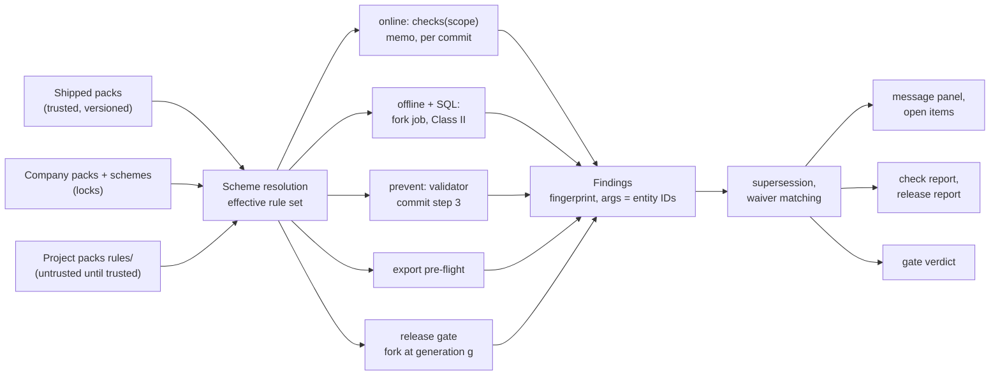
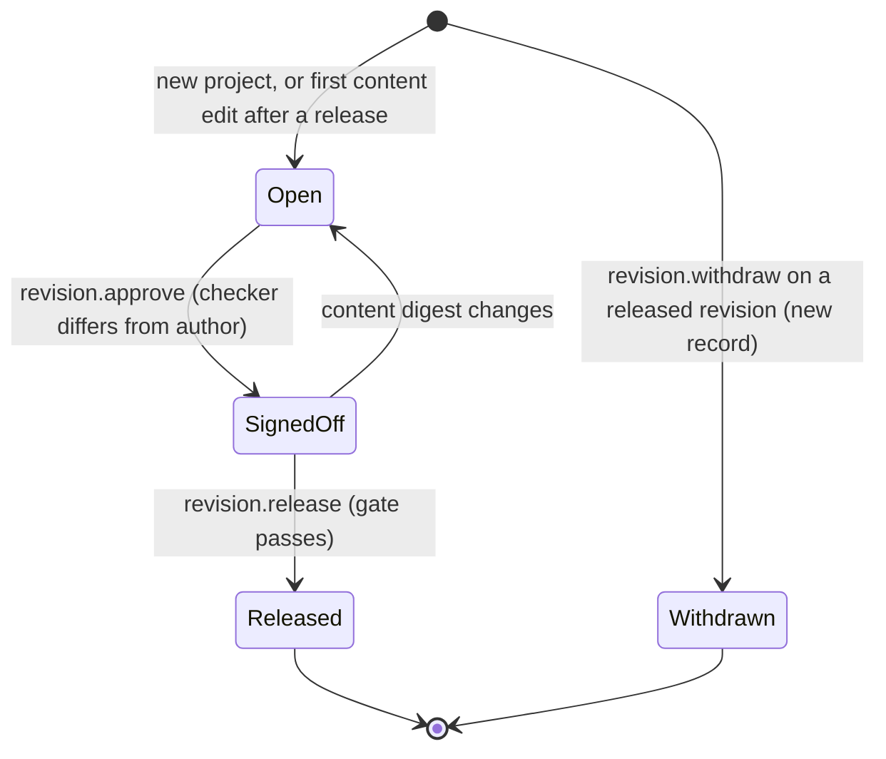
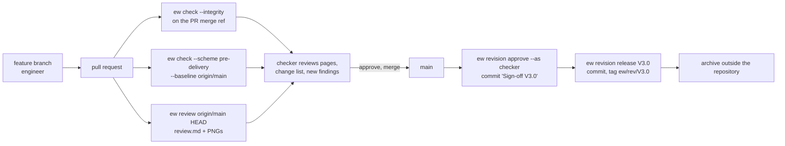

# Checks, revisions and collaboration

**Status:** Draft v0.1 · **Date:** 2026-10-17 · **Part of:** ElektraWatt design document set

**Purpose.** This document specifies how ElektraWatt (EW) finds errors, releases a checked drawing set and lets
several people work on one project without a server. It elaborates the CHK and REV areas of
[02a](02a-requirements-core.md) and the workflow part of COL in [02b](02b-requirements-extended.md). It covers the
rule engine and its modes, rule packs and schemes, waivers, quick fixes and messages, the full initial check
catalogue with **final rule IDs**, managed revisions with a four-eyes release, and the shared-drive and git workflows
with semantic merge and visual page review. Storage mechanics (save protocol, lock record, merge-driver internals,
archive layout) stay in [05](05-project-format-and-persistence.md).

**Contents**
1. [Scope and boundaries](#1-scope-and-boundaries)
2. [Concepts and data](#2-concepts-and-data)
3. [Rule engine behaviour](#3-rule-engine-behaviour)
4. [Initial check catalogue](#4-initial-check-catalogue)
5. [Revision management](#5-revision-management)
6. [Collaboration](#6-collaboration)
7. [UI and UX touchpoints](#7-ui-and-ux-touchpoints)
8. [Outputs](#8-outputs)
9. [Edge cases and pitfalls](#9-edge-cases-and-pitfalls)
10. [The reference project](#10-the-reference-project)
11. [Scope by release](#11-scope-by-release)
12. [Dependencies](#12-dependencies)
13. [Requirements covered](#requirements-covered), [Open questions](#open-questions)

---

## 1. Scope and boundaries

| Topic | Specified here | Specified elsewhere |
|---|---|---|
| Rule engine, modes, schemes, waivers, quick fixes, messages, F1 help | All behaviour | Record shapes: [03](03-domain-model.md) §19 (amended in §2 below) |
| Rule IDs and codes | Final ID and code of every shipped rule | Rule content: EW-POT, EW-TERM, EW-CORE-03x in [08](08-connections-terminals-cables.md) §8; EW-PLC, EW-SAF, EW-PRC, EW-BUS, EW-IOL in [10](10-plc-and-bus.md) §3.10; EW-FL in [11](11-fluid-power.md) §6; EW-L and EW-THM in [12](12-panel-layout.md) §4, §11.8; EW-MFG in [13](13-manufacturing-outputs.md) §4.6; importer findings in [14](14-interop.md) |
| Integrity check | Rule IDs EW-CORE-001 … 016 | Detection: [05](05-project-format-and-persistence.md) §6.3 (INT-01 … INT-16) |
| Revisions | Lifecycle, sign-off, gate, page change status, change lists, clouds, transmittals | Release file sequence and archive layout: [05](05-project-format-and-persistence.md) §14; revision overview form and status mark: [09](09-reports-forms-output.md) |
| Collaboration | Workflows, branch-safe counters, merge UI, visual review, comments, work copies | Lock record, journal, external-change diff, merge-driver algorithm: [05](05-project-format-and-persistence.md) §7, §9, §11 |
| Screens | Behaviour and content | Widgets and layout: [16](16-ux-ui.md) |
| CI pipelines | What `ew check` and `ew review` provide | Jobs: [18](18-quality-security-release.md) |

The binding decisions are ADR-0019 (rule engine), ADR-0009 (invariants, strict and lenient), ADR-0003 (freshness,
committed computations), ADR-0012 (git integration), ADR-0013 (revisions, as-built archive) and ADR-0020
(`HumanOnly` exposure of waivers, schemes, approval and release). Real-time co-editing
is out of scope for v1 ([04](04-architecture.md) §16, FR-COL-021 Later).

---

## 2. Concepts and data



### 2.1 Entities

Additions to [03](03-domain-model.md) §18–§19 are marked *(add)*. A = authored and persisted, D = derived.

| Entity | Kind, file | Key fields |
|---|---|---|
| `RulePack` | data; shipped in the app, company path, or project `rules/` | `id`, `version` (semver), `ruleset` (e.g. `EN60204-1:2018+A1:2025`), `api = "v1"`, `licence`, rules, data tables, Fluent files, docs |
| `Rule` | data | §2.3 |
| `CheckScheme` | A, `ProjectSettings` or company basic project | `name`, `extends`, per-rule overrides `{enabled, severity, release_severity, params}`, `locked` *(add, company schemes only)* |
| `CheckSettings` *(add)* | A, `project.jsonl` | `active_scheme` (online), `release_scheme` (gate), pack pins `{id, version_req}`, `strictness: Strict \| Lenient{since}`, rule parameters |
| `Finding` | D | rule, code, severity, state (`open`, `pending`, `waived`, `superseded`, `deferred`, `possibly_resolved`), targets, page, cell, args, `fingerprint`, `open_item`, `origin` (online, offline, prevent, release, export, import, merge), `rev` |
| `Waiver` | A, `waivers.jsonl` | rule, target (finding fingerprint, or part *(add)*), reason, author, date, `expires` *(add)* |
| `QuickFix` | D | label key, command name and parameters, `scope: One \| AllOfRule` |
| `Revision` | A, `revisions.jsonl` | 03 fields plus `purpose` *(add)*, `sign_off` *(add)* and, on a withdrawal record, `withdraws` and `reason` *(add)*, §5 |
| `ReleaseRecord` | A value in `Revision` | 03 fields plus `content_digest`, `page_digests`, `changed_pages` *(add)*, §5.6 |
| `Transmittal` *(add)* | A, `revisions.jsonl` (new kind; needs a rank in the kind registry of [05](05-project-format-and-persistence.md) §2.2) | revision, issued on, purpose, recipient role, reference, customer response, §5.9 |
| `Comment` | A, `comments.jsonl` | 03 fields (`anchor`, `author`, `status`, `text`) plus `kind: Note \| Issue`, `revision`, `parent` (thread) and `resolved{by, date}` *(add)*, §6.7 |
| `Project.completed` *(add)* | A, `project.jsonl` | `{date, by}`, plus the reason of the last reopen, §5.10 |
| Conflict record | A, in the file of its target until resolved | `$k = "conflict"`, rank 255, [05](05-project-format-and-persistence.md) §2.2, §11.2 |
| Review bundle | X (artefact) | `review.md`, PNGs, `changes.json`, §6.6 |

### 2.2 Rule IDs and six-digit codes

Every rule has two identifiers:
- **The rule ID** is the key used by waivers, documentation, CLI filters and the golden CSVs. Its form is
  `<OWNER>-<FAMILY>-<NUMBER>`, for example EW-POT-013. The prefix `EW-` is reserved for shipped packs (ADR-0019),
  and company and plugin packs use their own prefix. The number width is fixed per family, so EW-PLC-12 and
  EW-POT-013 stay as they are. The layout family keeps the fused form `EW-Lnnn` (EW-L001, EW-L011) that ARCH §12,
  ADR-0019 and [12](12-panel-layout.md) already use; the registry treats `L` as its family. IDs are never reused:
  a withdrawn rule keeps its ID and the text "Retired", like EW-PLC-06.
- **The code** is a six-digit message number `CCCNNN`, in the style of EPLAN. `CCC` is the topical class of the
  table below, and `NNN` is the rule number plus the family's block offset. The code is printed in the message panel
  and the reports, sorts by topic and lets EPLAN users find terminal rules under 001. EW codes share only the class
  topics with EPLAN (001, 003, 005 and 017, [eplan-features](../research/eplan-features.md) §9), not the message
  numbers.

| Class | Topic | Families (code block offset) | Pack |
|---|---|---|---|
| 001 | Terminals and strips | EW-TERM-nnn | EW-TERM |
| 003 | Cables and conductors | EW-CORE-031 … 039 | EW-CORE |
| 005 | Connections, potentials, wire properties | EW-POT-nnn | EW-POT |
| 017 | Reference designations and numbering | EW-RDS-nnn (+0), EW-NUM-nnn (+100) | EW-IEC81346 |
| 100 … 105 | 100 integrity (EW-CORE-001 … 019); 101 pages, title blocks and report blocks (-021 … 029); 102 devices, parts and BOM (-041 … 049); 103 cross-references (-051 … 059); 104 texts (-061 … 069); 105 rule system and waivers (-081 … 089) | EW-CORE (+0 in every class; the number range selects the class) | EW-CORE |
| 110 | PLC and I/O | EW-PLC-nn (+0), EW-SAF-nn (+100), EW-PRC-nn (+200) | EW-PLC |
| 111 | Fieldbus | EW-BUS-nn (+0), EW-IOL-nn (+100) | EW-BUS |
| 120, 130, 131, 140, 150 | Fluid; layout and routing; thermal (IEC 61439); manufacturing; EN 60204-1 | EW-FL-nn, EW-Lnnn, EW-THM-nn, EW-MFG-nn, EW-EN60204-nn | EW-FL, EW-LAYOUT, EW-THM, EW-MFG, EW-EN60204 |
| 160 | Import and migration | EW-IMP-nnn | importers ([14](14-interop.md)) |
| 190 | Release gate | EW-REL-nnn | EW-REL |
| 500–899, 900–999 | Company classes (allocated by the company); plugins (1.x) | own prefix | company and plugin packs |

Examples: EW-TERM-002 → `001002`, EW-CORE-033 → `003033`, EW-POT-013 → `005013`, EW-NUM-001 → `017101`,
EW-CORE-013 → `100013`, EW-CORE-041 → `102041`, EW-CORE-061 → `104061`, EW-PLC-12 → `110012`, EW-SAF-01 →
`110101`, EW-IOL-01 → `111101`, EW-L011 → `130011`.

A registry file in `ew-checks` lists every shipped ID with its code. A CI test fails on a duplicate ID or code, a
reused ID or a missing registry entry.

### 2.3 Rule definition

| Field | Meaning |
|---|---|
| `id`, `code`, `class` | §2.2 |
| `title`, `message` | Fluent message ID, default `rule-<id lower case>` (ADR-0019 example: `message = "rule-ew-pot-013"`), with attribute `.title` (§3.8) |
| `kind` | `safety`, `conflict`, `completeness` or `hygiene`. It drives pending display (06 §3.10) and waiver limits (§2.5) |
| `severity`, `release_severity` | `error`, `warning`, `info`. `release_severity` applies in release mode and to `ew check` (§3.2) |
| `modes` | Subset of `online`, `offline`, `prevent`, `release`, `export` |
| `scope` | `project`, `page`, `potential`, `net`, `strip`, `cable`, `device`, `module`, `station`, `cfg` (configuration project, requested by [10](10-plc-and-bus.md)), `lnet`, `pnet`, `fluid_net`, `space`, `surface`, `carrier`. The scope is the memo key of `checks(scope)`, not the finding granularity: EW-CORE-061 runs in scope `project` and emits one finding per text style; EW-CORE-053 runs per `page` and emits one finding per cross-reference |
| `impl` | `rust:<name>@<version>`, `rhai:<file>` or inline `impl = "rhai"` with an `expr` field (ADR-0019's `rhai:<expr>`, split so that TOML multi-line strings stay readable), or `sql:<file>` |
| `params`, `data` | Typed parameters, and data tables with a `verified` flag and a source citation (NFR-COMP-05) |
| `supersedes` | Rule IDs this rule replaces for the same targets (§3.6) |
| `open_item` | The finding also appears in the open-items list (REF-094) |
| `fixes` | Declarative quick fixes `{command, params}` or a Rust fix provider |
| `docs` | Relative documentation path, resolved in the bundled docs (§3.8) |
| `waivable` | `true` by default. Structural rows, the integrity rules EW-CORE-001 … 016 and the EW-REL rules are `false` |
| `since`, `retired` | Pack versions |

### 2.4 Schemes and settings

A **scheme** is a named set of overrides over the rules of the loaded packs (FR-CHK-003). It is resolved in this
order, later entries winning:
1. pack defaults;
2. the company scheme of the same name, from the company basic project;
3. the project scheme.

**Locked rules.** A company scheme may lock rules. A project scheme can then neither disable a locked rule nor
lower its severity. The scheme editor shows the lock and the effective value (proposed FR-CHK-050).

**Two scheme slots.** The project names an `active_scheme` for online checking (default `drafting`) and a
`release_scheme` for the gate (default `pre-delivery`). The shipped schemes are listed in §4.9.

### 2.5 Findings, fingerprints and waivers

**Fingerprint.** Every finding has a fingerprint (proposed FR-CHK-044, adopted from [03](03-domain-model.md)):

```text
fingerprint = first 128 bits of SHA-256("ew-fp/1" ‖ rule_id ‖ sorted target UUIDs ‖ discriminator)
```

- **Targets.** Targets are entity UUIDs. A CP is identified by `v5(function, idx)`.
- **Discriminator.** It holds only stable data: a CP index, a pass-through pair, a text-style ID, a field path.
  Tags, folios, positions, counts and message arguments are never part of it. A renumber or a move therefore keeps
  every fingerprint, and with it every waiver.
- **Message arguments.** Arguments are entity references and typed values, not strings. The message is rendered at
  display time with the current derived tags, so a message can never show a stale tag.

**Waiver record.** A waiver matches findings by fingerprint (FR-CHK-009):

```json
{"$k":"waiver","id":"0192f7c1-…","rule":"EW-CORE-041","target":{"finding":"9c2e5a…41ab"},"reason":{"en-GB":"PE stud is part of NSYPMM107"},"author":"<party id>","date":"2024-07-12","expires":"never"}
```

**Waiver rules.**
- **Reason.** A reason is mandatory, with at least 10 characters, as `MlText`.
- **Target.** The target is a finding fingerprint (MVP). From 1.0 it may also be a part `{library, item}`: such a
  waiver covers every finding of that rule whose primary target uses the part, for example a vendor cable whose BU
  core carries 0 V (EF-11, open question 6).
- **Safety rules.** Rules of kind `safety` (EW-POT-013, EW-POT-006, EW-POT-007) accept only fingerprint waivers.
  The checker acknowledges them individually at sign-off (§5.4).
- **Expiry.** `expires` is `never`, `next_release` or a date. A bulk "legacy" waiver after a migration should use
  `next_release` (1.0).
- **Unmatched and expired waivers** are reported (EW-CORE-081, EW-CORE-082). They are never silently deleted.
- **Reporting.** Check and release reports list every waived finding instance, not only the waiver count.
- **Who may waive.** `waiver.create` and `waiver.remove` are `HumanOnly` commands (ADR-0019 decision 8,
  [17](17-extensibility.md) §2.3): the GUI and a CLI command typed by a person may run them; scripts, `.ewcmd`
  replays, MCP sessions and plugins get `CmdError::Exposure`. The same holds for scheme severity, pack enablement,
  strictness, `revision.approve` and `revision.release`.

### 2.6 Quick fixes

A quick fix is a command proposal that always runs as a preview on a fork and commits as one undoable transaction
(FR-CHK-010, ADR-0008).
- **Scope.** `scope = AllOfRule` applies one fix to every open finding of the rule in a single command and a single
  undo step: "designate all empty terminals", "map every BR core to BN".
- **Allowed content.** Declarative fixes reference command names from the catalogue (FR-EXT-015) with parameter
  templates over the finding (`$target`, `$arg.*`), so a pack cannot run code through a fix.
- **No fix where a person must decide.** Some rules deliberately have no fix, because the correct answer is a human
  decision. EW-POT-013 is the example: the correct wiring of T55 is unknown (▲U-11).

---

## 3. Rule engine behaviour

### 3.1 Modes

| Mode | When | Engine | Freshness | Typical rules |
|---|---|---|---|---|
| **online** | Every commit | Memoised `checks(scope)` on the UI thread, ≤ 5 ms per rule per commit (NFR-PERF-09) | Class I | EW-POT-013, EW-TERM-002, EW-CORE-053 |
| **offline** | "Check project", `ew check --mode offline` | Fork job, parallel per scope | Class II, stamped "as of revision n" (FR-UI-024) | EW-POT-007, SQL rules, EW-PLC-14 |
| **prevent** | Commit pipeline step 3 ([04](04-architecture.md) §5.2) | Validator on the candidate snapshot, touched keys and neighbours | — | EW-TERM-001/002, EW-RDS-004, EW-PLC-01 |
| **release** | Release gate, `ew check` (default) | Fork at the saved generation; every enabled rule evaluated cold | Fresh by construction | All |
| **export** | Before an exporter writes | The exporter calls the engine on its fork | — | EW-PLC-05, EW-MFG-01 … 06 |

Mode abbreviations in the catalogue tables of §4: o online, f offline, p prevent, r release, x export; `import`
marks a rule that runs only in the migration check run of an import (§4.9 `migration`).

ADR-0019 names four modes. `export` corresponds to EPLAN's "module-specific" checks, and [10](10-plc-and-bus.md) and
[13](13-manufacturing-outputs.md) already use it (open question 1). **Deferred** is a state, not a mode. An online
rule that exceeds its budget three times in 100 commits is demoted for the session: it runs on the pool at most
250 ms after the last commit, its findings carry a "deferred" badge, and the demotion is logged (FR-CHK-013).

### 3.2 Effective severity

```text
sev(rule, mode) = if mode = release: scheme.release_severity ?? rule.release_severity ?? scheme.severity ?? rule.severity
                  else:              scheme.severity ?? rule.severity
cap:   a rule that reads a data table with verified = false reports at most warning (1.0, proposed FR-CHK-046)
state: waived findings keep their severity but leave the counts; superseded findings are hidden
```

**`ew check` uses release mode** unless `--mode offline` is given. `ew check --scheme pre-delivery` therefore
reports what would block a delivery. EW-L001 (unplaced device) is a warning while drawing and an error there, as
EF-05 expects. EW-PLC-15 (`Tbd` address) goes from info to error.

**EW-REL rules run only in the gate** (`ew revision approve`, `ew revision release`, the approve and release
dialogs, and `ew check --gate`). They test the revision workflow, not the drawing: with them in every
`ew check`, Golden A would report a 43rd error ("checker not set") and Golden A-R would exit 1 before its sign-off,
contradicting AC-21 and the `ew check` examples of [17](17-extensibility.md) §3.4.

### 3.3 Online evaluation

Online rules are queries (ADR-0019). The engine decides which scopes a commit can have affected, without
re-verifying every `checks(scope)` memo of an XL project:

```text
on commit of transaction tx, producing revision r':
1. touched   = keys written by tx.ops (rows and base-index keys)
2. affected  = ⋃ rdeps[k] for k ∈ touched        // scopes whose last evaluation read k
             ∪ scopes created by tx                // a new page, a potential split, a new strip
             − scopes that vanished                // their findings are dropped
3. for s in affected, in (scope kind, key) order: checks(s) at r'
     each online rule ρ of s's kind runs under a tick budget (5 ms); on overrun the previous
     findings of (ρ, s) stay, marked "deferred", and ρ is queued on the pool
4. replace the findings of s in the finding index; rebuild rdeps for s from the read set that
   ew-memo recorded for checks(s)
5. apply supersession (§3.6) and waiver matching to the changed fingerprints only
6. publish {r', added, removed, changed} to the view-models (message panel, canvas badges, counters)
```

- **Reverse index.** `rdeps` is a reverse dependency index kept for the `checks` query family only. It is estimated
  at ≤ 40 MB on the XL fixture, inside the memo budget of NFR-PERF-13 (**verify** at the M0 spike).
- **Read tracking.** Because `rdeps` comes from the recorded reads, a rule that reads outside its nominal scope is
  still re-evaluated correctly.
- **Correctness checks.** Debug builds compare the finding index with a cold full check after sampled commits, and
  the nightly oracle compares it after every commit (NFR-REL-08).
- **Golden example.** Rewiring T55 on folio 101 touches connections on page 101. This affects page 101, the
  potentials N-55, N-55T and L-55, and the project scope. EW-POT-013 re-runs and its finding disappears in the same
  commit (FR-CHK-008).

### 3.4 Offline, SQL and export rules

- **Offline rules** run in a check job on a World fork ([04](04-architecture.md) §2), and their results carry their
  revision. After later edits, an offline finding whose targets were touched is struck through as "possibly
  resolved" until the next run: it neither vanishes silently nor stays falsely current (EPLAN likewise keeps
  resolved messages until the next offline check, [eplan-features](../research/eplan-features.md) §9).
- **Run scope.** "Check project" and `ew check` cover the whole project. "Check selection" and
  `ew check --pages 101-106` (or `--structure =P01+J-E-2416`) restrict an offline run to the scopes reachable from
  those pages or nodes, for example while a section is being drawn. Release mode always checks the whole project.
- **SQL rules** (FR-CHK-007, 1.0) are `SELECT` statements over the `api_v1_*` views (ADR-0017). They run in offline
  and release mode only, on a projection built at the fork's revision. Each row is one finding, read from the columns
  `target` (one UUID) or `targets` (JSON array), optional `discriminator` and `page`, and `arg_<name>`. CI prepares
  every shipped `.sql` against the current projection ([04](04-architecture.md) §13).
- **Export rules** run inside an exporter. An error-level finding stops a release-mode export. In working mode the
  affected rows are excluded and listed in a side-car report ([13](13-manufacturing-outputs.md) §4.6).

### 3.5 Prevent rules, strict and lenient

**Prevent rules are the configurable invariants of ADR-0009.** Structural invariants, such as "references resolve"
or "checker ≠ author on release", are not rules and cannot be waived.

| Project strictness | Effect of a violation in a transaction |
|---|---|
| `Strict` (default for new projects) | The transaction is rejected with `CmdError::Prevented{rule, finding}`. The status line explains the cause and offers the alternative: "designation 4 is taken on -X1031; use 21 or swap 3 ↔ 4" |
| `Lenient{since}` (set by an import, FR-CHK-011) | Violations that arrive through `ApplyImport` are committed as findings of the same rule ID (origin `import`). Interactive and scripted edits are still validated strictly: "a new duplicate drawn afterwards is rejected" (FR-CHK-011) |

- **Leaving lenient mode.** A banner shows "Lenient mode: N prevent violations". The command "Switch to strict" is
  enabled once N = 0.
- **Lenient is not a loophole.** In release mode every prevent violation is an error, whatever the strictness.
- **Files on disk win, in both modes.** An external change or a merge cannot be rejected, because the files already
  hold it. In a `Strict` project its violations are committed too, as EW-CORE-013 (uniqueness collisions, §6.4) or
  as findings of the violated prevent rule with origin `merge`; as with INT-12, the next interactive transaction
  that touches the key must restore the invariant.

### 3.6 Supersession and de-duplication

One defect yields one finding (proposed FR-CHK-045, from [20](20-golden-project.md) §18.1). A rule declares
`supersedes = [...]`. When a superseding finding exists whose targets overlap a superseded finding's targets, the
superseded finding is hidden, and it reappears when the superseding finding goes.

| Superseding rule | Superseded rule | For | Source |
|---|---|---|---|
| EW-PLC-12 | EW-NUM-002 | PLC addresses | 20 §18.1 |
| EW-NUM-001 | EW-NUM-002, EW-RDS-001 | Tags, frozen tags | 20 §18.1 |
| EW-PLC-13 (1.0) | EW-POT-003 | PLC supply CPs (EF-22 supersedes EF-10) | [10](10-plc-and-bus.md) |
| EW-BUS-01 | EW-CORE-044 | `Tbd` bus addresses | §4.2, [10](10-plc-and-bus.md) §3.10 |
| EW-PLC-15 | EW-CORE-044 | `Tbd` module start and channel addresses | §4.2 |
| EW-CORE-013 | the violated prevent rule | Collisions after a merge | §6.4 |
| EW-L011, EW-THM-05, EW-MFG-01 | EW-REL-002 | Stale committed routes, thermal results and lengths at release | §4.8 |
| EW-POT-015 | EW-MFG-05 | Duplicate wire numbers already reported online (proposal; confirm in [13](13-manufacturing-outputs.md)) | §4.4 |
| EW-EN60204-04, -08, -09, -10 (include, not supersede) | EW-POT-004, -005, -006, -007, -010 | Clause references are added to the base finding | §4.7 |

The pack linter rejects supersession cycles. Supersession works across scope kinds: EW-PLC-13 is station-scoped and
EW-POT-003 potential-scoped, so the engine applies it in the finding index by target, not inside `checks(scope)`.

### 3.7 Rule packs on disk

Shipped packs live in the application. Company packs come from the company library path. Project packs follow the
UUID-named project layout of [05](05-project-format-and-persistence.md) §2.1: `rules/<uuid>.toml` plus an optional
`rules/<uuid>/` directory for its rhai, SQL, Fluent and doc files; the human pack ID (`ACME`, `EW-POT`) lives inside
the TOML ([05](05-project-format-and-persistence.md) open question 17; `.gitattributes` in §11.1). A shipped or
company pack directory looks like this:

```text
ew-pot/
  pack.toml             # [pack] id, version, ruleset, api, licence; [[rule]] entries (or rules/*.toml)
  data/pe-sizing.toml   # data tables: rows, unit, source citation, verified flag
  sql/                  # SQL rules (offline and release only)
  rhai/                 # rhai rules
  i18n/en-GB/ew-pot.ftl i18n/nl-NL/ew-pot.ftl
  docs/                 # per-rule pages (company packs); shipped packs link to the bundled mdBook
  tests/EW-POT-013/     # pass.ewcmd, fail.ewcmd, expected.csv (CI: one passing and one failing fixture per rule)
```

```toml
[pack]
id = "EW-POT"
version = "1.0.0"
ruleset = "EW-POT:2027.1"
api = "v1"

[[rule]]
id = "EW-POT-013"
code = "005013"
kind = "safety"
severity = "error"
modes = ["online", "release"]
scope = "potential"
impl = "rust:pot.n_switching@1"
docs = "rules/ew-pot-013"

[[rule]]
id = "EW-POT-006"
code = "005006"
kind = "safety"
severity = "error"
modes = ["online", "release"]
scope = "potential"
impl = "rust:pot.pe_sizing@1"
data = ["pe-sizing"]                    # data/pe-sizing.toml, verified flag checked (§3.2)
params = { line_types = ["L", "L1", "L2", "L3"] }
```

A company rule in rhai, the acceptance example of FR-CHK-006. Quantities are exposed as fixed-point integers, and
collections are sorted by ID, so a script adds neither float noise nor ordering effects:

```toml
[[rule]]
id = "ACME-DEV-001"
code = "500001"
kind = "hygiene"
severity = "warning"
modes = ["online", "release"]
scope = "device"
impl = "rhai"
expr = '''
if device.letter == "T" && !device.functions.some(|f| f.category == "TemperatureSensing") {
    finding(device, #{ letter: device.letter });
}
'''
```

A company SQL rule (1.0), over the `api_v1_terminal` columns of [17](17-extensibility.md) §6.1 (`strip_id`,
`potential_type`, `rail_bonded`). It is the acceptance example of FR-CHK-007; on Golden A it reports nothing,
because 1X1:PE and -X1032 are rail-bonded:

```sql
-- <company pack>/sql/pe-rail.sql   api = "v1", modes = ["offline", "release"]
SELECT t.id AS target, 'rail' AS discriminator, t.strip_id AS arg_strip
FROM api_v1_terminal AS t
WHERE t.potential_type = 'PE' AND t.rail_bonded = 0;
```

### 3.8 Messages and help

**Fluent identifiers contain no dots.** The key form in [04](04-architecture.md) §12 (`rule.pot013.title`) is
therefore replaced by one message per rule with attributes (open question 2):

```ftl
rule-ew-pot-013 = { $device } switches the neutral { $from } → { $to }; { $load } stays connected to { $line }.
    .title = Single-pole switching in the neutral conductor
    .hint = Move the contact into the line conductor, or use a device that opens L and N together.
```

- **Arguments** are entity references, resolved to derived tags at render time; quantities and dates are formatted
  by icu per output language (FR-I18N-009).
- **Languages.** en-GB is mandatory and the fallback; nl-NL is complete at MVP (FR-UI-032). CI fails when a rule
  lacks its message or `.title` (NFR-I18N-02).
- **F1 help.** F1 on a finding opens `docs` in the bundled offline documentation (FR-CHK-015, FR-UI-031): what is
  checked and why, the standard by number and clause without copied text, a golden example, quick fixes and waiver
  guidance (NFR-DOC-02). CI fails when the page is missing. Company packs ship `docs/<rule>.md`, which EW renders to
  a temporary HTML file for the system browser, without a network request.

### 3.9 Trust, versions and reproducibility

- **Trust.** Shipped packs are trusted. Project packs, and the SQL and rhai in them, do not run until the user trusts
  the project, remembered by content hash outside the project (FR-EXT-014, NFR-SEC-05;
  [05](05-project-format-and-persistence.md) §13.4). An untrusted pack yields EW-CORE-084, so a release can never
  claim a check it did not run.
- **Pure formulas.** Formulas inside queries (tag formats and the like) are not rules. They run in untrusted
  projects, as [02c](02c-nonfunctional-requirements.md) open question 2 recommends.
- **Versions.** Rust implementations are versioned by name (`pot.n_switching@1`). A behaviour change ships as `@2`
  in a new pack version, and the old implementation stays.
- **What a release records.** A released revision stores `{pack id, version, sha256}` for every evaluated pack
  (FR-REV-001, FR-REV-020).
- **Reproduction.** EW keeps every shipped pack version, like derivation profiles (ADR-0003).
  `ew check --packs-as-of V2.0` reproduces the V2.0 check report byte for byte (FR-REV-010).
- **Determinism.** Findings are sorted by (code, fingerprint) and contain no wall-clock data, so two platforms give
  identical finding lists (FR-CHK-001, NFR-REL-07).

---

## 4. Initial check catalogue

### 4.1 Packs

| Pack | Families | Classes | MVP | 1.0 | Content specified in |
|---|---|---|---|---|---|
| EW-CORE | EW-CORE | 003, 100–105 | all except the rows marked 1.0 | complete | this document, cables in [08](08-connections-terminals-cables.md) |
| EW-IEC81346 | EW-RDS, EW-NUM | 017 | complete | — | this document |
| EW-TERM | EW-TERM | 001 | complete | — | [08](08-connections-terminals-cables.md) |
| EW-POT | EW-POT | 005 | all except EW-POT-007, -010, -018, -019 | complete | [08](08-connections-terminals-cables.md), EW-POT-018 here |
| EW-PLC | EW-PLC, EW-SAF, EW-PRC | 110 | EW-PLC-01, -02, -03, -07, -08, -12, -15 | complete | [10](10-plc-and-bus.md) |
| EW-BUS | EW-BUS, EW-IOL | 111 | EW-BUS-01, -04 | complete (EW-BUS-08 1.x) | [10](10-plc-and-bus.md) |
| EW-FL | EW-FL | 120 | EW-FL-01, -02, -04, -11, -13 | complete (EW-FL-03 1.x) | [11](11-fluid-power.md) |
| EW-LAYOUT | EW-L | 130 | EW-L001 … L004, L006 (2D), L010, L016 | complete (EW-L013 1.x) | [12](12-panel-layout.md) |
| EW-THM | EW-THM | 131 | — | complete | [12](12-panel-layout.md), EW-THM-06/07 here |
| EW-MFG | EW-MFG | 140 | — | complete (EW-MFG-11 1.x) | [13](13-manufacturing-outputs.md) |
| EW-EN60204 | EW-EN60204 | 150 | — | complete, opt-in | this document |
| EW-REL | EW-REL | 190 | EW-REL-001, -002, -004 | complete | this document |

FR-CHK-004 (MVP packs) and FR-CHK-005 (1.0 packs) are satisfied by this table. The [architecture](04-architecture.md)
§12 list needs EW-THM, EW-MFG and EW-EN60204 added (open question 1).

### 4.2 EW-CORE

**Integrity (class 100).** The findings INT-01 … INT-16 of [05](05-project-format-and-persistence.md) §6.3 map one to
one: EW-CORE-0nn = INT-nn, with the severities and quick fixes given there. They run at open, after merges and in
`ew check --integrity` (FR-CHK-012).
- **Blocking release:** EW-CORE-002, -003, -005 … -009, -011, -012, -013 and -015; EW-CORE-016 (unknown data from
  a newer format) only where outputs are affected, as refined in [05](05-project-format-and-persistence.md) §6.3.
- **Not blocking:** EW-CORE-001, -004, -010, -014, and EW-CORE-016 where no output is affected.
- **Not waivable:** all of EW-CORE-001 … 016 (§2.3). A dangling reference or a conflict record is repaired, never
  accepted.
- **EW-CORE-013** is the uniqueness collision after a merge (tag or counter, terminal designation, wire number, IP
  star source, PLC address, PLC symbol). It supersedes the violated prevent rule for the same targets and carries
  the quick fix of §6.4.

**Cables, pages, devices, references, texts and the rule system.** The cable rules EW-CORE-031 … 037 are adopted
from [08](08-connections-terminals-cables.md) §8.1 unchanged (EW-CORE-036 is also a prevent rule, invariant CI-05).
Severity is given as online/release. A Requirement cell that names no FR gives the research source of a rule that
has no requirement row yet (STD = [standards](../research/standards.md), G15 =
[gaps-and-corrections](../research/gaps-and-corrections.md) G15).

| Rule | Check | Severity | Modes | Rel | Requirement | D | Golden A |
|---|---|---|---|---|---|---|---|
| EW-CORE-021 | Page folio outside its section's range | error | o r | MVP | FR-CHK-038 | — | 0 |
| EW-CORE-022 | Folio collision between drawn pages, report blocks and sub-pages | error | o p r | MVP | FR-CHK-038 | — | 0 |
| EW-CORE-023 | Title-block value overridden on a page (description override) | info | o r | MVP | FR-REP-036 | D-06 | 0 |
| **EW-CORE-024** *(add)* | Report block required by the project's applicable standards missing: the EN 60204-1 clause 17 set (via EW-EN60204-15) or the IEC 61439-1 clause 11 routine-verification checklist (FR-MFG-037) | warning/error | o r | 1.0 | proposed FR-CHK-054; FR-MFG-036, FR-MFG-037 | D-09 | off (no standard declared) |
| EW-CORE-031 … 037 | Cable rules: colour code, part cores, **length missing (033)**, **external connection without cable (034)**, pin map, core reuse, shield | per [08](08-connections-terminals-cables.md) | o r (036 also p) | MVP | FR-CHK-032, -033 | D-17, D-19 | EF-07, EF-08 |
| EW-CORE-041 | Device without part assignment | warning | o r | MVP | FR-CHK-024 | D-04 | EF-04 (2), EF-19 (waived) |
| EW-CORE-042 | Part copy with incomplete mandatory data (empty description, missing manufacturer, no CP pattern) | warning | o r | MVP | FR-CHK-024 | D-04 | 0 |
| EW-CORE-043 | Placeholder part (`Tbd` part) | warning/error | o r | MVP | FR-CHK-034 | D-04 | EF-17 (4) |
| EW-CORE-044 | Other typed `Tbd` value in a mandatory field | info/error | o r | MVP | FR-CHK-034 | D-15 | 0 |
| EW-CORE-045 | Auxiliary functions exceed, or differ in kind (NO/NC) from, the main function's contacts | error | o r | MVP | FR-CHK-036 | — | 0 |
| EW-CORE-046 | Overview or hand-drawn assembly representation differs from the assembly's children | error | o r | MVP | FR-CHK-022 | D-10 | 0 |
| EW-CORE-047 | Device whose functions require a representation but have none on any page (unplaced in the schematic) | warning/error | o r | MVP | FR-REV-007 | D-32 | 0 |
| EW-CORE-048 | **BOM sync:** an assembly with `bom_basis = Assembly` whose order codes do not cover each child exactly once | warning | o r | MVP | FR-DEV-020 | D-36 | 0 |
| EW-CORE-049 | **BOM sync:** an imported or hand-maintained part list differs from the derived BOM | info | import | MVP | FR-IMP-003 | D-01, D-04 | 0 (C: MF-21) |
| EW-CORE-051 | Interruption point without partner (an external target counts as a partner) | error | o r | MVP | FR-CHK-017 | — | 0 |
| EW-CORE-052 | Ambiguous interruption point: more than one star source per name and scope; odd count in chain mode | error | o p r | MVP | FR-CHK-017 | — | 0 |
| EW-CORE-053 | Cross-reference target cell outside the frame or without graphics of the target | warning | o r | MVP | FR-CHK-035 | D-14 | 0 (C: MF-13) |
| EW-CORE-054 | Overview representation without a detail link | warning | o r | MVP | — (STD XR-04) | D-10 | 0 |
| EW-CORE-055 | Contacts of the main function's part neither placed nor marked unused; off in pre-delivery | info | o | 1.0 | — (STD XR-03) | — | off |
| EW-CORE-056 | External reference to a project that is open but has no matching target | info | o | 1.0 | — (G15) | — | 0 |
| EW-CORE-061 | Printed cap height below the minimum, reported per text style | warning | o r | MVP | FR-CHK-023 | D-31 | EF-12 (2) |
| EW-CORE-062 | Text overflow in a title-block cell or report column after shrink-to-fit, per display language | warning | o r | 1.0 | FR-I18N-012 | — | 0 |
| EW-CORE-063 | Text with an explicit size not bound to a text style | info | o | MVP | FR-SYM-013 | D-29 | 0 (C: MF-26) |
| EW-CORE-064 | Font substituted on import | info | import | MVP | FR-IMP-020 | — | 0 (C: MF-22) |
| EW-CORE-065 | Description lint: rating in a description, unit formatting ("50hz", "0.75 mm ²"), manufacturer spelling | warning | f r | 1.0 | FR-CHK-040 | D-18, D-35 | EF-25 (0) |
| EW-CORE-081 | Waiver matches no finding | info | o r | MVP | FR-CHK-009 | — | 0 |
| EW-CORE-082 | Waiver expired | warning | o r | 1.0 | proposed FR-CHK-049 | — | 0 |
| EW-CORE-083 | Rule could not be evaluated (rhai limit, SQL error, panic caught) | warning/error | all | MVP | proposed FR-CHK-047 | — | 0 |
| EW-CORE-084 | Rule pack not evaluated: untrusted, incompatible `api`, data table missing | warning/error | all | MVP | proposed FR-CHK-047 | — | 0 |

EW-CORE-047 implements the first half of [02a](02a-requirements-core.md) open question 7. A device without any
schematic representation always blocks release. The layout half is EW-L001, which counts only where a layout space
exists for the device's location.

### 4.3 EW-IEC81346: designations and numbering

The IDs follow the RD-nn check list of [standards](../research/standards.md) §1.6, so EW-RDS-00n is RD-0n.

| Rule | Check | Severity | Modes | Rel | Requirement | D | Golden A |
|---|---|---|---|---|---|---|---|
| EW-RDS-001 | The derived full designation parses under the strict grammar of the active identifier set (standards §1.3) | error | o r | MVP | FR-NUM-001 | D-03 | 0 (frozen tags superseded by EW-NUM-001) |
| EW-RDS-002 | Structure-node code contains prefix or separator characters, so exported full designations are ambiguous to third-party parsers. **`+J-E-2416` reads as location `J`, then products `-E` and `-2416`.** EW stores codes as atomic tokens (FR-PRJ-017) and never re-parses them; the finding warns about exports (AML, EPLAN XML, CSV) | info | o | MVP | FR-CHK-027 | D-03 | not in pre-delivery (§4.9) |
| EW-RDS-003 | Letter code does not match the device's function category in the active identifier set (suggestion shown, e.g. BT under 2019) | warning | o r | MVP | FR-CHK-026 | D-03 | EF-18: T55 |
| EW-RDS-004 | Duplicate full designation in the uniqueness scope (project, `=` or `+` aspect) | error | o p r | MVP | FR-NUM-012 | — | 0 |
| EW-RDS-005 | *Structural:* layout objects reference devices (placement → device; EW-L002) | — | — | MVP | FR-CHK-039 | D-02 | — |
| EW-RDS-006 | *Structural:* the displayed form is one project setting (FR-NUM-002) | — | — | MVP | — | D-03 | — |
| EW-RDS-007 | Letters I or O in a letter code; letters reserved in the 2019 set used as class codes | warning | o r | MVP | — (STD RD-07) | — | 0 |
| EW-RDS-008 | *Structural:* renumbering is one transaction (ADR-0008) | — | — | MVP | FR-NUM-008 | D-01 | — |
| EW-RDS-009 | Confusable or mixed-script character in an identifier (e.g. a Cyrillic "А" in a tag) | error | o p r | MVP | FR-I18N-011 | — | 0 |
| EW-RDS-010 | Two structure nodes whose codes differ only in separators or case (`+JE2416` against `+J-E-2416`). Quick fix: merge, keeping the alias (FR-PRJ-018) | warning | o r | MVP | FR-PRJ-018 | D-03 | 0 (C: MF-02) |
| EW-NUM-001 | Tag does not match the active numbering scheme; frozen tags at info, "frozen, deviates from scheme" with the rule-derived value | warning (frozen: info) | o r | MVP | FR-CHK-025 | D-03 | EF-15 (7) |
| EW-NUM-002 | Frozen wire number, address or other frozen value deviates from its rule after an edit | info | o r | MVP | FR-CHK-037 | — | 0 |

The structural rows keep their IDs so that the RD-nn traceability of the research stays visible in the rule
documentation. They never produce findings.

### 4.4 EW-TERM, EW-POT and cable rules

These are adopted from [08](08-connections-terminals-cables.md) §8.1 as final IDs, with the severities and golden
results given there. One rule is added here.

| Rules | Topic | Rel | Requirement | D | Golden A |
|---|---|---|---|---|---|
| EW-TERM-001, -002 | Terminal without designation; duplicate designation in a strip (prevent, lenient on import) | MVP | FR-CHK-016, FR-TRM-002 | D-11, D-12 | 0 (C: MF-08, MF-09) |
| EW-TERM-003 … 005 | Spare wired on the field side; bridge group invalid; `rail_bonded` on a non-PE terminal | MVP | FR-TRM-007, -009, -017 | — | 0 |
| EW-POT-001, -002 | Type or voltage conflict without a bond; PELV without exactly one 0 V–PE bond, SELV with any | MVP | FR-CHK-028 | D-22 | 0 (C: MF-16) |
| EW-POT-003 | FE-role CP on a PE potential | MVP | FR-CHK-030 | D-16 | EF-10 (2) |
| EW-POT-004, -005 | GNYE on a non-PE potential; exact code BU on a non-N conductor | MVP | FR-CHK-031 | — | EF-11 (2) |
| EW-POT-006 | PE cross-section below the sizing table | MVP | FR-CHK-020 | D-38 | EF-06 (1) |
| EW-POT-007 | PE continuity to the main PE point (offline) | 1.0 | FR-CHK-029 | D-21 | EF-23 (0) |
| EW-POT-008 | More than one PE potential in a location (PE island) | MVP | proposed in 08 | D-21 | 0 |
| EW-POT-009 | Unconnected CP, info when marked unused | MVP | FR-CHK-018 | D-23 | EF-09 (2) |
| EW-POT-010 | Conductors or cross-section beyond the clamp data | 1.0 | FR-CHK-021 | — | 0 |
| EW-POT-011, -012, -014, -016, -017 | Junction feed ambiguous; ring in the drawing graph; physical-wire conflicts; redundant override; two potential names | MVP | FR-CON-005, FR-CON-012, FR-CON-025; -011 and -014 by rows proposed in 08 | D-20, D-24 | 0 |
| EW-POT-013 | Opening pass-through pair carries N without the associated L; N-isolating terminals at info | MVP | FR-CHK-019 | D-13 | EF-01 (2) |
| EW-POT-015 | One wire number on two numbering units, or two numbers within one unit | MVP | FR-NUM-019, FR-NUM-020 | — | 0 |
| **EW-POT-018** *(add)* | Summed load currents (part data × simultaneity) exceed the rating of the feeding source, protective device or electronic-breaker channel; off when no load data exists | 1.0 | FR-CHK-041 | D-25 | EF-24 (0) |
| EW-POT-019 | Cross-section units mixed within one potential (mm², AWG, kcmil); info, proposed in 08 | 1.0 | FR-CON-032 | — | 0 |

EW-POT-018 is offline and potential-scoped. It complements EW-PLC-14, which covers module outputs: EW-POT-018 covers
PSU and protective-device loads such as -102G1 at 20 A and the MICO channels of -102F2 at 6 A.

### 4.5 Domain packs

The IDs below are final as listed in the owning documents, including the rows those documents marked
"proposed/add". The table groups them by topic.

| Pack | Rules | Topic | Rel | D |
|---|---|---|---|---|
| EW-PLC | EW-PLC-01, -02, -03, -08 | Address overlap (prevent), range, bit index, used channel without address | MVP | D-26 |
| | EW-PLC-07, -15 | Duplicate symbol; `Tbd` start or channel address (release error) | MVP | D-15 |
| | **EW-PLC-12** | Binding or address differs from the part's address map | MVP | **D-26** (EF-02: 28) |
| | EW-PLC-04, -05, -09, -10, -11, -16 | Kind mismatch, symbol syntax (export), unconnected channel, width, slot rules, exchange drift | 1.0 | — |
| | EW-PLC-13, -14 | Card supply from the wrong potential type; summed output load | 1.0 | D-16, D-25 |
| | EW-PLC-06 | Retired | — | — |
| | EW-SAF-01 … 03, EW-PRC-01, -02 | F-addresses, 1oo2 pairs, test pulses; process-tag scheme and open instrument tags | 1.0 | D-27 |
| EW-BUS | EW-BUS-01, -04 | Missing or duplicate address (EF-03); termination at both segment ends (EF-16) | MVP | D-15 |
| | EW-BUS-02, -03, -05 … -07, -09, -10, EW-IOL-01, -02 | Ranges, PROFINET names and IPs, rate, length, master, cable type, net mismatch, IO-Link | 1.0 | — |
| | EW-BUS-08 | EtherCAT E-bus budget | 1.x | — |
| EW-FL | EW-FL-01, -02, -04, -11, -13 | Open working ports (EF-13), solenoids vs channels, spare list (EF-14), `Drives` target, occupancy | MVP | D-28, D-10 |
| | EW-FL-05 … -10, -12, -14 | Media, tube rating and size, tube spec (EF-21), exhaust, coil voltage, supply on port 1 (EF-20), port roles, bulkheads | 1.0 | D-28 |
| | EW-FL-03 | Configurator order-code validation (plugin) | 1.x | D-40 |
| EW-LAYOUT | EW-L001 … L004, L006 (2D), L010, L016 | Unplaced device (EF-05), placement without device (structural), part mismatch, location mismatch, footprint overlap, carrier fit, assembly order | MVP | D-02, D-32 |
| | EW-L005, L006 (3D), L007 … L009, L011, L012, L014, L015, L020 … L026 | CP pattern, collision, clearance, duct fill, unroutable, **stale route**, machining, cable length, segregation, placement rules | 1.0 | D-19 |
| | EW-L013 | Door-swing collision | 1.x | — |
| EW-MFG | EW-MFG-01 … 10 | Length, machine range, ferrule, marker fit, duplicate number, bundle, twin ferrule, end treatment, override, unverified constants | 1.0 | D-09, D-19 |
| | EW-MFG-11 | Feedback length deviation | 1.x | — |

### 4.6 EW-THM: IEC 61439 thermal (1.0)

| Rule | Check | Severity | Requirement |
|---|---|---|---|
| EW-THM-01 | Device ambient limit below the predicted air temperature at its mounting height | error | FR-THM-006 |
| EW-THM-02 | Required cooling or heating not covered by the placed climate devices | error | FR-THM-007 |
| EW-THM-03 | Placed device without loss data; result marked incomplete | warning | FR-THM-001 |
| EW-THM-04 | Unverified or test coefficients used in a release | warning (release) | NFR-COMP-05 |
| EW-THM-05 | Thermal result stale at release (Class II) | error (release) | FR-MFG-025 |
| **EW-THM-06** *(add)* | Conditions of the single-compartment route of IEC 61439-1 10.10.4.2 not met: a component loaded above 80 % of its free-air rating, or InA above 630 A | warning | FR-THM-004 |
| **EW-THM-07** *(add)* | Method not applicable: an enclosure with horizontal partitions treated as one compartment (multi-compartment is 1.x, FR-THM-010) | warning | FR-THM-010 |

Every thermal finding and the thermal report carry the statement that the calculation does not replace verification
by a competent person (NFR-COMP-04).

### 4.7 EW-EN60204: electrical equipment of machines (1.0, opt-in)

EN 60204-1 applies to the electrical equipment of machines. A control cabinet such as the reference project may
instead be delivered as an assembly under IEC 61439-1/-2 (which applies is a pilot question), so the pack is
**not** in `pre-delivery`. It is enabled by the `machinery-en60204` scheme or by the project's applicable-standards
setting (proposed FR-CHK-052). Clause numbers follow the M-01 … M-15 list of [standards](../research/standards.md)
§7 (EN 60204-1:2018+A1:2025); the values behind M-04, M-07 and M-13 are marked **(verify)** there. Threshold tables
ship as data with `verified = false` until a reviewed change confirms them against a licensed copy (NFR-COMP-05).

| Rule | M | Check | Implementation | Golden A (if enabled) ▲ |
|---|---|---|---|---|
| EW-EN60204-01 | M-01 | Incoming-supply terminals designated L1/L2/L3/N, PE marked "PE" | Rust, terminal designations at the supply ExternalRef | 1X1:1, 1X1:2 |
| EW-EN60204-02 | M-02 | Exactly one supply-disconnecting device per incoming supply, role from part data, lockable; letter Q/QB, not S | Rust | S51 (class S) |
| EW-EN60204-03 | M-03 | Excepted circuits upstream of the disconnector identified (orange or marking) | Rust, net topology | 0 |
| EW-EN60204-04 | M-04 | PE sizing and protective bonding | includes EW-POT-006, EW-POT-007 | EF-06 |
| EW-EN60204-05 | M-05 | AC control circuits fed through a transformer with separate windings | Rust, circuit class `control` | 0 |
| EW-EN60204-06 | M-06 | Nominal control voltage within the limits | Rust, potential voltage | 0 |
| EW-EN60204-07 | M-07 | Overcurrent coordination I_b ≤ I_n ≤ I_z, minimum cross-sections | Rust + data tables | ▲ (installation method missing → info) |
| EW-EN60204-08 | M-08 | Conductors per terminal within the rating | includes EW-POT-010 | 0 |
| EW-EN60204-09 | M-09 | GNYE only for protective conductors | includes EW-POT-004 | 0 |
| EW-EN60204-10 | M-10 | BU not used for non-N conductors where an N exists | includes EW-POT-005 | EF-11 |
| EW-EN60204-11 | M-11 | Colour profile deviates from the recommended colours; reported once per profile, naming its declared basis | Rust over profiles, info | "DBU/WH 24 V" (D-37) |
| EW-EN60204-12 | M-12 | Every conductor identifiable at each termination (wire number, core identity or marking scheme) | Rust over physical wires | 0 |
| EW-EN60204-13 | M-13 | Nameplate data complete in project properties | Rust | ▲ (no short-circuit rating) |
| EW-EN60204-14 | M-14 | *Structural:* devices carry the same designation as the documentation | — | — |
| EW-EN60204-15 | M-15 | Documentation set present as report blocks: TOC, circuit, terminal and cable diagrams, wire list, parts list, layout, PLC overview, clause 18 verification checklist (FR-MFG-036) | includes EW-CORE-024 | ▲ (checklist block absent) |

"Includes" means that the pack enables the base rule, adds the clause reference to its finding, and creates no second
finding. The expected golden counts go into a separate `expected/findings_en60204.csv`, so AC-22 stays unchanged
(cross-document note to [20](20-golden-project.md)).

### 4.8 EW-REL: release gate

| Rule | Blocker | Waivable | Rel | D |
|---|---|---|---|---|
| EW-REL-001 | Four eyes: checker not set, checker = author, or sign-off missing or not matching the content digest (§5.4) | no | MVP | D-34 |
| EW-REL-002 | A committed computation that a release output uses is stale (input hash mismatch, ADR-0003), or a Class II result the release set embeds is missing. Superseded per target by EW-L011 (routes), EW-THM-05 (thermal) and EW-MFG-01 (lengths), so it reports only inputs without a domain rule, such as a frozen report snapshot | no | MVP | D-19 |
| EW-REL-003 | Open review issue (comment kind `Issue`) on the revision | no (resolve, or convert to a note with a reason) | 1.0 | — |
| EW-REL-004 | Revision label violates the project's format, or does not increase (also a prevent rule) | no | MVP | D-05 |

EW-REL rules run only in the gate (§3.2). Offline and SQL rules cannot be stale there: the gate evaluates every rule
cold on a fork at the saved generation (ADR-0019 mode `release`). The gate (FR-REV-007) refuses release when there
is any unwaived error in the release scheme (including every R integrity finding of
[05](05-project-format-and-persistence.md) §6.3, such as EW-CORE-011 conflict records and EW-CORE-016 unknown data
that affects outputs), any EW-REL finding, or EW-CORE-083/084 at error level. On Golden A at MVP, EW-REL-002 and
EW-REL-004 report nothing; EW-REL-001 reports "checker not set".

### 4.9 Shipped schemes

| Scheme | Purpose | Content | Rel |
|---|---|---|---|
| `drafting` | Default `active_scheme` while editing | All loaded packs online; completeness rules pending on the page being edited (06 §3.10); hygiene rules on | MVP |
| `pre-delivery` | Default `release_scheme`; `ew check --scheme pre-delivery` | Every enabled rule at release severity; EW-REL evaluated by the gate only (§3.2); EW-RDS-002, EW-CORE-055, EW-FL-08, EW-FL-14 off | MVP |
| `migration` | Lenient check run that forms an import's migration report (FR-IMP-003) | Prevent rules as findings, EW-IMP, text and style rules, EW-CORE-049, EW-CORE-064 | MVP |
| `full` | Audits and acceptance of hygiene rules | Everything, including off-by-default rules (FR-CHK-027's acceptance runs here) | MVP |
| `manufacturing` | Pre-flight of `.ewpp` and machine exports | EW-MFG, EW-L011, EW-CORE-033 | 1.0 |
| `machinery-en60204` | Machinery projects | `extends = "pre-delivery"` plus EW-EN60204 | 1.0 |
| `assembly-iec61439` | Switchgear assemblies | `extends = "pre-delivery"` plus EW-THM and EW-CORE-024 for the IEC 61439-1 clause 11 routine-verification checklist (FR-MFG-037) | 1.0 |

---

## 5. Revision management

### 5.1 Lifecycle



`SignedOff` is not a stored state. It is an `Open` revision whose `sign_off` matches the current content digest.
Stored states stay as in [03](03-domain-model.md) §18: `Open`, `Released`, `Withdrawn`. A released record never
changes state (FR-REV-009): withdrawing it adds a separate record in state `Withdrawn` that points to it (§5.10).

### 5.2 Labels

- **One format per project** (FR-REV-002), set in the company basic project. Supported forms are `V{major}.{minor}`
  (golden: V1.0, V2.0), `{nn}` (01, 02) and `{A}` (A, B … Z, AA, skipping I and O).
- **Next label.** The proposal bumps the major part (after V2.0 the system proposes V3.0). A minor bump is offered
  for internal issues.
- **Ordering.** Labels must increase in natural order (EW-REL-004). "2" under `V{major}.{minor}` is rejected.

### 5.3 Opening the next revision and printing it

The first content edit after a release adds `Revision{label: next, state: Open, author: <party of the current
user>}` in the same transaction, through a normaliser (`revision.ensure_open`). Undoing the edit removes the
revision again (FR-REV-009).
- **What counts as content.** Every change to a file that the content digest covers (§5.4). View state, comments,
  transmittals and revision page notes are not content edits.
- **Printing.** The title-block "Revision" cell binds to the latest revision record, and every page prints the same
  label (FR-REV-003, [09](09-reports-forms-output.md) §2.7).
- **Draft marking (1.0).** Exports of an open revision carry the status mark "DRAFT V3.0" outside the frame
  (FR-OUT-021, Should, 1.0; [09](09-reports-forms-output.md) §4.2), so a PDF made after a release cannot pass for
  the released one. At MVP the open label prints in the revision cell and the revision overview 911 shows the
  revision as Open. The pilot basic project may switch the mark off to reproduce the reference set exactly (open
  question 9).

### 5.4 Sign-off: four eyes as a hard rule

`revision.approve --as <checker>` (GUI: "Approve revision") records the checker's sign-off on the open revision:

```text
preconditions  checker party ≠ author party of the revision           (structural; D-34, FR-REV-005)
               release-mode run of release_scheme: zero unwaived errors except EW-REL-001
               every waiver of a safety-kind rule acknowledged by the checker
writes         sign_off{checker, date, scheme, packs[{id, version, sha256}], waivers_ack[], content_digest}
content_digest SHA-256 over the sorted (path, sha256) entries of the saved manifest,
               excluding revisions.jsonl and comments.jsonl (.ew/ and .~ew.* are never in the manifest)
```

- **Saved state only.** Approval needs the write lock and no unsaved edits; the dialog saves first. The digest is
  therefore a pure function of one generation, and the checker approves exactly what `ew check` and the PDF of that
  generation show.
- **Approval is bound to content.** A later content edit changes the digest, the sign-off no longer matches, and
  EW-REL-001 blocks release again. Editing comments, transmittals or the revision's page notes does not void it.
  Changing a waiver (`waivers.jsonl`) or a project rule pack (`rules/`) does.
- **Human only.** `revision.approve` and `revision.release` are `HumanOnly` commands (§2.5): a `.ewcmd` replay, a
  script, an MCP session or a plugin cannot approve or release.
- **Release.** `revision.release` may be run by the author or the checker. It copies the sign-off into
  `ReleaseRecord.approval` (FR-REV-020).
- **Identities.** Identities are declared parties ([03](03-domain-model.md) `Party`), not authenticated accounts.
  EW is an offline desktop application without a server, so four eyes is a process control, not a security
  boundary.
  - Teams that need evidence use the git workflow, where the pull-request approval of a second account provides it
    (§6.3). EW creates the annotated tag `ew/rev/<label>` ([05](05-project-format-and-persistence.md) §14.1 step 5);
    it is signed when the user's git configuration enables tag signing (`tag.gpgSign`), which EW does not set up.

### 5.5 Release

`ew revision release V2.0` and the GUI release dialog first run the gate:
- a fork at the saved generation;
- the release scheme in release mode;
- the EW-REL rules (§4.8).

On success they execute the six steps of [05](05-project-format-and-persistence.md) §14.1: gate, freeze, git commit,
archive, tag, stamp. A failure leaves the revision Open with no archive or tag referenced.

**Sign-off and freeze.** The gate compares `sign_off.content_digest` with the saved generation *before* the freeze
(step 2), and the freeze transaction then changes stored files (frozen numbers in `Connection.number`). The freeze
may therefore not change any printed value: the gate has already required fresh committed routes (EW-L011 is an
error at release), so "bring routes up to date" is a no-op, and `FreezeNumbers` only marks derived numbers as
frozen. EW asserts that every page digest (§5.6) is equal before and after the freeze and aborts the release
otherwise. The sign-off keeps the approved digest; `ReleaseRecord.content_digest` is taken at generation g, after
the freeze.

Release adds three values to `ReleaseRecord` *(add)*:
- `content_digest` (as in §5.4);
- `page_digests: Map<PageId, u128>` (§5.6);
- `changed_pages` (§5.6), frozen.

The as-built archive adds `check/report.json` and `check/report.pdf` with findings, waivers, sign-off, pack versions
and the disclaimer (FR-CHK-014, NFR-COMP-04). From 1.0 it also carries the JSON Schemas and the format
specification (NFR-REL-10).

### 5.6 Page change status

**Digests, not file ownership.** A page's printed content changes through rows the page does not own: a part
changed in a device shard, an xref text that follows a moved target, a renumber. EW therefore compares rendered
content rather than page files. This refines [02a](02a-requirements-core.md) open question 6:

```text
page_digest(p) = first 128 bits of SHA-256 over the canonical serialisation of page_display_list(p, layer)
                 for every layer except frame, highlights and the derived "revision" layer (§5.8),
                 plus the title-block cells except revision label, dates and status mark
at release r:  changed_pages(r) = { p | page_digest(p) ≠ r_prev.page_digests[p] or p ∉ r_prev }
               ∪ pages named in r.page_notes
               (no r_prev digests, i.e. imported or historic: changed_pages(r) = pages named in r.page_notes)
open revision o:  changed_now(p) = page_digest(p) ≠ r_last.page_digests[p]   (if r_last has digests)
                                   p ∈ o.page_notes                          (otherwise)
last_changed_in(p) = o.label if changed_now(p)
                     else the latest released r with p ∈ changed_pages(r), else the first revision
```

- **Cost.** Page digests reuse the memoised display lists, so the status is Class I at MVP and needs no archive load
  (FR-REV-004).
- **Derivation-profile upgrades.** Pinned derivation profiles keep digests stable across EW versions (NFR-REL-09).
  A profile upgrade changes digests for reasons the user did not make. The upgrade command therefore recomputes the
  last release's digests under the new profile from the archive (1.0), and at MVP it records the upgrade as a page
  note on every affected page.
- **Where the status shows.** It appears in the page navigator, in the revision overview (911,
  [09](09-reports-forms-output.md) `revision_overview`) and as an optional title-block binding
  `{page.last_changed_in}` (to be added to the placeholder catalogue of [09](09-reports-forms-output.md) §2.6). That
  binding gives the pilot the per-page index of the reference set (V2.0 on 101 and 106, V1.0 elsewhere) without a
  per-page revision field (D-05).
- **Generated pages.** Report pages are identified by (report block, page index) v5 IDs. The revision overview 911
  changes with every new revision record, so it is in the `changed_pages` of every digest-based release. V2.0 of
  the reference project is not digest-based (V1.0 has no digests, §10.2), so its `changed_pages` stay {101, 106}.

### 5.7 Change list and deltas (1.0)

`revision_changes(base, head)` loads the base from the as-built archive into a read-only `Model` with its pinned
profile and rule packs (ADR-0013). It then combines two kinds of difference:
- **`diff_model`**, grouped by entity: device, function, connection, terminal, cable, channel and placement. Each
  row reads `{Added | Removed | Modified, kind, label, field, before, after, pages}`. Labels are derived tags on the
  head side, or on the base side for removed entities (FR-REV-014).
- **`diff_query`** for BOM rows, wire-list rows (keyed by physical-wire ID, which is a connection UUID: the
  target-side connection through an IP pair, the branch connection at a junction; [03](03-domain-model.md) §9.2),
  terminal rows, PLC addresses and xref texts (FR-REV-015).

Consumers: customers read it as a report block, XLSX or the in-app tree. The shop gets a rework list ("wires
changed since V1.0", with the classes added, removed, re-landed, changed and route-only of
[13](13-manufacturing-outputs.md) §3.5), packaged by [13](13-manufacturing-outputs.md); a historic revision
without an archive, such as the reference project's V1.0, cannot be its base. At
release the author sees the page notes pre-filled with generated summaries ("-102F1: part changed; W20: colour DBU →
BU") and edits them (FR-REV-012). Without the base archive EW explains why comparison is unavailable ("V1.0 has no
as-built archive (imported history)") and offers `ew archive rebuild` when a git tag exists.

### 5.8 Revision clouds and marks (1.0)

```text
for each changed page p between base B and head H:
  regions = for each EntityRef e in dl_B(p) ∪ dl_H(p) (layers except frame):
              added or modified → bbox_H(e), plus bbox_B(e) when a modified entity moved;
              removed → bbox_B(e)                                   (regions from bbox_B drawn dashed)
  expand each region by m = 2 mm; clip to the drawing area
  merge regions whose expanded boxes intersect or lie closer than g = 3 mm   (union-find, ordered by (y, x, id))
  outline the union as a rectilinear polygon; scallop it with arcs of radius r = 2.5 mm
  place a revision triangle with the revision label at the top-right vertex of each cloud
emit into the derived layer "revision" (screen, PDF, SVG); never stored
```

- **Configuration.** m, g and r are form parameters. The export setting is `revision_marks = none | clouds |
  clouds+triangles` (FR-REV-016).
- **Derived changes included.** Diffing display-list entities instead of model rows means that an xref text which
  changed because its target moved is clouded too. That is exactly what a customer needs to see.
- **Overlay.** The revision overlay (FR-REV-017) shows both renderings with the same region set (§6.6).

### 5.9 Issue purpose and customer approval states (1.0)

Released revisions are immutable (FR-REV-009). The customer's reply arrives after release, so it is recorded in a
separate `Transmittal` record (proposed FR-REV-023):

| Field | Values |
|---|---|
| `Revision.purpose` (set before release, printed if the form binds it) | `Internal`, `ForInformation`, `ForApproval`, `ForConstruction`, `AsBuilt` |
| `Transmittal.issued_on`, `recipient` (party role), `reference`, `files` (archive name and PDF hash) | — |
| `Transmittal.response` | `None`, `Approved`, `ApprovedWithComments`, `Rejected`, with date, customer reference and comment IDs |
| Derived `customer_status(revision)` | `NotIssued`, `AwaitingResponse`, `Approved`, `ApprovedWithComments`, `Rejected`, `Superseded` |

**Rules.**
- Only released revisions can be issued.
- A company setting can require an `Approved` or `ApprovedWithComments` response to a `ForApproval` issue before a
  `ForConstruction` release. The release dialog warns, or blocks if the setting is `strict`.
- `ApprovedWithComments` creates `Issue` comments from the response, which the next revision resolves.
- The revision overview 911 shows the purpose and the customer status.

### 5.10 As-built, completed project, withdrawal

- **As-built** is a revision with purpose `AsBuilt`, released after commissioning with the field changes. Every
  release writes an "as-built archive" (ADR-0013's term for the archive of any released revision). The AsBuilt
  revision is the last such archive of a delivered cabinet. From 1.x, shop-floor feedback from the wiring viewer's
  status log arrives as previewed commands that create `Issue` comments ([13](13-manufacturing-outputs.md) §1).
- **Completed project** (FR-REV-013, 1.0). "Complete project" sets `Project.completed{date, by}` and opens the
  project read-only, like EPLAN's completed project ([eplan-features](../research/eplan-features.md) §10). "Reopen"
  requires a reason and records it.
- **Withdrawal** creates a new `Revision` record with state `Withdrawn`, `withdraws: <id>` and a reason. The
  withdrawn revision and its archive stay unchanged; the revision overview 911 lists the withdrawal record, with
  its reason, directly after the released revision it withdraws.

---

## 6. Collaboration

### 6.1 Modes of working together

| Mode | Who | Concurrency | Mechanism | Rel |
|---|---|---|---|---|
| Shared directory (SMB) | Small shops without git | One writer, many readers | `.~ew.lock`, read-only sessions with silent reload on save, takeover ([05](05-project-format-and-persistence.md) §7) | MVP |
| Git branches and pull requests | Teams, CI users | Parallel, merged | JSONL ordering, merge driver, integrity check, visual review | MVP (Should) / 1.0 |
| Work copy and merge back | Shops without git that occasionally need two editors | Parallel, merged | Copy with a recorded base, three-way merge with the same core as the driver (§6.8) | 1.0 |
| Hand-over | Customers, subcontractors | Sequential | `.ewz` ([05](05-project-format-and-persistence.md) §12), comments, transmittals | MVP |
| Real-time co-editing | — | — | Not in v1 (FR-COL-021 Later; the op log stays CRDT-ready) | Later |

**EPLAN parity.** EPLAN's multi-user mode lets several workstations edit one project on a share at once, with
conflict notices ([eplan-features](../research/eplan-features.md) §13). The research recommends not building that
for v1 (§17 there). EW v1 offers instead one writer with live read-only followers, branches, and work copies with
a three-way merge back; the pilot's answer to [PQ-26](01-brainstorm.md) decides whether that suffices.

### 6.2 Shared drives and locks

The lock record, heartbeat and takeover are in [05](05-project-format-and-persistence.md) §7. At the workflow level:
- **A locked project opens read-only** (FR-COL-006) and reloads silently on each of the holder's saves, so
  colleagues follow the work and run `ew check` or exports on exactly one generation
  ([05](05-project-format-and-persistence.md) §6.4). "Notify when free" offers "Switch to editing" when the lock goes.
- **"Request edit"** (1.x, proposed FR-COL-023) writes `.~ew.requests/<session>.json` next to the lock, and the
  holder sees "<user> asks to edit". The file share is the channel; no network service is needed.
- **A lock coordinates one directory.** Every git clone has its own, by design: parallel work belongs in branches.

### 6.3 Git workflow



- **Setup.** `ew git setup` writes the driver configuration after consent
  ([05](05-project-format-and-persistence.md) §11.1). A repository may hold several projects; archives never enter it.
- **CI gates** ([18](18-quality-security-release.md) owns the pipelines):
  - **integrity** on the pull request's merge ref, so §6.4 collisions show before the merge;
  - **finding delta:** `--baseline` reports new, resolved and unchanged findings by fingerprint and exits 1 only on
    new unwaived errors (proposed FR-CHK-048), so migrated projects with legacy findings still gate on regressions;
  - **visual review** (§6.6).
- **Releases happen on `main` in a clean worktree.** The sign-off and release commits touch only the project
  directory, and EW never pushes ([05](05-project-format-and-persistence.md) open question 7). The checker runs
  `ew revision approve` locally (it is `HumanOnly`, so a CI job cannot run it).
- **Revisions on branches.** Two branches that both open "V3.0" merge into two open revisions with one label.
  EW-CORE-013 offers to merge them, with the union of their page notes and the earlier record's author.

### 6.4 Branch-safe counters

**Why collisions are rare and when they still happen.**
- Tag counters are stored once, by the online-numbering normaliser (`TagSpec.counter`, [03](03-domain-model.md) §8).
  Two branches cannot see each other's allocations.
- Page-based numbering, the pilot's `-{folio}{letter}{counter}`, is naturally branch-friendly: engineers who work
  on different folios never collide. Project-wide sequential counters collide more often, and the
  numbering-scheme documentation recommends page-based or structure-scoped numbering for teams that use git.
- Collisions remain possible when two branches add to the same page, the same strip or the same address area. They
  are detected deterministically and fixed by a previewed command (FR-COL-016):

```text
after a merge (on open, by the post-merge hook, or in CI on the merge ref):
for each uniqueness rule ρ ∈ {EW-RDS-004 tag, EW-TERM-002 designation, EW-POT-015 wire number,
                              EW-CORE-052 IP star source, EW-PLC-01 address, EW-PLC-07 symbol}:
  for each group g of records sharing ρ's key, |g| > 1:
    order g:  (1) value frozen, or published in the last release (its committed number table)  → keeps
              (2) record present in the merge base (git merge-base or work-copy base)          → keeps
              (3) UUIDv7 timestamp ascending, then full ID                                     → older keeps
    finding EW-CORE-013 {rule ρ, key, keeper = g[0], others = g[1..]}
    quick fix "renumber the newer": ρ's own allocator assigns the next free value in scope to g[1..] in order,
              skipping values published in the last release
all quick fixes of one merge → one previewed command → one undo step
```

- **Determinism.** The same merged content yields the same proposal on every machine and in CI.
- **Released numbers are protected.** A released number never moves. A number published in the last release is not
  re-allocated to a new device either, so the shop floor never sees one tag on two devices across revisions.
- **Golden example** (FR-COL-016's acceptance). Two branches each add a protective device on folio 103, and both
  number it -103F1. Neither exists in the base, so the older UUIDv7 keeps -103F1. The preview renumbers the other to
  -103F2 and shows its BOM row, its xref texts and the folio 903–907 rows that change.

### 6.5 Merge driver and conflict resolution

The record- and field-level driver, the conflict records and the fallback without the driver are specified in
[05](05-project-format-and-persistence.md) §11.2–§11.5 (FR-COL-014). The **merge panel** (FR-COL-015) shows them:

| Element | Behaviour |
|---|---|
| Conflict list | Grouped by page and device, labelled with derived tags: "W20 (-102G1:+ → -102F1:1) · overrides.colour" |
| Field view | Three columns, base, ours and theirs, for each conflicting member only. Delete/modify conflicts show "deleted" with the modified record |
| Preview | Mini canvas of the affected page region with a ghost of each choice; the parent page opens on double-click |
| Actions | Take ours, take theirs, edit the value; for delete/modify, keep deleted or restore; "same choice for all conflicts of this field" |
| Commit | All choices become one transaction `merge.resolve{choices}` that removes the conflict records. It is undoable, and it triggers integrity and online checks, so a resolution that creates a collision immediately shows EW-CORE-013 with its quick fix |
| CLI | `ew merge resolve <project> --take ours\|theirs [--kind connection --field overrides.colour]` for headless use |

**Release split.** At MVP the panel resolves external-change collisions ([05](05-project-format-and-persistence.md)
§9). Conflict records from the driver get the full panel at 1.0, together with the driver's Must status
([00](00-vision-and-scope.md) §9). An MVP project with conflict records still opens: EW-CORE-011 blocks release, and
the CLI resolver is available.

**Golden AC-41** ([05](05-project-format-and-persistence.md) §11.7). Branch A changes -102F2's function text and
W20's colour (DBU → BU); branch B changes W20's cross-section (1.5 → 2.5 mm²). The merge is clean: csa 2.5 from B,
colour BU from A. When B also sets W20's colour (WH), one conflict record results, and resolving it is one step.

### 6.6 Visual review of pages (1.0)

`ew review <base> <head> [--out review/] [--max-pages 50]` serves both CI and the in-app compare view
(FR-COL-017, IDEA-078). Each side can be a directory, an `.ewz`, an archive, `git:<rev>` or `rev:<label>`
([05](05-project-format-and-persistence.md) §11.6).

```text
1. build both models (gix 0.89.0 reads `git:<rev>` blobs); each side derives with its own pinned profile
2. match pages by Page UUID; generated pages by (report block, page index) = v5 IDs, so a wire list that
   grows a continuation page (907.3) leaves the identity of 908 … 911 unchanged; pages whose rows moved are changed
3. per matched page: entity digests of both display lists → added / removed / modified entities;
   the page has changed if any digest differs (title-block revision and dates ignored)
4. render base and head with the CPU renderer at 150 dpi; the overlay uses the §5.8 region set:
   removed items cross-hatched, added items with a double outline, clouds around both. Meaning never
   rests on colour alone (FR-UI-025)
5. change list = §5.7 rows; finding delta = new and resolved fingerprints
6. write review.md (summary and per-page table), pages/<folio>-{base,head,overlay}.png,
   changes.json (published schema), findings.json; bytes deterministic (NFR-REL-07)
```

- **One binary renders both sides.** A renderer or font change therefore cannot pose as a drawing change, which is
  a property that stored "approved" images would lack.
- **CI.** CI uploads the bundle as a job artefact and posts `review.md` as the pull-request comment. EW ships a
  sample workflow, not a hosted service.
- **In the app.** "Compare with…" offers a commit (git log through gix), a revision (archive) or a file. Two canvases
  with synchronised pan and zoom are shown side by side, or as an overlay or a swipe. Clicking a change-list row
  jumps both sides.
- **Golden example.** A pull request that changes W20's colour from DBU to BU yields folio 102 and the wire-list
  pages 907 … as changed. The change list reads "W20 (-102G1:+ → -102F1:1): colour DBU → BU", with no new findings.

### 6.7 Review comments (1.0)

Comments (FR-REV-018, FR-COL-018) anchor to an entity UUID, or to a page and position. They therefore survive
renumbering and moves: a comment on -102F1 stays attached after -102F1 becomes -102F3.

| Field | Meaning |
|---|---|
| `anchor` | `EntityRef` or `(PageId, Pt2)` ([03](03-domain-model.md) §5) |
| `kind` *(add)* | `Note` or `Issue`. Open issues on the revision block release (EW-REL-003) |
| `revision` *(add)* | The revision the comment was raised against |
| `status` | `Open`, `Resolved`; `resolved{by, date}` *(add)* |
| `parent` *(add)* | Reply chain: the comment this one answers |

- **Orphaned anchors.** When the anchored entity is deleted, a normaliser of the deleting transaction re-anchors
  the comment to its page at the entity's last anchor position and flags it "anchor lost". Undoing the delete
  restores the entity anchor.
- **PDF annotation import** (FR-REV-019, FR-COL-019) follows at 1.x, resolving positions to entities where possible.

### 6.8 Work copies without git (1.0)

"Create work copy" writes `<name>.work-<user>.ew/` together with `.ew/base.ewz`, the generation it was taken from
(`.ew/` is git-ignored and outside the manifest, [05](05-project-format-and-persistence.md) §11.1).
"Merge work copy back" works like this:
- it runs the driver's three-way record and field merge (ADR-0012) with that base, inside the target project's lock;
- conflicts go to the merge panel;
- the collision rules of §6.4 run with the copy's base as merge base.

This gives shops on SMB without git the same safety as branches, and the pilot's answer to
[PQ-26](01-brainstorm.md) decides its priority (proposed FR-COL-022).

---

## 7. UI and UX touchpoints

Screens are designed in [16](16-ux-ui.md). This area supplies:

| Touchpoint | Behaviour | Requirement |
|---|---|---|
| Message panel | Severity icon plus colour, code, rule ID, message, targets by derived tag, page and cell, state (pending, deferred, waived, possibly resolved); grouping, filters, "new since baseline"; Enter jumps, F1 opens the rule page, quick fixes preview | FR-CHK-008, FR-UI-021, FR-UI-031 |
| Canvas badges | Icon at the target anchor with a patterned halo; pending style ([06](06-schematic-editor.md) §3.10) | FR-UI-025 |
| Open items | Findings with `open_item`: Tbd values, placeholder parts, missing lengths and parts, unplaced devices | REF-094 |
| Waiver dialog | Required reason, expiry, scope; bulk waiver with one reason; single findings only for safety rules; not offered to MCP, scripts or plugins (`HumanOnly`) | FR-CHK-009 |
| Scheme editor, rule packs | Per-rule enable, severity and parameters with locks and origin; packs with version, source, trust and `verified` flags | FR-CHK-003, -004 |
| Revision panel | Revisions, label proposal, purpose, page notes with generated summaries, transmittals | FR-REV-001, -012 |
| Approve and release dialogs | Blockers first with jumps, sign-off state, waivers to acknowledge, disclaimer (NFR-COMP-04), archive location, tag option, step progress | FR-REV-005 … 008 |
| Compare view, merge panel, comments | §6.5–§6.7 | FR-REV-014, -017, -018, FR-COL-015, -017 |

The persona and journey IDs P1–P6 and J1–J6 of [00](00-vision-and-scope.md) apply. The checker (P4) works mainly in
the message panel, the compare view and the approve dialog.

---

## 8. Outputs

| Output | Content | Formats | Rel |
|---|---|---|---|
| `ew check` | Findings, counts, exit 0/1/2; `--gate` adds the EW-REL rules of the open revision (§3.2) | text, JSON (published schema), JUnit XML | MVP (FR-EXT-002, FR-EXT-024) |
| `ew check --format sarif` | SARIF 2.1.0: `ruleId` = rule ID, `logicalLocations` = page and entity (derived tag), and a `physicalLocation` = the project file and line of the primary target's record, because GitHub code scanning places results by file **(verify)** | SARIF | 1.0 (proposed FR-EXT-025) |
| Check report | Header: project, revision, generation, scheme, packs with versions and hashes, EW version, derivation profile, date from the release context or an explicit export date. Then counts per severity and pack, the findings table, the waivers table and the disclaimer | PDF, XLSX, JSON | MVP (FR-CHK-014) |
| Release report | Check report plus sign-off, acknowledged waivers, changed pages, purpose; stored in the archive | PDF, JSON | MVP |
| Migration report | A `migration`-scheme check run of the import | panel, PDF, XLSX | MVP (FR-IMP-003) |
| Revision overview (911) | Label, date, author, checker, description, state, changed pages; purpose and customer status at 1.0 | report block | MVP (FR-REP-018) |
| Change list, rework list | §5.7 | report block, XLSX, CSV, `ew diff --json` | 1.0 |
| Review bundle | §6.6 | Markdown, PNG, JSON | 1.0 |

All outputs follow NFR-REL-07: no wall-clock times, sorted rows and stable IDs.

---

## 9. Edge cases and pitfalls

1. **Unstable discriminators.** A discriminator holding a terminal's `seq` or a position loses its waivers on every
   rearrangement. A property test renumbers and moves random golden targets and asserts unchanged fingerprints.
2. **False positives make users switch checks off** (big bet B4's risk). Mitigations: rule pages, precise exceptions
   (`switches_n_with_l`, `n_isolation` for EW-POT-013), pending display, company locks on safety rules, `--baseline`.
3. **Finding floods after an import.** Grouping by rule, plus a bulk "legacy" waiver expiring at the next release,
   keeps them visible in the release report without blocking daily work.
4. **Lenient forever.** The banner counts the violations, and release mode treats them as errors (§3.5).
5. **Silent rule failure.** A rhai operation limit or an SQL error must not look like "no findings": EW-CORE-083
   reports it and blocks release. Untrusted packs likewise yield EW-CORE-084.
6. **Pack upgrades change old findings.** Versioned implementations and kept pack versions reproduce historic
   reports (§3.9).
7. **Unverified constants.** From 1.0 an unverified table caps severity at warning, so EW-POT-006's table must be
   verified before 1.0, or EF-06 degrades (open question 7).
8. **Approval voided by trivia.** The content digest excludes comments, transmittals, revision notes and view state.
   It includes waivers on purpose.
9. **Release with another writer.** Release needs the write lock ([05](05-project-format-and-persistence.md) §6.4).
10. **Missing archive.** Comparison explains why it is unavailable, and `ew archive rebuild` recreates the archive
    from the tag, marked "rebuilt" ([05](05-project-format-and-persistence.md) §14.3).
11. **Continuation shifts.** A wire list growing from three pages (907 … 907.2) to four (907.3) must not mark
    later report pages as changed. Pages match by (block, index), not by folio label or physical page number. A
    report page whose rows changed, such as 901, is changed.
12. **Deleted anchors.** A comment or waiver whose target is deleted becomes "anchor lost" or an unmatched waiver.
    Neither is dropped silently.
13. **Pack drift between machines.** `ew check` warns when installed pack versions differ from the project's pins,
    and CI is the arbiter.
14. **Two open revisions after a merge**, both labelled V3.0, are merged by EW-CORE-013's fix (§6.3).
15. **Gate rules in every check run.** Evaluating EW-REL in plain `ew check` would turn "checker not set" into an
    error on every open revision, so CI would never pass before sign-off. EW-REL runs only in the gate (§3.2).
16. **Freeze after sign-off.** A release that changed printed content after approval would ship something the
    checker never saw. The page-digest assertion around `FreezeNumbers` (§5.5) makes that a release failure.
17. **Agents gaming the gate.** An MCP session or plugin that waives EW-POT-013 or lowers EW-PLC-12 to make the
    gate pass is refused by the `HumanOnly` exposure class (§2.5).

---

## 10. The reference project

### 10.1 Golden A pre-delivery findings with final rule IDs

[20](20-golden-project.md) §18 names some rules by their FR. These are the final IDs; the counts are unchanged:
**42 errors, 32 warnings, 28 infos, 1 waived**, and `ew check --scheme pre-delivery` exits 1 (AC-21).

| EF | Final rule | Code | Severity | Count | D |
|---|---|---|---|---|---|
| EF-01 | EW-POT-013 | 005013 | error | 2 (T55, S56) | D-13 |
| EF-02 | EW-PLC-12 | 110012 | error | 28 (map H1) | D-26 |
| EF-03 | EW-BUS-01 | 111001 | error | 1 (-201U1 `Tbd`) | D-15 |
| EF-04 | EW-CORE-041 | 102041 | warning | 2 (S56, E56) | D-04 |
| EF-05 | EW-L001 | 130001 | error (release) | 5 (F55, E55, E56, S56, -201U9) | D-32 |
| EF-06 | EW-POT-006 | 005006 | error | 1 (W6) | D-38 |
| EF-07 | EW-CORE-034 | 003034 | warning | 1 (+J-E-206 → 1X1) | D-19 |
| EF-08 | EW-CORE-033 | 003033 | error | 1 (-3W1) | D-19 |
| EF-09 | EW-POT-009 | 005009 | warning | 2 (-102F2:13, :14) | D-23 |
| EF-10 | EW-POT-003 | 005003 | warning | 2 (-201U1:3, -202U1:3) | D-16 |
| EF-11 | EW-POT-005 | 005005 | warning | 2 (W36, W41) | — |
| EF-12 | EW-CORE-061 | 104061 | warning | 2 (styles `cp.small`, `marker`) | D-31 |
| EF-13 | EW-FL-01 | 120001 | warning | 20 | D-28 |
| EF-14 | EW-FL-04 | 120004 | info | 20 | — |
| EF-15 | EW-NUM-001 | 017101 | info | 7 (S51 … 1X1) | D-03 |
| EF-16 | EW-BUS-04 | 111004 | info | 1 | D-15 |
| EF-17 | EW-CORE-043 | 102043 | error (release) | 4 | D-04 |
| EF-18 | EW-RDS-003 | 017003 | warning | 1 (T55) | D-03 |
| EF-19 | EW-CORE-041 | 102041 | waived (W-1) | 1 (-XPE) | — |
| EF-20 … 22 (1.0) | EW-FL-10, EW-FL-07, EW-PLC-13 (supersedes EF-10) | 120010, 120007, 110013 | warning | 1, 16, 2 | D-28, D-16 |
| EF-23 … 25 (1.0) | EW-POT-007, EW-POT-018 with EW-PLC-14, EW-CORE-065 | 005007, 005018 / 110014, 104065 | — | 0 | D-21, D-25, D-35 |

Waiver W-1 targets the fingerprint of EW-CORE-041 on -XPE, with the reason "PE stud is part of NSYPMM107". In Golden
B, step B1 renumbers -XPE to -101X2. The fingerprint holds only the device UUID, so W-1 still matches and the waived
count stays 1.

### 10.2 Golden C: the migration report as a check run

`ew import qet` runs the `migration` scheme in lenient mode. The MF rows of [20](20-golden-project.md) §20.1 that are
rule findings map as follows. The others are importer findings `EW-IMP-nnn`, numbered by [14](14-interop.md).

| MF | Rule | MF | Rule | MF | Rule |
|---|---|---|---|---|---|
| MF-02 | EW-RDS-010 | MF-13 | EW-CORE-053 | MF-23 | EW-POT-013 |
| MF-05 | EW-CORE-023 | MF-14 | EW-CORE-046 | MF-24 | EW-POT-009 |
| MF-08 | EW-TERM-001 | MF-16 | EW-POT-001 | MF-25 | EW-CORE-061 (1.8 mm) |
| MF-09 | EW-TERM-002 | MF-21 | EW-CORE-049 | MF-26 | EW-CORE-063 |
| MF-11 | EW-CORE-031 | MF-22 | EW-CORE-064 | MF-27 | EW-CORE-034 |

MF-04, the per-folio revision values "1", "V1.0", "V1" and "V2.0", is resolved by creating V1.0 (Released, historic,
no archive) and V2.0 (Open). V2.0's page notes come from the folios that printed V2.0, so page change status gives
101 and 106 → V2.0 and every other page → V1.0 (§5.6), matching [20](20-golden-project.md) §4.1.

### 10.3 Release of V2.0

- **Golden A.** `ew revision release V2.0` is refused and lists exactly the 42 errors of §10.1 and EW-REL-001
  "checker not set" (AC-23, [20](20-golden-project.md) §18.3).
- **Golden A-R.** The overlay clears every error-level finding: rewired T55 and S56, map H2, address 3, placements,
  W6 at 2.5 mm², -3W1 at 10 m and test parts ([20](20-golden-project.md) §2.4). `ew check --scheme pre-delivery`
  then exits 0 ([17](17-extensibility.md) §3.4). The acceptance runner next invokes the CLI subcommand
  `ew revision approve --as <checker>` with `<checker>` ≠ `<engineer>`. It cannot be a step of the `.ewcmd`
  overlay, because a replay may not run `HumanOnly` commands (§5.4), and a sign-off digest cannot be stored in a
  static CSV (cross-document note). Release then succeeds:
  - the archive verifies;
  - the tag `ew/rev/V2.0` exists in a git fixture;
  - `changed_pages(V2.0)` = {101, 106};
  - folio 911 shows V2.0 Released.

  The remaining warnings (EF-09 … EF-13, EF-18) do not block. The next content edit opens V3.0, and from 1.0 draft
  exports carry "DRAFT V3.0" (FR-OUT-021).

### 10.4 Defects prevented or detected by this area

Class: S = impossible by structure (schema or structural invariant), I = rejected by a prevent rule while editing,
C = detected by a check, A = assisted by a tool, not checked.

| D | Mechanism here | Class |
|---|---|---|
| D-01 | Golden B and RD-08 structural (derived tags, one-transaction renumbering); EW-CORE-049 on import (MF-21) | S, C |
| D-03 | EW-NUM-001, EW-RDS-001/002/003/010; alias-merge quick fix | C |
| D-04, D-36 | EW-CORE-041/042/043, BOM sync EW-CORE-048/049 | C |
| D-05 | One revision table, label format, EW-REL-004; MF-04 migration | S |
| D-06 | EW-CORE-023 on description overrides | C |
| D-09 | EW-CORE-024 and EW-EN60204-15 when the project declares a standard (1.0); the reports themselves are [09](09-reports-forms-output.md) | C |
| D-10 | EW-CORE-046, EW-CORE-054 | C |
| D-11, D-12 | EW-TERM-001/002 prevent rules, lenient on import | I |
| D-13 | EW-POT-013 online, safety kind, fingerprint waivers only | C |
| D-14 | EW-CORE-053 | C |
| D-15 | EW-BUS-01, EW-PLC-15, EW-CORE-044, open items, release blocking | C |
| D-16 | EW-POT-003, then EW-PLC-13 | C |
| D-17 | EW-CORE-007 (schema), EW-CORE-031/032 | S, C |
| D-18, D-35 | EW-CORE-065 description lint (1.0) | C |
| D-19 | EW-CORE-033/034, EW-L011, EW-REL-002 | C |
| D-21, D-22, D-23, D-38 | EW-POT-007/008, EW-POT-001/002, EW-POT-009, EW-POT-006 | C |
| D-24 | EW-POT-017 (canonical name is structural) | S, C |
| D-25 | EW-POT-018, EW-PLC-14 | C |
| D-26 | EW-PLC-12 | C |
| D-28 | EW-FL-01, -07, -10 | C |
| D-29, D-31 | EW-CORE-063, EW-CORE-061 | C |
| D-32, D-02 | EW-L001, EW-CORE-047; EW-L002 structural | S, C |
| D-34 | Structural four-eyes invariant (ARCH §4.6), sign-off bound to the content digest, EW-REL-001, `HumanOnly` approval | S |
| D-37 | Profile basis; EW-EN60204-11 (machinery projects) | C |
| D-39 | No check: the "Arrange" tool sorts a page's IP stack by name or potential ([06](06-schematic-editor.md) §3, FR-XRF-013; ARCH §14); EW-CORE-052 catches only ambiguous pairing | A |
| D-40 | EW-FL-03 configurator order-code validation (1.x, plugin) | C |

---

## 11. Scope by release

| Capability | MVP | 1.0 | 1.x |
|---|---|---|---|
| Rule engine: Rust and rhai rules; online, offline, prevent, release and export modes; demotion | ● | | |
| SQL rules over `api_v1` | | ● | |
| Packs EW-CORE, EW-IEC81346, EW-TERM, EW-POT, EW-REL; MVP subsets of EW-PLC, EW-BUS, EW-FL, EW-LAYOUT | ● | | |
| Complete EW-PLC, EW-BUS, EW-FL, EW-LAYOUT; EW-THM, EW-MFG, EW-EN60204 (opt-in) | | ● | |
| Company packs as WASM plugins; UL 508A / NFPA 79 packs (Later) | | | ● |
| Schemes `drafting`, `pre-delivery`, `migration`, `full` / `manufacturing`, `machinery-en60204`, `assembly-iec61439` | ● | ● | |
| Company scheme locks | | ● | |
| Fingerprint waivers, orphan reporting / part waivers, expiry | ● | ● | |
| Quick fixes (single and all-of-rule), Fluent messages en-GB and nl-NL, F1 rule pages | ● | | |
| `ew check` text, JSON, JUnit; `--baseline` (Should) / SARIF | ● | ● | |
| Revisions, labels, single print, auto-open, sign-off bound to the digest, gate (EW-REL gate-only, `ew check --gate`), archive, tag, withdrawal | ● | | |
| Page change status by digest, page notes (Should) | ● | | |
| Change list, deltas, rework list, clouds, overlay, completed project, purposes and transmittals; "DRAFT" status mark (FR-OUT-021) | | ● | |
| EW-CORE-024 report-block completeness for declared standards | | ● | |
| PDF annotation import | | | ● |
| Lock and read-only sessions, external change, textconv, `ew diff`, integrity on open | ● | | |
| Merge driver (Should at MVP, Must at 1.0); merge panel for external-change collisions / for conflict records | ● | ● | |
| Branch-safe collision fix (EW-CORE-013) with CI merge-ref check | | ● | |
| `ew review` and in-app compare; review comments; work copies | | ● | |
| Local history (gix); "Request edit" | | | ● |
| Real-time co-editing | | | Later |

---

## 12. Dependencies

**Documents.**
- [03](03-domain-model.md) §18–§19: the record kinds, amended in §2.1.
- [04](04-architecture.md) §5.2, §6, §7.5, §7.8, §10.2, §12 and ADR-0003, 0008, 0009, 0012, 0013, 0017, 0019, 0020:
  commit pipeline, memo engine, merge, archive, projection, rule engine.
- [05](05-project-format-and-persistence.md) §6, §7, §9, §11, §14: INT findings, lock, external change, driver,
  release sequence, archive.
- [06](06-schematic-editor.md) §3.10: online display and pending style. [09](09-reports-forms-output.md): report
  forms, status mark, export dates.
- [08](08-connections-terminals-cables.md), [10](10-plc-and-bus.md), [11](11-fluid-power.md),
  [12](12-panel-layout.md), [13](13-manufacturing-outputs.md), [14](14-interop.md): rule content and importer
  findings.
- [16](16-ux-ui.md), [17](17-extensibility.md), [18](18-quality-security-release.md), [20](20-golden-project.md):
  panels; CLI, SQL views and MCP `run_checks`; CI jobs; EF, MF and AC expectations.

| Crate | Role |
|---|---|
| `ew-checks` | Engine, registry, packs, schemes, fingerprints, supersession, waivers, quick-fix providers, rule implementations (ARCH §3: rhai 1.26.1, toml 1.1.8); fluent-bundle 0.16.0 (ARCH §9) for message rendering in headless runs; SHA-256 for fingerprints and digests via the `sha2` crate already listed for `ew-format` **(verify)** |
| `ew-model`, `ew-commands` | Prevent validators, normalisers (`revision.ensure_open`, comment re-anchoring), `revision.*`, `merge.resolve`, the `HumanOnly` exposure check |
| `ew-derive`, `ew-memo` | `checks(scope)`, the recorded read sets for `rdeps` (a reverse-dependency API that `ew-memo` must add, open question 18), page digests |
| `ew-script`, `ew-sqlview` | rhai and SQL rule execution under their sandboxes |
| `ew-store`, `ew-format` | Integrity, the three-way merge core (driver and work copies), archive; `git:<rev>` reads through gix 0.89.0 (ARCH §7.5) |
| `ew-scene`, `ew-render-cpu`, `ew-export` | Display-list diffs, clouds, review PNGs, report PDFs |
| `ew-reports` | Check report, revision overview, change list |
| `ew-viewmodel`, `ew-ui` | Panels of §7 |
| `ew` (bin) | `ew check`, `ew revision`, `ew review`, `ew merge`, `ew archive` |
| `ew-testkit` | Per-rule pass and fail fixtures, fingerprint property tests, golden finding CSVs |

---

## Requirements covered

- **CHK:** FR-CHK-001 … FR-CHK-042, all of them (engine §3, catalogue §4, golden expectations §10).
- **REV:** FR-REV-001 … FR-REV-020, all of them (§5, §6.7).
- **COL (workflow):** FR-COL-006, FR-COL-007, FR-COL-013 … FR-COL-019, FR-COL-021 (§6); FR-COL-020 is only
  scheduled here (§11) and specified in [05](05-project-format-and-persistence.md) §11.8.
- **Related functional rows:** FR-UI-021, FR-UI-024, FR-UI-025, FR-UI-031, FR-UI-032; FR-EXT-002, FR-EXT-011,
  FR-EXT-014, FR-EXT-015, FR-EXT-024; FR-OUT-021; FR-REP-018, FR-REP-036; FR-IMP-003; FR-NUM-012; FR-PRJ-018;
  FR-THM-004, FR-THM-006, FR-THM-010; FR-PLC-045, FR-BUS-015, FR-LAY-017 (final rule IDs).
- **Mapped to final rule IDs in §4** (rule content specified elsewhere): FR-NUM-001, FR-NUM-002, FR-NUM-008,
  FR-NUM-019, FR-NUM-020, FR-PRJ-017, FR-TRM-002, FR-TRM-007, FR-TRM-009, FR-TRM-017, FR-CON-005, FR-CON-012,
  FR-CON-025, FR-CON-032, FR-DEV-020, FR-SYM-013, FR-I18N-009, FR-I18N-011, FR-I18N-012, FR-IMP-020, FR-THM-001,
  FR-THM-007, FR-MFG-025, FR-MFG-036, FR-MFG-037, FR-XRF-013.
- **Non-functional:** NFR-PERF-09, NFR-PERF-13, NFR-REL-07, NFR-REL-08, NFR-REL-09, NFR-REL-10, NFR-SEC-05,
  NFR-I18N-02, NFR-DOC-02, NFR-COMP-04, NFR-COMP-05, NFR-UX-07.

### Proposed new requirements

The numbers marked * are suggested final numbers for the target file; that file's editor confirms them.

| Proposed ID | Requirement | Prio | Release | Source | Acceptance criterion | Target |
|---|---|---|---|---|---|---|
| FR-CHK-043* | Every rule shall have a stable ID `<OWNER>-<FAMILY>-<NUMBER>` (prefix `EW-` reserved for shipped packs) and a six-digit code (three-digit class plus number) from a registry; IDs and codes are never reused. | Must | MVP | ADR-0019; EPL §9; §2.2 | The registry test fails on a duplicate code; EW-POT-013 shows code 005013 in the panel and report. | 02a CHK |
| FR-CHK-044* | Each finding shall carry a fingerprint over rule ID, sorted target UUIDs and a stable discriminator, and waivers shall attach to fingerprints. | Must | MVP | 03 proposal; FR-CHK-009 | W-1 on -XPE still matches after Golden B renumbers -XPE to -101X2. | 02a CHK |
| FR-CHK-045* | A rule shall declare the rules it supersedes for the same targets, so that one defect yields one finding. | Should | MVP | 20 proposal; §3.6 | Golden A reports EW-PLC-12 and not also EW-NUM-002 for the 28 bindings. | 02a CHK |
| FR-CHK-046* | Rule data from unverified sources shall carry a `verified` flag; a rule reading an unverified table reports at most warning until a reviewed change sets the flag. | Must | 1.0 | 02b proposal; NFR-COMP-05 | With `pe-sizing` unverified, EF-06 reports as warning; after verification, as error. | 02a CHK |
| FR-CHK-047* | A rule that cannot be evaluated (limit, error, untrusted or incompatible pack) shall produce a finding (EW-CORE-083/084) and block release. | Must | MVP | §9 pitfall 5; FR-EXT-011 | A looping rhai rule yields EW-CORE-083; `ew revision release` refuses with it. | 02a CHK |
| FR-CHK-048* | `ew check --baseline <rev>` shall report new, resolved and unchanged findings by fingerprint and exit 1 only on new unwaived errors. | Should | MVP | IDEA-033; §6.3 | Against its own commit Golden A exits 0; adding a second cable without length exits 1 listing one new EW-CORE-033 finding. | 02a CHK |
| FR-CHK-049* | Waivers shall support part-scoped targets and expiry (never, next release, date); expired and unmatched waivers are reported. | Should | 1.0 | 20 OQ6; §2.5 | A part waiver on the NEBU cable part waives EF-11; a waiver expiring at the next release reappears as EW-CORE-082 after V3.0. | 02a CHK |
| FR-CHK-050* | Company schemes shall lock rules so that project schemes cannot disable them or lower their severity. | Should | 1.0 | §2.4 | A project scheme setting EW-POT-013 to info shows the lock and keeps error. | 02a CHK |
| FR-CHK-051* | The text-height rule shall report one finding per text style with the affected pages and counts. | Should | MVP | 20 proposal; D-31 | Golden A yields exactly two EW-CORE-061 findings (`cp.small`, `marker`). | 02a CHK |
| FR-CHK-052* | The EN 60204-1 pack shall be enabled by a project's applicable-standards setting or the `machinery-en60204` scheme, not by default. | Must | 1.0 | §4.7 | Golden A's pre-delivery run has no EW-EN60204 finding; with the machinery scheme it reports EW-EN60204-01 on 1X1:1 and 1X1:2. | 02a CHK |
| FR-CHK-053* | Rules of the release-gate pack (EW-REL) shall be evaluated only by the release gate, the approve dialog and `ew check --gate`, never by a plain `ew check` run. | Must | MVP | §3.2; AC-21 | `ew check --scheme pre-delivery` on Golden A reports 42 errors; `ew check --gate` additionally reports EW-REL-001 "checker not set". | 02a CHK |
| FR-CHK-054* | A report-block completeness rule shall report missing report blocks required by the project's declared applicable standards (EN 60204-1 documentation set, IEC 61439-1 routine-verification checklist). | Should | 1.0 | §4.2 EW-CORE-024; FR-MFG-036, FR-MFG-037 | With IEC 61439-1 declared and no checklist block, Golden A reports one EW-CORE-024 finding; adding the block clears it. | 02a CHK |
| FR-REV-021* | A checker's sign-off shall be bound to a content digest of the saved project; any later content edit voids it, release requires a valid sign-off by a checker other than the author, and the release freeze shall not change any page digest after the sign-off. | Must | MVP | D-34; §5.4, §5.5 | Approving Golden A-R and then moving -102F1 blocks release with EW-REL-001 until re-approval; releasing without that edit leaves every page digest equal before and after the freeze. | 02a REV |
| FR-REV-022* | A release shall store per-page content digests and the changed-page list; the page change status of the open revision compares current digests with the last release, falling back to declared page notes for historic revisions. | Should | MVP | REF-076; §5.6 | Changing -102F1's part after V2.0 marks folio 102 and the BOM folio 901 (besides the revision overview 911) as changed in V3.0 and leaves 101 at V2.0. | 02a REV |
| FR-REV-023* | Revisions shall carry an issue purpose, and transmittal records shall log issue and customer response (approved, approved with comments, rejected) without modifying the released revision. | Should | 1.0 | Task scope; EPL §10; §5.9 | Recording "approved with comments" on V2.0 creates issue comments and shows the status in folio 911; the V2.0 archive is unchanged. | 02a REV |
| FR-REV-024* | Open review comments of kind Issue on a revision shall block its release. | Should | 1.0 | §6.7, EW-REL-003 | An open issue on -102F1 refuses release; resolving it allows release. | 02a REV |
| FR-COL-022* | A work copy shall record its base generation and merge back three-way into the locked original, with conflicts in the merge panel and the collision rules applied. | Should | 1.0 | PQ-26; §6.8 | Two work copies editing folios 102 and 103 merge back without conflict; both editing W20's colour yield one conflict. | 02b COL |
| FR-COL-023* | A read-only session may request editing through a request file next to the lock, shown to the holder. | Could | 1.x | §6.2 | A request written from a second host appears as a toast at the holder within the next heartbeat. | 02b COL |
| FR-EXT-025* | `ew check` shall offer SARIF 2.1.0 output with logical locations (page, entity) and a physical location (project file and line of the primary target's record). | Should | 1.0 | §8; also proposed in [17](17-extensibility.md) | GitHub code scanning displays the Golden A findings grouped by rule. | 02b EXT |

---

## Open questions

1. **Packs and modes in the architecture.** ARCH §12 and ADR-0019 lack EW-THM, EW-MFG, EW-EN60204 and the `export`
   mode that [10](10-plc-and-bus.md) and [13](13-manufacturing-outputs.md) use; ADR-0019 already lists them as
   pending amendments. *Recommendation:* accept those amendments with §4.1, the fifth mode, the class registry of
   §2.2 and the gate-only evaluation of EW-REL (§3.2, proposed FR-CHK-053).
2. **Fluent key form.** `rule.pot013.title` (ARCH §12) is not a valid Fluent identifier, because identifiers contain
   no dots. *Recommendation:* one message `rule-<id>` with `.title` and `.hint` attributes (§3.8); the ADR-0019
   example already uses this form, so only ARCH §12 needs the change.
3. **FR-CHK-042 and EF naming.** *Recommendation:* reword FR-CHK-042's criterion to "exactly `findings_mvp.csv`"
   (20 OQ1), and let the CSV carry the final rule IDs of §10.1.
4. **EW-RDS-003 on frozen tags.** 02a OQ12 proposes info, while EF-18 expects a warning on T55. *Recommendation:*
   keep warning, with a scheme parameter `frozen_severity`.
5. **FR-CHK-027 on Golden A.** Its criterion reports `+J-E-2416` as info, but 20 §18.1 lists no such finding.
   *Recommendation:* EW-RDS-002 runs in `drafting` and `full`, not in `pre-delivery`; FR-CHK-027's acceptance names
   scheme `full`. Confirm the canonical spelling with the pilot ([PQ-08](01-brainstorm.md)).
6. **BU cores on vendor cables (EF-11).** *Recommendation:* no exemption, because a BU core on 0 V is a real
   confusion risk at the terminal (EN 60204-1 13.2.3). Keep the warning and offer the 1.0 part-scoped waiver.
7. **PE-sizing data.** EF-06 stays an error only while `pe-sizing` is verified. *Recommendation:* verify it against a
   licensed copy of IEC 60364-5-54 / EN 60204-1 as a release-checklist item before 1.0, when the cap starts.
8. **Solo engineers.** D-34 suggests that the pilot draws and checks alone, and FR-REV-005 has no bypass (REF-077
   only asked for an optional rule). *Recommendation:* keep the hard rule; unchecked deliveries go out as exports
   of the open revision (from 1.0 with the "DRAFT" status mark; at MVP marked Open in folio 911). Ask who can act
   as checker ([PQ-09](01-brainstorm.md)).
9. **Status-mark default.** *Recommendation:* `auto` in the shipped default basic project, off in the pilot basic
   project until the pilot decides. The golden text CSVs exclude the margin mark.
10. **Page change status method.** 02a OQ6 proposes page-owned rows, and ARCH §7.8 and ADR-0013 decision 5 derive
    the status from `diff_model` against the archive. *Recommendation:* display-list digests (§5.6), which catch
    derived changes too (a part changed in a device shard, an xref text that follows a moved target) and need no
    archive load; amend the wording of ARCH §7.8 and ADR-0013 accordingly, and add `page_digests` and
    `changed_pages` to `ReleaseRecord` in 03.
11. **Duplicate rows.** FR-REV-018/FR-COL-018 and FR-REV-019/FR-COL-019 say the same. *Recommendation:* keep the
    REV rows; mark the COL rows as referring to them, keeping their IDs.
12. **FR-CHK-012 (MVP) against FR-COL-016 (1.0).** *Recommendation:* as 05 OQ2: file-level and structural integrity
    at MVP; EW-CORE-013's merge fix and cross-file reconciliation at 1.0.
13. **Schema amendments.** `Waiver.target` as a selector, `expires`, `Comment.kind` and `revision`,
    `Revision.purpose` and `sign_off`, `Transmittal`, the three `ReleaseRecord` fields. *Recommendation:* adopt them
    through the schema-steward rule before the revision record kinds freeze at M1.
14. **Golden fixtures.** FR-REV-014 and FR-REV-016 need a V1.0 model that the reference lacks (PQ-09).
    *Recommendation:* 20 adds a synthetic `history/V1.0` (one test change each on 101 and 106, ▲) and
    `expected/findings_en60204.csv`; the acceptance runner of Golden A-R calls the CLI subcommand
    `ew revision approve --as <checker>` after the overlay, not as a `.ewcmd` step, because a replay may not run
    `HumanOnly` commands (§10.3; [20](20-golden-project.md) §2.4 and §18.3 should say so).
15. **02a acceptance texts.** FR-REV-003 says "27 pages" where 20 §5 counts 36, and FR-REV-001 has V2.0 released
    where 20 §4.1 has it open. *Recommendation:* follow 20 in both, as AC-04 and AC-23 require.
16. **Licence of rule-pack content.** *Recommendation:* ship pack data files (TOML, rhai, SQL, not the Rust
    implementations) under MIT OR Apache-2.0, so that company packs adapted from them need no GPL compliance; record
    it in ADR-0024 and [19](19-open-source-governance.md).
17. **Released-number tombstones** (§6.4). *Recommendation:* read them from the `FreezeNumbers` committed
    computation ([04](04-architecture.md) §6.5) rather than loading the archive; confirm with
    [06](06-schematic-editor.md)'s numbering design.
18. **`rdeps` memory at XL** (≤ 40 MB estimated). The reverse index is a push-style addition to the pull-based
    `ew-memo` of ARCH §6.2, which today only records forward dependencies. *Recommendation:* add a generic
    "reverse dependencies of a query family" API to `ew-memo` (it stays ECAD-agnostic), measure it at the M0 spike,
    and above budget fall back to coarse page and shard keys with re-verification of the matching scopes.
19. **SARIF placement on GitHub.** GitHub code scanning places results by file and line; findings have no natural
    file. *Recommendation:* emit the record's project file and line as `physicalLocation` plus page and entity as
    `logicalLocations` (§8), and verify the rendering on a sample repository before FR-EXT-025 is accepted.
20. **CLI catalogue alignment.** [17](17-extensibility.md) §3.3 lacks `ew revision approve --as <party>` (MVP,
    `HumanOnly`), `ew revision withdraw`, `ew check --gate`, `--pages`/`--structure` run scopes and
    `--packs-as-of <label>`, and writes `--baseline <f>` where this document uses a git revision. *Recommendation:*
    add the subcommands to 17 and let `--baseline` accept a git revision, a `rev:<label>` or a findings JSON file.
21. **Project rule-pack paths.** This document now uses the UUID-named `rules/<uuid>.toml` of
    [05](05-project-format-and-persistence.md) §2.1, while [17](17-extensibility.md) §5.4 still shows
    `rules/acme/rhai/…`. *Recommendation:* settle 05 open question 17 (UUID file names, human pack ID inside) and
    update 17's example.
