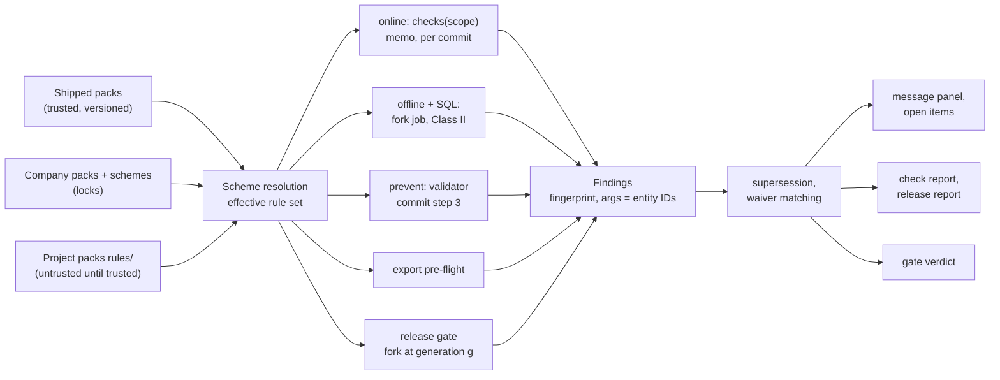
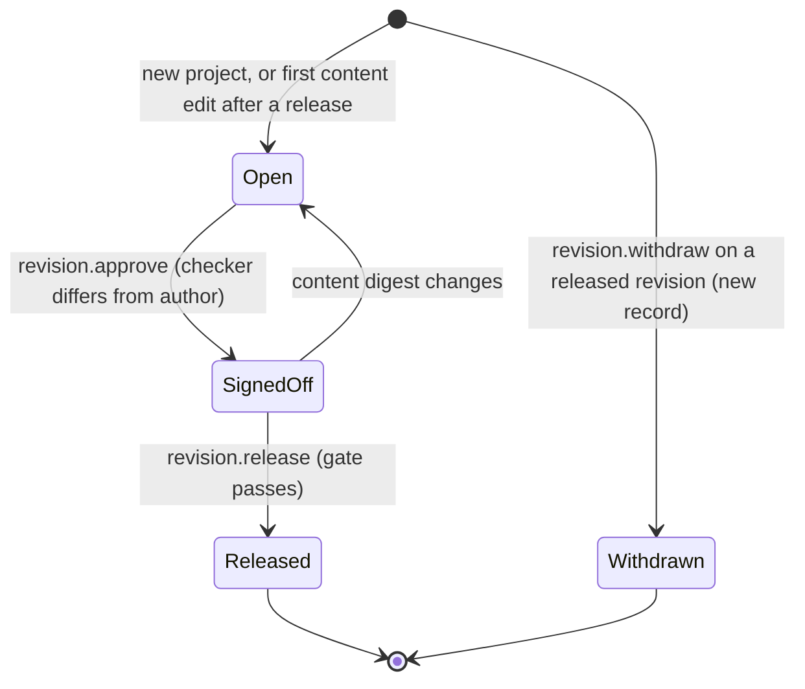
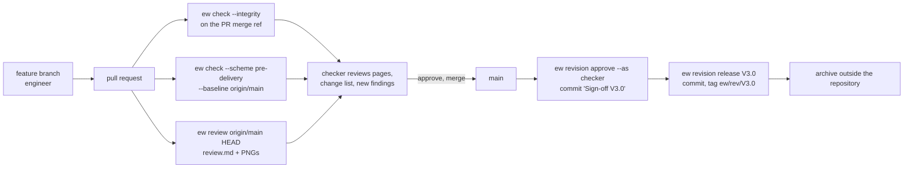

# Checks, revisions and collaboration

**Status:** Draft v0.7 · **Date:** 2026-10-25 · **Part of:** ElektraWatt design document set

> **Anonymization note:** dates and the manufacturing year of the reference project in this document are synthetic placeholders, not the original values.

**Purpose.** This document specifies how ElektraWatt (EW) finds errors, releases a checked drawing set and lets
several people work on one project without a server. It elaborates the CHK and REV areas of
[02a](02a-requirements-core.md) and the workflow part of COL in [02b](02b-requirements-extended.md). It covers the
rule engine and its modes, rule packs and schemes, waivers, quick fixes and messages, the one rule-ID scheme and the
**complete rule catalogue** (every rule any document names, one row per ID), managed revisions with a four-eyes
release, and the shared-drive and git workflows with semantic merge and visual page review. Storage mechanics (save
protocol, lock record, merge-driver internals, archive layout) stay in [05](05-project-format-and-persistence.md).

**Contents**
1. [Scope and boundaries](#1-scope-and-boundaries)
2. [Concepts and data](#2-concepts-and-data)
3. [Rule engine behaviour](#3-rule-engine-behaviour)
4. [Rule catalogue](#4-rule-catalogue)
5. [Revision management](#5-revision-management)
6. [Collaboration](#6-collaboration)
7. [UI and UX touchpoints](#7-ui-and-ux-touchpoints)
8. [Outputs](#8-outputs)
9. [Edge cases and pitfalls](#9-edge-cases-and-pitfalls)
10. [The reference project](#10-the-reference-project)

---

## 1. Scope and boundaries

| Topic | Specified here | Specified elsewhere |
|---|---|---|
| Rule engine, modes, schemes, waivers, quick fixes, messages, F1 help | All behaviour | Record shapes: [03](03-domain-model.md) §19 (amended in §2 below) |
| Rule IDs and codes | The ID scheme (§2.2) and the registry: ID, code, kind, modes, default severity, scope, release and requirement of every rule (§4) | Rule content: EW-POT, EW-TERM, EW-CORE-031 … 037 in [08](08-connections-terminals-cables.md) §8; EW-PLC, EW-SAF, EW-PRC, EW-BUS, EW-IOL in [10](10-plc-and-bus.md) §3.10; EW-FL in [11](11-fluid-power.md) §6; EW-LAY and EW-THM in [12](12-panel-layout.md) §4, §11.8; EW-MFG in [13](13-manufacturing-outputs.md) §4.6; EW-IMP in [14](14-interop.md) §2.5; EW-LIB in [07](07-symbols-parts-macros.md) §6.2 |
| Integrity check | Rule IDs EW-CORE-001 … 019 | Detection and quick fixes: [05](05-project-format-and-persistence.md) §6.3 |
| Revisions | Lifecycle, sign-off, gate, page change status, change lists, clouds, transmittals | Release file sequence and archive layout: [05](05-project-format-and-persistence.md) §14; revision overview form and status mark: [09](09-reports-forms-output.md) |
| Collaboration | Workflows, branch-safe counters, merge UI, visual review, comments, work copies | Lock record, journal, external-change diff, merge-driver algorithm: [05](05-project-format-and-persistence.md) §7, §9, §11 |
| Screens | Behaviour and content | Widgets and layout: [16](16-ux-ui.md) |
| CI pipelines | What `ew check` and `ew review` provide | Jobs: [18](18-quality-security-release.md) |

The binding decisions are ADR-0019 (rule engine), ADR-0009 (invariants, strict and lenient), ADR-0003 (freshness,
committed computations), ADR-0012 (git integration), ADR-0013 (revisions, as-built archive) and ADR-0020
(`HumanOnly` exposure of waivers, schemes, approval and release). Real-time co-editing
is out of scope for v1 ([04](04-architecture.md) §16, FR-COL-021 Later).

---

## 2. Concepts and data



### 2.1 Entities

Additions to [03](03-domain-model.md) §18–§19 are marked *(add)*. A = authored and persisted, D = derived.

| Entity | Kind, file | Key fields |
|---|---|---|
| `RulePack` | data; shipped in the app, company path, or project `rules/` | `id`, `version` (semver), `ruleset` (e.g. `EN60204-1:2018+A1:2025`), `api = "v1"`, `licence`, rules, data tables, Fluent files, docs |
| `Rule` | data | §2.3 |
| `CheckScheme` | A, `ProjectSettings` or company basic project | `name`, `extends`, per-rule overrides `{enabled, severity, release_severity, params}`, `locked` *(add, company schemes only)* |
| `CheckSettings` *(add)* | A, `project.jsonl` | `active_scheme` (online), `release_scheme` (gate), pack pins `{id, version_req}`, `strictness: Strict \| Lenient{since}`, rule parameters |
| `Finding` | D | rule, code, severity, state (`open`, `pending`, `waived`, `superseded`, `deferred`, `possibly_resolved`), targets, page, cell, args, `fingerprint`, `open_item`, `origin` (online, offline, prevent, release, export, import, merge), `rev` |
| `Waiver` | A, `waivers.jsonl` | rule, target (finding fingerprint, or part *(add)*), reason, author, date, `expires` *(add)* |
| `QuickFix` | D | label key, command name and parameters, `scope: One \| AllOfRule` |
| `Revision` | A, `revisions.jsonl` | 03 fields plus `purpose` *(add)*, `sign_off` *(add)* and, on a withdrawal record, `withdraws` and `reason` *(add)*, §5 |
| `ReleaseRecord` | A value in `Revision` | 03 fields plus `content_digest`, `page_digests`, `changed_pages` *(add)*, §5.6 |
| `Transmittal` *(add)* | A, `revisions.jsonl` (kind `transmittal`, rank 63 in the kind registry of [05](05-project-format-and-persistence.md) §2.2) | revision, issued on, purpose, recipient role, reference, customer response, §5.9 |
| `Comment` | A, `comments.jsonl` | 03 fields (`anchor`, `author`, `status`, `text`) plus `kind: Note \| Issue`, `revision`, `parent` (thread) and `resolved{by, date}` *(add)*, §6.7 |
| `Project.completed` *(add)* | A, `project.jsonl` | `{date, by}`, plus the reason of the last reopen, §5.10 |
| Conflict record | A, in the file of its target until resolved | `$k = "conflict"`, rank 255, [05](05-project-format-and-persistence.md) §2.2, §11.2 |
| Review bundle | X (artefact) | `review.md`, PNGs, `changes.json`, §6.6 |

### 2.2 Rule IDs and six-digit codes

Every rule has two identifiers. This document is their registry: §4 holds one row for every rule that any
document of the set names, and a rule ID that §4 does not list does not exist.

The registry is the in-code list `ew_checks::rules()` in ID order, and a unit test checks the order and the families. The registry file and the CI test of this section are not built.

**The rule ID** is the key used by waivers, documentation, CLI filters and the expected-findings CSVs. All rules use one form:

```text
rule-id = owner "-" family "-" number
owner   = "EW" for shipped packs; companies and plugins use their own prefix (ACME)
family  = one entry of the family table below (company and plugin packs choose their own families)
number  = exactly three digits, 001 … 999, inside a number block of the family
check   = ^[A-Z][A-Z0-9]{1,9}-[A-Z][A-Z0-9]{1,9}-[0-9]{3}$
```

Examples are EW-POT-013 (N switching), EW-PLC-012, EW-LAY-001 and EW-EN60204-007. IDs are never reused: a
withdrawn rule keeps its ID and the text "Retired", like EW-PLC-006 and EW-CORE-064.

**The code** is a six-digit message number `CCCNNN`, in the style of EPLAN. `CCC` is the class of the family and
`NNN` is the rule number plus the family's code offset. The code is printed in the message panel and the reports,
sorts by topic and lets EPLAN users find terminal rules under 001. EW codes share only the class topics with EPLAN
(001, 003, 005 and 017, [eplan-features](../research/eplan-features.md) §9), not the message numbers.

| Family | Topic | Class (code offset) | Number blocks | Pack | Content in |
|---|---|---|---|---|---|
| EW-TERM | Terminals and strips | 001 (+0) | 001–099 | EW-TERM | [08](08-connections-terminals-cables.md) §8.1 |
| EW-CORE | Project integrity and the core model | by block (+0) | 001–019 integrity (class 100); 021–029 pages, title blocks and report blocks (101); 031–039 cables and conductors (003); 041–049 devices, parts and BOM (102); 051–059 cross-references and interruption points (103); 061–079 texts and graphics (104); 081–099 rule system and waivers (105) | EW-CORE | this document; integrity [05](05-project-format-and-persistence.md) §6.3; cables [08](08-connections-terminals-cables.md) §8.1 |
| EW-POT | Connections, potentials, wire properties | 005 (+0) | 001–099 | EW-POT | [08](08-connections-terminals-cables.md) §8.1 |
| EW-RDS | Reference designations (IEC 81346) | 017 (+0) | 001–099; EW-RDS-00n is RD-0n of [standards](../research/standards.md) §1.6 | EW-IEC81346 | this document |
| EW-NUM | Numbering | 017 (+100) | 001–099 | EW-IEC81346 | this document |
| EW-PLC | PLC and I/O | 110 (+0) | 001–099 | EW-PLC | [10](10-plc-and-bus.md) §3.10 |
| EW-SAF | Safety I/O | 110 (+100) | 001–099 | EW-PLC | [10](10-plc-and-bus.md) §3.10 |
| EW-PRC | Process and instrument tags | 110 (+200) | 001–099 | EW-PLC | [10](10-plc-and-bus.md) §3.10 |
| EW-BUS | Fieldbus | 111 (+0) | 001–099 | EW-BUS | [10](10-plc-and-bus.md) §3.10 |
| EW-IOL | IO-Link | 111 (+100) | 001–099 | EW-BUS | [10](10-plc-and-bus.md) §3.10 |
| EW-FL | Fluid power | 120 (+0) | 001–099 | EW-FL | [11](11-fluid-power.md) §6 |
| EW-LAY | Panel layout, collision and routing | 130 (+0) | 001–019 placement, collision and routing; 020–039 placement rules | EW-LAYOUT | [12](12-panel-layout.md) §4 |
| EW-THM | Thermal verification (IEC 61439-1 10.10) | 131 (+0) | 001–099 | EW-THM | [12](12-panel-layout.md) §11.8, this document |
| EW-MFG | Manufacturing exports | 140 (+0) | 001–099 | EW-MFG | [13](13-manufacturing-outputs.md) §4.6 |
| EW-EN60204 | EN 60204-1 | 150 (+0) | 001–099; EW-EN60204-0nn is M-nn of [standards](../research/standards.md) §7 | EW-EN60204 | this document |
| EW-IMP | Import and migration findings | 160 (+0) | 001–099 every importer; 101–199 QET; 201–249 EDZ and EPLAN; 251–299 DXF and DWG; 301–349 tables | the importers | [14](14-interop.md) §2.5 |
| EW-LIB | Library lint | 170 (+0) | 001–099 | EW-LIB | [07](07-symbols-parts-macros.md) §6.2 |
| EW-REL | Release gate | 190 (+0) | 001–099 | EW-REL | this document |
| own prefix | Company classes; plugin classes (1.x) | 500–899; 900–999 | allocated by the owner | company and plugin packs | the pack |

Examples: EW-TERM-002 → `001002`, EW-CORE-033 → `003033`, EW-POT-013 → `005013`, EW-NUM-001 → `017101`,
EW-CORE-013 → `100013`, EW-CORE-041 → `102041`, EW-CORE-061 → `104061`, EW-PLC-012 → `110012`, EW-SAF-001 →
`110101`, EW-IOL-001 → `111101`, EW-LAY-011 → `130011`, EW-IMP-101 → `160101`, EW-LIB-006 → `170006`.

The schematic layout rules EW-CORE-067 to -070 and -072 to -077 (a drawn page against the measure of
[06a](06a-drafting.md) §1.2) take numbers of EW-CORE's texts-and-graphics block, class 104 (EW-CORE-067 →
`104067`), around EW-CORE-071, which keeps its number; they are not of the EW-LAY family, which is the panel
layout's.

**Registry rules.**
- **Fixed family list.** A new shipped family needs a row in the table above, with its class and number blocks.
  A family with a code offset uses numbers below 100 only, so no two families share a code.
- **Numbering.** A new rule takes the next free number of the block that fits its topic. Gaps inside a block stay
  free: numbers 017 … 019 of the layout family are unused.
- **Registry file.** A registry file in `ew-checks` lists every shipped ID with its code, pack and status. A CI test
  fails on a duplicate ID or code, a reused or retired ID, an ID outside the form or outside its family's blocks, a
  missing registry entry, a missing Fluent message or rule page (NFR-I18N-02, NFR-DOC-02), and on a rule ID cited
  under `docs/` that the registry does not list.

**Earlier forms.** Drafts of this document set used other forms. Nothing has shipped with them, so the registry
keeps no aliases:

| Earlier form | Final form |
|---|---|
| Two-digit numbers in EW-PLC, EW-SAF, EW-PRC, EW-BUS, EW-IOL, EW-FL, EW-THM, EW-MFG and EW-EN60204 | The same number with three digits: EW-PLC-012 → EW-PLC-012, EW-BUS-001 → EW-BUS-001 |
| The fused layout form EW-Lnnn | EW-LAY-nnn with the same number: EW-L001 → EW-LAY-001, EW-L011 → EW-LAY-011 |
| INT-01 … INT-16 ([05](05-project-format-and-persistence.md) §6.3) | EW-CORE-001 … EW-CORE-016; EW-CORE-017, EW-CORE-018 (unknown pinned derivation profile, ADR-0003 amendment 1) and EW-CORE-019 (a reader limit exceeded, 2026-10-20) were added later and have no earlier form |
| LL-01 … LL-12 ([07](07-symbols-parts-macros.md) §6.2) | EW-LIB-001 … EW-LIB-012 |
| EW-CORE-064 (font substituted on import) | Retired; the import finding EW-IMP-006 reports the fact |

**Source lists are not rule IDs.** The check lists of the research notes stay source citations: RD-nn and XR-nn
([standards](../research/standards.md) §1.6), M-01 … M-15 (standards §7), and the PLC, bus and fluid lists of
[plc-bus-fluid](../research/plc-bus-fluid.md). They appear as "STD XR-04" in the Req. column of §4, beside the
requirement. Invariant IDs name structural invariants, not rules: CI-nn in [08](08-connections-terminals-cables.md)
§3.1 and FI-nn in [11](11-fluid-power.md). The structural invariants that `ew-model` enforces take `EW-INV-nnn`
(`crates/ew-model/invariants.md`, ADR-0009 decision 5), except CI-01 and CI-04, which keep their doc 08 IDs; so does
the model's one delete-time rule, EW-INV-021, the `LibRef` keep-alive (ADR-0009 amendment 7).
`EW-INV` is not a rule family: it has no code, pack or registry entry, and the registry test above does not treat it
as a rule ID. A violation found on open is reported as EW-CORE-008 (EW-INV-001, a dangling reference) or
EW-CORE-012 (any other). Their prevent-class members report through rules: CI-05 → EW-CORE-036,
CI-06 → EW-TERM-004, FI-02 and FI-07 → EW-FL-013, FI-03 → EW-FL-002.

### 2.3 Rule definition

| Field | Meaning |
|---|---|
| `id`, `code`, `class` | §2.2 |
| `title`, `message` | Fluent message ID, default `rule-<id lower case>` (ADR-0019 example: `message = "rule-ew-pot-013"`), with attribute `.title` (§3.8) |
| `kind` | `safety`, `conflict`, `completeness` or `hygiene`; `integrity` for findings about the stored project, the check run and the release workflow (EW-CORE-001 … 018, EW-CORE-083/084, EW-REL), which are never waivable and never pending; `import` for the EW-IMP findings of an import run. The kind drives pending display ([06](06-schematic-editor.md) §3.10) and waiver limits (§2.5); §4 gives every rule's kind. Rows of kind `structural` in §4 are guarantees of the schema, listed for traceability, not rules that run |
| `severity`, `release_severity` | `error`, `warning`, `info`. `release_severity` applies in release mode and to `ew check` (§3.2) |
| `modes` | Subset of `online`, `offline`, `prevent`, `release`, `export`; EW-REL rules run in the gate only (§3.2), the integrity rules in the integrity run (§4.2), EW-IMP in the import run (§4.10) and EW-LIB in the library linter (§4.11) |
| `scope` | `project`, `page`, `potential`, `net`, `strip`, `cable`, `device`, `module`, `station`, `cfg` (configuration project, requested by [10](10-plc-and-bus.md)), `lnet`, `pnet`, `fluid_net`, `space`, `surface`, `carrier`. The scope is the memo key of `checks(scope)`, not the finding granularity: EW-CORE-061 runs in scope `project` and emits one finding per text style; EW-CORE-053 runs per `page` and emits one finding per cross-reference. "Transaction" in [06](06-schematic-editor.md) means a prevent rule, evaluated at commit, not a memo scope |
| `impl` | `rust:<name>@<version>`, `rhai:<file>` or inline `impl = "rhai"` with an `expr` field (ADR-0019's `rhai:<expr>`, split so that TOML multi-line strings stay readable), or `sql:<file>` |
| `params`, `data` | Typed parameters, and data tables with a `verified` flag and a source citation (NFR-COMP-05) |
| `supersedes` | Rule IDs this rule replaces for the same targets (§3.6) |
| `open_item` | The finding also appears in the open-items list (REF-094) |
| `fixes` | Declarative quick fixes `{command, params}` or a Rust fix provider |
| `docs` | Relative documentation path, resolved in the bundled docs (§3.8) |
| `waivable` | `true` by default; `false` for every rule of kind `integrity` (EW-CORE-001 … 019, EW-CORE-083/084, the EW-REL rules) |
| `since`, `retired` | Pack versions |

### 2.4 Schemes and settings

A **scheme** is a named set of overrides over the rules of the loaded packs (FR-CHK-003). It is resolved in this
order, later entries winning:
1. pack defaults;
2. the company scheme of the same name, from the company basic project;
3. the project scheme.

**Locked rules.** A company scheme may lock rules. A project scheme can then neither disable a locked rule nor
lower its severity. The scheme editor shows the lock and the effective value (FR-CHK-050).

**Two scheme slots.** The project names an `active_scheme` for online checking (default `drafting`) and a
`release_scheme` for the gate (default `pre-delivery`). The shipped schemes are listed in §4.9.

The slots are stored by `project.checks.set` in
`settings.extra.checks` ([03](03-domain-model.md) §5.1), and the first reader is `ew check`: without `--scheme` it runs
the project's `release_scheme` in mode `release` and its `active_scheme` in mode `online`, and `pre-delivery` when the
slot is empty (`Session::project_check_scheme`). A slot naming a scheme this build does not ship (written by a newer
version or by hand; `project.checks.set` accepts shipped schemes only) also falls back to `pre-delivery`; `ew check` then prints a notice on stderr naming the scheme and the fallback, with the exit status unchanged,
because a silent fallback hides that the run is weaker or different from the one the project asks for. The notice reads `notice: project scheme '<name>' is not shipped by this build; using pre-delivery` (the name printed with Rust's `escape_debug`), and only the slot of the run's mode is read. The
release gate does not read the slots yet; when it does, it refuses an unshipped `release_scheme` instead of falling
back. The message panel's online checks do not read `active_scheme` yet either.

### 2.5 Findings, fingerprints and waivers

**Fingerprint.** Every finding has a fingerprint (FR-CHK-044, adopted from [03](03-domain-model.md)):

```text
fingerprint = first 128 bits of SHA-256("ew-fp/1" ‖ rule_id ‖ sorted target UUIDs ‖ discriminator)
```

- **Targets.** Targets are entity UUIDs. A CP is identified by `v5(function, idx)`.
- **Discriminator.** It holds only stable data: a CP index, a pass-through pair, a text-style ID, a field path.
  Tags, folios, positions, counts and message arguments are never part of it. A renumber or a move therefore keeps
  every fingerprint, and with it every waiver.
- **Message arguments.** Arguments are entity references and typed values, not strings. The message is rendered at
  display time with the current derived tags, so a message can never show a stale tag.

**Waiver record.** A waiver matches findings by fingerprint (FR-CHK-009):

```json
{"$k":"waiver","id":"0192f7c1-…","rule":"EW-CORE-041","target":{"finding":"9c2e5a…41ab"},"reason":{"en-GB":"PE stud is part of NSYPMM107"},"author":"<party id>","date":"2025-04-14","expires":"never"}
```

**Waiver rules.**
- **Reason.** A reason is optional, of any length, as `MlText`; the record keeps an empty text when none is given, and
  the author is optional too (the owner, 2026-11-12; the format's `reason` member stays required).
- **Target.** The target is a finding fingerprint (MVP). From 1.0 it may also be a part `{library, item}`: such a
  waiver covers every finding of that rule whose primary target uses the part, for example a vendor cable whose BU
  core carries 0 V (EF-11); such cores get no exemption, because a BU core on 0 V is a real confusion risk at
  the terminal (EN 60204-1 13.2.3).
- **Safety rules.** Rules of kind `safety` (§4; for example EW-POT-013, EW-POT-006 and EW-POT-007) accept only
  fingerprint waivers. The checker acknowledges them individually at sign-off (§5.4).
- **Expiry.** `expires` is `never`, `next_release` or a date. A bulk "legacy" waiver after a migration should use
  `next_release` (1.0).
- **Unmatched and expired waivers** are reported (EW-CORE-081, EW-CORE-082). They are never silently deleted.
- The engine matches waivers by fingerprint against the reserved `waiver` records. A waiver that matches no finding gives EW-CORE-081 (info) only when its rule ran in the scheme and mode. A waiver whose rule did not run gets an info finding "not evaluated" under the EW-CORE-081 ID. Part targets and `expires` (EW-CORE-082) are not built. A finding cannot yet target a CP by `v5(function, idx)`, because `Target` needs a record kind and there is no CP kind; POT findings target the function. The kind is typed (`rule`, `target.finding`, `reason`, `author`, `date`; `expires` and a part target still in `extra`) and the engine reads the typed table; `check.waive` requires a reason of at least ten characters in every language and refuses a second waiver of one finding; the window's Waive… action is not built. An unreadable waiver line is kept verbatim and reported by EW-CORE-007 as a waiver whose finding is not waived.
- **Reporting.** Check and release reports list every waived finding instance, not only the waiver count.
- **Who may waive.** `check.waive` and `check.unwaive` are `HumanOnly` commands (named `waiver.create` and `waiver.remove`) (ADR-0019 decision 8,
  [17](17-extensibility.md) §2.3): the GUI may run them, and on the command line only the dedicated subcommands
  `ew waiver add <rule> --target … --reason …` and `ew waiver remove <id>` (1.0; `ew waiver list` is MVP), after an
  interactive terminal confirmation ([17](17-extensibility.md) §2.3, §3.3). Command-log replays, scripts, Python, MCP
  sessions and plugins get `CmdError::Exposure`. The same holds for scheme edits, pack enablement, strictness,
  `revision.approve`, `revision.release`, `revision.withdraw` (`ew revision withdraw <label> --reason <text>`,
  [17](17-extensibility.md) §3.3) and completing or reopening a project (GUI only, §5.10).

*Dates.* Dates in records are UTC dates: a waiver's `date` is the window's UTC date, and a sign-off's date is the system clock's UTC date the front-end passes (`ew revision approve`), so a sign-off made just after local midnight carries the UTC date.

### 2.6 Quick fixes

A quick fix is a command proposal that always runs as a preview on a fork and commits as one undoable transaction
(FR-CHK-010, ADR-0008).
- **Scope.** `scope = AllOfRule` applies one fix to every open finding of the rule in a single command and a single
  undo step: "designate all empty terminals", "map every BR core to BN".
- **Allowed content.** Declarative fixes reference command names from the catalogue (FR-EXT-015) with parameter
  templates over the finding (`$target`, `$arg.*`), so a pack cannot run code through a fix.
- **No fix where a person must decide.** Some rules deliberately have no fix, because the correct answer is a human
  decision. EW-POT-013 is the example: the correct wiring of T55 is unknown (▲U-11).

A declarative quick fix is the lenient CSV import's "use BN": it sits on the import finding EW-IMP-008 (EW-CORE-031, which would own it as a live check, is not built) and is a `fields.set` proposal with concrete parameters, the finding's targets and the mapped code filled in by the importer. Parameter templates (`$target`, `$arg.*`) and `scope = AllOfRule` remain the shape of a rule pack's declarative fixes and are not built. Two record types carry a proposal: `ew_interop_api::QuickFixProposal` in the permissive import contract and `ew_checks::QuickFix` in the GPL rule engine; the import contract cannot depend on the GPL crate, so both stay, with one conversion in `ew-api` and a shape test. The alias table's confidence (GR → GY is medium) has no field.

---

## 3. Rule engine behaviour

### 3.1 Modes

| Mode | When | Engine | Freshness | Typical rules |
|---|---|---|---|---|
| **online** | Every commit | Memoised `checks(scope)` on the UI thread, ≤ 5 ms per rule per commit (NFR-PERF-09) | Class I | EW-POT-013, EW-TERM-002, EW-CORE-053 |
| **offline** | "Check project", `ew check --mode offline` | Fork job, parallel per scope | Class II, stamped "as of revision n" (FR-UI-024) | EW-POT-007, SQL rules, EW-PLC-014 |
| **prevent** | Commit pipeline step 3 ([04](04-architecture.md) §5.2) | Validator on the candidate snapshot, touched keys and neighbours | — | EW-TERM-001/002, EW-RDS-004, EW-PLC-001 |
| **release** | Release gate, `ew check` (default) | Fork at the saved generation; every enabled rule evaluated cold | Fresh by construction | All |
| **export** | Before an exporter writes | The exporter calls the engine on its fork | — | EW-PLC-005, EW-MFG-001 … 006 |

Two check modes exist: `Online` (rules with o) and `Release` (rules with r or p). There is no offline, export, integrity or gate mode yet.

Mode abbreviations in the catalogue tables of §4: o online, f offline, p prevent, r release, x export, plus g (gate
only), n (integrity run), i (import run) and l (library linter), explained in §4.

`export` is the fifth mode of ADR-0019 (added by its amendments); it corresponds to EPLAN's "module-specific"
checks and is used by [10](10-plc-and-bus.md) and [13](13-manufacturing-outputs.md). **Deferred** is a state, not a
mode. An online rule that exceeds its budget three times in 100 commits is demoted for the session: it runs on the
pool at most 250 ms after the last commit, its findings carry a "deferred" badge, and the demotion is logged
(FR-CHK-013).

### 3.2 Effective severity

```text
sev(rule, mode) = if mode = release: scheme.release_severity ?? rule.release_severity ?? scheme.severity ?? rule.severity
                  else:              scheme.severity ?? rule.severity
cap:   a rule that reads a data table with verified = false reports at most warning (1.0, FR-CHK-046)
state: waived findings keep their severity but leave the counts; superseded findings are hidden
```

**`ew check` uses release mode** unless `--mode offline` is given. `ew check --scheme pre-delivery` therefore
reports what would block a delivery. EW-LAY-001 (unplaced device) is a warning while drawing and an error there, as
EF-05 expects. EW-PLC-015 (`Tbd` address) goes from info to error.

**EW-REL rules run only in the gate** (`ew revision approve`, `ew revision release`, the approve and release
dialogs, and `ew check --gate`). They test the revision workflow, not the drawing: with them in every
`ew check`, every project before its sign-off would report "checker not set" and exit 1, contradicting AC-21 and the
`ew check` examples of [17](17-extensibility.md) §3.4.

### 3.3 Online evaluation

The check memo family is `check_findings(rule, scope)`, a policy Memo with the scope kinds project, page, strip, device, cable and potential. Effective severity, supersession and waivers are applied on top of the memoised findings. Per-commit online evaluation through reverse dependencies, as below, is not built.

Online rules are queries (ADR-0019). The engine decides which scopes a commit can have affected, without
re-verifying every `checks(scope)` memo of an XL project:

```text
on commit of transaction tx, producing revision r':
1. touched   = keys written by tx.ops (rows and base-index keys)
2. affected  = ⋃ rdeps[k] for k ∈ touched        // scopes whose last evaluation read k
             ∪ scopes created by tx                // a new page, a potential split, a new strip
             − scopes that vanished                // their findings are dropped
3. for s in affected, in (scope kind, key) order: checks(s) at r'
     each online rule ρ of s's kind runs under a tick budget (5 ms); on overrun the previous
     findings of (ρ, s) stay, marked "deferred", and ρ is queued on the pool
4. replace the findings of s in the finding index; rebuild rdeps for s from the read set that
   ew-memo recorded for checks(s)
5. apply supersession (§3.6) and waiver matching to the changed fingerprints only
6. publish {r', added, removed, changed} to the view-models (message panel, canvas badges, counters)
```

- **Reverse index.** `rdeps` is a reverse dependency index kept for the `checks` query family only. It is estimated
  at ≤ 40 MB on the XL fixture, inside the memo budget of NFR-PERF-13 (**verify** at the performance spike (gate G-SP)).
- **Read tracking.** Because `rdeps` comes from the recorded reads, a rule that reads outside its nominal scope is
  still re-evaluated correctly.
- **Correctness checks.** Debug builds compare the finding index with a cold full check after sampled commits, and
  the nightly oracle compares it after every commit (NFR-REL-08).
- **Example.** Rewiring T55 on folio 101 touches connections on page 101. This affects page 101, the
  potentials N-55, N-55T and L-55, and the project scope. EW-POT-013 re-runs and its finding disappears in the same
  commit (FR-CHK-008).

### 3.4 Offline, SQL and export rules

- **Offline rules** run in a check job on a World fork ([04](04-architecture.md) §2), and their results carry their
  revision. After later edits, an offline finding whose targets were touched is struck through as "possibly
  resolved" until the next run: it neither vanishes silently nor stays falsely current (EPLAN likewise keeps
  resolved messages until the next offline check, [eplan-features](../research/eplan-features.md) §9).
- **Run scope.** "Check project" and `ew check` cover the whole project. "Check selection" and
  `ew check --pages 101-106` (or `--structure =P01+J-E-2416`) restrict an offline run to the scopes reachable from
  those pages or nodes, for example while a section is being drawn. Release mode always checks the whole project.
- **SQL rules** (FR-CHK-007, 1.0) are `SELECT` statements over the `api_v1_*` views (ADR-0017). They run in offline
  and release mode only, on a projection built at the fork's revision. Each row is one finding, read from the columns
  `target` (one UUID) or `targets` (JSON array), optional `discriminator` and `page`, and `arg_<name>`. CI prepares
  every shipped `.sql` against the current projection ([04](04-architecture.md) §13).
- **Export rules** run inside an exporter. An error-level finding stops a release-mode export. In working mode the
  affected rows are excluded and listed in a side-car report ([13](13-manufacturing-outputs.md) §4.6).

### 3.5 Prevent rules, strict and lenient

**Prevent rules are the configurable invariants of ADR-0009.** Structural invariants, such as "references resolve"
or "checker ≠ author on release", are not rules and cannot be waived.

| Project strictness | Effect of a violation in a transaction |
|---|---|
| `Strict` (default for new projects) | The transaction is rejected with `CmdError::Prevented{rule, finding}`. The status line explains the cause and offers the alternative: "designation 4 is taken on -X1031; use 21 or swap 3 ↔ 4" |
| `Lenient{since}` (set by an import, FR-CHK-011) | Violations that arrive through `ApplyImport` are committed as findings of the same rule ID (origin `import`). Interactive and scripted edits are still validated strictly: "a new duplicate drawn afterwards is rejected" (FR-CHK-011) |

- **Leaving lenient mode.** A banner shows "Lenient mode: N prevent violations". The command "Switch to strict" is
  enabled once N = 0.
- **Lenient is not a loophole.** In release mode every prevent violation is an error, whatever the strictness.
- **Files on disk win, in both modes.** An external change or a merge cannot be rejected, because the files already
  hold it. In a `Strict` project its violations are committed too, as EW-CORE-013 (uniqueness collisions, §6.4) or
  as findings of the violated prevent rule with origin `merge`. At MVP, in every project, a later transaction is
  refused only for violations it creates, and an edit that leaves an existing violation alone is allowed (the base-snapshot rule). The target for `Strict` projects is restore-on-touch: as with
  EW-CORE-012, the next interactive transaction that touches the key must restore the invariant (ADR-0009 amendment 5).

`PreventHook::check(base, candidate, touched)` compares the base snapshot with the candidate. The implementer is ew-api's `ShippedPrevent`, installed by every session unless it names its own hook, because ew-commands may not depend on ew-checks. Only violations the batch creates are refused, as `CmdError::Prevented` with the duplicate set and the remedy. A violation the model already held, such as a lenient import or files on disk, does not block an edit that leaves it alone. The strictness setting and the import origin are not yet consulted.

### 3.6 Supersession and de-duplication

One defect yields one finding (FR-CHK-045). A rule declares
`supersedes = [...]`. When a superseding finding exists whose targets overlap a superseded finding's targets, the
superseded finding is hidden, and it reappears when the superseding finding goes.

| Superseding rule | Superseded rule | For | Source |
|---|---|---|---|
| EW-PLC-012 | EW-NUM-002 | PLC addresses | 20 §18.1 |
| EW-NUM-001 | EW-NUM-002, EW-RDS-001 | Tags, frozen tags | 20 §18.1 |
| EW-PLC-013 (1.0) | EW-POT-003 | PLC supply CPs (EF-22 supersedes EF-10) | [10](10-plc-and-bus.md) |
| EW-BUS-001 | EW-CORE-044 | `Tbd` bus addresses | §4.2, [10](10-plc-and-bus.md) §3.10 |
| EW-PLC-015 | EW-CORE-044 | `Tbd` module start and channel addresses | §4.2 |
| EW-CORE-013 | the violated prevent rule | Collisions after a merge | §6.4 |
| EW-LAY-011, EW-THM-005, EW-MFG-001 | EW-REL-002 | Stale committed routes, thermal results and lengths at release | §4.8 |
| EW-POT-015 | EW-MFG-005 | Duplicate wire numbers already reported online; EW-MFG-005 fires only for duplicates that the export mapping creates (`export_as`, company codes) | §4.4, [13](13-manufacturing-outputs.md) §4.6 |
| EW-EN60204-004, -008, -009, -010, -015 (include, not supersede) | EW-POT-006 and -007, EW-POT-010, EW-POT-004, EW-POT-005, EW-CORE-024 | Clause references are added to the base finding | §4.7 |

The pack linter rejects supersession cycles. Supersession works across scope kinds: EW-PLC-013 is station-scoped and
EW-POT-003 potential-scoped, so the engine applies it in the finding index by target, not inside `checks(scope)`.

### 3.7 Rule packs on disk

Shipped packs live in the application. Company packs come from the company library path. Project packs follow the
UUID-named project layout of [05](05-project-format-and-persistence.md) §2.1: `rules/<uuid>.toml` plus an optional
`rules/<uuid>/` directory for its rhai, SQL, Fluent and doc files; the human pack ID (`ACME`, `EW-POT`) lives inside
the TOML (`.gitattributes` in [05](05-project-format-and-persistence.md) §11.1). Shipped and company pack
directories may keep their own internal layout; a shipped pack looks like this:

```text
ew-pot/
  pack.toml             # [pack] id, version, ruleset, api, licence; [[rule]] entries (or rules/*.toml)
  data/pe-sizing.toml   # data tables: rows, unit, source citation, verified flag
  sql/                  # SQL rules (offline and release only)
  rhai/                 # rhai rules
  i18n/en-GB/ew-pot.ftl i18n/nl-NL/ew-pot.ftl
  docs/                 # per-rule pages (company packs); shipped packs link to the bundled mdBook
  tests/EW-POT-013/     # pass.ewcmd, fail.ewcmd, expected.csv (CI: one passing and one failing fixture per rule)
```

```toml
[pack]
id = "EW-POT"
version = "1.0.0"
ruleset = "EW-POT:2027.1"
api = "v1"

[[rule]]
id = "EW-POT-013"
code = "005013"
kind = "safety"
severity = "error"
modes = ["online", "release"]
scope = "potential"
impl = "rust:pot.n_switching@1"
docs = "rules/ew-pot-013"

[[rule]]
id = "EW-POT-006"
code = "005006"
kind = "safety"
severity = "error"
modes = ["online", "release"]
scope = "potential"
impl = "rust:pot.pe_sizing@1"
data = ["pe-sizing"]                    # data/pe-sizing.toml, verified flag checked (§3.2)
params = { line_types = ["L", "L1", "L2", "L3"] }
```

A shipped rule's `docs` reads
`reference/rules/<id in lower case>` (`reference/rules/ew-pot-013`, not `rules/ew-pot-013` above), the bundled
guide's page; its hand-written text is the notes file `docs/book/rule-notes/<id>.md` (§3.8).

A company rule in rhai, the acceptance example of FR-CHK-006. Quantities are exposed as fixed-point integers, and
collections are sorted by ID, so a script adds neither float noise nor ordering effects:

```toml
[[rule]]
id = "ACME-DEV-001"
code = "500001"
kind = "hygiene"
severity = "warning"
modes = ["online", "release"]
scope = "device"
impl = "rhai"
expr = '''
if device.letter == "T" && !device.functions.some(|f| f.category == "TemperatureSensing") {
    finding(device, #{ letter: device.letter });
}
'''
```

A company SQL rule (1.0), over the `api_v1_terminal` columns of [17](17-extensibility.md) §6.1 (`strip_id`,
`potential_type`, `rail_bonded`). It is the acceptance example of FR-CHK-007; on the reference set it reports nothing,
because 1X1:PE and -X1032 are rail-bonded:

```sql
-- <company pack>/sql/pe-rail.sql   api = "v1", modes = ["offline", "release"]
SELECT t.id AS target, 'rail' AS discriminator, t.strip_id AS arg_strip
FROM api_v1_terminal AS t
WHERE t.potential_type = 'PE' AND t.rail_bonded = 0;
```

### 3.8 Messages and help

**Fluent identifiers contain no dots.** Every rule therefore has one message `rule-<id lower case>` with the
attributes `.title` and `.hint` (ADR-0019 as amended; the dotted key `rule.pot013.title` is not used):

```ftl
rule-ew-pot-013 = { $device } switches the neutral { $from } → { $to }; { $load } stays connected to { $line }.
    .title = Single-pole switching in the neutral conductor
    .hint = Move the contact into the line conductor, or use a device that opens L and N together.
```

- **Arguments** are entity references, resolved to derived tags at render time; quantities and dates are formatted
  by icu per output language (FR-I18N-009).
- **Languages.** en-GB is mandatory and the fallback; nl-NL is complete at MVP (FR-UI-032). CI fails when a rule
  lacks its message or `.title` (NFR-I18N-02).

  Every registered rule has its `.title`, `.hint` and, where its findings carry arguments, its
  pattern in nl-NL, and every finding of a rule table carries its arguments; the message test fails otherwise. The
  EW-IMP findings are the exception: their message is the text the importer stored in the project. Arguments stay
  printed text; a pattern writes a measured value with `DECIMAL($x)` (the language's decimal separator) and a name
  that may be a fallback ("a location", "a device without designation") with `WORD($x)`, whose words are the
  messages `word-…` of each language.
- **F1 help.** F1 on a finding opens `docs` in the bundled offline documentation (FR-CHK-015, FR-UI-031): what is
  checked and why, the standard by number and clause without copied text, an example, quick fixes and waiver
  guidance (NFR-DOC-02). CI fails when the page is missing. Company packs ship `docs/<rule>.md`, which EW renders to
  a temporary HTML file for the system browser, without a network request.

A shipped rule's `docs` is
`reference/rules/<id in lower case>` (`RuleMeta.docs`, declared by every rule; `ew-checks`' pack test fails on another
form, T5), and `docs-gen` writes that page from the catalogue and the rule's notes file
`docs/book/rule-notes/<id>.md` (`## What it checks`, `## Why`, `## Standard`, `## Example`, `## How to fix`,
`## Waiving`, each non-empty), failing on a rule without its notes, a missing heading, a notes file for no rule, or a
`docs` that names no page. The store's integrity rules (`INTEGRITY`: EW-CORE-001 to 019 but 008, 011 and 013) have
notes and pages too, since their findings reach the Messages pane; they have titles in both languages and no hint
yet (a row). The catalogue snapshot carries `docs` and `hint`. Company packs' rendered pages are not built.

### 3.9 Trust, versions and reproducibility

- **Trust.** Shipped packs are trusted. Project packs, and the SQL and rhai in them, do not run until the user trusts
  the project, remembered by content hash outside the project (FR-EXT-014, NFR-SEC-05;
  [05](05-project-format-and-persistence.md) §13.4). An untrusted pack yields EW-CORE-084, so a release can never
  claim a check it did not run.
- **Pure formulas.** Formulas inside queries (title-block formulas, report filters, tag, wire-number and value-set
  formats) are not rules. They run in untrusted projects (ADR-0020 as amended; [17](17-extensibility.md) §2.4).
- **Versions.** Rust implementations are versioned by name (`pot.n_switching@1`). A behaviour change ships as `@2`
  in a new pack version, and the old implementation stays.
- **What a release records.** A released revision stores `{pack id, version, sha256}` for every evaluated pack
  (FR-REV-001, FR-REV-020).
- **Reproduction.** EW keeps every shipped pack version, like derivation profiles (ADR-0003).
  `ew check --packs-as-of V2.0` reproduces the V2.0 check report byte for byte (FR-REV-010).
- **Determinism.** Findings are sorted by (code, fingerprint) and contain no wall-clock data, so two platforms give
  identical finding lists (FR-CHK-001, NFR-REL-07).

---

## 4. Rule catalogue

This is the catalogue of the rules not built yet: every rule of every pack, the import findings and the library
lint that the rule registry of `ew-checks` does not hold, one row per ID. The owning documents in the Def. column
specify the algorithms, examples and quick fixes; IDs, kinds, modes, default severities and scopes are fixed here
until the rule is built. A built rule's row leaves this catalogue: its ID, title, kind, modes, severities, scope and
release are the registry's, and the rule reference that `cargo xtask gen` writes from the registry (one page per
rule, with its notes) prints them; the rule's doc comment names its
requirement and owning document.

**The EW-POT pack.** Every order, text, target and fingerprint follows printed keys, never the IDs of a new project.
Findings of a defined potential target every definition and are keyed on the potential's identity; findings of a
potential without a definition target every member and are keyed on its discriminator member alone, the first member
CP by printed text (device CPs before interruption points, then `<tag>:<designation>` in natural order, then the CP
index), so a waiver survives adding a member. A wire note of a bond closure is reported once, by the potential of its
subject that prints first. The bonds and the potential are read as their own parts of the partition (`BondsOf`).
When a finding has several primary targets, `finding_node` breaks the tie on the printed label.

**Columns.**
- **Kind** (§2.3): `safety`, `conflict`, `completeness`, `hygiene`; `integrity` for findings about the stored
  project, the check run and the release workflow (never waivable, never pending); `import` for import-run
  findings, which are acknowledged rather than waived; `structural` for guarantees of the schema or an invariant,
  listed for traceability, which never produce a finding.
- **Modes:** o online, f offline, p prevent, r release, x export (§3.1); g release gate only (§3.2); n integrity
  run (on open, after merges and `ew check --integrity`); i import run (the migration report of one import);
  l library linter (§4.11). A rule runs only in the modes it lists, so a rule without r reports nothing in
  `pre-delivery`, except that release mode reports every violation of a prevent rule (§3.5).
- **Severity:** `a/b` is severity / release severity (§3.2). Schemes may override both (§2.4).
- **Scope:** the memo key of §2.3, not the finding granularity.
- **Req.:** the requirement the rule implements; a research source follows in brackets (STD =
  [standards](../research/standards.md), PMF = [panel-manufacturing](../research/panel-manufacturing.md), G15 =
  [gaps-and-corrections](../research/gaps-and-corrections.md) G15).
- **D (defects):** the defects of the reference drawing set the rule detects, then the expected findings (EF-nn,
  MF-nn) of the retired reference project (see the [glossary](glossary.md)).
- **Def.:** the document that specifies the rule's content; "15" is this document.

### 4.1 Packs

| Pack | Families | Classes | MVP | 1.0 | 1.x |
|---|---|---|---|---|---|
| EW-CORE | EW-CORE | 003, 100–105 | all except the rows marked 1.0 | complete | — |
| EW-IEC81346 | EW-RDS, EW-NUM | 017 | complete | — | — |
| EW-TERM | EW-TERM | 001 | complete | — | — |
| EW-POT | EW-POT | 005 | all except EW-POT-007, -010, -018, -019 | complete | EW-POT-020 |
| EW-PLC | EW-PLC, EW-SAF, EW-PRC | 110 | EW-PLC-001, -002, -003, -007, -008, -012, -015 | complete | — |
| EW-BUS | EW-BUS, EW-IOL | 111 | EW-BUS-001, -004 | complete | EW-BUS-008 |
| EW-FL | EW-FL | 120 | EW-FL-001, -002, -004, -011, -013 | complete | EW-FL-003 |
| EW-LAYOUT | EW-LAY | 130 | EW-LAY-001 … 004, 006 (2D), 010, 016 | complete | EW-LAY-013 |
| EW-THM | EW-THM | 131 | — | complete | — |
| EW-MFG | EW-MFG | 140 | — | complete | EW-MFG-011 |
| EW-EN60204 | EW-EN60204 | 150 | — | complete, opt-in | — |
| EW-REL | EW-REL | 190 | EW-REL-001, -002, -004 | complete | — |
| importers | EW-IMP | 160 | 001 … 011, 101 … 123, 301 … 305 | 201 … 207, 251 … 257 | — |
| EW-LIB | EW-LIB | 170 | — | complete | — |

FR-CHK-004 (MVP packs) and FR-CHK-005 (domain packs: their MVP subsets at MVP, complete at 1.0) are satisfied by
this table. EW-LIB is not a project pack: the library linter runs it (§4.11), and no project scheme enables it.

`RuleMeta.release` (`Release::Mvp`, `Release::V1_0`) is a built rule's release column and gates nothing: a rule
that is built runs in every shipped scheme that its modes allow and that does not switch it off.

### 4.2 EW-CORE

**Integrity (class 100).** The findings of the integrity check of [05](05-project-format-and-persistence.md) §6.3
are EW-CORE-001 … 019, with the detection and quick fixes given there. They run on open, after merges and in
`ew check --integrity` (FR-CHK-012, MVP), including the "renumber the newer" fix of EW-CORE-013 (§6.4);
cross-file reconciliation after merges is FR-COL-016 (1.0).
- **Blocking release:** EW-CORE-002, -003, -005 … -009, -011, -012, -013, -015, -017, -018 and -019; EW-CORE-016 (unknown
  data from a newer format) only where outputs are affected.
- **Not blocking:** EW-CORE-001, -004, -010, -014, and EW-CORE-016 where no output is affected.
- **Not waivable:** every `integrity` row (§2.3). A dangling reference or a conflict record is repaired, never
  accepted.
- **Read-only:** EW-CORE-002, -003, -005, -006 and -019 open the project read-only (05 §6.3).
- **Not rules:** the reader's notices for line endings, foreign edits, non-canonical files and a truncated finding
  list carry no rule ID; the integrity block 001–019 is full (05 §6.3).

**Pages, cables, devices, references, texts and the rule system.**

| ID | Name | Checks | Kind | Modes | Severity | Scope | Rel | Req. | D (defects) | Def. |
|---|---|---|---|---|---|---|---|---|---|---|
| EW-CORE-024 | Required report block missing | A report block that the declared applicable standards require is missing: the EN 60204-1 clause 17 set (through EW-EN60204-015) or the IEC 61439-1 clause 11 routine-verification checklist; off when no standard is declared | completeness | o r | warning/error | project | 1.0 | FR-CHK-054, FR-MFG-036, FR-MFG-037 | D-09 | 15 |
| EW-CORE-035 | Core on the wrong pin | A pre-assembled cable core on a pin other than the part's pin map | conflict | o r | warning | cable | MVP | FR-CHK-056 | D-17 | 08 §8.1 |
| EW-CORE-046 | Overview differs from children | An overview or hand-drawn assembly representation differs from the assembly's children | conflict | o r | error | device | MVP | FR-CHK-022 | D-10; MF-14 | 15 |
| EW-CORE-049 | Hand-drawn part list differs | A hand-drawn part-list page kept as graphics differs from the derived BOM; differences seen only at import are EW-IMP-113 | hygiene | f r | info | page | MVP | FR-IMP-003 | D-01, D-04 | 15 |
| EW-CORE-054 | Overview without detail link | An overview representation without a detail link | hygiene | o r | warning | device | MVP | FR-CHK-060 (STD XR-04) | D-10 | 15 |
| EW-CORE-055 | Unplaced contacts | Contacts of the main function's part neither placed nor marked unused; off in `pre-delivery` | completeness | o | info | device | 1.0 | FR-CHK-061 (STD XR-03) | — | 15 |
| EW-CORE-056 | External reference without target | An external reference to a project that is open but has no matching target | completeness | o | info | project | 1.0 | FR-CHK-061 (G15) | — | 15 |
| EW-CORE-062 | Text overflow | Text overflows a title-block cell or report column after shrink-to-fit, per display language | hygiene | o r | warning | page | 1.0 | FR-I18N-012, FR-REP-039 | — | 09 §7 |
| EW-CORE-064 | *Retired* | Font substitution at import is the import finding EW-IMP-006 | — | — | — | — | — | — | — | — |
| EW-CORE-066 | Glyph missing | A character that no bundled face drew (it prints as `.notdef`); a character drawn by the bundled symbol fallback face is not a finding | hygiene | o x r | warning/error | page | MVP | FR-OUT-027 | — | 09 §7 |
| EW-CORE-082 | Waiver expired | A waiver past its expiry date or release | hygiene | o r | warning | project | 1.0 | FR-CHK-049 | — | 15 |

EW-CORE-047 implements the first half of the rule on unplaced devices (FR-REV-007): a device without any
schematic representation always blocks release. The layout half is EW-LAY-001, which counts only where a layout
space exists for the device's location.

### 4.3 EW-IEC81346: designations and numbering

The IDs follow the RD-nn check list of [standards](../research/standards.md) §1.6, so EW-RDS-00n is RD-0n. The
structural rows keep their IDs so that the RD-nn traceability stays visible in the rule documentation.

| ID | Name | Checks | Kind | Modes | Severity | Scope | Rel | Req. | D (defects) | Def. |
|---|---|---|---|---|---|---|---|---|---|---|
| EW-RDS-005 | *Structural:* placements reference devices | Layout objects reference devices (EW-LAY-002) | structural | — | — | — | MVP | FR-CHK-039 | D-02 | 15 |
| EW-RDS-006 | *Structural:* one displayed form | The displayed designation form is one project setting | structural | — | — | — | MVP | FR-NUM-002 | D-03 | 15 |
| EW-RDS-008 | *Structural:* renumbering is one transaction | Renumbering is one transaction (ADR-0008) | structural | — | — | — | MVP | FR-NUM-008 | D-01 | 15 |

### 4.4 EW-TERM and EW-POT

[08](08-connections-terminals-cables.md) §8 specifies these rules and their algorithms; the safety rules
EW-POT-013, -006, -007 and -009 are detailed in §8.2 there. EW-POT-018 and EW-POT-020 are specified here.

| ID | Name | Checks | Kind | Modes | Severity | Scope | Rel | Req. | D (defects) | Def. |
|---|---|---|---|---|---|---|---|---|---|---|
| EW-POT-007 | PE continuity | Every PE-typed CP reaches the main PE point through wires, bridges, rails and carriers | safety | f r | error | project | 1.0 | FR-CHK-029 | D-21; EF-23 | 08 §8.2 |
| EW-POT-010 | Clamp capacity exceeded | Conductors or cross-section on a CP beyond its clamp data | safety | o r | error | device | 1.0 | FR-CHK-021 (STD M-08) | — | 08 §8.1 |
| EW-POT-018 | Load exceeds rating | Summed load currents (part data × simultaneity) exceed the rating of the feeding source, protective device or electronic-breaker channel; off when no load data exists | safety | f r | warning | potential | 1.0 | FR-CHK-041 (G15) | D-25; EF-24 | 15 |
| EW-POT-019 | Mixed cross-section units | Cross-section units mixed within one potential (mm², AWG, kcmil) | hygiene | o | warning | potential | 1.0 | FR-CON-032 | — | 08 §8.1 |
| EW-POT-020 | Voltage drop | The voltage drop of a cable from its length, core cross-section and the load current of its potential exceeds the profile's threshold; the threshold table ships unverified | conflict | f r | warning | cable | 1.x | FR-CHK-059 (G15) | — | 15, 08 §8.1 |

EW-POT-018 complements EW-PLC-014, which covers module outputs: EW-POT-018 covers PSU and protective-device loads
such as -102G1 at 20 A and the MICO channels of -102F2 at 6 A. EW-POT-020 needs routed lengths and load currents,
both 1.0, so it follows at 1.x (Could).

### 4.5 Domain packs

#### 4.5.1 EW-PLC

| ID | Name | Checks | Kind | Modes | Severity | Scope | Rel | Req. | D (defects) | Def. |
|---|---|---|---|---|---|---|---|---|---|---|
| EW-PLC-006 | *Retired* | Spare channels are listed by reports and counts (FR-PLC-019), not as findings | — | — | — | — | — | — | — | 10 §3.10 |

The seven MVP rules run in the scopes `module` and `cfg` with en-GB and nl-NL messages and rule pages; EW-PLC-001 and EW-PLC-007 report online and in release mode, since they carry the prevent letter and release mode runs prevent-letter rules; EW-PLC-008 is a warning online (its export severity); EW-PLC-012 has a command quick fix and the unverified-data marker, and the window offers its part's PLC section ([10](10-plc-and-bus.md) §3.10); EW-PLC-015 supersedes EW-CORE-044 inside a configuration project. Two channels of one module with one number: EW-CORE-008 with the discriminator `duplicate_number`.

EW-PLC-001 reports one finding per overlap group of `address_index(cfg)` (each connected run of overlapping addresses in one area, so N channels on one address are one finding, not N(N−1)/2), every member channel a target and the first in address order the subject; the text names five channels with their addresses, then "and N more channels", in en-GB and nl-NL.

EW-PLC-016 and EW-PRC-002 are in the 1.0 content, with en-GB and nl-NL messages and rule notes. EW-PRC-002's findings are the open instrument tags; it is not a row of the open-item table, whose rules run in release mode of the shipped scheme.

The pack's 1.0 content: EW-PLC-004, -005, -009, -010, -011, -013 and -014, EW-SAF-001 … -003 and EW-PRC-001, with the kinds, modes, severities and scopes of the rule reference, en-GB and nl-NL messages and rule notes ([10](10-plc-and-bus.md) §3.10 has the decisions). The scope `station` exists for EW-PLC-011, -013 and -014 (§2.3). The prevent halves of EW-PLC-001, -007 and -011 refuse an edit that adds an error finding in the scopes it touches; EW-PLC-013 supersedes EW-POT-003 for the FE pins of a station's devices. EW-PLC-016 and EW-PRC-002 read the exchange stamp and the instrument list (above).

#### 4.5.2 EW-BUS

| ID | Name | Checks | Kind | Modes | Severity | Scope | Rel | Req. | D (defects) | Def. |
|---|---|---|---|---|---|---|---|---|---|---|
| EW-BUS-008 | E-bus budget | The EtherCAT E-bus current budget is exceeded | conflict | o r | error | station | 1.x | FR-BUS-020 | — | 10 §3.10 |

The pack's 1.0 content: EW-BUS-002, -003, -005, -006, -007, -009 and -010 and EW-IOL-001 and -002, with en-GB and nl-NL messages and rule notes; the ranges, lengths and station counts they read are unverified data of the rules ([10](10-plc-and-bus.md) §3.10). EW-BUS-008 stays 1.x.

#### 4.5.3 EW-FL

| ID | Name | Checks | Kind | Modes | Severity | Scope | Rel | Req. | D (defects) | Def. |
|---|---|---|---|---|---|---|---|---|---|---|
| EW-FL-003 | Order-code occupancy | Slot occupancy contradicts the configurator order code (decoder plugin) | conflict | f r | warning | device | 1.x | FR-FLU-022 | D-40 | 11 §6 |

EW-FL-004 runs in modes `o r`, so
that the pre-delivery release run counts EF-14 (O2); the MVP rules EW-FL-001, -002, -004, -011
and -013 are built.

#### 4.5.4 EW-LAYOUT

| ID | Name | Checks | Kind | Modes | Severity | Scope | Rel | Req. | D (defects) | Def. |
|---|---|---|---|---|---|---|---|---|---|---|
| EW-LAY-002 | *Structural:* placement without device | Placements reference devices; deleting the device cascades; on lenient import an unmatched rectangle becomes a layout graphic, never a placement | structural | p | — | — | MVP | FR-LAY-017 | D-02 | 12 §4 |
| EW-LAY-005 | CP pattern incomplete | The CP3D pattern does not cover the device's physical schematic CPs after the macro mapping table; blocks routing of the affected wires | completeness | o r | error | space | 1.0 | FR-LAY-027 | — | 12 §4 |
| EW-LAY-007 | Clearance violated | A clearance zone violated, with the amount | conflict | f r | warning | space | 1.0 | FR-LAY-029 | — | 12 §4 |
| EW-LAY-008 | Duct fill over limit | A duct edge over the fill limit, on committed routes | conflict | o r | warning or error (shop warning and error limits) | carrier | 1.0 | FR-LAY-049 | — | 12 §4 |
| EW-LAY-009 | Wire unroutable | No path, a blocked stub or a broken pinned path | completeness | f r | error | space | 1.0 | FR-LAY-045 | D-19 | 12 §4 |
| EW-LAY-011 | Stale route or length | A committed route or length whose input hash changed; supersedes EW-REL-002 for routes | completeness | o r | warning/error | space | 1.0 | FR-LAY-046 | D-19 | 12 §4 |
| EW-LAY-012 | Machining conflict | A web below minimum (feature to feature, feature to edge) or a hole under another device; duplicate holes merged at info | conflict | o r | warning | surface | 1.0 | FR-LAY-057 | — | 12 §4 |
| EW-LAY-013 | Door-swing collision | A door-mounted solid collides during the swing, reported with the angle | conflict | f r | error | space | 1.x | FR-LAY-031 | — | 12 §4 |
| EW-LAY-014 | Pre-assembled cable too short | A route longer than the cable length minus its connector allowances | conflict | f r | error | space | 1.0 | FR-LAY-050 | D-19 | 12 §4 |
| EW-LAY-015 | Segregation class violated | A wire in a duct whose class set excludes its segregation class (manual or pinned paths) | conflict | o r | warning or error (policy) | carrier | 1.0 | FR-LAY-048 | — | 12 §4 |
| EW-LAY-020 | Depth containment | Placement rule: a device deeper than the usable depth at its position | conflict | o r | warning | space | 1.0 | FR-LAY-033 | — | 12 §4 |
| EW-LAY-021 | Thermal zoning | Placement rule: a device outside the thermal zone its part allows | hygiene | o r | warning | space | 1.0 | FR-LAY-033 | — | 12 §4 |
| EW-LAY-022 | EMC segregation distance | Placement rule: segregation distance between EMC classes below the policy value | hygiene | o r | warning | space | 1.0 | FR-LAY-033 | — | 12 §4 |
| EW-LAY-023 | Operator height | Placement rule: an operator device outside the operator heights of the installation | hygiene | o r | warning | surface | 1.0 | FR-LAY-033 | — | 12 §4 |
| EW-LAY-024 | Door mass | Placement rule: door-mounted mass above the door's rating | conflict | o r | warning | surface | 1.0 | FR-LAY-033 | — | 12 §4 |
| EW-LAY-025 | Cable-entry zone | Placement rule: a device inside the cable-entry zone | hygiene | o r | warning | surface | 1.0 | FR-LAY-033 | — | 12 §4 |
| EW-LAY-026 | Handle-axis alignment | Placement rule: handle and switch-body axes of a door-coupled rotary switch (S51) not aligned within the part's shaft-length range | conflict | o r | warning | space | 1.0 | FR-LAY-034 | — | 12 §4 |

EW-LAY-020 … 026 are Could rows of FR-LAY-033 and FR-LAY-034; their constants ship as data with a `verified` flag.

The MVP rules EW-LAY-001, -003, -004,
-006 (2D), -010 and -016 ship in `ew-checks` (`rules/layout.rs`) with their catalogue rows, rule pages and en-GB and
nl-NL messages; EW-LAY-002 has no rule run (the structural invariant). **Scope:** the engine has no scope
space, surface or carrier; the rules run at the **project** scope until
checks can be scoped to a space or a surface, enumerate the layout objects through the layout queries, and target the
object each finding names (the device, placement, carrier, layout space or enclosure), shown on the panel page whose
surface view shows it; the rule pages say project. EW-LAY-001's "counts only where that location has
a layout space" is a filter in the rule's run, so its release severity error applies to what it reports. EW-LAY-006
lists at most 64 overlap findings per surface plus one summary finding on the surface, by a sweep of O(n log n + k);
an overlap is a positive-area intersection, and a rectangle without area never overlaps. EW-LAY-006
has no offline mode: the 3D half is 1.0. AC-21's compared subset admits EW-LAYOUT (EF-05).

#### 4.5.5 EW-MFG

Rules 001 … 006 need the export's machine profile; a scheme run without a profile evaluates EW-MFG-001 against
"routed, manual or from part" and skips 002, 003 and 006 ([13](13-manufacturing-outputs.md) §4.6).

| ID | Name | Checks | Kind | Modes | Severity | Scope | Rel | Req. | D (defects) | Def. |
|---|---|---|---|---|---|---|---|---|---|---|
| EW-MFG-001 | Wire length unusable | A length that is not routed, estimated and accepted by the profile, manual or from part, or is stale; field records are out of scope; supersedes EW-REL-002 for lengths | completeness | x r | error (working mode: the row is excluded) | potential | 1.0 | FR-MFG-024, FR-CHK-058 | D-19 | 13 §4.6 |
| EW-MFG-002 | Outside the machine limits | Cross-section or wire type outside the machine's limits or magazine | conflict | x | warning (row to the manual list) | potential | 1.0 | FR-MFG-024, FR-MFG-051 | — | 13 §4.6 |
| EW-MFG-003 | Ferrule or end treatment unavailable | A ferrule not in the machine's magazine, or an end treatment not in the profile's `end_treatments` | conflict | x | warning (manual list or finishing task) | potential | 1.0 | FR-MFG-024, FR-MFG-050 | — | 13 §4.6 |
| EW-MFG-004 | Marker text does not fit | A marker text that exceeds its marker part (characters per line, lines) or its encoding | conflict | o x | warning | potential | 1.0 | FR-MFG-011, FR-MFG-024 | — | 13 §4.6 |
| EW-MFG-005 | Duplicate wire number in the export | A duplicate created by the export mapping (`export_as`, company codes); duplicates in the model are EW-POT-015, which supersedes it per target | conflict | x r | error | project | 1.0 | FR-MFG-024 | — | 13 §4.6 |
| EW-MFG-006 | Bundle too large | A bundle above the bin size (or split by a profile option) | conflict | x | warning | project | 1.0 | FR-MFG-024 | — | 13 §4.6 |
| EW-MFG-007 | Twin ferrule unavailable | A twin ferrule required or chosen, but no twin part for that cross-section pair | completeness | o r | error | potential | 1.0 | FR-MFG-043, FR-CHK-058 | — | 13 §4.6 |
| EW-MFG-008 | End treatment undetermined | No clamp data, no candidate part, or an IDC end on a class 5 conductor | completeness | o r | warning/error | potential | 1.0 | FR-CHK-058 | — | 13 §4.6 |
| EW-MFG-009 | End override inconsistent | Another colour scheme, a cross-section or sleeve outside the range, the wrong stud | conflict | o r | error | potential | 1.0 | FR-MFG-042 | — | 13 §4.6 |
| EW-MFG-010 | Unverified manufacturing data | Output based on unverified constants or part sections; one finding per package, listing the sources | hygiene | r | info | project | 1.0 | FR-CHK-058, FR-CHK-046 | — | 13 §4.6 |
| EW-MFG-011 | Feedback length deviation | A machine feedback length that deviates from the computed length beyond tolerance | hygiene | f | info | project | 1.x | FR-MFG-026 | — | 13 §4.6 |

### 4.6 EW-THM: IEC 61439 thermal (1.0)

| ID | Name | Checks | Kind | Modes | Severity | Scope | Rel | Req. | D (defects) | Def. |
|---|---|---|---|---|---|---|---|---|---|---|
| EW-THM-001 | Ambient limit exceeded | A device ambient limit below the predicted air temperature at its mounting height | safety | f r | error | space | 1.0 | FR-THM-006 | — | 12 §11.8 |
| EW-THM-002 | Climate capacity insufficient | Required cooling or heating not covered by the placed climate devices | safety | f r | error | space | 1.0 | FR-THM-007, FR-THM-012 | — | 12 §11.8 |
| EW-THM-003 | Loss data missing | A placed device without loss data; the result is marked incomplete | completeness | f r | warning | space | 1.0 | FR-THM-001, FR-THM-012 | — | 12 §11.8 |
| EW-THM-004 | Unverified coefficients | Unverified or test coefficients used in a release | hygiene | r | warning | space | 1.0 | FR-THM-012, NFR-COMP-05 | — | 12 §11.8 |
| EW-THM-005 | Thermal result stale | A thermal result (Class II) stale at release; supersedes EW-REL-002 for thermal results | completeness | r | error | space | 1.0 | FR-MFG-025 | — | 12 §11.8 |
| EW-THM-006 | Single-compartment conditions | Conditions of IEC 61439-1 10.10.4.2 not met: a component loaded above 80 % of its free-air rating, or InA above 630 A | conflict | f r | warning | space | 1.0 | FR-THM-004 | — | 15 |
| EW-THM-007 | Method not applicable | An enclosure with horizontal partitions treated as one compartment; multi-compartment calculation is 1.x (FR-THM-010) | conflict | f r | warning | space | 1.0 | FR-THM-010 | — | 15 |

Every thermal finding and the thermal report carry the statement that the calculation does not replace verification
by a competent person (NFR-COMP-04).

### 4.7 EW-EN60204: electrical equipment of machines (1.0, opt-in)

EN 60204-1 applies to the electrical equipment of machines. A control cabinet such as the reference project may
instead be delivered as an assembly under IEC 61439-1/-2 (which applies is a pilot question), so the pack is
**not** in `pre-delivery`. It is enabled by the `machinery-en60204` scheme or by the project's applicable-standards
setting (FR-CHK-052). The numbers follow the M-01 … M-15 list of [standards](../research/standards.md) §7
(EN 60204-1:2018+A1:2025), so EW-EN60204-0nn implements M-nn; the values behind M-04, M-07 and M-13 are marked
**(verify)** there. Threshold tables ship as data with `verified = false` until a reviewed change confirms them
against a licensed copy (NFR-COMP-05). "Includes" means that the pack enables the base rule, adds the clause
reference to its finding, and creates no second finding; the row then takes the base rule's modes and severity.
The D column gives the expectation with the pack enabled.

| ID | Name | Checks | Kind | Modes | Severity | Scope | Rel | Req. | D (defects) | Def. |
|---|---|---|---|---|---|---|---|---|---|---|
| EW-EN60204-001 | Supply terminal designation | Incoming-supply terminals designated L1/L2/L3/N and the PE terminal marked "PE", at the supply's external reference | hygiene | o r | warning | project | 1.0 | FR-CHK-052 (STD M-01) | 1X1:1, 1X1:2 | 15 |
| EW-EN60204-002 | Supply-disconnecting device | Exactly one supply-disconnecting device per incoming supply, role from part data, lockable; letter Q or QB, not S | safety | o r | warning | project | 1.0 | FR-CHK-052 (STD M-02) | S51 (class S) | 15 |
| EW-EN60204-003 | Excepted circuits | Excepted circuits upstream of the disconnector identified (orange or marking) | safety | o r | warning | potential | 1.0 | FR-CHK-052 (STD M-03) | 0 | 15 |
| EW-EN60204-004 | PE sizing and bonding | Includes EW-POT-006 and EW-POT-007 | safety | as base | as base | potential | 1.0 | FR-CHK-020, FR-CHK-029 (STD M-04) | D-38, D-21; EF-06 | 15 |
| EW-EN60204-005 | Control transformer | AC control circuits fed through a transformer with separate windings (circuit class `control`) | safety | o r | warning | potential | 1.0 | FR-CHK-052 (STD M-05) | 0 | 15 |
| EW-EN60204-006 | Control voltage | Nominal control voltage within the limits | conflict | o r | warning | potential | 1.0 | FR-CHK-052 (STD M-06) | 0 | 15 |
| EW-EN60204-007 | Overcurrent coordination | I_b ≤ I_n ≤ I_z and minimum cross-sections, over the effective cross-sections of 08 §4; info when the installation method is missing | safety | f r | warning | potential | 1.0 | FR-CHK-052 (STD M-07) | ▲ info (installation method missing) | 15 |
| EW-EN60204-008 | Conductors per terminal | Includes EW-POT-010 | safety | as base | as base | device | 1.0 | FR-CHK-021 (STD M-08) | 0 | 15 |
| EW-EN60204-009 | GNYE only for PE | Includes EW-POT-004 | safety | as base | as base | potential | 1.0 | FR-CHK-031 (STD M-09) | 0 | 15 |
| EW-EN60204-010 | BU only for N | Includes EW-POT-005 | conflict | as base | as base | potential | 1.0 | FR-CHK-031 (STD M-10) | EF-11 | 15 |
| EW-EN60204-011 | Colour profile deviation | A colour profile that deviates from the recommended colours; reported once per profile, naming its declared basis | hygiene | o r | info | project | 1.0 | FR-CON-020 (STD M-11) | D-37 ("DBU/WH 24 V") | 15 |
| EW-EN60204-012 | Conductor identification | Every conductor identifiable at each termination (wire number, core identity or marking scheme) | completeness | o r | warning | potential | 1.0 | FR-MFG-010 (STD M-12) | 0 | 15 |
| EW-EN60204-013 | Nameplate data | Nameplate data complete in the project properties | completeness | o r | warning | project | 1.0 | FR-PRJ-025 (STD M-13) | ▲ (no short-circuit rating) | 15 |
| EW-EN60204-014 | *Structural:* same designation | Devices carry the same designation as the documentation | structural | — | — | — | 1.0 | FR-CHK-052 (STD M-14) | — | 15 |
| EW-EN60204-015 | Documentation set | Report blocks present: TOC, circuit, terminal and cable diagrams, wire list, parts list, layout, PLC overview, clause 18 verification checklist (FR-MFG-036); includes EW-CORE-024 | completeness | as base | as base | project | 1.0 | FR-MFG-036 (STD M-15) | D-09; ▲ (checklist block absent) | 15 |

### 4.8 EW-REL: release gate

EW-REL rules run only in the gate (§3.2) and are never waivable. Offline and SQL rules cannot be stale there: the
gate evaluates every rule cold on a fork at the saved generation (mode `release`).

| ID | Name | Checks | Kind | Modes | Severity | Scope | Rel | Req. | D (defects) | Def. |
|---|---|---|---|---|---|---|---|---|---|---|
| EW-REL-003 | Open review issue | An open comment of kind `Issue` on the revision; resolve it, or convert it to a note with a reason | integrity | g | error | project | 1.0 | FR-REV-024 | — | 15 |

The gate (FR-REV-007) refuses release when there is any unwaived error in the release scheme, any EW-REL finding,
or EW-CORE-083/084 at error level. Its named blockers are release-scheme rules at error severity:
- EW-CORE-047, a device without schematic representation;
- EW-LAY-001, a device without layout placement where its location has a layout space;
- EW-CORE-033, a cable without length;
- `Tbd` values: EW-CORE-043, EW-CORE-044, EW-BUS-001, EW-PLC-015;
- the integrity findings marked R in [05](05-project-format-and-persistence.md) §6.3, such as EW-CORE-011
  conflict records and EW-CORE-016 unknown data that affects outputs;
- EW-REL-001 (author = checker, missing or stale sign-off) and EW-REL-002 (stale committed computations).

On a project before its sign-off, EW-REL-001 reports "checker not set".

EW-REL-001, -002 and -004 are the EW-REL pack, in the gate-only mode `g`. `ew_checks::gate` evaluates the release scheme in release mode with the EW-REL rules and returns the blockers, the safety waivers in force (the waivers that waive a safety-kind finding of the gate report) and the pack versions (the build version plus the SHA-256 of each pack's definition; per-pack versions are not built). The pack definition names a rule's kind and scope by the catalogue's words (`RuleKind::name`, `ScopeKind::name`: `safety`, `conflict`, `completeness`, `hygiene`, `integrity`; `project`, `page`, `strip`, `device`, `cable`, `potential`, `module`, `cfg`), the `rules.json` text, not by a Rust type's `Debug` output, so the digest a sign-off binds does not follow a code change.

### 4.9 Shipped schemes

| Scheme | Purpose | Content | Rel |
|---|---|---|---|
| `drafting` | Default `active_scheme` while editing | All loaded packs online; completeness rules pending on the page being edited ([06](06-schematic-editor.md) §3.10); hygiene rules on, EW-RDS-002 included | MVP |
| `pre-delivery` | Default `release_scheme`; `ew check --scheme pre-delivery` | Every enabled rule whose modes include release, at release severity; EW-REL evaluated by the gate only (§3.2); EW-RDS-002, EW-FL-008, EW-FL-014 off (EW-CORE-055 joins them when it is built, 1.0). The release blockers of §4.8 are errors here | MVP |
| `migration` | Lenient check run that forms an import's migration report (FR-IMP-003) | `extends = "pre-delivery"` at its severities, run in lenient mode, so prevent violations become findings of their rules; plus the import run's EW-IMP findings (§4.10) | MVP |
| `full` | Audits and acceptance of hygiene rules | Everything, including off-by-default rules (FR-CHK-027's acceptance runs here) | MVP |
| `manufacturing` | Pre-flight of `.ewpp` and machine exports | `extends = "pre-delivery"` plus EW-MFG (FR-CHK-058) | 1.0 |
| `machinery-en60204` | Machinery projects | `extends = "pre-delivery"` plus EW-EN60204 | 1.0 |
| `assembly-iec61439` | Switchgear assemblies | `extends = "pre-delivery"` plus EW-THM and EW-CORE-024 for the IEC 61439-1 clause 11 routine-verification checklist (FR-MFG-037) | 1.0 |

### 4.10 EW-IMP: import findings

An import finding records what an importer did or saw; it lives in the import run (`imports/<run-uuid>.jsonl`,
FR-IMP-041) and appears only in that import's migration report. A live rule reports a condition that is still in
the model. Where both name the same targets and defect class, the migration report shows one row under the live rule
ID with the import code as its origin ([14](14-interop.md) §2.5). All rows: kind `import`, mode i, scope the import
run, defined in 14 §2.5.

Each EW-IMP rule has a catalogue kind (completeness, conflict or hygiene), mode `r` in the `migration` and `full` schemes, scope the project (the import runs its lineages name), and is waivable like any finding that is not of kind `integrity`: an import finding the user has reviewed is waived rather than left open, and the migration report groups it with the live rules by the same kinds. Where a rule's remedy is deterministic the finding offers it as a quick fix: EW-IMP-103 "Unfreeze the tag" (`fields.set` of `tag.frozen` to null); the others offer none, their remedy asking for a value or a judgement.

| ID | Name | Checks | Severity | Rel | Req. | D (defects) |
|---|---|---|---|---|---|---|
| EW-IMP-106 | Title-block party differs | The title-block party differs from the cover party | warning | MVP | FR-IMP-015 | D-30; MF-06 |
| EW-IMP-107 | Text converted to data | A wire marker, address, port, process tag or bus address recognised and converted | info | MVP | FR-IMP-017 | D-08, D-15, D-26; MF-07, MF-18, MF-19 |
| EW-IMP-108 | Data-like text not converted | Listed for review | warning | MVP | FR-IMP-017 | D-08, D-26 |
| EW-IMP-110 | Overview differs from detail | A hand-drawn overview differs from the linked detail; EW-CORE-046 takes over once the assembly exists | warning | MVP | FR-CHK-022, FR-IMP-039 | D-10; MF-14 |
| EW-IMP-111 | Layout binding proposal | A layout item matched to a device, to confirm | warning | MVP | FR-IMP-019 | D-02; MF-15 |
| EW-IMP-112 | Untagged device-class symbol | A symbol of a device class without device tag; build assembly and children | warning | MVP | FR-IMP-039 | D-27; MF-20 |
| EW-IMP-113 | Imported table differs | Imported nomenclature rows differ from the derived BOM | info | MVP | FR-IMP-016 | D-01, D-04; MF-21 |
| EW-IMP-121 | Several IP names on one potential | Several interruption-point names on one potential | info | MVP | FR-IMP-012 | D-24; MF-17 |
| EW-IMP-123 | Cross-section mark differs | A QET cross-section mark differs from the derived wire property; the derived value is kept and the mark's value reported | warning | MVP | FR-IMP-017 | D-08 |
| EW-IMP-201 | EDZ terms notice | The Data Portal terms notice was shown | info | 1.0 | FR-IMP-026 | — |
| EW-IMP-202 | Function definition unmapped | No FnDef mapping for an EPLAN function template; generic pin used | warning | 1.0 | FR-IMP-028 | — |
| EW-IMP-203 | ZIP-format EDZ | An EDZ in a ZIP rather than a 7-Zip container | info | 1.0 | FR-IMP-025 | — |
| EW-IMP-204 | EDZ extras ignored | Extras such as `.e3d` ignored in favour of STEP | info | 1.0 | FR-IMP-027 | — |
| EW-IMP-205 | Unit converted | A length unit other than mm converted | info | 1.0 | FR-IMP-028 | — |
| EW-IMP-256 | CP snapped | A connection point snapped to the grid by the symbol wizard | warning | 1.0 | FR-IMP-034 | — |
| EW-IMP-301 | Derived column edited | A derived column edited in a round-trip table | warning | MVP | FR-PLC-038, FR-EXT-028 | — |
| EW-IMP-302 | Row changed in EW since export | Kept, listed | info | MVP | FR-PLC-038, FR-EXT-028 | — |
| EW-IMP-303 | Unknown ID | A row whose ID is unknown | warning | MVP | FR-PLC-038, FR-EXT-028 | — |
| EW-IMP-304 | Cell conflict | Changed in both to different values; EW's value kept | warning | MVP | FR-PLC-038, FR-EXT-028 | — |
| EW-IMP-305 | Lossy Excel conversion | A value Excel changed ("1.10" → "1.1") | warning | MVP | FR-PLC-038, FR-EXT-028 | — |

The table rows 301 … 305 serve `ew import io-list` at MVP (FR-PLC-038) and `ew import table` at 1.0 (FR-EXT-028).
The severities of the 2nn, 25n and 30n rows are this catalogue's defaults within the "info–warning" range of 14.

### 4.11 EW-LIB: library lint (1.0)

The library linter of `ew-library` runs these rules over library items: live in the lint panels of the symbol and
part editors, in `ew lib lint <dir>` and the contribution pipeline of [07](07-symbols-parts-macros.md) §6.2, and
before `ew lib pack`, which refuses any error. They are registered like every rule (codes, Fluent
messages, rule pages) but belong to no project scheme. All rows: mode l, scope the library item, defined in 07 §6.2.

| ID | Name | Checks | Kind | Severity | Rel | Req. | D (defects) |
|---|---|---|---|---|---|---|---|
| EW-LIB-001 | CP placement | A CP off the symbol's connection grid (`SymbolDef.grid`), a CP index not unique, or a CP not on the outline or a line end | conflict | error | 1.0 | FR-PRT-032, FR-SYM-020 | — |
| EW-LIB-002 | Anchor policy | Anchor policy missing; anchor outside the symbol's graphics or not on the connection grid | completeness | error | 1.0 | FR-PRT-032, FR-SYM-020 | D-14 |
| EW-LIB-003 | Required text slots | Text slots required for the category missing (tag; CP designations for multi-CP symbols) | completeness | error | 1.0 | FR-PRT-032, FR-SYM-020 | D-29 |
| EW-LIB-004 | FnDef CP mismatch | `fn_cp` not in the FnDef (error); a FnDef CP drawn by no multi-line symbol (warning) | conflict | error / warning | 1.0 | FR-PRT-032 | — |
| EW-LIB-005 | Licence or source missing | Licence or source missing, licence not in the pack's allowlist, or the item flagged `foreign_terms` | integrity | error | 1.0 | FR-PRT-032 | — |
| EW-LIB-006 | Copied content | IEC description text or a QET element copied (geometry fingerprint matches a QET collection element) | integrity | error | 1.0 | FR-PRT-032 | — |
| EW-LIB-007 | Semver class | Declared semver lower than the observed change class, or content changed under an already published version | conflict | error | 1.0 | FR-PRT-032 | — |
| EW-LIB-008 | Part quality and identity | A part below "basic", a manufacturer not in the master, or a duplicate (manufacturer, `pn_norm`) | completeness | error | 1.0 | FR-PRT-032 | D-18 |
| EW-LIB-009 | Rating in a description | A rating or unit inside the description ("10A C", "50hz"); the project-side counterpart is EW-CORE-065 | hygiene | warning | 1.0 | FR-PRT-032 | D-18, D-35 |
| EW-LIB-010 | CP-pattern spelling | CP-pattern designations that differ from the template FnDef's only in spelling ("Out1" against "Out 1") (warning); a template CP index not in the pattern (error) | hygiene | warning / error | 1.0 | FR-PRT-032 | — |
| EW-LIB-011 | Asset licence | An image, STEP or DXF asset without an explicit redistribution licence | integrity | error | 1.0 | FR-PRT-032 | — |
| EW-LIB-012 | Macro fragment | A macro fragment with dangling references or another grid than its declared grid (error); frozen tags kept with "keep tag" (warning) | conflict | error / warning | 1.0 | FR-PRT-032, FR-MAC-001 | — |

---

## 5. Revision management

### 5.1 Lifecycle



`SignedOff` is not a stored state. It is an `Open` revision whose `sign_off` matches the current content digest.
Stored states stay as in [03](03-domain-model.md) §18: `Open`, `Released`, `Withdrawn`. A released record never
changes state (FR-REV-009): withdrawing it adds a separate record in state `Withdrawn` that points to it (§5.10).

### 5.2 Labels

- **One format per project** (FR-REV-002), set in the company basic project. Supported forms are `V{major}.{minor}`
  (V1.0, V2.0), `{nn}` (01, 02) and `{A}` (A, B … Z, AA, skipping I and O).
- **Next label.** The proposal bumps the major part (after V2.0 the system proposes V3.0). A minor bump is offered
  for internal issues.
- **Ordering.** Labels must increase in natural order (EW-REL-004). "2" under `V{major}.{minor}` is rejected.

### 5.3 Opening the next revision and printing it

The first content edit after a release adds `Revision{label: next, state: Open, author: <party of the current
user>}` in the same transaction, through a normaliser (`revision.ensure_open`). Undoing the edit removes the
revision again (FR-REV-009).
- **What counts as content.** Every change to a file that the content digest covers (§5.4). View state, comments,
  transmittals and revision page notes are not content edits.
- **Printing.** The title-block "Revision" cell binds to the latest revision record, and every page prints the same
  label (FR-REV-003, [09](09-reports-forms-output.md) §2.7).
- **Draft marking (1.0).** Exports of an open revision carry the status mark "DRAFT V3.0" outside the frame
  (FR-OUT-021, Should, 1.0; [09](09-reports-forms-output.md) §4.2), so a PDF made after a release cannot pass for
  the released one. At MVP the open label prints in the revision cell and the revision overview 911 shows the
  revision as Open. The pilot basic project may switch the mark off to reproduce the reference set exactly (open
  question 9).

### 5.4 Sign-off: four eyes as a hard rule

`revision.approve --as <checker>` (GUI: "Approve revision") records the checker's sign-off on the open revision:

```text
preconditions  checker party ≠ author party of the revision           (structural; D-34, FR-REV-005)
               release-mode run of release_scheme: zero unwaived errors except EW-REL-001
               every waiver of a safety-kind rule acknowledged by the checker
writes         sign_off{checker, date, scheme, packs[{id, version, sha256}], waivers_ack[], content_digest}
content_digest SHA-256 over the sorted (path, sha256) entries of the saved manifest,
               excluding revisions.jsonl and comments.jsonl (.ew/ and .~ew.* are never in the manifest)
```

- **Who is author and checker**. The revision's `author` and `checker`
  members decide this precondition and EW-REL-001, so the property grid shows them **read-only** although
  `fields.set` can still write them today (the grid's narrowing table may narrow what is editable, never widen it). A
  `HumanOnly` sign-off command that alone sets them, so the four-eyes roles have one confirmed path, is not built yet. *Built:* both rows are `ReadOnly(Narrowed)` with the reason "decides the four-eyes sign-off",
  tested in PG1.
- **Saved state only.** Approval needs the write lock and no unsaved edits; the dialog saves first. The digest is
  therefore a pure function of one generation, and the checker approves exactly what `ew check` and the PDF of that
  generation show.
- **Approval is bound to content.** A later content edit changes the digest, the sign-off no longer matches, and
  EW-REL-001 blocks release again. Editing comments, transmittals or the revision's page notes does not void it.
  Changing a waiver (`waivers.jsonl`) or a project rule pack (`rules/`) does.
- **Human only.** `revision.approve` and `revision.release` are `HumanOnly` commands (§2.5): a `.ewcmd` replay, a
  script, Python, an MCP session or a plugin cannot approve or release. On the command line only the dedicated
  subcommands `ew revision approve --as <party>` and `ew revision release <label>` submit them, and only after the
  person types the revision label on an interactive terminal; without a terminal they exit 2
  ([17](17-extensibility.md) §2.3).
- **Release.** `revision.release` may be run by the author or the checker. It copies the sign-off into
  `ReleaseRecord.approval` (FR-REV-020).
- **Identities.** Identities are declared parties ([03](03-domain-model.md) `Party`), not authenticated accounts.
  EW is an offline desktop application without a server, so four eyes is a process control, not a security
  boundary.
  - Teams that need evidence use the git workflow, where the pull-request approval of a second account provides it
    (§6.3). EW creates the annotated tag `ew/rev/<label>` ([05](05-project-format-and-persistence.md) §14.1 step 5);
    it is signed when the user's git configuration enables tag signing (`tag.gpgSign`), which EW does not set up.

`content_digest` is `ew_format::content_digest`: SHA-256 over one `sha256sum` line per content file of the saved manifest, in path order, without `revisions.jsonl` and `comments.jsonl`. `revision.approve` is submitted only by `Session::approve` (execute and preview refuse it) and needs an author; `ew revision approve --as <role>` and `ew revision release <label>` ask for the typed label and exit 2 without a terminal; the release prints the gate's blockers when it refuses, and a passing gate runs the release step of §5.5. The sign-off date is a UTC date (§2.5).

### 5.5 Release

`ew revision release V2.0` and the GUI release dialog first run the gate:
- a fork at the saved generation;
- the release scheme in release mode;
- the EW-REL rules (§4.8).

The gate's named blockers are release-scheme rules at error severity (§4.8): EW-CORE-047 (device without schematic
representation), EW-LAY-001 (device without layout placement, only where its location has a layout space),
EW-CORE-033 (cable without length), the `Tbd` rules, EW-REL-001 (author = checker, missing or stale sign-off) and
EW-REL-002 (stale committed computations).

On success they execute the six steps of [05](05-project-format-and-persistence.md) §14.1, in this order: gate;
freeze the committed computations and save generation g; git commit of the project directory if it is a
repository (asked); build and verify the archive; tag `ew/rev/<label>`; stamp Released in generation g+1. A
failure leaves the revision Open with no archive or tag referenced.

**Sign-off and freeze.** The gate compares `sign_off.content_digest` with the saved generation *before* the freeze
(step 2), and the freeze transaction then changes stored files (frozen numbers in `Connection.number`). The freeze
may therefore not change any printed value: the gate has already required fresh committed routes (EW-LAY-011 is an
error at release), so "bring routes up to date" is a no-op, and `FreezeNumbers` only marks derived numbers as
frozen. EW asserts that every page digest (§5.6) is equal before and after the freeze and aborts the release
otherwise. The sign-off keeps the approved digest; `ReleaseRecord.content_digest` is taken at generation g, after
the freeze.

Release adds three values to `ReleaseRecord` *(add)*:
- `content_digest` (as in §5.4);
- `page_digests: Map<PageId, u128>` (§5.6);
- `changed_pages` (§5.6), frozen.

The as-built archive adds `check/report.json` and `check/report.pdf` with findings, waivers, sign-off, pack versions
and the disclaimer (FR-CHK-014, NFR-COMP-04). From 1.0 it also carries the JSON Schemas and the format
specification (NFR-REL-10).

### 5.6 Page change status

**Digests, not file ownership.** A page's printed content changes through rows the page does not own: a part
changed in a device shard, an xref text that follows a moved target, a renumber. EW therefore compares rendered
content rather than page files, and `diff_model` and `diff_query` stay for property comparison and deltas (§5.7).
Page change status is MVP (FR-REV-004, FR-REV-022):

```text
page_digest(p) = first 128 bits of SHA-256 over the canonical serialisation of page_display_list(p, layer, lang)
                 for every documentation language of the project and every layer except frame, highlights and
                 the derived "revision" layer (§5.8),
                 plus the title-block cells except revision label, dates and status mark
at release r:  changed_pages(r) = { p | page_digest(p) ≠ r_prev.page_digests[p] or p ∉ r_prev }
               ∪ pages named in r.page_notes
               (no r_prev digests, i.e. imported or historic: changed_pages(r) = pages named in r.page_notes)
open revision o:  changed_now(p) = page_digest(p) ≠ r_last.page_digests[p]   (if r_last has digests)
                                   p ∈ o.page_notes                          (otherwise)
last_changed_in(p) = o.label if changed_now(p)
                     else the latest released r with p ∈ changed_pages(r), else the first revision
```

- **Cost.** Page digests reuse the memoised display lists, so the status is Class I at MVP and needs no archive load
  (FR-REV-004).
- **Derivation-profile upgrades.** Pinned derivation profiles keep digests stable across EW versions (NFR-REL-09).
  A profile upgrade changes digests for reasons the user did not make. The upgrade command therefore recomputes the
  last release's digests under the new profile from the archive (1.0), and at MVP it records the upgrade as a page
  note on every affected page.
- **Where the status shows.** It appears in the page navigator, in the revision overview (911,
  [09](09-reports-forms-output.md) `revision_overview`) and as an optional title-block binding
  `{page.last_changed_in}` (in the placeholder catalogue of [09](09-reports-forms-output.md) §2.6). That
  binding gives the pilot the per-page index of the reference set (V2.0 on 101 and 106, V1.0 elsewhere) without a
  per-page revision field (D-05).
- **Generated pages.** Report pages are identified by (report block, page index) v5 IDs. The revision overview 911
  changes with every new revision record, so it is in the `changed_pages` of every digest-based release. V2.0 of
  the reference project is not digest-based (V1.0 has no digests, §10.2), so its `changed_pages` stay {101, 106}.

`ew_api::output::revisions` computes `page_digest` as the first 128 bits of SHA-256 over the `ew_dl::canonical` encoding (an own, pinned encoding: fixed field order, little-endian integers, length-prefixed UTF-8, key-ordered maps) of every layer except frame, highlights and revision, each layer's symbol geometry, and the bound title-block values without every `revision.*` path, `page.last_changed_in` and every date. In the digest branch the open revision's changed pages are the digest-changed pages and the pages its page notes name, as the release will record them (`changed_now`). Differences from the text above: one language, the neutral one, until the documentation languages render; a revision-overview page leaves its own tables layer out of its digest and counts as always changed in the digest branch, which breaks the self-reference; withdrawn revisions are ignored when the last released and the open revision are found. The status is handed down as parameters (page bindings and folio 911's pages cell), with no new crate edge. The Pages navigator shows it in a Changed in column.

### 5.7 Change list and deltas (1.0)

`revision_changes(base, head)` loads the base from the as-built archive into a read-only `Model` with its pinned
profile and rule packs (ADR-0013). It then combines two kinds of difference:
- **`diff_model`**, grouped by entity: device, function, connection, terminal, cable, channel and placement. Each
  row reads `{Added | Removed | Modified, kind, label, field, before, after, pages}`. Labels are derived tags on the
  head side, or on the base side for removed entities (FR-REV-014).
- **`diff_query`** for BOM rows, wire-list rows (keyed by physical-wire ID, which is a connection UUID: the
  target-side connection through an IP pair, the branch connection at a junction; [03](03-domain-model.md) §9.2),
  terminal rows, PLC addresses and xref texts (FR-REV-015).

Consumers: customers read it as a report block, XLSX or the in-app tree. The shop gets a rework list ("wires
changed since V2.0", with the classes added, removed, re-landed, changed and route-only of
[13](13-manufacturing-outputs.md) §3.5), packaged by [13](13-manufacturing-outputs.md). For example, after V2.0 is released, deleting W25 lists exactly the changed wires under "since V2.0", and comparing
the two packages lists the same wires. A historic revision without an archive, such as the reference project's V1.0,
cannot be a base. At
release the author sees the page notes pre-filled with generated summaries ("-102F1: part changed; W20: colour DBU →
BU") and edits them (FR-REV-012). Without the base archive EW explains why comparison is unavailable ("V1.0 has no
as-built archive (imported history)") and offers `ew archive rebuild` when a git tag exists.

### 5.8 Revision clouds and marks (1.0)

```text
for each changed page p between base B and head H:
  regions = for each EntityRef e in dl_B(p) ∪ dl_H(p) (layers except frame):
              added or modified → bbox_H(e), plus bbox_B(e) when a modified entity moved;
              removed → bbox_B(e)                                   (regions from bbox_B drawn dashed)
  expand each region by m = 2 mm; clip to the drawing area
  merge regions whose expanded boxes intersect or lie closer than g = 3 mm   (union-find, ordered by (y, x, id))
  outline the union as a rectilinear polygon; scallop it with arcs of radius r = 2.5 mm
  place a revision triangle with the revision label at the top-right vertex of each cloud
emit into the derived layer "revision" (screen, PDF, SVG); never stored
```

- **Configuration.** m, g and r are form parameters. The export setting is `revision_marks = none | clouds |
  clouds+triangles` (FR-REV-016).
- **Derived changes included.** Diffing display-list entities instead of model rows means that an xref text which
  changed because its target moved is clouded too. That is exactly what a customer needs to see.
- **Overlay.** The revision overlay (FR-REV-017) shows both renderings with the same region set (§6.6).

### 5.9 Issue purpose and customer approval states (1.0)

Released revisions are immutable (FR-REV-009). The customer's reply arrives after release, so it is recorded in a
separate `Transmittal` record (FR-REV-023): kind `transmittal`, rank 63 in `revisions.jsonl`, anchored to its
revision ([05](05-project-format-and-persistence.md) §2.2).

| Field | Values |
|---|---|
| `Revision.purpose` (set before release, printed if the form binds it) | `Internal`, `ForInformation`, `ForApproval`, `ForConstruction`, `AsBuilt` |
| `Transmittal.issued_on`, `recipient` (party role), `reference`, `files` (archive name and PDF hash) | — |
| `Transmittal.response` | `None`, `Approved`, `ApprovedWithComments`, `Rejected`, with date, customer reference and comment IDs |
| Derived `customer_status(revision)` | `NotIssued`, `AwaitingResponse`, `Approved`, `ApprovedWithComments`, `Rejected`, `Superseded` |

**Rules.**
- Only released revisions can be issued.
- A company setting can require an `Approved` or `ApprovedWithComments` response to a `ForApproval` issue before a
  `ForConstruction` release. The release dialog warns, or blocks if the setting is `strict`.
- `ApprovedWithComments` creates `Issue` comments from the response, which the next revision resolves.
- The revision overview 911 shows the purpose and the customer status.

### 5.10 As-built, completed project, withdrawal

- **As-built** is a revision with purpose `AsBuilt`, released after commissioning with the field changes. Every
  release writes an "as-built archive" (ADR-0013's term for the archive of any released revision). The AsBuilt
  revision is the last such archive of a delivered cabinet. From 1.x, shop-floor feedback from the wiring viewer's
  status log arrives as previewed commands that create `Issue` comments ([13](13-manufacturing-outputs.md) §1).
- **Completed project** (FR-REV-013, 1.0). "Complete project" sets `Project.completed{date, by}` and opens the
  project read-only, like EPLAN's completed project ([eplan-features](../research/eplan-features.md) §10). "Reopen"
  requires a reason and records it. Completing and reopening are `HumanOnly` ([17](17-extensibility.md) §2.3); the
  CLI catalogue of [17](17-extensibility.md) §3.3 has no subcommand for them, so they run from the GUI only.
- **Withdrawal** (`revision.withdraw`, `HumanOnly`; CLI `ew revision withdraw <label> --reason <text>`,
  [17](17-extensibility.md) §3.3) creates a new `Revision` record with state `Withdrawn`, `withdraws: <id>` and a
  reason. The withdrawn revision and its archive stay unchanged; the revision overview 911 lists the withdrawal
  record, with its reason, directly after the released revision it withdraws.

---

## 6. Collaboration

### 6.1 Modes of working together

| Mode | Who | Concurrency | Mechanism | Rel |
|---|---|---|---|---|
| Shared directory (SMB) | Small shops without git | One writer, many readers | `.~ew.lock`, read-only sessions with silent reload on save, takeover ([05](05-project-format-and-persistence.md) §7) | MVP |
| Git branches and pull requests | Teams, CI users | Parallel, merged | JSONL ordering, merge driver, integrity check, visual review | MVP (Should) / 1.0 |
| Work copy and merge back | Shops without git that occasionally need two editors | Parallel, merged | Copy with a recorded base, three-way merge with the same core as the driver (§6.8) | 1.0 |
| Hand-over | Customers, subcontractors | Sequential | `.ewz` ([05](05-project-format-and-persistence.md) §12), comments, transmittals | MVP |
| Real-time co-editing | — | — | Not in v1 (FR-COL-021 Later; the op log stays CRDT-ready) | Later |

**EPLAN parity.** EPLAN's multi-user mode lets several workstations edit one project on a share at once, with
conflict notices ([eplan-features](../research/eplan-features.md) §13). The research recommends not building that
for v1 (§17 there). EW v1 offers instead one writer with live read-only followers, branches, and work copies with
a three-way merge back; the pilot's answer to [PQ-26](01-brainstorm.md) decides whether that suffices.

### 6.2 Shared drives and locks

The lock record, heartbeat and takeover are in [05](05-project-format-and-persistence.md) §7. At the workflow level:
- **A locked project opens read-only** (FR-COL-006) and reloads silently on each of the holder's saves, so
  colleagues follow the work and run `ew check` or exports on exactly one generation
  ([05](05-project-format-and-persistence.md) §6.4). "Notify when free" offers "Switch to editing" when the lock goes.
- **"Request edit"** (1.x, FR-COL-023) writes `.~ew.requests/<session>.json` next to the lock, and the
  holder sees "<user> asks to edit". The file share is the channel; no network service is needed.
- **A lock coordinates one directory.** Every git clone has its own, by design: parallel work belongs in branches.

### 6.3 Git workflow



- **Setup.** `ew git setup` writes the driver configuration after consent (FR-COL-024,
  [05](05-project-format-and-persistence.md) §11.1). A repository may hold several projects; archives never enter it.
- **CI gates** ([18](18-quality-security-release.md) owns the pipelines):
  - **integrity** on the pull request's merge ref, so §6.4 collisions show before the merge;
  - **finding delta:** `--baseline` reports new, resolved and unchanged findings by fingerprint and exits 1 only on
    new unwaived errors (FR-CHK-048), so migrated projects with legacy findings still gate on regressions;
  - **visual review** (§6.6).
- **Releases happen on `main` in a clean worktree.** The sign-off and release commits touch only the project
  directory, and EW never pushes. The checker runs
  `ew revision approve` locally (it is `HumanOnly`, so a CI job cannot run it).
- **Revisions on branches.** Two branches that both open "V3.0" merge into two open revisions with one label.
  EW-CORE-013 offers to merge them, with the union of their page notes and the earlier record's author.

### 6.4 Branch-safe counters

**Why collisions are rare and when they still happen.**
- Tag counters are stored once, by the online-numbering normaliser (`TagSpec.counter`, [03](03-domain-model.md) §8).
  Two branches cannot see each other's allocations.
- Page-based numbering, the pilot's format `{page}{letter}{counter}` (the formatter adds the leading `-`; a format
  never contains the aspect sign), is naturally branch-friendly: engineers who work on different folios never
  collide. Project-wide sequential counters collide more often, and the numbering-scheme documentation recommends
  page-based or structure-scoped numbering for teams that use git.
- Collisions remain possible when two branches add to the same page, the same strip or the same address area. The
  integrity check detects them deterministically, and its "renumber the newer" quick fix repairs them as one
  previewed command (FR-CHK-012, MVP; cross-file reconciliation is FR-COL-016, 1.0):

```text
after a merge (on open, by the post-merge hook, or in CI on the merge ref):
for each uniqueness rule ρ ∈ {EW-RDS-004 tag, EW-TERM-002 designation, EW-POT-015 wire number,
                              EW-CORE-052 IP star source, EW-PLC-001 address, EW-PLC-007 symbol}:
  for each group g of records sharing ρ's key, |g| > 1:
    order g:  (1) value frozen, or published in the last release (its committed number table)  → keeps
              (2) record present in the merge base (git merge-base or work-copy base)          → keeps
              (3) UUIDv7 timestamp ascending, then full ID                                     → older keeps
    finding EW-CORE-013 {rule ρ, key, keeper = g[0], others = g[1..]}
    quick fix "renumber the newer": ρ's own allocator assigns the next free value in scope to g[1..] in order,
              skipping values published in the last release
all quick fixes of one merge → one previewed command → one undo step
```

- **Determinism.** The same merged content yields the same proposal on every machine and in CI.
- **Released numbers are protected.** A released number never moves. A number published in the last release is not
  re-allocated to a new device either, so the shop floor never sees one tag on two devices across revisions.
- **Example** (the merge case of FR-CHK-012). Two branches each add a protective device on folio 103, and both
  number it -103F1. Neither exists in the base, so the older UUIDv7 keeps -103F1. The preview renumbers the other to
  -103F2 and shows its BOM row, its xref texts and the folio 903–907 rows that change.

### 6.5 Merge driver and conflict resolution

The record- and field-level driver, the conflict records and the fallback without the driver are specified in
[05](05-project-format-and-persistence.md) §11.2–§11.5 (FR-COL-014). The **merge panel** (FR-COL-015) shows them:

| Element | Behaviour |
|---|---|
| Conflict list | Grouped by page and device, labelled with derived tags: "W20 (-102G1:+ → -102F1:1) · overrides.colour" |
| Field view | Three columns, base, ours and theirs, for each conflicting member only. Delete/modify conflicts show "deleted" with the modified record |
| Preview | Mini canvas of the affected page region with a ghost of each choice; the parent page opens on double-click |
| Actions | Take ours, take theirs, edit the value; for delete/modify, keep deleted or restore; "same choice for all conflicts of this field" |
| Commit | All choices become one transaction `merge.resolve{choices}` that removes the conflict records. It is undoable, and it triggers integrity and online checks, so a resolution that creates a collision immediately shows EW-CORE-013 with its quick fix |
| CLI | `ew merge resolve <project> --take ours\|theirs [--kind connection --field overrides.colour]` for headless use |

**Release split.** At MVP the panel resolves external-change collisions ([05](05-project-format-and-persistence.md)
§9). Conflict records from the driver get the full panel at 1.0, together with the driver's Must status
([00](00-vision-and-scope.md) §9). An MVP project with conflict records still opens: EW-CORE-011 blocks release, and
the CLI resolver is available.

**AC-41** ([05](05-project-format-and-persistence.md) §11.7). Branch A changes -102F2's function text and
W20's colour (DBU → BU); branch B changes W20's cross-section (1.5 → 2.5 mm²). The merge is clean: csa 2.5 from B,
colour BU from A. When B also sets W20's colour (WH), one conflict record results, and resolving it is one step.

### 6.6 Visual review of pages (1.0)

`ew review <base> <head> [--out review/] [--max-pages 50]` serves both CI and the in-app compare view
(FR-COL-017, IDEA-078). Each side can be a directory, an `.ewz`, an archive, `git:<rev>` or `rev:<label>`
([05](05-project-format-and-persistence.md) §11.6).

```text
1. build both models (gix 0.89.0 reads `git:<rev>` blobs); each side derives with its own pinned profile
2. match pages by Page UUID; generated pages by (report block, page index) = v5 IDs, so a wire list that
   grows a continuation page (907.3) leaves the identity of 908 … 911 unchanged; pages whose rows moved are changed
3. per matched page: entity digests of both display lists → added / removed / modified entities;
   the page has changed if any digest differs (title-block revision and dates ignored)
4. render base and head with the CPU renderer at 150 dpi; the overlay uses the §5.8 region set:
   removed items cross-hatched, added items with a double outline, clouds around both. Meaning never
   rests on colour alone (FR-UI-025)
5. change list = §5.7 rows; finding delta = new and resolved fingerprints
6. write review.md (summary and per-page table), pages/<folio>-{base,head,overlay}.png,
   changes.json (published schema), findings.json; bytes deterministic (NFR-REL-07)
```

- **One binary renders both sides.** A renderer or font change therefore cannot pose as a drawing change, which is
  a property that stored "approved" images would lack.
- **CI.** CI uploads the bundle as a job artefact and posts `review.md` as the pull-request comment. EW ships a
  sample workflow, not a hosted service.
- **In the app.** "Compare with…" offers a commit (git log through gix), a revision (archive) or a file. Two canvases
  with synchronised pan and zoom are shown side by side, or as an overlay or a swipe. Clicking a change-list row
  jumps both sides.
- **Example.** A pull request that changes W20's colour from DBU to BU yields folio 102 and the wire-list
  pages 907 … as changed. The change list reads "W20 (-102G1:+ → -102F1:1): colour DBU → BU", with no new findings.

### 6.7 Review comments (1.0)

Comments (FR-REV-018, FR-COL-018) anchor to an entity UUID, or to a page and position. They therefore survive
renumbering and moves: a comment on -102F1 stays attached after -102F1 becomes -102F3.

| Field | Meaning |
|---|---|
| `anchor` | `EntityRef` or `(PageId, Pt2)` ([03](03-domain-model.md) §5) |
| `kind` *(add)* | `Note` or `Issue`. Open issues on the revision block release (EW-REL-003) |
| `revision` *(add)* | The revision the comment was raised against |
| `status` | `Open`, `Resolved`; `resolved{by, date}` *(add)* |
| `parent` *(add)* | Reply chain: the comment this one answers |

- **Orphaned anchors.** When the anchored entity is deleted, a normaliser of the deleting transaction re-anchors
  the comment to its page at the entity's last anchor position and flags it "anchor lost". Undoing the delete
  restores the entity anchor.
- **PDF annotation import** (FR-REV-019, FR-COL-019) follows at 1.x, resolving positions to entities where possible.

### 6.8 Work copies without git (1.0)

"Create work copy" writes `<name>.work-<user>.ew/` together with `.ew/base.ewz`, the generation it was taken from
(`.ew/` is git-ignored and outside the manifest, [05](05-project-format-and-persistence.md) §11.1).
"Merge work copy back" works like this:
- it runs the driver's three-way record and field merge (ADR-0012) with that base, inside the target project's lock;
- conflicts go to the merge panel;
- the collision rules of §6.4 run with the copy's base as merge base.

This gives shops on SMB without git the same safety as branches, and the pilot's answer to
[PQ-26](01-brainstorm.md) decides its priority (FR-COL-022).

---

## 7. UI and UX touchpoints

Screens are designed in [16](16-ux-ui.md). This area supplies:

| Touchpoint | Behaviour | Requirement |
|---|---|---|
| Message panel | Severity icon plus colour, code, rule ID, message, targets by derived tag, page and cell, state (pending, deferred, waived, possibly resolved); grouping, filters, "new since baseline"; Enter jumps, F1 opens the rule page, quick fixes preview | FR-CHK-008, FR-UI-021, FR-UI-031 |
| Canvas badges | Icon at the target anchor with a patterned halo; pending style ([06](06-schematic-editor.md) §3.10) | FR-UI-025 |
| Open items | Findings with `open_item`: Tbd values, placeholder parts, missing lengths and parts, unplaced devices | REF-094 |
| Waiver dialog | Required reason, expiry, scope; bulk waiver with one reason; single findings only for safety rules; not offered to MCP, scripts or plugins (`HumanOnly`) | FR-CHK-009 |
| Scheme editor, rule packs | Per-rule enable, severity and parameters with locks and origin; packs with version, source, trust and `verified` flags | FR-CHK-003, -004 |
| Revision panel | Revisions, label proposal, purpose, page notes with generated summaries, transmittals | FR-REV-001, -012 |
| Approve and release dialogs | Blockers first with jumps, sign-off state, waivers to acknowledge, archive location, tag option, step progress; no disclaimer line (the owner, 2026-11-12). The one sentence "ElektraWatt's checks do not replace engineering verification by a competent person." (`ew_checks::report::DISCLAIMER`, the About dialog's `about-disclaimer`) stays in About, and the check report, `ew check`'s Markdown and the release report (with its waivers in force) end with it (NFR-COMP-04) | FR-REV-005 … 008 |
| Compare view, merge panel, comments | §6.5–§6.7 | FR-REV-014, -017, -018, FR-COL-015, -017 |

The persona and journey IDs P1–P6 and J1–J6 of [00](00-vision-and-scope.md) apply. The checker (P4) works mainly in
the message panel, the compare view and the approve dialog.

---

## 8. Outputs

| Output | Content | Formats | Rel |
|---|---|---|---|
| `ew check` | Findings, counts, exit 0/1/2; `--gate` adds the EW-REL rules of the open revision (§3.2) | text, JSON (published schema), JUnit XML | MVP (FR-EXT-002, FR-EXT-024) |
| `ew check --format sarif` | SARIF 2.1.0: `ruleId` = rule ID, `logicalLocations` = page and entity (derived tag), and a `physicalLocation` = the project file and line of the primary target's record, because GitHub code scanning places results by file **(verify)** | SARIF | 1.0 (FR-EXT-025) |
| Check report | Header: project, revision, generation, scheme, packs with versions and hashes, EW version, derivation profile, date from the release context or an explicit export date. Then counts per severity and pack, the findings table, the waivers table and the disclaimer. The as-built archive keeps `check/report.json` and `check/report.pdf`; the XLSX is regenerated from the archived JSON | PDF, XLSX, JSON | MVP (FR-CHK-014) |
| Release report | Check report plus sign-off, acknowledged waivers, changed pages, purpose; stored in the archive | PDF, JSON | MVP |
| Migration report | A `migration`-scheme check run of the import plus the EW-IMP findings of its import run (§4.10), one row per condition | panel, PDF, XLSX | MVP (FR-IMP-003, FR-IMP-041) |
| Revision overview (911) | Every revision, including withdrawal records with their reason: label, date, author, checker, description, state, changed pages; purpose and the last transmittal response from 1.0 | report block | MVP (FR-REP-018) |
| Change list, rework list | §5.7 | report block, XLSX, CSV, `ew diff --json` | 1.0 |
| Review bundle | §6.6 | Markdown, PNG, JSON | 1.0 |

All outputs follow NFR-REL-07: no wall-clock times, sorted rows and stable IDs.

---

## 9. Edge cases and pitfalls

1. **Unstable discriminators.** A discriminator holding a terminal's `seq` or a position loses its waivers on every
   rearrangement. A property test renumbers and moves random targets and asserts unchanged fingerprints.
2. **False positives make users switch checks off** (big bet B4's risk). Mitigations: rule pages, precise exceptions
   (`switches_n_with_l`, `n_isolation` for EW-POT-013), pending display, company locks on safety rules, `--baseline`.
3. **Finding floods after an import.** Grouping by rule, plus a bulk "legacy" waiver expiring at the next release,
   keeps them visible in the release report without blocking daily work.
4. **Lenient forever.** The banner counts the violations, and release mode treats them as errors (§3.5).
5. **Silent rule failure.** A rhai operation limit or an SQL error must not look like "no findings": EW-CORE-083
   reports it and blocks release. Untrusted packs likewise yield EW-CORE-084.
6. **Pack upgrades change old findings.** Versioned implementations and kept pack versions reproduce historic
   reports (§3.9).
7. **Unverified constants.** From 1.0 an unverified table caps severity at warning, so EW-POT-006's table must be
   verified against a licensed copy, or EF-06 degrades; the global plan schedules that check before MVP for the
   PE-sizing and colour values the MVP packs use.
8. **Approval voided by trivia.** The content digest excludes comments, transmittals, revision notes and view state.
   It includes waivers on purpose.
9. **Release with another writer.** Release needs the write lock ([05](05-project-format-and-persistence.md) §6.4).
10. **Missing archive.** Comparison explains why it is unavailable, and `ew archive rebuild` recreates the archive
    from the tag, marked "rebuilt" ([05](05-project-format-and-persistence.md) §14.3).
11. **Continuation shifts.** A wire list growing from three pages (907 … 907.2) to four (907.3) must not mark
    later report pages as changed. Pages match by (block, index), not by folio label or physical page number. A
    report page whose rows changed, such as 901, is changed.
12. **Deleted anchors.** A comment or waiver whose target is deleted becomes "anchor lost" or an unmatched waiver.
    Neither is dropped silently.
13. **Pack drift between machines.** `ew check` warns when installed pack versions differ from the project's pins,
    and CI is the arbiter.
14. **Two open revisions after a merge**, both labelled V3.0, are merged by EW-CORE-013's fix (§6.3).
15. **Gate rules in every check run.** Evaluating EW-REL in plain `ew check` would turn "checker not set" into an
    error on every open revision, so CI would never pass before sign-off. EW-REL runs only in the gate (§3.2).
16. **Freeze after sign-off.** A release that changed printed content after approval would ship something the
    checker never saw. The page-digest assertion around `FreezeNumbers` (§5.5) makes that a release failure.
17. **Agents gaming the gate.** An MCP session, script, command-log replay or plugin that waives EW-POT-013 or
    lowers EW-PLC-012 to make the gate pass is refused by the `HumanOnly` exposure class, and a CLI subcommand runs
    it only after an interactive terminal confirmation (§2.5, [17](17-extensibility.md) §2.3).

---

## 10. The reference project

### 10.1 The named findings and their final rule IDs

The named findings EF-01 … EF-25 that tests and other documents cite, with their final rule IDs. Each rule keeps its
own tests in `crates/ew-checks/tests/it/`, and the sample project is clean under the pre-delivery checks.

| EF | Final rule | Code | Severity | D |
|---|---|---|---|---|
| EF-01 | EW-POT-013 | 005013 | error | D-13 |
| EF-02 | EW-PLC-012 | 110012 | error | D-26 |
| EF-03 | EW-BUS-001 | 111001 | error | D-15 |
| EF-04 | EW-CORE-041 | 102041 | warning | D-04 |
| EF-05 | EW-LAY-001 | 130001 | error (release) | D-32 |
| EF-06 | EW-POT-006 | 005006 | error | D-38 |
| EF-07 | EW-CORE-034 | 003034 | warning | D-19 |
| EF-08 | EW-CORE-033 | 003033 | error | D-19 |
| EF-09 | EW-POT-009 | 005009 | warning | D-23 |
| EF-10 | EW-POT-003 | 005003 | warning | D-16 |
| EF-11 | EW-POT-005 | 005005 | warning | — |
| EF-12 | EW-CORE-061 | 104061 | warning | D-31 |
| EF-13 | EW-FL-001 | 120001 | warning | D-28 |
| EF-14 | EW-FL-004 | 120004 | info | — |
| EF-15 | EW-NUM-001 | 017101 | info | D-03 |
| EF-16 | EW-BUS-004 | 111004 | info | D-15 |
| EF-17 | EW-CORE-043 | 102043 | error (release) | D-04 |
| EF-18 | EW-RDS-003 | 017003 | warning | D-03 |
| EF-20 … 22 (1.0) | EW-FL-010, EW-FL-007, EW-PLC-013 (supersedes EF-10) | 120010, 120007, 110013 | warning | D-28, D-16 |
| EF-23 … 25 (1.0) | EW-POT-007, EW-POT-018 with EW-PLC-014, EW-CORE-065 | 005007, 005018 / 110014, 104065 | — | D-21, D-25, D-35 |


A waiver of EW-CORE-041 targets the finding's fingerprint, which holds only the device UUID, so the waiver still
matches after the device is renumbered.

### 10.2 The migration report as a check run

`ew import qet` runs the `migration` scheme (§4.9): every enabled rule of `pre-delivery` at its pre-delivery
severity, in lenient mode, so prevent violations become findings, plus the EW-IMP findings of the import run.
`ew_api::import::lenient_findings` runs the scheme on the imported model, and the lenient groups of the migration
report are the engine's open findings per rule; `ApplyImport`, the lenient validators, passes P1 to P7, proposals
and the `ImportRun` record stay as [14](14-interop.md) §2 specifies. The rows below are live rules; where an import
code names the same condition (MF-02, MF-05, MF-11, MF-14, MF-26), it is the row's origin. MF-21 and MF-22 exist
only in the import run, so they are import findings; the remaining MF rows are import findings too, mapped in
[14](14-interop.md) §15.2.

| MF | Row | MF | Row | MF | Row |
|---|---|---|---|---|---|
| MF-02 | EW-RDS-010 | MF-13 | EW-CORE-053 | MF-23 | EW-POT-013 |
| MF-05 | EW-CORE-023 | MF-14 | EW-CORE-046 | MF-24 | EW-POT-009 |
| MF-08 | EW-TERM-001 | MF-16 | EW-POT-001 | MF-25 | EW-CORE-061 |
| MF-09 | EW-TERM-002 | MF-21 | EW-IMP-113 (import finding) | MF-26 | EW-CORE-063 |
| MF-11 | EW-CORE-031 | MF-22 | EW-IMP-006 (import finding) | MF-27 | EW-CORE-034 |

MF-04, per-folio revision values that differ (such as "1", "V1.0", "V1" and "V2.0"), is the import finding
EW-IMP-104; a revision value that every folio shares becomes the label of the project's Open revision
([14](14-interop.md) §4.9).

### 10.3 Refusing, approving and releasing a revision

- **Refused.** `ew revision release` is refused while an error-level finding of the release scheme is open, and
  lists them, with EW-REL-001 "checker not set" when no checker is set.
- **Approval.** The approval is the CLI subcommand `ew revision approve --as <checker>` with `<checker>` ≠
  `<engineer>`. It cannot be a line of a command log, because a replay may not run `HumanOnly` commands (§5.4), and
  a sign-off digest cannot be stored ahead, since it is bound to the content digest of the saved project. In tests
  the terminal confirmation comes from the test-build confirmation hook of
  [18](18-quality-security-release.md) §3.15.
- **Release.** The archive verifies; in a git project the tag `ew/rev/<label>` exists; `changed_pages` holds the
  pages that changed; the revision overview shows the revision Released. Warnings do not block. The next content
  edit opens the next revision, and from 1.0 draft exports carry "DRAFT <label>" (FR-OUT-021).

### 10.4 Defects prevented or detected by this area

Class: S = impossible by structure (schema or structural invariant), I = rejected by a prevent rule while editing,
C = detected by a check, A = assisted by a tool, not checked.

| D | Mechanism here | Class |
|---|---|---|
| D-01 | EW-RDS-008 structural (derived tags, one-transaction renumbering); EW-IMP-101 and EW-IMP-113 on import (MF-01, MF-21) | S, C |
| D-03 | EW-NUM-001, EW-RDS-001/002/003/010; alias-merge quick fix | C |
| D-04, D-36 | EW-CORE-041/042/043, BOM sync EW-CORE-048/049; EW-IMP-113 on import | C |
| D-05 | One revision table, label format, EW-REL-004; MF-04 migration | S |
| D-06 | EW-CORE-023 on description overrides | C |
| D-09 | EW-CORE-024 and EW-EN60204-015 when the project declares a standard (1.0); the reports themselves are [09](09-reports-forms-output.md) | C |
| D-10 | EW-CORE-046, EW-CORE-054 | C |
| D-11, D-12 | EW-TERM-001/002 prevent rules, lenient on import | I |
| D-13 | EW-POT-013 online, safety kind, fingerprint waivers only | C |
| D-14 | EW-CORE-053 | C |
| D-15 | EW-BUS-001, EW-PLC-015, EW-CORE-044, open items, release blocking | C |
| D-16 | EW-POT-003, then EW-PLC-013 | C |
| D-17 | EW-CORE-031 as a prevent rule (a strict project cannot store a foreign code such as "BR"), EW-CORE-032 and EW-CORE-035; EW-IMP-007/008 on import (MF-11) | I, C |
| D-18, D-35 | EW-CORE-065 description lint (1.0); EW-LIB-008 and EW-LIB-009 in libraries | C |
| D-19 | EW-CORE-033/034, EW-LAY-011, EW-MFG-001, EW-REL-002 | C |
| D-20 | EW-POT-011, EW-POT-012; EW-IMP-118 on import | C |
| D-21, D-22, D-23, D-38 | EW-POT-007/008, EW-POT-001/002, EW-POT-009, EW-POT-006 | C |
| D-24 | EW-POT-017 (canonical name is structural) | S, C |
| D-25 | EW-POT-018, EW-PLC-014 | C |
| D-26 | EW-PLC-012; EW-PLC-001 … 003 and -008 for address integrity | C |
| D-27 | EW-PRC-001/002, EW-FL-011 | C |
| D-28 | EW-FL-001 (MVP); EW-FL-005 … 008, -010 (1.0) | C |
| D-29, D-31 | EW-CORE-063, EW-CORE-061 | C |
| D-32, D-02 | EW-LAY-001, EW-CORE-047; EW-LAY-002 structural | S, C |
| D-34 | Structural four-eyes invariant (ARCH §4.6), sign-off bound to the content digest, EW-REL-001, `HumanOnly` approval | S |
| D-37 | Profile basis; EW-EN60204-011 (machinery projects) | C |
| D-39 | No check: the "Arrange" tool sorts a page's IP stack by name or potential ([06](06-schematic-editor.md) §3, FR-XRF-013; ARCH §14); EW-CORE-052 catches only ambiguous pairing | A |
| D-40 | EW-FL-003 configurator order-code validation (1.x, plugin) | C |
| D-42 | EW-IMP-109 on import (MF-10); one strip with segments afterwards | S |
