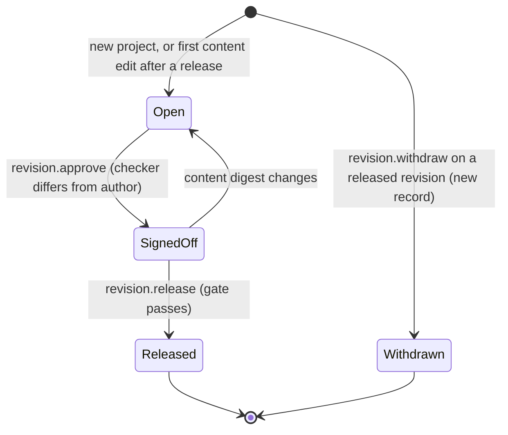
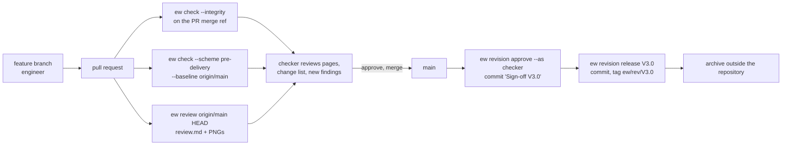

# Checks, revisions and collaboration: revisions and collaboration

A chapter of [Checks, revisions and collaboration](15-checks-revisions-collaboration.md), whose table says where each section lives.

---

## 5. Revision management

### 5.1 Lifecycle



`SignedOff` is not a stored state. It is an `Open` revision whose `sign_off` matches the current content digest.
Stored states stay as in [03](03-domain-model.md) §18: `Open`, `Released`, `Withdrawn`. A released record never
changes state (FR-REV-009): withdrawing it adds a separate record in state `Withdrawn` that points to it (§5.10).

### 5.2 Labels

- **One format per project** (FR-REV-002), set in the company basic project. Supported forms are `V{major}.{minor}`
  (V1.0, V2.0), `{nn}` (01, 02) and `{A}` (A, B … Z, AA, skipping I and O).
- **Next label.** The proposal bumps the major part (after V2.0 the system proposes V3.0). A minor bump is offered
  for internal issues.
- **Ordering.** Labels must increase in natural order (EW-REL-004). "2" under `V{major}.{minor}` is rejected.

### 5.3 Opening the next revision and printing it

The first content edit after a release adds `Revision{label: next, state: Open, author: <party of the current
user>}` in the same transaction, through a normaliser (`revision.ensure_open`). Undoing the edit removes the
revision again (FR-REV-009).
- **What counts as content.** Every change to a file that the content digest covers (§5.4). View state, comments,
  transmittals and revision page notes are not content edits.
- **Printing.** The title-block "Revision" cell binds to the latest revision record, and every page prints the same
  label (FR-REV-003, [09](09-reports-forms-output.md) §2.7).
- **Draft marking (1.0).** Exports of an open revision carry the status mark "DRAFT V3.0" outside the frame
  (FR-OUT-021, Should, 1.0; [09](09-reports-forms-output.md) §4.2), so a PDF made after a release cannot pass for
  the released one. At MVP the open label prints in the revision cell and the revision overview 911 shows the
  revision as Open. The pilot basic project may switch the mark off to reproduce the reference set exactly (open
  question 9).

### 5.4 Sign-off: four eyes as a hard rule

`revision.approve --as <checker>` (GUI: "Approve revision") records the checker's sign-off on the open revision:

```text
preconditions  checker party ≠ author party of the revision           (structural; D-34, FR-REV-005)
               release-mode run of release_scheme: zero unwaived errors except EW-REL-001
               every waiver of a safety-kind rule acknowledged by the checker
writes         sign_off{checker, date, scheme, packs[{id, version, sha256}], waivers_ack[], content_digest}
content_digest SHA-256 over the sorted (path, sha256) entries of the saved manifest,
               excluding revisions.jsonl and comments.jsonl (.ew/ and .~ew.* are never in the manifest)
```

- **Who is author and checker**. The revision's `author` and `checker`
  members decide this precondition and EW-REL-001, so the property grid shows them **read-only** although
  `fields.set` can still write them today (the grid's narrowing table may narrow what is editable, never widen it). A
  `HumanOnly` sign-off command that alone sets them, so the four-eyes roles have one confirmed path, is not built yet. *Built:* both rows are `ReadOnly(Narrowed)` with the reason "decides the four-eyes sign-off",
  tested in PG1.
- **Saved state only.** Approval needs the write lock and no unsaved edits; the dialog saves first. The digest is
  therefore a pure function of one generation, and the checker approves exactly what `ew check` and the PDF of that
  generation show.
- **Approval is bound to content.** A later content edit changes the digest, the sign-off no longer matches, and
  EW-REL-001 blocks release again. Editing comments, transmittals or the revision's page notes does not void it.
  Changing a waiver (`waivers.jsonl`) or a project rule pack (`rules/`) does.
- **Human only.** `revision.approve` and `revision.release` are `HumanOnly` commands (§2.5): a `.ewcmd` replay, a
  script, Python, an MCP session or a plugin cannot approve or release. On the command line only the dedicated
  subcommands `ew revision approve --as <party>` and `ew revision release <label>` submit them, and only after the
  person types the revision label on an interactive terminal; without a terminal they exit 2
  ([17](17-extensibility.md) §2.3).
- **Release.** `revision.release` may be run by the author or the checker. It copies the sign-off into
  `ReleaseRecord.approval` (FR-REV-020).
- **Identities.** Identities are declared parties ([03](03-domain-model.md) `Party`), not authenticated accounts.
  EW is an offline desktop application without a server, so four eyes is a process control, not a security
  boundary.
  - Teams that need evidence use the git workflow, where the pull-request approval of a second account provides it
    (§6.3). EW creates the annotated tag `ew/rev/<label>` ([05](05-project-format-and-persistence.md) §14.1 step 5);
    it is signed when the user's git configuration enables tag signing (`tag.gpgSign`), which EW does not set up.

`content_digest` is `ew_format::content_digest`: SHA-256 over one `sha256sum` line per content file of the saved manifest, in path order, without `revisions.jsonl` and `comments.jsonl`. `revision.approve` is submitted only by `Session::approve` (execute and preview refuse it) and needs an author; `ew revision approve --as <role>` and `ew revision release <label>` ask for the typed label and exit 2 without a terminal; the release prints the gate's blockers when it refuses, and a passing gate runs the release step of §5.5. The sign-off date is a UTC date (§2.5).

### 5.5 Release

`ew revision release V2.0` and the GUI release dialog first run the gate:
- a fork at the saved generation;
- the release scheme in release mode;
- the EW-REL rules (§4.8).

The gate's named blockers are release-scheme rules at error severity (§4.8): EW-CORE-047 (device without schematic
representation), EW-LAY-001 (device without layout placement, only where its location has a layout space),
EW-CORE-033 (cable without length), the `Tbd` rules, EW-REL-001 (author = checker, missing or stale sign-off) and
EW-REL-002 (stale committed computations). EW-REL-002 is not registered yet: it waits until a committed computation
has an input hash to compare (1.0, [15](15-rule-catalogue.md) §4.8).

On success they execute the six steps of [05](05-project-format-and-persistence.md) §14.1, in this order: gate;
freeze the committed computations and save generation g; git commit of the project directory if it is a
repository (asked); build and verify the archive; tag `ew/rev/<label>`; stamp Released in generation g+1. A
failure leaves the revision Open with no archive or tag referenced.

**Sign-off and freeze.** The gate compares `sign_off.content_digest` with the saved generation *before* the freeze
(step 2), and the freeze transaction then changes stored files (frozen numbers in `Connection.number`). The freeze
may therefore not change any printed value: the gate has already required fresh committed routes (EW-LAY-011 is an
error at release), so "bring routes up to date" is a no-op, and `FreezeNumbers` only marks derived numbers as
frozen. EW asserts that every page digest (§5.6) is equal before and after the freeze and aborts the release
otherwise. The sign-off keeps the approved digest; `ReleaseRecord.content_digest` is taken at generation g, after
the freeze.

Release adds three values to `ReleaseRecord` *(add)*:
- `content_digest` (as in §5.4);
- `page_digests: Map<PageId, u128>` (§5.6);
- `changed_pages` (§5.6), frozen.

The as-built archive adds `check/report.json` and `check/report.pdf` with findings, waivers, sign-off, pack versions
and the disclaimer (FR-CHK-014, NFR-COMP-04). From 1.0 it also carries the JSON Schemas and the format
specification (NFR-REL-10).

### 5.6 Page change status

**Digests, not file ownership.** A page's printed content changes through rows the page does not own: a part
changed in a device shard, an xref text that follows a moved target, a renumber. EW therefore compares rendered
content rather than page files, and `diff_model` and `diff_query` stay for property comparison and deltas (§5.7).
Page change status is MVP (FR-REV-004, FR-REV-022):

```text
page_digest(p) = first 128 bits of SHA-256 over the canonical serialisation of page_display_list(p, layer, lang)
                 for every documentation language of the project and every layer except frame, highlights and
                 the derived "revision" layer (§5.8),
                 plus the title-block cells except revision label, dates and status mark
at release r:  changed_pages(r) = { p | page_digest(p) ≠ r_prev.page_digests[p] or p ∉ r_prev }
               ∪ pages named in r.page_notes
               (no r_prev digests, i.e. imported or historic: changed_pages(r) = pages named in r.page_notes)
open revision o:  changed_now(p) = page_digest(p) ≠ r_last.page_digests[p]   (if r_last has digests)
                                   p ∈ o.page_notes                          (otherwise)
last_changed_in(p) = o.label if changed_now(p)
                     else the latest released r with p ∈ changed_pages(r), else the first revision
```

- **Cost.** Page digests reuse the memoised display lists, so the status is Class I at MVP and needs no archive load
  (FR-REV-004).
- **Derivation-profile upgrades.** Pinned derivation profiles keep digests stable across EW versions (NFR-REL-09).
  A profile upgrade changes digests for reasons the user did not make. The upgrade command therefore recomputes the
  last release's digests under the new profile from the archive (1.0), and at MVP it records the upgrade as a page
  note on every affected page.
- **Where the status shows.** It appears in the page navigator, in the revision overview (911,
  [09](09-reports-forms-output.md) `revision_overview`) and as an optional title-block binding
  `{page.last_changed_in}` (in the placeholder catalogue of [09](09-reports-forms-output.md) §2.6). That
  binding gives the pilot the per-page index of the reference set (V2.0 on 101 and 106, V1.0 elsewhere) without a
  per-page revision field (D-05).
- **Generated pages.** Report pages are identified by (report block, page index) v5 IDs. The revision overview 911
  changes with every new revision record, so it is in the `changed_pages` of every digest-based release. V2.0 of
  the reference project is not digest-based (V1.0 has no digests, §10.2), so its `changed_pages` stay {101, 106}.

`ew_api::output::revisions` computes `page_digest` as the first 128 bits of SHA-256 over the `ew_dl::canonical` encoding (an own, pinned encoding: fixed field order, little-endian integers, length-prefixed UTF-8, key-ordered maps) of every layer except frame, highlights and revision, each layer's symbol geometry, and the bound title-block values without every `revision.*` path, `page.last_changed_in` and every date. In the digest branch the open revision's changed pages are the digest-changed pages and the pages its page notes name, as the release will record them (`changed_now`). Differences from the text above: one language, the project's print language, until the documentation languages render; a revision-overview page leaves its own tables layer out of its digest and counts as always changed in the digest branch, which breaks the self-reference; withdrawn revisions are ignored when the last released and the open revision are found. The status is handed down as parameters (page bindings and folio 911's pages cell), with no new crate edge. The Pages navigator shows it in a Changed in column.

### 5.7 Change list and deltas (1.0)

`revision_changes(base, head)` loads the base from the as-built archive into a read-only `Model` with its pinned
profile and rule packs (ADR-0013). It then combines two kinds of difference:
- **`diff_model`**, grouped by entity: device, function, connection, terminal, cable, channel and placement. Each
  row reads `{Added | Removed | Modified, kind, label, field, before, after, pages}`. Labels are derived tags on the
  head side, or on the base side for removed entities (FR-REV-014).
- **`diff_query`** for BOM rows, wire-list rows (keyed by physical-wire ID, which is a connection UUID: the
  target-side connection through an IP pair, the branch connection at a junction; [03](03-domain-model.md) §9.2),
  terminal rows, PLC addresses and xref texts (FR-REV-015).

Consumers: customers read it as a report block, XLSX or the in-app tree. The shop gets a rework list ("wires
changed since V2.0", with the classes added, removed, re-landed, changed and route-only of
[13](13-manufacturing-outputs.md) §3.5), packaged by [13](13-manufacturing-outputs.md). For example, after V2.0 is released, deleting W25 lists exactly the changed wires under "since V2.0", and comparing
the two packages lists the same wires. A historic revision without an archive, such as the reference project's V1.0,
cannot be a base. At
release the author sees the page notes pre-filled with generated summaries ("-102F1: part changed; W20: colour DBU →
BU") and edits them (FR-REV-012). Without the base archive EW explains why comparison is unavailable ("V1.0 has no
as-built archive (imported history)") and offers `ew archive rebuild` when a git tag exists.

### 5.8 Revision clouds and marks (1.0)

```text
for each changed page p between base B and head H:
  regions = for each EntityRef e in dl_B(p) ∪ dl_H(p) (layers except frame):
              added or modified → bbox_H(e), plus bbox_B(e) when a modified entity moved;
              removed → bbox_B(e)                                   (regions from bbox_B drawn dashed)
  expand each region by m = 2 mm; clip to the drawing area
  merge regions whose expanded boxes intersect or lie closer than g = 3 mm   (union-find, ordered by (y, x, id))
  outline the union as a rectilinear polygon; scallop it with arcs of radius r = 2.5 mm
  place a revision triangle with the revision label at the top-right vertex of each cloud
emit into the derived layer "revision" (screen, PDF, SVG); never stored
```

- **Configuration.** m, g and r are form parameters. The export setting is `revision_marks = none | clouds |
  clouds+triangles` (FR-REV-016).
- **Derived changes included.** Diffing display-list entities instead of model rows means that an xref text which
  changed because its target moved is clouded too. That is exactly what a customer needs to see.
- **Overlay.** The revision overlay (FR-REV-017) shows both renderings with the same region set (§6.6).

### 5.9 Issue purpose and customer approval states (1.0)

Released revisions are immutable (FR-REV-009). The customer's reply arrives after release, so it is recorded in a
separate `Transmittal` record (FR-REV-023): kind `transmittal`, rank 63 in `revisions.jsonl`, anchored to its
revision ([05](05-project-format-and-persistence.md) §2.2).

| Field | Values |
|---|---|
| `Revision.purpose` (set before release, printed if the form binds it) | `Internal`, `ForInformation`, `ForApproval`, `ForConstruction`, `AsBuilt` |
| `Transmittal.issued_on`, `recipient` (party role), `reference`, `files` (archive name and PDF hash) | — |
| `Transmittal.response` | `None`, `Approved`, `ApprovedWithComments`, `Rejected`, with date, customer reference and comment IDs |
| Derived `customer_status(revision)` | `NotIssued`, `AwaitingResponse`, `Approved`, `ApprovedWithComments`, `Rejected`, `Superseded` |

**Rules.**
- Only released revisions can be issued.
- A company setting can require an `Approved` or `ApprovedWithComments` response to a `ForApproval` issue before a
  `ForConstruction` release. The release dialog warns, or blocks if the setting is `strict`.
- `ApprovedWithComments` creates `Issue` comments from the response, which the next revision resolves.
- The revision overview 911 shows the purpose and the customer status.

### 5.10 As-built, completed project, withdrawal

- **As-built** is a revision with purpose `AsBuilt`, released after commissioning with the field changes. Every
  release writes an "as-built archive" (ADR-0013's term for the archive of any released revision). The AsBuilt
  revision is the last such archive of a delivered cabinet. From 1.x, shop-floor feedback from the wiring viewer's
  status log arrives as previewed commands that create `Issue` comments ([13](13-manufacturing-outputs.md) §1).
- **Completed project** (FR-REV-013, 1.0). "Complete project" sets `Project.completed{date, by}` and opens the
  project read-only, like EPLAN's completed project ([eplan-features](../research/eplan-features.md) §10). "Reopen"
  requires a reason and records it. Completing and reopening are `HumanOnly` ([17](17-extensibility.md) §2.3); the
  CLI catalogue of [17](17-extensibility.md) §3.3 has no subcommand for them, so they run from the GUI only.
- **Withdrawal** (`revision.withdraw`, `HumanOnly`; CLI `ew revision withdraw <label> --reason <text>`,
  [17](17-extensibility.md) §3.3) creates a new `Revision` record with state `Withdrawn`, `withdraws: <id>` and a
  reason. The withdrawn revision and its archive stay unchanged; the revision overview 911 lists the withdrawal
  record, with its reason, directly after the released revision it withdraws.

---

## 6. Collaboration

### 6.1 Modes of working together

| Mode | Who | Concurrency | Mechanism | Rel |
|---|---|---|---|---|
| Shared directory (SMB) | Small shops without git | One writer, many readers | `.~ew.lock`, read-only sessions with silent reload on save, takeover ([05](05-project-format-and-persistence.md) §7) | MVP |
| Git branches and pull requests | Teams, CI users | Parallel, merged | JSONL ordering, merge driver, integrity check, visual review | MVP (Should) / 1.0 |
| Work copy and merge back | Shops without git that occasionally need two editors | Parallel, merged | Copy with a recorded base, three-way merge with the same core as the driver (§6.8) | 1.0 |
| Hand-over | Customers, subcontractors | Sequential | `.ewz` ([05](05-project-format-and-persistence.md) §12), comments, transmittals | MVP |
| Real-time co-editing | — | — | Not in v1 (FR-COL-021 Later; the op log stays CRDT-ready) | Later |

**EPLAN parity.** EPLAN's multi-user mode lets several workstations edit one project on a share at once, with
conflict notices ([eplan-features](../research/eplan-features.md) §13). The research recommends not building that
for v1 (§17 there). EW v1 offers instead one writer with live read-only followers, branches, and work copies with
a three-way merge back; the pilot's answer to [PQ-26](01-brainstorm.md) decides whether that suffices.

### 6.2 Shared drives and locks

The lock record, heartbeat and takeover are in [05](05-project-format-and-persistence.md) §7. At the workflow level:
- **A locked project opens read-only** (FR-COL-006) and reloads silently on each of the holder's saves, so
  colleagues follow the work and run `ew check` or exports on exactly one generation
  ([05](05-project-format-and-persistence.md) §6.4). "Notify when free" offers "Switch to editing" when the lock goes.
- **"Request edit"** (1.x, FR-COL-023) writes `.~ew.requests/<session>.json` next to the lock, and the
  holder sees "<user> asks to edit". The file share is the channel; no network service is needed.
- **A lock coordinates one directory.** Every git clone has its own, by design: parallel work belongs in branches.

### 6.3 Git workflow



- **Setup.** `ew git setup` writes the driver configuration after consent (FR-COL-024,
  [05](05-project-format-and-persistence.md) §11.1). A repository may hold several projects; archives never enter it.
- **CI gates** ([18](18-quality-security-release.md) owns the pipelines):
  - **integrity** on the pull request's merge ref, so §6.4 collisions show before the merge;
  - **finding delta:** `--baseline` reports new, resolved and unchanged findings by fingerprint and exits 1 only on
    new unwaived errors (FR-CHK-048), so migrated projects with legacy findings still gate on regressions;
  - **visual review** (§6.6).
- **Releases happen on `main` in a clean worktree.** The sign-off and release commits touch only the project
  directory, and EW never pushes. The checker runs
  `ew revision approve` locally (it is `HumanOnly`, so a CI job cannot run it).
- **Revisions on branches.** Two branches that both open "V3.0" merge into two open revisions with one label.
  EW-CORE-013 offers to merge them, with the union of their page notes and the earlier record's author.

### 6.4 Branch-safe counters

**Why collisions are rare and when they still happen.**
- Tag counters are stored once, by the online-numbering normaliser (`TagSpec.counter`, [03](03-domain-model.md) §8).
  Two branches cannot see each other's allocations.
- Page-based numbering, the pilot's format `{page}{letter}{counter}` (the formatter adds the leading `-`; a format
  never contains the aspect sign), is naturally branch-friendly: engineers who work on different folios never
  collide. Project-wide sequential counters collide more often, and the numbering-scheme documentation recommends
  page-based or structure-scoped numbering for teams that use git.
- Collisions remain possible when two branches add to the same page, the same strip or the same address area. The
  integrity check detects them deterministically, and its "renumber the newer" quick fix repairs them as one
  previewed command (FR-CHK-012, MVP; cross-file reconciliation is FR-COL-016, 1.0):

```text
after a merge (on open, by the post-merge hook, or in CI on the merge ref):
for each uniqueness rule ρ ∈ {EW-RDS-004 tag, EW-TERM-002 designation, EW-POT-015 wire number,
                              EW-CORE-052 IP star source, EW-PLC-001 address, EW-PLC-007 symbol}:
  for each group g of records sharing ρ's key, |g| > 1:
    order g:  (1) value frozen, or published in the last release (its committed number table)  → keeps
              (2) record present in the merge base (git merge-base or work-copy base)          → keeps
              (3) UUIDv7 timestamp ascending, then full ID                                     → older keeps
    finding EW-CORE-013 {rule ρ, key, keeper = g[0], others = g[1..]}
    quick fix "renumber the newer": ρ's own allocator assigns the next free value in scope to g[1..] in order,
              skipping values published in the last release
all quick fixes of one merge → one previewed command → one undo step
```

- **Determinism.** The same merged content yields the same proposal on every machine and in CI.
- **Released numbers are protected.** A released number never moves. A number published in the last release is not
  re-allocated to a new device either, so the shop floor never sees one tag on two devices across revisions.
- **Example** (the merge case of FR-CHK-012). Two branches each add a protective device on folio 103, and both
  number it -103F1. Neither exists in the base, so the older UUIDv7 keeps -103F1. The preview renumbers the other to
  -103F2 and shows its BOM row, its xref texts and the folio 903–907 rows that change.

### 6.5 Merge driver and conflict resolution

The record- and field-level driver, the conflict records and the fallback without the driver are specified in
[05](05-project-format-and-persistence.md) §11.2–§11.5 (FR-COL-014). The **merge panel** (FR-COL-015) shows them:

| Element | Behaviour |
|---|---|
| Conflict list | Grouped by page and device, labelled with derived tags: "W20 (-102G1:+ → -102F1:1) · overrides.colour" |
| Field view | Three columns, base, ours and theirs, for each conflicting member only. Delete/modify conflicts show "deleted" with the modified record |
| Preview | Mini canvas of the affected page region with a ghost of each choice; the parent page opens on double-click |
| Actions | Take ours, take theirs, edit the value; for delete/modify, keep deleted or restore; "same choice for all conflicts of this field" |
| Commit | All choices become one transaction `merge.resolve{choices}` that removes the conflict records. It is undoable, and it triggers integrity and online checks, so a resolution that creates a collision immediately shows EW-CORE-013 with its quick fix |
| CLI | `ew merge resolve <project> --take ours\|theirs [--kind connection --field overrides.colour]` for headless use |

**Release split.** At MVP the panel resolves external-change collisions ([05](05-project-format-and-persistence.md)
§9). Conflict records from the driver get the full panel at 1.0, together with the driver's Must status
([00](00-vision-and-scope.md) §9). An MVP project with conflict records still opens: EW-CORE-011 blocks release, and
the CLI resolver is available.

**AC-41** ([05](05-project-format-and-persistence.md) §11.7). Branch A changes -102F2's function text and
W20's colour (DBU → BU); branch B changes W20's cross-section (1.5 → 2.5 mm²). The merge is clean: csa 2.5 from B,
colour BU from A. When B also sets W20's colour (WH), one conflict record results, and resolving it is one step.

### 6.6 Visual review of pages (1.0)

`ew review <base> <head> [--out review/] [--max-pages 50]` serves both CI and the in-app compare view
(FR-COL-017, IDEA-078). Each side can be a directory, an `.ewz`, an archive, `git:<rev>` or `rev:<label>`
([05](05-project-format-and-persistence.md) §11.6).

```text
1. build both models (gix 0.89.0 reads `git:<rev>` blobs); each side derives with its own pinned profile
2. match pages by Page UUID; generated pages by (report block, page index) = v5 IDs, so a wire list that
   grows a continuation page (907.3) leaves the identity of 908 … 911 unchanged; pages whose rows moved are changed
3. per matched page: entity digests of both display lists → added / removed / modified entities;
   the page has changed if any digest differs (title-block revision and dates ignored)
4. render base and head with the CPU renderer at 150 dpi; the overlay uses the §5.8 region set:
   removed items cross-hatched, added items with a double outline, clouds around both. Meaning never
   rests on colour alone (FR-UI-025)
5. change list = §5.7 rows; finding delta = new and resolved fingerprints
6. write review.md (summary and per-page table), pages/<folio>-{base,head,overlay}.png,
   changes.json (published schema), findings.json; bytes deterministic (NFR-REL-07)
```

- **One binary renders both sides.** A renderer or font change therefore cannot pose as a drawing change, which is
  a property that stored "approved" images would lack.
- **CI.** CI uploads the bundle as a job artefact and posts `review.md` as the pull-request comment. EW ships a
  sample workflow, not a hosted service.
- **In the app.** "Compare with…" offers a commit (git log through gix), a revision (archive) or a file. Two canvases
  with synchronised pan and zoom are shown side by side, or as an overlay or a swipe. Clicking a change-list row
  jumps both sides.
- **Example.** A pull request that changes W20's colour from DBU to BU yields folio 102 and the wire-list
  pages 907 … as changed. The change list reads "W20 (-102G1:+ → -102F1:1): colour DBU → BU", with no new findings.

### 6.7 Review comments (1.0)

Comments (FR-REV-018, FR-COL-018) anchor to an entity UUID, or to a page and position. They therefore survive
renumbering and moves: a comment on -102F1 stays attached after -102F1 becomes -102F3.

| Field | Meaning |
|---|---|
| `anchor` | `EntityRef` or `(PageId, Pt2)` ([03](03-domain-model.md) §5) |
| `kind` *(add)* | `Note` or `Issue`. Open issues on the revision block release (EW-REL-003) |
| `revision` *(add)* | The revision the comment was raised against |
| `status` | `Open`, `Resolved`; `resolved{by, date}` *(add)* |
| `parent` *(add)* | Reply chain: the comment this one answers |

- **Orphaned anchors.** When the anchored entity is deleted, a normaliser of the deleting transaction re-anchors
  the comment to its page at the entity's last anchor position and flags it "anchor lost". Undoing the delete
  restores the entity anchor.
- **PDF annotation import** (FR-REV-019, FR-COL-019) follows at 1.x, resolving positions to entities where possible.

### 6.8 Work copies without git (1.0)

"Create work copy" writes `<name>.work-<user>.ew/` together with `.ew/base.ewz`, the generation it was taken from
(`.ew/` is git-ignored and outside the manifest, [05](05-project-format-and-persistence.md) §11.1).
"Merge work copy back" works like this:
- it runs the driver's three-way record and field merge (ADR-0012) with that base, inside the target project's lock;
- conflicts go to the merge panel;
- the collision rules of §6.4 run with the copy's base as merge base.

This gives shops on SMB without git the same safety as branches, and the pilot's answer to
[PQ-26](01-brainstorm.md) decides its priority (FR-COL-022).

---

## 7. UI and UX touchpoints

Screens are designed in [16](16-ux-ui.md). This area supplies:

| Touchpoint | Behaviour | Requirement |
|---|---|---|
| Message panel | Severity icon plus colour, code, rule ID, message, targets by derived tag, page and cell, state (pending, deferred, waived, possibly resolved); grouping, filters, "new since baseline"; Enter jumps, F1 opens the rule page, quick fixes preview | FR-CHK-008, FR-UI-021, FR-UI-031 |
| Canvas badges | Icon at the target anchor with a patterned halo; pending style ([06](06-schematic-editor.md) §3.10) | FR-UI-025 |
| Open items | Findings with `open_item`: Tbd values, placeholder parts, missing lengths and parts, unplaced devices | REF-094 |
| Waiver dialog | Required reason, expiry, scope; bulk waiver with one reason; single findings only for safety rules; not offered to MCP, scripts or plugins (`HumanOnly`) | FR-CHK-009 |
| Scheme editor, rule packs | Per-rule enable, severity and parameters with locks and origin; packs with version, source, trust and `verified` flags | FR-CHK-003, -004 |
| Revision panel | Revisions, label proposal, purpose, page notes with generated summaries, transmittals | FR-REV-001, -012 |
| Approve and release dialogs | Blockers first with jumps, sign-off state, waivers to acknowledge, archive location, tag option, step progress; no disclaimer line (the owner, 2026-11-12). The one sentence "ElektraWatt's checks do not replace engineering verification by a competent person." (`ew_checks::report::DISCLAIMER`, the About dialog's `about-disclaimer`) stays in About, and the check report, `ew check`'s Markdown and the release report (with its waivers in force) end with it (NFR-COMP-04) | FR-REV-005 … 008 |
| Compare view, merge panel, comments | §6.5–§6.7 | FR-REV-014, -017, -018, FR-COL-015, -017 |

The persona and journey IDs P1–P6 and J1–J6 of [00](00-vision-and-scope.md) apply. The checker (P4) works mainly in
the message panel, the compare view and the approve dialog.

---

## 8. Outputs

| Output | Content | Formats | Rel |
|---|---|---|---|
| `ew check` | Findings, counts, exit 0/1/2; `--gate` adds the EW-REL rules of the open revision (§3.2) | text, JSON (published schema), JUnit XML | MVP (FR-EXT-002, FR-EXT-024) |
| `ew check --format sarif` | SARIF 2.1.0: `ruleId` = rule ID, `logicalLocations` = page and entity (derived tag), and a `physicalLocation` = the project file and line of the primary target's record, because GitHub code scanning places results by file **(verify)** | SARIF | 1.0 (FR-EXT-025) |
| Check report | Header: project, revision, generation, scheme, packs with versions and hashes, EW version, derivation profile, date from the release context or an explicit export date. Then counts per severity and pack, the findings table, the waivers table and the disclaimer. The as-built archive keeps `check/report.json` and `check/report.pdf`; the XLSX is regenerated from the archived JSON | PDF, XLSX, JSON | MVP (FR-CHK-014) |
| Release report | Check report plus sign-off, acknowledged waivers, changed pages, purpose; stored in the archive | PDF, JSON | MVP |
| Migration report | A `migration`-scheme check run of the import plus the EW-IMP findings of its import run (§4.10), one row per condition | panel, PDF, XLSX | MVP (FR-IMP-003, FR-IMP-041) |
| Revision overview (911) | Every revision, including withdrawal records with their reason: label, date, author, checker, description, state, changed pages; purpose and the last transmittal response from 1.0 | report block | MVP (FR-REP-018) |
| Change list, rework list | §5.7 | report block, XLSX, CSV, `ew diff --json` | 1.0 |
| Review bundle | §6.6 | Markdown, PNG, JSON | 1.0 |

All outputs follow NFR-REL-07: no wall-clock times, sorted rows and stable IDs.

---

## 9. Edge cases and pitfalls

1. **Unstable discriminators.** A discriminator holding a terminal's `seq` or a position loses its waivers on every
   rearrangement. A property test renumbers and moves random targets and asserts unchanged fingerprints.
2. **False positives make users switch checks off** (big bet B4's risk). Mitigations: rule pages, precise exceptions
   (`switches_n_with_l`, `n_isolation` for EW-POT-013), pending display, company locks on safety rules, `--baseline`.
3. **Finding floods after an import.** Grouping by rule, plus a bulk "legacy" waiver expiring at the next release,
   keeps them visible in the release report without blocking daily work.
4. **Lenient forever.** The banner counts the violations, and release mode treats them as errors (§3.5).
5. **Silent rule failure.** A rhai operation limit or an SQL error must not look like "no findings": EW-CORE-083
   reports it and blocks release. Untrusted packs likewise yield EW-CORE-084.
6. **Pack upgrades change old findings.** Versioned implementations and kept pack versions reproduce historic
   reports (§3.9).
7. **Unverified constants.** From 1.0 an unverified table caps severity at warning, so EW-POT-006's table must be
   verified against a licensed copy, or EF-06 degrades; the global plan schedules that check before MVP for the
   PE-sizing and colour values the MVP packs use.
8. **Approval voided by trivia.** The content digest excludes comments, transmittals, revision notes and view state.
   It includes waivers on purpose.
9. **Release with another writer.** Release needs the write lock ([05](05-project-format-and-persistence.md) §6.4).
10. **Missing archive.** Comparison explains why it is unavailable, and `ew archive rebuild` recreates the archive
    from the tag, marked "rebuilt" ([05](05-project-format-and-persistence.md) §14.3).
11. **Continuation shifts.** A wire list growing from three pages (907 … 907.2) to four (907.3) must not mark
    later report pages as changed. Pages match by (block, index), not by folio label or physical page number. A
    report page whose rows changed, such as 901, is changed.
12. **Deleted anchors.** A comment or waiver whose target is deleted becomes "anchor lost" or an unmatched waiver.
    Neither is dropped silently.
13. **Pack drift between machines.** `ew check` warns when installed pack versions differ from the project's pins,
    and CI is the arbiter.
14. **Two open revisions after a merge**, both labelled V3.0, are merged by EW-CORE-013's fix (§6.3).
15. **Gate rules in every check run.** Evaluating EW-REL in plain `ew check` would turn "checker not set" into an
    error on every open revision, so CI would never pass before sign-off. EW-REL runs only in the gate (§3.2).
16. **Freeze after sign-off.** A release that changed printed content after approval would ship something the
    checker never saw. The page-digest assertion around `FreezeNumbers` (§5.5) makes that a release failure.
17. **Agents gaming the gate.** An MCP session, script, command-log replay or plugin that waives EW-POT-013 or
    lowers EW-PLC-012 to make the gate pass is refused by the `HumanOnly` exposure class, and a CLI subcommand runs
    it only after an interactive terminal confirmation (§2.5, [17](17-extensibility.md) §2.3).

---

## 10. The named findings

### 10.1 The named findings and their final rule IDs

The named findings EF-01 … EF-25 that tests and other documents cite, with their final rule IDs. Each rule keeps its
own tests in `crates/ew-checks/tests/it/`, and the sample project is clean under the pre-delivery checks.

| EF | Final rule | Code | Severity | D |
|---|---|---|---|---|
| EF-01 | EW-POT-013 | 005013 | error | D-13 |
| EF-02 | EW-PLC-012 | 110012 | error | D-26 |
| EF-03 | EW-BUS-001 | 111001 | error | D-15 |
| EF-04 | EW-CORE-041 | 102041 | warning | D-04 |
| EF-05 | EW-LAY-001 | 130001 | error (release) | D-32 |
| EF-06 | EW-POT-006 | 005006 | error | D-38 |
| EF-07 | EW-CORE-034 | 003034 | warning | D-19 |
| EF-08 | EW-CORE-033 | 003033 | error | D-19 |
| EF-09 | EW-POT-009 | 005009 | warning | D-23 |
| EF-10 | EW-POT-003 | 005003 | warning | D-16 |
| EF-11 | EW-POT-005 | 005005 | warning | — |
| EF-12 | EW-CORE-061 | 104061 | warning | D-31 |
| EF-13 | EW-FL-001 | 120001 | warning | D-28 |
| EF-14 | EW-FL-004 | 120004 | info | — |
| EF-15 | EW-NUM-001 | 017101 | info | D-03 |
| EF-16 | EW-BUS-004 | 111004 | info | D-15 |
| EF-17 | EW-CORE-043 | 102043 | error (release) | D-04 |
| EF-18 | EW-RDS-003 | 017003 | warning | D-03 |
| EF-20 … 22 (1.0) | EW-FL-010, EW-FL-007, EW-PLC-013 (supersedes EF-10) | 120010, 120007, 110013 | warning | D-28, D-16 |
| EF-23 … 25 (1.0) | EW-POT-007, EW-POT-018 with EW-PLC-014, EW-CORE-065 | 005007, 005018 / 110014, 104065 | — | D-21, D-25, D-35 |


A waiver of EW-CORE-041 targets the finding's fingerprint, which holds only the device UUID, so the waiver still
matches after the device is renumbered.

### 10.2 The migration report as a check run

`ew import qet` runs the `migration` scheme (§4.9): every enabled rule of `pre-delivery` at its pre-delivery
severity, in lenient mode, so prevent violations become findings, plus the EW-IMP findings of the import run.
`ew_api::import::lenient_findings` runs the scheme on the imported model, and the lenient groups of the migration
report are the engine's open findings per rule; `ApplyImport`, the lenient validators, passes P1 to P7, proposals
and the `ImportRun` record stay as [14](14-interop.md) §2 specifies. The rows below are live rules; where an import
code names the same condition (MF-02, MF-05, MF-11, MF-14, MF-26), it is the row's origin. MF-21 and MF-22 exist
only in the import run, so they are import findings; the remaining MF rows are import findings too, mapped in
[14](14-interop.md) §15.2.

| MF | Row | MF | Row | MF | Row |
|---|---|---|---|---|---|
| MF-02 | EW-RDS-010 | MF-13 | EW-CORE-053 | MF-23 | EW-POT-013 |
| MF-05 | EW-CORE-023 | MF-14 | EW-CORE-046 | MF-24 | EW-POT-009 |
| MF-08 | EW-TERM-001 | MF-16 | EW-POT-001 | MF-25 | EW-CORE-061 |
| MF-09 | EW-TERM-002 | MF-21 | EW-IMP-113 (import finding) | MF-26 | EW-CORE-063 |
| MF-11 | EW-CORE-031 | MF-22 | EW-IMP-006 (import finding) | MF-27 | EW-CORE-034 |

MF-04, per-folio revision values that differ (such as "1", "V1.0", "V1" and "V2.0"), is the import finding
EW-IMP-104; a revision value that every folio shares becomes the label of the project's Open revision
([14](14-interop.md) §4.9).

### 10.3 Refusing, approving and releasing a revision

- **Refused.** `ew revision release` is refused while an error-level finding of the release scheme is open, and
  lists them, with EW-REL-001 "checker not set" when no checker is set.
- **Approval.** The approval is the CLI subcommand `ew revision approve --as <checker>` with `<checker>` ≠
  `<engineer>`. It cannot be a line of a command log, because a replay may not run `HumanOnly` commands (§5.4), and
  a sign-off digest cannot be stored ahead, since it is bound to the content digest of the saved project. In tests
  the terminal confirmation comes from the test-build confirmation hook of
  [18](18-quality-security-release.md) §3.15.
- **Release.** The archive verifies; in a git project the tag `ew/rev/<label>` exists; `changed_pages` holds the
  pages that changed; the revision overview shows the revision Released. Warnings do not block. The next content
  edit opens the next revision, and from 1.0 draft exports carry "DRAFT <label>" (FR-OUT-021).

### 10.4 Defects prevented or detected by this area

Class: S = impossible by structure (schema or structural invariant), I = rejected by a prevent rule while editing,
C = detected by a check, A = assisted by a tool, not checked.

| D | Mechanism here | Class |
|---|---|---|
| D-01 | EW-RDS-008 structural (derived tags, one-transaction renumbering); EW-IMP-101 and EW-IMP-113 on import (MF-01, MF-21) | S, C |
| D-03 | EW-NUM-001, EW-RDS-001/002/003/010; alias-merge quick fix | C |
| D-04, D-36 | EW-CORE-041/042/043, BOM sync EW-CORE-048/049; EW-IMP-113 on import | C |
| D-05 | One revision table, label format, EW-REL-004; MF-04 migration | S |
| D-06 | EW-CORE-023 on description overrides | C |
| D-09 | EW-CORE-024 and EW-EN60204-015 when the project declares a standard (1.0); the reports themselves are [09](09-reports-forms-output.md) | C |
| D-10 | EW-CORE-046, EW-CORE-054 | C |
| D-11, D-12 | EW-TERM-001/002 prevent rules, lenient on import | I |
| D-13 | EW-POT-013 online, safety kind, fingerprint waivers only | C |
| D-14 | EW-CORE-053 | C |
| D-15 | EW-BUS-001, EW-PLC-015, EW-CORE-044, open items, release blocking | C |
| D-16 | EW-POT-003, then EW-PLC-013 | C |
| D-17 | EW-CORE-031 as a prevent rule (a strict project cannot store a foreign code such as "BR"), EW-CORE-032 and EW-CORE-035; EW-IMP-007/008 on import (MF-11) | I, C |
| D-18, D-35 | EW-CORE-065 description lint (1.0); EW-LIB-008 and EW-LIB-009 in libraries | C |
| D-19 | EW-CORE-033/034, EW-LAY-011, EW-MFG-001, EW-REL-002 | C |
| D-20 | EW-POT-011, EW-POT-012; EW-IMP-118 on import | C |
| D-21, D-22, D-23, D-38 | EW-POT-007/008, EW-POT-001/002, EW-POT-009, EW-POT-006 | C |
| D-24 | EW-POT-017 (canonical name is structural) | S, C |
| D-25 | EW-POT-018, EW-PLC-014 | C |
| D-26 | EW-PLC-012; EW-PLC-001 … 003 and -008 for address integrity | C |
| D-27 | EW-PRC-001/002, EW-FL-011 | C |
| D-28 | EW-FL-001 (MVP); EW-FL-005 … 008, -010 (1.0) | C |
| D-29, D-31 | EW-CORE-063, EW-CORE-061 | C |
| D-32, D-02 | EW-LAY-001, EW-CORE-047; EW-LAY-002 structural | S, C |
| D-34 | Structural four-eyes invariant (ARCH §4.6), sign-off bound to the content digest, EW-REL-001, `HumanOnly` approval | S |
| D-37 | Profile basis; EW-EN60204-011 (machinery projects) | C |
| D-39 | No check: the "Arrange" tool sorts a page's IP stack by name or potential ([06](06-schematic-editor.md) §3, FR-XRF-013; ARCH §14); EW-CORE-052 catches only ambiguous pairing | A |
| D-40 | EW-FL-003 configurator order-code validation (1.x, plugin) | C |
| D-42 | EW-IMP-109 on import (MF-10); one strip with segments afterwards | S |

