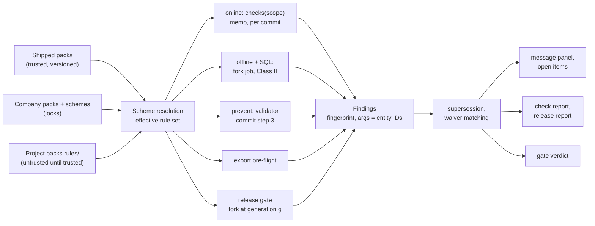

# Checks, revisions and collaboration: scope, rules and the rule engine

A chapter of [Checks, revisions and collaboration](15-checks-revisions-collaboration.md), whose table says where each section lives.

---

## 1. Scope and boundaries

| Topic | Specified here | Specified elsewhere |
|---|---|---|
| Rule engine, modes, schemes, waivers, quick fixes, messages, F1 help | All behaviour | Record shapes: [03](03-domain-model.md) §19 (amended in §2 below) |
| Rule IDs and codes | The ID scheme (§2.2) and the registry: ID, code, kind, modes, default severity, scope, release and requirement of every rule (§4) | Rule content: EW-POT, EW-TERM, EW-CORE-031 … 037 in [08](08-connections-terminals-cables.md) §8; EW-PLC, EW-SAF, EW-PRC, EW-BUS, EW-IOL in [10](10-plc-and-bus.md) §3.10; EW-FL in [11](11-fluid-power.md) §6; EW-LAY and EW-THM in [12](12-panel-layout.md) §4, §11.8; EW-MFG in [13](13-manufacturing-outputs.md) §4.6; EW-IMP in [14](14-interop.md) §2.5; EW-LIB in [07](07-symbols-parts-macros.md) §6.2 |
| Integrity check | Rule IDs EW-CORE-001 … 019 | Detection and quick fixes: [05](05-project-format-and-persistence.md) §6.3 |
| Revisions | Lifecycle, sign-off, gate, page change status, change lists, clouds, transmittals | Release file sequence and archive layout: [05](05-project-format-and-persistence.md) §14; revision overview form and status mark: [09](09-reports-forms-output.md) |
| Collaboration | Workflows, branch-safe counters, merge UI, visual review, comments, work copies | Lock record, journal, external-change diff, merge-driver algorithm: [05](05-project-format-and-persistence.md) §7, §9, §11 |
| Screens | Behaviour and content | Widgets and layout: [16](16-ux-ui.md) |
| CI pipelines | What `ew check` and `ew review` provide | Jobs: [18](18-quality-security-release.md) |

The binding decisions are ADR-0019 (rule engine), ADR-0009 (invariants, strict and lenient), ADR-0003 (freshness,
committed computations), ADR-0012 (git integration), ADR-0013 (revisions, as-built archive) and ADR-0020
(`HumanOnly` exposure of waivers, schemes, approval and release). Real-time co-editing
is out of scope for v1 ([04](04-architecture.md) §16, FR-COL-021 Later).

---

## 2. Concepts and data



### 2.1 Entities

Additions to [03](03-domain-model.md) §18–§19 are marked *(add)*. A = authored and persisted, D = derived.

| Entity | Kind, file | Key fields |
|---|---|---|
| `RulePack` | data; shipped in the app, company path, or project `rules/` | `id`, `version` (semver), `ruleset` (e.g. `EN60204-1:2018+A1:2025`), `api = "v1"`, `licence`, rules, data tables, Fluent files, docs |
| `Rule` | data | §2.3 |
| `CheckScheme` | A, `ProjectSettings` or company basic project | `name`, `extends`, per-rule overrides `{enabled, severity, release_severity, params}`, `locked` *(add, company schemes only)* |
| `CheckSettings` *(add)* | A, `project.jsonl` | `active_scheme` (online), `release_scheme` (gate), pack pins `{id, version_req}`, `strictness: Strict \| Lenient{since}`, rule parameters |
| `Finding` | D | rule, code, severity, state (`open`, `pending`, `waived`, `superseded`, `deferred`, `possibly_resolved`), targets, page, cell, args, `fingerprint`, `open_item`, `origin` (online, offline, prevent, release, export, import, merge), `rev` |
| `Waiver` | A, `waivers.jsonl` | rule, target (finding fingerprint, or part *(add)*), reason, author, date, `expires` *(add)* |
| `QuickFix` | D | label key, command name and parameters, `scope: One \| AllOfRule` |
| `Revision` | A, `revisions.jsonl` | 03 fields plus `purpose` *(add)*, `sign_off` *(add)* and, on a withdrawal record, `withdraws` and `reason` *(add)*, §5 |
| `ReleaseRecord` | A value in `Revision` | 03 fields plus `content_digest`, `page_digests`, `changed_pages` *(add)*, §5.6 |
| `Transmittal` *(add)* | A, `revisions.jsonl` (kind `transmittal`, rank 63 in the kind registry of [05](05-project-format-and-persistence.md) §2.2) | revision, issued on, purpose, recipient role, reference, customer response, §5.9 |
| `Comment` | A, `comments.jsonl` | 03 fields (`anchor`, `author`, `status`, `text`) plus `kind: Note \| Issue`, `revision`, `parent` (thread) and `resolved{by, date}` *(add)*, §6.7 |
| `Project.completed` *(add)* | A, `project.jsonl` | `{date, by}`, plus the reason of the last reopen, §5.10 |
| Conflict record | A, in the file of its target until resolved | `$k = "conflict"`, rank 255, [05](05-project-format-and-persistence.md) §2.2, §11.2 |
| Review bundle | X (artefact) | `review.md`, PNGs, `changes.json`, §6.6 |

### 2.2 Rule IDs and six-digit codes

Every rule has two identifiers. This document is their registry: §4 holds one row for every rule that any
document of the set names, and a rule ID that §4 does not list does not exist.

The registry is the in-code list `ew_checks::rules()` in ID order, and a unit test checks the order and the families. The registry file and the CI test of this section are not built.

**The rule ID** is the key used by waivers, documentation, CLI filters and the expected-findings CSVs. All rules use one form:

```text
rule-id = owner "-" family "-" number
owner   = "EW" for shipped packs; companies and plugins use their own prefix (ACME)
family  = one entry of the family table below (company and plugin packs choose their own families)
number  = exactly three digits, 001 … 999, inside a number block of the family
check   = ^[A-Z][A-Z0-9]{1,9}-[A-Z][A-Z0-9]{1,9}-[0-9]{3}$
```

Examples are EW-POT-013 (N switching), EW-PLC-012, EW-LAY-001 and EW-EN60204-007. IDs are never reused: a
withdrawn rule keeps its ID and the text "Retired", like EW-PLC-006 and EW-CORE-064.

**The code** is a six-digit message number `CCCNNN`, in the style of EPLAN. `CCC` is the class of the family and
`NNN` is the rule number plus the family's code offset. The code is printed in the message panel and the reports,
sorts by topic and lets EPLAN users find terminal rules under 001. EW codes share only the class topics with EPLAN
(001, 003, 005 and 017, [eplan-features](../research/eplan-features.md) §9), not the message numbers.

| Family | Topic | Class (code offset) | Number blocks | Pack | Content in |
|---|---|---|---|---|---|
| EW-TERM | Terminals and strips | 001 (+0) | 001–099 | EW-TERM | [08](08-connections-terminals-cables.md) §8.1 |
| EW-CORE | Project integrity and the core model | by block (+0) | 001–019 integrity (class 100); 021–029 pages, title blocks and report blocks (101); 031–039 cables and conductors (003); 041–049 devices, parts and BOM (102); 051–059 cross-references and interruption points (103); 061–079 texts and graphics (104); 081–099 rule system and waivers (105) | EW-CORE | this document; integrity [05](05-project-format-and-persistence.md) §6.3; cables [08](08-connections-terminals-cables.md) §8.1 |
| EW-POT | Connections, potentials, wire properties | 005 (+0) | 001–099 | EW-POT | [08](08-connections-terminals-cables.md) §8.1 |
| EW-RDS | Reference designations (IEC 81346) | 017 (+0) | 001–099; EW-RDS-00n is RD-0n of [standards](../research/standards.md) §1.6 | EW-IEC81346 | this document |
| EW-NUM | Numbering | 017 (+100) | 001–099 | EW-IEC81346 | this document |
| EW-PLC | PLC and I/O | 110 (+0) | 001–099 | EW-PLC | [10](10-plc-and-bus.md) §3.10 |
| EW-SAF | Safety I/O | 110 (+100) | 001–099 | EW-PLC | [10](10-plc-and-bus.md) §3.10 |
| EW-PRC | Process and instrument tags | 110 (+200) | 001–099 | EW-PLC | [10](10-plc-and-bus.md) §3.10 |
| EW-BUS | Fieldbus | 111 (+0) | 001–099 | EW-BUS | [10](10-plc-and-bus.md) §3.10 |
| EW-IOL | IO-Link | 111 (+100) | 001–099 | EW-BUS | [10](10-plc-and-bus.md) §3.10 |
| EW-FL | Fluid power | 120 (+0) | 001–099 | EW-FL | [11](11-fluid-power.md) §6 |
| EW-LAY | Panel layout, collision and routing | 130 (+0) | 001–019 placement, collision and routing; 020–039 placement rules | EW-LAYOUT | [12](12-panel-layout.md) §4 |
| EW-THM | Thermal verification (IEC 61439-1 10.10) | 131 (+0) | 001–099 | EW-THM | [12](12-panel-layout.md) §11.8, this document |
| EW-MFG | Manufacturing exports | 140 (+0) | 001–099 | EW-MFG | [13](13-manufacturing-outputs.md) §4.6 |
| EW-EN60204 | EN 60204-1 | 150 (+0) | 001–099; EW-EN60204-0nn is M-nn of [standards](../research/standards.md) §7 | EW-EN60204 | this document |
| EW-IMP | Import and migration findings | 160 (+0) | 001–099 every importer; 101–199 QET; 201–249 EDZ and EPLAN; 251–299 DXF and DWG; 301–349 tables | the importers | [14](14-interop.md) §2.5 |
| EW-LIB | Library lint | 170 (+0) | 001–099 | EW-LIB | [07](07-symbols-parts-macros.md) §6.2 |
| EW-REL | Release gate | 190 (+0) | 001–099 | EW-REL | this document |
| own prefix | Company classes; plugin classes (1.x) | 500–899; 900–999 | allocated by the owner | company and plugin packs | the pack |

Examples: EW-TERM-002 → `001002`, EW-CORE-033 → `003033`, EW-POT-013 → `005013`, EW-NUM-001 → `017101`,
EW-CORE-013 → `100013`, EW-CORE-041 → `102041`, EW-CORE-061 → `104061`, EW-PLC-012 → `110012`, EW-SAF-001 →
`110101`, EW-IOL-001 → `111101`, EW-LAY-011 → `130011`, EW-IMP-101 → `160101`, EW-LIB-006 → `170006`.

The schematic layout rules EW-CORE-067 to -070 and -072 to -077 (a drawn page against the measure of
[06a](06a-drafting.md) §1.2) take numbers of EW-CORE's texts-and-graphics block, class 104 (EW-CORE-067 →
`104067`), around EW-CORE-071, which keeps its number; they are not of the EW-LAY family, which is the panel
layout's.

**Registry rules.**
- **Fixed family list.** A new shipped family needs a row in the table above, with its class and number blocks.
  A family with a code offset uses numbers below 100 only, so no two families share a code.
- **Numbering.** A new rule takes the next free number of the block that fits its topic. Gaps inside a block stay
  free: numbers 017 … 019 of the layout family are unused.
- **Registry file.** A registry file in `ew-checks` lists every shipped ID with its code, pack and status. A CI test
  fails on a duplicate ID or code, a reused or retired ID, an ID outside the form or outside its family's blocks, a
  missing registry entry, a missing Fluent message or rule page (NFR-I18N-02, NFR-DOC-02), and on a rule ID cited
  under `docs/` that the registry does not list.

**Earlier forms.** Drafts of this document set used other forms. Nothing has shipped with them, so the registry
keeps no aliases:

| Earlier form | Final form |
|---|---|
| Two-digit numbers in EW-PLC, EW-SAF, EW-PRC, EW-BUS, EW-IOL, EW-FL, EW-THM, EW-MFG and EW-EN60204 | The same number with three digits: EW-PLC-012 → EW-PLC-012, EW-BUS-001 → EW-BUS-001 |
| The fused layout form EW-Lnnn | EW-LAY-nnn with the same number: EW-L001 → EW-LAY-001, EW-L011 → EW-LAY-011 |
| INT-01 … INT-16 ([05](05-project-format-and-persistence.md) §6.3) | EW-CORE-001 … EW-CORE-016; EW-CORE-017, EW-CORE-018 (unknown pinned derivation profile, ADR-0003 amendment 1) and EW-CORE-019 (a reader limit exceeded, 2026-10-20) were added later and have no earlier form |
| LL-01 … LL-12 ([07](07-symbols-parts-macros.md) §6.2) | EW-LIB-001 … EW-LIB-012 |
| EW-CORE-064 (font substituted on import) | Retired; the import finding EW-IMP-006 reports the fact |

**Source lists are not rule IDs.** The check lists of the research notes stay source citations: RD-nn and XR-nn
([standards](../research/standards.md) §1.6), M-01 … M-15 (standards §7), and the PLC, bus and fluid lists of
[plc-bus-fluid](../research/plc-bus-fluid.md). They appear as "STD XR-04" in the Req. column of §4, beside the
requirement. Invariant IDs name structural invariants, not rules: CI-nn in [08](08-connections-terminals-cables.md)
§3.1 and FI-nn in [11](11-fluid-power.md). The structural invariants that `ew-model` enforces take `EW-INV-nnn`
(`crates/ew-model/invariants.md`, ADR-0009 decision 5), except CI-01 and CI-04, which keep their doc 08 IDs; so does
the model's one delete-time rule, EW-INV-021, the `LibRef` keep-alive (ADR-0009 amendment 7).
`EW-INV` is not a rule family: it has no code, pack or registry entry, and the registry test above does not treat it
as a rule ID. A violation found on open is reported as EW-CORE-008 (EW-INV-001, a dangling reference) or
EW-CORE-012 (any other). Their prevent-class members report through rules: CI-05 → EW-CORE-036,
CI-06 → EW-TERM-004, FI-02 and FI-07 → EW-FL-013, FI-03 → EW-FL-002.

### 2.3 Rule definition

| Field | Meaning |
|---|---|
| `id`, `code`, `class` | §2.2 |
| `title`, `message` | Fluent message ID, default `rule-<id lower case>` (ADR-0019 example: `message = "rule-ew-pot-013"`), with attribute `.title` (§3.8) |
| `kind` | `safety`, `conflict`, `completeness` or `hygiene`; `integrity` for findings about the stored project, the check run and the release workflow (EW-CORE-001 … 018, EW-CORE-083/084, EW-REL), which are never waivable and never pending; `import` for the EW-IMP findings of an import run. The kind drives pending display ([06](06-schematic-editor.md) §3.10) and waiver limits (§2.5); §4 gives every rule's kind. Rows of kind `structural` in §4 are guarantees of the schema, listed for traceability, not rules that run |
| `severity`, `release_severity` | `error`, `warning`, `info`. `release_severity` applies in release mode and to `ew check` (§3.2) |
| `modes` | Subset of `online`, `offline`, `prevent`, `release`, `export`; EW-REL rules run in the gate only (§3.2), the integrity rules in the integrity run (§4.2), EW-IMP in the import run (§4.10) and EW-LIB in the library linter (§4.11) |
| `scope` | `project`, `page`, `potential`, `net`, `strip`, `cable`, `device`, `module`, `station`, `cfg` (configuration project, requested by [10](10-plc-and-bus.md)), `lnet`, `pnet`, `fluid_net`, `space`, `surface`, `carrier`. The scope is the memo key of `checks(scope)`, not the finding granularity: EW-CORE-061 runs in scope `project` and emits one finding per text style; EW-CORE-053 runs per `page` and emits one finding per cross-reference. "Transaction" in [06](06-schematic-editor.md) means a prevent rule, evaluated at commit, not a memo scope |
| `impl` | `rust:<name>@<version>`, `rhai:<file>` or inline `impl = "rhai"` with an `expr` field (ADR-0019's `rhai:<expr>`, split so that TOML multi-line strings stay readable), or `sql:<file>` |
| `params`, `data` | Typed parameters, and data tables with a `verified` flag and a source citation (NFR-COMP-05) |
| `supersedes` | Rule IDs this rule replaces for the same targets (§3.6) |
| `open_item` | The finding also appears in the open-items list (REF-094) |
| `fixes` | Declarative quick fixes `{command, params}` or a Rust fix provider |
| `docs` | Relative documentation path, resolved in the bundled docs (§3.8) |
| `waivable` | `true` by default; `false` for every rule of kind `integrity` (EW-CORE-001 … 019, EW-CORE-083/084, the EW-REL rules) |
| `since`, `retired` | Pack versions |

### 2.4 Schemes and settings

A **scheme** is a named set of overrides over the rules of the loaded packs (FR-CHK-003). It is resolved in this
order, later entries winning:
1. pack defaults;
2. the company scheme of the same name, from the company basic project;
3. the project scheme.

**Locked rules.** A company scheme may lock rules. A project scheme can then neither disable a locked rule nor
lower its severity. The scheme editor shows the lock and the effective value (FR-CHK-050).

**Two scheme slots.** The project names an `active_scheme` for online checking (default `drafting`) and a
`release_scheme` for the gate (default `pre-delivery`). The shipped schemes are listed in §4.9.

The slots are stored by `project.checks.set` in
`settings.extra.checks` ([03](03-domain-model.md) §5.1), and the first reader is `ew check`: without `--scheme` it runs
the project's `release_scheme` in mode `release` and its `active_scheme` in mode `online`, and `pre-delivery` when the
slot is empty (`Session::project_check_scheme`). A slot naming a scheme this build does not ship (written by a newer
version or by hand; `project.checks.set` accepts shipped schemes only) also falls back to `pre-delivery`; `ew check` then prints a notice on stderr naming the scheme and the fallback, with the exit status unchanged,
because a silent fallback hides that the run is weaker or different from the one the project asks for. The notice reads `notice: project scheme '<name>' is not shipped by this build; using pre-delivery` (the name printed with Rust's `escape_debug`), and only the slot of the run's mode is read. The
release gate does not read the slots yet; when it does, it refuses an unshipped `release_scheme` instead of falling
back. The message panel's online checks do not read `active_scheme` yet either.

### 2.5 Findings, fingerprints and waivers

**Fingerprint.** Every finding has a fingerprint (FR-CHK-044, adopted from [03](03-domain-model.md)):

```text
fingerprint = first 128 bits of SHA-256("ew-fp/1" ‖ rule_id ‖ sorted target UUIDs ‖ discriminator)
```

- **Targets.** Targets are entity UUIDs. A CP is identified by `v5(function, idx)`.
- **Discriminator.** It holds only stable data: a CP index, a pass-through pair, a text-style ID, a field path.
  Tags, folios, positions, counts and message arguments are never part of it. A renumber or a move therefore keeps
  every fingerprint, and with it every waiver.
- **Message arguments.** Arguments are entity references and typed values, not strings. The message is rendered at
  display time with the current derived tags, so a message can never show a stale tag.

**Waiver record.** A waiver matches findings by fingerprint (FR-CHK-009):

```json
{"$k":"waiver","id":"0192f7c1-…","rule":"EW-CORE-041","target":{"finding":"9c2e5a…41ab"},"reason":{"en-GB":"PE stud is part of NSYPMM107"},"author":"<party id>","date":"2025-04-14","expires":"never"}
```

**Waiver rules.**
- **Reason.** A reason is optional, of any length, as `MlText`; the record keeps an empty text when none is given, and
  the author is optional too (the owner, 2026-11-12; the format's `reason` member stays required).
- **Target.** The target is a finding fingerprint (MVP). From 1.0 it may also be a part `{library, item}`: such a
  waiver covers every finding of that rule whose primary target uses the part, for example a vendor cable whose BU
  core carries 0 V (EF-11); such cores get no exemption, because a BU core on 0 V is a real confusion risk at
  the terminal (EN 60204-1 13.2.3).
- **Safety rules.** Rules of kind `safety` (§4; for example EW-POT-013, EW-POT-006 and EW-POT-007) accept only
  fingerprint waivers. The checker acknowledges them individually at sign-off (§5.4).
- **Expiry.** `expires` is `never`, `next_release` or a date. A bulk "legacy" waiver after a migration should use
  `next_release` (1.0).
- **Unmatched and expired waivers** are reported (EW-CORE-081, EW-CORE-082). They are never silently deleted.
- The engine matches waivers by fingerprint against the reserved `waiver` records. A waiver that matches no finding gives EW-CORE-081 (info) only when its rule ran in the scheme and mode. A waiver whose rule did not run gets an info finding "not evaluated" under the EW-CORE-081 ID. Part targets and `expires` (EW-CORE-082) are not built. A finding cannot yet target a CP by `v5(function, idx)`, because `Target` needs a record kind and there is no CP kind; POT findings target the function. The kind is typed (`rule`, `target.finding`, `reason`, `author`, `date`; `expires` and a part target still in `extra`) and the engine reads the typed table; `check.waive` requires a reason of at least ten characters in every language and refuses a second waiver of one finding; the window's Waive… action is not built. An unreadable waiver line is kept verbatim and reported by EW-CORE-007 as a waiver whose finding is not waived.
- **Reporting.** Check and release reports list every waived finding instance, not only the waiver count.
- **Who may waive.** `check.waive` and `check.unwaive` are `HumanOnly` commands (named `waiver.create` and `waiver.remove`) (ADR-0019 decision 8,
  [17](17-extensibility.md) §2.3): the GUI may run them, and on the command line only the dedicated subcommands
  `ew waiver add <rule> --target … --reason …` and `ew waiver remove <id>` (1.0; `ew waiver list` is MVP), after an
  interactive terminal confirmation ([17](17-extensibility.md) §2.3, §3.3). Command-log replays, scripts, Python, MCP
  sessions and plugins get `CmdError::Exposure`. The same holds for scheme edits, pack enablement, strictness,
  `revision.approve`, `revision.release`, `revision.withdraw` (`ew revision withdraw <label> --reason <text>`,
  [17](17-extensibility.md) §3.3) and completing or reopening a project (GUI only, §5.10).

*Dates.* Dates in records are UTC dates: a waiver's `date` is the window's UTC date, and a sign-off's date is the system clock's UTC date the front-end passes (`ew revision approve`), so a sign-off made just after local midnight carries the UTC date.

### 2.6 Quick fixes

A quick fix is a command proposal that always runs as a preview on a fork and commits as one undoable transaction
(FR-CHK-010, ADR-0008).
- **Scope.** `scope = AllOfRule` applies one fix to every open finding of the rule in a single command and a single
  undo step: "designate all empty terminals", "map every BR core to BN".
- **Allowed content.** Declarative fixes reference command names from the catalogue (FR-EXT-015) with parameter
  templates over the finding (`$target`, `$arg.*`), so a pack cannot run code through a fix.
- **No fix where a person must decide.** Some rules deliberately have no fix, because the correct answer is a human
  decision. EW-POT-013 is the example: the correct wiring of T55 is unknown (▲U-11).

A declarative quick fix is the lenient CSV import's "use BN": it sits on the import finding EW-IMP-008 (EW-CORE-031, which would own it as a live check, is not built) and is a `fields.set` proposal with concrete parameters, the finding's targets and the mapped code filled in by the importer. Parameter templates (`$target`, `$arg.*`) and `scope = AllOfRule` remain the shape of a rule pack's declarative fixes and are not built. Two record types carry a proposal: `ew_interop_api::QuickFixProposal` in the permissive import contract and `ew_checks::QuickFix` in the GPL rule engine; the import contract cannot depend on the GPL crate, so both stay, with one conversion in `ew-api` and a shape test. The alias table's confidence (GR → GY is medium) has no field.

---

## 3. Rule engine behaviour

### 3.1 Modes

| Mode | When | Engine | Freshness | Typical rules |
|---|---|---|---|---|
| **online** | Every commit | Memoised `checks(scope)` on the UI thread, ≤ 5 ms per rule per commit (NFR-PERF-09) | Class I | EW-POT-013, EW-TERM-002, EW-CORE-053 |
| **offline** | "Check project", `ew check --mode offline` | Fork job, parallel per scope | Class II, stamped "as of revision n" (FR-UI-024) | EW-POT-007, SQL rules, EW-PLC-014 |
| **prevent** | Commit pipeline step 3 ([04](04-architecture.md) §5.2) | Validator on the candidate snapshot, touched keys and neighbours | — | EW-TERM-001/002, EW-RDS-004, EW-PLC-001 |
| **release** | Release gate, `ew check` (default) | Fork at the saved generation; every enabled rule evaluated cold | Fresh by construction | All |
| **export** | Before an exporter writes | The exporter calls the engine on its fork | — | EW-PLC-005, EW-MFG-001 … 006 |

Two check modes exist: `Online` (rules with o) and `Release` (rules with r or p). There is no offline, export, integrity or gate mode yet.

Mode abbreviations in the catalogue tables of §4: o online, f offline, p prevent, r release, x export, plus g (gate
only), n (integrity run), i (import run) and l (library linter), explained in §4.

`export` is the fifth mode of ADR-0019 (added by its amendments); it corresponds to EPLAN's "module-specific"
checks and is used by [10](10-plc-and-bus.md) and [13](13-manufacturing-outputs.md). **Deferred** is a state, not a
mode. An online rule that exceeds its budget three times in 100 commits is demoted for the session: it runs on the
pool at most 250 ms after the last commit, its findings carry a "deferred" badge, and the demotion is logged
(FR-CHK-013).

### 3.2 Effective severity

```text
sev(rule, mode) = if mode = release: scheme.release_severity ?? rule.release_severity ?? scheme.severity ?? rule.severity
                  else:              scheme.severity ?? rule.severity
cap:   a rule that reads a data table with verified = false reports at most warning (1.0, FR-CHK-046)
state: waived findings keep their severity but leave the counts; superseded findings are hidden
```

**`ew check` uses release mode** unless `--mode offline` is given. `ew check --scheme pre-delivery` therefore
reports what would block a delivery. EW-LAY-001 (unplaced device) is a warning while drawing and an error there, as
EF-05 expects. EW-PLC-015 (`Tbd` address) goes from info to error.

**EW-REL rules run only in the gate** (`ew revision approve`, `ew revision release`, the approve and release
dialogs, and `ew check --gate`). They test the revision workflow, not the drawing: with them in every
`ew check`, every project before its sign-off would report "checker not set" and exit 1, contradicting AC-21 and the
`ew check` examples of [17](17-extensibility.md) §3.4.

### 3.3 Online evaluation

The check memo family is `check_findings(rule, scope)`, a policy Memo with the scope kinds project, page, strip, device, cable and potential. Effective severity, supersession and waivers are applied on top of the memoised findings. Per-commit online evaluation through reverse dependencies, as below, is not built.

Online rules are queries (ADR-0019). The engine decides which scopes a commit can have affected, without
re-verifying every `checks(scope)` memo of an XL project:

```text
on commit of transaction tx, producing revision r':
1. touched   = keys written by tx.ops (rows and base-index keys)
2. affected  = ⋃ rdeps[k] for k ∈ touched        // scopes whose last evaluation read k
             ∪ scopes created by tx                // a new page, a potential split, a new strip
             − scopes that vanished                // their findings are dropped
3. for s in affected, in (scope kind, key) order: checks(s) at r'
     each online rule ρ of s's kind runs under a tick budget (5 ms); on overrun the previous
     findings of (ρ, s) stay, marked "deferred", and ρ is queued on the pool
4. replace the findings of s in the finding index; rebuild rdeps for s from the read set that
   ew-memo recorded for checks(s)
5. apply supersession (§3.6) and waiver matching to the changed fingerprints only
6. publish {r', added, removed, changed} to the view-models (message panel, canvas badges, counters)
```

- **Reverse index.** `rdeps` is a reverse dependency index kept for the `checks` query family only. It is estimated
  at ≤ 40 MB on the XL fixture, inside the memo budget of NFR-PERF-13 (**verify** at the performance spike (gate G-SP)).
- **Read tracking.** Because `rdeps` comes from the recorded reads, a rule that reads outside its nominal scope is
  still re-evaluated correctly.
- **Correctness checks.** Debug builds compare the finding index with a cold full check after sampled commits, and
  the nightly oracle compares it after every commit (NFR-REL-08).
- **Example.** Rewiring T55 on folio 101 touches connections on page 101. This affects page 101, the
  potentials N-55, N-55T and L-55, and the project scope. EW-POT-013 re-runs and its finding disappears in the same
  commit (FR-CHK-008).

### 3.4 Offline, SQL and export rules

- **Offline rules** run in a check job on a World fork ([04](04-architecture.md) §2), and their results carry their
  revision. After later edits, an offline finding whose targets were touched is struck through as "possibly
  resolved" until the next run: it neither vanishes silently nor stays falsely current (EPLAN likewise keeps
  resolved messages until the next offline check, [eplan-features](../research/eplan-features.md) §9).
- **Run scope.** "Check project" and `ew check` cover the whole project. "Check selection" and
  `ew check --pages 101-106` (or `--structure =P01+J-E-2416`) restrict an offline run to the scopes reachable from
  those pages or nodes, for example while a section is being drawn. Release mode always checks the whole project.
- **SQL rules** (FR-CHK-007, 1.0) are `SELECT` statements over the `api_v1_*` views (ADR-0017). They run in offline
  and release mode only, on a projection built at the fork's revision. Each row is one finding, read from the columns
  `target` (one UUID) or `targets` (JSON array), optional `discriminator` and `page`, and `arg_<name>`. CI prepares
  every shipped `.sql` against the current projection ([04](04-architecture.md) §13).
- **Export rules** run inside an exporter. An error-level finding stops a release-mode export. In working mode the
  affected rows are excluded and listed in a side-car report ([13](13-manufacturing-outputs.md) §4.6).

### 3.5 Prevent rules, strict and lenient

**Prevent rules are the configurable invariants of ADR-0009.** Structural invariants, such as "references resolve"
or "checker ≠ author on release", are not rules and cannot be waived.

| Project strictness | Effect of a violation in a transaction |
|---|---|
| `Strict` (default for new projects) | The transaction is rejected with `CmdError::Prevented{rule, finding}`. The status line explains the cause and offers the alternative: "designation 4 is taken on -X1031; use 21 or swap 3 ↔ 4" |
| `Lenient{since}` (set by an import, FR-CHK-011) | Violations that arrive through `ApplyImport` are committed as findings of the same rule ID (origin `import`). Interactive and scripted edits are still validated strictly: "a new duplicate drawn afterwards is rejected" (FR-CHK-011) |

- **Leaving lenient mode.** A banner shows "Lenient mode: N prevent violations". The command "Switch to strict" is
  enabled once N = 0.
- **Lenient is not a loophole.** In release mode every prevent violation is an error, whatever the strictness.
- **Files on disk win, in both modes.** An external change or a merge cannot be rejected, because the files already
  hold it. In a `Strict` project its violations are committed too, as EW-CORE-013 (uniqueness collisions, §6.4) or
  as findings of the violated prevent rule with origin `merge`. At MVP, in every project, a later transaction is
  refused only for violations it creates, and an edit that leaves an existing violation alone is allowed (the base-snapshot rule). The target for `Strict` projects is restore-on-touch: as with
  EW-CORE-012, the next interactive transaction that touches the key must restore the invariant (ADR-0009 amendment 5).

`PreventHook::check(base, candidate, touched)` compares the base snapshot with the candidate. The implementer is ew-api's `ShippedPrevent`, installed by every session unless it names its own hook. Only violations the batch creates are refused, as `CmdError::Prevented` with the duplicate set and the remedy. A violation the model already held, such as a lenient import or files on disk, does not block an edit that leaves it alone. The strictness setting and the import origin are not yet consulted.

### 3.6 Supersession and de-duplication

One defect yields one finding (FR-CHK-045). A rule declares
`supersedes = [...]`. When a superseding finding exists whose targets overlap a superseded finding's targets, the
superseded finding is hidden, and it reappears when the superseding finding goes.

| Superseding rule | Superseded rule | For | Source |
|---|---|---|---|
| EW-PLC-012 | EW-NUM-002 | PLC addresses | 20 §18.1 |
| EW-NUM-001 | EW-NUM-002, EW-RDS-001 | Tags, frozen tags | 20 §18.1 |
| EW-PLC-013 (1.0) | EW-POT-003 | PLC supply CPs (EF-22 supersedes EF-10) | [10](10-plc-and-bus.md) |
| EW-BUS-001 | EW-CORE-044 | `Tbd` bus addresses | §4.2, [10](10-plc-and-bus.md) §3.10 |
| EW-PLC-015 | EW-CORE-044 | `Tbd` module start and channel addresses | §4.2 |
| EW-CORE-013 | the violated prevent rule | Collisions after a merge | §6.4 |
| EW-LAY-011, EW-THM-005, EW-MFG-001 | EW-REL-002 | Stale committed routes, thermal results and lengths at release | §4.8 |
| EW-POT-015 | EW-MFG-005 | Duplicate wire numbers already reported online; EW-MFG-005 fires only for duplicates that the export mapping creates (`export_as`, company codes) | §4.4, [13](13-manufacturing-outputs.md) §4.6 |
| EW-EN60204-004, -008, -009, -010, -015 (include, not supersede) | EW-POT-006 and -007, EW-POT-010, EW-POT-004, EW-POT-005, EW-CORE-024 | Clause references are added to the base finding | §4.7 |

The pack linter rejects supersession cycles. Supersession works across scope kinds: EW-PLC-013 is station-scoped and
EW-POT-003 potential-scoped, so the engine applies it in the finding index by target, not inside `checks(scope)`.

### 3.7 Rule packs on disk

Shipped packs live in the application. Company packs come from the company library path. Project packs follow the
UUID-named project layout of [05](05-project-format-and-persistence.md) §2.1: `rules/<uuid>.toml` plus an optional
`rules/<uuid>/` directory for its rhai, SQL, Fluent and doc files; the human pack ID (`ACME`, `EW-POT`) lives inside
the TOML (`.gitattributes` in [05](05-project-format-and-persistence.md) §11.1). Shipped and company pack
directories may keep their own internal layout; a shipped pack looks like this:

```text
ew-pot/
  pack.toml             # [pack] id, version, ruleset, api, licence; [[rule]] entries (or rules/*.toml)
  data/pe-sizing.toml   # data tables: rows, unit, source citation, verified flag
  sql/                  # SQL rules (offline and release only)
  rhai/                 # rhai rules
  i18n/en-GB/ew-pot.ftl i18n/nl-NL/ew-pot.ftl
  docs/                 # per-rule pages (company packs); shipped packs link to the bundled mdBook
  tests/EW-POT-013/     # pass.ewcmd, fail.ewcmd, expected.csv (CI: one passing and one failing fixture per rule)
```

```toml
[pack]
id = "EW-POT"
version = "1.0.0"
ruleset = "EW-POT:2027.1"
api = "v1"

[[rule]]
id = "EW-POT-013"
code = "005013"
kind = "safety"
severity = "error"
modes = ["online", "release"]
scope = "potential"
impl = "rust:pot.n_switching@1"
docs = "rules/ew-pot-013"

[[rule]]
id = "EW-POT-006"
code = "005006"
kind = "safety"
severity = "error"
modes = ["online", "release"]
scope = "potential"
impl = "rust:pot.pe_sizing@1"
data = ["pe-sizing"]                    # data/pe-sizing.toml, verified flag checked (§3.2)
params = { line_types = ["L", "L1", "L2", "L3"] }
```

A shipped rule's `docs` reads
`reference/rules/<id in lower case>` (`reference/rules/ew-pot-013`, not `rules/ew-pot-013` above), the bundled
guide's page; its hand-written text is the notes file `docs/book/rule-notes/<id>.md` (§3.8).

A company rule in rhai, the acceptance example of FR-CHK-006. Quantities are exposed as fixed-point integers, and
collections are sorted by ID, so a script adds neither float noise nor ordering effects:

```toml
[[rule]]
id = "ACME-DEV-001"
code = "500001"
kind = "hygiene"
severity = "warning"
modes = ["online", "release"]
scope = "device"
impl = "rhai"
expr = '''
if device.letter == "T" && !device.functions.some(|f| f.category == "TemperatureSensing") {
    finding(device, #{ letter: device.letter });
}
'''
```

A company SQL rule (1.0), over the `api_v1_terminal` columns of [17](17-extensibility.md) §6.1 (`strip_id`,
`potential_type`, `rail_bonded`). It is the acceptance example of FR-CHK-007; on the reference set it reports nothing,
because 1X1:PE and -X1032 are rail-bonded:

```sql
-- <company pack>/sql/pe-rail.sql   api = "v1", modes = ["offline", "release"]
SELECT t.id AS target, 'rail' AS discriminator, t.strip_id AS arg_strip
FROM api_v1_terminal AS t
WHERE t.potential_type = 'PE' AND t.rail_bonded = 0;
```

### 3.8 Messages and help

**Fluent identifiers contain no dots.** Every rule therefore has one message `rule-<id lower case>` with the
attributes `.title` and `.hint` (ADR-0019 as amended; the dotted key `rule.pot013.title` is not used):

```ftl
rule-ew-pot-013 = { $device } switches the neutral { $from } → { $to }; { $load } stays connected to { $line }.
    .title = Single-pole switching in the neutral conductor
    .hint = Move the contact into the line conductor, or use a device that opens L and N together.
```

- **Arguments** are entity references, resolved to derived tags at render time; quantities and dates are formatted
  by icu per output language (FR-I18N-009).
- **Languages.** en-GB is mandatory and the fallback; nl-NL is complete at MVP (FR-UI-032). CI fails when a rule
  lacks its message or `.title` (NFR-I18N-02).

  Every registered rule has its `.title`, `.hint` and, where its findings carry arguments, its
  pattern in nl-NL, and every finding of a rule table carries its arguments; the message test fails otherwise. The
  EW-IMP findings are the exception: their message is the text the importer stored in the project. Arguments stay
  printed text; a pattern writes a measured value with `DECIMAL($x)` (the language's decimal separator) and a name
  that may be a fallback ("a location", "a device without designation") with `WORD($x)`, whose words are the
  messages `word-…` of each language.
- **F1 help.** F1 on a finding opens `docs` in the bundled offline documentation (FR-CHK-015, FR-UI-031): what is
  checked and why, the standard by number and clause without copied text, an example, quick fixes and waiver
  guidance (NFR-DOC-02). CI fails when the page is missing. Company packs ship `docs/<rule>.md`, which EW renders to
  a temporary HTML file for the system browser, without a network request.

A shipped rule's `docs` is
`reference/rules/<id in lower case>` (`RuleMeta.docs`, declared by every rule; `ew-checks`' pack test fails on another
form, T5), and `docs-gen` writes that page from the catalogue and the rule's notes file
`docs/book/rule-notes/<id>.md` (`## What it checks`, `## Why`, `## Standard`, `## Example`, `## How to fix`,
`## Waiving`, each non-empty), failing on a rule without its notes, a missing heading, a notes file for no rule, or a
`docs` that names no page. The store's integrity rules (`INTEGRITY`: EW-CORE-001 to 019 but 008, 011 and 013) have
notes and pages too, since their findings reach the Messages pane; they have titles in both languages and no hint
yet (a row). The catalogue snapshot carries `docs` and `hint`. Company packs' rendered pages are not built.

### 3.9 Trust, versions and reproducibility

- **Trust.** Shipped packs are trusted. Project packs, and the SQL and rhai in them, do not run until the user trusts
  the project, remembered by content hash outside the project (FR-EXT-014, NFR-SEC-05;
  [05](05-project-format-and-persistence.md) §13.4). An untrusted pack yields EW-CORE-084, so a release can never
  claim a check it did not run.
- **Pure formulas.** Formulas inside queries (title-block formulas, report filters, tag, wire-number and value-set
  formats) are not rules. They run in untrusted projects (ADR-0020 as amended; [17](17-extensibility.md) §2.4).
- **Versions.** Rust implementations are versioned by name (`pot.n_switching@1`). A behaviour change ships as `@2`
  in a new pack version, and the old implementation stays.
- **What a release records.** A released revision stores `{pack id, version, sha256}` for every evaluated pack
  (FR-REV-001, FR-REV-020).
- **Reproduction.** EW keeps every shipped pack version, like derivation profiles (ADR-0003).
  `ew check --packs-as-of V2.0` reproduces the V2.0 check report byte for byte (FR-REV-010).
- **Determinism.** Findings are sorted by (code, fingerprint) and contain no wall-clock data, so two platforms give
  identical finding lists (FR-CHK-001, NFR-REL-07).

