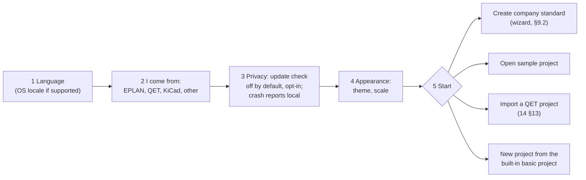

# User experience and user interface: onboarding and accessibility

A chapter of [User experience and user interface](16-ux-ui.md), whose table says where each section lives.

---

## 9. Onboarding and migration aids

### 9.1 First run

- Step 2 sets the keymap preset (KiCad-like for KiCad users; EW otherwise until the EPLAN-like preset ships), shows
  the matching vocabulary as secondary palette labels and enables the matching tips (§9.4).
- Step 3, as specified for 1.0, states exactly what an update check sends: product version, OS and architecture, at most
  once a day (NFR-PRIV-03). Crash reports stay local (NFR-PRIV-04); `PRIVACY.md` is one click away (NFR-PRIV-07). At 0.1.0
  there is no update check and no crash upload, so the step says that.
- Every step can be skipped and rerun from Help ▸ First-run setup. The whole flow works offline; under the network
  sandbox it makes no connection attempt (FR-UI-030).

The five steps are as drawn, each skippable, and Help ▸
First-run setup reruns them. The answers are settings written as given (`language`, `comes_from`, `update_check`,
`theme`, `ui_scale`); step 2 sets the keymap preset (KiCad-like for KiCad users, EW otherwise); the flow opens no
connection. Not built: the secondary palette labels and tips of step 2 (§9.4). The headless mode
drives the flow through `first_run.*`.

Step 3 says "ElektraWatt makes no network connection by itself.
This version has no update check and sends no crash reports." and has no update-check box: the **Privacy
(PRIVACY.md)** button, the About dialog's (§3.9), is its one control, and `ui.describe` lists it under the step's text.
The step opens no connection by itself: the click is the user's action and the application sends nothing
(NFR-PRIV-01). The `update_check` setting stays stored and unused until 1.0; `first_run.set` takes it.

### 9.2 Company-standard wizard

The wizard turns company conventions into a **basic project** from which new projects are created (FR-PRJ-009,
FR-PRJ-010; data model in 02a PRJ). The steps match [07](07-symbols-parts-macros.md) §5 and
[09](09-reports-forms-output.md) §5. Every step has a live preview pane: a cover, a title block and folio 102 of the
sample project, rendered with the current choices on a fork by `ew-render-cpu`.

| Step | Captures | Writes | Default |
|---|---|---|---|
| 1 Company | panel-builder name, logo (SVG; PNG accepted with a warning that it prints rasterised, D-07), the company's own notice text for the title-block notice cell | `Party{role: PanelBuilder}`, content-addressed asset | — |
| 2 Frame and title block | shipped frame and title-block form; mapping of cells to bound fields (descriptions, drawing id, revision, =/+, parties by role, page, Prev/Next, dates); unmapped cells listed | `FormDef` copies, `FrameDefaults` | QET-compatible A4 landscape, 17 columns 0–16, rows A–H |
| 3 Colour profile | start from a shipped profile ("EN 60204-1 machine" or "IEC 60445 installation", [08](08-connections-terminals-cables.md) §4.3) or a company convention; rows voltage class × function → IEC 60757 code and name; a mandatory "basis" text | `ColourProfile` (D-37) | the sample project's convention, "DBU/WH 24 V" (not EN 60204-1 machine, the reason is under the as-built table) |
| 4 Wire cross-sections | csa per circuit class; PE rule; the cover note toggle | `SizeProfile` | control 0.75 mm², mains 1.5 mm² |
| 5 Identifiers and numbering | identifier set; device, strip and child schemes; order; wire numbering; xref format; IP pairing | `ProjectSettings` | EN 81346-2:2009 letters (ADR-0026); page-based `{page}{letter}{counter}` (tokens of [03](03-domain-model.md) §8.2) |
| 6 Structure and sections | function and location templates, aspect signs, sections with folio ranges and dividers | `StructureNode` templates, `Section` | `=`, `+`, `-` |
| 7 Revisions | label format, first label | revision settings | "V{major}.{minor}", V1.0 |
| 8 Languages and formats | source language, date format, decimal separator; translation languages (1.0) | `ProjectLanguages`, `Formatting` | UI locale |
| 9 Reports and checks | report blocks with folios; check scheme | `ReportBlock`s, `CheckSchemeRef` | the standard layout |
| 10 Manufacturing (1.0) | marker text, ferrules, two wires in one clamp, reserve length | `WorkshopSettings` | destination marking, ferrules on every fine-stranded end, twin ferrules, 100 mm |
| 11 Review and create | summary, location of the basic project | basic project directory; default template in user settings | — |

The wizard keeps a draft in the user configuration directory until it finishes. "Edit company standard" reopens
the basic project itself. Existing projects keep the copy they were created from; applying later company changes
to an existing project is a previewed command planned for 1.x. NFR-UX-08 is met when the sample project's conventions
reproduce from the shipped defaults plus the pilot's basic project made with this wizard.

Ten steps, numbered 1 to 10 on the screen (the table's step 10 is 1.0, so Review and create shows
as 10), each with its fields validated as typed; the draft `ew.wizard-draft/1` lives in the configuration directory until
the wizard finishes; the right column, **Example**, renders the cover page and a schematic page (folio 102 of the
sample project) with the current choices on a fork, and never names the sample project: without it, the column is
left out rather than saying it has nothing to show. **Each step explains itself:** under
its title one or two sentences say what it is and what the choice changes, and a quieter line says whether and where
it can be changed later (Project ▸ Setup ▸ Project properties for the colour and size profiles, the numbering and
the cross-reference format; Structure node… and Report block… in a project; the wizard again for the rest). Under
the fields (beside them where two reading measures fit) a **Result** card shows what the fields make, live while a
field is typed in: the title block's company lines; the chosen colour profile's rows by group, read from its data,
with its basis and why DBU/WH 24 V is preselected; the cable sizes in words; the numbering tokens with their meaning,
the third contactor and the first strip on page 102 and both cross-reference styles; the page tree the sections make,
with the report pages in them; the revision label; a date and a number in the chosen formats; each report page in
one line and what each check level finds, with one example finding each. The Colour and Size steps turn the example
to the cover page, which prints their tables (the schematic page draws no wire colours, which is why a colour
choice seemed to change nothing); Frame and Numbering turn it to the schematic page. Choices are radio groups; a
placeholder is an example value, never the label. The step list marks the steps passed with a check. A bar at the
foot of the step holds Close and Start over as Subtle buttons at the left (their tooltips say the choices are kept,
or put back) and Back (Secondary) and Next or Create the template (Primary) at the right; after Create, Close. Close
with answers in the wizard asks in the bar first: Close keeps the draft for the next time, Back
to the wizard stays, Close and drop my answers deletes the draft (`wizard.cancel {answer: keep|discard|stay}`; a
script, a finished wizard and one without answers close at once, the draft kept).
The review step ends with **Use this template for new projects** (on; `wizard.set {field: "use_for_new"}`): the
template joins the list either way, and new projects start from it only when it is on. The check scheme is called the **check level** on the screen. The defaults are the sample project's conventions (numbering `{page}{letter}{counter}`, strips
`{letter}{page}{counter}`, the colour profile "DBU/WH 24 V", the size profile "0.75/1.5", the QET-style
cross-reference format, `=P01`, sections 1, 2 and 9); a numbering format must contain `{page}`, `{letter}` and
`{counter}`, because `ew_derive` applies no other scheme. **Where it is made:** the review step says where Create makes the
template: a folder named after it (the company's name, else "Company template") in the user's templates folder
(`Templates` in the projects folder, as Save as template… uses), with " 2", " 3" … after the name when a folder of that
name holds something, so a full folder is never a dead end; **Choose another folder…** (`wizard.folder`) puts that
folder in another one. `wizard.finish` without `dir` makes it there; without a projects folder a script names `dir`
and the window asks for one. **What the wizard writes**: `wizard.finish {dir}`
needs an empty or absent directory and builds a basic project from the built-in one through registered
commands only, in one script. The wizard uses commands of its own (`project.company.set`, the members `frames` and `languages` of
`project.settings.set`, and `project.checks.set`; no record kind and no schema change of their own), so every field has a
command except the title-block cell mapping; `project.company.set` takes the logo and `report_block.create`
embeds its form. The table shows each field's state:

| Step | Written now, by | Kept in the draft until |
|---|---|---|
| 1 Company | `project.company.set`: the panel builder's name (the first `Party` with the role panel builder, else a new one), the notice text (kept in `Project.extra["ew.company"].notice`, which the provisional `title_block` member already reads) and `personal_data` (true by default, NFR-PRIV-06; nothing reads it); only non-empty members are sent, so a typed notice alone leaves the name alone. **The logo:** the `logo` member takes the base64 of an SVG, PNG or JPEG file and writes `ew.company.logo = {sha256, format, size}`, the bytes going to the project's asset store (doc 05 §13.3); the file is at most `MAX_LOGO_BYTES` = 512 KiB, checked from the file size before it is read and again after, and an empty value removes the logo; a raster logo gets the notice that it prints rasterised (D-07) | — |
| 2 Frame and title block | `project.settings.set`, member `frames`: the default form and the per-page-type forms, chosen among the four shipped forms (frame, cover, divider; compiled in from `content/forms` and embedded as copies), merged into `settings.extra.frames`; `per_page_type` is always written, `[]` when empty; a page without a form of its own takes the frame defaults | the mapping of cells to bound fields (a command that forks a form copy, so that the mapping can be edited) |
| 3 Colour profile | `project.settings.set`: the chosen shipped profile, "EN 60204-1 machine" or "IEC 60445 installation" (our own tables from doc 08 §4.3, shipped with `verified: false` and the project's basis note), or the sample project's convention "DBU/WH 24 V" | — |
| 4 Wire cross-sections | `project.settings.set` | — |
| 5 Identifiers and numbering | `project.settings.set` (the numbering schemes and the cross-reference format) | — |
| 6 Structure and sections | `structure.create_node`, `section.create` | — |
| 7 Revisions | `revision.create` (the first revision) | — |
| 8 Languages and formats | `project.settings.set`, member `languages`: the source and translation languages (`Project.languages`) and the date format and decimal separator (`settings.formatting`); the decimal separator prints in the tables of the generated pages when no output language is set | — |
| 9 Reports and checks | report blocks: the standard layout through `report_block.create`, each call with `form_copies` (the form and the title block the form names, embedded from the library in the same transaction; a copy already held at the same version is reused, another version is refused; one undo step removes the block and its new copies): the table of contents on folio 2, the part list on 901, **one** terminal-diagram block on 903 (a basic project has no terminal strips and one block covers all of them, so 904 and 905 are absent), and 906 to 911 (cables, wires, PLC, potentials, device tags, revisions); a title that named a strip or a device uses `{n}`; in the window the check level (`project.checks.set`, below) | a script's template: the check level, which no script sets |
| 11 Review and create | the basic project directory; the default basic project in the user settings | — |

**The check level is part of what Create makes in the window.**
`project.checks.set` is a registered `HumanOnly` command (Interactive; shipped schemes only, stored in
`settings.extra.checks`; ADR-0008 amendment 3), because the level decides check
outcomes and release. A person pressing Create in the window is that person: `wizard.finish` in the window runs it on
the new template after the script of the other fields; a UI script's `wizard.finish` leaves it out, and the review
row says so. The step where the level is chosen says what it is for ("Before drawings go out, the program checks
them. The check level says how strict that check is.") and under each level what it stops; the same words are on
**Check level…** (Project ▸ Setup, `project.check_level`), which sets it later in a project or an open template and
which a script is refused like the command. **The headless-reachable human path** is the CLI subcommand `ew
project checks set [<project-dir>] [--active <scheme>] [--release <scheme>]`, never a UI script: it asks for
the scheme's name on the controlling terminal and writes only on an exact answer; without a terminal it exits 2 and
has no flag that skips the question (FR-EXT-030, doc 17 §2.3).

**Text styles.** The wizard asks for no text sizes: a template starts with the readable
styles of a new project, and its review step points at **Text styles…** (Project ▸ Setup, `text_styles.open`), a form
dialog that grows with the window as the print dialog does. It lists the project's styles grouped by what they print
(Devices, Wires and cables, Terminals, Page, Cover and sections), each by its name and where it prints, with its
typeface (a list of the bundled faces; system fonts are not offered, and a line under the table says why), its height
as the printed height of a capital in mm (a field and a list of the standard heights), bold, a sample in its face in
proportion to the others, a quiet note under a height below 1.2 mm in EW-CORE-061's words, and Reset; Standard sizes
and Reset all stand beside Close. Each change is one undo step on the open page. A finding without a place on a page
opens where it is mended: EW-CORE-061 Text styles at its style, a finding of the project record Project properties,
any other the records in Properties; a finding of no record shows its rule's hint in the banner
([ADR-0032](../adr/0032-per-project-text-styles.md) amendment 1).

The review step lists every field with "in the template" (`written` in `ui.describe`); in a UI script the check
level reads `kept`. The preview applies the same commands to the sample project, so the cover and
folio 102 show the notice, the ISO date format and the chosen frame (a test pins all three). A test checks that the
settings commands of the defaults leave the sample project unchanged.

The wizard in detail:

- **The logo** is chosen by a typed file path in step 1. The wizard reads the file's size before it reads the file (a file over 512 KiB is refused with "The logo
  file is larger than 512 KiB; choose a smaller file (an SVG logo is usually far smaller)", an unreadable or unknown
  format with "The logo must be a readable SVG, PNG or JPEG file of at most 512 KiB"). A saved draft whose logo file has
  since gone drops the logo and says so when the wizard opens ("The logo file of the saved draft could not be read;
  choose the logo again", `wizard-notice-logo-gone`). The 512 KiB bound keeps the command's base64 text under the
  1 MiB parameter-string limit.
- **The preview** shows the logo on the sample project's cover: the title block places it in the display list by its
  reference; an SVG or PNG logo appears (the CPU path draws both), while a JPEG logo
  waits for a decoder.
- **The colour default** stays the sample project's convention, "DBU/WH 24 V", and not "EN 60204-1 machine":
  the shipped profiles are our own tables, unverified, and a profile cannot yet select by circuit class, so an
  AC control line typed `L` would print black instead of red under the shipped EN 60204-1 table (doc 08 §4.3). The
  default changes when the shipped profiles are verified and the selector can use the circuit class.
- **No size profile ships**: step 4 has a default, "0.75/1.5", not a shipped choice.
- **Not built:** `report_block.delete` and `report_block.set`, an editable list of report blocks in the wizard instead
  of the fixed standard layout, and the title-block cell mapping.

`ew check` without `--scheme` uses
the project's `release_scheme` in mode `release` and `active_scheme` in mode `online`, else `pre-delivery`. A project
that names a scheme this build does not ship gets `pre-delivery` with a notice on stderr: `notice: project scheme '<name>' is not shipped by this build; using pre-delivery`.

NFR-UX-08 is proven by `ew-viewmodel`'s test `the_sample_from_the_basic_project`: the wizard run with the pilot's
choices (its defaults), a project made from the result with `file.new`, and its effective conventions compared with
the sample project's member by member, except the members the test names with their reasons; its text styles are the
readable ones of a new project.

---

## 10. Accessibility

### 10.1 AccessKit tree

| UI part | Role (AccessKit 0.25, **verify** names) | Name | State and description |
|---|---|---|---|
| Dock areas | Pane | "Left dock", "Bottom dock" | focused |
| Navigator | Tree, TreeItem | §5.1 | expanded, selected, level, position in set |
| Table | Grid, Row, Cell, ColumnHeader | column label, cell value | sort state, editable, provenance as description |
| Property grid row | Group with label and input | field label | value, unit, provenance text, error text |
| Canvas | Canvas | "Page 102, Power Supply 2 - Control Current" | description: tool hint; child live region with the selection. One focusable node, name `Page <folio>, <page title>`, description `<hint>, zoom <zoom>`; its live region is described below |
| Toolbar, menu, tabs | Toolbar, MenuBar, TabList, Tab | Fluent label | shortcut as keyboard shortcut property |
| Status bar | Status | field names | values |
| Toasts, banners | Alert / Status | message | live polite (banners assertive once) |

- **The schematic's accessible representation** is the navigators and tables (FR-UI-026). The canvas exposes the
  page, the tool hint and the selection, not every primitive. At 1.0, **Describe page** (FR-UI-046) produces a text
  list in reading order: devices by cell with tag, function text and part; then connections grouped by potential;
  then interruption points with their target cells, for example "24VDC-1 at 102-H15, continues at 103-A1".
- **Large lists** expose position and set size (`position_in_set`, `size_of_set`, **verify**), so a screen reader
  says "row 5 of 20" without walking 100,000 rows.

**The canvas node** (one per visible
group) keeps its role and name `Page <folio>, <title>`; its description is `<hint>, zoom <zoom>` and, while the grid
cursor shows, `, cursor <cell> x <x> y <y> mm` (one decimal; `, cursor x <x> y <y> mm` where the point has no cell), so
a screen reader announces the cell of the keyboard cursor. **A polite live region** is a child node of the canvas with
the role `Status`, the name "Canvas cursor" and a value that changes after each cursor move or jump: `<cell>, x <x> y
<y> mm`, followed by `, link to <label>` when a cross-reference lies at the cursor. The region is made in a child of
the canvas node through the UI builder's accessibility parent, and a kittest asserts that parenting (the region has the
canvas node as an ancestor, and a navigator row has the `Tree` node). **The region is present and empty while no
cursor shows**, so a screen reader keeps following it. **Tabs and the tree:** each canvas tab is a `Tab` node named by
its title with the selected state on the active tab, and its close button is named `Close <folio>` (egui_tiles names
every close button "Close"); the Pages navigator is a `Tree` of `TreeItem` nodes (§5.2). egui_tiles 0.18.0 exposes no
node for a tab bar, so the `TabList` role is not set; nor do the splitters have names, and the accessible-name
walker skips exactly the splitters of the dock and of the canvas area. The walker passes after each
step of the viewer's kittest flows.

The canvas node's live region also carries the
active tool's status hint, announced only when its text changes; `<n> selected`, which wins in the same step and stays
until the cursor moves; and Measure's readout, announced on Press and on Activate (§4.5; NFR-A11Y-01). The link preview
popup has no node (the status hint names the target).

### 10.2 Keyboard

Every action is reachable through the palette and the keymap (§4.3, §4.4); every tool works without a pointer
([06](06-schematic-editor.md) §4.4: arrows move the grid cursor, `]`, `[` and N jump between CPs, Enter acts as a
click). Focus is visible and moves in a logical order: menu → toolbar → left dock → canvas → right dock → bottom
dock → status bar (F6). Nothing traps focus, and Escape closes every dialog (NFR-A11Y-01).

### 10.3 Colour, patterns and icons

The selection on the canvas takes the accent colour, and the four highlight slots take the hues of [16a](16a-design-language.md) §4.6, which all reach 3:1 on the sheet.

The sheet stays white (§11.2), so overlay colours are chosen for ≥ 3:1 contrast against white (NFR-A11Y-03),
using Okabe–Ito hues. Contrast ratios are WCAG 2.1 relative-luminance values against #FFFFFF:

| Semantic slot | Colour | Contrast on white | Pattern or shape | Icon and text |
|---|---|---|---|---|
| Selection | blue #0072B2 | 5.19:1 | solid 2 px outline and handles | — |
| Hover | blue #0072B2 | 5.19:1 | 1 px dashed outline | — |
| Highlight 1 | violet #9878FC | 3.26:1 | 45° hatch halo | name chip "24VDC-1" |
| Highlight 2 | reddish purple #CC79A7 | 3.06:1 | 135° hatch halo | name chip |
| Highlight 3 | bluish green #009E73 | 3.42:1 | 0° hatch halo | name chip |
| Highlight 4 | vermillion #D55E00 | 3.87:1 | 90° hatch halo | name chip |
| Error | vermillion #D55E00 | 3.87:1 | — | circled cross, "error" |
| Warning | dark orange #A86F00 | 4.25:1 | — | triangle with "!", "warning" |
| Info | blue #0072B2 | 5.19:1 | — | circled "i", "info" |
| Pending | grey outline | — | hollow icon | "pending" |
| Stale | — | — | diagonal hatch background | clock, "stale" |

Okabe–Ito orange #E69F00 (2.25:1), sky blue #56B4E9 (2.31:1) and yellow #F0E442 (1.32:1) fail 3:1 on white. They
are used only on dark chrome surfaces, where they reach 7.4:1, 7.2:1 and 12.6:1 against #1E1E1E; on the sheet the
darkened orange #A86F00 (not an Okabe–Ito value) is the Warning colour; no highlight slot takes it, because a
colour-vision test found it beside vermillion for protanopes.

Highlights are view state, never a model
edit, composited into `canvas.snapshot` and listed by `ui.describe`. The four slots use violet #9878FC, reddish purple
#CC79A7, bluish green #009E73 and vermillion #D55E00 (every one at
least 3:1 on white, checked by a unit test), with the hatch angles 45°, 135°, 0° and 90°: a band 8 pt wide with a
translucent fill at alpha 77 and hatch lines 2 pt wide at a 6 pt pitch (points × ppp, square caps); a fifth highlight
replaces the oldest; they are painted above the overlays and below the statistics panel and the preview chips. Slot 1
is violet (not an Okabe–Ito value): dark orange #A86F00 met vermillion for protanopes (ΔE00 0.74 under a
colour-vision simulation), and violet keeps every pair of the four slots and the selection at ΔE00 10 or more for
protanopes, deuteranopes and tritanopes; slot 2 is reddish purple, because a darker sky blue would be the selection's
#0072B2; every slot is a hatch at its own angle.

Severity colours reuse three highlight hues, but they never share a shape: findings are icons with a word, while
highlights are halos with a name chip, so an error icon on a vermillion-highlighted net stays unambiguous.

**Wire colours.** Effective colours always print or display with their IEC 60757 code. The optional wire-colour
view (FR-UI-047) strokes each connection in its effective colour, labels it with the code ("DBU" on W29), gives WH
and YE wires a 1 px dark casing so they stay visible on white, and draws GNYE as alternating green and yellow 2 mm
dashes (FR-UI-025). The view never reaches the PDF.

View ▸ Wire colours
is session state, off by default. Each stroke is 3 pt wide with its codes at the midpoint of its drawn path. A code's
colour is its IEC 60757 colour, or, for a company code, the base and shade the colour profile declares (FR-CON-019),
never guessed from its spelling; a code that resolves to no colour is drawn as the **unresolved pattern**, 1 mm
slate-900 dashes with equal gaps, never cased and still labelled, so it is not mistaken for a colour. **The casing is
computed:** every stroke whose colour is under 3:1 on white (WCAG relative luminance, NFR-A11Y-03) gets a slate-900
outline 1 physical pixel wide on both sides, painted under it, so OG, TQ, GD, PK, SR and the light shades are cased as
well as WH and YE, which the paragraph above names as examples. **Wires that share a stretch stand in lanes:** a stroke
stands off the shared line by `3 pt + 2 pt` per lane, alternately to one side and the other, along one normal per line,
so wires drawn in opposite directions keep apart. Two-colour wires alternate in 2 mm dashes walked over the path clipped
to the sheet. `canvas.snapshot` composites the view; the PDF and PNG exports never see it. Labels on dense pages
and lanes at corners are not solved.

### 10.4 Display and motion

UI scale from 100 % to 300 % with per-monitor DPI; a configurable minimum font size; system light or dark mode;
high-contrast themes (FR-UI-027, §11). "Reduce motion" disables animated zoom and smooth scrolling and is switched
on automatically on the CPU renderer. No interaction has a time limit (NFR-A11Y-04).

### 10.5 Verification

| Check | Requirement | Cadence |
|---|---|---|
| egui_kittest name enforcement, plus an EW tree walker that fails on any focusable node without a name (ADR-0014 amendment 2) | NFR-A11Y-02 | PR |
| The five core tasks on the sample project without pointer events | NFR-A11Y-01 | PR |
| Every registered tool cancels with Escape and leaves the revision unchanged | NFR-UX-07 | PR |
| CVD-simulated renders of folio 102 with 24VDC-1 highlighted and the message panel open (NFR-A11Y-03), and of folio 103 with every highlight slot in use (FR-UI-025); §15.6 | NFR-A11Y-03, FR-UI-025 | PR |
| Contrast lint over theme tokens; kittest snapshots at 300 % | NFR-A11Y-04 | PR |
| NVDA and Orca: find -102F1, read its part and connections, open its page | NFR-A11Y-02 | M (every minor release) |
| Automated WCAG 2.1 AA scan of the built HTML documentation; alternative text on every screenshot | NFR-A11Y-06 | N, 1.0 |
| Accessibility Conformance Report against EN 301 549 clauses 11 and 12, gaps listed | NFR-COMP-06 | 1.0 |

The first row is the accessibility
census (`crates/ew-ui/tests/it/census.rs`) in place of a walker over flows: every menu path, dialog, pane and
navigator of the window opened, each interactive node checked for its name, role and state (R1 to R6), context menus
not. The NVDA and Orca row and the Linux clipboard are protocols MT-1 to MT-3 of
`docs/release/manual-tests.md`, run at each minor release. The Escape row is open.

