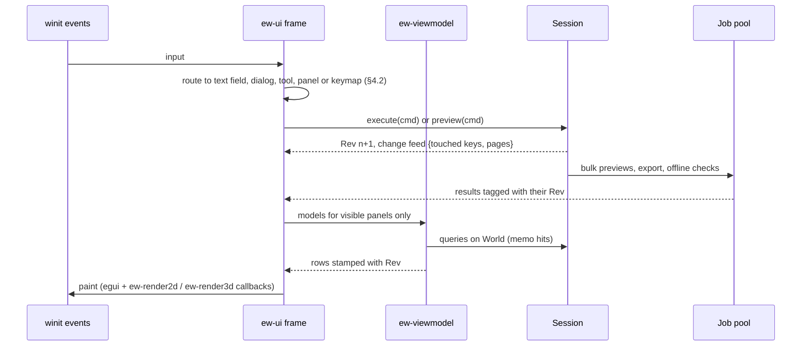

# User experience and user interface: the shell and the main window

A chapter of [User experience and user interface](16-ux-ui.md), whose table says where each section lives.

---

## 1. Position in the architecture

The UI is a client of the `Session` facade (`ew-api`). It reads view-models computed from queries on the current
`World` and writes only by `Session::execute`, `preview` and `commit` (ARCH §1.2 principle 3, §5.1).

| Layer | Crate | Owns | Must not |
|---|---|---|---|
| Panel models | `ew-viewmodel` | navigator trees, table rows with edit→command mapping, property-grid rows with provenance, message, history and job lists, the selection model, the action registry view | depend on egui, wgpu or winit; keep model data of its own |
| Widgets and interaction | `ew-ui` | egui widgets, egui_tiles docking, 2D and 3D canvas hosts, the tool host, palette, keymaps, theme tokens, UI string loading | write the model other than through `Session` |
| Shell | `elektrawatt` (bin) | eframe app, the app menu drawn by `ew-ui` on Windows and Linux (§3.2, ADR-0031), rfd file dialogs, arboard clipboard, crash handler, OS file drops, opening help in the browser | — |



**Rules.**
1. **Commands and view actions are distinct.** Model changes are `Command`s with undo. View actions (zoom, open a
   panel, follow an xref, select, highlight) never touch the model and never enter the history (06 §3.9).
2. **Visible-only evaluation.** View-models are computed only for panels painted this frame. A hidden tab keeps its
   revision stamp and recomputes when shown.
3. **The UI thread never waits.** Work that can exceed 100 ms runs as a job (NFR-PERF-19). egui repaints only on
   input, job progress (at most 10 Hz) or a change feed event, so an idle EW uses no CPU, which matters on RDP.
4. **Toolkit isolation.** View-model types are plain Rust, so a later chrome can replace `ew-ui` (FR-UI-037).
5. **Debug endpoints only in test builds** (egui inspection, `egui_mcp`; ARCH §9, §13).

**Ownership.** This document owns the shell, docking, workspaces, navigator and table infrastructure, the property
grid, palette, keymaps, history, notifications, onboarding, accessibility, theming, localisation, help and the
usability protocol. Content owners: canvas tools and the canvas shortcut table [06](06-schematic-editor.md) §4, §6;
symbol, part and macro browsers and the library manager [07](07-symbols-parts-macros.md) §5; potential navigator,
strip editor and cable table [08](08-connections-terminals-cables.md) §9; report blocks panel and export dialog
[09](09-reports-forms-output.md) §5; PLC navigator and grid [10](10-plc-and-bus.md) §6; fluid
[11](11-fluid-power.md) §7; layout and 3D canvas [12](12-panel-layout.md) §12; manufacturing and the wiring viewer
[13](13-manufacturing-outputs.md) §12; import wizard and migration report [14](14-interop.md) §13; lock, recovery
and external-change touchpoints [05](05-project-format-and-persistence.md) §16.

**Non-goals** (ARCH §16, VIS §4): no multi-row Office ribbon and no contextual tabs (the single-row, task-ordered command bar of [16a](16a-design-language.md) §5.2 is not one, [ADR-0031](../adr/0031-design-language-and-task-ordered-command-bar.md)); no free-form native undocking (second monitors use egui viewports);
no own UI toolkit; no telemetry, so usability evidence comes only from moderated sessions and pilot logs
(NFR-PRIV-02); no bundled AI assistant; no interactive guided tours in v1 (tutorials are documentation plus
sample projects).

---

## 2. Concepts and data

### 2.1 View-model contract

```rust
pub trait PanelModel { fn rev(&self) -> Rev; }               // revision the rows reflect
pub enum Staleness { Fresh, Behind { as_of: Rev }, Computing(JobId), Failed(ErrorKey) }

pub struct NavTree    { rev: Rev, nodes: Arc<NodeTable>, roots: Vec<NodeId> }   // expand state lives in view state
pub struct TableModel { rev: Rev, columns: Vec<ColumnSpec>, rows: Arc<[RowKey]>, cells: CellSource }
pub struct PropRow    { field: FieldPath, label: FluentKey, value: DisplayValue, unit: Option<Unit>,
                        provenance: Provenance, editor: EditorKind, target: Option<EditTarget> }
pub struct EditTarget { entities: SmallVec<[EntityRef; 1]>, field: FieldPath }   // compiles to fields.set
```

- Rows are keyed by entity ID, never by position, so a commit that reorders rows keeps selection and focus.
- `CellSource` evaluates cells lazily for the visible row range only.
- An edit produces an `EditIntent { targets, field, value }`. The view-model compiles it into exactly one
  `Command` (FR-UI-008, FR-UI-009); `ew-ui` never builds commands itself. Headless tests of this mapping run
  without egui (ARCH §13).

*As built.* The contract above is built in two layers. Below the shell, `ew_api::output` has the **field catalogue** (`field_catalogue(kind)`, one `FieldNode` per schema node from one walker over `ew_schema::kind_schema`) and the **property sheet** (`Session::property_sheet`: a header, one section per record kind that every selected record reaches, rows with `key`, `path`, `category`, `ty`, `value` (one value, `Varies` with up to eight texts, or `Absent`), `provenance`, `actions`, `route` and `identifier`). The `EditTarget` of the sketch is the row's **edit route**: `FieldsSet { kind, path }` (compiles to one `fields.set` over the section's targets), `SettingsMember { member }` (one `project.settings.set`) or `ReadOnly(reason)`; no other command is ever built by the grid, and a route whose command is `HumanOnly` is read-only whatever the tables say. `Session::parse_field_input`, `field_choices`, `command_meta` and `resolve_reference` serve the editors, the exposure check and `select.set`. In `ew-viewmodel` the panel model turns a sheet into rows, the edit buffer, the preview card and the toast, and compiles every edit into exactly one command, as above.

### 2.2 Provenance

Every value the UI shows carries a `Provenance`. Its variants map onto the kinds of the
[domain model](03-domain-model.md) §1.1:

```rust
pub enum Provenance {
    Authored    { origin: Origin },                              // A: stored on this entity
    Inherited   { from: SchemeRef, level: SettingLevel },        // A elsewhere: project/company scheme, profile
    Derived     { query: QueryName, via: SmallVec<[SourceRef; 4]> },   // D, Class I
    Overridden  { derived: DisplayValue },                       // A hiding a D value (e.g. CDP)
    Frozen      { rule_value: DisplayValue },                    // F: TagSpec.frozen, NumberSpec::Frozen, AddrSpec::Manual
    Committed   { rev: Rev, stale: bool },                       // C: routes, lengths, released snapshots
    Library     { item: LibItemRef, update: bool },              // L: PartCopy, SymbolDef …
    Async       { as_of: Rev, state: Staleness },                // Class II results
    Generated   { block: ReportBlockId },                        // report-page content, read-only
}
```

The `via` chain is the short form of `ew query --explain` (FR-EXT-005); for wire properties it names the winning
level of the seven-level chain of [03](03-domain-model.md) §9.5.

*As built.* The sheet produces `Authored`, `Inherited` ("from colour profile …", "project description"), `Derived` (with its chip text), `Overridden`, `Frozen`, `Library` (the chip shows only the item and its version), `Generated` and `Varies`; each carries its chip text as a string, not the typed `via` chain sketched above. `Committed` and `Async` are not produced yet (routes and Class II results have no grid rows yet and the jobs panel). The derived tag's row shows the product designation, which is what Freeze writes.

### 2.3 Selection

```rust
pub struct Selection { items: IndexSet<EntityRef>, primary: Option<EntityRef>, origin: SelOrigin, generation: u64 }
pub enum EntityRef { Device(Id<Device>), Function(Id<Function>), Rep(Id<Representation>), Connection(Id<Connection>),
                     Junction(Id<Junction>), Cp(Id<Function>, u16), Page(Id<Page>), Potential(PotentialId),
                     Channel(Id<Channel>), Placement(Id<Placement3D>), PageItem(Id<PageItem>),
                     Finding(FindingKey), ReportRow(Id<ReportBlock>, RowKey) }
```

The selection is a set of entity references, not of screen objects, so it can span pages and windows. It is
session state: each undo entry stores it (ARCH §5.3) and the per-user `view.json` (§2.5) keeps the last one for
restore. A highlight is a
separate named set (up to four at once, §10.3), so highlighting 24VDC-1 does not disturb the selection.

### 2.4 Action registry

Menus, toolbar, palette, keymaps, context menus, F1 and the generated command catalogue (NFR-DOC-06) are all
built from one registry, so a menu entry, its shortcut and its palette entry cannot disagree.

```rust
pub struct ActionMeta {
    pub id: &'static str,              // = CommandMeta.name for model commands ("numbering.renumber"); "view.fit_page"
    pub kind: ActionKind,              // Command(&'static CommandMeta) | View
    pub label: FluentKey,              // "cmd-numbering-renumber"
    pub aliases: &'static [FluentKey], // per-locale palette aliases (EPLAN, QET, KiCad terms; NFR-UX-03)
    pub category: Category,            // File, Edit, Insert, Page, Device, Check, …
    pub enabled: ContextPredicate,     // e.g. selection has ≥1 Device; canvas is Page2D; project writable
    pub docs: DocsAnchor,              // "ui/tools/wire"; resolved by F1 (§13)
    pub icon: Option<IconId>,
}
```

For a model command, name, parameter schema, cost, undoability and the language-neutral aliases (retired names,
such as `device.place_from_part` and `symbol.place` for `device.place`) come from its `CommandMeta` ([17](17-extensibility.md) §2.1, FR-EXT-015), shared with the
CLI, rhai, MCP and plugins; `ActionMeta` adds only what the GUI needs. The palette searches both alias lists. A
predicate that fails carries a reason key ("needs a selected device", "project is read-only") shown in the
palette and in tooltips.

*As built from WP-S2.01:* the toolkit-neutral part of the registry (ID, kind, label key,
category, default chords as text, the predicate with its reason key) and the shell model that every action is
dispatched on live in `ew-viewmodel`; `ew-ui` binds keys and paints menus, palette and toolbar from it. The same
dispatch serves the headless mode `elektrawatt --headless --script`, so CI and agents can drive every action without
a display.

### 2.5 Settings and view state

| Data | Location | Format | Notes |
|---|---|---|---|
| User settings: UI language, theme, scale, minimum font size, reduce motion, keymap preset, first-run answers, update-check opt-in, recent projects, default basic project, user display name | OS configuration directory, `elektrawatt/settings.toml` | TOML with `version` | Unknown keys preserved; an unreadable file yields defaults, a `.bad-<n>` copy and a banner (FR-UI-049) |
| Keymaps | `elektrawatt/keymaps/<name>.toml` | TOML (§4.4) | Import and export (FR-UI-013). *As built:* the user's keymap is one `keymap.toml` beside `settings.toml`, over the preset the `keymap` setting names; a refused file is copied to `keymap.toml.bad-<n>`; *as built (FIX40d):* once: a copy that already holds the same bytes is named instead of a new one (keymap only), and the banner reads "The keymap file was refused: it is not valid TOML. The EW preset applies; the file was kept as keymap.toml.bad-1." |
| Workspaces | `elektrawatt/workspaces/<name>.json` | JSON `ew.workspace/1`: a toolkit-neutral tree of panes, tab groups and splits with integer shares, members sorted, no floating point, so a layout saved twice is the same bytes; `ew-ui` converts it to and from egui_tiles (the serialised egui_tiles tree keeps its tiles in a hash map and would tie a user file to one toolkit) | FR-UI-002 |
| Per-project view state: open tabs, viewport per page, jump history (last 50), last selection, navigator expansion and filters, table column layouts, active workspace, highlight sets | `<name>.ew/.ew/u-<hash>/view.json`, `<hash>` from `user@host` ([05](05-project-format-and-persistence.md) §1) | JSON | git-ignored; per user, so users of a shared folder do not overwrite each other; never project data (FR-UI-033) |
| Policy (MSI deployments; as specified for 1.0) | registry policy keys | — | update check off (NFR-PRIV-03) |

Opening the golden project, changing the viewport and saving therefore changes no tracked file (FR-UI-033).

The jump history is **per
tab and is not persisted**: at most 50 entries back, a jump clears the forward list, closing a tab drops its history
(the "jump history (last 50)" of the table above is therefore not stored in `view.json`). Open tabs and the viewport
per page remain the target of `view.json`, but WP-S2.03 keeps them in memory for the session of the open project and
outside `ew.workspace/1`; writing them to `view.json` (`ew.view/1`, with a `Store` accessor for the per-user state
directory) is FT-357.

*As built.* The tabs and their history are in `ShellModel`'s
canvas area, in memory for the open project, as decided. **A tab holds the identity of its page**, not its folio and not
a bare UUID: the type `PageId` wraps the page's destination (`Destination::Page(uuid)`, the identity that the xref
engine and the link targets already use), its field is private, and `ew-viewmodel` takes no `uuid` dependency for it
. **The page-content cache** keeps one `Arc<CanvasPage>` per page and is keyed by (epoch, revision), the epoch
being the number of the opened project in the shell's life, so a project closed and opened again never reads the old
entries. At the end of each dispatch it keeps every page a tab shows plus the 8 most recently shown other pages and
drops the rest; a revision change empties it. Two tabs on one page share an entry, and Back, Forward and a tab switch to
a cached page make no `Session` call (NFR-PERF-20). Each tab remembers the viewport of at most 64 pages it has shown.
Writing the open tabs and the viewports to `view.json` is still FT-357.

### 2.6 Workspaces

A workspace is a named dock layout with its panels and canvas kinds. Users save their own (FR-UI-002); EW ships:

| Workspace | Left dock | Centre | Right | Bottom | Release |
|---|---|---|---|---|---|
| Schematic | pages, devices, strips, cables, potentials, IPs, structure, PLC | page tabs | property grid | messages, find, wire list, history, jobs | MVP |
| PLC | PLC navigator, bus navigator | page tabs (203–206) | property grid | PLC grid, exchange results | 1.0 ([10](10-plc-and-bus.md) §6) |
| Fluid | fluid navigator, devices | fluid pages | property grid | tube table, medium table | 1.0 ([11](11-fluid-power.md) §7) |
| Panel 3D | layout navigator, unplaced devices | 3D canvas, panel pages | property grid | wiring manager, routing preview, thermal | 1.0 ([12](12-panel-layout.md) §12.3) |
| Manufacturing | label sets, machine profiles, orders | 3D or plate view | property grid | wire table, pre-flight findings | 1.0 ([13](13-manufacturing-outputs.md) §12) |

*As built (WP-S2.13).* The shipped workspaces are files the program does not write: View ▸ Workspaces lists them first
(named in the UI language), then the saved ones; a shipped workspace without a file has its built-in layout
(`Layout::built_in`), a saved file of its name replaces it, and Reset layout goes back to the active shipped
workspace's own layout. Properties stays under the navigator in every workspace (doc 16a §5.4); the right column of
this table is not built. PLC is built as [10](10-plc-and-bus.md) §6's *As built* says.

---

## 3. Main window

### 3.1 Wireframe: Schematic workspace with the golden project

**Design language (2026-10-28).** The default layout of [16a](16a-design-language.md) §5.1 supersedes this wireframe: a command bar instead of the menu bar and toolbar, the navigator rail and Properties stacked on the left, the right rail with the palettes and the bottom dock closed by default. The panes and their behaviour below are unchanged.

```text
+--------------------------------------------------------------------------------------------------+
| File  Edit  View  Insert  Project  Page  Device  Check  Reports  Tools  Window  Help              | menu
+--------------------------------------------------------------------------------------------------+
| [Select][Symbol I][Part][Wire W][IP P][Box B][Text T] | [Grid: QET 10 px][Snap] | [Check F7][PDF] | toolbar
+----------------------+---------------------------------------------------+------------------------+
| Pages|Devices|Strips |  101 Power Supply 1 | 102 Power Supply 2 | 103 ... | Properties             |
| Cables|Potentials|IPs| +-----------------------------------------------+ | -102G1  device         |
| filter: [          ] | |                                               | | Power supply 24 V DC   |
| v =P01               | |    sheet in print colours, A4, 17 x 8 grid    | | 102-B6 (main)  E 0 W 0 |
|  v +J-E-2416         | |                                               | | v Identity             |
|     1    Title Page  | |                                               | |   Tag  -102G1   f      |
|     2    TOC  [gen]  | |                                               | | v Part                 |
|     3    Bus Topology| |                                               | |   2904602  lib v3      |
|   v Sec 1 Wiring Def.| |                                               | | v Electrical           |
|     100  [gen]       | |                                               | |   Output 24 V DC  f    |
|     101  Power Su... | +-----------------------------------------------+ |                        |
+----------------------+---------------------------------------------------+------------------------+
| Messages  E 42  W 32  I 28  waived 1 | Find | Wire list | Strip -X1031 | History | Jobs           | bottom
| E  EW-POT-013  Contact T55 switches N-55 without its line conductor   101   [Fix...] [Waive...]  |
+--------------------------------------------------------------------------------------------------+
| Select: click or drag | 102-H15  x 255.0 y 172.5 mm | QET 10 px | 1 selected | E42 W32 I28 |    |
| PDF 40 % | GPU Vulkan | saved gen 214 | EN                                                       | status
+--------------------------------------------------------------------------------------------------+
```

`f` marks a derived value, `[gen]` a generated page; in the product these are icons with text (§10.3).

### 3.2 Menu bar

The menu bar is the app menu: one button at the left of the command bar that opens the tree of every action
([16a](16a-design-language.md) §9.2, [ADR-0031](../adr/0031-design-language-and-task-ordered-command-bar.md)
decision 4). Its submenus and their order are 16a §9.2's: File, Edit, Project, Page, Draw, PLC, Fluid, Check, Output,
View, Window and Help. The entries are generated from the action registry (§2.4) and show the active keymap's
accelerators; [the action map](../map/actions.md) lists each action with its menu.

- **Window** holds the tab actions and then the list of the focused group's open tabs, one checked item per tab. A
  refused tab or history action names its reason ("32 tabs are open", "The last tab stays open", "The tab group has
  one tab", "Only one tab group is shown", "No page to return to"). The hidden action `page.goto` (a folio only)
  stays for scripts.
- **Platforms.** The app menu is drawn with egui from the registry on Windows and Linux (FR-UI-001; ADR-0014
  amendment 1); macOS is not a supported platform. Enabled states update at most once per frame after a selection
  change.

### 3.3 Toolbar

**Design language (2026-10-28).** The toolbar becomes the task-ordered command bar of [16a](16a-design-language.md) §5.2 (tabs Project, Page, Draw, Check, Output, View; quick access; command search), generated from the registry with each action's tab, group, size and icon; the tool group moves to the canvas's tool HUD (16a §5.5). The tooltip and customisation rules below still hold.

- One compact row: a global group (Undo, Redo, Check, Export PDF, Palette) plus the tool group of the focused
  canvas kind: Page2D tools ([06](06-schematic-editor.md) §4.5), Panel2D tools ([12](12-panel-layout.md) §12.1) or
  3D view controls (1.0).
- Every button has an icon, an accessible name from its Fluent label and a tooltip: "Wire (W). Draw a connection
  between connection points. F1: help".
- Toolbars are customisable per workspace: add, remove and reorder actions.

### 3.4 Docking

The workspace is an egui_tiles 0.17.1 tree of panes:

```rust
pub enum Pane {
    Canvas(CanvasTab),                 // Page2D{page}, Panel2D{page}, Layout3D{space}, Preview{job}, Compare{a, b}
    Navigator(NavKind, NavConfig),     // §5.2
    PropertyGrid, History, Jobs, Notifications, FindResults,
    Messages(MessageFilter),
    Table(TableKind, TableConfig),     // wire list, strip editor -X1031, PLC grid, BOM view …
}
```

- **Placement.** Canvas tabs live in the centre container. Panels start in the left, right and bottom docks but can
  be rearranged anywhere inside the window (FR-UI-001).
- **Instances.** The property grid, history and jobs panels are singletons per window. Navigators and tables may
  have several instances with their own filters, for example strip editors for -X1031 and -X1032 side by side.
- **Second monitor** (FR-UI-004, 1.0). "Move to new window" moves a subtree into an egui deferred viewport that
  shares the `Session`, selection and theme. Closing it returns its panes. Positions are saved per workspace and fall
  back to the main window when the monitor is missing.
- **Persistence.** The tree is written to the workspace file 1 s after the last layout change.
- **Keyboard.** F6 and Shift+F6 cycle dock areas; Ctrl+PageDown and Ctrl+PageUp switch tabs in the focused dock;
  Ctrl+Tab cycles canvas tabs; Ctrl+W closes a canvas tab; F11 maximises the canvas.

**The canvas area** (the workspace's
`page-view` pane) is per-project state in its own **nested `egui_tiles` tree**, built by `ew-ui` from a toolkit-neutral
`CanvasArea` of `ew-viewmodel`: **one or two tab groups side by side** and **at most 32 tabs** over both groups. It lives
outside the workspace file, so `ew.workspace/1` is unchanged and stays deterministic. Two groups are two
canvases over one `Session`, never a second model. egui_tiles 0.18.0 cannot refuse a drop, so the tree is
rebuilt from the `CanvasArea` after every structural change and a third group or a vertical split cannot persist.

*As built.* The nested tree is built as decided: one
`Tabs` container per group in a horizontal split, rebuilt from the model whenever its version changes. **Only tabs are
draggable** in the canvas area: a tab drag within a group or into the other one is the action `tab.move`, while
a tab bar's own drag area, which egui_tiles gives no name, is switched off through `is_tile_draggable`. The splitter's
position is host state: it is carried across a rebuild while the number of groups is unchanged, and the groups share
equally again after a group appears or disappears; the model learns only each pane's size (`view.canvas_resize`). A tab
moved into the other group takes that group's pane size. Egui_tiles' keyboard tab cycling is off
(`cycle_tabs_with_keyboard` returns false, here and in the dock), so Ctrl+Tab is the registry action `tab.next` and
nothing else. **The second group's canvas** is a second GPU canvas on the leader's device: it is made only
while two groups show, shares the render state through a clone and is released when the area collapses to one group;
the one tile pool serves both canvases, the focused group first. A shell without a render state (headless, kittest)
draws both on the CPU. The keyboard focus is `Focus::Navigator` or `Focus::Canvas(group)`; F6 and Shift+F6 cycle it
(navigator, group 1, group 2), a press in a canvas focuses its group, and the focused group's active tab is what the
shell calls the current page. The splitter has no accessible name yet.

*As built.* The **Find pane** ("Find and replace", `PaneKind::Find`) opens with Ctrl+F or Ctrl+H **below the page view** in the Schematic workspace, not across the full-width bottom dock that the placement rule above names; it is a pane of the workspace file like the others (a build that predates it refuses a workspace file that names it). F6 and Shift+F6 include it, and closing it (or a workspace reset, load or dock layout change that removes it) drops a replace card it holds.

*As built.* A shown navigator docks as a
tab beside Pages (`PaneKind::Navigator(kind)`, workspace key = the kind word). **Dock tab groups are not draggable as a
whole**, only panes, as in the canvas area, so a tab bar is never an unnamed drag area. **The bottom dock:** Find and
Jobs share one tab group below the page view (`Layout::with_bottom`, renamed from `with_find`; `PaneKind::ALL` has five
entries and `BOTTOM = [Find, Jobs]`); Messages, Preview and History join it with WP-S2.09's parts 2 and 3.

### 3.5 Canvas tabs

| Tab kind | Content | Editable | Title and badges | Release |
|---|---|---|---|---|
| Page2D | drawn page (multi-line, overview, fluid, topology) | yes, unless locked or released | "102 Power Supply 2 - Control Current"; badges read-only, QET grid, finding count | MVP |
| Generated page | report page, section divider, TOC | no: an edit attempt names the block (09 §5) | "907.1 Wire List 2" with a generated badge | MVP |
| Panel2D | panel page from placements (folio 902) | placements | "902 Cabinet Layout" | MVP |
| Preview | rendered candidate pages of a fork (§7.6) | no | "Preview: Renumber pages" plus revision stamp | MVP |
| Layout3D | layout space in 3D ([12](12-panel-layout.md) §12.2) | placements | "+J-E-2416 3D" | 1.0 |
| Compare | two revisions or commits, side by side or overlaid | no | "101 V1.0 vs V2.0" | 1.0 |

Two pages can be shown side by side with their own viewports (FR-UI-035). Back and Forward walk the jump history
per window (FR-UI-019).

Back and Forward walk a history
**per tab** (not per window), at most 50 entries, not persisted (§2.5); walks with Page Up and Page Down add no entry,
and following a link, Go to and the navigator's Open do.

*As built.* Page2D tabs, generated pages included, are the only
kind the viewer opens. A tab's title is `<folio> <title>` with the badges `QET grid` and `generated`. **At most 32 tabs**
are open over one or two groups; the limit is enforced in the model, so a script meets it as a refusal ("32 tabs are
open") exactly as the window does, and the project's last tab cannot be closed. A tab is made by New tab (Ctrl+T, on the
same page and viewport as the active tab), by the navigator's Ctrl+Enter or middle click, or by `tab.open` from a
script; a tab's middle click closes it. Each tab keeps its own back and forward lists and the viewport of every page it
has shown, and arrival on a page restores the tab's remembered viewport, else fits the page. **A jump** (following a
cross-reference, Go to, the navigator's Open) pushes the current page and viewport on the back list and clears the
forward list; a jump to the page and viewport already shown records nothing; Alt+Left and Alt+Right restore the exact
view, and a fitted entry refits to the pane. A jump to a point zooms to at least twice the fit of the target page and
centres the point. `cycle_tabs_with_keyboard` is false (§3.4).

### 3.6 Status bar

**Design language (2026-10-28).** The fields, their order and their quiet styling are set by [16a](16a-design-language.md) §5.8; the tool hint moves to the canvas's tool HUD, the language and page fields leave the bar, and the findings field opens the Messages dock.

| Field | Example | Click action | Source |
|---|---|---|---|
| Tool hint | "Wire: click a connection point, N: next unconnected" | — | 06 §4.1 `status_hint` |
| Cursor | "102-H15 · x 255.0 y 172.5 mm" (sheet coordinates; column 15 spans x 249.9 mm to 265.525 mm on the golden frame; the 265.6 that this table and the golden frame table gave earlier is 15.01 + 16 × 15.66 rounded, and the exact edge is 265.525 mm) | Go to (Ctrl+G) | FR-UI-034 |
| Zoom | "156 %" (an integer from 10 %, one decimal below; paper zoom, §17 item 7) | — (View ▸ Zoom) | 06 §6 |
| Grid and snap | "QET 10 px" (2.646 mm) or "4 mm"; snap on/off | grid menu | FR-UI-018, ADR-0027 |
| Selection | "1 selected" / "3 devices" | show selection list | FR-UI-034 |
| Findings | "E 42 W 32 I 28 (+3 pending)" | open messages | FR-UI-021, 06 §3.10 |
| Jobs | "PDF 40 %" / "Warming up" | open jobs panel | FR-UI-024 |
| Render backend | `GPU DX12`, `GPU Vulkan`, `GPU Metal`, `GPU GL`, `WARP` or `CPU`; as built the field names the backend the canvas is actually drawn with, so it reads `CPU` after a fallback (§3.9) | About | FR-UI-028, NFR-PLAT-03 |
| Save state | dirty dot, "saved gen 214", share/cloud/read-only badges, "merge driver missing" | storage settings | [05](05-project-format-and-persistence.md) §16 |
| UI language | "EN" | language switch | FR-UI-032 |

*As built.* The cursor field reads
`102-H15 · x 255.0 y 172.5 mm`, the cell in the project's cross-reference format (`PageCells::text`) and then the
millimetres, for the focused group's point: the pointer while it is over the canvas, else the grid cursor while that
shows, else the field is left out. On a page without a cell at that point, or without cells, only the millimetres show
(`x 255.0 y 172.5 mm`, a string of its own, not the cell string with a missing part). The status hint is `Read-only
view`, or, over a link, `Click or F: go to <cell or folio>` and `Link to another project` for a link that leads out of
the project. The page field is `<folio> (<n> of <total>)` of the focused tab. The page's cells are fetched once per
page and revision with its other content (§2.5), not per frame. The exact edge between columns 15
and 16 of the golden frame is 265.525 mm, not the rounded 265.6 mm.

*As built.* The hint field shows the active tool's status
hint (Select: `Click to select; drag for a rubber band`), and while a link preview shows (§4.5) it reads `Click or F: go
to <target>`.

*As built.* The **job field** appears 200 ms after a job starts
and reads `PDF export <p> %` in the window (headless `PDF export`, without a percentage, so transcripts carry no
timing); a click opens the Jobs pane. The **`Notifications <n>`** field shows while the session's notifications log is
not empty and opens the log. The findings field of the table above is not built: the message panel's counts stand in
its pane header (WP-S2.09 D8).

### 3.7 Start page

With no project open the window shows: recent projects, **New project from basic project** (the default basic
project first), Open, **Open sample project** (Golden A, CC0, NFR-DOC-04), **Import QET project**, **Create company
standard** (§9.2), Tutorials, quick switches for language and keymap, and one privacy line (as specified for 1.0: "Update check: off ·
change"; 0.1.0 has no update check). It contains no news feed and opens no connection (NFR-PRIV-01). It must appear within 1.5 s
(NFR-PERF-02).

*As built (0.3.0, G1 of the owner's rc.2 test).* The page has **New project**, which opens the New project
dialog, and **Templates…** (also Project ▸ Templates): no line names a template under New project, and Create company
standard and Edit company standard are gone. **New project** (`file.new`): the name, the folder (Browse…, and the
line saying where the project is made), and Start from with one radio line per start, each saying in words what it
brings (Empty project; each template, the one used for new projects marked and chosen first; Another project…); Also
copy its pages and the devices on them appears where the chosen start has pages that hold something, off; Create is
`file.new {dir, template, pages}` and is disabled with its reason while the name or folder is missing or taken.
**Templates…** (`templates.*`): the list (name, what it holds, folder), the selected template's Use for new projects
or Do not use, Edit, Rename (the list's name; the folder keeps its own) and Remove from the list (the folder stays,
and the line under the list says so), then New template… (the wizard) and Add a folder…. **Save as template…**
(`project.save_as_template`) is a form: name, folder, its pages and their devices (off), use for new projects (on).
An open template (a folder of the list, or a project of kind basic) shows a band under the command bar, "You are
editing the template …" with Close the template, the title bar says Template:, and it is never a recent project.
The window says **template** everywhere; Dutch **sjabloon**.

*As built.* The privacy line reads "This version has no update check ·
change", whatever the stored `update_check` setting says (it stays, unused, until 1.0); "change" opens step 3 of the
first run. The About dialog's line reads "This version has no update check and sends no crash reports."

### 3.8 Projects, instances and windows

- **One project per `Session` and window.** File ▸ Open while a project is open offers "Close and open" or "Open
  in new window", which starts a second EW process. Several projects in one session, with navigation along external
  references such as J-E-206, is FR-PRJ-027 (Could, 1.x).
- **The same project twice.** A second instance (or another user) that opens a project finds its `.~ew.lock` and
  opens it read-only with the lock banner of §8.2 ([05](05-project-format-and-persistence.md) §7.3).
- **Across projects.** Copy and paste between instances uses the clipboard fragment of
  [06](06-schematic-editor.md) §3.6, which remaps IDs and renumbers in the paste ghost (FR-UI-036).
- **Windows of one project** (1.0, FR-UI-004) share its `Session`, undo stack, selection and highlights (§3.4).

### 3.9 As built: the shell (cycles 19 to 21)

This subsection records what the shell has built of §3.1 to §3.8 and where it differs; the design text of those
sections stays the target. **The shell navigates:** canvas tabs in one or two groups, the page navigator,
cross-reference links, Back and Forward, Go to page or cell and a keyboard grid cursor (§3.2 to §3.6, §4.2, §5.2,
§10.1). It stays **read-only** until WP-S2.04 brings the editing gestures; the tool framework is in place (§4.2,
§4.5, §4.6). A visual pass (theme, icons, toolbar, window memory, thumbnails) is not built.

| Element | As built | Differs from the design by |
|---|---|---|
| Window | `elektrawatt [<project-dir>]`: eframe 0.37.0 on the wgpu renderer, 1280 × 800 at start; the title `<directory name> - ElektraWatt`, with `*` while unsaved | No toolbar (§3.3), no canvas tabs (§3.5) |
| Menus | Drawn with egui on every OS from the toolkit-neutral registry of `ew-viewmodel`: File, Edit, Project, Page, Draw, Check, Output, View, Window, Help, each entry with its accelerator text; a disabled entry shows its reason as a tooltip, and an entry with a documentation topic ends its tooltip with "F1: help" | Ten menus (§3.2); muda on macOS and Windows is deferred |
| Start page | New project (its dialog, §3.7 as built 0.3.0), Open..., the recent projects (at most 10; an entry is dropped only when its path no longer exists; never a template), Open sample project (Golden A, read-only), Import QET project, Templates…, Tutorials (a fresh copy of the sample project in an empty directory), the language and keymap quick switches and the line "Update check: off" | The privacy line has no "change" link yet; one tutorial, not the tutorial pages of §13 |
| New project | File ▸ New project (Ctrl+N), its dialog (§3.7), through `Session::new_project`: the built-in basic project (the shipped defaults, one empty folio 1) or a template or project folder, whose records are copied with new identities `v5(new project ID, source ID)`, its pages and devices only when asked (else one empty folio 1); the target is an empty or absent directory, checked before the open project closes | The project does not record which basic project it came from (`Project.basic_project`, FT-339) |
| Project view | Docking with egui_tiles 0.18.0: the Schematic workspace with the panes that exist, the page list (printed folio labels; a click goes to the page) and the page view, in splits and tab groups the user rearranges; View ▸ Workspace saves, loads and resets named workspaces (§2.5, `ew.workspace/1`), saved one second after the last change and at shutdown | The page list is the page navigator (§5.2); the property grid, navigators and message panels of §2.6 join with their work packages; the splitter handles have no accessible name yet |
| Canvas | The current page read-only as a canvas on the CPU tile path: 256-pixel tiles of `ew-render-cpu` shown as egui textures, a coarse level first and the exact resolution once the view has been still for 150 ms. **Zoom** 5 % to 5000 % in √2 steps around the pointer (the wheel one step per line, a pinch continuously; Ctrl+Plus or Ctrl+Equals, Ctrl+Minus, Ctrl+0 for 100 %, Home to fit with 16-point margins; View ▸ Zoom in, Zoom out, Actual size, Fit page); a fitted view refits on resize until the first zoom or pan. **Pan** with the middle button, Space and drag, trackpad scroll or Ctrl+Arrow (View ▸ Pan, one eighth of the pane). **Overlays:** the page bounds on a grey surround, the page's connection grid as dots under the frame's page-to-sheet map (View ▸ Grid; the pitch doubles below 8 points), a dashed hover outline over the entity under the pointer; View ▸ Frame statistics shows the frame rate, the p99 of each phase, the pending tiles and the backend in the corner. The canvas is one AccessKit node (§10.1). The wizard's preview keeps the fitted raster | A click selects nothing and the hover outline is a placeholder over display-list boxes (WP-S2.03); tabs, a viewport per page and the link hover outline are as in §3.5 |
| Canvas | **The GPU path**: `ew_render2d::gpu` draws the page with wgpu into an offscreen texture of the pane's size (4× MSAA, 1× where the adapter cannot), which egui shows as it shows a CPU tile; the page is prepared on a worker, and the previous revision of the same folio stands in while a new one prepares. **The switch rule** (as the pure function `gpu::choose`): the canvas is the CPU canvas when `--no-gpu` is given, when View ▸ Use the CPU renderer for the canvas is checked (the setting `canvas_backend`, `auto` by default or `cpu`; `settings.set` accepts it), when no wgpu render state exists (headless, kittest), or when the adapter is a software adapter other than DX12 WARP; otherwise it is the GPU canvas, WARP included. The status bar's backend field names the result (§3.6). **Failures end on the CPU canvas with one banner:** an initialisation failure shows "The GPU canvas could not start (...)" with the reason in the brackets; a device lost or uncaptured error (the GPU canvas records them instead of wgpu's default panic) switches the canvas to the CPU for the rest of the session with one banner. **A caveat:** the canvas shares one device with egui's own chrome (ADR-0014), so a real device loss also ends the window; the fallback helps for uncaptured errors only, and recovery from a lost device is WP-S2.11. A pane larger than the device's limits ends the GPU path for the session with the banner today; a per-frame CPU fallback is not built. **`--no-gpu`** gives the CPU canvas and asks for a software adapter for the window (none: the default adapter, with a banner). **No adapter at all:** the window cannot open, so `elektrawatt` writes one message to stderr naming `elektrawatt --headless`, `ew` and, on Linux, Mesa's llvmpipe or lavapipe, and exits with code 3 (the count honours `WGPU_BACKEND` while eframe's instance does not). **The UI scale** enlarges the chrome only; the canvas's display resolution is `D = zoom × 96 × ppp / ui_scale` dpi (`ppp` is egui's pixels per point, which includes the UI scale), so 100 % does not include the UI scale (§17 item 7). **A hidden page pane:** a page pane hidden behind another dock tab keeps its tiles within a quarter of the cache and frees its GPU targets. Parity with the CPU canvas is tested (translucent primitives are exact in paint order between instances and approximate inside one mesh); no timing is claimed (not measured, owner's rule) | The GPU canvas is a read-only viewer like the CPU one; the interactive gestures, tabs and per-page views are WP-S2.03 and WP-S2.04; the per-layer buffers and the tile-scene digest are WP-S2.04; mipmaps are deferred until a visual defect is reported; the Linux and macOS GUI look is an owner item |
| Status bar | The hint "Read-only view", the page as `<folio> (<n> of <total>)`, the cursor `x 255.0 y 172.5 mm` while the pointer is over the canvas, the zoom, the grid (`QET 10 px`, a pitch in mm, or `Grid off`), the save state, the render backend (`GPU DX12`, `GPU Vulkan`, `GPU Metal`, `GPU GL`, `WARP` or `CPU`, §3.6), the language `EN`, and "Exporting PDF..." during an export | No snap, selection, findings or jobs fields (§3.6) |
| Banner | One line for a read-only reason, the integrity findings of the open report, a leftover journal ([05](05-project-format-and-persistence.md) §8.3, as built) with File ▸ Discard leftover journal (a confirmation, then the editing open), or a missing file-dialog portal on Linux, with its own close button | The recovery dialog and the notification classes of §8.2 come with WP-S2.09 |
| Palette | Ctrl+K or Ctrl+Shift+P: a case-insensitive substring search over the registry actions and the registered model commands, disabled entries last with their reason; model commands are listed but disabled until parameter forms exist | Ranking, aliases, prefixes and forms of §4.3 are WP-S2.08 |
| Dialogs | About (version, renderer, privacy line, licence, repository, the engineering-verification disclaimer, the support status computed offline (before 1.0 the pre-release line only), the third-party notices), keyboard shortcuts, go to page (Ctrl+G), save workspace, the leftover-journal confirmation, and Save / Discard / Cancel when Close, Quit or Open meets unsaved changes; Open, Save As and Export PDF use the operating system's dialogs through rfd 0.17.2 (on Linux the XDG portal) | `PRIVACY.md` exists and About links it (the paragraph after this table); a pre-1.0 build shows "pre-release build" and no support-end banner (R5); §3.8's "Open in new window" is not offered |
| Help | F1 resolves the context in §13's order (what is under the pointer, the focus, the selection, the tool, the screen) and opens the topic's page of the user guide in the system browser (on Windows through `rundll32 url.dll,FileProtocolHandler`, no shell; R8); the anchors are tested against the book and, where it is built, the built guide | Without an installed guide F1 shows a banner (R6) |
| Onboarding | First run (§9.1) and the company-standard wizard (§9.2), as built in §9 | See §9 |
| Keyboard | Routing: a focused text field, then the topmost popup or dialog, then the shell's shortcuts; Escape closes the topmost popup or dialog (the registry action `ui.dismiss`) and otherwise does nothing; on macOS `Ctrl` reads `Cmd` | No keymap files (§4.4, WP-S2.08); the quick switch stores the preset |
| Fonts and scale | The bundled faces of `ew-text` (Noto Sans, with Noto Sans Math as the last fallback) are the only UI fonts; UI scale 1.0, 1.25, 1.5 or 2.0 through egui's zoom factor | Up to 300 % (§10.4) later |
| Exit | A clean project is closed at exit; a dirty one keeps its journal, and the next open is read-only with the recovery banner | The recovery dialog is WP-S2.09 |

**The privacy link**. `PRIVACY.md` at the repository root lists what the
application stores on the computer (settings with the recent-projects list, workspace layouts, the crash journal, the
project lock file and the project directory with its assets) and every network flow the design foresees (update check,
crash upload, help and community links, plugin network, `ew mcp`, the ODA converter), each marked as not implemented in
this version, with the no-telemetry stance. The About dialog's privacy line now reads that `PRIVACY.md` lists every
data flow and what is stored, and that this version makes no network connection and sends nothing; the dialog and the
first-run privacy step (§9.1) each have a button **Privacy (PRIVACY.md)**. The button raises the shell event
`OpenPrivacy`, and the window calls `platform.open_url` with `PRIVACY_URL`, the `blob/main/PRIVACY.md` web address under
the repository URL of the workspace manifest, in the system browser. **This is the documented exception to the rule that
the opener opens only `file://` URLs of the installed guide (§13):** no build bundles `PRIVACY.md` yet, so the
button opens the web copy until a build bundles it with the user guide, when the button opens the local file. It is a
click, and the application itself sends nothing. When the browser cannot be opened,
a banner shows the address ("PRIVACY.md could not be opened in a browser; it is at <address>."). `ui.describe` lists
the button in both places.

*As built.* **The privacy button**
opens the bundled `PRIVACY.md` of the installed tree (`Resources::privacy_file`) as a local file, and `PRIVACY_URL`
only when no bundled copy is found; `privacy-open-failed` no longer says "in a browser". **The start-up dialog**
(FR-UI-050's 0.1.0 part, 05 §8.3 as built): after a session that ended with unsaved work or a crash, the next start
shows a dialog at the form width, titled for a project ("Unsaved work from an earlier session") or for a crash log
alone, with a row per leftover project (its name, path, unsaved count and last change; several projects are a choice),
a line when the session crashed, and the buttons Recover (the Primary with a project), Open log folder and Delete log
(secondary buttons, with a log) and Not now (the Primary for a log alone; Escape means the same). The Primary takes
the first focus, so Enter runs it. Headless, the dialog is a pending prompt that does not block the script.

**The headless mode**. `elektrawatt --headless --script <file|->` runs the same registry
actions on the same shell model with no window, no GPU and no display, and writes a deterministic transcript (its rule, the
ID aliases, the order of listed records and the relative paths, is [18](18-quality-security-release.md) §3.17): the
script is JSON Lines `ew.uiscript/1`, the transcript JSON Lines `ew.uitranscript/1` with the observable state after
each step, `ui.describe` returns the visible UI as text for agents, `ui.actions` the list of every action (its ID,
label, shortcut, whether it runs now with the reason when not, and its parameters as `name[?]:type`) in the same
member `describe`, and `view.snapshot` a PNG; `--record` keeps the
committed model commands as an `ew.cmdlog/1` log, and a headless run uses no user settings unless `EW_CONFIG_DIR` or
`--config-dir` names a directory. The structural words of `ui.describe` are fixed machine text;
quoted text is user text, including the option lists of a choice, every dialog-text line and an
unavailable preview's reason. The hidden actions `settings.set`, `first_run.*` and `wizard.*` let a script drive the
first run and the wizard. Whatever the headless mode cannot do, the shell does not do.
The transcript's `canvas` member gains `renderer` (`auto` or `cpu`, the setting `canvas_backend`) as its last member, and `ui.describe` prints `canvas renderer auto|cpu`; the words `renderer`, `auto` and `cpu` join the vocabulary. A headless run has no render state, so its canvas is always the CPU canvas. The check level's `reason-human-only` refusal (`project.check_level`) is described in §9.2; the registry action `wizard.apply_check_scheme` is gone since rc.3.
`elektrawatt --smoke <project-dir>` opens a project read-only, draws its first page and exits.

**Resources.** The sample project, the content packs and the built guide are found next to the executable, in
`share/elektrawatt` one level up, or in the source tree of a development build; `EW_SAMPLE_DIR`, `EW_CONTENT_DIR` and
`EW_DOCS_DIR` override them, and a missing one disables only the feature that needs it (R6).

### 3.10 As built: the command bar, rails, panels, status bar and HUD

WP-S2.17 parts 2 to 5 replace the menu bar, toolbar and hint strip of §3.2, §3.3 and
§3.9 with the layout of [16a](16a-design-language.md) §5; where this section and §3.2 to §3.6 differ, this section
holds.

| Region | As built |
|---|---|
| Command bar | A tab row (the app button, quick access Save, Undo and Redo, the tabs Project, Page, Draw, Check, Output and View, the command search) over a command row (groups of large, small and split buttons, More, and the tab's next step, for example Check project on the Check tab). Generated from the registry's placements; Ctrl+F1 collapses it to 33 px. The app menu sits behind the app button (Alt alone, F10), built by tab and group; File has no Import ▸ or Export ▸ (16a §9.2). |
| Left rail and navigator | A rail of entries (Project, Terminal strips, Cables, Potentials, Structure, with History at the foot), drawn as an egui side panel outside the dock; the navigator pane under a 32-px upper-case header with its actions, then the filter and the tree. |
| Properties | Under the navigator, behind a named splitter; Main and Advanced, the other categories open by default; property rows with a one-word provenance chip (16a §6.8). |
| Right rail | Symbol browser and Device browser, which open the symbol and the device browser. |
| Canvas | Canvas tabs with chips; the white sheet on the surround; toasts at the canvas pane's top right; the **tool options card** at the page view's top left while a tool with fields runs. |
| HUD | One status node centred on the page-view pane, with the active tool, the quick tools, the prompt and the zoom control; on the inverse surface. |
| Bottom dock | Messages, Find, Jobs, History and Preview, closed by default, each with an empty state. |
| Status bar | The state at the left; findings, job, selection, cursor, grid, zoom, save state ("Saved", "Unsaved changes", "Read-only"), renderer and notifications at the right (16a §5.8). |

F6 cycles command bar, navigator, canvas and Properties (and History while it is shown). The headless describe output
gains the `commandbar` section and the `hud` line; the dock tabs' restyle and the Properties filter for more
than twelve rows are not built.

