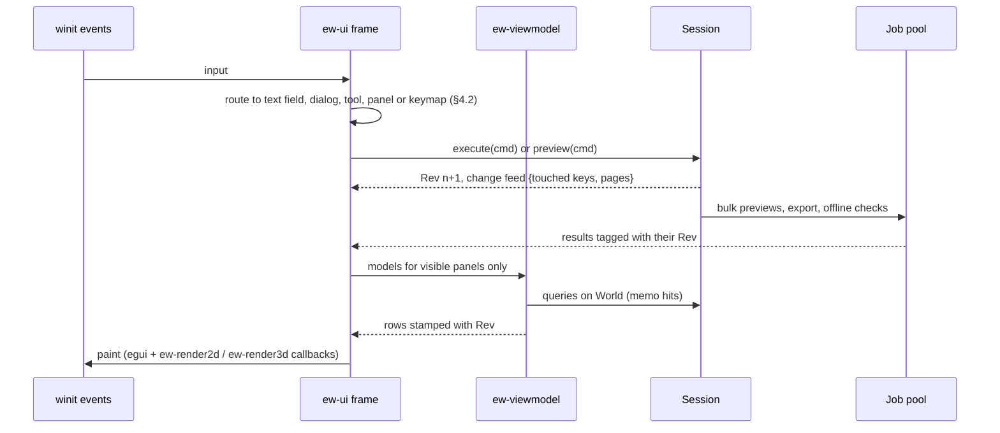
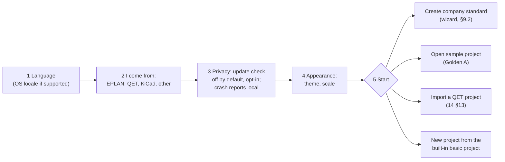

# User experience and user interface

**Status:** Draft v0.1 · **Date:** 2026-10-18 (amended 2026-10-22, cycle-19 design pass: the part-1 shell and its headless mode as built, §3.9, decision log ID-473 to ID-475, ID-485) · **Part of:** ElektraWatt design document set

**Purpose.** This document specifies how people work with ElektraWatt (EW): the main window and its docking
workspace, navigators, canvas tabs, the property grid with provenance, the command palette and keymaps, table
editing with bulk previews, history, notifications for background jobs, the first-run company-standard wizard,
aids for users coming from EPLAN and QElectroTech (QET), accessibility, theming, UI localisation, help, the
performance budgets as the user perceives them, and the usability test that gates M2 and 1.0. It elaborates
FR-UI-001 … FR-UI-051 of [02b](02b-requirements-extended.md) and the NFR-A11Y and NFR-UX rows of
[02c](02c-nonfunctional-requirements.md) on the egui shell behind `ew-ui` and `ew-viewmodel` fixed by the
[architecture](04-architecture.md) §9 and ADR-0014. Canvas tools are specified in [06](06-schematic-editor.md) and
domain panels in their area documents; this document owns the shell they live in and the rules they share.

**Contents**
1. [Position in the architecture](#1-position-in-the-architecture)
2. [Concepts and data](#2-concepts-and-data)
3. [Main window](#3-main-window)
4. [Interaction model](#4-interaction-model)
5. [Navigators](#5-navigators)
6. [Property grid with provenance](#6-property-grid-with-provenance)
7. [Tables, bulk edits and previews](#7-tables-bulk-edits-and-previews)
8. [History, notifications and background jobs](#8-history-notifications-and-background-jobs)
9. [Onboarding and migration aids](#9-onboarding-and-migration-aids)
10. [Accessibility](#10-accessibility)
11. [Theming](#11-theming)
12. [UI localisation](#12-ui-localisation)
13. [Help system](#13-help-system)
14. [Performance as the user sees it](#14-performance-as-the-user-sees-it)
15. [Algorithms](#15-algorithms)
16. [Outputs](#16-outputs)
17. [Edge cases and pitfalls](#17-edge-cases-and-pitfalls)
18. [The reference project in the UI](#18-the-reference-project-in-the-ui)
19. [Usability test plan](#19-usability-test-plan)
20. [Scope by release](#20-scope-by-release)
21. [Dependencies](#21-dependencies)
22. [Requirements covered](#requirements-covered)
23. [Open questions](#open-questions)

---

## 1. Position in the architecture

The UI is a client of the `Session` facade (`ew-api`). It reads view-models computed from queries on the current
`World` and writes only by `Session::execute`, `preview` and `commit` (ARCH §1.2 principle 3, §5.1).

| Layer | Crate | Owns | Must not |
|---|---|---|---|
| Panel models | `ew-viewmodel` | navigator trees, table rows with edit→command mapping, property-grid rows with provenance, message, history and job lists, the selection model, the action registry view | depend on egui, wgpu or winit; keep model data of its own |
| Widgets and interaction | `ew-ui` | egui widgets, egui_tiles docking, 2D and 3D canvas hosts, the tool host, palette, keymaps, theme tokens, UI string loading | write the model other than through `Session` |
| Shell | `elektrawatt` (bin) | eframe app, muda menus on macOS and Windows (an egui menu bar from `ew-ui` on Linux, §3.2), rfd file dialogs, arboard clipboard, crash handler, OS file drops, opening help in the browser | — |



**Rules.**
1. **Commands and view actions are distinct.** Model changes are `Command`s with undo. View actions (zoom, open a
   panel, follow an xref, select, highlight) never touch the model and never enter the history (06 §3.9).
2. **Visible-only evaluation.** View-models are computed only for panels painted this frame. A hidden tab keeps its
   revision stamp and recomputes when shown.
3. **The UI thread never waits.** Work that can exceed 100 ms runs as a job (NFR-PERF-19). egui repaints only on
   input, job progress (at most 10 Hz) or a change feed event, so an idle EW uses no CPU, which matters on RDP.
4. **Toolkit isolation.** View-model types are plain Rust, so a later chrome can replace `ew-ui` (FR-UI-037).
5. **Debug endpoints only in test builds** (egui inspection, `egui_mcp`; ARCH §9, §13).

**Ownership.** This document owns the shell, docking, workspaces, navigator and table infrastructure, the property
grid, palette, keymaps, history, notifications, onboarding, accessibility, theming, localisation, help and the
usability protocol. Content owners: canvas tools and the canvas shortcut table [06](06-schematic-editor.md) §4, §6;
symbol, part and macro browsers and the library manager [07](07-symbols-parts-macros.md) §5; potential navigator,
strip editor and cable table [08](08-connections-terminals-cables.md) §9; report blocks panel and export dialog
[09](09-reports-forms-output.md) §5; PLC navigator and grid [10](10-plc-and-bus.md) §6; fluid
[11](11-fluid-power.md) §7; layout and 3D canvas [12](12-panel-layout.md) §12; manufacturing and the wiring viewer
[13](13-manufacturing-outputs.md) §12; import wizard and migration report [14](14-interop.md) §13; lock, recovery
and external-change touchpoints [05](05-project-format-and-persistence.md) §16.

**Non-goals** (ARCH §16, VIS §4): no ribbon; no free-form native undocking (second monitors use egui viewports);
no own UI toolkit; no telemetry, so usability evidence comes only from moderated sessions and pilot logs
(NFR-PRIV-02); no bundled AI assistant; no interactive guided tours in v1 (tutorials are documentation plus
sample projects).

---

## 2. Concepts and data

### 2.1 View-model contract

```rust
pub trait PanelModel { fn rev(&self) -> Rev; }               // revision the rows reflect
pub enum Staleness { Fresh, Behind { as_of: Rev }, Computing(JobId), Failed(ErrorKey) }

pub struct NavTree    { rev: Rev, nodes: Arc<NodeTable>, roots: Vec<NodeId> }   // expand state lives in view state
pub struct TableModel { rev: Rev, columns: Vec<ColumnSpec>, rows: Arc<[RowKey]>, cells: CellSource }
pub struct PropRow    { field: FieldPath, label: FluentKey, value: DisplayValue, unit: Option<Unit>,
                        provenance: Provenance, editor: EditorKind, target: Option<EditTarget> }
pub struct EditTarget { entities: SmallVec<[EntityRef; 1]>, field: FieldPath }   // compiles to fields.set
```

- Rows are keyed by entity ID, never by position, so a commit that reorders rows keeps selection and focus.
- `CellSource` evaluates cells lazily for the visible row range only.
- An edit produces an `EditIntent { targets, field, value }`. The view-model compiles it into exactly one
  `Command` (FR-UI-008, FR-UI-009); `ew-ui` never builds commands itself. Headless tests of this mapping run
  without egui (ARCH §13).

### 2.2 Provenance

Every value the UI shows carries a `Provenance`. Its variants map onto the kinds of the
[domain model](03-domain-model.md) §1.1:

```rust
pub enum Provenance {
    Authored    { origin: Origin },                              // A: stored on this entity
    Inherited   { from: SchemeRef, level: SettingLevel },        // A elsewhere: project/company scheme, profile
    Derived     { query: QueryName, via: SmallVec<[SourceRef; 4]> },   // D, Class I
    Overridden  { derived: DisplayValue },                       // A hiding a D value (e.g. CDP)
    Frozen      { rule_value: DisplayValue },                    // F: TagSpec.frozen, NumberSpec::Frozen, AddrSpec::Manual
    Committed   { rev: Rev, stale: bool },                       // C: routes, lengths, released snapshots
    Library     { item: LibItemRef, update: bool },              // L: PartCopy, SymbolDef …
    Async       { as_of: Rev, state: Staleness },                // Class II results
    Generated   { block: ReportBlockId },                        // report-page content, read-only
}
```

The `via` chain is the short form of `ew query --explain` (FR-EXT-005); for wire properties it names the winning
level of the seven-level chain of [03](03-domain-model.md) §9.5.

### 2.3 Selection

```rust
pub struct Selection { items: IndexSet<EntityRef>, primary: Option<EntityRef>, origin: SelOrigin, generation: u64 }
pub enum EntityRef { Device(Id<Device>), Function(Id<Function>), Rep(Id<Representation>), Connection(Id<Connection>),
                     Junction(Id<Junction>), Cp(Id<Function>, u16), Page(Id<Page>), Potential(PotentialId),
                     Channel(Id<Channel>), Placement(Id<Placement3D>), PageItem(Id<PageItem>),
                     Finding(FindingKey), ReportRow(Id<ReportBlock>, RowKey) }
```

The selection is a set of entity references, not of screen objects, so it can span pages and windows. It is
session state: each undo entry stores it (ARCH §5.3) and the per-user `view.json` (§2.5) keeps the last one for
restore. A highlight is a
separate named set (up to four at once, §10.3), so highlighting 24VDC-1 does not disturb the selection.

### 2.4 Action registry

Menus, toolbar, palette, keymaps, context menus, F1 and the generated command catalogue (NFR-DOC-06) are all
built from one registry, so a menu entry, its shortcut and its palette entry cannot disagree.

```rust
pub struct ActionMeta {
    pub id: &'static str,              // = CommandMeta.name for model commands ("numbering.renumber"); "view.fit_page"
    pub kind: ActionKind,              // Command(&'static CommandMeta) | View
    pub label: FluentKey,              // "cmd-numbering-renumber"
    pub aliases: &'static [FluentKey], // per-locale palette aliases (EPLAN, QET, KiCad terms; NFR-UX-03)
    pub category: Category,            // File, Edit, Insert, Page, Device, Check, …
    pub enabled: ContextPredicate,     // e.g. selection has ≥1 Device; canvas is Page2D; project writable
    pub docs: DocsAnchor,              // "ui/tools/wire"; resolved by F1 (§13)
    pub icon: Option<IconId>,
}
```

For a model command, name, parameter schema, cost, undoability and the language-neutral aliases (retired names,
such as `device.place_from_part` and `symbol.place` for `device.place`) come from its `CommandMeta` ([17](17-extensibility.md) §2.1, FR-EXT-015), shared with the
CLI, rhai, MCP and plugins; `ActionMeta` adds only what the GUI needs. The palette searches both alias lists. A
predicate that fails carries a reason key ("needs a selected device", "project is read-only") shown in the
palette and in tooltips.

*As built from WP-S2.01 (decision log ID-444):* the toolkit-neutral part of the registry (ID, kind, label key,
category, default chords as text, the predicate with its reason key) and the shell model that every action is
dispatched on live in `ew-viewmodel`; `ew-ui` binds keys and paints menus, palette and toolbar from it. The same
dispatch serves the headless mode `elektrawatt --headless --script`, so CI and agents can drive every action without
a display (ID-443).

### 2.5 Settings and view state

| Data | Location | Format | Notes |
|---|---|---|---|
| User settings: UI language, theme, scale, minimum font size, reduce motion, keymap preset, first-run answers, update-check opt-in, recent projects, default basic project, user display name | OS configuration directory, `elektrawatt/settings.toml` | TOML with `version` | Unknown keys preserved; an unreadable file yields defaults, a `.bad-<n>` copy and a banner (FR-UI-049) |
| Keymaps | `elektrawatt/keymaps/<name>.toml` | TOML (§4.4) | Import and export (FR-UI-013) |
| Workspaces | `elektrawatt/workspaces/<name>.json` | serialised egui_tiles tree plus pane configs | FR-UI-002 |
| Per-project view state: open tabs, viewport per page, jump history (last 50), last selection, navigator expansion and filters, table column layouts, active workspace, highlight sets | `<name>.ew/.ew/u-<hash>/view.json`, `<hash>` from `user@host` ([05](05-project-format-and-persistence.md) §1) | JSON | git-ignored; per user, so users of a shared folder do not overwrite each other; never project data (FR-UI-033) |
| Policy (MSI deployments) | registry policy keys | — | update check off (NFR-PRIV-03) |

Opening the golden project, changing the viewport and saving therefore changes no tracked file (FR-UI-033).

### 2.6 Workspaces

A workspace is a named dock layout with its panels and canvas kinds. Users save their own (FR-UI-002); EW ships:

| Workspace | Left dock | Centre | Right | Bottom | Release |
|---|---|---|---|---|---|
| Schematic | pages, devices, strips, cables, potentials, IPs, structure, PLC | page tabs | property grid | messages, find, wire list, history, jobs | MVP |
| PLC | PLC navigator, bus navigator | page tabs (203–206) | property grid | PLC grid, exchange results | 1.0 ([10](10-plc-and-bus.md) §6) |
| Fluid | fluid navigator, devices | fluid pages | property grid | tube table, medium table | 1.0 ([11](11-fluid-power.md) §7) |
| Panel 3D | layout navigator, unplaced devices | 3D canvas, panel pages | property grid | wiring manager, routing preview, thermal | 1.0 ([12](12-panel-layout.md) §12.3) |
| Manufacturing | label sets, machine profiles, orders | 3D or plate view | property grid | wire table, pre-flight findings | 1.0 ([13](13-manufacturing-outputs.md) §12) |

---

## 3. Main window

### 3.1 Wireframe: Schematic workspace with the golden project

```text
+--------------------------------------------------------------------------------------------------+
| File  Edit  View  Insert  Project  Page  Device  Check  Reports  Tools  Window  Help              | menu
+--------------------------------------------------------------------------------------------------+
| [Select][Symbol I][Part][Wire W][IP P][Box B][Text T] | [Grid: QET 10 px][Snap] | [Check F7][PDF] | toolbar
+----------------------+---------------------------------------------------+------------------------+
| Pages|Devices|Strips |  101 Power Supply 1 | 102 Power Supply 2 | 103 ... | Properties             |
| Cables|Potentials|IPs| +-----------------------------------------------+ | -102G1  device         |
| filter: [          ] | |                                               | | Power supply 24 V DC   |
| v =P01               | |    sheet in print colours, A4, 17 x 8 grid    | | 102-B6 (main)  E 0 W 0 |
|  v +J-E-2416         | |                                               | | v Identity             |
|     1    Title Page  | |                                               | |   Tag  -102G1   f      |
|     2    TOC  [gen]  | |                                               | | v Part                 |
|     3    Bus Topology| |                                               | |   2904602  lib v3      |
|   v Sec 1 Wiring Def.| |                                               | | v Electrical           |
|     100  [gen]       | |                                               | |   Output 24 V DC  f    |
|     101  Power Su... | +-----------------------------------------------+ |                        |
+----------------------+---------------------------------------------------+------------------------+
| Messages  E 42  W 32  I 28  waived 1 | Find | Wire list | Strip -X1031 | History | Jobs           | bottom
| E  EW-POT-013  Contact T55 switches N-55 without its line conductor   101   [Fix...] [Waive...]  |
+--------------------------------------------------------------------------------------------------+
| Select: click or drag | 102-H15  x 255.0 y 172.5 mm | QET 10 px | 1 selected | E42 W32 I28 |    |
| PDF 40 % | GPU Vulkan | saved gen 214 | EN                                                       | status
+--------------------------------------------------------------------------------------------------+
```

`f` marks a derived value, `[gen]` a generated page; in the product these are icons with text (§10.3).

### 3.2 Menu bar

Menus are generated from the action registry (§2.4) and show the active keymap's accelerators.

| Menu | Content (MVP) | Added at 1.0 |
|---|---|---|
| File | New project from basic project, Open, Open recent, Close, Save, Save As, Save a Copy, Import (QET, CSV), Export (PDF, SVG, BOM, wire list, terminals, cables, `.ewz`), Print, Project trust, Quit | Import EDZ, DXF, EPLAN parts XML; Export DXF, AML, TIA XLSX, PLCopen, `.ewpp`, machine profiles |
| Edit | Undo, Redo, Cut, Copy, Copy tag list, Copy as image, Paste, Paste as representation, Duplicate, Delete, Select all, Find, Find and replace, History | Multi-format copy (FR-UI-051) |
| View | Workspaces, Panels, Zoom, Fit page, Grid, Highlight potential, Side by side, Wire-colour view, Theme, UI scale, Maximise canvas | Second window, Dark sheet |
| Insert | Symbol, Device from part, Macro, Connection, Interruption point, Potential definition point, Wire marker, Black box, Structure box, Text, Graphic, Image, Report block | Dimension (FR-SYM-026) |
| Project | Properties, Parties, Structure identifiers, Settings and schemes, Report blocks, Revisions (new, release), Company standard (run wizard, edit basic project), Derivation-profile upgrade | Revision compare |
| Page | New page, Properties, Renumber pages, Go to page or cell, Next, Previous, Arrange interruption points (FR-XRF-013) | Layers (FR-PAG-026) |
| Device | Properties, Assign part, Renumber devices, Freeze or unfreeze tag, Show all representations, Place unplaced functions | Device selection by function |
| Check | Run check scheme, Check schemes, Waivers, Export check report | — |
| Reports | Report blocks, Open generated page | Form editor, user SQL reports |
| Tools | Command palette, Keymap editor, Library manager, Settings | Script runner, macro recorder |
| Window | Workspaces, panels list, open canvas tabs | Move to new window |
| Help | Help for this context (F1), Documentation, Tutorials, Glossary, Keyboard shortcuts, Rule catalogue, Verify derived data, First-run setup, About | — |

**Platform behaviour.**
- **macOS:** muda 0.21.2 global menu bar with the standard application menu (About, Settings… ⌘,, Services, Hide,
  Quit) and the system Window and Help menus.
- **Windows:** muda menu on the window's HWND, with Alt mnemonics from the Fluent labels (**verify** HWND access
  through eframe).
- **Linux:** muda attaches only to GTK windows, which eframe/winit does not create (**verify**). EW draws the menu
  bar with egui from the same registry (FR-UI-001; Open question 1).
- Enabled states update at most once per frame after a selection change. macOS menus show no tooltips, so the
  reason a command is disabled is shown in the palette.

### 3.3 Toolbar

- One compact row: a global group (Undo, Redo, Check, Export PDF, Palette) plus the tool group of the focused
  canvas kind: Page2D tools ([06](06-schematic-editor.md) §4.5), Panel2D tools ([12](12-panel-layout.md) §12.1) or
  3D view controls (1.0).
- Every button has an icon, an accessible name from its Fluent label and a tooltip: "Wire (W). Draw a connection
  between connection points. F1: help".
- Toolbars are customisable per workspace: add, remove and reorder actions. There is no ribbon.

### 3.4 Docking

The workspace is an egui_tiles 0.17.1 tree of panes:

```rust
pub enum Pane {
    Canvas(CanvasTab),                 // Page2D{page}, Panel2D{page}, Layout3D{space}, Preview{job}, Compare{a, b}
    Navigator(NavKind, NavConfig),     // §5.2
    PropertyGrid, History, Jobs, Notifications, FindResults,
    Messages(MessageFilter),
    Table(TableKind, TableConfig),     // wire list, strip editor -X1031, PLC grid, BOM view …
}
```

- **Placement.** Canvas tabs live in the centre container. Panels start in the left, right and bottom docks but can
  be rearranged anywhere inside the window (FR-UI-001).
- **Instances.** The property grid, history and jobs panels are singletons per window. Navigators and tables may
  have several instances with their own filters, for example strip editors for -X1031 and -X1032 side by side.
- **Second monitor** (FR-UI-004, 1.0). "Move to new window" moves a subtree into an egui deferred viewport that
  shares the `Session`, selection and theme. Closing it returns its panes. Positions are saved per workspace and fall
  back to the main window when the monitor is missing.
- **Persistence.** The tree is written to the workspace file 1 s after the last layout change.
- **Keyboard.** F6 and Shift+F6 cycle dock areas; Ctrl+PageDown and Ctrl+PageUp switch tabs in the focused dock;
  Ctrl+Tab cycles canvas tabs; Ctrl+W closes a canvas tab; F11 maximises the canvas.

### 3.5 Canvas tabs

| Tab kind | Content | Editable | Title and badges | Release |
|---|---|---|---|---|
| Page2D | drawn page (multi-line, overview, fluid, topology) | yes, unless locked or released | "102 Power Supply 2 - Control Current"; badges read-only, QET grid, finding count | MVP |
| Generated page | report page, section divider, TOC | no: an edit attempt names the block (09 §5) | "907.1 Wire List 2" with a generated badge | MVP |
| Panel2D | panel page from placements (folio 902) | placements | "902 Cabinet Layout" | MVP |
| Preview | rendered candidate pages of a fork (§7.6) | no | "Preview: Renumber pages" plus revision stamp | MVP |
| Layout3D | layout space in 3D ([12](12-panel-layout.md) §12.2) | placements | "+J-E-2416 3D" | 1.0 |
| Compare | two revisions or commits, side by side or overlaid | no | "101 V1.0 vs V2.0" | 1.0 |

Two pages can be shown side by side with their own viewports (FR-UI-035). Back and Forward walk the jump history
per window (FR-UI-019).

### 3.6 Status bar

| Field | Example | Click action | Source |
|---|---|---|---|
| Tool hint | "Wire: click a connection point, N: next unconnected" | — | 06 §4.1 `status_hint` |
| Cursor | "102-H15 · x 255.0 y 172.5 mm" (sheet coordinates; column 15 spans x 249.9–265.6 mm on the golden frame, [20](20-golden-project.md) §17.1) | Go to (Ctrl+G) | FR-UI-034 |
| Grid and snap | "QET 10 px" (2.646 mm) or "4 mm"; snap on/off | grid menu | FR-UI-018, ADR-0027 |
| Selection | "1 selected" / "3 devices" | show selection list | FR-UI-034 |
| Findings | "E 42 W 32 I 28 (+3 pending)" | open messages | FR-UI-021, 06 §3.10 |
| Jobs | "PDF 40 %" / "Warming up" | open jobs panel | FR-UI-024 |
| Render backend | "GPU Vulkan", "WARP", "CPU" | About | FR-UI-028, NFR-PLAT-03 |
| Save state | dirty dot, "saved gen 214", share/cloud/read-only badges, "merge driver missing" | storage settings | [05](05-project-format-and-persistence.md) §16 |
| UI language | "EN" | language switch | FR-UI-032 |

### 3.7 Start page

With no project open the window shows: recent projects, **New project from basic project** (the default basic
project first), Open, **Open sample project** (Golden A, CC0, NFR-DOC-04), **Import QET project**, **Create company
standard** (§9.2), Tutorials, quick switches for language and keymap, and one privacy line ("Update check: off ·
change"). It contains no news feed and opens no connection (NFR-PRIV-01). It must appear within 1.5 s
(NFR-PERF-02).

### 3.8 Projects, instances and windows

- **One project per `Session` and window.** File ▸ Open while a project is open offers "Close and open" or "Open
  in new window", which starts a second EW process. Several projects in one session, with navigation along external
  references such as J-E-206, is FR-PRJ-027 (Could, 1.x).
- **The same project twice.** A second instance (or another user) that opens a project finds its `.~ew.lock` and
  opens it read-only with the lock banner of §8.2 ([05](05-project-format-and-persistence.md) §7.3).
- **Across projects.** Copy and paste between instances uses the clipboard fragment of
  [06](06-schematic-editor.md) §3.6, which remaps IDs and renumbers in the paste ghost (FR-UI-036).
- **Windows of one project** (1.0, FR-UI-004) share its `Session`, undo stack, selection and highlights (§3.4).

### 3.9 As built: the part-1 shell (cycle 19)

WP-S2.01 part 1 built a subset of this section on its
[closed specification](../plan/specs/WP-S2.01-application-shell.md) (decision log ID-473 to ID-475). The design text
of §3.1 to §3.8 stays the target of the whole work package; this subsection records what exists and where it differs.

| Element | As built | Differs from the design by |
|---|---|---|
| Window | `elektrawatt [<project-dir>]`: eframe 0.37.0 on the wgpu renderer, 1280 × 800 at start; the title `<directory name> - ElektraWatt`, with `*` while unsaved | No toolbar (§3.3), no docking or workspaces (§3.4, FT-309), no canvas tabs (§3.5) |
| Menus | Drawn with egui on every OS from the toolkit-neutral registry of `ew-viewmodel`: File, Edit, View, Page, Tools, Help, each entry with its accelerator text; a disabled entry shows its reason as a tooltip | Six menus of §3.2's twelve; muda on macOS and Windows is deferred (decision log ID-446, FT-310) |
| Start page | Open..., the recent projects (at most 10; an entry is dropped only when its path no longer exists) and the line "Update check: off" | New project, the sample project, QET import, the company standard, tutorials and the quick switches are FT-307, FT-308 and FT-312; the privacy line has no "change" link yet |
| Project view | A fixed layout: the page list (printed folio labels; a click goes to the page), the page view, the status bar | The page list is not the navigator of §5 |
| Page view | The current page read-only, the CPU renderer's raster fitted to the pane at the largest step of 12 dpi between 36 and 200 that fits; one long-lived worker thread renders, and the latest request wins | No GPU canvas, zoom or pan (WP-S2.02, WP-S2.03) |
| Status bar | The hint "Read-only view", the page as `<folio> (<n> of <total>)`, the save state, the render backend `CPU`, the language `EN`, and "Exporting PDF..." during an export | No cursor, grid, selection, findings or jobs fields (§3.6) |
| Banner | One line for a read-only reason, the integrity findings of the open report, a leftover journal ([05](05-project-format-and-persistence.md) §8.3, as built) or a missing file-dialog portal on Linux, with its own close button | The notification classes of §8.2 come with WP-S2.09 |
| Palette | Ctrl+K or Ctrl+Shift+P: a case-insensitive substring search over the registry actions and the registered model commands, disabled entries last with their reason; model commands are listed but disabled until parameter forms exist | Ranking, aliases, prefixes and forms of §4.3 are WP-S2.08 |
| Dialogs | About (version, "Page view: CPU renderer", the privacy line, the licence, the repository), keyboard shortcuts, go to page (Ctrl+G), and Save / Discard / Cancel when Close, Quit or Open meets unsaved changes; Open, Save As and Export PDF use the operating system's dialogs through rfd 0.17.2 (on Linux the XDG portal) | The complete About and F1 are FT-311; §3.8's "Open in new window" is not offered |
| Keyboard | Routing: a focused text field, then the topmost popup or dialog, then the shell's shortcuts; Escape closes the topmost popup or dialog (the registry action `ui.dismiss`) and otherwise does nothing; on macOS `Ctrl` reads `Cmd` | No keymap presets or files (§4.4, WP-S2.08) |
| Fonts and scale | The bundled faces of `ew-text` (Noto Sans, with Noto Sans Math as the last fallback) are the only UI fonts; UI scale 1.0, 1.25, 1.5 or 2.0 through egui's zoom factor | Up to 300 % (§10.4) later |
| Exit | A clean project is closed at exit; a dirty one keeps its journal, and the next open is read-only with the recovery banner (decision log ID-475) | The recovery dialog and the discard are FT-313 |

**The headless mode** (decision log ID-474). `elektrawatt --headless --script <file|->` runs the same registry actions
on the same shell model with no window, no GPU and no display, and writes a deterministic transcript: the script is
JSON Lines `ew.uiscript/1`, the transcript JSON Lines `ew.uitranscript/1` with the observable state after each step,
`ui.describe` returns the visible UI as text for agents (its structural words are fixed machine text) and
`view.snapshot` a PNG; `--record` keeps the committed model commands as an `ew.cmdlog/1` log, and a headless run uses no
user settings unless `EW_CONFIG_DIR` or `--config-dir` names a directory. Whatever the headless mode cannot do, the
shell does not do (decision log ID-443). `elektrawatt --smoke <project-dir>` opens a project read-only, draws its first
page and exits.

---

## 4. Interaction model

### 4.1 Principles

1. **Keyboard-first, pointer-complete.** Every action is in the palette; frequent ones have keys (NFR-A11Y-01).
2. **Escape is always safe.** Following the routing order of §4.2, it first closes the topmost transient (popup,
   palette, dialog), then cancels the active tool, then clears the selection. It never changes the model (FR-UI-016,
   NFR-UX-07).
3. **One gesture, one undo step** ([06](06-schematic-editor.md) §3.9).
4. **Preview before anything bulk or identity-changing** (FR-UI-022, §7.5).
5. **Nothing modal while a job runs.** Progress lives in the jobs panel and status bar (NFR-UX-07).
6. **Derived values look derived.** Changing one means an explicit override or freeze (§6).
7. **No time limits and no focus stealing.** A finished job never moves focus or switches the page (NFR-A11Y-04).
8. **Standard vocabulary.** Device, function, connection point (CP), interruption point (IP), potential, structure
   identifier; EPLAN and QET terms work as aliases (NFR-UX-03).

### 4.2 Input routing and focus

Key events go to the first consumer in this order:
1. IME composition or a focused text field;
2. a modal dialog or popup;
3. the active tool of the focused canvas;
4. the focused panel (arrows, Enter, F2, Delete, type-ahead);
5. the keymap context of the focused pane (`canvas.page2d`, `panel.table` …);
6. the global keymap.

Single-key bindings without modifiers (W, R, M) are inactive while a text field has focus. Each window has one
focused pane, shown by a 2 px focus ring in the `focus` token (§11) and announced through AccessKit.

### 4.3 Command palette

Ctrl+K (⌘K) opens the palette over every registered action (FR-UI-012). Ctrl+Shift+P is an alias for users of
code editors.

| Prefix | Searches | Example |
|---|---|---|
| none or `>` | actions, by label, aliases and ID | "renum" → Renumber devices… Ctrl+Shift+N |
| `@` | objects: tags, part numbers, potentials, wire IDs (find index) | "@-102F" → -102F1, -102F2 |
| `#` | pages by folio or title | "#pneu" → 106, 200 |
| `:` | a cell in the project's xref format | ":103-A1" opens folio 103 with A1 centred (FR-UI-039) |
| `?` | help topics and rule IDs | "?EW-POT-013" |

- **Ranking** is the deterministic score of §15.1, with a recency boost from the last 50 invocations. An empty query
  lists the eight most recent actions.
- **Aliases** come from the glossary (§9.3): "folio report" finds *Insert interruption point*, "master/slave"
  finds *Show all representations* and *Make auxiliary function*, "plot frame" finds the page frame setting,
  "message management" opens the messages panel, "CDP" finds *Insert wire marker*. "Update reports" finds an
  explanation entry, "Reports are always current", that links to its documentation page.
- **Disabled actions** are listed last, greyed, with their reason.
- **Parameters.** An action with a parameter schema opens an inline form generated from its JSON Schema and
  pre-filled from the context. Example `numbering.renumber`: scope (selection, pages, structure, project; the
  selection by default), scheme (pre-filled `{page}{letter}{counter}`, the token set of
  [03](03-domain-model.md) §8.2, with a live sample "-102F1"),
  include frozen (no), order (column then row). Enter runs it; a `Cost::Bulk` command opens the preview (§7.6).

### 4.4 Keymaps

```toml
[meta]
name = "EW"
version = 1

[[bind]]
keys = "W"                     # letters and digits bind by logical key
action = "connection.draw"
context = "canvas.page2d"

[[bind]]
keys = "phys:BracketRight"     # punctuation binds by physical key; the label follows the active layout
action = "cp.next"
context = "tool"
alt = "Alt+N"                  # second binding for keyboards without that key; Alt+Right stays "Forward" (06 §6)
```

- **Presets.** "EW" and "KiCad-like" (M move, R rotate, W wire, E properties) at MVP (FR-UI-013); "EPLAN-like" at
  1.0, once two EPLAN users confirm its bindings (FR-UI-014, 02b Open question 14). The canvas bindings are
  [06](06-schematic-editor.md) §6. This document adds the shell set:

| Action | EW preset | macOS |
|---|---|---|
| Command palette | Ctrl+K (alias Ctrl+Shift+P) | ⌘K |
| New project from basic project, Open, Save, Save As | Ctrl+N, Ctrl+O, Ctrl+S, Ctrl+Shift+S | ⌘ equivalents |
| Print, Export PDF… | Ctrl+P, Ctrl+Shift+E | ⌘P, ⇧⌘E |
| Copy, Copy tag list, Copy as image (FR-UI-040) | Ctrl+C ([06](06-schematic-editor.md) §6); the other two through the Edit menu, the context menu and the palette | ⌘C |
| Find and replace | Ctrl+H | ⌥⌘F (⌘H is reserved by macOS) |
| Run the active check scheme | F7 | F7 |
| Next and previous finding | F8, Shift+F8 | F8, ⇧F8 |
| Renumber devices… | Ctrl+Shift+N | ⇧⌘N |
| Fill down, pattern fill (tables) | Ctrl+D, Ctrl+Shift+D | ⌘D, ⇧⌘D |
| Help for this context | F1 | F1 or ⌘? |
| Context menu | Shift+F10, Menu key | Ctrl+click |
| Cycle dock areas | F6, Shift+F6 | F6, ⇧F6 |
| Maximise canvas | F11 | ⌃⌘F |
| Settings | Ctrl+, | ⌘, |

- **Rules.** No preset uses Ctrl+Alt+letter, because AltGr equals Ctrl+Alt on Windows and produces characters on
  QWERTZ and AZERTY layouts. Every action of a preset must be reachable on QWERTY, QWERTZ and AZERTY without AltGr
  (NFR-I18N-06; §15.5). Context-specific bindings shadow general ones: Ctrl+D duplicates on the canvas and fills
  down in a table.
- **Keymap editor** (Tools ▸ Keymap): search actions, record a chord, show conflicts and shadowing (§15.5), reset
  per action, import and export. A keymap file from a newer version keeps unknown action IDs and marks them unused.

### 4.5 Tool host

Tools are the state machines of [06](06-schematic-editor.md) §4. The host in `ew-ui` keeps one active tool per
canvas (activating another cancels the current one), routes `Transient` to the GPU overlay, `Preview` to a fork
job (dropping results older than the current revision) and `Commit` to `Session::execute`, and returns to Select
after Escape. It shows the tool's `status_hint` in the status bar and announces state changes as a polite live
region: "Wire: routing from -102F1:2. Click a connection point; Backspace removes the last bend; Escape cancels".
Tool options (Place: variant A–H, representation type, autoconnect; Wire: orthogonal, sticky) sit in a strip
above the canvas, never in a dialog. Layout and 3D tools ([12](12-panel-layout.md) §12) use the same contract.

### 4.6 Selection

- Click selects; Shift+click adds; Ctrl+click (⌘) toggles. A rubber band dragged left to right selects enclosed
  objects, right to left touched objects (06 §4.3). Ctrl+A selects everything on the page or every row of the
  filtered table.
- Selection filters and "show all representations" are those of 06 §3.7 and FR-DEV-019.
- The selection is announced as a live region: "-102G1, power supply 24 V DC, 7 connection points, 9 wires"
  (NFR-A11Y-02; the counts of [08](08-connections-terminals-cables.md) §10); "3 devices selected: -101F1, -102F1,
  -102F2".
- The selection survives page switches. Undo restores the selection of its entry. Entities removed by undo or an
  external change are dropped with a status message.

### 4.7 Context menus

Context menus are composed from the registry by predicate, in a fixed group order: primary actions, navigation,
edit, check, clipboard, help. Shift+F10 or the Menu key opens them from the keyboard. Example, right-click on
-102F2 on folio 102:

| Group | Entries |
|---|---|
| Primary | Properties (E) · Assign part… |
| Navigation | Show all representations (Alt+D) · Highlight potential (H) · Follow cross-reference (F), only on xref texts |
| Edit | Freeze tag · Rotate · Mirror · Delete |
| Check | Quick fixes for 2 findings ▸ Mark CP 13 unused, Mark CP 14 unused (EF-09, D-23) |
| Clipboard | Copy (the fragment as text with its header) · Copy tag list (TSV) · Copy as image (PNG) (FR-UI-040; one multi-format copy at 1.0, FR-UI-051) |
| Help | Help on load-distribution devices (F1) |

### 4.8 Drag and drop

Every drag has a keyboard equivalent: the source's context command "Place on canvas…" enters the Place tool with
the item floating at the grid cursor (arrows move it, Enter commits).

| Source | Target | Result | Keyboard equivalent |
|---|---|---|---|
| Symbol browser item ([07](07-symbols-parts-macros.md) §5) | page canvas | Place tool in Floating state; drop commits `device.place` | Enter on the item |
| Part browser item | page canvas | `device.place` with `target = FromPart` (`device.place_from_part` and `symbol.place` are registered aliases; the journal records `device.place`, [17](17-extensibility.md) §2.1); remaining functions appear as unplaced (FR-UI-017) | Enter on the item |
| Macro | page canvas | `InsertMacro` ghost with conflict list (FR-MAC-005) | Enter on the macro |
| Unplaced function (device navigator) | page canvas | new representation of the existing function (FR-UI-007) | "Place on canvas…" |
| PLC channel (PLC navigator) | coil or channel symbol | binds the channel (FR-PLC-020) | "Bind to…" with target picker |
| Unplaced device (layout list) | rail or surface | placement (FR-LAY-013) | "Place on carrier…" |
| Page row (page navigator) | another position | renumber preview (FR-PAG-024) | Alt+Up, Alt+Down |
| `.qet` file from the OS | window | import wizard ([14](14-interop.md) §13) | File ▸ Import |
| `.ew` folder or `.ewz` from the OS | window | open | File ▸ Open |
| SVG or PNG from the OS | page canvas | image page item at the drop point | Insert ▸ Image |
| CSV or XLSX from the OS | a table | round-trip import preview (§7.7) | table menu ▸ Import |

Drop targets show valid or invalid feedback with a reason in text, for example "Not allowed on a fluid page:
electrical symbol". Dropping a valve onto the generated overview 202 is refused with "edit -202U2's children in
the device navigator" (06 §8, D-10).

---

## 5. Navigators

### 5.1 Shared behaviour

- **Modes:** tree, list and table (FR-UI-008), switchable per instance; the page navigator adds a thumbnail mode
  from the cached page thumbnails (FR-UI-005, §14).
- **Scale:** virtualised to 100,000 rows; scrolling stays inside the frame budget (FR-UI-007, NFR-PERF-15).
- **Sorting:** natural, by the specified order of `ew-mltext` (X2 before X10; FR-I18N-010); folios in page order.
- **Badges** are text plus icon: unplaced, frozen, generated, Tbd, spare, finding count ("E 2").
- **Keyboard:** arrows; Left and Right collapse and expand; Enter opens the main representation; Space toggles
  selection; F2 edits an authored label; Delete runs the domain delete command, with a preview when it cascades;
  typing jumps to the next row starting with the typed prefix (reset after 1 s).
- **Accessible names:** `"<label>, <kind>, <badges>, level n, m of k"`, for example "-X1031, terminal strip, 12 spare, level 1, 2 of 3".

### 5.2 Catalogue

| Navigator | Tree levels | Table-mode columns, badges | Drag source to | Golden A content | Release | Domain doc |
|---|---|---|---|---|---|---|
| Pages | structure (=, +) → section → page; flat and section views | folio, title, type, frame, change status, generated badge | reorder (renumber preview) | 36 pages: 13 page records (1, 3, 101–103, 106, 201–206, 902) and 23 generated pages (2, 2.1, 100, 200, 900, 901, 901.1, 903 … 911) | MVP | [06](06-schematic-editor.md), [09](09-reports-forms-output.md) |
| Devices | structure → device → functions (main or auxiliary, placed or unplaced) → representations; parts | DT, kind, function text, part, main location, findings | canvas | assembly -201U1 → children -201U2 … -201U9, -202U1 … -202U3 → 28 valves -201U3-Q1 … -202U2-Q4; S56 and E56 without part | MVP | 06, [07](07-symbols-parts-macros.md) |
| Connections | potential → connection, or flat | wire ID, from, to, potential, csa, colour code, source, number, page | — | W1–W44 | MVP (FR-UI-005) | [08](08-connections-terminals-cables.md) |
| Terminal strips | strip → terminal → clamps | designation, function text, level, part, potential, sides, bridge, state | strip editor (FR-TRM-013) | 1X1 (3), -X1031 (20, 12 spare), -X1032 (5, 1 spare) | MVP | 08 |
| Cables | cable → conductors | colour code, csa, assignment, potential | edit-cable table (FR-CBL-016) | -3W1, -106W1, -106W2 (-101W1 in Golden A-R) | MVP | 08 |
| PLC | configuration project → station → rack → module → channel; bus ports | the PLC grid columns (FR-PLC-021) | coil or channel symbol | station -201U1, modules -201U3 … -201U8 and -202U2 (output bytes Q0 … Q6), 56 channels: 8 used, 20 spare, 28 deactivated | MVP (FR-PLC-020) | [10](10-plc-and-bus.md) |
| Potentials | potential → signals → nets → CPs | canonical name, aliases, type, voltage, class, colour, size, pages, members | — | 19 potentials and bond B1; 24VDC-1 with aliases 24VDC-AIR1 … AIR4 | MVP | 08 |
| Interruption points | name → points with direction and star source → partner cell | name, page-cell, direction, partner, state | — | 22 pairs, 4 external points | MVP | 06 |
| Structure identifiers | aspect → node | code, description, aliases, usage count | — | =P01; +J-E-2416 (alias JE2416), +J-E-206, +FIELD | MVP | [03](03-domain-model.md) §5 |
| Messages | severity → rule → finding | §8.4 | — | 42 errors, 32 warnings, 31 infos, 1 waived | MVP | [15](15-checks-revisions-collaboration.md) |
| Parts in use | manufacturer → part → devices | quantity, library status (current, update available, local fork) | — | 2904602 → -102G1 | MVP Should | 07 |
| Unplaced devices | location → device | part, dimensions | rail or surface | F55, E55, E56, S56, -201U9 | MVP | [12](12-panel-layout.md) |
| Report blocks | section → block | kind, folio, filter, pages | — | 11 page blocks (2, 901, 903 … 911) plus embedded blocks (PART DATA on 201, 202, 902; cover tables on 1) | MVP | 09 |
| Bus networks, fluid, layout, comments | per FR-UI-006 | — | — | 28 valves and lines F1–F16; carriers and placements | 1.0 | 10, [11](11-fluid-power.md), 12, 15 |

Symbol, part and macro **browsers** are library views, specified in [07](07-symbols-parts-macros.md) §5; they
dock like navigators.

### 5.3 Filter syntax

The filter bar matches free text against row tokens (case-folded, NFC, prefix match) and accepts facets with
autocompletion: `page:103`, `potential:24VDC-1`, `state:spare`, `kind:terminal`, `part:2904602`, `has:finding`,
`unplaced`, `frozen`. Matches keep their ancestors, which expand automatically. A filter answers within 100 ms
per keystroke at XL (NFR-PERF-15; §15.2). Filters are saved per navigator instance in the per-user view state
`.ew/u-<hash>/view.json` (§2.5).

### 5.4 Selection synchronisation

Selection is synchronised both ways (FR-UI-007; algorithm in §15.3):
- **Canvas → navigators.** Visible navigators reveal and mark the corresponding rows; they do not take focus.
- **Navigator → canvas.** Representations on the active page are selected there. If none is on the active page,
  the page is **not** switched. For -201U1 selected while folio 102 is shown, the canvas shows a chip line "Not on
  this page: 201-E1, 3-B2, 106-G3, 902", and Enter opens the page of the main representation (lowest page order,
  row, column, ID; [03](03-domain-model.md) §8.2).

---

## 6. Property grid with provenance

### 6.1 Layout

- **Header:** kind icon, derived tag (full designation in its tooltip), function text, main location as page-cell
  ("102-B6" for -102G1), finding chips.
- **Categories:** Identity, Part, Electrical, Connection points, Texts, Structure, Placement, PLC, Manufacturing,
  user properties, Extra (unknown fields, read-only). They come from `ew-schema` metadata (type, unit, enum options,
  Fluent label key; FR-UI-009). Collapse states persist per entity kind.

### 6.2 Rows and provenance

A row shows its label, value, unit, a provenance chip and its actions:

```text
Cross-section  0.75 mm²   f derived · from potential 24VDC-1 via profile 'DBU/WH 24 V'     [Override] [Why?]
Cross-section  1.5 mm²    <> override (CDP) · derived would be 0.75 mm²                     [Reset to derived]
Tag            S51        lock frozen (sign hidden) · rule gives -101S1                     [Unfreeze…]
Address        Q0.1       f derived · module -201U3 start Q0 (auto, slot 1) + channel 1 (533361: channel n → bit n)
Length         810 mm     pin committed rev 212 · stale: re-route pending                   [Re-route…]
Part           2904602    book library 'ew-parts' v3 · update available                     [Update…]
```

| Provenance | Value style | Chip text | Actions | Domain kind |
|---|---|---|---|---|
| Authored | normal | none | edit, clear | A |
| Inherited | italic, secondary text | "from profile 'DBU/WH 24 V'", "from company scheme" | override, go to source | A (scheme) |
| Derived | italic, secondary text, `f` icon | `derived · <rule or source>` | override or freeze where allowed, Why? | D |
| Overridden | normal, override marker | "override · derived would be …" | reset to derived; "move override to profile" when equal (06 OQ8) | A over D |
| Frozen | normal, lock icon | "frozen · rule gives …" | unfreeze (previewed) | F |
| Committed | normal, pin icon | "routed rev 212"; "stale" with hatched background when the input hash changed | re-route (previewed) | C |
| Library | normal, book icon | "library … vN · update available" | update from library (previewed) | L |
| Async | normal, clock icon | "as of rev n" | re-run | Class II |
| Generated | read-only | "generated by block 'Wire list'" | go to block, go to source row (FR-REP-042) | D |
| Varies | `‹varies›` | "3 values" (listed on hover) | set all | — |

Every state is distinguished by icon and text, not by colour (FR-UI-025). The examples above are the golden
values: W29 (FR-UI-010, AC-28), W20 with its CDP, frozen S51 (Golden B maps it to -101S1), Q0.1 from
[10](10-plc-and-bus.md) §6, and a 1.0 routed length.

### 6.3 Editing semantics

- **Commit and cancel.** Enter or focus loss commits one `fields.set`; keystrokes in one field coalesce into one
  undo step (FR-UI-009). Escape reverts the field.
- **Validation.** A refused commit (prevent rule, structural invariant) leaves the model unchanged, keeps the typed
  text in an error state and shows the reason and rule ID under the field.
- **Multi-selection.** The grid shows the fields common to the selection, `‹varies›` where values differ; an edit
  sets all of them in one command (FR-DEV-031).
- **Override or freeze.** Derived properties (csa, colour, function text from a path) are overridden; derived
  identifiers (tag, wire number, address) are frozen. Both are explicit commands with a visible marker; typing into
  a derived tag offers "Freeze as 'S51'" or "Change numbering rule…" and never edits silently.
- **Read-only reasons** are stated in place: "generated", "defined at -102F2:Out1 (potential definition) · Go to",
  `project locked by <user>@<host>`, "released in V1.0; edits go to the open revision".

**Typed editors.**

| Type | Editor | Rules |
|---|---|---|
| `Dec3` with unit | text with unit suffix | accepts "0.75", "0,75", "0.75 mm2", "0,75mm²"; "1,500" and "1.500" are ambiguous and prompt; shown in the UI locale |
| `ColourCode` | combo of IEC 60757 codes plus profile company codes | each entry shows code, name and a swatch (GNYE striped); typing "BR" offers "BN brown" (D-17) |
| `Ident` (tags, designations, part numbers) | text | NFC on input; confusables named with the code point, "Cyrillic А (U+0410)" (FR-I18N-011) |
| `MlText` | single-line field in the current edit language; "…" or Shift+Enter opens a multi-language editor with one row per project language, source language first, and a multi-line area per row | neutral and language strings exclude each other, with the FR-I18N-001 prompt; the dedicated editor compensates for egui's weak multi-line editing (ADR-0014) |
| `StructureAssignment` | node picker per aspect | no free text: typing "+JE2416" resolves through the alias to +J-E-2416 and says so (D-03) |
| `AddrSpec` | Auto, Manual, Excluded, Tbd | Tbd shows "open item, blocks release" (D-15) |
| References | searchable picker | shows derived tags, stores IDs |

### 6.4 "Why this value?"

At MVP the chip shows the one-line `via` chain. At 1.0 the **Why?** action (FR-UI-011) opens a panel with the
full trail, the GUI face of `ew query --explain` (FR-EXT-005):
- for W29's cross-section, the seven levels of [03](03-domain-model.md) §9.5, the empty ones greyed and the
  winning one (profile rule "24 VDC × control") marked;
- for "102-A1" at L-1 on folio 101, the partner interruption point L-1 on folio 102, its anchor cell A1 from the
  symbol's anchor policy and the `XrefFormat` `{page}-{row}{column}` ([03](03-domain-model.md) §10).

Each line links to its source object or setting.

---

## 7. Tables, bulk edits and previews

### 7.1 Table mode

Tables are egui_table 0.10.0 views with fixed row height (for virtualisation), a frozen key column (tag, wire ID
or designation), a column chooser, natural sort and the filter bar of §5.3. Derived columns are italic and show
their provenance on hover. Cells use the editors of §6.3. The strip editor, edit-cable table, PLC grid, wire list
and tube table are table models with domain commands for insert, delete and move (08, 10, 11).

### 7.2 Edit → command mapping

| Gesture | Command | Undo steps | Preview |
|---|---|---|---|
| Edit one cell | `fields.set` on one entity | 1; keystrokes coalesce until focus leaves | rule §7.5 |
| Edit with several rows selected, Ctrl+Enter applies to all | `fields.set` on n entities | 1 | rule §7.5 |
| Fill down (Ctrl+D) | `fields.set` with one value | 1 | rule §7.5 |
| Pattern fill (Ctrl+Shift+D) | `fields.set` with per-row values | 1 | rule §7.5 |
| Paste from Excel (Ctrl+V) | `fields.set`, plus inserts where the table allows them | 1 | rule §7.5 |
| Clear cells (Delete) | `fields.set` to empty, which removes overrides | 1 | no |
| Insert, delete, move rows | the table's domain commands (strip editor: insert, delete, move, re-designate) | 1 each | ghost of prevent-rule violations (08 §9) |
| Sort, filter, resize, reorder columns | none | 0 | — |
| Excel round-trip import | `table.apply_changes` ([14](14-interop.md) §8.2) | 1 | always |

### 7.3 Pattern fill

A small deterministic template language, not rhai: `{n}` row index from 1, `{n:02}` zero-padded, `{n+100}`
offset, `{n*2}` step, `{col:<column>}` another column of the row, `{prev}` the previous row's value. The dialog
previews the first five values. Examples: `Spare_{n:02}` as the symbols of the 20 spare channels in the PLC grid
(Spare_01 … Spare_20; FR-PLC-021); `{col:function_text}` to copy each valve's process tag into its comment; the
constant "Reserve" as the function text of the 12 spare terminals of -X1031.

### 7.4 Paste from Excel

Clipboard text is parsed as Excel TSV with quoting, header detection, locale-aware numbers and enum matching by
code or name (§15.4). Invalid or ambiguous cells open the preview grid with those cells marked; otherwise the paste
is one command (FR-UI-036).

### 7.5 When a table edit opens a preview

An edit commits directly, with a toast "Set function text on 12 terminals · Undo", unless one of these holds; then
the bulk preview opens (FR-UI-044):
1. it touches more than 500 entities (`Cost::Bulk`, as for large pastes in 06 §8);
2. it changes an identifier that leaves the building (tag, terminal designation, wire number, PLC address, folio)
   on more than one entity;
3. a cell failed validation or was ambiguous;
4. it comes from an external file (Excel round trip, FR-EXP-004).

### 7.6 Bulk preview

The preview is a dockable tab, not a modal dialog: editing continues while it is open (NFR-UX-07). It serves
renumbering (FR-NUM-008), re-addressing (FR-PLC-014), imports, "update parts from library", `RouteWires`, find and
replace (FR-UI-020), multi-target quick fixes, structure rename and merge (FR-PRJ-018), derivation-profile upgrades
(FR-PRJ-011) and Excel round trips.

```text
+- Preview: Renumber pages (section 1, start 101, step 1) - as of rev 214 ---------- [Accept] [Cancel] -+
| Summary: 1 page record, 2 derived tags, 14 cross-reference texts, TOC, outline, Prev/Next of 103, 200 |
| [Summary] [Entities 1] [Tags 2] [Xrefs 14] [BOM 1] [Wire list 12] [Pages] [Findings +0 -0]             |
| Tags   -106W1 -> -104W1    -106W2 -> -104W2                                                             |
| Xrefs  folio 103: 12 texts "106-..." -> "104-..."   folio 201: "106-G3" -> "104-G3"   202: "106-G9" ...  |
| Pages  before | after of every page whose display list changed (2, 103, 104, 200, 201, 202, reports) |
+-------------------------------------------------------------------------------------------------------+
```

Only the page record changes; the tags and xref texts are derived from it ([03](03-domain-model.md) §8.2), which is
why the preview shows them as query diffs rather than entity changes. The BOM delta is one row (pos 13, tags
-106W1, -106W2 and folio 106), the wire-list delta the 12 rows W33 … W44 whose page references or cable tag change
([20](20-golden-project.md) §8.2, §14.1).

- **Content** comes from `diff_model` and `diff_query` on the fork (ARCH §5.4): entity and field changes, tags,
  xref texts, BOM rows, wire-list rows, PLC addresses, affected pages, and the findings delta (new and resolved).
  The Pages tab renders candidate pages with `ew-render-cpu` on the job; the compare view overlays changed regions
  with a hatch pattern.
- **Accept** (Ctrl+Enter) commits the prepared transaction after the rebase check. If the model moved and the
  re-run changes the result, the tab shows "Preview updated: 1 more tag" and needs a second Accept.
- **Cancel** (Escape in the tab) drops the fork. Large diffs are virtualised and exportable as CSV.
- **Example.** This is Golden B step B2 (folio 106 → 104): exactly 2 tags and 14 xref texts change, and one undo
  restores the previous state ([20](20-golden-project.md) §2.2, AC-18).

### 7.7 Excel round trip

The file format and the merge are those of [14](14-interop.md) §8: the export writes the visible columns, a hidden
`id` column, a hidden sheet `_ew` (format `ew-table/1`, project ID, table key, export revision, locale, column
schema) and a hidden sheet `_ew_base` with the editable cells as exported. On re-import EW compares, per cell, the
base value, the current model value and the file value, so it detects edits made in EW since the export even in a
later session. The UI side is the preview tab of §7.6 with a per-cell diff grid: cells changed on both sides are
conflicts, defaulting to "keep EW" with "take file" per cell or per column; edits in derived columns (tag, xref,
effective colour) are refused with the hint of [14](14-interop.md) §8.2; unknown and missing rows are listed, never
deleted. Applying is one `table.apply_changes` command (FR-EXP-004).

---

## 8. History, notifications and background jobs

### 8.1 History panel

```text
History                                        oldest kept: step 1 · 12 MB of 256 MB
  redo   Set colour BN on W39                       GUI        106
> now    Renumber pages (section 1)                 GUI        2, 103, 104, 201, 202
         Rebind -201U3-Q1 coil 14 to channel 0      quick fix EW-PLC-012   203
  ------ saved · generation 214 ---------------------------------------------
         External change (git a1b2c3d, 12 records)  external   103, 106
         Set function text "Reserve" on 12 terminals of -X1031   GUI   103
         Exported PDF to <file>                     not undoable
```

- **Entries** show the command label (a Fluent message with arguments), the origin and the affected pages
  (FR-UI-023). Origins: GUI, script `<name>`, MCP (1.0), plugin `<id>` (1.x), import `<file>`, quick fix
  `<rule>`, external change `<generation or commit>`, journal replay. A CLI cannot write while the GUI holds the
  lock, so CLI edits arrive as external changes.
- **Undo to here** runs the needed undos as one user action and restores the page, viewport and selection of the
  target entry. **Show changes** lists the entry's entity changes with derived tags.
- **Linear history.** A new commit after undo discards the redo entries. Edit ▸ Undo and Redo carry the entry's
  label ("Undo Renumber pages (section 1)"), and so do their tooltips and accessible names.
- **Bounds.** 500 steps or 256 MB (ARCH §5.3); the header shows the oldest step kept.
- **Non-undoable operations** appear as marker lines. EW asks for confirmation only when such an operation
  destroys or overwrites data: library writes outside the project, overwriting an existing file, purging unused
  library copies, and the import checkpoint into an empty project, as FR-UI-023, ARCH §5.3 and ADR-0008 now state
  (Open question 3).

### 8.2 Notification classes

| Class | Used for | Lifetime | Example | Accessibility |
|---|---|---|---|---|
| Inline | field and cell validation, refused commits | until fixed | "Designation 3 already used on -X1031" | announced with the field |
| Toast | the result of a user or external action with a follow-up | 8 s on screen, then kept in the notifications log | "External change applied: 12 records on folios 103 and 106 (git a1b2c3d) · Undo · Show changes" (05 §16) | polite live region |
| Banner | persistent project state | while the state holds | `Read-only: locked by <user>@<host> since 09:12 · Notify when free`; "Untrusted project: 2 SQL reports and 1 rule pack are blocked · Review…"; "1 file differs from the manifest · Details" | announced once |
| Jobs panel and status bar | background work | while running, then a result entry | "PDF export 40 % · as of rev 214 · Cancel" | progress role |
| Dialog | a decision without which work cannot continue | modal | trust prompt, recovery at start-up (05 §8.3), destructive confirmation | focus moves into it |
| OS notification | long job finished while the window is unfocused | — | "PDF export finished" | OS | 

- Toasts never hold the only path to an action. The **notifications log** (status-bar entry) keeps the last 100
  notifications of the session with their actions while those are valid (FR-UI-042; NFR-A11Y-04).
- At most three toasts are visible; repeated toasts of one kind coalesce ("3 external changes applied"). EW makes
  no sounds. OS notifications are a 1.x Could, opt-in.

### 8.3 Jobs and staleness

The jobs panel lists kind, scope, base revision, progress (determinate when the job knows its total of pages or
records, otherwise a phase text), elapsed time and Cancel. A finished job leaves a result entry ("Open PDF",
"Show 3 findings") or a failure with cause and remedy.

| State | Display | Example |
|---|---|---|
| Fresh | plain value | "810 mm" |
| Computing | clock icon and phase text | "routing 3 of 5 wires" |
| Behind (Rev < current) | hatched background, "as of rev n", re-run action | "Offline check as of rev 212 · 3 edits since · Re-run" |
| Stale committed value | pin icon, hatch, text | "810 mm · re-route pending" (EW-LAY-011) |
| Failed | error icon, cause, remedy | "STEP import failed: file has no solids · Replace model" |
| Blocking release | the same, with "blocks release" | stale lengths at release (FR-REV-007) |

**Timing.** A `Cost::Bulk` command shows progress within 200 ms (NFR-PERF-08). Jobs that finish within 200 ms show
no indicator, so nothing flickers. Cancel takes effect within 500 ms (NFR-PERF-19), and a cancelled export leaves no
partial file (FR-UI-024). After opening a project the status bar shows "Warming up" while editing is already
possible (NFR-PERF-03). An export reports the revision it ran on ("exported rev 214; the model is now at rev
216"), as information, not as an error.

### 8.4 Message panel

The message panel (FR-UI-021, FR-CHK-008) groups findings by severity and rule. Columns: severity (icon and word),
rule ID, message (cause), object (derived tag), page-cell, quick fixes, waiver state. The detail pane shows the
remedy text, which every rule must provide (NFR-UX-07). Enter or a double-click jumps to the object; F8 and
Shift+F8 walk the findings; F1 opens the rule page (FR-CHK-015). A waiver requires a reason and records the user's
display name (FR-CHK-009; Open question 14). Pending findings ([06](06-schematic-editor.md) §3.10) are listed in a
muted style with their own counter. The panel footer states that checks do not replace engineering verification
(NFR-COMP-04). The check report exports as PDF and XLSX (FR-CHK-014).

---

## 9. Onboarding and migration aids

### 9.1 First run



- Step 2 sets the keymap preset (KiCad-like for KiCad users; EW otherwise until the EPLAN-like preset ships), shows
  the matching vocabulary as secondary palette labels and enables the matching tips (§9.4).
- Step 3 states exactly what an update check sends: product version, OS and architecture, at most once a day
  (NFR-PRIV-03). Crash reports stay local (NFR-PRIV-04); `PRIVACY.md` is one click away (NFR-PRIV-07).
- Every step can be skipped and rerun from Help ▸ First-run setup. The whole flow works offline; under the network
  sandbox it makes no connection attempt (FR-UI-030).

### 9.2 Company-standard wizard

The wizard turns company conventions into a **basic project** from which new projects are created (FR-PRJ-009,
FR-PRJ-010; data model in 02a PRJ). The steps match [07](07-symbols-parts-macros.md) §5 and
[09](09-reports-forms-output.md) §5. Every step has a live preview pane: a cover, a title block and folio 102 of the
sample project, rendered with the current choices on a fork by `ew-render-cpu`.

| Step | Captures | Writes | Default | Golden conventions |
|---|---|---|---|---|
| 1 Company | panel-builder name, logo (SVG; PNG accepted with a warning that it prints rasterised, D-07), the company's own notice text for the title-block notice cell | `Party{role: PanelBuilder}`, content-addressed asset | — | the pilot panel builder's logo and notice (kept in the pilot's private basic project, never in the public sample) |
| 2 Frame and title block | shipped frame and title-block form; mapping of cells to bound fields (descriptions, drawing id, revision, =/+, parties by role, page, Prev/Next, dates); unmapped cells listed | `FormDef` copies, `FrameDefaults` | QET-compatible A4 landscape, 17 columns 0–16, rows A–H | the reproduced title block (±0.2 mm) |
| 3 Colour profile | start from a shipped profile ("EN 60204-1 machine" or "IEC 60445 installation", [08](08-connections-terminals-cables.md) §4.3) or a company convention; rows voltage class × function → IEC 60757 code and name; a mandatory "basis" text | `ColourProfile` (D-37) | EN 60204-1 machine | "DBU/WH 24 V", 15 rows, basis "company convention; codes per IEC 60757, DBU is a company code" |
| 4 Size profile | csa per circuit class; PE rule; the cover note toggle | `SizeProfile` | control 0.75 mm², mains 1.5 mm² | as default |
| 5 Identifiers and numbering | identifier set; device, strip and child schemes; order; wire numbering; xref format; IP pairing | `ProjectSettings` | EN 81346-2:2009 letters (ADR-0026); page-based `{page}{letter}{counter}` (tokens of [03](03-domain-model.md) §8.2) | strips `{letter}{page}{counter}` (-X1031); xref `{page}-{row}{column}` (102-A1); wire numbers `{page}.{counter}`, not printed |
| 6 Structure and sections | function and location templates, aspect signs, sections with folio ranges and dividers | `StructureNode` templates, `Section` | `=`, `+`, `-` | =P01; sections 1 (100–199), 2 (200–299), 9 (900–999) |
| 7 Revisions | label format, first label | revision settings | "V{major}.{minor}", V1.0 | four-eyes release is always on (D-34) |
| 8 Languages and formats | source language, date format, decimal separator; translation languages (1.0) | `ProjectLanguages`, `Formatting` | UI locale | en-GB, dd-mm-yyyy |
| 9 Reports and checks | report blocks with folios; check scheme | `ReportBlock`s, `CheckSchemeRef` | the golden layout | TOC 2; BOM 901; 903–905 terminals; 906 cables; 907 wires; 908 PLC; 909 potentials; 910 tags; 911 revisions; pre-delivery |
| 10 Manufacturing (1.0) | ferrule colour scheme, marking scheme, reserve length | `MfgSettings` | DIN, destination marking, 100 mm (02b OQ9) | pilot decision (PQ-22) |
| 11 Review and create | summary, location of the basic project | basic project directory; default template in user settings | — | — |

The wizard keeps a draft in the user configuration directory until it finishes. "Edit company standard" reopens
the basic project itself. Existing projects keep the copy they were created from; applying later company changes
to an existing project is a previewed command planned for 1.x. NFR-UX-08 is met when Golden A reproduces from the
shipped defaults plus the pilot's basic project made with this wizard.

### 9.3 Glossary and aliases

The glossary feeds the documentation page (NFR-DOC-05), the in-app glossary panel (FR-UI-045) and the palette
aliases (NFR-UX-03) from one source file per locale.

| EW term | EPLAN term | QET term | Note |
|---|---|---|---|
| Device, device tag (DT) | device, DT (German: BMK) | element label | one device, many representations |
| Function | function | element instance | a part's functions can be unplaced |
| Main / auxiliary function | main / auxiliary function | master / slave | xref "(201-E1)" |
| Representation | representation type, symbol variant | element on a folio | overview, multi-line, panel front … |
| Part | part | element info "manufacturer reference" | parts attach only to devices |
| Connection | connection (autoconnect line) | conductor | explicit, with a route (ADR-0007) |
| Wire marker (connection definition point) | connection definition point (CDP) | conductor text | content derived |
| Interruption point | interruption point | folio report | star or chain pairing |
| Potential | potential | — (per-conductor properties) | derived from connectivity |
| Structure identifier | structure identifier (=, +) | folio "plant" and "location" fields | one canonical node |
| Basic project | basic project | template project | output of the wizard |
| Form, frame, title block | form, plot frame | title-block template | bound fields only |
| Messages panel, check scheme | message management, check scheme | — | rule IDs EW-… |
| Report block | report, report template | summary, nomenclature folio | always current |

### 9.4 Familiar shortcuts and contextual tips

- **Shortcuts.** KiCad users get the KiCad-like preset at MVP. The EPLAN-like preset ships at 1.0 after
  confirmation (FR-UI-014). For the M2 test, a usability build carries a preview preset to collect bindings (Open
  question 5).
- **Tips** are one-time, dismissible notes, all switched off by one setting (FR-UI-048). Triggers:
  - a graphic line drawn onto a CP (a QET habit): "Lines have no electrical meaning; press W to draw a connection",
    with the quick fix "convert to connection" (06 §8);
  - typing into a derived tag: "Tags are derived from the numbering rule. Freeze this tag, or change the rule";
  - editing a generated report page: "Report pages are generated by block 'Wire list'";
  - searching "update reports" or "autoconnect" (EPLAN habits): "Reports are always current"; "Autoconnect proposals
    appear as dashed stubs while placing: Tab cycles, Alt suppresses".

---

## 10. Accessibility

### 10.1 AccessKit tree

| UI part | Role (AccessKit 0.25, **verify** names) | Name | State and description |
|---|---|---|---|
| Dock areas | Pane | "Left dock", "Bottom dock" | focused |
| Navigator | Tree, TreeItem | §5.1 | expanded, selected, level, position in set |
| Table | Grid, Row, Cell, ColumnHeader | column label, cell value | sort state, editable, provenance as description |
| Property grid row | Group with label and input | field label | value, unit, provenance text, error text |
| Canvas | Canvas | "Page 102, Power Supply 2 - Control Current" | description: tool hint; child live region with the selection |
| Toolbar, menu, tabs | Toolbar, MenuBar, TabList, Tab | Fluent label | shortcut as keyboard shortcut property |
| Status bar | Status | field names | values |
| Toasts, banners | Alert / Status | message | live polite (banners assertive once) |

- **The schematic's accessible representation** is the navigators and tables (FR-UI-026). The canvas exposes the
  page, the tool hint and the selection, not every primitive. At 1.0, **Describe page** (FR-UI-046) produces a text
  list in reading order: devices by cell with tag, function text and part; then connections grouped by potential;
  then interruption points with their target cells, for example "24VDC-1 at 102-H15, continues at 103-A1".
- **Large lists** expose position and set size (`position_in_set`, `size_of_set`, **verify**), so a screen reader
  says "row 5 of 20" without walking 100,000 rows.

### 10.2 Keyboard

Every action is reachable through the palette and the keymap (§4.3, §4.4); every tool works without a pointer
([06](06-schematic-editor.md) §4.4: arrows move the grid cursor, `]`, `[` and N jump between CPs, Enter acts as a
click). Focus is visible and moves in a logical order: menu → toolbar → left dock → canvas → right dock → bottom
dock → status bar (F6). Nothing traps focus, and Escape closes every dialog (NFR-A11Y-01).

### 10.3 Colour, patterns and icons

The sheet stays white (§11.2), so overlay colours are chosen for ≥ 3:1 contrast against white (NFR-A11Y-03),
using Okabe–Ito hues. Contrast ratios are WCAG 2.1 relative-luminance values against #FFFFFF:

| Semantic slot | Colour | Contrast on white | Pattern or shape | Icon and text |
|---|---|---|---|---|
| Selection | blue #0072B2 | 5.19:1 | solid 2 px outline and handles | — |
| Hover | blue #0072B2 | 5.19:1 | 1 px dashed outline | — |
| Highlight 1 | vermillion #D55E00 | 3.87:1 | 45° hatch halo | name chip "24VDC-1" |
| Highlight 2 | bluish green #009E73 | 3.42:1 | 135° hatch halo | name chip |
| Highlight 3 | reddish purple #CC79A7 | 3.06:1 | cross-hatch halo | name chip |
| Highlight 4 | dark orange #A86F00 | 4.25:1 | dotted halo | name chip |
| Error | vermillion #D55E00 | 3.87:1 | — | circled cross, "error" |
| Warning | dark orange #A86F00 | 4.25:1 | — | triangle with "!", "warning" |
| Info | blue #0072B2 | 5.19:1 | — | circled "i", "info" |
| Pending | grey outline | — | hollow icon | "pending" |
| Stale | — | — | diagonal hatch background | clock, "stale" |

Okabe–Ito orange #E69F00 (2.25:1), sky blue #56B4E9 (2.31:1) and yellow #F0E442 (1.32:1) fail 3:1 on white. They
are used only on dark chrome surfaces, where they reach 7.4:1, 7.2:1 and 12.6:1 against #1E1E1E; on the sheet the
darkened orange #A86F00 (not an Okabe–Ito value) replaces them.

Severity colours reuse three highlight hues, but they never share a shape: findings are icons with a word, while
highlights are halos with a name chip, so an error icon on a vermillion-highlighted net stays unambiguous.

**Wire colours.** Effective colours always print or display with their IEC 60757 code. The optional wire-colour
view (FR-UI-047) strokes each connection in its effective colour, labels it with the code ("DBU" on W29), gives WH
and YE wires a 1 px dark casing so they stay visible on white, and draws GNYE as alternating green and yellow 2 mm
dashes (FR-UI-025). The view never reaches the PDF.

### 10.4 Display and motion

UI scale from 100 % to 300 % with per-monitor DPI; a configurable minimum font size; system light or dark mode;
high-contrast themes (FR-UI-027, §11). "Reduce motion" disables animated zoom and smooth scrolling and is switched
on automatically on the CPU renderer. No interaction has a time limit (NFR-A11Y-04).

### 10.5 Verification

| Check | Requirement | Cadence |
|---|---|---|
| egui_kittest name enforcement, plus an EW tree walker that fails on any focusable node without a name (Open question 6) | NFR-A11Y-02 | PR |
| The five core tasks on Golden A without pointer events | NFR-A11Y-01 | PR |
| Every registered tool cancels with Escape and leaves the revision unchanged | NFR-UX-07 | PR |
| CVD-simulated renders of folio 102 with 24VDC-1 highlighted and the message panel open (NFR-A11Y-03), and of folio 103 with every highlight slot in use (FR-UI-025); §15.6 | NFR-A11Y-03, FR-UI-025 | PR |
| Contrast lint over theme tokens; kittest snapshots at 300 % | NFR-A11Y-04 | PR |
| NVDA, VoiceOver and Orca: find -102F1, read its part and connections, open its page | NFR-A11Y-02 | M (every minor release) |
| Automated WCAG 2.1 AA scan of the built HTML documentation; alternative text on every screenshot | NFR-A11Y-06 | N, 1.0 |
| Accessibility Conformance Report against EN 301 549 clauses 11 and 12, gaps listed | NFR-COMP-06 | 1.0 |

---

## 11. Theming

### 11.1 Tokens and themes

Themes are sets of semantic tokens: `surface`, `surface_alt`, `text`, `text_secondary`, `accent`, `focus`,
`border`, `canvas_surround`, `sheet`, `grid_dot`, `selection`, `hover`, `highlight_1 … 4`, `error`, `warning`,
`info`, `pending`, `stale_hatch`. Shipped themes: Light, Dark, High contrast dark (MVP), High contrast light
(Should). The default follows the system through egui's theme preference. Tokens map to egui visuals and to a
uniform of the 2D and 3D renderers. A contrast lint checks every text pair (≥ 4.5:1; ≥ 7:1 in high contrast) and
every overlay slot against the sheet (≥ 3:1) per PR (NFR-A11Y-04).

### 11.2 Print-true page colours

The sheet is rendered as it prints in every theme (FR-UI-043): white paper, authored line and text colours, the
frame and title block as in the PDF. Themes change only the chrome and the canvas surround. Display lists never
contain theme colours; highlights live in the session-only highlight layer (06 §7). **Preview as printed** switches
between colour and monochrome so the user sees what `ew print` in monochrome mode produces.

### 11.3 Dark sheet (optional view)

At 1.0 a "dark sheet" view option maps neutral colours (black ↔ near-white, white → #1E1E1E) and adjusts the
lightness of chromatic colours to keep ≥ 3:1 on the dark sheet, keeping their hue. It is a colour transform in the
renderer's final pass, applied to the screen only. Thumbnails, PNG export, PDF and print are always print-true.

---

## 12. UI localisation

- **Stack.** fluent-bundle 0.16.0 with one `.ftl` resource per crate (`ew-ui`, `ew-viewmodel`, `ew-checks` rule
  messages, `elektrawatt` menus), loaded at start and switchable at run time without restart (menus are rebuilt).
  Keys are `area-object-detail` (`cmd-numbering-renumber`, `rule-pot013-title`, `rule-pot013-remedy`). Messages
  take arguments (`{ $tag }`, `{ $count }` with plural selectors) and are never concatenated. Bidi isolation marks
  are disabled (`set_use_isolating(false)`): v1 has no right-to-left UI locale, and the marks would otherwise end up
  in copied messages.
- **Locales.** English is the source; Dutch is complete at MVP and German by 1.0 (FR-UI-032). A locale is listed as
  supported only with ≥ 95 % of strings and 100 % of core-flow strings translated (NFR-I18N-01). Translation runs
  through Weblate, with a terminology glossary per locale (Open question 10).
- **Fallback.** nl-BE → nl → en, per message.
- **CI.** A string-literal lint on `ew-ui` and `ew-checks`; a pseudo-locale `en-XA` (+35 % length, accented
  characters) runs the core kittest flows without truncation or overlap (NFR-I18N-02); a translation-completeness
  gate.
- **Three language axes never mix:**

| Axis | Set by | Affects |
|---|---|---|
| UI locale | user setting | menus, dialogs, messages, number display and key labels in the UI ("Strg+K" in German) |
| Project languages (`MlText`) | project | function texts, page descriptions, comments ([02b](02b-requirements-extended.md) §12) |
| Output display language | export setting | PDF, reports (FR-I18N-005, 1.0) |

  Switching the UI to Dutch translates no function text. Identifiers are never localised (FR-I18N-002). Number
  input accepts both decimal separators where unambiguous (§6.3); outputs follow project settings (FR-I18N-009).

---

## 13. Help system

- **Documentation** is an mdBook in the Diátaxis structure, versioned per release, translated through PO files and
  bundled offline with the application (NFR-DOC-01, NFR-I18N-07).
- **F1** resolves the context in this order: focused property row → its schema field page; focused finding → rule
  page (FR-CHK-015, NFR-DOC-02); active tool → tool page; focused panel or dialog → its page; otherwise the
  documentation home (FR-UI-031).
- **Opening.** Bundled pages open in the system browser through a local `file://` URL, as a user action with no
  network traffic (NFR-PRIV-01). Links to the online version are labelled as external. Sandboxed Linux packages
  open them through the OpenURI portal (**verify**; Open question 4).
- **Tooltips** show the label, the shortcut in the active keymap, one line of description and "F1: learn more".
- **Anchor registry.** Every registered tool, dialog and panel has a documentation anchor, and every rule's `docs`
  reference resolves in the bundled documentation; CI fails otherwise (NFR-DOC-01, NFR-DOC-02).
- **Generated reference pages:** command catalogue, keymap sheets per preset, rule catalogue (NFR-DOC-06).
- **Accessible documentation.** Screenshots and screencasts are regenerated from kittest flows, and each carries
  alternative text from the flow step ("Strip editor of -X1031 with terminals 5–10 selected"); the built HTML passes
  an automated WCAG 2.1 AA scan without critical violations (NFR-A11Y-06, 1.0).
- **Tutorials** (Help ▸ Tutorials) open the tutorial page and a fresh copy of its sample project; at MVP tutorials
  1, 2, 4 and 6, at 1.0 also 3 and 5 (NFR-DOC-03).
- **About** shows the version, render backend, privacy state, `PRIVACY.md`, third-party notices, the
  engineering-verification disclaimer and the support status computed offline from the planned support end
  (FR-UI-038; [18](18-quality-security-release.md) §7.5; NFR-COMP-04). Help ▸ Verify derived data runs
  `ew verify-derived` as a job (ARCH §6.8).

---

## 14. Performance as the user sees it

| Interaction | Budget | Source | Feedback when the work is longer |
|---|---|---|---|
| Start-up to the start page | ≤ 1.5 s | NFR-PERF-02 | — |
| Open to first interactive page | S ≤ 0.5 s, M ≤ 2 s, L ≤ 5 s, XL ≤ 20 s | NFR-PERF-03 | progress on the start page; then "Warming up" while editing works |
| Frame while placing, moving, wiring, panning | ≤ 16 ms p99 (apply ≤ 2, derived ≤ 5, render ≤ 5) | NFR-PERF-04 | — |
| Commit of a move or wire | p99 ≤ 5 ms (S/M) | NFR-PERF-05 | — |
| Geometric ghost / semantic ghost / xref hover preview | every frame / after 80 ms idle / after 300 ms | 06 §4.1, §6 | stale ghosts are dropped |
| Profile change, visible views updated | S/M ≤ 30 ms | NFR-PERF-07 | — |
| Bulk command | progress ≤ 200 ms; preview S ≤ 0.5 s … XL ≤ 10 s | NFR-PERF-08 | jobs panel, preview tab |
| Full check run | S/M ≤ 2 s, XL ≤ 60 s | NFR-PERF-09 | "as of rev n" |
| Navigator at 100k rows | scroll within the frame; filter ≤ 100 ms per keystroke; find ≤ 1 s at XL | NFR-PERF-15 | previous results stay until new ones land |
| PDF of the golden project | ≤ 3 s | NFR-PERF-11 | jobs panel |
| Pan and zoom | ≥ 60 fps dense A3 on GPU; ≥ 30 fps A4 on CPU | NFR-PERF-06 | backend in the status bar |
| Any UI-thread operation | ≤ 100 ms; cancel ≤ 500 ms | NFR-PERF-19 | watchdog fails tests |

UI techniques: view-models only for visible panels; row virtualisation; `Arc` row tables shared between frames;
lazy tooltips; thumbnails cached by display-list hash (ARCH §8.2); one 3D picking ray per frame; repaint on demand.
`tracing` spans per frame phase are recorded in kittest flows, which assert the 16 ms budget (AC-28).

---

## 15. Algorithms

### 15.1 Palette ranking

```text
score(q, s): best subsequence alignment of q in s (dynamic programming, |q| ≤ 64)
  +32 match at s[0]; +16 match at a word start (after space, '-', '.', '_', digit/letter or case boundary)
  +8 consecutive match; +1 same case; −1 per skipped character (at most −16 per gap); no alignment → excluded
rank(a) = max(score(q, label), 0.9·score(q, alias_i), 0.8·score(q, id))
          + min(20, 5 · uses of a in the last 50 invocations)
          + 10 if a's predicate holds for the current selection
order: rank desc, then label by ICU collation, then id    (deterministic)
```

About 1,000 actions score in well under 1 ms. Object (`@`) results come from the find index on a job and stream in;
they rank exact tag matches first, then by score.

### 15.2 Navigator flattening and filtering

1. A query keyed on (navigator kind, source revisions) builds an `Arc<NodeTable>` with labels, badges and search
   keys: case-folded NFC tokens split at word and digit boundaries, plus the natural-sort key of `ew-mltext`.
2. The visible list `Vec<(depth, NodeId)>` is a depth-first walk over expanded nodes, rebuilt in O(visible rows) on
   a revision change or expand/collapse; the widget paints only the rows in view.
3. A node matches when every query token prefixes one of its tokens or a facet matches. Up to 20,000 nodes the
   filter runs on the UI thread, above that as a job, with the previous result shown until the new one lands.

### 15.3 Selection synchronisation

```text
on selection change (origin O, set S, generation g):
  if g == last_applied: return                         # no feedback loops
  if O == Canvas:
      for N in visible navigators: N.reveal(N.rows_for(S))      # expand ancestors, scroll, mark; keep focus
  else:                                                   # navigator, table, messages, history
      R = representations of S on the active page
      if R ≠ ∅: canvas.select(R); if follow_selection and R off screen: pan to bbox(R), zoom unchanged
      else: canvas.chips("Not on this page", main-first list of page-cells of S's representations)
  property_grid.show(common_fields(S))
  last_applied = g
rows_for: Rep → its functions → device row; Connection → connection row; Cp → terminal or device row;
          Channel → PLC row; Finding → target rows
```

### 15.4 Clipboard table parsing

1. Read `text/plain` through arboard; split rows on CRLF or LF and cells on TAB, honouring Excel quoting (a cell in
   double quotes may contain tabs, newlines and doubled quotes). Drop one trailing empty row. Reject more than
   100,000 cells.
2. If the first row matches at least half of the visible column labels (case-folded, in any shipped UI locale),
   treat it as a header and map columns by name; otherwise map by position from the focused cell.
3. Parse each cell by column type. `Dec3`: a single comma and no dot is a decimal comma; "1,500" and "1.500" are
   ambiguous and marked; a trailing unit equal to the column unit is stripped. Enums: by code or localised name,
   case-insensitive ("dbu" → DBU). Identifiers: NFC and confusable check. `MlText`: into the current edit language.
4. Build the edit intents. If any cell is invalid or ambiguous, or rule §7.5 applies, open the preview grid;
   otherwise compile one `fields.set`.

### 15.5 Keymap conflicts and reachability

```text
contexts form a tree: global > window > { canvas > canvas.page2d > tool.*, canvas.layout3d, panel > panel.table, … }
normalise chord: modifiers in fixed order (Ctrl, Alt, Shift, Cmd); logical key for letters and digits; physical code for punctuation
for bindings b1 ≠ b2 with equal chords:
  ctx(b1) == ctx(b2)              → error "conflict"
  ctx(b1) is an ancestor of ctx(b2) → info "b2 shadows b1 in ctx(b2)"
  otherwise                       → none (never active together)
reserved chords (⌘Q, ⌘H, ⌘M, ⌘Tab, Alt+F4, Alt+Tab, Win+…)              → error
Ctrl+Alt+<key>                                                  → error (AltGr on Windows layouts)
for layout in {QWERTY-US, QWERTZ-DE, AZERTY-FR}:
  every action bound in the preset has ≥ 1 binding typable on that layout without AltGr, else error
```

### 15.6 Colour-vision and contrast test

1. Token lint per theme: text pairs ≥ 4.5:1 (≥ 7:1 in high contrast), overlay slots ≥ 3:1 against `sheet`.
2. Render Golden A folio 102 with 24VDC-1 and 0V highlighted, plus the message panel, and folio 103 with
   24VDC-1, 0V, PE and 24VDC-2 in highlight slots 1–4, through `ew-render-cpu` at 150 dpi; simulate protanopia,
   deuteranopia and tritanopia (Machado et al. 2009, severity 1.0, linear RGB).
3. Assert CIEDE2000 ΔE ≥ 10 between any two highlight slots shown together (proposed threshold, confirmed during
   the spine), and structurally assert distinct pattern IDs in the highlight layer, so highlights stay
   distinguishable even if a colour pair fails (FR-UI-025).

---

## 16. Outputs

| Output | Format | Location | Consumer |
|---|---|---|---|
| Model changes | commands through `Session` | journal, undo stack | model, `ew diff` |
| User settings, keymaps, workspaces | TOML, JSON, versioned | OS configuration directory; export files | EW, other installations |
| Per-project view state | JSON | `.ew/u-<hash>/view.json` inside the project (git-ignored, per user) | EW |
| Basic project | EW project directory | user-chosen | new projects (FR-PRJ-009) |
| Usability reports | Markdown, anonymised | `docs/ux/` (proposed) | team, SC-9 evidence |
| Accessibility Conformance Report | document | documentation, 1.0 | public-sector buyers (NFR-COMP-06) |
| Documentation screenshots and screencasts | PNG and MP4 from kittest flows | docs build | users (G13) |
| Keymap sheets, command catalogue | generated HTML | docs build | users (NFR-DOC-06) |

---

## 17. Edge cases and pitfalls

1. **Selected entity vanishes** through undo or an external change: it is dropped from the selection with a status
   message; an open property grid shows "object no longer exists" with Back.
2. **Edit during an open preview:** the preview gets a staleness badge and recomputes on Accept (§7.6); it never
   commits a result computed on an older revision without the rebase check.
3. **Undo to a page that no longer exists** (removed by an external change): the page navigator opens with the
   affected objects selected.
4. **Long identifiers and German strings** in narrow panels are ellipsised in the middle ("=P01+J-E…-102G1"); the
   full text is in the tooltip and the accessible name. The pseudo-locale catches truncation in CI.
5. **Mixed-kind multi-selection** (terminals and wires) shows only fields common to all kinds, for example function
   text; a field that exists on some of them is not shown as `‹varies›`.
6. **Focus stealing:** a job finishing, an external change or a toast never takes focus or switches the page.
7. **Mixed-DPI monitors:** moving a viewport from 100 % to 200 % re-lays out on the new scale factor; canvas zoom is
   kept in paper units, so the page keeps its physical size.
8. **RDP and the CPU renderer:** animations switch off and repaint is strictly on demand; the 3D tab explains why it
   is unavailable when no adapter exists (NFR-PLAT-03).
9. **Read-only projects** (lock held, released revision, untrusted content blocked): edit actions stay visible but
   disabled with the reason, so users learn why instead of searching for a missing menu item.
10. **Generated pages:** a double-click on a row of the wire list 907 opens the source wire's page (FR-REP-042)
    instead of trying to edit.
11. **Clipboard with confusables:** pasting "-1O2F1" (letter O) or a Cyrillic letter into a tag column marks the
    cell and names the code point before anything commits (FR-I18N-011).
12. **Keymap file from a newer version:** unknown action IDs are kept and listed as unused, not deleted.
13. **Two windows:** shortcuts route to the focused window only; selection and highlights are shared.
14. **Toasts and time limits:** a toast that disappears keeps its action in the notifications log (§8.2).
15. **Pending findings** ([06](06-schematic-editor.md) §3.10): the status bar shows them separately ("+3 pending"),
    so the error count does not jump while drawing; safety findings such as EW-POT-013 are never pending.

---

## 18. The reference project in the UI

### 18.1 Walkthrough on Golden A

1. **Open the sample.** Start page ▸ Open sample project. Golden A is S class, so folio 1 is interactive within
   0.5 s. The page navigator shows 36 pages; the 23 generated ones (2, 2.1, 100, 200, 900, 901, 901.1 and
   903 … 911) carry the generated badge ([20](20-golden-project.md) §5).
2. **Messages.** The status bar reads "E 42 W 32 I 28" and the panel lists one waived finding (EF-19, waiver W-1 on
   -XPE). F8 jumps to EF-01, EW-POT-013 on T55 at folio 101; F1 opens the rule page; "Waive…" needs a reason.
3. **Provenance.** Selecting W29 on folio 102 shows "0.75 mm² · from potential 24VDC-1 via profile 'DBU/WH 24 V'"
   (AC-28); W20 shows "1.5 mm² · override (CDP) · derived would be 0.75 mm²"; S51 shows its frozen tag and the
   rule value -101S1 (FR-NUM-010).
4. **Navigation.** On folio 101, F on "102-A1" at L-1 (101-H16) opens folio 102 at A1; Alt+← returns with the
   previous viewport (FR-UI-019, AC-28). Ctrl+G with "103-A1" opens folio 103 at A1, where 24VDC-1 from 102-H15
   continues.
5. **All representations.** Alt+D on -201U1 lists 201-E1, 3-B2, 106-G3 and the folio 902 placement (FR-DEV-019).
6. **Highlight.** H on 24VDC-1 marks its wires on folios 102, 103 and 106 with the vermillion 45° hatch and a name
   chip (FR-UI-018).
7. **Strip editor.** -X1031 lists terminals 1 … 20 in natural order with function texts 1+ … 4- and bridges
   BR1 … BR5; selecting the 12 spare rows (5–10, 15–20) and filling the function text "Reserve" is one command with
   an undo toast and no preview (rule §7.5); undo restores "2+" … "4-".
8. **PLC.** The PLC navigator shows station -201U1 with modules -201U3 … -201U8 and -202U2 (Q0 … Q6) and 56
   channels (8 used, 20 spare, 28 deactivated); EW-PLC-012 reports 28 findings under map H1 (EF-02).
9. **Unplaced devices.** The list shows F55, E55, E56, S56 and -201U9 (EF-05); dragging F55 onto rail 1 removes it.
10. **Renumber.** Folio 106 → 104 through Page ▸ Renumber pages opens the preview of §7.6: 2 tags, 14 xrefs; Accept
    is one undo step (AC-18).
11. **Find and replace.** "Murr Elektronik" → "Murrelektronik" previews every affected field and commits once
    (FR-UI-020, D-18).

### 18.2 Defects prevented at the interface

| Defect | UI mechanism |
|---|---|
| D-01 stale -4W1 | tags are shown as derived values; no tag text is editable on the canvas; renumbering runs through the preview |
| D-02 T51 vs T55 on the layout | "show all representations"; the unplaced-devices list; layout labels shown as derived |
| D-03 mixed schemes, "+JE2416" | frozen tags carry a lock and the rule value; the structure picker accepts nodes only and resolves aliases |
| D-05, D-06 revision and description drift | title-block cells show their binding; a page description override carries a marker and "reset to derived" |
| D-08 free-text wire rule | wire-property provenance in grid and tables; the cover tables come from the profile shown in the wizard |
| D-10 overview 5 vs 4 valves | generated overview pages are read-only; dropping a valve on 202 is refused with the reason |
| D-11, D-12 terminal designations | the strip editor ghost shows prevent-rule violations before commit; inline errors on designation cells |
| D-13 N switching | EW-POT-013 is an immediate, never-pending error with a canvas icon and a rule page |
| D-15 TBD address | `AddrSpec` editor marks Tbd "open item, blocks release" |
| D-17 core colour "BR" | the colour editor lists only IEC 60757 and profile codes and suggests BN |
| D-18 typos | previewed find and replace; typed `Dec3` editors that cannot store "50hz" |
| D-24 five IP names | the potential navigator shows one canonical name with aliases |
| D-34 author = checker | the release dialog names the rule and refuses; the waiver and revision dialogs show the user name |
| D-39 IP ordering | assisted: Page ▸ Arrange interruption points and the IP navigator context menu sort a page's IP stack (FR-XRF-013, MVP Should) |

---

## 19. Usability test plan

This is the protocol of SC-9 and NFR-UX-01 … NFR-UX-06.

### 19.1 Purpose

The tests measure whether EPLAN and QET users can do the core work without help, and they decide open design
choices: autoconnect defaults on placement and move (ADR-0007, 06 OQ5), variant letters A–H (06 OQ4), pending
findings (06 OQ7), the EPLAN-like bindings (FR-UI-014), the glossary (NFR-DOC-05) and the dark-sheet preference
(Open question 7).

### 19.2 Rounds

| Round | When | Participants | Build | Tasks |
|---|---|---|---|---|
| R0 formative | as soon as the R0 viewer build and the place and wire tools exist (WP-S2.03, WP-S2.04), within WP-S2.12 before M2 of the [work breakdown](../plan/02-work-packages.md#wp-s212-usability-rounds-r0-and-r1) | ≥ 2 (the pilot user and a colleague) | development build | T1, T2, T8; think-aloud only (NFR-UX-09) |
| R1 summative | before M2 exit | ≥ 2 EPLAN users, ≥ 1 QET user (PQ-27) | M2 release candidate | T1–T8; T6 for QET users |
| R2 summative | before 1.0 (M6, [WP-S2.16](../plan/02-work-packages.md#wp-s216-usability-round-r2-and-fixes)) | ≥ 5: ≥ 2 EPLAN, ≥ 2 QET, ≥ 1 PLC programmer (P3); a wireman (P2) for T11 | 1.0 release candidate | T1–T11 |

**Screening.** At least one year of production work in EPLAN Electric P8 or QET; at least one participant per
summative round on a QWERTZ or AZERTY keyboard (NFR-I18N-06); at R2 one session on a GPU-less RDP host
(NFR-PLAT-03). No health data is collected; colour-vision deficiency may be self-reported and is not stored with
any identity.

### 19.3 Setup

- **Machine.** A BM-class Windows 11 laptop at 1920 × 1080 with an external mouse and the participant's keyboard
  layout ([02c](02c-nonfunctional-requirements.md) §1.4), offline.
- **Fixture GP-UT.** Golden A without -102F1 and its four wires W20, W21, W24 and W25 and, for R2, without the
  binding of -201U3 channel 1, plus a basic project built with the shipped defaults (the pilot's own basic project
  replaces it in pilot sessions, which keeps its logo and notice out of the repository). GP-UT is the fixture
  variant `variants/gp-ut.ewcmd` of [20](20-golden-project.md) §2, with the shipped-defaults basic project of 20
  §3.1. Each session starts from a fresh copy.
- **Session.** 90 minutes: a moderator and a note-taker, think-aloud, screen and audio recording with written
  consent. In-app help (F1, tooltips, glossary) is allowed and counts as unassisted; the moderator intervenes only
  after 2 minutes without progress or on request, and that counts as an assist. T6 runs without documentation
  (NFR-UX-04).
- **Local session log.** The usability build writes the palette queries, commands and errors to a local file,
  with consent. Nothing is sent anywhere (NFR-PRIV-01); the log is deleted with the recordings (Open question 9).

### 19.4 Tasks

| ID | Instruction (paraphrased) | Persona, journey | Success criterion (checked on the saved project) | Limit | Round |
|---|---|---|---|---|---|
| T1 Place | "Add the 16 A miniature circuit breaker A9F78116 to folio 102 between the PSU and the load distribution." | P1, J1 | a device with part A9F78116 on 102, main representation between -102G1 (102-B6) and -102F2 (102-E7), tag derived by the numbering rule: -102F1, because the next free counter fills gaps ([03](03-domain-model.md) §8.6), not frozen | 5 min | R0–R2 |
| T2 Wire | "Connect its input to both + outputs of the PSU and its output to both 24 V inputs of -102F2." | P1, J1 | connections -102G1:+#1 and +#2 → new MCB:1 and new MCB:2 → -102F2:24VDC#1 and #2 exist (the W20, W21, W24, W25 topology); no unconnected-CP finding on them | 6 min | R0–R2 |
| T3 Terminal strip | "Insert a terminal between -X1031:4 and :5, then set the function text of all spare terminals to 'Reserve'." | P1, P2 | terminal inserted with a unique designation and no prevent-rule violation; the function texts of the 12 spare terminals read "Reserve"; the fill is one undo step | 8 min | R1, R2 |
| T4 Renumber | "Folio 106 should become 104. Check what changes before you apply it." | P1, J5 | folio 104 exists; -104W1 and -104W2; the participant opened the Tags, Xrefs or Pages tab before Accept | 5 min | R1, R2 |
| T5 Export PDF | "Export the drawing set and show where 24VDC-1 on folio 102 continues." | P1, P4 | PDF written; the participant follows a link to 103-A1 | 5 min | R1, R2 |
| T6 Timed circuit | QET users: "From the company basic project, draw the folio 102 circuit and export a PDF." | P1, J1 | -102G1, -102F1, -102F2 with parts and wires; PDF within 30 min (NFR-UX-04) | 30 min | R1, R2 |
| T7 Finding | "The check reports a safety problem on folio 101. Find it, explain it and record a waiver." | P4, J5 | jumped to T55; read the rule page or detail; waiver with a reason | 6 min | R1, R2 |
| T8 Navigation | "On folio 101, follow L-1 to its continuation and come back." | P1 | xref jump and Back used | 2 min | R0–R2 |
| T9 Layout | "Place F55 on the DIN rail of the mounting plate." | P1, J3 | EW-LAY-001 no longer lists F55 | 6 min | R2 |
| T10 PLC | "Bind channel 1 of -201U3 to valve -201U3-Q1 with process tag TA05-V-15, then export the TIA tag table." | P3, J4 | binding exists; symbol TA05_V_15 in the export | 8 min | R2 |
| T11 Shop floor | "In the production package, find wire W29 and both of its ends." | P2, J3 | wire found, both ends named ([13](13-manufacturing-outputs.md)) | 5 min | R2 |

The **core tasks** of NFR-UX-01 are T1–T5. With three R1 participants that is 15 attempts, so ≥ 12 unassisted
completions are needed; at R2, ≥ 80 % of the core attempts and of the layout and PLC tasks (T9, T10).

### 19.5 Metrics and thresholds

| Metric | Target | Requirement |
|---|---|---|
| Unassisted completion of core tasks | ≥ 80 % (R1, R2) | NFR-UX-01, SC-9 |
| System Usability Scale after the session | ≥ 68 (R1), ≥ 75 (R2) | NFR-UX-02 |
| T6 time | ≤ 30 min | NFR-UX-04 |
| Palette queries without a result | each one becomes an alias or a glossary entry | NFR-UX-03 |
| First keys pressed for the 15 most used actions (EPLAN users) | input for the EPLAN-like preset; two users confirm it at R2 | FR-UI-014 |
| Time on task, errors, undo count, assists | reported per task | — |

### 19.6 Severity, fixes and reporting

- **Severity** uses Nielsen's 0–4 scale (0 not a problem, 1 cosmetic, 2 minor, 3 major, 4 catastrophe). Severe
  means 3 or 4: the task cannot be completed, an output is wrong, data is lost, or the participant misreads a
  derived value (for example believes a frozen tag was renamed).
- **Fixes.** Severe findings are fixed before the milestone exits (NFR-UX-01). Each fix gets a kittest flow
  reproducing the scenario and is re-tested with at least one participant in the next round.
- **Report.** An anonymised report per round (participant codes U1 …, no names or employers) goes to `docs/ux/`
  (proposed location). Decisions are recorded in ADR-0007 and in the affected design documents.

### 19.7 Pilot log

The pilot user logs hours per project and activity (schematic, reports, checks, export) for three consecutive new
production projects, against the QET baseline timed during M0–M1 (VIS OQ4). The pass conditions: no
hand-maintained report page and no slower than the baseline (NFR-UX-05, SC-3); a reference-size QET migration,
including its migration report, resolved in ≤ 1 hour (NFR-UX-06).

---

## 20. Scope by release

| Capability | MVP | 1.0 | 1.x | Later |
|---|---|---|---|---|
| Shell: menus (muda on macOS and Windows, egui on Linux), toolbar, docking, status bar, start page, Schematic workspace | ● | | | |
| PLC, Fluid, Panel 3D and Manufacturing workspaces; second-monitor windows | | ● | | |
| Navigators of §5.2 (pages, devices, connections, strips, cables, PLC, potentials, IPs, structure, messages, parts in use, unplaced devices, report blocks) | ● | | | |
| Bus, fluid, layout and comment navigators | | ● | | |
| Table mode, fill-down, pattern fill, Excel paste, Excel round trip | ● | | | |
| Property grid with provenance chips, override, freeze, reset, `‹varies›` | ● | | | |
| "Why this value?" trail | | ● | | |
| Palette with modes, aliases and parameter forms | ● | | | |
| Keymaps EW and KiCad-like with editor and conflict checks | ● | | | |
| EPLAN-like keymap | | ● | | |
| Bulk preview tab; history panel; notifications log; banners; jobs panel; stale badges | ● | | | |
| History origin MCP | | ● | | |
| History origin plugin | | | ● | |
| OS notifications | | | ● | |
| One project per window, second project in a new instance (§3.8) | ● | | | |
| Several projects in one session (FR-PRJ-027) | | | ● | |
| First run and company-standard wizard steps 1–9, 11 | ● | | | |
| Wizard step 10 (manufacturing defaults) | | ● | | |
| Applying company-standard changes to existing projects | | | ● | |
| Glossary panel, palette aliases, contextual tips | ● | | | |
| AccessKit names, full keyboard, CVD-safe overlays, patterns, 300 %, high contrast | ● | | | |
| Describe page; Accessibility Conformance Report | | ● | | |
| Light, dark, high-contrast themes; print-true sheet; wire-colour view | ● | | | |
| Dark-sheet view | | ● | | |
| UI in English and Dutch; pseudo-locale CI | ● | | | |
| UI in German | | ● | | |
| F1, offline docs, rule pages, tutorials 1, 2, 4, 6 | ● | | | |
| Tutorials 3 and 5 | | ● | | |
| Agent proposals as ghosts (FR-EXT-018) | | | ● | |
| Alternative chrome over `ew-viewmodel` (FR-UI-037) | | | | ● |
| Usability rounds R0, R1 | ● | | | |
| Usability round R2 | | ● | | |

---

## 21. Dependencies

| Depends on | For |
|---|---|
| [04-architecture](04-architecture.md) §1.2, §2, §5, §6.5, §8.2, §9, §16; ADR-0007, ADR-0008, ADR-0014, ADR-0015, ADR-0019, ADR-0020, ADR-0022, ADR-0026; ADR-0027, ADR-0028, ADR-0029 (still Proposed: grid label in the status bar, fonts, update-check and crash-upload wording) | Session API, jobs, freshness classes, renderers, shell decision, budgets |
| [03-domain-model](03-domain-model.md) §1.1, §5, §8.2, §9.5, §10, §11 | kinds behind provenance; numbering and xref tokens; main representation; wire-property chain; terminal fields |
| [05-project-format-and-persistence](05-project-format-and-persistence.md) §1, §7.3, §16 | per-user view-state location, read-only mode, status-bar save state, lock banner, recovery dialog, external-change toast, merge panel |
| [06-schematic-editor](06-schematic-editor.md) §3.6, §3.7, §3.9, §3.10, §4, §6 | clipboard fragments, tools, canvas shortcuts, undo granularity, pending findings |
| [14-interop](14-interop.md) §8, §13 | XLSX round-trip format and `table.apply_changes`; import wizard |
| [07](07-symbols-parts-macros.md), [08](08-connections-terminals-cables.md), [09](09-reports-forms-output.md), [10](10-plc-and-bus.md), [11](11-fluid-power.md), [12](12-panel-layout.md), [13](13-manufacturing-outputs.md), [14](14-interop.md) | domain panels and dialogs hosted by the shell |
| [15-checks-revisions-collaboration](15-checks-revisions-collaboration.md) | rule IDs, remedies, waivers, revision compare |
| [17-extensibility](17-extensibility.md) §2.1 | `CommandMeta` catalogue and schemas (FR-EXT-015), MCP live bridge |
| [18-quality-security-release](18-quality-security-release.md) | CI jobs: kittest flows, accessibility walker, CVD renders, contrast lint, pseudo-locale, keymap reachability, docs anchors |
| [19-open-source-governance](19-open-source-governance.md) | Weblate workflow and glossary, usability consent template |
| [20-golden-project](20-golden-project.md) | Golden A, GP-UT fixture, AC-18, AC-28, expected findings |
| Crates | egui and eframe 0.37.0, egui_tiles 0.17.1, egui_table 0.10.0, egui_ltreeview 0.9.0, egui-wgpu 0.37.0, accesskit 0.25.1 (through egui), muda 0.21.2, rfd 0.17.2, arboard 3.7.0, fluent-bundle 0.16.0, icu 2.3.1, egui_kittest 0.37.0 |

A licence-clean icon set is needed before the toolbar is built: a general set under MIT, Apache-2.0, OFL or
CC-BY-4.0 plus EW's own ECAD icons under CC-BY-SA-4.0 like the symbols, all recorded in the third-party notices
(Open question 12).

---

## Requirements covered

This document elaborates:
- **UI:** FR-UI-001 … FR-UI-051 (all rows of [02b](02b-requirements-extended.md) §9; FR-UI-038 and FR-UI-050 are
  shared with [18](18-quality-security-release.md)). The canvas-tool detail of FR-UI-015 … FR-UI-019 is in
  [06](06-schematic-editor.md) §4 and §6, as are the clipboard and pending-finding rows FR-UI-040, FR-UI-041 and
  FR-UI-051, and the 3D canvas of FR-UI-029 is in [12](12-panel-layout.md) §12.2; this document hosts them.
- **A11Y and UX:** NFR-A11Y-01 … NFR-A11Y-04 and NFR-A11Y-06 (documentation, §13); NFR-UX-01 … NFR-UX-09,
  including the protocol required by NFR-UX-01 and SC-9. NFR-A11Y-05 (tagged PDF) is owned by
  [09](09-reports-forms-output.md).
- **Touched here and owned elsewhere:** FR-PRJ-009, FR-PRJ-010 (wizard flow), FR-PRJ-011, FR-PRJ-018, FR-PRJ-027;
  FR-PAG-024, FR-PAG-026; FR-SYM-026; FR-DEV-019, FR-DEV-031, FR-DEV-032; FR-NUM-007, FR-NUM-008, FR-NUM-010;
  FR-XRF-013; FR-MAC-005; FR-CHK-008, FR-CHK-009, FR-CHK-010, FR-CHK-014, FR-CHK-015; FR-REV-007; FR-TRM-013;
  FR-CBL-016; FR-PLC-014, FR-PLC-020, FR-PLC-021; FR-LAY-013; FR-REP-042; FR-EXP-004; FR-EXT-005, FR-EXT-015,
  FR-EXT-018; FR-I18N-001, FR-I18N-002, FR-I18N-005, FR-I18N-009, FR-I18N-010, FR-I18N-011.
- **Other non-functional rows:** NFR-PERF-02 … NFR-PERF-09, NFR-PERF-11, NFR-PERF-15, NFR-PERF-19; NFR-PLAT-03;
  NFR-PRIV-01 … NFR-PRIV-04, NFR-PRIV-06, NFR-PRIV-07; NFR-I18N-01, NFR-I18N-02, NFR-I18N-06, NFR-I18N-07;
  NFR-DOC-01 … NFR-DOC-06; NFR-COMP-04, NFR-COMP-06.

### Proposed new requirements

The twelve rows this document proposed are in the catalogues:
- notifications log → **FR-UI-042** ([02b](02b-requirements-extended.md) §9);
- print-true sheet in every theme, dark sheet as a 1.0 view transform → **FR-UI-043** (02b);
- when a table edit opens the bulk preview → **FR-UI-044** (02b);
- in-app glossary panel → **FR-UI-045** (02b);
- "Describe page" → **FR-UI-046** (02b);
- wire-colour view → **FR-UI-047** (02b);
- connection and PLC navigators at MVP, 3 cables in the criterion → amendment of the existing **FR-UI-005** (02b);
- contextual tips for EPLAN and QET users → **FR-UI-048** (02b);
- versioned settings, keymap and workspace files → **FR-UI-049** (02b);
- formative usability round R0 → **NFR-UX-09** ([02c](02c-nonfunctional-requirements.md));
- native menus on macOS and Windows, egui menu bar on Linux → amendment of the existing **FR-UI-001** (02b);
- marker lines for non-undoable operations, confirmation only for destructive ones → amendment of the existing
  **FR-UI-023** (02b).

The "go to page or cell" row is **FR-UI-039**, one row with [06](06-schematic-editor.md)'s proposal, and the
About dialog of §13 is **FR-UI-038**.

## Open questions

1. **Menus on Linux.** muda attaches menus only to GTK windows, and eframe/winit creates none (**verify**).
   **Resolved:** EW draws the menu bar with egui on Linux from the same action registry and keeps muda on macOS and
   Windows, as amended FR-UI-001 and ADR-0014 (amendment 1) state.
2. **Navigator rows of FR-UI-005/006.** FR-UI-006 placed the PLC navigator at 1.0 while FR-PLC-020 makes it MVP
   Must; FR-UI-005 omitted the connection navigator that [08](08-connections-terminals-cables.md) §9 uses for the
   wire list; its acceptance counted 4 cables, but Golden A has 3 (-3W1, -106W1, -106W2; -101W1 exists only in
   Golden A-R). **Resolved:** FR-UI-005 now includes the connection navigator (wire list as table mode) and the PLC
   navigator, its criterion lists W1–W44, the 56 channels of -201U1, 22 IP pairs, 3 strips and 3 cables, and
   FR-UI-006 no longer lists PLC.
3. **Confirming non-undoable operations.** ARCH §5.3 said such operations are "flagged and confirmed"; confirming
   every export would train users to click through. **Resolved:** every non-undoable operation is a marker line in
   the history and only destructive ones ask (library writes, overwriting files, purges, the empty-project import
   checkpoint), as ARCH §5.3, ADR-0008 (amendment 1) and amended FR-UI-023 state (§8.1).
4. **Help viewer.** Opening bundled HTML in the system browser is simple, but sandboxed Linux packages need the
   OpenURI portal and lose the anchor on some desktops (**verify**). *Recommendation:* use the system browser at
   MVP and reconsider an in-app viewer only if R1 shows friction.
5. **EPLAN-like keymap in the M2 test.** FR-UI-014 ships the preset at 1.0, but R1 is the first chance to collect
   bindings. *Recommendation:* a "preview" preset in the usability build only, built from R0 notes; record first
   keys pressed (§19.5) and ship after two EPLAN users confirm at R2 (02b Open question 14).
6. **Accessible-name enforcement.** egui_kittest 0.37 fails on unnamed *input* widgets; NFR-A11Y-02 requires all
   interactive widgets. **Resolved:** an `ew-ui` test helper walks the AccessKit tree after every kittest flow and
   fails on any focusable node without a name (ADR-0014 amendment 2; §10.5).
7. **Dark canvas expectations.** Users of dark IDEs may expect a dark sheet; print-true is safer for colour codes.
   *Recommendation:* print-true by default, the dark sheet as a 1.0 option, and ask in R1 and R2.
8. **Table preview threshold.** The 500-entity limit and the identifier rule of §7.5 are judgement calls.
   *Recommendation:* measure preview latency at the performance spike (gate G-SP) and observe in R1 whether users expect a preview for
   smaller edits; adjust before MVP.
9. **Recordings and consent.** Session recordings contain faces, voices and possibly employer projects.
   *Recommendation:* keep recordings and session logs local to the moderator, delete them 90 days after the
   report, publish only anonymised reports, and add a consent template to
   [19](19-open-source-governance.md).
10. **German terminology.** EPLAN's German UI terms (Betriebsmittel, BMK, Unterbrechungspunkt) are what German users
    know (**verify** with translators). *Recommendation:* use EPLAN's German terms where they match IEC 81346
    vocabulary, keep them in the Weblate glossary, and have two German EPLAN users review the core-flow strings
    before 1.0.
11. **Company workspace presets.** Workspaces are user settings, but a company may want one layout for all
    engineers. *Recommendation:* exportable workspace files at MVP; a company settings folder read at start in 1.x;
    never in project data.
12. **Icon set.** No licence-clean ECAD icon set has been chosen. *Recommendation:* start from a permissively licensed
    general icon set, draw ECAD-specific icons under CC-BY-SA-4.0 with the symbols, and record both in the
    third-party notices before the M2 toolbar.
13. **Pending findings in counters.** Showing pending findings separately keeps the error count stable while
    drawing, but users may overlook them (06 OQ7). *Recommendation:* show "+n pending" next to the counters, keep
    muted canvas icons, and measure in R1 whether participants notice them.
14. **User identity for waivers and revisions.** Waiver authors and revision authors need a name, which is personal
    data. *Recommendation:* ask for a display name on the first waiver or revision, keep it in user settings, match
    it to or create a `Party{role: Author}` or `Party{role: Checker}` of the project ([03](03-domain-model.md) §5) so
    that revisions and waivers reference a party rather than free text, mark the stored fields as personal data
    (NFR-PRIV-06), and never derive the name from the OS account silently.
