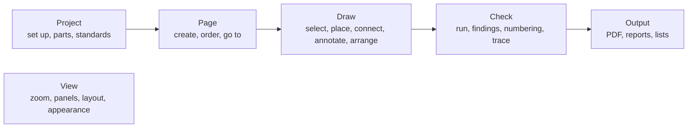

# Design language

**Status:** Draft v0.1 · **Date:** 2026-10-28 · **Decision:** [ADR-0031](../adr/0031-design-language-and-task-ordered-command-bar.md)
(Proposed; default in force for WP-S2.17) · **Work package:**
[WP-S2.17](../plan/specs/WP-S2.17-design-language-and-ui-polish.md) · **Part of:** ElektraWatt design document set

**Purpose.** This document is the visual and verbal language of ElektraWatt (EW): the pillars every screen follows, the
design tokens (colour, type, spacing, sizes, radii, borders, elevation, icons, motion, density) in light, dark and
high-contrast themes, the layout of the main window and its command surface, the component inventory with anatomy and
states, the canvas overlays, the wording rules, the order in which commands are offered, and the map from today's
window to the target. [16 UX and UI](16-ux-ui.md) says what the window does; this document says how it looks and
reads. Where the two differ on appearance, this one wins (ADR-0031 decision 1); behaviour stays doc 16's.

**Contents**
1. [Why a design language](#1-why-a-design-language)
2. [The user and the job](#2-the-user-and-the-job)
3. [Pillars](#3-pillars)
4. [Tokens](#4-tokens)
5. [Layout architecture](#5-layout-architecture)
6. [Components](#6-components)
7. [Canvas overlays](#7-canvas-overlays)
8. [Wording and capitalisation](#8-wording-and-capitalisation)
9. [Command progression](#9-command-progression)
10. [Migration map from the current window](#10-migration-map-from-the-current-window)
11. [The mockup and what the owner confirms](#11-the-mockup-and-what-the-owner-confirms)
12. [Sources](#12-sources)

---

## 1. Why a design language

The cycle-30 window checks (screenshots in the session's `win30`, `win30b` and `wincheck4` sets, named by file in §10)
show a window that works and looks unfinished: egui's default dark theme, eight menus and no toolbar, a hint strip under
the menu that repeats the status bar, pane titles that repeat their own tabs, a property grid where every row says
"= authored" and carries a clipped "edit" button beside internal fields (`$v`, keys, UUIDs), navigator rows with
"[QET grid]" in their text, a tab strip that hides navigators behind an arrow, dialogs whose buttons all weigh the
same, chips that collide on the canvas and highlights too faint on the white sheet. Each was a reasonable local
choice; together they are noise. The owner's brief: "Sleek, Clear, Minimalist, the eye being naturally drawn to
important element, logical menu progression." A design language turns those words into rules a lane can follow and a
test can check, so the next forty panels do not each invent their own look.

**What it governs.** Every surface drawn by `ew-ui`: chrome, panels, dialogs, overlays on the canvas, icons and the
words on them. **What it does not touch.** The sheet itself: page content renders print-true in every theme
(FR-UI-043, doc 16 §11.2); drawing fonts stay ADR-0028's; the PDF is unaffected.

**The reference the owner liked** (a CAM nesting application) works for its users because: commands sit in labelled
groups in task order on tabs, with large buttons for the frequent ones; a structure tree at top left with a property
grid under it; a visual palette at the right whose state colours and counts ("12 of 12", green when placed) answer
"what is left to do" at a glance; the canvas dominates with labelled sheets; a floating tool window serves the running
tool; and the status bar is quiet. EW keeps those principles and none of its branding or icons.

## 2. The user and the job

| Who | Comes from | Wants from the window |
|---|---|---|
| Panel-builder engineer (the pilot) | QElectroTech today, EPLAN at customers | Draw folios 101 to 103 and export the PDF without help (G-PP); see at a glance what is unfinished |
| EPLAN user | A ribbon since EPLAN 2022, navigators at left, properties dialogs | Commands where a ribbon would put them; EPLAN words (device, function, interruption point) |
| QET user | Menus, toolbars, an element panel at left | A familiar left panel; drag symbols from a palette |
| New user | Office, browsers | Labels on buttons, one obvious next step, no jargon in the chrome |

**The core loop** is: pick a page → place a symbol → wire it → fix its properties → check → export. It repeats
hundreds of times per project; the rest (project set-up, numbering, reports) happens a few times. The language is
built around the loop: it lives on one tab, its panels are open by default, and everything else is one click or one
key away. **Screens:** 1920 × 1080 is typical, 1280 × 800 at 100 % is the floor every default layout must serve,
remote desktop sessions are common (no reliance on animation or subtle gradients; NFR-PLAT-03).

## 3. Pillars

Ten pillars: the owner's five, expanded, and five that complete them. Each has rules a reviewer can check; "Do" and
"Don't" are written against things the current window does.

### P1 Calm by default (sleek)

The chrome recedes and the drawing leads. Neutral surfaces, hairline structure, no decoration.
- **Do** use the neutral ramp for every surface and border; let the white sheet on its grey surround be the brightest
  thing on screen. Separate regions with one 1-px border or a change of surface, never both plus a shadow.
- **Do** keep chrome flat (elevation 0); only floating things (menus, popovers, dialogs, toasts, canvas chips) cast a
  shadow.
- **Don't** use colour for structure (coloured headers, coloured panels, gradients), and don't draw boxes around
  groups that spacing already separates ("structure should be felt, not seen").

### P2 Clear

Every element says what it is with one name, in the user's words, and shows its state.
- **Do** give each pane one title, in its tab. Show values in the user's vocabulary: "Generated", not `[generated]`;
  "-X1031 : 21", not `#21` in the chrome.
- **Do** show state with icon + word + colour together (FR-UI-025): a finding is an icon and "Error", never a red tint
  alone.
- **Don't** expose implementation (`$v`, `pages|103`, UUIDs, `ew.iec.terminal@qet10`) outside the Advanced section
  and the scripting views.

### P3 Minimal

Every element earns its place by being used or by preventing a mistake. Show exceptions, not normal states.
- **Do** show a status only when it departs from the normal: provenance chips only on values that are not authored;
  the renderer field calm on the GPU and in warning colour on the CPU or WARP; findings counts only when non-zero.
- **Do** hide a command that cannot run in this build (a palette entry with "Parameter forms come with a later
  version" is noise); disable a command that cannot run *now*, with its reason.
- **Don't** repeat a fact in two places on the same screen (hint strip and status bar; pane heading and tab; a page
  folio in the tab, the status bar and the window title all at once is the limit).

### P4 The eye goes to what matters

One accent, one primary action per surface, a contrast budget.
- **Do** spend the accent on four things only: the primary action, keyboard focus, the selected state (in lists and on
  the canvas) and links. Selection uses the same blue in the navigator, the Properties header and the canvas, so the
  eye joins them.
- **Do** keep each view to at most three type sizes and three contrast levels (text primary, secondary, tertiary);
  NN/g: "If everything is contrasted, then nothing stands out."
- **Do** give each dialog, card and banner exactly one filled (primary) button; the others are secondary or subtle.
- **Don't** fill hovered menu items with saturated accent (today's View menu does); hover is a neutral overlay.

### P5 Task-ordered commands (logical progression)

Commands appear in the order of the work, left to right and top to bottom.
- **Do** order the command tabs Project → Page → Draw → Check → Output, then View (§9); inside Draw, the groups run
  Select → Place → Connect → Annotate → Arrange.
- **Do** keep the core loop on one tab (Draw), so placing, wiring and rotating never change tabs (Microsoft: "Users
  should spend most of their time on the Home tab").
- **Don't** move commands with the selection (no contextual tabs); disable what does not apply.

### P6 Progressive disclosure, two levels

Show the frequent; keep the rest one step away; never more than two levels.
- **Do** show the main properties of a selection first (tag, function text, part, location) and collapse the other
  categories; put internal fields under **Advanced**, off by default.
- **Do** open the bottom dock (Messages, Jobs, History) on demand from its status-bar field or key; keep it closed by
  default so the canvas has the height.
- **Don't** nest a third level (a dialog from a dialog from a menu); NN/g: designs beyond two disclosure levels
  "typically have low usability".

### P7 Consistent

One component per job, one token source, one name per thing.
- **Do** build every list row from the tree-row, table-row or property-row component (§6); never style a list locally.
- **Do** take every colour, size and radius from the token module; a literal in widget code fails review.
- **Do** use the same word for a command in the bar, the menu, the palette, the tooltip and the help.
- **Don't** introduce a second button style, a second chip style or a second dialog layout.

### P8 Keyboard-first, pointer-complete

Every action has a keyboard path; the frequent ones a key (NFR-A11Y-01, doc 16 §4.1).
- **Do** show the key in every tooltip and menu item; let the command search (Ctrl+K) reach every enabled action.
- **Do** draw a visible focus ring (2 px accent) on every focusable element; F6 cycles regions (§5.9).
- **Don't** make a hover the only way to reveal an action (a close button that appears on hover is also reachable by
  Ctrl+W and the context menu).

### P9 Accessible by construction

Contrast, names and patterns are part of the token and component definitions, not a later pass.
- **Do** meet 4.5:1 for text and 3:1 for icons, component boundaries and focus rings in light and dark, and 7:1 for
  text in high contrast (NFR-A11Y-04, WCAG 2.1 SC 1.4.3, 1.4.11); overlays reach 3:1 on the white sheet
  (NFR-A11Y-03). The token test (WP-S2.17 part 1) enforces it.
- **Do** give every icon-only control an accessible name and a tooltip, from the registry label.
- **Don't** carry meaning by colour alone, and don't put text under 11 px at 100 % scale.

### P10 Stable and honest

The window does not move under the user, and it never pretends.
- **Do** keep layouts fixed while working: no panel opens, closes or switches tab by itself, nothing steals focus
  (doc 16 §4.1 item 7), toasts appear where they always appear.
- **Do** say what a job, a check or a preview is based on ("as of rev 3"), and say when something is stale.
- **Don't** animate for decoration; motion only confirms a change (§4.12), and Reduce motion turns it off.

## 4. Tokens

### 4.1 Structure

Three layers, as in Fluent 2 and Material 3:
1. **Global tokens** are raw values with no meaning: the ramps of §4.2 to §4.4 (`slate-600`, `volt-600`). Widget code
   never names them.
2. **Alias tokens** carry meaning and have one value per theme: `color.text.secondary`, `color.surface.panel`,
   `space.3`, `radius.md`. Widgets use these.
3. **Component tokens** are the few values a component needs beyond aliases: `size.command.large`,
   `size.rail.button`. They are defined in terms of aliases where possible.

In `ew-ui` the tokens are one module (`theme/tokens.rs`): a `Tokens` struct per theme built from the ramps, applied to
egui's `Style` by `theme::apply` (§4.14) and passed to the canvas host for overlay colours. `tests/expected/tokens.txt`
is the blessed dump of every alias in every theme with its contrast against its declared background; a change to a
token is a reviewed diff of that file. Names in this document are the dump's names.

### 4.2 Neutral ramp: Slate

A cool grey (hue about 215°, very low chroma): crisp on screens and quiet next to the black-on-white drawing.
Linear's 2026 refresh moved to a warmer grey; ours stays cool so that the white sheet, not the chrome, reads as paper.

| Token | Hex | Token | Hex |
|---|---|---|---|
| `slate-0` | #FFFFFF | `slate-400` | #868E99 |
| `slate-25` | #FAFBFC | `slate-450` | #959DA8 |
| `slate-50` | #F4F5F7 | `slate-500` | #646C78 |
| `slate-100` | #ECEEF1 | `slate-600` | #555C66 |
| `slate-150` | #E3E6EA | `slate-700` | #3F454D |
| `slate-200` | #D5D9DF | `slate-750` | #343941 |
| `slate-300` | #BBC1C9 | `slate-800` | #2A2E34 |
| `slate-350` | #A7AEB8 | `slate-850` | #212429 |
|  |  | `slate-900` | #1A1D21 |
|  |  | `slate-950` | #121417 |

### 4.3 Accent ramp: Volt blue

One brand accent. Blue because it is the colour of selection and links on every platform, stays distinguishable under
the three common colour-vision deficiencies, and sits apart from the four highlight hues and the three severity hues.
`volt-600` is a little brighter and more saturated than Okabe–Ito blue #0072B2 (5.19:1), at 5.69:1 on white.

| Token | Hex | Use |
|---|---|---|
| `volt-50` | #E7F0FC | Selected row fill (light) |
| `volt-500` | #4A90EA | Pressed accent (dark) |
| `volt-600` | #0B63CE | **The accent** (light); canvas selection in both themes |
| `volt-700` | #0A58B8 | Hover on accent (light) |
| `volt-800` | #094C9F | Pressed on accent (light) |
| `volt-300` | #5AA2FF | **The accent** (dark) |
| `volt-250` | #77B3FF | Hover on accent (dark) |
| `volt-950` | #0B1A33 | Text on the dark accent |
| `volt-900` | #203754 | Selected row fill (dark) |

### 4.4 Semantic ramps

| Meaning | Light text and icon | Light subtle fill | Dark text and icon | Dark subtle fill |
|---|---|---|---|---|
| Error | #C42B3C | #FDECEE | #FF8A8A | #3A2226 |
| Warning | #9A5B00 (icon #B26A00) | #FFF4E0 | #F5B544 | #3A2E17 |
| Success | #17733F | #E8F5EE | #47C97E | #1D3326 |
| Info | the accent | `volt-50` | the accent | `volt-900` |

Severity is never colour alone: error is a circled cross and "Error", warning a triangle and "Warning", info a
circled "i" and "Info" (doc 16 §10.3). Success appears only for outcomes ("Done", "placed").

### 4.5 Alias colour tokens

Contrast is WCAG 2.1 relative luminance against the background in the "On" column; the token test recomputes every
row. **Text** needs 4.5:1, **non-text** (icons, boundaries, focus) 3:1.

| Alias | Light | Dark | On | Light ratio | Dark ratio | Use |
|---|---|---|---|---|---|---|
| `color.surface.chrome` | `slate-50` #F4F5F7 | `slate-900` #1A1D21 | — | — | — | Command bar, rails, status bar |
| `color.surface.panel` | `slate-0` #FFFFFF | `slate-850` #212429 | — | — | — | Docked panels |
| `color.surface.raised` | `slate-0` #FFFFFF | `slate-800` #2A2E34 | — | — | — | Menus, popovers, dialogs, toasts, palette |
| `color.surface.sunken` | `slate-50` #F4F5F7 | `slate-900` #1A1D21 | — | — | — | Table headers, the property filter |
| `color.surface.inverse` | `slate-900` #1A1D21 | `slate-100` #ECEEF1 | — | — | — | Tooltips, canvas chips, the tool HUD |
| `color.text.primary` | `slate-900` #1A1D21 | `slate-100` #ECEEF1 | panel | 16.9 | 13.4 | Values, labels of rows, body |
| `color.text.secondary` | `slate-600` #555C66 | `slate-350` #A7AEB8 | panel | 6.75 | 7.0 | Property labels, meta, shortcuts |
| `color.text.tertiary` | `slate-500` #646C78 | `slate-450` #959DA8 | chrome | 4.86 | 6.2 (5.0 on raised) | Placeholders, folio column, captions |
| `color.text.disabled` | `slate-350` #A7AEB8 | `slate-600` #555C66 | — | exempt | exempt | Disabled controls (WCAG exempts them) |
| `color.text.on_accent` | #FFFFFF | `volt-950` #0B1A33 | accent | 5.69 | 6.65 | Primary button label |
| `color.text.on_inverse` | `slate-100` #ECEEF1 | `slate-900` #1A1D21 | inverse | 14.6 | 14.6 | Tooltip and chip text |
| `color.accent` | `volt-600` #0B63CE | `volt-300` #5AA2FF | panel | 5.69 | 6.0 | Primary fill, focus ring, links, selected marks |
| `color.accent.hover` | `volt-700` #0A58B8 | `volt-250` #77B3FF | — | — | — | Primary hover |
| `color.accent.subtle` | `volt-50` #E7F0FC | `volt-900` #203754 | — | — | — | Selected row and tab fill |
| `color.border.subtle` | `slate-150` #E3E6EA | `slate-750` #343941 | — | — | — | Dividers inside a panel |
| `color.border.default` | `slate-200` #D5D9DF | `slate-700` #3F454D | — | — | — | Panel edges, raised-surface outline |
| `color.border.control` | `slate-400` #868E99 | `slate-400` #868E99 | panel | 3.31 | 4.7 | Text-field and checkbox boundary |
| `color.focus` | = `color.accent` | = `color.accent` | panel | 5.69 | 6.0 | 2-px focus ring |
| `color.state.hover` | `slate-900` at 6 % | #FFFFFF at 7 % | — | — | — | Hover overlay on any row or subtle button |
| `color.state.pressed` | `slate-900` at 10 % | #FFFFFF at 12 % | — | — | — | Pressed overlay |
| `color.error` … `color.success` | §4.4 | §4.4 | panel | 5.59, 5.43, 5.90 | 6.9, 8.6, 7.4 | Findings, outcomes |

Every value in both columns is recomputed by the token test of WP-S2.17 part 1; a token that fails is changed in the
dump, not exempted. Selected rows keep their text readable: primary text on `color.accent.subtle` is 14.7:1 (light)
and 10.4:1 (dark).

### 4.6 Canvas tokens

The sheet is white in every theme (FR-UI-043), so overlay colours are chosen once, against white and against the black
lines of the drawing.

| Alias | Value | Contrast on white | Shape (never colour alone) |
|---|---|---|---|
| `canvas.surround` | light `slate-150` #E3E6EA, dark #2E3238 | — | The grey around the sheet |
| `canvas.sheet_shadow` | elevation 1 (§4.10) | — | Lifts the sheet off the surround |
| `canvas.grid_dot` | #B8BEC7 | 1.9 (intentionally faint) | Dots; the pitch doubles below 8 points (as built) |
| `canvas.selection` | `volt-600` #0B63CE | 5.69 (3.69 on black lines) | Solid 2s-px outline with a 1s-px white casing, square handles |
| `canvas.hover` | `volt-600` | 5.69 | 1s-px dashed outline |
| `canvas.ghost` | `volt-600` at 60 % | — | The placed symbol's strokes, its label chip (§7.3) |
| `canvas.snap` | `volt-600` | 5.69 | Crosshair with a 6-px gap; CP ring 8s + 1 px |
| `canvas.highlight.1` | vermillion #D55E00 | 3.87 | 45° hatch halo, name chip |
| `canvas.highlight.2` | bluish green #009E73 | 3.42 | 135° hatch halo, name chip |
| `canvas.highlight.3` | reddish purple #CC79A7 | 3.06 | 0° hatch halo, name chip |
| `canvas.highlight.4` | dark orange #A86F00 | 4.25 | 90° hatch halo, name chip |
| `canvas.measure` | `color.text.primary` (light value) | 16.9 | 1-px line with end ticks; readout chip |
| `canvas.stale` | `slate-400` at 30 % | — | Diagonal hatch |
| `canvas.chip` | `color.surface.inverse` at 94 % | — | Rounded `radius.sm`, `type.small` |

`s` is FT-391's integer scale factor `max(1, ⌊ppp⌋)`. **This settles FT-506**: the highlight slots take doc 16 §10.3's
hues (the as-built Okabe–Ito orange and sky blue are 2.25:1 and 2.31:1 on white), and the slot geometry (an 8-pt band,
fill alpha 77, 2-pt hatch at a 6-pt pitch) stays as built. **The selection departs from §10.3's #0072B2** for the
accent #0B63CE, so the tree, the Properties header and the canvas show the selected object in one colour; both are
blue, and the CVD renders of NFR-A11Y-03 are re-run with the new value.

### 4.7 High-contrast themes

High contrast dark (MVP) and High contrast light (Should) follow doc 16 §11.1 and these rules: text ≥ 7:1 on its
surface (NFR-A11Y-04); every control, row and panel edge has a visible 1-px boundary of at least 3:1; selection and
focus use 2-px outlines, never fills alone; no translucency; shadows replaced by borders. Starting values: dark
surfaces #000000, text #FFFFFF, secondary text #D7DBE0, accent #79B8FF, borders #FFFFFF at 1 px; light surfaces
#FFFFFF, text #000000, secondary text #2A2E34, accent #0047A3, borders #000000. The token test asserts the rules,
so these values may move in part 1 only to pass it.

### 4.8 Typography

**Face.** Noto Sans, the bundled UI and drawing face (ADR-0028, ID-37), in two weights: Regular (bundled) and
**SemiBold** (to bundle: `NotoSans-SemiBold.ttf`, OFL-1.1, the same family and release as the bundled Regular).
Noto Sans Math stays the symbol fallback. Bold remains for the drawing styles, not the chrome. Noto Sans's lining
digits are tabular by default (each of 0 to 9 advances 572 units in the bundled Regular), so coordinates and counts
do not jitter; no monospace face is needed.

| Token | Size / line (px at 100 %) | Weight | Use |
|---|---|---|---|
| `type.caption` | 11 / 14 | Regular | Badges, key chips, the folio column's secondary text, tiny meta |
| `type.small` | 12 / 16 | Regular | Status bar, table cells in Compact, secondary lines, canvas chips |
| `type.body` | 13 / 18 | Regular | Default: tree rows, property values, menus, buttons, fields |
| `type.body.strong` | 13 / 18 | SemiBold | Active tab, the current page row, primary button, category headers |
| `type.title` | 15 / 20 | SemiBold | Dialog titles, the Properties header, empty-state titles |
| `type.display` | 20 / 26 | SemiBold | Start page and wizard headings only |

At most three sizes in one panel (NN/g). Sizes scale with the UI scale (100 % to 300 %); `type.caption` at 11 px is
the floor and the configurable minimum font size (FR-UI-027) raises every token proportionally.

### 4.9 Spacing and sizes

A 4-px grid. Spacing tokens (a subset of Carbon's scale):

| Token | px | Typical use |
|---|---|---|
| `space.1` | 2 | Icon to badge, hairline gaps |
| `space.2` | 4 | Inside chips; between icon and label in small buttons |
| `space.3` | 8 | Between controls in a row; row horizontal padding |
| `space.4` | 12 | Between command groups; panel inner padding |
| `space.5` | 16 | Dialog padding; indent per tree level |
| `space.6` | 24 | Between dialog sections; empty-state spacing |
| `space.7` | 32 | Start-page blocks |

| Size token | Comfortable | Compact | Notes |
|---|---|---|---|
| `size.row` | 28 | 24 | Tree, table, property, menu rows (Carbon's 32 and 24, between them) |
| `size.control` | 28 | 24 | Buttons, fields, dropdowns |
| `size.tab_row` | 32 | 32 | Command tabs and quick access |
| `size.command_row` | 52 | 36 | The row of command groups |
| `size.command.large` | 52 × ≥ 56 | — | Icon 24 over label; Compact has no large buttons |
| `size.command.small` | 24 | 24 | Icon 16 and label beside it |
| `size.dock_tab` | 32 | 28 | Canvas and bottom-dock tabs |
| `size.rail` | 40 | 36 | Rail width; rail buttons 32 / 28 square |
| `size.status` | 24 | 22 | Status bar |
| `size.panel.left` | 280 (220 to 480) | 260 | Navigator and Properties column |
| `size.panel.right` | 280 (220 to 480) | 260 | Palettes |

### 4.10 Radii, borders, elevation

| Token | Value | Use |
|---|---|---|
| `radius.sm` | 4 | Buttons, fields, chips on the canvas, key chips, focus ring |
| `radius.md` | 6 | Menus, popovers, tooltips, cards, palette thumbnails |
| `radius.lg` | 8 | Dialogs, toasts, the command palette |
| `radius.pill` | 999 | Count badges, the tool HUD |
| `border.width` | 1 px | Every border; focus rings are 2 px |
| `elevation.0` | none | Chrome and docked panels (flat) |
| `elevation.1` | light: offset 0,2 blur 6 rgba(16,24,40,0.12); dark: 0,2 blur 6 rgba(0,0,0,0.45) + `color.border.default` | Menus, popovers, tooltips, canvas chips, the sheet |
| `elevation.2` | light: 0,8 blur 24 rgba(16,24,40,0.18); dark: 0,8 blur 24 rgba(0,0,0,0.6) + `color.border.default` | Dialogs, toasts, the command palette |

In the dark theme a raised surface is lighter than the one below it and carries a 1-px border, because shadows barely
show on dark grey (Material's dark-theme guidance, with #121212 as its base surface).

### 4.11 Icons

- **Set.** Tabler Icons (MIT): 24-px grid, stroke-only paths with round caps and joins, 5,203 outline icons including
  nineteen `circuit-*` electrical glyphs. Vendored as SVG files at one pinned release (3.50.0, the current npm
  release at writing) under `assets/icons/tabler/` with its licence text, and converted by `cargo xtask gen-icons`
  into a generated Rust table of paths (`crates/ew-ui/src/icons/generated.rs`), drawn through epaint. No icon font and
  no icon crate (the egui wrapper crates track older egui releases).
- **EW glyphs.** Glyphs Tabler lacks (cable, terminal strip, interruption point, black box, potential, structure box,
  QET grid) are drawn by the project on the same grid with the same stroke rules, stored beside the vendored set under
  the application's licence, and go through the same generator.
- **Sizes and stroke.** `icon.sm` 16 px (rows, menus, chips), `icon.md` 20 px (rails, small command buttons, the
  status bar), `icon.lg` 24 px (large command buttons, empty states at 32). Stroke 1.5 px at 16 and 20 px, 1.75 px at
  24 px, multiplied by the pixels per point; Tabler's own stroke 2 at 24 px is too heavy beside 13-px text.
- **Colour.** Icons take the text colour of their context (`color.text.secondary` at rest, `color.text.primary` on
  hover and selection, `color.accent` only on the active rail button and a toggled tool); semantic icons take their
  semantic colour. No multicolour icons.
- **Meaning.** One icon per concept everywhere (the Pages icon is the same on the rail, in the menu and in the
  palette); an icon never replaces a label in the command bar's large buttons, on dialogs or in menus.

### 4.12 Motion

| Token | Value | Use |
|---|---|---|
| `motion.fast` | 80 ms | Hover and press fades (egui's `animation_time`) |
| `motion.base` | 140 ms | Popover, menu, toast and HUD fade in |
| `motion.none` | 0 | Everything when Reduce motion is on, and always on the CPU renderer (doc 16 §10.4) |

No slide-ins, no bounce, no animated zoom by default. A toast or a popover fades in; nothing moves the layout.

### 4.13 Density

Two modes in View ▸ Density, stored in the user settings (`density = "comfortable" | "compact"`):
- **Comfortable** (default): 28-px rows, the command row with large labelled buttons for each group's frequent
  commands. For learning and for the pilot preview.
- **Compact**: 24-px rows, every command a small button with its label beside the icon, smaller rails and dock tabs.
  For experts and small screens (the JetBrains "compact mode" precedent).

Density changes sizes only; colours, type sizes and the order of everything stay the same.

### 4.14 Mapping onto egui

`theme::apply(tokens, ctx)` sets, once per theme or density change:

| egui | Token |
|---|---|
| `Visuals::dark_mode` | theme is dark |
| `Visuals::panel_fill` | `color.surface.panel` (the chrome panels paint `color.surface.chrome` themselves) |
| `Visuals::window_fill`, `window_stroke`, `window_shadow`, `window_corner_radius` | `color.surface.raised`, `color.border.default` (dark) or none (light), `elevation.2`, `radius.lg` |
| `Visuals::popup_shadow`, `menu_corner_radius` | `elevation.1`, `radius.md` |
| `Visuals::extreme_bg_color`, `text_edit_bg_color` | the text-field fill (`color.surface.panel`) |
| `Visuals::selection` (`bg_fill`, `stroke`) | `color.accent.subtle`, `color.accent` |
| `Visuals::hyperlink_color`, `warn_fg_color`, `error_fg_color` | `color.accent`, `color.warning`, `color.error` |
| `Visuals::widgets.noninteractive` | `bg_stroke` `color.border.subtle`, `fg_stroke` `color.text.secondary` |
| `Visuals::widgets.inactive` | `weak_bg_fill` transparent (subtle buttons), `bg_fill` field fill, `bg_stroke` `color.border.control` for fields, `fg_stroke` `color.text.primary`, `corner_radius` `radius.sm`, `expansion` 0 |
| `Visuals::widgets.hovered`, `active`, `open` | the same plus `color.state.hover` / `color.state.pressed` overlays, `expansion` 0 (nothing grows under the pointer) |
| `Visuals::striped`, `indent_has_left_vline`, `button_frame`, `collapsing_header_frame` | false, false, true, false |
| `Visuals::disabled_alpha` | replaced by `color.text.disabled` in the component code |
| `Spacing::item_spacing`, `button_padding`, `interact_size`, `indent`, `menu_margin`, `window_margin`, `icon_width`, `icon_spacing` | (`space.3`, `space.2`), (`space.3`, `space.2`), y = `size.control`, `space.5`, `space.2`, `space.5`, 14, `space.2` |
| `Style::text_styles` | `Small` = `type.caption`, `Body` and `Button` = `type.body`, `Heading` = `type.title`, `Monospace` = Noto Sans at 12; `Name("small")`, `Name("strong")`, `Name("display")` for the rest; SemiBold through `FontFamily::Name("semibold")` |
| `Style::animation_time` | `motion.fast` |
| egui_tiles `Behavior` (`tab_bar_height`, `tab_bar_color`, `tab_bg_color`, `tab_text_color`, `tab_outline_stroke`, `tab_bar_hline_stroke`, `gap_width`, `resize_stroke`) | `size.dock_tab`, `color.surface.chrome`, panel or transparent, primary or secondary text, none, `color.border.subtle`, 1, `color.border.subtle` (hover: `color.accent`) |

Component code (the command bar, rows, chips) paints with the token values directly through `ew-ui`'s widget helpers;
none of it reads raw egui defaults.

## 5. Layout architecture

### 5.1 The window

```text
+-----------------------------------------------------------------------------------------------------+
| [=] [Save][Undo][Redo] |  Project  Page  [Draw]  Check  Output  View  |        [ Search commands  Ctrl+K ] | tab row 32
| Select | Symbol  Device   Terminal  Black  | Wire   Interruption  Wire     | Text  Graphic | Move Rotate ... | command row 52
|        |  ...    from part strip    box    |        point         marker   | Image  Box    | Mirror Delete   |
+----+-------------------------+---------------------------------------------------------+----+-------+
| Pg | Pages            [+][..] | 101 Power supply 1 x | 103 Power supply 3 |  [+]          | Sy |       |
| Dv | [ Filter pages         ] |  +----------------------------------------------------+ | Pt | (right|
| Cn | v Front matter          |  |     .   .   .  [ Place  -K1   R Rotate  Esc Done ]  | |    | rail, |
| Pt |   1   Title page        |  |   +-------------------------------------------+    | |    | closed|
| St |   2   Contents   gen    |  |   |  white sheet, print-true, frame and       |    | |    | by    |
| Cb | v Section 1 Wiring      |  |   |  title block, the drawing                 |    | |    | default)
| PL |   101 Power supply 1  <-|  |   |                                           |    | |    |       |
| Rb |   102 Power supply 2    |  |   +-------------------------------------------+    | |    |       |
|    |-------------------------|  |          grey surround                             | |    |       |
|    | -102G1          Error 1 |  +----------------------------------------------------+ |    |       |
|    | Power supply 24 V DC    |                                                         |    |       |
|    | v Main                  |                                                         |    |       |
|    |   Tag        -102G1  f  |                                                         |    |       |
|    |   Part       2904602 L  |                                                         |    |       |
|    | > Electrical            |                                                         |    |       |
+----+-------------------------+---------------------------------------------------------+----+-------+
| Click a connection point to start a wire     3 selected  102-H15 x 255.0 y 172.5 mm  QET 10 px  156 %  |
|                                              (x)2 (!)5   PDF 40 %   Saved   GPU   Page 6 of 36  (bell)  | status 24
+-----------------------------------------------------------------------------------------------------+
```

At 1280 × 800 and 100 %, Comfortable: command bar 84 px, status bar 24 px, left rail 40 + left column 280 px, right
rail 40 px, so the canvas area is 920 × about 640 px: 72 % of the width (ADR-0031 decision 5 requires at least 65 %).
At 1920 × 1080 it is 1560 × about 920 px.

### 5.2 The command surface

The **command bar** (ADR-0031 decision 3) has two rows on `color.surface.chrome`, separated from the content by one
`color.border.subtle` line.

**The tab row (32 px), left to right:**
1. **App menu button** (icon `menu-2`, name "Menu", Alt or F10): opens the full command tree as a menu (§9.2). On
   macOS it is hidden and the global menu bar carries the same tree.
2. **Quick access**: Save (Ctrl+S), Undo (Ctrl+Z), Redo (Ctrl+Y / Ctrl+Shift+Z) as 28-px icon buttons. Microsoft's
   ribbon guidance pairs every ribbon with an application button and a quick-access toolbar so file commands and
   undo never need a tab change.
3. **Tabs**: Project, Page, Draw, Check, Output, View, in `type.body`; the active one in `type.body.strong` with a
   2-px `color.accent` underline, the others `color.text.secondary`; hover shows the hover overlay. One click
   switches; the tab row is a `TabList` with `Tab` children for AccessKit.
4. **Command search**, right-aligned, 240 px: a field with a search icon and the placeholder "Search commands" and the
   key chip "Ctrl+K". Focusing it opens the command palette (§6.14) anchored under the field.

**The command row (52 px Comfortable, 36 px Compact)** shows the active tab's **groups**, left to right in task order,
separated by a 1-px `color.border.subtle` divider with `space.4` either side. Group names are not printed (the
Simplified Ribbon's choice); they are the tooltip of the divider region, the submenu names in the app menu and the
breadcrumb in the palette. Inside a group:
- **Large buttons** (Comfortable only): icon 24 over a label in `type.small`, 52 px high, at least 56 px wide, at most
  two per group, for the commands the user reaches for most (they are marked `size = Large` in the registry).
- **Small buttons**: icon 16 and label in `type.small` side by side, 24 px high, stacked two to a column in
  Comfortable, in one row in Compact.
- **Split buttons** for a command with variants (Mirror ▸ left to right, top to bottom; Graphic ▸ line, rectangle,
  circle): the main part runs the default, the chevron opens a menu.
- **Toggle commands** (Grid, Snap, Side by side) show their on state with `color.accent.subtle` fill and an accent
  icon.
- A command that cannot run now is drawn disabled with its reason as tooltip; nothing is hidden or reflowed by state,
  so the bar never jumps.

**Collapse.** Double-clicking a tab or pressing Ctrl+F1 collapses the bar to the tab row (32 px); a tab click then
shows its command row as a popover over the canvas until a command runs or Escape. **Overflow.** When the window is too
narrow, groups collapse from the right into a "More" split button, each into one button that opens the group as a
menu; the Draw tab's Select, Place and Connect groups never collapse.

**The bar is generated from the registry.** `ActionMeta` gains `placement: Option<Placement { tab, group, order,
size }>` and `icon: IconId`; the bar draws whatever has a placement, in that order. A registry test asserts that every
placed action has an icon, a label and a docs anchor, and that each tab's groups follow §5.3's order.

### 5.3 The tabs

| Tab | Groups, left to right (large buttons in **bold**) | Notes |
|---|---|---|
| Project | Project: **Project properties**, Structure identifiers… · Parts: **Import parts table…**, Project parts · Standards: Settings and schemes…, Company standard… · Import: Import QET project… | Set up once; New, Open and Save are in the app menu and quick access, never duplicated here |
| Page | Pages: **New page**, Page properties, Delete page · Order: Renumber pages…, Move up, Move down · Go: **Go to page or cell…** (Ctrl+G), Back (Alt+Left), Forward (Alt+Right), Follow cross-reference (F) | Folio navigation and page set-up |
| **Draw** (home) | Select: **Select** · Place: **Symbol…** (I), **Device from part…** (Shift+I), Terminal strip…, Black box (B) · Connect: **Wire** (W), Interruption point (P), Wire marker (Shift+W) · Annotate: Text (T), Graphic ▾, Image…, Structure box (Shift+B) · Arrange: Move (M), Rotate (R), Mirror ▾ (X, Y), Delete · Edit: Properties (E), Change symbol… | The core loop; the tab that opens with a project |
| Check | Run: **Run checks**, Check scheme ▾ · Findings: **Messages**, Next finding (F8), Previous finding (Shift+F8) · Numbering: **Renumber devices…**, Freeze tag, Unfreeze tag · Trace: Highlight potential… (Ctrl+Shift+H), Clear highlights | Make it right before output |
| Output | PDF: **Export PDF…**, Print… · Reports: **Report blocks**, Open generated page · Lists: Parts list, Wire list, Terminal diagram (open their generated pages) · Jobs: Jobs | Everything that leaves the project |
| View | Zoom: **Fit page** (Home), Zoom in, Zoom out, Actual size · Show: Grid, Frame statistics · Panels: Navigators ▾, Properties, Messages, Jobs, History, Notifications · Layout: Side by side, Workspaces ▾, Reset layout · Appearance: Theme ▾, Density ▾, UI scale ▾ | Never needed for the work itself |

Commands of later packages join their tab's group when they exist (Macro… in Place, Cable in Connect, Waivers in
Findings); a new group needs a design-language review. The Edit commands Cut, Copy, Paste, Duplicate and Select all
live in the app menu's Edit, the canvas context menu and their keys, as everywhere else.

### 5.4 Left: the rail, the navigator and Properties

- **The navigator rail** (`size.rail`, `color.surface.chrome`, a 1-px border on its right) shows one 32-px icon
  button per navigator, in this order: Pages, Devices, Connections, Potentials, Terminal strips, Cables, PLC, Report
  blocks, then the rest of `NavKind` (Messages excepted, it lives in the bottom dock). The active one has
  `color.accent.subtle` fill and an accent icon; each has an accessible name and a tooltip with its key. This
  replaces the overflowing tab strip (FT-509): every navigator is one click and one name away, however many are shown.
  Clicking the active one collapses the column (the canvas gets the width); Ctrl+1 to Ctrl+8 select by position.
- **The navigator panel** (`size.panel.left`, `color.surface.panel`): a 32-px header with the navigator's name in
  `type.body.strong` and its two or three actions as icon buttons at the right (New page, view mode ▾); the filter
  field; the tree (§6.6). No second heading.
- **Properties** is docked under the navigator in the same column (45 % of its height, resizable, the split
  remembered per workspace): header (§6.8), then the rows. It shows the selection, whatever selected it.
- Both remain egui_tiles panes: the rail is a view of the left tab group whose own tab bar is not drawn, so docking,
  the workspace file `ew.workspace/1` and its determinism stay as built (doc 16 §2.5).

### 5.5 Centre: canvas tabs, canvas, HUD

- **Canvas tabs** (`size.dock_tab`) on `color.surface.chrome`: `<folio> <title>` in `type.body`, the active tab on
  `color.surface.panel` with `type.body.strong` and a 2-px accent top line; badges as icons with names (generated: a
  `sparkles` icon; QET grid: a small "QET" caption badge); the close button shows on the active and hovered tab (and is
  Ctrl+W for all); "+" (New tab, Ctrl+T) at the end. No "Page view" heading above them.
- **The canvas**: the white sheet with `elevation.1` on `canvas.surround`; overlays per §7.
- **The tool HUD**: while a tool other than Select is active, a pill (`radius.pill`, `color.surface.inverse` at 94 %,
  `elevation.1`) floats 12 px under the tab bar, centred: the tool's icon and name, its target in `type.body.strong`
  ("Place  -X1031:21"), then its keys as key chips ("R Rotate", "V Variant", "Esc Done"). It never takes focus, never
  covers the pointer (it moves to the bottom of the canvas while the pointer is within 48 px of it) and is the
  floating tool window of the owner's reference, reduced to what the running tool needs. The one-sentence prompt stays
  in the status bar (§5.8); the hint strip under the menu is removed.

### 5.6 Right: the palettes

A right rail (`size.rail`) with **Symbols** and **Parts**; the right column is closed by default and opens to
`size.panel.right` on a rail click (or View ▸ Panels), staying open until closed. **Symbols** shows the library's
symbols as a filterable grid of 72-px thumbnails with names; a click arms Place with that symbol, a drag drops it.
**Parts** shows the project's parts with a thumbnail and a state count, the reference's idea in our domain: "2 of 4
placed" in `color.text.secondary`, turning to `color.success` with a check icon when every function of the part is
placed, `color.warning` with "unplaced" when the part has functions not on any page. The Insert ▸ Symbol picker (I)
stays as the keyboard path; both open the same Place tool.

### 5.7 Bottom: Messages, Find, Jobs, History, Preview

One tab group below the canvas (WP-S2.09 D14), **closed by default**. It opens when the user asks: the status-bar
findings field or F8 opens Messages, the job field opens Jobs, Ctrl+F opens Find, a bulk preview opens Preview (the
user asked for it), Ctrl+H History. It closes with its tabs' close buttons or Escape in an empty pane, and remembers
its height.

### 5.8 The status bar

24 px on `color.surface.chrome`, `type.small`, separated from the content by a 1-px line. Fields are text, with a
1-px divider only where two numbers would touch. Left: the **prompt** (the active tool's status hint, doc 16 §3.6),
`color.text.secondary`. Right, in this order:

| Field | Shown | Example | Click |
|---|---|---|---|
| Selection | when not empty | "3 selected" | — |
| Cursor | pointer over the canvas or grid cursor shown | "102-H15 · x 255.0 y 172.5 mm" | Go to (Ctrl+G) |
| Grid | always | "QET 10 px" / "4 mm" / "Grid off" | View ▸ Grid |
| Zoom | always | "156 %" | Fit page |
| Findings | when any count is non-zero | error icon "2", warning icon "5", info icon "1" in their colours | opens Messages |
| Job | 200 ms after a job starts | "PDF export 40 %" with a 2-px progress line | opens Jobs |
| Save state | always | "Saved" (secondary) / "Unsaved changes" with a dot (primary) / "Read-only" (warning) | — |
| Renderer | always (FR-UI-034, NFR-PLAT-03) | "GPU" (tertiary) / "CPU" or "WARP" (warning colour, tooltip says why) | About |
| Page | always | "Page 6 of 36" | Go to |
| Notifications | when the log is not empty | bell icon with "2" | opens the log |

The language field leaves the status bar (it stays on the start page and in Settings): a setting that changes once a
year does not belong in the busiest strip of the window.

### 5.9 Focus order

F6 and Shift+F6 cycle: command bar → left rail → navigator → Properties → canvas group(s) → right column (when open)
→ bottom dock (when open) → status bar (doc 16 §10.2, with the command bar first). Within the command bar, Left and
Right move between tabs, Tab moves into the command row, arrow keys move between commands.

### 5.10 Narrow windows

The minimum window is 1024 × 640. Below 1280 px of width the right column overlays the canvas instead of pushing it;
below 1100 px the command row's groups collapse from the right (§5.2); the left column never shrinks below 220 px and
collapses to its rail by a click on the active rail button.

## 6. Components

### 6.1 States

Every interactive component has these states, drawn the same way everywhere:

| State | Drawing |
|---|---|
| Rest | As specified per component |
| Hover | `color.state.hover` overlay; no size change (`expansion` 0) |
| Pressed | `color.state.pressed` overlay |
| Selected | `color.accent.subtle` fill; text and icon primary; in lists a 2-px accent bar at the left edge while focused |
| Focused (keyboard) | 2-px `color.focus` ring, 1 px outside the element, `radius` of the element + 1 |
| Disabled | `color.text.disabled` text and icon, no hover; the reason as tooltip (doc 16 §2.4) |
| Error | `color.error` boundary on fields, the message under the field with an icon |
| Busy | the label stays; a 12-px spinner replaces the icon; never disables the window |

### 6.2 Buttons

| Kind | Rest | Use |
|---|---|---|
| Primary | `color.accent` fill, `color.text.on_accent`, `type.body.strong` | The one recommended action of a dialog, card, banner or empty state |
| Secondary | `color.surface.panel` fill, 1-px `color.border.default`, `color.text.primary` | Every other dialog action |
| Subtle | no fill, no border, `color.text.primary`; hover overlay | Toolbar-like actions inside panels, toasts, rows |
| Danger | Secondary with `color.error` text; Primary with `color.error` fill only in a confirmation of a destructive step | Discard…, Delete…, Purge… |

`size.control` high, `radius.sm`, padding `space.3` horizontally, minimum width 72 px for text buttons. An icon in a
text button sits left at `icon.sm`. Labels are verbs (§8). The default (Enter) button is the primary one, never a
destructive one.

### 6.3 Icon buttons and command buttons

Icon buttons are Subtle buttons with only an icon (28 or 24 px square, `icon.md` or `icon.sm`) and always have an
accessible name and a tooltip "<Label> (<key>)". Command buttons are §5.2's large, small and split buttons; their
tooltip is "<Label> (<key>). <One-sentence description>. F1: help" (doc 16 §3.3).

### 6.4 Tabs

Three kinds, one look: text in `type.body`, active in `type.body.strong` with a 2-px accent line (under the command
tabs, over the canvas and dock tabs), inactive in `color.text.secondary`, hover overlay, no boxes around inactive
tabs, close button only on dock and canvas tabs. Tab bars never carry a second heading.

### 6.5 Fields

28 / 24 px, `color.surface.panel` fill, 1-px `color.border.control`, `radius.sm`, `space.3` padding; placeholder in
`color.text.tertiary`; focus replaces the border with the 2-px focus ring. Search and filter fields carry a leading
search icon and a trailing clear button when not empty. Numbers align right and carry their unit as a suffix in
`color.text.secondary` ("2.5 mm²").

### 6.6 Tree rows

`size.row`, indent `space.5` per level, then: a 16-px chevron column (empty for leaves), a 16-px kind icon
(`color.text.secondary`), the **key column** in `color.text.tertiary` with tabular digits (a page's folio, a device's
location prefix; fixed width per tree), the **title** in `color.text.primary` with ellipsis and a tooltip when cut,
and right-aligned **badges** (a finding count badge, "generated" as an icon, "QET" as a caption badge). Group rows
(sections) are `type.body.strong` in `color.text.secondary`. The row of the page shown in the focused canvas tab is
`type.body.strong`. Selected rows take the Selected state; selection synchronisation with the canvas (doc 16 §5.4)
shows the same accent in both. Pending or muted rows (WP-S2.09 D9) use `color.text.tertiary` and an outline icon.

### 6.7 Table and grid rows

Header row `size.row` on `color.surface.sunken`, `type.small` in `type.body.strong` weight, `color.text.secondary`,
sort indicator icon; body rows `size.row` with one 1-px `color.border.subtle` line under each row, no vertical lines,
no zebra stripes (the line and the hover are enough at this density); numbers right-aligned with tabular digits;
editable cells show a field on focus or double-click; the selected row takes the Selected state; the focused cell a
focus ring.

### 6.8 Property rows and the Properties header

**Header** (on `color.surface.panel`, `space.4` padding): the kind icon at `icon.md`, the object's printed name in
`type.title` ("-102G1", "103 Power supply 3"), one secondary line in `color.text.secondary` (function text, or kind and
cell, "Terminal · 101-D2"), and at the right the findings badge if any. For a multi-selection: "3 devices" and the
mixed-selection rule of doc 16 §17. Then a filter field ("Filter properties").

**Categories**: collapsible headers in `type.body.strong`, `color.text.secondary`, with a chevron; **Main** (the
fields of the kind marked primary in the field catalogue: tag, function text, part, location, page title, number)
open, the others closed and remembered per kind. **Advanced** (the record's internal members: `$v`, ID, key, source
reference, lineage, form UUIDs, counters) exists only when Settings ▸ Show advanced properties is on.

**Rows** (`size.row`): label in `color.text.secondary`, left-aligned in a 40 % column with ellipsis and tooltip; value in
`color.text.primary`; unit as suffix; at the far right a **provenance icon only when the value is not authored**:
derived (`math-function`), inherited (`arrow-down-right`), overridden (`pencil` with a dot), frozen (`snowflake`),
library (`book`), generated (`sparkles`), each with its chip text as tooltip and accessible description (doc 16 §6.2).
An authored value shows nothing, so the eye finds the exceptions. An empty authored value shows an em dash in
`color.text.tertiary`. **Editing is in place:** a click or Enter on an editable value turns it into its editor;
Enter commits, Escape cancels; a read-only value shows no editor and its reason as tooltip. There are no "edit"
buttons. The row's actions (Reset to derived, Freeze, Why this value?) are in its context menu and in a "…" icon
button that appears on hover and focus. Two rows never share a label: duplicate labels (today "Tag" and "Tag",
"Parts" and "Parts") get distinct names in the field catalogue.

### 6.9 Cards

A card is a bounded panel inside a pane for one object that waits for a decision (the preview card of WP-S2.05 and
WP-S2.09): `color.surface.panel`, 1-px `color.border.default`, `radius.md`, `space.4` padding, a title in
`type.body.strong`, a summary line, then the lists, then the actions right-aligned with one Primary (Apply) and one
Secondary (Cancel). A stale card shows the warning banner style inside its top (§6.11).

### 6.10 Toasts and the notifications log

Toasts stack at the bottom right of the window, `space.4` above the status bar, newest at the bottom, at most three
(WP-S2.09 D6): 360 px wide, `color.surface.raised`, `elevation.2`, `radius.lg`, `space.4` padding. Anatomy: semantic
icon, one line of `type.body` (two at most), an optional Subtle action ("Undo", "Open"), a close icon button. They
fade in (`motion.base`) and leave after 8 s; hovering or focusing one pauses it; every toast is also in the log, so no
action depends on its time (NFR-A11Y-04). The **notifications log** is a popover from the status bar's bell: a list
in tree-row style, newest first, each with its time, message and still-valid actions; "Clear" at its foot.

### 6.11 Banners

A banner is for a state of the whole project (read-only, recovery pending, integrity findings, GPU fallback): full
width under the command bar, `size.control` + `space.3` padding, the semantic subtle fill, its icon, one sentence, one
Primary action and at most one Subtle action, a close button when it may be dismissed. One banner at a time; a second
state queues behind it with a count ("1 more").

### 6.12 Dialogs

Modal only when the work cannot continue without the answer (doc 16 §4.1). `color.surface.raised`, `elevation.2`,
`radius.lg`, width 440 px (small) or 640 px (forms), `space.5` padding, a backdrop of `slate-900` at 24 %. Anatomy:
**title** in `type.title`, left-aligned, phrased as the question or the task ("Recover unsaved changes?"); **body** in
`type.body`, at most three short paragraphs, facts as a two-column label and value list; **footer** with buttons
right-aligned in the platform's order (Windows: Primary then Secondary; macOS and Linux: Secondary then Primary), a
destructive action left-aligned and apart from the others. Escape cancels; Enter runs the Primary; the first focus is
the Primary unless it is destructive. No close cross: Cancel is the way out.

### 6.13 Menus and context menus

`color.surface.raised`, `elevation.1`, `radius.md`, `space.2` padding, rows of `size.row`: a 16-px icon column (empty
when the item has no icon, so labels align), the label, the key in `color.text.secondary` right-aligned, a chevron for
a submenu. Hover and keyboard highlight use the hover overlay, not the accent; a checked item shows a check icon in the
icon column. Separators are 1-px `color.border.subtle` lines with `space.2` above and below. Disabled items keep their
place and show their reason as tooltip.

### 6.14 The command palette

Opened by Ctrl+K, Ctrl+Shift+P or the command search field: 560 px wide, anchored under the search field (or centred
at the top fifth of the window when opened by key), `elevation.2`, `radius.lg`. The search field is 36 px with a
search icon and no title above it. Result rows (32 px): icon, label with the matched characters in `type.body.strong`,
the breadcrumb in `color.text.tertiary` ("Draw · Place"), the key as key chips at the right. Disabled results follow
the enabled ones with their reason in `color.text.secondary`. Actions that cannot run from the window in this build
are not listed (P3); scripts still reach them.

### 6.15 The symbol and part palettes

Grid of tiles, 88 × 104 px: a 72-px thumbnail on `color.surface.sunken` with `radius.md`, the name in `type.small`
under it (two lines, ellipsis), for parts the state line ("2 of 4 placed" in `color.text.secondary`; "All placed" in
`color.success` with a check icon; "1 unplaced" in `color.warning` with its icon). Hover lifts nothing; it shows the
hover overlay and a tooltip with the full name, library and version. Selected or armed: Selected state with an accent
2-px border.

### 6.16 Chips and badges

| Kind | Drawing | Example |
|---|---|---|
| Count badge | `radius.pill`, `type.caption` SemiBold, semantic fill or `slate-150` | the "2" on the error icon, a finding count on a tree row |
| Status badge | `radius.sm`, subtle semantic fill, icon + word in `type.caption` | "Pending", "Stale", "Read-only" |
| Key chip | `radius.sm`, 1-px `color.border.default`, `type.caption`, `color.text.secondary` | "Ctrl+K", "R" |
| Canvas chip | §7.4 | "-X1031:21", "24VDC-1" |

### 6.17 Empty states

Every list that can be empty says why and what to do, centred in its pane: a 32-px icon in `color.text.tertiary`, one
line in `type.body.strong` ("No jobs yet"), one sentence in `color.text.secondary` ("Exports you start appear here
with their progress."), and at most one action. A filter with no hits says "No pages match "abc"" with a Clear button.

### 6.18 Tooltips

`color.surface.inverse`, `color.text.on_inverse`, `type.small`, `radius.md`, max 320 px, after 500 ms of hover or at
once on keyboard focus; the label, the key in a lighter tone, one sentence, and "F1: help" when a topic exists.

### 6.19 Progress

Determinate: a 2-px accent line under the job field and in the Jobs row, with the percentage as text. Indeterminate: a
12-px spinner beside the text. A finished job names its outcome as a status badge (Done, Cancelled, Failed) next to
its result (FT-510).

## 7. Canvas overlays

All overlays follow FT-391's scale rule (`s = max(1, ⌊ppp⌋)`), live in the session-only overlay layers (never in the
display list), and keep 3:1 on the white sheet.

### 7.1 Selection, hover and handles

Selection: a 2s-px `canvas.selection` outline around the representation's bounds with a 1s-px white casing outside it,
so it reads over black lines; handles are 6s-px squares, white fill, 1s-px accent stroke. Hover: a 1s-px dashed accent
outline (4s on, 4s off). A selected object under the pointer shows the selection only.

### 7.2 Connection points, snap and the grid cursor

CP rings 8s + 1 px in the accent on hover and while a wire tool is active; the snap target a crosshair with a 6-px gap;
the keyboard grid cursor a 1s-px accent cross with its cell in the status bar (doc 16 §3.6). A hovered CP shows a
tooltip with its printed label and its function (FT-512's tooltip half): "-X1031 : 21 · terminal · 24VDC-1".

### 7.3 Ghosts and their labels

The Place ghost draws the symbol's strokes in `canvas.ghost` (the accent at 60 %), its CPs as rings, and **one** label
chip with the tag it will get (FT-507: one label per tag), placed by the rule of §7.4. Autoconnect proposals draw as
1s-px dashed accent lines.

### 7.4 Chips and labels on the canvas

Canvas chips (preview chips, ghost labels, highlight name chips, measurement readouts) are `canvas.chip`: inverse
surface at 94 %, `type.small`, `radius.sm`, `space.2` by `space.1` padding, `elevation.1`. **Placement rule**, in
order: the preferred anchor (above right of the target, 8 px off), then below right, above left, below left; a
position is rejected if it overlaps another chip, the tool HUD, the frame-statistics panel or the pointer's 16-px
box (FT-508); if all four fail, the chip is drawn at the preferred anchor with 80 % opacity. Chips never cover the
target's own printed text when an alternative exists.

### 7.5 Highlights

As built (doc 16 §10.3 as-built note) with the hues of §4.6: halos with hatch patterns and a name chip, at most four,
painted above the overlays and below the chips.

### 7.6 Measurement

A 1-px `canvas.measure` line with 6-px end ticks perpendicular to it and a readout chip at its middle ("42.0 mm,
dx 40.0 dy 12.7"); the readout is also announced by the live region (doc 16 §10.1).

### 7.7 The frame-statistics panel

A diagnostic: `canvas.chip` style at the canvas's top right, `type.caption` with tabular digits, never covering the
HUD; chips avoid it (§7.4).

## 8. Wording and capitalisation

1. **Sentence case everywhere**: menus, buttons, tabs, titles, tooltips, column headers ("Export PDF…", "Go to page
   or cell…", "Renumber devices…"). Proper nouns, standards and codes keep their case: PDF, QET, EPLAN, IEC 81346,
   PLC, CSV, -102G1, 24VDC-1.
2. **Commands are verbs** ("Export PDF", "Run checks", "Import parts table"); panels and tabs are nouns ("Pages",
   "Messages", "Properties"); groups are nouns of the job ("Place", "Connect" are both: they name the activity).
3. **The ellipsis** (the single character "…", U+2026, never three full stops) ends a command that needs more input
   before it acts (it opens a dialog or a picker): "Symbol…", "Export PDF…". A command that acts at once has none.
4. **One word per concept**, the standard's or EPLAN's (doc 16 §4.1 item 8): device, function, connection point,
   interruption point, potential, structure identifier, part. QET and EPLAN synonyms are palette aliases, not labels.
5. **Messages say what happened, why, and what to do** (NFR-UX-07), in that order, in at most two sentences: "The PDF
   was not written: the folder does not exist. Choose another folder." No "Please", no exclamation marks, no blame,
   no codes without words (a rule ID follows the words: "Contact T55 switches N-55 without its line conductor
   (EW-POT-013)").
6. **Numbers**: a space between value and unit ("2.5 mm²", "69 %", as built); counts with their noun ("3 devices",
   "1 selected"); "of" for positions ("Page 6 of 36", "2 of 4 placed").
7. **Keys** are written as on the keyboard with "+" ("Ctrl+Shift+H"); macOS shows the symbols (⌘⇧H) through the
   same registry text (doc 16 §3.9 Keyboard).
8. **Abbreviations** only where the user's documents use them (PE, N, L1, IP for interruption point in EPLAN usage);
   tooltips spell them out the first time ("IP: interruption point").
9. **Titles of dialogs** are the question or the task, not the subject: "Recover unsaved changes?", not "Recovery".
   Primary buttons repeat the verb ("Recover", "Export", "Discard"), never "OK" or "Yes".

## 9. Command progression

### 9.1 The order of work

The tabs, the app menu and the palette's categories all follow the order in which a project is made:



Within a tab, groups run left to right in the order of the job; within a group, the most frequent command comes
first and is the large one. The user's eye reads the bar like a checklist.

### 9.2 The app menu

The app menu holds every action of the registry, in this order: **File** (New project, Open…, Open recent ▸, Close,
Save, Save as…, Save a copy…, Import ▸, Export ▸, Settings…, Quit), **Edit** (Undo, Redo, Cut, Copy, Paste,
Duplicate, Delete, Select all, Find and replace…, Properties), then **Project**, **Page**, **Draw**, **Check**,
**Output** and **View** with the same groups and order as the tabs (a group is a submenu when it holds more than three
commands, otherwise a separated block), then **Window** and **Help**. The as-built menus map onto it: Insert becomes
Draw; Tools dissolves (Command palette into View and the search field, Settings into File, Renumber devices into
Check); Window and Help stay.

### 9.3 The palette

The palette's categories are the tab names, and each result shows its breadcrumb ("Check · Numbering"), so a command
found by search also teaches where it lives in the bar.

## 10. Migration map from the current window

Screenshots are referenced by file name from the cycle-30 window checks (`win30`), their follow-up (`win30b`) and
the cycle-29 jobs check (`wincheck4`). The part column names WP-S2.17's part that changes it.

| Screenshot | Today | Target | Part |
|---|---|---|---|
| 01-open.png, f9-screen.png | egui default dark theme; no accent hierarchy; flat greys | Tokens of §4 in light (default follows the system), dark and high contrast | 1 |
| 01-open.png | Eight menus, no toolbar | Command bar with the app menu, quick access, six tabs and search (§5.2) | 2 |
| 01-open.png, 32-place-chip-mid.png | A hint strip under the menu repeating the status bar ("Select: Click to select…") | Removed; prompt in the status bar, the running tool in the HUD (§5.5) | 2 |
| 01-open.png | "Pages" heading over a "Pages" tab; "Page view" heading over the canvas tabs | One name per pane, in its tab or rail button (§5.4, §5.5) | 3 |
| 06-nav-connections.png, 16-highlight-103.png | Left tab strip "Pages, Connections, Te ▸" hides navigators (FT-509) | Navigator rail (§5.4) | 3 |
| 01-open.png, 19b-terminal-tooltip.png | Tree rows "1 Title Page [QET grid]", "[generated]" in text, truncated titles, no icons | Kind icon, folio column, title, icon and caption badges (§6.6) | 3 |
| 01-open.png, 19b-terminal-tooltip.png, 21-props-scrolled.png | Every property row "= authored" and a clipped "edit" button; `$v`, Key "pages\|103", UUIDs; "Tag" and "Parts" twice | Provenance icon only when not authored, in-place editing, Advanced hidden, distinct labels (§6.8) | 3 |
| 01-open.png | Status bar "Click to select… · 1 (1 of 36) · 69 % · QET 10 px · saved · GPU DX12 · EN" | Ordered fields, exceptions emphasised, findings chips, no language field (§5.8) | 3 |
| 02-palette-nav.png | Palette with a grey "Command palette" title and disabled entries "Parameter forms come with a later version" | Search-field palette with breadcrumbs and key chips; unrunnable actions not listed (§6.14) | 4 |
| 04-view-menu.png, 22-insert-menu.png, 03-window-menu.png | Hovered and checked menu items filled with saturated blue; no icons; three-dot ellipses | Neutral hover, check icons, icon column, "…" (§6.13, §8) | 4 |
| 36-quit-prompt.png | Grey centred title "Unsaved changes", three equal buttons left-aligned | "Save changes to <project> before closing?"; Save (Primary), Don't save (Danger, left), Cancel (§6.12) | 4 |
| 37-recovery-dialog.png | A banner and a dialog say the same thing; grey centred title; equal buttons | One dialog first ("Recover unsaved changes?", Recover as Primary); the banner only for the read-only state that follows (§6.11, §6.12) | 4 |
| 35-notifications.png | Notifications popover with a grey title and a "Close" button over the Properties | Toast stack bottom right; the log as a bell popover from the status bar (§6.10) | 4 |
| 34-jobs-pane.png, wincheck4 a2-jobs-pane.png | "Jobs" heading over "No jobs"; finished entries without an outcome word (FT-510) | Empty state; outcome badges; the bottom dock closed by default (§5.7, §6.17, §6.19) | 4 |
| 30-picker.png | Insert symbol modal with raw IDs ("ew.iec.terminal@qet10 [embedded]") | Picker rows with thumbnail, name and library in tertiary text; the Symbols palette at the right (§5.6, §6.15) | 4 |
| 32-place-chip-mid.png, 33-place-chip-near-stats.png | Ghost label printing the tag twice and the preview chip over it; chips under the statistics panel (FT-507, FT-508) | One ghost label; the chip placement rule (§7.3, §7.4) | 5 |
| 16-highlight-103.png, 15c-highlight.png | Orange and sky-blue highlight slots below 3:1 on white (FT-506) | §10.3's hues (§4.6) | 5 |
| 19-terminal-selected.png | Selection a blue box; no CP tooltip (FT-512) | Selection with casing and handles; CP tooltip (§7.1, §7.2) | 5 |
| 34-jobs-pane.png | Frame-statistics panel in egui's default tooltip style overlapping the drawing | Diagnostic chip style, avoided by chips (§7.7) | 5 |
| every screenshot | No icons anywhere | Tabler set plus EW glyphs (§4.11) | 6 |

## 11. The mockup and what the owner confirms

A self-contained HTML mockup of the target main window (light theme with a dark toggle; command bar, rails, Pages
navigator, Properties, canvas with a schematic sketch, the HUD, the status bar and the bottom dock collapsed) is handed
to the owner outside the repository with this document. It is a picture of the tokens and the layout, not a
specification: where the two differ, this document wins. **The owner confirms** the look (ADR-0031 is Proposed until
then) and may change three taste choices without reopening the design: the accent hue (any blue between #0B63CE and
#0072B2 passes every test), the default density, and the default theme (follow the system, as specified, or light).

## 12. Sources

Design systems and guidance:
- Microsoft, Windows ribbon guidelines: https://learn.microsoft.com/en-us/windows/win32/uxguide/cmd-ribbons
- Microsoft, the Simplified Ribbon: https://support.microsoft.com/en-us/outlook/use-the-simplified-ribbon
- Fluent 2, design tokens and colour tokens: https://fluent2.microsoft.design/design-tokens,
  https://fluent2.microsoft.design/color-tokens
- IBM Carbon, spacing scale and data-table row sizes: https://carbondesignsystem.com/elements/spacing/overview/,
  https://carbondesignsystem.com/components/data-table/style/
- Material Design, dark theme (#121212, lighter raised surfaces): https://m2.material.io/design/color/dark-theme
- Siemens iX, themes (classic and brand, light and dark): https://ix.siemens.io/docs/styles/theming/usage-designers
- JetBrains, the new UI and compact mode: https://www.jetbrains.com/help/rider/New_UI.html
- Linear, "How we redesigned the Linear UI" (three theme variables, LCH):
  https://linear.app/blog/how-we-redesigned-the-linear-ui; "Behind the latest design refresh" (chrome recedes,
  "structure should be felt not seen"): https://linear.app/now/behind-the-latest-design-refresh
- NN/g, visual hierarchy: https://www.nngroup.com/articles/visual-hierarchy-ux-definition/; progressive disclosure:
  https://www.nngroup.com/articles/progressive-disclosure/
- W3C, WCAG 2.1 SC 1.4.11 non-text contrast: https://www.w3.org/WAI/WCAG21/Understanding/non-text-contrast.html

ECAD and CAD tools:
- EPLAN Platform API, the ribbon (since 2022): https://eplan.help/en-us/infoportal/content/api/2023/TheRibbon.html
- Autodesk Fusion API, workspaces, toolbar tabs and panels: https://help.autodesk.com/cloudhelp/ENU/Fusion-360-API/files/UserInterface_UM.htm
- KiCad 8 schematic editor manual (hierarchy navigator and Properties at left): https://docs.kicad.org/8.0/es/eeschema/eeschema.html

Icons and egui:
- Tabler Icons (MIT): https://github.com/tabler/tabler-icons; npm release 3.50.0
- Lucide licence (ISC; Feather-derived icons MIT): https://lucide.dev/license
- Phosphor core (MIT): https://github.com/phosphor-icons/core; egui-phosphor (MIT OR Apache-2.0, egui 0.32):
  https://docs.rs/egui-phosphor
- egui 0.37 `Visuals`, `WidgetVisuals`, `Spacing`: https://docs.rs/egui/0.37.0/egui/style/struct.Visuals.html,
  https://docs.rs/egui/0.37.0/egui/style/struct.WidgetVisuals.html, https://docs.rs/egui/0.37.0/egui/style/struct.Spacing.html
- egui_tiles 0.18 `Behavior`: https://docs.rs/egui_tiles/0.18.0/egui_tiles/trait.Behavior.html
- egui_kittest 0.37 (snapshots with the `snapshot` and `wgpu` features, accessibility checks):
  https://docs.rs/egui_kittest/0.37.0/egui_kittest/

Project documents: [16 UX and UI](16-ux-ui.md) §2.4, §3, §4.1, §6, §10, §11; [ADR-0014](../adr/0014-gui-toolkit-egui.md);
[ADR-0028](../adr/0028-default-drawing-fonts.md); [requirements](02b-requirements-extended.md) FR-UI-001, FR-UI-018,
FR-UI-025, FR-UI-027, FR-UI-034, FR-UI-043; [non-functional requirements](02c-nonfunctional-requirements.md)
NFR-A11Y-01 to NFR-A11Y-04, NFR-UX-01, NFR-UX-04, NFR-UX-07, NFR-PLAT-03.
