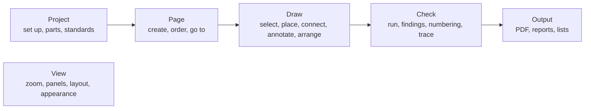

# Design language

**Status:** v1.3, accepted 2026-10-28; amended 2026-10-30: the macOS notes of the app button, the dialog button order and the key notation kept for portability only (decision log ID-880); amended 2026-10-30, cycle 38: the open-CP marker and its neutral-ink ruling and the black-box pin texts (§4.6), the picker rows (§5.6), one finding count for the toast, the status bar and the chip (§5.8, §6.10), the delete toast (§6.10), decision log ID-872, ID-875, ID-876, ID-879; amended 2026-10-29, cycle 35: the chooser list's two uses as built (§6.22, decision log ID-782, ID-817) and FT-595's ruling on a merged 0 V/PE potential's colour (§7.5, ID-828); amended 2026-10-29, cycle 34: the component tokens `size.dialog.label` and `color.badge.on_chrome` (§4.15, §6.12, §6.16), the dark dialog backdrop black at 40 % (§6.12, FT-557) and FT-581's ruling on the disabled Primary (§6.1), as built; amended 2026-10-29, cycle 33: the data grid's cursor bar, scroll handle and editor baseline (§6.21) and the disabled Primary (§6.1) as built (decision log ID-764, ID-775); v1.3: WP-S2.17 parts 2 to 5 as built, the deliberate departures noted in §5.2, §5.4, §5.5, §5.8, §6.8, §6.10, §6.12, §6.14, §6.16, §7.1, §7.2 and §9.2, the Project tab's Import group and the search placeholder in §5.2 and §5.3 (decision log ID-747 to ID-757); v1.2: the bottom dock's height as built, `size.dock.bottom_min` (decision log ID-743); v1.1 adds the built widgets (§4.15, §6.21 to §6.25); cycle-31 design pass: the
Messages pane has no table mode as built, the History keys as built, the follow-ups numbered (decision log ID-727, ID-732) · **Date:** 2026-10-28 · **Decision:** [ADR-0031](../adr/0031-design-language-and-task-ordered-command-bar.md)
(Accepted) · **Visual reference:** [the mockup](assets/design-language-mockup.html) (approved by the owner) · **Work package:**
[WP-S2.17](../plan/specs/WP-S2.17-design-language-and-ui-polish.md) · **Part of:** ElektraWatt design document set

**Purpose.** This document is the visual and verbal language of ElektraWatt (EW): the pillars every screen follows, the
design tokens (colour, type, spacing, sizes, radii, borders, elevation, icons, motion, density) in light, dark and
high-contrast themes, the layout of the main window and its command surface, the component inventory with anatomy and
states, the canvas overlays, the wording rules, the order in which commands are offered, and the map from today's
window to the target. [16 UX and UI](16-ux-ui.md) says what the window does; this document says how it looks and
reads. Where the two differ on appearance, this one wins (ADR-0031 decision 1); behaviour stays doc 16's. The
owner-approved mockup is the visual reference: every value here is the mockup's, and where this text and the mockup
differ the mockup wins, except for the two corrections that requirements force (§11).

**Contents**
1. [Why a design language](#1-why-a-design-language)
2. [The user and the job](#2-the-user-and-the-job)
3. [Pillars](#3-pillars)
4. [Tokens](#4-tokens)
5. [Layout architecture](#5-layout-architecture)
6. [Components](#6-components)
7. [Canvas overlays](#7-canvas-overlays)
8. [Wording and capitalisation](#8-wording-and-capitalisation)
9. [Command progression](#9-command-progression)
10. [Migration map from the current window](#10-migration-map-from-the-current-window)
11. [The mockup, the visual reference](#11-the-mockup-the-visual-reference)
12. [Sources](#12-sources)

---

## 1. Why a design language

The cycle-30 window checks (screenshots in the session's `win30`, `win30b` and `wincheck4` sets, named by file in §10)
show a window that works and looks unfinished: egui's default dark theme, eight menus and no toolbar, a hint strip under
the menu that repeats the status bar, pane titles that repeat their own tabs, a property grid where every row says
"= authored" and carries a clipped "edit" button beside internal fields (`$v`, keys, UUIDs), navigator rows with
"[QET grid]" in their text, a tab strip that hides navigators behind an arrow, dialogs whose buttons all weigh the
same, chips that collide on the canvas and highlights too faint on the white sheet. Each was a reasonable local
choice; together they are noise. The owner's brief: "Sleek, Clear, Minimalist, the eye being naturally drawn to
important element, logical menu progression." A design language turns those words into rules a lane can follow and a
test can check, so the next forty panels do not each invent their own look.

**What it governs.** Every surface drawn by `ew-ui`: chrome, panels, dialogs, overlays on the canvas, icons and the
words on them. **What it does not touch.** The sheet itself: page content renders print-true in every theme
(FR-UI-043, doc 16 §11.2); drawing fonts stay ADR-0028's; the PDF is unaffected.

**The reference the owner liked** (a CAM nesting application) works for its users because: commands sit in labelled
groups in task order on tabs, with large buttons for the frequent ones; a structure tree at top left with a property
grid under it; a visual palette at the right whose state colours and counts ("12 of 12", green when placed) answer
"what is left to do" at a glance; the canvas dominates with labelled sheets; a floating tool window serves the running
tool; and the status bar is quiet. EW keeps those principles and none of its branding or icons.

## 2. The user and the job

| Who | Comes from | Wants from the window |
|---|---|---|
| Panel-builder engineer (the pilot) | QElectroTech today, EPLAN at customers | Draw folios 101 to 103 and export the PDF without help (G-PP); see at a glance what is unfinished |
| EPLAN user | A ribbon since EPLAN 2022, navigators at left, properties dialogs | Commands where a ribbon would put them; EPLAN words (device, function, interruption point) |
| QET user | Menus, toolbars, an element panel at left | A familiar left panel; drag symbols from a palette |
| New user | Office, browsers | Labels on buttons, one obvious next step, no jargon in the chrome |

**The core loop** is: pick a page → place a symbol → wire it → fix its properties → check → export. It repeats
hundreds of times per project; the rest (project set-up, numbering, reports) happens a few times. The language is
built around the loop: it lives on one tab, its panels are open by default, and everything else is one click or one
key away. **Screens:** 1920 × 1080 is typical, 1280 × 800 at 100 % is the floor every default layout must serve,
remote desktop sessions are common (no reliance on animation or subtle gradients; NFR-PLAT-03).

## 3. Pillars

Ten pillars: the owner's five, expanded, and five that complete them. Each has rules a reviewer can check; "Do" and
"Don't" are written against things the current window does.

### P1 Calm by default (sleek)

The chrome recedes and the drawing leads. Neutral surfaces, hairline structure, no decoration.
- **Do** use the neutral ramp for every surface and border; let the white sheet on its grey surround be the brightest
  thing on screen. Separate regions with one 1-px border or a change of surface, never both plus a shadow.
- **Do** keep chrome flat (elevation 0); only floating things (menus, popovers, dialogs, toasts, canvas chips) cast a
  shadow.
- **Don't** use colour for structure (coloured headers, coloured panels, gradients), and don't draw boxes around
  groups that spacing already separates ("structure should be felt, not seen").

### P2 Clear

Every element says what it is with one name, in the user's words, and shows its state.
- **Do** give each pane one title, in its tab. Show values in the user's vocabulary: "Generated", not `[generated]`;
  "-X1031 : 21", not `#21` in the chrome.
- **Do** show state with icon + word + colour together (FR-UI-025): a finding is an icon and "Error", never a red tint
  alone.
- **Don't** expose implementation (`$v`, `pages|103`, UUIDs, `ew.iec.terminal@qet10`) outside the Advanced section
  and the scripting views.

### P3 Minimal

Every element earns its place by being used or by preventing a mistake. Show exceptions, not normal states.
- **Do** show a status only when it departs from the normal: provenance chips only on values that are not authored;
  the renderer field calm on the GPU and in warning colour on the CPU or WARP; findings counts only when non-zero.
- **Do** hide a command that cannot run in this build (a palette entry with "Parameter forms come with a later
  version" is noise); disable a command that cannot run *now*, with its reason.
- **Don't** repeat a fact in two places on the same screen (hint strip and status bar; pane heading and tab; a page
  folio in the tab, the status bar and the window title all at once is the limit).

### P4 The eye goes to what matters

One accent, one primary action per surface, a contrast budget.
- **Do** spend the accent on four things only: the primary action, keyboard focus, the selected or active state (in
  lists, on the rail, the active tool and on the canvas) and links; plus two marks, the product mark in the app
  button and the 6-px unsaved dot on a canvas tab. Selection uses the same blue in the navigator, the Properties
  header and the canvas, so the eye joins them.
- **Do** keep each view to at most three type sizes and three contrast levels (text primary, secondary, tertiary);
  NN/g: "If everything is contrasted, then nothing stands out."
- **Do** give each dialog, card and banner exactly one filled (primary) button, and the command row at most one: the
  tab's next step at its right end (§5.2); the others are secondary or subtle.
- **Don't** fill hovered menu items with saturated accent (today's View menu does); hover is a neutral overlay.

### P5 Task-ordered commands (logical progression)

Commands appear in the order of the work, left to right and top to bottom.
- **Do** order the command tabs Project → Page → Draw → Check → Output, then View (§9); inside Draw, the groups run
  Select → Place → Connect → Annotate → Arrange.
- **Do** keep the core loop on one tab (Draw), so placing, wiring and rotating never change tabs (Microsoft: "Users
  should spend most of their time on the Home tab").
- **Don't** move commands with the selection (no contextual tabs); disable what does not apply.

### P6 Progressive disclosure, two levels

Show the frequent; keep the rest one step away; never more than two levels.
- **Do** show the main properties of a selection first (tag, function text, part, location) and collapse the other
  categories; put internal fields under **Advanced**, off by default.
- **Do** open the bottom dock (Messages, Jobs, History) on demand from its status-bar field, the rail's History
  button or its key; keep it closed by default so the canvas has the height.
- **Don't** nest a third level (a dialog from a dialog from a menu); NN/g: designs beyond two disclosure levels
  "typically have low usability".

### P7 Consistent

One component per job, one token source, one name per thing.
- **Do** build every list row from the tree-row, table-row or property-row component (§6); never style a list locally.
- **Do** take every colour, size and radius from the token module; a literal in widget code fails review.
- **Do** use the same word for a command in the bar, the menu, the palette, the tooltip and the help.
- **Don't** introduce a second button style, a second chip style or a second dialog layout.

### P8 Keyboard-first, pointer-complete

Every action has a keyboard path; the frequent ones a key (NFR-A11Y-01, doc 16 §4.1).
- **Do** show the key in every tooltip and menu item; let the command search (Ctrl+K) reach every enabled action.
- **Do** draw a visible focus ring (2 px accent) on every focusable element; F6 cycles regions (§5.9).
- **Don't** make a hover the only way to reveal an action (a close button that appears on hover is also reachable by
  Ctrl+W and the context menu).

### P9 Accessible by construction

Contrast, names and patterns are part of the token and component definitions, not a later pass.
- **Do** meet 4.5:1 for text and 3:1 for icons, component boundaries and focus rings in light and dark, and 7:1 for
  text in high contrast (NFR-A11Y-04, WCAG 2.1 SC 1.4.3, 1.4.11); overlays reach 3:1 on the white sheet
  (NFR-A11Y-03). The token test (WP-S2.17 part 1) enforces it.
- **Do** give every icon-only control an accessible name and a tooltip, from the registry label.
- **Don't** carry meaning by colour alone, and don't put text under 11 px at 100 % scale.

### P10 Stable and honest

The window does not move under the user, and it never pretends.
- **Do** keep layouts fixed while working: no panel opens, closes or switches tab by itself, nothing steals focus
  (doc 16 §4.1 item 7), toasts appear where they always appear.
- **Do** say what a job, a check or a preview is based on ("as of rev 3"), and say when something is stale.
- **Don't** animate for decoration; motion only confirms a change (§4.12), and Reduce motion turns it off.

## 4. Tokens

### 4.1 Structure

Three layers, as in Fluent 2 and Material 3:
1. **Global tokens** are raw values with no meaning: the ramps of §4.2 to §4.4 (`slate-600`, `volt-600`). Widget code
   never names them.
2. **Alias tokens** carry meaning and have one value per theme: `color.text.secondary`, `color.surface.panel`,
   `space.3`, `radius.md`. Widgets use these.
3. **Component tokens** are the few values a component needs beyond aliases: `size.command.large`,
   `size.quick_access`. They are defined in terms of aliases where possible.

In `ew-ui` the tokens are one module (`theme/tokens.rs`): a `Tokens` struct per theme built from the ramps, applied to
egui's `Style` by `theme::apply` (§4.14) and passed to the canvas host for overlay colours. `tests/expected/tokens.txt`
is the blessed dump of every alias in every theme with its contrast against its declared background; a change to a
token is a reviewed diff of that file. Names in this document are the dump's names.

### 4.2 Neutral ramp: Slate

A cool grey (hue about 215°, very low chroma): crisp on screens and quiet next to the black-on-white drawing.
Linear's 2026 refresh moved to a warmer grey; ours stays cool so that the white sheet, not the chrome, reads as paper.

| Token | Hex | Token | Hex |
|---|---|---|---|
| `slate-0` | #FFFFFF | `slate-400` | #868E99 |
| `slate-25` | #FAFBFC | `slate-450` | #959DA8 |
| `slate-50` | #F4F5F7 | `slate-500` | #646C78 |
| `slate-100` | #ECEEF1 | `slate-600` | #555C66 |
| `slate-150` | #E3E6EA | `slate-700` | #3F454D |
| `slate-200` | #D5D9DF | `slate-750` | #343941 |
| `slate-300` | #BBC1C9 | `slate-800` | #2A2E34 |
| `slate-350` | #A7AEB8 | `slate-850` | #212429 |
|  |  | `slate-900` | #1A1D21 |
|  |  | `slate-950` | #121417 |

### 4.3 Accent ramp: Volt blue

One brand accent. Blue because it is the colour of selection and links on every platform, stays distinguishable under
the three common colour-vision deficiencies, and sits apart from the four highlight hues and the three severity hues.
`volt-600` is a little brighter and more saturated than Okabe–Ito blue #0072B2 (5.19:1), at 5.69:1 on white.

| Token | Hex | Use |
|---|---|---|
| `volt-50` | #E7F0FC | Selected row fill (light) |
| `volt-500` | #4A90EA | Pressed accent (dark) |
| `volt-600` | #0B63CE | **The accent** (light); canvas selection in both themes |
| `volt-700` | #0A58B8 | Hover on accent (light) |
| `volt-800` | #094C9F | Pressed on accent (light) |
| `volt-300` | #5AA2FF | **The accent** (dark) |
| `volt-250` | #77B3FF | Hover on accent (dark) |
| `volt-950` | #0B1A33 | Text on the dark accent |
| `volt-900` | #203754 | Selected row fill (dark) |

### 4.4 Semantic ramps

| Meaning | Light text and icon | Light subtle fill | Dark text and icon | Dark subtle fill |
|---|---|---|---|---|
| Error | #C42B3C | #FDECEE | #FF8A8A | #3A2226 |
| Warning | #9A5B00 (icon #B26A00) | #FFF4E0 | #F5B544 | #3A2E17 |
| Success | #17733F | #E8F5EE | #47C97E | #1D3326 |
| Info | the accent | `volt-50` | the accent | `volt-900` |

Severity is never colour alone: error is a circled cross and "Error", warning a triangle and "Warning", info a
circled "i" and "Info" (doc 16 §10.3). Success appears only for outcomes ("Done", "placed").

### 4.5 Alias colour tokens

Contrast is WCAG 2.1 relative luminance against the background in the "On" column; the token test recomputes every
row. **Text** needs 4.5:1, **non-text** (icons, boundaries, focus) 3:1.

| Alias | Light | Dark | On | Light ratio | Dark ratio | Use |
|---|---|---|---|---|---|---|
| `color.surface.chrome` | `slate-50` #F4F5F7 | `slate-900` #1A1D21 | — | — | — | The command bar's tab row, rails, canvas-tab bar, status bar |
| `color.surface.panel` | `slate-0` #FFFFFF | `slate-850` #212429 | — | — | — | The command row, docked panels, the command search field |
| `color.surface.raised` | `slate-0` #FFFFFF | `slate-800` #2A2E34 | — | — | — | Menus, popovers, dialogs, toasts, palette |
| `color.surface.sunken` | `slate-50` #F4F5F7 | `slate-900` #1A1D21 | — | — | — | Table headers, the segmented control's track, the panel's count badges (the dock-tab counts use `color.badge.on_chrome` since cycle 34, §4.15) |
| `color.surface.inverse` | `slate-900` #1A1D21 | `slate-100` #ECEEF1 | — | — | — | Tooltips, canvas chips, the tool HUD (opaque) |
| `color.text.primary` | `slate-900` #1A1D21 | `slate-100` #ECEEF1 | panel | 16.9 | 13.4 | Values, labels of rows, body |
| `color.text.secondary` | `slate-600` #555C66 | `slate-350` #A7AEB8 | panel | 6.75 | 7.0 | Property labels, meta, shortcuts |
| `color.text.tertiary` | `slate-500` #646C78 | `slate-450` #959DA8 | chrome | 4.86 | 6.2 (5.0 on raised) | Placeholders, folio column, captions |
| `color.text.disabled` | `slate-350` #A7AEB8 | `slate-600` #555C66 | — | exempt | exempt | Disabled controls (WCAG exempts them) |
| `color.text.on_accent` | #FFFFFF | `volt-950` #0B1A33 | accent | 5.69 | 6.65 | Primary button label |
| `color.text.on_inverse` | `slate-100` #ECEEF1 | `slate-900` #1A1D21 | inverse | 14.6 | 14.6 | Tooltip and chip text |
| `color.accent` | `volt-600` #0B63CE | `volt-300` #5AA2FF | panel | 5.69 | 6.0 | Primary fill, focus ring, links, selected marks |
| `color.accent.hover` | `volt-700` #0A58B8 | `volt-250` #77B3FF | — | — | — | Primary hover |
| `color.accent.subtle` | `volt-50` #E7F0FC | `volt-900` #203754 | — | — | — | Selected row and tab fill |
| `color.border.subtle` | `slate-150` #E3E6EA | `slate-750` #343941 | — | — | — | Dividers inside a panel |
| `color.border.default` | `slate-200` #D5D9DF | `slate-700` #3F454D | — | — | — | Panel edges, raised-surface outline |
| `color.border.control` | `slate-400` #868E99 | `slate-400` #868E99 | panel | 3.31 | 4.7 | Text-field and checkbox boundary |
| `color.focus` | = `color.accent` | = `color.accent` | panel | 5.69 | 6.0 | 2-px focus ring |
| `color.state.hover` | `slate-900` at 6 % | #FFFFFF at 7 % | — | — | — | Hover overlay on any row or subtle button |
| `color.state.pressed` | `slate-900` at 10 % | #FFFFFF at 12 % | — | — | — | Pressed overlay |
| `color.error` … `color.success` | §4.4 | §4.4 | panel | 5.59, 5.43, 5.90 | 6.9, 8.6, 7.4 | Findings, outcomes |

Every value in both columns is recomputed by the token test of WP-S2.17 part 1; a token that fails is changed in the
dump, not exempted. Selected rows keep their text readable: primary text on `color.accent.subtle` is 14.7:1 (light)
and 10.4:1 (dark); the accent label of an active command on `color.accent.subtle` is 4.95:1 and 4.64:1. Other pairs
the mockup uses: secondary text on chrome 6.19:1, warning text on its subtle fill 4.98:1 (dark 7.31:1), the HUD's
text on the inverse surface 14.6:1 and its hint at 80 % opacity 10.3:1.

### 4.6 Canvas tokens

The sheet is white in every theme (FR-UI-043), so overlay colours are chosen once, against white and against the black
lines of the drawing.

| Alias | Value | Contrast on white | Shape (never colour alone) |
|---|---|---|---|
| `canvas.surround` | light `slate-150` #E3E6EA, dark #2E3238 | — | The grey around the sheet |
| `canvas.sheet_shadow` | elevation 1 (§4.10) | — | Lifts the sheet off the surround |
| `canvas.grid_dot` | #B8BEC7 | 1.9 (intentionally faint) | Dots; the pitch doubles below 8 points (as built) |
| `canvas.selection` | `volt-600` #0B63CE | 5.69 (3.69 on black lines) | Solid 2s-px outline with a 1s-px white casing, 8s-px square corner handles |
| `canvas.hover` | `volt-600` | 5.69 | 1s-px dashed outline |
| `canvas.ghost` | `volt-600` at 60 % | — | The placed symbol's strokes, its label chip (§7.3) |
| `canvas.snap` | `volt-600` | 5.69 | Crosshair with a 6-px gap; CP ring 8s + 1 px |
| `canvas.open_cp` | `volt-600` | 5.69 | A (4s + 1)-px hollow square with an s-px rim on each connection point without a connection on the page (screen only; drawn while a grid step is at least 4 points on screen; FT-705). *Ruled in cycle 38 (decision log ID-879):* a subdued neutral ink, not the accent, so the squares on a valve page do not read as selection handles; fluid ports keep the marker; built in the cycle-38 fix round (FT-745) |
| `canvas.highlight.1` | vermillion #D55E00 | 3.87 | 45° hatch halo, name chip filled with the hue |
| `canvas.highlight.2` | bluish green #009E73 | 3.42 | 135° hatch halo, name chip filled with the hue |
| `canvas.highlight.3` | reddish purple #CC79A7 | 3.06 | 0° hatch halo, name chip filled with the hue |
| `canvas.highlight.4` | dark orange #A86F00 | 4.25 | 90° hatch halo, name chip filled with the hue |
| `canvas.measure` | `color.text.primary` (light value) | 16.9 | 1-px line with end ticks; readout chip |
| `canvas.conflict` | `color.error` (light value) #C42B3C | 5.59 | A 2s-px line over each wire of a potential whose EW-POT-001 finding stands (screen only, under the highlights; FT-675) |
| `canvas.stale` | `slate-400` at 30 % | — | Diagonal hatch |
| `canvas.chip` | `color.surface.inverse` at 94 % | — | Rounded `radius.sm`, `type.small` |
| `canvas.highlight.label` | #000000 | 5.43, 6.14, 6.86, 4.94 on the four hues | `type.caption` SemiBold on a highlight name chip |

`s` is FT-391's integer scale factor `max(1, ⌊ppp⌋)`. **This settles FT-506**: the highlight slots take doc 16 §10.3's
hues (the as-built Okabe–Ito orange and sky blue are 2.25:1 and 2.31:1 on white), and the slot geometry (an 8-pt band,
fill alpha 77, 2-pt hatch at a 6-pt pitch) stays as built. **The selection departs from §10.3's #0072B2** for the
accent #0B63CE, so the tree, the Properties header and the canvas show the selected object in one colour; both are
blue, and the CVD renders of NFR-A11Y-03 are re-run with the new value. **Highlight name chips** are filled with
their slot's hue (`radius.sm`, 20 px high), as in the mockup; their label is black, because white on the four hues
is 3.87, 3.42, 3.06 and 4.25:1, under NFR-A11Y-04's 4.5:1 for text (one of the two corrections of §11).

*As built (cycle 38; decision log ID-872, ID-876).* The open-CP squares are a session overlay, never in the display list, print or PDF. On paper, a black box's pins print their CP designations as stored, with the PLC address after one space when the CP is bound ("1 I0.0"); pin texts never move, and a cross-reference that would overlap one drops below it (FT-707).

### 4.7 High-contrast themes

High contrast dark (MVP) and High contrast light (Should) follow doc 16 §11.1 and these rules: text ≥ 7:1 on its
surface (NFR-A11Y-04); every control, row and panel edge has a visible 1-px boundary of at least 3:1; selection and
focus use 2-px outlines, never fills alone; no translucency; shadows replaced by borders. Starting values: dark
surfaces #000000, text #FFFFFF, secondary text #D7DBE0, accent #79B8FF, borders #FFFFFF at 1 px; light surfaces
#FFFFFF, text #000000, secondary text #2A2E34, accent #0047A3, borders #000000. The token test asserts the rules,
so these values may move in part 1 only to pass it.

### 4.8 Typography

**Face.** Noto Sans, the bundled UI and drawing face (ADR-0028, ID-37), in two weights: Regular (bundled) and
**SemiBold** (to bundle: `NotoSans-SemiBold.ttf`, OFL-1.1, the same family and release as the bundled Regular).
Noto Sans Math stays the symbol fallback. Bold remains for the drawing styles, not the chrome. Noto Sans's lining
digits are tabular by default (each of 0 to 9 advances 572 units in the bundled Regular), so coordinates and counts
do not jitter; no monospace face is needed.

| Token | Size / line (px at 100 %) | Weight | Use |
|---|---|---|---|
| `type.caption` | 11 / 14 | Regular | Badges, key chips, the folio column's secondary text, tiny meta |
| `type.small` | 12 / 16 | Regular | Status bar, command-button labels, canvas and dock tabs, table cells, property labels, secondary lines, canvas chips |
| `type.label` | 12 / 16 | SemiBold, upper case, +0.02 em tracking | Panel headers ("PROJECT", "PROPERTIES") and property category headers, in `color.text.secondary` |
| `type.body` | 13 / 18 | Regular | Default: tree rows, property values, menus, buttons, fields |
| `type.body.strong` | 13 / 18 | SemiBold | Active command tab, the app button's name, primary button, toast titles, the current page row |
| `type.title` | 15 / 20 | SemiBold | Dialog titles, the Properties header, empty-state titles |
| `type.display` | 20 / 26 | SemiBold | Start page and wizard headings only |

At most three sizes in one panel (NN/g). Sizes scale with the UI scale (100 % to 300 %); `type.caption` at 11 px is
the floor and the configurable minimum font size (FR-UI-027) raises every token proportionally.

### 4.9 Spacing and sizes

A 4-px grid for layout, with one 2-px step inside components (the mockup's 6-px icon gap and 10-px dock-tab
padding). Spacing tokens (a subset of Carbon's scale plus `space.icon`):

| Token | px | Typical use |
|---|---|---|
| `space.1` | 2 | Icon to badge, hairline gaps |
| `space.2` | 4 | Between rail buttons; either side of a command-group divider; inside key chips |
| `space.icon` | 6 | Between an icon and its label (small and Compact command buttons, the app button, primary buttons, status fields, dock tabs); chip and value-cell padding |
| `space.3` | 8 | Between an icon and the text in tree rows and toasts; the gutters of the tab row, the command row and the rail |
| `space.4` | 12 | Row and panel horizontal padding; command-tab padding; primary-button padding; toast padding; canvas inset of the toast and zoom control |
| `space.5` | 16 | Dialog padding; the HUD's distance from the canvas bottom |
| `space.6` | 24 | Between dialog sections; empty-state spacing |
| `space.7` | 32 | Start-page blocks |

| Size token | Comfortable | Compact | Notes |
|---|---|---|---|
| `size.row` | 28 | 24 | Tree, table, property and menu rows (Carbon's 32 and 24, between them) |
| `size.control` | 28 | 28 | Primary and secondary buttons, the filter field |
| `size.control.inline` | 24 | 24 | Property value cells, the command search field, segmented items, the app button, quick access |
| `size.tab_row` | 32 | 32 | Command tabs and quick access |
| `size.command_row` | 52 | 36 | The row of command groups |
| `size.command.large` | 46 × ≥ 52 | 28 high | Comfortable: icon 20 over label, 2-px gap; Compact: icon 20 beside label |
| `size.command.small` | 24 | 24 | Icon 16 and label beside it |
| `size.quick_access` | 28 × 24 | 28 × 24 | Save, Undo, Redo |
| `size.search` | 280 × 24 | 280 × 24 | The command search field |
| `size.panel_header` | 32 | 32 | Navigator, Properties and palette headers |
| `size.dock_tab_bar` | 32 | 32 | Canvas-tab bar (tabs 28 high) and the bottom dock's tab row |
| `size.rail` | 40 | 40 | Rail width; rail buttons 32 square |
| `size.status` | 26 | 26 | Status bar; its fields 22 high |
| `size.panel.left` | 280 (220 to 480) | 280 | Navigator and Properties column; Properties takes half its height |
| `size.panel.right` | 280 (220 to 480) | 280 | Palettes |
| `size.dock.bottom` | 184 | 184 | The mockup's reference height of the bottom dock only (the mockup's `.bottom` rule, checked by DL8); as built the dock does not open at it (§5.7, ID-743) |
| `size.dock.bottom_min` | 300 | 300 | The bottom dock's least shown height: in the vertical split that holds the page view, the child holding a bottom pane is shown at least this high, at most 2/3 of the split; display only, the user's shares stay the layout (§5.7, ID-743) |
| `size.property_label` | 96 | 96 | The property label column |

Density changes the row height, the command row and the command buttons' layout only (§4.13).

### 4.10 Radii, borders, elevation

| Token | Value | Use |
|---|---|---|
| `radius.sm` | 4 | Quick-access and other icon buttons, property value cells, segmented items, key chips, status fields, canvas chips, the focus ring |
| `radius.md` | 6 | Command, rail, primary and secondary buttons, the app button, fields, the segmented track, canvas tabs' top corners, the zoom control, menus, popovers, tooltips, cards, palette thumbnails |
| `radius.lg` | 8 | Dialogs, toasts, the command palette |
| `radius.pill` | 999 | Count badges, provenance chips, the tool HUD and its buttons |
| `radius.mark` | 2 | The 2-px accent bars: tab underlines, the rail indicator, the selected-row bar |
| `border.width` | 1 px | Every border; focus rings are 2 px |
| `elevation.0` | none | Chrome and docked panels (flat) |
| `elevation.1` | light: offset 0,1 blur 2 rgba(16,24,40,0.10) plus a 1-px ring rgba(16,24,40,0.04); dark: 0,1 blur 2 rgba(0,0,0,0.40) plus a 1-px ring rgba(255,255,255,0.04) | The sheet, the zoom control, the selected segmented item, menus, popovers, tooltips, canvas chips |
| `elevation.2` | light: 0,8 blur 24 rgba(16,24,40,0.16) plus 0,2 blur 6 rgba(16,24,40,0.08); dark: 0,8 blur 24 rgba(0,0,0,0.50) plus 0,2 blur 6 rgba(0,0,0,0.30) | The tool HUD, toasts, dialogs, the command palette |

In the dark theme a raised surface is lighter than the one below it (`slate-800` over `slate-850`), because shadows
barely show on dark grey (Material's dark-theme guidance, with #121212 as its base surface); the 1-px ring of
`elevation.1` gives small floating things their edge.

### 4.11 Icons

- **Set.** Tabler Icons (MIT): 24-px grid, stroke-only paths with round caps and joins, 5,203 outline icons including
  nineteen `circuit-*` electrical glyphs. Vendored as SVG files at one pinned release (3.50.0, the current npm
  release at writing) under `assets/icons/tabler/` with its licence text, and converted by `cargo xtask gen-icons`
  into a generated Rust table of paths (`crates/ew-ui/src/icons/generated.rs`), drawn through epaint. No icon font and
  no icon crate (the egui wrapper crates track older egui releases).
- **EW glyphs.** Glyphs Tabler lacks (cable, terminal strip, interruption point, black box, potential, structure box,
  QET grid) are drawn by the project on the same grid with the same stroke rules, stored beside the vendored set under
  the application's licence, and go through the same generator.
- **Sizes and stroke.** `icon.sm` 16 px (rows, menus, small command buttons, quick access, the HUD, status fields,
  dock tabs), `icon.md` 20 px (large command buttons, rails, toasts), `icon.lg` 24 px (dialogs; empty states at 32).
  Stroke 1.5 px at 16 and 20 px, 1.75 px at 24 px, multiplied by the pixels per point; Tabler's own stroke 2 at 24 px
  is too heavy beside 13-px text.
- **Colour.** Icons take the text colour of their context (`color.text.secondary` at rest, `color.text.primary` on
  hover, `color.accent` on the active rail button, an active or toggled command and a selected tree row); semantic
icons take their
  semantic colour. No multicolour icons.
- **Meaning.** One icon per concept everywhere (the Pages icon is the same on the rail, in the menu and in the
  palette); an icon never replaces a label in the command bar's large buttons, on dialogs or in menus.

### 4.12 Motion

| Token | Value | Use |
|---|---|---|
| `motion.fast` | 80 ms | Hover and press fades (egui's `animation_time`) |
| `motion.base` | 140 ms | Popover, menu, toast and HUD fade in |
| `motion.none` | 0 | Everything when Reduce motion is on, and always on the CPU renderer (doc 16 §10.4) |

No slide-ins, no bounce, no animated zoom by default. A toast or a popover fades in; nothing moves the layout.

### 4.13 Density

Two modes in View ▸ Density, stored in the user settings (`density = "comfortable" | "compact"`):
- **Comfortable** (default): 28-px rows, the command row with large labelled buttons for each group's frequent
  commands. For learning and for the pilot preview.
- **Compact**: 24-px rows and a 36-px command row in which every command shows its label beside the icon (large
  commands 28 high with icon 20, small ones 24 high in one row). Rails, tabs, panels and the status bar keep their
  sizes. For experts and small screens (the JetBrains "compact mode" precedent).

Density changes sizes only; colours, type sizes and the order of everything stay the same.

### 4.14 Mapping onto egui

`theme::apply(tokens, ctx)` sets, once per theme or density change:

| egui | Token |
|---|---|
| `Visuals::dark_mode` | theme is dark |
| `Visuals::panel_fill` | `color.surface.panel` (the chrome panels paint `color.surface.chrome` themselves) |
| `Visuals::window_fill`, `window_stroke`, `window_shadow`, `window_corner_radius` | `color.surface.raised`, none, `elevation.2`, `radius.lg` |
| `Visuals::popup_shadow`, `menu_corner_radius` | `elevation.1`, `radius.md` |
| `Visuals::extreme_bg_color`, `text_edit_bg_color` | the text-field fill (`color.surface.panel`) |
| `Visuals::selection` (`bg_fill`, `stroke`) | `color.accent.subtle`, `color.accent` |
| `Visuals::hyperlink_color`, `warn_fg_color`, `error_fg_color` | `color.accent`, `color.warning`, `color.error` |
| `Visuals::widgets.noninteractive` | `bg_stroke` `color.border.subtle`, `fg_stroke` `color.text.secondary` |
| `Visuals::widgets.inactive` | `weak_bg_fill` transparent (subtle buttons), `bg_fill` field fill, `bg_stroke` `color.border.control` for fields, `fg_stroke` `color.text.primary`, `corner_radius` `radius.md`, `expansion` 0 |
| `Visuals::widgets.hovered`, `active`, `open` | the same plus `color.state.hover` / `color.state.pressed` overlays, `expansion` 0 (nothing grows under the pointer) |
| `Visuals::striped`, `indent_has_left_vline`, `button_frame`, `collapsing_header_frame` | false, false, true, false |
| `Visuals::disabled_alpha` | replaced by `color.text.disabled` in the component code |
| `Spacing::item_spacing`, `button_padding`, `interact_size`, `indent`, `menu_margin`, `window_margin`, `icon_width`, `icon_spacing` | (`space.3`, `space.2`), (`space.4`, `space.2`), y = `size.control`, 20, `space.2`, `space.5`, 16, `space.icon` |
| `Style::text_styles` | `Small` = `type.caption`, `Body` and `Button` = `type.body`, `Heading` = `type.title`, `Monospace` = Noto Sans at 12; `Name("small")`, `Name("strong")`, `Name("display")` for the rest; SemiBold through `FontFamily::Name("semibold")` |
| `Style::animation_time` | `motion.fast` |
| egui_tiles `Behavior` (`tab_bar_height`, `tab_bar_color`, `tab_bg_color`, `tab_text_color`, `tab_outline_stroke`, `tab_bar_hline_stroke`, `gap_width`, `resize_stroke`) | `size.dock_tab_bar`, `color.surface.chrome`, `canvas.surround` for the active canvas tab or transparent, primary or secondary text, `color.border.default` on the active canvas tab, `color.border.default`, 1, `color.border.default` (hover: `color.accent`) |

Component code (the command bar, rows, chips) paints with the token values directly through `ew-ui`'s widget helpers;
none of it reads raw egui defaults.

### 4.15 Component tokens of the built widgets

Added 2026-10-28 for the widgets that WP-S2.06 part 3, WP-S2.09 parts 2 and 3 and FT-500 built alongside this
document (§6.21 to §6.25). Each is a component token (§4.1, layer 3) defined by an alias or an existing size; none
adds a raw value, so the token test of WP-S2.17 part 1 checks them through their aliases. *As built (cycle 34):* `size.dialog.label` is the one exception, a raw 160 px in both densities; `color.badge.on_chrome` is checked as a background of `color.text.secondary` in the token dump.

| Token | Comfortable | Compact | Defined as | Use |
|---|---|---|---|---|
| `size.table_header` | 24 | 24 | `size.control.inline` | The header row of every table and data grid (§6.7, §6.21) |
| `size.table_column` | 110 (40 to 480) | 110 (40 to 480) | as built (WP-S2.06 part 3) | A grid column's starting width and its resize range |
| `size.severity_icon` | 16 | 16 | `icon.sm` | Severity icons in finding rows, grid cells and the Messages counts (as built 10 px) |
| `size.chooser` | 240 to 360 wide, 8 rows | the same | `size.row` × 8 high at most | The chooser list (§6.22) |
| `size.preview_list` | 10 rows | 10 rows | `size.row` × 10 | Rows a Preview list shows before it scrolls (as built: 10 rows) |
| `size.card_strip` | 28 | 28 | `size.control` | The "Preview open" strip (§6.23) |
| `color.table.frozen_edge` | = `color.border.default` | = `color.border.default` | alias | The frozen key column's right edge, the grid's one vertical line (§6.21) |
| `color.table.cursor` | = `color.focus` | = `color.focus` | alias | The cursor cell's 2-px inset ring while the grid has the keyboard (5.69:1 and 6.0:1 on the panel, 4.95:1 and 4.64:1 on a marked row) |
| `color.table.cursor_idle` | = `color.accent` | = `color.accent` | alias | The cursor cell's 1-px inset ring while the focus is elsewhere; the width, not the colour, tells the two apart |
| `color.history.undone` | = `color.text.tertiary` | = `color.text.tertiary` | alias | Undone History entries, always with their state icon (§6.24) |
| `color.card.strip` | = `color.surface.sunken` | = `color.surface.sunken` | alias | The fill of the "Preview open" strip |
| `size.dialog.label` | 160 | 160 | raw size (cycle 34, FT-566) | The fixed label column of every form dialog, followed by `space.3` (§6.12) |
| `color.badge.on_chrome` | = `color.border.subtle` | = `color.border.subtle` | alias (high-contrast themes: `color.surface.sunken`, outlined with `color.border.default`) | A count badge on the chrome, such as the dock tab row's count chip (§6.16; FT-561); secondary text on it is 5.40:1 (light) and 5.19:1 (dark) |

`color.border.control` is not used for the idle cursor: on `color.accent.subtle` it falls to 2.88:1, under 3:1.
Tertiary text does not sit on `color.accent.subtle` either (4.62:1 light, 4.42:1 dark): a selected or marked row
draws its tertiary parts in `color.text.secondary`.

## 5. Layout architecture

### 5.1 The window

The window is [the mockup](assets/design-language-mockup.html)'s (open it in a browser; it toggles light and dark and the two densities). In outline:

```text
+-------------------------------------------------------------------------------------------------------+
| [# ElektraWatt v] | [S][U][R] | Project  Page  [Draw]  Check  Output  View    [Q Search commands and devices      Ctrl K] | tab row 32, chrome
|-------------------------------------------------------------------------------------------------------|
| [Select] | [Symbol] [Device] Terminal  | [Wire] Potential    | [Text] Measure | Rotate  Align     [Check project] | command row 52, panel
|          |                   Black box |        Interruption |                | Mirror  Renumber                  |
+----+-----------------------------+----------------------------------------------------------------+----+
| Pg | PROJECT                 ... | Power supply 400 V | * Conveyor motor M1 |                     | Sy |
| Tm | [ Pages     |   Devices   ] |  +----------------------------------------------------------+   | Pt |
| Cb | [ Filter pages            ] |  |  white sheet on the grey surround       [toast: PDF       ]|   |    |
| Po | v =A1 Machine            6  |  |                                          [exported   Open ]|   |    |
| St |     Cover sheet          1  |  |                                                           |   |    |
|    |     Conveyor motor M1 (1) 3 |<-|  selected (accent)                                       + |   |    |
|    |-----------------------------|  |                                                         - |   |    |
|    | PROPERTIES                  |  |     ( [Select] wire symbol text | 1 selected ... )      # |   |    |
|    | -K1                         |  +----------------------------------------------------------+   |    |
|    | Contactor ... · page 3      | Messages (3)  Find  Jobs  History                          x   |    |
|    | v Main                      | Severity  Message                     Object  Page  Rule       |    |
|    |   Tag       [-K1         ]  | (x) Error Connection point ...        -M1     3     ...        |    |
| Hi |   Coil v.   24 V DC   (part)| (!) Warning ...                                                 |    |
+----+-----------------------------+----------------------------------------------------------------+----+
| Ready                       (x) 1 error · 2 warnings  1 selected  3-C2 · X 168.0 · Y 92.0 mm  Grid 4 mm · Snap  125 %  Saved  GPU | 26
+-------------------------------------------------------------------------------------------------------+
```

At 1280 × 800 and 100 %, Comfortable: command bar 85 px (tab row 32, command row 52 with its top hairline, the
bottom line 1; Compact 69), canvas-tab bar 32 px, status bar 26 px, left rail 40 + left column 280 px, right rail
40 px, so the canvas is 920 × 657 px: 72 % of the width
(ADR-0031 decision 5 requires at least 65 %). The bottom dock, when open, takes 350/1000 of that height, at least 300 px (§5.7). At
1920 × 1080 the canvas is 1560 × 937 px. The sheet is centred on the surround at up to 92 % of the canvas
width.

### 5.2 The command surface

The **command bar** (ADR-0031 decision 3) has two rows: the tab row on `color.surface.chrome` and the command row on
`color.surface.panel`, with a `color.border.subtle` hairline between them and a `color.border.default` line under
the bar.

**The tab row (32 px, `space.3` gutters), left to right:**
1. **App button** (accessible name "Menu", Alt or F10): the product mark (a 16-px `color.accent` square with
   `radius.sm` and the bolt glyph in `color.text.on_accent`), the name "ElektraWatt" in `type.body.strong` and a
   16-px chevron; `size.control.inline` high, `radius.md`, `space.3` padding. It opens the full command tree as a
   menu (§9.2). (A macOS global menu bar is not built: macOS is not a supported platform (decision log ID-880).)
2. A 1 × 16 px `color.border.default` separator, then **quick access**: Save (Ctrl+S), Undo (Ctrl+Z), Redo (Ctrl+Y /
   Ctrl+Shift+Z) as `size.quick_access` icon buttons with `icon.sm` in `color.text.secondary`, `radius.sm`; then
   another separator. Microsoft's ribbon guidance pairs every ribbon with an application button and a quick-access
   toolbar so file commands and undo never need a tab change.
3. **Tabs**: Project, Page, Draw, Check, Output, View, in `type.body` with `space.4` padding; the active one in
   `type.body.strong` and `color.text.primary` with a 2-px `color.accent` underline inset `space.4` from both ends
   (`radius.mark`), the others `color.text.secondary`; hover shows the hover overlay. One click switches; the tab row
   is a `TabList` with `Tab` children for AccessKit.
4. **Command search**, right-aligned, `size.search` (280 × 24): `color.surface.panel` fill, a 1-px
   `color.border.default`, `radius.md`, a 16-px search icon, the placeholder "Search commands and devices" (as built, decision log ID-756) in
   `color.text.tertiary` and the key chip "Ctrl K" at its right end. The icon and the placeholder identify the
   field (WCAG 1.4.11). Focusing it opens the command palette (§6.14) anchored under the field.

**The command row (52 px Comfortable, 36 px Compact, `space.3` gutters)** shows the active tab's **groups**, left to
right in task order, separated by a 1-px `color.border.subtle` divider with `space.2` either side; buttons in a
group sit 2 px apart. Group names are not printed (the
Simplified Ribbon's choice); they are the tooltip of the divider region, the submenu names in the app menu and the
breadcrumb in the palette. Inside a group:
- **Large buttons**: `icon.md` over a label in `type.small` with a 2-px gap, 46 px high, at least 52 px wide, `space.icon`
  side padding, `radius.md`, at most two per group, for the commands the user reaches for most (`size = Large` in the
  registry). In Compact they are 28 px high with the icon beside the label.
- **Small buttons**: `icon.sm` and a label in `type.small` side by side with `space.icon` between, 24 px high,
  stacked two to a column in Comfortable, in one row in Compact.
- **Labels in the bar** are the short form of the registry label, without the ellipsis ("Device" for "Device from
  part…", "Renumber" for "Renumber devices…"); the tooltip, the menus and the palette carry the full label.
- **Active and toggled commands** (the running tool, Grid, Snap) show `color.accent.subtle` fill with the icon and
  label in `color.accent`.
- **The tab's next step**: at the right end of the row, after a flexible space, at most one Primary button (§6.2) with
  a 16-px icon: on Draw "Check project" (F7), on Check "Export PDF"; the other tabs have none. It is the one
  accent fill in the chrome and reads as the way forward in the order of work (§9.1).
- **Split buttons** for a command with variants (Mirror ▸ left to right, top to bottom; Check scheme ▾): the main
  part runs the default, the chevron opens a menu.
- A command that cannot run now is drawn disabled with its reason as tooltip; nothing is hidden or reflowed by state,
  so the bar never jumps.

**Collapse.** Double-clicking a tab or pressing Ctrl+F1 collapses the bar to the tab row (32 px); a tab click then
shows its command row as a popover over the canvas until a command runs or Escape. **Overflow.** When the window is too
narrow, groups collapse from the right into a "More" split button, each into one button that opens the group as a
menu; the Draw tab's Select, Place and Connect groups never collapse.

**The bar is generated from the registry.** `ActionMeta` gains `placement: Option<Placement { tab, group, order,
size, bar_label }>` and `icon: IconId`, and each tab names its next-step action; the bar draws whatever has a
placement, in that order. A registry test asserts that every
placed action has an icon, a label and a docs anchor, and that each tab's groups follow §5.3's order.

*As built (cycle 32; decision log ID-747, ID-757).* The command bar is built as above: a tab row with the app button, quick access (Save, Undo, Redo), the six tabs and the command search; a command row with groups of large, small and split buttons, More and the next step. Ctrl+F1 collapses the bar to 33 px; Alt alone or F10 opens the app menu. The fields of the old tool strip (IP name, Text binding, Wire marker, Structure box) moved to a floating **tool options card** at the page view's top left, shown only while one of those tools runs. Commands with no registry action yet are listed by name and drawn nowhere. F6 cycles command bar, navigator, canvas, Properties (and History while it is shown). The registry holds 258 actions for 55 commands.

### 5.3 The tabs

| Tab | Groups, left to right (large buttons in **bold**; bar labels) | Next step · notes |
|---|---|---|
| Project | Project: **Properties**, Structure · Parts: Project parts · Standards: Schemes, Company standard · Import: **Import parts**, Import QElectroTech project… (as built, decision log ID-756) | None · set up once; New, Open and Save are in the app menu and quick access, never duplicated here |
| Page | Pages: **New page**, Page properties, Delete page · Order: Renumber pages, Move up, Move down · Go: **Go to** (Ctrl+G), Back (Alt+Left), Forward (Alt+Right), Follow reference (F) | None · folio navigation and page set-up |
| **Draw** (home) | Select: **Select** · Place: **Symbol** (I), **Device** (Shift+I), Terminal, Black box (B) · Connect: **Wire** (W), Potential (Shift+P), Interruption (P) · Annotate: **Text** (T), Measure · Arrange: Rotate (R), Mirror (X, Y), Align, Renumber | **Check project** (F7) · the core loop and the tab that opens with a project; exactly the mockup's fourteen commands and its next step. Move, Delete, Wire marker, Graphic, Image, Structure box, Properties and Change symbol are reached by their keys, the context menu, the app menu's Draw and the palette; Align arrives with its package |
| Check | Run: **Check project** (F7), Check scheme ▾ · Findings: **Messages**, Next finding (F8), Previous finding (Shift+F8) · Numbering: Freeze tag, Unfreeze tag · Trace: Highlight potential (Ctrl+Shift+H), Clear highlights | **Export PDF** · make it right before output; Renumber lives on Draw (the mockup) |
| Output | PDF: **Export PDF**, Print · Reports: **Report blocks**, Open generated page · Lists: Parts list, Wire list, Terminal diagram (open their generated pages) · Jobs: Jobs | None · everything that leaves the project |
| View | Zoom: **Fit page** (Home), Zoom in, Zoom out, Actual size · Show: Grid, Snap, Frame statistics · Panels: Navigators ▾, Properties, Messages, Jobs, History, Notifications · Layout: Side by side, Workspaces ▾, Reset layout · Appearance: Theme ▾, Density ▾, UI scale ▾ | None · never needed for the work itself |

Commands of later packages join their tab's group when they exist (Macro in Place, Cable in Connect, Waivers in
Findings); a new group, or a new command on Draw, needs a design-language review against the mockup. The Edit commands Cut, Copy, Paste, Duplicate and Select all
live in the app menu's Edit, the canvas context menu and their keys, as everywhere else.

### 5.4 Left: the rail, the navigator and Properties

- **The navigator rail** (`size.rail`, `color.surface.chrome`, a 1-px `color.border.default` on its right, `space.3`
  top padding) shows one 32-px icon button (`radius.md`, `icon.md` in `color.text.secondary`, `space.2` apart) per
  entry, in this order: **Project** (Pages and Devices), Terminal strips, Cables, Potentials, Structure, then
  Connections, PLC, Interruption points, Parts in use and Report blocks; **History** sits at the rail's foot and
  opens the bottom dock's History tab. The active entry has `color.accent.subtle` fill, an accent icon and a 2-px
  accent indicator bar (`radius.mark`) 4 px left of the button, inset 8 px top and bottom. Each has an accessible
  name and a tooltip with its key. This replaces the overflowing tab strip (FT-509): every navigator is one click and
  one name away. Clicking the active one collapses the column (the canvas gets the width); Ctrl+1 to Ctrl+9 select by
  position. Messages is not on the rail; it lives in the bottom dock.
- **The navigator panel** (`size.panel.left`, `color.surface.panel`, a 1-px `color.border.default` on its right): a
  `size.panel_header` header with the entry's name in `type.label` ("PROJECT") and its actions as 24-px icon buttons
  at the right ("More"); for the Project entry a **segmented control** "Pages | Devices" (§6.20) chooses the
  navigator, because the user flips between the two most; then the filter field ("Filter pages", §6.5); then the
  tree (§6.6). No second heading.
- **Properties** is docked under the navigator in the same column, below a 1-px `color.border.default` splitter, and
  takes half the column's height by default (resizable, the split remembered per workspace): its header "PROPERTIES"
  in `type.label`, the object header and the rows (§6.8). It shows the selection, whatever selected it.
- Both remain egui_tiles panes: the rail is a view of the left tab group whose own tab bar is not drawn, so docking,
  the workspace file `ew.workspace/1` and its determinism stay as built (doc 16 §2.5).

*As built (cycle 32; decision log ID-749).* The rails are egui side panels outside the dock, views of the view model's rail state, not a view of the left tab group: the dock's tab bars are hidden through egui_tiles' own switch, so the workspace file stays as built. The right rail's Symbols and Parts open the existing pickers. The dock tabs' restyle of §6.4 is not built (FT-540).

### 5.5 Centre: canvas tabs, canvas, HUD

- **Canvas tabs**: a `size.dock_tab_bar` bar on `color.surface.chrome` with a `color.border.default` line under it
  and `space.3` gutters; tabs 28 px high with `space.4` padding and `radius.md` top corners, the page title in
  `type.small` (the folio and full path in the tooltip). Inactive tabs are text in `color.text.secondary` with no box;
  the active tab takes `canvas.surround` fill, a 1-px `color.border.default` on its top and sides and none below, so
  it opens into the canvas, with its title in `type.small` SemiBold and `color.text.primary`. An unsaved page shows
  a 6-px `color.accent` dot before its title. Badges are icons with names (generated: `sparkles`; QET grid: a
  "QET" caption badge); the close button shows on the active and hovered tab (and is Ctrl+W for all); "+" (New
  tab, Ctrl+T) at the end. No "Page view" heading above them.
- **The canvas**: the white sheet with `elevation.1`, centred on `canvas.surround` at up to 92 % of the canvas
  width; overlays per §7.
- **The tool HUD** is always shown: a pill (`radius.pill`, opaque `color.surface.inverse`, `elevation.2`, 4-px
  padding) centred `space.5` above the canvas's bottom edge. It holds the active tool as a 28-px pill button with
  `icon.sm` and its name (`color.accent` fill, `color.text.on_accent`, SemiBold), three quick tools as 28-px icon
  pills (Wire, Symbol, Text), a 1 × 16 px divider and the **prompt** in `type.small` at 80 % opacity: the selection
  and its keys with Select ("1 selected · Del deletes · R rotates"), the tool's target and keys otherwise
  ("Place -X1031:21 · R rotates · V variant · Esc done"). It never takes focus and never covers the pointer: it
  moves to 12 px under the tab bar while the pointer is within 48 px of it. It is the floating tool window of the
  owner's reference, reduced to what the running tool needs; the hint strip under the menu is removed.
- **The zoom control**: at the canvas's bottom right (`space.4` from the right, `space.5` from the bottom), a
  vertical stack of three 28-px icon buttons (Zoom in, Zoom out, Fit page) on `color.surface.raised`, `radius.md`,
  `elevation.1`.
- **Toasts** appear at the canvas's top right (§6.10).

*As built (cycle 32; decision log ID-747, ID-755).* The HUD is one status node holding the zoom control, **centred on the page-view pane** (not on the canvas sheet), on the inverse surface (light in dark mode, as specified). The Place prompt reads "`<target>` · R rotates · V variant · Esc done"; a repeated click on a pick stack reads "`<n>` here · click again for the next". The tool strip's fields are on the tool options card (§5.2).

### 5.6 Right: the palettes

A right rail (`size.rail`) with **Symbols** and **Parts**; the right column is closed by default and opens to
`size.panel.right` on a rail click (or View ▸ Panels), staying open until closed. **Symbols** shows the library's
symbols as a filterable grid of 72-px thumbnails with names; a click arms Place with that symbol, a drag drops it.
**Parts** shows the project's parts with a thumbnail and a state count, the reference's idea in our domain: "2 of 4
placed" in `color.text.secondary`, turning to `color.success` with a check icon when every function of the part is
placed, `color.warning` with "unplaced" when the part has functions not on any page. The Insert ▸ Symbol picker (I)
stays as the keyboard path; both open the same Place tool.

*As built (cycle 38; decision log ID-875, FT-712).* The part picker's rows lead with the part's description in words, not its code (`CataloguePart.description`); a disabled row says why on hover (`disabled_tip`), as the command bar's disabled tools already did; a change-over contact reads "changeover contact 11-12-14" by a display mapping.

### 5.7 Bottom: Messages, Find, Jobs, History, Preview

One tab group below the canvas (WP-S2.09 D14), **closed by default**. It opens when the user asks: the status-bar
findings field or F8 opens Messages, the job field opens Jobs, Ctrl+F opens Find, a bulk preview opens Preview (the
user asked for it), Ctrl+H or the rail's History button opens History. It opens at 350/1000 of the page view's vertical split (the layout's 650:350), and the user's
splitter shares are then kept in the workspace; on show it is at least `size.dock.bottom_min` (300) high, but never more
than two thirds of that split, a display-only clamp that never rewrites the shares (ID-743). It lies on
`color.surface.panel` with a 1-px `color.border.default` above it. Its tab row is 32 px with a `color.border.subtle`
line under it: tabs in `type.small` with 10-px padding, the active one SemiBold and `color.text.primary` with a 2-px
accent underline inset 10 px, the others `color.text.secondary`; a tab with items carries a count chip (§6.16); one
close button (Ctrl+J) sits at the row's right end. The **Messages** table follows §6.7 with the columns Severity
(110 px; the semantic icon and word in SemiBold), Message, Object (120 px, a link in `color.accent` that selects and
shows the object), Page (80 px) and Rule (90 px), the last two with tabular digits in `color.text.secondary`. It
closes with its close button or Escape in an empty pane, and remembers its height.

*As built (WP-S2.09 part 2, 2026-10-28).* Messages is `NavKind::Messages` on the navigator framework: a tree of
severity groups, rules and findings (§6.24). Its rows carry the columns severity, rule, message, object, page and
cell, fix and state, but **the pane has no table mode** (decision log ID-732: `navigator.table` refuses it and no Table
toggle shows). The mockup's table, a data grid (§6.21) with the mockup's five columns on show and opening first, is
FT-522, not part of the restyle. The other bottom panes as built: Find (table
rows), Jobs (§6.19 and §6.25), History (§6.24) and Preview (§6.23).

### 5.8 The status bar

`size.status` (26 px) on `color.surface.chrome`, `type.small` with tabular digits, separated from the content by a
1-px `color.border.default` line, `space.3` gutters. Each field is 22 px high with `space.3` padding and `radius.sm`,
text in `color.text.secondary` with an optional 16-px icon `space.icon` before it, and the hover overlay when it
is clickable. Left: the **state** ("Ready", or the running command's name). The tool prompt is in the HUD (§5.5).
Right, in this order:

| Field | Shown | Example | Click |
|---|---|---|---|
| Findings | when any count is non-zero | the worst severity's icon and "1 error · 2 warnings", SemiBold in that severity's colour | opens Messages |
| Job | 200 ms after a job starts | "PDF export 40 %" with a 2-px progress line | opens Jobs |
| Selection | when not empty (FR-UI-034) | "1 selected" | — |
| Cursor | pointer over the canvas or grid cursor shown | "3-C2 · X 168.0 · Y 92.0 mm" (the cell first, FR-UI-034) | Go to (Ctrl+G) |
| Grid and snap | always | "Grid 4 mm · Snap" / "QET grid 10 px" / "Grid off" | View ▸ Grid |
| Zoom | always | "125 %" | Fit page |
| Save state | always | "Saved" in `color.success` with a check icon / "Unsaved changes" in `color.text.primary` with a dot / "Read-only" in `color.warning` | — |
| Renderer | always (FR-UI-034, NFR-PLAT-03) | "GPU" in `color.text.tertiary` / "CPU" or "WARP" in `color.warning`, the tooltip says why | About |
| Notifications | when the log is not empty | bell icon with "2" | opens the log |

The page field leaves the bar: the active canvas tab and the selected navigator row already show the page (P3).

The language field leaves the status bar (it stays on the start page and in Settings): a setting that changes once a
year does not belong in the busiest strip of the window.

*As built (cycle 32; decision log ID-749).* The save-state field shows exactly the three texts above: "Saved", "Unsaved changes" and "Read-only".

*As built (cycle 38; decision log ID-875, FT-710).* The findings field, the check toast and the Messages tab's chip count by one rule, `MessageCounts::open`: the project's open errors, warnings and infos, without the waived and the pending ones (the completeness findings of the page being edited); the field adds "· N pending on this page" when there are any. The Properties chip stays scoped to its record or page.

### 5.9 Focus order

F6 and Shift+F6 cycle: command bar → left rail → navigator → Properties → canvas group(s) → right column (when open)
→ bottom dock (when open) → status bar (doc 16 §10.2, with the command bar first). Within the command bar, Left and
Right move between tabs, Tab moves into the command row, arrow keys move between commands.

### 5.10 Narrow windows

The minimum window is 1024 × 640. Below 1280 px of width the right column overlays the canvas instead of pushing it;
below 1100 px the command row's groups collapse from the right (§5.2); the left column never shrinks below 220 px and
collapses to its rail by a click on the active rail button.

## 6. Components

### 6.1 States

Every interactive component has these states, drawn the same way everywhere:

| State | Drawing |
|---|---|
| Rest | As specified per component |
| Hover | `color.state.hover` overlay; no size change (`expansion` 0) |
| Pressed | `color.state.pressed` overlay |
| Selected | `color.accent.subtle` fill; text primary, icon `color.accent`; in lists a 2-px accent bar (`radius.mark`) at the left edge, inset 4 px top and bottom |
| Focused (keyboard) | 2-px `color.focus` ring, 1 px outside the element, `radius` of the element + 1 |
| Disabled | `color.text.disabled` text and icon, no hover; the reason as tooltip (doc 16 §2.4). *Amended by cycle 33 (decision log ID-775):* a disabled Primary draws as a Secondary (its fill and border) with `color.text.disabled`, without egui's extra fade; about 2.2 to 2.3:1, exempt as a disabled control. *Ruled in cycle 34 (FT-581):* the exemption stands and there is no 3:1 disabled token; `color.text.disabled` is 2.23:1 (light) and 2.27:1 (dark) on the panel, legible yet clearly under every enabled label, and a test keeps it within [2, 3) and at most half the primary text's ratio, so it can neither fade into illegibility nor make a disabled Primary read as an enabled button |
| Error | `color.error` boundary on fields, the message under the field with an icon |
| Busy | the label stays; a 12-px spinner replaces the icon; never disables the window |

### 6.2 Buttons

| Kind | Rest | Use |
|---|---|---|
| Primary | `color.accent` fill, `color.text.on_accent`, `type.body.strong` | The one recommended action of a dialog, card, banner or empty state |
| Secondary | `color.surface.panel` fill, 1-px `color.border.default`, `color.text.primary` | Every other dialog action |
| Subtle | no fill, no border, `color.text.primary`; hover overlay | Toolbar-like actions inside panels, toasts, rows |
| Danger | Secondary with `color.error` text; Primary with `color.error` fill only in a confirmation of a destructive step | Discard…, Delete…, Purge… |

`size.control` high, `radius.md`, padding `space.4` horizontally, minimum width 72 px for text buttons in dialogs. An
icon in a text button sits left at `icon.sm`, `space.icon` before the label. Labels are verbs (§8). The default (Enter) button is the primary one, never a
destructive one.

### 6.3 Icon buttons and command buttons

Icon buttons are Subtle buttons with only an icon in `color.text.secondary`: 24 px square with `icon.sm` and
`radius.sm` in panel headers, rows, toasts and the dock ("More", close), `size.quick_access` in the tab row, 28 px in
the zoom control; they always have an accessible name and a tooltip "<Label> (<key>)". Command buttons are §5.2's large, small and split buttons; their
tooltip is "<Label> (<key>). <One-sentence description>. F1: help" (doc 16 §3.3).

### 6.4 Tabs

Three kinds, one family: inactive tabs are text in `color.text.secondary` with the hover overlay and no box; the
active tab is SemiBold in `color.text.primary`. **Command tabs** (§5.2) are `type.body` with a 2-px accent underline
inset `space.4`. **Bottom-dock tabs** (§5.7) are `type.small` with a 2-px accent underline inset 10 px and a count
chip. **Canvas tabs** (§5.5) are `type.small`; the active one opens into the canvas (surround fill, a border on three
sides) with no accent line, because the canvas below it is the indication. Close buttons only on dock and canvas
tabs. Tab bars never carry a second heading.

### 6.5 Fields

`size.control` high, `color.surface.panel` fill, 1-px `color.border.control`, `radius.md`, `space.3` padding;
placeholder in `color.text.tertiary`; focus replaces the border with the 2-px focus ring. Filter fields (the
navigator's "Filter pages", inset `space.4` from the panel's sides) carry a leading 16-px filter icon and a trailing
clear button when not empty; the command search field is §5.2's. **Inline value cells** in Properties are §6.8's. Numbers align right and carry their unit as a suffix in
`color.text.secondary` ("2.5 mm²").

### 6.6 Tree rows

`size.row`, `space.4` horizontal padding, `space.3` between parts, indent 20 px per level, then: a 12-px chevron
column in `color.text.tertiary` (absent on leaves), a 16-px kind icon (`color.text.secondary`), the **title** in
`type.body` and `color.text.primary` with ellipsis and a tooltip when cut, then right-aligned **badges** (a finding
count badge, "generated" as an icon, "QET" as a caption badge) and the **meta column** in `type.small`,
`color.text.tertiary`, tabular digits: a page's folio, a group's child count, a device's page. Group rows (sections,
structure levels) look like other rows with a folder icon and their child count. The row of the page shown in the focused canvas tab is
`type.body.strong`. Selected rows take the Selected state; selection synchronisation with the canvas (doc 16 §5.4)
shows the same accent in both. Pending or muted rows (WP-S2.09 D9) use `color.text.tertiary` and an outline icon.

### 6.7 Table and grid rows

Header row 24 px on `color.surface.sunken`, `type.small` SemiBold in `color.text.secondary`, sticky, with a
`color.border.subtle` line under it and a sort indicator icon; body rows `size.row` in `type.small` with `space.4`
cell padding and one 1-px `color.border.subtle` line under each row; cells that name an object are links in
`color.accent`; no vertical lines,
no zebra stripes (the line and the hover are enough at this density); numbers right-aligned with tabular digits;
editable cells show a field on focus or double-click; the selected row takes the Selected state; the focused cell a
focus ring.

### 6.8 Property rows and the Properties header

**Header** (under the panel header, `space.4` side padding, 4 px above and `space.3` below): the object's printed
name in `type.title` ("-K1", "103 Power supply 3"), one line in `type.small` and `color.text.secondary` (kind and
rating, then the page: "Contactor, 3 NO + 1 NO aux · page 3"), and at the right the findings badge if any. For a
multi-selection: "3 devices" and the mixed-selection rule of doc 16 §17. A filter field ("Filter properties")
appears under it only when the open categories hold more than twelve rows.

**Categories**: 28-px collapsible headers in `type.small` SemiBold, `color.text.secondary`, with a chevron; **Main**
(the fields of the kind marked primary in the field catalogue: tag, function text, part, location, page title,
number) open, the others closed and remembered per kind. **Advanced** (the record's internal members: `$v`, ID, key,
source reference, lineage, form UUIDs, counters) is hidden; a link "Show advanced (n)" in `type.small` and
`color.accent` at the panel's foot shows it, and the choice is remembered (Settings ▸ Show advanced properties).

**Rows** (`size.row`, `space.4` side padding, `space.3` gap): the label in `type.small` and `color.text.secondary` in
the `size.property_label` column with ellipsis and tooltip; the value in a `size.control.inline` cell (`radius.sm`,
`space.icon` padding, a transparent 1-px border that turns `color.border.control` on hover and `color.accent` with a
1-px accent ring while editing) in `color.text.primary`; unit as suffix; at the cell's right end a **provenance chip
only when the value is not authored**: a pill in `type.caption` and `color.text.tertiary` with a 1-px
`color.border.default` naming the source in one word, "inherited", "varies", "page", "derived", "override", "frozen",
"library" or "generated", with doc 16 §6.2's full chip text as tooltip and accessible description.
An authored value shows nothing, so the eye finds the exceptions. An empty authored value shows an em dash in
`color.text.tertiary`. **Editing is in place:** a click or Enter on an editable value turns it into its editor;
Enter commits, Escape cancels; a read-only value shows no editor and its reason as tooltip. There are no "edit"
buttons. The row's actions (Reset to derived, Freeze, Why this value?) are in its context menu and in a "…" icon
button that appears on hover and focus. Two rows never share a label: duplicate labels (today "Tag" and "Tag",
"Parts" and "Parts") get distinct names in the field catalogue.

*As built (cycle 32; decision log ID-749).* The chip words "inherited" and "varies" were added and "part" dropped, because the model has no part source of its own for a property value. Properties shows Main and Advanced as categories; **the other categories are open by default** (a deviation from the closed default of the spec's D11), and a collapse the user makes is kept in the settings. The header's finding chips and actions popup are FT-530; a filter for more than twelve rows is not built (FT-541).

*As built (cycle 37; decision log ID-868).* The header shows one count chip per severity, also for one finding ("1 Warning", "2 Warnings"); glyphs replace the words when the title does not fit. An edit field opened on its stored value starts with the whole text selected, so typing replaces it.

### 6.9 Cards

A card is a bounded panel inside a pane for one object that waits for a decision (the preview card of WP-S2.05 and
WP-S2.09): `color.surface.panel`, 1-px `color.border.default`, `radius.md`, `space.4` padding, a title in
`type.body.strong`, a summary line, then the lists, then the actions right-aligned with one Primary (Apply) and one
Secondary (Cancel). A stale card shows the warning banner style inside its top (§6.11).

### 6.10 Toasts and the notifications log

Toasts stack at the canvas's top right, `space.4` from its edges, newest at the top, at most three (WP-S2.09 D6):
300 px wide, `color.surface.raised`, `elevation.2`, `radius.lg`, `space.4` padding. Anatomy, in three columns with
`space.3` gaps: the 20-px semantic icon; the title in `type.body.strong`, an optional line in `type.small` and
`color.text.secondary` ("6 pages, 1 warning"), and an optional action as a text link in `type.small` SemiBold
`color.accent` ("Open folder", "Undo"); a 24-px close icon button. They
fade in (`motion.base`) and leave after 8 s; hovering or focusing one pauses it; every toast is also in the log, so no
action depends on its time (NFR-A11Y-04). The **notifications log** is a popover from the status bar's bell: a list
in tree-row style, newest first, each with its time, message and still-valid actions; "Clear" at its foot.

*As built (cycle 32; decision log ID-750).* The notification model has no severity and no secondary line, so **the toast's icon follows from whether it offers an action**, and the line row is not drawn. The log's foot has Close, not Clear.

*As built (cycle 38; decision log ID-875, FT-709, FT-710).* Deleting a device's last representation names the device left without a symbol in the delete toast, with "(now <new tag>)" after a re-tag. The check toast counts findings by the status bar's rule (§5.8).

### 6.11 Banners

A banner is for a state of the whole project (read-only, recovery pending, integrity findings, GPU fallback): full
width under the command bar, `size.control` + `space.3` padding, the semantic subtle fill, its icon, one sentence, one
Primary action and at most one Subtle action, a close button when it may be dismissed. One banner at a time; a second
state queues behind it with a count ("1 more").

### 6.12 Dialogs

Modal only when the work cannot continue without the answer (doc 16 §4.1). `color.surface.raised`, `elevation.2`,
`radius.lg`, width 440 px (small) or 640 px (forms), `space.5` padding, a backdrop of `slate-900` at 24 %. Anatomy:
**title** in `type.title`, left-aligned, phrased as the question or the task ("Recover unsaved changes?"); **body** in
`type.body`, at most three short paragraphs, facts as a two-column label and value list; **footer** with buttons
right-aligned in the platform's order (Windows: Primary then Secondary; Linux: Secondary then Primary), a
destructive action left-aligned and apart from the others. Escape cancels; Enter runs the Primary; the first focus is
the Primary unless it is destructive. No close cross: Cancel is the way out.

*As built (cycle 32; decision log ID-750).* Every dialog is drawn modal over the `color.backdrop` scrim. **In a confirmation of a destructive step (journal discard, purge) Cancel is the Primary**, so Enter keeps the data; the step is the danger button, and the Primary is drawn as a Secondary beside it. The button order on Linux and macOS has no test yet (FT-534).

*As built (cycle 34; FT-557, FT-558, FT-566).* **`color.backdrop` is per theme:** light and high-contrast light `slate-900` at 24 % (#1A1D213D), dark and high-contrast dark black at 40 % (#00000066, the alpha of the dark `elevation.1` shadow). The scrim always covered the whole window; at slate-900 over a slate-900 chrome it dimmed nothing outside the canvas in dark, and now the command bar, rail, navigator, Properties and status bar are visibly darker under a dialog in every theme (a pixel test asserts it in light and dark). **Form dialogs** lay their rows out on one fixed label column, `size.dialog.label` (160 px) then `space.3`, so the field edges line up from dialog to dialog; the fields fill the body at `size.control` height and carry no placeholder that repeats their label; a choice field shows the display words of §8 ("Multi-line", "Location", "Page-based", "User-defined") while the action receives the raw value, and a yes-or-no field is a check box named by its label. The text caret is 1 px (`border.width`).

### 6.13 Menus and context menus

`color.surface.raised`, `elevation.1`, `radius.md`, `space.2` padding, rows of `size.row`: a 16-px icon column (empty
when the item has no icon, so labels align), the label, the key in `color.text.secondary` right-aligned, a chevron for
a submenu. Hover and keyboard highlight use the hover overlay, not the accent; a checked item shows a check icon in the
icon column. Separators are 1-px `color.border.subtle` lines with `space.2` above and below. Disabled items keep their
place and show their reason as tooltip.

### 6.14 The command palette

Opened by Ctrl+K, Ctrl+Shift+P or the command search field: 560 px wide, anchored under the search field (or centred
at the top fifth of the window when opened by key), `elevation.2`, `radius.lg`. The search field is 36 px with a
search icon and no title above it. Result rows (32 px): icon, label with the matched characters in `type.body.strong`,
the breadcrumb in `color.text.tertiary` ("Draw · Place"), the key as key chips at the right. Disabled results follow
the enabled ones with their reason in `color.text.secondary`. Actions that cannot run from the window in this build
are not listed (P3); scripts still reach them.

*As built (cycle 32; decision log ID-750).* The palette has no title, shows breadcrumbs and key chips, and **lists neither actions that need parameters nor model commands**; both stay reachable headless through `command.run`.

### 6.15 The symbol and part palettes

Grid of tiles, 88 × 104 px: a 72-px thumbnail on `color.surface.sunken` with `radius.md`, the name in `type.small`
under it (two lines, ellipsis), for parts the state line ("2 of 4 placed" in `color.text.secondary`; "All placed" in
`color.success` with a check icon; "1 unplaced" in `color.warning` with its icon). Hover lifts nothing; it shows the
hover overlay and a tooltip with the full name, library and version. Selected or armed: Selected state with an accent
2-px border.

### 6.16 Chips and badges

| Kind | Drawing | Example |
|---|---|---|
| Count badge | `radius.pill`, `type.caption`, 18 px high, `space.icon` padding; the semantic subtle fill with the semantic text, or `color.surface.sunken` with `color.text.secondary`; *as built (cycle 34, FT-561):* on the chrome (a dock tab's count chip) the fill is `color.badge.on_chrome`, because `color.surface.sunken` is the chrome's own colour in light and dark | a finding count on a tree row, "3" on the Messages tab |
| Provenance chip | `radius.pill`, `type.caption`, `color.text.tertiary`, 1-px `color.border.default`, 16 px high | "inherited", "page" (§6.8) |
| Status badge | `radius.sm`, subtle semantic fill, icon + word in `type.caption` | "Pending", "Stale", "Read-only" |
| Key chip | `radius.sm`, 1-px `color.border.default`, `type.caption`, `color.text.tertiary`, `space.2` padding; the keys separated by a space | "Ctrl K", "R" |
| Canvas chip | §7.4 | "-X1031:21", "24VDC-1" |

### 6.17 Empty states

Every list that can be empty says why and what to do, centred in its pane: a 32-px icon in `color.text.tertiary`, one
line in `type.body.strong` ("No jobs yet"), one sentence in `color.text.secondary` ("Exports you start appear here
with their progress."), and at most one action. A filter with no hits says "No pages match "abc"" with a Clear button.

### 6.18 Tooltips

`color.surface.inverse`, `color.text.on_inverse`, `type.small`, `radius.md`, max 320 px, after 500 ms of hover or at
once on keyboard focus; the label, the key in a lighter tone, one sentence, and "F1: help" when a topic exists.

*As built (cycle 37; decision log ID-868).* A tooltip stops at eight lines, ending in "…".

### 6.19 Progress

Determinate: a 2-px accent line under the job field and in the Jobs row, with the percentage as text. Indeterminate: a
12-px spinner beside the text. A finished job names its outcome as a status badge (Done, Cancelled, Failed) next to
its result (FT-510).

### 6.20 Segmented control

Two to four mutually exclusive views of one panel ("Pages | Devices"): a track on `color.surface.sunken` with
`radius.md` and 2-px padding, inset `space.4` from the panel's sides; equal-width items `size.control.inline` high
with `radius.sm` in `type.small` and `color.text.secondary`; the chosen item on `color.surface.panel` with
`elevation.1`, SemiBold and `color.text.primary`. It is a `TabList` for AccessKit; Left and Right move between items.

### 6.21 Data grid (a navigator's table mode)

The table of §6.7 grown into an editable grid, for every navigator's table mode (WP-S2.06 part 3, egui_table). The
behaviour is as built; this section fixes only its look.

**Above the grid**, in the pane's tool line under the panel header: the **Table toggle**, a 24-px icon button
(`table`) that takes the Selected state while the pane is in table mode (as built a toggle button named "Table");
the filter field (§6.5), shared with the tree view and the only filter of the grid; the **Columns** menu button (a
Subtle button with a chevron) whose menu (§6.13) lists every column with a check icon, the key column's item
disabled with its reason, and for each movable column on show two 24-px icon buttons (`arrow-left`, `arrow-right`)
named "Move <column> left" and "… right" as built; and, when an edit failed, the error line of §6.1 (icon and message
in `color.error`, `type.small`).

**Header** (`size.table_header`, `color.surface.sunken`, sticky, a 1-px `color.border.subtle` line under it): each
header cell is a Subtle button with the column label in `type.small` SemiBold `color.text.secondary`; the sorted
column's label is `color.text.primary` and is followed by a 16-px sort icon (`arrow-narrow-up` ascending,
`arrow-narrow-down` descending; as built the characters ↑ and ↓); a derived (read-only) column's label is followed by
a 16-px `math-function` icon in `color.text.tertiary` with the tooltip "Derived; read-only" (as built: italics). A
click sorts and a second click reverses, as built. The **resize handle** at a header cell's right edge is invisible at
rest; on hover and while dragging it is a 1-px `color.accent` line over the header and body, as the dock splitters
(§4.14), and it keeps its as-built name "Resize <column> column".

**Frozen key column**: the first column stays at the left while the grid scrolls (egui_table's sticky column) and is
closed on its right by a 1-px `color.table.frozen_edge` line from the header to the last row, the grid's only vertical
line. No shadow: the panel is flat (`elevation.0`).

**Body rows** (`size.row`, `type.small`, `space.4` cell padding, one 1-px `color.border.subtle` line under each row,
no zebra, columns `size.table_column` wide and resizable): text in `color.text.primary`; derived cells in
`color.text.secondary` (the header icon and the cell's accessible name ", read-only" carry the meaning; italics go,
since no italic face is bundled, §4.8); a read-only cell shows no edit affordance and its reason as tooltip, as built.

| State | Drawing |
|---|---|
| Rest | As above |
| Hover | `color.state.hover` across the row |
| Marked (selected) | `color.accent.subtle` across the row; tertiary parts drawn in `color.text.secondary` (§4.15) |
| Cursor row | a 2-px accent bar (`radius.mark`) at the key cell's left edge, inset 4 px top and bottom (as built: the key cell drawn selected) |
| Cursor cell | 2-px `color.table.cursor` ring inside the cell while the grid has the keyboard; 1-px `color.table.cursor_idle` ring otherwise (as built: underlined text on a selected fill) |
| Editing | the cell holds an inline value cell in its editing look (§6.8: `color.surface.panel`, 1-px accent border and 1-px accent ring, `radius.sm`, inset 2 px) |
| Disabled | a read-only project changes nothing visible; the double click does nothing (as built) |
| Error | the error line above the grid; a pattern error inside the pattern card |

The grid itself is the focusable node: the focus ring of §6.1 is drawn around the whole grid, inset 1 px into the
pane, and the cursor cell shows where the keys act. *Amended by cycle 33 (decision log ID-764):* the cursor row's bar sits inside the ring (left edge + 1 + the ring's
width), at one position with or without focus; the grid's scroll handle is `color.border.control` at rest and
`color.text.secondary` on hover or drag; the cell editor sits on the cell's text baseline. **Density** changes the row height only; header, column widths
and padding stay. **Keyboard and accessibility** as built (WP-S2.06 §8.1): arrows, Tab and Shift+Tab, Home, End,
Ctrl+Home, Ctrl+End move the cursor; Shift+Up and Shift+Down extend the marks; Enter opens the row; Ctrl+Enter applies
the table card; a printable character starts editing; in the editor Enter commits, Ctrl+Enter commits every marked
row, Escape reverts. The grid is a `Table` named "<navigator> table", a header cell a button "Sort by <column>", a
cell a `Cell` named "<column> <text>, row <i> of <n>[, read-only]", a resize handle a `Splitter`.

**Cards of the grid** follow §6.9 and §6.23: the **pattern fill card** (title "Pattern fill" in `type.body.strong`,
the field with its hint, the first values as a polite live line in `type.small` `color.text.secondary`, the error
inline; Enter applies and Escape closes, as built, so it has no buttons) and the **table card** of a paste, fill or
edit gesture (the gesture title, a Stale or Failed status badge in place of the bracketed word, the ignored cells as a
secondary line, each blocking cell as a row with the error icon, "row · column · text · reason", and an ambiguous
cell's readings as Secondary buttons).

### 6.22 Chooser list

A popup list of candidates the user picks one from, for a choice too small for a dialog and too contextual for the
palette. `color.surface.raised`, `elevation.1`, `radius.md`, `space.2` padding, `size.chooser`; no title. Rows are
`size.row`: a 16-px kind icon in `color.text.secondary`, the printed name in `type.body`, and right-aligned the kind
word in `type.small` `color.text.tertiary`; the active row has the hover overlay (as menus, §6.13, never the accent)
and, when the candidates are canvas objects, its object shows the hover outline of §7.1 while it is active. It opens
8 px from the pointer by the placement rule of §7.4 (the HUD and the statistics panel are obstacles) and never covers
the pointer's 16-px box. A last line in `type.caption` `color.text.tertiary` shows the keys as key chips ("↑ ↓",
"Enter", "Esc"). Keys: Up and Down (wrapping), Home, End, type-ahead on the name, Enter picks, Escape closes and leaves
everything as it was. AccessKit: a `ListBox` named by the question ("Objects here"), its rows `ListBoxOption`s with
position and set size; the active row is announced. **Density** changes the row height only.

*Not built* (as of cycle 33). No widget uses it yet: FT-500's pick stack is walked by repeated clicks (§6.25), and its
chooser is a proposed follow-up. The component is fixed here so that the follow-up, and any later "which one?" choice,
gets this look and not a new one.

*As built (cycles 34 and 35; decision log ID-782, ID-817).* **Two uses.** The first is the strip editor's accessory
part choice when several parts fit (WP-S2.07 part 1). The second is the Place tool's **Join chooser** (WP-S2.18 D2, J;
doc 16 §4.4): "New device" first, then the device's unplaced slots with the kind word "slot 13-14", then the devices
whose family takes auxiliary functions, in natural tag order, type-ahead on the tag; Enter arms the target (the ghost
label reads `join -K1`), Escape closes it and keeps the target. Its active row's device shows the hover outline of
§7.1 (`ShellModel::chooser_object`), and it is in the pixel gate as `join-chooser-light-comfortable`. The
chooser's rows and keys are registry actions (`chooser.row`, `chooser.type`, `chooser.choose`), so the headless mode
drives it. FT-500's pick-stack chooser is still not built.

### 6.23 Preview card, the Preview tab and the card strip

The card of §6.9 in its three places (WP-S2.09 part 3, FR-UI-022). The behaviour is as built.

**Inline cards** (the property grid's, the quick fix's, the Pages reorder, the table card, Find's replace, the parts
import): §6.9 with these details: the title in `type.body.strong`; "as of rev 3" in `type.small`
`color.text.tertiary` after it; a stale or failed card carries a **status badge** (§6.16: "Stale" in the warning
style, "Failed" in the error style, with the failure's sentence under the title in `color.error`) instead of the
as-built "[stale]" text; the summary line in `type.small` `color.text.secondary`; Apply (Primary) and Cancel
(Secondary) right-aligned.

**The Preview tab** (bottom dock): a header row with the title, revision and badge at the left and Apply and Cancel at
the right, so the actions stay visible above long lists (as built they sit under the summary); the summary line under
it ("12 records · 4 tags · 6 cross-reference texts · 3 pages", and an import's created and skipped counts); then the
lists **Entities, Tags, Xrefs, Pages** as collapsible sections with headers in the style of the property categories
(§6.8: 28 px, `type.small` SemiBold `color.text.secondary`, a chevron) and a count badge (§6.16) instead of "(n)".
List rows are `size.row` in `type.small`: an entity row shows the change word in `color.text.tertiary` in a 64-px
column, the kind in `color.text.secondary`, the label in `color.text.primary` and the changed fields in
`color.text.tertiary`; a tag or cross-reference row shows "old → new" with the arrow in `color.text.tertiary` and, for a
cross-reference, the folio as the meta column (tabular digits). Each list shows `size.preview_list` rows, then
scrolls, as built. Without a card the tab shows the empty state of §6.17 ("No preview is open"). AccessKit as built: a
`Group` named "Preview", the header a polite live region, buttons named by their text.

**The card strip**, in an origin pane while the Preview tab shows its card: one line `size.card_strip` high on
`color.card.strip`, `radius.md`, `space.3` padding: a 16-px `eye` icon in `color.text.secondary`, "Preview open:
<summary>" in `type.small` with ellipsis and a tooltip when cut, then Apply (a Subtle button with its label in
`color.accent` SemiBold), Cancel and Show (Subtle). Polite live region as built.

### 6.24 Finding rows, History rows and the chip line

**Finding rows** (the Messages tree, WP-S2.09 part 2) are tree rows (§6.6) with a severity icon of
`size.severity_icon` before the title, in the severity's colour: error `circle-x` in `color.error`, warning
`alert-triangle` in the warning icon colour (§4.4), info `info-circle` in `color.accent` (as built: a filled circle,
triangle and square of 10 px; the three shapes stay distinct). Severity group rows ("Errors", "Warnings", "Infos")
are group rows with the severity icon in place of the folder and their count in the meta column; rule rows show the
rule ID in the meta column. Severity never rests on colour: the shape differs, the group row names it, and the
accessible name of every finding row carries the severity word, as built. A **pending** finding draws its icon and
title in `color.text.tertiary` and carries a "Pending" status badge in the neutral style (`color.surface.sunken`,
`color.text.secondary`), as built in the badge list. Enter and the double click jump to the object, as built.

**The Messages header** (under the panel header): the scheme in `type.small` `color.text.secondary`, then one count
badge per severity (§6.16, the severity icon at 12 px, the number, the semantic subtle fill and text), then "waived n"
and "pending n" in `color.text.tertiary`; the polite live value stays the as-built sentence ("<scheme> · E 1 · W 2 · I
0 · waived 0 · pending 1"). **The detail block** of the cursor's finding, under a 1-px `color.border.subtle` line: the
rule ID and title in `type.body.strong`; the kind and severity in `type.small` `color.text.secondary`; the message in
`type.body`; "Quick fix: <label>" in `type.small` with **Fix…** as a Secondary button (disabled on a read-only project,
with the reason as tooltip, §6.1); **Rule page** as a link in `color.accent`. The quick-fix card is §6.23's inline
card. The footer sentence ("Checks support, but do not replace, engineering verification.") is `type.caption`
`color.text.tertiary`.

**History rows** (the History panel, WP-S2.09 part 3; newest first, as built): `size.row` list rows: a 16-px state
icon column (the current entry `arrow-right` in `color.accent`, an undone entry `arrow-back-up` in
`color.history.undone`, a done entry none), the entry number right-aligned in a 28-px column in `type.small`
`color.text.tertiary` with tabular digits, the label in `type.body` (`type.body.strong` for the current entry, as
built), then in `type.small` `color.text.tertiary` the origin and the pages, then a "merged n" count badge and a "Not
undoable" status badge (neutral, `lock` icon) where they apply. Undone entries draw their label in
`color.history.undone` with the icon, so the state is not colour alone; their accessible name ends ", undone", as built.
The row cursor takes the Selected state. The row actions **Undo to here** (`history`) and **Show changes**
(`list-details`) are 24-px icon buttons in `color.text.secondary` with their as-built names and tooltips. **Marker
lines** are separator rows: the marker text in `type.small` `color.text.tertiary` followed by a 1-px
`color.border.subtle` rule to the row's end (as built: italics). The header ("12 steps · cursor at 9") is
`type.small` `color.text.secondary`; the empty panel is §6.17's empty state ("Nothing to undo yet"). **Show changes**
is the dialog frame of §6.12, small and non-modal as built, titled "Changes of step n", its records as list rows, Close
as a Secondary button; Escape closes.

**The chip line** ("Not on this page:", WP-S2.06 part 1) above the canvas: the label in `type.small`
`color.text.secondary`, then one **jump chip** per target: `radius.pill`, 20 px high, 1-px `color.border.default`,
`space.icon` padding, a 12-px `file` icon and "<folio>-<cell>" in `type.small` `color.accent`, the hover overlay and
the focus ring; named "Open <folio>-<cell>" as built.

### 6.25 The built widgets mapped

Every widget built before or alongside this document that §6.2 to §6.24 did not name, with its component, tokens,
states, density and the keyboard and accessibility it keeps. The part column names WP-S2.17's part that restyles it.

| Widget (as built) | Component | Tokens | States | Density | Keyboard and accessibility (as built) | Part |
|---|---|---|---|---|---|---|
| Table mode grid (`nav_table.rs`, WP-S2.06 part 3) | Data grid §6.21 (header, frozen key column, cursor, editor) on §6.7 | `size.table_header`, `size.table_column`, `size.row`, `color.surface.sunken`, `color.table.frozen_edge`, `color.table.cursor`, `color.table.cursor_idle`, `color.accent.subtle`, `color.state.hover` | Rest, hover, marked, cursor row, cursor cell (focused and idle), editing, read-only, error | Row height | §6.21: a `Table` with `Cell` and `Splitter` nodes, sort buttons, the cell cursor's keys | 3 |
| Table toggle, Columns menu, pattern fill card, table card | Icon button §6.3; menu §6.13; card §6.9 and §6.23 | `size.control.inline`, `color.surface.raised`, `elevation.1` | Toggle Selected; menu items checked or disabled with reason; card stale or failed | Menu rows `size.row` | Named toggle, check boxes, "Move <column> left/right"; the pattern field's Enter and Escape | 3 (toggle, menu); 4 (cards) |
| Messages tree rows and severity icons (`navigator.rs`, `messages.rs`, WP-S2.09 part 2) | Tree row §6.6 with the finding-row anatomy §6.24 | `size.severity_icon`, `color.error`, the warning icon colour, `color.accent`, `color.text.tertiary` | Rest, hover, selected, focused, pending | Row height | `Tree` and `TreeItem` with level, position, expanded; severity word in the name; F8, Enter, `navigator.jump` | 3 |
| Messages header counts, detail block, footer | Count badges §6.16; text styles §4.8; Secondary button and link §6.2 | `color.*.subtle` fills, `type.small`, `type.body.strong`, `type.caption` | Fix… disabled with reason on a read-only project | None | Header a polite live region; buttons named by their text | 3 |
| Messages in table mode (not built, FT-522) | Data grid §6.21; the severity cell draws icon and word in SemiBold in the severity colour (the mockup's Severity column) | as the grid, plus `size.severity_icon` | as the grid | Row height | as the grid | 3, with FT-522 |
| Messages quick-fix card | Inline card §6.23 | as §6.9 | Stale, failed | None | Live summary; Apply, Cancel | 4 |
| Preview tab (`preview.rs`, WP-S2.09 part 3) | Preview tab §6.23 | `size.preview_list`, `size.row`, `type.body.strong`, status badges | Card open, stale, failed, empty | List row height | `Group` "Preview"; polite header; Apply, Cancel | 4 |
| "Preview open" strip | Card strip §6.23 | `size.card_strip`, `color.card.strip`, `color.accent` | Rest, hover on its buttons | None | Polite live; Apply, Cancel, Show | 4 |
| History panel (`history.rs`, WP-S2.09 part 3) | History rows §6.24; empty state §6.17 | `color.history.undone`, `color.accent`, `size.row`, count and status badges | Done, current, undone, cursor (Selected), focused | Row height | `Group` "History"; each entry a `Group` named by label and state; the actions `history.row` and `history.undo_to` exist, but the window routes no Up, Down or Enter yet (FT-519); Tab to the row buttons | 3 |
| Show changes popup | Dialog frame §6.12 (small, non-modal) | `color.surface.raised`, `elevation.2`, `radius.lg` | — | List row height | Escape and Close | 3 |
| Pick stack (`tools::pick_stack`, FT-500) and the hover outline | Canvas hover outline §7.1 on the stack's first entity; the walk moves the selection (§7.1) | `canvas.hover`, `canvas.selection` | Hover, selected | None | The repeated click walks the stack, Shift and Ctrl never walk; no node of its own | 5 |
| Chip line "Not on this page" (`navigator.rs`, WP-S2.06 part 1) | Jump chip §6.24 | `radius.pill`, `color.border.default`, `color.accent` | Rest, hover, focused | None | Buttons "Open <folio>-<cell>" | 3 |
| Highlights and their name chips (WP-S2.06 part 2) | §4.6, §7.4, §7.5 (complete) | `canvas.highlight.1` to `.4`, `canvas.highlight.label` | — | None | View state only; no node | 5 |
| Jobs pane (`jobs.rs`, WP-S2.09 part 1) | Table rows §6.7; progress §6.19; outcome badges; empty state §6.17 | `color.accent` (progress line), status badges | Running, done, cancelled, failed | Row height | `Group` "Jobs"; a running entry a `ProgressIndicator`; Cancel, Open | 3 (rows), 4 (badges, empty state) |
| Toasts and the notifications log (`notifications.rs`) | §6.10 (complete; it moves the stack to the canvas's top right) | `elevation.2`, `radius.lg` | Action valid or not | None | Polite live; 8 s on the window's clock; the log never takes the focus | 4 |
| Recovery dialog and the read-only banner | §6.12, §6.11 (complete; wording in WP-S2.17 part 4) | `elevation.2`, the warning subtle fill | — | None | Escape cancels; Enter the Primary | 4 |

**Proposed follow-ups** (behaviour the design language suggests; none is part of the restyle; numbered at the
cycle-31 design pass, decision log ID-727: 1 is FT-520, 2 FT-521, 3 FT-522, 4 FT-523, 5 FT-519):
1. **Pick-stack chooser.** Alt+click (or a held click) on overlapping objects opens the chooser list of §6.22 with the
   pick stack, the active row outlined on the canvas; the repeated-click walk stays.
2. **Pick-stack hint.** While the pointer is over more than one pickable object, the HUD's prompt says so ("3 here ·
   click again for the next"), so the walk can be found.
3. **Messages opens as the mockup's table.** The Messages pane opens in table mode with Severity, Message, Object,
   Page and Rule on show in that order (fix and state hidden), the tree one toggle away.
4. **Sort state in the header's name.** A sorted header's accessible name adds ", sorted ascending" or ", sorted
   descending" (today only the arrow shows it).
5. **History row actions on demand.** Undo to here and Show changes appear on the cursor row, on hover and on focus
   only, as the property row's "…" button (§6.8), instead of on every row.

## 7. Canvas overlays

All overlays follow FT-391's scale rule (`s = max(1, ⌊ppp⌋)`), live in the session-only overlay layers (never in the
display list), and keep 3:1 on the white sheet.

### 7.1 Selection, hover and handles

Selection: a 2s-px `canvas.selection` outline around the representation's bounds with a 1s-px white casing on both sides of it
(as built, cycle 32: the mockup draws it so and wins, decision log ID-748), so it reads over black lines; handles are 8s-px squares at the corners, white fill, 1.5s-px accent stroke. Hover: a 1s-px dashed accent
outline (4s on, 4s off). A selected object under the pointer shows the selection only.

### 7.2 Connection points, snap and the grid cursor

CP rings 8s + 1 px in the accent on hover and while a wire tool is active; the snap target a crosshair with a 6-px gap;
the keyboard grid cursor a 1s-px accent cross with its cell in the status bar (doc 16 §3.6). A hovered CP shows a
tooltip with its printed label, its symbol name and its potential (FT-512's tooltip half), in the inverse look:
"`<printed label> · <symbol name> · <potential>`", for example "1X1:1/a · terminal · L" on Golden A. *As built (cycle
32; decision log ID-748):* this replaces the earlier "-X1031 : 21 · terminal · 24VDC-1" form; a part the page tables
do not know is left out.

*As built (cycle 38, FT-705; proposed decision row).* A connection point with no connection on its page shows a
(4s + 1)-px hollow square in `canvas.open_cp` at all times, so that a wire drawn across it is visibly not connected; a
connected CP shows none. It is a session overlay (never in the display list, so never in print or PDF), drawn while one
step of the connection grid is at least 4 points on screen (QET's 2.6 mm step is about 6.8 points at the 69 % fit
zoom; at 35 % none). A spare terminal, unwired by design, shows it too.

### 7.3 Ghosts and their labels

The Place ghost draws the symbol's strokes in `canvas.ghost` (the accent at 60 %), its CPs as rings, and **one** label
chip with the tag it will get (FT-507: one label per tag), placed by the rule of §7.4. Autoconnect proposals draw as
1s-px dashed accent lines.

### 7.4 Chips and labels on the canvas

Canvas chips (preview chips, ghost labels, highlight name chips, measurement readouts) are `canvas.chip`: inverse
surface at 94 %, `type.small`, `radius.sm`, `space.2` by `space.1` padding, `elevation.1`. **Placement rule**, in
order: the preferred anchor (above right of the target, 8 px off), then below right, above left, below left; a
position is rejected if it overlaps another chip, the tool HUD, the frame-statistics panel or the pointer's 16-px
box (FT-508); if all four fail, the chip is drawn at the preferred anchor with 80 % opacity. Chips never cover the
target's own printed text when an alternative exists. Highlight name chips are the exception to the inverse fill:
they take their slot's hue with a black label (§4.6).

### 7.5 Highlights

As built (doc 16 §10.3 as-built note) with the hues of §4.6: halos with hatch patterns and a name chip, at most four,
painted above the overlays and below the chips.

*Ruled (cycle 35, FT-595; decision log ID-828).* **The colour a merged 0 V/PE potential shows.** FT-595 found that
the potential highlight and the wire colour take the role of the potential's name. The ruling: an unbonded potential
that merges a 0 V and a PE definition shows doc 08 §3.6's PE colour, not the colour of its name 0V (FT-587's natural
order names it 0V); EW-POT-001's conflict colour overrides it. Not yet built: FT-654.

### 7.6 Measurement

A 1-px `canvas.measure` line with 6-px end ticks perpendicular to it and a readout chip at its middle ("42.0 mm,
dx 40.0 dy 12.7"); the readout is also announced by the live region (doc 16 §10.1).

### 7.7 The frame-statistics panel

A diagnostic: `canvas.chip` style at the canvas's top right, `type.caption` with tabular digits, never covering the
HUD; chips avoid it (§7.4).

## 8. Wording and capitalisation

1. **Sentence case everywhere**: menus, buttons, tabs, titles, tooltips, column headers ("Export PDF…", "Go to page
   or cell…", "Renumber devices…"). Proper nouns, standards and codes keep their case: PDF, QET, EPLAN, IEC 81346,
   PLC, CSV, -102G1, 24VDC-1.
2. **Commands are verbs** ("Export PDF", "Check project", "Import parts table"); panels and tabs are nouns ("Pages",
   "Messages", "Properties"); groups are nouns of the job ("Place", "Connect" are both: they name the activity).
3. **The ellipsis** (the single character "…", U+2026, never three full stops) ends a command that needs more input
   before it acts (it opens a dialog or a picker): "Symbol…", "Export PDF…". A command that acts at once has none.
   The command bar's short labels drop it (§5.2); menus, the palette and tooltips keep it.
4. **One word per concept**, the standard's or EPLAN's (doc 16 §4.1 item 8): device, function, connection point,
   interruption point, potential, structure identifier, part. QET and EPLAN synonyms are palette aliases, not labels.
5. **Messages say what happened, why, and what to do** (NFR-UX-07), in that order, in at most two sentences: "The PDF
   was not written: the folder does not exist. Choose another folder." No "Please", no exclamation marks, no blame,
   no codes without words (a rule ID follows the words: "Contact T55 switches N-55 without its line conductor
   (EW-POT-013)").
6. **Numbers**: a space between value and unit ("2.5 mm²", "69 %", as built); counts with their noun ("3 devices",
   "1 selected"); "of" for positions ("Page 6 of 36", "2 of 4 placed").
7. **Keys** are written as on the keyboard with "+" ("Ctrl+Shift+H") in text and tooltips, and as spaced keys in a key
   chip ("Ctrl K"). The macOS symbols (⌘⇧H) from the same registry text (doc 16 §3.9 Keyboard) are kept for
   portability only: macOS is not a supported platform (decision log ID-880).
8. **Abbreviations** only where the user's documents use them (PE, N, L1, IP for interruption point in EPLAN usage);
   tooltips spell them out the first time ("IP: interruption point").
9. **Titles of dialogs** are the question or the task, not the subject: "Recover unsaved changes?", not "Recovery".
   Primary buttons repeat the verb ("Recover", "Export", "Discard"), never "OK" or "Yes".

## 9. Command progression

### 9.1 The order of work

The tabs, the app menu and the palette's categories all follow the order in which a project is made:



Within a tab, groups run left to right in the order of the job; within a group, the most frequent command comes
first and is the large one. The user's eye reads the bar like a checklist.

### 9.2 The app menu

The app menu holds every action of the registry, in this order: **File** (New project, Open…, Open recent ▸, Close,
Save, Save as…, Save a copy…, Settings…, Quit), **Edit** (Undo, Redo, Cut, Copy, Paste,
Duplicate, Delete, Select all, Find and replace…, Properties), then **Project**, **Page**, **Draw**, **Check**,
**Output** and **View** with the same groups and order as the tabs (a group is a submenu when it holds more than three
commands, otherwise a separated block), then **Window** and **Help**. The as-built menus map onto it: Insert becomes
Draw; Tools dissolves (Command palette into View and the search field, Settings into File, Renumber devices into
Draw); Window and Help stay. The menu opens from the app button (§5.2).

*As built (cycle 32; decision log ID-747).* **File has no Import ▸ and Export ▸:** each action appears once in the app menu, and the imports and exports sit in their tabs' groups (Project and Output). The app menu is built by tab and group; the blind reference was re-blessed over it (ID-757).

### 9.3 The palette

The palette's categories are the tab names, and each result shows its breadcrumb ("Check · Numbering"), so a command
found by search also teaches where it lives in the bar.

## 10. Migration map from the current window

Screenshots are referenced by file name from the cycle-30 window checks (`win30`), their follow-up (`win30b`) and
the cycle-29 jobs check (`wincheck4`). The part column names WP-S2.17's part that changes it.

| Screenshot | Today | Target | Part |
|---|---|---|---|
| 01-open.png, f9-screen.png | egui default dark theme; no accent hierarchy; flat greys | Tokens of §4 in light (default follows the system), dark and high contrast | 1 |
| 01-open.png | Eight menus, no toolbar | Command bar with the app menu, quick access, six tabs and search (§5.2) | 2 |
| 01-open.png, 32-place-chip-mid.png | A hint strip under the menu repeating the status bar ("Select: Click to select…") | Removed; the tool and its prompt in the HUD (§5.5) | 2 |
| 01-open.png | "Pages" heading over a "Pages" tab; "Page view" heading over the canvas tabs | One name per pane, in its tab or rail button (§5.4, §5.5) | 3 |
| 06-nav-connections.png, 16-highlight-103.png | Left tab strip "Pages, Connections, Te ▸" hides navigators (FT-509) | Navigator rail (§5.4) | 3 |
| 01-open.png, 19b-terminal-tooltip.png | Tree rows "1 Title Page [QET grid]", "[generated]" in text, truncated titles, no icons | Kind icon, folio column, title, icon and caption badges (§6.6) | 3 |
| 01-open.png, 19b-terminal-tooltip.png, 21-props-scrolled.png | Every property row "= authored" and a clipped "edit" button; `$v`, Key "pages\|103", UUIDs; "Tag" and "Parts" twice | Provenance icon only when not authored, in-place editing, Advanced hidden, distinct labels (§6.8) | 3 |
| 01-open.png | Status bar "Click to select… · 1 (1 of 36) · 69 % · QET 10 px · saved · GPU DX12 · EN" | Ordered fields, exceptions emphasised, one findings field, no language or page field (§5.8) | 3 |
| 02-palette-nav.png | Palette with a grey "Command palette" title and disabled entries "Parameter forms come with a later version" | Search-field palette with breadcrumbs and key chips; unrunnable actions not listed (§6.14) | 4 |
| 04-view-menu.png, 22-insert-menu.png, 03-window-menu.png | Hovered and checked menu items filled with saturated blue; no icons; three-dot ellipses | Neutral hover, check icons, icon column, "…" (§6.13, §8) | 4 |
| 36-quit-prompt.png | Grey centred title "Unsaved changes", three equal buttons left-aligned | "Save changes to <project> before closing?"; Save (Primary), Don't save (Danger, left), Cancel (§6.12) | 4 |
| 37-recovery-dialog.png | A banner and a dialog say the same thing; grey centred title; equal buttons | One dialog first ("Recover unsaved changes?", Recover as Primary); the banner only for the read-only state that follows (§6.11, §6.12) | 4 |
| 35-notifications.png | Notifications popover with a grey title and a "Close" button over the Properties | Toast stack at the canvas's top right; the log as a bell popover from the status bar (§6.10) | 4 |
| 34-jobs-pane.png, wincheck4 a2-jobs-pane.png | "Jobs" heading over "No jobs"; finished entries without an outcome word (FT-510) | Empty state; outcome badges; the bottom dock closed by default (§5.7, §6.17, §6.19) | 4 |
| 30-picker.png | Insert symbol modal with raw IDs ("ew.iec.terminal@qet10 [embedded]") | Picker rows with thumbnail, name and library in tertiary text; the Symbols palette at the right (§5.6, §6.15) | 4 |
| 32-place-chip-mid.png, 33-place-chip-near-stats.png | Ghost label printing the tag twice and the preview chip over it; chips under the statistics panel (FT-507, FT-508) | One ghost label; the chip placement rule (§7.3, §7.4) | 5 |
| 16-highlight-103.png, 15c-highlight.png | Orange and sky-blue highlight slots below 3:1 on white (FT-506) | §10.3's hues (§4.6) | 5 |
| 19-terminal-selected.png | Selection a blue box; no CP tooltip (FT-512) | Selection with casing and handles; CP tooltip (§7.1, §7.2) | 5 |
| 34-jobs-pane.png | Frame-statistics panel in egui's default tooltip style overlapping the drawing | Diagnostic chip style, avoided by chips (§7.7) | 5 |
| every screenshot | No icons anywhere | Tabler set plus EW glyphs (§4.11) | 6 |

## 11. The mockup, the visual reference

The owner approved [the mockup](assets/design-language-mockup.html) on 2026-10-28. It is a self-contained
page of the main window: light by default with a dark toggle and a density toggle; the command bar on the Draw tab,
the rail with the Project entry, the Pages navigator and Properties, the canvas with a sketch of an illustrative
motor-starter page, the tool HUD, the zoom control and a toast, the closed right rail, the Messages dock (opened from
the findings field) and the status bar. It loads Noto Sans from Google Fonts and nothing else. All its drawing
content, names and rule codes are illustrative.

**It is the visual reference.** The values of §4 to §7 are read from it; WP-S2.17's snapshot checks compare each
part's components with it: token values exactly, layout proportions within the tolerances its specification
states. Where this document and the mockup differ on look, the mockup wins and this document is corrected. Two
corrections were made in the committed copy because requirements demand them, and only these:
1. **The status bar** shows the fields FR-UI-034 and NFR-PLAT-03 require (selection count, the cell in the cursor
   field, the snap mode, the renderer) in the mockup's field style.
2. **Highlight name chips** have a black label, since white on the four highlight hues is below 4.5:1
   (NFR-A11Y-04; §4.6).

The mockup's tooltip keys are illustrative; the keys are doc 16 §4.4's. Behaviour stays doc 16's.

**Addition of 2026-10-28 (v1.1).** The mockup gains a **component sheet**, opened by a third mockup control
("Components") and following the theme and density toggles, that shows the components §6.21 and §6.22 add: a strip of
a Terminal strips navigator in table mode (the tool line with the Table toggle, the filter and Columns; a sticky
header with a sorted and a derived column; the frozen key column; a marked row, the cursor row and its cursor cell,
an editing cell) and the chooser list over a piece of sheet with a dashed hover outline, labelled as a proposed
follow-up. The additions are a block of CSS at the end of the style sheet, the sheet's markup before the mockup
controls, one button in the mockup controls and one script function; every approved part is byte-identical. The
sheet's names are illustrative.

**Decided** (2026-10-28, by the orchestrator under the owner's delegation, after the owner's approval of the
mockup): ADR-0031 is Accepted; the accent is Volt blue #0B63CE (light) and #5AA2FF (dark); the default density is
Comfortable; the default theme follows the system; Noto Sans SemiBold (OFL-1.1) and Tabler Icons 3.50.0 (MIT) are
accepted as assets. A later change of look is a design-language review against the mockup, and a new mockup
version is committed with it.

## 12. Sources

Design systems and guidance:
- Microsoft, Windows ribbon guidelines: https://learn.microsoft.com/en-us/windows/win32/uxguide/cmd-ribbons
- Microsoft, the Simplified Ribbon: https://support.microsoft.com/en-us/outlook/use-the-simplified-ribbon
- Fluent 2, design tokens and colour tokens: https://fluent2.microsoft.design/design-tokens,
  https://fluent2.microsoft.design/color-tokens
- IBM Carbon, spacing scale and data-table row sizes: https://carbondesignsystem.com/elements/spacing/overview/,
  https://carbondesignsystem.com/components/data-table/style/
- Material Design, dark theme (#121212, lighter raised surfaces): https://m2.material.io/design/color/dark-theme
- Siemens iX, themes (classic and brand, light and dark): https://ix.siemens.io/docs/styles/theming/usage-designers
- JetBrains, the new UI and compact mode: https://www.jetbrains.com/help/rider/New_UI.html
- Linear, "How we redesigned the Linear UI" (three theme variables, LCH):
  https://linear.app/blog/how-we-redesigned-the-linear-ui; "Behind the latest design refresh" (chrome recedes,
  "structure should be felt not seen"): https://linear.app/now/behind-the-latest-design-refresh
- NN/g, visual hierarchy: https://www.nngroup.com/articles/visual-hierarchy-ux-definition/; progressive disclosure:
  https://www.nngroup.com/articles/progressive-disclosure/
- W3C, WCAG 2.1 SC 1.4.11 non-text contrast: https://www.w3.org/WAI/WCAG21/Understanding/non-text-contrast.html

ECAD and CAD tools:
- EPLAN Platform API, the ribbon (since 2022): https://eplan.help/en-us/infoportal/content/api/2023/TheRibbon.html
- Autodesk Fusion API, workspaces, toolbar tabs and panels: https://help.autodesk.com/cloudhelp/ENU/Fusion-360-API/files/UserInterface_UM.htm
- KiCad 8 schematic editor manual (hierarchy navigator and Properties at left): https://docs.kicad.org/8.0/es/eeschema/eeschema.html

Icons and egui:
- Tabler Icons (MIT): https://github.com/tabler/tabler-icons; npm release 3.50.0
- Lucide licence (ISC; Feather-derived icons MIT): https://lucide.dev/license
- Phosphor core (MIT): https://github.com/phosphor-icons/core; egui-phosphor (MIT OR Apache-2.0, egui 0.32):
  https://docs.rs/egui-phosphor
- egui 0.37 `Visuals`, `WidgetVisuals`, `Spacing`: https://docs.rs/egui/0.37.0/egui/style/struct.Visuals.html,
  https://docs.rs/egui/0.37.0/egui/style/struct.WidgetVisuals.html, https://docs.rs/egui/0.37.0/egui/style/struct.Spacing.html
- egui_tiles 0.18 `Behavior`: https://docs.rs/egui_tiles/0.18.0/egui_tiles/trait.Behavior.html
- egui_kittest 0.37 (snapshots with the `snapshot` and `wgpu` features, accessibility checks):
  https://docs.rs/egui_kittest/0.37.0/egui_kittest/

Project documents: [16 UX and UI](16-ux-ui.md) §2.4, §3, §4.1, §6, §10, §11; [ADR-0014](../adr/0014-gui-toolkit-egui.md);
[ADR-0028](../adr/0028-default-drawing-fonts.md); [requirements](02b-requirements-extended.md) FR-UI-001, FR-UI-018,
FR-UI-025, FR-UI-027, FR-UI-034, FR-UI-043; [non-functional requirements](02c-nonfunctional-requirements.md)
NFR-A11Y-01 to NFR-A11Y-04, NFR-UX-01, NFR-UX-04, NFR-UX-07, NFR-PLAT-03.
