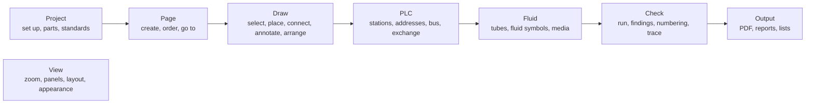

# Design language: canvas overlays, wording, command progression and sources

A chapter of [Design language](16a-design-language.md), whose table says where each section lives.

---

## 7. Canvas overlays

All overlays follow the scale rule (`s = max(1, ⌊ppp⌋)`), live in the session-only overlay layers (never in the
display list), and keep 3:1 on the white sheet.

### 7.1 Selection, hover and handles

Selection: a 2s-px `canvas.selection` outline around the representation's bounds with a 1s-px white casing on both sides of it
(the mockup draws it so and wins), so it reads over black lines. Hover: a 1s-px dashed accent
outline (4s on, 4s off). A selected object under the pointer shows the selection only.

The window and the offscreen snapshot paint one list of marks (`ew_render2d::overlay::marks`). A symbol's selection has no corner handles: a symbol is
not resized by its corners, and a square that cannot be dragged promises what the page does not do (the mockup's
squares are dropped). What can be dragged shows its own handle: a black box's grips, a selected wire's round handles.

A line between two ends (a wire, a fluid line) is never outlined by the box round its ends: it
answers to the pointer only within 4 points of its own path, and its hover and selection are a band along that path,
4 points to each side and round at its bends. The hover's band is `canvas.hover` at 22 %; the selection's is
`canvas.selection` at 28 % inside a solid 1s-px edge. The one selected line carries round handles, 10 points across
(14 under the pointer): an accent disc with a white 1.5-point ring on the middle of every segment and on every bend.
Every selected line marks its two ends with the connection point's ring of §7.2 (8s + 1 px, open,
in the accent), so where it ends reads at a glance; a ring is no handle and promises no drag.

### 7.2 Connection points, snap and the grid cursor

CP rings 8s + 1 px in the accent on hover and while a wire tool is active; the snap target a crosshair with a 6-px gap;
the keyboard grid cursor a 1s-px accent cross with its cell in the status bar (doc 16 §3.6). A hovered CP shows a
tooltip with its printed label, its symbol name and its potential, in the inverse look:
"`<printed label> · <symbol name> · <potential>`", for example "1X1:1/a · terminal · L"; a part the page tables
do not know is left out.

A connection point with no connection on its page shows a
(4s + 1)-px hollow square in `canvas.open_cp` at all times, so that a wire drawn across it is visibly not connected; a
connected CP shows none. It is a session overlay (never in the display list, so never in print or PDF), drawn while one
step of the connection grid is at least 4 points on screen (QET's 2.6 mm step is about 6.8 points at the 69 % fit
zoom; at 35 % none). A spare terminal, unwired by design, shows it too.

### 7.3 Ghosts and their labels

The Place ghost draws the symbol's strokes in `canvas.ghost` (the accent at 60 %), its CPs as rings, and **one** label
chip with the tag it will get (one label per tag), placed by the rule of §7.4. Autoconnect proposals draw as
1s-px dashed accent lines.

### 7.4 Chips and labels on the canvas

Canvas chips (preview chips, ghost labels, highlight name chips, measurement readouts) are `canvas.chip`: inverse
surface at 94 %, `type.small`, `radius.sm`, `space.2` by `space.1` padding, `elevation.1`. **Placement rule**, in order:
the preferred anchor (above right of the target, 8 px off), then below right, above left, below left; a position is
rejected if it overlaps another chip, the tool HUD, the frame-statistics panel or the pointer's 16-px box; if
all four fail, the chip takes the nearest position stacked inward from the preferred anchor (by its height and
`space.1`) that overlaps no chip already placed and stays inside the canvas; only when there is none
is it drawn at the preferred anchor with 80 % opacity. Chips never cover the target's own printed text when an
alternative exists. Highlight name chips are the exception to the inverse fill: they take their slot's hue with a black
label (§4.6).

**Labels on the sheet.** The same aim holds
for the drawing's own texts, which the scene places and the print carries: a terminal's label or an external point's
label never overlaps another symbol's graphics, connection points or tags. The scene tries the label's slot, then
steps the label outward along the slot's axis by `SLOT_TEXT_GAP`, at most three times, as a black box's caption moves,
and otherwise keeps the slot.

### 7.5 Highlights

Doc 16 §10.3's, with the hues of §4.6: halos with hatch patterns and a name chip, at most four,
painted above the overlays and below the chips.

**The colour a merged 0 V/PE potential shows.** The potential highlight and the wire colour take the role of the
potential's name. An unbonded potential
that merges a 0 V and a PE definition shows doc 08 §3.6's PE colour, not the colour of its name 0V ('s natural
order names it 0V); EW-POT-001's conflict colour overrides it. Not yet built.

### 7.6 Measurement

A 1-px `canvas.measure` line with 6-px end ticks perpendicular to it and a readout chip at its middle ("42.0 mm,
dx 40.0 dy 12.7"); the readout is also announced by the live region (doc 16 §10.1).

### 7.7 The frame-statistics panel

A diagnostic: `canvas.chip` style at the canvas's top right, `type.caption` with tabular digits, never covering the
HUD; chips avoid it (§7.4).

---

## 8. Wording and capitalisation

1. **Sentence case everywhere**: menus, buttons, tabs, titles, tooltips, column headers ("Export PDF…", "Go to page
   or cell…", "Renumber devices…"). Proper nouns, standards and codes keep their case: PDF, QET, EPLAN, IEC 81346,
   PLC, CSV, -102G1, 24VDC-1.
2. **Commands are verbs** ("Export PDF", "Check project", "Import parts table"); panels and tabs are nouns ("Pages",
   "Messages", "Properties"); groups are nouns of the job ("Place", "Connect" are both: they name the activity).
3. **The ellipsis** (the single character "…", U+2026, never three full stops) ends a command that needs more input
   before it acts (it opens a dialog or a picker): "Symbol…", "Export PDF…". A command that acts at once has none.
   The command bar's short labels drop it (§5.2); menus, the palette and tooltips keep it. The label is the one
   statement of it, and the tests hold the program to it without a list of their own: every command whose label
   ends with "…" is run with nothing given and must leave the project as it was, and every command that opens a
   form when given nothing must end with "…".
4. **One word per concept**, the standard's or EPLAN's (doc 16 §4.1 item 8): device, function, connection point,
   interruption point, potential, structure identifier, part. QET and EPLAN synonyms are palette aliases, not labels.
5. **Messages say what happened, why, and what to do** (NFR-UX-07), in that order, in at most two sentences: "The PDF
   was not written: the folder does not exist. Choose another folder." No "Please", no exclamation marks, no blame,
   no codes without words (a rule ID follows the words: "Contact T55 switches N-55 without its line conductor
   (EW-POT-013)").
   A reason (`reason-*`, the words a refused or disabled
   command shows in the status line, a tooltip or a menu) ends without a full stop, also when it holds two clauses
   ("That action does not apply to this row; its menu shows the ones that do"); an error message (`error-*`), a toast
   and a banner are sentences and end with one.
6. **Numbers**: a space between value and unit ("2.5 mm²", "69 %"); counts with their noun ("3 devices",
   "1 selected"); "of" for positions ("Page 6 of 36", "2 of 4 placed").
7. **Keys** are written as on the keyboard with "+" ("Ctrl+Shift+H") in text and tooltips, and as spaced keys in a key
   chip ("Ctrl K"). The macOS symbols (⌘⇧H) from the same registry text (doc 16 §3.9 Keyboard) are kept for
   portability only: macOS is not a supported platform.
   A key has one name in every text, the form on its keycap
   (`keymap::short_display`: "Esc", "Del", "Up", with its modifiers, "Ctrl+Z"), in the HUDs, the hints, toasts,
   notices, reasons and tooltips alike ("Esc ends", "Del deletes"); the full names ("Escape", "Delete") are not used.
   The menus, the key chips, the palette, the keymap editor (a chord being typed too) and the command bar name a key
   by `short_display` too; only the keymap findings and the keymap editor's list of unused bindings keep
   `Chord::display`.
8. **Abbreviations** only where the user's documents use them (PE, N, L1, IP for interruption point in EPLAN usage);
   tooltips spell them out the first time ("IP: interruption point").
   A sentence names a terminal by strip and number in words,
   "-X1011 terminal 3" (a toast, the Place target "-X1031 terminal 21"), so the strip and the number read apart; tags,
   tables, Properties and print keep the designation `-X1011:3`.
   A pin whose designation the device shares is named in a sentence by
   its position, "-1A4 pin − (2nd)" (the placement toast), never by the label's `#2`; tags, tables and print keep
   the label `-1A4:-#2`. The ordinal is English only.
9. **Titles of dialogs** are the question or the task, not the subject: "Recover unsaved changes?", not "Recovery".
   Primary buttons repeat the verb ("Recover", "Export", "Discard"), never "OK" or "Yes".

---

## 9. Command progression

### 9.1 The order of work

The tabs, the app menu and the palette's categories all follow the order in which a project is made:

Within a tab, groups run left to right in the order of the job; within a group, the most frequent command comes
first and is the large one. The user's eye reads the bar like a checklist.

### 9.2 The app menu

The app menu holds every action of the registry, in this order: **File** (New project, Open…, Open recent ▸, Close,
Save, Save as…, Save a copy…, Settings…, Quit), **Edit** (Undo, Redo, Cut, Copy, Paste,
Duplicate, Delete, Select all, Find and replace…, Properties), then **Project**, **Page**, **Draw**, **PLC**, **Fluid**, **Check**,
**Output** and **View** with the same groups and order as the tabs (a group is a submenu when it holds more than three
commands, otherwise a separated block), then **Window** and **Help**. The as-built menus map onto it: Insert becomes
Draw; Tools dissolves (Command palette into View and the search field, Settings into File, Renumber devices into
Draw); Window and Help stay. The menu opens from the app button (§5.2).

**File has no Import ▸ and Export ▸:** each action appears once in the app menu, and the imports and exports sit in their tabs' groups (Project and Output). The app menu is built by tab and group.

### 9.3 The palette

The palette's categories are the tab names, and each result shows its breadcrumb ("Check · Numbering"), so a command
found by search also teaches where it lives in the bar.

---

## 10. Migration map from the current window

The window follows this language; how it looked before is in git.

---

## 11. The mockup, the visual reference

The owner approved [the mockup](assets/design-language-mockup.html) on 2026-10-28. It is a self-contained
page of the main window: light by default with a dark toggle and a density toggle; the command bar on the Draw tab,
the rail with the Project entry, the Pages navigator and Properties, the canvas with a sketch of an illustrative
motor-starter page, the tool HUD, the zoom control and a toast, the closed right rail, the Messages dock (opened from
the findings field) and the status bar. It loads Noto Sans from Google Fonts and nothing else. All its drawing
content, names and rule codes are illustrative.

**It is the visual reference.** The values of §4 to §7 are read from it; the snapshot checks compare the components
with it: token values exactly, layout proportions within the tolerances its specification
states. Where this document and the mockup differ on look, the mockup wins and this document is corrected. Two
corrections were made in the committed copy because requirements demand them, and only these:
1. **The status bar** shows the fields FR-UI-034 and NFR-PLAT-03 require (selection count, the cell in the cursor
   field, the snap mode, the renderer) in the mockup's field style.
2. **Highlight name chips** have a black label, since white on the four highlight hues is below 4.5:1
   (NFR-A11Y-04; §4.6).

The mockup's tooltip keys are illustrative; the keys are doc 16 §4.4's. Behaviour stays doc 16's.

The mockup has a **component sheet**, opened by a third mockup control
("Components") and following the theme and density toggles, that shows the components §6.21 and §6.22 add: a strip of
a Terminal strips navigator in table mode (the tool line with the Table toggle, the filter and Columns; a sticky
header with a sorted and a derived column; the frozen key column; a marked row, the cursor row and its cursor cell,
an editing cell) and the chooser list over a piece of sheet with a dashed hover outline, labelled as a proposed
follow-up. The sheet's names are illustrative.

**Decided** (2026-10-28, by the orchestrator under the owner's delegation, after the owner's approval of the
mockup): ADR-0031 is Accepted; the accent is Volt blue #0B63CE (light) and #5AA2FF (dark); the default density is
Comfortable; the default theme follows the system; Noto Sans SemiBold (OFL-1.1) and Tabler Icons 3.50.0 (MIT) are
accepted as assets. A later change of look is a design-language review against the mockup, and a new mockup
version is committed with it.

---

## 12. Sources

Design systems and guidance:
- Microsoft, Windows ribbon guidelines: https://learn.microsoft.com/en-us/windows/win32/uxguide/cmd-ribbons
- Microsoft, the Simplified Ribbon: https://support.microsoft.com/en-us/outlook/use-the-simplified-ribbon
- Fluent 2, design tokens and colour tokens: https://fluent2.microsoft.design/design-tokens,
  https://fluent2.microsoft.design/color-tokens
- IBM Carbon, spacing scale and data-table row sizes: https://carbondesignsystem.com/elements/spacing/overview/,
  https://carbondesignsystem.com/components/data-table/style/
- Material Design, dark theme (#121212, lighter raised surfaces): https://m2.material.io/design/color/dark-theme
- Siemens iX, themes (classic and brand, light and dark): https://ix.siemens.io/docs/styles/theming/usage-designers
- JetBrains, the new UI and compact mode: https://www.jetbrains.com/help/rider/New_UI.html
- Linear, "How we redesigned the Linear UI" (three theme variables, LCH):
  https://linear.app/blog/how-we-redesigned-the-linear-ui; "Behind the latest design refresh" (chrome recedes,
  "structure should be felt not seen"): https://linear.app/now/behind-the-latest-design-refresh
- NN/g, visual hierarchy: https://www.nngroup.com/articles/visual-hierarchy-ux-definition/; progressive disclosure:
  https://www.nngroup.com/articles/progressive-disclosure/
- W3C, WCAG 2.1 SC 1.4.11 non-text contrast: https://www.w3.org/WAI/WCAG21/Understanding/non-text-contrast.html

ECAD and CAD tools:
- EPLAN Platform API, the ribbon (since 2022): https://eplan.help/en-us/infoportal/content/api/2023/TheRibbon.html
- Autodesk Fusion API, workspaces, toolbar tabs and panels: https://help.autodesk.com/cloudhelp/ENU/Fusion-360-API/files/UserInterface_UM.htm
- KiCad 8 schematic editor manual (hierarchy navigator and Properties at left): https://docs.kicad.org/8.0/es/eeschema/eeschema.html

Icons and egui:
- Tabler Icons (MIT): https://github.com/tabler/tabler-icons; npm release 3.50.0
- Lucide licence (ISC; Feather-derived icons MIT): https://lucide.dev/license
- Phosphor core (MIT): https://github.com/phosphor-icons/core; egui-phosphor (MIT OR Apache-2.0, egui 0.32):
  https://docs.rs/egui-phosphor
- egui 0.37 `Visuals`, `WidgetVisuals`, `Spacing`: https://docs.rs/egui/0.37.0/egui/style/struct.Visuals.html,
  https://docs.rs/egui/0.37.0/egui/style/struct.WidgetVisuals.html, https://docs.rs/egui/0.37.0/egui/style/struct.Spacing.html
- egui_tiles 0.18 `Behavior`: https://docs.rs/egui_tiles/0.18.0/egui_tiles/trait.Behavior.html
- egui_kittest 0.37 (snapshots with the `snapshot` and `wgpu` features, accessibility checks):
  https://docs.rs/egui_kittest/0.37.0/egui_kittest/

Project documents: [16 UX and UI](16-ux-ui.md) §2.4, §3, §4.1, §6, §10, §11; [ADR-0014](../adr/0014-gui-toolkit-egui.md);
[ADR-0028](../adr/0028-default-drawing-fonts.md); [requirements](02b-requirements-extended.md) FR-UI-001, FR-UI-018,
FR-UI-025, FR-UI-027, FR-UI-034, FR-UI-043; [non-functional requirements](02c-nonfunctional-requirements.md)
NFR-A11Y-01 to NFR-A11Y-04, NFR-UX-01, NFR-UX-04, NFR-UX-07, NFR-PLAT-03.

