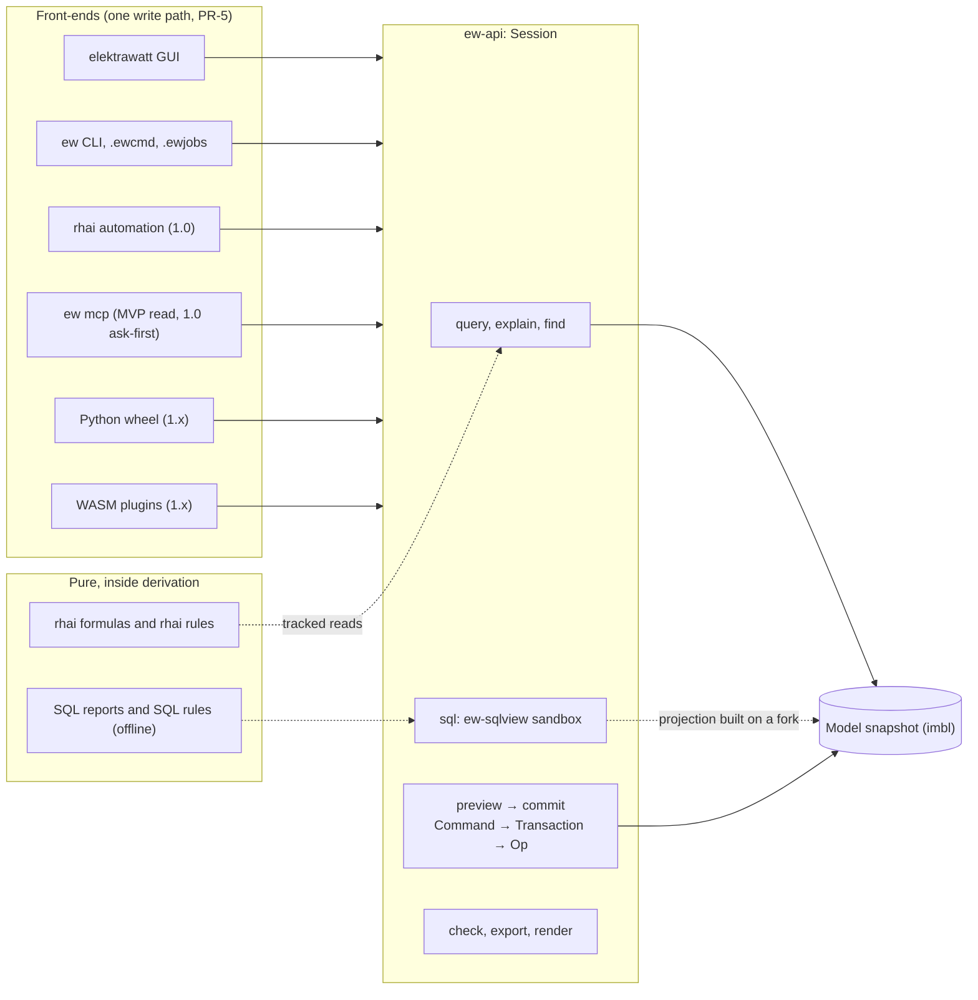

# Extensibility: CLI, scripting, SQL, plugins and agents: commands, the ew command line and the session API

A chapter of [Extensibility: CLI, scripting, SQL, plugins and agents](17-extensibility.md), whose table says where each section lives.

---

## 1. Scope and principles

### 1.1 Boundaries

| This document owns | Owned elsewhere |
|---|---|
| CLI catalogue, flags, exit codes, JSON output schemas, `.ewcmd` command logs, `.ewjobs` jobsets | Merge-driver algorithm, textconv rendering, lock and save protocol, trust-store location ([05](05-project-format-and-persistence.md) §6.4, §11, §13.4) |
| Public command and query registries; exposure classes | Individual editor commands ([06](06-schematic-editor.md) §3.1), PLC commands ([10](10-plc-and-bus.md)) |
| rhai profiles, bindings and limits | Rule-pack format, modes, EW-CORE-083/084 ([15](15-checks-revisions-collaboration.md) §3, §4.2); formula placeholders in forms ([09](09-reports-forms-output.md) §2.6) |
| `api_v1` view catalogue and columns, SQL sandbox | User-report forms and pagination ([09](09-reports-forms-output.md) §3.5); SQL rule semantics ([15](15-checks-revisions-collaboration.md) §3.4) |
| MCP tools, transports, approval | — |
| WIT world, plugin package, capabilities, limits, signing, plugin data | Registry governance and exception wording ([19](19-open-source-governance.md)) |
| WIT mapping of the importer/exporter contracts | The Rust contracts themselves ([14](14-interop.md) §2.1–§2.2) |
| Stability policy per surface | Format versioning (ADR-0011, [05](05-project-format-and-persistence.md)) |
| — | CI jobs that enforce all of this ([18](18-quality-security-release.md)); dialog layouts ([16](16-ux-ui.md)) |

### 1.2 Tiers

| Tier | Surface | Language | Reads | Writes | Sandbox and trust | Release |
|---|---|---|---|---|---|---|
| T0 | File format and permissive crates | any; Rust crates | files | files (no EW involved) | none needed: data | MVP (publish 1.0) |
| T1 | `ew` CLI, `.ewcmd`, `.ewjobs` | shell | everything | commands only | user-invoked; project content trust-gated | MVP / 1.0 |
| T2 | rhai **formulas** | rhai | tracked reads | nothing | no I/O, op limits; runs untrusted | MVP |
| T3 | Rule and report packs | rhai, SQL | tracked reads / projection | findings, report rows | trust-gated | MVP (rhai) / 1.0 (SQL) |
| T4 | rhai **automation** scripts | rhai | `query`, `find`, `sql` | `preview` / `submit` | trust-gated; explicit run only | 1.0 |
| T5 | SQL projection (`api_v1_*`) | SQL | projection | never | `query_only`, authorizer, deadline | MVP |
| T6 | `ew mcp` | MCP (JSON-RPC) | read tools | ask-first commits | off by default, stdio or loopback | MVP read (Could), 1.0 writes, 1.x bridge |
| T7 | WASM component plugins | any → WASM | WIT `model`, `sql` | WIT `edit` | capabilities, fuel, epoch, memory, signatures | 1.x |
| T8 | Python wheel `elektrawatt` | Python | Session API | Session API | user's own code | 1.x |



### 1.3 Principles

1. **The API is the internal command bus.** GUI tools, CLI, scripts, agents and plugins submit the same
   serialisable `Command`s (ARCH §5.1). There is no second mutation path to retrofit later, the lesson KiCad's empty
   schematic IPC API teaches ([oss-landscape](../research/oss-landscape.md) §3).
2. **Read surfaces never write.** SQL, MCP read tools, formulas and rules return values or findings. Writes are
   commands: previewable, validated, undoable, journalled, tagged with an origin.
3. **Untrusted by default.** Received content that can execute (scripts, SQL, project rule packs, jobsets, plugin
   invocations) never runs until a person trusts it; nothing runs on an event such as open, save or export.
4. **The gate cannot be gamed.** Agents, plugins, scripts, command-log replays and pipelines cannot waive
   findings, weaken check schemes, change strictness, approve or release revisions (§2.3).
5. **Deterministic.** Every surface yields the same bytes for the same inputs (NFR-REL-07): no wall clock, no
   unseeded randomness, no platform maths in scripts, ordered collections.
6. **Versioned contracts, permissive bottom.** Every public surface has a version and a CI compatibility guard
   (§11). Format, schema, contract and plugin-interface crates are MIT OR Apache-2.0 (ADR-0024).

### 1.4 EPLAN and QET parity

What an EPLAN or QET user expects from this area, and where EW deliberately differs
([eplan-features](../research/eplan-features.md) §12, §19; QET's MCP server:
[gaps-and-corrections](../research/gaps-and-corrections.md) §3.3, G10):

| EPLAN / QET | EW surface | Rel | Difference |
|---|---|---|---|
| Everything is an "action", callable from menus, scripts and the command line (`plcservice /TYPE:EXPORTADDRESSOVERVIEW …`) | Dotted command names (`plc.readdress`) shared by palette, CLI, rhai, MCP and plugins (§2.1); `ew` subcommands for batch work (§3) | MVP | Headless `ew` needs no GUI process or licence seat and runs in a container (FR-EXT-001) |
| C#/VB scripts with `[DeclareAction]` (parameters become action parameters) and `[Start]` (run on load) | rhai automation scripts with a typed `param()` header rendered as a form (§5.5) | 1.0 | No run-on-load: a script runs only when a person starts it |
| Event handlers (project open, page change; `[DeclareEventHandler]`, unverified) | None in v1. Derived values (tags, xrefs, reports) are queries, and online rules and normalisers cover what event scripts typically patch up | never for received content | Event hooks would let a received project run code on open (§1.3 principle 3) |
| .NET API add-ins, API extensions licensed in the top tier only | WASM component plugins (§8) and the Python wheel (§9) | 1.x | No extra licence tier; sandboxed; plugins cannot reach the UI toolkit |
| Property IDs (`<20010>` DT, `<20011>` function text, `<20100>` part number) addressed by scripts and forms | Public query registry (§2.2) and `api_v1_*` columns (§6.1); EPLAN property IDs are mapped by the EPLAN importers ([14](14-interop.md) §5) | MVP | Names instead of numbers; versioned JSON Schemas |
| API `UndoStep` and `LockingStep` scopes around scripted edits | Every command is one transaction and one undo step; `batch()` groups several (§5.5); the project lock (§3.1) | MVP / 1.0 | Grouping is declarative, so a script cannot leave a half-open undo step |
| Fixed, predefined report types | SQL reports over `api_v1` (§6, FR-REP-031) | 1.0 | Goes beyond EPLAN |
| Cogineer / eBUILD typicals with value sets | Window and page macros with value sets ([07](07-symbols-parts-macros.md); FR-MAC-004), inserted by `macro.insert` from the GUI (MVP) or from automation scripts (1.0) | MVP / 1.0 | Rule-based project generation from typicals is 1.x (FR-MAC-016) |
| QET MCP server with an ask-first "live mode" | `ew mcp` read tools (MVP Could), ask-first writes (1.0), GUI live bridge (1.x) (§7) | MVP / 1.0 / 1.x | Off by default; approval bound to a digest |

---

## 2. Concepts and data

The entities are those of the [domain model](03-domain-model.md); this section adds the extension-specific
records and registries.

### 2.1 Command registry

Every command type registers one `CommandMeta`, generated by a derive macro from its Rust parameter struct:

Its members, each with what it holds, are the struct `CommandMeta` of `crates/ew-commands/src/meta.rs`: the name
(`numbering.renumber`, never reused, FR-EXT-015), the cost (a `Bulk` command always previews on a fork, ARCH §5.1),
undoability, the exposure of §2.3, the aliases, whether a front end confirms first, and the prevent rules a command
may carry because it reproduces a state the base holds. The parameter schema (JSON Schema 2020-12) is generated from
the parameter struct when the command registers, and the registry holds it beside the meta.

Every command is Preview before 1.0 (§11): the catalogue carries no parameters version and no stability level until
1.0 asks for them. `ew commands --json` prints the catalogue; the reference documentation is generated from it
(NFR-DOC-06). An
`AnyCommand { name, params: serde_json::Value }` is checked against the size limits of a parameter document (bytes,
nesting, array and string length), read into the typed command and run by the commit pipeline (ARCH §5.2). The
reading is serde's over the path-tracking reader of records (`ew_schema::from_value_tracked`): a wrong parameter is
refused at the JSON Pointer of the offending value (an unknown member at the member), in serde's words with a number
named by its kind, and a name that is no known variant of an enum is refused with the variants it may name, where a
record of a newer format would keep it. The parameter schema describes the parameters for the reference and the clients;
it checks nothing. After reading it implements the object-safe `DynCommand`
companion of ARCH §5.1, which `Session::preview` and `Session::execute` take. Aliases resolve to one command: the
placement command `device.place` (`PlaceSymbol` with a `PlaceTarget`) registers `device.place_from_part` and
`symbol.place` as `CommandMeta.aliases`, and the journal always records `device.place`. Entity references in parameters are UUIDs; front-ends that
accept tags (`.ewcmd`, CLI, MCP) resolve them first through `find` (§3.5).

**`project.settings.set`** (ADR-0008 amendment 3). Edits one whitelisted member of
`ProjectSettings` per command: `numbering`, `colour_profile`, `size_profile` or `xref_format` (provisional members
live in `ProjectSettings.extra` until their work packages type them), and the other members of its table. Beside
them it sets the drawing settings (`drawing`, merged member by member), the frame defaults (`frames`), the languages
and printed formats (`languages`) and one member of the supply (`supply.<path>`); a refusal inside such a value
names its place below `/value`. The commands `project.drawing.set`, `project.frames.set`, `project.languages.set` and
`project.supply.set` of earlier versions are its aliases, so their command logs replay. Parameters `{member, value}`; `value` is the
member's whole new JSON value, `null` removes the member so that the pinned derivation profile's default applies, and
a value equal to the stored one changes nothing. The command reads its parameters and then checks them semantically by
`ew_derive::check_settings_member`, the parser the derivation itself reads the member with, so a setting the
derivation would not apply never reaches the model. It refuses:
- `numbering` with no applicable scheme (counter scope `"page"`, formats with `{page}`, `{letter}`, `{counter}`), and a `default` that names no scheme;
- unknown or unclosed format tokens;
- a numbering format whose tokens are ambiguous without separators, such as `{page}{counter}{letter}`, where page 20
  counter 16 and page 201 counter 6 both print "-2016U" (a known limit, which also covers the harmless cases
  still accepted: duplicate scheme keys, an unknown rule aspect, an empty child separator, matrix 0, empty colour or
  size rows);
- colour codes that are neither IEC 60757 nor company codes declared on an IEC 60757 base;
- cross-sections that are not positive mm², AWG or kcmil;
- any other member name, with `InvalidParams` at `/member` listing the settable members. The identifier set has its
  own previewed renumber (FR-NUM-014); `ip_pairing`, `formatting`, `wire_default`, `derivation_profile` and
  newer members are refused; `formatting` is set with the languages (§2.3; [03](03-domain-model.md) §5.1).

The command is `Cost::Bulk`: the preview shows `Session::derived_diff` (changed tags and cross-reference texts; adds wire properties, BOM and TOC rows and a covered-kinds flag). It is undoable as one step.
Only the project record changes; topology stays identical. The journal records it as the top-level `settings` member
of the project record ([05](05-project-format-and-persistence.md) §8.1), so `set` and `was` carry the whole `settings`
value (settings are small).

**A new optional member** of a command's parameters is `skip_serializing_if`, so a command log written before it
replays unchanged. The commands with their exposure, cost and parameters are in the generated command reference and
[the action map](../map/actions.md); a command's rules live with its subject (`report_block.create`'s `form_copies`,
[09](09-reports-forms-output.md) §2.2; `project.company.set`'s logo, [03](03-domain-model.md) §5.1;
`project.assets.purge`, [05](05-project-format-and-persistence.md) §13.3).

**Parameter schemas are the client contract** (FR-EXT-015). They reject unknown tags of open
enums, which records keep for forward compatibility (ARCH §7.6): a client learns of a new value from the catalogue,
never by sending it. Before validation, a parameter document is limited to 4 MiB, a nesting depth of 64, 1,048,576
items per array and 1 MiB per string; a validation error shows at most 256 characters of the offending instance,
after the JSON Pointer of the first error.

### 2.2 Query registry

Only **public** queries are reachable from CLI, rhai automation, MCP, plugins and Python. Each has a name, a key
type, an output JSON Schema and a stability level. Internal queries stay private, so the memo layer can be
refactored freely.

| Query | Key | Output (abridged) | Rel |
|---|---|---|---|
| `device_tag` | device | `{full, displayed: {<page>: text}, frozen, deviation}` | MVP |
| `xref_text` | representation | `{text, targets: [{page, cell}]}` | MVP |
| `wire_props` | connection | `{csa, colour, wire_part, provenance per field}` | MVP |
| `potential_of` | CP or connection | `{potential, name, aliases, type, switched, protected_by}` | MVP |
| `terminal_rows`, `cable_rows`, `bom_rows` | strip, cable, mode | report rows ([09](09-reports-forms-output.md)) | MVP |
| `page_order`, `toc_rows`, `title_block` | —, —, page | as ARCH §6.4 | MVP |
| `checks` | scope | findings | MVP |
| `channel_addresses`, `plc_rows` | module, station | addresses with source and map | MVP |
| `wire_record`, `tube_props`, `medium_zones`, `layout_label` | as in [13](13-manufacturing-outputs.md), [11](11-fluid-power.md), [12](12-panel-layout.md) | — | 1.0 |

### 2.3 Origins and exposure classes

Every transaction carries an `Origin`; the history panel (FR-UI-023) and the journal show it.

```rust
pub enum Origin { Gui, Cli { subcommand: String }, CmdLog { file: String, sha256: Sha256 },
                  Script { name: String, sha256: Sha256 }, Mcp { client: String, session: Uuid },
                  Plugin { id: PluginId, version: Version }, Python { script: String },
                  Import { lineage: Uuid }, Merge, External }
```

| Exposure | Front-ends allowed | Commands (examples) |
|---|---|---|
| `Edit` | GUI, CLI (`apply`), scripts, MCP, plugins, Python | `device.place` (aliases `device.place_from_part`, `symbol.place`), `connection.draw`, `fields.set`, `numbering.renumber`, `page.renumber`, `plc.readdress`, `macro.insert`, `project.settings.set`, `project.company.set`, `plugin.data.set` |
| `HumanOnly` | GUI; a dedicated CLI subcommand confirmed on a terminal (below) | `revision.approve`, `revision.release`, `revision.withdraw`, `check.waive` / `check.unwaive`, `scheme.set_severity` and the other `scheme.*` edits including company locks, `pack.enable` / `pack.disable`, `project.checks.set` (registered), `project.set_strictness`, completing and reopening a project (FR-REV-013, 1.0), `trust.*`, `plugin.install` / `plugin.remove`, `library.write` |
| `Import` | GUI import wizard, `ew import` | `ApplyImport` (plugins reach it only through the importer contract, §10) |
| `Internal` | normalisers | CP instantiation, online numbering |

`HumanOnly` commands are refused with `CmdError::Exposure` when the origin is a command log (`ew apply`), a script,
an MCP session, a plugin or Python (jobsets submit no commands at all, §3.6). This is what keeps an agent, a replayed `.ewcmd` or a third-party
plugin from waiving EW-POT-013 or demoting EW-PLC-012 to make a release gate pass (FR-CHK-009, FR-REV-007, D-34;
[15](15-checks-revisions-collaboration.md) §2.5, §5.4).

**`HumanOnly` on the command line.** Only the dedicated subcommands (`ew revision approve|release|withdraw`,
`ew waiver add|remove`, `ew trust grant|revoke|sign`, `ew plugin install|remove`) may submit a `HumanOnly`
command, with origin `Cli{subcommand}`:
1. The command's read-only part runs first. `ew revision release V2.0` evaluates the gate and exits 1
   with its 42 errors and "checker not set" without asking anything.
2. If the command can proceed, EW prints the change summary on the controlling terminal and asks the person to type
   the revision label, the rule ID of the waiver, or `trust` / `install`. There is no `--yes` flag.
3. Without a controlling terminal (CI runner, pipe, `nohup`), the subcommand exits 2 with "HumanOnly: needs an
   interactive terminal". Test builds of `ew-testkit` confirm through a test-build confirmation hook that release
   builds do not contain (asserted absent in release binaries like the egui inspection feature; the tests are in
   [18](18-quality-security-release.md)), so the fault-injection test of
   `ew revision release` ([05](05-project-format-and-persistence.md) §14) still runs in CI.

Like four-eyes sign-off, this is a process control, not an authentication: a person who scripts a pseudo-terminal
can defeat it, but no agent, plugin, replay or pipeline step can reach the gate by accident.

**`project.settings.set` is `Edit`**. `HumanOnly` is reserved for controls that decide whether a
gate passes without changing the drawing: approvals, waivers, severities, packs, strictness, trust. Numbering, colour
and size profiles and the cross-reference format change the drawing's content, as `numbering.renumber` (already
`Edit`) does: every effect appears in the bulk preview, is one undo step, is journalled with its origin, and reaches a
released document only through `revision.release`, which stays `HumanOnly`. The rule recorded with the decision: a
settings member that decides a check outcome (check schemes and severities, packs, strictness) never joins the
whitelist but keeps its own `HumanOnly` command, and extending the whitelist needs an ADR-0008 amendment.

The exposure class is declared in `CommandMeta` and checked in the `ew-commands` commit pipeline (validate step,
ARCH §5.2), so no front-end can bypass it; `ew-api` only sets the origin.

**`project.checks.set` is the first registered `HumanOnly` command**.
It writes `settings.extra.checks` = `{active_scheme?, release_scheme?}` (shipped schemes only; [03](03-domain-model.md)
§5.1) and follows the rule above: a settings member that decides a check outcome keeps its own `HumanOnly` command. The
sibling command `project.company.set` and `project.settings.set` are `Edit`. A `HumanOnly`
command reaches the headless side only through a dedicated CLI subcommand, never through a UI script, which still
refuses the registry action with the human-only outcome. The CLI path as
built (closed) is

`ew project checks set [<project-dir>] [--active <scheme>] [--release <scheme>]`

and it follows the steps above. The scheme check comes first: a scheme that does not ship exits 1 without asking.
When stdin or stdout is not a terminal (`std::io::IsTerminal`) it exits 2 with "HumanOnly: needs an interactive
terminal" before the project is opened (no lock, no journal). On a terminal it prints the active and release schemes
(or "back to the default") and that they decide check outcomes, then asks for the active scheme's name (the release
scheme's if only `--release` is given): an exact match, surrounding white space aside, writes with a confirmed CLI
origin and saves (exit 0); anything else exits 1 and changes nothing. There is no flag: no scheme, `--confirm` or
`--yes` is a usage error (exit 2). Tests run the binary without a terminal (exit 2 with empty and with piped stdin, the
project unchanged) and drive the prompt with an injected reader and writer, the role of the test-build hook above. The GUI reaches the command through the wizard's confirmed step
(`wizard.apply_check_scheme`, [16](16-ux-ui.md) §9.2).

The engine checks the exposure first, before `run`. Its `Origin` carries
the variants above with their identifying name only (file, script, client, plugin ID); the `sha256`, `session` and
`version` members are not built. Most commands are `Edit` and `Preview`, among them `library.embed`, which writes
library copies into the project only and is therefore not the `HumanOnly` `library.write`; a model command that is no
`ew` subcommand runs on the command line through `ew apply` (§3.5). `Origin::Cli` carries a `confirmed` flag, and a `HumanOnly` command is admitted only from `Origin::Gui`
or from a CLI origin with `confirmed` set (FR-EXT-030), which the dedicated subcommands set after the typed
confirmation above. `parts.import` has exposure `Edit` (no scripted exposure class exists), so `ew apply` replays it,
and the cost `Bulk`, so it runs as preview, then commit. `project.checks.set`, `project.assets.purge`, `check.waive`
and `check.unwaive` are `HumanOnly`. The history step records the strictest exposure of its commands at commit, and `undo` and `redo` take the
caller's origin (`Session::undo(&Origin)`, `Session::redo(&Origin)`) and refuse a `HumanOnly` step from any origin but
the GUI and a confirmed CLI subcommand. The rule is recorded in ADR-0008 (amendment 3's note).

`Transaction.exposure` records the strictest class at commit (Edit < Import < `HumanOnly` < Internal; a transparent `HumanOnly` marker step does not block), `undo(&Origin)` and `redo(&Origin)` refuse a `HumanOnly` step from every origin but the GUI and a confirmed CLI subcommand with `CmdError::Exposure`, and the shell refuses a headless `edit.undo` or `edit.redo` of such a step with `reason-human-only-history`; in memory only, no format change.

### 2.4 Project-resident extension content and trust

| Content | Location ([05](05-project-format-and-persistence.md) §2.1) | Untrusted project | Trusted project |
|---|---|---|---|
| Pure formulas: title-block `{= …}` cells, report-block filters, value-set formulas, tag and wire-number formats | `project.jsonl`, `report-blocks.jsonl`, `lib/forms`, `lib/macros` | **Run** (formula profile, §5.2) | Run |
| Shipped rule packs, report pack, built-in machine profiles | EW installation | Run | Run |
| Project rule packs (TOML, rhai, SQL) | `rules/` | Not run; EW-CORE-084 | Run |
| User SQL reports | `reports/` | One placeholder page "Report not run: project not trusted" ([09](09-reports-forms-output.md) §3.5) | Run |
| Machine and label profiles with `expr` columns or an `sql:` row source | embedded profile copies `lib/profiles/<copy_id>.toml` ([13](13-manufacturing-outputs.md) §7) | Refused | Run |
| Automation scripts | `scripts/<uuid>.rhai` (1.0) | Listed, not runnable | Run on explicit user action only |
| Jobsets | `jobs/<uuid>.ewjobs` (1.0) | `ew jobs run` refuses | Run on explicit invocation |
| Command macros (`.ewcmd`, exported rhai) | `lib/macros` | Shown, not runnable; window/page macros insert as data | Run on explicit action |
| Plugin data `plugin.<id>.*` | `extra` maps | Preserved, never interpreted by EW | Interpreted by the installed plugin only |
| Required plugins | `project.plugins` (§8.5) | Listed as missing; never auto-installed | — |

Pure formulas run in untrusted projects because a project cannot render without them and the formula profile has
no I/O, deterministic operation limits and tracked reads only. This follows
[15](15-checks-revisions-collaboration.md) §3.9; ADR-0020 records it (amendment 3), together
with the gate on machine-profile `expr` columns.

**The trust hash** ([05](05-project-format-and-persistence.md) §13.4) covers exactly the gated content:

```text
gated   = regular files under rules/, reports/, scripts/, jobs/
        + embedded profile copies under lib/profiles/ that contain an expr column or an sql: row source
        + lib/macros/<uuid>.json items that are command macros (.ewcmd log or exported rhai)
lines   = for f in gated, sorted by path bytes: "<path>\t<sha256(f)>\n"
content_sha256 = sha256("ew-trust/1\n" ‖ lines)
trust entry    = {project id, content_sha256, signer?, decision, decided_at (local, never written to outputs)}
```

**Lifecycle.**
- A project with no gated content is trivially trusted; it never prompts, so users are not trained to click
  "Trust".
- Gated content written by this user's own session (rule editor, script editor, report editor) re-hashes on save and
  keeps trust.
- Gated content that changes on disk from outside (git pull, file copy, external editor, merge) lapses trust for
  the new hash. The banner names the changed files and offers a text diff against the last trusted version, whose
  text the trust store caches (Should, 1.0).
- **Signer (1.0, Should).** A company signs the gated content of its basic project with an Ed25519 key:
  `ew trust sign --key company.key` writes `trust.sig` at the project root ([05](05-project-format-and-persistence.md)
  §2.1, 1.0) over `content_sha256`. A user may trust
  a signer's key fingerprint once; content signed by it is then trusted. Keys and decisions live only in the user's
  configuration directory, never in the project.
- **CI.** Runners have empty trust stores. `--trust <sha256>` (or `EW_TRUST`) trusts exactly that content hash for
  one invocation; `ew trust status` prints the hash. `--trust-current` trusts whatever is present and prints a
  warning; it is meant for a team's own repository.

### 2.5 Plugin data

- **Key form.** `plugin.<plugin-id>.<key>` in the `extra` map of any authored record; plugin IDs are reverse-DNS
  (`org.example.cpx-decoder`), keys match `[a-z0-9_.-]{1,64}`.
- **Values.** Canonical JSON, ≤ 64 KiB per key and ≤ 1 MiB per plugin per record, so merges stay line-local.
- **Writes** go only through `plugin.data.set {target, key, value?}`. The host fills the namespace from the calling
  plugin's identity, so a plugin can neither write nor read another plugin's keys.
- **Persistence.** Undoable and journalled; merged per key ([05](05-project-format-and-persistence.md) §3.1, §10.3); deleted
  with the record; byte-identical through open and save without the plugin (FR-EXT-021).
- **Visibility.** The property grid shows "Plugin data · org.example.cpx-decoder (not installed) · 2 keys".
  `plugin.data.purge {plugin}` removes a namespace in one undoable step.

---

## 3. The `ew` CLI

### 3.1 Conventions

| Item | Rule |
|---|---|
| Binary | `ew` (GPL), a thin `clap` front-end over `ew-api`; same build and version as the GUI. every subcommand and flag is declared once in a `clap` derive tree; the help, the usage and the CLI catalogue's paths and flags come from it, and a usage error prints clap's rendering and exits 2. Its run function takes a subcommand's arguments as clap parses them, and beside it stand the subcommand's exit codes and the schema name of its `--json` result, which the catalogue reads as it walks the tree |
| Project argument | First positional argument, or `--project <dir \| .ewz>`, else the nearest ancestor of the working directory holding an EW `manifest.json`. `ew export pdf\|svg` and `ew apply` take the first positional argument or the nearest ancestor; `--project` and `--json` are not built. a reader takes an `.ewz` as its project and opens it read-only (`Session::open_ewz`: `check`, `sql`, `sql dump`, the row and page exports, `export table`, `print`, `render`, `verify-derived`, `query`, `fmt --check`); every other subcommand refuses it with "an .ewz opens read-only; extract it first" ([05](05-project-format-and-persistence.md) §12) |
| Locks | Readers (`check`, `export`, `query`, `sql`, `render`, `diff`, `review`, `jobs run`) take no lock and read one generation; while a save is in progress they retry for up to 5 s, then exit 2. Writers (`apply`, `import`, `fmt` (writing), `upgrade`, `recover`, `revision approve\|release\|withdraw`, `waiver add\|remove`, `merge resolve`, `script run`, `trust sign`, `mcp --writable`, and the GUI) take `.~ew.lock` or exit 2 naming the holder ([05](05-project-format-and-persistence.md) §6.4). `ew check` opens read-only without the retry. `ew apply` refuses a project whose crashed session left a journal (exit 2, naming `ew recover`); `ew recover`, listed among the writers, is not built |
| Output | Results to stdout; diagnostics to stderr. `--json` prints one object with `"$schema": "ew.<command>-result/<n>"` (FR-EXT-024). Human-readable text is not an API |
| Language | `--lang <BCP 47>` selects `MlText` output; machine formats (JSON, CSV for machines) are locale-independent |
| Dates | Outputs take dates from the release context, `--as-of`, `SOURCE_DATE_EPOCH` or the model, never the wall clock ([09](09-reports-forms-output.md) §4.3) |
| Trust | `--trust <sha256>`, `--trust-current`; without them, gated content follows the user's trust store (§2.4) |
| Threads | `--threads <n>` changes speed only, never bytes (NFR-REL-07) |
| Network | None, for every subcommand (NFR-PRIV-01); `ew mcp --listen` binds loopback only |
| Logging | `-v` / `-q`; the default level records no project text (NFR-PRIV-05) |

### 3.2 Exit codes

FR-EXT-002 fixes three codes for every subcommand:

| Code | Meaning | Examples |
|---|---|---|
| 0 | Completed; nothing at error level | `ew check` with zero unwaived errors; an export; `ew fmt --check` on canonical files |
| 1 | Completed with a domain failure | unwaived errors (`check`); a failing gate step (`jobs run`); a prevented command (`apply`); conflict records written (`merge-driver`); differences found (`fmt --check`, `verify-derived`, `diff --exit-code`, `archive verify`); `ew import qet --strict` with lost connections or error findings (a lenient import exits 0 with its summary, [14](14-interop.md) §13) |
| 2 | Could not complete | usage error; unreadable, locked or newer-major project; I/O error; content refused (untrusted, sandbox denial such as `ATTACH`); limit or deadline hit by the requested SQL or script; caught internal error (message plus local crash-report path) |

`ew check` counts the integrity findings of opening in its exit code: a JSON syntax error in a project file is EW-CORE-005 and exits 1.

CI scripts should treat 2 as an infrastructure failure, not as "the drawing has errors".

For `ew apply`, a command log exits 1 only for a line refused by a prevent rule or by the command's own domain rule,
and 2 for everything else that stops it (§3.5).

`ew apply` exits 2 before any line runs when the project holds a crashed session's journal; `ew export svg` exits 2 when `--out` holds a file that is not an SVG file; `ew export pdf|svg` exit 2 for an unparsable `SOURCE_DATE_EPOCH`.

**The one exception: `ew merge-driver`.** Git treats every exit code up to 128 as "conflicts remain", so the merge
driver exits 0 (clean), 1 (conflict records written) or 129 for a caught internal error (any failure exits with
129 or higher), so that git reports a failure instead of a conflict ([05](05-project-format-and-persistence.md)
§11).

### 3.3 Catalogue

The built subcommands are generated from the command tree of `ew`: `ew --help` and `ew <subcommand> --help` print
them, and the user guide's command-line reference (`docs/book/src/reference/cli/`, written by `cargo xtask docs-gen`
from `cli.json` and the result schemas) has a page per first word with every option, `--json` result and exit code.
ARCH §10.1 summarises the groups. The importers of drawings and EPLAN data, the instrument list and the three PLC
exports are Preview subcommands that print text only: they have no `--json` result yet (§3.1). The release smoke
run is the window's binary: `elektrawatt --smoke <project>` opens the project read-only, draws page 1 at 36 dpi and
exits ([18](18-quality-security-release.md) §12.2).

Specified and not built:

| Subcommand | Purpose | Release | Requirement |
|---|---|---|---|
| `ew find <pattern> [--kind …]` | Tags, part numbers, texts → entities | MVP | FR-UI-020 |
| `ew import io-list`; `ew import qet --batch <dir> --out <dir>` | I/O list; batch migration ([14](14-interop.md) §13) | MVP (Should); 1.0 | FR-EXT-008 |
| `ew export ewpp [--release]`, `machine <profile>` (shipped profile ids `generic-csv`, `generic-xlsx`, `komax-topconvert-csv`, `rittal-wt-csv`), `labels <set>`, `drilling --surface <s>`, `tubes`; `--omit-personal-data` on every export that writes project content; `xlsx` for `ew export report` | Domain exports ([13](13-manufacturing-outputs.md) §7.2, [11](11-fluid-power.md) §8.3) | 1.0 | FR-EXT-003 |
| `ew review <base> <head> [--out dir]` | Visual comparison ([15](15-checks-revisions-collaboration.md) §6.6) | 1.0 | FR-COL-017 |
| `ew script run <file.rhai> [--param k=v] [--preview]` | Automation script (§5.5) | 1.0 | FR-EXT-012 |
| `ew jobs run <file.ewjobs> [--keep-going]` | Jobset (§3.6) | 1.0 | FR-EXT-010 |
| `ew diff <a.ewpp> <b.ewpp> --wires` | The wire change list between two production packages ([13](13-manufacturing-outputs.md) §3.5) | 1.0 | FR-MFG-004 |
| `ew waiver list`; `ew waiver add <rule> --target <tag\|id:…> --reason <text>`, `ew waiver remove <id>` (`HumanOnly`) | Waivers without the GUI ([15](15-checks-revisions-collaboration.md) §2.5) | MVP; 1.0 | FR-CHK-009 |
| `ew mfg asbuilt <order>`; `ew mfg feedback import`, `ew mfg import-status`; `ew lib lint\|render\|pack` | Manufacturing and library tools ([13](13-manufacturing-outputs.md), [07](07-symbols-parts-macros.md)) | 1.0; 1.x; 1.0 | — |
| `ew trust status\|grant\|revoke`, `ew trust sign --key <k>` | Project trust (§2.4) | MVP; sign 1.0 | FR-EXT-031 |
| `ew mcp [<project>] [--stdio\|--listen 127.0.0.1:0] [--include-personal-data] [--include-confidential]`; `--writable --approve elicit\|tty`; `ew mcp --attach` | MCP server (§7) | MVP (Could); 1.0; 1.x | FR-EXT-016, FR-EXT-017, FR-EXT-018 |
| `ew plugin install <file.ewplugin>\|list\|info\|enable\|disable\|remove\|verify` | Plugins (§8) | 1.x | FR-EXT-019, FR-EXT-020 |
| `ew about [--json]` | Version, commit, render backend, licence summary, output statement, third-party notices, `PRIVACY.md` ([19](19-open-source-governance.md)) | MVP | NFR-LIC-08, NFR-LIC-09 |

### 3.4 Examples on the sample project

The sample project is `fixtures/sample/sample.ew` (doc 18 §3.10); run from the root of a checkout, each command
takes it as its project directory, here written `S`.

```console
$ ew export pdf S --out out/sample.pdf                            # 27 pages, outline, 160 links, /PageLabels
$ ew export bom S --mode assembly --out bom-assembly.csv          # AC-07
$ ew export wires S --format xlsx --out wires.xlsx                # 54 wires + 2 bridges, same rows as folio 907
$ ew export terminals S --out terminals.csv                       # -X1011, -X1021, -X1031
$ ew export cables S --out cables.csv                             # -101W1, -103W1, -105W1
$ ew export plc-aml --config PLC1 --apc 1.4.0 --out PLC1.aml      # CAEX 2.15
$ ew export machine komax-topconvert-csv --out komax.csv          # 1.0 (lengths required)
$ ew export dxf S --pages 101-105 --out dxf/                      # AC1024 with configured layers

$ ew check S --scheme pre-delivery; echo $?
0                                   # 0 errors, 0 warnings, 0 infos: the sample is clean

$ ew sql S "SELECT count(*) FROM api_v1_terminal"
count(*)
18                                  # CSV with its header line (the `ew` dialect); -X1011: 5, -X1021: 8, -X1031: 5
$ ew sql S --timeout 5 "SELECT count(*) FROM api_v1_wire" # --timeout: 1..86400 s, default 60 s
count(*)
56                                  # 54 wires and 2 bridges
$ ew sql S "ATTACH 'other.db' AS x"; echo $?
error: statement denied by the projection sandbox (ATTACH): only SELECT, WITH or VALUES may run
2
$ ew render S --page 103 --png --dpi 150 --out 103.png            # the page on the CPU with the bundled fonts
$ ew export report S --block <legend-902's ID> --format csv       # the legend on 902, every column

$ ew queries                                                      # the public queries, in name order
$ ew query S device_tag tag:-101F1 --explain                      # the tag, the memo policy, verified or not, the trail

$ ew import qet <project>.qet --report json > migration.json     # summary on stderr
$ ew upgrade old-project.ew                                       # writes an .ewz of the original first (NFR-REL-06)
$ git config merge.elektrawatt.driver "ew merge-driver %O %A %B %L %P"   # normally via ew git setup
$ git log -p --textconv -- devices/                               # "-102F1: part EW-GEN-MCB-1 → …", not UUIDs
$ ew mcp S --stdio                                                # started by the agent host, read-only
```

`ew query --explain` is the debugging tool for derived values (ARCH §6.8, IDEA-043):

```text
$ ew query device_tag -101F1 --explain
device_tag(3f6a2c1e-8b4d-5e21-…) @ rev 214
  full       "=P01+J-E-2416-101F1"      displayed(101) "-101F1"
  policy     Memo · verified at rev 214 (hit) · 4 µs
  depends on
    TagSpec              devices/10.jsonl     letter F · counter 1 (stored, rev 37) · scheme Default · not frozen
    identifier set       project.jsonl        EN 81346-2:2009 single letters · derivation profile 2027.1
    numbering rule       project.jsonl        page-based "{page}{letter}{counter}" (the formatter adds "-")
    main representation  pages/<uuid>.jsonl   folio 101, cell B8 (lowest page, row, column)
    structure            =P01 (page 101) · +J-E-2416 (canonical node; alias "JE2416")
  provenance  letter ← main function FnDef "MCB 1P+N", category ProtectionOvercurrent → F · counter ← online numbering
```

The example is the reference project's (until 0.3.5), whose IDs were UUIDv5 values generated from its tables
([05](05-project-format-and-persistence.md) §2.1); the letter derivation is the worked example of
[03](03-domain-model.md) §8.3.

### 3.5 Command logs (`.ewcmd`)

A command log is JSON Lines: one header, then one command per line. It is the serialised form of `AnyCommand`
used by the macro recorder and the journal; the reference project's variants (`b1-page-based-tags.ewcmd`,
`b2-renumber-pages.ewcmd`, `c-fix.ewcmd`) were such logs until 0.3.5.

```json
{"$schema":"ew.cmdlog/1","label":"renumber and move a page"}
{"cmd":"project.settings.set","params":{"member":"numbering","value":{"default":"page-based","schemes":[{"key":"page-based","format":"{page}{letter}{counter}","rules":[],"child_separator":"-"}]}}}
{"cmd":"numbering.renumber","params":{"scope":"project","scheme":"page_based","include_frozen":true,"options":{"only_nonconforming":true}}}
{"cmd":"page.renumber","params":{"scope":{"section":{"ref":"section:1"}},"start":101,"step":1,"keep_gaps":false}}
```

Lines 2 and 3 renumber the tags page-based and line 4 renumbers the pages.
Every line validates against the command schemas
A `fields.set` line takes `{"kind":"device","targets":[…],"path":"function_text","value":{…}}`; a `tag:`
reference in `targets` names the device whose printed tag matches (see References below).

The replay engine is the library entry `Session::run_script(&CmdLog,
file)`; the `ew apply` subcommand is built (see Semantics).

- **Header and lines**. The first line is an object with `"$schema":"ew.cmdlog/1"` and an optional free
  `label`; other header members are advisory and ignored. Every further line is an object with exactly `cmd` (a command
  name or alias) and `params` (an object; empty when absent).
- **References**. Any object `{"ref":"<kind>:<value>"}` inside `params` is
  replaced immediately before its line runs. The kinds are `section:<n>` (the ID of the section with that number; an
  implementation addition), `tag:<tag>`, `folio:<label>` and `id:<uuid>` (once a record with that ID exists).
  `tag:<tag>` resolves to the one device whose derived tag prints `<tag>`, in the printed short form or as the full
  designation with its sign. `folio:<label>` resolves to the one drawn page with that folio label. Matching is exact
  against the then-current model. No match, or several matches, stops the replay with exit 2 (`CmdLogError::Reference`)
  and reports `committed`. `structure:<code>` is not built.
  *Shared with the UI.* The resolver is public as `Session::resolve_reference`, and the shell's hidden action `select.set` uses it: `refs` takes the same `tag:`, `folio:`, `section:` and `id:` forms (`id:` once the record exists), `ids` takes bare UUIDs, and the result replaces the selection; a reference that names no record or several fails the step with the replay's message. The property grid's acceptance flows select through it (PG5 and PG6; the canvas picks by geometry), and both also take the alias `@n` that the headless output prints, resolved before this resolver (in `refs` an alias `@n` or `id:@n` stands for `id:<uuid>`, and a command's `{"ref": "@n"}` or `{"ref": "id:@n"}` inside `command.run` is rewritten to `{"ref": "id:<uuid>"}` before the replay sees it, so the record holds the UUID).
- **Exposure.** Every line is looked up and checked against the command registry before the first line runs. A
  `HumanOnly` command anywhere in the log refuses the whole replay with exit 2, so a log can never approve, release,
  waive or trust (§2.3, FR-EXT-030). A sign-off is therefore a terminal step after the log, not a log line
  ([15](15-checks-revisions-collaboration.md) §10.3).
- **Semantics**. Each line commits as its own transaction with origin `CmdLog`, named `cmdlog:<file>`:
  interactive commands through `execute`, bulk lines as preview then commit, so one undo step takes back one line. *The Bulk rule:* a line runs as preview then commit whenever its cost **for those parameters** is `Bulk`, not only when the command is `Bulk` by its metadata: `edit.delete` and `fields.set_many` above 500 targets are refused by `execute` with `NeedsPreview` and are then previewed and committed by `run_script`, one undo step each. A log confirms nothing (the preview is not shown to anyone), so this is no widening: every `Destructive` command is `HumanOnly`, which the exposure check refuses before the first line, or guards itself. A
  failing line stops the replay and leaves earlier lines committed. Specified: `--preview` runs the whole log on a fork
  and prints `diff_model` and `diff_query` (tags, xrefs, BOM, wires) without committing, and `--one-step` wraps the log
  into one composite command (one undo step).
- **`ew apply`.** A writer: it opens the project with the lock (exit 2, naming the
  reason, when it opens read-only), replays the log with `Session::run_script`, saves once after the replay (the
  journal covers the lines in between) and releases the lock; the lines before a failing line are saved. `--preview`
  replays on a read-only session (no lock, no journal, never saved) and prints the changed records (`diff_model`
  summaries: kind, ID, member paths), the printed tags and the cross-reference texts (`Session::diff_from`); BOM and
  wire rows are not in the v0 `diff_query`. `--one-step` saves only when every line commits; the composite command
  with one undo step is not built (the CLI has no undo, so the on-disk result is the same). The project is the first of
  two positional arguments, else the nearest ancestor with `manifest.json`. A project whose crashed session left a
  journal is refused with exit 2 before any line runs: the message points to `ew recover`, the
  recovery subcommand of §3.1, which is not built yet, or to the GUI (composite undo is not built).
- **Exit codes** (library: `CmdLogError::exit_code()`; `ew apply` exits with it). 2 for a malformed log, an
  unresolvable reference, a refused command (unknown, exposure) and a failing line whose error is invalid parameters,
  a missing record, a bulk command without preview, or internal. 1 only for a line refused by a prevent rule or by the
  command's own domain rule (`Prevented`, `Rejected`). The error carries `committed`, the number of lines committed.
- **`base`** is advisory and ignored by v0: a different generation would print a warning, because tag references make
  logs portable.

### 3.6 Jobsets (`.ewjobs`, 1.0)

Jobsets are KiCad-style output pipelines ([oss-landscape](../research/oss-landscape.md) §3, IDEA-032). They are
**read-only**: they check and write outputs but never edit the project, so they take no lock and can run next to an
open GUI.

```toml
schema = "ew.jobset/1"
name   = "release"
date   = "release-context"           # or "as-of:2026-10-17" or "source-date-epoch"; never the wall clock
output = "out/{revision}"            # relative to the working directory; placeholders from the model only

[[step]]
check  = { scheme = "pre-delivery", report = ["junit:check.xml", "json:check.json"] }

[[step]]
export = "pdf"
file   = "{project}-{revision}.pdf"

[[step]]
export  = "bom"
options = { mode = "component", format = "xlsx" }
file    = "bom.xlsx"

[[step]]
export  = "wires"
options = { format = "csv" }
file    = "wires.csv"

[[step]]
export  = "terminals"
options = { format = "pdf" }
file    = "terminals.pdf"

[[step]]
export  = "machine"
options = { profile = "komax-topconvert-csv" }
file    = "komax.csv"
```

- **Order and failure.** Steps run in file order. A check step whose result is 1 stops the run with exit 1
  (FR-EXT-010) unless `--keep-going`; later steps then report "skipped". A step that cannot complete (exit 2:
  refused content, I/O error, limit) always stops the run with exit 2, `--keep-going` or not.
- **No release step.** A jobset cannot approve or release a revision (§2.3). The release jobset either runs as a
  dry run before the release, where it stops at the failing check (FR-EXT-010), or on the generation a person has
  released, where `date = "release-context"` takes that revision's date.
- **Step kinds:** `check`, `export` (any exporter, including plugin exporters `org.example.x.csv` in 1.x),
  `render`, `report` (a report block) and `script` (a pure, read-only rhai script producing a table; trust-gated).
- **Run manifest.** `run.json` (`ew.jobset-run/1`) lists each step with status, relative output paths, SHA-256 and
  media type, plus revision, generation, EW version and derivation profile. It carries no timestamp, so two runs on
  the same generation produce identical manifests.
- **Trust.** A jobset file outside the project, passed by path, is the invoker's choice. A jobset inside the
  project's `jobs/` is gated content and runs only in a trusted project, even when passed by path (§2.4). Gated
  content a jobset reaches (project rule packs, SQL reports) still needs project trust or `--trust`.

---

## 4. Headless Session API

`ew-api` (GPL) is the one facade behind the GUI, `ew`, `ew mcp`, rhai automation, the plugin host and `ew-py`
(ARCH §3). It never touches egui or wgpu, so every operation below runs in a container without display or GPU
(FR-EXT-001, PR-6).

```rust
pub struct OpenOptions { pub mode: Mode,             // ReadOnly | Writable (takes the lock)
                         pub trust: TrustPolicy,     // Store | Pinned(Sha256) | Current | Untrusted
                         pub origin: Origin, pub lang: Option<LangTag>, pub as_of: Option<Date> }

impl Session {
    pub fn open(path: &Path, opts: OpenOptions) -> Result<Session, OpenError>;   // manifest hashes; integrity on mismatch (05 §6)
    pub fn world(&self) -> World;                                                 // O(1) model + memo snapshot
    pub fn query(&self, name: &str, key: &QueryKey) -> Result<serde_json::Value, QueryError>;
    pub fn explain(&self, name: &str, key: &QueryKey) -> Result<Explanation, QueryError>;
    pub fn find(&self, pattern: &FindPattern) -> Result<Vec<EntityHit>, QueryError>;
    pub fn sql(&self, select: &str, ctx: SqlContext) -> Result<SqlResult, SqlError>;  // §6; Class II, stamped rev
    pub fn commands(&self) -> &CommandCatalogue;
    pub fn preview(&self, cmd: Box<dyn DynCommand>) -> JobHandle<Preview>;        // fork; diff_model + diff_query
    pub fn commit(&mut self, p: Preview) -> Result<Rev, CmdError>;                // rebase-checked (ARCH §2)
    pub fn execute(&mut self, cmd: &dyn DynCommand) -> Result<Rev, CmdError>;     // e.g. a validated AnyCommand
    pub fn undo(&mut self, origin: &Origin) -> Result<Rev, CmdError>;  pub fn redo(&mut self, origin: &Origin) -> Result<Rev, CmdError>;
    pub fn check(&self, req: CheckRequest) -> JobHandle<CheckRun>;
    pub fn export(&self, req: ExportRequest, sink: &mut dyn Sink) -> JobHandle<ExportReport>;
    pub fn render_png(&self, page: PageSel, dpi: u32) -> Result<Vec<u8>, RenderError>;
    pub fn save(&mut self) -> Result<Generation, StoreError>;
    pub fn trust_state(&self) -> TrustState;          // content hash, decision, gated files
}
```

**v0**. `Session` is a thin facade over the `ew-commands` `Engine`, with no
persistence, no threads and no queries yet: `new` and `from_records` (instead of `open`), `world`, `execute` and
`execute_with`, `preview` and `preview_with`, `commit`, `undo`, `redo`, `history`,
`registry` (instead of `commands`), `mark_saved` and `is_dirty`. The session takes the engine's change feed at each commit for the memo store and the journal and keeps no copy for a front-end, which reads revision stamps. It also has `check(&Scheme, CheckMode) -> CheckReport`, evaluated through the session's memo store, and `open_read_only(dir, app_version)`, which takes no lock and does no roll-forward or journal write. The `_with` forms take the origin (the editor context and the coalescing key are specified; not built). `execute` and `commit` return a `Receipt {rev, outcome, created, passes}` and `undo` and
`redo` a `Restored {rev, context, label}`; `preview` is synchronous; a job pool would return a
`JobHandle`, and a `Cost::Bulk` command sent to `execute` is refused with `CmdError::NeedsPreview`. `ew-api` depends
on `ew-commands`, `ew-model` without `raw-read`, and `ew-schema` (ARCH §3).

- **Concurrency.** A `ReadOnly` session reads one generation and follows later generations through the watcher as
  "External change" (ARCH §7.4); results carry their `Rev`. A `Writable` session holds the lock; a second writer
  is refused.
- **Saving.** Headless writers save after each committed command or composite (the G1 protocol); a crash loses at
  most the transaction in flight, and the journal covers it.
- **History.** Undo and redo act on the session's own history only, like the GUI's project-wide stack (ARCH §5.3).
  History does not survive the process, so `ew` has no `undo` subcommand: a committed `ew apply` is reverted with
  git or by replaying an inverse log. From a script, MCP, plugin or Python origin, `undo` refuses to undo a
  transaction whose command was `HumanOnly` (for example a waiver a person created in the GUI under the 1.x live
  bridge); redo likewise. Enforced (§2.3): `Session::undo(&Origin)` and `Session::redo(&Origin)`.
- **Jobs.** Long operations return `JobHandle`s with progress and cooperative cancel within 500 ms (NFR-PERF-19).
  The CLI maps Ctrl-C to cancel and exits 2.
- **Errors** are typed and serialisable (`ew.error/1`: `{kind, code, message, entity_refs}`), shared by CLI JSON,
  MCP, WIT and Python.

