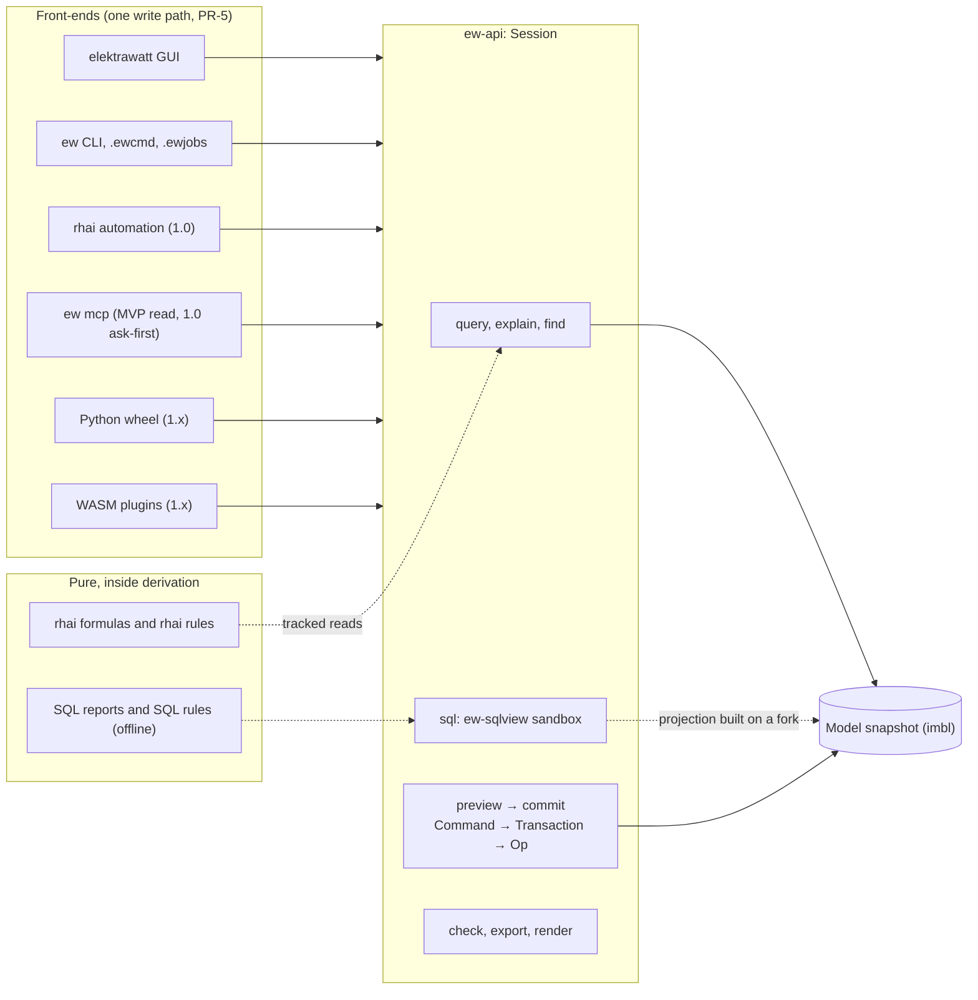
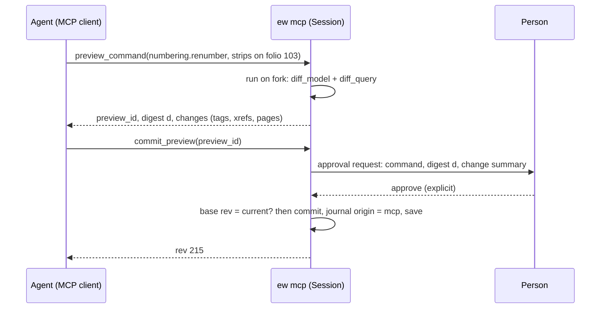

# Extensibility: CLI, scripting, SQL, plugins and agents

**Status:** Draft v0.4 · **Date:** 2026-10-21 (v0.4: cycle-13 design pass: the SQL projection v0 as built, §3.4, §6.1, §6.2; v0.3: cycle-12 design pass: `ew check` as built, §3.1, §3.3; `tag:` and `folio:` references, §3.5; Session v0, §4; v0.2: cycle-11 design pass: `project.settings.set` and its exposure, §2.1, §2.3; the command log as built, §3.5; `ew import qet` as built, §3.2, §3.3) · **Part of:** ElektraWatt design document set

**Purpose.** This document specifies every way to drive, extend or query ElektraWatt (EW) other than the GUI: the
`ew` command-line tool, the headless `Session` API behind it, rhai formulas, rules and automation scripts, the
read-only SQL projection, the MCP server for AI agents, WASM component plugins, the Python wheel, and the
importer/exporter plugin contracts. It fixes the security model of each surface, the API stability and versioning
policy, and the boundary of the GPL plugin exception (ADR-0025). It elaborates the EXT rows of
[02b](02b-requirements-extended.md) §10 and the security rows NFR-SEC-05 … NFR-SEC-08 of
[02c](02c-nonfunctional-requirements.md), within the accepted [architecture](04-architecture.md) §10 and ADR-0017,
ADR-0020, ADR-0021 and ADR-0024.

**Contents**
1. [Scope and principles](#1-scope-and-principles)
2. [Concepts and data](#2-concepts-and-data)
3. [The `ew` CLI](#3-the-ew-cli)
4. [Headless Session API](#4-headless-session-api)
5. [rhai scripting](#5-rhai-scripting)
6. [Read-only SQL projection](#6-read-only-sql-projection)
7. [MCP server](#7-mcp-server)
8. [WASM component plugins (1.x)](#8-wasm-component-plugins-1x)
9. [Python wheel (1.x)](#9-python-wheel-1x)
10. [Importer and exporter plugin contracts](#10-importer-and-exporter-plugin-contracts)
11. [API stability and versioning](#11-api-stability-and-versioning)
12. [The GPL plugin-exception boundary](#12-the-gpl-plugin-exception-boundary)
13. [Security model by surface](#13-security-model-by-surface)
14. [UI/UX touchpoints](#14-uiux-touchpoints)
15. [Outputs](#15-outputs)
16. [Edge cases and pitfalls](#16-edge-cases-and-pitfalls)
17. [The reference project](#17-the-reference-project)
18. [Scope by release](#18-scope-by-release)
19. [Dependencies](#19-dependencies)
20. [Requirements covered](#requirements-covered)
21. [Open questions](#open-questions)

---

## 1. Scope and principles

### 1.1 Boundaries

| This document owns | Owned elsewhere |
|---|---|
| CLI catalogue, flags, exit codes, JSON output schemas, `.ewcmd` command logs, `.ewjobs` jobsets | Merge-driver algorithm, textconv rendering, lock and save protocol, trust-store location ([05](05-project-format-and-persistence.md) §6.4, §11, §13.4) |
| Public command and query registries; exposure classes | Individual editor commands ([06](06-schematic-editor.md) §3.1), PLC commands ([10](10-plc-and-bus.md)) |
| rhai profiles, bindings and limits | Rule-pack format, modes, EW-CORE-083/084 ([15](15-checks-revisions-collaboration.md) §3, §4.2); formula placeholders in forms ([09](09-reports-forms-output.md) §2.6) |
| `api_v1` view catalogue and columns, SQL sandbox | User-report forms and pagination ([09](09-reports-forms-output.md) §3.5); SQL rule semantics ([15](15-checks-revisions-collaboration.md) §3.4) |
| MCP tools, transports, approval | — |
| WIT world, plugin package, capabilities, limits, signing, plugin data | Registry governance and exception wording ([19](19-open-source-governance.md)) |
| WIT mapping of the importer/exporter contracts | The Rust contracts themselves ([14](14-interop.md) §2.1–§2.2) |
| Stability policy per surface | Format versioning (ADR-0011, [05](05-project-format-and-persistence.md)) |
| — | CI jobs that enforce all of this ([18](18-quality-security-release.md)); dialog layouts ([16](16-ux-ui.md)) |

### 1.2 Tiers

| Tier | Surface | Language | Reads | Writes | Sandbox and trust | Release |
|---|---|---|---|---|---|---|
| T0 | File format and permissive crates | any; Rust crates | files | files (no EW involved) | none needed: data | MVP (publish 1.0) |
| T1 | `ew` CLI, `.ewcmd`, `.ewjobs` | shell | everything | commands only | user-invoked; project content trust-gated | MVP / 1.0 |
| T2 | rhai **formulas** | rhai | tracked reads | nothing | no I/O, op limits; runs untrusted | MVP |
| T3 | Rule and report packs | rhai, SQL | tracked reads / projection | findings, report rows | trust-gated | MVP (rhai) / 1.0 (SQL) |
| T4 | rhai **automation** scripts | rhai | `query`, `find`, `sql` | `preview` / `submit` | trust-gated; explicit run only | 1.0 |
| T5 | SQL projection (`api_v1_*`) | SQL | projection | never | `query_only`, authorizer, deadline | MVP |
| T6 | `ew mcp` | MCP (JSON-RPC) | read tools | ask-first commits | off by default, stdio or loopback | MVP read (Could), 1.0 writes, 1.x bridge |
| T7 | WASM component plugins | any → WASM | WIT `model`, `sql` | WIT `edit` | capabilities, fuel, epoch, memory, signatures | 1.x |
| T8 | Python wheel `elektrawatt` | Python | Session API | Session API | user's own code | 1.x |



### 1.3 Principles

1. **The API is the internal command bus.** GUI tools, CLI, scripts, agents and plugins submit the same
   serialisable `Command`s (ARCH §5.1). There is no second mutation path to retrofit later, the lesson KiCad's empty
   schematic IPC API teaches ([oss-landscape](../research/oss-landscape.md) §3).
2. **Read surfaces never write.** SQL, MCP read tools, formulas and rules return values or findings. Writes are
   commands: previewable, validated, undoable, journalled, tagged with an origin.
3. **Untrusted by default.** Received content that can execute (scripts, SQL, project rule packs, jobsets, plugin
   invocations) never runs until a person trusts it; nothing runs on an event such as open, save or export.
4. **The gate cannot be gamed.** Agents, plugins, scripts, command-log replays and pipelines cannot waive
   findings, weaken check schemes, change strictness, approve or release revisions (§2.3).
5. **Deterministic.** Every surface yields the same bytes for the same inputs (NFR-REL-07): no wall clock, no
   unseeded randomness, no platform maths in scripts, ordered collections.
6. **Versioned contracts, permissive bottom.** Every public surface has a version and a CI compatibility guard
   (§11). Format, schema, contract and plugin-interface crates are MIT OR Apache-2.0 (ADR-0024).

### 1.4 EPLAN and QET parity

What an EPLAN or QET user expects from this area, and where EW deliberately differs
([eplan-features](../research/eplan-features.md) §12, §19; QET's MCP server:
[gaps-and-corrections](../research/gaps-and-corrections.md) §3.3, G10):

| EPLAN / QET | EW surface | Rel | Difference |
|---|---|---|---|
| Everything is an "action", callable from menus, scripts and the command line (`plcservice /TYPE:EXPORTADDRESSOVERVIEW …`) | Dotted command names (`plc.readdress`) shared by palette, CLI, rhai, MCP and plugins (§2.1); `ew` subcommands for batch work (§3) | MVP | Headless `ew` needs no GUI process or licence seat and runs in a container (FR-EXT-001) |
| C#/VB scripts with `[DeclareAction]` (parameters become action parameters) and `[Start]` (run on load) | rhai automation scripts with a typed `param()` header rendered as a form (§5.5) | 1.0 | No run-on-load: a script runs only when a person starts it |
| Event handlers (project open, page change; `[DeclareEventHandler]`, unverified) | None in v1. Derived values (tags, xrefs, reports) are queries, and online rules and normalisers cover what event scripts typically patch up | never for received content | Event hooks would let a received project run code on open (§1.3 principle 3) |
| .NET API add-ins, API extensions licensed in the top tier only | WASM component plugins (§8) and the Python wheel (§9) | 1.x | No extra licence tier; sandboxed; plugins cannot reach the UI toolkit |
| Property IDs (`<20010>` DT, `<20011>` function text, `<20100>` part number) addressed by scripts and forms | Public query registry (§2.2) and `api_v1_*` columns (§6.1); EPLAN property IDs are mapped by the EPLAN importers ([14](14-interop.md) §5) | MVP | Names instead of numbers; versioned JSON Schemas |
| API `UndoStep` and `LockingStep` scopes around scripted edits | Every command is one transaction and one undo step; `batch()` groups several (§5.5); the project lock (§3.1) | MVP / 1.0 | Grouping is declarative, so a script cannot leave a half-open undo step |
| Fixed, predefined report types | SQL reports over `api_v1` (§6, FR-REP-031) | 1.0 | Goes beyond EPLAN |
| Cogineer / eBUILD typicals with value sets | Window and page macros with value sets ([07](07-symbols-parts-macros.md); FR-MAC-004), inserted by `macro.insert` from the GUI (MVP) or from automation scripts (1.0) | MVP / 1.0 | Rule-based project generation from typicals is 1.x (FR-MAC-016) |
| QET MCP server with an ask-first "live mode" | `ew mcp` read tools (MVP Could), ask-first writes (1.0), GUI live bridge (1.x) (§7) | MVP / 1.0 / 1.x | Off by default; approval bound to a digest |

---

## 2. Concepts and data

The entities are those of the [domain model](03-domain-model.md); this section adds the extension-specific
records and registries.

### 2.1 Command registry

Every command type registers one `CommandMeta`, generated by a derive macro from its Rust parameter struct:

```rust
pub struct CommandMeta {
    pub name: &'static str,             // "numbering.renumber"; [a-z_]+ "." [a-z_.]+, never reused (FR-EXT-015)
    pub params_version: u16,            // bumped only by a breaking parameter change (§11)
    pub params_schema: &'static str,    // JSON Schema 2020-12 from schemars; deny_unknown_fields
    pub cost: Cost,                     // Interactive | Bulk (Bulk always previews on a fork, ARCH §5.1)
    pub undoable: bool,
    pub exposure: Exposure,             // §2.3
    pub stability: Stability,           // Stable | Preview | Internal
    pub aliases: &'static [&'static str], // retired names and EPLAN/QET palette aliases
}
```

`ew commands --json` prints the catalogue; the reference documentation is generated from it (NFR-DOC-06). An
`AnyCommand { name, params: serde_json::Value }` is validated against `params_schema`, deserialised into the typed
command and run by the commit pipeline (ARCH §5.2); after validation it implements the object-safe `DynCommand`
companion of ARCH §5.1, which `Session::preview` and `Session::execute` take. Aliases resolve to one command: the
placement command `device.place` (`PlaceSymbol` with a `PlaceTarget`) registers `device.place_from_part` and
`symbol.place` as `CommandMeta.aliases`, and the journal always records `device.place`. Entity references in parameters are UUIDs; front-ends that
accept tags (`.ewcmd`, CLI, MCP) resolve them first through `find` (§3.5).

**`project.settings.set`** (ADR-0008 amendment 3; decision log ID-290). Edits one whitelisted member of
`ProjectSettings` per command: `numbering`, `colour_profile`, `size_profile` or `xref_format` (provisional members
live in `ProjectSettings.extra` until their work packages type them). Parameters `{member, value}`; `value` is the
member's whole new JSON value, `null` removes the member so that the pinned derivation profile's default applies, and
a value equal to the stored one changes nothing. The command is validated by its schema and then semantically by
`ew_derive::check_settings_member`, the parser the derivation itself reads the member with, so a setting the
derivation would not apply never reaches the model. It refuses:
- `numbering` with no applicable scheme (ID-99, ID-103: counter scope `"page"`, formats with `{page}`, `{letter}`,
  `{counter}`), and a `default` that names no scheme;
- unknown or unclosed format tokens;
- a numbering format whose tokens are ambiguous without separators, such as `{page}{counter}{letter}`, where page 20
  counter 16 and page 201 counter 6 both print "-2016U" (follow-up task FT-163, which also lists the harmless cases
  still accepted: duplicate scheme keys, an unknown rule aspect, an empty child separator, matrix 0, empty colour or
  size rows);
- colour codes that are neither IEC 60757 nor company codes declared on an IEC 60757 base;
- cross-sections that are not positive mm², AWG or kcmil;
- any other member name, with `InvalidParams` at `/member` listing the settable members. The identifier set has its
  own previewed renumber (FR-NUM-014); `ip_pairing`, `formatting`, `frames`, `wire_default`, `derivation_profile` and
  newer members are refused.

The command is `Cost::Bulk`: the preview shows `Session::derived_diff` (changed tags and cross-reference texts;
follow-up task FT-152 adds wire properties, BOM and TOC rows and a covered-kinds flag). It is undoable as one step.
Only the project record changes; topology stays identical. The journal records it as the top-level `settings` member
of the project record ([05](05-project-format-and-persistence.md) §8.1), so `set` and `was` carry the whole `settings`
value (settings are small). `params_version` 1, stability `Preview`.

**Parameter schemas are the client contract** (FR-EXT-015; decision log ID-56). They reject unknown tags of open
enums, which records keep for forward compatibility (ARCH §7.6): a client learns of a new value from the catalogue,
never by sending it. Before validation, a parameter document is limited to 4 MiB, a nesting depth of 64, 1,048,576
items per array and 1 MiB per string; a validation error shows at most 256 characters of the offending instance,
after the JSON Pointer of the first error.

### 2.2 Query registry

Only **public** queries are reachable from CLI, rhai automation, MCP, plugins and Python. Each has a name, a key
type, an output JSON Schema and a stability level. Internal queries stay private, so the memo layer can be
refactored freely.

| Query | Key | Output (abridged) | Rel |
|---|---|---|---|
| `device_tag` | device | `{full, displayed: {<page>: text}, frozen, deviation}` | MVP |
| `xref_text` | representation | `{text, targets: [{page, cell}]}` | MVP |
| `wire_props` | connection | `{csa, colour, wire_part, provenance per field}` | MVP |
| `potential_of` | CP or connection | `{potential, name, aliases, type, switched, protected_by}` | MVP |
| `terminal_rows`, `cable_rows`, `bom_rows` | strip, cable, mode | report rows ([09](09-reports-forms-output.md)) | MVP |
| `page_order`, `toc_rows`, `title_block` | —, —, page | as ARCH §6.4 | MVP |
| `checks` | scope | findings | MVP |
| `channel_addresses`, `plc_rows` | module, station | addresses with source and map | MVP |
| `wire_record`, `tube_props`, `medium_zones`, `layout_label` | as in [13](13-manufacturing-outputs.md), [11](11-fluid-power.md), [12](12-panel-layout.md) | — | 1.0 |

### 2.3 Origins and exposure classes

Every transaction carries an `Origin`; the history panel (FR-UI-023) and the journal show it.

```rust
pub enum Origin { Gui, Cli { subcommand: String }, CmdLog { file: String, sha256: Sha256 },
                  Script { name: String, sha256: Sha256 }, Mcp { client: String, session: Uuid },
                  Plugin { id: PluginId, version: Version }, Python { script: String },
                  Import { lineage: Uuid }, Merge, External }
```

| Exposure | Front-ends allowed | Commands (examples) |
|---|---|---|
| `Edit` | GUI, CLI (`apply`), scripts, MCP, plugins, Python | `device.place` (aliases `device.place_from_part`, `symbol.place`), `connection.draw`, `fields.set`, `numbering.renumber`, `page.renumber`, `plc.readdress`, `macro.insert`, `project.settings.set`, `plugin.data.set` |
| `HumanOnly` | GUI; a dedicated CLI subcommand confirmed on a terminal (below) | `revision.approve`, `revision.release`, `revision.withdraw`, `waiver.create` / `waiver.remove`, `scheme.set_severity` and the other `scheme.*` edits including company locks, `pack.enable` / `pack.disable`, `project.set_strictness`, completing and reopening a project (FR-REV-013, 1.0), `trust.*`, `plugin.install` / `plugin.remove`, `library.write` |
| `Import` | GUI import wizard, `ew import` | `ApplyImport` (plugins reach it only through the importer contract, §10) |
| `Internal` | normalisers | CP instantiation, online numbering |

`HumanOnly` commands are refused with `CmdError::Exposure` when the origin is a command log (`ew apply`), a script,
an MCP session, a plugin or Python (jobsets submit no commands at all, §3.6). This is what keeps an agent, a replayed `.ewcmd` or a third-party
plugin from waiving EW-POT-013 or demoting EW-PLC-012 to make a release gate pass (FR-CHK-009, FR-REV-007, D-34;
[15](15-checks-revisions-collaboration.md) §2.5, §5.4).

**`HumanOnly` on the command line.** Only the dedicated subcommands (`ew revision approve|release|withdraw`,
`ew waiver add|remove`, `ew trust grant|revoke|sign`, `ew plugin install|remove`) may submit a `HumanOnly`
command, with origin `Cli{subcommand}`:
1. The command's read-only part runs first. `ew revision release V2.0` on Golden A evaluates the gate and exits 1
   with its 42 errors and "checker not set" without asking anything ([20](20-golden-project.md) §18.3).
2. If the command can proceed, EW prints the change summary on the controlling terminal and asks the person to type
   the revision label, the rule ID of the waiver, or `trust` / `install`. There is no `--yes` flag.
3. Without a controlling terminal (CI runner, pipe, `nohup`), the subcommand exits 2 with "HumanOnly: needs an
   interactive terminal". Test builds of `ew-testkit` confirm through a test-build confirmation hook that release
   builds do not contain (asserted absent in release binaries like the egui inspection feature; the tests are in
   [18](18-quality-security-release.md)), so the fault-injection test of
   `ew revision release` ([05](05-project-format-and-persistence.md) §14) and the Golden A-R sign-off of the
   acceptance runner (`ew revision approve --as <checker>`, [20](20-golden-project.md) §2.4) still run in CI.

Like four-eyes sign-off, this is a process control, not an authentication: a person who scripts a pseudo-terminal
can defeat it, but no agent, plugin, replay or pipeline step can reach the gate by accident.

**`project.settings.set` is `Edit`** (decision log ID-291). `HumanOnly` is reserved for controls that decide whether a
gate passes without changing the drawing: approvals, waivers, severities, packs, strictness, trust. Numbering, colour
and size profiles and the cross-reference format change the drawing's content, as `numbering.renumber` (already
`Edit`) does: every effect appears in the bulk preview, is one undo step, is journalled with its origin, and reaches a
released document only through `revision.release`, which stays `HumanOnly`. The rule recorded with the decision: a
settings member that decides a check outcome (check schemes and severities, packs, strictness) never joins the
whitelist but keeps its own `HumanOnly` command, and extending the whitelist needs an ADR-0008 amendment.

The exposure class is declared in `CommandMeta` and checked in the `ew-commands` commit pipeline (validate step,
ARCH §5.2), so no front-end can bypass it; `ew-api` only sets the origin.

*v0* (WP-S1.04; decision log ID-42, ID-45). The engine checks the exposure first, before `run`. Its `Origin` carries
the variants above with their identifying name only (file, script, client, plugin ID); the `sha256`, `session` and
`version` members join when the front-ends that know them land (WP-S1.22, WP-S1.23). All 25 v0 commands (with `project.settings.set`, cycle 11, and `terminal.designate`, cycle 12) are
`Edit` and `Preview`. `Origin::Cli` carries a `confirmed` flag, and a `HumanOnly` command is admitted only from `Origin::Gui`
or from a CLI origin with `confirmed` set (FR-EXT-030; decision log ID-57); the dedicated subcommands that set it
after the typed confirmation above arrive with the CLI work package (WP-S1.22). Before the first `HumanOnly` command
ships, `undo` must refuse a `HumanOnly` step from a script, MCP, plugin or Python origin (§4).

### 2.4 Project-resident extension content and trust

| Content | Location ([05](05-project-format-and-persistence.md) §2.1) | Untrusted project | Trusted project |
|---|---|---|---|
| Pure formulas: title-block `{= …}` cells, report-block filters, value-set formulas, tag and wire-number formats | `project.jsonl`, `report-blocks.jsonl`, `lib/forms`, `lib/macros` | **Run** (formula profile, §5.2) | Run |
| Shipped rule packs, report pack, built-in machine profiles | EW installation | Run | Run |
| Project rule packs (TOML, rhai, SQL) | `rules/` | Not run; EW-CORE-084 | Run |
| User SQL reports | `reports/` | One placeholder page "Report not run: project not trusted" ([09](09-reports-forms-output.md) §3.5) | Run |
| Machine and label profiles with `expr` columns or an `sql:` row source | embedded profile copies `lib/profiles/<copy_id>.toml` ([13](13-manufacturing-outputs.md) §7) | Refused | Run |
| Automation scripts | `scripts/<uuid>.rhai` (1.0) | Listed, not runnable | Run on explicit user action only |
| Jobsets | `jobs/<uuid>.ewjobs` (1.0) | `ew jobs run` refuses | Run on explicit invocation |
| Command macros (`.ewcmd`, exported rhai) | `lib/macros` | Shown, not runnable; window/page macros insert as data | Run on explicit action |
| Plugin data `plugin.<id>.*` | `extra` maps | Preserved, never interpreted by EW | Interpreted by the installed plugin only |
| Required plugins | `project.plugins` (§8.5) | Listed as missing; never auto-installed | — |

Pure formulas run in untrusted projects because a project cannot render without them and the formula profile has
no I/O, deterministic operation limits and tracked reads only. This adopts [02c](02c-nonfunctional-requirements.md)
open question 2 and [15](15-checks-revisions-collaboration.md) §3.9; ADR-0020 records it (amendment 3), together
with the gate on machine-profile `expr` columns.

**The trust hash** ([05](05-project-format-and-persistence.md) §13.4) covers exactly the gated content:

```text
gated   = regular files under rules/, reports/, scripts/, jobs/
        + embedded profile copies under lib/profiles/ that contain an expr column or an sql: row source
        + lib/macros/<uuid>.json items that are command macros (.ewcmd log or exported rhai)
lines   = for f in gated, sorted by path bytes: "<path>\t<sha256(f)>\n"
content_sha256 = sha256("ew-trust/1\n" ‖ lines)
trust entry    = {project id, content_sha256, signer?, decision, decided_at (local, never written to outputs)}
```

**Lifecycle.**
- A project with no gated content is trivially trusted; it never prompts, so users are not trained to click
  "Trust".
- Gated content written by this user's own session (rule editor, script editor, report editor) re-hashes on save and
  keeps trust.
- Gated content that changes on disk from outside (git pull, file copy, external editor, merge) lapses trust for
  the new hash. The banner names the changed files and offers a text diff against the last trusted version, whose
  text the trust store caches (Should, 1.0).
- **Signer (1.0, Should).** A company signs the gated content of its basic project with an Ed25519 key:
  `ew trust sign --key company.key` writes `trust.sig` at the project root ([05](05-project-format-and-persistence.md)
  §2.1, 1.0) over `content_sha256`. A user may trust
  a signer's key fingerprint once; content signed by it is then trusted. Keys and decisions live only in the user's
  configuration directory, never in the project.
- **CI.** Runners have empty trust stores. `--trust <sha256>` (or `EW_TRUST`) trusts exactly that content hash for
  one invocation; `ew trust status` prints the hash. `--trust-current` trusts whatever is present and prints a
  warning; it is meant for a team's own repository.

### 2.5 Plugin data

- **Key form.** `plugin.<plugin-id>.<key>` in the `extra` map of any authored record; plugin IDs are reverse-DNS
  (`org.example.cpx-decoder`), keys match `[a-z0-9_.-]{1,64}`.
- **Values.** Canonical JSON, ≤ 64 KiB per key and ≤ 1 MiB per plugin per record, so merges stay line-local.
- **Writes** go only through `plugin.data.set {target, key, value?}`. The host fills the namespace from the calling
  plugin's identity, so a plugin can neither write nor read another plugin's keys.
- **Persistence.** Undoable and journalled; merged per key ([05](05-project-format-and-persistence.md) §3.1, §10.3); deleted
  with the record; byte-identical through open and save without the plugin (FR-EXT-021).
- **Visibility.** The property grid shows "Plugin data · org.example.cpx-decoder (not installed) · 2 keys".
  `plugin.data.purge {plugin}` removes a namespace in one undoable step.

---

## 3. The `ew` CLI

### 3.1 Conventions

| Item | Rule |
|---|---|
| Binary | `ew` (GPL), a thin `clap` front-end over `ew-api`; same build and version as the GUI |
| Project argument | First positional argument, or `--project <dir \| .ewz>`, else the nearest ancestor of the working directory holding an EW `manifest.json` |
| Locks | Readers (`check`, `export`, `query`, `sql`, `render`, `diff`, `review`, `jobs run`) take no lock and read one generation; while a save is in progress they retry for up to 5 s, then exit 2. Writers (`apply`, `import`, `fmt` (writing), `upgrade`, `recover`, `revision approve\|release\|withdraw`, `waiver add\|remove`, `merge resolve`, `script run`, `trust sign`, `mcp --writable`, and the GUI) take `.~ew.lock` or exit 2 naming the holder ([05](05-project-format-and-persistence.md) §6.4). As built (cycle 12): `ew check` opens read-only without the retry (FT-200) |
| Output | Results to stdout; diagnostics to stderr. `--json` prints one object with `"$schema": "ew.<command>-result/<n>"` (FR-EXT-024). Human-readable text is not an API |
| Language | `--lang <BCP 47>` selects `MlText` output; machine formats (JSON, CSV for machines) are locale-independent |
| Dates | Outputs take dates from the release context, `--as-of`, `SOURCE_DATE_EPOCH` or the model, never the wall clock ([09](09-reports-forms-output.md) §4.3) |
| Trust | `--trust <sha256>`, `--trust-current`; without them, gated content follows the user's trust store (§2.4) |
| Threads | `--threads <n>` changes speed only, never bytes (NFR-REL-07) |
| Network | None, for every subcommand (NFR-PRIV-01); `ew mcp --listen` binds loopback only |
| Logging | `-v` / `-q`; the default level records no project text (NFR-PRIV-05) |

### 3.2 Exit codes

FR-EXT-002 fixes three codes for every subcommand:

| Code | Meaning | Examples |
|---|---|---|
| 0 | Completed; nothing at error level | `ew check` with zero unwaived errors; an export; `ew fmt --check` on canonical files |
| 1 | Completed with a domain failure | unwaived errors (`check`); a failing gate step (`jobs run`); a prevented command (`apply`); conflict records written (`merge-driver`); differences found (`fmt --check`, `verify-derived`, `diff --exit-code`, `archive verify`); `ew import qet --strict` with lost connections or error findings (a lenient import exits 0 with its summary, [14](14-interop.md) §13; decision log ID-282) |
| 2 | Could not complete | usage error; unreadable, locked or newer-major project; I/O error; content refused (untrusted, sandbox denial such as `ATTACH`); limit or deadline hit by the requested SQL or script; caught internal error (message plus local crash-report path) |

As built (cycle 12; decision log ID-309), `ew check` counts the integrity findings of opening in its exit code: a JSON syntax error in a project file is EW-CORE-005 and exits 1.

CI scripts should treat 2 as an infrastructure failure, not as "the drawing has errors".

For `ew apply`, a command log exits 1 only for a line refused by a prevent rule or by the command's own domain rule,
and 2 for everything else that stops it (§3.5).

**The one exception: `ew merge-driver`.** Git treats every exit code up to 128 as "conflicts remain", so the merge
driver exits 0 (clean), 1 (conflict records written) or 129 for a caught internal error (any failure exits with
129 or higher), so that git reports a failure instead of a conflict ([05](05-project-format-and-persistence.md)
§11).

### 3.3 Catalogue

| Group | Subcommand | Purpose | Rel | Req |
|---|---|---|---|---|
| Inspect | `ew check [--scheme <s>] [--mode release\|offline] [--gate] [--integrity] [--pages <range> \| --structure <rds>] [--packs-as-of <label>] [--format text\|json\|junit\|sarif] [--baseline <git-rev \| rev:<label> \| findings.json>]` | Rule engine in release mode by default; `--gate` adds the EW-REL rules of the open revision; `--pages 101-106` or `--structure =P01+J-E-2416` restrict an offline run; `--packs-as-of V2.0` reproduces a released check report; `--baseline` exits 1 only on new unwaived errors ([15](15-checks-revisions-collaboration.md) §3.2, §3.3, §3.9, §6.3). SARIF from 1.0. **As built (cycle 12, decision log ID-309):** `ew check [<project-dir>] [--scheme <name>] [--mode release\|online] [--format text\|md\|json] [--out <file>]`; the default scheme is `pre-delivery`, the mode `release` and the format `text`; the project directory defaults to the nearest ancestor with `manifest.json`. `--mode online` stands in for `offline` until an offline mode exists, and `--format md` is added. Not built: `--gate`, `--integrity`, `--pages`, `--structure`, `--packs-as-of`, `--baseline`, and the junit and sarif formats (FT-191) | MVP (`--baseline` Should; SARIF 1.0) | FR-EXT-002, FR-EXT-024, FR-EXT-025; FR-CHK-048, FR-CHK-053 ([15](15-checks-revisions-collaboration.md)) |
| | `ew query <name> <key> [--json] [--explain]` | Any public query; `--explain` adds dependency trail, memo state, provenance | MVP | FR-EXT-005 |
| | `ew verify-derived` | Cold recomputation against memos. **As built (cycle 14, lane B):** `ew verify-derived [<project-dir>]` opens the project read-only with the memo oracle on (every memoised read is also computed cold), reads every `Memo` and `MemoLru` family of `ew_derive::FAMILIES` and `ew_reports::FAMILIES` (report rows, generated pages, tag classes included) at every key of the snapshot through the memo store and through a cold `Q` (two passes, the second over memo hits); a session without a memo store is refused (exit 2) and prints `verify-derived: <n> families, <n> keys, <n> differences, <n> oracle mismatches` and one `differs:` line per key; exit 0 with no difference, 1 with differences, 2 on usage and open errors. The sweep is the library function `ew_api::verify::verify_derived` (the key enumeration of `tests/memo_oracle.rs` moved there); about 90 s over Golden A in a debug build. Semantics (decision log ID-357): the sweep covers every memoised family of both `FAMILIES` lists (the `SWEPT` list is pinned against them by a test); on a *fresh* open it can only show determinism, because memo and cold are computed on one snapshot, so staleness across edits needs a long-lived session: AC-16 applies `variants/ac16-freshness.ewcmd` edit by edit in one session with the oracle on (one memoised read in 8 re-run cold) and calls the same sweep (`ew_api::verify`) after every edit, requiring the memoised snapshot to equal the cold one byte for byte. Limit: TOC pages are swept for page counts 1 to 3 only, a longer TOC goes unchecked (FT-243). A non-ignored CLI test on a tiny project exists; the Golden A CLI test is `#[ignore]`d (about 90 s). Not built: `--family`, `--json`, `--explain` (belongs to `ew query`) | MVP | FR-EXT-005 |
| | `ew find <pattern> [--kind …]` | Tags, part numbers, texts → entities | MVP | FR-UI-020 |
| | `ew sql [<project>] "<select>" [--format csv\|json\|xlsx] [--timeout s]`; `ew sql dump <out.sqlite>`; `ew sql schema` | Projection under the sandbox (§6). **As built (cycle 13, WP-S1.10):** `ew sql [<project-dir>] "<select>" \| --file <query.sql> [--format csv\|json] [--timeout <s>] [--out <file>]`, `ew sql dump [<project-dir>] <out.sqlite>`, `ew sql schema`; `--project <dir>` as in §3.1. CSV in the golden dialect with a header line, JSON `ew.sql-result/1`; exit 0 or 2. Not built: `--format xlsx` | MVP | FR-EXT-006, -007 |
| | `ew commands [--json]`, `ew queries [--json]`, `ew schema <name>` | Registries and JSON Schemas | MVP | FR-EXT-015, NFR-DOC-06 |
| Output | `ew export pdf\|svg\|png` `[--pages 101-106] [--lang] [--omit-personal-data]`; `ew export dxf` (1.0) | Page output ([09](09-reports-forms-output.md) §4). **As built (cycle 14):** the library side of `ew export svg` exists (`ew_export::svg`: one `<label>.svg` per page from the PDF's sheet display lists, text as text, links as `<a href>`; the page phase on `Parallelism::threads(n)` byte-identical to serial, AC-14). **As built (cycle 15, FT-59):** `ew export pdf [<project>] --out <file.pdf> [--pages <folios>] [--threads <n>]` and `ew export svg [<project>] --out <dir> [--pages <folios>] [--threads <n>]` over the `Session` export job (`ew_api::output`: the page views and one memoised `page_display_list` family per layer, the page phase on `par_map`, the bundled fonts only); `--pages` takes folio labels and ranges in page order (`101-106,901`), a partial PDF prints links to other pages as plain text; the PDF is written to `<file>.tmp`, flushed and renamed; the SVG directory is replaced as a whole through a sibling temporary directory (no stale page of an earlier export, no partial set on failure) and must hold SVG files only; the date is `SOURCE_DATE_EPOCH`, else the model's; exit 0, or 2 for usage, open, selection, writer and I/O errors. `ew export pdf golden/J-E-2416.ew` writes the digest of `expected/pdf/sha256.txt` (G-M1-01, `bin/ew/tests/cli.rs`). Not built: `--lang`, `--omit-personal-data` (usage errors), `png` (decision log ID-346) | MVP; DXF 1.0 (FR-OUT-015) | FR-EXT-003 |
| | `ew export bom [--mode component\|assembly]`, `wires`, `terminals`, `cables` `[--format xlsx\|csv\|pdf]` | Report row sources. **As built (cycle 14, lane B):** `ew export cables [<project-dir>] [--format csv] [--out <file>]` and `ew export bom [<project-dir>] [--mode parts\|assembly] [--format csv] [--out <file>]` (`parts` is the default; `component` is accepted as its alias). The rows are those of the project's page-oriented report block of kind `cable_overview_diagrams` (lowest first folio, golden 906) or `parts_summary` (golden 901 and 901.1) after the block's own arrangement, so the CSV is the folio's rows (`ew_reports::export`) in the golden dialect (`ew_reports::csv`: header `row,<column labels>`, `data` or `heading` rows, neutral language); `--mode` overrides the block's `params.mode`. stdout carries the CSV and stderr the row count, or `--out` writes the file; exit 0, or 2 for a usage error, an unreadable project or a project without the block. *Block selection (decision log ID-356):* when a project has several blocks of the kind, the one with the lowest first folio is used; a project without such a block is refused with exit 2 until `--block` and `ew export report` exist (FT-241). The CSV is the golden dialect (LF line ends, no BOM), not yet the presets of [09](09-reports-forms-output.md) §4.6 (FT-242); the FR-EXP-005 gaps (column-map profile, ECLASS, ETIM, type columns) are in FT-242. The part-number column is named "Part number" in both modes, and positions renumber after the replaced rows in assembly mode. `--mode assembly` replaces the rows of the parts a configured product covers by one `A<n>` row each (`BomRows`, doc 20 §14.2); the golden project holds no configured product yet, so there it prints the parts list. Not built: `wires`, `terminals`, `--format xlsx\|pdf`, the `Covers` column of §14.2 and the folio-3 order-code text (they wait for D-41's typed assembly aspect, FT-245); `wires`, `terminals` and `--format xlsx\|pdf` are FT-241 | MVP | FR-EXT-003 |
| | `ew export report --block <name\|id> --format pdf\|xlsx\|csv` | Any report block, including the fluid report blocks (tube cut list, valve-terminal configuration, medium overview, [11](11-fluid-power.md) §8.3), which have no subcommands of their own | MVP | FR-EXT-027 |
| | `ew export plc-aml [--config <c>] [--apc 1.4.0\|1.2.0]`, `plc-xlsx`, `plcopen`, `ewpp [--release]`, `machine <profile>` (shipped profile ids `generic-csv`, `generic-xlsx`, `komax-topconvert-csv`, `rittal-wt-csv`), `labels <set>`, `drilling --surface <s>`, `tubes`, `ewz`; every export that writes project content takes `--omit-personal-data` | Domain exports ([10](10-plc-and-bus.md) §7, [13](13-manufacturing-outputs.md) §7.2, [11](11-fluid-power.md) §8.3, [05](05-project-format-and-persistence.md)) | 1.0 | FR-EXT-003 |
| | `ew render --page <folio> --png [--dpi n]` | One page via the CPU renderer | MVP | FR-EXT-004 |
| | `ew print --pages <range>` | OS print adapter | MVP (Should) | FR-EXT-009 |
| | `ew review <base> <head> [--out dir]` | Visual comparison ([15](15-checks-revisions-collaboration.md) §6.6) | 1.0 | FR-COL-017 |
| Import | `ew import qet <file.qet> [--content <dir>] [--report md\|csv\|json] [--report-out <file>] [--strict]` (MVP; spike delivered in cycle 11, decision log ID-273, ID-282); `ew import csv` (MVP); `ew import io-list` (MVP, Should); `ew import qet --batch <dir> --out <dir>`, `edz\|dxf\|plc-aml\|table` (1.0) | Options per [14](14-interop.md) §13 and [10](10-plc-and-bus.md) §7 | MVP / 1.0 | FR-EXT-008, FR-PLC-038, FR-IMP-023, FR-EXT-028 |
| | `ew verify-migration <project> --reference <pdf>` | Migration verifier | MVP | FR-IMP-021 |
| Edit | `ew apply <project> <file.ewcmd> [--preview] [--one-step]` (as built in cycle 15, FT-156: over `Session::run_script`, see §3.5) | Replay a command log (§3.5) | MVP | FR-EXT-029 |
| | `ew script run <file.rhai> [--param k=v] [--preview]` | Automation script (§5.5) | 1.0 | FR-EXT-012 |
| | `ew jobs run <file.ewjobs> [--keep-going]` | Jobset (§3.6) | 1.0 | FR-EXT-010 |
| Format, VCS | `ew fmt [--check] [--repair]`, `ew upgrade`, `ew recover`, `ew git setup [--global] [--hooks]` | [05](05-project-format-and-persistence.md) | MVP | FR-EXT-008 |
| | `ew diff [<from>] [<to>] [--queries …] [--json]`, `ew diff --textconv <file>` | Entity diff with derived tags | MVP | FR-COL-013 |
| | `ew diff <a.ewpp> <b.ewpp> --wires` | Package mode: the wire change list between two production packages ([13](13-manufacturing-outputs.md) §3.5) | 1.0 | FR-MFG-004 |
| | `ew merge-driver %O %A %B %L %P`, `ew merge resolve` | Git merge driver ([05](05-project-format-and-persistence.md) §11.1) | MVP (Should) / 1.0 | FR-COL-014 |
| Revisions | `ew revision approve --as <party>`, `ew revision release <label>`, `ew revision withdraw <label> --reason <text>` (all `HumanOnly`, §2.3); `ew archive verify\|rebuild` (1.0) | [05](05-project-format-and-persistence.md) §14, [15](15-checks-revisions-collaboration.md) §5.4–§5.10 | MVP / 1.0 | FR-REV-005, FR-REV-006 |
| | `ew waiver list` (MVP); `ew waiver add <rule> --target <tag\|id:…> --reason <text>`, `ew waiver remove <id>` (1.0, `HumanOnly`) | Waivers without the GUI ([15](15-checks-revisions-collaboration.md) §2.5) | MVP / 1.0 | FR-CHK-009 |
| Domain | `ew plc status <file>`; `ew mfg asbuilt <order>` (1.0); `ew mfg feedback import`, `ew mfg import-status` (1.x); `ew lib lint\|render\|pack` (1.0) | [10](10-plc-and-bus.md), [13](13-manufacturing-outputs.md), [07](07-symbols-parts-macros.md) | 1.0 / 1.x | — |
| Trust | `ew trust status\|grant\|revoke`, `ew trust sign --key <k>` (1.0) | §2.4 | MVP | FR-EXT-031 |
| Agents | `ew mcp [<project>] [--stdio\|--listen 127.0.0.1:0] [--include-personal-data] [--include-confidential]`; `--writable --approve elicit\|tty` (1.0); `ew mcp --attach` (1.x) | §7 | MVP (Could) / 1.0 / 1.x | FR-EXT-016, FR-EXT-017, FR-EXT-018 |
| Plugins | `ew plugin install <file.ewplugin>\|list\|info\|enable\|disable\|remove\|verify` | §8 | 1.x | FR-EXT-019, -020 |
| About | `ew about [--json]`: version, commit, render backend, licence summary, output statement, third-party notices, `PRIVACY.md` | [19](19-open-source-governance.md) | MVP | NFR-LIC-08, NFR-LIC-09 |
| Smoke | `elektrawatt --smoke <project>`: the GUI binary opens the project, renders its pages and exits; the release smoke test, run under the network sandbox | [18](18-quality-security-release.md) §12.2 | MVP | — |

This table is the authoritative CLI catalogue; ARCH §10.1 summarises its groups.

### 3.4 Examples on the golden project

```console
$ ew export pdf golden/J-E-2416.ew --out out/J-E-2416.pdf      # 36 pages, outline, 64 xref links, /PageLabels
$ ew export bom --mode assembly --format csv > bom-assembly.csv   # AC-07
$ ew export wires --format xlsx --out wires.xlsx                  # 44 wires + 6 bridges, same rows as folio 907
$ ew export terminals --format pdf --out terminals.pdf            # 1X1, -X1031, -X1032
$ ew export cables --format csv > cables.csv                      # -106W1, -106W2, -3W1 (length missing)
$ ew export plc-aml --config PLC1 --apc 1.4.0 --out PLC1.aml      # 1.0, CAEX 2.15
$ ew export machine komax-topconvert-csv --out komax.csv          # 1.0, Golden A-R only (lengths required)
$ ew export dxf --pages 101-106 --out dxf/                        # 1.0, AC1015 with configured layers

$ ew check --scheme pre-delivery --format junit > check.xml; echo $?
1                                   # Golden A: 42 errors, 32 warnings, 31 infos, 1 waived (AC-21)
$ ew check <golden-a-r>.ew --scheme pre-delivery; echo $?
0                                   # Golden A-R: Golden A plus the resolution overlay (20 §2.4)

$ ew sql "SELECT count(*) FROM api_v1_terminal"
count(*)
28                                  # CSV with its header line (golden dialect); 1X1: 3, -X1031: 20, -X1032: 5
$ ew sql --timeout 5 "SELECT count(*) FROM api_v1_wire"   # --timeout: 1..86400 s, default 60 s
count(*)
50                                  # 44 wires and 6 bridges
$ ew sql "ATTACH 'other.db' AS x"; echo $?
error: statement denied by the projection sandbox (ATTACH): only SELECT, WITH or VALUES may run
2
$ ew render --page 103 --png --dpi 150 --out 103.png              # equals the approved golden PNG (FR-EXT-004)

$ ew import qet <reference>.qet --report json > migration.json   # Golden C: summary on stderr; MF-01 … MF-27 (cycle 12)
$ ew upgrade old-project.ew                                       # writes an .ewz of the original first (NFR-REL-06)
$ git config merge.elektrawatt.driver "ew merge-driver %O %A %B %L %P"   # normally via ew git setup
$ git log -p --textconv -- devices/                               # "-102F1: part A9F78116 → …", not UUIDs
$ ew mcp golden/J-E-2416.ew --stdio                               # started by the agent host, read-only
```

`ew query --explain` is the debugging tool for derived values (ARCH §6.8, IDEA-043):

```text
$ ew query device_tag -101F1 --explain
device_tag(3f6a2c1e-8b4d-5e21-…) @ rev 214
  full       "=P01+J-E-2416-101F1"      displayed(101) "-101F1"
  policy     Memo · verified at rev 214 (hit) · 4 µs
  depends on
    TagSpec              devices/10.jsonl     letter F · counter 1 (stored, rev 37) · scheme Default · not frozen
    identifier set       project.jsonl        EN 81346-2:2009 single letters · derivation profile 2027.1
    numbering rule       project.jsonl        page-based "{page}{letter}{counter}" (the formatter adds "-")
    main representation  pages/<uuid>.jsonl   folio 101, cell B8 (lowest page, row, column)
    structure            =P01 (page 101) · +J-E-2416 (canonical node; alias "JE2416")
  provenance  letter ← main function FnDef "MCB 1P+N", category ProtectionOvercurrent → F · counter ← online numbering
```

The ID is a UUIDv5, because golden records are generated from the golden tables
([05](05-project-format-and-persistence.md) §2.1); the letter derivation is the worked example of
[03](03-domain-model.md) §8.3.

### 3.5 Command logs (`.ewcmd`)

A command log is JSON Lines: one header, then one command per line. It is the serialised form of `AnyCommand`
used by the macro recorder, the journal and the golden variants (`b1-page-based-tags.ewcmd` and
`b2-renumber-pages.ewcmd`, one `b-renumber.ewcmd` with follow-up task FT-155; `c-fix.ewcmd`,
[20](20-golden-project.md) §2.2, §20.2).

```json
{"$schema":"ew.cmdlog/1","label":"Golden B, steps B1 and B2"}
{"cmd":"project.settings.set","params":{"member":"numbering","value":{"default":"page-based","schemes":[{"key":"page-based","format":"{page}{letter}{counter}","rules":[],"child_separator":"-"}]}}}
{"cmd":"numbering.renumber","params":{"scope":"project","scheme":"page_based","include_frozen":true,"options":{"only_nonconforming":true}}}
{"cmd":"page.renumber","params":{"scope":{"section":{"ref":"section:1"}},"start":101,"step":1,"keep_gaps":false}}
```

Lines 2 and 3 are `variants/b1-page-based-tags.ewcmd` (step B1) and line 4 is `variants/b2-renumber-pages.ewcmd`
(step B2); in the repository they are two files, which FT-155 merges. Every line validates against the command schemas
as built. A `fields.set` line takes `{"kind":"device","targets":[…],"path":"function_text","value":{…}}`; a `tag:`
reference in `targets` names the device whose printed tag matches (see References below). Golden C's `variants/c-fix.ewcmd` uses `tag:` and `folio:` references.

**As built (cycle 11; decision log ID-288).** The replay engine is the library entry `Session::run_script(&CmdLog,
file)`; the `ew apply` subcommand is built since cycle 15 (FT-156, see Semantics).

- **Header and lines** (as built). The first line is an object with `"$schema":"ew.cmdlog/1"` and an optional free
  `label`; other header members are advisory and ignored. Every further line is an object with exactly `cmd` (a command
  name or alias) and `params` (an object; empty when absent).
- **References** (as built; decision log ID-303). Any object `{"ref":"<kind>:<value>"}` inside `params` is
  replaced immediately before its line runs. The kinds are `section:<n>` (the ID of the section with that number; an
  implementation addition), `tag:<tag>`, `folio:<label>` and `id:<uuid>` (once a record with that ID exists).
  `tag:<tag>` resolves to the one device whose derived tag prints `<tag>`, in the printed short form or as the full
  designation with its sign. `folio:<label>` resolves to the one drawn page with that folio label. Matching is exact
  against the then-current model. No match, or several matches, stops the replay with exit 2 (`CmdLogError::Reference`)
  and reports `committed`. `structure:<code>` is not built (FT-171).
- **Exposure.** Every line is looked up and checked against the command registry before the first line runs. A
  `HumanOnly` command anywhere in the log refuses the whole replay with exit 2, so a log can never approve, release,
  waive or trust (§2.3, FR-EXT-030). Golden A-R's sign-off is therefore a terminal step after the overlay, not a log
  line ([15](15-checks-revisions-collaboration.md) §10.3).
- **Semantics** (as built). Each line commits as its own transaction with origin `CmdLog`, named `cmdlog:<file>`:
  interactive commands through `execute`, bulk lines as preview then commit, so one undo step takes back one line. A
  failing line stops the replay and leaves earlier lines committed. Specified: `--preview` runs the whole log on a fork
  and prints `diff_model` and `diff_query` (tags, xrefs, BOM, wires) without committing, and `--one-step` wraps the log
  into one composite command (one undo step).
- **`ew apply` as built** (cycle 15, FT-156). A writer: it opens the project with the lock (exit 2, naming the
  reason, when it opens read-only), replays the log with `Session::run_script`, saves once after the replay (the
  journal covers the lines in between) and releases the lock; the lines before a failing line are saved. `--preview`
  replays on a read-only session (no lock, no journal, never saved) and prints the changed records (`diff_model`
  summaries: kind, ID, member paths), the printed tags and the cross-reference texts (`Session::diff_from`); BOM and
  wire rows are not in the v0 `diff_query`. `--one-step` saves only when every line commits; the composite command
  with one undo step is not built (the CLI has no undo, so the on-disk result is the same). The project is the first of
  two positional arguments, else the nearest ancestor with `manifest.json`. A project whose crashed session left a
  journal is refused with exit 2 before any line runs (owner ruling): the message points to `ew recover`, the
  recovery subcommand of §3.1, which is not built yet, or to the GUI.
- **Exit codes** (library: `CmdLogError::exit_code()`; `ew apply` exits with it, FT-156). 2 for a malformed log, an
  unresolvable reference, a refused command (unknown, exposure) and a failing line whose error is invalid parameters,
  a missing record, a bulk command without preview, or internal. 1 only for a line refused by a prevent rule or by the
  command's own domain rule (`Prevented`, `Rejected`). The error carries `committed`, the number of lines committed.
- **`base`** is advisory and ignored by v0: a different generation would print a warning, because tag references make
  logs portable.

### 3.6 Jobsets (`.ewjobs`, 1.0)

Jobsets are KiCad-style output pipelines ([oss-landscape](../research/oss-landscape.md) §3, IDEA-032). They are
**read-only**: they check and write outputs but never edit the project, so they take no lock and can run next to an
open GUI.

```toml
schema = "ew.jobset/1"
name   = "release"
date   = "release-context"           # or "as-of:2026-10-17" or "source-date-epoch"; never the wall clock
output = "out/{revision}"            # relative to the working directory; placeholders from the model only

[[step]]
check  = { scheme = "pre-delivery", report = ["junit:check.xml", "json:check.json"] }

[[step]]
export = "pdf"
file   = "{project}-{revision}.pdf"

[[step]]
export  = "bom"
options = { mode = "component", format = "xlsx" }
file    = "bom.xlsx"

[[step]]
export  = "wires"
options = { format = "csv" }
file    = "wires.csv"

[[step]]
export  = "terminals"
options = { format = "pdf" }
file    = "terminals.pdf"

[[step]]
export  = "machine"
options = { profile = "komax-topconvert-csv" }
file    = "komax.csv"
```

- **Order and failure.** Steps run in file order. A check step whose result is 1 stops the run with exit 1
  (FR-EXT-010) unless `--keep-going`; later steps then report "skipped". A step that cannot complete (exit 2:
  refused content, I/O error, limit) always stops the run with exit 2, `--keep-going` or not.
- **No release step.** A jobset cannot approve or release a revision (§2.3). The release jobset either runs as a
  dry run before the release, where it stops at the failing check (FR-EXT-010), or on the generation a person has
  released, where `date = "release-context"` takes that revision's date.
- **Step kinds:** `check`, `export` (any exporter, including plugin exporters `org.example.x.csv` in 1.x),
  `render`, `report` (a report block) and `script` (a pure, read-only rhai script producing a table; trust-gated).
- **Run manifest.** `run.json` (`ew.jobset-run/1`) lists each step with status, relative output paths, SHA-256 and
  media type, plus revision, generation, EW version and derivation profile. It carries no timestamp, so two runs on
  the same generation produce identical manifests.
- **Trust.** A jobset file outside the project, passed by path, is the invoker's choice. A jobset inside the
  project's `jobs/` is gated content and runs only in a trusted project, even when passed by path (§2.4). Gated
  content a jobset reaches (project rule packs, SQL reports) still needs project trust or `--trust`.

---

## 4. Headless Session API

`ew-api` (GPL) is the one facade behind the GUI, `ew`, `ew mcp`, rhai automation, the plugin host and `ew-py`
(ARCH §3). It never touches egui or wgpu, so every operation below runs in a container without display or GPU
(FR-EXT-001, PR-6).

```rust
pub struct OpenOptions { pub mode: Mode,             // ReadOnly | Writable (takes the lock)
                         pub trust: TrustPolicy,     // Store | Pinned(Sha256) | Current | Untrusted
                         pub origin: Origin, pub lang: Option<LangTag>, pub as_of: Option<Date> }

impl Session {
    pub fn open(path: &Path, opts: OpenOptions) -> Result<Session, OpenError>;   // manifest hashes; integrity on mismatch (05 §6)
    pub fn world(&self) -> World;                                                 // O(1) model + memo snapshot
    pub fn query(&self, name: &str, key: &QueryKey) -> Result<serde_json::Value, QueryError>;
    pub fn explain(&self, name: &str, key: &QueryKey) -> Result<Explanation, QueryError>;
    pub fn find(&self, pattern: &FindPattern) -> Result<Vec<EntityHit>, QueryError>;
    pub fn sql(&self, select: &str, ctx: SqlContext) -> Result<SqlResult, SqlError>;  // §6; Class II, stamped rev
    pub fn commands(&self) -> &CommandCatalogue;
    pub fn preview(&self, cmd: Box<dyn DynCommand>) -> JobHandle<Preview>;        // fork; diff_model + diff_query
    pub fn commit(&mut self, p: Preview) -> Result<Rev, CmdError>;                // rebase-checked (ARCH §2)
    pub fn execute(&mut self, cmd: &dyn DynCommand) -> Result<Rev, CmdError>;     // e.g. a validated AnyCommand
    pub fn undo(&mut self) -> Result<Rev, CmdError>;  pub fn redo(&mut self) -> Result<Rev, CmdError>;  // session history
    pub fn check(&self, req: CheckRequest) -> JobHandle<CheckRun>;
    pub fn export(&self, req: ExportRequest, sink: &mut dyn Sink) -> JobHandle<ExportReport>;
    pub fn render_png(&self, page: PageSel, dpi: u32) -> Result<Vec<u8>, RenderError>;
    pub fn save(&mut self) -> Result<Generation, StoreError>;
    pub fn trust_state(&self) -> TrustState;          // content hash, decision, gated files
}
```

**v0** (WP-S1.04; decision log ID-42). `Session` is a thin facade over the `ew-commands` `Engine`, with no
persistence, no threads and no queries yet: `new` and `from_records` (instead of `open`), `world`, `execute` and
`execute_with`, `preview` and `preview_with`, `commit`, `undo`, `redo`, `history`, `drain_changes` (the change feed),
`registry` (instead of `commands`), `mark_saved` and `is_dirty`. Cycle 12 adds `check(&Scheme, CheckMode) -> CheckReport`, evaluated through the session's memo store, and `open_read_only(dir, app_version)`, which takes no lock and does no roll-forward or journal write (decision log ID-305, ID-309). The `_with` forms take the origin, the editor context
and the coalescing key. `execute` and `commit` return a `Receipt {rev, outcome, created, passes}` and `undo` and
`redo` a `Restored {rev, context, label}`; `preview` is synchronous until the job pool of WP-S1.05 returns a
`JobHandle`, and a `Cost::Bulk` command sent to `execute` is refused with `CmdError::NeedsPreview`. `ew-api` depends
on `ew-commands`, `ew-model` without `raw-read`, and `ew-schema` (ARCH §3).

- **Concurrency.** A `ReadOnly` session reads one generation and follows later generations through the watcher as
  "External change" (ARCH §7.4); results carry their `Rev`. A `Writable` session holds the lock; a second writer
  is refused.
- **Saving.** Headless writers save after each committed command or composite (the G1 protocol); a crash loses at
  most the transaction in flight, and the journal covers it.
- **History.** Undo and redo act on the session's own history only, like the GUI's project-wide stack (ARCH §5.3).
  History does not survive the process, so `ew` has no `undo` subcommand: a committed `ew apply` is reverted with
  git or by replaying an inverse log. From a script, MCP, plugin or Python origin, `undo` refuses to undo a
  transaction whose command was `HumanOnly` (for example a waiver a person created in the GUI under the 1.x live
  bridge).
- **Jobs.** Long operations return `JobHandle`s with progress and cooperative cancel within 500 ms (NFR-PERF-19).
  The CLI maps Ctrl-C to cancel and exits 2.
- **Errors** are typed and serialisable (`ew.error/1`: `{kind, code, message, entity_refs}`), shared by CLI JSON,
  MCP, WIT and Python.

---

## 5. rhai scripting

rhai 1.26.1 (MIT OR Apache-2.0) is the v1 scripting language (ADR-0020). It is pure Rust, has no I/O unless the
host registers it, and enforces operation and depth limits ([rust-ecosystem](../research/rust-ecosystem.md) §9).

### 5.1 Three profiles

| Profile | Used by | API | Writes | Trust | Rel |
|---|---|---|---|---|---|
| **Formula** | title-block and report cells `{= …}`, report-block filters, value-set variables (FR-MAC-015), tag and wire-number formats (FR-NUM-026), machine-profile `expr` columns | read-only context object of the call site | none; returns one value | runs untrusted (§2.4); machine-profile `expr` excepted | MVP (engine, cells, filters; FR-EXT-011) / 1.0 (formats FR-NUM-026, value sets FR-MAC-015; open question 17) |
| **Rule** | `impl = "rhai"` rules ([15](15-checks-revisions-collaboration.md) §3.7) | scope object (`device`, `potential`, `strip`, `page`, `station`) and `finding(target, args)` | findings only | trust-gated for project packs | MVP |
| **Automation** | `ew script run`, GUI script runner, exported macros | `query`, `find`, `sql`, `preview`, `submit`, `batch`, `emit`, `param` | commands | trust-gated; explicit run only | 1.0 |

### 5.2 Engine configuration

- **Construction.** `Engine::new_raw()` plus an explicit package list: core, logic, arithmetic (integers and
  `Dec`), strings, arrays, maps, iterators. **Not registered:** `BasicTimePackage` (`timestamp()` would break
  determinism), transcendental floating-point maths (platform `sin`/`exp` can differ in the last bit,
  [09](09-reports-forms-output.md) §4.3), any random source, any file, network or process function.
- **Language switches.** `eval` disabled (`disable_symbol("eval")`); `import` disabled (no module resolver, and
  `disable_symbol("import")`); strict variables on (`set_strict_variables`); `print` and `debug` routed to the host
  log or the script console (`on_print`, `on_debug`).
- **Quantities.** Model quantities appear as a registered `Dec` type (fixed-point, exact `+ − × ÷` with explicit
  rounding) and lengths as integer nanometres, so scripts add no float noise ([15](15-checks-revisions-collaboration.md) §3.7).
- **Ordering.** Collections handed to scripts are sorted by ID; rhai object maps are ordered, so iteration order is
  deterministic.
- **Build guard.** CI fails if rhai's `unchecked` feature is enabled anywhere in the dependency graph, because it
  removes every limit below ([18](18-quality-security-release.md)).

| Limit | Formula | Rule | Automation |
|---|---|---|---|
| `max_operations` (deterministic) | 50,000 per evaluation | 1,000,000 per scope evaluation | 1,000,000,000 per run |
| `max_call_levels` | 16 | 32 | 64 |
| `max_expr_depths` (global / function) | 32 / 16 | 64 / 32 | 128 / 64 |
| `max_string_size` | 4 KiB | 64 KiB | 16 MiB |
| `max_array_size` / `max_map_size` | 1,000 | 100,000 | 1,000,000 |
| Wall-clock safety net (`on_progress`) | 10 ms | 250 ms online, 5 s offline | none; cancel within 500 ms |

The operation limits produce deterministic outcomes: a formula or rule that exceeds them yields the same EW-CORE-083
finding on every machine ([15](15-checks-revisions-collaboration.md) §4.2). A wall-clock stop is a safety net only;
its finding is marked "deadline (non-deterministic)" and also blocks release.

### 5.3 Formulas

Formulas are evaluated inside queries. Every property getter on the context object reads through the tracked
context `&Q` installed for the duration of the call, so a formula is exactly as incremental as Rust code
(ARCH §10.3): editing the project description re-evaluates only the cells that read it. Compiled ASTs are cached by
source hash with library durability ([04](04-architecture.md) §6.2).

```rhai
// Title-block cell (09 §2.6): draft marker on unreleased revisions
{= if revision.current.state == "released" { "" } else { "DRAFT " + revision.current.label } }

// Pilot strip rule as a format formula (FR-NUM-026, 1.0): X + folio 103 + counter 1; the formatter adds "-" → -X1031
`${tag.letter}${main.folio}${tag.counter}`

// Value-set variable for the valve typical of folios 203–206 (FR-MAC-015): Q0.1, Q0.3, Q0.5, Q0.7
`Q${module}.${2 * pos - 1}`
```

A formula that fails (limit, type error, missing property) prints `#ERR` in its cell, falls back to the default
format where one exists (tags), and raises EW-CORE-083 with the source location (FR-EXT-011). A formula that reads
its own output (a tag format reading the device's own displayed tag) is a cycle. The formula host detects the
re-entry on its query stack before evaluating, prints `#ERR` and raises EW-CORE-083 with the cycle path, so a user
formula never reaches `ew-memo`'s debug-build cycle panic (ARCH §6.2). Page counts are not such a cycle:
`{doc.page_count}` reads the result of the page-order fixpoint, which iterates inside one query (ARCH §6.2 item 5).

### 5.4 Rules

The rule profile is specified in [15](15-checks-revisions-collaboration.md) §3.7. A company lint against D-35
("rating in description"), as a rule of a project pack. Its TOML entry (`id = "ACME-DEV-002"`, `code = "500002"`,
`scope = "device"`, `modes = ["online", "release"]`, `severity = "warning"`) sits in `rules/<pack-uuid>.toml` and
points at the script file ([05](05-project-format-and-persistence.md) §2.1):

```rhai
// rules/<pack-uuid>/rhai/desc-rating.rhai
for line in device.parts {
    if line.description.matches(`\b\d+(\.\d+)?\s?(A( ?[BCDK])?|[BCDK])\b`) {
        finding(device, #{ text: line.description });
    }
}
```

On Golden A it reports nothing, because descriptions come from part data (EF-25,
[20](20-golden-project.md) §18.2). On a migrated project whose part descriptions still hold the folio 901 texts it
flags "10A C" (-101F1), "4A C" (F55), "16 B" (-102F1) and "20A" (-102G1)
([reference drawing](../research/reference-drawing.md) D-35). The shipped EW-CORE-065 description lint covers the
same case from 1.0; the rhai rule gives a company the check at MVP without Rust. `matches` is a registered,
linear-time regex function (`regex` crate) with a 1,000-character pattern limit.

### 5.5 Automation scripts (1.0)

```rhai
// mark-spares.rhai (a user file; inside a project it is stored as scripts/<uuid>.rhai, 05 §2.1)
// ew:script api = 1, name = "Mark spare valve positions", params = #{ text: "Spare" }
let station = find("-201U1")[0];
let spare = query("plc_rows", station).filter(|r| r.state == "spare" && r.target != ());
submit("fields.set", #{
    targets: spare.map(|r| r.target),            // the 20 spare valves -201U5-Q1 … -202U2-Q4 on Q2 … Q6
    path:    "function_text",
    value:   ml(param("text"))
});
emit("spares.csv", table(spare, ["address", "target_tag"]));   // written into the run's output directory
```

Function texts live on the valves, never on channels ([10](10-plc-and-bus.md) §3.4), so the script edits the 20
bound valve devices and folio 908, the I/O list and the AML comments follow in the same commit. On Golden A the
spare valves already read "Spare", so the walk-through (§17.1) passes `--param text=Reserve`.

| Function | Semantics |
|---|---|
| `query(name, key)`, `find(pattern)`, `sql(select)` | Public queries, find and the projection, read on the current revision |
| `preview(cmd, params)` | Fork job; returns `#{digest, changes, pages}` without committing |
| `submit(cmd, params)` | One transaction with origin `Script{name, sha256}`; returns the new revision; a prevented command raises an error that stops the script |
| `batch(label, \|b\| …)` | Collects `b.submit(…)` calls into one composite command: one transaction with read-your-writes, one undo step |
| `emit(name, table \| text)` | Writes a file into the host-chosen output directory; `name` has no path separators |
| `param(key)` | Typed parameters declared in the header; the GUI renders them as a form |

Rules for automation:
- A script runs only when a person starts it (GUI button, `ew script run`). A jobset `script` step (§3.6) runs
  read-only scripts only: `submit` and `batch` raise an error there. v1 has **no event hooks** (on open, on save,
  on export).
- `HumanOnly` commands are refused (§2.3).
- The script's SHA-256 is part of its origin, so the history panel and journal show exactly which text ran.
- `--preview` runs the script against a fork and prints the combined diff.

**Macro recorder (FR-EXT-013).** Recording turns the session's commands into a script with literal parameters;
"Export as rhai" lifts selected values (folio, start counter, tags) into `param()` declarations. Replaying the
recorded heater group of folio 101 with `folio = 104` yields the same devices with tags derived on folio 104.

---

## 6. Read-only SQL projection

### 6.1 What users see

`ew-sqlview` materialises the model and selected query results into SQLite on a fork (ARCH §10.2, ADR-0017):
internal `t_*` tables behind public `api_v1_*` views. Users, rule packs, MCP and acceptance tests see only the
views.

**Column conventions.**
- `id` is the entity UUID (lowercase text); references are `<entity>_id`.
- `tag` is the list form of the device tag under the project's identifier suppression (`-101F1`, `-X1031`);
  `tag_full` is the complete designation (`=P01+J-E-2416-101F1`).
- Multilingual text: `<name>` holds the project's primary language with fallback; `<name>_ml` holds the JSON of all
  languages, read with `ew_ml(<name>_ml, 'nl-NL')`.
- Quantities are exact decimal text (`'0.75'`) with a unit column where needed; lengths and coordinates are integer
  `_nm`.
- Booleans are 0/1; enums are lowercase text, except electrical codes, which keep their printed form (`L+`, `M`,
  `PE`, `DBU`); JSON arrays are text.
- `prov_<field>` holds the provenance of a derived value ("potential 24VDC-1 via profile DBU/WH 24 V").

| View | One row per | Key columns (abridged) | Golden rows | Rel |
|---|---|---|---|---|
| `api_v1_meta` | projection | `rev, generation, format, derivation_profile, ew_version, languages, as_of`; `api_status, preview_additions` (Preview addition) | 1 | MVP* |
| `api_v1_device` | device | `id, tag, tag_full, letter, counter, frozen, kind, parent_id, structure_function, structure_location, function_text, process_tag, state, main_page_id, main_folio, main_cell, has_part, manufacturer, part_number, tech_data, aspects, placed`; `function_text_ml` (Preview addition) | — | MVP |
| `api_v1_function` | function | `id, device_id, device_tag, role, kind, fndef, category, page_id, folio, cell, xref_text`; `ip_name` (Preview addition, the interruption point's name) | — | MVP |
| `api_v1_page` | page incl. generated | `id, folio, label, section_id, kind, title, description, description_overridden, structure_function, structure_location, prev_folio, next_folio, generated, report_block_id, physical_index`; `number, title_ml` (Preview addition) | 36 | MVP |
| `api_v1_cp` (not built, FT-216) | connected or named CP | `id, function_id, device_id, device_tag, cp, idx, discipline, potential_id, potential_name, role, unused, page_id, cell`; `i_load` (1.0). `role` is derived: `source` (the CP definition is a source output, `CpDef.source_output`), `through` (CPs of a pass-through pair in `FnDef.internal`), `load` (supply CPs of consumer functions) or `other`. `i_load` is the part's electrical load current for that supply CP (decimal text in A, empty when unknown; [07](07-symbols-parts-macros.md) part data, ADR-0017 amendment 3) | — | MVP* (`i_load` 1.0) |
| `api_v1_wire` | physical wire or bridge | `id, number, kind, from_device_id, from_tag, from_cp, from_level, from_clamp, to_device_id, to_tag, to_cp, to_level, to_clamp, potential_id, potential_name, csa, csa_unit, colour, colour_iec, wire_part, length_nm, length_source, cable_id, cable_tag, core, pages, prov_csa, prov_colour` ([08](08-connections-terminals-cables.md) §10); `seq, from_end, from_side, from_ip, to_end, to_side, to_ip, conductor_id, bond_id, ips, junction_id, junction_style, junction_wiring, junction_cell, junction_cps, chain_cps, bridge_kind, csa_source, colour_source` (Preview addition; the junction and daisy-chain columns since cycle 14, D-20) | 50 | MVP |
| `api_v1_terminal` | terminal | `id, strip_id, strip_tag, designation, printed, seq, part_number, levels, potential_id, potential_name, potential_type, state, rail_bonded, page_id, cell`; `tag, function_text, strip_group, bridge` (Preview addition) | 28 | MVP |
| `api_v1_cable` | cable | `id, tag, part_number, cores, length_nm, length_source, from_location, to_location, external_end, shield, pages`; `tag_full, end_a, end_b` (Preview addition) | 3 | MVP |
| `api_v1_conductor` | conductor | `id, cable_id, cable_tag, core, colour, colour_iec, csa, shield, wire_id`; `pair, csa_unit` (Preview addition) | 13 | MVP |
| `api_v1_potential` | potential | `id, name, aliases, ptype, voltage, ac_dc, circuit_class, colour, default_csa, switched, protected_by_device_id, protected_by_tag, protected_by_cp, bond_ids, member_count, pages`; `colour_iec, default_csa_unit, bus_cable_ids` (Preview addition; `bus_cable_ids` is the JSON array of the cable UUIDs of the potential's bus lines, like `bond_ids`, decision log ID-329, ID-336) | 19 | MVP |
| `api_v1_bond` | bond between two potentials | `id, label, kind, a_potential_id, a_potential_name, b_potential_id, b_potential_name, wire_id, names, pages` ([08](08-connections-terminals-cables.md) §3.7) | 1 | MVP** |
| `api_v1_bom_component` / `api_v1_bom_assembly` | BOM row per mode | `position, part_id, manufacturer, part_number, type, description, quantity, unit, tags, folios`; `configured, variant, description_ml` (Preview addition, both views); `assembly_tag, level` (assembly view only, built) | 27 rows on 901 | MVP |
| `api_v1_message` | finding | `fingerprint, rule, pack, pack_version, severity, mode, state, target_ids, target_tags, page_id, cell, message, args, waiver_id` | 103 incl. 1 waived | MVP |
| `api_v1_structure`, `api_v1_xref`, `api_v1_revision` (not built, FT-216) | node, xref text, revision | `aspect, code, aliases, parent_id`; `rep_id, page, cell, text, partner_page, partner_cell, kind`; `label, date, state, author, checker` | —, 64, 2 | MVP* |
| `api_v1_plc_channel` | channel | the `io_list` columns of [10](10-plc-and-bus.md) §5 plus `id, station_id, module_id, target_id, address_source` | 56 | 1.0 |
| `api_v1_placement` | placement | `id, device_id, device_tag, space_id, carrier_id, carrier_kind, x_nm, y_nm, z_nm, rotation, locked, collides` | — | 1.0 |
| `api_v1_fluid_line`, `api_v1_valve_position`, `api_v1_medium` | tube, valve position, medium | columns owned by [11](11-fluid-power.md) §8.3 | 16, 28, 0 | 1.0* |

\* views beyond the FR-EXT-007 list, added by FR-EXT-032 (ADR-0017 amendment 2); like every view, they stay
`Preview` until the 1.0 freeze (§11). Person columns (`author`, `checker`) are omitted when the context asks for
personal-data minimisation (§7.4).

\*\* `api_v1_bond` is a Preview addition beyond FR-EXT-007 and FR-EXT-032 (ADR-0017 amendment 2, extended in cycle
13; decision log ID-329).

**As built (cycle 13, WP-S1.10; decision log ID-328, ID-329, ID-330).** `ew-sqlview` builds thirteen views: the
eleven of FR-EXT-007 (`api_v1_device`, `api_v1_function`, `api_v1_page`, `api_v1_wire`, `api_v1_terminal`,
`api_v1_cable`, `api_v1_conductor`, `api_v1_potential`, `api_v1_bom_component`, `api_v1_bom_assembly`,
`api_v1_message`; the table above shows the two BOM views in one row), `api_v1_meta` and `api_v1_bond`. Every column
listed above for a built view exists in the code; no listed column of a built view is missing.
- **Not built.** `api_v1_cp` (with `role` and `i_load`), `api_v1_structure`, `api_v1_xref` and `api_v1_revision`
  of FR-EXT-032 (FT-216). The 1.0 views (`api_v1_plc_channel`, `api_v1_placement`, `api_v1_fluid_line`,
  `api_v1_valve_position`, `api_v1_medium`) are not built either.
- **Preview additions.** The columns marked "(Preview addition)" in the table and the view `api_v1_bond` are
  additive Preview of `api_v1` (decision log ID-329). `ew sql schema` marks each of them `[preview addition]`, and
  `api_v1_meta` carries `api_status` (`preview`) and `preview_additions` (a JSON array of `view` or `view.column`
  names), so a consumer can tell the documented key columns from the additions. Within v1 columns are only added.
- **Page IDs.** A divider page takes its section's UUID as `id`; a generated page takes its v5 page ID. The column
  that holds the section is `api_v1_page.section_id` (NULL for front matter); the document follows the code and no
  longer calls it `section` (decision log ID-330).
- **Potential type and voltage.** `api_v1_potential.ptype` and `voltage` are the potential's own attributes: stored
  on its definition or derived per [03](03-domain-model.md) §9.4 (the `potential_attrs` query) (decision log ID-330).
- **BOM assembly.** `api_v1_bom_assembly` has `assembly_tag` (the list-form tag of the head device of a configured
  product when the row has exactly one, else NULL) and `level` (NULL until configured products exist) (decision log
  ID-330).

### 6.2 Sandbox

| Control | Setting |
|---|---|
| Connection | Separate connection per consumer, `SQLITE_OPEN_READONLY`, `PRAGMA query_only = 1`, `SQLITE_DBCONFIG_DEFENSIVE`, extension loading off, `trusted_schema = OFF`. An in-memory projection reaches a consumer as a read-only deserialised copy (`sqlite3_deserialize` with `SQLITE_DESERIALIZE_READONLY`; rusqlite `serialize` feature, enabled), a file-backed XL projection by opening its file read-only |
| Statement gate | Exactly one statement per call (a non-empty tail after the first statement is refused); the statement must start with `SELECT`, `WITH` or `VALUES` and `sqlite3_stmt_readonly()` must be true. This refuses `VACUUM INTO` and `WITH … INSERT` before they run, independent of which authorizer codes SQLite raises for them |
| Authorizer allows | `SELECT`; `READ` of `t_*` columns only when the innermost responsible view (the authorizer's fourth argument) is the table's own `api_v1_*` view (own-view rule: `t_x` through `api_v1_x` only); `RECURSIVE` (bounded below); allowlisted `FUNCTION`s |
| Authorizer denies | `ATTACH`, `DETACH`, all `PRAGMA`s, every DDL and DML, transactions and savepoints, `ANALYZE`, `REINDEX`, direct reads of `t_*` and of the schema table from top-level SQL |
| Functions | SQLite core scalars and aggregates, window functions, math functions, JSON functions, `ew_ml`, collation `ew_natural` (X2 < X10); `ew_regexp` is not built (FT-217). `random()` and `randomblob()` denied; date and time functions overridden to reject the `'now'`, `'localtime'` and `'utc'` modifiers, also as BLOB arguments, and a call without a time value; `CURRENT_DATE`, `CURRENT_TIME` and `CURRENT_TIMESTAMP` denied |
| Registration | EW functions flagged `SQLITE_DETERMINISTIC \| SQLITE_INNOCUOUS`, as required with `trusted_schema = OFF` |
| Limits (`SQLITE_LIMIT_*`) | `LENGTH` 16 MiB, `SQL_LENGTH` 256 KiB, `COLUMN` 256, `EXPR_DEPTH` 200, `COMPOUND_SELECT` 50, `VDBE_OP` 250,000 (set on every connection; no property rests on it, the deadline bounds the runtime), `FUNCTION_ARG` 32, `ATTACHED` 0, `LIKE_PATTERN_LENGTH` 1,000, `VARIABLE_NUMBER` 256, `TRIGGER_DEPTH` 0, `WORKER_THREADS` 0 |
| Deadline (progress handler every 10,000 VM steps; `sqlite3_interrupt` from the job): the runtime bound, whatever `VDBE_OP` enforces | user report 2 s ([09](09-reports-forms-output.md) §3.5); SQL rule 10 s; MCP 5 s; `ew sql` 60 s by default, `--timeout` 1..86400 s (the cap is `Profile::MAX_DEADLINE`, 1 day) |
| Result caps | report 100,000 rows; MCP 1,000 rows and 1 MiB; `ew sql` and SQL rules 1,000,000 rows and 256 MiB (bytes count text and BLOB lengths, 8 per number) |

The sandbox is to be fuzzed with hostile SQL (recursive-CTE bombs, deep expressions, authorizer bypass attempts) per
NFR-SEC-03 and NFR-SEC-06; the fuzz target and the hostile-SQL corpus are not built (FT-223). SQLite has no per-connection memory cap; memory is bounded indirectly by the length and
row limits, the deadline and the projection's memory gate (NFR-PERF-13).

**As built (cycle 13, WP-S1.10; decision log ID-328, ID-331).** `ew-sqlview` uses rusqlite 0.40.2, bundled, with
the features `functions`, `collation`, `hooks`, `limits` and `serialize`. Every connection is `SQLITE_OPEN_READONLY` on
a read-only deserialised copy of the projection image, with `SQLITE_DBCONFIG_DEFENSIVE`, `trusted_schema = OFF`,
triggers and the FTS3 tokenizer off and `query_only = 1`. The limits and result caps of the table are the values in the
code.
- **Clock.** The date and time functions refuse the `'now'`, `'localtime'` and `'utc'` modifiers, also when they are
  passed as BLOB arguments (`date(CAST('now' AS BLOB))`, `unixepoch(x'6e6f77')`).
- **Deadline.** It is capped at `Profile::MAX_DEADLINE` (1 day); `ew sql --timeout` accepts 1..86400 s, checked
  without overflow, and refuses anything else with exit 2.
- **Own-view rule.** A `t_x` table is readable only through its own view `api_v1_x`: the authorizer's innermost view
  must be the accessor of that table.
- **Known limit, accepted and documented.** A common table expression named after an `api_v1` view reads the table
  behind it, so it sees that view's table columns and its `rowid` only, never another table. The rule guards the
  contract, not secrecy, because every column of `t_x` is also a column of `api_v1_x`.
- **Comments and options.** An inline query that starts with a `-- comment` is accepted; a lone argument that starts
  with `-word` is refused as an unknown option. CSV output keeps its header line (golden dialect).
- **Not built.** `ew_regexp` (FT-217), `--format xlsx` (FT-218), file-backed XL projections (FT-219), per-table
  refresh (FT-220), the CI prepare/EXPLAIN lint of `.sql` files (FT-222) and the sandbox fuzz target with its
  hostile-SQL corpus (FT-223).

### 6.3 Freshness, trust and writes

- **Freshness.** The GUI's projection is Class II and shows "as of revision n". `ew sql`, exports and release
  checks build the projection on their own fork at the opened generation, so their results are always fresh.
- **Trust.** SQL text from a received project (reports, rules, machine profiles) is gated (§2.4). SQL typed by the
  user (`ew sql`, the SQL console) or sent by the user's agent (MCP) is the user's own and runs in the same sandbox.
- **Writes.** None, ever (ARCH §16). An "Excel round trip" reads the projection to export and imports changes as
  commands ([14](14-interop.md) §8).

---

## 7. MCP server

### 7.1 Modes and transports

| Mode | Start | Writes | Rel |
|---|---|---|---|
| Headless read-only | `ew mcp <project> --stdio`, started by the agent host as a subprocess | none | MVP (Could) |
| Headless writable | `ew mcp <project> --stdio --writable --approve elicit\|tty`; takes the project lock | ask-first `commit_preview` | 1.0 (Should) |
| GUI live bridge | `ew mcp --attach` connects to the running GUI over a user-only local socket or named pipe | ghost previews accepted in the GUI | 1.x (Could) |

- **Off by default.** Neither the GUI nor the CLI ever starts `ew mcp` implicitly (NFR-SEC-08). An administrator
  policy can disable it entirely (NFR-PLAT-08); `ew mcp` then exits 2
  with "disabled by policy".
- **Transports.** stdio, or Streamable HTTP on `127.0.0.1` / `::1` with a random port and a per-session bearer
  token printed once to stderr. The server validates the `Origin` header against DNS rebinding and offers no option
  to bind another interface (FR-EXT-026).
- **Scope.** One session serves the one project it opened. No tool reads files outside that project, and no tool
  writes files at all.
- **Implementation.** rmcp 3.5.1 **(verify)** over `ew-api`. While the GUI holds the lock, a headless session is
  read-only (FR-EXT-016).

### 7.2 Tools and resources

| Tool | Input | Output | Rel |
|---|---|---|---|
| `project_info` | — | name, revision, generation, format, derivation profile, counts, trust state | MVP |
| `find` | pattern, kinds, limit ≤ 200 | entities with derived tags, pages, cells | MVP |
| `query` | name, key, `explain?` | JSON per the query's schema; dependency trail if asked | MVP |
| `sql_query` | `select`, `max_rows` ≤ 1,000 | columns, rows, `as_of` revision, `truncated` | MVP |
| `run_checks` | scheme, mode (`offline` \| `release`), scope | findings: rule, severity, target tags, page, cell, message, rule page | MVP |
| `list_commands` | filter | names, parameter schemas, exposure | MVP |
| `preview_command` | name, params | `preview_id`, digest, model diff with derived tags, `diff_query` deltas, affected pages | MVP |
| `render_page` | folio, dpi ≤ 150 | PNG through the CPU renderer | MVP (Could, FR-EXT-034) |
| `commit_preview` | `preview_id` | new revision; listed only in writable sessions | 1.0 |

Resources: `ew://api/v1/views` (view DDL and column docs), `ew://commands`, `ew://queries`, `ew://rules/<id>` (the
rule page of NFR-DOC-02). Every response is capped at 1 MiB and flagged `truncated` when cut.

### 7.3 Ask-first writes



- **Binding.** Approval is bound to `(preview_id, digest, base_rev)`. The agent cannot swap the command after the
  person has seen it. If the revision moved (GUI edit, git pull), `commit_preview` fails with "stale preview" and
  the agent must preview again.
- **Approval channel.** `--approve elicit` sends an MCP elicitation request (spec revision 2025-06-18 or later,
  **verify** rmcp support), which the client application renders to the person; the model cannot answer it.
  `--approve tty` asks on the controlling terminal (the process's tty on Unix, the console on Windows), never on
  the stdio channel; an agent host that spawns `ew mcp` without a terminal therefore needs `elicit`. Without a
  usable channel, `commit_preview` is not offered. There is no auto-approve mode: unattended writes use `ew apply`
  or `ew script run`, which a person invokes directly.
- **Limits.** Previews expire after 10 minutes; at most 8 are pending per session. `HumanOnly` commands cannot be
  previewed (§2.3).
- **Record.** The commit is an ordinary journalled, undoable transaction with origin `Mcp{client, session}`,
  where `client` is the MCP `clientInfo.name` (FR-EXT-017).

### 7.4 Data minimisation

The agent's model may run at a remote provider that EW cannot see (NFR-PRIV-08). By default, MCP responses omit
every field `ew-schema` marks as personal data (engineer, checker, party persons) and project identifiers marked
confidential (project reference, drawing id, party names). `--include-personal-data` and
`--include-confidential` lift this per session, and `project_info` states the active policy (FR-EXT-033).

### 7.5 Live bridge (1.x)

The GUI opens a user-only local endpoint when the person enables "Allow agent connection" for the open project.
`ew mcp --attach` relays MCP to it. `preview_command` then shows the candidate as a ghost on the open page, with
the diff in a side panel; accept and reject happen in EW's own window (FR-EXT-018). This is the strongest approval
channel and the recommended way to let an agent edit.

---

## 8. WASM component plugins (1.x)

### 8.1 Runtime

- **Engine.** wasmtime on an **LTS line** (every 12th release, 24 months of security fixes,
  [gaps-and-corrections](../research/gaps-and-corrections.md) §3.3), with the Component Model and wit-bindgen
  0.63.0. Plugins run on the wasmtime LTS line current at plugin launch, and development runs on the 48.x LTS line
  until then (ARCH §2, ADR-0020 amendment 2; open question 3). Moving LTS lines does not change the WIT world, so
  plugins need no rebuild.
- **WASI.** WASI 0.2 **(verify)** with: an empty environment; pre-opened directories only for granted file
  capabilities; a monotonic clock for progress; a wall clock virtualised to the export `as_of` date; `wasi:random`
  seeded from `(plugin id, input digest)`; no `wasi:sockets`. Network, when granted, goes through a host-mediated
  HTTP interface with a per-host allowlist.
- **Where it runs.** On the job pool, never on the UI thread (ARCH §2). A trap, limit violation or panic leaves the
  model unchanged and the session running (NFR-REL-12).
- **Code generation.** Cranelift compiles each component once at install; the compiled artefact is cached by
  `sha256(plugin.wasm) + wasmtime version + target` in the local cache and recompiled after an EW update. On macOS
  under the hardened runtime, executing generated code needs the `com.apple.security.cs.allow-jit` entitlement; the
  alternative is wasmtime's portable interpreter, at a speed cost **(verify)**. The choice is open question 19 and
  [18](18-quality-security-release.md) open question 13.

### 8.2 WIT world `elektrawatt:plugin@1`

A sketch; the normative `.wit` files live in the permissive `ew-plugin-wit` crate (FR-EXT-036):

```wit
package elektrawatt:plugin@1.0.0;

interface types {
  type uuid = string;                                  // lowercase hyphenated
  type rev = u64;
  enum severity { info, warning, error }
  variant cell { null, boolean(bool), integer(s64), decimal(string), text(string), json(string) }
  record table { columns: list<string>, rows: list<list<cell>> }
  record ew-error { code: string, message: string }    // "denied", "limit", "invalid", "stale", …
  record finding { targets: list<uuid>, discriminator: option<string>, args-json: string }
  record diff-summary { base-rev: rev, digest: string, lines: list<string> }
}

interface model {                                      // capability model.read (sql: sql.read)
  use types.{uuid, rev, table, ew-error};
  resource snapshot {
    rev: func() -> rev;
    query: func(name: string, key: string) -> result<string, ew-error>;           // JSON, published schema
    records: func(kind: string, ids: list<uuid>) -> result<list<string>, ew-error>; // canonical JSONL lines
    find: func(pattern: string, kinds: list<string>, limit: u32) -> result<list<uuid>, ew-error>;
    sql: func(select: string, max-rows: u32) -> result<table, ew-error>;
  }
  current: func() -> snapshot;
}

interface edit {                                       // capability model.write
  use types.{rev, diff-summary, ew-error};
  resource pending { diff: func() -> diff-summary; }
  preview: func(command: string, params-json: string) -> result<pending, ew-error>;
  commit: func(p: pending) -> result<rev, ew-error>;                             // rebase-checked
  submit: func(command: string, params-json: string) -> result<rev, ew-error>;   // preview + commit
}

interface io {                                         // resources owned by the host
  use types.{uuid, ew-error};
  resource file   { name: func() -> string; read: func(max: u64) -> result<list<u8>, ew-error>;
                    write: func(bytes: list<u8>) -> result<_, ew-error>; }
  resource source { name: func() -> string; len: func() -> u64; read: func(limit: u64) -> result<list<u8>, ew-error>; }
  resource import-cx { mint-id: func(source-key: string) -> uuid; as-of: func() -> string;
                       options-json: func() -> string; hints-json: func() -> string; }
  resource export-view { rev: func() -> u64; rows: func(key: string) -> result<table, ew-error>;
                         records: func(kind: string) -> result<list<string>, ew-error>; context-json: func() -> string; }
  resource sink   { create: func(name: string, media-type: string) -> result<file, ew-error>; }
  pick-open: func(title: string, filters: list<string>) -> option<file>;        // capability files.read
  pick-save: func(title: string, suggested: string) -> option<file>;            // capability files.write
}

interface ui { show-form: func(form-json: string) -> option<string>; }            // capability dialogs
interface host { log: func(level: u8, message: string); progress: func(done: u64, total: u64) -> bool;
                 secret-get: func(name: string) -> option<string>; }             // capability secret.get

interface importer { use io.{source, import-cx}; use types.{ew-error};
  record batch { records: list<string>, provenance: list<string>, assets: list<tuple<string, list<u8>>>, report-json: string }
  sniff: func(importer-id: string, head: list<u8>, name: string) -> u8;          // 0 = no, 1–99 maybe, 100 certain
  run: func(importer-id: string, src: borrow<source>, cx: borrow<import-cx>) -> result<batch, ew-error>; }
interface exporter { use io.{export-view, sink}; use types.{ew-error};
  run: func(exporter-id: string, view: borrow<export-view>, options-json: string, out: borrow<sink>) -> result<string, ew-error>; }
interface rules { use model.{snapshot}; use types.{finding, ew-error};
  evaluate: func(rule-id: string, snap: borrow<snapshot>, scope: string, params-json: string) -> result<list<finding>, ew-error>; }
interface report-columns { use types.{table, cell, ew-error};
  compute: func(column-id: string, rows: table) -> result<list<cell>, ew-error>; }
interface decoder { use types.{ew-error};
  decode: func(decoder-id: string, order-code: string, family: string) -> result<string, ew-error>; } // slot list JSON
interface actions { use types.{uuid, ew-error};
  run: func(action-id: string, selection: list<uuid>) -> result<_, ew-error>; }

world base { import model; import edit; import io; import ui; import host; }
world plugin { include base;
  export importer; export exporter; export rules; export report-columns; export decoder; export actions; }
```

- **Roles by introspection.** WIT has no optional exports, so the SDK also offers one world per role
  (`importer-plugin`, `rule-plugin`, …). The host inspects which role interfaces a component exports and registers
  those; `plugin.toml` must declare the same set.
- **JSON at the boundary.** Queries return JSON per their published schema, and records cross as canonical JSONL
  lines of `ew-schema` kinds. The WIT stays small and does not change when a format minor adds a field; the guest
  SDK generates typed Rust bindings from the same JSON Schemas (ADR-0020 amendment 1; open question 1).
- **Context restrictions.** In `rules` and `report-columns` calls, only `model` on the given snapshot and the
  logging and progress functions of `host` are usable; `edit`, `io` and `ui` return `denied` and `host.secret-get`
  returns `none`, which keeps rules pure and deterministic.

### 8.3 Package, manifest and capabilities

A `.ewplugin` is a ZIP read under the archive limits of NFR-SEC-02: `plugin.toml`, `plugin.wasm`, `plugin.sig`,
and optional `profiles/*.toml` (machine profiles), `rules/*.toml` (rule metadata with `impl = "plugin:<id>/<rule>"`),
`i18n/*.ftl`, `docs/*.md` (rule pages, NFR-DOC-02), `LICENSE`, `NOTICE`.

```toml
[plugin]
id        = "org.example.cpx-decoder"
version   = "0.3.1"
wit       = "elektrawatt:plugin@1.0.0"     # WIT package version; the role worlds follow from [exports]
min_ew    = "1.1"
licence   = "Apache-2.0"
publisher = "<publisher>"
summary   = "Decodes valve-terminal order codes into slot lists"

[exports]
decoder = ["festo-cpx-vmpa"]
rules   = ["EXF-FL-001"]
actions = ["build-assembly-from-order-code"]

[capabilities]
"model.read"  = true
"model.write" = true          # proposes assembly children through preview → commit
"dialogs"     = true
"files.read"  = "picker"      # configurator exports the user picks; no directory access
network       = []            # none

[limits]
memory_mib = 256
```

| Capability | Grants | Default |
|---|---|---|
| `model.read` | `model` interface on snapshots | requested by nearly all |
| `sql.read` | `snapshot.sql` | off |
| `model.write` | `edit` interface (exposure `Edit` commands only, §2.3) and `plugin.data.set` | off |
| `files.read` / `files.write` | `"picker"` (one user-chosen file per call) or `"dir:<purpose>"` (a pre-opened directory the user selects at install or run) | off |
| `dialogs` | `ui.show-form` | off |
| `network` | host HTTP to listed hosts, e.g. `["api.example-mt.invalid"]` for a machine-translation plugin (FR-I18N-015) | none |
| `secret.get` | `host.secret-get(name)`: a named secret from the OS credential store, granted per plugin at install and never readable by other plugins (1.x, before the first connector plugin; ADR-0020 amendment 4) | off |

A component whose imports exceed its declared capabilities is refused at install. A call outside the granted set
returns `ew-error{code: "denied"}`.

### 8.4 Resource limits

| Call context | Fuel (deterministic) | Epoch deadline (10 ms ticks) | Memory (`StoreLimits`) |
|---|---|---|---|
| Rule, online | 50 M per scope | 50 ms hard stop; above the 5 ms per-commit rule budget the rule is demoted to deferred like any slow rule (FR-CHK-013, NFR-PERF-09) | 64 MiB |
| Rule, offline and release | 2 G per scope | 5 s | 256 MiB |
| Report column | 100 M per block | 2 s | 128 MiB |
| Importer, exporter | off | 10 min, cancellable | manifest value ≤ 2 GiB (default 1 GiB) |
| Decoder, action | 1 G | 30 s, excluding time in host dialogs | manifest value (default 256 MiB) |

Instances, tables and memories per store are bounded, `max_wasm_stack` is 1 MiB, and threads are not offered. Host
functions are themselves bounded (SQL deadline, query cost), because epoch interruption only stops guest code. A
fuel exhaustion in a rule yields EW-CORE-083 deterministically.

### 8.5 Signing, install and lifecycle

- **Signature.** `plugin.sig` is an Ed25519 signature (minisign-compatible, **verify** crate choice) over
  `"ew-plugin-sig/1\n"` plus the sorted `path\tsha256` lines of every package file. It is verified at install and
  at every load.
- **Keys.** At first install the publisher key fingerprint is shown and pinned (trust on first use). Updates must
  carry the same key or an explicit rotation statement signed by the old key. The 1.x registry (IDEA-095) adds a
  registry key whose countersignature marks reviewed plugins; revocation lists ship with EW updates, since there is
  no network check.
- **Developer mode.** Unsigned packages load only after the person enables developer mode in settings; the history
  panel then shows `plugin:<id>@<ver> (unsigned)` (FR-EXT-020, NFR-SEC-07).
- **Install** shows the capabilities, limits, licence, publisher, key fingerprint and registry countersignature
  ([19](19-open-source-governance.md) §4). Approval is stored in the user's configuration directory, never in a
  project. Company deployments may pre-approve plugins, or forbid installation and developer mode, through
  administrator policy (NFR-PLAT-08).
- **Update** shows the capability diff and asks again only when capabilities grow.
- **Remove** keeps all plugin data in projects (§2.5).
- **Projects declare dependencies**: `project.plugins = [{id, version_req, purpose}]`. Opening a project with a
  missing plugin lists it with its purpose. EW never downloads or installs it. Rules from a missing plugin yield
  EW-CORE-084 ("rule unavailable") and block release, like an untrusted pack ([15](15-checks-revisions-collaboration.md) §3.9).

### 8.6 Declarative dialogs

Plugins never touch egui (ADR-0020). `ui.show-form` takes a form description and returns the values, or `none` on
cancel:

```json
{"$schema":"ew.form/1","title":{"$fluent":"cpx-decoder-title"},
 "fields":[
   {"id":"code","kind":"text","label":"Order code","required":true,"pattern":"^[0-9A-Z+\\-]{4,80}$"},
   {"id":"terminal","kind":"entity","label":"Valve terminal","filter":{"kind":"device","aspect":"assembly"}},
   {"id":"export","kind":"file","label":"Configurator export (optional)","accept":[".xml",".csv"]},
   {"id":"start","kind":"integer","label":"First output byte","min":0,"max":127,"default":0}]}
```

Field kinds: text, multiline, integer, decimal with unit, enum, boolean, entity picker, file picker (grants that file
only), table, info text. The host validates, localises through the plugin's Fluent bundle, renders with AccessKit
names (SC-12) and supports multi-step wizards by successive calls.

---

## 9. Python wheel (1.x)

`ew-py` (GPL) wraps `ew-api` with pyo3 0.30.1, built by maturin as abi3 wheels **(verify the minimum CPython)** for
Windows x64, macOS arm64 and manylinux x86_64. EW embeds no interpreter (ARCH §16).

```python
import elektrawatt as ew

with ew.open("golden/J-E-2416.ew") as s:                       # read-only by default
    print(s.query("device_tag", s.find("-101F1")[0])["full"])  # =P01+J-E-2416-101F1
    for row in s.sql("SELECT tag FROM api_v1_device WHERE has_part = 0 AND structure_location = '+J-E-2416' "
                     "ORDER BY tag COLLATE ew_natural"):
        print(row["tag"])     # -XPE (waived, EF-19), E56, S56 (EF-04); field devices -203Q1 … -203Q8 are in +FIELD
    s.export("pdf", out="out/J-E-2416.pdf")                     # golden PDF digest (FR-EXT-022)

with ew.open("work.ew", writable=True, trust="current") as s:
    p = s.preview("fields.set", targets=[s.find("-102F2")[0]], path="function_text", value={"en-GB": "24 V distribution"})
    print(p.diff)                                               # derived-tag diff
    s.commit(p)                                                 # origin Python{script}
```

- The API mirrors §4; long calls release the GIL and honour `KeyboardInterrupt` as cancel.
- Results are plain Python types (dict, list, str, int, `decimal.Decimal` for quantities); no pandas dependency.
- `HumanOnly` commands are refused; project content is trust-gated as in the CLI.
- `elektrawatt.__api__ = 1` follows the Session API version (§11).

---

## 10. Importer and exporter plugin contracts

The Rust contracts live in the permissive `ew-interop-api` ([14](14-interop.md) §2.1–§2.2). Built-in importers
implement them directly. Third-party importers reach EW as WASM components through the `importer` and `exporter`
interfaces of §8.2, and the SDK provides `ew_plugin_sdk::export_importer!(MyImporter)`, so one Rust implementation
serves a permissive standalone tool and an EW plugin.

| Rust contract ([14](14-interop.md)) | WIT | Host rule |
|---|---|---|
| `Importer::id`, `version`; `Exporter::id` | `[exports] importer` and `exporter` entries in `plugin.toml`, with the plugin version | id namespaced `<plugin-id>.<name>`; recorded in the import run and the export report |
| `sniff(head, path)` | `sniff(importer-id, head, name)` | file name only, never a path; at most 64 KiB of head |
| `Source::read(limit)` | `source.read(limit)` | limits of NFR-SEC-02; no sibling files |
| `ImportCx{project, lineage, as_of, limits, hints, options}` | `import-cx` resource | options validated against the importer's JSON Schema |
| v5 record IDs (ADR-0004, [14](14-interop.md) §2.3) | `import-cx.mint-id(source-key)` | every record ID must equal the minted ID of its `provenance` key; the host re-mints and compares |
| `ImportBatch{records, assets, report, provenance}` | `batch` (JSONL lines, assets, report JSON) | each line validated with `ew-schema` (JSON Schema plus serde), sorted, then structural invariants on batch plus hints |
| `ApplyImport` | not reachable from plugins | the host runs it as a previewed, lenient transaction (FR-IMP-001) |
| `Exporter::export(view, opts, sink)` | `exporter.run(view, options-json, out)` | `sink.create` names have no path separators; the host writes into the export directory and records SHA-256 |
| `ExportView{rev, records, rows, context}` | `export-view` resource | rows are the same row sets as built-in exports (one row source, ADR-0018); personal-data policy applied before the plugin sees them |

- **Purity and determinism.** A plugin importer reads only its source; a plugin exporter writes only through its
  sink. The virtualised clock and seeded random of §8.1 make both deterministic, and the plugin registry's CI runs
  every submitted importer and exporter twice on its sample inputs and compares digests.
- **Failure.** An invalid batch (schema error, foreign ID, dangling reference) is refused with the report; the
  model stays unchanged (NFR-REL-12, [14](14-interop.md) §2.1).
- **Machine profiles from plugins** are data (`profiles/*.toml`) following [13](13-manufacturing-outputs.md) §7;
  a plugin may add transform functions through `report-columns`.

---

## 11. API stability and versioning

| Surface | Version identifier | Promise from 1.0 | Breaking change | CI guard (CI-PR-14 of [18](18-quality-security-release.md) §5.2, NFR-MAINT-10) |
|---|---|---|---|---|
| Project format | `format` major.minor (ADR-0011) | minors additive; every released fixture opens | yearly window, migration, fixture | fixture corpus (NFR-REL-05) |
| Permissive crates | crate semver, declared MSRV (NFR-MAINT-03) | Rust semver | crate major | semver check on the public API, e.g. cargo-semver-checks **(verify version)** |
| Session API (`ew-api`) | integer `API_VERSION`, mirrored by `elektrawatt.__api__` | the operations of §4 keep their meaning within the app major; the Rust signatures are not a published contract (GPL crate, not on crates.io) | increment; CLI, MCP and Python adapt in the same release | Python and CLI corpus |
| Command registry | `name` + `params_version` | names never reused; parameters gain only optional fields; semantics stable | new `params_version`; the old one is accepted, with a deprecation warning, for the rest of the app major | catalogue snapshot; rename test (FR-EXT-015) |
| Query registry | name + output schema version | output gains only fields | new schema version, old served for the app major | snapshot |
| CLI | subcommands, flags, exit codes, `ew.*-result/<n>` schemas | stable within the app major | deprecated for ≥ 2 minor releases first | `--help` and schema snapshots |
| `api_v1` views | `api = "v1"` in stored SQL | columns never removed, renamed or retyped during format major 1 and one more major; new views and columns additive | `api_v2` with a format major; v1 kept one more major (ARCH §10.2) | SQL compile test; column snapshot |
| rhai API | `ew:script api = 1` header | additive functions and properties | `api = 2` side by side | script corpus |
| WIT world | `elektrawatt:plugin@1.x.y` | minor additive; the host serves every 1.x | `@2.0.0`; the host keeps `@1` for ≥ 24 months | WIT diff against the last release |
| MCP | server `ew-mcp/1`, tool names and schemas | additive | new tool name | tool-list snapshot |
| Python | `elektrawatt.__api__` | follows the Session API | deprecation warnings for 2 minors | pytest corpus |
| Rule packs, derivation profiles | pack versions, `derivation_profile` | never removed (ADR-0003) | new version | golden per profile |

- **Before 1.0** every surface except the format's migration guarantee is `Preview`: breaking changes are allowed
  with release notes (NFR-DOC-07). Surfaces freeze with the 1.0 format freeze (ARCH §15.2).
- **`Preview` items after 1.0** appear in catalogues with `"stability": "preview"`. MCP and plugins see them only
  when the session or manifest opts in.
- **The guard.** A PR that changes any snapshot above in a breaking way fails unless it carries the `api-break`
  label, an ADR reference and a release-note entry (NFR-MAINT-10, run as the per-PR job CI-PR-14 of
  [18](18-quality-security-release.md) §5.2; cargo-semver-checks stays **(verify)** until the M0 CI setup, WP-S0.01, pins it).

---

## 12. The GPL plugin-exception boundary

The application is GPL-3.0-or-later with a §7 additional permission for plugins whose wording counsel drafts
(ADR-0024, ADR-0025, proposed). This section fixes what the permission must cover technically; the legal text and
governance belong to [19](19-open-source-governance.md).

| Interface | Mechanism | Copyleft reach (engineering view, not legal advice) | Exception needed |
|---|---|---|---|
| File format, JSON Schemas, permissive crates | data; MIT OR Apache-2.0 code | none | no |
| `ew` CLI invoked as a process; `ew mcp` | separate programs communicating by arguments, pipes, sockets | normally separate works (GPL FAQ, general knowledge) | no |
| `ew-plugin-wit` and `ew-plugin-sdk` | WIT files and guest bindings, MIT OR Apache-2.0 (FR-EXT-036) | none: plugins contain no GPL code | no |
| WASM component loaded through `elektrawatt:plugin@1` | same process, runtime linking by wasmtime | uncertain without a written permission | **yes, ADR-0025** |
| rhai scripts, SQL, rule packs, machine profiles, forms | inputs interpreted by EW | generally not derivative; state it explicitly | clarifying sentence (open question 5) |
| Python programs importing `elektrawatt` (`ew-py`) | in-process import of a GPL extension module | plausibly a combined work | not covered by a WIT-only exception (open question 4) |
| Rust code linking `ew-api`, `ew-model` or other GPL crates | static linking | covered work | no exception; must be GPL-compatible |
| `ew-import-qet` (ported GPL-2.0-or-later code) | GPL crate | — | excluded; unreachable from WIT (C-8, NFR-LIC-05) |

**Points for counsel's draft** (input, not legal text):
1. Define "Plugin Interface" as the WIT package `elektrawatt:plugin` at any version the project publishes, and
   "Independent Plugin" as a WebAssembly component that interacts with ElektraWatt only through that interface and
   contains no ElektraWatt code other than generated bindings and the permissively licensed SDK.
2. Grant permission to convey ElektraWatt combined with Independent Plugins under the plugins' own terms.
3. Exclude modifications of ElektraWatt, every file not carrying the exception (all of `ew-import-qet`), and code
   that links GPL crates directly.
4. State that programs interacting through the CLI, MCP or the file format are separate works, and that interpreted
   inputs (projects, rhai scripts, SQL, rule packs, machine profiles, forms) and outputs (projects, PDFs, reports,
   `.ewpp`, machine files; NFR-LIC-09) are not covered works merely because EW reads, runs or writes them.
5. Ship it as `LICENSES/LicenseRef-ElektraWatt-plugin-exception.txt` with SPDX headers
   `GPL-3.0-or-later WITH LicenseRef-ElektraWatt-plugin-exception`, or the SPDX 3.0 `AdditionRef-` form if
   reuse-tool and cargo-deny accept only that (ADR-0025 recommendation 5). It must be in the headers before the
   first non-maintainer pull request is merged (governance gate LG-2,
   [19](19-open-source-governance.md)), because adding it later needs every copyright holder's consent (DCO, no
   CLA).

GPL §7 lets downstream distributors remove additional permissions from their copies. A fork may therefore drop the
exception; the project's own releases keep it.

---

## 13. Security model by surface

The threat model is G10 as adopted in ARCH §10.6; this table adds the extension-specific controls and their tests
(jobs in [18](18-quality-security-release.md)).

| Threat | Control | Test |
|---|---|---|
| Received project carries a script, SQL report or rule pack | Gated content never runs untrusted; no event hooks; trust lapses on external change (§2.4) | Fixture with a file-writing script and an SQL report: open and `ew export pdf` create no extra file and show the banner (NFR-SEC-05) |
| Infinite loop or allocation bomb in rhai | Deterministic operation, depth and size limits; wall safety net; `unchecked` banned | Looping tag formula yields EW-CORE-083; model digest unchanged (NFR-REL-12) |
| Hostile SQL (escape, CTE bomb, `ATTACH`, `VACUUM INTO`, a second statement after `;`) | Statement gate, authorizer, read-only connection, limits, deadline, interrupt (§6.2) | Fuzz target and hostile corpus (NFR-SEC-03, NFR-SEC-06); `SELECT 1; VACUUM INTO 'x.db'` exits 2 and creates no file |
| Plugin reads files, loops, exhausts memory | Capabilities, pre-opens only, fuel and epoch, `StoreLimits` | Test plugin reading outside its pre-open, looping and allocating 4 GiB is trapped each time (NFR-SEC-07) |
| Tampered or impersonated plugin | Ed25519 package signature at every load; pinned publisher key; developer mode for unsigned | Bit flip in `plugin.wasm` refuses load |
| Plugin, agent, replay or pipeline games the release gate | `HumanOnly` exposure for waivers, schemes, strictness, approval and release; on the CLI only with a terminal confirmation (§2.3) | MCP `preview_command(waiver.create)` refused with `CmdError::Exposure`; a `.ewcmd` containing `revision.approve` exits 2 before its first line; `ew revision approve` without a terminal exits 2 |
| Agent edits silently or with a swapped command | Ask-first, approval bound to digest and base revision, no auto-approve | Commit without approval, or after a revision move, is refused (NFR-SEC-08) |
| Remote access to the MCP server | stdio or loopback only, random token, `Origin` check | Binding a non-loopback address is impossible; a request without the token fails |
| Prompt injection through project text (function texts, comments) | EW does not interpret text as instructions; the person sees every proposed change as a derived-tag diff; `HumanOnly` limits the blast radius | Documented residual risk, reviewed in the threat model (NFR-SEC-01) |
| Leakage to an agent's remote model | Personal and confidential fields omitted by default (§7.4) | A golden MCP transcript contains no value of the engineer, checker or project-reference fields |
| Debug endpoints in release builds | egui inspection and egui_mcp only in test builds | Binary assertion (NFR-SEC-09) |

---

## 14. UI/UX touchpoints

Layouts are specified in [16](16-ux-ui.md); personas P1 (engineer), P3 (PLC programmer), P4 (checker), P5 (OSS
contributor) and P6 (library maintainer) and journey J6 (automated quality gate) of
[vision](00-vision-and-scope.md) apply.

| Touchpoint | Behaviour | Req |
|---|---|---|
| Trust banner | "This project contains 2 rule files and 1 SQL report that have not run. [Review…]". It appears only when gated content exists; affected report pages and EW-CORE-084 findings link to it | FR-EXT-014 |
| Trust dialog | Files with kind, size and hash; what each kind can do ("rhai: no file or network access"); diff against the last trusted version; signer fingerprint; Trust content, Trust signer, Keep untrusted | FR-EXT-014, FR-EXT-031 |
| Script runner (1.0) | Project and user scripts; parameter form from the header; Preview (diff) → Run; console; cancel; trust state | FR-EXT-012 |
| Macro recorder (1.0) | Record, stop, "Export as rhai" with parameter lifting | FR-EXT-013 |
| SQL console (1.0, Should) | Read-only editor over `api_v1` with completion from `ew sql schema`, "as of revision n", export CSV/XLSX, "Save as report" | FR-EXT-006 |
| "Why this value?" (1.0) | Property-grid action showing the `--explain` trail and provenance (IDEA-043) | FR-EXT-005 |
| History panel | Origin badges: GUI, CLI, `script:<name>`, `mcp:<client>`, `plugin:<id>@<ver>`, import, merge, external | FR-UI-023 |
| Command palette | Every command with GUI exposure, with its dotted name for script authors | FR-EXT-015 |
| Plugin manager (1.x) | Install from file, capability approval, update diff, enable or disable, plugin-data inventory per project, developer-mode badge | FR-EXT-019 … -021 |
| Agent connection (1.x) | "Allow agent connection" toggle per project; status-bar indicator; ghost previews with accept and reject | FR-EXT-018 |

---

## 15. Outputs

| Output | Format | Rel |
|---|---|---|
| CLI results | `ew.check-result/1`, `ew.query-result/1`, `ew.sql-result/1`, `ew.diff/1`, `ew.import-report/1`, `ew.jobset-run/1`, `ew.error/1` (JSON Schemas published) | MVP / 1.0 |
| Check reports for CI | JUnit XML (MVP); SARIF 2.1.0 with logical locations (page, entity) and a physical location (project file and line of the primary target's record) (1.0, [15](15-checks-revisions-collaboration.md) §8) | MVP / 1.0 |
| Command log | `ew.cmdlog/1` JSONL | MVP |
| Jobset manifest | `run.json`, deterministic | 1.0 |
| Generated reference | Command and query catalogues, CLI reference, `api_v1` view reference, rhai API, WIT docs, MCP tool list (NFR-DOC-06) | MVP / 1.x |
| Projection dump | SQLite file (`ew sql dump`) | MVP |
| Plugin SDK | `ew-plugin-wit`, `ew-plugin-sdk` crates, sample importer, exporter and rule plugins | 1.x |

---

## 16. Edge cases and pitfalls

1. **Ambiguous tags as keys.** Two strips may both print "-X1" under different locations. Key resolution requires a
   unique hit; otherwise it exits 2 listing candidates with `tag_full` and `id:`.
2. **`SELECT *` in stored SQL.** Additive columns change its result. The SQL lint warns on `*` in reports, rules
   and profiles; the docs show explicit column lists.
3. **Locale in machine outputs.** `--lang nl-NL` changes texts, never decimal separators in JSON or the CSV dialect
   a profile defines.
4. **Thousands of tiny submits.** Each `submit` is a transaction and an undo step. Scripts should use one command
   with many targets or `batch`; the runner warns above 500 transactions per run.
5. **Stale previews.** A preview is valid for its base revision only. GUI edits or a git pull during an agent
   session invalidate it (§7.3).
6. **Lock contention in CI.** A CI writer fails fast with exit 2 when a colleague's GUI holds a share-hosted
   project. CI should work on a clone, never on the shared copy.
7. **Empty trust store on CI.** Without `--trust`, project packs do not run and EW-CORE-084 blocks the gate. That is
   correct, but the message names `ew trust status` so the fix is obvious.
8. **Exit code 2 mistaken for findings.** A CI step that treats every non-zero code as "drawing has errors" hides
   infrastructure failures. Example pipelines distinguish 1 from 2.
9. **Formulas that read volatile data.** No formula can read the date, time, user or host; title-block dates come
   from model bindings, so outputs stay reproducible (NFR-REL-07).
10. **Plugin removed but referenced.** Schemes that enable a plugin rule keep the reference; the rule reports
    "unavailable" (EW-CORE-084) and blocks release instead of disappearing silently.
11. **Plugin update changes an importer mapping.** The import run records importer id and version
    ([14](14-interop.md) §2.4), so a re-import diff explains the change.
12. **Host-call stalls.** Epoch interruption cannot stop the host. Every host function a plugin can call has its own
    bound (SQL deadline, query cost class, dialog = user time not charged to the plugin).
13. **Absolute paths in outputs.** `run.json`, JSON results and reports use paths relative to the output directory;
    absolute paths appear only in stderr diagnostics.
14. **Agent host keeps a stale server.** A long-lived `ew mcp` follows external changes through the watcher;
    `project_info` and every response carry the revision so agents can notice.
15. **Merge driver absent on a colleague's machine.** Git falls back to its text merge; JSONL ordering keeps most
    merges clean and the next open runs `ew check --integrity` ([05](05-project-format-and-persistence.md) §11).
16. **Release steps in a pipeline.** A CI job that calls `ew revision release` exits 2 ("needs an interactive
    terminal"), by design (§2.3). Pipelines gate with `ew check --gate` and build outputs with a jobset on the
    released generation; the person releases on `main` ([15](15-checks-revisions-collaboration.md) §6.3).
17. **Statements after a semicolon.** `ew sql "SELECT …; SELECT …"` is refused by the statement gate (§6.2).
    Scripts that need several result sets call `ew sql` once per query.

---

## 17. The reference project

### 17.1 Walk-through

| Scenario | Command or script | Expected result |
|---|---|---|
| CI gate on Golden A | `ew check --scheme pre-delivery --format junit` | Exit 1; 42 errors, 32 warnings, 31 infos, 1 waived (AC-21); EF-01 (EW-POT-013 on T55, S56), EF-02 (EW-PLC-012, 28 findings under map H1), EF-03 (station address Tbd) among them |
| CI gate on Golden A-R | same, then `ew check --gate` after the person's sign-off | Exit 0 both times; after the person released V2.0, the release jobset (§3.6) writes PDF, BOM, wire list, terminal plans and the Komax CSV (FR-EXT-010) |
| Explain a tag | `ew query device_tag -101F1 --explain` | Trail of §3.4: TagSpec F/1, folio 101, identifier set, structure =P01 +J-E-2416 (FR-EXT-005) |
| Explain an address | `ew query channel_addresses -201U3 --explain` | Q0.0 … Q0.7: -201U3 is the first output module of station -201U1, so its `Auto` start is byte 0; part 533361's map gives 8 channels. The trail shows coil 14 of -201U3-Q1 bound to channel 1 (Q0.1) while map H1 assigns channel 0, which is why EW-PLC-012 fires (D-26, [10](10-plc-and-bus.md) §9.2) |
| D-25 visible in SQL | report below | Four loads on 24VDC-1, all protected by -102F2 Out1 |
| Terminal count | `ew sql "SELECT count(*) FROM api_v1_terminal"` | 28 |
| Golden B | `ew apply golden/J-E-2416.ew variants/b1-page-based-tags.ewcmd --preview`, then `b2-renumber-pages.ewcmd` (as built through `Session::run_script` and, since cycle 15, `ew apply`; one `b-renumber.ewcmd` with FT-155) | Step 1: exactly the 10 tag changes of [20](20-golden-project.md) §2.2; step 2: 2 tags (-106W1/-106W2 → -104W1/-104W2) and 14 xref texts; undo restores bytes (AC-18) |
| Golden C | `ew import qet <reference>.qet --report json`, then `ew apply … variants/c-fix.ewcmd` | MF-01 … MF-27 listed; C fixed ≡ Golden A (AC-25, AC-26) |
| Spare texts | `ew script run mark-spares.rhai --param text=Reserve` (§5.5) | The 20 spare valves on Q2 … Q6 change function text "Spare" → "Reserve" in one undo step labelled "Mark spare valve positions"; folio 908 follows (FR-EXT-012) |
| Company lint | `desc-rating.rhai` (§5.4) | None on Golden A (EF-25); on a migrated project with folio 901's descriptions, warnings on "10A C", "4A C", "16 B" and "20A" (D-35) |
| Agent question | MCP `sql_query` with the D-25 report | Rows as below; the agent explains that valve and electronics supplies share one 6 A channel |
| Agent edit | MCP `preview_command(numbering.renumber, strips on folio 103)`, then `commit_preview` | Diff lists -X1031 → -103X1 and -X1032 → -103X2; nothing changes until the person approves; one undo step tagged `mcp:<client>` |
| Decoder plugin (1.x) | action `build-assembly-from-order-code` on -201U1 with a test decoder: order code 1 (51E-F13GCQP-D+H2GG) covers 195740 and 550208 of -201U1, order code 2 (32P-VGL-R-…-28MS) the MPA section ([20](20-golden-project.md) §6.2) | Slot-list proposal as a preview of -201U1's children; EW-FL-003 reports that the drawn MPA section holds the CPX block -202U1 (550208), which order code 2 does not contain (D-40, FR-FLU-022) |

The D-25 report, as an SQL file in `reports/` (1.0) or as `ew sql` text (MVP):

```sql
-- ew:report api = "v1"
-- ew:title  "24 V loads per protective channel"
SELECT p.name AS potential, p.protected_by_tag || ':' || p.protected_by_cp AS channel,
       c.device_tag AS load, c.cp AS pin
FROM api_v1_cp AS c
JOIN api_v1_potential AS p ON p.id = c.potential_id
WHERE p.ptype = 'L+' AND CAST(p.voltage AS REAL) = 24 AND c.role = 'load'
ORDER BY channel COLLATE ew_natural, load COLLATE ew_natural, pin COLLATE ew_natural;
```

The supply pins of -102F1 and -102F2 have the role `through` (protective devices pass the potential on), and
-102G1's `+` pins are `source`, so +24V and +24V-F contribute no rows.

| potential | channel | load | pin |
|---|---|---|---|
| 24VDC-1 | -102F2:Out1 | -201U1 | 4 |
| 24VDC-1 | -102F2:Out1 | -201U1 | 5 |
| 24VDC-1 | -102F2:Out1 | -202U1 | 4 |
| 24VDC-1 | -102F2:Out1 | -202U1 | 5 |

Pins 4 and 5 are "24V El" and "24V Val" of the CPX terminals ([20](20-golden-project.md) §6.1, §7.3); the spare
channels 24VDC-2 … 24VDC-4 feed only terminals and have no loads. A "total current per channel" column, as in the
ARCH §11 wording of this report, needs a load current per pin: from 1.0 parts carry an optional load current per
supply CP and `api_v1_cp.i_load` exposes it, so the 1.0 report adds `SUM(CAST(c.i_load AS REAL))` per channel
(ADR-0017 amendment 3; open question 20). The built-in check against the 6 A rating of the MICO channel is
EW-POT-018 (FR-CHK-041; EW-PLC-014 covers PLC module outputs, [15](15-checks-revisions-collaboration.md) §4.4).
Until then the report lists the loads with their protective device and channel, without currents, as above.

### 17.2 Defects this area prevents or exposes

| Defect | Mechanism here |
|---|---|
| D-01 stale -4W1 / -4X1 | CI gate and `ew diff` / textconv show tag-level changes after a renumber; Golden B's `.ewcmd` proves no stale copy exists |
| D-02, D-04 layout and BOM out of sync | Exports and `api_v1_bom_*` read the same row sources as the printed folios; a CI job can diff them |
| D-05, D-34 revisions, author = checker | `revision.release` and `revision.approve` are `HumanOnly`; jobsets cannot release |
| D-07, D-33 no outline, links, page labels | `ew export pdf` in CI with structure assertions (AC-13) |
| D-09 missing reports | `ew export wires\|terminals\|cables\|report --block` from the built-in pack |
| D-15 address "TBD" | `Tbd` blocks `ew check --scheme pre-delivery` with exit 1 |
| D-18, D-35 data-quality errors | Company rhai lint rules without Rust from MVP (§5.4); the shipped EW-CORE-065 from 1.0 |
| D-25 crossed supplies on one channel | SQL report over `api_v1_cp` and `api_v1_potential` (§17.1); the built-in load summary of [08](08-connections-terminals-cables.md) §10 at 1.0 |
| D-26 odd-bit addresses | `ew query channel_addresses --explain` shows the map and binding behind each address |
| D-40 CPX block inside the MPA section | Decoder plugin with vendor rules (1.x) |

---

## 18. Scope by release

| Capability | MVP | 1.0 | 1.x | Later / never |
|---|---|---|---|---|
| CLI | check (text, JSON, JUnit; `--gate`, run scopes, `--packs-as-of`; `--baseline` Should), query/explain, verify-derived, find, sql, commands, export pdf/svg/png/bom/wires/terminals/cables/report, render, print (Should), import qet/csv, import io-list (Should), verify-migration, apply `.ewcmd`, diff/textconv, fmt, upgrade, recover, git setup, merge-driver (Should), revision approve/release/withdraw, waiver list, trust, about | export dxf and domain exports, import edz/dxf/plc-aml/table, import qet `--batch`, jobs run, script run, SARIF, review, archive verify/rebuild, waiver add/remove, plc status, mfg asbuilt, lib, trust sign | mfg feedback import, import-status; plugin subcommands; `ew mcp --attach` | `--yes` for `HumanOnly` subcommands: never |
| Session API | `ew-api` for CLI and MCP | stable at the 1.0 freeze | Python wheel | — |
| rhai | engine, formula profile (cells, filters), rule profile | tag and wire-number formats, value-set formulas, automation scripts, macro export | — | event hooks: not planned |
| SQL | projection, sandbox, MVP views incl. `cp`, `structure`, `xref`, `revision`, `meta` (FR-EXT-032; `Preview` until 1.0) | user SQL reports, SQL rules, `plc_channel`, `placement`, fluid views, SQL console | — | write path: never |
| Trust | content-hash trust store, banner, `--trust` | signer, diff against last trusted | — | — |
| MCP | read-only headless (Could) | ask-first writes (Should) | GUI live bridge (Could) | non-loopback transport: never |
| Plugins | — | — | WASM components, capabilities, signing, dialogs, plugin data, registry (IDEA-095), network capability | native dylib plugins: never |
| Crates | permissive layer closed and CI-checked | published to crates.io (FR-EXT-023) | `ew-plugin-wit`, `ew-plugin-sdk` | — |

These labels describe the full scope. The plan's lean variant, if PD-1 is adopted, moves the rhai automation scripts,
jobsets and the ask-first MCP writes from 1.0 to 1.x ([vision](00-vision-and-scope.md) §9.1,
[global plan](../plan/01-global-plan.md) §14), and the headless read-only MCP server from the MVP to 1.0.

---

## 19. Dependencies

**Documents.**
- **Inputs:** [04](04-architecture.md) §2, §3, §5, §6.8, §10, §16; ADR-0017, ADR-0019, ADR-0020, ADR-0021, ADR-0023,
  ADR-0024, ADR-0025; [03](03-domain-model.md) (entities, origins of findings);
  [gaps-and-corrections](../research/gaps-and-corrections.md) G10, G12, C-8;
  [rust-ecosystem](../research/rust-ecosystem.md) §9; [oss-landscape](../research/oss-landscape.md) §3, §7.3.
- **Uses and constrains:**
  - [05](05-project-format-and-persistence.md): trust store and hash scope, `scripts/` and `jobs/`, `trust.sig`, `extra` maps;
  - [06](06-schematic-editor.md), [10](10-plc-and-bus.md): command names;
  - [07](07-symbols-parts-macros.md): `ew lib`, value-set formulas;
  - [08](08-connections-terminals-cables.md), [11](11-fluid-power.md), [12](12-panel-layout.md): view columns;
  - [09](09-reports-forms-output.md): user SQL reports, formulas, report export;
  - [13](13-manufacturing-outputs.md): profile `expr` and `sql:` trust, `ew mfg`;
  - [14](14-interop.md): contracts and import CLI;
  - [15](15-checks-revisions-collaboration.md): rule packs, EW-CORE-083/084, SARIF, `HumanOnly` commands;
  - [16](16-ux-ui.md): dialogs of §14;
  - [18](18-quality-security-release.md): the tests of §13 and the API guard (CI-PR-14, NFR-MAINT-10);
  - [19](19-open-source-governance.md): exception wording, registry policy;
  - [20](20-golden-project.md): `.ewcmd` variants and acceptance criteria.

| Crate | Layer | Role here |
|---|---|---|
| `ew` (bin) | GPL | CLI, `ew mcp` (rmcp), merge driver, textconv, jobsets, terminal confirmation of `HumanOnly` subcommands |
| `ew-api` | GPL | Session facade, query registry, origin assignment, trust state, registration of SQL and plugin rule implementations into `ew-checks` |
| `ew-commands` | GPL | `CommandMeta` registry (names, schemas, exposure) and the exposure check in the commit pipeline (with [15](15-checks-revisions-collaboration.md) §12) |
| `ew-rhai` | GPL | rhai engine configuration of §5.2 and the formula and rule profiles; below `ew-derive`, `ew-checks` and `ew-script` (ARCH §3) |
| `ew-script` | GPL | rhai automation profile and its bindings over queries and commands, on the engine configuration of `ew-rhai` |
| `ew-sqlview` | GPL | projection, `api_v1` views, statement gate and sandbox; executes SQL reports; implements the SQL rule implementations of the `ew-checks` registry (edge `ew-sqlview → ew-checks`) and projects findings into `api_v1_message` |
| `ew-checks` | GPL | rule engine and scheduling; owns the `RuleImpl` trait and its registry and implements Rust and rhai rules itself (rule profile from `ew-rhai`); SQL and plugin rules are implemented by `ew-sqlview` and `ew-plugin-host` and registered by `ew-api` at session start, so `ew-checks` never depends on either (ARCH §3, §12) |
| `ew-plugin-host` | GPL | wasmtime on the LTS line current at plugin launch (48.x in development), linker per capability, limits, signatures, compiled-component cache, dialogs bridge, the `secret-get` capability (1.x); implements plugin rules for the `ew-checks` registry (edge `ew-plugin-host → ew-checks`) |
| `ew-py` (1.x) | GPL | pyo3 wheel |
| `ew-interop-api` | P | importer and exporter contracts |
| `ew-plugin-wit`, `ew-plugin-sdk` (1.x, ARCH §3) | P | WIT package, guest bindings generated from the JSON Schemas, adapters for `ew-interop-api` |

---

## Requirements covered

**Elaborated here:** FR-EXT-001 … FR-EXT-037; NFR-SEC-05, NFR-SEC-06, NFR-SEC-07, NFR-SEC-08; NFR-MAINT-10.

**Also specified in part:** FR-CHK-006, FR-CHK-007 (rhai and SQL execution), FR-CHK-009 (`ew waiver`,
`HumanOnly`), FR-CHK-013 (plugin rule demotion), FR-CHK-041 (D-25 load currents), FR-CHK-048, FR-CHK-053 (check
options), FR-REP-031 (SQL side), FR-NUM-026, FR-MAC-015 (formula profile),
FR-REV-005, FR-REV-006, FR-REV-007 (CLI side and `HumanOnly`), FR-COL-013, FR-COL-014, FR-COL-017 (CLI side),
FR-PLC-038, FR-IMP-023 (import subcommands), FR-EXP-004 (table round trip from the CLI), FR-IMP-021
(`ew verify-migration`), FR-MFG-004 (package diff), FR-FLU-022 (decoder role), FR-UI-023 (origins), FR-I18N-015
(network capability), NFR-SEC-02, NFR-SEC-03 (plugin packages, SQL fuzzing), NFR-SEC-09, NFR-PLAT-04 (`ew` and
`ew mcp` in a container), NFR-PLAT-08 (administrator policy for MCP and plugins),
NFR-PERF-19 (cancellation), NFR-PRIV-01, NFR-PRIV-05, NFR-PRIV-06, NFR-PRIV-08, NFR-REL-07, NFR-REL-12,
NFR-MAINT-04 (wasmtime LTS), NFR-LIC-05, NFR-LIC-08, NFR-LIC-09, NFR-DOC-02, NFR-DOC-06, NFR-DOC-07.

### Proposed new requirements

The fourteen rows this document proposed are in the catalogues with the numbers it suggested
([02b](02b-requirements-extended.md) §10 and [02c](02c-nonfunctional-requirements.md)):
- SARIF output of `ew check` → **FR-EXT-025** (one row with [15](15-checks-revisions-collaboration.md)'s proposal);
- loopback `ew mcp` with a per-session token and an `Origin` check → **FR-EXT-026**;
- `ew export report --block` → **FR-EXT-027** (one row with the proposal of [09](09-reports-forms-output.md));
- `ew import table` → **FR-EXT-028** ([14](14-interop.md) §13);
- `ew apply` replaying a command log → **FR-EXT-029**;
- exposure classes and the `HumanOnly` rules → **FR-EXT-030**;
- trust by content hash and signer → **FR-EXT-031**;
- the further `api_v1` views, including the fluid views of [11](11-fluid-power.md) §8.3 → **FR-EXT-032**;
- MCP data minimisation and response caps → **FR-EXT-033**;
- the MCP `render_page` tool → **FR-EXT-034**;
- signed `.ewplugin` packages and declared plugin dependencies → **FR-EXT-035**;
- the permissive `ew-plugin-wit` and `ew-plugin-sdk` crates → **FR-EXT-036** (cited by
  [19](19-open-source-governance.md));
- record IDs of plugin importers minted and checked by the host → **FR-EXT-037**;
- the API compatibility guard → **NFR-MAINT-10** (02c), run as CI-PR-14 of [18](18-quality-security-release.md).

---

## Open questions

1. **Typed WIT versus a JSON boundary.** ARCH §10.4 speaks of "typed read queries". Mirroring every query and
   record kind as WIT records would duplicate `ew-schema` and force a WIT change for every additive format field.
   **Resolved:** JSON stays at the boundary (queries per published schema, records as canonical JSONL), and
   `ew-plugin-sdk` generates typed guest bindings from the same JSON Schemas (ADR-0020 amendment 1, §8.2).
2. **Command logs and new subcommands.** ARCH §10.1 listed no `ew apply`, `ew trust`, `ew commands`, `ew find`,
   `ew revision`, `ew waiver`, `ew about` or `ew plugin`, but Golden B and C already depend on `.ewcmd` files and
   [15](15-checks-revisions-collaboration.md) on `ew revision approve`. **Resolved:** §3.3 is the authoritative CLI
   catalogue and ARCH §10.1 summarises its groups; FR-EXT-029 … FR-EXT-031 are in 02b.
3. **wasmtime LTS line for the plugin launch.** The 48.x LTS line (2026-08) is supported for 24 months, until
   about 2028-08. In the plan of record 1.0 ships in January 2032 ([global plan](../plan/01-global-plan.md) §5.1) and WASM plugins in 1.x (§6.4 there), so this line ends long before the plugin launch. **Resolved:** ARCH §2 and §3 and ADR-0020 (amendment 2)
   now read "the wasmtime LTS line current at plugin launch" (by the every-12th rule 60.x from about 2027-08 or 72.x
   from about 2028-08, **verify**), with development on 48.x until then; NFR-MAINT-04 already requires moving
   before support ends.
4. **Python and the plugin exception.** A WIT-only exception does not cover Python programs importing the GPL
   `elektrawatt` module, although private use is unaffected because the GPL governs distribution.
   *Recommendation:* ask counsel to extend the permission to programs that use only the documented Python API of
   `elektrawatt`, for parity with WASM plugins; otherwise document that distributed Python tools must be
   GPL-compatible.
5. **Interpreted inputs.** Whether rhai scripts, SQL and rule packs run by EW could be argued to be covered works
   is legally unclear. *Recommendation:* include point 4 of §12 in the exception text so companies can keep
   proprietary rule packs and reports.
6. **Headless approval channel.** MCP elicitation relies on the client application rendering the request to a
   person; a malicious or buggy client could auto-accept. *Recommendation:* keep elicitation and terminal approval
   for 1.0, document the residual risk, require `--writable` explicitly, and make the GUI live bridge (1.x) the
   recommended channel for agent edits.
7. **Confidential fields in MCP.** Which fields count as "confidential" (project reference, drawing id, parties)
   beyond those already marked personal in `ew-schema`. *Recommendation:* add a `confidential` marker next to the
   personal-data marker in `ew-schema`, defaulting to the reference project's anonymisation list, and reuse it for
   `ew export ewz --omit-personal-data`.
8. **Profile `expr` columns versus formulas.** Pure rhai runs untrusted as a formula, but [13](13-manufacturing-outputs.md)
   §7 gates machine-profile `expr` columns. **Resolved:** the gate stays, since machine files leave the building and
   nothing needs them to open or render a project; ADR-0020 amendment 3 states the exception together with the
   formula rule (§2.4).
9. **Plugin-defined record kinds.** Some plugins (a decoder's slot list, a vendor configurator state) need more
   than 1 MiB of per-record data. The format already preserves unknown kinds verbatim (ARCH §7.6).
   *Recommendation:* defer to 1.x+; if needed, allow namespaced kinds `plugin.<id>.<kind>` stored in their own
   files, with the same merge and preservation rules, after an ADR.
10. **Plugin rules in online mode.** Online plugin rules cost a component call per scope. *Recommendation:* allow
    them with the fuel and epoch budgets of §8.4 and the usual demotion, and default plugin packs to offline and
    release modes.
11. **Plugin signing scheme.** Offline Ed25519 with trust on first use is simple but has weak revocation; Sigstore
    bundles verify offline but need an identity provider for publishing. *Recommendation:* ship Ed25519 at 1.x,
    decide on Sigstore countersignatures together with the registry (IDEA-095) in [19](19-open-source-governance.md).
12. **`api_v1` before 1.0.** The views are a public contract from MVP while the format still upgrades on every
    release before 1.0 (ARCH §7.6). **Resolved:** `api_v1` is `Preview` until the 1.0 freeze and the golden
    acceptance SQL is its compatibility corpus (ADR-0017 amendment 2, ARCH §10.2); column renames after MVP are
    release-note items (§11). **Settled (cycle 13):** the marking is built: `ew sql schema` flags every addition and
    `api_v1_meta` carries `api_status` and `preview_additions` (§6.1; decision log ID-329).
13. **Merge-driver argument list.** ARCH §7.5 and FR-COL-014 wrote `%O %A %B %P`, while
    [05](05-project-format-and-persistence.md) §11.1 configures `%O %A %B %L %P`. **Resolved:** the canonical form is
    `ew merge-driver %O %A %B %L %P` (`%L`, the marker size, is used for conflict rendering) and the four-argument
    form stays accepted (ARCH §7.5); its exit codes are 0, 1 and 129 (§3.2).
14. **Read-only MCP at MVP.** FR-EXT-016 is MVP Could although QET already ships an MCP server (VIS OQ10).
    *Recommendation:* keep Could; the read tools are thin wrappers over `query`, `sql` and `check`, so promote to
    Should if the spine finishes on time ([02b](02b-requirements-extended.md) OQ 15).
15. **Plugin `actions` and `decoder` roles.** ARCH §10.4 lists importers, exporters, rules, report columns and
    machine profiles as plugin exports; FR-FLU-022 and IDEA-026 need decoders and interactive actions.
    **Resolved:** ADR-0020 amendment 4 and ARCH §10.4 add both roles, together with the `secret-get` capability of
    §8.3; actions use only `Edit` commands through preview and commit, so the security model does not change.
16. **Where the formula engine lives.** Formulas are evaluated inside queries in `ew-derive`, but ARCH §3 listed rhai
    only under `ew-checks` and `ew-script`, and both sit above `ew-derive` in the crate graph. **Resolved:** ARCH §3
    adds the GPL `ew-rhai` crate with the engine configuration of §5.2 and the formula and rule profiles, on which
    `ew-derive`, `ew-checks` and `ew-script` depend; `ew-script` keeps only the automation profile (§19).
17. **Release of rhai formats.** FR-EXT-011 (MVP) named tag and wire-number formats and tested a looping tag format,
    while FR-NUM-026 and FR-MAC-015 put rhai formats and value-set formulas at 1.0. **Resolved:** the formula engine
    and profile exist from MVP (title-block formulas, report filters, simple rule expressions), FR-EXT-011 now reads
    "for the formula hosts of 17 §5.1 as their features land" and its criterion runs on a test-only tag format, and
    the user-facing format formulas (FR-NUM-026) and value-set formulas (FR-MAC-015) stay at 1.0.
18. **Releasing from a pipeline.** Some teams will want `ew revision release` as a CI step after a forge approval.
    The terminal rule of §2.3 refuses it. *Recommendation:* keep the refusal for 1.0: [15](15-checks-revisions-collaboration.md)
    §6.3 already releases on `main` by a person, and a forge approval is not an EW party. Revisit in 1.x together
    with signed sign-off records.
19. **wasmtime on hardened-runtime macOS.** Generated code needs the JIT entitlement, which weakens the hardened
    runtime for the whole application. *Recommendation:* measure wasmtime's portable interpreter on the sample
    importer and rule plugins before the plugin launch; ship the interpreter on macOS if a rule scope stays within
    the online budget of §8.4, otherwise add the entitlement with an ADR ([18](18-quality-security-release.md)
    open question 13).
20. **Load current for D-25.** ARCH §11 and ADR-0017 describe the D-25 report with "total current per MICO channel",
    and [09](09-reports-forms-output.md) §3.5 sketched a `current` column, but no view column and no part field
    held a load current per pin. **Resolved:** parts gain an optional electrical load current per supply CP
    ([07](07-symbols-parts-macros.md)), exposed as `api_v1_cp.i_load` (decimal text, A, empty when unknown) at 1.0
    together with the derived `role` of §6.1 (ADR-0017 amendment 3), sourced like the `load_summary` row source of
    [08](08-connections-terminals-cables.md) §10; until then the report lists loads without currents, as in §17.1.
21. **DXF export at MVP?** FR-EXT-003 listed `dxf` among the MVP exports, while FR-OUT-015 and
    [09](09-reports-forms-output.md) §9 put DXF page output at 1.0. **Resolved:** DXF page export is 1.0, as §3.3
    shows, and FR-EXT-003's MVP list is pdf, svg, png, bom, wires, terminals, cables and report.
