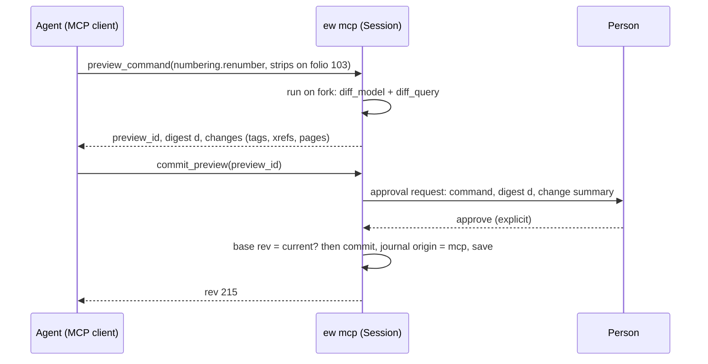

# Extensibility: CLI, scripting, SQL, plugins and agents: scripting, SQL, MCP, plugins and stability

A chapter of [Extensibility: CLI, scripting, SQL, plugins and agents](17-extensibility.md), whose table says where each section lives.

---

## 5. rhai scripting

rhai 1.26.1 (MIT OR Apache-2.0) is the v1 scripting language (ADR-0020). It is pure Rust, has no I/O unless the
host registers it, and enforces operation and depth limits ([rust-ecosystem](../research/rust-ecosystem.md) §9).

### 5.1 Three profiles

| Profile | Used by | API | Writes | Trust | Rel |
|---|---|---|---|---|---|
| **Formula** | title-block and report cells `{= …}`, report-block filters, value-set variables (FR-MAC-015), tag and wire-number formats (FR-NUM-026), machine-profile `expr` columns | read-only context object of the call site | none; returns one value | runs untrusted (§2.4); machine-profile `expr` excepted | MVP (engine, cells, filters; FR-EXT-011) / 1.0 (formats FR-NUM-026, value sets FR-MAC-015) |
| **Rule** | `impl = "rhai"` rules ([15](15-checks-revisions-collaboration.md) §3.7) | scope object (`device`, `potential`, `strip`, `page`, `station`) and `finding(target, args)` | findings only | trust-gated for project packs | MVP |
| **Automation** | `ew script run`, GUI script runner, exported macros | `query`, `find`, `sql`, `preview`, `submit`, `batch`, `emit`, `param` | commands | trust-gated; explicit run only | 1.0 |

### 5.2 Engine configuration

- **Construction.** `Engine::new_raw()` plus an explicit package list: core, logic, arithmetic (integers and
  `Dec`), strings, arrays, maps, iterators. **Not registered:** `BasicTimePackage` (`timestamp()` would break
  determinism), transcendental floating-point maths (platform `sin`/`exp` can differ in the last bit,
  [09](09-reports-forms-output.md) §4.3), any random source, any file, network or process function.
- **Language switches.** `eval` disabled (`disable_symbol("eval")`); `import` disabled (no module resolver, and
  `disable_symbol("import")`); strict variables on (`set_strict_variables`); `print` and `debug` routed to the host
  log or the script console (`on_print`, `on_debug`).
- **Quantities.** Model quantities appear as a registered `Dec` type (fixed-point, exact `+ − × ÷` with explicit
  rounding) and lengths as integer nanometres, so scripts add no float noise ([15](15-checks-revisions-collaboration.md) §3.7).
- **Ordering.** Collections handed to scripts are sorted by ID; rhai object maps are ordered, so iteration order is
  deterministic.
- **Build guard.** CI fails if rhai's `unchecked` feature is enabled anywhere in the dependency graph, because it
  removes every limit below ([18](18-quality-security-release.md)).

| Limit | Formula | Rule | Automation |
|---|---|---|---|
| `max_operations` (deterministic) | 50,000 per evaluation | 1,000,000 per scope evaluation | 1,000,000,000 per run |
| `max_call_levels` | 16 | 32 | 64 |
| `max_expr_depths` (global / function) | 32 / 16 | 64 / 32 | 128 / 64 |
| `max_string_size` | 4 KiB | 64 KiB | 16 MiB |
| `max_array_size` / `max_map_size` | 1,000 | 100,000 | 1,000,000 |
| Wall-clock safety net (`on_progress`) | 10 ms | 250 ms online, 5 s offline | none; cancel within 500 ms |

The operation limits produce deterministic outcomes: a formula or rule that exceeds them yields the same EW-CORE-083
finding on every machine ([15](15-checks-revisions-collaboration.md) §4.2). A wall-clock stop is a safety net only;
its finding is marked "deadline (non-deterministic)" and also blocks release.

### 5.3 Formulas

Formulas are evaluated inside queries. Every property getter on the context object reads through the tracked
context `&Q` installed for the duration of the call, so a formula is exactly as incremental as Rust code
(ARCH §10.3): editing the project description re-evaluates only the cells that read it. Compiled ASTs are cached by
source hash with library durability ([04](04-architecture.md) §6.2).

```rhai
// Title-block cell (09 §2.6): draft marker on unreleased revisions
{= if revision.current.state == "released" { "" } else { "DRAFT " + revision.current.label } }

// Pilot strip rule as a format formula (FR-NUM-026, 1.0): X + folio 103 + counter 1; the formatter adds "-" → -X1031
`${tag.letter}${main.folio}${tag.counter}`

// Value-set variable for the valve typical of folios 203–206 (FR-MAC-015): Q0.1, Q0.3, Q0.5, Q0.7
`Q${module}.${2 * pos - 1}`
```

A formula that fails (limit, type error, missing property) prints `#ERR` in its cell, falls back to the default
format where one exists (tags), and raises EW-CORE-083 with the source location (FR-EXT-011). A formula that reads
its own output (a tag format reading the device's own displayed tag) is a cycle. The formula host detects the
re-entry on its query stack before evaluating, prints `#ERR` and raises EW-CORE-083 with the cycle path, so a user
formula never reaches `ew-memo`'s debug-build cycle panic (ARCH §6.2). Page counts are not such a cycle:
`{doc.page_count}` reads the result of the page-order fixpoint, which iterates inside one query (ARCH §6.2 item 5).

### 5.4 Rules

The rule profile is specified in [15](15-checks-revisions-collaboration.md) §3.7. A company lint against D-35
("rating in description"), as a rule of a project pack. Its TOML entry (`id = "ACME-DEV-002"`, `code = "500002"`,
`scope = "device"`, `modes = ["online", "release"]`, `severity = "warning"`) sits in `rules/<pack-uuid>.toml` and
points at the script file ([05](05-project-format-and-persistence.md) §2.1):

```rhai
// rules/<pack-uuid>/rhai/desc-rating.rhai
for line in device.parts {
    if line.description.matches(`\b\d+(\.\d+)?\s?(A( ?[BCDK])?|[BCDK])\b`) {
        finding(device, #{ text: line.description });
    }
}
```

On a migrated project whose part descriptions still hold the folio 901 texts it
flags "10A C" (-101F1), "4A C" (F55), "16 B" (-102F1) and "20A" (-102G1)
([reference drawing](../research/reference-drawing.md) D-35). The shipped EW-CORE-065 description lint covers the
same case from 1.0; the rhai rule gives a company the check at MVP without Rust. `matches` is a registered,
linear-time regex function (`regex` crate) with a 1,000-character pattern limit.

### 5.5 Automation scripts (1.0)

```rhai
// mark-spares.rhai (a user file; inside a project it is stored as scripts/<uuid>.rhai, 05 §2.1)
// ew:script api = 1, name = "Mark spare valve positions", params = #{ text: "Spare" }
let station = find("-201U1")[0];
let spare = query("plc_rows", station).filter(|r| r.state == "spare" && r.target != ());
submit("fields.set", #{
    targets: spare.map(|r| r.target),            // the 20 spare valves -201U5-Q1 … -202U2-Q4 on Q2 … Q6
    path:    "function_text",
    value:   ml(param("text"))
});
emit("spares.csv", table(spare, ["address", "target_tag"]));   // written into the run's output directory
```

Function texts live on the valves, never on channels ([10](10-plc-and-bus.md) §3.4), so the script edits the 20
bound valve devices and folio 908, the I/O list and the AML comments follow in the same commit. Where the
spare valves already read "Spare", the walk-through (§17.1) passes `--param text=Reserve`.

| Function | Semantics |
|---|---|
| `query(name, key)`, `find(pattern)`, `sql(select)` | Public queries, find and the projection, read on the current revision |
| `preview(cmd, params)` | Fork job; returns `#{digest, changes, pages}` without committing |
| `submit(cmd, params)` | One transaction with origin `Script{name, sha256}`; returns the new revision; a prevented command raises an error that stops the script |
| `batch(label, \|b\| …)` | Collects `b.submit(…)` calls into one composite command: one transaction with read-your-writes, one undo step |
| `emit(name, table \| text)` | Writes a file into the host-chosen output directory; `name` has no path separators |
| `param(key)` | Typed parameters declared in the header; the GUI renders them as a form |

Rules for automation:
- A script runs only when a person starts it (GUI button, `ew script run`). A jobset `script` step (§3.6) runs
  read-only scripts only: `submit` and `batch` raise an error there. v1 has **no event hooks** (on open, on save,
  on export).
- `HumanOnly` commands are refused (§2.3).
- The script's SHA-256 is part of its origin, so the history panel and journal show exactly which text ran.
- `--preview` runs the script against a fork and prints the combined diff.

**Macro recorder (FR-EXT-013).** Recording turns the session's commands into a script with literal parameters;
"Export as rhai" lifts selected values (folio, start counter, tags) into `param()` declarations. Replaying the
recorded heater group of folio 101 with `folio = 104` yields the same devices with tags derived on folio 104.

---

## 6. Read-only SQL projection

### 6.1 What users see

`ew-sqlview` materialises the model and selected query results into SQLite on a fork (ARCH §10.2, ADR-0017):
internal `t_*` tables behind public `api_v1_*` views. Users, rule packs, MCP and acceptance tests see only the
views.

**Column conventions.**
- `id` is the entity UUID (lowercase text); references are `<entity>_id`.
- `tag` is the list form of the device tag under the project's identifier suppression (`-101F1`, `-X1031`);
  `tag_full` is the complete designation (`=P01+J-E-2416-101F1`).
- Multilingual text: `<name>` holds the project's primary language with fallback; `<name>_ml` holds the JSON of all
  languages, read with `ew_ml(<name>_ml, 'nl-NL')`.
- Quantities are exact decimal text (`'0.75'`) with a unit column where needed; lengths and coordinates are integer
  `_nm`.
- Booleans are 0/1; enums are lowercase text, except electrical codes, which keep their printed form (`L+`, `M`,
  `PE`, `DBU`); JSON arrays are text.
- `prov_<field>` holds the provenance of a derived value ("potential 24VDC-1 via profile DBU/WH 24 V").

| View | One row per | Key columns (abridged) | Example rows | Rel |
|---|---|---|---|---|
| `api_v1_meta` | projection | `rev, generation, format, derivation_profile, ew_version, languages, as_of`; `api_status, preview_additions` (Preview addition) | 1 | MVP* |
| `api_v1_device` | device | `id, tag, tag_full, letter, counter, frozen, kind, parent_id, structure_function, structure_location, function_text, process_tag, state, main_page_id, main_folio, main_cell, has_part, manufacturer, part_number, tech_data, aspects, placed`; `function_text_ml` (Preview addition) | — | MVP |
| `api_v1_function` | function | `id, device_id, device_tag, role, kind, fndef, category, page_id, folio, cell, xref_text`; `ip_name` (Preview addition, the interruption point's name) | — | MVP |
| `api_v1_page` | page incl. generated | `id, folio, label, section_id, kind, title, description, description_overridden, structure_function, structure_location, prev_folio, next_folio, generated, report_block_id, physical_index`; `number, title_ml` (Preview addition) | 36 | MVP |
| `api_v1_cp` (not built) | connected or named CP | `id, function_id, device_id, device_tag, cp, idx, discipline, potential_id, potential_name, role, unused, page_id, cell`; `i_load` (1.0). `role` is derived: `source` (the CP definition is a source output, `CpDef.source_output`), `through` (CPs of a pass-through pair in `FnDef.internal`), `load` (supply CPs of consumer functions) or `other`. `i_load` is the part's electrical load current for that supply CP (decimal text in A, empty when unknown; [07](07-symbols-parts-macros.md) part data, ADR-0017 amendment 3) | — | MVP* (`i_load` 1.0) |
| `api_v1_wire` | physical wire or bridge | `id, number, kind, from_device_id, from_tag, from_cp, from_level, from_clamp, to_device_id, to_tag, to_cp, to_level, to_clamp, potential_id, potential_name, csa, csa_unit, colour, colour_iec, wire_part, length_nm, length_source, cable_id, cable_tag, core, pages, prov_csa, prov_colour` ([08](08-connections-terminals-cables.md) §10); `seq, from_end, from_side, from_ip, to_end, to_side, to_ip, conductor_id, bond_id, ips, junction_id, junction_style, junction_wiring, junction_cell, junction_cps, chain_cps, bridge_kind, csa_source, colour_source` (Preview addition; the junction and daisy-chain columns, D-20) | 50 | MVP |
| `api_v1_terminal` | terminal | `id, strip_id, strip_tag, designation, printed, seq, part_number, levels, potential_id, potential_name, potential_type, state, rail_bonded, page_id, cell`; `tag, function_text, strip_group, bridge` (Preview addition) | 28 | MVP |
| `api_v1_cable` | cable | `id, tag, part_number, cores, length_nm, length_source, from_location, to_location, external_end, shield, pages`; `tag_full, end_a, end_b` (Preview addition) | 3 | MVP |
| `api_v1_conductor` | conductor | `id, cable_id, cable_tag, core, colour, colour_iec, csa, shield, wire_id`; `pair, csa_unit` (Preview addition); `bus_end_a, bus_end_b` (the ends a bus cable's line gives a core no wire runs over) | 13 | MVP |
| `api_v1_potential` | potential | `id, name, aliases, ptype, voltage, ac_dc, circuit_class, colour, default_csa, switched, protected_by_device_id, protected_by_tag, protected_by_cp, bond_ids, member_count, pages`; `colour_iec, default_csa_unit, bus_cable_ids` (Preview addition; `bus_cable_ids` is the JSON array of the cable UUIDs of the potential's bus lines, like `bond_ids`) | 19 | MVP |
| `api_v1_bond` | bond between two potentials | `id, label, kind, a_potential_id, a_potential_name, b_potential_id, b_potential_name, wire_id, names, pages` ([08](08-connections-terminals-cables.md) §3.7) | 1 | MVP** |
| `api_v1_bom_component` / `api_v1_bom_assembly` | BOM row per mode | `position, part_id, manufacturer, part_number, type, description, quantity, unit, tags, folios`; `configured, variant, description_ml` (Preview addition, both views); `assembly_tag, level` (assembly view only, built) | 27 rows on 901 | MVP |
| `api_v1_message` | finding | `fingerprint, rule, pack, pack_version, severity, mode, state, target_ids, target_tags, page_id, cell, message, args, waiver_id` | 103 incl. 1 waived | MVP |
| `api_v1_structure`, `api_v1_xref`, `api_v1_revision` (not built) | node, xref text, revision | `aspect, code, aliases, parent_id`; `rep_id, page, cell, text, partner_page, partner_cell, kind`; `label, date, state, author, checker` | —, 64, 2 | MVP* |
| `api_v1_plc_channel` | channel | the `io_list` columns of [10](10-plc-and-bus.md) §5 plus `id, station_id, module_id, target_id, address_source` | 56 | 1.0 |
| `api_v1_placement` | placement | `id, device_id, device_tag, space_id, carrier_id, carrier_kind, x_nm, y_nm, z_nm, rotation, locked, collides` | — | 1.0 |
| `api_v1_fluid_line`, `api_v1_valve_position`, `api_v1_medium` | tube, valve position, medium | columns owned by [11](11-fluid-power.md) §8.3 | 16, 28, 0 | 1.0* |

\* views beyond the FR-EXT-007 list, added by FR-EXT-032 (ADR-0017 amendment 2); like every view, they stay
`Preview` until the 1.0 freeze (§11). Person columns (`author`, `checker`) are omitted when the context asks for
personal-data minimisation (§7.4).

\*\* `api_v1_bond` is a Preview addition beyond FR-EXT-007 and FR-EXT-032 (ADR-0017 amendment 2).

`ew-sqlview` builds the
eleven views of FR-EXT-007 (`api_v1_device`, `api_v1_function`, `api_v1_page`, `api_v1_wire`, `api_v1_terminal`,
`api_v1_cable`, `api_v1_conductor`, `api_v1_potential`, `api_v1_bom_component`, `api_v1_bom_assembly`,
`api_v1_message`; the table above shows the two BOM views in one row), `api_v1_meta`, `api_v1_bond` and the 1.0 views
`api_v1_plc_channel`, `api_v1_fluid_line`, `api_v1_valve_position` and `api_v1_medium`. Every column
listed above for a built view exists in the code; no listed column of a built view is missing.
- **Not built.** `api_v1_cp` (with `role` and `i_load`), `api_v1_structure`, `api_v1_xref` and `api_v1_revision`
  of FR-EXT-032, and of the 1.0 views `api_v1_placement`. `api_v1_plc_channel` holds the `io_list` columns, the IDs,
  the `address_source` and the signal range, then `cpu`, `bus_address`, `passed_terminals` and `f_address`.
- **Preview additions.** The columns marked "(Preview addition)" in the table and the view `api_v1_bond` are
  additive Preview of `api_v1`. `ew sql schema` marks each of them `[preview addition]`, and
  `api_v1_meta` carries `api_status` (`preview`) and `preview_additions` (a JSON array of `view` or `view.column`
  names), so a consumer can tell the documented key columns from the additions. Within v1 columns are only added.
- **Page IDs.** A divider page takes its section's UUID as `id`; a generated page takes its v5 page ID. The column
  that holds the section is `api_v1_page.section_id` (NULL for front matter); the document follows the code and no
  longer calls it `section`.
- **Potential type and voltage.** `api_v1_potential.ptype` and `voltage` are the potential's own attributes: stored
  on its definition or derived per [03](03-domain-model.md) §9.4 (the `potential_attrs` query).
- **BOM assembly.** `api_v1_bom_assembly` has `assembly_tag` (the list-form tag of the head device of a configured
  product when the row has exactly one, else NULL) and `level` (NULL until configured products exist).

### 6.2 Sandbox

| Control | Setting |
|---|---|
| Connection | Separate connection per consumer, `SQLITE_OPEN_READONLY`, `PRAGMA query_only = 1`, `SQLITE_DBCONFIG_DEFENSIVE`, extension loading off, `trusted_schema = OFF`. An in-memory projection reaches a consumer as a read-only deserialised copy (`sqlite3_deserialize` with `SQLITE_DESERIALIZE_READONLY`; rusqlite `serialize` feature, enabled), a file-backed XL projection by opening its file read-only |
| Statement gate | Exactly one statement per call (a non-empty tail after the first statement is refused); the statement must start with `SELECT`, `WITH` or `VALUES` and `sqlite3_stmt_readonly()` must be true. This refuses `VACUUM INTO` and `WITH … INSERT` before they run, independent of which authorizer codes SQLite raises for them |
| Authorizer allows | `SELECT`; `READ` of `t_*` columns only when the innermost responsible view (the authorizer's fourth argument) is the table's own `api_v1_*` view (own-view rule: `t_x` through `api_v1_x` only); `RECURSIVE` (bounded below); allowlisted `FUNCTION`s |
| Authorizer denies | `ATTACH`, `DETACH`, all `PRAGMA`s, every DDL and DML, transactions and savepoints, `ANALYZE`, `REINDEX`, direct reads of `t_*` and of the schema table from top-level SQL |
| Functions | SQLite core scalars and aggregates, window functions, math functions, JSON functions, `ew_ml`, collation `ew_natural` (X2 < X10); `ew_regexp` is not built. `random()` and `randomblob()` denied; date and time functions overridden to reject the `'now'`, `'localtime'` and `'utc'` modifiers, also as BLOB arguments, and a call without a time value; `CURRENT_DATE`, `CURRENT_TIME` and `CURRENT_TIMESTAMP` denied |
| Registration | EW functions flagged `SQLITE_DETERMINISTIC \| SQLITE_INNOCUOUS`, as required with `trusted_schema = OFF` |
| Limits (`SQLITE_LIMIT_*`) | `LENGTH` 16 MiB, `SQL_LENGTH` 256 KiB, `COLUMN` 256, `EXPR_DEPTH` 200, `COMPOUND_SELECT` 50, `VDBE_OP` 250,000 (set on every connection; no property rests on it, the deadline bounds the runtime), `FUNCTION_ARG` 32, `ATTACHED` 0, `LIKE_PATTERN_LENGTH` 1,000, `VARIABLE_NUMBER` 256, `TRIGGER_DEPTH` 0, `WORKER_THREADS` 0 |
| Deadline (progress handler every 10,000 VM steps; `sqlite3_interrupt` from the job): the runtime bound, whatever `VDBE_OP` enforces | user report 2 s ([09](09-reports-forms-output.md) §3.5); SQL rule 10 s; MCP 5 s; `ew sql` 60 s by default, `--timeout` 1..86400 s (the cap is `Profile::MAX_DEADLINE`, 1 day) |
| Result caps | report 100,000 rows; MCP 1,000 rows and 1 MiB; `ew sql` and SQL rules 1,000,000 rows and 256 MiB (bytes count text and BLOB lengths, 8 per number) |

The sandbox is to be fuzzed with hostile SQL (recursive-CTE bombs, deep expressions, authorizer bypass attempts) per
NFR-SEC-03 and NFR-SEC-06; the fuzz target and the hostile-SQL corpus are not built. SQLite has no per-connection memory cap; memory is bounded indirectly by the length and
row limits, the deadline and the projection's memory gate (NFR-PERF-13).

`ew-sqlview` uses rusqlite 0.40.2, bundled, with
the features `functions`, `collation`, `hooks`, `limits` and `serialize`. Every connection is `SQLITE_OPEN_READONLY` on
a read-only deserialised copy of the projection image, with `SQLITE_DBCONFIG_DEFENSIVE`, `trusted_schema = OFF`,
triggers and the FTS3 tokenizer off and `query_only = 1`. The limits and result caps of the table are the values in the
code.
- **Clock.** The date and time functions refuse the `'now'`, `'localtime'` and `'utc'` modifiers, also when they are
  passed as BLOB arguments (`date(CAST('now' AS BLOB))`, `unixepoch(x'6e6f77')`).
- **Deadline.** It is capped at `Profile::MAX_DEADLINE` (1 day); `ew sql --timeout` accepts 1..86400 s, checked
  without overflow, and refuses anything else with exit 2.
- **Own-view rule.** A `t_x` table is readable only through its own view `api_v1_x`: the authorizer's innermost view
  must be the accessor of that table.
- **Known limit, accepted and documented.** A common table expression named after an `api_v1` view reads the table
  behind it, so it sees that view's table columns and its `rowid` only, never another table. The rule guards the
  contract, not secrecy, because every column of `t_x` is also a column of `api_v1_x`.
- **Comments and options.** An inline query that starts with a `-- comment` is accepted; a lone argument that starts
  with `-word` is refused as an unknown option. CSV output keeps its header line (the `ew` dialect).
- **Not built.** `ew_regexp`, `--format xlsx`, file-backed XL projections, per-table
  refresh, the CI prepare/EXPLAIN lint of `.sql` files and the sandbox fuzz target with its
  hostile-SQL corpus.

### 6.3 Freshness, trust and writes

- **Freshness.** The GUI's projection is Class II and shows "as of revision n". `ew sql`, exports and release
  checks build the projection on their own fork at the opened generation, so their results are always fresh.
- **Trust.** SQL text from a received project (reports, rules, machine profiles) is gated (§2.4). SQL typed by the
  user (`ew sql`, the SQL console) or sent by the user's agent (MCP) is the user's own and runs in the same sandbox.
- **Writes.** None, ever (ARCH §16). An "Excel round trip" reads the projection to export and imports changes as
  commands ([14](14-interop.md) §8).

---

## 7. MCP server

### 7.1 Modes and transports

| Mode | Start | Writes | Rel |
|---|---|---|---|
| Headless read-only | `ew mcp <project> --stdio`, started by the agent host as a subprocess | none | MVP (Could) |
| Headless writable | `ew mcp <project> --stdio --writable --approve elicit\|tty`; takes the project lock | ask-first `commit_preview` | 1.0 (Should) |
| GUI live bridge | `ew mcp --attach` connects to the running GUI over a user-only local socket or named pipe | ghost previews accepted in the GUI | 1.x (Could) |

- **Off by default.** Neither the GUI nor the CLI ever starts `ew mcp` implicitly (NFR-SEC-08). An administrator
  policy can disable it entirely (NFR-PLAT-08); `ew mcp` then exits 2
  with "disabled by policy".
- **Transports.** stdio, or Streamable HTTP on `127.0.0.1` / `::1` with a random port and a per-session bearer
  token printed once to stderr. The server validates the `Origin` header against DNS rebinding and offers no option
  to bind another interface (FR-EXT-026).
- **Scope.** One session serves the one project it opened. No tool reads files outside that project, and no tool
  writes files at all.
- **Implementation.** rmcp 3.5.1 **(verify)** over `ew-api`. While the GUI holds the lock, a headless session is
  read-only (FR-EXT-016).

### 7.2 Tools and resources

| Tool | Input | Output | Rel |
|---|---|---|---|
| `project_info` | — | name, revision, generation, format, derivation profile, counts, trust state | MVP |
| `find` | pattern, kinds, limit ≤ 200 | entities with derived tags, pages, cells | MVP |
| `query` | name, key, `explain?` | JSON per the query's schema; dependency trail if asked | MVP |
| `sql_query` | `select`, `max_rows` ≤ 1,000 | columns, rows, `as_of` revision, `truncated` | MVP |
| `run_checks` | scheme, mode (`offline` \| `release`), scope | findings: rule, severity, target tags, page, cell, message, rule page | MVP |
| `list_commands` | filter | names, parameter schemas, exposure | MVP |
| `preview_command` | name, params | `preview_id`, digest, model diff with derived tags, `diff_query` deltas, affected pages | MVP |
| `render_page` | folio, dpi ≤ 150 | PNG through the CPU renderer | MVP (Could, FR-EXT-034) |
| `commit_preview` | `preview_id` | new revision; listed only in writable sessions | 1.0 |

Resources: `ew://api/v1/views` (view DDL and column docs), `ew://commands`, `ew://queries`, `ew://rules/<id>` (the
rule page of NFR-DOC-02). Every response is capped at 1 MiB and flagged `truncated` when cut.

### 7.3 Ask-first writes



- **Binding.** Approval is bound to `(preview_id, digest, base_rev)`. The agent cannot swap the command after the
  person has seen it. If the revision moved (GUI edit, git pull), `commit_preview` fails with "stale preview" and
  the agent must preview again.
- **Approval channel.** `--approve elicit` sends an MCP elicitation request (spec revision 2025-06-18 or later,
  **verify** rmcp support), which the client application renders to the person; the model cannot answer it.
  `--approve tty` asks on the controlling terminal (the process's tty on Unix, the console on Windows), never on
  the stdio channel; an agent host that spawns `ew mcp` without a terminal therefore needs `elicit`. Without a
  usable channel, `commit_preview` is not offered. There is no auto-approve mode: unattended writes use `ew apply`
  or `ew script run`, which a person invokes directly.
- **Limits.** Previews expire after 10 minutes; at most 8 are pending per session. `HumanOnly` commands cannot be
  previewed (§2.3).
- **Record.** The commit is an ordinary journalled, undoable transaction with origin `Mcp{client, session}`,
  where `client` is the MCP `clientInfo.name` (FR-EXT-017).

### 7.4 Data minimisation

The agent's model may run at a remote provider that EW cannot see (NFR-PRIV-08). By default, MCP responses omit
every field `ew-schema` marks as personal data (engineer, checker, party persons) and project identifiers marked
confidential (project reference, drawing id, party names). `--include-personal-data` and
`--include-confidential` lift this per session, and `project_info` states the active policy (FR-EXT-033).

### 7.5 Live bridge (1.x)

The GUI opens a user-only local endpoint when the person enables "Allow agent connection" for the open project.
`ew mcp --attach` relays MCP to it. `preview_command` then shows the candidate as a ghost on the open page, with
the diff in a side panel; accept and reject happen in EW's own window (FR-EXT-018). This is the strongest approval
channel and the recommended way to let an agent edit.

---

## 8. WASM component plugins (1.x)

### 8.1 Runtime

- **Engine.** wasmtime on an **LTS line** (every 12th release, 24 months of security fixes,
  [gaps-and-corrections](../research/gaps-and-corrections.md) §3.3), with the Component Model and wit-bindgen
  0.63.0. Plugins run on the wasmtime LTS line current at plugin launch, and development runs on the 48.x LTS line
  until then (ARCH §2, ADR-0020 amendment 2). Moving LTS lines does not change the WIT world, so
  plugins need no rebuild.
- **WASI.** WASI 0.2 **(verify)** with: an empty environment; pre-opened directories only for granted file
  capabilities; a monotonic clock for progress; a wall clock virtualised to the export `as_of` date; `wasi:random`
  seeded from `(plugin id, input digest)`; no `wasi:sockets`. Network, when granted, goes through a host-mediated
  HTTP interface with a per-host allowlist.
- **Where it runs.** On the job pool, never on the UI thread (ARCH §2). A trap, limit violation or panic leaves the
  model unchanged and the session running (NFR-REL-12).
- **Code generation.** Cranelift compiles each component once at install; the compiled artefact is cached by
  `sha256(plugin.wasm) + wasmtime version + target` in the local cache and recompiled after an EW update. On macOS
  under the hardened runtime, executing generated code needs the `com.apple.security.cs.allow-jit` entitlement; the
  alternative is wasmtime's portable interpreter, at a speed cost **(verify)**. Moot while macOS is not a supported platform.

### 8.2 WIT world `elektrawatt:plugin@1`

A sketch; the normative `.wit` files live in the permissive `ew-plugin-wit` crate (FR-EXT-036):

```wit
package elektrawatt:plugin@1.0.0;

interface types {
  type uuid = string;                                  // lowercase hyphenated
  type rev = u64;
  enum severity { info, warning, error }
  variant cell { null, boolean(bool), integer(s64), decimal(string), text(string), json(string) }
  record table { columns: list<string>, rows: list<list<cell>> }
  record ew-error { code: string, message: string }    // "denied", "limit", "invalid", "stale", …
  record finding { targets: list<uuid>, discriminator: option<string>, args-json: string }
  record diff-summary { base-rev: rev, digest: string, lines: list<string> }
}

interface model {                                      // capability model.read (sql: sql.read)
  use types.{uuid, rev, table, ew-error};
  resource snapshot {
    rev: func() -> rev;
    query: func(name: string, key: string) -> result<string, ew-error>;           // JSON, published schema
    records: func(kind: string, ids: list<uuid>) -> result<list<string>, ew-error>; // canonical JSONL lines
    find: func(pattern: string, kinds: list<string>, limit: u32) -> result<list<uuid>, ew-error>;
    sql: func(select: string, max-rows: u32) -> result<table, ew-error>;
  }
  current: func() -> snapshot;
}

interface edit {                                       // capability model.write
  use types.{rev, diff-summary, ew-error};
  resource pending { diff: func() -> diff-summary; }
  preview: func(command: string, params-json: string) -> result<pending, ew-error>;
  commit: func(p: pending) -> result<rev, ew-error>;                             // rebase-checked
  submit: func(command: string, params-json: string) -> result<rev, ew-error>;   // preview + commit
}

interface io {                                         // resources owned by the host
  use types.{uuid, ew-error};
  resource file   { name: func() -> string; read: func(max: u64) -> result<list<u8>, ew-error>;
                    write: func(bytes: list<u8>) -> result<_, ew-error>; }
  resource source { name: func() -> string; len: func() -> u64; read: func(limit: u64) -> result<list<u8>, ew-error>; }
  resource import-cx { mint-id: func(source-key: string) -> uuid; as-of: func() -> string;
                       options-json: func() -> string; hints-json: func() -> string; }
  resource export-view { rev: func() -> u64; rows: func(key: string) -> result<table, ew-error>;
                         records: func(kind: string) -> result<list<string>, ew-error>; context-json: func() -> string; }
  resource sink   { create: func(name: string, media-type: string) -> result<file, ew-error>; }
  pick-open: func(title: string, filters: list<string>) -> option<file>;        // capability files.read
  pick-save: func(title: string, suggested: string) -> option<file>;            // capability files.write
}

interface ui { show-form: func(form-json: string) -> option<string>; }            // capability dialogs
interface host { log: func(level: u8, message: string); progress: func(done: u64, total: u64) -> bool;
                 secret-get: func(name: string) -> option<string>; }             // capability secret.get

interface importer { use io.{source, import-cx}; use types.{ew-error};
  record batch { records: list<string>, provenance: list<string>, assets: list<tuple<string, list<u8>>>, report-json: string }
  sniff: func(importer-id: string, head: list<u8>, name: string) -> u8;          // 0 = no, 1–99 maybe, 100 certain
  run: func(importer-id: string, src: borrow<source>, cx: borrow<import-cx>) -> result<batch, ew-error>; }
interface exporter { use io.{export-view, sink}; use types.{ew-error};
  run: func(exporter-id: string, view: borrow<export-view>, options-json: string, out: borrow<sink>) -> result<string, ew-error>; }
interface rules { use model.{snapshot}; use types.{finding, ew-error};
  evaluate: func(rule-id: string, snap: borrow<snapshot>, scope: string, params-json: string) -> result<list<finding>, ew-error>; }
interface report-columns { use types.{table, cell, ew-error};
  compute: func(column-id: string, rows: table) -> result<list<cell>, ew-error>; }
interface decoder { use types.{ew-error};
  decode: func(decoder-id: string, order-code: string, family: string) -> result<string, ew-error>; } // slot list JSON
interface actions { use types.{uuid, ew-error};
  run: func(action-id: string, selection: list<uuid>) -> result<_, ew-error>; }

world base { import model; import edit; import io; import ui; import host; }
world plugin { include base;
  export importer; export exporter; export rules; export report-columns; export decoder; export actions; }
```

- **Roles by introspection.** WIT has no optional exports, so the SDK also offers one world per role
  (`importer-plugin`, `rule-plugin`, …). The host inspects which role interfaces a component exports and registers
  those; `plugin.toml` must declare the same set.
- **JSON at the boundary.** Queries return JSON per their published schema, and records cross as canonical JSONL
  lines of `ew-schema` kinds. The WIT stays small and does not change when a format minor adds a field; the guest
  SDK generates typed Rust bindings from the same JSON Schemas (ADR-0020 amendment 1).
- **Context restrictions.** In `rules` and `report-columns` calls, only `model` on the given snapshot and the
  logging and progress functions of `host` are usable; `edit`, `io` and `ui` return `denied` and `host.secret-get`
  returns `none`, which keeps rules pure and deterministic.

### 8.3 Package, manifest and capabilities

A `.ewplugin` is a ZIP read under the archive limits of NFR-SEC-02: `plugin.toml`, `plugin.wasm`, `plugin.sig`,
and optional `profiles/*.toml` (machine profiles), `rules/*.toml` (rule metadata with `impl = "plugin:<id>/<rule>"`),
`i18n/*.ftl`, `docs/*.md` (rule pages, NFR-DOC-02), `LICENSE`, `NOTICE`.

```toml
[plugin]
id        = "org.example.cpx-decoder"
version   = "0.3.1"
wit       = "elektrawatt:plugin@1.0.0"     # WIT package version; the role worlds follow from [exports]
min_ew    = "1.1"
licence   = "Apache-2.0"
publisher = "<publisher>"
summary   = "Decodes valve-terminal order codes into slot lists"

[exports]
decoder = ["festo-cpx-vmpa"]
rules   = ["EXF-FL-001"]
actions = ["build-assembly-from-order-code"]

[capabilities]
"model.read"  = true
"model.write" = true          # proposes assembly children through preview → commit
"dialogs"     = true
"files.read"  = "picker"      # configurator exports the user picks; no directory access
network       = []            # none

[limits]
memory_mib = 256
```

| Capability | Grants | Default |
|---|---|---|
| `model.read` | `model` interface on snapshots | requested by nearly all |
| `sql.read` | `snapshot.sql` | off |
| `model.write` | `edit` interface (exposure `Edit` commands only, §2.3) and `plugin.data.set` | off |
| `files.read` / `files.write` | `"picker"` (one user-chosen file per call) or `"dir:<purpose>"` (a pre-opened directory the user selects at install or run) | off |
| `dialogs` | `ui.show-form` | off |
| `network` | host HTTP to listed hosts, e.g. `["api.example-mt.invalid"]` for a machine-translation plugin (FR-I18N-015) | none |
| `secret.get` | `host.secret-get(name)`: a named secret from the OS credential store, granted per plugin at install and never readable by other plugins (1.x, before the first connector plugin; ADR-0020 amendment 4) | off |

A component whose imports exceed its declared capabilities is refused at install. A call outside the granted set
returns `ew-error{code: "denied"}`.

### 8.4 Resource limits

| Call context | Fuel (deterministic) | Epoch deadline (10 ms ticks) | Memory (`StoreLimits`) |
|---|---|---|---|
| Rule, online | 50 M per scope | 50 ms hard stop; above the 5 ms per-commit rule budget the rule is demoted to deferred like any slow rule (FR-CHK-013, NFR-PERF-09) | 64 MiB |
| Rule, offline and release | 2 G per scope | 5 s | 256 MiB |
| Report column | 100 M per block | 2 s | 128 MiB |
| Importer, exporter | off | 10 min, cancellable | manifest value ≤ 2 GiB (default 1 GiB) |
| Decoder, action | 1 G | 30 s, excluding time in host dialogs | manifest value (default 256 MiB) |

Instances, tables and memories per store are bounded, `max_wasm_stack` is 1 MiB, and threads are not offered. Host
functions are themselves bounded (SQL deadline, query cost), because epoch interruption only stops guest code. A
fuel exhaustion in a rule yields EW-CORE-083 deterministically.

### 8.5 Signing, install and lifecycle

- **Signature.** `plugin.sig` is an Ed25519 signature (minisign-compatible, **verify** crate choice) over
  `"ew-plugin-sig/1\n"` plus the sorted `path\tsha256` lines of every package file. It is verified at install and
  at every load.
- **Keys.** At first install the publisher key fingerprint is shown and pinned (trust on first use). Updates must
  carry the same key or an explicit rotation statement signed by the old key. The 1.x registry (IDEA-095) adds a
  registry key whose countersignature marks reviewed plugins; revocation lists ship with EW updates, since there is
  no network check.
- **Developer mode.** Unsigned packages load only after the person enables developer mode in settings; the history
  panel then shows `plugin:<id>@<ver> (unsigned)` (FR-EXT-020, NFR-SEC-07).
- **Install** shows the capabilities, limits, licence, publisher, key fingerprint and registry countersignature
  ([19](19-open-source-governance.md) §4). Approval is stored in the user's configuration directory, never in a
  project. Company deployments may pre-approve plugins, or forbid installation and developer mode, through
  administrator policy (NFR-PLAT-08).
- **Update** shows the capability diff and asks again only when capabilities grow.
- **Remove** keeps all plugin data in projects (§2.5).
- **Projects declare dependencies**: `project.plugins = [{id, version_req, purpose}]`. Opening a project with a
  missing plugin lists it with its purpose. EW never downloads or installs it. Rules from a missing plugin yield
  EW-CORE-084 ("rule unavailable") and block release, like an untrusted pack ([15](15-checks-revisions-collaboration.md) §3.9).

### 8.6 Declarative dialogs

Plugins never touch egui (ADR-0020). `ui.show-form` takes a form description and returns the values, or `none` on
cancel:

```json
{"$schema":"ew.form/1","title":{"$fluent":"cpx-decoder-title"},
 "fields":[
   {"id":"code","kind":"text","label":"Order code","required":true,"pattern":"^[0-9A-Z+\\-]{4,80}$"},
   {"id":"terminal","kind":"entity","label":"Valve terminal","filter":{"kind":"device","aspect":"assembly"}},
   {"id":"export","kind":"file","label":"Configurator export (optional)","accept":[".xml",".csv"]},
   {"id":"start","kind":"integer","label":"First output byte","min":0,"max":127,"default":0}]}
```

Field kinds: text, multiline, integer, decimal with unit, enum, boolean, entity picker, file picker (grants that file
only), table, info text. The host validates, localises through the plugin's Fluent bundle, renders with AccessKit
names (SC-12) and supports multi-step wizards by successive calls.

---

## 9. Python wheel (1.x)

`ew-py` (GPL) wraps `ew-api` with pyo3 0.30.1, built by maturin as abi3 wheels **(verify the minimum CPython)** for
Windows x64 and manylinux x86_64 (no macOS wheel: macOS is not a supported platform). EW embeds no interpreter (ARCH §16).

```python
import elektrawatt as ew

with ew.open("J-E-2416.ew") as s:                       # read-only by default
    print(s.query("device_tag", s.find("-101F1")[0])["full"])  # =P01+J-E-2416-101F1
    for row in s.sql("SELECT tag FROM api_v1_device WHERE has_part = 0 AND structure_location = '+J-E-2416' "
                     "ORDER BY tag COLLATE ew_natural"):
        print(row["tag"])     # -XPE (an earth connection, no finding), E56, S56 (EF-04); field devices -203Q1 … -203Q8 are in +FIELD
    s.export("pdf", out="out/J-E-2416.pdf")                     # the expected PDF digest (FR-EXT-022)

with ew.open("work.ew", writable=True, trust="current") as s:
    p = s.preview("fields.set", targets=[s.find("-102F2")[0]], path="function_text", value={"en-GB": "24 V distribution"})
    print(p.diff)                                               # derived-tag diff
    s.commit(p)                                                 # origin Python{script}
```

- The API mirrors §4; long calls release the GIL and honour `KeyboardInterrupt` as cancel.
- Results are plain Python types (dict, list, str, int, `decimal.Decimal` for quantities); no pandas dependency.
- `HumanOnly` commands are refused; project content is trust-gated as in the CLI.
- `elektrawatt.__api__ = 1` follows the Session API version (§11).

---

## 10. Importer and exporter plugin contracts

The Rust contracts live in the permissive `ew-interop-api` ([14](14-interop.md) §2.1–§2.2). Built-in importers
implement them directly. Third-party importers reach EW as WASM components through the `importer` and `exporter`
interfaces of §8.2, and the SDK provides `ew_plugin_sdk::export_importer!(MyImporter)`, so one Rust implementation
serves a permissive standalone tool and an EW plugin.

| Rust contract ([14](14-interop.md); the `Importer` and `Exporter` traits are specified for this API and not in the code) | WIT | Host rule |
|---|---|---|
| `Importer::id`, `version`; `Exporter::id` | `[exports] importer` and `exporter` entries in `plugin.toml`, with the plugin version | id namespaced `<plugin-id>.<name>`; recorded in the import run and the export report |
| `sniff(head, path)` | `sniff(importer-id, head, name)` | file name only, never a path; at most 64 KiB of head |
| `Source::read(limit)` | `source.read(limit)` | limits of NFR-SEC-02; no sibling files |
| `ImportCx{project, lineage, as_of, limits, hints, options}` | `import-cx` resource | options validated against the importer's JSON Schema |
| v5 record IDs (ADR-0004, [14](14-interop.md) §2.3) | `import-cx.mint-id(source-key)` | every record ID must equal the minted ID of its `provenance` key; the host re-mints and compares |
| `ImportBatch{records, assets, report, provenance}` | `batch` (JSONL lines, assets, report JSON) | each line validated with `ew-schema` (JSON Schema plus serde), sorted, then structural invariants on batch plus hints |
| `ApplyImport` | not reachable from plugins | the host runs it as a previewed, lenient transaction (FR-IMP-001) |
| `Exporter::export(view, opts, sink)` | `exporter.run(view, options-json, out)` | `sink.create` names have no path separators; the host writes into the export directory and records SHA-256 |
| `ExportView{rev, records, rows, context}` | `export-view` resource | rows are the same row sets as built-in exports (one row source, ADR-0018); personal-data policy applied before the plugin sees them |

- **Purity and determinism.** A plugin importer reads only its source; a plugin exporter writes only through its
  sink. The virtualised clock and seeded random of §8.1 make both deterministic, and the plugin registry's CI runs
  every submitted importer and exporter twice on its sample inputs and compares digests.
- **Failure.** An invalid batch (schema error, foreign ID, dangling reference) is refused with the report; the
  model stays unchanged (NFR-REL-12, [14](14-interop.md) §2.1).
- **Machine profiles from plugins** are data (`profiles/*.toml`) following [13](13-manufacturing-outputs.md) §7;
  a plugin may add transform functions through `report-columns`.

---

## 11. API stability and versioning

| Surface | Version identifier | Promise from 1.0 | Breaking change | CI guard (CI-PR-14 of [18](18-quality-security-release.md) §5.2, NFR-MAINT-10) |
|---|---|---|---|---|
| Project format | `format` major.minor (ADR-0011) | minors additive; every released fixture opens | yearly window, migration, fixture | fixture corpus (NFR-REL-05) |
| Permissive crates | crate semver, declared MSRV (NFR-MAINT-03) | Rust semver | crate major | semver check on the public API, e.g. cargo-semver-checks **(verify version)** |
| Session API (`ew-api`) | integer `API_VERSION`, mirrored by `elektrawatt.__api__` | the operations of §4 keep their meaning within the app major; the Rust signatures are not a published contract (GPL crate, not on crates.io) | increment; CLI, MCP and Python adapt in the same release | Python and CLI corpus |
| Command registry | `name` + `params_version` | names never reused; parameters gain only optional fields; semantics stable | new `params_version`; the old one is accepted, with a deprecation warning, for the rest of the app major | catalogue snapshot; rename test (FR-EXT-015) |
| Query registry | name + output schema version | output gains only fields | new schema version, old served for the app major | snapshot |
| CLI | subcommands, flags, exit codes, `ew.*-result/<n>` schemas | stable within the app major | deprecated for ≥ 2 minor releases first | `--help` and schema snapshots |
| `api_v1` views | `api = "v1"` in stored SQL | columns never removed, renamed or retyped during format major 1 and one more major; new views and columns additive | `api_v2` with a format major; v1 kept one more major (ARCH §10.2) | SQL compile test; column snapshot |
| rhai API | `ew:script api = 1` header | additive functions and properties | `api = 2` side by side | script corpus |
| WIT world | `elektrawatt:plugin@1.x.y` | minor additive; the host serves every 1.x | `@2.0.0`; the host keeps `@1` for ≥ 24 months | WIT diff against the last release |
| MCP | server `ew-mcp/1`, tool names and schemas | additive | new tool name | tool-list snapshot |
| Python | `elektrawatt.__api__` | follows the Session API | deprecation warnings for 2 minors | pytest corpus |
| Rule packs, derivation profiles | pack versions, `derivation_profile` | never removed (ADR-0003) | new version | golden per profile |

- **Before 1.0** every surface except the format's migration guarantee is `Preview`: breaking changes are allowed
  with release notes (NFR-DOC-07). Surfaces freeze with the 1.0 format freeze ([roadmap](../../ROADMAP.md), M7).
- **`Preview` items after 1.0** appear in catalogues with `"stability": "preview"`. MCP and plugins see them only
  when the session or manifest opts in.
- **The guard.** A PR that changes any snapshot above in a breaking way fails unless it carries the `api-break`
  label, an ADR reference and a release-note entry (NFR-MAINT-10, run as the per-PR job CI-PR-14 of
  [18](18-quality-security-release.md) §5.2; cargo-semver-checks stays **(verify)** until it is pinned).

---

## 12. The GPL plugin-exception boundary

The application is GPL-3.0-or-later with a §7 additional permission for plugins whose wording counsel drafts
(ADR-0024, ADR-0025, proposed). This section fixes what the permission must cover technically; the legal text and
governance belong to [19](19-open-source-governance.md).

| Interface | Mechanism | Copyleft reach (engineering view, not legal advice) | Exception needed |
|---|---|---|---|
| File format, JSON Schemas, permissive crates | data; MIT OR Apache-2.0 code | none | no |
| `ew` CLI invoked as a process; `ew mcp` | separate programs communicating by arguments, pipes, sockets | normally separate works (GPL FAQ, general knowledge) | no |
| `ew-plugin-wit` and `ew-plugin-sdk` | WIT files and guest bindings, MIT OR Apache-2.0 (FR-EXT-036) | none: plugins contain no GPL code | no |
| WASM component loaded through `elektrawatt:plugin@1` | same process, runtime linking by wasmtime | uncertain without a written permission | **yes, ADR-0025** |
| rhai scripts, SQL, rule packs, machine profiles, forms | inputs interpreted by EW | generally not derivative; state it explicitly | clarifying sentence |
| Python programs importing `elektrawatt` (`ew-py`) | in-process import of a GPL extension module | plausibly a combined work | not covered by a WIT-only exception |
| Rust code linking `ew-api`, `ew-model` or other GPL crates | static linking | covered work | no exception; must be GPL-compatible |
| `ew-import-qet` (ported GPL-2.0-or-later code) | GPL crate | — | excluded; unreachable from WIT (C-8, NFR-LIC-05) |

**Points for counsel's draft** (input, not legal text):
1. Define "Plugin Interface" as the WIT package `elektrawatt:plugin` at any version the project publishes, and
   "Independent Plugin" as a WebAssembly component that interacts with ElektraWatt only through that interface and
   contains no ElektraWatt code other than generated bindings and the permissively licensed SDK.
2. Grant permission to convey ElektraWatt combined with Independent Plugins under the plugins' own terms.
3. Exclude modifications of ElektraWatt, every file not carrying the exception (all of `ew-import-qet`), and code
   that links GPL crates directly.
4. State that programs interacting through the CLI, MCP or the file format are separate works, and that interpreted
   inputs (projects, rhai scripts, SQL, rule packs, machine profiles, forms) and outputs (projects, PDFs, reports,
   `.ewpp`, machine files; NFR-LIC-09) are not covered works merely because EW reads, runs or writes them.
5. Ship it as `LICENSES/LicenseRef-ElektraWatt-plugin-exception.txt` with SPDX headers
   `GPL-3.0-or-later WITH LicenseRef-ElektraWatt-plugin-exception`, or the SPDX 3.0 `AdditionRef-` form if
   reuse-tool and cargo-deny accept only that (ADR-0025 recommendation 5). It must be in the headers before the
   first non-maintainer pull request is merged (governance gate LG-2,
   [19](19-open-source-governance.md)), because adding it later needs every copyright holder's consent (DCO, no
   CLA).

GPL §7 lets downstream distributors remove additional permissions from their copies. A fork may therefore drop the
exception; the project's own releases keep it.

---

## 13. Security model by surface

The threat model is G10 as adopted in ARCH §10.6; this table adds the extension-specific controls and their tests
(jobs in [18](18-quality-security-release.md)).

| Threat | Control | Test |
|---|---|---|
| Received project carries a script, SQL report or rule pack | Gated content never runs untrusted; no event hooks; trust lapses on external change (§2.4) | Fixture with a file-writing script and an SQL report: open and `ew export pdf` create no extra file and show the banner (NFR-SEC-05) |
| Infinite loop or allocation bomb in rhai | Deterministic operation, depth and size limits; wall safety net; `unchecked` banned | Looping tag formula yields EW-CORE-083; model digest unchanged (NFR-REL-12) |
| Hostile SQL (escape, CTE bomb, `ATTACH`, `VACUUM INTO`, a second statement after `;`) | Statement gate, authorizer, read-only connection, limits, deadline, interrupt (§6.2) | Fuzz target and hostile corpus (NFR-SEC-03, NFR-SEC-06); `SELECT 1; VACUUM INTO 'x.db'` exits 2 and creates no file |
| Plugin reads files, loops, exhausts memory | Capabilities, pre-opens only, fuel and epoch, `StoreLimits` | Test plugin reading outside its pre-open, looping and allocating 4 GiB is trapped each time (NFR-SEC-07) |
| Tampered or impersonated plugin | Ed25519 package signature at every load; pinned publisher key; developer mode for unsigned | Bit flip in `plugin.wasm` refuses load |
| Plugin, agent, replay or pipeline games the release gate | `HumanOnly` exposure for waivers, schemes, strictness, approval and release; on the CLI only with a terminal confirmation (§2.3) | MCP `preview_command(check.waive)` refused with `CmdError::Exposure`; a `.ewcmd` containing `revision.approve` exits 2 before its first line; `ew revision approve` without a terminal exits 2 |
| Agent edits silently or with a swapped command | Ask-first, approval bound to digest and base revision, no auto-approve | Commit without approval, or after a revision move, is refused (NFR-SEC-08) |
| Remote access to the MCP server | stdio or loopback only, random token, `Origin` check | Binding a non-loopback address is impossible; a request without the token fails |
| Prompt injection through project text (function texts, comments) | EW does not interpret text as instructions; the person sees every proposed change as a derived-tag diff; `HumanOnly` limits the blast radius | Documented residual risk, reviewed in the threat model (NFR-SEC-01) |
| Leakage to an agent's remote model | Personal and confidential fields omitted by default (§7.4) | A golden MCP transcript contains no value of the engineer, checker or project-reference fields |
| Debug endpoints in release builds | egui inspection and egui_mcp only in test builds | Binary assertion (NFR-SEC-09) |

---

## 14. UI/UX touchpoints

Layouts are specified in [16](16-ux-ui.md); personas P1 (engineer), P3 (PLC programmer), P4 (checker), P5 (OSS
contributor) and P6 (library maintainer) and journey J6 (automated quality gate) of
[vision](00-vision-and-scope.md) apply.

| Touchpoint | Behaviour | Req |
|---|---|---|
| Trust banner | "This project contains 2 rule files and 1 SQL report that have not run. [Review…]". It appears only when gated content exists; affected report pages and EW-CORE-084 findings link to it | FR-EXT-014 |
| Trust dialog | Files with kind, size and hash; what each kind can do ("rhai: no file or network access"); diff against the last trusted version; signer fingerprint; Trust content, Trust signer, Keep untrusted | FR-EXT-014, FR-EXT-031 |
| Script runner (1.0) | Project and user scripts; parameter form from the header; Preview (diff) → Run; console; cancel; trust state | FR-EXT-012 |
| Macro recorder (1.0) | Record, stop, "Export as rhai" with parameter lifting | FR-EXT-013 |
| SQL console (1.0, Should) | Read-only editor over `api_v1` with completion from `ew sql schema`, "as of revision n", export CSV/XLSX, "Save as report" | FR-EXT-006 |
| "Why this value?" (1.0) | Property-grid action showing the `--explain` trail and provenance (IDEA-043) | FR-EXT-005 |
| History panel | Origin badges: GUI, CLI, `script:<name>`, `mcp:<client>`, `plugin:<id>@<ver>`, import, merge, external | FR-UI-023 |
| Command palette | Every command with GUI exposure, with its dotted name for script authors | FR-EXT-015 |
| Plugin manager (1.x) | Install from file, capability approval, update diff, enable or disable, plugin-data inventory per project, developer-mode badge | FR-EXT-019 … -021 |
| Agent connection (1.x) | "Allow agent connection" toggle per project; status-bar indicator; ghost previews with accept and reject | FR-EXT-018 |

---

## 15. Outputs

| Output | Format | Rel |
|---|---|---|
| CLI results | `ew.check-result/1`, `ew.query-result/1`, `ew.sql-result/1`, `ew.diff/1`, `ew.import-report/1`, `ew.jobset-run/1`, `ew.error/1` (JSON Schemas published) | MVP / 1.0 |
| Check reports for CI | JUnit XML (MVP); SARIF 2.1.0 with logical locations (page, entity) and a physical location (project file and line of the primary target's record) (1.0, [15](15-checks-revisions-collaboration.md) §8) | MVP / 1.0 |
| Command log | `ew.cmdlog/1` JSONL | MVP |
| Jobset manifest | `run.json`, deterministic | 1.0 |
| Generated reference | Command and query catalogues, CLI reference, `api_v1` view reference, rhai API, WIT docs, MCP tool list (NFR-DOC-06) | MVP / 1.x |
| Projection dump | SQLite file (`ew sql dump`) | MVP |
| Plugin SDK | `ew-plugin-wit`, `ew-plugin-sdk` crates, sample importer, exporter and rule plugins | 1.x |

---

## 16. Edge cases and pitfalls

1. **Ambiguous tags as keys.** Two strips may both print "-X1" under different locations. Key resolution requires a
   unique hit; otherwise it exits 2 listing candidates with `tag_full` and `id:`.
2. **`SELECT *` in stored SQL.** Additive columns change its result. The SQL lint warns on `*` in reports, rules
   and profiles; the docs show explicit column lists.
3. **Locale in machine outputs.** `--lang nl-NL` changes texts, never decimal separators in JSON or the CSV dialect
   a profile defines.
4. **Thousands of tiny submits.** Each `submit` is a transaction and an undo step. Scripts should use one command
   with many targets or `batch`; the runner warns above 500 transactions per run.
5. **Stale previews.** A preview is valid for its base revision only. GUI edits or a git pull during an agent
   session invalidate it (§7.3).
6. **Lock contention in CI.** A CI writer fails fast with exit 2 when a colleague's GUI holds a share-hosted
   project. CI should work on a clone, never on the shared copy.
7. **Empty trust store on CI.** Without `--trust`, project packs do not run and EW-CORE-084 blocks the gate. That is
   correct, but the message names `ew trust status` so the fix is obvious.
8. **Exit code 2 mistaken for findings.** A CI step that treats every non-zero code as "drawing has errors" hides
   infrastructure failures. Example pipelines distinguish 1 from 2.
9. **Formulas that read volatile data.** No formula can read the date, time, user or host; title-block dates come
   from model bindings, so outputs stay reproducible (NFR-REL-07).
10. **Plugin removed but referenced.** Schemes that enable a plugin rule keep the reference; the rule reports
    "unavailable" (EW-CORE-084) and blocks release instead of disappearing silently.
11. **Plugin update changes an importer mapping.** The import run records importer id and version
    ([14](14-interop.md) §2.4), so a re-import diff explains the change.
12. **Host-call stalls.** Epoch interruption cannot stop the host. Every host function a plugin can call has its own
    bound (SQL deadline, query cost class, dialog = user time not charged to the plugin).
13. **Absolute paths in outputs.** `run.json`, JSON results and reports use paths relative to the output directory;
    absolute paths appear only in stderr diagnostics.
14. **Agent host keeps a stale server.** A long-lived `ew mcp` follows external changes through the watcher;
    `project_info` and every response carry the revision so agents can notice.
15. **Merge driver absent on a colleague's machine.** Git falls back to its text merge; JSONL ordering keeps most
    merges clean and the next open runs `ew check --integrity` ([05](05-project-format-and-persistence.md) §11).
16. **Release steps in a pipeline.** A CI job that calls `ew revision release` exits 2 ("needs an interactive
    terminal"), by design (§2.3). Pipelines gate with `ew check --gate` and build outputs with a jobset on the
    released generation; the person releases on `main` ([15](15-checks-revisions-collaboration.md) §6.3).
17. **Statements after a semicolon.** `ew sql "SELECT …; SELECT …"` is refused by the statement gate (§6.2).
    Scripts that need several result sets call `ew sql` once per query.

---

## 17. The reference project

### 17.1 Walk-through

No reference project is walked through here: the command-line examples on the sample project are §3.4. One user
report over the projection stays as the example of D-25, the 24 V loads per protective channel, as an SQL file in
`reports/` (1.0) or as `ew sql` text (MVP):

```sql
-- ew:report api = "v1"
-- ew:title  "24 V loads per protective channel"
SELECT p.name AS potential, p.protected_by_tag || ':' || p.protected_by_cp AS channel,
       c.device_tag AS load, c.cp AS pin
FROM api_v1_cp AS c
JOIN api_v1_potential AS p ON p.id = c.potential_id
WHERE p.ptype = 'L+' AND CAST(p.voltage AS REAL) = 24 AND c.role = 'load'
ORDER BY channel COLLATE ew_natural, load COLLATE ew_natural, pin COLLATE ew_natural;
```

The supply pins of a protective device have the role `through` (it passes the potential on), and a power supply's
`+` pins are `source`, so neither contributes rows. A "total current per channel" column needs a load current per
pin: from 1.0 parts carry an optional load current per supply CP and `api_v1_cp.i_load` exposes it, so the 1.0
report adds `SUM(CAST(c.i_load AS REAL))` per channel (ADR-0017 amendment 3). The built-in check against a
channel's rating is EW-POT-018 (FR-CHK-041; EW-PLC-014 covers PLC module outputs,
[15](15-checks-revisions-collaboration.md) §4.4). Until then the report lists the loads with their protective
device and channel, without currents.

### 17.2 Defects this area prevents or exposes

| Defect | Mechanism here |
|---|---|
| D-01 stale -4W1 / -4X1 | CI gate and `ew diff` / textconv show tag-level changes after a renumber |
| D-02, D-04 layout and BOM out of sync | Exports and `api_v1_bom_*` read the same row sources as the printed folios; a CI job can diff them |
| D-05, D-34 revisions, author = checker | `revision.release` and `revision.approve` are `HumanOnly`; jobsets cannot release |
| D-07, D-33 no outline, links, page labels | `ew export pdf` in CI with structure assertions (AC-13) |
| D-09 missing reports | `ew export wires\|terminals\|cables\|report --block` from the built-in pack |
| D-15 address "TBD" | `Tbd` blocks `ew check --scheme pre-delivery` with exit 1 |
| D-18, D-35 data-quality errors | Company rhai lint rules without Rust from MVP (§5.4); the shipped EW-CORE-065 from 1.0 |
| D-25 crossed supplies on one channel | SQL report over `api_v1_cp` and `api_v1_potential` (§17.1); the built-in load summary of [08](08-connections-terminals-cables.md) §10 at 1.0 |
| D-26 odd-bit addresses | `ew query channel_addresses --explain` shows the map and binding behind each address |
| D-40 CPX block inside the MPA section | Decoder plugin with vendor rules (1.x) |

