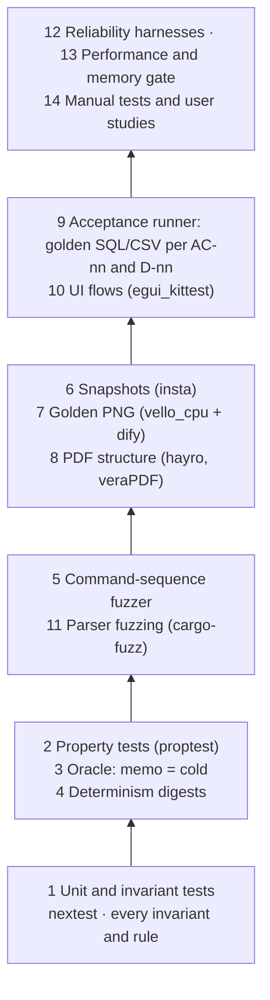
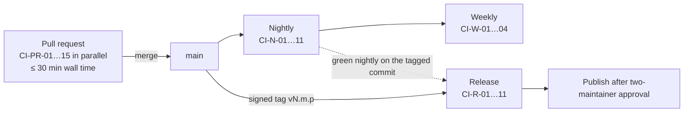
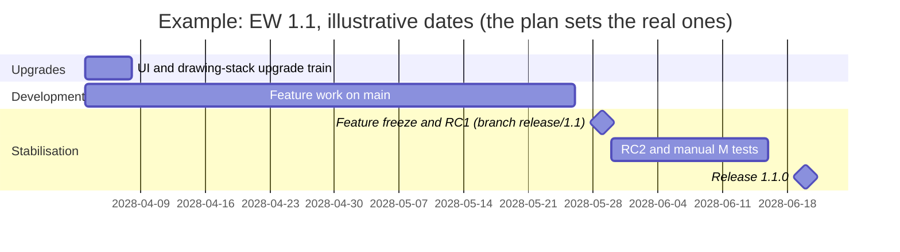
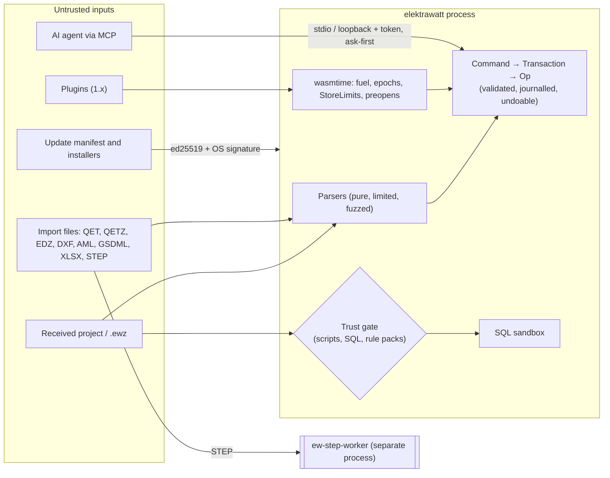

# Quality engineering, security and release

**Status:** Draft v0.1 · **Date:** 2026-10-18 · **Part of:** ElektraWatt design document set

**Purpose.** This document specifies how ElektraWatt (EW) proves its correctness, performance and security, and
how it is built, signed, shipped and supported. It turns the architecture's "prove it in CI" principle
([architecture](04-architecture.md) §1.2 (10), §13) and the quality targets of
[02c](02c-nonfunctional-requirements.md) into test layers, gates, CI jobs, release rules, packaging, signing,
supply-chain controls, a threat model, a privacy design and an EU Cyber Resilience Act (CRA) position. Other design
documents refer to "the CI job in 18": this document owns those pipelines.

**Contents**
1. [Scope and boundaries](#1-scope-and-boundaries)
2. [Concepts and data](#2-concepts-and-data)
3. [Test strategy](#3-test-strategy)
4. [Performance and memory gate](#4-performance-and-memory-gate)
5. [CI pipeline](#5-ci-pipeline)
6. [Toolchain, MSRV and the upgrade train](#6-toolchain-msrv-and-the-upgrade-train)
7. [Release process](#7-release-process)
8. [Packaging per OS](#8-packaging-per-os)
9. [Signing, provenance and updates](#9-signing-provenance-and-updates)
10. [Supply chain](#10-supply-chain)
11. [Security process](#11-security-process)
12. [Privacy](#12-privacy)
13. [EU Cyber Resilience Act readiness](#13-eu-cyber-resilience-act-readiness)
14. [UI/UX touchpoints](#14-uiux-touchpoints)
15. [Outputs](#15-outputs)
16. [Edge cases and pitfalls](#16-edge-cases-and-pitfalls)
17. [The reference project in the quality system](#17-the-reference-project-in-the-quality-system)
18. [Scope by release](#18-scope-by-release)
19. [Dependencies](#19-dependencies)
20. [Requirements covered](#requirements-covered)
21. [Open questions](#open-questions)

---

## 1. Scope and boundaries

| Topic | Specified here | Specified elsewhere |
|---|---|---|
| Test layers, harnesses, CI jobs, gates | All | Golden fixture content, `expected/*.csv`, AC-nn: [20](20-golden-project.md); kittest flow content: [16](16-ux-ui.md); fault-injection design: [05](05-project-format-and-persistence.md); fuzz targets and corpora per format: [14](14-interop.md) §11–§12, [10](10-plc-and-bus.md), [12](12-panel-layout.md) |
| Performance | Fixture generator, measurement, gate | Budgets: 02c §2 |
| Security | Threat model, vulnerability process, `unsafe` policy, supply chain, signing | Trust store: 05 §13.4; trust prompt, MCP, plugin sandbox: [17](17-extensibility.md); parser limits: 14 §11 |
| Privacy | Data flows, network sandbox, crash and log handling | First-run privacy step: 16 §9.1; personal-data export option: [09](09-reports-forms-output.md) |
| Release | Cadence, versioning, packaging, updates, support | Format version rules: 05, ADR-0011; steward entity and governance: [19](19-open-source-governance.md) |
| CRA | Role analysis, obligations mapped to evidence | Legal-entity decision: ADR-0030, 19 |

**Terminology.** In this document "release" means a release of the EW software. Releasing a drawing revision is a
*revision release* ([15](15-checks-revisions-collaboration.md) §5.5). "GP" is the golden project (Golden A unless a
variant is named). Verification codes PR, N, R, M, S and A are those of 02c §1.2; **N-weekly** is a weekly subset of
N.

---

## 2. Concepts and data

### 2.1 Quality artefacts

None of these is project model data. They are repository, CI or local diagnostic data.

| Artefact | Location | Format | Owner | Rule |
|---|---|---|---|---|
| Golden fixtures A, B, A-R | `golden/J-E-2416.ew/` (project fixture); `golden/J-E-2416/` (`tables/`, `resolutions/`, `history/`, `expected/`, `acceptance/`, `variants/`, `basic-project/`) | JSONL, CSV | 20 | Regenerated in the same commit as `tables/` (20 §3.1, §3.2) |
| Golden C input and the reference PDF | Private store, reachable only by CI-N-10 | `.qet`, PDF | 20 | Never in the public repository (20 §3.5) |
| Synthetic fixtures S, M, L, XL, XL-A | Generated by `ew-testkit gen`, cached by (generator version, GP hash) | JSONL | Here | Never committed (XL-A is about 250 MB) |
| Format fixture corpus | `fixtures/format/<format>/` | One project per released format | 05 | Never deleted (NFR-REL-05) |
| Snapshots | `crates/*/tests/snapshots/` | insta `.snap` | Crate owner | Reviewed per change (§3.7) |
| Approved PNGs | `golden/J-E-2416/expected/png/`, `library/expected/png/` | PNG, 150 dpi | 20, library maintainers | First approval in a private session (20 §3.3) |
| Performance history | `perf-history` store (orphan branch or artefact bucket) | JSON Lines, one row per (run, benchmark, class, metric) | Here | 90 days rolling, plus every release run kept |
| Fuzz corpora | Separate repository `ew-fuzz-corpus` | Binary inputs | Here | Minimised weekly; crashes become committed regression inputs |
| Hostile corpus | `tests/hostile/` | Own files, CC0 | 14, here | Committed |
| Threat model | `docs/security/threat-model.md` | Markdown, TM-nn rows (§11.1) | Here | Reviewed every minor (NFR-SEC-01) |
| Release evidence | Release assets | CycloneDX JSON, Sigstore bundles, `SHA256SUMS` plus signature, notices | Release pipeline | Permanent |
| Update manifest | Project web site, `update/v1/<channel>.json` plus `.sig` | JSON | Release pipeline | Per release (§9.3) |
| Crash report | OS state directory, `crashes/<id>/` | Minidump, log tail, `report.json` | Application | 30 days or 20 reports (§12.3) |

### 2.2 Relationship to the domain model

- **One mutation path.** Harnesses drive projects only through the `Session` API (ARCH §5.1): the same
  `Command → Transaction → Op` path as users. `ew-model` tables are `pub(crate)`, so a test cannot corrupt a model
  behind the invariants (NFR-MAINT-01).
- **Stable test IDs.** `ew-ids` offers a seeded UUIDv7 generator behind a `testkit` feature: the timestamp comes from
  a counter and the random bits from a seeded ChaCha stream. Snapshots and digests therefore contain stable IDs.
  The release pipeline asserts that the feature is absent (CI-R-09).
- **Personal data.** `Party.personal_data` ([03](03-domain-model.md) §5, FR-PRJ-024) feeds the crash scrubber's
  token set (§12.3) and the "omit personal data" export test (NFR-PRIV-06).
- **Derivation profiles** (ADR-0003). Every shipped profile has its own `expected/` set, so the golden outputs are
  tested per profile (NFR-REL-09).
- **Committed computations** carry an `input_hash`. The determinism tests include routing (1.0), so the hash must be
  identical on every platform, or EW-LAY-011 would flag lengths as stale after a checkout on another OS.
- **Test-build hooks.** Two features exist only for tests: the seeded ID generator above and the confirmation hook
  of `HumanOnly` subcommands (§3.15). The release pipeline asserts that both are absent (CI-R-09).

---

## 3. Test strategy

### 3.1 The pyramid



| # | Layer | Tool | Scope | Cadence | Main requirement |
|---|---|---|---|---|---|
| 1 | Unit, invariant, rule | cargo-nextest 0.9.148 | Per crate; one test per invariant of `ew-model/invariants.md`; positive and negative fixture per rule | PR | NFR-MAINT-06 |
| 2 | Property | proptest 1.12.0 | Algebraic laws (§3.3) | PR 256 cases; N 20,000 | NFR-REL-04, NFR-REL-08 |
| 3 | Oracle differential | `ew-testkit::oracle` | Memoised = cold after each transaction (§3.4) | PR sampled on GP; N all memos | NFR-REL-08 |
| 4 | Determinism | `ew-testkit::digest` | Order, threads, platform, locale, clock, path (§3.5) | PR (Linux); N (cross-platform) | NFR-REL-07, NFR-I18N-03 |
| 5 | Command fuzzer | cargo-fuzz 0.13.2, `arbitrary` | Random command streams with oracle, undo and round trip (§3.6) | PR 60 s; N 1 h | NFR-REL-08 |
| 6 | Snapshots | insta 1.49.0 | Typed query outputs, import batches, exports, engine statistics | PR | NFR-REL-09, NFR-PERF-20 |
| 7 | Visual | vello_cpu 0.3.0, dify 0.8.0 | Every golden page and every shipped symbol | PR | FR-EXT-004, FR-OUT-014, FR-OUT-018 |
| 8 | PDF structure | hayro 0.8.0; veraPDF (external CLI) | Outline, links, labels, fonts, dates, PDF/A-2b; PDF/UA-1 at 1.0 | PR (path-filtered), N | FR-OUT-002, FR-OUT-004 … FR-OUT-009 |
| 9 | Acceptance | `ew-testkit accept` | AC-01 … AC-42 and the D-nn rows of 20 §19 (§3.10) | PR (gate subset); R (all reached) | 20 §21 |
| 10 | UI | egui_kittest 0.37.0 | Flows of 16; accessible-name walker; CVD, contrast, pseudo-locale, 300 % | PR | NFR-A11Y-01 … 04, NFR-I18N-02 |
| 11 | Parser fuzzing | cargo-fuzz 0.13.2 | Every parser of external bytes (§3.12) | PR ≥ 60 s per changed target; N ≥ 30 min per target | NFR-SEC-02, NFR-SEC-03 |
| 12 | Reliability | Fault injector, kill loop, soak | Save, journal, recovery, worker crashes | PR (failures), N, N-weekly (soak) | NFR-REL-01 … 03, NFR-REL-12 … 14 |
| 13 | Performance | criterion 0.8.2, puffin 0.20.0 | §4 | PR (exact counts); N (timings) | NFR-PERF-01 … 20 |
| 14 | Manual, studies | Protocols | RDP without GPU, screen readers, printers, installers, usability | M, S | NFR-PLAT-03, NFR-A11Y-02, NFR-UX-01 |

### 3.2 Unit, invariant and rule tests

- **Invariants.** Each invariant ID has a test that builds the violating transaction and asserts the outcome.
  Structural invariants reject the transaction. Prevent rules reject it in strict mode and yield a message in lenient
  mode. Example for D-11: `SetFields{terminal: -X1031:8, designation: ""}` is rejected in strict mode, and the lenient
  QET import reports it as MF-08.
- **Swaps.** Transaction-end evaluation is tested directly: swapping the designations 3 ↔ 4 on -X1031 in one
  transaction commits, while setting 3 to "4" alone is rejected (D-12).
- **Exhaustiveness.** The field-mask test of ARCH §4.1 fails when a link field is added without an index
  declaration. A schema test fails if `Page` gains a revision or title-block text field (D-05, D-06).
- **Rules.** Every shipped rule has a positive and a negative fixture, and its `docs` reference resolves (NFR-DOC-02).
  A deliberately slow test rule must be demoted to deferred (NFR-PERF-09).

### 3.3 Property tests

The generator `ew-testkit::gen::command()` produces commands that are valid against the current snapshot: targets
are chosen by index into the live tables. When a law fails, proptest shrinks the sequence to a minimal one. The
harness prints it as an `.ewcmd` script in the builder DSL of 20 §3.2, so the failure becomes a regression fixture by
copying one file.

| Law | Checked on |
|---|---|
| `undo(all) ∘ apply(cmds) = id`, for the model digest and every derived digest | GP, S |
| `load(save(m)) = m`, and `save(load(save(m)))` byte-identical to `save(m)` | GP, QET corpus, S |
| Incremental saves after every step are byte-identical to a full save of the final model (NFR-REL-16) | GP; M nightly |
| `merge(o, a, a) = a`; `merge(o, o, b) = b`; for disjoint edits `merge(o, a, b) = merge(o, b, a)` | GP branches |
| preview + commit = execute; journal replay = live state | GP |
| Renumbering keeps every `Id` reference; the tag map old → new is a bijection | Golden B steps |
| Re-importing the same source yields identical IDs and an empty diff (FR-IMP-002) | QET corpus |
| A hit-test result lies in the item's bounding box; a routed length ≥ the Euclidean distance (1.0) | S, layout fixture |

### 3.4 Oracle differential: memoised versus cold

The oracle catches the architecture's top risk: a stale memo silently recreating the D-01 class (ARCH §16, risk 1).

```text
after Session::commit(tx) in oracle mode:
  keys := memo keys read by the view-models of this frame
        ∪ sample(all live memo keys, k, seed = (run_seed, rev))      # PR: k = 64; nightly: k = all
  for key in sort(keys):
    memo := memo_store.get(key)                       # may verify, re-execute or hit
    cold := Q::cold(snapshot).eval(key)               # fresh request-scoped cache, no memo store
    if memo != cold:                                  # Eq, or 128-bit hash for bulky values
      fail(OracleMismatch { tx.command, key, diff(memo, cold),
                            trail: explain(key) })    # same output as `ew query --explain`
```

- **PR:** the AC-16 script on GP (rename T55, move -102F2 by one cell, renumber folio 103 → 104, change the 24 V DC
  colour), followed by 500 generated commands.
- **Nightly:** every memo on every fixture up to M, plus the command-fuzzer stream.
- **Policy changes.** A PR that promotes a query to `Memo` (ARCH §6.1) runs the nightly-level oracle on GP and S
  before merge.
- **Developers and users.** Debug builds run the oracle with k = 8 on every commit. `ew verify-derived` is the
  user-facing equivalent (FR-EXT-005).

### 3.5 Determinism

| Variation | Method | Compared | Cadence |
|---|---|---|---|
| Record order | The loader permutes lines within each file and the file order (seeded) | JSONL after save, findings, PDF/SVG/CSV digests | PR |
| Threads and spawn order | `RAYON_NUM_THREADS` = 1, 2 and 8; job submission order shuffled | Export digests, routing (1.0), `.ewpp` (1.0) | PR |
| Platform | Same commit on Windows, macOS and Linux | SHA-256 of GP PDF, SVG, CSV, XLSX, JSONL and `.ewpp`; PNG within the dify tolerance (09 OQ 12; this relaxes the PNG part of NFR-REL-07 and FR-OUT-014, open question 9) | N; release gate (AC-14, FR-OUT-019) |
| Locale, time zone | `LC_ALL` en_US, nl_NL, de_DE, tr_TR; `TZ` UTC−10 and UTC+14 | File and PDF digests | N |
| Wall clock | Two runs with the clock faked 24 h apart; `SOURCE_DATE_EPOCH` unset | Output digests | PR |
| Build-time data | Every CI and release build asserts that `ICU4X_DATA_DIR` is unset: the build scripts of the ICU4X data crates read it, and other segmentation data would change line breaks and so every text layout (decision log ID-52) | The assertion itself | PR; release (CI-R-03) |
| Project path | The same project opened from two directories, one named with spaces and non-ASCII | Digests (no absolute path in any output) | PR |

**Static rules** (NFR-MAINT-12). In crates that produce persisted or exported bytes (`ew-format`, `ew-model`,
`ew-derive`, `ew-rhai`, `ew-commands`, `ew-checks`, `ew-text`, `ew-reports`, `ew-scene`, `ew-export`, `ew-plcaddr`,
`ew-caex`, `ew-plc`, `ew-panel`, `ew-ewpp`, `ew-mfg`, `ew-sqlview` and the importers), `clippy.toml` sets:
- `disallowed-types`: the hash maps and sets of `std::collections`, `hashbrown` and `imbl`. Use `BTreeMap`,
  `imbl::OrdMap`, `IndexMap` with a defined insertion order, or sorted vectors.
- `disallowed-methods`: `SystemTime::now` and `Instant::now` (except through the `ew-ids` UUIDv7 generator, which the
  `testkit` feature seeds, and the allowlisted tracing wrapper), `rand::thread_rng`, `Uuid::new_v4`, `Uuid::now_v7`
  outside `ew-ids`, and `std::env::var` outside the settings module.

A derive check in `ew-schema` rejects `f32`/`f64` fields in persisted records (ARCH §7.3).

### 3.6 Command-sequence fuzzer

```rust
#[derive(Arbitrary)]
enum FuzzCmd { Place { sym: u16, page: u8, x: i16, y: i16 }, Connect { a: u32, b: u32 }, Move { rep: u32, dx: i8, dy: i8 },
               Delete { idx: u32 }, Renumber { scope: u8 }, SetField { idx: u32, field: u8, val: u16 },
               InsertMacro { m: u8, page: u8 }, Undo, Redo, SaveReload, Import { batch: u8 } }

fuzz_target!(|input: (u8, Vec<FuzzCmd>)| {
    let mut s = Session::open(seed_fixture(input.0));         // GP, Golden B or S
    let d0 = s.world().digest();
    for c in input.1.iter().take(256) {
        if let Some(cmd) = c.resolve(&s.world()) { let _ = s.execute(cmd.as_ref()); }  // Err is fine, panic is a bug
        s.assert_structural_invariants();
        oracle_sample(&s, 16);
    }
    assert_round_trip(&s);                                    // save to a scratch directory, load, compare digests
    while s.undo().is_ok() {}
    assert_eq!(s.world().digest(), d0);
});
```

The corpus starts from the AC-16 script, the Golden B steps and the Golden C fix script. PR runs use no sanitizer,
for throughput. Nightly runs use AddressSanitizer, because the dependency closure contains `unsafe` code.

### 3.7 Snapshots

- **What is snapshotted.** Typed query outputs on GP: tags, xref texts, potentials with aliases, wire properties with
  provenance, BOM rows in both modes, terminal, cable and PLC rows, check findings, engine statistics. Also import
  batches of the QET corpus, AML and PLCopen exports, DXF text and the canonical GP JSONL.
- **Format.** Row data is stored as CSV inside `.snap` files, so diffs read like report changes.
- **Review rule.** CI runs with `INSTA_UPDATE=no` and fails on any pending snapshot. A PR that changes snapshots
  carries the label `snapshots-changed`. A reviewer other than the author signs off each changed file. A change in
  an xref text, tag or wire number on GP also needs the golden owner's approval, because those values are the
  acceptance specification.

### 3.8 Visual goldens

- **Rendering.** `ew render --page <folio> --png --dpi 150` (FR-EXT-004) runs in deterministic mode: the CPU
  backend's scalar path if one exists (09 OQ 12), bundled fonts only, no system fonts.
- **Comparison.** dify against the approved PNGs, failing above 0.5 % differing pixels (20 §3.3). Per-symbol PNGs
  of the shipped library are rendered at 300 dpi.
- **Artefacts.** Diff images are uploaded as CI artefacts, and a bot comment links base, head and overlay.
- **Parity.** GPU/CPU parity samples run where the runner has an adapter (FR-OUT-018).
- **Updates.** Approved PNGs change only through the snapshot review rule of §3.7.

### 3.9 PDF structure

| Check | Method | GP expectation |
|---|---|---|
| Frame geometry | hayro's parser extracts path segments in printed mm, compared with `geometry/frame.json` | ±0.2 mm (AC-01) |
| Raster parity | hayro rasterises each page, dify compares it with the vello_cpu PNG | Within tolerance (FR-OUT-018) |
| Outline | Entry count and titles | Front matter, sections 1, 2, 9, every folio (FR-OUT-004) |
| Links | Link annotations and named destinations | 64 xref links plus report back-links; every destination resolves (AC-13) |
| Page labels | `/PageLabels` | Physical page 6 is labelled "101" (D-33) |
| Fonts | Embedded, subset (`ABCDEF+` prefix), no Tahoma | AC-13 |
| Text | Extracted text keeps spaces | "SK 3110.000" (FR-OUT-008) |
| Metadata | XMP and Info dates from the model or `SOURCE_DATE_EPOCH`; document ID a hash of the export input | No wall-clock value (NFR-REL-07) |
| Conformance | veraPDF, PDF/A-2b profile; PDF/UA-1 profile at 1.0 (**verify**, 02c OQ 9) | Pass |

veraPDF is a test tool run from a pinned container image with a checked digest. It is never distributed.

### 3.10 Acceptance runner

`ew-testkit accept golden/J-E-2416 --gate <M1|M-PP|M2|M3|M4|M5|M6>` (`MVP` and `1.0` are aliases of `M2` and `M6`; the rows per gate are those of [20](20-golden-project.md) §22 and [gates](../plan/03-gates.md) §8):
1. builds GP through the three paths of 20 §3.2 and checks their equivalence (AC-15);
2. builds the SQL projection and runs every `acceptance/*.sql`;
3. diffs the results row by row against `expected/*.csv` (natural order, exact);
4. runs the PDF checks of §3.9 and the finding comparison (rule ID, sorted targets, severity) on the JUnit output
   of `ew check --scheme pre-delivery`, which must exit 1 on Golden A while EF-01 (D-13) is unwaived (FR-EXT-002,
   AC-21);
5. writes JUnit XML and a Markdown table with one row per AC-nn and per D-nn
   (NFR-MAINT-11), and exits non-zero if any row of the requested gate fails.

The PR job runs the subset of the current milestone gate. Rows of later gates run as reported, non-blocking tests,
so progress is visible. Golden C and the migration verifier (AC-25 … AC-27) run in the private job CI-N-10.

### 3.11 UI tests

egui_kittest drives `ew-ui` in-process over GP. The flow content belongs to [16](16-ux-ui.md) (AC-28, the five core
tasks of NFR-A11Y-01, Escape cancelling every tool for NFR-UX-07). This document provides the jobs:
- **Interaction tests** run without rendering on all three OSs.
- **Image snapshots** run on Linux with a pinned Mesa lavapipe and on the Windows WARP job (**verify** kittest's
  wgpu path on both).
- **Accessible-name walker.** It traverses the AccessKit tree after each flow step and fails on any interactive node
  without a name.
- **Other jobs:** CVD-simulated renders of folio 102 with 24VDC-1 highlighted; a contrast lint over theme tokens; the
  pseudo-locale build (+35 % length); keymap reachability per layout; 300 % scale snapshots.
- **Watchdog.** A `tracing` subscriber fails any test in which a UI-thread span exceeds 100 ms (NFR-PERF-19).

### 3.12 Parser fuzzing and hostile input

- **Targets.** Every target listed in 14 §11 (`qet_project`, `qetz`, `edz_7z`, `edz_zip`, `dxf`, `table_xlsx` …),
  plus the AML, GSD, GSDML and IODD targets of 10, the JSONL loader and migration chain, `.ewz`, the merge driver and
  textconv (git runs both automatically on fetched content), the STEP IPC decoder, the `.ewpp` package reader and
  the machine feedback and status-log parsers (13 §11.3, 1.x), the SQL sandbox (hostile SQL text against the
  authorizer) and rhai formula evaluation under its limits. The limits themselves are FR-IMP-005 and NFR-SEC-02
  with the per-parser values of 14 §11.
- **Properties per target.** No panic. The batch validates against the `ew-schema` JSON Schemas. `ApplyImport` on an
  empty project either commits in lenient mode or refuses with a report, and never violates a structural invariant.
- **Resource limits.** A counting global allocator in fuzz and hostile-corpus builds measures peak allocation
  independently of the OS. A target fails above 256 MB extra or 1 s per input (NFR-SEC-02).
- **Hostile corpus**, committed and CC0: a ZIP bomb, a nested 7-Zip bomb, a billion-laughs DTD, an archive entry
  named `../../x`, an absolute or drive-letter entry, a QET file with a NaN coordinate, a QETZ database with a trigger
  and a view, and a GP copy whose page file is a symlink (NFR-SEC-16).
- **Toolchain.** cargo-fuzz needs nightly, so `fuzz/rust-toolchain.toml` pins a dated nightly, advanced by the upgrade
  train (§6.3).
- **Release rule.** An open fuzz crash blocks the release (RC-02).

### 3.13 Reliability harnesses

These harnesses are designed in 05 and run here:
- the fault injector: 1,000 kill points per file system on ext4, NTFS and APFS (NFR-REL-01, N);
- ENOSPC and EACCES injected at each save step (NFR-REL-03, PR);
- a `kill -9` loop at 10 commits/s with replay comparison (NFR-REL-02, N);
- a forced-panic test on the UI thread that expects a minidump, a log and a recovery offer (NFR-REL-13, PR), and
  one inside an import job that expects a failed job, a crash record and a running session (§12.3, NFR-REL-12, PR);
- a hostile STEP input that kills the worker and a non-terminating rhai script, each with an unchanged model digest
  (NFR-REL-12, PR);
- release fault injection: `ew revision release V2.0` on Golden A-R, confirmed through the test-build confirmation
  hook (§3.15), is killed at random points of the six release steps of 05 §14.1; afterwards V2.0 is either Open with
  no archive or tag referenced, or Released with an archive that verifies (NFR-REL-15, N; one kill point per step on
  PR);
- the 8-hour soak on the M fixture (NFR-REL-14, N-weekly, 1.0).

### 3.14 Flaky tests

PR CI never retries a test. Only named infrastructure steps are retried: downloads in the fetch stage and runner
provisioning. A test that fails nondeterministically is quarantined within one working day with an issue and an
owner. Quarantined tests keep running nightly. More than 10 quarantined tests block the next release
(NFR-MAINT-13).

### 3.15 Test-build confirmation hook

`HumanOnly` subcommands (`ew revision approve|release|withdraw`, `ew waiver add|remove`, `ew trust …`,
`ew plugin install|remove`) ask the person to type the revision label, rule ID or keyword on the controlling
terminal, and exit 2 without one ([17](17-extensibility.md) §2.3). The acceptance runner (the Golden A-R sign-off
`ew revision approve --as <checker>`, [20](20-golden-project.md) §2.4) and the release fault-injection test (§3.13)
must still run these subcommands in CI. The hook makes that possible without weakening release builds:
- **What it is.** A cargo feature `test-confirm` of the `ew` binary. With it, the confirmation step accepts the
  typed answer from `ew-testkit` through an inherited pipe named by the harness, instead of from the terminal. The
  subcommand still runs its read-only part first, prints the change summary and compares the answer exactly as it
  would compare a terminal answer, so a wrong label still refuses.
- **What it is not.** It adds no `--yes` flag, no environment-variable bypass in release builds and no path for
  command logs, scripts, MCP, plugins or Python: those origins are refused with `CmdError::Exposure` before the
  confirmation step, with or without the feature.
- **Where it may exist.** Only test targets and the `ew-testkit` harness enable it. CI-PR-09 fails a non-test target
  whose resolved graph enables `test-confirm`, and CI-R-09 asserts that the feature's canary string is absent from
  every release binary, like the egui `inspection` feature.
- **Its own tests** are the `HumanOnly` rows of §11.5.

---

## 4. Performance and memory gate

### 4.1 Fixtures

`ew-testkit gen --class <S|M|L|XL|XL-A> --seed 1` builds the fixtures of 02c §2.1 deterministically:

1. **Base.** Golden B after step B1, so that every tag is derived.
2. **Replicas.** r = ⌈class devices / base devices⌉ replicas. Each replica gets:
   - its own location node `+CAB-nnnn` and folio range;
   - IDs `v5("synthetic", class, replica, source id)`;
   - PLC station addresses and Q bytes offset per replica;
   - its own layout space.
3. **Cross-wiring.** Neighbouring replicas are joined by interruption points and shared supply potentials, so that
   global connectivity spans the whole project. Isolated replicas would understate the cost of the
   `potential_partition` hotspot (ARCH §6.7).
4. **Density top-up.** Synthetic control-circuit pages (relay ladders, terminal fan-outs) built from the starter
   symbol set are added until the connection, CP, terminal and channel counts reach the class bounds. GP has fewer
   than one wire per device, against the class ratio of 5.
5. **Trim.** Counts are cut to the exact class bounds and the per-class counts are written to `fixture.json`.

The generator version is part of the cache key and of every performance-history row. Changing the generator resets
the baselines (§4.4).

### 4.2 Benchmarks

| Benchmark | Requirement | Classes | Metric |
|---|---|---|---|
| `start` | NFR-PERF-02 | — | Median of 10 cold starts |
| `open`, `warmup` | NFR-PERF-03 | S–XL, XL-A | First selectable frame; warm-up end |
| `frame.gesture` | NFR-PERF-04 | S–XL | p99 total and per phase over ≥ 1,000 frames |
| `commit.move`, `commit.wire` | NFR-PERF-05 | S–XL | p99 over 1,000 gestures |
| `render.pan` | NFR-PERF-06 | Dense A3; GP folio 103 | fps on GPU and on the CPU renderer |
| `profile.change`, `renumber.folio` | NFR-PERF-07 | S–XL | Commit plus visible-view update |
| `bulk.renumber.preview` | NFR-PERF-08 | S–XL | Time to preview, with a concurrent edit |
| `check.full` | NFR-PERF-09 | S–XL | Wall time |
| `reports.paginate` | NFR-PERF-10 | S–XL | Cold pagination of all blocks |
| `pdf.export` | NFR-PERF-11 | 500-page slice of L; GP | ms per page; total |
| `save.incremental`, `save.full` | NFR-PERF-12 | S–XL | Writer time; frame p99 during the save |
| `memory.peak` | NFR-PERF-13 | S–XL | Peak RSS; memo bytes per family |
| `sql.build`, `sql.refresh` | NFR-PERF-14 | S–XL | Wall time |
| `table.scroll`, `find` | NFR-PERF-15 | XL | Frame p99; find latency for "A9F78116" |
| `route`, `collision`, `step` | NFR-PERF-16 … 18 | L, XL, generated STEP | 1.0 |
| `part.search`, `part.reindex` | NFR-PERF-21 | Synthetic 500,000-part library | First 50 results; full index rebuild |
| `aml.export`, `aml.preview` | NFR-PERF-22 | XL (10,000 channels), with a concurrent scripted edit | Wall time (1.0) |
| `thermal` | NFR-PERF-23 | Largest layout space of XL | Recalculation time (1.0) |
| `ewpp.export`, `wire_records` | NFR-PERF-24 | L; M | Export time and UI-thread holds; per-potential re-evaluation (1.0) |
| `import.qet` | NFR-PERF-25 | Reference-size file, 3.5 MB corpus file, M-class project, 24-file batch | Time to the import preview; batch time |

### 4.3 Runner and measurement

- **Runner.** Timings run on one dedicated bare-metal machine of the BM class (02c §1.4): x64, Linux, CPU governor
  `performance`, turbo off, benchmark threads pinned to isolated cores, no concurrent jobs.
- **Cold benchmarks.** Cold-start and cold-open runs drop the page cache through a privileged helper.
- **GPU-less.** BM-noGPU fps is measured on the same machine with the adapter hidden, forcing the CPU renderer. WARP
  fps runs on the Windows hosted job as an informational value.
- **Hosted runners.** Windows and macOS hosted runners record weekly informational timings. They never gate,
  because their noise exceeds 15 %.
- **Statistics.** Medians and p99 follow 02c §1.4. Gesture sequences are scripted, replayed through the `Session`
  API and timed with `tracing` spans.

### 4.4 Gate decision

```text
for each (benchmark b, class c, metric m) measured tonight on runner R:
  v       := median of 10 runs (single operation) or p99 over the samples (latency)
  budget  := 02c budget for (b, c); applies as gating from MVP for S/M and from 1.0 for L/XL
  over    := v > budget  or  (single operation and max(runs) > 1.5 × budget)
  base    := median of the last 7 green nightly values on main for (b, c, m, R, generator version)
  noise   := max(3 × MAD(last 7), floor(m))         # floor: 1 ms latency, 2 % throughput, 16 MB memory
  regress := v > 1.15 × base  and  v − base > noise
red if any (over and gating) or regress
```

- **On red.** A bisect job replays the gate over the commits merged since the last green run (at most 20, on the
  same runner) and posts the first bad commit to the tracking issue.
- **Baseline resets.** The baseline resets only through a commit labelled `perf-baseline-reset` with a stated reason
  (new runner hardware, generator change), reviewed like code.
- **Release.** A red gate blocks release (NFR-PERF-20).
- **Seeded slowdown.** The gate's own test seeds a 20 % slowdown into `potential_partition` and asserts that the
  gate turns red.

### 4.5 Engine statistics per PR

Timings are nightly, but **counts are exact on every PR** (02c OQ 6). For each scripted GP edit, an insta snapshot
records `{query family: (hits, verified, re-executed, cut-offs)}`. Examples of locked expectations:
- drawing a wire on folio 102 re-executes no query keyed to folio 203;
- the layer memos of unchanged display lists are backdated, so their GPU buffers stay;
- changing the 24 V DC colour re-executes `wire_props_of` only for the 24 V potentials (24VDC-1 … 24VDC-4 and
  aliases) and the colour table of folio 1.

A change in these counts is a reviewed snapshot change, never a silent one.

### 4.6 Memory gate

- **Peak RSS.** Read from the OS: `VmHWM` on the Linux runner, `PeakWorkingSetSize` on Windows, `task_info` on macOS.
  It is measured after open, warm-up, full check and PDF export.
- **Family budgets.** Memo bytes per query family come from `ew-memo` statistics. At XL the gate enforces memos
  ≤ 300 MB, undo ≤ 256 MB and the projection ≤ 500 MB file-backed (NFR-PERF-13).
- **Allocation counting.** The counting allocator of §3.12 checks the parser limits in the same job.

---

## 5. CI pipeline

### 5.1 Flow



The PR set stays within 30 min wall time (NFR-MAINT-05); a monthly CI-duration report flags the slowest jobs.

### 5.2 Job catalogue

| Job | Content | Runner | Blocks |
|---|---|---|---|
| CI-PR-01 lint | `cargo fmt --check`; clippy `--workspace --all-targets -D warnings` with the §3.5 rules; `ew fmt --check` on fixtures; Fluent string-literal lint on `ew-ui` and `ew-checks` | Linux | Merge |
| CI-PR-02 test-linux | nextest; insta check; proptest short; oracle on GP; engine-statistics counts; acceptance (gate subset); SQL compile test; schema/fixture check; permissive-only sample reader (FR-COL-012, SC-11); forced-panic test; release fault injection, one kill point per step (§3.13); hostile corpus; the security tests of §11.5 (trust, SQL sandbox and statement gate, MCP binding, `HumanOnly`); UI-thread watchdog | Linux container (C compiler only, NFR-MAINT-09) | Merge |
| CI-PR-03 test-windows | nextest; kittest interaction; NTFS path and permission tests | windows-2025 | Merge |
| CI-PR-04 test-macos | nextest; kittest interaction; save and reopen on a case-sensitive APFS image | macos-15 (arm64) | Merge |
| CI-PR-05 headless | `ew export pdf` and `ew render --page 103 --png` on GP with no display, no GPU, no system fonts and empty library directories (NFR-PLAT-04, NFR-REL-11); the PDF's SHA-256 equals that of the kittest GUI export of CI-PR-07 (FR-OUT-022, FR-EXT-001) | Linux container | Merge |
| CI-PR-06 output | Golden PNGs; PDF structure; veraPDF when `ew-scene`, `ew-export`, fonts or forms change; GPU smoke per backend where available (NFR-PLAT-02) | Linux, Windows | Merge |
| CI-PR-07 ui-a11y | kittest flows and image snapshots; name walker; CVD renders; contrast lint; pseudo-locale; keymap reachability; 300 % | Linux (lavapipe) | Merge |
| CI-PR-08 fuzz-smoke | 60 s per changed parser target; 60 s command fuzzer | Linux | Merge |
| CI-PR-09 supply-chain | cargo-deny; cargo-audit; cargo-vet; build-script allowlist; licence-boundary check over every permissive crate of ARCH §3 (§10); dependency-rule check; `unsafe` allowlist; feature bans over the resolved graph (rhai `unchecked` anywhere, 17 §5.2; egui `inspection`, `egui_mcp`, `ew-ids/testkit` and `ew/test-confirm` in any non-test target); MSRV build of permissive crates (NFR-SEC-10, NFR-MAINT-03) | Linux | Merge |
| CI-PR-10 legal-docs | `reuse lint` (NFR-LIC-01, NFR-LIC-02; 19 LR-01); licence-map check against `ci/licence-map.toml` (19 LR-02), including the collective copyright notice (NFR-LIC-10); no committed third-party fixture (19 LR-11); DCO (NFR-LIC-03); merge block for non-maintainer PRs while the exception texts are missing (NFR-LIC-12, 19 LG-2); governance-file presence (NFR-DOC-08); RFC reference on PRs labelled `format-major`, `api-break` or `licence` (NFR-DOC-09); anonymisation guard (NFR-PRIV-09; 20 §3.5, 19 LR-12); mdBook and rustdoc build with link check (NFR-MAINT-08); F1 anchors (NFR-DOC-01); rule pages (NFR-DOC-02); generated references unchanged (NFR-DOC-06) | Linux | Merge |
| CI-PR-11 storage | Samba share save/reopen and a case-sensitive APFS image (NFR-PLAT-05); ENOSPC/EACCES injection; read-only installation directory (NFR-PLAT-07); longest internal path ≤ 120; project path `Projecten Ü ñ 测试` (NFR-I18N-04) | Linux, Windows | Merge |
| CI-PR-12 step-worker | Path-filtered: worker build with cached OCCT; IPC fuzz smoke; worker-kill test | Linux | Merge |
| CI-PR-13 coverage | cargo-llvm-cov 0.9.1 on core crates, ≥ 80 % (NFR-MAINT-06) | Linux | Merge (core crates) |
| CI-PR-14 api-guard | The API compatibility guard of NFR-MAINT-10, implementing the CI guards of 17 §11: command-catalogue snapshot and rename test (FR-EXT-015); query output-schema snapshot; CLI `--help`, exit-code and result-schema snapshots; `api_v1` column snapshot; MCP tool-list snapshot; WIT diff against the last release (1.x); a semver check on the public API of the permissive crates (tool **verify**, e.g. cargo-semver-checks) | Linux | Merge (a reviewed snapshot change is allowed only with the label `api-change` and a release-notes entry) |
| CI-PR-15 docs-diagrams | Path-filtered on Markdown under `docs/`, `book/` and the root: renders every Mermaid block with a pinned mermaid-cli (container image pinned by digest, never distributed) and fails on any parse or render error, because GitHub shows a broken diagram as an error box without failing anything | Linux container | Merge |
| CI-N-01 perf | §4 gate, all classes; bisect on red | Dedicated BM runner | Release |
| CI-N-02 deep | Full oracle; proptest 20,000 cases; command fuzzer 1 h with ASan | Linux | Release |
| CI-N-03 fuzz | ≥ 30 min per parser target; crash triage issues | Linux (ClusterFuzzLite-style batch) | Release |
| CI-N-04 digests | GP outputs from all three OSs compared (AC-14, FR-OUT-019, NFR-REL-07) | All | Release |
| CI-N-05 gpu-less | Windows WARP flows and fps sample; lavapipe 3D smoke (from M4, 12 OQ 9) | Windows, Linux | Release |
| CI-N-06 network | Network sandbox (§12.2) and listening-socket scan | Linux | Release |
| CI-N-07 reliability | Fault injection on ext4, NTFS, APFS; kill-and-replay loop | All | Release |
| CI-N-08 locale | Locale and time-zone matrix (NFR-I18N-03) | Linux | Release |
| CI-N-09 pdf | veraPDF on every GP export variant; PDF/UA-1 at 1.0 | Linux | Release |
| CI-N-10 private | Golden C, pilot QET projects, migration verifier; public log shows pass/fail and anonymised diffs only | Private runner | Release |
| CI-N-11 corpora | QET corpus (24 examples at a pinned commit), DXF and EDZ corpora (14 §12) | Linux | Release |
| CI-W-01 soak | 8 h on M (1.0) | Dedicated runner, idle window | Release |
| CI-W-02 fuzz-maint | Corpus minimisation, coverage of fuzz targets | Linux | — |
| CI-W-03 dependency age | Lag against the limits of NFR-MAINT-04; advisory waivers expiring within 14 days | Linux | — (issues) |
| CI-W-04 timings | Informational Windows and macOS timings | Hosted | — |
| CI-R-01 … CI-R-11 | Release pipeline (§7.4) | All | Publishing |

### 5.3 Runners and GPU-less coverage

- **Hosted runners.** windows-2025, macos-15 (arm64) and ubuntu-24.04 (RE §10.3; confirmed valid in
  [gaps-and-corrections](../research/gaps-and-corrections.md) §3.3). Best-effort artefacts build on the hosted
  `windows-11-arm` and `macos-26-intel` images and an Ubuntu `-arm` image, which the same check lists; macOS 14
  images are deprecated. Images are pinned by label. A runner-image change that breaks the build is fixed in its own
  PR, never mixed with feature work.
- **GPU-less paths.** Three paths are covered: DX12 WARP (Windows hosted runners have no hardware GPU), the CPU
  renderer (forced in CI-PR-05 and CI-N-01) and lavapipe (Linux). Together they test the fallback chain of
  NFR-PLAT-03 and FR-UI-028.
- **Linux release builds** run in an Ubuntu 22.04 container. Its glibc 2.35 is the oldest of the Supported Linux
  rows, so the binaries also run on Debian 12 and newer distributions.

### 5.4 CI hardening

NFR-SEC-19:
- **Actions.** Third-party actions are pinned by full commit SHA. Renovate proposes updates weekly, grouped.
- **Permissions.** The default token is `contents: read`. Only the release jobs get `id-token: write` and
  `attestations: write`.
- **Untrusted code.** No workflow runs fork code with secrets. `pull_request_target` is never combined with a checkout
  of the PR head.
- **Self-hosted runners** (performance, private corpus) never run fork PRs. They run only on `main` and on PRs of
  maintainers that carry the `perf` label. They hold no signing secret.
- **Signing.** Credentials live in the protected `release` environment, which requires approval by a second
  maintainer. Windows signing authenticates through OIDC federation, so no long-lived credential exists.
- **CI tools.** cargo-deny, cargo-vet, cargo-about and the others are installed at pinned versions with checksum
  verification.
- **Branch protection on `main` and `release/*`.** Required checks CI-PR-01 … CI-PR-15, no force-push, no direct
  push, one approving review by someone other than the author, and CODEOWNERS review for the paths with two named
  owners (`ew-memo`, the `Op` set, `ew-format`, `ew-derive`, NFR-MAINT-07) and for every `unsafe` change
  (NFR-SEC-04).
- **Secrets.** GitHub secret scanning with push protection is on. Fixtures and logs never contain tokens.
- **Dependency bots.** Renovate updates actions only. Cargo dependencies move in the upgrade train (§6.3) or for an
  advisory, and never by bot auto-merge, because every bump needs a cargo-vet audit.
- **Scorecard.** The OpenSSF Scorecard runs weekly and its result is published; the OpenSSF Best Practices badge is
  targeted at 1.0 (19 §6).

---

## 6. Toolchain, MSRV and the upgrade train

### 6.1 Pinning

- **Toolchain.** `rust-toolchain.toml` pins an exact stable version (≥ 1.95, which egui 0.37 needs) with rustfmt,
  clippy and llvm-tools, and the Supported targets. The edition is 2024.
- **Lockfile.** `Cargo.lock` is committed, and every CI build uses `--locked`.
- **Fuzzing.** `fuzz/rust-toolchain.toml` pins a dated nightly.
- **Raising.** The toolchain is raised at most once per quarter, in the upgrade train (NFR-MAINT-03).

### 6.2 MSRV of the published permissive crates

- **Declaration.** The permissive crates (FR-EXT-023) declare a `rust-version` at least 6 months older than the EW
  release that publishes them. Initially this is the lowest version ≥ 1.85 (edition 2024) that their closure allows
  (**verify** at the first publication).
- **CI job.** CI-PR-09 builds them with that toolchain against an MSRV lockfile produced by the MSRV-aware resolver
  (`resolver = "3"`, `incompatible-rust-versions = "fallback"`). The application lockfile can therefore move ahead
  without breaking downstream users.
- **Versioning.** Raising a crate's MSRV is a minor version bump of that crate.
- **GPL crates** (2026-10-19, decision log ID-141). The MSRV binds the permissive crates only. GPL application crates
  and binaries need only the pinned toolchain (§6.1) and declare the `rust-version` their dependencies require:
  `ew-export`, `ew-render-cpu` and their dependents declare 1.92 for krilla 0.8.2 (vello_cpu 0.3.0 needs 1.89,
  parley 0.12.0 1.88). As applied: `ew-export`, `ew-render-cpu`, `ew-api`, `ew-print`, `ew-testkit`, `ew-ui`,
  `ew-viewmodel` and both binaries (decision log ID-183). The workspace value 1.85 is the permissive crates' MSRV, not
  a promise for the application.

### 6.3 The quarterly upgrade train

The UI stack breaks every 6–10 weeks (ADR-0014). EW absorbs this in one lock-step upgrade per quarter, in the first
month of the quarter, at least four weeks before that quarter's feature freeze (§7.3). The target cost is about one
developer-day (NFR-MAINT-04).

| Step | Content | Pass condition |
|---|---|---|
| 1 | Branch `upgrade/<yyyy>q<n>`. Bump egui, eframe, egui-wgpu, egui_tiles, egui_table, egui_ltreeview, egui_kittest, transform-gizmo-egui, wgpu, winit and AccessKit together; bump the toolchain and the fuzz nightly | Builds |
| 2 | Run the full PR and nightly sets on the branch | Green, except UI snapshot diffs |
| 3 | Review kittest image snapshots: UI changes are accepted; accessibility regressions are not | Name walker and contrast lint green |
| 4 | Drawing outputs (golden PNGs, PDFs) must be **unchanged**, because the UI stack does not touch `ew-dl`, vello_cpu or krilla | PNG and PDF digests unchanged |
| 5 | Bump the drawing stack (krilla, vello_cpu, parley, fontique, skrifa, harfrust) in a separate commit on the same branch | Tags, xrefs and wire numbers byte-identical (NFR-REL-09); geometry within tolerance; digest changes listed in the release notes |
| 6 | GPU smoke per backend, WARP, CPU renderer; manual RDP check | Pass |
| 7 | Merge | Within 5 working days |

- **Abort rule.** If the branch is not green after 3 developer-days, EW stays on the previous versions for the
  quarter and files the blockers upstream. The lag limits of NFR-MAINT-04 (two egui minors, one wgpu major) are
  never exceeded: a second missed quarter makes the upgrade the top-priority task.
- **wasmtime** stays on its LTS line and moves to the next LTS before the current one leaves support (ADR-0020,
  NFR-MAINT-04). Every release whose number is a multiple of 12 is LTS with 24 months of security fixes
  ([gaps-and-corrections](../research/gaps-and-corrections.md) §3.3), so 48.x is supported until about 2028-08 and
  the move to 60.x falls in the upgrade train of 2028 Q3 at the latest.

---

## 7. Release process

### 7.1 Versions and cadence

The EW version (SemVer) and the project format version (ADR-0011) are numbered independently. The release notes
state which format a release writes and which it reads.

| Phase | Release | Cadence | Format | Support |
|---|---|---|---|---|
| Pre-1.0, pilot preview (M-PP) | 0.0.x | Unsigned development builds from CI, handed to the pilot only; no public binary, no download page | May change; upgrade-on-read | None |
| Pre-1.0 | 0.x.0 | Monthly from the MVP (0.1.0 at M2): RC on the first working day, release the following week if no blocker | May change; upgrade-on-read; unstable-format banner | Latest 0.x only |
| Pre-1.0 | 0.x.y | As needed | Never changes | — |
| From 1.0 | N.0.0 | Yearly, in the format window (§7.2) | Format major allowed | §7.5 |
| From 1.0 | N.m.0 | Quarterly | Additive format minor only | All fixes while latest; security and data-loss fixes for 6 months after its successor (§7.5) |
| From 1.0 | N.m.p | As needed: security, data loss, regressions | Never changes | — |
| Always | Nightly | Daily from `main` | May write an unreleased format, with a warning (NFR-REL-05 d) | None |

The release structure in time is: nightlies and signed source tags (`m1`, `pp`) before the pilot preview; the
pilot preview 0.0.x at milestone M-PP (gate G-PP), which is not a public release; the first signed binary release
0.1.0 at M2 (MVP); then monthly 0.x, the betas and release candidates of 1.0 (M5, M6) and quarterly minors. The
dates are the plan's ([global plan](../plan/01-global-plan.md) §5.1 and §6, [milestones.csv](../plan/milestones.csv)).
The pipeline and checklist of §7.4 apply from 0.1.0; a pilot preview needs the CI build and the release notes only.
Whether a pilot-only preview counts as "made available on the market" under the CRA is to be verified with counsel
(§13.1, ADR-0030).

Published permissive crates follow their own SemVer. A format minor bumps `ew-schema` and `ew-format` by a minor
version, and a format major by a major version.

### 7.2 Format-change window

- **Placement.** After 1.0, the yearly major ships in a fixed month (proposal: March). It is the only release that
  may raise the format major.
- **Freeze.** The format freezes 8 weeks earlier, and the new format's fixture is committed at the freeze.
- **Between windows.** Changes that need a format major land behind the compile-time feature `next-format`, which
  only nightlies enable. A released build cannot write the next format.
- **Corpus.** Every released format's fixture stays in the corpus forever (NFR-REL-05).
- **Steward rule.** The schema-steward rule applies to every format PR: migration, fixture, regenerated schema and
  docs (ARCH §7.6).

### 7.3 A quarterly minor (example dates)



- **Branching.** Development is trunk-based. `release/N.m` is cut at the feature freeze, and only fixes are
  cherry-picked onto it. Patch releases come from the branch.
- **Pre-1.0.** There are no release branches before 1.0: blockers are fixed on `main` and the RC is re-cut.

### 7.4 Release pipeline and checklist

| Job | Content |
|---|---|
| CI-R-01 | Verify the tag signature against `.github/allowed_signers`, a clean tree and version consistency (Cargo, installers, About, manifest); release and migration notes present (NFR-DOC-07; drafted with git-cliff, 19 §6, then edited) |
| CI-R-02 | Collect gates: a green nightly on this commit (perf, memory, full oracle, fuzz with no open crash), acceptance of every reached milestone row, no unwaived high or critical advisory; from 1.0 the Golden A-R as-built archive passes `sha256sum -c` and veraPDF and validates with the permissive-only reader, and joins the fixture corpus (NFR-REL-10) |
| CI-R-03 | Hermetic build: `cargo fetch --locked`, then a network-less build on Linux (§10); `cargo auditable build --release --locked` for every target; the build fails if `ICU4X_DATA_DIR` is set (§3.5) |
| CI-R-04 | `ew-step-worker` per target with cached OCCT artefacts (1.0) |
| CI-R-05 | Packaging (§8) |
| CI-R-06 | Signing and notarisation; `SHA256SUMS` and the update manifest signed (§9) |
| CI-R-07 | CycloneDX SBOM per artefact (cargo-cyclonedx 0.5.9), merged with the non-Rust components (SQLite, OCCT, fonts); completeness check against `cargo metadata`; SBOM vulnerability scan; cargo-about notices for the crates plus the non-crate notices (fonts, with their copyright, licence and trademark lines) assembled from `NOTICE`, because cargo-about lists crates only; failing on any SBOM component without a notice (19 §5.3; NFR-SEC-13, NFR-LIC-08) |
| CI-R-08 | SLSA provenance through `actions/attest-build-provenance` for every artefact; `gh attestation verify` on each (NFR-SEC-12) |
| CI-R-09 | Assertions: the inspection canary string and the `test-confirm` canary string (§3.15) absent from every binary; the `ew-ids/testkit`, `ew/test-confirm` and egui `inspection` features and the `ew-testkit` and `egui_mcp` crates absent from the release dependency graph; smoke start opens no listening socket (NFR-SEC-09) |
| CI-R-10 | Clean-VM offline installation on Windows 10 22H2, Windows 11, macOS, Ubuntu 22.04 and Debian 12: install, open the GP sample, pass its acceptance CSVs, and from 1.0 open the GP `.ewpp` in `ew-wiring-viewer`; uninstall (NFR-PLAT-06, AC-40). An upgrade over the previous release's installer keeps user settings, keymaps, the trust store and company catalogues; uninstall leaves them in place |
| CI-R-11 | Publish after two-maintainer approval: GitHub release, update manifest, crates.io through trusted publishing (1.0, **verify**), Flathub PR (1.0) |

The release checklist holds the items that a pipeline cannot prove:

| Item | Check |
|---|---|
| RC-01 | Threat model reviewed and updated for new parsers or extension points (NFR-SEC-01) |
| RC-02 | No open fuzz crash; quarantined tests ≤ 10 (§3.14) |
| RC-03 | Advisory waivers valid ≤ 90 days, each with an owner (NFR-SEC-11) |
| RC-04 | `SECURITY.md` supported-versions table and support end dates updated (NFR-COMP-03) |
| RC-05 | Manual M tests: RDP without GPU, NVDA, VoiceOver and Orca, two printers, installers, Windows and macOS network observation (§12.2) |
| RC-06 | Translation status meets NFR-I18N-01; documentation built and bundled |
| RC-07 | Content audit of bundled assets: licences, provenance, no standards text (NFR-LIC-06, NFR-COMP-05) |
| RC-08 | New derivation profiles, format changes and CLI/API changes listed in the release notes |
| RC-09 | Engineering-verification disclaimer present in About, check panel, docs and release report (NFR-COMP-04) |
| RC-10 | Governance gates of [19](19-open-source-governance.md) §3.3 met before the first binary release: LG-1 (employer copyright statement) and LG-4 (steward, signing identity and repository organisation, NFR-COMP-08), and the steward checklist ST-01 … ST-10 of [19](19-open-source-governance.md) §3.10 complete with evidence (NFR-COMP-01); afterwards the checklist is re-reviewed every minor |
| RC-11 | 1.0 only: the Accessibility Conformance Report against EN 301 549 clauses 11 and 12 is updated with known gaps (NFR-COMP-06) |

### 7.5 Support policy

- **Rule** (NFR-COMP-03, ADR-0030 as proposed). The latest minor gets all fixes; each minor gets security and
  data-loss fixes for 6 months after its successor ships. With quarterly minors, up to two older lines can be in
  that window at the same time, and security backports go to each of them (open question 14).
  Illustrative example (the real calendar is in the [global plan](../plan/01-global-plan.md) §6.4): 1.1 (released 2028-06-20) receives all fixes until 1.2 ships (planned 2028-09-19) and security and
  data-loss fixes until 6 months later (2029-03-19).
- **Majors.** After N.0, the last minor of N−1 gets the same 6-month window.
- **Pre-1.0.** Only the latest 0.x is supported.
- **LTS.** No LTS line exists until a commercial decision funds the ≥ 5-year period that manufacturer status would
  impose (NFR-COMP-02, §13).
- **In the binary.** Each build embeds its line's planned support end: its successor's planned date from the
  published cadence, plus 6 months. A slipping successor only extends it. The About dialog shows the status without
  network access, and an opted-in update check refines it from the manifest (FR-UI-038).

---

## 8. Packaging per OS

**Tool choice.** cargo-packager 0.11.8 (2025-11-27) builds the installer formats from one configuration (MSI through
WiX, NSIS, DMG/.app, AppImage, deb). EW's own GitHub workflow drives it, because the pipeline needs custom signing,
notarisation, SBOM and attestation steps. cargo-dist 0.32.0 (2026-05-22) stays an alternative: it lost its company
backing in 2025, and its 2026 maintenance status is unconfirmed (RE §10.1; open question 1).

| OS | Artefact | Scope | Notes |
|---|---|---|---|
| Windows x64 (ARM64 best effort) | `ElektraWatt-<v>-x64.msi` | Per machine; silent `msiexec /qn` | Stable UpgradeCode, major-upgrade semantics; policy values under `HKLM\SOFTWARE\Policies\ElektraWatt` (`UpdateCheck` DWORD, `UpdateMirror` string, `CrashUpload` DWORD; NFR-PLAT-08), with `UpdateCheck = 0` written by default (NFR-PRIV-03); static CRT, so no redistributable |
| | `ElektraWatt-<v>-x64-user-setup.exe` (NSIS) | Per user, no administrator rights | Detects a per-machine installation and offers to use it instead |
| | `ew-<v>-x86_64-pc-windows-msvc.zip` | Portable CLI | Includes `ew-step-worker` from 1.0 |
| macOS arm64 (x86_64 best effort) | `ElektraWatt-<v>-arm64.dmg` with the `.app` | Drag install | Developer ID, hardened runtime, notarised and stapled; `ew` inside the bundle, with a menu command to link it onto `PATH`; `MACOSX_DEPLOYMENT_TARGET` = the oldest macOS in the support window (02c OQ 4) |
| Linux x64 (arm64 best effort) | `.deb` for Ubuntu 22.04+ and Debian 12+ | System | Built against glibc 2.35; depends on the Vulkan loader and xkbcommon; fonts bundled |
| | `.AppImage` | User | Type-2 runtime; documents `--appimage-extract-and-run` where FUSE 2 is missing |
| | Flatpak on Flathub | User | 1.0 Should; offline build with vendored crates; file and print portals (open question 11) |
| All (1.0) | `ew-wiring-viewer` in every installer, plus a portable archive per target | Shop PCs; per user, no administrator rights | The read-only `.ewpp` wiring viewer (ARCH §3, [13](13-manufacturing-outputs.md) §11); signed, notarised and covered by SBOM and provenance like `elektrawatt` |
| All | CLI archives, split debug symbols (PDB, dSYM, DWARF), SBOMs, notices | — | Symbols are public, so users can symbolicate their own crash dumps |

**Every installer is offline and complete** (NFR-PLAT-06): application, `ew` CLI, `ew-step-worker` (1.0, LGPL OCCT
as a replaceable separate binary, NFR-LIC-08), `ew-wiring-viewer` (1.0), bundled fonts (ADR-0028), starter symbols, frames and forms, the GP
sample (CC0), the offline documentation, `PRIVACY.md`, `SECURITY.md`, the third-party notices and the SBOM.
Installation needs no network. The installed tree is read-only at run time (NFR-PLAT-07).

---

## 9. Signing, provenance and updates

### 9.1 Code signing

| Platform | Mechanism | Identity |
|---|---|---|
| Windows | Authenticode through Artifact Signing (OIDC from the protected environment); every `.exe`, `.dll`, `.msi` and setup file; RFC 3161 timestamps, required because the certificates are short-lived (**verify** the lifetime) | Organisation identity of the steward (ADR-0030); not available to individual EU developers |
| macOS | rcodesign (apple-codesign 0.29.0): sign every nested binary with hardened runtime, notarise through an App Store Connect API key, staple. Fallback: Apple's `codesign` and `notarytool` on a macOS runner, because rcodesign's last release dates from 2024-11-29 | Steward's Developer ID |
| Linux and all artefacts | `SHA256SUMS` signed with the project release key (ed25519, minisign-compatible) | Release key (§9.2) |
| Git | Release tags signed with maintainers' SSH keys listed in `.github/allowed_signers`; CI-R-01 verifies | Maintainers |

**Entitlements.** macOS entitlements stay minimal. The wasmtime plugin host (1.x) needs a JIT entitlement or an
interpreter mode, which is decided by [17](17-extensibility.md) open question 19 (open question 13 here).

### 9.2 Provenance, sums and the release key

- **Provenance.** Every artefact gets SLSA build provenance signed through Sigstore (`actions/attest-build-provenance`,
  free for public repositories, G10).
- **Offline verification.** Sigstore verification needs its trust root, so offline users verify `SHA256SUMS.sig`
  with the release key instead (NFR-SEC-15).
- **Key distribution.** The release key's public half is compiled into the binary, published on the web site and
  printed in `SECURITY.md`. The binary embeds the current key and the next one, so a yearly rotation needs no
  emergency release.
- **Custody.** The private key lives only in the protected `release` environment, behind second-maintainer approval
  (open question 6).

### 9.3 Update check

**MVP: notice only.**
- **Which builds.** Release builds only. Development builds, including the unsigned nightlies published before
  gate LG-4 ([19](19-open-source-governance.md) §3.3), contain no update check and no crash upload (ADR-0029
  interim rule), which CI-N-06 enforces.
- **When.** After the user opts in (first-run step 3 of 16 §9.1), at most once a day, in the background after the
  first frame, with a 5 s timeout and no retry storm.
- **Request.** A plain `GET` of a static, signed manifest. It carries no cookie, no query string and no identifier.
  The only data sent is the `User-Agent: ElektraWatt/<version> (<os>; <arch>)` header (NFR-PRIV-03).
- **Verification.** The manifest signature is verified with the embedded release key before anything is shown.
- **Effect.** The notice offers "Release notes" and "Download", which opens the release page in the browser. Nothing
  is installed (NFR-SEC-15).

**1.0: in-app download.** On a click, EW downloads the platform installer and checks its size and the SHA-256 from
the signed manifest. It then checks the OS signature (WinVerifyTrust; the code signature and notarisation ticket on
macOS) and only then launches the installer. There is never a silent installation. Linux packages get the notice
only.

```json
{"schema": 1, "channel": "stable",
 "latest": {"version": "1.1.2", "date": "2028-07-08", "severity": "security", "notes": "https://<project site>/releases/1.1.2",
            "support_end": {"1.1": "2029-03-19", "1.0": "2028-12-20"}},
 "artefacts": [{"target": "x86_64-pc-windows-msvc", "kind": "msi", "url": "https://<project site>/…/ElektraWatt-1.1.2-x64.msi",
                "sha256": "…", "size": 187654321}]}
```

**Network details.**
- **Proxies.** EW honours explicit proxy settings (OS settings, `HTTPS_PROXY`). It never uses WPAD auto-discovery,
  which would trigger DNS lookups.
- **TLS.** It uses the OS trust store, so that corporate TLS inspection works (rustls with
  `rustls-platform-verifier`; neither is in the research notes, **verify** crate and version).
- **Mirrors.** An MSI policy key can point the check to an internal mirror (NFR-PLAT-08).
- **Velopack** (delta updates) is not used in v1, because its signature mechanism is unverified (G10).

---

## 10. Supply chain

| Control | Rule | Job |
|---|---|---|
| Lockfile and toolchain | `Cargo.lock` committed; `--locked`; exact toolchain | All |
| cargo-deny 0.20.2 | **Licences:** the NFR-LIC-04 allowlist, with LGPL-2.1 only for `ew-step-worker`. **Advisories:** vulnerabilities deny; "unmaintained" and "unsound" notices need an owner decision within 90 days. **Bans:** duplicate-version warnings and a list of banned crates (downloader build scripts). **Sources:** crates.io only, git sources allowlisted per crate | CI-PR-09 |
| cargo-audit 0.22.2 | RUSTSEC on the lockfile per PR and on the shipped binaries' embedded `cargo-auditable` data at release | CI-PR-09, CI-R-07 |
| cargo-vet 0.10.2 | Every new or updated crate audited by the project; audits name the contributor's GitHub handle, and no public audit sets are imported while the public-repository rule stands (ADR-0023 amendment 3). The exemption list is frozen at the first commit and burned down | CI-PR-09 |
| Build scripts | `cargo metadata` lists every crate with a `custom-build` target; the list must match `build-scripts.allowlist`, each entry reviewed through cargo-vet. A Linux job builds the whole workspace with all features inside a network namespace without connectivity, so any build-time download fails (C-5) | CI-PR-09, CI-R-03 |
| Low-adoption crates | Test-only, or vendored with a named owner (C-9) | Review |
| Licence boundary | For each crate declared permissive in `[workspace.metadata.ew]`, which must list exactly the P crates of ARCH §3 (`ew-units`, `ew-ids`, `ew-mltext`, `ew-rds`, `ew-schema`, `ew-format`, `ew-interop-api`, `ew-dl`, `ew-step-proto`, `ew-memo`, `ew-plcaddr`, `ew-caex`, `ew-devdesc`, `ew-ewpp`; `ew-plugin-wit` and `ew-plugin-sdk` from 1.x), the closure of normal and build dependencies (and dev-dependencies, so that published crates stay self-contained) contains only NFR-MAINT-02 licences and no GPL workspace crate | CI-PR-09 |
| Dependency rules | ARCH §3 rules over direct dependencies (NFR-MAINT-01), including `ew-plugin-host` ↛ `ew-import-qet` (NFR-LIC-05) | CI-PR-09 |
| SBOM and notices | Per artefact, including non-Rust components (§7.4) | CI-R-07 |
| Provenance and signing | §9 | CI-R-06, CI-R-08 |
| CI integrity | §5.4 | All |

---

## 11. Security process

### 11.1 Threat model

**Assets:**
- the confidentiality of projects (customer work, personal data);
- the **integrity of engineering data**: a silently changed cross-section or protective device is a safety
  hazard, not only a data problem;
- the integrity of EW binaries and updates;
- the availability of the user's session.



| ID | Threat | Controls | Verified by |
|---|---|---|---|
| TM-01 | Hostile project or import file: memory exhaustion, decompression bombs, deep nesting, NaN geometry, panics. Also reached without a click through the git merge driver and textconv, which git runs on fetched content | Limits (NFR-SEC-02, FR-IMP-005, 14 §11); pure parsers that never execute content; lenient import | CI-PR-08, CI-N-03, hostile corpus |
| TM-02 | Archive path traversal or symlinks (`.ewz`, EDZ, QETZ, XLSX) | Entry-name rules; symlinked and encrypted entries refused; loader follows no links (NFR-SEC-16) | Hostile corpus |
| TM-03 | Hostile SQLite (QETZ, catalogues) with views or triggers | Read-only, `trusted_schema=OFF`, defensive mode, schema check (NFR-SEC-06) | CI-PR-02 |
| TM-04 | Automation embedded in a received project: rhai scripts, SQL reports, rule packs | Trust gate keyed outside the project (05 §13.4, NFR-SEC-05). Pure formulas still evaluate: no I/O, operation limits, tracked reads (15 §3.9; 02c OQ 2) | CI-PR-02 trust fixture |
| TM-05 | Resource exhaustion by formulas or SQL | rhai operation, depth and string limits; SQL deadline and `SQLITE_LIMIT_*` | CI-PR-02 |
| TM-06 | Plugin exfiltration or tampering (1.x) | Capability manifest, WASI preopens, no network by default, signed manifests, fuel or epochs, `StoreLimits`, plugin ID in undo (NFR-SEC-07) | 17 tests in CI-PR-02 |
| TM-07 | MCP misuse, including prompt injection through project text ("rename all devices…") | Off by default; stdio or loopback with a per-session token; ask-first writes with a diff; project-scoped access; `origin=mcp` in the journal (NFR-SEC-08) | CI-PR-02 |
| TM-08 | Exploitation of OCCT (C++) through a vendor STEP file | Separate process, timeouts, memory cap, quarantine after two crashes, fuzzed IPC decoder; OS sandbox in 1.x (NFR-SEC-21) | CI-PR-12 |
| TM-09 | Silent tampering with a received project's engineering data | Not preventable by EW. Mitigations: `ew diff`; revision compare against the as-built archive; archive SHA-256 sums; documentation advice to compare a received project with its released archive | Docs; FR-COL-013 |
| TM-10 | Debug or remote-control endpoints in release binaries | Test-only features; canary assertion; socket scan (NFR-SEC-09) | CI-R-09, CI-N-06 |
| TM-11 | Dependency compromise or typosquatting | §10 | CI-PR-09 |
| TM-12 | CI or release pipeline compromise | §5.4; provenance; two-person publish | Scorecard, review |
| TM-13 | Update spoofing or MITM | HTTPS, signed manifest, OS signature, no silent install | CI-R-06, the tampered-package test |
| TM-14 | Local disclosure through journal, recovery snapshots, crash dumps or logs | User-only permissions; pruning; redacted logs; no automatic upload (NFR-PRIV-04, NFR-PRIV-05) | CI-PR-02 |
| TM-15 | Signing-key compromise | Incident runbook (§11.4) | Tabletop exercise |
| TM-16 | User-configured external converter (ODA File Converter for DWG, 1.0) fed a hostile file, or a converter path planted by a received project | The converter path is a user setting, never read from a project; it runs as a separate process on a copy in a temporary directory with a 120 s timeout, and its output is parsed under the DXF limits (14 §11) | Hostile-corpus test with a stub converter that hangs and one that writes a DXF bomb |

### 11.2 `unsafe` and native code

- **Default.** Every crate carries `#![forbid(unsafe_code)]`.
- **Allowlist** (`unsafe-allowlist.toml`): `ew-render2d`, `ew-render3d`, `ew-render-cpu` (if needed), the app
  shell's platform glue (print adapters over `windows`/`objc2`, crash-handler installation) and `ew-step-worker`.
  The test-only crates that never ship in release artefacts, `ew-testkit` and `fuzz/`, are allowlisted for the
  counting `GlobalAlloc` (§3.12) only (NFR-SEC-04); CI-R-09 asserts their absence from release graphs.
- **Lint.** An xtask lint compares crate roots and `unsafe` occurrences against the allowlist. Every `unsafe` block
  has a `SAFETY:` comment, and CODEOWNERS requires a second maintainer's review (NFR-SEC-04).
- **Native code.** It is limited to bundled SQLite in process and OCCT out of process.

### 11.3 Vulnerability handling

| Stage | Action | Deadline |
|---|---|---|
| Receive | GitHub private vulnerability reporting, or a role mailbox on the project domain listed in `SECURITY.md` | — |
| Acknowledge | Reply to the reporter | ≤ 7 days (NFR-SEC-14) |
| Triage | CVSS 4.0 score, affected versions, exploited in the wild? | ≤ 14 days |
| Notify (CRA) | If actively exploited and a CRA role applies (§13): early warning, notification and final report through the single reporting platform | 24 h, 72 h, 14 days after a fix (Art. 14, **verify** for stewards) |
| Fix | Private fork of the GitHub security advisory; regression test and fuzz seed | Critical ≤ 30 days |
| Release | Patch releases for every supported line (§7.5); update manifest `severity: security` | With the fix |
| Disclose | Publish the GitHub advisory; CVE through GitHub as CNA; RUSTSEC advisory for published crates; release notes | At release; embargo ≤ 90 days |
| Learn | Post-mortem; threat-model update | Next minor |

### 11.4 Incident runbook: key or pipeline compromise

1. Stop publishing and disable the release environment.
2. Revoke the affected identity: Artifact Signing certificate, Apple Developer ID certificate, or the release key.
   Revoking the release key means switching clients to the embedded next key and publishing a new next key.
3. Publish an advisory naming the affected artefacts by SHA-256 and provenance.
4. Rebuild from a clean runner and re-sign.
5. Notify under the CRA if the steward role applies.

The runbook is rehearsed in the tabletop exercise before 1.0 (NFR-SEC-14).

### 11.5 Per-PR security tests

Each security rule needs a test that fails when the rule is broken. For the trust, SQL, MCP and `HumanOnly` rules
of [17](17-extensibility.md) §13 these tests run in CI-PR-02 on GP; parser limits are covered by §3.12 and the
network rules by §12.2:

| Test | Expectation | Rule |
|---|---|---|
| Trust fixture | A received GP copy with a project rule pack, an SQL report and a rhai script runs none of them before trust; pure formulas still evaluate | NFR-SEC-05, TM-04 |
| SQL sandbox | Hostile SQL text (`ATTACH`, `load_extension`, a `PRAGMA`, DML, a recursive-CTE bomb) is refused by the authorizer or stopped by the limits and the deadline | NFR-SEC-06, TM-05 |
| SQL statement gate | `ew sql <GP> "SELECT 1; VACUUM INTO 'x.db'"` exits 2 and creates no file | 17 §6.2, NFR-SEC-06 |
| MCP binding | `ew mcp --listen 127.0.0.1:0` accepts only loopback; a request without the per-session token or with a foreign `Origin` is refused; a non-loopback address is refused | FR-EXT-026, TM-07 |
| `HumanOnly` replay | `ew apply` of a `.ewcmd` that contains `revision.approve` exits 2 before line 1 is applied | 17 §2.3, D-34 |
| `HumanOnly` without a terminal | `ew revision approve --as <checker>` with no controlling terminal exits 2 ("HumanOnly: needs an interactive terminal") | 17 §2.3 |
| `HumanOnly` through the hook | In a test build, a wrong label supplied through the confirmation hook (§3.15) refuses; the right one signs off | §3.15 |
| Hook absent | The release binaries contain neither the hook nor its canary string (CI-R-09) | §3.15, NFR-SEC-09 |

---

## 12. Privacy

### 12.1 Data-flow inventory (the content of `PRIVACY.md`)

| Flow | Trigger | Content | Endpoint | Default |
|---|---|---|---|---|
| Update check | Opt-in, at most once a day | `GET` of the signed manifest with the User-Agent of §9.3 | Project site or a policy mirror | Off; off in MSI deployments |
| Crash upload | Per report, after the user previews the payload | Payload of §12.3 | ADR-0029 endpoint; none at MVP | Off; button hidden while no endpoint exists |
| Help and community links | Click (Help menu, release notes, Help ▸ Community, Translate; 19 §4) | URL opened in the system browser; EW itself sends nothing | Documentation site, GitHub Discussions, Weblate | Offline docs and `SECURITY.md` bundled |
| Plugin network | Capability granted at install (1.x) | Plugin-defined | Plugin-defined | Denied |
| `ew mcp` | User starts it | MCP over stdio or 127.0.0.1 with a token | Local | Off |
| ODA converter | User configures it (1.0) | Local process | None | — |

There are no other flows: no telemetry or analytics, no install ID (NFR-PRIV-02), no font, symbol or part downloads,
no licence check and no AI or translation service (NFR-PRIV-08). Changing this table requires an ADR (NFR-PRIV-07).

### 12.2 Network sandbox (CI-N-06)

```text
create a network namespace with only loopback up; resolv.conf points at an unreachable address
run under: strace -f -e trace=socket,connect,bind,listen,sendto,sendmsg,sendmmsg
flows: elektrawatt --smoke <GP> (first start, wizard skipped, open, first frame, quit);
       kittest flows: first run, open GP, edit, check, export PDF, import a public QET example, print to file;
       ew: check, export pdf/svg/bom, render, sql, import qet, print --to-file
fail if: any AF_INET/AF_INET6 socket call except the allowlisted loopback bind/listen of the
         `ew mcp --listen 127.0.0.1:0` test;
         any DNS attempt, including an AF_UNIX connect to the systemd-resolved varlink socket (/run/systemd/resolve/*)
         or the nscd socket, and any getaddrinfo/gethostbyname call recorded by an LD_PRELOAD shim;
         any listen() outside that test
ignored: other AF_UNIX traffic (D-Bus, AT-SPI, Wayland) and AF_NETLINK (interface queries)
```

- **Opted-in check.** A second run with the update check opted in targets a local mock server. It asserts the exact
  request (method, path, headers), so the check provably sends only version, OS and architecture (NFR-PRIV-03).
- **Other OSs.** Windows and macOS are observed manually for each minor, with outbound firewall logging (RC-05).
- **Smoke flag.** `elektrawatt --smoke <project>`, as listed in the CLI catalogue of [17](17-extensibility.md)
  §3.3, opens the project, renders its pages and exits. It accepts no remote input, so it is no control endpoint.

### 12.3 Crash reports and logs

- **Capture.** `crash-handler` 0.8.1 in the application and `minidumper` 0.11.0 in a monitor process (the same signed
  binary, started with `--crash-monitor`) write out-of-process minidumps.
- **Panic strategy.** Release builds keep `panic = "unwind"`. The panic hook runs for every panic and logs message
  and location. On job-pool threads (importers, rhai, SQL, checks, exports, report pagination; marked by a
  thread-local) it returns, so the unwind reaches the job's `catch_unwind`: the job fails with a report and a local
  crash record, and the session and model stay unchanged (NFR-REL-12). On every other thread (UI, writer, commit
  pipeline) the hook asks the writer thread to flush the journal (bounded to 500 ms, 05 §8.1) and aborts. Native
  crashes lose at most the last second of commits (NFR-REL-02).
- **Storage.** `crashes/<UTC time>-<8 hex>/` in the OS state directory holds `minidump.dmp`, `log-tail.txt` (the
  last 2,000 lines at the redacted default level) and `report.json`. `report.json` holds version, build ID, target,
  OS version, render backend, uptime and panic location. Permissions are user-only (0700 directories and 0600 files
  on Linux and macOS, a user-only ACL on Windows; NFR-PRIV-05). Reports are pruned after 30 days or beyond 20
  reports.
- **Upload payload** (NFR-PRIV-04, 1.0, only if ADR-0029 creates an endpoint). The raw minidump is **never** uploaded,
  because its stack memory can hold project text. Instead, a client-side stack walk (rust-minidump crates,
  **verify**) reduces it to frames of (module, build ID, offset) for every thread. The payload is those frames,
  `report.json` and the scrubbed panic message. The user sees the exact JSON before sending. The server symbolicates
  with the published symbols.

**Scrubber:**

```text
tokens := user name, host name, home directory, every open project's directory name and path,
          every MlText and identifier value of open projects (tags, folios, descriptions, party fields),
          recent-file names                                     # NFC, case-insensitive
tokens := tokens with ≥ 3 characters                            # "1", "PE", "N" would erase every message
msg := panic message
msg := replace quoted substrings ("…", '…', `…`) with <s:len>
msg := replace path-like substrings (/…, X:\…, \\server\…, ~/…) with <path>
msg := replace every token occurrence with <t>
msg := truncate to 512 characters
payload := allowlisted fields only; anything else is dropped
```

**Logs.**
- `tracing-appender` 0.2.5 rotates daily and keeps at most 7 files (`max_log_files`), at level `info` by default.
  It has no size-based rotation, so EW's writer wrapper stops a day file at 10 MB and writes one truncation marker.
- Project-derived strings are logged through a `Sensitive<T>` wrapper that prints `<redacted:len>`. Help ▸
  Diagnostics can enable full text for the current session only. The setting resets on restart (NFR-PRIV-05).

---

## 13. EU Cyber Resilience Act readiness

### 13.1 Dates and roles

- **Dates.** The CRA (Regulation (EU) 2024/2847) has applied its reporting obligations for actively exploited
  vulnerabilities and severe incidents (Art. 14) since **2026-09-11**, which is already the case today. All other
  obligations apply from **2027-12-11** (G11).
- **What falls after 2027-12-11.** The plan of record ([global plan](../plan/01-global-plan.md) §5.1 and §6;
  [milestones.csv](../plan/milestones.csv)) has no public binary release before 0.1.0 at M2, in February 2030, and
  1.0 in January 2032. Every public release therefore ships under full application, as does everything after it. The
  pilot preview 0.0.x (M-PP, November 2028, handed to the pilot only) and the nightly CLI builds for the pilot also
  fall after the date; whether such pilot-only builds are "made available on the market" is a question for counsel
  (global plan §5.3, WP-S6.04). Source tags and nightlies on the repository are not binary releases.
- **Where obligations attach.** They attach to products made available on the market, so the role decision of
  ADR-0030 must be taken before the first public release.

| Role | Who | When it applies | Obligations | EW position |
|---|---|---|---|---|
| None | Natural-person maintainers of non-monetised FOSS | No legal person; no monetisation (Recitals 15, 18) | None under the CRA | Fallback, but it cannot hold an Artifact Signing identity |
| **Open-source steward** (Art. 3(14), Art. 24) | A legal person systematically supporting EW for commercial use: the pilot panel builder's company as interim steward (phase 1, M0 to 1.0), then a Dutch stichting (phase 2, from gate LG-6) (ADR-0030; steward phases in [19](19-open-source-governance.md) §3.10, gates LG-1 … LG-6 in 19 §3.3) | Recommended | Cybersecurity policy; vulnerability handling; cooperation with market-surveillance authorities; reporting as Art. 24 requires (**verify** scope and start date with counsel) | Target role |
| Manufacturer (Art. 3(13), Art. 13) | Anyone selling support or LTS builds under the ElektraWatt name, or otherwise monetising | Excluded until budgeted (NFR-COMP-02) | Annex I requirements, conformity assessment (self-assessment for the default category, **verify**), technical documentation, EU declaration of conformity, CE marking, support period normally ≥ 5 years, SBOM, reporting | Not taken |
| User | Panel builders using EW | — | None from EW | — |

Personal-data processing is never a condition of use, because that would count as monetisation (G11, G12). The
zero-telemetry design (§12) also protects the steward role.

### 13.2 Obligations mapped to evidence

| Expectation (steward duties, plus Annex I practice) | EW control | Evidence artefact |
|---|---|---|
| Cybersecurity policy | `SECURITY.md`, threat model, this document | Repository files, reviewed every minor |
| Identify and document components | CycloneDX SBOM per artefact, including non-Rust components | Release assets (NFR-SEC-13) |
| Handle vulnerabilities without delay; free security updates | §11.3, §7.5 | Advisories, patch releases |
| Coordinated disclosure; contact point | Private reporting, role mailbox | `SECURITY.md` (NFR-SEC-14) |
| Report actively exploited vulnerabilities | 24 h / 72 h / 14-day runbook, single-reporting-platform account set up before the first public release | Runbook, tabletop record |
| No known exploitable vulnerabilities at release | NFR-SEC-11 gate | CI-R-02 log |
| Secure by default | MCP off, unsigned plugins refused, zero network, no debug endpoints | CI-N-06, CI-R-09 |
| Integrity of distribution | Signing, provenance, signed manifest | CI-R-06, CI-R-08 |
| Attack-surface and data minimisation | No listening sockets; no telemetry | §12 |
| Regular security testing | Fuzzing, hostile corpus, threat-model reviews | CI-N-03 reports |
| Cooperation with authorities | Steward contact in `SECURITY.md` | Governance record (19) |

**Product Liability Directive (EU) 2024/2853.** It applies to products placed on the market after 2026-12-09
(G11, unverified). EW states everywhere that its checks do not replace engineering verification (NFR-COMP-04),
and any commercial edition needs a liability review first.

---

## 14. UI/UX touchpoints

| Touchpoint | Behaviour | Owner |
|---|---|---|
| First-run privacy step | Update check off by default; crash reports local; `PRIVACY.md` one click away | 16 §9.1 |
| About dialog | Version, channel, build ID, render backend, privacy state, **support status** ("security fixes until 2029-03-19", computed offline), links to `PRIVACY.md`, `SECURITY.md`, notices and the bundled SBOM, engineering-verification disclaimer | FR-UI-038 |
| Update notice | Non-modal notification, "ElektraWatt 1.1.2 is available (security fix)", with Release notes and Download; never installs by itself | Here |
| Crash dialog at next start | Recover project (05), Show report folder, Copy summary, Show upload content, Upload (only with an endpoint), Delete (FR-UI-050) | Here, 16 |
| Help ▸ Diagnostics | Open the logs and crash folders; copy system information (version, OS, backend, adapter name; no project data); verbose diagnostics for this session | Here, 16 |
| Development-build and format banners | "Development build: writes format 1.4-dev" (NFR-REL-05 d) | 05 |
| End-of-support banner | Monthly and dismissible once the embedded support date has passed | FR-UI-038 |
| `ew --version --verbose` | Version, commit, toolchain, target, enabled features, shipped derivation profiles and rule-pack versions | 17 |

---

## 15. Outputs

- **Per release:** installers and archives (§8); `SHA256SUMS` and `SHA256SUMS.sig`; a CycloneDX SBOM per artefact;
  Sigstore provenance bundles; third-party notices (HTML); debug symbols; release and migration notes; the signed
  update manifest.
- **Per CI run:** the acceptance report as JUnit and Markdown per AC-nn and D-nn; PNG diffs; veraPDF reports; fuzz
  status; coverage; the digest matrix.
- **Nightly:** the performance dashboard (static HTML generated from the performance history) and the bisect result
  when the gate is red.
- **Repository documents:** `SECURITY.md`, `PRIVACY.md` and `docs/security/threat-model.md`. The steward checklist
  ST-01 … ST-10 is a governance record of [19](19-open-source-governance.md) §3.10, checked by RC-10.

---

## 16. Edge cases and pitfalls

1. **Signing breaks byte reproducibility.** Authenticode and notarisation modify the binaries. Reproducibility
   checks (NFR-SEC-20) therefore compare unsigned artefacts, while provenance attests the signed digests.
2. **Short-lived certificates.** Artifact Signing certificates are short-lived. Without an RFC 3161 timestamp a
   signature stops validating when its certificate expires.
3. **Notarisation outages delay releases.** macOS is a Supported platform (NFR-PLAT-01 R), so the release waits;
   the pipeline retries with backoff.
4. **Self-hosted runners and fork PRs.** Running fork PRs on the performance runner would be remote code execution
   on project hardware (§5.4).
5. **glibc drift.** A Linux binary built on ubuntu-24.04 needs glibc 2.39 and fails on Ubuntu 22.04. Release builds
   run in a 22.04 container (§5.3).
6. **SIMD paths in vello_cpu** can differ per CPU. Cross-platform PNG comparison uses the dify tolerance; byte
   identity is required for PDF, SVG, CSV, XLSX and JSONL only (09 OQ 12).
7. **Locale traps.** The Turkish dotless i and comma decimal separators break naive case folding and number
   formatting. The tr_TR job of CI-N-08 exists for this reason (NFR-I18N-03).
8. **Rubber-stamped goldens.** A golden or snapshot update can hide a regression. The review rule of §3.7 requires a
   second reviewer, and the golden owner when GP tags, xrefs or wire numbers change.
9. **UI upgrades touching drawings.** If a UI-stack upgrade changes a golden PNG or PDF, a dependency leaked across
   the `ew-dl` boundary. Step 4 of §6.3 catches this.
10. **Minidumps hold memory.** A dump can contain project text, so it is never uploaded raw (§12.3).
11. **AppImage and FUSE.** The classic type-2 runtime needs libfuse2, which Ubuntu 22.04 and later do not install by
    default. EW uses the statically linked type-2 runtime if cargo-packager can emit it (**verify**), documents the
    `--appimage-extract-and-run` fallback and ships `.deb` as the primary Linux package.
12. **Per-user and per-machine installs coexisting.** Both on one Windows PC give two start-menu entries. The
    per-user installer detects the other and offers to use it.
13. **SmartScreen.** A new publisher identity starts without SmartScreen reputation, so the first releases may show
    warnings (**verify** how Artifact Signing reputation builds up).
14. **Antivirus heuristics** may flag the crash monitor, which reads another process's memory. It is the signed main
    binary in a monitor mode, never an unsigned helper.
15. **Hosted runners have no GPU.** "GPU tests" on hosted runners exercise WARP or lavapipe only. Real-GPU smoke
    tests run on the dedicated runner's integrated GPU.
16. **Corporate proxies** need explicit proxy support and the OS trust store. WPAD would leak DNS lookups (§9.3).
17. **Debug-only invariant checks in the fuzzer** are part of the oracle. A crash they raise is a real bug, not a
    test artefact.

---

## 17. The reference project in the quality system

| Pipeline element | How GP is used |
|---|---|
| Oracle and property tests | AC-16 edits: rename T55, move -102F2 one cell, renumber 103 → 104, change the 24 V DC colour. After each edit the 64 xref texts, `device_tag` of every device, `wire_props_of(24VDC-1)`, `bom_rows` and `title_block` must equal a cold recomputation |
| Engine statistics | A wire on folio 102 re-executes nothing keyed to folio 203; the 24 V colour change touches only the 24 V potentials and folio 1's table |
| Determinism | SHA-256 of the GP PDF equal on Windows, macOS and Linux and across 1, 2 and 8 threads (AC-14) |
| PDF structure | 64 link annotations; folio labels ("101" on physical page 6); "SK 3110.000" with its space; no Tahoma; no "-4W1", "T51", "JE2416" or "BR" in the text layer (AC-06, AC-13) |
| Performance | AC-17 on BM: open ≤ 0.5 s, full check ≤ 2 s, `ew export pdf` ≤ 3 s. Golden B is the seed of every synthetic fixture (§4.1) |
| Network sandbox | Open GP, edit, check, export the PDF and print to file with zero non-local socket calls |
| Crash scrubber | A forced crash with GP open yields a payload without "J-E-2416", "-102G1", "TA05-V-15", `<engineer>`, the path or the user name (NFR-PRIV-04) |
| Hostile corpus | A GP `.ewz` with an injected `../` entry; a GP copy with a symlinked page file; a QET file with a NaN coordinate |
| Clean-VM test | The installed GP sample opens offline and passes its acceptance CSVs (AC-40) |

**Defects whose prevention this pipeline guards.** The pipeline does not repair user projects. It keeps EW's
prevention mechanisms from regressing.

| Defect | Guard | Job |
|---|---|---|
| D-01 BOM -4W1/-4X1 vs page -3W1/-3X1 | Oracle; renumber-keeps-references property; AC-20 | CI-PR-02 |
| D-02 T51 vs T55 | AC-06 text search; no placement without a device (fuzzer invariant) | CI-PR-02, CI-PR-06 |
| D-04, D-36, D-42 BOM | AC-07 CSV comparison in both modes | CI-PR-02 |
| D-05, D-06 title-block drift | Schema test: no per-page revision or free-text field; AC-04 | CI-PR-02 |
| D-07, D-33 PDF navigation and labels | PDF structure checks (§3.9) | CI-PR-06 |
| D-08 free-text wire rule | Provenance snapshot of W29 ("profile") and W20 ("CDP") | CI-PR-02 |
| D-10, D-41 generated overviews | PNG of folio 202 (4 valves on -202U2); assembly snapshot | CI-PR-06 |
| D-11, D-12 terminal designations | Invariant tests; the fuzzer never commits a violation in strict mode | CI-PR-02, CI-PR-08 |
| D-14 "3-B0" | AC-02 anchor cells and AC-05 xref texts ("3-B2") | CI-PR-02 |
| D-17 core colour "BR" | Strict CSV import rejects "BR"; lenient import reports it | CI-PR-02 |
| D-29 tag text sizes | AC-02 text CSV sizes ±0.05 pt; every device tag in style `tag.main` | CI-PR-06 |
| D-31 3.70 pt texts | EF-12 (two styles) in the finding comparison (AC-21, from M2) | CI-PR-02 |
| D-34 author = checker | Release-invariant test | CI-PR-02 |
| EW's own D-01 class (stale memos) and D-05 class across EW versions | Oracle; per-profile goldens (NFR-REL-09) | CI-PR-02, CI-N-02 |

---

## 18. Scope by release

| Area | MVP | 1.0 | 1.x |
|---|---|---|---|
| Test layers | 1–14 on GP, S and M, without the soak test; kittest flows of the MVP tasks; usability study before M2 (NFR-UX-01) | Layers for PLC, fluid, 3D, routing and `.ewpp`; 8 h soak (NFR-REL-14); PDF/UA-1 | Plugin sandbox tests (NFR-SEC-07); mutation testing of `ew-memo` (Could) |
| Performance gate | S/M gating; L/XL measured and reported | L/XL gating; routing, collision, STEP benchmarks | — |
| Platforms and CI | Windows, macOS arm64, Linux; WARP and CPU-renderer jobs; best-effort Windows ARM64, Intel macOS and Linux arm64 artefacts built per release, non-gating (NFR-PLAT-01) | lavapipe 3D smoke (from M4) | — |
| Packaging | MSI, per-user setup, DMG, AppImage, `.deb`, CLI archives | Flathub; `ew-step-worker` and `ew-wiring-viewer` in every package, plus portable viewer archives | — |
| Signing and provenance | Authenticode, notarisation, SLSA, signed `SHA256SUMS` (from the first Windows/macOS release; ADR-0030) | Reproducible Linux builds (NFR-SEC-20) | — |
| Updates | Opt-in check, signed manifest, browser download | In-app download with verification; policy mirror | — |
| Supply chain | Full §10 set from the first commit | crates.io trusted publishing | — |
| Security | `SECURITY.md`, threat model, fuzzing, `unsafe` allowlist, per-PR security tests (§11.5), CRA runbook | Tabletop exercise; OSS-Fuzz application | Worker OS sandbox (NFR-SEC-21) |
| Privacy | Zero network, network sandbox, local crash reports, redacted logs | Opt-in scrubbed upload if ADR-0029 creates an endpoint | — |
| CRA | Steward-grade processes before the first public release (NFR-COMP-01) | Full application is already in force (2027-12-11 falls before 0.1.0 in the plan of record, §13.1); the 1.0 documentation set and the support-period declaration are complete | Manufacturer path only with a commercial decision |

---

## 19. Dependencies

- **Documents:**
  - [02c](02c-nonfunctional-requirements.md): targets and verification codes;
  - [04](04-architecture.md) §3, §6.8, §10.6, §13: crate rules, oracle, threat controls, CI list;
  - [05](05-project-format-and-persistence.md): fault injection, fixture corpus, trust store, deterministic ZIP;
  - [09](09-reports-forms-output.md) §4.3: output dates and IDs;
  - [10](10-plc-and-bus.md), [12](12-panel-layout.md), [13](13-manufacturing-outputs.md),
    [14](14-interop.md): fuzz targets, corpora, worker isolation;
  - [15](15-checks-revisions-collaboration.md): rule fixtures, `ew review`;
  - [16](16-ux-ui.md): kittest flows, first run;
  - [17](17-extensibility.md): trust, MCP and plugin tests;
  - [19](19-open-source-governance.md): steward phases and the steward checklist ST-01 … ST-10 (§3.10), licence
    texts, the LR-01 … LR-12 rules whose CI checks live here (CI-PR-09, CI-PR-10), gates LG-1 and LG-4 (§3.3, RC-10),
    notice assembly (§5.3);
  - [20](20-golden-project.md): fixtures, AC-nn, anonymisation guard.
- **ADRs:** ADR-0002, ADR-0003, ADR-0004, ADR-0009, ADR-0010, ADR-0011, ADR-0012, ADR-0014, ADR-0015, ADR-0016,
  ADR-0017, ADR-0019, ADR-0020, ADR-0021, ADR-0022, ADR-0023, ADR-0024, ADR-0028, ADR-0029, ADR-0030.
- **Crates:**
  - `ew-testkit`: oracle, generator, acceptance runner, digests, counting allocator;
  - `fuzz/`: cargo-fuzz targets, not a workspace member;
  - `xtask`: dependency rules, licence boundary, build-script and `unsafe` allowlists. It is dev-only and never
    published;
  - `ew-ids` (`testkit` feature); `ew-memo` statistics;
  - the `ew` binary (`test-confirm` feature, §3.15);
  - the app binary: crash monitor, update check, `--smoke`;
  - the `ew-wiring-viewer` binary (1.0): packaging, signing and the clean-VM test.
- **External tools** (never shipped):
  - veraPDF; mermaid-cli (CI-PR-15);
  - cargo-deny, cargo-audit, cargo-vet, cargo-about, cargo-auditable, cargo-cyclonedx, cargo-llvm-cov, cargo-insta,
    cargo-nextest, cargo-fuzz;
  - cargo-packager, rcodesign, strace, reuse-tool, git-cliff.

---

## Requirements covered

This document elaborates:
- **Non-functional:**
  - NFR-PERF-01 … NFR-PERF-25, NFR-PLAT-01 … NFR-PLAT-08, NFR-SEC-01 … NFR-SEC-16, NFR-SEC-19 … NFR-SEC-21,
    NFR-PRIV-01 … NFR-PRIV-09, NFR-MAINT-01 … NFR-MAINT-13 and NFR-COMP-01 … NFR-COMP-06;
  - the verification jobs of NFR-REL-01 … NFR-REL-05, NFR-REL-07 … NFR-REL-16, NFR-I18N-01 … NFR-I18N-04,
    NFR-I18N-06, NFR-A11Y-01 … NFR-A11Y-04, NFR-UX-01 and NFR-UX-07;
  - the mechanics of NFR-LIC-01 … NFR-LIC-06, NFR-LIC-08, NFR-LIC-10 and NFR-LIC-12, and the documentation gates
    of NFR-DOC-01, NFR-DOC-02, NFR-DOC-04 and NFR-DOC-06 … NFR-DOC-09.
- **Functional, for their CI and release aspects:** FR-EXT-001, FR-EXT-002, FR-EXT-004, FR-EXT-005, FR-EXT-015,
  FR-EXT-023, FR-OUT-002, FR-OUT-004 … FR-OUT-009, FR-OUT-014, FR-OUT-018, FR-OUT-019, FR-OUT-022, FR-IMP-002,
  FR-IMP-005, FR-EXT-026, FR-COL-012, FR-COL-013, FR-PRJ-024, FR-UI-028, FR-UI-038 and FR-UI-050.

### Adopted proposals

The requirement rows this document proposed are in the catalogues. Added to the catalogue as:
- **[02c](02c-nonfunctional-requirements.md) SEC:** NFR-SEC-19 (CI hardening, §5.4), NFR-SEC-20 (reproducible Linux
  builds, §16), NFR-SEC-21 (OS sandbox for `ew-step-worker`, TM-08); the signed manifest and `SHA256SUMS` with the
  embedded current and next release key are covered by the existing NFR-SEC-15 (§9.2).
- **02c PRIV:** the scrubbed crash-upload payload is covered by the existing NFR-PRIV-04 (§12.3).
- **02c MAINT:** NFR-MAINT-12 (determinism lints, §3.5), NFR-MAINT-13 (no test retries, quarantine, §3.14).
- **02c PLAT:** NFR-PLAT-08 (administrator policy for update check, mirror, crash upload, MCP, plugins and developer
  mode, §8, §9.3).
- **[02b](02b-requirements-extended.md) UI:** FR-UI-050 (crash dialog and Help ▸ Diagnostics, §14); FR-UI-038 (About
  dialog with the support status and the end-of-support banner, merged with 02c's About-dialog proposal, §7.5, §14).

Rows proposed by other documents and implemented here: NFR-MAINT-10 (API compatibility guard, CI-PR-14),
NFR-MAINT-11 (acceptance runner per AC-nn and D-nn, from 20, §3.10), NFR-PRIV-09 (anonymisation guard, from 20,
CI-PR-10) and NFR-REL-15 (release atomicity, the fault-injection test of §3.13).

## Open questions

1. **Packaging tool.** cargo-dist lost its company backing in 2025 and its 2026 maintenance is unconfirmed;
   cargo-packager's last release (0.11.8) dates from 2025-11-27. Neither is a safe long-term bet.
   *Recommendation:* use cargo-packager driven by EW's own workflow, keep the packaging configuration thin enough
   that WiX, NSIS and appimagetool can be driven directly, prove all formats on the nightly CLI builds from M1 (no public release), and
   re-evaluate only if packaging maintenance exceeds one day per release.
2. **Dedicated performance runner.** Stable timings need bare metal of the BM class, and a self-hosted runner on a
   public repository is a security risk. *Recommendation:* the steward owns one BM-class machine, isolated from
   secrets, which runs only `main` and maintainer PRs labelled `perf` (§5.4). Gate on medians, and keep hosted-runner
   timings informational.
3. **Windows per-user installer format.** The candidates are NSIS, a dual-purpose MSI and MSIX. *Recommendation:*
   NSIS through cargo-packager at MVP. Consider MSIX only if enterprise users ask for it.
4. **Signing identity and steward timing** (ADR-0030, [brainstorm](01-brainstorm.md) PQ-31). No Windows or macOS
   release can be signed with Artifact Signing without an organisation, and Apple organisation enrolment requires a
   D-U-N-S number for the legal entity (ADR-0030, 19 LG-4). *Recommendation:* name the phase-1 identity holder in the first
   90 days (PD-7a, WP-S0.05a of the [global plan](../plan/01-global-plan.md) §14), because enrolment takes at least 12 months, and decide
   ADR-0030 in full by gate G-M1 (PD-7), so that the phase-1 steward (the pilot panel builder's company) can enrol in time for the MVP. Until then publish only nightlies
   labelled "unsigned development build" and no binary release (ADR-0023). Keep the SignPath Foundation OSS
   programme as the documented Windows fallback that ADR-0023 names (2026 eligibility **verify**).
5. **Crash endpoint** (ADR-0029, [brainstorm](01-brainstorm.md) PQ-33). *Recommendation:* local-only at MVP. At 1.0 the steward runs a self-hosted
   GlitchTip only if a maintainer owns its operation and the GDPR record of processing. Otherwise the upload button
   stays absent.
6. **Release-key custody.** A CI-held key is convenient, while offline signing by a maintainer is safer.
   *Recommendation:* keep the key in the protected `release` environment with second-maintainer approval, rotate it
   yearly with the embedded next key, and move to a hardware-backed signer once one is available to the steward.
   The release environment belongs to the steward's GitHub organisation with at least two owners (NFR-COMP-08;
   [19](19-open-source-governance.md) ST-08, LG-4), so custody never depends on a personal account.
7. **CRA reporting for stewards.** It is unclear whether Art. 24 brings the Art. 14 reporting duty from 2026-09-11
   for a steward. *Recommendation:* confirm with counsel. Set up the single-reporting-platform account and operate
   the 24 h / 72 h / 14-day runbook from the first public release either way.
8. **Fuzzing infrastructure.** *Recommendation:* run ClusterFuzzLite-style batches on GitHub Actions from MVP, which
   needs no eligibility check, and apply to OSS-Fuzz after the first public release (eligibility **verify**,
   RE §11).
9. **Cross-platform PNG identity** (09 OQ 12). §3.5 and §3.8 accept the dify tolerance for PNG across platforms,
   which contradicted the PNG part of NFR-REL-07 and FR-OUT-014's earlier criterion ("the same image on all CI
   platforms"). **Resolved:** ADR-0015 as amended, NFR-REL-07 and FR-OUT-014 now require byte identity only for
   PDF, SVG, CSV, XLSX, JSONL and `.ewpp`, and compare PNGs within the dify tolerance across platforms; if the performance
   spike (G-SP) finds a deterministic scalar mode of vello_cpu, `ew render` and the CI goldens use it and PNG is
   byte-identical again on the same platform.
10. **Intel macOS and Windows ARM64 artefacts.** *Recommendation:* build, sign and notarise them as separate
    best-effort artefacts that do not gate a release. Drop Intel macOS when Apple ends security updates for the last
    Intel-capable macOS.
11. **Flatpak sandbox.** Projects on SMB shares and in arbitrary directories conflict with portal-only file access.
    *Recommendation:* ship `.deb` and AppImage at MVP. At 1.0 ship Flathub with `--filesystem=home` and documented
    limits for network shares, tested through GVFS in CI-PR-11.
12. **kittest image snapshots on CI.** Software adapters can change rendering with Mesa updates. *Recommendation:*
    pin the Mesa version in the CI image, take image snapshots only on Linux (lavapipe) and Windows (WARP), and keep
    macOS kittest interaction-only.
13. **wasmtime on hardened-runtime macOS** (1.x). This is the same question as [17](17-extensibility.md) open
    question 19, which owns it; §9.1 follows its outcome. JIT code generation needs an entitlement that weakens the
    hardened runtime. *Recommendation (as in 17):* measure wasmtime's portable interpreter (**verify**) on the
    sample importer and rule plugins before the plugin launch; ship the interpreter on macOS if a rule scope stays
    within the online budget of [17](17-extensibility.md) §8.4, otherwise add the JIT entitlement with an ADR.
14. **Backport load of the support window.** ADR-0030 gives every minor 6 months of security and data-loss fixes
    after its successor ships, so with quarterly minors up to two older lines need backports, each on its own
    pinned egui/wgpu stack. **Resolved:** the ADR-0030 rule stands (users on shop-floor PCs need 6 months to
    upgrade), and NFR-COMP-03 now reads "the latest minor gets all fixes; each minor gets security and data-loss
    fixes for 6 months after its successor ships"; every `release/N.m` branch stays buildable by running its CI-PR
    set weekly while it is in the window (§7.5).
