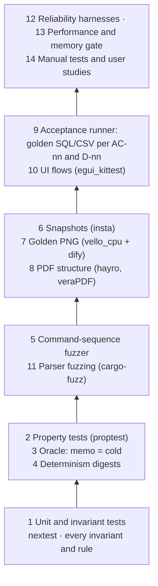
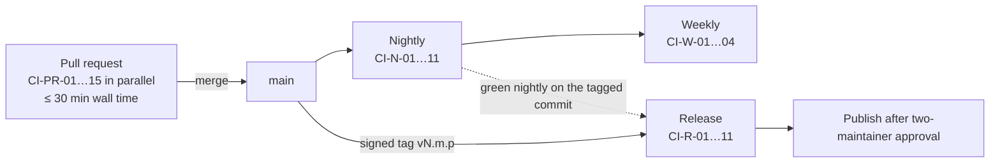
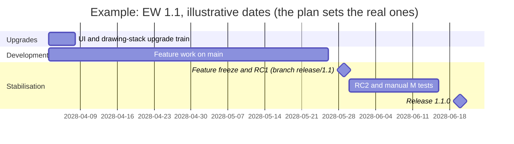
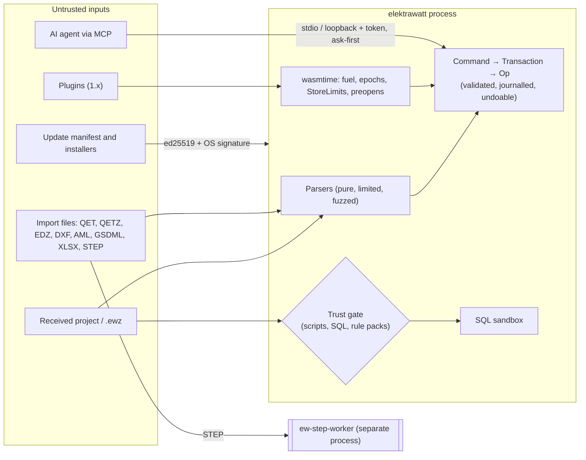

# Quality engineering, security and release

**Status:** Draft v0.1 · **Date:** 2026-10-18 (amended 2026-10-20: §3.16 cross-platform source rules; amended 2026-10-21, cycle-11 design pass: acceptance runner as built in §3.10, timing rule in §3.16 and §4.3, private pilot corpus in §4.1; amended 2026-10-21, cycle-12 design pass: acceptance counts and comparison against doc 20 data in §3.10; amended 2026-10-21, cycle-14 design pass: documents as built in §3.9, §3.10 and §3.16, blind drafter §3.17; amended 2026-10-22, cycle-17 design pass: the acceptance counts in §3.10, the fuzzer's coverage and nightly form in §3.6, the `fuzz_smoke` time in §3.14, CI-N-02 and CI-N-03 in §5.2; amended 2026-10-22, cycle-18 design pass: what the ordered-collection lint misses in §3.5, the pull-failure rule in §3.14, CI-PR-05 and CI-N-09 in §5.2, the image-digest rule in §5.4; amended 2026-10-22, cycle-19 lane C: the `disallowed-methods` rule as built in §3.5, CI-N-12 and the retired LG-2 merge block in §5.2; amended 2026-10-22, cycle-19 design pass: the scan's gaps and the sites at the integration tip in §3.5, the shell's UI tests in §3.11, the CI time after cycle 18 and the Windows cut in §3.14, the headless mode for the blind drafter in §3.17, CI-PR-02 to CI-PR-04 and CI-N-12 in §5.2, the UI crates' `rust-version` in §6.2; amended 2026-10-22, cycle 20 lane C: the supply-chain bullets of §5.4 (audit imports, version-keyed build scripts, the manifest advisory hold, x11-dl and reproducible builds) and the cargo-vet and build-script rows of §10; amended 2026-10-22, cycle-20 lane B: the cargo-fuzz crate, the deep nightly and ASan as built in §3.6, §3.12 and §5.2; amended 2026-10-22, cycle-20 design pass: the ODR justification in §3.6, the fuzz crate's PR check, deny job and NCSA exception in §3.12 and §5.4, FT-330 applied in §3.14, CI-PR-01, CI-PR-08 and CI-N-02 with the proptest budget in §5.2, the exemption count at the integration tip in §5.4 and §10; decision log ID-494 to ID-500; amended 2026-10-22, cycle-21 design pass: the canvas bench families in §4.2, the owner's ruling on performance runs and the bench-failure rule in §4.3, the canvas bench in §4.7, decision log ID-512, ID-518, ID-520; amended 2026-10-22, cycle-22 design pass: a test's program boundary in §3.5, the `renderer` words, the `HumanOnly` refusal and the WP-S2.03 vocabulary in §3.17, the CI time after cycles 20 and 21 in §3.14, the GPU bench families and `EW_REQUIRE_GPU_ADAPTER` in §4.2, FT-353 as built, the adapter in the test jobs, the required-check names and the golden change list in §5.2, the lyon exemptions and the count of 387 in §5.4, the first `fuzz-smoke` finding in §3.12; decision log ID-537, ID-540, ID-542, ID-543, ID-546, ID-548, ID-549, ID-551, ID-552; amended 2026-10-23, cycle-23 design pass: the viewer's headless actions and the transcript's `navigator` member in §3.17, the viewer's kittest flows in §3.11, the tile-count rule in §3.14, the CI time with the split proven, the two CI hotfixes and their lessons and the first Linux B2 proof in §3.14 and §5.2, the SVG row TM-18 in §11.1, `PRIVACY.md`, the stored-data table and the lock row in §12.1; decision log ID-556, ID-557, ID-559, ID-560, ID-576, ID-579 to ID-582; amended 2026-10-24, cycle-24 design pass: WP-S2.03 part 2's headless actions, transcript members and vocabulary in §3.17, the CI time of the cycle-23 delivery in §3.14, usvg's six audits in §5.4, TM-18 as built and hardened in §11.1; decision log ID-586, ID-588, ID-605, ID-606; amended 2026-10-24, cycle-25 design pass: WP-S6.13 specified in §3.17 (the harness, the gate run kind, `page.describe`, `--keep-going`, the pinned reference files); decision log ID-610 to ID-619, the fix round ID-621 to ID-624) · **Part of:** ElektraWatt design document set

**Purpose.** This document specifies how ElektraWatt (EW) proves its correctness, performance and security, and
how it is built, signed, shipped and supported. It turns the architecture's "prove it in CI" principle
([architecture](04-architecture.md) §1.2 (10), §13) and the quality targets of
[02c](02c-nonfunctional-requirements.md) into test layers, gates, CI jobs, release rules, packaging, signing,
supply-chain controls, a threat model, a privacy design and an EU Cyber Resilience Act (CRA) position. Other design
documents refer to "the CI job in 18": this document owns those pipelines.

**Contents**
1. [Scope and boundaries](#1-scope-and-boundaries)
2. [Concepts and data](#2-concepts-and-data)
3. [Test strategy](#3-test-strategy)
4. [Performance and memory gate](#4-performance-and-memory-gate)
5. [CI pipeline](#5-ci-pipeline)
6. [Toolchain, MSRV and the upgrade train](#6-toolchain-msrv-and-the-upgrade-train)
7. [Release process](#7-release-process)
8. [Packaging per OS](#8-packaging-per-os)
9. [Signing, provenance and updates](#9-signing-provenance-and-updates)
10. [Supply chain](#10-supply-chain)
11. [Security process](#11-security-process)
12. [Privacy](#12-privacy)
13. [EU Cyber Resilience Act readiness](#13-eu-cyber-resilience-act-readiness)
14. [UI/UX touchpoints](#14-uiux-touchpoints)
15. [Outputs](#15-outputs)
16. [Edge cases and pitfalls](#16-edge-cases-and-pitfalls)
17. [The reference project in the quality system](#17-the-reference-project-in-the-quality-system)
18. [Scope by release](#18-scope-by-release)
19. [Dependencies](#19-dependencies)
20. [Requirements covered](#requirements-covered)
21. [Open questions](#open-questions)

---

## 1. Scope and boundaries

| Topic | Specified here | Specified elsewhere |
|---|---|---|
| Test layers, harnesses, CI jobs, gates | All | Golden fixture content, `expected/*.csv`, AC-nn: [20](20-golden-project.md); kittest flow content: [16](16-ux-ui.md); fault-injection design: [05](05-project-format-and-persistence.md); fuzz targets and corpora per format: [14](14-interop.md) §11–§12, [10](10-plc-and-bus.md), [12](12-panel-layout.md) |
| Performance | Fixture generator, measurement, gate | Budgets: 02c §2 |
| Security | Threat model, vulnerability process, `unsafe` policy, supply chain, signing | Trust store: 05 §13.4; trust prompt, MCP, plugin sandbox: [17](17-extensibility.md); parser limits: 14 §11 |
| Privacy | Data flows, network sandbox, crash and log handling | First-run privacy step: 16 §9.1; personal-data export option: [09](09-reports-forms-output.md) |
| Release | Cadence, versioning, packaging, updates, support | Format version rules: 05, ADR-0011; steward entity and governance: [19](19-open-source-governance.md) |
| CRA | Role analysis, obligations mapped to evidence | Legal-entity decision: ADR-0030, 19 |

**Terminology.** In this document "release" means a release of the EW software. Releasing a drawing revision is a
*revision release* ([15](15-checks-revisions-collaboration.md) §5.5). "GP" is the golden project (Golden A unless a
variant is named). Verification codes PR, N, R, M, S and A are those of 02c §1.2; **N-weekly** is a weekly subset of
N.

---

## 2. Concepts and data

### 2.1 Quality artefacts

None of these is project model data. They are repository, CI or local diagnostic data.

| Artefact | Location | Format | Owner | Rule |
|---|---|---|---|---|
| Golden fixtures A, B, A-R | `golden/J-E-2416.ew/` (project fixture); `golden/J-E-2416/` (`tables/`, `resolutions/`, `history/`, `expected/`, `acceptance/`, `variants/`, `basic-project/`) | JSONL, CSV | 20 | Regenerated in the same commit as `tables/` (20 §3.1, §3.2) |
| Golden C input and the reference PDF | Private store, reachable only by CI-N-10 | `.qet`, PDF | 20 | Never in the public repository (20 §3.5) |
| Synthetic fixtures S, M, L, XL, XL-A | Generated by `ew-testkit gen`, cached by (generator version, GP hash) | JSONL | Here | Never committed (XL-A is about 250 MB) |
| Format fixture corpus | `fixtures/format/<format>/` | One project per released format | 05 | Never deleted (NFR-REL-05) |
| Snapshots | `crates/*/tests/snapshots/` | insta `.snap` | Crate owner | Reviewed per change (§3.7) |
| Approved PNGs | `golden/J-E-2416/expected/png/`, `library/expected/png/` | PNG, 150 dpi | 20, library maintainers | First approval in a private session (20 §3.3) |
| Performance history | `perf-history` store (orphan branch or artefact bucket) | JSON Lines, one row per (run, benchmark, class, metric) | Here | 90 days rolling, plus every release run kept |
| Fuzz corpora | Separate repository `ew-fuzz-corpus` | Binary inputs | Here | Minimised weekly; crashes become committed regression inputs |
| Hostile corpus | `tests/hostile/` | Own files, CC0 | 14, here | Committed |
| Threat model | `docs/security/threat-model.md` | Markdown, TM-nn rows (§11.1) | Here | Reviewed every minor (NFR-SEC-01) |
| Release evidence | Release assets | CycloneDX JSON, Sigstore bundles, `SHA256SUMS` plus signature, notices | Release pipeline | Permanent |
| Update manifest | Project web site, `update/v1/<channel>.json` plus `.sig` | JSON | Release pipeline | Per release (§9.3) |
| Crash report | OS state directory, `crashes/<id>/` | Minidump, log tail, `report.json` | Application | 30 days or 20 reports (§12.3) |

### 2.2 Relationship to the domain model

- **One mutation path.** Harnesses drive projects only through the `Session` API (ARCH §5.1): the same
  `Command → Transaction → Op` path as users. `ew-model` tables are `pub(crate)`, so a test cannot corrupt a model
  behind the invariants (NFR-MAINT-01).
- **Stable test IDs.** `ew-ids` offers a seeded UUIDv7 generator behind a `testkit` feature: the timestamp comes from
  a counter and the random bits from a seeded ChaCha stream. Snapshots and digests therefore contain stable IDs.
  The release pipeline asserts that the feature is absent (CI-R-09).
- **Personal data.** `Party.personal_data` ([03](03-domain-model.md) §5, FR-PRJ-024) feeds the crash scrubber's
  token set (§12.3) and the "omit personal data" export test (NFR-PRIV-06).
- **Derivation profiles** (ADR-0003). Every shipped profile has its own `expected/` set, so the golden outputs are
  tested per profile (NFR-REL-09).
- **Committed computations** carry an `input_hash`. The determinism tests include routing (1.0), so the hash must be
  identical on every platform, or EW-LAY-011 would flag lengths as stale after a checkout on another OS.
- **Test-build hooks.** Two features exist only for tests: the seeded ID generator above and the confirmation hook
  of `HumanOnly` subcommands (§3.15). The release pipeline asserts that both are absent (CI-R-09).

---

## 3. Test strategy

### 3.1 The pyramid



| # | Layer | Tool | Scope | Cadence | Main requirement |
|---|---|---|---|---|---|
| 1 | Unit, invariant, rule | cargo-nextest 0.9.148 | Per crate; one test per invariant of `ew-model/invariants.md`; positive and negative fixture per rule | PR | NFR-MAINT-06 |
| 2 | Property | proptest 1.12.0 | Algebraic laws (§3.3) | PR 256 cases; N 20,000 | NFR-REL-04, NFR-REL-08 |
| 3 | Oracle differential | `ew-testkit::oracle` | Memoised = cold after each transaction (§3.4) | PR sampled on GP; N all memos | NFR-REL-08 |
| 4 | Determinism | `ew-testkit::digest` | Order, threads, platform, locale, clock, path (§3.5) | PR (Linux); N (cross-platform) | NFR-REL-07, NFR-I18N-03 |
| 5 | Command fuzzer | cargo-fuzz 0.13.2, `arbitrary` | Random command streams with oracle, undo and round trip (§3.6) | PR 60 s; N 1 h | NFR-REL-08 |
| 6 | Snapshots | insta 1.49.0 | Typed query outputs, import batches, exports, engine statistics | PR | NFR-REL-09, NFR-PERF-20 |
| 7 | Visual | vello_cpu 0.3.0, dify 0.8.0 | Every golden page and every shipped symbol | PR | FR-EXT-004, FR-OUT-014, FR-OUT-018 |
| 8 | PDF structure | hayro 0.8.0; veraPDF (external CLI) | Outline, links, labels, fonts, dates, PDF/A-2b; PDF/UA-1 at 1.0 | PR (path-filtered), N | FR-OUT-002, FR-OUT-004 … FR-OUT-009 |
| 9 | Acceptance | `cargo xtask acceptance` (as built; `ew-testkit accept` is the target form) | AC-01 … AC-42 and the D-nn rows of 20 §19 (§3.10) | PR (gate subset); R (all reached) | 20 §21 |
| 10 | UI | egui_kittest 0.37.0 | Flows of 16; accessible-name walker; CVD, contrast, pseudo-locale, 300 % | PR | NFR-A11Y-01 … 04, NFR-I18N-02 |
| 11 | Parser fuzzing | cargo-fuzz 0.13.2 | Every parser of external bytes (§3.12) | PR ≥ 60 s per changed target; N ≥ 30 min per target | NFR-SEC-02, NFR-SEC-03 |
| 12 | Reliability | Fault injector, kill loop, soak | Save, journal, recovery, worker crashes | PR (failures), N, N-weekly (soak) | NFR-REL-01 … 03, NFR-REL-12 … 14 |
| 13 | Performance | criterion 0.8.2, puffin 0.20.0 | §4 | PR (exact counts); N (timings) | NFR-PERF-01 … 20 |
| 14 | Manual, studies | Protocols | RDP without GPU, screen readers, printers, installers, usability | M, S | NFR-PLAT-03, NFR-A11Y-02, NFR-UX-01 |

### 3.2 Unit, invariant and rule tests

- **Invariants.** Each invariant ID has a test that builds the violating transaction and asserts the outcome.
  Structural invariants reject the transaction. Prevent rules reject it in strict mode and yield a message in lenient
  mode. Example for D-11: `SetFields{terminal: -X1031:8, designation: ""}` is rejected in strict mode, and the lenient
  QET import reports it as MF-08.
- **Swaps.** Transaction-end evaluation is tested directly: swapping the designations 3 ↔ 4 on -X1031 in one
  transaction commits, while setting 3 to "4" alone is rejected (D-12).
- **Exhaustiveness.** The field-mask test of ARCH §4.1 fails when a link field is added without an index
  declaration. A schema test fails if `Page` gains a revision or title-block text field (D-05, D-06).
- **Rules.** Every shipped rule has a positive and a negative fixture, and its `docs` reference resolves (NFR-DOC-02).
  A deliberately slow test rule must be demoted to deferred (NFR-PERF-09).

### 3.3 Property tests

The generator `ew-testkit::gen::command()` produces commands that are valid against the current snapshot: targets
are chosen by index into the live tables. When a law fails, proptest shrinks the sequence to a minimal one. The
harness prints it as an `.ewcmd` script in the builder DSL of 20 §3.2, so the failure becomes a regression fixture by
copying one file.

| Law | Checked on |
|---|---|
| `undo(all) ∘ apply(cmds) = id`, for the model digest and every derived digest | GP, S |
| `load(save(m)) = m`, and `save(load(save(m)))` byte-identical to `save(m)` | GP, QET corpus, S |
| Incremental saves after every step are byte-identical to a full save of the final model (NFR-REL-16) | GP; M nightly |
| `merge(o, a, a) = a`; `merge(o, o, b) = b`; for disjoint edits `merge(o, a, b) = merge(o, b, a)` | GP branches |
| preview + commit = execute; journal replay = live state | GP |
| Renumbering keeps every `Id` reference; the tag map old → new is a bijection | Golden B steps |
| Re-importing the same source yields identical IDs and an empty diff (FR-IMP-002) | QET corpus |
| A hit-test result lies in the item's bounding box; a routed length ≥ the Euclidean distance (1.0) | S, layout fixture |

*As built (cycle 16; decision log ID-405).* The model-level property tests of `ew-model` (`src/tests/props.rs`) generate
batches of steps over a fixture with named rows. **A step whose fixture row is gone is a no-op**: a generated step that
names a fixture row (an FnDef copy, a page, a location node) which an earlier delete plan of the sequence removed is
skipped, not issued, because the model rightly refuses it and the generator's "rejected unexpectedly" assertion would
report a test defect as a model defect (the cycle-15 gate finding: `AddAuxFunction` after the FnDef copy had been
removed). Proptest regression seeds are committed (`proptest-regressions/`) with the crate's SPDX header, which the
licence-map check requires of every committed file, and every shrunk counterexample also becomes a named,
deterministic replay test.

### 3.4 Oracle differential: memoised versus cold

The oracle catches the architecture's top risk: a stale memo silently recreating the D-01 class (ARCH §16, risk 1).

```text
after Session::commit(tx) in oracle mode:
  keys := memo keys read by the view-models of this frame
        ∪ sample(all live memo keys, k, seed = (run_seed, rev))      # PR: k = 64; nightly: k = all
  for key in sort(keys):
    memo := memo_store.get(key)                       # may verify, re-execute or hit
    cold := Q::cold(snapshot).eval(key)               # fresh request-scoped cache, no memo store
    if memo != cold:                                  # Eq, or 128-bit hash for bulky values
      fail(OracleMismatch { tx.command, key, diff(memo, cold),
                            trail: explain(key) })    # same output as `ew query --explain`
```

- **PR:** the AC-16 script on GP (rename T55, move -102F2 by one cell, renumber folio 103 → 104, change the 24 V DC
  colour), followed by 500 generated commands.
- **Nightly:** every memo on every fixture up to M, plus the command-fuzzer stream.
- **Policy changes.** A PR that promotes a query to `Memo` (ARCH §6.1) runs the nightly-level oracle on GP and S
  before merge.
- **Developers and users.** Debug builds run the oracle with k = 8 on every commit. `ew verify-derived` is the
  user-facing equivalent (FR-EXT-005).

### 3.5 Determinism

| Variation | Method | Compared | Cadence |
|---|---|---|---|
| Record order | The loader permutes lines within each file and the file order (seeded) | JSONL after save, findings, PDF/SVG/CSV digests | PR |
| Threads and spawn order | `RAYON_NUM_THREADS` = 1, 2 and 8; job submission order shuffled | Export digests, routing (1.0), `.ewpp` (1.0) | PR |
| Platform | Same commit on Windows, macOS and Linux | SHA-256 of GP PDF, SVG, CSV, XLSX, JSONL and `.ewpp`; PNG within the dify tolerance (09 OQ 12; this relaxes the PNG part of NFR-REL-07 and FR-OUT-014, open question 9) | N; release gate (AC-14, FR-OUT-019) |
| Locale, time zone | `LC_ALL` en_US, nl_NL, de_DE, tr_TR; `TZ` UTC−10 and UTC+14 | File and PDF digests | N |
| Wall clock | Two runs with the clock faked 24 h apart; `SOURCE_DATE_EPOCH` unset | Output digests | PR |
| Build-time data | Every CI and release build asserts that `ICU4X_DATA_DIR` is unset: the build scripts of the ICU4X data crates read it, and other segmentation data would change line breaks and so every text layout (decision log ID-52). Every release build of `elektrawatt` also asserts `PKG_CONFIG=false` and no target-specific `PKG_CONFIG_*` variable, so x11-dl's build script bakes no build-host library directory into the binary (§5.4; FT-333) | The assertion itself | PR; release (CI-R-03) |
| Project path | The same project opened from two directories, one named with spaces and non-ASCII | Digests (no absolute path in any output) | PR |

**Static rules** (NFR-MAINT-12). In crates that produce persisted or exported bytes (`ew-format`, `ew-model`,
`ew-derive`, `ew-rhai`, `ew-commands`, `ew-checks`, `ew-text`, `ew-reports`, `ew-scene`, `ew-export`, `ew-plcaddr`,
`ew-caex`, `ew-plc`, `ew-panel`, `ew-ewpp`, `ew-mfg`, `ew-sqlview` and the importers), `clippy.toml` sets:
- `disallowed-types`: the hash maps and sets of `std::collections`, `hashbrown` and `imbl`. Use `BTreeMap`,
  `imbl::OrdMap`, `IndexMap` with a defined insertion order, or sorted vectors.
- `disallowed-methods`: `SystemTime::now` and `Instant::now` (except through the `ew-ids` UUIDv7 generator, which the
  `testkit` feature seeds, and the allowlisted tracing wrapper), `rand::thread_rng`, `Uuid::new_v4`, `Uuid::now_v7`
  outside `ew-ids`, and `std::env::var` outside the settings module.

*As built (cycle 18, FT-271, WP-S6.02).* The `disallowed-types` rule is workspace-wide, not limited to the output
crates, and is part of the generated root `clippy.toml` (`cargo xtask check-raw-read --bless`; the list is
`DISALLOWED_TYPES` in `xtask/src/raw_read.rs`): `std::collections::HashMap` and `HashSet`, and `imbl::HashMap` and
`HashSet`. `hashbrown` is not listed, because no workspace crate names it (a path of a crate that a package does not
load is ignored by clippy, one that does not resolve in a package that loads the crate is a warning that the lint job
turns into a failure). A use site whose iteration order never reaches a persisted, exported or printed sequence is
allowed with `#[allow(clippy::disallowed_types)]` and a one-line justification; `cargo xtask check-ordered-collections`
(the `lint` job and `cargo xtask ci`) compares those sites, keyed by crate and item path, with the reviewed list
`ci/ordered-collections-allow.toml`, so a new allow is a reviewed change (`ci/README.md`). At the introduction nine
sites in four crates allow the lint, all lookup-only; no hash container whose order reached output was found.

*As built (cycle 19, FT-317, WP-S6.02).* The `disallowed-methods` half is built the same way and is workspace-wide:
the generated `clippy.toml` lists, after the raw readers of ADR-0001 amendment 2, `std::time::SystemTime::now` and
`Instant::now`, `std::env::var`, `var_os`, `vars` and `vars_os`, `std::hash::RandomState::new` and `getrandom::fill`,
`fill_uninit`, `u32` and `u64` (`DISALLOWED_METHODS` in `xtask/src/raw_read.rs`, reasons citing this section).
`Uuid::new_v4`, `Uuid::now_v7` and the `rand` functions are listed with `allow-invalid = true` (clippy 1.99 accepts
the key without a warning, in both clippy modes): `uuid` has the `v5` feature only and `rand` 0.10 without its
`thread_rng` feature is loaded by `proptest` alone, so the paths do not resolve today and bite when a crate enables a
generator, which `check-features` bans outside dev edges (`uuid/v4`, `v7`, `fast-rng`, `rand/thread_rng`). The
randomly keyed hasher `std::hash::RandomState` is also a `disallowed-types` entry (the generator of hash order; its one
use, the lock's session ID, is a reviewed site of `ci/ordered-collections-allow.toml`). The rule is not scoped by crate or module ("outside `ew-ids`", "outside the settings module"): every use is allowed with
`#[allow(clippy::disallowed_methods)]` and a one-line justification, and `cargo xtask check-disallowed-methods` (the
`lint` job and `cargo xtask ci`) compares those sites, keyed by crate and item path, with the reviewed list
`ci/disallowed-methods-allow.toml`; it is the machinery of `check-ordered-collections` with a second rule. The lint
`disallowed_methods` is also the guard of the raw readers, and the four reader crates opt out of it at their target
roots, which would have switched the new rule off in `ew-model`, `ew-derive`, `ew-commands` and `ew-store`: for them
the check does not read allow attributes but scans the source for the calls (`SystemTime::now`, `env::var_os`, also
in a `use` group) and lists each as a site, so those crates are held to the same justification and review. At the
introduction 43 sites in 18 crates allow or list a call: 13 in production code (`ew-ids`' `SystemSource`, the one
clock and entropy source for identity; `ew-store`'s clock, lock record, session ID and state-directory lookup, none of
which is project data (NFR-REL-07); `ew-sqlview`'s monotonic query deadline; the `ew` CLI's `SOURCE_DATE_EPOCH` and
`EW_CONTENT_DIR`, with no wall-clock fallback for the creation date; the `ew-testkit` bench harness; `xtask`) and 30 in
test and bench targets (timers asserted only with `EW_PERF_ASSERT`, bless and diagnostic flags, scratch-directory
names). In production code each allow is on a one-line helper that wraps the one call (`source_date_epoch`,
`content_dir`, `deadline_now`, `class_var`, `timer_start`), so it does not also switch off the raw-read guard for a
whole body. No call reaches project data or an export, except the sanctioned `SOURCE_DATE_EPOCH`; the lock record and
the journal are persisted by design. At the integration tip of cycle 19 the list holds 45 sites in 20 crates: lane
A's shell adds two program-boundary helpers, `env_path` in `ew-viewmodel` (`EW_CONFIG_DIR` and the platform directories, read once at
start-up) and `dbus_env_path` in `elektrawatt` (the D-Bus variables of the portal heuristic), each also a counted
`[[raw_read.allow]]` entry of `ci/dep-rules.toml` (decision log ID-481).

*A test's program boundary* (as built, cycle 22; decision log ID-548, ID-542). The sanctioned sources of environment
reads gain a third place beside the ID generator and the production program boundary: the boundary of a test binary,
where the test run's own configuration enters. Two uses exist, both reviewed allow sites of
`ci/disallowed-methods-allow.toml` on one-line helpers. (1) `bin_exe()`, one per test crate that starts a CLI binary
(`ew` one site, `elektrawatt` three): it reads `NEXTEST_BIN_EXE_<name>` at run time, so the path follows a run from
an archive (the Windows jobs, §5.2, CI-PR-03), and falls back to `env!("CARGO_BIN_EXE_<name>")` for
`cargo test`, marked `// bin-exe-fallback`; a guard test of `xtask` fails on the bare `env!` form without the marker.
(2) `adapter_required()` in the GPU tests of `ew-render2d` and `ew-ui` (one site each): it reads
`EW_REQUIRE_GPU_ADAPTER`, the switch of §4.2 that turns a missing graphics adapter from a skip into a failure. Neither
value reaches a persisted, exported or printed result.

*What the scan misses* (cycle 19; decision log ID-481). The source scan of the four reader crates is lexical: it does
not see a call through an alias or a re-export, a fully qualified `<SystemTime>::now`, a call produced by a macro, or a
second call under one counted `use` import. In every crate the list does not name `RandomState::default` (the
`disallowed-types` entry for `RandomState` covers it), `std::env::temp_dir`, `current_dir` and `home_dir`, which read
the environment, or `std::process::id`. Review covers these until FT-329: per-reader-crate `clippy.toml` files (the
mechanism of ADR-0001 amendment 2) let the reader crates drop their root opt-out, so that clippy enforces the rule there
by path resolution, which closes the alias, qualified-path and macro gaps; the same task adds `temp_dir`,
`current_dir`, `home_dir` and `process::id` to the list.

*What the lint does not catch* (decision log ID-463). Group lints (`clippy::all`, `clippy::style`, `warnings`) and the
lint keys of a manifest, in either spelling, count as allow sites, so a broad allow cannot hide a site. Three gaps
stay and are covered by review: a hash map or set that a third-party API returns (its type is the crate's, not a
listed path); the hash containers of `hashbrown`, `ahash`, `rustc-hash` and `dashmap` (none is a dependency today; a
crate that adds one adds its paths to `DISALLOWED_TYPES`); and type aliases, which `disallowed-types` does not see
through (the one alias, `Denylist` in `xtask`, is private and on the reviewed list; `ci/README.md`).

A derive check in `ew-schema` rejects `f32`/`f64` fields in persisted records (ARCH §7.3).

### 3.6 Command-sequence fuzzer

```rust
#[derive(Arbitrary)]
enum FuzzCmd { Place { sym: u16, page: u8, x: i16, y: i16 }, Connect { a: u32, b: u32 }, Move { rep: u32, dx: i8, dy: i8 },
               Delete { idx: u32 }, Renumber { scope: u8 }, SetField { idx: u32, field: u8, val: u16 },
               InsertMacro { m: u8, page: u8 }, Undo, Redo, SaveReload, Import { batch: u8 } }

fuzz_target!(|input: (u8, Vec<FuzzCmd>)| {
    let mut s = Session::open(seed_fixture(input.0));         // GP, Golden B or S
    let d0 = s.world().digest();
    for c in input.1.iter().take(256) {
        if let Some(cmd) = c.resolve(&s.world()) { let _ = s.execute(cmd.as_ref()); }  // Err is fine, panic is a bug
        s.assert_structural_invariants();
        oracle_sample(&s, 16);
    }
    assert_round_trip(&s);                                    // save to a scratch directory, load, compare digests
    while s.undo().is_ok() {}
    assert_eq!(s.world().digest(), d0);
});
```

The corpus starts from the AC-16 script, the Golden B steps and the Golden C fix script. PR runs use no sanitizer,
for throughput. Nightly runs use AddressSanitizer, because the dependency closure contains `unsafe` code.

*As built (cycle 15, lane C; WP-S6.02).* A first fuzzer is the test `crates/ew-testkit/tests/command_fuzz.rs`, not yet a
cargo-fuzz target: a seeded SplitMix64 generator picks, by index into the live records read through `Session::query`,
`rep.move`, `rep.transform`, `fields.set`, `connection.delete`, `edit.delete`, `page.renumber`,
`numbering.renumber`, `junction.edit`, `terminal.designate`, `connection.draw`, `potential.define`, undo and redo over
Golden A (path (a), oracle mode, the shipped prevent rules). After every changing step it runs
`Model::integrity_check` (the full structural check against the engine's incremental one) and a sample of memoised
reads whose oracle mismatches must be empty; at a configurable cadence the pre-delivery check (no `EW-TERM-002`
finding the project did not already have, i.e. none slipped past the prevent hook) and `verify_derived`; at the end
every step is undone and the model must equal the initial one. A failure prints the seed, the step and the command
log. `fuzz_smoke` (2 seeds × 30 steps, sampled oracle, integrity and undo-all) runs in the targeted tests;
`fuzz_long` is `#[ignore]`d (`EW_FUZZ_SEEDS`, `EW_FUZZ_STEPS`). A first run of 20 seeds × 200 steps (2,324 commits,
426 undo/redo) found no defect. The fuzzer picks its targets by index into the live records, so the no-op rule of §3.3
holds by construction.

*As built (cycle 17, lane B; FT-272, FT-279).* The test is now the directory `crates/ew-testkit/tests/command_fuzz/`
(`arms.rs`, `live.rs`, `step.rs`, `roundtrip.rs`, `import.rs`, `rng.rs`, `main.rs`). **Every registered command** (37,
`revision.create` and `fields.set`/`edit.delete` on revisions included) has a generator arm (`ARMS`); `every_registered_command_has_a_generator_arm` compares the table with the registry and
fails with a message that names the commands without an arm, so a command added later (the `revision.*` commands) fails
it until its arm exists. Each arm mixes well-formed steps, which the model must commit (`Verdict::Accept` where the
generator models every refusal rule, `Either` where prevent rules or invariants may refuse), malformed steps, which it
must refuse without changing anything (an absent record, an off-grid position, a duplicate key, a cycle, a wrong
hash), and after-commit checks (the counts of the records the command creates, the primary record, field values);
`every_arm_commits_and_refuses_what_it_should` runs this validity oracle for every command on Golden A. The step set
gained the **save-and-reload round trip** (create once, then incremental saves; a reader reopens the directory; no
open-report finding, `Model::content_eq`, the derived families equal, every family on the deep cadence; after the
closing undo-all a run that saved saves again and must reload the initial model) and the **CSV table import** (the
golden tables intact or damaged, strict and lenient: the batch always loads into a model, lenient differs from strict
only in foreign colour codes, the intact tables give the records of path (a)). An Accept step that commits as a no-op meets the same after-commit checks, so an expected count change on a no-op is
a finding; the save-and-reload comparison includes the title block's revision label. Not built: **macro insertion**,
because no `macro.insert` command or macro record exists yet (FR-MAC-005; FT-305). The nightly form is `fuzz_long` with
seeds × steps from `EW_FUZZ_SEEDS` and `EW_FUZZ_STEPS` (and the cadences, the step mix, `EW_FUZZ_BUDGET_SECS` and
`EW_FUZZ_REPORT`), run by `.github/workflows/fuzz.yml` (03:47 UTC and on dispatch) in the release profile with debug assertions and
overflow checks on, by default 12 seeds × 200 steps from a seed range that changes every night, with no new seed after
75 minutes; it is red for a finding, a failed build, a seed that was still running when the run ended (a hang or an
abort) and a missing verdict (`ci/README.md`; decision log ID-434, ID-435). In the catalogue of §5.2 it is the
command-fuzzer part of CI-N-02; `fuzz.yml` runs it on the stable toolchain without ASan, and the deep nightly runs it
again under ASan (below). `fuzz_smoke` takes 15 to 19 s in a debug build (12.5 s before cycle 17), on the Windows test
job's critical path (§3.14, FT-306).

*As built (cycle 20, lane B; FT-297, FT-304, FT-272 closed).* The cargo-fuzz form of the fuzzer is the target
`command_sequence` of the new crate `fuzz/` (§3.12; `fuzz/README.md`). Its input is a seed, a step count (1 to 8) and a
tape of bytes: the generator of the test above is included as it is (the modules of `command_fuzz` through
`#[path]`), and every draw of its SplitMix64 stream is XORed with the next eight tape bytes (`SplitMix64::with_tape`),
so that libFuzzer's mutation of one byte changes one draw and its coverage feedback steers the sequence; a tape of zeros
is the plain seeded run. The run is `fuzz_long`'s with a cheap cadence: the structural check after every changing step,
the validity oracle of every command, the save-and-reload round trip and the closing undo-all (the undo law). The memo
sample, `verify_derived`, the prevent check and the CSV imports are left to the test (a sample reads the derived values
cold in oracle mode and costs seconds against the milliseconds of a step), so the target runs about two inputs a second
in a sanitized build. **ASan** (FT-304) is on in two forms, both in `.github/workflows/deep-nightly.yml` on the nightly
toolchain pinned by date in `fuzz/rust-toolchain.toml`: the cargo-fuzz targets (AddressSanitizer is cargo-fuzz's
default) and the test `fuzz_long` itself, built with `RUSTFLAGS=-Zsanitizer=address` for `x86_64-unknown-linux-gnu`
and run with the seeds, steps and budget variables of `fuzz.yml` (a range offset from `fuzz.yml`'s, 100 steps, 55 minutes: AddressSanitizer makes a seed 7.7 times slower, so a night runs about four). This is
CI-N-02's "command fuzzer 1 h with ASan". `detect_odr_violation=0` is set because AddressSanitizer reports a false ODR violation for
`aiOff` of the bundled SQLite (one copy is linked; `sqlite3.c` has two identical function-local `aiOff` tables, the FTS3
and FTS5 case folders, which the linker merges into one address). The job is red for what `fuzz.yml` is red for and for an AddressSanitizer report.
*The justification (decision log ID-495).* The suppression was allowed only after the report was proved false, because a
real second SQLite copy would be a data-integrity defect (two copies with separate state over one database file):
`nm` shows the two read-only symbols `aiOff.4` and `aiOff.13` at one address, `Cargo.lock` and `fuzz/Cargo.lock` hold
one `libsqlite3-sys` 0.38.2 each, and the binary has one `sqlite3_open`. Level 1 (`detect_odr_violation=1`) reports only
size mismatches, so it would keep the equal tables silent and still catch a second copy of another version; a trial on
a dispatch run is FT-343. *As built (cycle 21, FT-343).* The dispatch input `asan_odr_level1` (boolean, default off) of
`deep-nightly.yml` sets `ASAN_OPTIONS=detect_odr_violation=1` for the `asan-command-fuzz` job's test step; a nightly and a
dispatch without it keep `=0`. The trial's verdict is the job's (an `ERROR: AddressSanitizer: odr-violation` is red); adopting
level 1 for the nightly is a change of the workflow's `ASAN_OPTIONS` once a dispatch run is clean.

### 3.7 Snapshots

- **What is snapshotted.** Typed query outputs on GP: tags, xref texts, potentials with aliases, wire properties with
  provenance, BOM rows in both modes, terminal, cable and PLC rows, check findings, engine statistics. Also import
  batches of the QET corpus, AML and PLCopen exports, DXF text and the canonical GP JSONL.
- **Format.** Row data is stored as CSV inside `.snap` files, so diffs read like report changes.
- **Review rule.** CI runs with `INSTA_UPDATE=no` and fails on any pending snapshot. A PR that changes snapshots
  carries the label `snapshots-changed`. A reviewer other than the author signs off each changed file. A change in
  an xref text, tag or wire number on GP also needs the golden owner's approval, because those values are the
  acceptance specification.

### 3.8 Visual goldens

- **Rendering.** `ew render --page <folio> --png --dpi 150` (FR-EXT-004) runs in deterministic mode: the CPU
  backend's scalar path if one exists (09 OQ 12), bundled fonts only, no system fonts.
- **Comparison.** dify against the approved PNGs, failing above 0.5 % differing pixels (20 §3.3). Per-symbol PNGs
  of the shipped library are rendered at 300 dpi.
- **Artefacts.** Diff images are uploaded as CI artefacts, and a bot comment links base, head and overlay.
- **Parity.** GPU/CPU parity samples run where the runner has an adapter (FR-OUT-018).
- **Updates.** Approved PNGs change only through the snapshot review rule of §3.7.

### 3.9 PDF structure

| Check | Method | GP expectation |
|---|---|---|
| Frame geometry | The in-repo PDF reader (`crates/ew-api/tests/page_output/pdf_read.rs`, test code, no dependency; decision log ID-343) extracts the stroked lines in printed mm, compared with `geometry/frame.json` | ±0.2 mm (AC-01) |
| Raster parity | hayro (the candidate, FT-235) rasterises each page, dify compares it with the vello_cpu PNG | Within tolerance (FR-OUT-018) |
| Outline | Entry count and titles | Front matter, sections 1, 2, 9, every folio (FR-OUT-004) |
| Links | Link annotations and named destinations | 64 xref links (one per listed item: 63 linked texts with 64 targets; a link covers the item's glyph span only) plus report back-links; every destination resolves (AC-13) |
| Page labels | `/PageLabels` | Physical page 6 is labelled "101" (D-33) |
| Fonts | Embedded, subset (`ABCDEF+` prefix), no Tahoma | AC-13 |
| Text | Extracted text keeps spaces | "SK 3110.000" (FR-OUT-008) |
| Metadata | XMP and Info dates from the model or `SOURCE_DATE_EPOCH`; document ID a hash of the export input | No wall-clock value (NFR-REL-07) |
| Conformance | veraPDF, PDF/A-2b profile; PDF/UA-1 profile at 1.0 (**verify**, 02c OQ 9) | Pass |

*As built (cycle 14; decision log ID-343):* the frame-geometry and text rows run in the headless acceptance run over the written PDF
with an in-repo reader (`crates/ew-api/tests/page_output/pdf_read.rs`: indirect objects, Flate streams, page tree,
content streams, ToUnicode maps; test code only, no dependency), not hayro: AC-01 compares the frame lines of `geometry/frame.json` per
page within 0.2 mm, AC-13 the text layer with the printed glyph runs, AC-06 the tag occurrences in it. hayro stays
the candidate for the raster-parity row (FT-235). `frame.json` now lists the stroked lines of a form's own `graphics` too (the cover's rules and project data box; pinned to [20](20-golden-project.md) §17.3 by `crates/ew-scene/tests/forms_content.rs`), so AC-01 compares 489 lines (12 pages × 30 + 1 × 14 + 23 × 5; decision log ID-358). The SVG SHA-256 printed in the AC-14 entry of the headless report is an SVG golden: a change to the SVG output re-blesses the headless report in the same commit, with the reason in the commit message, like the PDF SHA-256 (decision log ID-345). Comparing the PDF and SVG digests across platforms is FT-234 (MVP).

*As built (cycle 15; decision log ID-364, ID-370):* the metadata row holds: the document ID is krilla's hash of `ew-pdf/1 <project id> <profile> <date> <pages>[ mono] ew <version> sha256:<digest>`, the digest covering every exported page's display list, label, titles, size and destination and the pinned SHA-256 of every bundled font, so a content change changes the ID and the same content loaded any way gives the same ID; `ew export pdf golden/J-E-2416.ew` writes the digest of `expected/pdf/sha256.txt` (G-M1-01). The PDF is written to a temporary file, synced and renamed; `ew export svg` replaces its `--out` directory as a whole and refuses one that holds anything but SVG files.

veraPDF is a test tool run from a pinned container image with a checked digest. It is never distributed. The headless acceptance run (§3.10) does not require it: krilla's PDF/A-2b validator covers AC-13 there, and the veraPDF cross-check runs in the CI job that has it.

### 3.10 Acceptance runner

`ew-testkit accept golden/J-E-2416 --gate <M1|M-PP|M2|M3|M4|M5|M6>` (`MVP` and `1.0` are aliases of `M2` and `M6`; the rows per gate are those of [20](20-golden-project.md) §22 and [gates](../plan/03-gates.md) §8):
1. builds GP through the three paths of 20 §3.2 and checks their equivalence (AC-15);
2. builds the SQL projection and runs every `acceptance/*.sql`;
3. diffs the results row by row against `expected/*.csv` (natural order, exact);
4. runs the PDF checks of §3.9 and the finding comparison (rule ID, sorted targets, severity) on the JUnit output
   of `ew check --scheme pre-delivery`, which must exit 1 on Golden A while EF-01 (D-13) is unwaived (FR-EXT-002,
   AC-21);
5. writes JUnit XML and a Markdown table with one row per AC-nn and per D-nn
   (NFR-MAINT-11), and exits non-zero if any row of the requested gate fails.

The PR job runs the subset of the current milestone gate. Rows of later gates run as reported, non-blocking tests,
so progress is visible. Golden C and the migration verifier (AC-25 … AC-27) run in the private job CI-N-10.

**As built (cycle 11; decision log ID-285).** `cargo xtask acceptance <report.md> [--milestone]` replaces the
`ew-testkit accept` entry until WP-S6.01's CLI form exists. It runs the headless M1 subset as the `#[ignore]`d `gate`
test of `ew-api` through nextest with `--profile ci` (JUnit XML), with the oracle on, writes the Markdown report and
exits non-zero when a blocking entry exists. `--milestone` runs it in the release profile with `EW_PERF_ASSERT=1` and
measures AC-17; without it AC-17 is `not_applicable`. Steps 1 (path (b), the builder DSL, pending WP-S6.01) and 2
(the SQL projection, pending WP-S1.10) are not built: the SQL halves of AC-08 … AC-11 are `not_built`.

| Status | Meaning | Blocks the gate |
|---|---|---|
| `pass` | The check ran and matched | No |
| `fail` | The check ran and did not match | Yes |
| `not_built` | The feature or the comparison does not exist yet | Yes, like `fail` |
| `not_applicable` | This run cannot evaluate the entry; a reason is required, one of: headless (needs the GUI or raster approval), pilot (needs the pilot's answer or private data), external tool, BM runner (timing on the baseline machine) | No |

A criterion that passes in part is split into its own entries (one per check), so partial passes are visible. The
committed headless report `golden/J-E-2416/expected/acceptance_headless.md` is compared by the ordinary
(non-ignored) test, which runs the runner once; the ordinary tests never run it more than once (testing policy).
As built (cycle 13, WP-S1.10): step 2 runs: the runner builds the SQL projection and the SQL halves of AC-08 … AC-11 compare `acceptance/*.sql` with `expected/csv/` (pass), and an AC-15 entry compares the acceptance SQL over path (a) and path (c); path (b) stays `not_built`. Counts at the cycle-15 tip (the export job, the assembly aspect and the import modes, the builder DSL of path (b); decision log ID-390): **93 entries: 86 pass, 1 fail (AC-15 path (b): the builder DSL does not build the valve-terminal assembly, FT-169), 1 not_built (D-06 property grid, a UI entry of M-PP), 5 not_applicable; 0 oracle mismatches** (lanes A and B alone: 86 pass, 2 not_built). The runner is `cargo xtask acceptance`; an `ew-testkit accept --gate` binary would need a normal edge from `ew-testkit` to `ew-api` and is not built (owner ruling, decision log ID-387). **The "(a) ≠ (b)" gap class** (decision log ID-389): path (a) bootstraps records directly and path (b) goes through the commands, so a rule that the command surface enforces and the bootstrap bypasses shows up only on path (b); the page-type rule of [06](06-schematic-editor.md) §2.2 was the first instance (ID-385). A path (b) difference is triaged as a bypassed rule (fix the data or rule on the rule) or a command gap (a follow-up task), never by injecting records into path (b). Counts at the cycle-14 tip (the written PDF read back for AC-01, AC-06 and AC-13; the SVG export and the parallel page phase for AC-14; the cover; the per-edit verify of AC-16; decision log ID-360): **92 entries: 81 pass, 0 fail, 6 not_built (AC-07 assembly, AC-15 path (b), D-06 property grid, D-17, D-36, D-41), 5 not_applicable; 0 oracle mismatches**. AC-16 applies `variants/ac16-freshness.ewcmd` edit by edit in one session with the oracle on (one memoised read in 8 re-run cold) and runs the `verify-derived` sweep after every edit, requiring the memoised snapshot to equal the cold one byte for byte (decision log ID-357). AC-14's record-shuffle entry is evaluated on the platform of the run (the gate platform is Linux). Counts at the cycle-13 tip (wire numbering, the SQL projection v0, the PLC records and the DP bus potential; decision log ID-338): **85 entries: 61 pass, 0 fail, 18 not_built, 6 not_applicable; 0 oracle mismatches**. Counts at the cycle-12 tip: **83 entries: 51 pass, 2 fail, 24 not_built, 6 not_applicable; 0 oracle mismatches** (decision log
ID-320). Its 2 fails, the M1 gap list of [20](20-golden-project.md) §22, closed in cycle 13: AC-03 page order (36 of
36 folios with the PLC channel records, FT-111) and AC-10 (19 of 19 potentials with the Bus connections, FT-105). Acceptance criteria compare against doc 20's data (committed expected files generated from doc 20), never
against the importer's own output (decision log ID-320).

*As built (cycle 15, lane C; WP-S6.01).* Step 1's path (b) exists: `ew_testkit::golden` holds both golden builders, `bootstrap` (path (a)) and `build` (path (b)), which issues one command per record of the bootstrap batch (its typed description) from the project shell (the project row and the embedded library copies, which no command creates yet) through a `CommandSink`, a function from a command name and its JSON parameters (the command-log form of doc 17 §3.5) to the created keys. `ew-testkit` keeps `ew-api` and `ew-commands` as dev-only edges; the runner in `ew-api`'s tests implements the sink over its `Session` (`ew-api` → `ew-testkit` is a dev edge). What no command writes is listed, never injected. The AC-15 path (b) entry compares the six acceptance SQL files and `bom_parts.csv` over the built project by content (`bom_assembly.csv` excluded until FT-169), with the page-type rule amended by the owner ruling on decision log ID-55 (graphic representations on MultiLine and BusTopology pages, multi-line ones on Fluid pages); the six SQL results match, the parts list does not until the valve-terminal assembly can be built (FT-169), so the entry fails and the counts are 93 entries: 86 pass, 1 fail, 1 not_built (D-06), 5 not_applicable. A representation the command layer refuses fails the entry. Owner ruling (cycle 15): no `ew-testkit accept --gate` binary and no normal edge from `ew-testkit` to `ew-api`; WP-S6.01's runner deliverable is `cargo xtask acceptance`.

*As built (cycle 16; decision log ID-392 to ID-401).* **AC-15 path (b) passes.** With the seven commands of the
device tree, the PLC records, the supply origin and library copies, the builder issues 606 commands of 23 names from the
project shell (the project row and the library copies): the valve-terminal assembly (`assembly.attach`, `valve.add`,
the `assembly` aspect), the PLC configuration project, the `plc_station` and `plc_module` aspects (normaliser N1
creates the 56 channels), the 28 coil bindings, the 8 device links and the supply origin. The entry compares the six
acceptance SQL files and both BOM exports (`bom_parts.csv` and `bom_assembly.csv`; the cycle-15 exclusion is removed);
a test of `ew-testkit` compares path (b) with path (a) record for record, both ways, up to the minted IDs (`source_ref`,
the import lineage and the project lineage aside; `extra` compared). `Built::unwritten` holds only the 2 revisions, a
reserved kind no command can create (FT-165, a D5 package of its own, ID-400). Counts at the cycle-16 tip:
**93 entries: 87 pass, 0 fail, 1 not_built (D-06 property grid, a UI entry of M-PP), 5 not_applicable; 0 oracle
mismatches**: the headless M1 acceptance list is complete apart from the UI entry.

*As built (cycle 17; decision log ID-433, ID-438).* `revision.create` writes the 2 revisions (FT-165), so
`Built::unwritten` is empty and path (b) issues 608 commands. A second D-05 entry checks that no page record holds a
revision value, and D-06's property-grid entry is `not_applicable` at the headless M1 gate (ID-422). Counts at the
cycle-17 tip: **94 entries: 88 pass, 0 fail, 0 not_built, 6 not_applicable; 0 oracle mismatches**: no entry blocks
the headless M1 gate.

**PDF/A-2b** (decision log ID-287): AC-13's conformance passes through krilla's PDF/A-2b validator
(`Conformance::PdfA2b`) in every run; the veraPDF cross-check of §3.9 is `not_applicable` in the headless run
(external tool) and runs in the CI job that has veraPDF.

### 3.11 UI tests

egui_kittest drives `ew-ui` in-process over GP. The flow content belongs to [16](16-ux-ui.md) (AC-28, the five core
tasks of NFR-A11Y-01, Escape cancelling every tool for NFR-UX-07). This document provides the jobs:
- **Interaction tests** run without rendering on all three OSs.
- **Image snapshots** run on Linux with a pinned Mesa lavapipe and on the Windows WARP job (**verify** kittest's
  wgpu path on both).
- **Accessible-name walker.** It traverses the AccessKit tree after each flow step and fails on any interactive node
  without a name.
- **Other jobs:** CVD-simulated renders of folio 102 with 24VDC-1 highlighted; a contrast lint over theme tokens; the
  pseudo-locale build (+35 % length); keymap reachability per layout; 300 % scale snapshots.
- **Watchdog.** A `tracing` subscriber fails any test in which a UI-thread span exceeds 100 ms (NFR-PERF-19).

*As built (cycle 19, WP-S2.01 part 1; decision log ID-473, ID-474).* The shell's tests are ordinary nextest tests of
`ew-viewmodel` (37: the registry invariants, the shell transitions on a copy of Golden A, settings, the UI-script
parser), `ew-ui` (22: kittest interaction flows without rendering, each followed by the accessible-name walker, and unit
tests of the render worker, the keys and the fonts) and `elektrawatt` (12: the headless smoke script through the built binary with the snapshot of folio
103 against the golden PNG and the PDF against the committed digest, byte-identical transcripts, `--record`, and
`--smoke`); they run in the three test jobs with no workflow change and need no display or GPU. Image snapshots, the
watchdog and the other jobs of this list are WP-S2.11. The macOS build and kittest run first on CI at the cycle-19
delivery.

*As built (cycle 23, WP-S2.03 part 1; decision log ID-556, ID-559).* The viewer adds three kittest flows and four
headless checks (V6, V7, V8, V12) whose transcripts and snapshots are byte-identical between runs (§3.17). V10 is the
exact counts of the multi-canvas host while a script runs `nav.next_link` and then follows, goes back and goes forward
(each must succeed at least once, not only run); V11 is the retention of hidden canvas tabs (FT-356): a tab returned
to draws complete in its first frame; V12 is the viewer without a pointer (Go to, links, Back, tabs, side by side, the
navigator and the grid cursor with its AccessKit announcement), with the accessible-name walker after every step. A
kittest assertion on tiles follows the rule of §3.14: it never counts tiles by delivery timing.

### 3.12 Parser fuzzing and hostile input

- **Targets.** Every target listed in 14 §11 (`qet_project`, `qetz`, `edz_7z`, `edz_zip`, `dxf`, `table_xlsx` …),
  plus the AML, GSD, GSDML and IODD targets of 10, the JSONL loader and migration chain, `.ewz`, the merge driver and
  textconv (git runs both automatically on fetched content), the STEP IPC decoder, the `.ewpp` package reader and
  the machine feedback and status-log parsers (13 §11.3, 1.x), the SQL sandbox (hostile SQL text against the
  authorizer) and rhai formula evaluation under its limits. The limits themselves are FR-IMP-005 and NFR-SEC-02
  with the per-parser values of 14 §11.
- **Properties per target.** No panic. The batch validates against the `ew-schema` JSON Schemas. `ApplyImport` on an
  empty project either commits in lenient mode or refuses with a report, and never violates a structural invariant.
- **Resource limits.** A counting global allocator in fuzz and hostile-corpus builds measures peak allocation
  independently of the OS. A target fails above 256 MB extra or 1 s per input (NFR-SEC-02).
- **Hostile corpus**, committed and CC0: a ZIP bomb, a nested 7-Zip bomb, a billion-laughs DTD, an archive entry
  named `../../x`, an absolute or drive-letter entry, a QET file with a NaN coordinate, a QETZ database with a trigger
  and a view, and a GP copy whose page file is a symlink (NFR-SEC-16).
- **Toolchain.** cargo-fuzz needs nightly, so `fuzz/rust-toolchain.toml` pins a dated nightly, advanced by the upgrade
  train (§6.3).
- **As built (cycle 20, lane B; FT-297).** The crate `fuzz/` (GPL-3.0-or-later, `publish = false`, outside the
  workspace: its own `[workspace]`, listed under `exclude` in the root manifest, so no stable-toolchain step sees it;
  `cargo-fuzz` 0.13.2, nightly 2026-10-08) has three targets: `jsonl_loader` (arbitrary bytes through
  `ew_format::{Manifest::parse, plan, load}`: no panic, a parsed manifest survives its text form, a valid input
  renders to files that load again without a finding and with the same records, and the canonical rendering is a
  fixpoint of load and render), `migration_chain` (the golden project with its records changed into the shapes an older
  build or a hand edit leaves, opened by `ew_store::Store::open`: no panic, the model passes the integrity check, and
  when the session can edit, a save without an edit succeeds, a second save writes nothing and a reader opens the
  result with an equal model and nothing left to rewrite) and `command_sequence` (§3.6). The format's own upgrade chain
  (WP-S1.17) is not built; the target covers the open path that reads an older project of the same format (the typed
  revisions, ADR-0011 amendment 4) and joins the chain when it exists. Seed corpora of 33 small inputs made from the
  golden project are under `fuzz/corpus/<target>/`; a finding is committed under `fuzz/regressions/<target>/` and
  reported, not fixed with the change that finds it. The counting allocator and the 256 MB and 1 s limits per input of
  the first bullet are partly met: libFuzzer's own limits (`-rss_limit_mb=4096`, `-timeout=120`) bound an input, the
  counting allocator is not built. An input of `migration_chain` that changes only the files' shape (member or line
  order, CRLF, a BOM, a missing final LF, a blank line) must open with a model `content_eq` to the golden project's, so
  the open of an old shape is lossless, not only idempotent. libFuzzer stops at the first panic; `fuzz/tests/replay.rs`
  replays `fuzz/regressions/` with the seed and step context.
- **The crate in CI** (decision log ID-496). On every pull request the `lint` job (CI-PR-01) and `cargo xtask ci` run
  `cargo fmt --check`, `cargo check` and `cargo clippy -D warnings` on `fuzz/Cargo.toml` from the repository root, where
  rustup takes the stable toolchain, so a workspace change that breaks the crate fails the pull request; the fuzzing
  itself needs the pinned nightly and runs in the deep nightly and, for 60 s per affected target, in the pull-request job CI-PR-08 `fuzz-smoke` (§5.2, FT-335). The
  crate's own dependencies are outside the workspace's cargo-deny and cargo-vet runs (a development tool never built
  into a distributed artefact); the nightly job `fuzz-deny` checks their licences and advisories against
  `fuzz/deny.toml`, report-only (§5.4).
- **The first hosted finding (cycle 22, lane F; decision log ID-552).** CI-PR-08's first hosted run, on the cycle-21
  delivery, stopped `migration_chain` on an assertion of the lossless-open oracle; a local reproduction with the job's
  flags found 12 such inputs of two classes, and no out-of-memory, timeout, leak or panic in the loader or the store.
  (a) A BOM before a library copy made the project fail to open: the reader now strips one leading BOM in a library
  copy as it does in a JSONL file and marks the copy for rewriting ([05](05-project-format-and-persistence.md) §3.4).
  (b) The harness counted a line swap inside a pretty-printed library copy as a shape-only edit, though it changes
  the model: a line swap is a shape only in a JSONL file (`shape_only()`), and CRLF, a missing final LF and the BOM
  are file-level flags applied when a file is written, so the shape-only property no longer depends on the order of
  the edits. The three inputs are seeds in `fuzz/corpus/migration_chain/` (written by `seed_corpus.rs`, checked by
  `fuzz/tests/replay.rs`) rather than files under `fuzz/regressions/`, because each is fixed. A seed picks its file by
  index into the harness's `paths()`, so adding files to the golden project re-targets the seeds; the replay test's
  `shape_only` assertions catch part of that drift, not all of it. The re-run after the fix (12 workers for 15
  minutes, about 16,000 runs, no finding) is a smoke result, not a coverage claim. The review accepted the fix
  without changes. The job's verdict step
  worked as designed. Its `::error::` annotation does not name the class of a finding, and the log and the uploaded
  artefact need repository admin rights, so a contributor without them cannot tell a crash from an out-of-memory
  stop: FT-370 puts the artefact's prefix (`crash`, `oom`, `timeout`, `leak`) into the annotation.
- **Release rule.** An open fuzz crash blocks the release (RC-02).

### 3.13 Reliability harnesses

These harnesses are designed in 05 and run here:
- the fault injector: 1,000 kill points per file system on ext4, NTFS and APFS (NFR-REL-01, N);
- ENOSPC and EACCES injected at each save step (NFR-REL-03, PR);
- a `kill -9` loop at 10 commits/s with replay comparison (NFR-REL-02, N);
- a forced-panic test on the UI thread that expects a minidump, a log and a recovery offer (NFR-REL-13, PR), and
  one inside an import job that expects a failed job, a crash record and a running session (§12.3, NFR-REL-12, PR);
- a hostile STEP input that kills the worker and a non-terminating rhai script, each with an unchanged model digest
  (NFR-REL-12, PR);
- release fault injection: `ew revision release V2.0` on Golden A-R, confirmed through the test-build confirmation
  hook (§3.15), is killed at random points of the six release steps of 05 §14.1; afterwards V2.0 is either Open with
  no archive or tag referenced, or Released with an archive that verifies (NFR-REL-15, N; one kill point per step on
  PR);
- the 8-hour soak on the M fixture (NFR-REL-14, N-weekly, 1.0).

### 3.14 Flaky tests

PR CI never retries a test. Only named infrastructure steps are retried: downloads in the fetch stage and runner
provisioning. A test that fails nondeterministically is quarantined within one working day with an issue and an
owner. Quarantined tests keep running nightly. More than 10 quarantined tests block the next release
(NFR-MAINT-13). A randomised test (proptest, the command fuzzer) that fails on one platform and not on another is not
flaky: its committed regression seed (§3.3) replays the counterexample first on every run and platform, and the cause is
fixed or triaged before the gate re-runs (decision log ID-405; the cycle-15 gate's counterexample was a generator gap).

*Tile-count assertions (rule, cycle 23; decision log ID-559).* A test that counts the tiles of a canvas (or of the page
pool) must not depend on delivery timing: tiles reach the cache when the render worker's results arrive, which a
loaded runner or a full parallel run delays, so an assertion such as "N tiles are cached after M frames" passes alone
and fails under load. Two kinds of tile assertion are allowed: a **structural** one (the frame the pane draws is
complete in its first frame because the pane's content is already cached, or a bound that holds whatever has been
delivered, such as "never more than the share") and one that **waits for a condition** with a bounded number of
frames and fails with the state it reached (never a sleep and never a wall-clock bound, §3.16). Origin: the lane that
built the viewer saw two load-dependent tests flake under a full parallel run, the kittest flow V11 (a tab returned to
after another tab was shown) and `ft_356_a_page_pane_behind_another_tab_keeps_its_tiles_within_a_share`; V11 now
asserts that the returned-to hidden tab draws complete in its first frame, which is deterministic, and the other
follows the same rule (§3.11).

**CI time budget** (2026-10-22; decision log ID-381). The per-PR budget stays 30 min wall time (NFR-MAINT-05). Measured by the GitHub jobs API at d3ecf70: the Linux test job 23 min 18 s, macOS 26 min 04 s, and the Windows job past 30 min, when its all-features nextest run hit the old 30-minute job timeout; at 95149ab, with the new guard, Windows 21 min 14 s, Linux 21 min 13 s and macOS 22 min 37 s; GitHub reports a job stopped by its timeout as "cancelled", so a cancelled test job is read as a timeout, not as a user cancel. The three test jobs have `timeout-minutes: 50` as a guard, not as the budget. Until cycle 16 the headless acceptance tests ran in both nextest runs of a job (default features and all features); since FT-268 they run once per job, in the all-features run only (the default-features run builds the acceptance binary and skips it through a nextest filter). WP-S6.03 adds the CI-time trend to its gate (FT-269).

*As built (cycle 16, lane B; FT-268, FT-269).* The first nextest run of each test job, and the first nextest step of `cargo xtask ci`, skips the headless acceptance tests with the filterset `not (package(ew-api) and binary(acceptance))`; the all-features run, a superset, runs them, so they run once per job. The rule is documented in `.config/nextest.toml`, and a test of `xtask` keeps the filter of `ci.yml`, the constant of `xtask/src/main.rs` and the comment equal. The slow test `the_headless_report_equals_the_committed_report` takes 112 s in the debug build (the other ten tests of the binary 0.2 s together), so a job saves about 2 min (about 9 % of the 21-minute jobs of ID-381). The default-features run still builds the acceptance binary but no longer runs it, so the acceptance tests are only exercised against the all-features build of `ew-api`. The CI-time trend is `ci/ci-times.py`, appended to the nightly performance report (§4.7).

*Cycle 17 (decision log ID-437).* At de23b55 the Windows test job took 30 min 54 s, 54 s over the 30-minute budget of NFR-MAINT-05 and inside the 50-minute guard. Since cycle 17 `fuzz_smoke` takes 15 to 19 s in a debug build (12.5 s before), with all 37 commands and the save-and-reload and import steps, and it runs in both nextest runs of each test job. The budget stays; running `fuzz_smoke` once per job, in the all-features run, as FT-268 did for the acceptance tests, is FT-306.

*As built (cycle 18, lane A; FT-306, FT-294, FT-295, FT-296).* The filterset of the default-features run is now `not (package(ew-api) and binary(acceptance)) and not (package(ew-testkit) and binary(command_fuzz))` (the constant `ONCE_PER_JOB_FILTER` of `xtask/src/main.rs`; the guard test of `xtask`, `.config/nextest.toml` and `ci/README.md` follow): the `command_fuzz` binary (`fuzz_smoke` and its other tests) runs in the all-features run only, so once per job and once in `cargo xtask ci`; the saving is `fuzz_smoke`'s 15 to 19 s per job, not measured on CI yet. The cycle also adds two jobs that run on every pull request in parallel with the test jobs and so do not lengthen the 30-minute wall time: `headless` (CI-PR-05, `ci.yml`: one `ew` build, a 30-minute timeout) and `verapdf` (CI-N-09, `ci.yml`: one `ew` build and an image pull, a 20-minute timeout), each about 5 minutes expected with a warm cache and not measured before their first runs; the weekly `coverage.yml` (CI-PR-13) is outside the PR set. The CI-time trend of the nightly performance report (FT-269) reads the jobs of `ci.yml`, so it lists `headless` and `verapdf` from their first runs (that is why `verapdf` is in `ci.yml`, not in `docs.yml`).

*The CI time after cycle 18 (decision log ID-482).* CI for the cycle-18 delivery f316d4d was green, including the first runs of `verapdf` (2 min 14 s) and `headless` (1 min 28 s), both under the five minutes expected. The test jobs took 17 min 09 s (Linux), 20 min 50 s (macOS) and 37 min 53 s (Windows): the Windows job is 7 min 53 s over the 30-minute budget and inside the 50-minute guard, up from 30 min 54 s at de23b55, while Linux and macOS stayed below their times at 95149ab. The growth is Windows-only and is attributed to the Windows all-features build and test of the cycle-18 additions (the record has no step times). From cycle 19 the UI crates add about 100 s of debug build to every test job (a clean `cargo build -p elektrawatt` takes 103 s on four jobs; not yet measured on CI). Under ID-448 the Windows test job runs only the all-features nextest run from FT-330 on; the default-features build and run stay in the Linux and macOS jobs and in `cargo xtask ci`. If the Windows job still exceeds 30 minutes, it is split into two parallel jobs. FT-330 (ID-482): the job took 45 min 29 s at the cycle-19 delivery (run 39771243693), against the 30-minute budget and the 50-minute guard; the default-features build, nextest run and doctest run are removed from it, which saves about the build and test time of that run (expected to bring the job back under 30 minutes; not yet measured). Applied in cycle 20 (decision log ID-500): the job runs the ICU4X assertion, the all-features nextest run, the annotations and the all-features doctests; the first measurement comes with the cycle-20 CI run, and if the job still exceeds 30 minutes it is split into two parallel jobs (ID-482).

*The CI time after cycles 20 and 21 (decision log ID-527, ID-551; cycle 22).* The cycle-20 delivery (ci run
39797238020) took 33 min 20 s on Windows, 30 min 23 s on Linux and 18 min 40 s on macOS; the step times are in
`ci/README.md`, and FT-353 split the Windows and Linux jobs (§5.2). The cycle-21 delivery e28eb08 (ci run
39824718577, docs run 39824718589, which was green) ran on the unsplit jobs: Windows 35 min 38 s, Linux 25 min 16 s,
macOS 30 min 22 s, `headless` 1 min 45 s, `verapdf` 2 min 17 s, `lint` 3 min 19 s and `supply-chain` 3 min 36 s. Every
test job was green; the run was red on `fuzz-smoke` only, its first hosted run (§3.12 and ID-552 record the finding;
the job's verdict rule worked as designed). The macOS job grew by 11 min 42 s from 18 min 40 s: the canvas tests and
the kittest flows of the cycle-21 shell now run there (the attribution is not measured per step). Windows is 5 min
38 s over the 30-minute budget of NFR-MAINT-05, which the split answers; the first times of the split jobs come with
the cycle-22 delivery run.

*The CI time with the split proven (decision log ID-582; cycle 23).* The first run of the split (run 39846775852) was
red in `test-windows-1` through the archive's place in the checkout, the next in `test-windows-build` through a
backslash path in a bash step (§5.2, ID-580, ID-581); the run of 8b19a12 (39857566843) was green with every job under
the 30 minutes per job: `test-windows-build` 21 min 53 s, `test-windows-1` 7 min 51 s, `test-windows-2` 10 min 58 s, `test-linux`
28 min 53 s, `test-linux-default` 23 min 11 s, `test-macos` 24 min 25 s. Counted as a chain, the Windows jobs need 32 min 51 s of job time (the two partitions start
when the build job ends: 21:53 plus the longer partition, 10:58). **Lead ruling (ID-582):** NFR-MAINT-05 says "within
30 min wall time", so the budget is the wall time of the pull request's checks, which is its longest chain of jobs;
per-job times are the diagnostic. ID-482's split condition is closed (the split is built and green), but the Windows
chain is still 2 min 51 s over the budget and `test-linux` (28:53) is at its edge: FT-387 takes the next levers: the
build job's step times (build, archive, upload) from the jobs API first, then the cheapest cut they show (whether pull
requests hit `main`'s rust-cache, a slimmer archive); dropping `test-linux`'s default-features doctest step, which
`cargo xtask ci` keeps; a second split only if those do not suffice.

*The CI time of the cycle-23 delivery (decision log ID-606; cycle 24).* Run 39866735085 for 2d1b8ff was green in
every job: `test-windows-build` 17 min 34 s, `test-windows-1` 8 min 47 s, `test-windows-2` 9 min 46 s, `test-linux`
22 min 06 s, `test-linux-default` 22 min 26 s, `test-macos` 23 min 01 s, `fuzz-smoke` 9 min 36 s. The Windows chain,
17:34 plus 9:46 = 27 min 20 s, is under the budget, so G-M0-04's wall-time clause is met in this run. The chain varies
with the cache (32:51 in run 39857566843) and the margin is small, so FT-387's levers stay listed and are taken when a
delivery run is over again. Job times are CI facts, not product performance measurements (ID-512).

*Retries in the evidence jobs (cycle 18; decision log ID-458).* The image pulls of `headless` and `verapdf` are named infrastructure steps in the sense of the first paragraph: each is tried three times with a back-off. When the third try fails, the job fails with an error saying that it has no evidence without the image; an evidence job never passes, skips or turns neutral without its evidence. A test inside such a job is never retried.

### 3.15 Test-build confirmation hook

`HumanOnly` subcommands (`ew revision approve|release|withdraw`, `ew waiver add|remove`, `ew trust …`,
`ew plugin install|remove`) ask the person to type the revision label, rule ID or keyword on the controlling
terminal, and exit 2 without one ([17](17-extensibility.md) §2.3). The acceptance runner (the Golden A-R sign-off
`ew revision approve --as <checker>`, [20](20-golden-project.md) §2.4) and the release fault-injection test (§3.13)
must still run these subcommands in CI. The hook makes that possible without weakening release builds:
- **What it is.** A cargo feature `test-confirm` of the `ew` binary. With it, the confirmation step accepts the
  typed answer from `ew-testkit` through an inherited pipe named by the harness, instead of from the terminal. The
  subcommand still runs its read-only part first, prints the change summary and compares the answer exactly as it
  would compare a terminal answer, so a wrong label still refuses.
- **What it is not.** It adds no `--yes` flag, no environment-variable bypass in release builds and no path for
  command logs, scripts, MCP, plugins or Python: those origins are refused with `CmdError::Exposure` before the
  confirmation step, with or without the feature.
- **Where it may exist.** Only test targets and the `ew-testkit` harness enable it. CI-PR-09 fails a non-test target
  whose resolved graph enables `test-confirm`, and CI-R-09 asserts that the feature's canary string is absent from
  every release binary, like the egui `inspection` feature.
- **Its own tests** are the `HumanOnly` rows of §11.5.

### 3.16 Cross-platform source rules

Added 2026-10-20 (decision log ID-270) after the CI of cycle 9 went red on Linux and macOS while every local check on
Windows passed. Four rules, because the hosted runners only report what a local run on one OS cannot see:
- **No `#[path]` attribute inside an inline module.** Inside `mod tests { … }` of `src/foo.rs` a `#[path]` is
  resolved against the directory `src/foo/tests/`, which need not exist. Windows normalises `..` lexically and
  accepts the path; Linux and macOS resolve each component on disk and fail, which broke `cargo fmt` and the test
  builds there. A module that borrows a shared file (a test fixture builder) is declared at file level, where the
  path is relative to the file's own directory.
- **No edition-2024 let chains in the permissive crates.** `if let … && let …` needs Rust 1.88, and the permissive
  crates build with their MSRV 1.85 (§6.2), which the MSRV job of CI-PR-09 checks. GPL crates follow the pinned
  toolchain, but a pattern moved into a permissive crate must be rewritten (an early return and a plain `if let`).
- **The Linux CI steps run locally before `main` moves.** The integrating session runs the Linux steps of
  CI-PR-01 and CI-PR-02 (fmt, clippy, the workspace tests) in a local Linux environment, for example WSL with the
  pinned toolchain, in addition to the Windows run, before `main` is fast-forwarded; the hosted CI stays the gate
  of record. A `cargo xtask` lint for the first two rules is follow-up task FT-124.
- **Wall-clock bounds only under `EW_PERF_ASSERT=1`** (2026-10-21, decision log ID-298). An ordinary test never
  asserts a wall-clock bound; it may measure and print. Bounds are asserted only when `EW_PERF_ASSERT=1` is set,
  which the milestone runs set. Origin: `crates/ew-import-qet/tests/hostile_input.rs` asserted budgets in ordinary
  tests and flaked on Linux under load; it now prints unless the variable is set. A `cargo xtask` lint that finds
  `elapsed` or `Instant` comparisons in assertions outside `#[ignore]` tests or an `EW_PERF_ASSERT` guard is
  follow-up task FT-158.
- **Disk and build concurrency of agent sessions** (decision log ID-359): agent sessions follow the rule recorded in `CLAUDE.md` (line-tables-only debuginfo, no incremental caches, four build jobs; a lane's worktree target is deleted at integration, the main target after every gate; at most two lanes build at once).
- **rustdoc in the gate on both platforms** (2026-10-21; decision log ID-380). The integrating session runs `cargo doc` with `-D warnings` on Windows and in the local Linux environment before `main` moves: a redundant explicit link target is a warning on the Linux toolchain only, and it broke the hosted docs workflow once. Intra-doc links are fully qualified (for example ``[`crate::module::Item`]``) and carry no explicit target that repeats the path.
- **Hotfixes** (2026-10-21; decision log ID-382). A fix to a red `main` is made on a branch from `main` (`hotfix/<topic>`), `main` fast-forwards to that branch only, and the hotfix is then merged into the integration branch; `main` is never fast-forwarded to the integration branch to carry a hotfix, because that would publish unreviewed lane commits.

### 3.17 Blind drafter (gate agent)

Added 2026-10-21 (owner ruling; decision log ID-341). **Purpose.** An outside view of large UI changes: an agent draws a cabinet with EW alone, as a user would, and reports what it could and could not do. The method is modelled on the blind player of a game-playtesting practice (the blind-player method): the player knows nothing the product does not teach, so every point where it gets lost is a finding. It gives early signals on NFR-UX-04, NFR-UX-05 and SC-9 and on product principle PR-13 of [00](00-vision-and-scope.md) §8 (the pilot's QET drawings are the content target, never the style or process target; designing a cabinet must become easier, faster and more fun than in QET). It does not replace the moderated rounds of WP-S2.12.

- **What it may read.** Only user-facing material: the user documentation, the UI, the CLI help and the output of its harness. Never the design documents, the code or the tests.
- **Run protocol.** The agent chooses its own task ("it can run whatever it wants") and writes a live note after every action. It keeps a patience score and a flow score; each has a quit rule. A step that fails twice is marked "broken" and the agent moves on. A run has a time cap and an action cap.
- **Fixed hand-back.** (1) A keep/drop score; (2) where it lost me; (3) what the tool is, in the agent's own words; (4) broken; (5) the drawing set compared against the project's design language, including the time a QET veteran would need for the same set; (6) a flow chart; (7) good.
- **Personas.** The QET veteran (modelled on the pilot's engineers, never named), the switcher from EPLAN or E3, and later the apprentice. A persona is a short brief that fixes habits and vocabulary, not knowledge of EW.
- **Harness.** `cargo xtask blind` with `start`, `do`, `note`, `stop` and `check`. One folder per run holds `drafter.md` (the notes), the replayable `.ewcmd`, the PDF and PNGs and the check report. The prompt is `tools/blind/BLIND_DRAFTER.md`, the personas are under `tools/blind/personas/`, and a compose script assembles the prompt of a run. *Amended (cycle 25, decision log ID-618, ID-621):* `check` is
`start --kind check`; the run folder lies outside the repository; the replayable artefact is the UI script, and the
`.ewcmd` is kept as evidence; the reader reads the exported PDF instead of PNGs (the bullet "Specified (cycle 25)"
below).
- **When.** Never in the headless run (it is skipped while no editor exists) and never blocking. It runs only after a large UI change or a large feature implementation; G-PP and G-M2 are its natural occasions, and the first possible run is at M-PP, when the editor exists. It uses task sheets and placeholder data only, never customer data.
- **Who.** The drafters run on Sonnet; an Opus lead reads the logs. Findings become follow-up tasks through the next design pass.
- **Work package.** WP-S6.13 (harness, personas, prompt; about 1.6 pw PERT, M-PP).
- **What it drives (cycle 19).** The shell's headless mode exists: `elektrawatt --headless --script -` reads a UI
  script (`ew.uiscript/1`) line by line from stdin and answers each step with a transcript line (`ew.uitranscript/1`),
  `ui.describe` gives the visible UI as text and `view.snapshot` a PNG, and `--record` keeps the run's `.ewcmd`
  (decision log ID-474). `cargo xtask blind do` is to drive it (FT-314); the harness's help documents the
  `ui.describe` vocabulary, which is machine text, because the drafter may not read the design documents. Until the
  editor of WP-S2.04 exists the shell offers viewing, undo, save and export only, so the first real run stays at M-PP.
  Since cycle 21 the drafter can also zoom, pan and point on the canvas and read back what it shows without a
  screenshot: the transcript's `canvas` member and the `canvas` lines of `ui.describe` (zoom and visible rectangle,
  grid, pointer, the hovered entity with its box, backend), with `canvas.snapshot` for an image (WP-S2.02 §6.6, ID-511).
  *As built (cycle 22, WP-S2.02 part 2; decision log ID-540).* The transcript's `canvas` member gains `renderer`
  (`auto` or `cpu`, the setting `canvas_backend`) as its last member, and `ui.describe` the line
  `canvas renderer auto|cpu`; the three words `renderer`, `auto` and `cpu` join the vocabulary of ID-474 (so the
  drafter's harness help of FT-314 lists them).
  *The `HumanOnly` refusal (cycle 22, FT-336; decision log ID-546).* A UI script that dispatches the wizard's action
  `wizard.apply_check_scheme`, or reaches `project.checks.set` (the first registered `HumanOnly` command), is refused
  with `reason-human-only`, and the refusal is recorded in the transcript. The drafter and any other headless run
  therefore never change the check scheme. The headless-reachable human path is the CLI subcommand
  `ew project checks set [<project-dir>] [--active <scheme>] [--release <scheme>]`, which asks for the scheme's name
  on the controlling terminal; without a terminal (stdin or stdout not a terminal) it exits 2 before the project is
  opened, and `--confirm` or `--yes` is a usage error, so neither the drafter nor a pipeline can reach it (FR-EXT-030;
  FT-369 closed in cycle 22).
  *Specified for WP-S2.03 (cycle 22; decision log ID-537).* The viewer and the tool framework add 44 words to the
  `ui.describe` vocabulary (27 in part 1, 17 in part 2; FT-314 extended); each part's as-built text follows its delivery.
  *As built (cycle 23, WP-S2.03 part 1; decision log ID-556, ID-557, ID-559, ID-560).* The viewer's actions are all
  headless, so the drafter can do everything a user can on the read-only shell and read it back without a screenshot:
  tabs (`tab.new`, `tab.close`, `tab.next`, `tab.previous`, `tab.focus_other`, and the scripted `tab.activate`,
  `tab.move`, `tab.open`), side by side (`view.side_by_side`), the link follow (`nav.next_link`, `nav.previous_link`,
  `nav.follow`), history (`nav.back`, `nav.forward`), Go to a folio or a cell (`nav.goto`) and the grid cursor
  (`cursor.left` to `cursor.cell_down`, `cursor.set`). The transcript's `state` ends with `tabs` (the focused group and
  index, and per group each tab's `id`, `folio`, `back` and `forward`), `focus` and `navigator` (`null`, or `mode`,
  `sort`, `filter` and `row`); the canvas members `cursor_nm`, `cell` and `link` follow `renderer`, and `link` is
  `{"external": true}` for an external link. **`navigator.row` is `null` while the row cursor follows the current
  page**, and holds the row key only after the cursor was moved: a fresh project's pages carry random UUIDs, so a key
  taken from the current page would differ between two runs of one script and break the byte equality of transcripts
  (ID-557). The vocabulary of ID-474 grew by 27 words and lost one: **"list" is dropped** (+27/−1; part 2's
  words came in cycle 24, below). The `ui.describe` line `link external` is
  unreachable on Golden A, which has no external link; the vocabulary test allows it (ID-560). The scripted checks
  V10 and V11 are described in §3.11.
  *As built (cycle 24, WP-S2.03 part 2; decision log ID-586, ID-588).* The drafter can now select and measure and read
  the result back. It selects by click or band through `canvas.press` and `canvas.release` (`x_mm`, `y_mm`, and
  optionally `button` primary or middle, `shift`, `ctrl`, `alt` and `group`), and it measures with the keyboard alone
  through `]`, `[`, N and Enter. `canvas.dwell` (`ms`) stands in for the pointer's rest, and `canvas.preview_snapshot`
  (`path`) writes the link preview popup as a PNG (headless only; refused without a preview). `canvas.pointer` gains
  optional `shift`, `ctrl` and `alt`. The transcript's `canvas` member gains, after `link`, `tool`
  (`{"name","state"}`), `snap` (`{"kind","at_nm","label"}` or `null`), `selection` (UUID strings in selection order),
  `preview` (`{"command","state","tags","xrefs"}` or `null`), `overlay` (the item count) and `link_preview` (the
  target folio or `null`); `ui.describe` gains the lines `canvas tool`, `canvas snap`, `canvas selection`, `canvas
  preview`, `canvas overlay` and `canvas link preview`, and the cursor line names the connection point at the cursor.
  **The vocabulary of ID-474 grows by 18 words in part 2, so WP-S2.03 adds 45 in all** (the specification said 17 for
  part 2; the fix round added `junction`, a marker kind). Still no shipped tool commits:
  Select and Measure neither preview nor commit, and the probe tool that does is behind the dev-only `ew-viewmodel`
  feature `testkit`, so no shipped binary can install a committing tool (ID-513).
- **Specified (cycle 25, WP-S6.13; decision log ID-610 to ID-619, the fix round ID-621 to ID-624).** The
  [closed specification](../plan/specs/WP-S6.13-blind-drafter-harness.md) turns this section into a harness in three
  parts. `cargo xtask blind` lives in `xtask` and drives the built binaries as processes (no new edge); a run folder
  outside the repository holds copies of the binaries and the user guide, and the agent may run only the run's copy of
  the harness. A loopback session keeper, the copied `xtask` (the product itself opens no socket, so §12.2 and
  `PRIVACY.md` are unchanged), holds `elektrawatt --headless --script - --keep-going` between the agent's calls;
  `--stateless` replays on every call instead. **Two run kinds:**
  `free` (the agent chooses its task, as ruled) and `gate` (a fixed task sheet with an oracle; the first is golden
  folios 101 to 103, the G-PP rehearsal, recorded evidence and never a criterion). **The agent's senses** are
  `ui.describe` (through `look`) and the new headless-only `page.describe` (FR-UI-046's text list as a v0: the page's
  representations, connection points, drawn connections and junctions in reading order, no UUID; 22 new words when it
  lands after WP-S2.04 part 1, 5 of its own and 17 of WP-S2.04's later parts, whose counts drop accordingly); the
  harness refuses `command.run`, the snapshot actions, the sample and basic-project actions, `path`-typed parameters
  outside the run folder and UUID parameters, `EW_SAMPLE_DIR` points at an empty folder, `golden/` is hashed at every
  start and stop, and doc 20 reaches the agent only through the task sheet. **The protocol:** a turn is one `do` call of 1 to 20 steps and
  one note with the patience and flow scores; broken after two equal failures; quit and cap rules counted, never
  timed. **Product additions:** `--keep-going` (a refusal no longer ends a headless run when the flag is given),
  parameter signatures in the action registry, and `tools/blind/reference/actions.txt` and `vocabulary.txt` pinned by
  an `ew-viewmodel` test, which closes FT-314. **Scoring:** the hard checks include the agent's own PDF export and
  save; the harness's 1-versus-4-thread PDF comparison is a protocol observation. **Evidence:** the UI script is the
  replay artefact (the `.ewcmd` of a new project references random minted IDs and stays evidence; FT-416), transcripts
  are compared after UUID and path normalisation, an ordinary test replays the committed self-test recording twice in
  fresh folders in CI (it is never marked stale) and the deep nightly the G-PP recording (FT-414); git keeps the replay
  inputs, notes and score, and the full transcript is a nightly artefact and a release attachment (FT-420); the reader
  reads the exported PDF instead of PNGs and checks the agents' tool logs. Gaps for the pilot's task: FT-408 to FT-412,
  all due before G-PP (ID-623).

---

## 4. Performance and memory gate

### 4.1 Fixtures

`ew-testkit gen --class <S|M|L|XL|XL-A> --seed 1` builds the fixtures of 02c §2.1 deterministically:

1. **Base.** Golden B after step B1, so that every tag is derived.
2. **Replicas.** r = ⌈class devices / base devices⌉ replicas. Each replica gets:
   - its own location node `+CAB-nnnn` and folio range;
   - IDs `v5("synthetic", class, replica, source id)`;
   - PLC station addresses and Q bytes offset per replica;
   - its own layout space.
3. **Cross-wiring.** Neighbouring replicas are joined by interruption points and shared supply potentials, so that
   global connectivity spans the whole project. Isolated replicas would understate the cost of the
   `potential_partition` hotspot (ARCH §6.7).
4. **Density top-up.** Synthetic control-circuit pages (relay ladders, terminal fan-outs) built from the starter
   symbol set are added until the connection, CP, terminal and channel counts reach the class bounds. GP has fewer
   than one wire per device, against the class ratio of 5.
5. **Trim.** Counts are cut to the exact class bounds and the per-class counts are written to `fixture.json`.

The generator version is part of the cache key and of every performance-history row. Changing the generator resets
the baselines (§4.4).

**Private pilot corpus (decision log ID-299).** The pilot's three QElectroTech projects, all class S (the largest has
34 folios, about 1,000 devices and 645 connections), are private test input. They are kept outside the repository and
in the private CI store, never in fixtures, logs or AI data sets beyond the agents that need them. Agents read only
sanitised derived lists; documents carry counts only. The corpus tokens are SHA-256 digests in `ci/denylist.sha256`,
checked by `cargo xtask check-anonymisation`; the private smoke test prints counts only. The corpus shows the class-S
budgets on real projects and exercises the importer ([14](14-interop.md) §12, [20](20-golden-project.md) §3.5).

### 4.2 Benchmarks

| Benchmark | Requirement | Classes | Metric |
|---|---|---|---|
| `start` | NFR-PERF-02 | — | Median of 10 cold starts |
| `open`, `warmup` | NFR-PERF-03 | S–XL, XL-A | First selectable frame; warm-up end |
| `frame.gesture` | NFR-PERF-04 | S–XL | p99 total and per phase over ≥ 1,000 frames |
| `commit.move`, `commit.wire` | NFR-PERF-05 | S–XL | p99 over 1,000 gestures |
| `render.pan` | NFR-PERF-06 | Dense A3; GP folio 103 | fps on GPU and on the CPU renderer |

*As built (cycle 21, WP-S2.02 part 1; decision log ID-509, ID-518).* The `canvas` bench of `ew-ui` (class GP, 1,000
scripted frames per scene) prints `frame.gesture.pan`, `frame.gesture.zoom` and `frame.gesture.point` (pointer frames
count only into the last), each with the per-phase families `.<phase>` for `input`, `scene`, `render` and `paint`, and
`render.pan.cpu` and `render.zoom.cpu` (time until every visible tile of a frame's wanted resolution is cached); the
dense-A3 scene's families carry the suffix `.dense_a3`. Part 2 adds `render.pan.gpu` and `render.zoom.gpu`. Report-only
(§4.7); the first measurement is a release-phase item (FT-355).

*As built (cycle 22, WP-S2.02 part 2; decision log ID-539, ID-542).* The GPU frame families of the `canvas` bench are
`render.pan.gpu` and `render.zoom.gpu` (the dense-A3 pair with the suffix `.dense_a3`): per frame of the same pan and
zoom scripts, the render encoded and submitted and the wait for the device. They print only when an adapter is found
(the bench prints the adapter's kind and API); report-only, not measured (owner's rule). The GPU tests of
`ew-render2d` (the parity test B2 among them) and `ew-ui` print `skipped: no adapter` and pass only when
`EW_REQUIRE_GPU_ADAPTER` is not set; with `EW_REQUIRE_GPU_ADAPTER=1` a missing adapter fails them, and the CI test
jobs that have an adapter set it (§5.2), so a broken adapter setup cannot hide as a skip. The variable is a reviewed
allow site of the environment lint (§3.5).
| `profile.change`, `renumber.folio` | NFR-PERF-07 | S–XL | Commit plus visible-view update |
| `bulk.renumber.preview` | NFR-PERF-08 | S–XL | Time to preview, with a concurrent edit |
| `check.full` | NFR-PERF-09 | S–XL | Wall time |
| `reports.paginate` | NFR-PERF-10 | S–XL | Cold pagination of all blocks |
| `pdf.export` | NFR-PERF-11 | 500-page slice of L; GP | ms per page; total |
| `save.incremental`, `save.full` | NFR-PERF-12 | S–XL | Writer time; frame p99 during the save |
| `memory.peak` | NFR-PERF-13 | S–XL | Peak RSS; memo bytes per family |
| `sql.build`, `sql.refresh` | NFR-PERF-14 | S–XL | Wall time |
| `table.scroll`, `find` | NFR-PERF-15 | XL | Frame p99; find latency for "A9F78116" |
| `route`, `collision`, `step` | NFR-PERF-16 … 18 | L, XL, generated STEP | 1.0 |
| `part.search`, `part.reindex` | NFR-PERF-21 | Synthetic 500,000-part library | First 50 results; full index rebuild |
| `aml.export`, `aml.preview` | NFR-PERF-22 | XL (10,000 channels), with a concurrent scripted edit | Wall time (1.0) |
| `thermal` | NFR-PERF-23 | Largest layout space of XL | Recalculation time (1.0) |
| `ewpp.export`, `wire_records` | NFR-PERF-24 | L; M | Export time and UI-thread holds; per-potential re-evaluation (1.0) |
| `import.qet` | NFR-PERF-25 | Reference-size file, 3.5 MB corpus file, M-class project, 24-file batch | Time to the import preview; batch time |

### 4.3 Runner and measurement

- **Runner.** Timings run on one dedicated bare-metal machine of the BM class (02c §1.4): x64, Linux, CPU governor
  `performance`, turbo off, benchmark threads pinned to isolated cores, no concurrent jobs.
- **Cold benchmarks.** Cold-start and cold-open runs drop the page cache through a privileged helper.
- **GPU-less.** BM-noGPU fps is measured on the same machine with the adapter hidden, forcing the CPU renderer. WARP
  fps runs on the Windows hosted job as an informational value.
- **Hosted runners.** Windows and macOS hosted runners record weekly informational timings. They never gate,
  because their noise exceeds 15 %.
- **Statistics.** Medians and p99 follow 02c §1.4. Gesture sequences are scripted, replayed through the `Session`
  API and timed with `tracing` spans.
- **Milestone runs.** Milestone runs set `EW_PERF_ASSERT=1` (the `#[ignore]`d release-profile tests and `cargo xtask
  acceptance --milestone`); performance tests run only at milestone deliveries (testing policy, §3.16).
- **No performance runs during development** (owner ruling 2026-10-22, decision log ID-512). Since this ruling the
  measurements of this section do not run in cycles, cycle gates or milestone deliveries either: the G-SP re-test, the
  class-M and class-XL benches, a local `perf-gate`, the release-profile timing tests and the hostile-input timings run
  in the **release phase**, before a binary release gate, on the BM-class runner; until then a gate's performance
  criteria are assumed to pass. The timing rule of §3.16, the exact counts of §4.5 per pull request and the nightly
  report-only job of §4.7 are unchanged.
- **A bench that cannot run is a defect** (decision log ID-520). A bench that crashes, cannot be built or cannot be read
  fails the nightly job as an infrastructure failure even where its values are report-only; for the `canvas` bench that
  includes its 120-second wait for a frame's tiles running out.
- **Deviation accepted once (G-SP, 2026-10-20).** The first G-SP evidence ran on a non-dedicated Windows desktop
  and took 100 instead of 1,000 timed samples for a latency family whose warm-up median exceeded ten times its
  budget (decided by its median, rows flagged "clamped"). Both were accepted for the Recycle outcome only, because
  every gap was an order of magnitude beyond the machine factor; the re-test after the recycle and every later gate
  follow this section (ADR-0002 amendment 4, decision log ID-222).

### 4.4 Gate decision

```text
for each (benchmark b, class c, metric m) measured tonight on runner R:
  v       := median of 10 runs (single operation) or p99 over the samples (latency)
  budget  := 02c budget for (b, c); applies as gating from MVP for S/M and from 1.0 for L/XL
  over    := v > budget  or  (single operation and max(runs) > 1.5 × budget)
  base    := median of the last 7 green nightly values on main for (b, c, m, R, generator version)
  noise   := max(3 × MAD(last 7), floor(m))         # floor: 0.05 ms medians, 16 MiB peak RSS, 0 memory estimates and entry counts, 2 % throughput
  regress := v > 1.15 × base  and  v − base > noise
red if any (over and gating) or regress
```

*Interim as built (cycle 16; decision log ID-412, ID-413).* The gate compares medians for every family; p99 is parsed
and reported, and p99 gating of the latency families comes with the rolling baseline (FT-287). Until then `base` is the
committed baseline `ci/perf-baseline.toml`, keyed by runner, mode and generator version (its provenance fields
`generator_version`, `commit`, `toolchain`, `date`); a run with another generator version is "not compared". The
memory estimates and entry counts are deterministic, so their floor is 0; the 16 MiB floor applies to the peak RSS.

- **On red.** A bisect job replays the gate over the commits merged since the last green run (at most 20, on the
  same runner) and posts the first bad commit to the tracking issue.
- **Baseline resets.** The baseline resets only through a commit labelled `perf-baseline-reset` with a stated reason
  (new runner hardware, generator change), reviewed like code.
- **Release.** A red gate blocks release (NFR-PERF-20).
- **Seeded slowdown.** The gate's own test seeds a 20 % slowdown into `potential_partition` and asserts that the
  gate turns red.

### 4.5 Engine statistics per PR

Timings are nightly, but **counts are exact on every PR** (02c OQ 6). For each scripted GP edit, an insta snapshot
records `{query family: (hits, verified, re-executed, cut-offs)}`. Examples of locked expectations:
- drawing a wire on folio 102 re-executes no query keyed to folio 203;
- the layer memos of unchanged display lists are backdated, so their GPU buffers stay;
- changing the 24 V DC colour re-executes `wire_props_of` only for the 24 V potentials (24VDC-1 … 24VDC-4 and
  aliases) and the colour table of folio 1.

A change in these counts is a reviewed snapshot change, never a silent one.

### 4.6 Memory gate

- **Peak RSS.** Read from the OS: `VmHWM` on the Linux runner, `PeakWorkingSetSize` on Windows, `task_info` on macOS.
  It is measured after open, warm-up, full check and PDF export.
- **Family budgets.** Memo bytes per query family come from `ew-memo` statistics. At XL the gate enforces memos
  ≤ 300 MB, undo ≤ 256 MB and the projection ≤ 500 MB file-backed (NFR-PERF-13).
- **Allocation counting.** The counting allocator of §3.12 checks the parser limits in the same job.

### 4.7 As built: the nightly gate on the hosted runner (cycle 16, lane B; WP-S6.03)

`.github/workflows/perf.yml` (nightly and `workflow_dispatch`) runs `cargo xtask perf-gate` and `ci/ci-times.py`; `ci/README.md` describes both. What exists and how it differs from §4.4 and §4.6:

- **Benchmarks.** The `spike` and `cold_ops` benches of `ew-testkit`, full mode, run from their executables. The nightly run measures class S only (owner ruling, cycle 16): the class M baseline does not exist yet and M takes over an hour; M runs on a manual dispatch (`classes: S,M`) until its baseline exists. The gate parses the `bench …` lines (median, p99, the memo counters of the engine statistics of §4.5, as counts per family of the last commit) and the `memory:` lines.
- **Decision.** A committed baseline (`ci/perf-baseline.toml`, class S only for now, from a developer machine: medians in ms, memory estimates, peak RSS, the threshold of 15 %, a noise floor of 0.05 ms for medians and of 16 MiB for the peak RSS only, 0 for the memory estimates and entry counts, which are deterministic (§4.4; ID-413), the runner, the mode and the provenance: fixture generator version, commit, toolchain and date; a run with another generator version is not compared) instead of the median of the last 7 green nightly values: a value more than 15 % above its baseline and above the noise floor is a regression; the same test applies to the memory estimates and the peak RSS. The unit test `a_seeded_slowdown_of_twenty_percent_turns_the_gate_red_and_ten_percent_does_not` seeds the slowdown into parsed bench output (`open.session_from_records`, multiplied by 1.2 and by 1.1) and asserts that the comparison turns red at 20 % and stays green at 10 %. The seeded slowdown of §4.4, which slows `potential_partition` inside a running gate and asserts that the whole gate turns red, is not built.
- **Report-only.** The hosted runner never gates (§4.3). `EW_PERF_ASSERT` (or `--enforce`) is the one switch that makes a regression a failing exit status; the nightly job does not set it. A baseline from another runner (`EW_PERF_RUNNER`, else `hosted:<os>-<arch>`), from the quick mode or with another generator version is reported as not comparable and never enforced. Under enforcement a baseline value that the run did not measure fails the gate (a removed family: re-bless); values new in the run never do; both are listed in the report. A bench that does not run (build failure, non-zero exit, unreadable output) is recorded in the report with the tail of its output, the others still run, and the command fails whatever `EW_PERF_ASSERT` says: an infrastructure failure, not a performance verdict. The report (job summary and artifact `perf-report`) carries the verdict, the regressions, the medians against the baseline, the memory table, the engine statistics and the CI-time trend of `ci.yml` against the 30-minute budget (FT-269). The trend reads the GitHub jobs API with the automatic, read-only job token (`actions: read` on the job, passed to that one step as `github.token`; there is no configured secret), because the hosted runners share egress addresses and the unauthenticated limit of 60 calls an hour is often used up.
- **Memory.** The peak RSS is `VmHWM` of the bench process, polled every 50 ms, on Linux; Windows and macOS are a gap until `ew-sysprobe` (FT-89) provides `PeakWorkingSetSize` and `task_info`. There is no counting allocator yet: the workspace forbids `unsafe` in its own code, and a vetted bench-only dependency (dhat or stats_alloc) stays an option (ID-418, FT-292); the memory gate rests on the benches' deterministic estimates and on the peak RSS. The phases of §4.6 (after open, warm-up, full check, PDF export) and the XL budgets are not measured.
- **The `canvas` bench** (cycle 21, WP-S2.02 part 1; ID-509, ID-520). `perf-gate` runs the `canvas` bench of `ew-ui` once per gate run, not per class (class GP, Golden A's folio 103 and a dense A3 page), and reports its families (§4.2) without ever gating on them: a new family never fails the gate, the CPU families enter a baseline only by a bless on the BM-class runner in the release phase (FT-355), and the GPU families of part 2 never enter a hosted runner's baseline. Like every bench, a crash or its tile-wait limit running out fails the job (§4.3).
- **Not built.** The BM-class runner (an owner item, DEC-034; a release-phase item since ID-512) and the class M baseline (FT-291), the rolling baseline with its MAD noise and p99 gating for latency (FT-287), the budget check (`over`) of §4.4 (FT-288), the bisect job on red (FT-289), the `perf-baseline-reset` label rule (FT-290), the counting allocator (FT-292), the peak RSS on Windows and macOS (FT-89), the in-gate seeded slowdown of §4.4 (FT-287), L and XL, and the benchmarks of §4.2 that the two benches do not cover (`open` to the first frame, `check.full`, `pdf.export`, `save.*`, `sql.*`).

---

## 5. CI pipeline

### 5.1 Flow



The PR set stays within 30 min wall time (NFR-MAINT-05); a monthly CI-duration report flags the slowest jobs. As built (cycle 15): see §3.14 for the measured durations and the 50-minute job timeouts (decision log ID-381).

### 5.2 Job catalogue

| Job | Content | Runner | Blocks |
|---|---|---|---|
| CI-PR-01 lint | `cargo fmt --check`; clippy `--workspace --all-targets -D warnings` with the §3.5 rules; `ew fmt --check` on fixtures; Fluent string-literal lint on `ew-ui` and `ew-checks`. Since cycle 20 also `cargo fmt`, `cargo check` and `cargo clippy` on the cargo-fuzz crate `fuzz/Cargo.toml` on the stable toolchain (§3.12, decision log ID-496) | Linux | Merge |
| CI-PR-02 test-linux, test-linux-default | nextest, split by feature set from FT-353 (`test-linux`: the all-features run, with the acceptance tests and the fuzzer, and both doctest runs; `test-linux-default`: the default-features run without them; decision log ID-527) (since cycle 19 including the shell's tests: kittest flows, the headless smoke and `elektrawatt --smoke`, §3.11); insta check; proptest short; oracle on GP; engine-statistics counts; acceptance (gate subset); SQL compile test; schema/fixture check; permissive-only sample reader (FR-COL-012, SC-11); forced-panic test; release fault injection, one kill point per step (§3.13); hostile corpus; the security tests of §11.5 (trust, SQL sandbox and statement gate, MCP binding, `HumanOnly`); UI-thread watchdog | Linux container (C compiler only, NFR-MAINT-09) | Merge |
| CI-PR-03 test-windows-build, test-windows-1, test-windows-2 | nextest; kittest interaction; NTFS path and permission tests. From FT-330 only the all-features nextest run, from FT-353 no doctests, and the run is split: `test-windows-build` writes a `cargo nextest archive` and two jobs run it with `--partition count:1/2` and `count:2/2` (the acceptance tests and the fuzzer run once in total; decision log ID-482, ID-527) | windows-2025 | Merge |
| CI-PR-04 test-macos | nextest; kittest interaction (first run at the cycle-19 delivery); save and reopen on a case-sensitive APFS image | macos-15 (arm64) | Merge |
| CI-PR-05 headless | `ew export pdf` and `ew render --page 103 --png` on GP with no display, no GPU, no system fonts and empty library directories (NFR-PLAT-04, NFR-REL-11); the PDF's SHA-256 equals that of the kittest GUI export of CI-PR-07 (FR-OUT-022, FR-EXT-001). *As built (cycle 18, FT-295; in part):* `ci.yml` job `headless` runs `ew export pdf golden/J-E-2416.ew` in a bare `ubuntu:24.04` container (image pinned by digest; `--network none`, a read-only root, no device; `ci/headless-export.sh` proves inside it that there is no display, GPU, font file or user-directory content) on one and four threads and compares both PDFs with `expected/pdf/sha256.txt`. The checks run as root with `DAC_READ_SEARCH` (the font search reads every directory and fails on any read error), and the export runs as the runner's user through `setpriv` with a cleared environment; the job keeps no other capability (decision log ID-457). `ew render --page 103 --png` (FT-254) and the equality with the GUI export wait for their commands and for CI-PR-07 | Linux container | Merge, once in the required checks after three green runs on `main` (FT-325, owner) |
| CI-PR-06 output | Golden PNGs; PDF structure; veraPDF when `ew-scene`, `ew-export`, fonts or forms change; GPU smoke per backend where available (NFR-PLAT-02) | Linux, Windows | Merge |
| CI-PR-07 ui-a11y | kittest flows and image snapshots; name walker; CVD renders; contrast lint; pseudo-locale; keymap reachability; 300 % | Linux (lavapipe) | Merge |
| CI-PR-08 fuzz-smoke | 60 s per changed parser target; 60 s command fuzzer. *As built (cycle 21, FT-335):* `ci.yml` job `fuzz-smoke` runs 60 s of each cargo-fuzz target of `fuzz/` that the change can reach (`-max_total_time=60`, the committed corpus as seeds, libFuzzer's `-timeout=120` and `-rss_limit_mb=4096` per input) on the nightly of `fuzz/rust-toolchain.toml` (the job only; `RUSTUP_TOOLCHAIN`, equal to `NIGHTLY_TOOLCHAIN`, which a test of xtask keeps equal to the file's date), AddressSanitizer on. The path filter `ci/fuzz-smoke-targets.py` maps the changed paths (the pull request's against its base; a push against `before`; a dispatch and a push without a usable base run every target) to the targets whose path-dependency closure holds the changed crate (`ci/fuzz-smoke-targets.toml`: `jsonl_loader` six crates, `migration_chain` eight, `command_sequence` forty through the `ew-api` facade; a test of xtask recomputes the closures from the `Cargo.toml` files; a crate's tests, benches, examples and Markdown are not built into a target, but the command generator `crates/ew-testkit/tests/command_fuzz` is), and a change inside `fuzz/` to the target it names or, for the harness, the manifest and the toolchain file, to all three (the README, the deny policy and tool output run nothing). A change that reaches no target runs the filter and nothing else, so the job is always present for a required check. **Red** for a finding (a libFuzzer `crash-`, `oom-`, `leak-` or `timeout-` input: one input over 120 s is a finding), a failed build, and a run that ends without a verdict, the run's own bound included (`timeout 8m`, exit code 124: libFuzzer's `-timeout=120` bounds one input, so a target still running after 8 minutes is a hang the oracle missed or a broken setup). The crash inputs and logs are uploaded with `if: always()` as the artifact `fuzz-smoke` and the first kilobyte of each input is in the job summary; a finding is committed under `fuzz/regressions/<target>/` and reported, not fixed in the change that finds it (§3.12). Until the first pull request that reaches a target has run it, the job is exercised by `workflow_dispatch` only; the command fuzzer's seeded `fuzz_smoke` of every test job (§3.6, FT-306) stays as the cheap run of the command fuzzer | Linux | Merge |
| CI-PR-09 supply-chain | cargo-deny; cargo-audit; cargo-vet; build-script allowlist; licence-boundary check over every permissive crate of ARCH §3 (§10); dependency-rule check; `unsafe` allowlist; feature bans over the resolved graph (rhai `unchecked` anywhere, 17 §5.2; serde_json `preserve_order` anywhere, because the canonical writer needs sorted maps, 05 §3.1; egui `inspection`, `egui_mcp`, `ew-ids/testkit` and `ew/test-confirm` in any non-test target); MSRV build of permissive crates (NFR-SEC-10, NFR-MAINT-03) | Linux | Merge |
| CI-PR-10 legal-docs | `reuse lint` (NFR-LIC-01, NFR-LIC-02; 19 LR-01); licence-map check against `ci/licence-map.toml` (19 LR-02), including the collective copyright notice (NFR-LIC-10); no committed third-party fixture (19 LR-11); DCO (NFR-LIC-03); governance-file presence (NFR-DOC-08); RFC reference on PRs labelled `format-major`, `api-break` or `licence` (NFR-DOC-09); anonymisation guard (NFR-PRIV-09; 20 §3.5, 19 LR-12); mdBook and rustdoc build with link check (NFR-MAINT-08); F1 anchors (NFR-DOC-01); rule pages (NFR-DOC-02); generated references unchanged (NFR-DOC-06) | Linux | Merge |
| CI-PR-10 docs-book | The user guide (§5.5): `cargo xtask docs-gen --check`; mdBook 0.5.4 from its release archive, pinned by version and SHA-256; `mdbook build docs/book` without network (`unshare --net`); `ci/check-book-links.py` over the built pages; the built book as an artifact (NFR-DOC-01, NFR-DOC-06) | Linux | Merge, once in the required checks (FT-284) |
| CI-PR-11 storage | Samba share save/reopen and a case-sensitive APFS image (NFR-PLAT-05); ENOSPC/EACCES injection; read-only installation directory (NFR-PLAT-07); longest internal path ≤ 120; project path `Projecten Ü ñ 测试` (NFR-I18N-04) | Linux, Windows | Merge |
| CI-PR-12 step-worker | Path-filtered: worker build with cached OCCT; IPC fuzz smoke; worker-kill test | Linux | Merge |
| CI-PR-13 coverage | cargo-llvm-cov 0.9.1 on core crates, ≥ 80 % (NFR-MAINT-06). *As built (cycle 18, FT-296; in part):* the weekly `coverage.yml` runs the workspace tests with instrumentation and reports the line coverage of `ew-model`, `ew-commands`, `ew-memo`, `ew-derive`, `ew-format` and `ew-store` (`ci/coverage-summary.py`); report-only, red only when the tool fails, not a required check until the owner sets the dated plan (G-M1-15) | Linux | Merge (core crates) |
| CI-PR-14 api-guard | The API compatibility guard of NFR-MAINT-10, implementing the CI guards of 17 §11: command-catalogue snapshot and rename test (FR-EXT-015); query output-schema snapshot; CLI `--help`, exit-code and result-schema snapshots; `api_v1` column snapshot; MCP tool-list snapshot; WIT diff against the last release (1.x); a semver check on the public API of the permissive crates (tool **verify**, e.g. cargo-semver-checks) | Linux | Merge (a reviewed snapshot change is allowed only with the label `api-change` and a release-notes entry) |
| CI-PR-15 docs-diagrams | Path-filtered on Markdown under `docs/`, `book/` and the root: renders every Mermaid block with a pinned mermaid-cli (container image pinned by digest, never distributed) and fails on any parse or render error, because GitHub shows a broken diagram as an error box without failing anything | Linux container | Merge |
| CI-N-01 perf | §4 gate, all classes; bisect on red | Dedicated BM runner | Release |
| CI-N-02 deep | Full oracle; proptest 20,000 cases; command fuzzer 1 h with ASan. *As built (cycle 20, FT-297, FT-304):* `.github/workflows/deep-nightly.yml` (06:07 UTC and on dispatch; four parallel jobs, the workflow under two hours): `full-oracle` (the memo oracle over Golden A with the oracle on every read, `memo_oracle`'s ignored twin, and over Golden B, `golden_b`, in the release profile with debug assertions), `proptest` (every test of `ew-model`, `ew-commands`, `ew-store`, `ew-format`, `ew-memo`, `ew-derive` and `ew-schema` with `PROPTEST_CASES=20000`), the three fuzz jobs of CI-N-03, and `asan-command-fuzz` (`fuzz_long` built with `-Zsanitizer=address` on the nightly pinned by date, 55-minute budget; §3.6). Red only for a finding, a failed build or a hang. The earlier `fuzz.yml` (`fuzz_long`, 12 seeds × 200 steps, 75-minute budget, stable toolchain, no ASan; §3.6, ID-435) stays as the plain run. *The proptest budget (decision log ID-497):* `PROPTEST_CASES` reaches the two hand-built runners of `ew-derive` through `contextualize_config`; the long pole is the partition oracle, about 33 minutes at 20,000 cases in the release profile; the nextest run is bounded at 95 minutes in a 110-minute job, and a run over the bound splits the job by crate rather than lowering the case count. A fifth job, `fuzz-deny`, runs `cargo deny check licenses advisories` over the fuzz crate's graph, report-only (§5.4). What the first scheduled run must show: the proptest duration, the ASan job's cold build against its 115-minute limit, LeakSanitizer at `fuzz_long`'s exit and cargo-fuzz's build on the pin (ID-494) | Linux | Release |
| CI-N-03 fuzz | ≥ 30 min per parser target; crash triage issues. *As built (cycle 20, FT-297, FT-272):* the crate `fuzz/` (§3.12) with the targets `jsonl_loader`, `migration_chain` and `command_sequence` (the command-sequence cargo-fuzz target of §3.6), 30 minutes each in the three `fuzz` jobs of `deep-nightly.yml` (AddressSanitizer, `-timeout=120`, `-rss_limit_mb=4096`; the crash inputs and the grown corpus are uploaded as artifacts, the status file is written first). The parser targets of §3.12 beyond these three, the counting allocator and the automatic triage issues are not built | Linux (ClusterFuzzLite-style batch) | Release |
| CI-N-04 digests | GP outputs from all three OSs compared (AC-14, FR-OUT-019, NFR-REL-07) | All | Release |
| CI-N-05 gpu-less | Windows WARP flows and fps sample; lavapipe 3D smoke (from M4, 12 OQ 9) | Windows, Linux | Release |
| CI-N-06 network | Network sandbox (§12.2) and listening-socket scan | Linux | Release |
| CI-N-07 reliability | Fault injection on ext4, NTFS, APFS; kill-and-replay loop | All | Release |
| CI-N-08 locale | Locale and time-zone matrix (NFR-I18N-03) | Linux | Release |
| CI-N-09 pdf | veraPDF on every GP export variant; PDF/UA-1 at 1.0. *As built (cycle 18, FT-294; in part):* the job `verapdf` of `ci.yml` (on every pull request and push, not nightly) validates three exports of the golden PDF (all pages, dated by `SOURCE_DATE_EPOCH`, a page selection) against PDF/A-2b with veraPDF 1.30.3 (the `verapdf/cli` image pinned by digest, no network); `ci/verapdf-check.py` is the verdict over the XML report; AC-13's veraPDF entry of the acceptance runner reads that report through `EW_VERAPDF_REPORT` in the gate path only (the committed headless report keeps the entry `not_applicable`); the full export must equal the committed digest; PDF/UA-1 is not built (decision log ID-456) | Linux | Release; per push it blocks merge once in the required checks after three green runs on `main` (FT-325, owner) |
| CI-N-10 private | Golden C, pilot QET projects, migration verifier; public log shows pass/fail and anonymised diffs only | Private runner | Release |
| CI-N-11 corpora | QET corpus (24 examples at a pinned commit), DXF and EDZ corpora (14 §12) | Linux | Release |
| CI-N-12 cli-artefact | The nightly `ew` CLI artefact. *As built (cycle 19, FT-299):* `.github/workflows/cli-artefact.yml` builds `ew` in the release profile on ubuntu-24.04, windows-2025 and macos-15 and runs `ew --version` and `ew --help` as a smoke test and uploads `ew-<os>-<arch>-unsigned-dev-<short sha>` with the licence texts (GPL-3.0-or-later, CC-BY-SA-4.0, OFL-1.1), `NOTICE`, `THIRD-PARTY-NOTICES.txt` from cargo-about 0.9.2 and a README that says "unsigned development build, not a release" (90-day retention; no signing, no release, no secret; gate criterion G-M1-22); publishing and signing stay release items (WP-S6.07) | All three hosted | — |
| CI-W-01 soak | 8 h on M (1.0) | Dedicated runner, idle window | Release |
| CI-W-02 fuzz-maint | Corpus minimisation, coverage of fuzz targets | Linux | — |
| CI-W-03 dependency age | Lag against the limits of NFR-MAINT-04; advisory waivers expiring within 14 days | Linux | — (issues) |
| CI-W-04 timings | Informational Windows and macOS timings | Hosted | — |
| CI-R-03 (pre-release assertion) release-check | *As built before the release pipeline (cycle 21, FT-333; WP-S6.07 takes it over):* the job `release-check` of `.github/workflows/cli-artefact.yml` (nightly with CI-N-12, and on dispatch) builds `elektrawatt` with `cargo build -p elektrawatt --release --locked` with `PKG_CONFIG=false` and `--remap-path-prefix` for the cargo home, the rustup home and the checkout (Cargo's `trim-paths` is not stable on the pinned toolchain); `ci/release-check.sh env` first fails if `PKG_CONFIG` is not `false`, if any `PKG_CONFIG_*`, `HOST_PKG_CONFIG*` or `TARGET_PKG_CONFIG*` variable reaches the build, if `ICU4X_DATA_DIR` (§3.5) or `CARGO_ENCODED_RUSTFLAGS` is set, or if a cargo configuration file of the checkout or the cargo home has an `[env]` table; `ci/release-check.sh scan` then fails on any build-host path in the binary (`strings`: `/home/`, `/usr/lib/x86_64-linux-gnu`, `/opt/`, the checkout, cargo and rustup homes, the runner's temp directory; a legitimate run-time search path passes only through the script's reviewed exception list, empty today), on a `NEEDED` entry for libwayland*, libxkbcommon*, libX11*, libxcb*, libEGL*, libGL* or libvulkan* (`readelf -d`; these are `dlopen`ed, and a hard link breaks NFR-PLAT-03's fallback chain) and on any `Some` library directory in x11-dl's generated `config.rs` (§5.4). It uploads its Markdown report (30 days), never the binary (ID-476). Report-only: it gates nothing, red on any hit | ubuntu-24.04 | — |
| CI-R-01 … CI-R-11 | Release pipeline (§7.4) | All | Publishing |

*As built (cycle 22; decision log ID-542, ID-548, ID-549, ID-551).*
- **FT-353** (CI-PR-02, CI-PR-03) is built and CI-proven with the cycle-22 delivery run: the Windows archive split
  (`test-windows-build` with `cargo nextest archive --all-features`, then `test-windows-1` and `test-windows-2` with
  `--partition count:1/2` and `count:2/2`; the archive is passed with `actions/download-artifact` v7.0.0, pinned by
  SHA) and the Linux split by feature set (`test-linux`, `test-linux-default`). The run proves what a review cannot:
  the archive's remap on Windows paths, the junit report after the remap, the partition balance and the real times.
  ID-482's split condition is closed.
- **A graphics adapter in the test jobs** (WP-S2.02 part 2). The two Linux test jobs install Mesa's lavapipe
  (`mesa-vulkan-drivers`, an apt step), so the GPU canvas tests (§4.2) run there, and every test job with an adapter
  sets `EW_REQUIRE_GPU_ADAPTER=1`: `test-linux`, `test-linux-default` (lavapipe), `test-windows-1`, `test-windows-2`
  (WARP) and `test-macos` (Metal). A missing adapter fails those jobs; the `headless` container, which has no GPU on
  purpose (CI-PR-05), keeps the skip, as does a developer's host without the variable.
- **Required checks.** FT-353 renamed and split the test jobs: `test-linux`, `test-linux-default`,
  `test-windows-build`, `test-windows-1`, `test-windows-2` and `test-macos` replace `test-linux`, `test-windows` and
  `test-macos` of the older list. The owner's required-check list (FT-284, FT-325, set after three green runs on
  `main`) must use the new names; a check still required under an old name never reports and blocks every merge.
- **The golden-table change list** (FT-300; `docs/plan/tools/golden_changes.py`, the list
  `docs/plan/gate-records/golden-change-list.md`). Its `--check` runs at every delivery gate and not in `docs.yml`: the
  list embeds commit hashes and a shallow checkout lacks the history. The decision log is read at HEAD on purpose, so
  a later ID for a listed commit makes `--check` stale until `--write`.

*As built (cycle 23; decision log ID-580, ID-581, ID-582).* The first runs of the FT-353 split found two defects in
`ci.yml`, both fixed on `main` as hotfixes (§3.16, ID-382) and both CI-only:
- **Hotfix 1, 7c295c4 (ID-580).** The run jobs downloaded `nextest-archive.tar.zst` into the workspace root, where the
  xtask test `licence::tests::real_repository_passes` (the licence-map walk of the working tree) flagged it as an
  unmapped path, and `test-windows-1` went red (run 39846775852). The archive now lives in the runner's temporary
  directory: the build job writes it there, the upload takes it from there, and the run jobs download it to
  `<temp>/nextest-archive` and point `--archive-file` at that.
- **Hotfix 2, 8b19a12 (ID-581).** `test-windows-build` then failed at `cargo nextest archive` with exit code 103
  (run 39853048475): every `run:` step of `ci.yml` is bash, and the expression `${{ runner.temp }}` expands to a path
  with backslashes, which bash treats as escapes. The three bash steps use the environment variable `$RUNNER_TEMP`
  (its value keeps the backslashes, because the shell reads a variable, not source text); the inputs of an action
  (`path:` of the upload and download steps) keep the expression, because the runner expands it without a shell.
- **Two lessons.** (a) **The tree walkers see anything downloaded into the checkout.** The licence-map check, the
  anonymisation guard and the raw-read scan (and any later walker of the working tree) take every file under the
  workspace as repository content, so a job puts downloaded or generated artefacts (archives, reports, images) under
  `$RUNNER_TEMP`, never under the workspace root. (b) **`${{ }}` expressions in bash `run:` steps carry no Windows
  paths.** A path that reaches a shell comes from the `RUNNER_*` or `GITHUB_*` environment variables (`RUNNER_TEMP`,
  `GITHUB_WORKSPACE`, `GITHUB_STEP_SUMMARY`), quoted; expressions are for action inputs and for values that are not
  paths (an event field, a matrix key). The first lesson is a candidate for the job-level check of `check-workflows`.
- **The split is CI-proven (ID-582).** CI run 39857566843 for 8b19a12 was green in every job: `test-windows-build`
  21:53 (archive and upload), `test-windows-1` 7:51, `test-windows-2` 10:58, `test-linux` 28:53,
  `test-linux-default` 23:11, `test-macos` 24:25, `lint` 3:04, `supply-chain` 2:11, `headless` 1:19, `verapdf` 1:36 and
  `fuzz-smoke` 0:09 (no changed targets, so the filter ran and nothing else); the docs run 39857566882 was green. Every
  job is under 30 minutes, but NFR-MAINT-05 counts wall time, so the critical path is the Windows chain, build 21:53
  plus the longer partition 10:58 = 32:51, 2:51 over the budget, with `test-linux` at 28:53 next (lead ruling, ID-582,
  §3.14). ID-482's split condition is closed; FT-387 takes the next levers (the build job's step times
  first, then the cheapest cut they show; dropping `test-linux`'s default-features doctest step; a second split only
  if needed). The earlier runs gave `test-linux` 31:26 and 27:40, `test-linux-default` 16:40 and
  19:50 and `test-macos` 26:52 and 26:34. These are CI job times, not product performance measurements (ID-512).
- **First Linux proof of B2.** The Linux test jobs set `EW_REQUIRE_GPU_ADAPTER=1`, under which a missing adapter fails
  the GPU tests instead of skipping them (§4.2), and `test-linux` and `test-linux-default` were green in this run and
  in the two before it; the GPU parity tests therefore ran on Mesa's lavapipe. The Windows partitions (WARP) and
  `test-macos` (Metal) carry the same flag. The job log itself was not read (it needs admin rights); the proof is the
  flag and the green verdict.

### 5.3 Runners and GPU-less coverage

- **Hosted runners.** windows-2025, macos-15 (arm64) and ubuntu-24.04 (RE §10.3; confirmed valid in
  [gaps-and-corrections](../research/gaps-and-corrections.md) §3.3). Best-effort artefacts build on the hosted
  `windows-11-arm` and `macos-26-intel` images and an Ubuntu `-arm` image, which the same check lists; macOS 14
  images are deprecated. Images are pinned by label. A runner-image change that breaks the build is fixed in its own
  PR, never mixed with feature work.
- **GPU-less paths.** Three paths are covered: DX12 WARP (Windows hosted runners have no hardware GPU), the CPU
  renderer (forced in CI-PR-05 and CI-N-01) and lavapipe (Linux). Together they test the fallback chain of
  NFR-PLAT-03 and FR-UI-028.
- **Linux release builds** run in an Ubuntu 22.04 container. Its glibc 2.35 is the oldest of the Supported Linux
  rows, so the binaries also run on Debian 12 and newer distributions.

### 5.4 CI hardening

NFR-SEC-19:
- **Actions.** Third-party actions are pinned by full commit SHA. Renovate proposes updates weekly, grouped.
- **Permissions.** The default token is `contents: read`. Only the release jobs get `id-token: write` and
  `attestations: write`.
- **Untrusted code.** No workflow runs fork code with secrets. `pull_request_target` is never combined with a checkout
  of the PR head.
- **Self-hosted runners** (performance, private corpus) never run fork PRs. They run only on `main` and on PRs of
  maintainers that carry the `perf` label. They hold no signing secret.
- **Signing.** Credentials live in the protected `release` environment, which requires approval by a second
  maintainer. Windows signing authenticates through OIDC federation, so no long-lived credential exists.
- **CI tools.** cargo-deny, cargo-vet, cargo-about and the others are installed at pinned versions with checksum
  verification.
- **Container images** (as built, cycle 18; decision log ID-458). Every container image a workflow names is pinned
  by `@sha256:` digest: the value of an `image:` key, of a `*_IMAGE` variable and of `docker run`, `docker pull` and
  `docker create`; `cargo xtask check-workflows` fails on any other reference. A tool that publishes no checksum for
  its download (veraPDF) is taken from its project's image, pinned the same way.
- **Branch protection on `main` and `release/*`.** Required checks CI-PR-01 … CI-PR-15, no force-push, no direct
  push, one approving review by someone other than the author, and CODEOWNERS review for the paths with two named
  owners (`ew-memo`, the `Op` set, `ew-format`, `ew-derive`, NFR-MAINT-07) and for every `unsafe` change
  (NFR-SEC-04).
- **Secrets.** GitHub secret scanning with push protection is on. Fixtures and logs never contain tokens.
- **Dependency bots.** Renovate updates actions only. Cargo dependencies move in the upgrade train (§6.3) or for an
  advisory, and never by bot auto-merge, because every bump needs a cargo-vet audit.
- **Supply chain** (as built, cycle 20; ADR-0023 amendment 5, FT-326).
  - *Audit imports.* `supply-chain/config.toml` imports the published cargo-vet sets of mozilla, google,
    bytecode-alliance, embark-studios, zcash and isrg; `supply-chain/imports.lock` keeps no auditor identity
    (`cargo xtask check-vet-imports`, and `--bless` after any `cargo vet` run that fetches the sets). Only the built-in
    criteria count. The cycle-20 lead audit recorded the project's own audits of winit, zbus, zvariant, x11rb,
    x11rb-protocol, x11-dl, accesskit_windows, accesskit_unix and rfd, and delta audits of the wgpu 30.0.0 to 30.0.1
    family and libloading 0.9.0 to 0.8.9. The cycle-21 lead audit (FT-326) added the wgpu 30.0.1 front-end crate
    (`safe-to-deploy`, as eframe builds it; caveat: the safe `Buffer::destroy`, and device loss in wgpu-core, ignore
    live `BufferView`s, so code that holds a mapped view across `destroy` touches freed memory; upstream
    gfx-rs/wgpu#10256, fixed on trunk by #10307 for v31, the v30 backport #10593 open. egui-wgpu 0.37 never calls
    `Buffer::destroy` and drops its one capture view inside the map callback before `unmap`; device loss is outside
    its control, and ElektraWatt's own renderers must not hold a view across `destroy`) and removed its exemption.
  - *Count.* The cycle-20 audit took the exemptions from 485 to 384 (374 `safe-to-deploy`, 10 `safe-to-run`); lane A's
    egui_tiles 0.18.0 added one in the same cycle (385); the wgpu audit of cycle 21 brings them back to 384 (374 and 10).
    Cycle 22 (WP-S2.02 part 2; decision log ID-543) adds four and prunes one: 387 (377 `safe-to-deploy`, 10
    `safe-to-run`; `[[exemptions.` entries of `supply-chain/config.toml`).
  - *The GPU canvas's tessellation crates* (cycle 22; decision log ID-543, FT-326). `lyon_tessellation` 1.0.22,
    `lyon_path` 1.0.19 and `lyon_geom` 1.0.20 (MIT OR Apache-2.0) and `float_next_after` 1.0.0 (MIT) join the graph
    through `ew-render2d`. None has a build script and the build-script allowlist is unchanged. They are recorded as
    four dated `safe-to-deploy` exemptions (2026-10-22), which is the form this section provides for a crate whose audit
    is not yet written; the exemptions stand until FT-326 audits them (an "AI-performed, owner-delegated" audit under
    the attestation rule below) and that is complete before any distributed binary (the hold of decision log ID-476).
    The same change pruned the `termcolor` exemption, and `wgpu-core-deps-wasm` left the graph.
  - *usvg and its five crates* (cycle 24, FT-384; decision log ID-605). usvg 0.48.1 (pinned `=0.48.1`, default
    features off; its licence for this version is Apache-2.0 OR MIT), svgtypes 0.16.1, simplecss 0.2.2, data-url
    0.3.2, imagesize 0.15.0 and pico-args 0.5.0 (MIT and/or Apache-2.0) join the graph through `ew-scene`, about
    279 KB of source, none with a build script. They carry **six "AI-performed, owner-delegated" `safe-to-deploy`
    audits**, so the exemption count stays **387**; the owner confirms and owns these audits as with the earlier ones
    (an owner item).
  - *The fuzz crate* (decision log ID-496). `fuzz/` is its own cargo workspace, a development tool that no distributed
    artefact contains, so its dependencies are outside the workspace's cargo-deny and cargo-vet runs and need no
    exemptions. The mitigation is the deep nightly's report-only job `fuzz-deny` over `fuzz/Cargo.lock` with
    `fuzz/deny.toml`: the workspace policy (an `xtask` test keeps the licence allowlists equal) plus one exception,
    **NCSA for libfuzzer-sys only**, whose licence is `(MIT OR Apache-2.0) AND NCSA` because it carries LLVM's libFuzzer
    runtime. NCSA is OSI-approved and permissive but not on NFR-LIC-04's allowlist for the application's dependencies
    ([19](19-open-source-governance.md) §3.1), so the exception is per crate and the allowlist is unchanged; a crate that ships may not use it.
  - *Unsoundness in unbuilt code.* Unsoundness in code that is not compiled for ElektraWatt's targets and features
    does not block a `safe-to-deploy` audit; it is recorded as a caveat in the audit note. Examples: rfd's gtk3
    backend (format-string UB; `xdg-portal` excludes it), winit's i686 `IDropTarget` ABI, x11-dl's `XEvent`
    conversions that can read uninitialised bytes.
  - *Attestation.* An audit an agent performed says "AI-performed, owner-delegated (date)" in its note; the owner may
    later confirm and own it (19 §3.5).
  - *What the scrub costs.* Stripping the imported `notes` hides the scope caveats other organisations wrote; they
    stay readable at each record's `aggregated-from` URL. Third-party crates.io `user-login` values (handles) remain
    in `imports.lock` (ADR-0023 amendment 5). The imported records are factual data and sit under the repository's
    CC0 label for `supply-chain/`. A plain `cargo vet` that fetches the sets writes the names into the working tree
    before CI can catch them; a pre-commit hook or a `cargo xtask vet` wrapper that always strips is FT-334.
  - *Build scripts.* `ci/build-scripts.allowlist` is keyed by `name@version`; a version bump of a crate with a build
    script fails CI-PR-09 until the new `build.rs` is read and the line re-blessed (the commit names the re-read
    crates).
  - *Advisory holds in the manifest.* A transitive crate held back for an advisory is held by a manifest constraint,
    not by `Cargo.lock` alone, because resolver 3 prefers versions that fit the workspace MSRV and a `cargo update`
    would otherwise undo the hold. The only one: `zbus_xml = "=5.2.1"` in `bin/elektrawatt/Cargo.toml` (Unix targets
    other than macOS), because 5.1.0 pulls quick-xml 0.38.4 (RUSTSEC-2026-0194, RUSTSEC-2026-0195).
  - *x11-dl and reproducible builds (NFR-REL-07, NFR-SEC-20).* winit's X11 backend needs x11-dl (its `x11` feature
    enables both x11-dl and x11rb; no feature keeps X11 without x11-dl), and x11-dl's build script writes the build
    machine's `pkg-config` libdir of 16 X libraries into the binary as a run-time fallback after the soname lookup.
    A distributed Linux build of `elektrawatt` therefore runs with `PKG_CONFIG=false` and no target-specific
    `PKG_CONFIG_*` override (CI-R-03 asserts both, like `ICU4X_DATA_DIR`, with WP-S6.07: FT-333; before the release
    pipeline, the nightly job `release-check` of §5.2 asserts them and scans the binary), so every libdir is `None`:
    the binary carries no build-host path, loads the X libraries by soname only (x11-dl's first attempt anyway), and
    no world-writable build prefix can become a library-planting path on users' machines. The release build also
    runs in the digest-pinned build image, so an independent rebuild sees the same environment. No other build
    script in the release graph needs `pkg-config` (wayland-sys runs with `dlopen`, khronos-egl without `static`).
- **Scorecard.** The OpenSSF Scorecard runs weekly and its result is published; the OpenSSF Best Practices badge is
  targeted at 1.0 (19 §6).

### 5.5 Documentation toolchain (as built, cycle 16)

*Decision log ID-402 to ID-404; WP-S0.06 delivered in part.* The user guide is an mdBook in `docs/book` in the
Diátaxis structure (tutorials, how-to guides, reference, explanation; a landing page per section). Design documents,
ADRs and the plan stay in `docs/` and are linked by their GitHub address, not copied. The first tutorial runs the
headless workflow on the golden project (`ew check`, `ew export pdf|svg|cables|bom`, `ew sql`) with command lines that
were executed when it was written.

- **Generated reference.** `cargo xtask docs-gen` writes one page per command from the committed parameter schemas of
  `ew-commands` and one page per rule pack from the committed snapshot `crates/ew-checks/catalogue/rules.json`, and
  regenerates their `SUMMARY.md` entries. The permissive `xtask` links no GPL crate; an `ew-checks` test keeps the
  snapshot equal to the registry (`EW_CHECKS_BLESS=1`). Generated pages are never edited by hand; they are
  `GPL-3.0-or-later`, the licence of the crates whose doc comments they carry ([19](19-open-source-governance.md) §2.1, L9). `docs-gen --check`
  runs in `cargo xtask ci` (`docs-gen-check`) and in the `docs-book` job.
- **Offline rule.** The book uses no preprocessor or plugin and builds without network access; CI enforces it by
  building in an empty network namespace (`sudo unshare --net`, with mdBook running as the runner user, after a probe
  that fails fast when `unshare` or passwordless sudo is missing; confirmed on the hosted runner by FT-283). The
  playground's run button is off. The built book goes to `target/book` (CI: the runner's temporary directory), never
  into the repository.
- **Link check.** `ci/check-book-links.py` (Python standard library) checks relative links, anchors and the links into
  the repository against the checked-out tree; mdbook-linkcheck is not used (a second pinned binary that fetches
  external links).
- **Pinning.** mdBook 0.5.4 is installed from its release archive, pinned by version and SHA-256 in `docs.yml`.

| Requirement | Status at the cycle-16 tip |
|---|---|
| NFR-DOC-01 | In part: mdBook in the Diátaxis structure, built and link-checked per PR, offline. Not yet: versioning per release, the bundle in the application and the F1 anchors (WP-S7.05, with the UI) |
| NFR-DOC-02 | In part: a reference page per shipped rule pack with each rule's metadata; the what, why, example, quick-fix and waiver text come with the rule messages (FT-181, WP-S7.05) |
| NFR-DOC-03 | Not met: one headless tutorial exists; the four MVP tutorials and their scripted CI runs are WP-S7.05 |
| NFR-DOC-06 | In part: the command catalogue with its parameter schemas and the rule catalogue are generated and checked for staleness; the CLI reference, the format specification, the `api_v1` view reference, the WIT docs and the keymap sheets are not generated yet (WP-S1.22, WP-S7.05) |
| NFR-I18N-07 | Not met: the book declares its source language only; mdbook-i18n-helpers (FT-282) and Weblate (FT-281) are open |

---

## 6. Toolchain, MSRV and the upgrade train

### 6.1 Pinning

- **Toolchain.** `rust-toolchain.toml` pins an exact stable version (≥ 1.95, which egui 0.37 needs) with rustfmt,
  clippy and llvm-tools, and the Supported targets. The edition is 2024.
- **Lockfile.** `Cargo.lock` is committed, and every CI build uses `--locked`.
- **Fuzzing.** `fuzz/rust-toolchain.toml` pins a dated nightly.
- **Raising.** The toolchain is raised at most once per quarter, in the upgrade train (NFR-MAINT-03).

### 6.2 MSRV of the published permissive crates

- **Declaration.** The permissive crates (FR-EXT-023) declare a `rust-version` at least 6 months older than the EW
  release that publishes them. Initially this is the lowest version ≥ 1.85 (edition 2024) that their closure allows
  (**verify** at the first publication).
- **CI job.** CI-PR-09 builds them with that toolchain against an MSRV lockfile produced by the MSRV-aware resolver
  (`resolver = "3"`, `incompatible-rust-versions = "fallback"`). The application lockfile can therefore move ahead
  without breaking downstream users.
- **Versioning.** Raising a crate's MSRV is a minor version bump of that crate.
- **GPL crates** (2026-10-19, decision log ID-141). The MSRV binds the permissive crates only. GPL application crates
  and binaries need only the pinned toolchain (§6.1) and declare the `rust-version` their dependencies require:
  `ew-export`, `ew-render-cpu` and their dependents declare 1.92 for krilla 0.8.2 (vello_cpu 0.3.0 needs 1.89,
  parley 0.12.0 1.88). As applied: `ew-export`, `ew-render-cpu`, `ew-api`, `ew-print`, `ew-testkit`, `ew-ui`,
  `ew-viewmodel` and both binaries (decision log ID-183); since cycle 19 `ew-ui`, `ew-viewmodel` and `elektrawatt`
  declare 1.95, which egui 0.37 needs (decision log ID-477). The workspace value 1.85 is the permissive crates' MSRV, not
  a promise for the application.

### 6.3 The quarterly upgrade train

The UI stack breaks every 6–10 weeks (ADR-0014). EW absorbs this in one lock-step upgrade per quarter, in the first
month of the quarter, at least four weeks before that quarter's feature freeze (§7.3). The target cost is about one
developer-day (NFR-MAINT-04).

| Step | Content | Pass condition |
|---|---|---|
| 1 | Branch `upgrade/<yyyy>q<n>`. Bump egui, eframe, egui-wgpu, egui_tiles, egui_table, egui_ltreeview, egui_kittest, transform-gizmo-egui, wgpu, winit and AccessKit together; bump the toolchain and the fuzz nightly | Builds |
| 2 | Run the full PR and nightly sets on the branch | Green, except UI snapshot diffs |
| 3 | Review kittest image snapshots: UI changes are accepted; accessibility regressions are not | Name walker and contrast lint green |
| 4 | Drawing outputs (golden PNGs, PDFs) must be **unchanged**, because the UI stack does not touch `ew-dl`, vello_cpu or krilla | PNG and PDF digests unchanged |
| 5 | Bump the drawing stack (krilla, vello_cpu, parley, fontique, skrifa, harfrust) in a separate commit on the same branch | Tags, xrefs and wire numbers byte-identical (NFR-REL-09); geometry within tolerance; digest changes listed in the release notes |
| 6 | GPU smoke per backend, WARP, CPU renderer; manual RDP check | Pass |
| 7 | Merge | Within 5 working days |

- **Abort rule.** If the branch is not green after 3 developer-days, EW stays on the previous versions for the
  quarter and files the blockers upstream. The lag limits of NFR-MAINT-04 (two egui minors, one wgpu major) are
  never exceeded: a second missed quarter makes the upgrade the top-priority task.
- **wasmtime** stays on its LTS line and moves to the next LTS before the current one leaves support (ADR-0020,
  NFR-MAINT-04). Every release whose number is a multiple of 12 is LTS with 24 months of security fixes
  ([gaps-and-corrections](../research/gaps-and-corrections.md) §3.3), so 48.x is supported until about 2028-08 and
  the move to 60.x falls in the upgrade train of 2028 Q3 at the latest.

---

## 7. Release process

### 7.1 Versions and cadence

The EW version (SemVer) and the project format version (ADR-0011) are numbered independently. The release notes
state which format a release writes and which it reads.

| Phase | Release | Cadence | Format | Support |
|---|---|---|---|---|
| Pre-1.0, pilot preview (M-PP) | 0.0.x | Unsigned development builds from CI, handed to the pilot only; no public binary, no download page | May change; upgrade-on-read | None |
| Pre-1.0 | 0.x.0 | Monthly from the MVP (0.1.0 at M2): RC on the first working day, release the following week if no blocker | May change; upgrade-on-read; unstable-format banner | Latest 0.x only |
| Pre-1.0 | 0.x.y | As needed | Never changes | — |
| From 1.0 | N.0.0 | Yearly, in the format window (§7.2) | Format major allowed | §7.5 |
| From 1.0 | N.m.0 | Quarterly | Additive format minor only | All fixes while latest; security and data-loss fixes for 6 months after its successor (§7.5) |
| From 1.0 | N.m.p | As needed: security, data loss, regressions | Never changes | — |
| Always | Nightly | Daily from `main` | May write an unreleased format, with a warning (NFR-REL-05 d) | None |

The release structure in time is: nightlies and signed source tags (`m1`, `pp`) before the pilot preview; the
pilot preview 0.0.x at milestone M-PP (gate G-PP), which is not a public release; the first signed binary release
0.1.0 at M2 (MVP); then monthly 0.x, the betas and release candidates of 1.0 (M5, M6) and quarterly minors. The
dates are the plan's ([global plan](../plan/01-global-plan.md) §5.1 and §6, [milestones.csv](../plan/milestones.csv)).
The pipeline and checklist of §7.4 apply from 0.1.0; a pilot preview needs the CI build and the release notes only.
Whether a pilot-only preview counts as "made available on the market" under the CRA is to be verified with counsel
(§13.1, ADR-0030).

Published permissive crates follow their own SemVer. A format minor bumps `ew-schema` and `ew-format` by a minor
version, and a format major by a major version.

### 7.2 Format-change window

- **Placement.** After 1.0, the yearly major ships in a fixed month (proposal: March). It is the only release that
  may raise the format major.
- **Freeze.** The format freezes 8 weeks earlier, and the new format's fixture is committed at the freeze.
- **Between windows.** Changes that need a format major land behind the compile-time feature `next-format`, which
  only nightlies enable. A released build cannot write the next format.
- **Corpus.** Every released format's fixture stays in the corpus forever (NFR-REL-05).
- **Steward rule.** The schema-steward rule applies to every format PR: migration, fixture, regenerated schema and
  docs (ARCH §7.6).

### 7.3 A quarterly minor (example dates)



- **Branching.** Development is trunk-based. `release/N.m` is cut at the feature freeze, and only fixes are
  cherry-picked onto it. Patch releases come from the branch.
- **Pre-1.0.** There are no release branches before 1.0: blockers are fixed on `main` and the RC is re-cut.

### 7.4 Release pipeline and checklist

| Job | Content |
|---|---|
| CI-R-01 | Verify the tag signature against `.github/allowed_signers`, a clean tree and version consistency (Cargo, installers, About, manifest); release and migration notes present (NFR-DOC-07; drafted with git-cliff, 19 §6, then edited) |
| CI-R-02 | Collect gates: a green nightly on this commit (perf, memory, full oracle, fuzz with no open crash), acceptance of every reached milestone row, no unwaived high or critical advisory; from 1.0 the Golden A-R as-built archive passes `sha256sum -c` and veraPDF and validates with the permissive-only reader, and joins the fixture corpus (NFR-REL-10) |
| CI-R-03 | Hermetic build: `cargo fetch --locked`, then a network-less build on Linux (§10); `cargo auditable build --release --locked` for every target; the build fails if `ICU4X_DATA_DIR` is set (§3.5), or if `PKG_CONFIG` is not `false` or any `PKG_CONFIG_*` target override is set (§5.4, x11-dl; FT-333) |
| CI-R-04 | `ew-step-worker` per target with cached OCCT artefacts (1.0) |
| CI-R-05 | Packaging (§8) |
| CI-R-06 | Signing and notarisation; `SHA256SUMS` and the update manifest signed (§9) |
| CI-R-07 | CycloneDX SBOM per artefact (cargo-cyclonedx 0.5.9), merged with the non-Rust components (SQLite, OCCT, fonts); completeness check against `cargo metadata`; SBOM vulnerability scan; cargo-about notices for the crates plus the non-crate notices (fonts, with their copyright, licence and trademark lines) assembled from `NOTICE`, because cargo-about lists crates only; failing on any SBOM component without a notice (19 §5.3; NFR-SEC-13, NFR-LIC-08) |
| CI-R-08 | SLSA provenance through `actions/attest-build-provenance` for every artefact; `gh attestation verify` on each (NFR-SEC-12) |
| CI-R-09 | Assertions: the inspection canary string and the `test-confirm` canary string (§3.15) absent from every binary; the `ew-ids/testkit`, `ew/test-confirm` and egui `inspection` features and the `ew-testkit` and `egui_mcp` crates absent from the release dependency graph; smoke start opens no listening socket (NFR-SEC-09) |
| CI-R-10 | Clean-VM offline installation on Windows 10 22H2, Windows 11, macOS, Ubuntu 22.04 and Debian 12: install, open the GP sample, pass its acceptance CSVs, and from 1.0 open the GP `.ewpp` in `ew-wiring-viewer`; uninstall (NFR-PLAT-06, AC-40). An upgrade over the previous release's installer keeps user settings, keymaps, the trust store and company catalogues; uninstall leaves them in place |
| CI-R-11 | Publish after two-maintainer approval: GitHub release, update manifest, crates.io through trusted publishing (1.0, **verify**), Flathub PR (1.0) |

The release checklist holds the items that a pipeline cannot prove:

| Item | Check |
|---|---|
| RC-01 | Threat model reviewed and updated for new parsers or extension points (NFR-SEC-01) |
| RC-02 | No open fuzz crash; quarantined tests ≤ 10 (§3.14) |
| RC-03 | Advisory waivers valid ≤ 90 days, each with an owner (NFR-SEC-11) |
| RC-04 | `SECURITY.md` supported-versions table and support end dates updated (NFR-COMP-03) |
| RC-05 | Manual M tests: RDP without GPU, NVDA, VoiceOver and Orca, two printers, installers, Windows and macOS network observation (§12.2) |
| RC-06 | Translation status meets NFR-I18N-01; documentation built and bundled |
| RC-07 | Content audit of bundled assets: licences, provenance, no standards text (NFR-LIC-06, NFR-COMP-05) |
| RC-08 | New derivation profiles, format changes and CLI/API changes listed in the release notes |
| RC-09 | Engineering-verification disclaimer present in About, check panel, docs and release report (NFR-COMP-04) |
| RC-10 | Governance gates of [19](19-open-source-governance.md) §3.3 met before the first binary release: LG-1 (employer copyright statement) and LG-4 (steward, signing identity and repository organisation, NFR-COMP-08), and the steward checklist ST-01 … ST-10 of [19](19-open-source-governance.md) §3.10 complete with evidence (NFR-COMP-01); afterwards the checklist is re-reviewed every minor |
| RC-11 | 1.0 only: the Accessibility Conformance Report against EN 301 549 clauses 11 and 12 is updated with known gaps (NFR-COMP-06) |

### 7.5 Support policy

- **Rule** (NFR-COMP-03, ADR-0030 as proposed). The latest minor gets all fixes; each minor gets security and
  data-loss fixes for 6 months after its successor ships. With quarterly minors, up to two older lines can be in
  that window at the same time, and security backports go to each of them (open question 14).
  Illustrative example (the real calendar is in the [global plan](../plan/01-global-plan.md) §6.4): 1.1 (released 2028-06-20) receives all fixes until 1.2 ships (planned 2028-09-19) and security and
  data-loss fixes until 6 months later (2029-03-19).
- **Majors.** After N.0, the last minor of N−1 gets the same 6-month window.
- **Pre-1.0.** Only the latest 0.x is supported.
- **LTS.** No LTS line exists until a commercial decision funds the ≥ 5-year period that manufacturer status would
  impose (NFR-COMP-02, §13).
- **In the binary.** Each build embeds its line's planned support end: its successor's planned date from the
  published cadence, plus 6 months. A slipping successor only extends it. The About dialog shows the status without
  network access, and an opted-in update check refines it from the manifest (FR-UI-038).

---

## 8. Packaging per OS

**Tool choice.** cargo-packager 0.11.8 (2025-11-27) builds the installer formats from one configuration (MSI through
WiX, NSIS, DMG/.app, AppImage, deb). EW's own GitHub workflow drives it, because the pipeline needs custom signing,
notarisation, SBOM and attestation steps. cargo-dist 0.32.0 (2026-05-22) stays an alternative: it lost its company
backing in 2025, and its 2026 maintenance status is unconfirmed (RE §10.1; open question 1).

| OS | Artefact | Scope | Notes |
|---|---|---|---|
| Windows x64 (ARM64 best effort) | `ElektraWatt-<v>-x64.msi` | Per machine; silent `msiexec /qn` | Stable UpgradeCode, major-upgrade semantics; policy values under `HKLM\SOFTWARE\Policies\ElektraWatt` (`UpdateCheck` DWORD, `UpdateMirror` string, `CrashUpload` DWORD; NFR-PLAT-08), with `UpdateCheck = 0` written by default (NFR-PRIV-03); static CRT, so no redistributable |
| | `ElektraWatt-<v>-x64-user-setup.exe` (NSIS) | Per user, no administrator rights | Detects a per-machine installation and offers to use it instead |
| | `ew-<v>-x86_64-pc-windows-msvc.zip` | Portable CLI | Includes `ew-step-worker` from 1.0 |
| macOS arm64 (x86_64 best effort) | `ElektraWatt-<v>-arm64.dmg` with the `.app` | Drag install | Developer ID, hardened runtime, notarised and stapled; `ew` inside the bundle, with a menu command to link it onto `PATH`; `MACOSX_DEPLOYMENT_TARGET` = the oldest macOS in the support window (02c OQ 4) |
| Linux x64 (arm64 best effort) | `.deb` for Ubuntu 22.04+ and Debian 12+ | System | Built against glibc 2.35; depends on the Vulkan loader and xkbcommon; fonts bundled |
| | `.AppImage` | User | Type-2 runtime; documents `--appimage-extract-and-run` where FUSE 2 is missing |
| | Flatpak on Flathub | User | 1.0 Should; offline build with vendored crates; file and print portals (open question 11) |
| All (1.0) | `ew-wiring-viewer` in every installer, plus a portable archive per target | Shop PCs; per user, no administrator rights | The read-only `.ewpp` wiring viewer (ARCH §3, [13](13-manufacturing-outputs.md) §11); signed, notarised and covered by SBOM and provenance like `elektrawatt` |
| All | CLI archives, split debug symbols (PDB, dSYM, DWARF), SBOMs, notices | — | Symbols are public, so users can symbolicate their own crash dumps |

**Every installer is offline and complete** (NFR-PLAT-06): application, `ew` CLI, `ew-step-worker` (1.0, LGPL OCCT
as a replaceable separate binary, NFR-LIC-08), `ew-wiring-viewer` (1.0), bundled fonts (ADR-0028), starter symbols, frames and forms, the GP
sample (CC0), the offline documentation, `PRIVACY.md`, `SECURITY.md`, the third-party notices and the SBOM.
Installation needs no network. The installed tree is read-only at run time (NFR-PLAT-07).

---

## 9. Signing, provenance and updates

### 9.1 Code signing

| Platform | Mechanism | Identity |
|---|---|---|
| Windows | Authenticode through Artifact Signing (OIDC from the protected environment); every `.exe`, `.dll`, `.msi` and setup file; RFC 3161 timestamps, required because the certificates are short-lived (**verify** the lifetime) | Organisation identity of the steward (ADR-0030); not available to individual EU developers |
| macOS | rcodesign (apple-codesign 0.29.0): sign every nested binary with hardened runtime, notarise through an App Store Connect API key, staple. Fallback: Apple's `codesign` and `notarytool` on a macOS runner, because rcodesign's last release dates from 2024-11-29 | Steward's Developer ID |
| Linux and all artefacts | `SHA256SUMS` signed with the project release key (ed25519, minisign-compatible) | Release key (§9.2) |
| Git | Release tags signed with maintainers' SSH keys listed in `.github/allowed_signers`; CI-R-01 verifies | Maintainers |

**Entitlements.** macOS entitlements stay minimal. The wasmtime plugin host (1.x) needs a JIT entitlement or an
interpreter mode, which is decided by [17](17-extensibility.md) open question 19 (open question 13 here).

### 9.2 Provenance, sums and the release key

- **Provenance.** Every artefact gets SLSA build provenance signed through Sigstore (`actions/attest-build-provenance`,
  free for public repositories, G10).
- **Offline verification.** Sigstore verification needs its trust root, so offline users verify `SHA256SUMS.sig`
  with the release key instead (NFR-SEC-15).
- **Key distribution.** The release key's public half is compiled into the binary, published on the web site and
  printed in `SECURITY.md`. The binary embeds the current key and the next one, so a yearly rotation needs no
  emergency release.
- **Custody.** The private key lives only in the protected `release` environment, behind second-maintainer approval
  (open question 6).

### 9.3 Update check

**MVP: notice only.**
- **Which builds.** Release builds only. Development builds, including the unsigned nightlies published before
  gate LG-4 ([19](19-open-source-governance.md) §3.3), contain no update check and no crash upload (ADR-0029
  interim rule), which CI-N-06 enforces.
- **When.** After the user opts in (first-run step 3 of 16 §9.1), at most once a day, in the background after the
  first frame, with a 5 s timeout and no retry storm.
- **Request.** A plain `GET` of a static, signed manifest. It carries no cookie, no query string and no identifier.
  The only data sent is the `User-Agent: ElektraWatt/<version> (<os>; <arch>)` header (NFR-PRIV-03).
- **Verification.** The manifest signature is verified with the embedded release key before anything is shown.
- **Effect.** The notice offers "Release notes" and "Download", which opens the release page in the browser. Nothing
  is installed (NFR-SEC-15).

**1.0: in-app download.** On a click, EW downloads the platform installer and checks its size and the SHA-256 from
the signed manifest. It then checks the OS signature (WinVerifyTrust; the code signature and notarisation ticket on
macOS) and only then launches the installer. There is never a silent installation. Linux packages get the notice
only.

```json
{"schema": 1, "channel": "stable",
 "latest": {"version": "1.1.2", "date": "2028-07-08", "severity": "security", "notes": "https://<project site>/releases/1.1.2",
            "support_end": {"1.1": "2029-03-19", "1.0": "2028-12-20"}},
 "artefacts": [{"target": "x86_64-pc-windows-msvc", "kind": "msi", "url": "https://<project site>/…/ElektraWatt-1.1.2-x64.msi",
                "sha256": "…", "size": 187654321}]}
```

**Network details.**
- **Proxies.** EW honours explicit proxy settings (OS settings, `HTTPS_PROXY`). It never uses WPAD auto-discovery,
  which would trigger DNS lookups.
- **TLS.** It uses the OS trust store, so that corporate TLS inspection works (rustls with
  `rustls-platform-verifier`; neither is in the research notes, **verify** crate and version).
- **Mirrors.** An MSI policy key can point the check to an internal mirror (NFR-PLAT-08).
- **Velopack** (delta updates) is not used in v1, because its signature mechanism is unverified (G10).

---

## 10. Supply chain

| Control | Rule | Job |
|---|---|---|
| Lockfile and toolchain | `Cargo.lock` committed; `--locked`; exact toolchain | All |
| cargo-deny 0.20.2 | **Licences:** the NFR-LIC-04 allowlist, with LGPL-2.1 only for `ew-step-worker`. **Advisories:** vulnerabilities deny; "unmaintained" and "unsound" notices need an owner decision within 90 days. **Bans:** duplicate-version warnings and a list of banned crates (downloader build scripts). **Sources:** crates.io only, git sources allowlisted per crate | CI-PR-09 |
| cargo-audit 0.22.2 | RUSTSEC on the lockfile per PR and on the shipped binaries' embedded `cargo-auditable` data at release | CI-PR-09, CI-R-07 |
| cargo-vet 0.10.2 | Every crate in the graph is covered by an audit for the criteria its use needs: the project's own audits in `supply-chain/audits.toml` (the `who` field is the contributor's GitHub handle, never a personal name or e-mail address; an audit an agent performed says "AI-performed, owner-delegated (date)" in `notes`), or the imported sets of mozilla, google, bytecode-alliance, embark-studios, zcash and isrg, kept without auditor identities and checked by `cargo xtask check-vet-imports` (ADR-0023 amendment 5; only the built-in criteria count). Exemptions are added per work package (ADR-0023 amendment 4, decision log ID-332): the commit that adds or updates a crate adds one `[[exemptions.<crate>]]` entry per crate and exact version to `supply-chain/config.toml`, `safe-to-deploy` for shipped code and `safe-to-run` for build and test only, and lists the exempted crates in its message; the review checks them, and `cargo vet` fails a crate with neither audit nor exemption. The list is burned down by audits and imports: every exemption is audited, covered or replaced before the first signed release, and until then a work package exempts only the crates it introduces. State after the cycle-20 UI audit (FT-326): 384 exemptions (374 `safe-to-deploy`, 10 `safe-to-run`), down from 485 (472 and 13); 385 (375 and 10) at the integration tip, with lane A's egui_tiles 0.18.0 (decision log ID-498) | CI-PR-09 |
| Build scripts | `cargo metadata` lists every crate with a `custom-build` target; each must appear in `build-scripts.allowlist` as `name@version` with a review comment, and no entry may be stale, so a new version of a crate with a build script fails `cargo xtask check-build-scripts` until its `build.rs` is read again and `--bless` re-versions the line (bless never adds a crate; ADR-0023 amendment 5). A Linux job builds the whole workspace with all features inside a network namespace without connectivity, so any build-time download fails (C-5) | CI-PR-09, CI-R-03 |
| Low-adoption crates | Test-only, or vendored with a named owner (C-9) | Review |
| Licence boundary | For each crate declared permissive in `[workspace.metadata.ew]`, which must list exactly the P crates of ARCH §3 (`ew-units`, `ew-ids`, `ew-mltext`, `ew-rds`, `ew-schema`, `ew-format`, `ew-interop-api`, `ew-dl`, `ew-step-proto`, `ew-memo`, `ew-plcaddr`, `ew-caex`, `ew-devdesc`, `ew-ewpp`; `ew-plugin-wit` and `ew-plugin-sdk` from 1.x), the closure of normal and build dependencies (and dev-dependencies, so that published crates stay self-contained) contains only NFR-MAINT-02 licences and no GPL workspace crate | CI-PR-09 |
| Dependency rules | ARCH §3 rules over direct dependencies (NFR-MAINT-01), including `ew-plugin-host` ↛ `ew-import-qet` (NFR-LIC-05) | CI-PR-09 |
| SBOM and notices | Per artefact, including non-Rust components (§7.4) | CI-R-07 |
| Provenance and signing | §9 | CI-R-06, CI-R-08 |
| CI integrity | §5.4 | All |

---

## 11. Security process

### 11.1 Threat model

**Assets:**
- the confidentiality of projects (customer work, personal data);
- the **integrity of engineering data**: a silently changed cross-section or protective device is a safety
  hazard, not only a data problem;
- the integrity of EW binaries and updates;
- the availability of the user's session.



| ID | Threat | Controls | Verified by |
|---|---|---|---|
| TM-01 | Hostile project or import file: memory exhaustion, decompression bombs, deep nesting, NaN geometry, panics. Also reached without a click through the git merge driver and textconv, which git runs on fetched content | Limits (NFR-SEC-02, FR-IMP-005, 14 §11); pure parsers that never execute content; lenient import | CI-PR-08, CI-N-03, hostile corpus |
| TM-02 | Archive path traversal or symlinks (`.ewz`, EDZ, QETZ, XLSX) | Entry-name rules; symlinked and encrypted entries refused; loader follows no links (NFR-SEC-16) | Hostile corpus |
| TM-03 | Hostile SQLite (QETZ, catalogues) with views or triggers | Read-only, `trusted_schema=OFF`, defensive mode, schema check (NFR-SEC-06) | CI-PR-02 |
| TM-04 | Automation embedded in a received project: rhai scripts, SQL reports, rule packs | Trust gate keyed outside the project (05 §13.4, NFR-SEC-05). Pure formulas still evaluate: no I/O, operation limits, tracked reads (15 §3.9; 02c OQ 2) | CI-PR-02 trust fixture |
| TM-05 | Resource exhaustion by formulas or SQL | rhai operation, depth and string limits; SQL deadline and `SQLITE_LIMIT_*` | CI-PR-02 |
| TM-06 | Plugin exfiltration or tampering (1.x) | Capability manifest, WASI preopens, no network by default, signed manifests, fuel or epochs, `StoreLimits`, plugin ID in undo (NFR-SEC-07) | 17 tests in CI-PR-02 |
| TM-07 | MCP misuse, including prompt injection through project text ("rename all devices…") | Off by default; stdio or loopback with a per-session token; ask-first writes with a diff; project-scoped access; `origin=mcp` in the journal (NFR-SEC-08) | CI-PR-02 |
| TM-08 | Exploitation of OCCT (C++) through a vendor STEP file | Separate process, timeouts, memory cap, quarantine after two crashes, fuzzed IPC decoder; OS sandbox in 1.x (NFR-SEC-21) | CI-PR-12 |
| TM-09 | Silent tampering with a received project's engineering data | Not preventable by EW. Mitigations: `ew diff`; revision compare against the as-built archive; archive SHA-256 sums; documentation advice to compare a received project with its released archive | Docs; FR-COL-013 |
| TM-10 | Debug or remote-control endpoints in release binaries | Test-only features; canary assertion; socket scan (NFR-SEC-09) | CI-R-09, CI-N-06 |
| TM-11 | Dependency compromise or typosquatting | §10 | CI-PR-09 |
| TM-12 | CI or release pipeline compromise | §5.4; provenance; two-person publish | Scorecard, review |
| TM-13 | Update spoofing or MITM | HTTPS, signed manifest, OS signature, no silent install | CI-R-06, the tampered-package test |
| TM-14 | Local disclosure through journal, recovery snapshots, crash dumps or logs | User-only permissions; pruning; redacted logs; no automatic upload (NFR-PRIV-04, NFR-PRIV-05) | CI-PR-02 |
| TM-15 | Signing-key compromise | Incident runbook (§11.4) | Tabletop exercise |
| TM-16 | User-configured external converter (ODA File Converter for DWG, 1.0) fed a hostile file, or a converter path planted by a received project | The converter path is a user setting, never read from a project; it runs as a separate process on a copy in a temporary directory with a 120 s timeout, and its output is parsed under the DXF limits (14 §11) | Hostile-corpus test with a stub converter that hangs and one that writes a DXF bomb |
| TM-17 | Unexpected process spawn by a dependency: rfd 0.17.2 starts `zenity` from `PATH` when the XDG desktop portal call fails (no portal service, malformed response), so a same-user process that controls `PATH` or plants a `zenity` earlier on it runs code when the user opens a file dialog. Low risk: it needs same-user access, which already allows more | The portal first (the shell checks for a session bus before calling rfd); a future rfd feature set without the zenity fallback, or a check that the portal answers, removes the spawn (FT-332). The cycle-20 audit records it in rfd's audit note | Review; FT-332 |
| TM-18 | A hostile SVG in the asset store (`assets/`, the company logo and later image items; ID-576). *Sniffing is not sanitising:* `ew-schema` recognises an SVG by its root element and takes its size from the header (an 8 MiB limit, 512 KiB for the logo), but it does not parse or clean the document. A DOCTYPE with an internal subset (entity expansion, a billion-laughs variant), `<script>`, `on*` event attributes, `foreignObject` and external `href`s (a file, a network address) would reach whatever draws the file. Today the DOCTYPE case is refused only by accident of the sniffer (`svg_root` stops at the first `>`, which ends inside an internal subset, so such a root is not found), not by a rule | Until cycle 24 no renderer drew SVG; since FT-384 the renderers draw SVG logos, so the rule below is in force. **Before any renderer draws SVG** the file is rejected or normalised through `usvg` in `ew-scene` (default features off: no text, no system fonts; the tree becomes `ew-dl` paths; no `resvg`; admission with the cargo-deny and cargo-vet audit, ID-576): DOCTYPE internal subsets, `<script>`, `on*` attributes, `foreignObject` and external hrefs are refused or dropped, and an SVG is never handed to a web view or an OS renderer (FT-383) | *As built (cycle 24, FT-383, FT-384; decision log ID-605):* `ew_schema::svg_hazard` runs inside `sniff` and refuses DOCTYPE internal subsets, entities, scripts, `on*` attributes, `foreignObject` and any `href` that is not `#…` (embedded `data:` images too; accepting raster data URIs that pass the raster sniff is FT-407); after the usvg audit it also refuses nesting deeper than 64, reference cycles, expansion past 200,000 elements, markers inside markers, numbers above 1e9, overly complex CSS, `transform-origin` and `feConvolveMatrix`, the constructs the audit found to crash or hang the parser or renderer; the parse runs inside `catch_unwind`. Synthetic hostile SVGs test each refusal. The renderers now draw SVG logos (usvg in `ew-scene`, `ew-dl` paths). *Hardened in lane C's fix round (ID-620):* numeric character references and the five predefined entities are decoded in attribute values and character data before the checks (an `&#48;`-spelled huge number and an `&#45;`-spelled `transform-origin` were bypasses), and any other reference is refused; a letter directly before a number no longer hides it (`A1e30`); `id`, `class` and `href` are not read as numbers; the `href` chains of gradients, patterns and filters join the cycle check, because a test proves that usvg 0.48.1 never returns on g1 → g2 → g3 → g2 without stops (a hang that `catch_unwind` cannot catch); reference chains are capped at `MAX_SVG_REF_DEPTH` = 32 (usvg recurses to 1024, and the viewer parses on the model's thread). Calibrating the limits and the refusal messages against real exporters' output is FT-418 |

### 11.2 `unsafe` and native code

- **Default.** Every crate carries `#![forbid(unsafe_code)]`.
- **Allowlist** (`unsafe-allowlist.toml`): `ew-render2d`, `ew-render3d`, `ew-render-cpu` (if needed), the app
  shell's platform glue (print adapters over `windows`/`objc2`, crash-handler installation), `ew-step-worker` and
  the planned `ew-sysprobe` (process liveness and start time for the stale-lock rule and peak resident memory for
  the performance gate, over `windows-sys` and `libc`; FT-89, decision log ID-216).
  The test-only crates that never ship in release artefacts, `ew-testkit` and `fuzz/`, are allowlisted for the
  counting `GlobalAlloc` (§3.12) only (NFR-SEC-04); CI-R-09 asserts their absence from release graphs.
- **Lint.** An xtask lint compares crate roots and `unsafe` occurrences against the allowlist. Every `unsafe` block
  has a `SAFETY:` comment, and CODEOWNERS requires a second maintainer's review (NFR-SEC-04).
- **Native code.** It is limited to bundled SQLite in process and OCCT out of process.

### 11.3 Vulnerability handling

| Stage | Action | Deadline |
|---|---|---|
| Receive | GitHub private vulnerability reporting, or a role mailbox on the project domain listed in `SECURITY.md` | — |
| Acknowledge | Reply to the reporter | ≤ 7 days (NFR-SEC-14) |
| Triage | CVSS 4.0 score, affected versions, exploited in the wild? | ≤ 14 days |
| Notify (CRA) | If actively exploited and a CRA role applies (§13): early warning, notification and final report through the single reporting platform | 24 h, 72 h, 14 days after a fix (Art. 14, **verify** for stewards) |
| Fix | Private fork of the GitHub security advisory; regression test and fuzz seed | Critical ≤ 30 days |
| Release | Patch releases for every supported line (§7.5); update manifest `severity: security` | With the fix |
| Disclose | Publish the GitHub advisory; CVE through GitHub as CNA; RUSTSEC advisory for published crates; release notes | At release; embargo ≤ 90 days |
| Learn | Post-mortem; threat-model update | Next minor |

### 11.4 Incident runbook: key or pipeline compromise

1. Stop publishing and disable the release environment.
2. Revoke the affected identity: Artifact Signing certificate, Apple Developer ID certificate, or the release key.
   Revoking the release key means switching clients to the embedded next key and publishing a new next key.
3. Publish an advisory naming the affected artefacts by SHA-256 and provenance.
4. Rebuild from a clean runner and re-sign.
5. Notify under the CRA if the steward role applies.

The runbook is rehearsed in the tabletop exercise before 1.0 (NFR-SEC-14).

### 11.5 Per-PR security tests

Each security rule needs a test that fails when the rule is broken. For the trust, SQL, MCP and `HumanOnly` rules
of [17](17-extensibility.md) §13 these tests run in CI-PR-02 on GP; parser limits are covered by §3.12 and the
network rules by §12.2:

| Test | Expectation | Rule |
|---|---|---|
| Trust fixture | A received GP copy with a project rule pack, an SQL report and a rhai script runs none of them before trust; pure formulas still evaluate | NFR-SEC-05, TM-04 |
| SQL sandbox | Hostile SQL text (`ATTACH`, `load_extension`, a `PRAGMA`, DML, a recursive-CTE bomb) is refused by the authorizer or stopped by the limits and the deadline | NFR-SEC-06, TM-05 |
| SQL statement gate | `ew sql <GP> "SELECT 1; VACUUM INTO 'x.db'"` exits 2 and creates no file | 17 §6.2, NFR-SEC-06 |
| MCP binding | `ew mcp --listen 127.0.0.1:0` accepts only loopback; a request without the per-session token or with a foreign `Origin` is refused; a non-loopback address is refused | FR-EXT-026, TM-07 |
| `HumanOnly` replay | `ew apply` of a `.ewcmd` that contains `revision.approve` exits 2 before line 1 is applied | 17 §2.3, D-34 |
| `HumanOnly` without a terminal | `ew revision approve --as <checker>` with no controlling terminal exits 2 ("HumanOnly: needs an interactive terminal") | 17 §2.3 |
| `HumanOnly` through the hook | In a test build, a wrong label supplied through the confirmation hook (§3.15) refuses; the right one signs off | §3.15 |
| Hook absent | The release binaries contain neither the hook nor its canary string (CI-R-09) | §3.15, NFR-SEC-09 |

---

## 12. Privacy

### 12.1 Data-flow inventory (the content of `PRIVACY.md`)

| Flow | Trigger | Content | Endpoint | Default |
|---|---|---|---|---|
| Update check | Opt-in, at most once a day | `GET` of the signed manifest with the User-Agent of §9.3 | Project site or a policy mirror | Off; off in MSI deployments |
| Crash upload | Per report, after the user previews the payload | Payload of §12.3 | ADR-0029 endpoint; none at MVP | Off; button hidden while no endpoint exists |
| Help and community links | Click (Help menu, release notes, Help ▸ Community, Translate; 19 §4) | URL opened in the system browser; EW itself sends nothing | Documentation site, GitHub Discussions, Weblate | Offline docs and `SECURITY.md` bundled |
| Plugin network | Capability granted at install (1.x) | Plugin-defined | Plugin-defined | Denied |
| `ew mcp` | User starts it | MCP over stdio or 127.0.0.1 with a token | Local | Off |
| ODA converter | User configures it (1.0) | Local process | None | — |

There are no other flows: no telemetry or analytics, no install ID (NFR-PRIV-02), no font, symbol or part downloads,
no licence check and no AI or translation service (NFR-PRIV-08). Changing this table requires an ADR (NFR-PRIV-07).

*As built (cycle 23; decision log ID-579).* `PRIVACY.md` at the repository root now exists (FT-342 closed), with the
CC-BY-4.0 header of `SECURITY.md`, and the About dialog and the first-run privacy step each have a "Privacy
(PRIVACY.md)" button that opens it. It has two tables. The network flows above are in it with an "In this version"
column that says NOT IMPLEMENTED for every row (no flow is built: the update-check setting is stored and sends
nothing), so NFR-PRIV-07 is met for this version's flows and is re-checked whenever a flow is built; the document also
states that there is no telemetry and describes the network sandbox of §12.2 as the design, not as proven (CI-N-06 is
not built). The second table is what EW **stores on the computer**, which this section did not list:

| Item | Purpose | Location | Retention | Content worth knowing |
|---|---|---|---|---|
| Settings (including the recent-projects list) | Preferences; the list of recently opened projects | Per-user OS configuration directory | Until deleted | Project directory names and paths in the recent list |
| Workspace layouts | Panes and docks | Per-user OS configuration directory | Until deleted | None about projects |
| Crash journal (`journal/`) | Recovery of unsaved work | Per-user OS state directory, user-only permissions | Removed on a clean close; leftovers pruned after 30 days (NFR-PRIV-05) | **Project content, and the bytes of an asset such as the logo** (the journal carries each transaction's new assets in base64, ID-574, ID-578) |
| `.~ew.lock` | Who holds the project (05 §7) | In the project directory | Removed on close; `.~ew.lock.stale-*` after a takeover | **The OS user name and the host name** (and process ID and times) |
| The project directory with its `assets/` | The project itself; image bytes by hash (05 §13.3) | Where the user saved it | Until the user deletes it; a save never removes an asset file (ID-574) | The project's content; the logo file |

Each row in `PRIVACY.md` also says how to delete it. Two rulings (ID-579):
- **`.~ew.lock` is kept as it is.** It holds the OS user name and the host name, written into the project directory:
  that is its purpose, because a colleague who finds the project locked sees who holds it and from where (05 §7). The
  lock is not project data and is ignored by the marked block of the project's `.gitignore` (05 §11.1), but a project directory committed to a
  public repository (a copied folder, an added-everything commit) must not carry a live lock: the guidance is to
  close the project first and to keep `.~ew.lock*` in `.gitignore`. There is no scrubbing task.
- **The privacy link opens the repository's web URL** (`blob/main/PRIVACY.md`), with the URL in a banner when the
  opener fails, while 16 describes the opener as `file://` only: the web link is a documented exception, because no
  build bundles `PRIVACY.md` yet. FT-386 bundles `PRIVACY.md` and the user guide with the build, opens them locally
  and removes the exception, before the first distributed build. Opening the web page is the user's click on a link,
  not a flow of EW (the "Help and community links" row).

### 12.2 Network sandbox (CI-N-06)

```text
create a network namespace with only loopback up; resolv.conf points at an unreachable address
run under: strace -f -e trace=socket,connect,bind,listen,sendto,sendmsg,sendmmsg
flows: elektrawatt --smoke <GP> (first start, wizard skipped, open, first frame, quit);
       kittest flows: first run, open GP, edit, check, export PDF, import a public QET example, print to file;
       ew: check, export pdf/svg/bom, render, sql, import qet, print --to-file
fail if: any AF_INET/AF_INET6 socket call except the allowlisted loopback bind/listen of the
         `ew mcp --listen 127.0.0.1:0` test;
         any DNS attempt, including an AF_UNIX connect to the systemd-resolved varlink socket (/run/systemd/resolve/*)
         or the nscd socket, and any getaddrinfo/gethostbyname call recorded by an LD_PRELOAD shim;
         any listen() outside that test
ignored: other AF_UNIX traffic (D-Bus, AT-SPI, Wayland) and AF_NETLINK (interface queries)
```

- **Opted-in check.** A second run with the update check opted in targets a local mock server. It asserts the exact
  request (method, path, headers), so the check provably sends only version, OS and architecture (NFR-PRIV-03).
- **Other OSs.** Windows and macOS are observed manually for each minor, with outbound firewall logging (RC-05).
- **Smoke flag.** `elektrawatt --smoke <project>`, as listed in the CLI catalogue of [17](17-extensibility.md)
  §3.3, opens the project, renders its pages and exits. It accepts no remote input, so it is no control endpoint.

### 12.3 Crash reports and logs

- **Capture.** `crash-handler` 0.8.1 in the application and `minidumper` 0.11.0 in a monitor process (the same signed
  binary, started with `--crash-monitor`) write out-of-process minidumps.
- **Panic strategy.** Release builds keep `panic = "unwind"`. The panic hook runs for every panic and logs message
  and location. On job-pool threads (importers, rhai, SQL, checks, exports, report pagination; marked by a
  thread-local) it returns, so the unwind reaches the job's `catch_unwind`: the job fails with a report and a local
  crash record, and the session and model stay unchanged (NFR-REL-12). On every other thread (UI, writer, commit
  pipeline) the hook asks the writer thread to flush the journal (bounded to 500 ms, 05 §8.1) and aborts. Native
  crashes lose at most the last second of commits (NFR-REL-02).
- **Storage.** `crashes/<UTC time>-<8 hex>/` in the OS state directory holds `minidump.dmp`, `log-tail.txt` (the
  last 2,000 lines at the redacted default level) and `report.json`. `report.json` holds version, build ID, target,
  OS version, render backend, uptime and panic location. Permissions are user-only (0700 directories and 0600 files
  on Linux and macOS, a user-only ACL on Windows; NFR-PRIV-05). Reports are pruned after 30 days or beyond 20
  reports.
- **Upload payload** (NFR-PRIV-04, 1.0, only if ADR-0029 creates an endpoint). The raw minidump is **never** uploaded,
  because its stack memory can hold project text. Instead, a client-side stack walk (rust-minidump crates,
  **verify**) reduces it to frames of (module, build ID, offset) for every thread. The payload is those frames,
  `report.json` and the scrubbed panic message. The user sees the exact JSON before sending. The server symbolicates
  with the published symbols.

**Scrubber:**

```text
tokens := user name, host name, home directory, every open project's directory name and path,
          every MlText and identifier value of open projects (tags, folios, descriptions, party fields),
          recent-file names                                     # NFC, case-insensitive
tokens := tokens with ≥ 3 characters                            # "1", "PE", "N" would erase every message
msg := panic message
msg := replace quoted substrings ("…", '…', `…`) with <s:len>
msg := replace path-like substrings (/…, X:\…, \\server\…, ~/…) with <path>
msg := replace every token occurrence with <t>
msg := truncate to 512 characters
payload := allowlisted fields only; anything else is dropped
```

**Logs.**
- `tracing-appender` 0.2.5 rotates daily and keeps at most 7 files (`max_log_files`), at level `info` by default.
  It has no size-based rotation, so EW's writer wrapper stops a day file at 10 MB and writes one truncation marker.
- Project-derived strings are logged through a `Sensitive<T>` wrapper that prints `<redacted:len>`. Help ▸
  Diagnostics can enable full text for the current session only. The setting resets on restart (NFR-PRIV-05).

---

## 13. EU Cyber Resilience Act readiness

### 13.1 Dates and roles

- **Dates.** The CRA (Regulation (EU) 2024/2847) has applied its reporting obligations for actively exploited
  vulnerabilities and severe incidents (Art. 14) since **2026-09-11**, which is already the case today. All other
  obligations apply from **2027-12-11** (G11).
- **What falls after 2027-12-11.** The plan of record ([global plan](../plan/01-global-plan.md) §5.1 and §6;
  [milestones.csv](../plan/milestones.csv)) has no public binary release before 0.1.0 at M2, in March 2030, and
  1.0 in February 2032. Every public release therefore ships under full application, as does everything after it. The
  pilot preview 0.0.x (M-PP, December 2028, handed to the pilot only) and the nightly CLI builds for the pilot also
  fall after the date; whether such pilot-only builds are "made available on the market" is a question for counsel
  (global plan §5.3, WP-S6.04). Source tags and nightlies on the repository are not binary releases.
- **Where obligations attach.** They attach to products made available on the market, so the role decision of
  ADR-0030 must be taken before the first public release.

| Role | Who | When it applies | Obligations | EW position |
|---|---|---|---|---|
| None | Natural-person maintainers of non-monetised FOSS | No legal person; no monetisation (Recitals 15, 18) | None under the CRA | Fallback, but it cannot hold an Artifact Signing identity |
| **Open-source steward** (Art. 3(14), Art. 24) | A legal person systematically supporting EW for commercial use: the pilot panel builder's company as interim steward (phase 1, M0 to 1.0), then a Dutch stichting (phase 2, from gate LG-6) (ADR-0030; steward phases in [19](19-open-source-governance.md) §3.10, gates LG-1 … LG-6 in 19 §3.3) | Recommended | Cybersecurity policy; vulnerability handling; cooperation with market-surveillance authorities; reporting as Art. 24 requires (**verify** scope and start date with counsel) | Target role |
| Manufacturer (Art. 3(13), Art. 13) | Anyone selling support or LTS builds under the ElektraWatt name, or otherwise monetising | Excluded until budgeted (NFR-COMP-02) | Annex I requirements, conformity assessment (self-assessment for the default category, **verify**), technical documentation, EU declaration of conformity, CE marking, support period normally ≥ 5 years, SBOM, reporting | Not taken |
| User | Panel builders using EW | — | None from EW | — |

Personal-data processing is never a condition of use, because that would count as monetisation (G11, G12). The
zero-telemetry design (§12) also protects the steward role.

### 13.2 Obligations mapped to evidence

| Expectation (steward duties, plus Annex I practice) | EW control | Evidence artefact |
|---|---|---|
| Cybersecurity policy | `SECURITY.md`, threat model, this document | Repository files, reviewed every minor |
| Identify and document components | CycloneDX SBOM per artefact, including non-Rust components | Release assets (NFR-SEC-13) |
| Handle vulnerabilities without delay; free security updates | §11.3, §7.5 | Advisories, patch releases |
| Coordinated disclosure; contact point | Private reporting, role mailbox | `SECURITY.md` (NFR-SEC-14) |
| Report actively exploited vulnerabilities | 24 h / 72 h / 14-day runbook, single-reporting-platform account set up before the first public release | Runbook, tabletop record |
| No known exploitable vulnerabilities at release | NFR-SEC-11 gate | CI-R-02 log |
| Secure by default | MCP off, unsigned plugins refused, zero network, no debug endpoints | CI-N-06, CI-R-09 |
| Integrity of distribution | Signing, provenance, signed manifest | CI-R-06, CI-R-08 |
| Attack-surface and data minimisation | No listening sockets; no telemetry | §12 |
| Regular security testing | Fuzzing, hostile corpus, threat-model reviews | CI-N-03 reports |
| Cooperation with authorities | Steward contact in `SECURITY.md` | Governance record (19) |

**Product Liability Directive (EU) 2024/2853.** It applies to products placed on the market after 2026-12-09
(G11, unverified). EW states everywhere that its checks do not replace engineering verification (NFR-COMP-04),
and any commercial edition needs a liability review first.

---

## 14. UI/UX touchpoints

| Touchpoint | Behaviour | Owner |
|---|---|---|
| First-run privacy step | Update check off by default; crash reports local; `PRIVACY.md` one click away | 16 §9.1 |
| About dialog | Version, channel, build ID, render backend, privacy state, **support status** ("security fixes until 2029-03-19", computed offline), links to `PRIVACY.md`, `SECURITY.md`, notices and the bundled SBOM, engineering-verification disclaimer | FR-UI-038 |
| Update notice | Non-modal notification, "ElektraWatt 1.1.2 is available (security fix)", with Release notes and Download; never installs by itself | Here |
| Crash dialog at next start | Recover project (05), Show report folder, Copy summary, Show upload content, Upload (only with an endpoint), Delete (FR-UI-050) | Here, 16 |
| Help ▸ Diagnostics | Open the logs and crash folders; copy system information (version, OS, backend, adapter name; no project data); verbose diagnostics for this session | Here, 16 |
| Development-build and format banners | "Development build: writes format 1.4-dev" (NFR-REL-05 d) | 05 |
| End-of-support banner | Monthly and dismissible once the embedded support date has passed | FR-UI-038 |
| `ew --version --verbose` | Version, commit, toolchain, target, enabled features, shipped derivation profiles and rule-pack versions | 17 |

---

## 15. Outputs

- **Per release:** installers and archives (§8); `SHA256SUMS` and `SHA256SUMS.sig`; a CycloneDX SBOM per artefact;
  Sigstore provenance bundles; third-party notices (HTML); debug symbols; release and migration notes; the signed
  update manifest.
- **Per CI run:** the acceptance report as JUnit and Markdown per AC-nn and D-nn; PNG diffs; veraPDF reports; fuzz
  status; coverage; the digest matrix.
- **Nightly:** the performance dashboard (static HTML generated from the performance history) and the bisect result
  when the gate is red.
- **Repository documents:** `SECURITY.md`, `PRIVACY.md` and `docs/security/threat-model.md`. The steward checklist
  ST-01 … ST-10 is a governance record of [19](19-open-source-governance.md) §3.10, checked by RC-10.

---

## 16. Edge cases and pitfalls

1. **Signing breaks byte reproducibility.** Authenticode and notarisation modify the binaries. Reproducibility
   checks (NFR-SEC-20) therefore compare unsigned artefacts, while provenance attests the signed digests.
2. **Short-lived certificates.** Artifact Signing certificates are short-lived. Without an RFC 3161 timestamp a
   signature stops validating when its certificate expires.
3. **Notarisation outages delay releases.** macOS is a Supported platform (NFR-PLAT-01 R), so the release waits;
   the pipeline retries with backoff.
4. **Self-hosted runners and fork PRs.** Running fork PRs on the performance runner would be remote code execution
   on project hardware (§5.4).
5. **glibc drift.** A Linux binary built on ubuntu-24.04 needs glibc 2.39 and fails on Ubuntu 22.04. Release builds
   run in a 22.04 container (§5.3).
6. **SIMD paths in vello_cpu** can differ per CPU. Cross-platform PNG comparison uses the dify tolerance; byte
   identity is required for PDF, SVG, CSV, XLSX and JSONL only (09 OQ 12).
7. **Locale traps.** The Turkish dotless i and comma decimal separators break naive case folding and number
   formatting. The tr_TR job of CI-N-08 exists for this reason (NFR-I18N-03).
8. **Rubber-stamped goldens.** A golden or snapshot update can hide a regression. The review rule of §3.7 requires a
   second reviewer, and the golden owner when GP tags, xrefs or wire numbers change.
9. **UI upgrades touching drawings.** If a UI-stack upgrade changes a golden PNG or PDF, a dependency leaked across
   the `ew-dl` boundary. Step 4 of §6.3 catches this.
10. **Minidumps hold memory.** A dump can contain project text, so it is never uploaded raw (§12.3).
11. **AppImage and FUSE.** The classic type-2 runtime needs libfuse2, which Ubuntu 22.04 and later do not install by
    default. EW uses the statically linked type-2 runtime if cargo-packager can emit it (**verify**), documents the
    `--appimage-extract-and-run` fallback and ships `.deb` as the primary Linux package.
12. **Per-user and per-machine installs coexisting.** Both on one Windows PC give two start-menu entries. The
    per-user installer detects the other and offers to use it.
13. **SmartScreen.** A new publisher identity starts without SmartScreen reputation, so the first releases may show
    warnings (**verify** how Artifact Signing reputation builds up).
14. **Antivirus heuristics** may flag the crash monitor, which reads another process's memory. It is the signed main
    binary in a monitor mode, never an unsigned helper.
15. **Hosted runners have no GPU.** "GPU tests" on hosted runners exercise WARP or lavapipe only. Real-GPU smoke
    tests run on the dedicated runner's integrated GPU.
16. **Corporate proxies** need explicit proxy support and the OS trust store. WPAD would leak DNS lookups (§9.3).
17. **Debug-only invariant checks in the fuzzer** are part of the oracle. A crash they raise is a real bug, not a
    test artefact.

---

## 17. The reference project in the quality system

| Pipeline element | How GP is used |
|---|---|
| Oracle and property tests | AC-16 edits: rename T55, move -102F2 one cell, renumber 103 → 104, change the 24 V DC colour. After each edit the 63 xref texts (64 targets), `device_tag` of every device, `wire_props_of(24VDC-1)`, `bom_rows` and `title_block` must equal a cold recomputation |
| Engine statistics | A wire on folio 102 re-executes nothing keyed to folio 203; the 24 V colour change touches only the 24 V potentials and folio 1's table |
| Determinism | SHA-256 of the GP PDF equal on Windows, macOS and Linux and across 1, 2 and 8 threads (AC-14) |
| PDF structure | 64 xref link annotations (one per item of the 63 linked texts); folio labels ("101" on physical page 6); "SK 3110.000" with its space; no Tahoma; no "-4W1", "T51", "JE2416" or "BR" in the text layer (AC-06, AC-13) |
| Performance | AC-17 on BM: open ≤ 0.5 s, full check ≤ 2 s, `ew export pdf` ≤ 3 s. Golden B is the seed of every synthetic fixture (§4.1) |
| Network sandbox | Open GP, edit, check, export the PDF and print to file with zero non-local socket calls |
| Crash scrubber | A forced crash with GP open yields a payload without "J-E-2416", "-102G1", "TA05-V-15", `<engineer>`, the path or the user name (NFR-PRIV-04) |
| Hostile corpus | A GP `.ewz` with an injected `../` entry; a GP copy with a symlinked page file; a QET file with a NaN coordinate |
| Clean-VM test | The installed GP sample opens offline and passes its acceptance CSVs (AC-40) |

**Defects whose prevention this pipeline guards.** The pipeline does not repair user projects. It keeps EW's
prevention mechanisms from regressing.

| Defect | Guard | Job |
|---|---|---|
| D-01 BOM -4W1/-4X1 vs page -3W1/-3X1 | Oracle; renumber-keeps-references property; AC-20 | CI-PR-02 |
| D-02 T51 vs T55 | AC-06 text search; no placement without a device (fuzzer invariant) | CI-PR-02, CI-PR-06 |
| D-04, D-36, D-42 BOM | AC-07 CSV comparison in both modes | CI-PR-02 |
| D-05, D-06 title-block drift | Schema test: no per-page revision or free-text field; AC-04 | CI-PR-02 |
| D-07, D-33 PDF navigation and labels | PDF structure checks (§3.9) | CI-PR-06 |
| D-08 free-text wire rule | Provenance snapshot of W29 ("profile") and W20 ("CDP") | CI-PR-02 |
| D-10, D-41 generated overviews | PNG of folio 202 (4 valves on -202U2); assembly snapshot | CI-PR-06 |
| D-11, D-12 terminal designations | Invariant tests; the fuzzer never commits a violation in strict mode | CI-PR-02, CI-PR-08 |
| D-14 "3-B0" | AC-02 anchor cells and AC-05 xref texts ("3-B2") | CI-PR-02 |
| D-17 core colour "BR" | Strict CSV import rejects "BR"; lenient import reports it | CI-PR-02 |
| D-29 tag text sizes | AC-02 text CSV sizes ±0.05 pt; every device tag in style `tag.main` | CI-PR-06 |
| D-31 3.70 pt texts | EF-12 (two styles) in the finding comparison (AC-21, from M2) | CI-PR-02 |
| D-34 author = checker | Release-invariant test | CI-PR-02 |
| EW's own D-01 class (stale memos) and D-05 class across EW versions | Oracle; per-profile goldens (NFR-REL-09) | CI-PR-02, CI-N-02 |

---

## 18. Scope by release

| Area | MVP | 1.0 | 1.x |
|---|---|---|---|
| Test layers | 1–14 on GP, S and M, without the soak test; kittest flows of the MVP tasks; usability study before M2 (NFR-UX-01) | Layers for PLC, fluid, 3D, routing and `.ewpp`; 8 h soak (NFR-REL-14); PDF/UA-1 | Plugin sandbox tests (NFR-SEC-07); mutation testing of `ew-memo` (Could) |
| Performance gate | S/M gating; L/XL measured and reported | L/XL gating; routing, collision, STEP benchmarks | — |
| Platforms and CI | Windows, macOS arm64, Linux; WARP and CPU-renderer jobs; best-effort Windows ARM64, Intel macOS and Linux arm64 artefacts built per release, non-gating (NFR-PLAT-01) | lavapipe 3D smoke (from M4) | — |
| Packaging | MSI, per-user setup, DMG, AppImage, `.deb`, CLI archives | Flathub; `ew-step-worker` and `ew-wiring-viewer` in every package, plus portable viewer archives | — |
| Signing and provenance | Authenticode, notarisation, SLSA, signed `SHA256SUMS` (from the first Windows/macOS release; ADR-0030) | Reproducible Linux builds (NFR-SEC-20) | — |
| Updates | Opt-in check, signed manifest, browser download | In-app download with verification; policy mirror | — |
| Supply chain | Full §10 set from the first commit | crates.io trusted publishing | — |
| Security | `SECURITY.md`, threat model, fuzzing, `unsafe` allowlist, per-PR security tests (§11.5), CRA runbook | Tabletop exercise; OSS-Fuzz application | Worker OS sandbox (NFR-SEC-21) |
| Privacy | Zero network, network sandbox, local crash reports, redacted logs | Opt-in scrubbed upload if ADR-0029 creates an endpoint | — |
| CRA | Steward-grade processes before the first public release (NFR-COMP-01) | Full application is already in force (2027-12-11 falls before 0.1.0 in the plan of record, §13.1); the 1.0 documentation set and the support-period declaration are complete | Manufacturer path only with a commercial decision |

---

## 19. Dependencies

- **Documents:**
  - [02c](02c-nonfunctional-requirements.md): targets and verification codes;
  - [04](04-architecture.md) §3, §6.8, §10.6, §13: crate rules, oracle, threat controls, CI list;
  - [05](05-project-format-and-persistence.md): fault injection, fixture corpus, trust store, deterministic ZIP;
  - [09](09-reports-forms-output.md) §4.3: output dates and IDs;
  - [10](10-plc-and-bus.md), [12](12-panel-layout.md), [13](13-manufacturing-outputs.md),
    [14](14-interop.md): fuzz targets, corpora, worker isolation;
  - [15](15-checks-revisions-collaboration.md): rule fixtures, `ew review`;
  - [16](16-ux-ui.md): kittest flows, first run;
  - [17](17-extensibility.md): trust, MCP and plugin tests;
  - [19](19-open-source-governance.md): steward phases and the steward checklist ST-01 … ST-10 (§3.10), licence
    texts, the LR-01 … LR-12 rules whose CI checks live here (CI-PR-09, CI-PR-10), gates LG-1 and LG-4 (§3.3, RC-10),
    notice assembly (§5.3);
  - [20](20-golden-project.md): fixtures, AC-nn, anonymisation guard.
- **ADRs:** ADR-0002, ADR-0003, ADR-0004, ADR-0009, ADR-0010, ADR-0011, ADR-0012, ADR-0014, ADR-0015, ADR-0016,
  ADR-0017, ADR-0019, ADR-0020, ADR-0021, ADR-0022, ADR-0023, ADR-0024, ADR-0028, ADR-0029, ADR-0030.
- **Crates:**
  - `ew-testkit`: oracle, generator, acceptance runner, digests, counting allocator;
  - `fuzz/`: cargo-fuzz targets, not a workspace member;
  - `xtask`: dependency rules, licence boundary, build-script and `unsafe` allowlists. It is dev-only and never
    published;
  - `ew-ids` (`testkit` feature); `ew-memo` statistics;
  - the `ew` binary (`test-confirm` feature, §3.15);
  - the app binary: crash monitor, update check, `--smoke`;
  - the `ew-wiring-viewer` binary (1.0): packaging, signing and the clean-VM test.
- **External tools** (never shipped):
  - veraPDF; mermaid-cli (CI-PR-15);
  - cargo-deny, cargo-audit, cargo-vet, cargo-about, cargo-auditable, cargo-cyclonedx, cargo-llvm-cov, cargo-insta,
    cargo-nextest, cargo-fuzz;
  - cargo-packager, rcodesign, strace, reuse-tool, git-cliff.

---

## Requirements covered

This document elaborates:
- **Non-functional:**
  - NFR-PERF-01 … NFR-PERF-25, NFR-PLAT-01 … NFR-PLAT-08, NFR-SEC-01 … NFR-SEC-16, NFR-SEC-19 … NFR-SEC-21,
    NFR-PRIV-01 … NFR-PRIV-09, NFR-MAINT-01 … NFR-MAINT-13 and NFR-COMP-01 … NFR-COMP-06;
  - the verification jobs of NFR-REL-01 … NFR-REL-05, NFR-REL-07 … NFR-REL-16, NFR-I18N-01 … NFR-I18N-04,
    NFR-I18N-06, NFR-A11Y-01 … NFR-A11Y-04, NFR-UX-01 and NFR-UX-07;
  - the mechanics of NFR-LIC-01 … NFR-LIC-06, NFR-LIC-08, NFR-LIC-10 and NFR-LIC-12, and the documentation gates
    of NFR-DOC-01, NFR-DOC-02, NFR-DOC-04 and NFR-DOC-06 … NFR-DOC-09.
- **Functional, for their CI and release aspects:** FR-EXT-001, FR-EXT-002, FR-EXT-004, FR-EXT-005, FR-EXT-015,
  FR-EXT-023, FR-OUT-002, FR-OUT-004 … FR-OUT-009, FR-OUT-014, FR-OUT-018, FR-OUT-019, FR-OUT-022, FR-IMP-002,
  FR-IMP-005, FR-EXT-026, FR-COL-012, FR-COL-013, FR-PRJ-024, FR-UI-028, FR-UI-038 and FR-UI-050.

### Adopted proposals

The requirement rows this document proposed are in the catalogues. Added to the catalogue as:
- **[02c](02c-nonfunctional-requirements.md) SEC:** NFR-SEC-19 (CI hardening, §5.4), NFR-SEC-20 (reproducible Linux
  builds, §16), NFR-SEC-21 (OS sandbox for `ew-step-worker`, TM-08); the signed manifest and `SHA256SUMS` with the
  embedded current and next release key are covered by the existing NFR-SEC-15 (§9.2).
- **02c PRIV:** the scrubbed crash-upload payload is covered by the existing NFR-PRIV-04 (§12.3).
- **02c MAINT:** NFR-MAINT-12 (determinism lints, §3.5), NFR-MAINT-13 (no test retries, quarantine, §3.14).
- **02c PLAT:** NFR-PLAT-08 (administrator policy for update check, mirror, crash upload, MCP, plugins and developer
  mode, §8, §9.3).
- **[02b](02b-requirements-extended.md) UI:** FR-UI-050 (crash dialog and Help ▸ Diagnostics, §14); FR-UI-038 (About
  dialog with the support status and the end-of-support banner, merged with 02c's About-dialog proposal, §7.5, §14).

Rows proposed by other documents and implemented here: NFR-MAINT-10 (API compatibility guard, CI-PR-14),
NFR-MAINT-11 (acceptance runner per AC-nn and D-nn, from 20, §3.10), NFR-PRIV-09 (anonymisation guard, from 20,
CI-PR-10) and NFR-REL-15 (release atomicity, the fault-injection test of §3.13).

## Open questions

1. **Packaging tool.** cargo-dist lost its company backing in 2025 and its 2026 maintenance is unconfirmed;
   cargo-packager's last release (0.11.8) dates from 2025-11-27. Neither is a safe long-term bet.
   *Recommendation:* use cargo-packager driven by EW's own workflow, keep the packaging configuration thin enough
   that WiX, NSIS and appimagetool can be driven directly, prove all formats on the nightly CLI builds from M1 (no public release), and
   re-evaluate only if packaging maintenance exceeds one day per release.
2. **Dedicated performance runner.** Stable timings need bare metal of the BM class, and a self-hosted runner on a
   public repository is a security risk. *Recommendation:* the steward owns one BM-class machine, isolated from
   secrets, which runs only `main` and maintainer PRs labelled `perf` (§5.4). Gate on medians, and keep hosted-runner
   timings informational.
3. **Windows per-user installer format.** The candidates are NSIS, a dual-purpose MSI and MSIX. *Recommendation:*
   NSIS through cargo-packager at MVP. Consider MSIX only if enterprise users ask for it.
4. **Signing identity and steward timing** (ADR-0030, [brainstorm](01-brainstorm.md) PQ-31). No Windows or macOS
   release can be signed with Artifact Signing without an organisation, and Apple organisation enrolment requires a
   D-U-N-S number for the legal entity (ADR-0030, 19 LG-4). *Recommendation:* name the phase-1 identity holder in the first
   90 days (PD-7a, WP-S0.05a of the [global plan](../plan/01-global-plan.md) §14), because enrolment takes at least 12 months, and decide
   ADR-0030 in full by gate G-M1 (PD-7), so that the phase-1 steward (the pilot panel builder's company) can enrol in time for the MVP. Until then publish only nightlies
   labelled "unsigned development build" and no binary release (ADR-0023). Keep the SignPath Foundation OSS
   programme as the documented Windows fallback that ADR-0023 names (2026 eligibility **verify**).
5. **Crash endpoint** (ADR-0029, [brainstorm](01-brainstorm.md) PQ-33). *Recommendation:* local-only at MVP. At 1.0 the steward runs a self-hosted
   GlitchTip only if a maintainer owns its operation and the GDPR record of processing. Otherwise the upload button
   stays absent.
6. **Release-key custody.** A CI-held key is convenient, while offline signing by a maintainer is safer.
   *Recommendation:* keep the key in the protected `release` environment with second-maintainer approval, rotate it
   yearly with the embedded next key, and move to a hardware-backed signer once one is available to the steward.
   The release environment belongs to the steward's GitHub organisation with at least two owners (NFR-COMP-08;
   [19](19-open-source-governance.md) ST-08, LG-4), so custody never depends on a personal account.
7. **CRA reporting for stewards.** It is unclear whether Art. 24 brings the Art. 14 reporting duty from 2026-09-11
   for a steward. *Recommendation:* confirm with counsel. Set up the single-reporting-platform account and operate
   the 24 h / 72 h / 14-day runbook from the first public release either way.
8. **Fuzzing infrastructure.** *Recommendation:* run ClusterFuzzLite-style batches on GitHub Actions from MVP, which
   needs no eligibility check, and apply to OSS-Fuzz after the first public release (eligibility **verify**,
   RE §11).
9. **Cross-platform PNG identity** (09 OQ 12). §3.5 and §3.8 accept the dify tolerance for PNG across platforms,
   which contradicted the PNG part of NFR-REL-07 and FR-OUT-014's earlier criterion ("the same image on all CI
   platforms"). **Resolved:** ADR-0015 as amended, NFR-REL-07 and FR-OUT-014 now require byte identity only for
   PDF, SVG, CSV, XLSX, JSONL and `.ewpp`, and compare PNGs within the dify tolerance across platforms; if the performance
   spike (G-SP) finds a deterministic scalar mode of vello_cpu, `ew render` and the CI goldens use it and PNG is
   byte-identical again on the same platform.
10. **Intel macOS and Windows ARM64 artefacts.** *Recommendation:* build, sign and notarise them as separate
    best-effort artefacts that do not gate a release. Drop Intel macOS when Apple ends security updates for the last
    Intel-capable macOS.
11. **Flatpak sandbox.** Projects on SMB shares and in arbitrary directories conflict with portal-only file access.
    *Recommendation:* ship `.deb` and AppImage at MVP. At 1.0 ship Flathub with `--filesystem=home` and documented
    limits for network shares, tested through GVFS in CI-PR-11.
12. **kittest image snapshots on CI.** Software adapters can change rendering with Mesa updates. *Recommendation:*
    pin the Mesa version in the CI image, take image snapshots only on Linux (lavapipe) and Windows (WARP), and keep
    macOS kittest interaction-only.
13. **wasmtime on hardened-runtime macOS** (1.x). This is the same question as [17](17-extensibility.md) open
    question 19, which owns it; §9.1 follows its outcome. JIT code generation needs an entitlement that weakens the
    hardened runtime. *Recommendation (as in 17):* measure wasmtime's portable interpreter (**verify**) on the
    sample importer and rule plugins before the plugin launch; ship the interpreter on macOS if a rule scope stays
    within the online budget of [17](17-extensibility.md) §8.4, otherwise add the JIT entitlement with an ADR.
14. **Backport load of the support window.** ADR-0030 gives every minor 6 months of security and data-loss fixes
    after its successor ships, so with quarterly minors up to two older lines need backports, each on its own
    pinned egui/wgpu stack. **Resolved:** the ADR-0030 rule stands (users on shop-floor PCs need 6 months to
    upgrade), and NFR-COMP-03 now reads "the latest minor gets all fixes; each minor gets security and data-loss
    fixes for 6 months after its successor ships"; every `release/N.m` branch stays buildable by running its CI-PR
    set weekly while it is in the window (§7.5).
