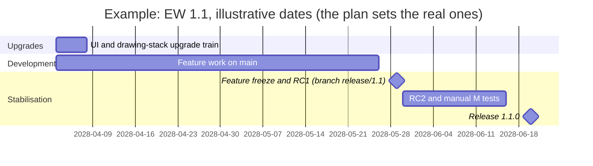
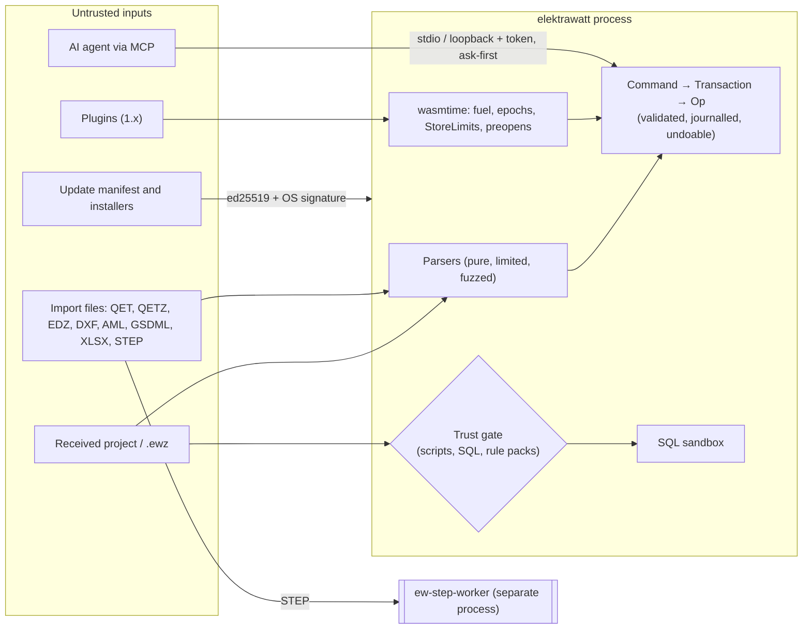

# Quality engineering, security and release: toolchain, release, signing, security and privacy

A chapter of [Quality engineering, security and release](18-quality-security-release.md), whose table says where each section lives.

---

## 6. Toolchain, MSRV and the upgrade train

### 6.1 Pinning

- **Toolchain.** `rust-toolchain.toml` pins an exact stable version (≥ 1.95, which egui 0.37 needs) with rustfmt,
  clippy and llvm-tools, and the Supported targets. The edition is 2024.
- **Lockfile.** `Cargo.lock` is committed, and every CI build uses `--locked`.
- **Fuzzing** (target). `fuzz/rust-toolchain.toml` pins a dated nightly.
- **Raising.** The toolchain is raised at most once per quarter, in the upgrade train (NFR-MAINT-03).

### 6.2 MSRV of the published permissive crates

- **Declaration.** The permissive crates (FR-EXT-023) declare a `rust-version` at least 6 months older than the EW
  release that publishes them. Initially this is the lowest version ≥ 1.85 (edition 2024) that their closure allows
  (**verify** at the first publication).
- **CI job** (target; there is no CI during the alpha). CI-PR-09 builds them with that toolchain against an MSRV lockfile produced by the MSRV-aware resolver
  (`resolver = "3"`, `incompatible-rust-versions = "fallback"`). The application lockfile can therefore move ahead
  without breaking downstream users.
- **Versioning.** Raising a crate's MSRV is a minor version bump of that crate.
- **GPL crates**. The MSRV binds the permissive crates only. GPL application crates
  and binaries need only the pinned toolchain (§6.1) and declare the `rust-version` their dependencies require:
  `ew-export`, `ew-render-cpu` and their dependents declare 1.92 for krilla 0.8.2 (vello_cpu 0.3.0 needs 1.89,
  parley 0.12.0 1.88). As applied: `ew-export`, `ew-render-cpu`, `ew-api`, `ew-print`, `ew-testkit`, `ew-ui`,
  `ew-viewmodel` and both binaries; `ew-ui`, `ew-viewmodel` and `elektrawatt` declare 1.95, which egui 0.37 needs;
  `ew-import-eplan`, `ew-api`, `ew-testkit` and `ew` declare 1.93, which sevenz-rust2 0.24.2 needs. The workspace value
  1.85 is the permissive crates' MSRV, not a promise for the application.
- **The workspace hack**. The GPL crates depend on the workspace-hack crate `ew-hack` of
  cargo-hakari (`.config/hakari.toml`); the permissive crates never do, so the MSRV job and their publication see no hack.

### 6.3 The quarterly upgrade train

*Target for 1.0; no upgrade train runs during the alpha.*

The UI stack breaks every 6–10 weeks (ADR-0014). EW absorbs this in one lock-step upgrade per quarter, in the first
month of the quarter, at least four weeks before that quarter's feature freeze (§7.3). The target cost is about one
developer-day (NFR-MAINT-04).

| Step | Content | Pass condition |
|---|---|---|
| 1 | Branch `upgrade/<yyyy>q<n>`. Bump egui, eframe, egui-wgpu, egui_tiles, egui_table, egui_ltreeview, egui_kittest, transform-gizmo-egui, wgpu, winit and AccessKit together; bump the toolchain and the fuzz nightly | Builds |
| 2 | Run the full PR and nightly sets on the branch | Green, except UI snapshot diffs |
| 3 | Review kittest image snapshots: UI changes are accepted; accessibility regressions are not | Name walker and contrast lint green |
| 4 | Drawing outputs (golden PNGs, PDFs) must be **unchanged**, because the UI stack does not touch `ew-dl`, vello_cpu or krilla | PNG and PDF digests unchanged |
| 5 | Bump the drawing stack (krilla, vello_cpu, parley, fontique, skrifa, harfrust) in a separate commit on the same branch | Tags, xrefs and wire numbers byte-identical (NFR-REL-09); geometry within tolerance; digest changes listed in the release notes |
| 6 | GPU smoke per backend, WARP, CPU renderer; manual RDP check | Pass |
| 7 | Merge | Within 5 working days |

- **Abort rule.** If the branch is not green after 3 developer-days, EW stays on the previous versions for the
  quarter and files the blockers upstream. The lag limits of NFR-MAINT-04 (two egui minors, one wgpu major) are
  never exceeded: a second missed quarter makes the upgrade the top-priority task.
- **wasmtime** stays on its LTS line and moves to the next LTS before the current one leaves support (ADR-0020,
  NFR-MAINT-04). Every release whose number is a multiple of 12 is LTS with 24 months of security fixes
  ([gaps-and-corrections](../research/gaps-and-corrections.md) §3.3), so 48.x is supported until about 2028-08 and
  the move to 60.x falls in the upgrade train of 2028 Q3 at the latest.

---

## 7. Release process

### 7.1 Versions and cadence

The EW version (SemVer) and the project format version (ADR-0011) are numbered independently. The release notes
state which format a release writes and which it reads.

| Phase | Release | Cadence | Format | Support |
|---|---|---|---|---|
| Pre-1.0, pilot preview (M-PP) | 0.0.x | Unsigned development builds, handed to the pilot only; no public binary, no download page | May change; upgrade-on-read | None |
| Pre-1.0 | 0.x.0 | Monthly from the MVP (0.1.0 at M2): RC on the first working day, release the following week if no blocker | May change; upgrade-on-read; unstable-format banner | Latest 0.x only |
| Pre-1.0 | 0.x.y | As needed | Never changes | — |
| From 1.0 | N.0.0 | Yearly, in the format window (§7.2) | Format major allowed | §7.5 |
| From 1.0 | N.m.0 | Quarterly | Additive format minor only | All fixes while latest; security and data-loss fixes for 6 months after its successor (§7.5) |
| From 1.0 | N.m.p | As needed: security, data loss, regressions | Never changes | — |
| Always | Nightly | Daily from `main` (target; none exists) | May write an unreleased format, with a warning (NFR-REL-05 d) | None |

The release structure in time is: nightlies and signed source tags (`m1`, `pp`) before the pilot preview; the
pilot preview 0.0.x at milestone M-PP (gate G-PP), which is not a public release; the first binary release
0.1.0 at M2 (MVP), unsigned; then monthly 0.x, the betas and release candidates of 1.0 (M6, M7) and quarterly minors. The
dates are the plan's (global plan §5.1 and §6, milestones.csv).
The pipeline and checklist of §7.4 apply from 0.1.0; a pilot preview needs the build and the release notes only.
Whether a pilot-only preview counts as "made available on the market" under the CRA is to be verified with counsel
(§13.1, ADR-0030).

Published permissive crates follow their own SemVer. A format minor bumps `ew-schema` and `ew-format` by a minor
version, and a format major by a major version.

### 7.2 Format-change window

- **Placement.** After 1.0, the yearly major ships in a fixed month (proposal: March). It is the only release that
  may raise the format major.
- **Freeze.** The format freezes 8 weeks earlier, and the new format's fixture is committed at the freeze.
- **Between windows.** Changes that need a format major land behind the compile-time feature `next-format`, which
  only nightlies enable. A released build cannot write the next format.
- **Corpus.** Every released format's fixture stays in the corpus forever (NFR-REL-05).
- **Steward rule.** The schema-steward rule applies to every format PR: migration, fixture, regenerated schema and
  docs (ARCH §7.6).

### 7.3 A quarterly minor (example dates)



- **Branching.** Development is trunk-based. `release/N.m` is cut at the feature freeze, and only fixes are
  cherry-picked onto it. Patch releases come from the branch.
- **Pre-1.0.** A release is cut from its own branch `release/<X.Y>` ([`docs/release/README.md`](../release/README.md) §1): only fixes for its candidates land there, each also on the working branch, and the next candidate is cut.

### 7.4 Release pipeline and checklist

| Job | Content |
|---|---|
| CI-R-01 | From 1.0, verify the tag signature against `.github/allowed_signers` (the 0.1.0 tag is unsigned, because `allowed_signers` would carry a personal address); a clean tree and version consistency (Cargo, installers, About; from 1.0 the manifest); release and migration notes present (NFR-DOC-07; drafted with git-cliff, 19 §6, then edited) |
| CI-R-02 | Collect gates: a green nightly on this commit (perf, memory, full oracle, fuzz with no open crash), acceptance of every reached milestone row, no unwaived high or critical advisory; from 1.0 the sample project's as-built archive passes `sha256sum -c` and veraPDF and validates with the permissive-only reader, and joins the fixture corpus (NFR-REL-10) |
| CI-R-03 | Hermetic build: `cargo fetch --locked`, then a network-less build on Linux (§10); `cargo auditable build --release --locked` for every target; the build fails if `ICU4X_DATA_DIR` is set (§3.5), or if `PKG_CONFIG` is not `false` or any `PKG_CONFIG_*` target override is set (§5.4, x11-dl) |
| CI-R-04 | `ew-step-worker` per target with cached OCCT artefacts (1.0) |
| CI-R-05 | Packaging (§8) |
| CI-R-06 | `SHA256SUMS` over every artefact (0.1.0: unsigned). From 1.0, or earlier when the owner holds a signing identity: signing, with `SHA256SUMS` and the update manifest signed (§9) |
| CI-R-07 | CycloneDX SBOM per artefact (cargo-cyclonedx 0.5.9), merged with the non-Rust components (SQLite, OCCT, fonts); completeness check against `cargo metadata`; SBOM vulnerability scan; cargo-about notices for the crates plus the non-crate notices (fonts, with their copyright, licence and trademark lines) assembled from `NOTICE`, because cargo-about lists crates only; failing on any SBOM component without a notice (19 §5.3; NFR-SEC-13, NFR-LIC-08) |
| CI-R-08 | SLSA provenance through `actions/attest-build-provenance` for every artefact; `gh attestation verify` on each (NFR-SEC-12) |
| CI-R-09 | Assertions: the inspection canary string and the `test-confirm` canary string (§3.15) absent from every binary; the `ew-commands/testkit`, `ew-viewmodel/testkit`, `ew/test-confirm` and egui `inspection` features and the `ew-testkit`, `ew-testids` and `egui_mcp` crates absent from the release dependency graph; smoke start opens no listening socket (NFR-SEC-09). Today `cargo xtask rules` bans these features outside dev edges (§2.2); the release-job half is not built |
| CI-R-10 | Clean-VM offline installation on Windows 10 22H2, Windows 11, Ubuntu 22.04 and Debian 12 (0.1.0: the per-user setup on Windows and the AppImage on Linux; from 1.0 also the MSI and the `.deb`): install, open the GP sample, pass its acceptance CSVs, and from 1.0 open the GP `.ewpp` in `ew-wiring-viewer`; uninstall (NFR-PLAT-06, AC-40). An upgrade over the previous release's installer keeps user settings, keymaps, the trust store and company catalogues; uninstall leaves them in place |
| CI-R-11 | Publish the GitHub release. From 1.0: after two-maintainer approval, with the update manifest, crates.io through trusted publishing (**verify**) and the Flathub PR |

*0.1.x follows the slim workflow:* CI-R-01, CI-R-03 with a plain `cargo build`, CI-R-05 with one smoke test, CI-R-06 and CI-R-11 without provenance; the rest of this table, and of the as-built text below, is not run at 0.1.x ([`docs/release/README.md`](../release/README.md) §10).

The jobs in their pre-1.0 form: `release.yml` runs on a candidate tag. **CI-R-01:** `ci/release-verify.py tag`
requires the tag's `X.Y.Z` to equal the workspace version and `docs/release-notes/<X.Y.Z>.md` to exist and not be empty.
**CI-R-03:** `package.yml`'s release builds are `cargo build --release --locked`, with `ci/release-check.sh` around them.
**CI-R-05:** the per-user setup, the AppImage and the CLI archives, after one smoke test of each staged tree.
**CI-R-06:** `sums` writes `SHA256SUMS` over every release file, unsigned. **CI-R-11:** `release` creates the draft
prerelease, downloads its files back and checks them with `sha256sum -c`; the promote is a dispatch (§5.1). Not run at
0.1.x, and so the target for 1.0: CI-R-02, CI-R-07 (SBOM), CI-R-08 (build provenance), CI-R-09's binary half and
CI-R-10's CI half ([`docs/release/README.md`](../release/README.md) §10).

The release checklist holds the items that a pipeline cannot prove:

| Item | Check |
|---|---|
| RC-01 | Threat model reviewed and updated for new parsers or extension points (NFR-SEC-01) |
| RC-02 | No open fuzz crash; quarantined tests ≤ 10 (§3.14) |
| RC-03 | Advisory waivers valid ≤ 90 days, each with an owner (NFR-SEC-11) |
| RC-04 | `SECURITY.md` supported-versions table and support end dates updated (NFR-COMP-03) |
| RC-05 | Manual M tests: RDP without GPU, NVDA and Orca, two printers, installers, Windows network observation (§12.2) |
| RC-06 | Translation status meets NFR-I18N-01; documentation built and bundled |
| RC-07 | Content audit of bundled assets: licences, provenance, no standards text (NFR-LIC-06, NFR-COMP-05) |
| RC-08 | New derivation profiles, format changes and CLI/API changes listed in the release notes |
| RC-09 | Engineering-verification disclaimer present in About, check panel, docs and release report (NFR-COMP-04) |
| RC-10 | Governance gates of [19](19-open-source-governance.md) §3.3 met before the first binary release: LG-1 (employer copyright statement). From 1.0 also LG-4 (steward, signing identity and repository organisation, NFR-COMP-08) and the steward checklist ST-01 … ST-10 of [19](19-open-source-governance.md) §3.10 complete with evidence (NFR-COMP-01); afterwards the checklist is re-reviewed every minor |
| RC-11 | 1.0 only: the Accessibility Conformance Report against EN 301 549 clauses 11 and 12 is updated with known gaps (NFR-COMP-06) |

The checklist is the template
`docs/release/checklist.md` (RC-01 to RC-10 in their 0.1.0 form, each with its check, the evidence it asks for and
who signs), which is copied into the release dossier for each candidate; `docs/release/README.md` is the
procedure around it. RC-01 holds the review line and RC-05 the manual checks.

### 7.5 Support policy

- **Rule** (NFR-COMP-03, ADR-0030 as proposed). The latest minor gets all fixes; each minor gets security and
  data-loss fixes for 6 months after its successor ships. With quarterly minors, up to two older lines can be in
  that window at the same time, and security backports go to each of them.
  Illustrative example (the real calendar is in the global plan §6.4): 1.1 (released 2028-06-20) receives all fixes until 1.2 ships (planned 2028-09-19) and security and
  data-loss fixes until 6 months later (2029-03-19).
- **Majors.** After N.0, the last minor of N−1 gets the same 6-month window.
- **Pre-1.0.** Only the latest 0.x is supported.
- **LTS.** No LTS line exists until a commercial decision funds the ≥ 5-year period that manufacturer status would
  impose (NFR-COMP-02, §13).
- **In the binary.** Each build embeds its line's planned support end: its successor's planned date from the
  published cadence, plus 6 months. A slipping successor only extends it. The About dialog shows the status without
  network access, and from 1.0 an opted-in update check refines it from the manifest (FR-UI-038).

---

## 8. Packaging per OS

**Tool choice.** cargo-packager 0.11.8 (2025-11-27) builds the installer formats from one configuration (0.1.0 uses NSIS and AppImage; the MSI through
WiX and the deb are 1.0's; it also builds DMG/.app, which EW does not use). EW's own GitHub workflow drives it,
because the pipeline needs custom signing, SBOM and attestation steps. cargo-dist 0.32.0 (2026-05-22) stays an alternative: it lost its company
backing in 2025, and its 2026 maintenance status is unconfirmed (RE §10.1).

| OS | Artefact | Scope | Notes |
|---|---|---|---|
| Windows x64 (ARM64 best effort) | `ElektraWatt-<v>-x64.msi` (1.0) | Per machine; silent `msiexec /qn` | Stable UpgradeCode, major-upgrade semantics; policy values under `HKLM\SOFTWARE\Policies\ElektraWatt` (`UpdateCheck` DWORD, `UpdateMirror` string, `CrashUpload` DWORD; NFR-PLAT-08), with `UpdateCheck = 0` written by default (NFR-PRIV-03); static CRT, so no redistributable |
| | `ElektraWatt-<v>-x64-user-setup.exe` (NSIS) | Per user, no administrator rights; the Windows installer of 0.1.0 | From 1.0, when a per-machine installation can exist, it detects it and offers to use it instead |
| | `ew-<v>-x86_64-pc-windows-msvc.zip` | Portable CLI | Includes `ew-step-worker` from 1.0 |
| Linux x64 (arm64 best effort) | `.deb` for Ubuntu 22.04+ and Debian 12+ (1.0) | System | Built against glibc 2.35; depends on the Vulkan loader and xkbcommon; fonts bundled |
| | `.AppImage` | User; the Linux package of 0.1.0 | Type-2 runtime; documents `--appimage-extract-and-run` where FUSE 2 is missing |
| | Flatpak on Flathub | User | 1.0 Should; offline build with vendored crates; file and print portals |
| All (1.0) | `ew-wiring-viewer` in every installer, plus a portable archive per target | Shop PCs; per user, no administrator rights | The read-only `.ewpp` wiring viewer (ARCH §3, [13](13-manufacturing-outputs.md) §11); signed and covered by SBOM and provenance like `elektrawatt` |
| All | CLI archives, split debug symbols (PDB, DWARF), SBOMs, notices | — | Symbols are public, so users can symbolicate their own crash dumps |

**0.1.0 ships** the per-user setup, the AppImage and the CLI archives. The per-machine MSI with its
policy keys and the `.deb` are 1.0's, and Flathub stays at 1.0.

There is no macOS artefact: macOS is not a supported platform.

**Every installer is offline and complete** (NFR-PLAT-06): application, `ew` CLI, `ew-step-worker` (1.0, LGPL OCCT
as a replaceable separate binary, NFR-LIC-08), `ew-wiring-viewer` (1.0), bundled fonts (ADR-0028), starter symbols, frames and forms, the GP
sample (CC0), the offline documentation, `PRIVACY.md`, `SECURITY.md`, the third-party notices and the SBOM.
Installation needs no network. The installed tree is read-only at run time (NFR-PLAT-07).

---

## 9. Signing, provenance and updates

### 9.1 Code signing

**0.1.0 ships unsigned**: its Windows binaries and installers carry no Authenticode signature,
its tag is unsigned and its `SHA256SUMS` is unsigned. The unsigned sums are its integrity evidence. The
rows below apply from 1.0, or earlier when the owner holds a signing identity.

| Platform | Mechanism | Identity |
|---|---|---|
| Windows | Authenticode through Artifact Signing (OIDC from the protected environment); every `.exe`, `.dll`, `.msi` and setup file; RFC 3161 timestamps, required because the certificates are short-lived (**verify** the lifetime) | Organisation identity of the steward (ADR-0030); not available to individual EU developers |
| Linux and all artefacts | `SHA256SUMS` signed with the project release key (ed25519, minisign-compatible) | Release key (§9.2) |
| Git | Release tags signed with maintainers' SSH keys listed in `.github/allowed_signers`; CI-R-01 verifies | Maintainers |

**No macOS signing.** macOS is not a supported platform, so there is no Developer ID, no
notarisation and no entitlement question.

### 9.2 Provenance, sums and the release key

- **Provenance.** Every artefact gets SLSA build provenance signed through Sigstore (`actions/attest-build-provenance`,
  free for public repositories, G10).
- **Offline verification.** Sigstore verification needs its trust root. At 0.1.0 offline users check the files with
  `sha256sum -c` against the unsigned `SHA256SUMS`. From 1.0 they verify `SHA256SUMS.sig` with the release key instead
  (NFR-SEC-15).
- **Key distribution** (1.0). The release key's public half is compiled into the binary, published on the web site and
  printed in `SECURITY.md`. The binary embeds the current key and the next one, so a yearly rotation needs no
  emergency release.
- **Custody** (1.0). The private key lives only in the protected `release` environment, behind second-maintainer approval.

*Target for 1.0; 0.1.x carries no build provenance (§7.4).* `actions/attest-build-provenance`, pinned by commit SHA,
attests every release file, `SHA256SUMS` included, in the one job that holds `id-token: write`. Every check runs
`gh attestation verify <file> --repo <owner>/<repo> --signer-workflow <owner>/<repo>/.github/workflows/release.yml`, and
the promote adds `--source-digest <the candidate's commit>`, so the bytes are bound to the release workflow and to the
commit they were built from.

### 9.3 Update check

**The update check is 1.0's** (ADR-0029 as amended). 0.1.0 has no update check and no crash upload,
and the interim rule of ADR-0029 for development builds now covers it, which CI-N-06 enforces.

**1.0, first stage: notice only.**
- **Which builds.** Release builds from 1.0. Development builds, including the unsigned nightlies published before
  gate LG-4 ([19](19-open-source-governance.md) §3.3), contain no update check and no crash upload (ADR-0029
  interim rule), which CI-N-06 enforces.
- **When.** After the user opts in (first-run step 3 of 16 §9.1), at most once a day, in the background after the
  first frame, with a 5 s timeout and no retry storm.
- **Request.** A plain `GET` of a static, signed manifest. It carries no cookie, no query string and no identifier.
  The only data sent is the `User-Agent: ElektraWatt/<version> (<os>; <arch>)` header (NFR-PRIV-03).
- **Verification.** The manifest signature is verified with the embedded release key before anything is shown.
- **Effect.** The notice offers "Release notes" and "Download", which opens the release page in the browser. Nothing
  is installed (NFR-SEC-15).

**1.0, second stage: in-app download.** On a click, EW downloads the platform installer and checks its size and the SHA-256 from
the signed manifest. It then checks the OS signature (WinVerifyTrust) and only then launches the installer. There is never a silent installation. Linux packages get the notice
only.

```json
{"schema": 1, "channel": "stable",
 "latest": {"version": "1.1.2", "date": "2028-07-08", "severity": "security", "notes": "https://<project site>/releases/1.1.2",
            "support_end": {"1.1": "2029-03-19", "1.0": "2028-12-20"}},
 "artefacts": [{"target": "x86_64-pc-windows-msvc", "kind": "msi", "url": "https://<project site>/…/ElektraWatt-1.1.2-x64.msi",
                "sha256": "…", "size": 187654321}]}
```

**Network details.**
- **Proxies.** EW honours explicit proxy settings (OS settings, `HTTPS_PROXY`). It never uses WPAD auto-discovery,
  which would trigger DNS lookups.
- **TLS.** It uses the OS trust store, so that corporate TLS inspection works (rustls with
  `rustls-platform-verifier`; neither is in the research notes, **verify** crate and version).
- **Mirrors.** An MSI policy key can point the check to an internal mirror (NFR-PLAT-08).
- **Velopack** (delta updates) is not used in v1, because its signature mechanism is unverified (G10).

---

## 10. Supply chain

| Control | Rule | Job |
|---|---|---|
| Lockfile and toolchain | `Cargo.lock` committed; `--locked`; exact toolchain | All |
| cargo-deny 0.20.2 | **Licences:** the NFR-LIC-04 allowlist, with LGPL-2.1 only for `ew-step-worker`. **Advisories:** vulnerabilities deny; "unmaintained" and "unsound" notices need an owner decision within 90 days. **Bans:** duplicate-version warnings and a list of banned crates (downloader build scripts). **Sources:** crates.io only, git sources allowlisted per crate | CI-PR-09 |
| cargo-audit 0.22.2 | RUSTSEC on the lockfile per PR and on the shipped binaries' embedded `cargo-auditable` data at release | CI-PR-09, CI-R-07 |
| cargo-vet 0.10.2 | Target for 1.0; not in the repository during the alpha. Every crate in the graph is covered by an audit for the criteria its use needs: the project's own audits in `supply-chain/audits.toml` (the `who` field is the contributor's GitHub handle, never a personal name or e-mail address; an audit an agent performed says "AI-performed, owner-delegated (date)" in `notes`) or imported sets, kept without auditor identities. The commit that adds or updates a crate adds one exemption per crate and exact version when no audit exists, `safe-to-deploy` for shipped code and `safe-to-run` for build and test only. The list is burned down by audits and imports: every exemption is audited, covered or replaced before the first signed release | CI-PR-09 |
| Build scripts | Target for 1.0 (the allowlist and its check are not in the repository during the alpha). `cargo metadata` lists every crate with a `custom-build` target; each must appear in `build-scripts.allowlist` as `name@version` with a review comment, and no entry may be stale, so a new version of a crate with a build script fails the build-script check until its `build.rs` is read again and `--bless` re-versions the line (bless never adds a crate; ADR-0023 amendment 5). A Linux job builds the whole workspace with all features inside a network namespace without connectivity, so any build-time download fails (C-5) | CI-PR-09, CI-R-03 |
| Low-adoption crates | Test-only, or vendored with a named owner (C-9) | Review |
| Licence boundary | For each crate declared permissive in `[workspace.metadata.ew]`, which must list exactly the P crates of ARCH §3 (`ew-units`, `ew-ids`, `ew-mltext`, `ew-rds`, `ew-schema`, `ew-format`, `ew-interop-api`, `ew-dl`, `ew-step-proto`, `ew-memo`, `ew-plcaddr`, `ew-caex`, `ew-devdesc`, `ew-ewpp`; `ew-plugin-wit` and `ew-plugin-sdk` from 1.x), the closure of normal and build dependencies (and dev-dependencies, so that published crates stay self-contained) contains only NFR-MAINT-02 licences and no GPL workspace crate | CI-PR-09 |
| Dependency rules | ARCH §3 rules over direct dependencies (NFR-MAINT-01), including `ew-plugin-host` ↛ `ew-import-qet` (NFR-LIC-05) | CI-PR-09 |
| SBOM and notices | Per artefact, including non-Rust components (§7.4) | CI-R-07 |
| Provenance and signing | §9 | CI-R-06, CI-R-08 |
| CI integrity | §5.4 | All |

During the alpha `cargo deny` (`deny.toml`), the lockfile rule and the layer and licence-boundary rules of
`cargo xtask rules` are the controls of this table that exist; the rest is the target for 1.0. No workflow runs
`cargo deny` or `cargo audit`.

*Today.* An advisory waiver is the same `ignore` entry in two files, `deny.toml` and `.cargo/audit.toml`, each with its
reason, the owner's handle and an expiry within 90 days, checked by hand at RC-03.

---

## 11. Security process

### 11.1 Threat model

The assets, the trust boundaries of the release, the threats TM-01 to TM-19 with their state, the controls as built
and the evidence that proves them are in the [threat model](../security/threat-model.md) (NFR-SEC-01). This section
holds what the threat model does not: the boundaries of 1.0, with the surfaces the release does not ship (plugins,
MCP, the STEP worker, the update check, the trust gate), and the controls each threat is to have by then. TM-09,
TM-10, TM-18 and TM-19 are in force as the threat model states them, with nothing further intended.



| ID | Threat | Controls at 1.0 | Verified by |
|---|---|---|---|
| TM-01 | Hostile project or import file: memory exhaustion, decompression bombs, deep nesting, NaN geometry, panics. Also reached without a click through the git merge driver and textconv, which git runs on fetched content | Limits (NFR-SEC-02, FR-IMP-005, 14 §11); pure parsers that never execute content; lenient import | CI-PR-08, CI-N-03, hostile corpus |
| TM-02 | Archive path traversal or symlinks (`.ewz`, EDZ, QETZ, XLSX) | Entry-name rules; symlinked and encrypted entries refused; loader follows no links (NFR-SEC-16) | Hostile corpus |
| TM-03 | Hostile SQLite (QETZ, catalogues) with views or triggers | Read-only, `trusted_schema=OFF`, defensive mode, schema check (NFR-SEC-06) | CI-PR-02 |
| TM-04 | Automation embedded in a received project: rhai scripts, SQL reports, rule packs | Trust gate keyed outside the project (05 §13.4, NFR-SEC-05). Pure formulas still evaluate: no I/O, operation limits, tracked reads (15 §3.9) | CI-PR-02 trust fixture |
| TM-05 | Resource exhaustion by formulas or SQL | rhai operation, depth and string limits; SQL deadline and `SQLITE_LIMIT_*` | CI-PR-02 |
| TM-06 | Plugin exfiltration or tampering (1.x) | Capability manifest, WASI preopens, no network by default, signed manifests, fuel or epochs, `StoreLimits`, plugin ID in undo (NFR-SEC-07) | 17 tests in CI-PR-02 |
| TM-07 | MCP misuse, including prompt injection through project text ("rename all devices…") | Off by default; stdio or loopback with a per-session token; ask-first writes with a diff; project-scoped access; `origin=mcp` in the journal (NFR-SEC-08) | CI-PR-02 |
| TM-08 | Exploitation of OCCT (C++) through a vendor STEP file | Separate process, timeouts, memory cap, quarantine after two crashes, fuzzed IPC decoder; OS sandbox in 1.x (NFR-SEC-21) | CI-PR-12 |
| TM-11 | Dependency compromise or typosquatting | §10 | CI-PR-09 |
| TM-12 | CI or release pipeline compromise | §5.4; provenance; two-person publish (from 1.0) | Scorecard, review |
| TM-13 | Update spoofing or MITM (1.0: 0.1.0 has no update check) | HTTPS, signed manifest, OS signature, no silent install | CI-R-06, the tampered-package test |
| TM-14 | Local disclosure through journal, recovery snapshots, crash dumps or logs | User-only permissions; pruning; redacted logs; no automatic upload (NFR-PRIV-04, NFR-PRIV-05) | CI-PR-02 |
| TM-15 | Signing-key compromise (1.0: 0.1.0 has no signing key) | Incident runbook (§11.4) | Tabletop exercise |
| TM-16 | User-configured external converter (ODA File Converter for DWG, 1.0) fed a hostile file, or a converter path planted by a received project | The converter path is a user setting, never read from a project; it runs as a separate process on a copy in a temporary directory with a 120 s timeout, and its output is parsed under the DXF limits (14 §11) | Hostile-corpus test with a stub converter that hangs and one that writes a DXF bomb |
| TM-17 | Unexpected process spawn by a dependency: rfd 0.17.2 starts `zenity` from `PATH` when the XDG desktop portal call fails (no portal service, malformed response), so a same-user process that controls `PATH` or plants a `zenity` earlier on it runs code when the user opens a file dialog. Low risk: it needs same-user access, which already allows more | The portal first (the shell checks for a session bus before calling rfd); a future rfd feature set without the zenity fallback, or a check that the portal answers, removes the spawn. | Review |

### 11.2 `unsafe` and native code

- **Default.** Every crate carries `#![forbid(unsafe_code)]`.
- **Allowlist** (target for 1.0; `unsafe-allowlist.toml` is not in the repository during the alpha): `ew-render2d`,
  `ew-render3d`, `ew-render-cpu` (if needed), the app shell's platform glue (print adapters over `windows`/`objc2`,
  crash-handler installation), `ew-step-worker` and the planned `ew-sysprobe` (process liveness and start time for the
  stale-lock rule and peak resident memory for the performance gate, over `windows-sys` and `libc`). The test-only
  crates that never ship in release artefacts, such as `ew-testkit`, are allowlisted for the counting `GlobalAlloc`
  (§3.12) only (NFR-SEC-04); CI-R-09 asserts their absence from release graphs.
- **Lint** (target). An xtask lint compares crate roots and `unsafe` occurrences against the allowlist. Every `unsafe`
  block has a `SAFETY:` comment, and CODEOWNERS requires a second maintainer's review from 1.0 (NFR-SEC-04).
- **Native code.** It is limited to bundled SQLite in process and OCCT out of process.

Crate roots carry `#![forbid(unsafe_code)]` where they declare it. `ew-print` (`src/windows.rs`) uses
`unsafe` for the Windows print adapters, each block with its `SAFETY:` comment, and `ew-testkit` holds the counting
`GlobalAlloc` of the `hostile_corpus` test binary (`tests/hostile_corpus/alloc.rs`); the library keeps `forbid`. No lint
checks that no other file uses `unsafe`.

### 11.3 Vulnerability handling

| Stage | Action | Deadline |
|---|---|---|
| Receive | GitHub private vulnerability reporting, or a role mailbox on the project domain listed in `SECURITY.md` | — |
| Acknowledge | Reply to the reporter | ≤ 7 days (NFR-SEC-14) |
| Triage | CVSS 4.0 score, affected versions, exploited in the wild? | ≤ 14 days |
| Notify (CRA) | If actively exploited and a CRA role applies (§13): early warning, notification and final report through the single reporting platform | 24 h, 72 h, 14 days after a fix (Art. 14, **verify** for stewards) |
| Fix | Private fork of the GitHub security advisory; regression test and fuzz seed | Critical ≤ 30 days |
| Release | Patch releases for every supported line (§7.5); from 1.0 the update manifest's `severity: security` | With the fix |
| Disclose | Publish the GitHub advisory; CVE through GitHub as CNA; RUSTSEC advisory for published crates; release notes | At release; embargo ≤ 90 days |
| Learn | Post-mortem; threat-model update | Next minor |

`SECURITY.md` states the 0.1.0
process in full: reports through GitHub's private vulnerability reporting only (on), no role
mailbox until the project has a domain, the acknowledgement and triage deadlines above, the supported
versions (0.1.x until 0.2.0, the latest 0.x release only before 1.0), the disclosure by GitHub advisory
with a CVE per fixed vulnerability, and the CRA notification by 1.0.

### 11.4 Incident runbook: key or pipeline compromise

1. Stop publishing and disable the release environment.
2. Revoke the affected identity: Artifact Signing certificate or the release key (both from 1.0; 0.1.0 has no signing
   identity to revoke). Revoking the release key means switching clients to the embedded next key and publishing a new
   next key.
3. Publish an advisory naming the affected artefacts by SHA-256 and provenance.
4. Rebuild from a clean runner and, from 1.0, re-sign.
5. Notify under the CRA if the steward role applies.

The runbook is rehearsed in the tabletop exercise before 1.0 (NFR-SEC-14).

### 11.5 Per-PR security tests

Each security rule needs a test that fails when the rule is broken. For the trust, SQL, MCP and `HumanOnly` rules
of [17](17-extensibility.md) §13 these tests run in CI-PR-02 on GP; parser limits are covered by §3.12 and the
network rules by §12.2:

| Test | Expectation | Rule |
|---|---|---|
| Trust fixture | A received GP copy with a project rule pack, an SQL report and a rhai script runs none of them before trust; pure formulas still evaluate | NFR-SEC-05, TM-04 |
| SQL sandbox | Hostile SQL text (`ATTACH`, `load_extension`, a `PRAGMA`, DML, a recursive-CTE bomb) is refused by the authorizer or stopped by the limits and the deadline | NFR-SEC-06, TM-05 |
| SQL statement gate | `ew sql <GP> "SELECT 1; VACUUM INTO 'x.db'"` exits 2 and creates no file | 17 §6.2, NFR-SEC-06 |
| MCP binding | `ew mcp --listen 127.0.0.1:0` accepts only loopback; a request without the per-session token or with a foreign `Origin` is refused; a non-loopback address is refused | FR-EXT-026, TM-07 |
| `HumanOnly` replay | `ew apply` of a `.ewcmd` that contains `revision.approve` exits 2 before line 1 is applied | 17 §2.3, D-34 |
| `HumanOnly` without a terminal | `ew revision approve --as <checker>` with no controlling terminal exits 2 ("HumanOnly: needs an interactive terminal") | 17 §2.3 |
| `HumanOnly` through the hook | In a test build, a wrong label supplied through the confirmation hook (§3.15) refuses; the right one signs off | §3.15 |
| Hook absent | The release binaries contain neither the hook nor its canary string (CI-R-09) | §3.15, NFR-SEC-09 |

---

## 12. Privacy

### 12.1 Data-flow inventory (the content of `PRIVACY.md`)

**0.1.0 has no update check and no crash upload**: the first two flows below are 1.0's, and
`PRIVACY.md` reads "From 1.0" for them, under ADR-0029 as amended. The other flows are user-initiated and unchanged.

| Flow | Trigger | Content | Endpoint | Default |
|---|---|---|---|---|
| Update check | From 1.0: opt-in, at most once a day | `GET` of the signed manifest with the User-Agent of §9.3 | Project site or a policy mirror | Off; off in MSI deployments |
| Crash upload | From 1.0: per report, after the user previews the payload | Payload of §12.3 | ADR-0029 endpoint; none at MVP | Off; button hidden while no endpoint exists |
| Help and community links | Click (Help menu, release notes, Help ▸ Community, Translate; 19 §4) | URL opened in the system browser; EW itself sends nothing | Documentation site, GitHub Discussions, Weblate | Offline docs and `SECURITY.md` bundled |
| Plugin network | Capability granted at install (1.x) | Plugin-defined | Plugin-defined | Denied |
| `ew mcp` | User starts it | MCP over stdio or 127.0.0.1 with a token | Local | Off |
| ODA converter | User configures it (1.0) | Local process | None | — |

There are no other flows: no telemetry or analytics, no install ID (NFR-PRIV-02), no font, symbol or part downloads,
no licence check and no AI or translation service (NFR-PRIV-08). Changing this table requires an ADR (NFR-PRIV-07).

`PRIVACY.md` at the repository root exists, with the
CC-BY-4.0 header of `SECURITY.md`, and the About dialog and the first-run privacy step each have a "Privacy
(PRIVACY.md)" button that opens it. It has two tables. The network flows above are in it with an "In this version"
column that says NOT IMPLEMENTED for every row (no flow is built: the update-check setting is stored and sends
nothing), so NFR-PRIV-07 is met for this version's flows and is re-checked whenever a flow is built; the document also
states that there is no telemetry and describes the network sandbox of §12.2 as the design, not as proven (CI-N-06 is
not built). The second table is what EW **stores on the computer**, which this section did not list:

| Item | Purpose | Location | Retention | Content worth knowing |
|---|---|---|---|---|
| Settings (including the recent-projects list) | Preferences; the list of recently opened projects | Per-user OS configuration directory | Until deleted | Project directory names and paths in the recent list |
| Workspace layouts | Panes and docks | Per-user OS configuration directory | Until deleted | None about projects |
| Crash journal (`journal/`) | Recovery of unsaved work | Per-user OS state directory, user-only permissions | Removed on a clean close; leftovers pruned after 30 days (NFR-PRIV-05) | **Project content, and the bytes of an asset such as the logo** (the journal carries each transaction's new assets in base64) |
| `.~ew.lock` | Who holds the project (05 §7) | In the project directory | Removed on close; `.~ew.lock.stale-*` after a takeover | **The OS user name and the host name** (and process ID and times) |
| The project directory with its `assets/` | The project itself; image bytes by hash (05 §13.3) | Where the user saved it | Until the user deletes it; a save never removes an asset file | The project's content; the logo file |

Each row in `PRIVACY.md` also says how to delete it. Two rulings:
- **`.~ew.lock` is kept as it is.** It holds the OS user name and the host name, written into the project directory:
  that is its purpose, because a colleague who finds the project locked sees who holds it and from where (05 §7). The
  lock is not project data and is ignored by the marked block of the project's `.gitignore` (05 §11.1), but a project directory committed to a
  public repository (a copied folder, an added-everything commit) must not carry a live lock: the guidance is to
  close the project first and to keep `.~ew.lock*` in `.gitignore`. There is no scrubbing task.
- **The privacy link opens the repository's web URL** (`blob/main/PRIVACY.md`), with the URL in a banner when the
  opener fails, while 16 describes the opener as `file://` only: the web link is a documented exception, because no
  build bundles `PRIVACY.md` yet. The exception ends when the build bundles `PRIVACY.md` and the user guide and opens them locally.
  Opening the web page is the user's click on a link,
  not a flow of EW (the "Help and community links" row).

### 12.2 Network sandbox (CI-N-06)

```text
create a network namespace with only loopback up; resolv.conf points at an unreachable address
run under: strace -f -e trace=socket,connect,bind,listen,sendto,sendmsg,sendmmsg
flows: elektrawatt --smoke <GP> (first start, wizard skipped, open, first frame, quit);
       kittest flows: first run, open GP, edit, check, export PDF, import a public QET example, print to file;
       ew: check, export pdf/svg/bom, render, sql, import qet, print --to-file
fail if: any AF_INET/AF_INET6 socket call except the allowlisted loopback bind/listen of the
         `ew mcp --listen 127.0.0.1:0` test;
         any DNS attempt, including an AF_UNIX connect to the systemd-resolved varlink socket (/run/systemd/resolve/*)
         or the nscd socket, and any getaddrinfo/gethostbyname call recorded by an LD_PRELOAD shim;
         any listen() outside that test
ignored: other AF_UNIX traffic (D-Bus, AT-SPI, Wayland) and AF_NETLINK (interface queries)
```

- **Opted-in check** (1.0). A second run with the update check opted in targets a local mock server. It asserts the exact
  request (method, path, headers), so the check provably sends only version, OS and architecture (NFR-PRIV-03).
- **Other OSs.** Windows is observed manually for each minor, with outbound firewall logging (RC-05).
- **Smoke flag.** `elektrawatt --smoke <project>`, as listed in the CLI catalogue of [17](17-extensibility.md)
  §3.3, opens the project, renders its pages and exits. It accepts no remote input, so it is no control endpoint.

*Not built.* No sandbox run exists during the alpha: the flows, the strace judge and the canary scan over the release
binaries are the target for 1.0 (CI-N-06). The method reads the name-lookup files (`/etc/resolv.conf`, `/etc/hosts`,
`/etc/gai.conf`) and a `connect` to the resolver's socket from strace's `openat` lines instead of an `LD_PRELOAD` shim,
and fails on a socket of `AF_INET` or `AF_INET6`, a `connect` to it, a resolver connect, a name-lookup read or a
`listen`, with no allowlist while 0.1.x has no `ew mcp`; `AF_UNIX` D-Bus traffic and `AF_NETLINK` pass.

### 12.3 Crash reports and logs

**0.1.0 writes a local log only** (NFR-REL-13): on a panic the hook below logs the message and
location with a backtrace and flushes the journal, and the next start offers recovery. It writes no minidump, runs no crash
monitor and has no upload. The capture, the storage of minidumps, the upload payload and the scrubber below are 1.0's
(NFR-PRIV-04).

- **Capture** (1.0). `crash-handler` 0.8.1 in the application and `minidumper` 0.11.0 in a monitor process (the same signed
  binary, started with `--crash-monitor`) write out-of-process minidumps.
- **Panic strategy.** Release builds keep `panic = "unwind"`. The panic hook runs for every panic and logs message
  and location. On job-pool threads (importers, rhai, SQL, checks, exports, report pagination; marked by a
  thread-local) it returns, so the unwind reaches the job's `catch_unwind`: the job fails with a report and a local
  crash record, and the session and model stay unchanged (NFR-REL-12). On every other thread (UI, writer, commit
  pipeline) the hook asks the writer thread to flush the journal (bounded to 500 ms, 05 §8.1) and aborts. Native
  crashes lose at most the last second of commits (NFR-REL-02).
- **Storage** (1.0). `crashes/<UTC time>-<8 hex>/` in the OS state directory holds `minidump.dmp`, `log-tail.txt` (the
  last 2,000 lines at the redacted default level) and `report.json`. `report.json` holds version, build ID, target,
  OS version, render backend, uptime and panic location. Permissions are user-only (0700 directories and 0600 files
  on Linux, a user-only ACL on Windows; NFR-PRIV-05). Reports are pruned after 30 days or beyond 20
  reports.
- **Upload payload** (NFR-PRIV-04, 1.0, only if ADR-0029 creates an endpoint). The raw minidump is **never** uploaded,
  because its stack memory can hold project text. Instead, a client-side stack walk (rust-minidump crates,
  **verify**) reduces it to frames of (module, build ID, offset) for every thread. The payload is those frames,
  `report.json` and the scrubbed panic message. The user sees the exact JSON before sending. The server symbolicates
  with the published symbols.

**Scrubber** (1.0):

```text
tokens := user name, host name, home directory, every open project's directory name and path,
          every MlText and identifier value of open projects (tags, folios, descriptions, party fields),
          recent-file names                                     # NFC, case-insensitive
tokens := tokens with ≥ 3 characters                            # "1", "PE", "N" would erase every message
msg := panic message
msg := replace quoted substrings ("…", '…', `…`) with <s:len>
msg := replace path-like substrings (/…, X:\…, \\server\…, ~/…) with <path>
msg := replace every token occurrence with <t>
msg := truncate to 512 characters
payload := allowlisted fields only; anything else is dropped
```

**Logs.**
- `tracing-appender` 0.2.5 rotates daily and keeps at most 7 files (`max_log_files`), at level `info` by default.
  It has no size-based rotation, so EW's writer wrapper stops a day file at 10 MB and writes one truncation marker.
- Project-derived strings are logged through a `Sensitive<T>` wrapper that prints `<redacted:len>`. Help ▸
  Diagnostics can enable full text for the current session only. The setting resets on restart (NFR-PRIV-05).

The panic hook of
`bin/elektrawatt/src/crash.rs` logs **every** panic: it appends an entry (the lines L1 to L7: version, OS and architecture,
time, thread, location, message and a forced backtrace) to one log per process in `<state>/crashes/`, and the end mark L8
is written by `main` after its outer `catch_unwind`, which then exits 101; a panic caught in place (a rule run,
tessellation, an image) leaves an entry without L8, which is never offered. There is **no abort and no journal
flush**: every journal entry is synced as it is appended, so the hook leaves the journal alone, and the unwind reaches
no clean close. One process's log takes at most 50 entries or 1 MiB, then the line "further panics not logged" (past
the cap the session-ending panic gets no entry yet). The directories are 0700 and the logs 0600 on Unix; at
start logs older than 30 days or beyond the 20 newest are pruned, and the newest unoffered log with L8 is offered with
the leftover journals (05 §8.3). The log stays English, being read by support. No other log is
written at 0.1.0; panics on other threads and a log for `ew` are not built.

---

## 13. EU Cyber Resilience Act readiness

The legal and licensing items, the steward's CRA processes and the signing conditions are no gate items before 1.0
(the owner's decision); they are placed at 1.0. The statements of when the regulation applies below stand as written. This document adds no legal reading of its own.

### 13.1 Dates and roles

- **Dates.** The CRA (Regulation (EU) 2024/2847) has applied its reporting obligations for actively exploited
  vulnerabilities and severe incidents (Art. 14) since **2026-09-11**, which is already the case today. All other
  obligations apply from **2027-12-11** (G11).
- **What falls after 2027-12-11.** The plan of record (global plan §5.1 and §6;
  milestones.csv) has no public binary release before 0.1.0 at M2, in March 2030, and
  1.0 in February 2032. Every public release therefore ships under full application, as does everything after it. The
  pilot preview 0.0.x (M-PP, December 2028, handed to the pilot only) and the nightly CLI builds for the pilot also
  fall after the date; whether such pilot-only builds are "made available on the market" is a question for counsel
  (global plan §5.3). Source tags and nightlies on the repository are not binary releases.
- **Where obligations attach.** They attach to products made available on the market, so the role decision of
  ADR-0030 must be taken before the first public release.

| Role | Who | When it applies | Obligations | EW position |
|---|---|---|---|---|
| None | Natural-person maintainers of non-monetised FOSS | No legal person; no monetisation (Recitals 15, 18) | None under the CRA | Fallback, but it cannot hold an Artifact Signing identity |
| **Open-source steward** (Art. 3(14), Art. 24) | A legal person systematically supporting EW for commercial use: the pilot panel builder's company as interim steward (phase 1, M0 to 1.0), then a Dutch stichting (phase 2, from gate LG-6) (ADR-0030; steward phases in [19](19-open-source-governance.md) §3.10, gates LG-1 … LG-6 in 19 §3.3) | Recommended | Cybersecurity policy; vulnerability handling; cooperation with market-surveillance authorities; reporting as Art. 24 requires (**verify** scope and start date with counsel) | Target role |
| Manufacturer (Art. 3(13), Art. 13) | Anyone selling support or LTS builds under the ElektraWatt name, or otherwise monetising | Excluded until budgeted (NFR-COMP-02) | Annex I requirements, conformity assessment (self-assessment for the default category, **verify**), technical documentation, EU declaration of conformity, CE marking, support period normally ≥ 5 years, SBOM, reporting | Not taken |
| User | Panel builders using EW | — | None from EW | — |

Personal-data processing is never a condition of use, because that would count as monetisation (G11, G12). The
zero-telemetry design (§12) also protects the steward role.

### 13.2 Obligations mapped to evidence

| Expectation (steward duties, plus Annex I practice) | EW control | Evidence artefact |
|---|---|---|
| Cybersecurity policy | `SECURITY.md`, threat model, this document | Repository files, reviewed every minor |
| Identify and document components | CycloneDX SBOM per artefact, including non-Rust components | Release assets (NFR-SEC-13) |
| Handle vulnerabilities without delay; free security updates | §11.3, §7.5 | Advisories, patch releases |
| Coordinated disclosure; contact point | Private reporting, role mailbox | `SECURITY.md` (NFR-SEC-14) |
| Report actively exploited vulnerabilities | 24 h / 72 h / 14-day runbook, single-reporting-platform account set up with the steward's processes (from 1.0) | Runbook, tabletop record |
| No known exploitable vulnerabilities at release | NFR-SEC-11 gate | CI-R-02 log |
| Secure by default | MCP off, unsigned plugins refused, zero network, no debug endpoints | CI-N-06, CI-R-09 |
| Integrity of distribution | Provenance and `SHA256SUMS` (0.1.0); from 1.0 signing and the signed manifest | CI-R-06, CI-R-08 |
| Attack-surface and data minimisation | No listening sockets; no telemetry | §12 |
| Regular security testing | Fuzzing, hostile corpus, threat-model reviews | CI-N-03 reports |
| Cooperation with authorities | Steward contact in `SECURITY.md` | Governance record (19) |

**Product Liability Directive (EU) 2024/2853.** It applies to products placed on the market after 2026-12-09
(G11, unverified). EW states everywhere that its checks do not replace engineering verification (NFR-COMP-04),
and any commercial edition needs a liability review first.

---

## 14. UI/UX touchpoints

| Touchpoint | Behaviour | Owner |
|---|---|---|
| First-run privacy step | As specified for 1.0: update check off by default; crash reports local; `PRIVACY.md` one click away (0.1.0 has no update check and no crash upload) | 16 §9.1 |
| About dialog | Version, channel, build ID, render backend, privacy state, **support status** ("security fixes until 2029-03-19", computed offline), links to `PRIVACY.md`, `SECURITY.md`, notices and the bundled SBOM, engineering-verification disclaimer | FR-UI-038 |
| Update notice (1.0) | Non-modal notification, "ElektraWatt 1.1.2 is available (security fix)", with Release notes and Download; never installs by itself | Here |
| Crash dialog at next start | Recover project (05), Show report folder, Copy summary, Show upload content, Upload (only with an endpoint), Delete (FR-UI-050) | Here, 16 |
| Help ▸ Diagnostics | Open the logs and crash folders; copy system information (version, OS, backend, adapter name; no project data); verbose diagnostics for this session | Here, 16 |
| Development-build and format banners | "Development build: writes format 1.4-dev" (NFR-REL-05 d) | 05 |
| End-of-support banner | Monthly and dismissible once the embedded support date has passed | FR-UI-038 |
| `ew --version --verbose` | Version, commit, toolchain, target, enabled features, shipped derivation profiles and rule-pack versions | 17 |

---

## 15. Outputs

- **Per release:** installers and archives (§8); `SHA256SUMS` (and, from 1.0, `SHA256SUMS.sig`); a CycloneDX SBOM per artefact;
  Sigstore provenance bundles; third-party notices (HTML); debug symbols; release and migration notes; from 1.0 the signed
  update manifest.
- **Per CI run:** the acceptance report as JUnit and Markdown per AC-nn and D-nn; PNG diffs; veraPDF reports; fuzz
  status; coverage; the digest matrix.
- **Nightly:** the performance dashboard (static HTML generated from the performance history) and the bisect result
  when the gate is red.
- **Repository documents:** `SECURITY.md`, `PRIVACY.md` and `docs/security/threat-model.md`. The steward checklist
  ST-01 … ST-10 is a governance record of [19](19-open-source-governance.md) §3.10, checked by RC-10.

---

## 16. Edge cases and pitfalls

1. **Signing breaks byte reproducibility** (from 1.0; 0.1.0 is unsigned). Authenticode modifies the binaries. Reproducibility
   checks (NFR-SEC-20) therefore compare unsigned artefacts, while provenance attests the signed digests.
2. **Short-lived certificates.** Artifact Signing certificates are short-lived. Without an RFC 3161 timestamp a
   signature stops validating when its certificate expires.
3. **Notarisation outages delay releases.** Moot: macOS is not a supported platform and nothing is notarised
  .
4. **Self-hosted runners and fork PRs.** Running fork PRs on the performance runner would be remote code execution
   on project hardware (§5.4).
5. **glibc drift.** A Linux binary built on ubuntu-24.04 needs glibc 2.39 and fails on Ubuntu 22.04. Release builds
   run in a 22.04 container (§5.3).
6. **SIMD paths in vello_cpu** can differ per CPU. Cross-platform PNG comparison uses the dify tolerance; byte
   identity is required for PDF, SVG, CSV, XLSX and JSONL only (ADR-0015 amendments 3 and 6).
7. **Locale traps.** The Turkish dotless i and comma decimal separators break naive case folding and number
   formatting. The tr_TR job of CI-N-08 exists for this reason (NFR-I18N-03).
8. **Rubber-stamped goldens.** A golden or snapshot update can hide a regression. The review rule of §3.7 requires a
   second reviewer, and the golden owner when expected tags, cross-references or wire numbers change.
9. **UI upgrades touching drawings.** If a UI-stack upgrade changes a golden PNG or PDF, a dependency leaked across
   the `ew-dl` boundary. Step 4 of §6.3 catches this.
10. **Minidumps hold memory.** A dump can contain project text, so it is never uploaded raw (§12.3).
11. **AppImage and FUSE.** The classic type-2 runtime needs libfuse2, which Ubuntu 22.04 and later do not install by
    default. EW uses the statically linked type-2 runtime if cargo-packager can emit it (**verify**), documents the
    `--appimage-extract-and-run` fallback. 0.1.0 ships the AppImage as its only Linux package; from 1.0 the `.deb` is the primary one.
12. **Per-user and per-machine installs coexisting.** Both on one Windows PC give two start-menu entries. The
    per-user installer detects the other and offers to use it.
13. **SmartScreen.** A new publisher identity starts without SmartScreen reputation, so the first releases may show
    warnings (**verify** how Artifact Signing reputation builds up); the unsigned 0.1.0 has no identity at all.
14. **Antivirus heuristics** may flag the crash monitor, which reads another process's memory. It is the signed main
    binary in a monitor mode, never an unsigned helper.
15. **Hosted runners have no GPU.** "GPU tests" on hosted runners exercise WARP or lavapipe only. Real-GPU smoke
    tests run on the dedicated runner's integrated GPU.
16. **Corporate proxies** need explicit proxy support and the OS trust store. WPAD would leak DNS lookups (§9.3).
17. **Debug-only invariant checks in the fuzzer** are part of the oracle. A crash they raise is a real bug, not a
    test artefact.

---

## 17. The reference project in the quality system

No reference project is used here: the tests open the sample project (`fixtures/sample/`), and each test layer of
§3 says what it proves on it.

