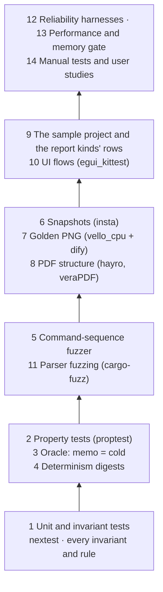
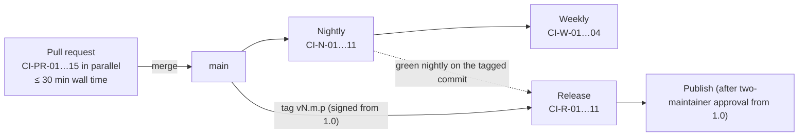

# Quality engineering, security and release: scope, test strategy, performance and CI

A chapter of [Quality engineering, security and release](18-quality-security-release.md), whose table says where each section lives.

---

## 1. Scope and boundaries

| Topic | Specified here | Specified elsewhere |
|---|---|---|
| Test layers, harnesses, CI jobs, gates | All | The sample project: `fixtures/sample/` (§3.10); kittest flow content: [16](16-ux-ui.md); fault-injection design: [05](05-project-format-and-persistence.md); fuzz targets and corpora per format: [14](14-interop.md) §11–§12, [10](10-plc-and-bus.md), [12](12-panel-layout.md) |
| Performance | Fixture generator, measurement, gate | Budgets: 02c §2 |
| Security | Threat model, vulnerability process, `unsafe` policy, supply chain, signing | Trust store: 05 §13.4; trust prompt, MCP, plugin sandbox: [17](17-extensibility.md); parser limits: 14 §11 |
| Privacy | Data flows, network sandbox, crash and log handling | First-run privacy step: 16 §9.1; personal-data export option: [09](09-reports-forms-output.md) |
| Release | Cadence, versioning, packaging, updates, support | Format version rules: 05, ADR-0011; steward entity and governance: [19](19-open-source-governance.md) |
| CRA | Role analysis, obligations mapped to evidence | Legal-entity decision: ADR-0030, 19 |

**Terminology.** In this document "release" means a release of the EW software. Releasing a drawing revision is a
*revision release* ([15](15-checks-revisions-collaboration.md) §5.5). "GP" is the golden project (Golden A unless a
variant is named), retired at 0.3.5 (see the [glossary](glossary.md)); the sample project replaces it (§3.10). Verification codes PR, N, R, M, S and A are those of 02c §1.2; **N-weekly** is a weekly subset of
N.

---

## 2. Concepts and data

### 2.1 Quality artefacts

None of these is project model data. They are repository, CI or local diagnostic data.

| Artefact | Location | Format | Owner | Rule |
|---|---|---|---|---|
| The sample project | `fixtures/sample/sample.ew/`, made by `fixtures/sample/sample.uiscript` | JSONL | Here | Written by `cargo xtask gen`, checked byte for byte by a test (§3.10) |
| Test tables, release fixture | `fixtures/tables/` (the CSV bootstrap's tests), `fixtures/release-min/` (the release tests) | CSV, JSONL | Here | Committed |
| The pilot's QET files and the reference PDF | Private store, reachable only by CI-N-10 | `.qet`, PDF | Here | Never in the public repository |
| Synthetic fixtures S, M, L, XL, XL-A (target) | Generated by `ew-testkit gen`, cached by (generator version, seed hash) | JSONL | Here | Never committed (XL-A is about 250 MB) |
| Format fixture corpus | `fixtures/format/<format>/` | One project per released format | 05 | Never deleted (NFR-REL-05) |
| Snapshots | `crates/*/tests/snapshots/` | insta `.snap` | Crate owner | Reviewed per change (§3.7) |
| Approved PNGs | the window's pictures (`crates/ew-ui/tests/`), `library/expected/png/` | PNG | Crate owner, library maintainers | Reviewed per change (§3.7) |
| Performance history (target) | `perf-history` store (orphan branch or artefact bucket) | JSON Lines, one row per (run, benchmark, class, metric) | Here | 90 days rolling, plus every release run kept |
| Fuzz corpora (target) | Separate repository `ew-fuzz-corpus` | Binary inputs | Here | Minimised weekly; crashes become committed regression inputs |
| Hostile corpus | `crates/ew-testkit/hostile/` | Own files, CC0 | 14, here | Committed |
| Threat model | `docs/security/threat-model.md` | Markdown, TM-nn rows (§11.1) | Here | Reviewed every minor (NFR-SEC-01) |
| Release evidence | Release assets | CycloneDX JSON, Sigstore bundles, `SHA256SUMS` plus signature, notices | Release pipeline | Permanent |
| Update manifest | Project web site, `update/v1/<channel>.json` plus `.sig` | JSON | Release pipeline | Per release (§9.3) |
| Crash report | OS state directory, `crashes/<id>/` | Minidump, log tail, `report.json` | Application | 30 days or 20 reports (§12.3) |

### 2.2 Relationship to the domain model

- **One mutation path.** Harnesses drive projects only through the `Session` API (ARCH §5.1): the same
  `Command → Transaction → Op` path as users. `ew-model` tables are `pub(crate)`, so a test cannot corrupt a model
  behind the invariants (NFR-MAINT-01).
- **Stable test IDs.** The dev-only crate `ew-testids` offers a seeded UUIDv7 source (`SeededSource`, `seeded_ids`)
  for `ew-ids`' generator: the timestamp comes from a counter and the random bits from a seeded ChaCha stream.
  Snapshots and digests therefore contain stable IDs. Every edge to the crate is a dev-dependency
  (`cargo xtask rules`), so it changes no feature of `ew-ids` and no package set builds
  `ew-ids` a second way. The release pipeline asserts that the crate is absent (CI-R-09).
- **Personal data.** `Party.personal_data` ([03](03-domain-model.md) §5, FR-PRJ-024) feeds the crash scrubber's
  token set (§12.3) and the "omit personal data" export test (NFR-PRIV-06).
- **Derivation profiles** (ADR-0003). Every shipped profile has its own `expected/` set, so the golden outputs are
  tested per profile (NFR-REL-09).
- **Committed computations** carry an `input_hash`. The determinism tests include routing (1.0), so the hash must be
  identical on every platform, or EW-LAY-011 would flag lengths as stale after a checkout on another OS.
- **Test-build hooks.** The hooks the tests need are a debug build's (`cfg(debug_assertions)`), no feature: the
  row dumps, `Preview::ops` and the history's ops of `ew-commands` (ARCH §3 rule 1), the structural check after every
  command, the test fixture of `ew-model`, and the shell's tool, ID-source and job hooks of `ew-viewmodel`. So the
  tests and a plain debug build (`cargo build -p elektrawatt`, the headless pictures, `ew`) compile every crate the
  same way, and a change rebuilds the crates above it once (T1); a release build, every shipped binary, has none of
  them. The confirmation hook of `HumanOnly` subcommands (§3.15) is realised as an injected terminal, not a feature;
  the `ew/test-confirm` ban stays as a guard.

---

## 3. Test strategy

### 3.1 The pyramid



| # | Layer | Tool | Scope | Cadence | Main requirement |
|---|---|---|---|---|---|
| 1 | Unit, invariant, rule | cargo-nextest 0.9.148 | Per crate; one test per invariant of `ew-model/invariants.md`; positive and negative fixture per rule | PR | NFR-MAINT-06 |
| 2 | Property | proptest 1.12.0 | Algebraic laws (§3.3) | PR 256 cases; N 20,000 | NFR-REL-04, NFR-REL-08 |
| 3 | Oracle differential | `ew-testkit::oracle` | Memoised = cold after each transaction (§3.4) | PR sampled on the sample project; N all memos | NFR-REL-08 |
| 4 | Determinism | `ew-testkit::digest` | Order, threads, platform, locale, clock, path (§3.5) | PR (Linux); N (cross-platform) | NFR-REL-07, NFR-I18N-03 |
| 5 | Command fuzzer | cargo-fuzz 0.13.2, `arbitrary` | Random command streams with oracle, undo and round trip (§3.6) | PR 60 s; N 1 h | NFR-REL-08 |
| 6 | Snapshots | insta 1.49.0 | Typed query outputs, import batches, exports, engine statistics | PR | NFR-REL-09, NFR-PERF-20 |
| 7 | Visual | vello_cpu 0.3.0, dify 0.8.0 | The window's pictures and every shipped symbol | PR | FR-EXT-004, FR-OUT-014, FR-OUT-018 |
| 8 | PDF structure | hayro 0.8.0; veraPDF (external CLI) | Outline, links, labels, fonts, dates, PDF/A-2b; PDF/UA-1 at 1.0 | PR (path-filtered), N | FR-OUT-002, FR-OUT-004 … FR-OUT-009 |
| 9 | The sample project | `sample::the_committed_sample_is_what_its_script_makes`, the report kinds' rows (`report_kinds.rs`), the written PDF (`pdf_output.rs`) | The sample project (§3.10) | PR | NFR-DOC-04 |
| 10 | UI | egui_kittest 0.37.0 | Flows of 16; accessible-name walker; CVD, contrast, pseudo-locale, 300 % | PR | NFR-A11Y-01 … 04, NFR-I18N-02 |
| 11 | Parser fuzzing | cargo-fuzz 0.13.2 | Every parser of external bytes (§3.12) | PR ≥ 60 s per changed target; N ≥ 30 min per target | NFR-SEC-02, NFR-SEC-03 |
| 12 | Reliability | Fault injector, kill loop, soak | Save, journal, recovery, worker crashes | PR (failures), N, N-weekly (soak) | NFR-REL-01 … 03, NFR-REL-12 … 14 |
| 13 | Performance | criterion 0.8.2, puffin 0.20.0 | §4 | PR (exact counts); N (timings) | NFR-PERF-01 … 20 |
| 14 | Manual, studies | Protocols | RDP without GPU, screen readers, printers, installers, usability | M, S | NFR-PLAT-03, NFR-A11Y-02, NFR-UX-01 |

Layers 11 (cargo-fuzz) and 13 (criterion) and the PR, N and R cadences are the 1.0 target. During the alpha layer 5
runs as a test of `ew-testkit` and layer 9 as a test of `ew-api`.

### 3.2 Unit, invariant and rule tests

- **Invariants.** Each invariant ID has a test that builds the violating transaction and asserts the outcome.
  Structural invariants reject the transaction. Prevent rules reject it in strict mode and yield a message in lenient
  mode. Example for D-11: `SetFields{terminal: -X1031:8, designation: ""}` is rejected in strict mode, and the lenient
  QET import reports it as MF-08.
- **Swaps.** Transaction-end evaluation is tested directly: swapping the designations 3 ↔ 4 on -X1031 in one
  transaction commits, while setting 3 to "4" alone is rejected (D-12).
- **Exhaustiveness.** The field-mask test of ARCH §4.1 fails when a link field is added without an index
  declaration. A schema test fails if `Page` gains a revision or title-block text field (D-05, D-06).
- **Rules.** Every shipped rule has a positive and a negative fixture, and its `docs` reference resolves (NFR-DOC-02).
  A deliberately slow test rule must be demoted to deferred (NFR-PERF-09).

### 3.3 Property tests

Two generators make the steps. The property tests of the commands (`ew-commands/tests/it/props.rs`) and of the
model (`ew-model/src/tests/props.rs`) draw a plan from proptest and resolve each step against the live records of
the mini model, by index, so a sequence stays meaningful whatever the earlier steps did; when a law fails, proptest
shrinks the sequence to a minimal one. The command fuzzer of §3.6 is the second, over the sample project.

| Law | Checked on |
|---|---|
| `undo(all) ∘ apply(cmds) = id`, for the model digest and every derived digest | the mini model, the sample, S |
| `load(save(m)) = m`, and `save(load(save(m)))` byte-identical to `save(m)` | the sample, QET corpus, S |
| Incremental saves after every step are byte-identical to a full save of the final model (NFR-REL-16) | the sample |
| `merge(o, a, a) = a`; `merge(o, o, b) = b`; for disjoint edits `merge(o, a, b) = merge(o, b, a)` | the sample's records |
| preview + commit = execute; journal replay = live state | the mini model, the sample |
| Renumbering keeps every `Id` reference; the tag map old → new is a bijection | renumbering steps |
| Re-importing the same source yields identical IDs and an empty diff (FR-IMP-002) | QET corpus |
| A hit-test result lies in the item's bounding box; a routed length ≥ the Euclidean distance (1.0) | S, layout fixture |

The undo law holds for `library.embed` too: the keep-alive of an embedded copy that a `LibRef` names is the
delete-time rule EW-INV-021, which the edit path evaluates and the history path of undo and redo
(`Model::apply_history`) does not, because the state before the embedding is valid (ADR-0009 amendment 7;
[architecture](04a-model-editing-persistence.md) §4.6, §5.3). The command fuzzer's undo-all oracle covers the case.

The model-level property tests of `ew-model` (`src/tests/props.rs`) generate
batches of steps over a fixture with named rows. **A step whose fixture row is gone is a no-op**: a generated step that
names a fixture row (an FnDef copy, a page, a location node) which an earlier delete plan of the sequence removed is
skipped, not issued, because the model rightly refuses it and the generator's "rejected unexpectedly" assertion would
report a test defect as a model defect (`AddAuxFunction` after its FnDef copy was removed). Proptest regression seeds are committed (`proptest-regressions/`) with the crate's SPDX header, which the
licence-map check requires of every committed file, and every shrunk counterexample also becomes a named,
deterministic replay test.

### 3.4 Oracle differential: memoised versus cold

The oracle catches the architecture's top risk: a stale memo silently recreating the D-01 class (ARCH §16, risk 1).

```text
after Session::commit(tx) in oracle mode:
  keys := memo keys read by the view-models of this frame
        ∪ sample(all live memo keys, k, seed = (run_seed, rev))      # PR: k = 64; nightly: k = all
  for key in sort(keys):
    memo := memo_store.get(key)                       # may verify, re-execute or hit
    cold := Q::cold(snapshot).eval(key)               # fresh request-scoped cache, no memo store
    if memo != cold:                                  # Eq, or 128-bit hash for bulky values
      fail(OracleMismatch { tx.command, key, diff(memo, cold),
                            trail: explain(key) })    # same output as `ew query --explain`
```

- **PR:** the AC-16 script on GP (rename T55, move -102F2 by one cell, renumber folio 103 → 104, change the 24 V DC
  colour), followed by 500 generated commands.
- **Nightly:** every memo on every fixture up to M, plus the command-fuzzer stream.
- **Policy changes.** A PR that promotes a query to `Memo` (ARCH §6.1) runs the nightly-level oracle on GP and S
  before merge.
- **Developers and users.** Debug builds run the oracle with k = 8 on every commit. `ew verify-derived` is the
  user-facing equivalent (FR-EXT-005).

### 3.5 Determinism

| Variation | Method | Compared | Cadence |
|---|---|---|---|
| Record order | The loader permutes lines within each file and the file order (seeded) | JSONL after save, findings, PDF/SVG/CSV digests | PR |
| Threads and spawn order | `RAYON_NUM_THREADS` = 1, 2 and 8; job submission order shuffled | Export digests, routing (1.0), the production package (1.0) | PR |
| Platform | Same commit on Windows and Linux | SHA-256 of GP PDF, SVG, CSV, XLSX, JSONL and the production package; PNG within the dify tolerance (ADR-0015 amendments 3 and 6; NFR-REL-07 and FR-OUT-014 say the same) | N; release gate (AC-14, FR-OUT-019) |
| Locale, time zone | `LC_ALL` en_US, nl_NL, de_DE, tr_TR; `TZ` UTC−10 and UTC+14 | File and PDF digests | N |
| Wall clock | Two runs with the clock faked 24 h apart; `SOURCE_DATE_EPOCH` unset | Output digests | PR |
| Build-time data | Every CI and release build asserts that `ICU4X_DATA_DIR` is unset: the build scripts of the ICU4X data crates read it, and other segmentation data would change line breaks and so every text layout. Every release build of `elektrawatt` also asserts `PKG_CONFIG=false` and no target-specific `PKG_CONFIG_*` variable, so x11-dl's build script bakes no build-host library directory into the binary (§5.4) | The assertion itself | PR; release (CI-R-03) |
| Project path | The same project opened from two directories, one named with spaces and non-ASCII | Digests (no absolute path in any output) | PR |

**Static rules** (NFR-MAINT-12). In crates that produce persisted or exported bytes (`ew-format`, `ew-model`,
`ew-derive`, `ew-rhai`, `ew-commands`, `ew-checks`, `ew-text`, `ew-reports`, `ew-scene`, `ew-export`, `ew-plcaddr`,
`ew-caex`, `ew-plc`, `ew-panel`, `ew-sqlview` and the importers), `clippy.toml` sets:
- `disallowed-types`: the hash maps and sets of `std::collections`, `hashbrown` and `imbl`. Use `BTreeMap`,
  `imbl::OrdMap`, `IndexMap` with a defined insertion order, or sorted vectors.
- `disallowed-methods`: `SystemTime::now` and `Instant::now` (except through the `ew-ids` UUIDv7 generator, which the
  seeded source of `ew-testids` replaces in tests, and the allowlisted tracing wrapper), `rand::thread_rng`, `Uuid::new_v4`, `Uuid::now_v7`
  outside `ew-ids`, and `std::env::var` outside the settings module.

The two rules are workspace-wide, not limited to the output crates, and are part of the generated root
`clippy.toml` (`cargo xtask gen`; the lists are `DISALLOWED_TYPES` and `DISALLOWED_METHODS` in `xtask/src/raw_read.rs`).
`disallowed-types` lists `std::collections::HashMap` and `HashSet`, `imbl::HashMap` and `HashSet`, and
`std::hash::RandomState`; `hashbrown` is not listed, because no workspace crate names it. `disallowed-methods` lists,
after the raw readers of ADR-0001 amendment 2, `std::time::SystemTime::now` and `Instant::now`, `std::env::var`,
`var_os`, `vars` and `vars_os`, `std::hash::RandomState::new`, `getrandom::fill`, `fill_uninit`, `u32` and `u64`, and
krilla's GIF and WebP image constructors. `Uuid::new_v4`, `Uuid::now_v7` and the `rand` functions are listed with
`allow-invalid = true`: `uuid` has the `v5` feature only and `rand` 0.10 without its `thread_rng` feature is loaded by
`proptest` alone, so the paths do not resolve today and bite when a crate enables a generator, which `cargo xtask rules`
bans outside dev edges. The rule is not scoped by crate or module ("outside `ew-ids`", "outside the settings module"): a
use is allowed with `#[allow(clippy::disallowed_types)]` or `#[allow(clippy::disallowed_methods)]` and a one-line
justification. The four reader crates (`ew-model`, `ew-derive`, `ew-commands`, `ew-store`) opt out of
`disallowed_methods` at their target roots, so the rule does not reach them. The sanctioned sources are the `ew-ids`
generator and the program boundary (the clock, lock record, session ID and state directory of `ew-store`,
`SOURCE_DATE_EPOCH` and `EW_CONTENT_DIR` of the `ew` CLI, the settings module); none reaches project data or an export
except the sanctioned `SOURCE_DATE_EPOCH`.

*Target for 1.0; not in the repository during the alpha.* A reviewed list of the allow sites
(`check-ordered-collections`, `check-disallowed-methods`), per-reader-crate `clippy.toml` files so that clippy enforces
the rule in the reader crates by path resolution, and `temp_dir`, `current_dir`, `home_dir` and `process::id` on the
list. Until then review covers what the lint does not catch: a call through an alias, a re-export or a macro, a hash map
or set that a third-party API returns, the hash containers of `hashbrown`, `ahash`, `rustc-hash` and `dashmap` (none is a
dependency today), and type aliases, which `disallowed-types` does not see through.

A derive check in `ew-schema` rejects `f32`/`f64` fields in persisted records (ARCH §7.3).

### 3.6 Command-sequence fuzzer

The fuzzer is the test module `crates/ew-testkit/tests/it/command_fuzz.rs` with its folder of arms, run on the
sample project with a few records more and no sanitizer. A seeded SplitMix64 generator picks
its targets by index into the live records read through `Session::query` (so the no-op rule of §3.3 holds by
construction) and drives the registered commands over the sample project with the oracle on: hand arms build well-formed steps
and deep states, and a schema-driven arm builds a step for every registered command from its parameter schema. The
command decides acceptance and the fuzzer asserts invariants: no panic and no internal error; all or nothing; for a
committed undoable step the undo law (undo restores the model before it, redo the committed model, both by
`Model::content_eq`); the structural check (`Model::integrity_check`) after every changing step; a sample of memoised
reads whose oracle mismatches must be empty; the save-and-reload round trip (incremental saves, a reader reopens the
directory, the models are `content_eq`); the CSV table import, strict and lenient; and a whole run of one seed gives
the same outcome list and final model. A failure prints the seed, the step and the command log. `fuzz_smoke` (one
short seed) runs with the targeted tests; `fuzz_long` is `#[ignore]`d (the deep run) and takes `EW_FUZZ_SEEDS`,
`EW_FUZZ_STEPS` and the wall-clock budget `EW_FUZZ_BUDGET_SECS`; `EW_FUZZ_TRACE` prints every step.

*Target for 1.0; not in the repository during the alpha.* A nightly `fuzz_long` run (CI-N-02), the cargo-fuzz form of
the same generator as a target `command_sequence` whose tape bytes steer the generator's draws, and AddressSanitizer
runs of both on a nightly toolchain pinned by date, because the dependency closure contains `unsafe` code.

### 3.7 Snapshots

- **What is snapshotted.** Typed query outputs on GP: tags, xref texts, potentials with aliases, wire properties with
  provenance, BOM rows in both modes, terminal, cable and PLC rows, check findings, engine statistics. Also import
  batches of the QET corpus, AML and PLCopen exports, DXF text and the canonical GP JSONL.
- **Format.** Row data is stored as CSV inside `.snap` files, so diffs read like report changes.
- **Review rule** (target for 1.0; today the owner reviews the diff). CI runs with `INSTA_UPDATE=no` and fails on any pending snapshot. A PR that changes snapshots
  carries the label `snapshots-changed`. A reviewer other than the author signs off each changed file.

### 3.8 Visual goldens

- **Rendering.** `ew render --page <folio> --png --dpi 150` (FR-EXT-004) runs in deterministic mode: the CPU
  backend's scalar path if one exists (ADR-0015 amendment 3), bundled fonts only, no system fonts.
- **Comparison.** dify against the approved PNGs, failing above 0.5 % differing pixels. Per-symbol PNGs
  of the shipped library are rendered at 300 dpi.
- **Artefacts** (target for 1.0). Diff images are uploaded as CI artefacts, and a bot comment links base, head and overlay.
- **Parity.** GPU/CPU parity samples run where the runner has an adapter (FR-OUT-018).
- **Updates.** Approved PNGs change only through the snapshot review rule of §3.7.

### 3.9 PDF structure

| Check | Method | GP expectation |
|---|---|---|
| Frame geometry | The in-repo PDF reader (`crates/ew-api/tests/page_output/pdf_read.rs`, test code, no dependency) extracts the stroked lines in printed mm, compared with `geometry/frame.json` | ±0.2 mm (AC-01) |
| Raster parity | hayro (the candidate) rasterises each page, dify compares it with the vello_cpu PNG | Within tolerance (FR-OUT-018) |
| Outline | Entry count and titles | Front matter, sections 1, 2, 9, every folio (FR-OUT-004) |
| Links | Link annotations and named destinations | 64 xref links (one per listed item: 63 linked texts with 64 targets; a link covers the item's glyph span only) plus report back-links; every destination resolves (AC-13) |
| Page labels | `/PageLabels` | Physical page 6 is labelled "101" (D-33) |
| Fonts | Embedded, subset (`ABCDEF+` prefix), no Tahoma | AC-13 |
| Text | Extracted text keeps spaces | "SK 3110.000" (FR-OUT-008) |
| Metadata | XMP and Info dates from the model or `SOURCE_DATE_EPOCH`; document ID a hash of the export input | No wall-clock value (NFR-REL-07) |
| Conformance | veraPDF, PDF/A-2b profile; PDF/UA-1 profile at 1.0 (**verify**) | Pass |

`crates/ew-api/tests/it/pdf_output.rs` writes the sample project's PDF and reads it back with an in-repo
reader (`crates/ew-api/tests/page_output/pdf_read.rs`: indirect objects, Flate streams, page tree, content streams,
ToUnicode maps; test code only, no dependency), not hayro: the frame lines of a drawn page against its frame form's
geometry within 0.2 mm (AC-01), the document's structure (AC-13), the text layer of a page against the glyph runs it
prints (AC-06, AC-13), and the same bytes for a shuffled record order and a parallel export (AC-14). It pins no
digest. hayro stays the candidate for the raster-parity row. `frame.json` lists the stroked lines of a form's own
`graphics` too (the cover's rules and project data box, pinned by `crates/ew-scene/tests/it/forms_content.rs`).

the metadata row holds: the document ID is krilla's hash of `ew-pdf/1 <project id> <profile> <date> <pages>[ mono] ew <version> sha256:<digest>`, the digest covering every exported page's display list, label, titles, size and destination and the pinned SHA-256 of every bundled font, so a content change changes the ID and the same content loaded any way gives the same ID. The PDF is written to a temporary file, synced and renamed; `ew export svg` replaces its `--out` directory as a whole and refuses one that holds anything but SVG files.

veraPDF is a test tool run from a pinned container image with a checked digest. It is never distributed. No test
requires it: krilla's PDF/A-2b validator (`Conformance::PdfA2b`) checks every export, and the veraPDF cross-check is
the CI job of the 1.0 target.

### 3.10 The sample project and the acceptance criteria

No runner checks the criteria AC-nn and the defect rows D-nn as one report; the sample project and the tests of
each behaviour hold them:

- **The sample project** `fixtures/sample/sample.ew` is the tests', the guide's and the release's project. The UI
  script `fixtures/sample/sample.uiscript` makes it through the window's own actions (the new-project wizard with
  the standard report layout, the drawn pages 101 to 105, 201 and 902, the generated reports); `cargo xtask gen`
  writes it, and `sample::the_committed_sample_is_what_its_script_makes` (`ew-viewmodel`) compares the committed
  folder with what the script makes, byte for byte. `the_sample_opens_in_place_without_a_finding` holds
  it free of any finding under the pre-delivery checks. Tests open it read-only in place or take a copy (`ew-testdir`).
- **Each behaviour has its own tests**, at the lowest layer that shows it: the rules in `ew-checks`, the report kinds
  in `ew-reports` and in `ew-api`'s `report_kinds.rs` (`tests/expected/kinds/`), the written PDF in `ew-api`'s
  `pdf_output.rs` (§3.9), the memoised values against cold evaluation in `memo_oracle.rs` (AC-16), the CSV bootstrap
  on `fixtures/tables/`, the release on `fixtures/release-min/`. No test compares a whole check run's finding set.
- **Criteria still ahead** (those of M4 and 1.0) are restated on the sample in their milestone's file when it is
  planned. The requirement tables ([02a](02a-requirements-core.md), [02b](02b-requirements-extended.md),
  [02c](02c-nonfunctional-requirements.md)) keep their acceptance column as it was written on the reference.

### 3.11 UI tests

egui_kittest drives `ew-ui` in-process over GP. The flow content belongs to [16](16-ux-ui.md) (AC-28, the five core
tasks of NFR-A11Y-01, Escape cancelling every tool for NFR-UX-07). This document provides the jobs:
- **Interaction tests** run without rendering on all three OSs.
- **Image snapshots** run on Linux with a pinned Mesa lavapipe and on the Windows WARP job (**verify** kittest's
  wgpu path on both).
- **Accessible-name walker.** It traverses the AccessKit tree after each flow step and fails on any interactive node
  without a name.
- **Other jobs:** CVD-simulated renders of folio 102 with 24VDC-1 highlighted; a contrast lint over theme tokens; the
  pseudo-locale build (+35 % length); keymap reachability per layout; 300 % scale snapshots.
- **Watchdog.** A `tracing` subscriber fails any test in which a UI-thread span exceeds 100 ms (NFR-PERF-19).

The shell's tests are ordinary nextest tests: `ew-viewmodel` (the registry invariants, the shell transitions on
a copy of the sample, settings, the UI-script parser), `ew-ui` (kittest interaction flows without rendering, each followed
by the accessible-name walker; the viewer flows; the census of every
window surface, `tests/it/census.rs`, which opens each menu path, dialog, pane and navigator on a writable copy of
the sample and applies the rules R1 to R6 of `assert_accessible`) and `elektrawatt` (the headless smoke script through the
built binary, with the snapshot of folio 103 against `ew render`'s PNG of the sample and the PDF against `ew export pdf`'s bytes). They
need no display or GPU. The pixel gate (§3.17) runs on Windows (WARP); the Linux images (Mesa lavapipe pinned) are the
target. A picture of a dialog's or a card's buttons is compared on Windows only, since the buttons stand in the
platform's order (doc 16a); on Linux its test prints that it is skipped. The suite asserts no time and runs no UI-thread watchdog. A kittest assertion on tiles follows the rule of
§3.14.

### 3.12 Parser fuzzing and hostile input

- **Targets.** Every target listed in 14 §11 (`qet_project`, `qetz`, `edz_7z`, `edz_zip`, `dxf`, `table_xlsx` …),
  plus the AML, GSD, GSDML and IODD targets of 10, the JSONL loader and migration chain, `.ewz`, the merge driver and
  textconv (git runs both automatically on fetched content), the STEP IPC decoder, the
  machine feedback and status-log parsers (13 §11.3, 1.x), the SQL sandbox (hostile SQL text against the
  authorizer) and rhai formula evaluation under its limits. The limits themselves are FR-IMP-005 and NFR-SEC-02
  with the per-parser values of 14 §11.
- **Properties per target.** No panic. The batch validates against the `ew-schema` JSON Schemas. `ApplyImport` on an
  empty project either commits in lenient mode or refuses with a report, and never violates a structural invariant.
- **Resource limits.** A counting global allocator in fuzz and hostile-corpus builds measures peak allocation
  independently of the OS. A target fails above 256 MB extra or 1 s per input (NFR-SEC-02).
- **Hostile corpus**, committed and CC0: a ZIP bomb, a nested 7-Zip bomb, a billion-laughs DTD, an archive entry
  named `../../x`, an absolute or drive-letter entry, a QET file with a NaN coordinate, a QETZ database with a trigger
  and a view, and a GP copy whose page file is a symlink (NFR-SEC-16).
- **Toolchain** (target). cargo-fuzz needs nightly, so `fuzz/rust-toolchain.toml` pins a dated nightly, advanced by the upgrade
  train (§6.3).
- **Today.** The cargo-fuzz crate `fuzz/` with its targets, seed corpora and replay test is not in the repository
  during the alpha. The hostile inputs run as an ordinary test: the `hostile_corpus` binary of `ew-testkit`
  (`crates/ew-testkit/tests/hostile_corpus`, the inputs under `crates/ew-testkit/hostile/`) reads them through each
  parser's public entry point, and its counting global allocator holds every input under 256 MiB. The cargo-fuzz
  targets above, the libFuzzer limits and the nightly pin are the target for 1.0.
- **Release rule.** An open fuzz crash blocks the release (RC-02).

### 3.13 Reliability harnesses

These harnesses are designed in 05 and run here:
- the fault injector: 1,000 kill points per file system on ext4, NTFS and APFS (NFR-REL-01, N);
- ENOSPC and EACCES injected at each save step (NFR-REL-03, PR);
- a `kill -9` loop at 10 commits/s with replay comparison (NFR-REL-02, N);
- a forced-panic test on the UI thread that expects a minidump, a log and a recovery offer (NFR-REL-13, PR), and
  one inside an import job that expects a failed job, a crash record and a running session (§12.3, NFR-REL-12, PR);
- a hostile STEP input that kills the worker and a non-terminating rhai script, each with an unchanged model digest
  (NFR-REL-12, PR);
- release fault injection: `ew revision release V2.0`, confirmed through the test-build confirmation
  hook (§3.15), is killed at random points of the six release steps of 05 §14.1; afterwards V2.0 is either Open with
  no archive or tag referenced, or Released with an archive that verifies (NFR-REL-15, N; one kill point per step on
  PR);
- the 8-hour soak on the M fixture (NFR-REL-14, N-weekly, 1.0).

### 3.14 Flaky tests

PR CI never retries a test. Only named infrastructure steps are retried: downloads in the fetch stage and runner
provisioning. A test that fails nondeterministically is quarantined within one working day with an issue and an
owner. Quarantined tests keep running nightly. More than 10 quarantined tests block the next release
(NFR-MAINT-13). A randomised test (proptest, the command fuzzer) that fails on one platform and not on another is not
flaky: its committed regression seed (§3.3) replays the counterexample first on every run and platform, and the cause is
fixed or triaged before the gate re-runs.

*Tile-count assertions (rule).* A test that counts the tiles of a canvas (or of the page
pool) must not depend on delivery timing: tiles reach the cache when the render worker's results arrive, which a
loaded runner or a full parallel run delays, so an assertion such as "N tiles are cached after M frames" passes alone
and fails under load. Two kinds of tile assertion are allowed: a **structural** one (the frame the pane draws is
complete in its first frame because the pane's content is already cached, or a bound that holds whatever has been
delivered, such as "never more than the share") and one that **waits for a condition** with a bounded number of
frames and fails with the state it reached (never a sleep and never a wall-clock bound, §3.16). Example: the kittest
flow V11 (a tab returned to after another tab was shown) asserts that the returned-to hidden tab draws complete in its
first frame, which is deterministic (§3.11).

**CI time budget** (target). The pull-request checks stay within 30 min wall time, measured as the longest chain of jobs
(NFR-MAINT-05); per-job times are the diagnostic, and a job stopped by its timeout counts as a failure, not as a
cancel. A partitioned test run is balanced by test time, not by test count. During the alpha `.config/nextest.toml` has
one profile and retries nothing.

*Retries in the evidence jobs* (target). The image pulls of `headless` and `verapdf` are named infrastructure steps in the sense of the first paragraph: each is tried three times with a back-off. When the third try fails, the job fails with an error saying that it has no evidence without the image; an evidence job never passes, skips or turns neutral without its evidence. A test inside such a job is never retried.

### 3.15 Test-build confirmation hook

`HumanOnly` subcommands (`ew revision approve|release|withdraw`, `ew waiver add|remove`, `ew trust …`,
`ew plugin install|remove`) ask the person to type the revision label, rule ID or keyword on the controlling
terminal, and exit 2 without one ([17](17-extensibility.md) §2.3). The release fault-injection test (§3.13)
must still run these subcommands in CI. The hook makes that possible without weakening release builds:
- **What it is.** A cargo feature `test-confirm` of the `ew` binary. With it, the confirmation step accepts the
  typed answer from `ew-testkit` through an inherited pipe named by the harness, instead of from the terminal. The
  subcommand still runs its read-only part first, prints the change summary and compares the answer exactly as it
  would compare a terminal answer, so a wrong label still refuses.
- **What it is not.** It adds no `--yes` flag, no environment-variable bypass in release builds and no path for
  command logs, scripts, MCP, plugins or Python: those origins are refused with `CmdError::Exposure` before the
  confirmation step, with or without the feature.
- **Where it may exist.** Only test targets and the `ew-testkit` harness enable it. `cargo xtask rules` fails a non-test
  target whose resolved graph enables `test-confirm`, and CI-R-09 asserts (target for 1.0) that the feature's canary
  string is absent from every release binary, like the egui `inspection` feature.
- **Its own tests** are the `HumanOnly` rows of §11.5.

### 3.16 Cross-platform source rules

Rules that a local run on one OS cannot see:
- **No `#[path]` attribute inside an inline module.** Inside `mod tests { … }` of `src/foo.rs` a `#[path]` is
  resolved against the directory `src/foo/tests/`, which need not exist. Windows normalises `..` lexically and
  accepts the path; Linux resolves each component on disk and fails, which breaks `cargo fmt` and the test
  builds there. A module that borrows a shared file (a test fixture builder) is declared at file level, where the
  path is relative to the file's own directory.
- **No edition-2024 let chains in the permissive crates.** `if let … && let …` needs Rust 1.88, and the permissive
  crates build with their MSRV 1.85 (§6.2), which the MSRV job of CI-PR-09 checks (target for 1.0). GPL crates follow
  the pinned toolchain, but a pattern moved into a permissive crate must be rewritten (an early return and a plain
  `if let`).
- **The Linux steps run locally before a release.** The Linux steps of CI-PR-01 and CI-PR-02 (fmt, clippy, the workspace
  tests) run in a local Linux environment, for example WSL with the pinned toolchain, in addition to the Windows run.
- **No test asserts a time.** A test neither asserts a wall-clock bound nor waits on the wall clock: it waits on an
  event (a job's end, a tile or a preview ready, a file time it set) and bounds its frames by count.
- **rustdoc on both platforms.** `cargo doc` with `-D warnings` runs on Windows and in the local Linux environment
  before a release: a redundant explicit link target is a warning on the Linux toolchain only. Intra-doc links are fully
  qualified (for example ``[`crate::module::Item`]``) and carry no explicit target that repeats the path.

### 3.17 Blind drafter (gate agent)

**Purpose.** An outside view of large UI changes: an agent draws a cabinet with EW alone, as a user would, and reports what it could and could not do. The method is modelled on the blind player of a game-playtesting practice (the blind-player method): the player knows nothing the product does not teach, so every point where it gets lost is a finding. It gives early signals on NFR-UX-04, NFR-UX-05 and SC-9 and on product principle PR-13 of [00](00-vision-and-scope.md) §8 (the pilot's QET drawings are the content target, never the style or process target; designing a cabinet must become easier, faster and more fun than in QET). It does not replace the moderated usability rounds.

- **What it may read.** Only user-facing material: the user documentation, the UI, the CLI help and the output of its harness. Never the design documents, the code or the tests.
- **Run protocol.** The agent chooses its own task ("it can run whatever it wants") and writes a live note after every action. It keeps a patience score and a flow score; each has a quit rule. A step that fails twice is marked "broken" and the agent moves on. A run has a time cap and an action cap.
- **Fixed hand-back.** (1) A keep/drop score; (2) where it lost me; (3) what the tool is, in the agent's own words; (4) broken; (5) the drawing set compared against the project's design language, including the time a QET veteran would need for the same set; (6) a flow chart; (7) good.
- **Personas.** The QET veteran (modelled on the pilot's engineers, never named), the switcher from EPLAN or E3, and later the apprentice. A persona is a short brief that fixes habits and vocabulary, not knowledge of EW.
- **Harness.** `cargo xtask blind` with `start`, `do`, `note`, `stop` and `check`. One folder per run holds `drafter.md` (the notes), the replayable `.ewcmd`, the PDF and PNGs and the check report. The prompt is `tools/blind/BLIND_DRAFTER.md`, the personas are under `tools/blind/personas/`, and a compose script assembles the prompt of a run. `check` is
`start --kind check`; the run folder lies outside the repository; the replayable artefact is the UI script, and the
`.ewcmd` is kept as evidence; the reader reads the exported PDF instead of PNGs.
- **When.** Never in the headless run and never blocking. It runs only after a large UI change or a large feature implementation, before a release candidate. It uses task sheets and placeholder data only, never customer data.
- **Who.** The drafters run on Sonnet; an Opus lead reads the logs. Findings become follow-up tasks through the next design pass.
- **Parts.** The harness, the personas and the prompt.
- **What it drives.** The shell's headless mode: `elektrawatt --headless --script -` reads a UI script
  (`ew.uiscript/1`) line by line from stdin and answers each step with a transcript line (`ew.uitranscript/1`);
  `ui.describe` gives the visible UI as text, `page.describe` the page's content as text, `view.snapshot` a PNG, and
  `--record` keeps the run's `.ewcmd`; `--keep-going` lets a refused or failed step not end the run (exit 1 when any
  step was not done). The actions are the shell's action registry, each with a parameter signature, and the describe
  text's structural words are machine text that the drafter learns from the output, because it may not read the design
  documents.
  Every UUID the shell prints is shown as an alias `@n`, numbered by first appearance in the run's output, and a path under the
  run's working folder (an export's toast names its file's folder) is written relative to it, the folder itself as
  `.`, so that two runs of one script give byte-identical transcripts wherever they run; a script writes `@n` back
  where an action takes an id. The alias table is reset only at the start of a script run, an unknown alias fails the
  step naming it, and `id:@n` resolves where a reference with `id:` is accepted. Wherever
  the shell lists records it orders them by what a person sees, the id only as the last key. A `HumanOnly` command
  (`project.checks.set`, the wizard's `wizard.apply_check_scheme`) is refused in a UI script with `reason-human-only`,
  so the drafter cannot change the check scheme; the human path is the CLI subcommand `ew project checks set`, which
  asks for the scheme's name on the controlling terminal and exits 2 without one (FR-EXT-030).
- **How the harness runs.** `cargo xtask blind` (`xtask/src/blind/`, standard library only) drives the built binaries
  as processes: a loopback session keeper (the run's copy of `xtask`; the product itself opens no socket, so §12.2 is
  unchanged) holds the headless session between the agent's calls, or `--stateless` replays on every call. The harness
  refuses `command.run`, the snapshot actions, `path`-typed parameters outside the run folder and UUID parameters. Two run kinds exist: `free` and `gate` (a fixed task sheet with an oracle).
  A turn is one `do` call of 1 to 20 steps and one note with the patience and flow scores; a step is broken after two
  equal failures; quit and cap rules are counted, never timed. The UI script is the replay artefact, transcripts are
  compared after UUID and path normalisation, and the reader reads the exported PDF instead of PNGs. The procedure is
  `tools/blind/README.md`; recordings are under `tools/blind/recordings/`.

**The pixel gate.** The chrome is checked by an in-house offscreen pixel gate, not by `egui_kittest`'s `snapshot` and
`wgpu` features (rejected for the 13 packages they bring into the lock): egui-wgpu on `ew-render2d`'s headless
device renders the window, and each image is compared with its blessed PNG within a channel tolerance of 4/255 and a
small bound on differing pixels (at most 10 for the chrome images; at most one in 2,000 for the canvas images). It
runs in every test run of `ew-ui` on Windows (WARP), with no feature to switch it on; its Linux images
are not blessed at present. The frames of a visual run (`--visual --frames`, the persona harness), which no gate
compares, are painted on the default adapter instead: the GPU where there is one, as in the window.

The gated images are under `crates/ew-ui/tests/expected/`: `snapshots/` for the main window, the component gallery, the
command bar, the dialogs, the panes and single widgets, and `canvas/` for the overlays of folio 101.

**One image per screen**: a cropped screen is gated in light Comfortable only, plus dark
Compact for the DK12 panes; the theme tokens are gated by `theme.rs` (the token dump and the density rule) and the
whole window in light and dark at both densities by `main-*`, so a dark or Compact copy of every crop guards nothing
more. Nothing is rendered for review only: the high-contrast main windows, the gallery at ppp 2 and the review image
`table-history-*` were dropped.

---

## 4. Performance and memory gate

*Target for 1.0; not in the repository during the alpha.* No performance gate, `xtask perf`, benchmark harness or
performance baseline exists, and no performance claim is measured (§4.3). No bench source file remains.

### 4.1 Fixtures

`ew-testkit gen --class <S|M|L|XL|XL-A> --seed 1` builds the fixtures of 02c §2.1 deterministically:

1. **Base.** A project with every tag derived.
2. **Replicas.** r = ⌈class devices / base devices⌉ replicas. Each replica gets:
   - its own location node `+CAB-nnnn` and folio range;
   - IDs `v5("synthetic", class, replica, source id)`;
   - PLC station addresses and Q bytes offset per replica;
   - its own layout space.
3. **Cross-wiring.** Neighbouring replicas are joined by interruption points and shared supply potentials, so that
   global connectivity spans the whole project. Isolated replicas would understate the cost of the
   `potential_partition` hotspot (ARCH §6.7).
4. **Density top-up.** Synthetic control-circuit pages (relay ladders, terminal fan-outs) built from the starter
   symbol set are added until the connection, CP, terminal and channel counts reach the class bounds. GP has fewer
   than one wire per device, against the class ratio of 5.
5. **Trim.** Counts are cut to the exact class bounds and the per-class counts are written to `fixture.json`.

The generator version is part of the cache key and of every performance-history row. Changing the generator resets
the baselines (§4.4).

**Private pilot corpus.** The pilot's three QElectroTech projects, all class S (the largest has
34 folios, about 1,000 devices and 645 connections), are private test input. They are kept outside the repository and
in the private CI store, never in fixtures, logs or AI data sets beyond the agents that need them. Agents read only
sanitised derived lists; documents carry counts only. The corpus tokens are SHA-256 digests in `ci/denylist.sha256`,
checked by `cargo xtask rules`; the private smoke test prints counts only. The corpus shows the class-S
budgets on real projects and exercises the importer ([14](14-interop.md) §12).

### 4.2 Benchmarks

| Benchmark | Requirement | Classes | Metric |
|---|---|---|---|
| `start` | NFR-PERF-02 | — | Median of 10 cold starts |
| `open`, `warmup` | NFR-PERF-03 | S–XL, XL-A | First selectable frame; warm-up end |
| `frame.gesture` | NFR-PERF-04 | S–XL | p99 total and per phase over ≥ 1,000 frames |
| `commit.move`, `commit.wire` | NFR-PERF-05 | S–XL | p99 over 1,000 gestures |
| `render.pan` | NFR-PERF-06 | Dense A3; GP folio 103 | fps on GPU and on the CPU renderer |
| `profile.change`, `renumber.folio` | NFR-PERF-07 | S–XL | Commit plus visible-view update |
| `bulk.renumber.preview` | NFR-PERF-08 | S–XL | Time to preview, with a concurrent edit |
| `check.full` | NFR-PERF-09 | S–XL | Wall time |
| `reports.paginate` | NFR-PERF-10 | S–XL | Cold pagination of all blocks |
| `pdf.export` | NFR-PERF-11 | 500-page slice of L; GP | ms per page; total |
| `save.incremental`, `save.full` | NFR-PERF-12 | S–XL | Writer time; frame p99 during the save |
| `memory.peak` | NFR-PERF-13 | S–XL | Peak RSS; memo bytes per family |
| `sql.build`, `sql.refresh` | NFR-PERF-14 | S–XL | Wall time |
| `table.scroll`, `find` | NFR-PERF-15 | XL | Frame p99; find latency for "A9F78116" |
| `route`, `collision`, `step` | NFR-PERF-16 … 18 | L, XL, generated STEP | 1.0 |
| `part.search`, `part.reindex` | NFR-PERF-21 | Synthetic 500,000-part library | First 50 results; full index rebuild |
| `aml.export`, `aml.preview` | NFR-PERF-22 | XL (10,000 channels), with a concurrent scripted edit | Wall time (1.0) |
| `thermal` | NFR-PERF-23 | Largest layout space of XL | Recalculation time (1.0) |
| `package.export`, `wire_records` | NFR-PERF-24 | L; M | Export time and UI-thread holds; per-potential re-evaluation (1.0) |
| `import.qet` | NFR-PERF-25 | Reference-size file, 3.5 MB corpus file, M-class project, 24-file batch | Time to the import preview; batch time |

### 4.3 Runner and measurement

- **Runner.** Timings run on one dedicated bare-metal machine of the BM class (02c §1.4): x64, Linux, CPU governor
  `performance`, turbo off, benchmark threads pinned to isolated cores, no concurrent jobs.
- **Cold benchmarks.** Cold-start and cold-open runs drop the page cache through a privileged helper.
- **GPU-less.** BM-noGPU fps is measured on the same machine with the adapter hidden, forcing the CPU renderer. WARP
  fps runs on the Windows hosted job as an informational value.
- **Hosted runners.** Windows hosted runners record weekly informational timings. They never gate,
  because their noise exceeds 15 %.
- **Statistics.** Medians and p99 follow 02c §1.4. Gesture sequences are scripted, replayed through the `Session`
  API and timed with `tracing` spans.
- **Milestone runs** (target). Release-phase runs measure with the benchmarks of this section; no test asserts a
  wall-clock bound (§3.16).
- **No performance runs during development.** The measurements of this section run in the release phase, before a binary
  release gate, on the BM-class runner; until then a gate's performance criteria are assumed to pass, and a performance
  claim is marked "not measured". The timing rule of §3.16 stays.

### 4.4 Gate decision

```text
for each (benchmark b, class c, metric m) measured tonight on runner R:
  v       := median of 10 runs (single operation) or p99 over the samples (latency)
  budget  := 02c budget for (b, c); applies as gating from MVP for S/M and from 1.0 for L/XL
  over    := v > budget  or  (single operation and max(runs) > 1.5 × budget)
  base    := median of the last 7 green nightly values on main for (b, c, m, R, generator version)
  noise   := max(3 × MAD(last 7), floor(m))         # floor: 0.05 ms medians, 16 MiB peak RSS, 0 memory estimates and entry counts, 2 % throughput
  regress := v > 1.15 × base  and  v − base > noise
red if any (over and gating) or regress
```

- **On red.** A bisect job replays the gate over the commits merged since the last green run (at most 20, on the
  same runner) and posts the first bad commit to the tracking issue.
- **Baseline resets.** The baseline resets only through a commit labelled `perf-baseline-reset` with a stated reason
  (new runner hardware, generator change), reviewed like code.
- **Release.** A red gate blocks release (NFR-PERF-20).
- **Seeded slowdown.** The gate's own test seeds a 20 % slowdown into `potential_partition` and asserts that the
  gate turns red.

### 4.5 Engine statistics per PR

Timings are nightly, but **counts are exact on every PR**. For each scripted GP edit, an insta snapshot
records `{query family: (hits, verified, re-executed, cut-offs)}`. Examples of locked expectations:
- drawing a wire on folio 102 re-executes no query keyed to folio 203;
- the layer memos of unchanged display lists are backdated, so their GPU buffers stay;
- changing the 24 V DC colour re-executes `wire_props_of` only for the 24 V potentials (24VDC-1 … 24VDC-4 and
  aliases) and the colour table of folio 1.

A change in these counts is a reviewed snapshot change, never a silent one.

### 4.6 Memory gate

- **Peak RSS.** Read from the OS: `VmHWM` on the Linux runner, `PeakWorkingSetSize` on Windows.
  It is measured after open, warm-up, full check and PDF export.
- **Family budgets.** Memo bytes per query family come from `ew-memo` statistics. At XL the gate enforces memos
  ≤ 300 MB, undo ≤ 256 MB and the projection ≤ 500 MB file-backed (NFR-PERF-13).
- **Allocation counting.** The counting allocator of §3.12 checks the parser limits in the same job.

### 4.7 The nightly gate on the hosted runner

*Not built; target.* A nightly gate on the hosted runner would be report-only (§4.3): it would run
class S, compare medians and memory estimates with a committed baseline, and fail the job, as an infrastructure
failure and not as a performance verdict, when a bench cannot run.

---

## 5. CI pipeline

*Target for 1.0; not in the repository during the alpha.* There is no CI: the workflows ci, coverage, deep-nightly, docs,
fuzz, perf and weekly and Renovate are gone, and so are the `ci` command and the workflow check of `xtask`.
`.github/workflows/` holds `release.yml` and `package.yml` (§7.4), run by hand for a release. The catalogue below is the
design of the 1.0 pipeline, and its job ids are kept.

### 5.1 Flow



The PR set stays within 30 min wall time (NFR-MAINT-05); a monthly CI-duration report flags the slowest jobs.

At 0.1.0 the release starts from a candidate tag `v<X.Y.Z>-rc.<n>`: `release.yml` builds and checks it, writes `SHA256SUMS` and creates a **draft prerelease** with those files; the go is a dispatch of the same workflow with `candidate` and `dry` (default `true`), which verifies the draft's files again and publishes them byte for byte as `v<X.Y.Z>` on the candidate's commit, never rebuilding and never moving a tag. A blocker is fixed on the release branch and the next candidate is cut. No CI run is read: `verify` checks the tag's version and the release notes only.

### 5.2 Job catalogue

| Job | Content | Runner | Blocks |
|---|---|---|---|
| CI-PR-01 lint | `cargo fmt --check`; clippy `--workspace --all-targets -D warnings` with the §3.5 rules; `ew fmt --check` on fixtures; Fluent string-literal lint on `ew-ui` and `ew-checks` | Linux | Merge |
| CI-PR-02 test-linux | nextest over the workspace with the acceptance tests and the command fuzzer (the default-feature run whole, the all-feature run over the packages with a feature that the default run leaves off) and the doctests, including the shell's tests (kittest flows, the headless smoke and `elektrawatt --smoke`, §3.11); insta check; proptest short; oracle on GP; engine-statistics counts; acceptance (gate subset); SQL compile test; schema/fixture check; permissive-only sample reader (FR-COL-012, SC-11); forced-panic test; release fault injection, one kill point per step (§3.13); hostile corpus; the security tests of §11.5 (trust, SQL sandbox and statement gate, MCP binding, `HumanOnly`); UI-thread watchdog | Linux container (C compiler only, NFR-MAINT-09) | Merge |
| CI-PR-03 test-windows | nextest; kittest interaction; the pixel gate on WARP; NTFS path and permission tests; `EW_REQUIRE_GPU_ADAPTER=1` on WARP. The run may be split into parts that are balanced by test time, not by test count | windows-2025 | Merge |
| CI-PR-04 (removed) | Removed: macOS is not a supported platform. The ID is not reused | — | — |
| CI-PR-05 headless | `ew export pdf` and `ew render --page 103 --png` on GP with no display, no GPU, no system fonts and empty library directories (NFR-PLAT-04, NFR-REL-11); the PDF's SHA-256 equals that of the kittest GUI export of CI-PR-07 (FR-OUT-022, FR-EXT-001). | Linux container | Merge |
| CI-PR-06 output | Golden PNGs; PDF structure; veraPDF when `ew-scene`, `ew-export`, fonts or forms change; GPU smoke per backend where available (NFR-PLAT-02) | Linux, Windows | Merge |
| CI-PR-07 ui-a11y | kittest flows and image snapshots; name walker; CVD renders; contrast lint; pseudo-locale; keymap reachability; 300 %. | Linux (lavapipe) | Merge |
| CI-PR-08 fuzz-smoke | 60 s per changed parser target; 60 s command fuzzer. | Linux | Merge |
| CI-PR-09 supply-chain | cargo-deny; cargo-audit; cargo-vet; build-script allowlist; licence-boundary check over every permissive crate of ARCH §3 (§10); dependency-rule check; `unsafe` allowlist; feature bans over the resolved graph (rhai `unchecked` anywhere, 17 §5.2; serde_json `preserve_order` anywhere, because the canonical writer needs sorted maps, 05 §3.1; egui `inspection`, `egui_mcp`, `ew-testids` and `ew/test-confirm` in any non-test target); MSRV build of permissive crates (NFR-SEC-10, NFR-MAINT-03) | Linux | Merge |
| CI-PR-10 legal-docs | `reuse lint` (NFR-LIC-01, NFR-LIC-02; 19 LR-01); licence-map check against `ci/licence-map.toml` (19 LR-02), including the collective copyright notice (NFR-LIC-10); no committed third-party fixture (19 LR-11); DCO (NFR-LIC-03); governance-file presence (NFR-DOC-08); RFC reference on PRs labelled `format-major`, `api-break` or `licence` (NFR-DOC-09); anonymisation guard (NFR-PRIV-09; 20 §3.5, 19 LR-12); mdBook and rustdoc build with link check (NFR-MAINT-08); F1 anchors (NFR-DOC-01); rule pages (NFR-DOC-02); generated references unchanged (NFR-DOC-06) | Linux | Merge |
| CI-PR-10 docs-book | The user guide (§5.5): `cargo xtask docs-gen --check`; mdBook 0.5.4 from its release archive, pinned by version and SHA-256; `mdbook build docs/book` without network (`unshare --net`); `ci/check-book-links.py` over the built pages; the built book as an artifact (NFR-DOC-01, NFR-DOC-06) | Linux | Merge, once in the required checks |
| CI-PR-11 storage | Samba share save/reopen and a case-sensitive APFS image (NFR-PLAT-05); ENOSPC/EACCES injection; read-only installation directory (NFR-PLAT-07); longest internal path ≤ 120; project path `Projecten Ü ñ 测试` (NFR-I18N-04) | Linux, Windows | Merge |
| CI-PR-12 step-worker | Path-filtered: worker build with cached OCCT; IPC fuzz smoke; worker-kill test | Linux | Merge |
| CI-PR-13 coverage | cargo-llvm-cov 0.9.1 on core crates, ≥ 80 % (NFR-MAINT-06). | Linux | Merge (core crates) |
| CI-PR-14 api-guard | The API compatibility guard of NFR-MAINT-10, implementing the CI guards of 17 §11: command-catalogue snapshot and rename test (FR-EXT-015); query output-schema snapshot; CLI `--help`, exit-code and result-schema snapshots; `api_v1` column snapshot; MCP tool-list snapshot; WIT diff against the last release (1.x); a semver check on the public API of the permissive crates (tool **verify**, e.g. cargo-semver-checks) | Linux | Merge (a reviewed snapshot change is allowed only with the label `api-break` and a release-notes entry; the label is `api-break` as in NFR-MAINT-10 and 17 §11) |
| CI-PR-15 docs-diagrams | Path-filtered on Markdown under `docs/`, `book/` and the root: renders every Mermaid block with a pinned mermaid-cli (container image pinned by digest, never distributed) and fails on any parse or render error, because GitHub shows a broken diagram as an error box without failing anything | Linux container | Merge |
| CI-N-01 perf | §4 gate, all classes; bisect on red | Dedicated BM runner | Release |
| CI-N-02 deep | Full oracle; proptest 20,000 cases; command fuzzer 1 h with ASan. | Linux | Release |
| CI-N-03 fuzz | ≥ 30 min per parser target; crash triage issues. | Linux (ClusterFuzzLite-style batch) | Release |
| CI-N-04 digests | GP outputs from all three OSs compared (AC-14, FR-OUT-019, NFR-REL-07) | All | Release |
| CI-N-05 gpu-less | Windows WARP flows and fps sample; lavapipe 3D smoke (from M4) | Windows, Linux | Release |
| CI-N-06 network | Network sandbox (§12.2) and listening-socket scan. | Linux | Release |
| CI-N-07 reliability | Fault injection on ext4, NTFS, APFS; kill-and-replay loop | All | Release |
| CI-N-08 locale | Locale and time-zone matrix (NFR-I18N-03) | Linux | Release |
| CI-N-09 pdf | veraPDF on every GP export variant; PDF/UA-1 at 1.0. | Linux | Release |
| CI-N-10 private | pilot QET projects, migration verifier; public log shows pass/fail and anonymised diffs only | Private runner | Release |
| CI-N-11 corpora | QET corpus (24 examples at a pinned commit), DXF and EDZ corpora (14 §12) | Linux | Release |
| CI-N-12 cli-artefact | The nightly `ew` CLI artefact. Today `package.yml` builds both programs by hand in the release profile and uploads the CLI archive. | Both hosted (Linux, Windows) | — |
| CI-W-01 soak | 8 h on M (1.0) | Dedicated runner, idle window | Release |
| CI-W-02 fuzz-maint | Corpus minimisation, coverage of fuzz targets | Linux | — |
| CI-W-03 dependency age | Lag against the limits of NFR-MAINT-04; advisory waivers expiring within 14 days | Linux | — (issues) |
| CI-W-04 timings | Informational Windows timings | Hosted | — |
| CI-R-03 (pre-release assertion) release-check | Builds `elektrawatt` with `PKG_CONFIG=false` and `--remap-path-prefix` for the cargo home, the rustup home and the checkout; `ci/release-check.sh env` fails if `PKG_CONFIG` is not `false`, if any `PKG_CONFIG_*`, `HOST_PKG_CONFIG*` or `TARGET_PKG_CONFIG*` variable reaches the build, if `ICU4X_DATA_DIR` (§3.5) or `CARGO_ENCODED_RUSTFLAGS` is set, or if a cargo configuration file has an `[env]` table; `ci/release-check.sh scan` fails on any build-host path in the binary, on a `NEEDED` entry for libwayland*, libxkbcommon*, libX11*, libxcb*, libEGL*, libGL* or libvulkan* (these are `dlopen`ed, and a hard link breaks NFR-PLAT-03's fallback chain) and on any `Some` library directory in x11-dl's generated `config.rs` (§5.4). It runs from `package.yml` around the release builds (§7.4) | ubuntu-24.04 | — |
| CI-R-01 … CI-R-11 | Release pipeline (§7.4); at 0.1.0 without the tag signature of CI-R-01, the signing of CI-R-06 and the approval of CI-R-11 | All | Publishing |

### 5.3 Runners and GPU-less coverage

- **Hosted runners.** windows-2025 and ubuntu-24.04 (RE §10.3; confirmed valid in
  [gaps-and-corrections](../research/gaps-and-corrections.md) §3.3); macos-15 was dropped with macOS. Best-effort artefacts build on the hosted `windows-11-arm` image and an Ubuntu `-arm` image, which the
  same check lists. Images are pinned by label. A runner-image change that breaks the build is fixed in its own
  PR, never mixed with feature work.
- **GPU-less paths.** Three paths are covered: DX12 WARP (Windows hosted runners have no hardware GPU), the CPU
  renderer (forced in CI-PR-05 and CI-N-01) and lavapipe (Linux). Together they test the fallback chain of
  NFR-PLAT-03 and FR-UI-028.
- **Linux release builds** run in an Ubuntu 22.04 container. Its glibc 2.35 is the oldest of the Supported Linux
  rows, so the binaries also run on Debian 12 and newer distributions.

### 5.4 CI hardening

NFR-SEC-19:
- **Actions.** Third-party actions are pinned by full commit SHA. Renovate proposes updates weekly, grouped.
- **Permissions.** The default token is `contents: read`. Only the release jobs get `id-token: write` and
  `attestations: write`.
- **Untrusted code.** No workflow runs fork code with secrets. `pull_request_target` is never combined with a checkout
  of the PR head.
- **Self-hosted runners** (performance, private corpus) never run fork PRs. They run only on `main` and on PRs of
  maintainers that carry the `perf` label. They hold no signing secret.
- **Signing.** Credentials live in the protected `release` environment, which requires approval by a second
  maintainer from 1.0 (the 0.1.0 environment has no second approval). Windows signing, when it comes in (1.0, or
  earlier when the owner holds a signing identity), authenticates through OIDC federation, so no long-lived credential
  exists.
- **CI tools.** cargo-deny, cargo-vet, cargo-about and the others are installed at pinned versions with checksum
  verification.
- **Container images**. Every container image a workflow names is pinned
  by `@sha256:` digest: the value of an `image:` key, of a `*_IMAGE` variable and of `docker run`, `docker pull` and
  `docker create`; a workflow check (target) fails on any other reference. A tool that publishes no checksum for
  its download (veraPDF) is taken from its project's image, pinned the same way.
- **Branch protection on `main` and `release/*`.** Required checks CI-PR-01 … CI-PR-15, no force-push, no direct
  push, one approving review by someone other than the author, and CODEOWNERS review for the paths with two named
  owners (`ew-memo`, the `Op` set, `ew-format`, `ew-derive`, NFR-MAINT-07) and for every `unsafe` change
  (NFR-SEC-04).
- **Secrets.** GitHub secret scanning with push protection is on. Fixtures and logs never contain tokens.
- **Dependency bots.** Renovate updates actions only. Cargo dependencies move in the upgrade train (§6.3) or for an
  advisory, and never by bot auto-merge, because every bump needs a cargo-vet audit.
- **Supply chain** (target for 1.0; `cargo vet`, its imports and the build-script allowlist are not in the repository
  during the alpha).
  - *Audit imports.* `supply-chain/config.toml` imports the published cargo-vet sets of mozilla, google,
    bytecode-alliance, embark-studios, zcash and isrg, kept without auditor identities. Only the built-in criteria
    count.
  - *Unsoundness in unbuilt code.* Unsoundness in code that is not compiled for ElektraWatt's targets and features
    does not block a `safe-to-deploy` audit; it is recorded as a caveat in the audit note. Examples: rfd's gtk3
    backend (format-string UB; `xdg-portal` excludes it), winit's i686 `IDropTarget` ABI, x11-dl's `XEvent`
    conversions that can read uninitialised bytes.
  - *Attestation.* An audit an agent performed says "AI-performed, owner-delegated (date)" in its note; the owner may
    later confirm and own it (19 §3.5).
  - *Build scripts.* `ci/build-scripts.allowlist` is keyed by `name@version`; a version bump of a crate with a build
    script fails CI-PR-09 until the new `build.rs` is read and the line re-blessed (the commit names the re-read
    crates).
  - *Advisory holds in the manifest.* A transitive crate held back for an advisory is held by a manifest constraint,
    not by `Cargo.lock` alone, because resolver 3 prefers versions that fit the workspace MSRV and a `cargo update`
    would otherwise undo the hold. The only one: `zbus_xml = "=5.2.1"` in `bin/elektrawatt/Cargo.toml` (Unix targets
    other than macOS), because 5.1.0 pulls quick-xml 0.38.4 (RUSTSEC-2026-0194, RUSTSEC-2026-0195).
  - *x11-dl and reproducible builds (NFR-REL-07, NFR-SEC-20).* winit's X11 backend needs x11-dl (its `x11` feature
    enables both x11-dl and x11rb; no feature keeps X11 without x11-dl), and x11-dl's build script writes the build
    machine's `pkg-config` libdir of 16 X libraries into the binary as a run-time fallback after the soname lookup.
    A distributed Linux build of `elektrawatt` therefore runs with `PKG_CONFIG=false` and no target-specific
    `PKG_CONFIG_*` override (CI-R-03 asserts both, like `ICU4X_DATA_DIR`), so every libdir is `None`:
    the binary carries no build-host path, loads the X libraries by soname only (x11-dl's first attempt anyway), and
    no world-writable build prefix can become a library-planting path on users' machines. The release build also
    runs in the digest-pinned build image, so an independent rebuild sees the same environment. No other build
    script in the release graph needs `pkg-config` (wayland-sys runs with `dlopen`, khronos-egl without `static`).
- **Scorecard.** The OpenSSF Scorecard runs weekly and its result is published; the OpenSSF Best Practices badge is
  targeted at 1.0 (19 §6).
- **The `release` environment**. Only `release.yml`'s `release` job (`contents: write`) holds a write scope, in the
  environment `release`, which has no reviewer at 0.1.0; no job uses a secret. From 1.0 an `attest` job
  (`id-token: write`, `attestations: write`) joins it, and a workflow check refuses a job that grants a write scope
  outside that environment.

### 5.5 Documentation toolchain

The user guide is an mdBook in `docs/book` in the Diátaxis structure (tutorials, how-to guides, reference, explanation; a
landing page per section). Design documents, ADRs and the plan stay in `docs/` and are linked by their GitHub address,
not copied. The first tutorial runs the headless workflow on the sample project (`ew check`, `ew export pdf|svg|cables|bom`,
`ew sql`) with command lines that were executed when it was written.

- **Generated reference.** `cargo xtask docs-gen` writes one page per command from the parameter schemas of
  `ew-commands` and one page per rule pack from the rule catalogue, and regenerates their `SUMMARY.md` entries; the
  catalogues themselves are written by `cargo xtask gen` under `target/reference/` and are not committed. Generated pages
  are never edited by hand; they are `GPL-3.0-or-later`, the licence of the crates whose doc comments they carry
  ([19](19-open-source-governance.md) §2.1, L9).
- **Offline rule.** The book builds without network access. Its one preprocessor is mdbook-i18n-helpers'
  `mdbook-gettext` (Apache-2.0, pinned by its crate's SHA-256 in `packaging/components.toml` and installed by
  `ci/build-book.sh`). Building in an empty network namespace and a link check over the built pages are the target for
  1.0; `docs-gen --check` runs in `cargo xtask check` of the whole workspace. The built book goes to `target/book`,
  never into the repository.
- **Pinning.** mdBook 0.5.4 is installed from its release archive, pinned by version and SHA-256.

State at 0.1.0. **NFR-DOC-01** is met: the book is bundled offline, every page names its release, and F1 resolves a
topic for every tool, dialog, pane and navigator and, in a Dutch window, the Dutch page where one exists; there are no
hosted versions. **NFR-DOC-02** is met: `docs-gen` writes a reference page for every shipped rule from its notes in
`docs/book/rule-notes/<id>.md` (What it checks, Why, Standard, Example, How to fix, Waiving), and every rule declares
`docs` as `reference/rules/<id>`. **NFR-DOC-03** is met for tutorials 1, 2, 4 and 6 and the headless tutorial: each window
tutorial is a script run as a test with its page lint (`bin/elektrawatt/tests/it/tutorials.rs`), and the headless one's
commands run on a copy of the sample (`bin/ew/tests/it/headless_tutorial.rs`). **NFR-I18N-07** is met for 0.1.0's part:
`docs/book/po/nl.po` translates the introduction, the tutorials page and the tutorials, the rule `translations` of
`cargo xtask rules` fails on an untranslated tutorial or introduction message and on a key of a crate's English texts
that a language folder of the crate lacks, and Weblate comes at 1.0.

