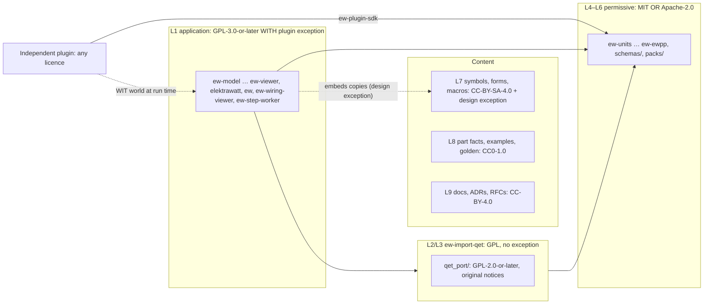
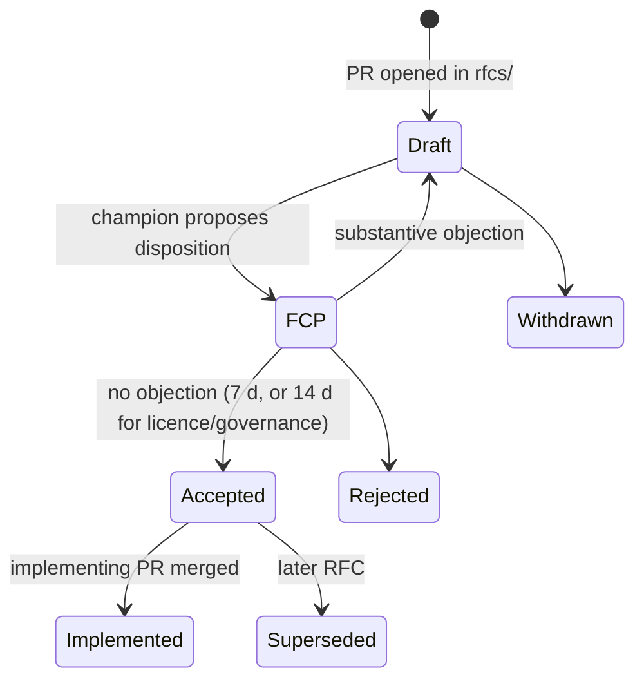
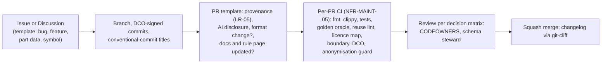

# Open-source governance

**Status:** Draft v0.1 · **Date:** 2026-10-18 · **Part of:** ElektraWatt design document set

**Purpose.** This document specifies how ElektraWatt (EW) is run as an open-source project: the licence of every
layer and how CI enforces it, contributor terms under the DCO, copyright ownership and the legal gates that come
before the first release, the trademark, roles and decision-making for a core team of two to four people, the
contribution workflow, community content and its quality levels, community channels, funding, and the choice of a
legal steward under the Cyber Resilience Act (CRA). It elaborates the NFR-LIC, NFR-DOC and NFR-COMP-01 … 03 rows of
[02c](02c-nonfunctional-requirements.md) and the owner decisions recorded in ADR-0024. It also proposes
recommendations for the open ADR-0025 (plugin-exception wording) and ADR-0030 (steward, CRA role, signing identity).
Nothing here is legal advice. Every legal point is input for counsel and marked **(verify)** where the research
notes did not confirm it. All of these points are collected in one counsel brief, together with the exception
wording of ADR-0025 and the plugin-exception scope of [17](17-extensibility.md) §12; the global plan's
verification register schedules it before LG-2 (§3.3). Until counsel answers, the **(verify)** marks stay and the
interim rules of the Proposed ADRs (0025, 0029, 0030) apply.

**Contents**
1. [Scope and boundaries](#1-scope-and-boundaries)
2. [Concepts and data](#2-concepts-and-data)
3. [Behaviour and rules](#3-behaviour-and-rules)
4. [UI and UX touchpoints](#4-ui-and-ux-touchpoints)
5. [Algorithms](#5-algorithms)
6. [Outputs](#6-outputs)
7. [Edge cases and pitfalls](#7-edge-cases-and-pitfalls)
8. [The reference project](#8-the-reference-project)
9. [Scope by release](#9-scope-by-release)
10. [Dependencies](#10-dependencies)
11. [Requirements covered](#requirements-covered)
12. [Open questions](#open-questions)

---

## 1. Scope and boundaries

| This document owns | Owned elsewhere |
|---|---|
| Licence per path and content kind, SPDX expressions, REUSE layout, `NOTICE` | The licence-boundary rule between crates ([04](04-architecture.md) §3, ADR-0024); CI job definitions ([18](18-quality-security-release.md)) |
| DCO terms, the relicensing consequences, copyright notices, employer statements | — |
| Governance requirements for the plugin and design exceptions (who drafts them, when, scope) | What the plugin exception must cover technically ([17](17-extensibility.md) §12) |
| Roles, decision rules, RFC and ADR process, schema-steward duties, roadmap publication | The format-change rule itself ([04](04-architecture.md) §7.6, ADR-0011) |
| `CONTRIBUTING.md` (including the AI-use policy), `CODE_OF_CONDUCT.md`, `SECURITY.md` process, `GOVERNANCE.md`, `TRADEMARKS.md` | `PRIVACY.md` content (ADR-0029); security controls (NFR-SEC-*) |
| Governance of community content: review authority, `verified` evidence, quality marks, takedown | Library linter EW-LIB-001 … EW-LIB-012 ([15](15-checks-revisions-collaboration.md) §4.11), review pipeline and pack layout ([07](07-symbols-parts-macros.md) §6) |
| Community channels, the Weblate workflow and glossary, the usability-test consent template | UI localisation stack ([16](16-ux-ui.md) §12); usability-test protocol ([16](16-ux-ui.md) §19) |
| Funding options, steward options, CRA role, relationship with QElectroTech (QET) | The QET importer ([14](14-interop.md) §4); the anonymised golden fixture ([20](20-golden-project.md) §3.5) |

**Decided and open.** The licence set and DCO without a CLA are owner decisions (ADR-0024) and are not revisited
here. Three decisions are still open: the plugin-exception wording (ADR-0025), the network and crash-report policy
(ADR-0029), and the steward, CRA role, support period and signing identity (ADR-0030). The pilot-user questions
behind them are PQ-31 (commercial intent, steward, employer statement), PQ-32 (manufacturer partners) and PQ-34
(QET coordination) of the [brainstorm](01-brainstorm.md).

**Milestone shorthand.** M0 is the first commit and the foundations (repository, CI, licences); M1 is the spine exit;
M-PP is the pilot preview (0.0.x, for the pilot only); M2 is the interactive 2D editor, whose release **0.1.0** (the
MVP) is the first binary release; M6 is 1.0 ([04](04-architecture.md) §15.2). M0, M1 and M-PP are pre-MVP points, not
release targets. The dates, and the gates G-M0 … G-M6, G-PP and G-SP that review them, are the plan's
([global plan](../plan/01-global-plan.md) §5.1, [milestones.csv](../plan/milestones.csv),
[gates](../plan/03-gates.md)).

---

## 2. Concepts and data

### 2.1 Licence layers

Each row maps a set of repository paths (or a separate repository) to one SPDX expression. This table is the
authoritative path-to-licence map: ADR-0024 keeps the licence set and the layer rules and refers here for the full
map. `ci/licence-map.toml` (§5.1) holds this table in machine form. The **longest matching path wins**, so `crates/ew-import-qet/src/qet_port/`
(L3) overrides `crates/ew-import-qet/` (L2) and `.github/workflows/` (L12) overrides `.github/` (L11). The licence
texts in `LICENSES/` are exempt, as the REUSE specification provides.

| # | Content | Paths (indicative) | SPDX expression | Basis |
|---|---|---|---|---|
| L1 | Application and GPL-layer crates (the GPL rows of [04](04-architecture.md) §3) | `crates/ew-{model,rhai,derive,commands,checks,sqlview,library,store,text,reports,scene,render2d,render-cpu,export,print,plc,panel,render3d,mfg,import-eplan,import-dxf,import-catalog,import-tables,script,plugin-host,jobs,api,viewmodel,ui,viewer,testkit,py}/`, `bin/{elektrawatt,ew,ew-wiring-viewer,ew-step-worker}/` | `GPL-3.0-or-later WITH LicenseRef-ElektraWatt-plugin-exception` | ADR-0024, ADR-0025; until ADR-0025 is accepted, `GPL-3.0-or-later` (LG-2) |
| L2 | `ew-import-qet`, files written by EW | `crates/ew-import-qet/` | `GPL-3.0-or-later` (no exception) | C-8, NFR-LIC-05 |
| L3 | `ew-import-qet`, files containing ported QET code | `crates/ew-import-qet/src/qet_port/` | `GPL-2.0-or-later`, with the original QET notices kept verbatim | NFR-LIC-05 |
| L4 | Permissive layer (the P rows of [04](04-architecture.md) §3) | `crates/ew-{units,ids,mltext,rds,schema,format,interop-api,dl,step-proto,memo,plcaddr,caex,devdesc,ewpp}/`; from 1.x `ew-plugin-wit`, `ew-plugin-sdk` ([17](17-extensibility.md), FR-EXT-036) | `MIT OR Apache-2.0` | ADR-0024, NFR-MAINT-02 |
| L5 | JSON Schemas | `schemas/<format>/` | `MIT OR Apache-2.0` | [05](05-project-format-and-persistence.md) §10.4 |
| L6 | Built-in rule packs, report packs and machine profiles: data files (TOML, rhai, SQL, Fluent) | `packs/` | `MIT OR Apache-2.0` | ADR-0024 decision 1 (answers [15](15-checks-revisions-collaboration.md) OQ16; open question 12) |
| L7 | Symbols, FnDefs, frames, forms, page and report templates, macros, basic-project examples | system library in `content/`; repositories `elektrawatt-symbols`, `elektrawatt-macros` | `CC-BY-SA-4.0 WITH <design exception>` (§3.1, LR-07; open question 2) | ADR-0024, [07](07-symbols-parts-macros.md) §3.8 |
| L8 | Project-authored part facts, the manufacturer master, example and tutorial projects, the golden fixture, the hostile test corpus, the crates' own test fixtures | `elektrawatt-parts`, `examples/`, `golden/`, `fuzz/corpus/own/`, `crates/*/tests/fixtures/` | `CC0-1.0` | ADR-0024, NFR-DOC-04 |
| L9 | Documentation: design docs, ADRs, RFCs, the mdBook, the format-specification prose, rule pages, the root prose files (`README.md`, `GOVERNANCE.md`, `CONTRIBUTING.md`, `SECURITY.md`, `PRIVACY.md`, `TRADEMARKS.md`, `ROADMAP.md`) | `docs/`, `rfcs/`, `book/`, root `*.md` except `LICENSE.md` | `CC-BY-4.0` | ADR-0024; the generated command and rule reference pages of the user guide (`docs/book/src/reference/commands/`, `…/rules/`) are the exception of cycle 16: their text is the doc comments of the GPL crates `ew-commands` and `ew-checks`, so they keep `GPL-3.0-or-later` (owner ruling; decision log ID-403; `REUSE.toml`, `ci/licence-map.toml`); `CODE_OF_CONDUCT.md` is the other exception: the Contributor Covenant 3.0 text is `CC-BY-SA-4.0` and keeps the Covenant's copyright line (§2.3) |
| L10 | UI translations (`.ftl`) and documentation translations (PO) | inside L1 crates; `book/po/` | the licence of the containing path (L1 or L9) | §3.7 |
| L11 | Repository metadata and configuration without creative content: `.gitignore`, `.gitattributes`, `REUSE.toml`, `deny.toml`, workspace `Cargo.toml` and `Cargo.lock`, `rust-toolchain.toml`, `CODEOWNERS`, `FUNDING.yml`, issue and PR templates, `LICENSE.md` | `.github/` (except `workflows/`), root files | `CC0-1.0` | no creative content to protect |
| L12 | CI workflows, scripts and tools | `.github/workflows/`, `ci/`, `xtask/` | `MIT OR Apache-2.0` | ADR-0024 ("CI scripts"); others may copy the gates |
| L13 | Logo and wordmark artwork | `branding/` | `CC-BY-4.0`; use of the name and logo as marks is governed separately by `TRADEMARKS.md` (§3.3) | copyright licence and trademark are separate rights |
| L14 | Bundled third-party assets | `assets/fonts/`, `assets/icons/`, `content/etim/` | their own licences: Noto Sans `OFL-1.1`; osifont if ADR-0028 adopts it (GPL-3, GPL-2 or LGPL-3, each with a font exception, gaps G14; **verify** the exact SPDX expression, e.g. a disjunction using `Font-exception-2.0`); ETIM model `ODC-By-1.0` with attribution ([07](07-symbols-parts-macros.md) §3.8); icon set MIT, OFL-1.1 or CC-BY-4.0 ([16](16-ux-ui.md) OQ12) | NFR-LIC-06, NFR-LIC-08; allowlist LR-10 |
| L15 | Optional server components (parts sync, team server, web viewer) | separate repositories | `AGPL-3.0-or-later` | Later; [oss-landscape](../research/oss-landscape.md) §7.3 |



Outputs are outside every row. Projects, PDFs, reports, `.ewpp` packages, machine files and as-built archives
made with EW are the user's, including the symbol and form copies embedded in them (NFR-LIC-09).

### 2.2 Licence and provenance metadata in the model

Governance adds no record kind. It relies on fields other documents define:
- **Library items** (L class, [03](03-domain-model.md) §6–§7, [07](07-symbols-parts-macros.md) §2.5) carry
  `ItemMeta.licence` (SPDX), `sources` and a per-section `confidence` (`verified`, `unverified`, `test`)
  (NFR-LIC-07, FR-PRT-017, FR-SYM-019, FR-MAC-007). §3.6 decides who may set `verified`. A `library.json` default
  licence applies per pack, and a record may override it only with an allowlisted licence (EW-LIB-005).
- **`RulePack.licence`** ([15](15-checks-revisions-collaboration.md) §2) is L6 for built-in packs; company packs
  choose freely. **Plugin manifests** carry `licence` and `publisher`, shown at install
  ([17](17-extensibility.md) §8.5).
- **`Party.personal_data`** (FR-PRJ-024) and the proposed `confidential` marker ([17](17-extensibility.md) OQ7)
  decide what becomes a placeholder in public fixtures.

**Repository data, outside the EW model:**
- `ci/licence-map.toml`: §2.1 in machine form;
- `ci/denylist.sha256`: hashes for the anonymisation guard ([20](20-golden-project.md) §3.5);
- `.github/CODEOWNERS`: two named owners per critical crate (NFR-MAINT-07);
- RFC front matter (§3.4) and the role table in `GOVERNANCE.md` (§2.5).

**Private data.** The steward keeps the signed employer statements and the trademark-clearance report under
`legal/`, outside the public repository. The repository records only that they exist, their date and their scope.

### 2.3 Copyright notices and ownership

- **Header form.** Every file carries
  `SPDX-FileCopyrightText: 2026 The ElektraWatt contributors` and an `SPDX-License-Identifier` (NFR-LIC-02,
  NFR-LIC-10). The git
  history is the authorship record. A collective notice keeps employer and person names out of file headers. The
  public-repository rules (K-7 and the design set's anonymisation rules) keep the pilot panel builder unnamed, and
  copyright protection does not depend on the notice (Berne Convention; **verify** with counsel).
- **Third-party material keeps its notices.** Files under `qet_port/` keep the QET copyright lines verbatim, add
  the collective EW line below them for EW modifications, and are listed in `NOTICE` with the source repository,
  the path and the commit (NFR-LIC-05). The same applies to any file copied from a permissively licensed project
  (LR-05) and to third-party prose: `CODE_OF_CONDUCT.md` carries the Contributor Covenant's own
  `SPDX-FileCopyrightText` and its licence, which is `CC-BY-SA-4.0` for the 3.0 text (verified 2026-10-18 against
  the published text; the earlier assumption of CC-BY-4.0 was wrong), so `LICENSES/` holds that text as well.
- **Who owns what.** The copyright in a contribution belongs to its author, or to the author's employer when Dutch
  law deems the employer the maker (Auteurswet art. 7, for works made in the course of employment, unless agreed
  otherwise; for software see also Directive 2009/24/EC art. 2(3); **verify** both with counsel). The project takes
  no assignment. Inbound licence equals outbound licence per path (§3.2).

### 2.4 Repository governance files

Licences follow §2.1: root metadata files are L11 (CC0-1.0), prose files are L9 (CC-BY-4.0). The presence of the
prose files is NFR-DOC-08.

| File | Content | Needed by |
|---|---|---|
| `LICENSE.md` | Human index of §2.1, the NFR-LIC-09 output statement and the NFR-COMP-04 disclaimer | first commit |
| `LICENSES/` | Every licence and exception text as REUSE expects it, including `LicenseRef-ElektraWatt-plugin-exception.txt` and the design exception | first commit; the exceptions by LG-2 |
| `REUSE.toml` | Path annotations for files that cannot carry headers (PNG goldens, JSONL fixtures, binary assets) | first commit |
| `NOTICE` | QET attribution (source, path, commit per ported file); non-Rust components; the generated third-party notice file per release (§5.3) | first ported file |
| `GOVERNANCE.md` | Roles and people, decision rules (§3.4), steward, conflict-of-interest rules, how this file changes | MVP; until then §2.5 and §3.4 of this document apply |
| `CONTRIBUTING.md` | Workflow, DCO, AI-use policy, how to add a rule, report, importer or machine profile (NFR-MAINT-08), content tracks | M0 |
| `CODE_OF_CONDUCT.md` | Contributor Covenant 3.0 (C-13) with the project's enforcement contacts | M0 |
| `SECURITY.md` | Private reporting, supported-versions table, timings, CVE policy, CRA notification procedure | M0 with private reporting enabled (the source is public from the first commit; ADR-0030 "set up anyway"); complete by the first binary release |
| `PRIVACY.md` | Data flows (ADR-0029, NFR-PRIV-07) | MVP |
| `TRADEMARKS.md` | Use policy for the name and logo (§3.3) | first binary release |
| `ROADMAP.md` | Milestones, funded and help-wanted items, non-goals (§3.4) | MVP |
| `.github/CODEOWNERS`, `ISSUE_TEMPLATE/`, `PULL_REQUEST_TEMPLATE.md`, `FUNDING.yml` | Review routing, bug, feature, part-data and symbol templates, the PR checklist, sponsor links | M0 (`FUNDING.yml` at the first binary release) |
| `rfcs/NNNN-title.md`, `docs/adr/NNNN-title.md` | RFCs and ADRs (§3.4) | ADRs at M0; RFCs from the first binary release |
| `publiccode.yml` | Public-sector catalogue metadata, as QET publishes one | 1.0 |

### 2.5 Roles

| Role | Who | Rights and duties |
|---|---|---|
| **Contributor** | Anyone with a DCO-signed contribution | Opens issues and PRs; reviews informally |
| **Maintainer** | Core team members listed in `GOVERNANCE.md` | Merge rights; reviews; votes in lazy consensus; at least two from M1 |
| **Area owner** | Maintainers named in `CODEOWNERS` | Mandatory reviewer for their paths; two per critical crate (`ew-memo`, the `Op` set in `ew-model`, `ew-format`, `ew-derive`) by M1 (NFR-MAINT-07) |
| **Schema steward** | One maintainer per quarter, rotating among the `ew-schema`/`ew-format` owners; from the first format change in the spine | Enforces the format rule of [04](04-architecture.md) §7.6 (GV-04); never approves their own format PR |
| **Release manager** | One maintainer per release, rotating | Runs the release checklist (§6); cannot be the only reviewer of the release PR |
| **Security response team** | Two maintainers | Triages private advisories, coordinates fixes, triggers CRA notifications through the steward (§3.5) |
| **Library maintainer** (P6) | Per pack in the content repositories | Merge rights per pack; the two-reviewer rule for FnDef and CP changes ([07](07-symbols-parts-macros.md) §6.1) |
| **Translation coordinator** | One per locale in Weblate | Reviews strings, keeps the glossary (§3.7) |
| **Conduct contacts** | Two people, at least one outside the core team where possible | Receive and handle Code of Conduct reports; anyone with a conflict of interest recuses |
| **Project lead** | One maintainer named in `GOVERNANCE.md` | Breaks ties between maintainers until a steward board exists (§3.10) |
| **Steward** | A legal person (ADR-0030; §3.10) | Holds the trademark and the signing identity, receives funds, carries the CRA steward duties, keeps `legal/` |

**Becoming and leaving.**
- **Nomination.** A maintainer nominates a contributor after sustained, substantive work: as a guide, six months
  and ten merged non-trivial PRs, or equivalent library or translation work. Lazy consensus over 7 days decides.
- **Emeritus.** A maintainer inactive for 12 months becomes emeritus and loses merge rights, which can be restored
  on request.

---

## 3. Behaviour and rules

### 3.1 Licence and provenance rules

| ID | Rule | Enforced by |
|---|---|---|
| LR-01 | Every file carries SPDX copyright and licence information in its header or in `REUSE.toml`. | `reuse lint` per PR (NFR-LIC-01, NFR-LIC-02, NFR-MAINT-05) |
| LR-02 | A file's SPDX expression equals the one `ci/licence-map.toml` assigns to its path, and each crate's `Cargo.toml` `license` field matches its row. | Licence-map check (§5.1) |
| LR-03 | The dependency closure (normal, build and dev dependencies, all features; ADR-0024) of every L4 crate contains only crates whose SPDX expression is satisfiable from the allowlist MIT, Apache-2.0, Apache-2.0 WITH LLVM-exception, BSD-2-Clause, BSD-3-Clause, ISC, Zlib, Unicode-3.0, MPL-2.0 and CC0-1.0. MPL-2.0 is allowed (imbl); no GPL, LGPL or AGPL crate, and therefore no `ew-testkit` dev-dependency. | Licence-boundary check (NFR-MAINT-02) |
| LR-04 | `GPL-2.0-or-later` appears only under `crates/ew-import-qet/src/qet_port/`. Only `ew-api` depends on `ew-import-qet` directly; `ew-plugin-host` and the L4 crates never reach it. | Licence-map check; dependency rule (NFR-LIC-05, NFR-MAINT-01) |
| LR-05 | Code copied or ported from another project is declared in the PR template (project, licence, commit), keeps its notices, is listed in `NOTICE` and must be compatible with the destination row. Only MIT, Apache-2.0, BSD, ISC, Zlib, Unicode-3.0 and CC0-1.0 code may enter L4. | PR template; review; licence-map check |
| LR-06 | No third-party engineering content is committed or shipped without an explicit redistribution licence. The list of what is never shipped is NFR-LIC-06: IEC 60617 database content, ECLASS dictionary content, EDZ and Data Portal content, the QET element collection, vendor STEP/DXF/images, Tahoma, standard texts and tables. | Library linter EW-LIB-005, EW-LIB-006, EW-LIB-011; release content audit |
| LR-07 | Symbols, frames, forms and macros carry the design exception. If counsel confirms that its text fits, the SPDX-listed `KiCad-libraries-exception` is used verbatim (**verify** it is on the SPDX exceptions list); otherwise a project-specific exception. It must cover projects with embedded copies, PDFs, reports, `.ewpp`, machine files, exported QET/DXF/SVG and as-built archives. | EW-LIB-005; legal review (NFR-LIC-09) |
| LR-08 | The plugin exception follows the technical scope of [17](17-extensibility.md) §12: WIT-world-only plugins, excluding EW modifications and every file without the exception (L2, L3). | Legal review; LR-04 |
| LR-09 | Outputs are free of EW's copyleft. `LICENSE.md`, the About dialog and the docs say so in the same words. | Text assertion in CI (NFR-LIC-09) |
| LR-10 | The bundled-asset allowlist (fonts, icons, data packs) is separate from the crate allowlist of NFR-LIC-04. A new asset licence needs maintainer consensus and a `NOTICE` entry. | REUSE lint over `assets/` and `content/` |
| LR-11 | Fixtures from third parties (QET examples, vendor AML or GSDML samples) are fetched by CI at a pinned commit into the cache and never committed ([14](14-interop.md) OQ8). Own test files are CC0-1.0 (L8), including `crates/*/tests/fixtures/` inside GPL crates; the licence map gives that path its own, longer rule than the crate's row. | `.gitignore` plus the licence-map check (unknown files fail) |
| LR-12 | Nothing confidential is committed: no customer or person identifiers, no reference PDF, no local paths. | Anonymisation guard (`ci/denylist.sha256`, NFR-PRIV-09, [20](20-golden-project.md) §3.5, AC-39) |

### 3.2 Contributions under the DCO, and what this means for relicensing

- **Mechanics.**
  - Every commit carries `Signed-off-by:` certifying the Developer Certificate of Origin 1.1 (NFR-LIC-03).
  - A DCO check runs on every PR. The repository setting that requires sign-off on web-based commits is on.
  - PRs are squash-merged (§3.5). The squash message keeps every `Signed-off-by:` trailer of the PR's commits, and
    a check on `main` after each merge verifies that the resulting commit carries the author's sign-off.
  - The name must be one the contributor is commonly known by. Anonymous contributions are not accepted (open
    question 9).
  - An AI tool is never the signer (§3.5).
- **Inbound equals outbound.**
  - A contribution to a path is licensed under that path's row of §2.1.
  - A change to a `qet_port/` file is therefore contributed under `GPL-2.0-or-later`.
  - A change to `ew-format` is contributed under `MIT OR Apache-2.0`.
- **Consequences without a CLA.** The project holds no rights beyond the licences:
  1. **Moving code from L1/L2 into L4 needs the consent of every copyright holder** of the moved expression. If a
     holder does not consent, their lines are rewritten (§5.2). This is why the permissive layer was closed from
     the first commit (ADR-0024). Code planned for a permissive crate, such as `ew-plcaddr`, `ew-caex` and
     `ew-devdesc` ([04](04-architecture.md) §3), is written there from day one, not moved later.
  2. **The plugin exception cannot be added later** to files that already carry external contributions without
     their holders' consent. It must therefore be in the headers before the first external merge (LG-2; ADR-0025
     timing).
  3. **"Or later" is the only built-in upgrade path.** GPL-3.0-or-later lets users and the project adopt a future
     FSF version. No one can move EW to a non-GPL licence, so dual licensing and open-core are closed off by
     construction. That is intended (§3.9).
  4. **An employer statement can grant more.** The statement of LG-1 can include standing consent from the pilot
     panel builder for future moves of its staff's contributions into L4 (open question 6). That removes the
     largest blocker, because the employer is likely the largest holder.

### 3.3 Legal and organisational gates

*Owner ruling (2026-10-22; [decision log](../plan/06-decision-log.md) ID-454).* The project owner ruled in chat: "Regarding all the licensing, and legal items, this is no longer relevant." The gates of the [plan](../plan/03-gates.md) no longer carry LG-1 to LG-6 as criteria, and
the enrolments, counsel's opinions and ADR-0030 are no longer gate items; ID-383 (the CC-BY-SA-4.0 symbols in the GPL
binary) is accepted by the owner as a distribution fact, without a counsel brief. The text below is kept as the
record of the design. The repository's licence rules are unchanged: REUSE headers, the licence map (§2.1), the
permissive/GPL boundary and the dependency checks stay in force. The signing identities that sign release binaries
stay a release item (WP-S6.07). The `blocked:LG-2` merge block was removed in cycle 19 (FT-315, decision log ID-480).

These gates belong in the global plan as milestone conditions. The release pipeline checks LG-1, LG-4 and the
steward checklist of §3.10 as checklist items (RC-10 of [18](18-quality-security-release.md); NFR-COMP-01).
"First binary release" means the first signed installer, 0.1.0 at M2 (MVP). Until LG-4 is met, only unsigned nightlies
carrying the banner "unsigned development build" are published (ADR-0023, ADR-0030): no version tags (`vX.Y.Z`)
and no signed or tagged release. The pilot preview 0.0.x (M-PP) consists of such unsigned development builds handed to the
pilot only, with no public download ([global plan](../plan/01-global-plan.md) §5.3, §6.1); the signed source tags `m1` and `pp`
carry no binaries.

| Gate | Condition | Deadline | Owner |
|---|---|---|---|
| **LG-1 Employer copyright statement** | The pilot panel builder signs a statement. It (a) states who holds the rights in its staff's EW work (the employer as maker under Auteurswet art. 7, or the employee where agreed otherwise), (b) licenses all contributions since the first commit under §2.1, including both exceptions, (c) optionally gives standing consent to future L1→L4 moves (§3.2), (d) covers the repository owner's own work if it falls within their job, (e) names the authorised signatories (held privately). Every other employer whose staff contribute on company time signs an equivalent statement before their first merge. | Target M0. Hard gate before the first binary release (NFR-LIC-11) | Pilot user, counsel |
| **LG-2 Exceptions adopted** | ADR-0025 is accepted. The plugin-exception text and the design-exception text are in `LICENSES/` and in the SPDX headers. | Before the first PR from a non-maintainer is merged (ADR-0025; NFR-LIC-12); this may fall before MVP. Until then, such PRs carry the label `blocked:LG-2` | Owner, counsel |
| **LG-3 Trademark clearance** | Searches in TMview, EUIPO eSearch and the BOIP register for "ElektraWatt" and phonetic neighbours in Nice classes 9 and 42; a domain check. "Electra"-named ECAD products are a known confusion risk ([oss-landscape](../research/oss-landscape.md) §7.5, unverified lineage). With a conflict, the product is renamed before any logo or domain spend. | Before the first public announcement or binary release; the word mark is filed by 1.0 (NFR-LIC-13) | Steward |
| **LG-4 Steward and identity** | ADR-0030 is decided. The steward exists as a legal person and holds the signing identity (Artifact Signing for an EU organisation; Apple Developer Program enrolment as an organisation, which requires a D-U-N-S number for the legal entity, ADR-0030; the SignPath Foundation OSS programme is the documented Windows fallback, [18](18-quality-security-release.md) OQ4, eligibility **verify**). The repository, which today sits under a personal GitHub account, is transferred to a GitHub organisation controlled by the steward with at least two owners (NFR-COMP-08). `SECURITY.md` and the steward checklist of §3.10 (NFR-COMP-01) are complete. | The phase-1 identity holder is named and enrolment submitted in the first 90 days (PD-7a of the [global plan](../plan/01-global-plan.md) §14; enrolment takes at least 12 months); ADR-0030 decided in full by gate G-M1 (PD-7; [18](18-quality-security-release.md) OQ4); hard gate before the first signed release (NFR-SEC-12) | Owner |
| **LG-5 Fixture publication consent** | The pilot panel builder consents in writing that the anonymised technical content of the reference project may be published as CC0: tags, part numbers, wiring and order codes, as in [20](20-golden-project.md) and the design docs. If its customer contract requires it, the customer consents too. | **Now.** The public repository already contains this content in `docs/` (open question 4) | Pilot user |
| **LG-6 Steward review** | Re-decide the steward form (§3.10) once there are more than 3 regular external contributors, more than €50k of income a year, or 1.0 is reached, whichever comes first. | Event-driven | Maintainers, steward |

**Trademark policy** (`TRADEMARKS.md`, after the Rust, Mozilla and Blender models):
- **Free to use.** The name may be used for unmodified builds. Distribution packages whose patches are limited to
  build, packaging and security backports also count as unmodified. Nominative use ("imports into ElektraWatt",
  "ElektraWatt plugin") is free.
- **Rebrand or qualify.** Modified distributions rebrand or say "based on ElektraWatt".
- **Permission required.** Company names, domains and paid services using the name need the steward's written
  permission.
- **Reserved.** "ElektraWatt-verified part data" is reserved for packs that meet §3.6.

### 3.4 Decision-making: RFCs, ADRs, schema steward, roadmap

**Decision matrix.** "Maintainers" means lazy consensus: no objection within 72 hours of a request for decision
(GV-01).

| Change | Instrument | Approval | Notes |
|---|---|---|---|
| Bug fix, feature within the accepted design | PR | 1 maintainer other than the author | CI green (NFR-MAINT-05) |
| Critical crates: `ew-memo`, `ew-model` `Op` set, `ew-format`, `ew-derive` | PR | 2 area owners from `CODEOWNERS` | NFR-MAINT-07; a change to an `ew-schema` record type is a format change (next rows) |
| Format change, additive (minor) | PR | Schema steward and 1 maintainer | The PR ships the migration, a fixture, the regenerated schema and the docs ([04](04-architecture.md) §7.6) |
| Format major, `api_v1` view version, WIT world major, a break in CLI or command stability, the data-model ontology (device, function, potential, structure) | RFC | Maintainers after a 7-day final-comment period (FCP) | After 1.0 only in the yearly format window; the implementing PR carries the RFC number |
| Architecture choice | ADR (MADR) | Maintainers; owner decision for "Proposed (needs user decision)" ADRs | NFR-MAINT-08 |
| Licence, exceptions, trademark policy, `GOVERNANCE.md`, Code of Conduct | RFC | All maintainers and the steward | 14-day FCP |
| New shipped rule (`EW-*` ID) | PR with its rule page | 1 maintainer and 1 domain reviewer | NFR-DOC-02; IDs never reused (FR-CHK-043; the registry of [15](15-checks-revisions-collaboration.md) §2.2) |
| Golden `expected/*.csv` or approved PNG change | PR | 2 maintainers, one not the author, and a rationale citing the AC-nn or D-nn | A change to `golden/J-E-2416/tables/` also needs the pilot user's acknowledgement, because they own the acceptance truth |
| Symbol or FnDef logic; part data or cosmetic content | PR in a content repository | 2 reviewers, one a library maintainer; 1 reviewer | [07](07-symbols-parts-macros.md) §6.1; turning a section `verified` follows §3.6 |
| Security fix | Private advisory | 1 maintainer and 1 security-team member | Public review happens at disclosure |

**Governance rules.**

| ID | Rule |
|---|---|
| GV-01 | Normal decisions use lazy consensus with a 72-hour objection window. An objection must state a reason and an alternative. Unresolved objections go to an RFC or to the project lead's tie-break. |
| GV-02 | No one approves their own PR. With two maintainers, each reviews the other's work. A single-maintainer merge is allowed only for a security release under embargo, and it is reviewed afterwards within 7 days. |
| GV-03 | Before the first binary release, decisions are recorded as ADRs by the owner and maintainers. From the first binary release on, the RFC process applies to the matrix rows above. |
| GV-04 | **Schema-steward duties.** The steward reviews every PR labelled `format`. They decide minor versus major, check that the migration, fixture, regenerated JSON Schemas and docs are present ([04](04-architecture.md) §7.6), maintain the format changelog for the release notes (NFR-DOC-07), and check `api_v1` view changes against the `Preview` policy ([17](17-extensibility.md) OQ12). After 1.0 they run the yearly format window: they collect accepted format-major RFCs and freeze them one month before the major. The role rotates every quarter, together with the UI-stack upgrade of NFR-MAINT-04. |
| GV-05 | Funded work keeps the normal review rules. A funder never receives merge rights, a veto or private roadmap influence. Funded items are labelled `funded:<source>` on the public roadmap. |
| GV-06 | While one employer employs a majority of maintainers, licence, trademark and governance RFCs need an independent check in addition. **Phase 1** (the employer is itself the steward, §3.10, so no board exists): the FCP is 14 days, it is announced in Discussions and the release feed, and a reasoned objection from any maintainer or regular contributor not employed by that employer moves the decision to the phase-2 board, or blocks it until that board exists. **Phase 2:** the stichting board approves; it includes at least one member not employed by that employer. |
| GV-07 | `ROADMAP.md` is generated from `docs/plan/` milestones and the GitHub Projects board, lists the non-goals of [vision](00-vision-and-scope.md) §4, and is reviewed at least quarterly. |

**RFC lifecycle** (NFR-DOC-09).
- **Front matter:** `rfc` (NNNN), `title`, `status`, `area` (`format`, `api`, `ontology`, `licence`,
  `governance`), `authors`, `champion` (a maintainer), `fcp_start`, `decision`, `tracking` (issue).
- **Body:** motivation, design, migration and compatibility, alternatives, unresolved questions, and the effect on
  the golden project.



### 3.5 Contribution workflow



**`CONTRIBUTING.md` sections:** where to ask (security reports go to `SECURITY.md`); building and running the
golden tests locally (`ew export pdf golden/J-E-2416.ew --out out/J-E-2416.pdf`, the acceptance runner
`ew-testkit accept`); the PR title as a conventional-commit title, because it becomes the squash commit and the
git-cliff changelog line (`fix(xref): …`, `feat(import-qet): …`); the DCO and the licence of the
path you touch (§2.1); the PR checklist and review rules (§3.4); how to add a rule with its rule page and Fluent
remedy key, a report, an importer, a machine profile and a migration (NFR-MAINT-08); content tracks for
non-programmers (§3.6, §3.7); the AI-use policy; and the confidentiality rules (LR-12): never attach customer
drawings, and use the placeholders `<customer>`, `<project ref>` and so on.

**Dependency audits** (resolved 2026-10-18, open question 18). Every new crates.io dependency passes cargo-deny,
cargo-vet 0.10.2 and, if it has a build script, the build-script allowlist (ADR-0023). The `who` field of a
cargo-vet audit is the contributor's GitHub handle, never a personal name or e-mail address, and the project imports
no public audit sets, because their `imports.lock` entries record auditors' names and addresses, which the
public-repository rule bans (UD-8 of the decision log). Every audit is therefore the project's own; the rule is
revisited when a steward exists (ADR-0023 amendment 3). `CONTRIBUTING.md` states it in its dependency section.

**AI-use policy.** The core team itself works with AI assistance, so the policy regulates use and does not ban it.
1. **Disclose.** PRs disclose AI assistance in the template. Commits may name the tool in a trailer such as
   `Assisted-by:` or `Co-Authored-By:`. The `Signed-off-by:` is always a human's.
2. **Own it.** The signing human has read, understood and tested every line, and answers review questions
   personally. Issue and PR discussion is not AI-generated.
3. **Third-party and confidential content.** The QET element collection, EDZ or Data Portal content and standard
   texts are never used as training or fine-tuning data, and never pasted into AI tools to generate EW library
   content ([oss-landscape](../research/oss-landscape.md) §2.6, NFR-LIC-06). QET example projects are excluded from
   any data set used with AI tools ([14](14-interop.md) OQ8). Confidential material (customer projects, the
   reference drawing set) goes into an AI tool only with its owner's permission and with a configuration that
   excludes it from training.
4. **No laundering.** Asking a tool to reproduce another project's code is porting. LR-05 applies, and QET-derived
   output may only go into `qet_port/`.
5. **Agents and the repository.** No AI agent holds merge rights or pushes to protected branches. Agent-authored
   PRs follow the same review rules.

**Code of Conduct.**
- `CODE_OF_CONDUCT.md` is Contributor Covenant 3.0, the July 2025 text published on the project's release branch
  without a git tag (C-13). It replaces the 2.1 named in the research.
- Enforcement follows its ladder. The two conduct contacts of §2.5 receive reports at a project role address held
  by the steward, never a personal address.
- Outcomes are recorded privately. Public statements name no reporter.

**`SECURITY.md` process.** Reporting channel, timings, CVE policy and the supported-versions table are fixed by
NFR-SEC-14 and NFR-COMP-03. The support section states the period of NFR-COMP-03 and ADR-0030 in these words:
"The latest minor gets all fixes; each minor gets security and data-loss fixes for 6 months after its successor
ships." Before 1.0 only the latest 0.x is supported, and no LTS line exists ([18](18-quality-security-release.md)
§7.5). Governance adds two things:
- **CRA notification.** The security response team prepares notifications of actively exploited vulnerabilities
  and severe incidents; the steward files them through the single reporting platform, following the 24 h / 72 h /
  14-day runbook of [18](18-quality-security-release.md) §13.2. Art. 14 reporting applies since 2026-09-11 (G11).
  Whether Art. 24 extends it to a steward, and to which authority, is confirmed with counsel (**verify**,
  [18](18-quality-security-release.md) OQ7); the runbook operates from the first public release either way
  (ADR-0030).
- **Rehearsal.** A disclosure tabletop exercise takes place before 1.0.

### 3.6 Content contributions and data-quality levels

The pipeline itself is [07](07-symbols-parts-macros.md) §6: the separate content repositories, the linter
EW-LIB-001 … EW-LIB-012 ([15](15-checks-revisions-collaboration.md) §4.11), CPU-rendered previews, data diffs, the
provenance gate and semver packs. This section adds who may
assert what.

**Two independent axes appear in the part browser and the pack release notes:**
- **Quality level** (derived, [07](07-symbols-parts-macros.md) §3.4): `basic` < `schematic-ready` < `layout-ready`
  < `production-ready`. No reviewer sets it; it follows from the data.
- **Confidence** per section (stored, [07](07-symbols-parts-macros.md) §2.5): `verified`, `unverified`, `test`.
  This is the field governance controls.

| Confidence | Who may set it in a community pack | Required evidence |
|---|---|---|
| `test` | Anyone | Marked test data; never counted as fact; listed in release reports |
| `unverified` | Anyone (default for contributed data) | A source in `ItemMeta.sources`: datasheet reference, catalogue page, user measurement |
| `verified` | A library maintainer, on a PR approved by a second reviewer | A manufacturer document identified by title, revision and date and cited per section. Alternatively, the section comes from a manufacturer pack published under the manufacturer's own licence, with its signature or manifest checked |

**Example.** The starter-catalogue record of -102G1 (Phoenix Contact 2904602) may mark its CP section (L, N, PE,
+, +, −, −) `verified` only by citing the manufacturer data sheet by title, revision and date. The 533361 solenoid
map H1 behind the Q0.1 … Q6.7 addresses stays `test` until such a document exists (D-26).

**Rules:**
- A PR that turns a section to `verified` without a cited source fails the provenance gate.
- **The mark.** "ElektraWatt-verified part data" may be shown only for a part at `production-ready` whose sections
  are all `verified`, in a pack that passes EW-LIB-001 … EW-LIB-012 with no errors.
- **Takedown.** A rights holder's complaint is acknowledged within 7 days. If it is plausible, the content is
  withheld from the next pack release, and the pack version that carried it is yanked from the index. The decision
  is recorded in the pack repository (NFR-LIC-14).
- **Forbidden inputs.** Converted QET elements (EW-LIB-006 fingerprint check) and EDZ-derived data are refused. EDZ
  imports stay in user and company libraries ([07](07-symbols-parts-macros.md) §3.8).
- **Default licence of new library items.** Items created in the community repositories default to the pack
  licence (CC0-1.0 for part facts, CC-BY-SA-4.0 with the design exception for symbols and macros). Items a user
  creates in a user or company library default to `NOASSERTION`, or to the default set in the company basic
  project, never silently to CC0 (open question 5).

### 3.7 Community channels, translations and user research

| Channel | Purpose | Rules | From |
|---|---|---|---|
| GitHub Issues | Actionable bugs and accepted features only | Templates; `good first issue`, `help wanted`, `funded:*` labels | M0 |
| GitHub Discussions | Q&A, ideas, show and tell, company basic projects; Dutch and German categories | Code of Conduct; maintainers answer within a week as a target | opened after gate G-M1 (the gate authorises community channels, [gates](../plan/03-gates.md) §2.1) |
| Matrix room | Contributor chat | Logged publicly; decisions move to issues or RFCs | opened after gate G-M1 |
| Weblate (hosted) | UI (`.ftl`) and docs (PO) translation | Workflow below | MVP (Dutch), 1.0 (German) |
| Docs site (mdBook) | Diátaxis docs, rule pages, glossaries; bundled offline | NFR-DOC-01 … 07 | MVP |
| Release announcements | Monthly progress notes on the project site from M0, notes on the source tags `m1` and `pp`; GitHub releases with notes and an Atom feed from the first binary release | No mailing list that needs personal data at MVP | M0 (progress notes), first binary release (releases) |
| Discourse forum | Long-form community | Only when Discussions no longer scales | 1.x |

Proprietary chat platforms are not used as primary channels: they are not publicly archived and they require
accounts.

**Weblate workflow and glossary** (requested by [16](16-ux-ui.md)):
- **Sources.**
  - The `.ftl` resources of `ew-ui`, `ew-viewmodel`, `ew-checks` and `elektrawatt`, through Weblate's Fluent support
    (**verify** support for Fluent attributes and plurals).
  - The docs' PO files, produced by mdbook-i18n-helpers.
- **Licence and sign-off.**
  - The component's contributor-agreement setting shows the DCO text (**verify** the setting). Weblate commits carry
    the translator's sign-off through the commit-message template.
  - A translation takes the licence of its file (L10).
- **Review states.** Core-flow strings need the state "reviewed" from the locale's coordinator before a locale is
  listed as supported. The gate is ≥ 95 % of all strings and 100 % of core-flow strings (NFR-I18N-01).
- **Glossary.**
  - One terminology glossary per locale, seeded from the EPLAN ↔ EW and QET ↔ EW glossaries (NFR-DOC-05) and the
    UI vocabulary of IEC 81346.
  - For German, EPLAN's established terms are used where they match IEC 81346 (Betriebsmittel, BMK,
    Unterbrechungspunkt; **verify** with translators, [16](16-ux-ui.md) OQ10).
  - The same glossary feeds the palette aliases (NFR-UX-03).
- **Machine translation.** Weblate's machine-translation add-ons are off for EW components, consistent with
  NFR-PRIV-08 for project data and with the AI-use policy.

**Usability-test consent template** (requested by [16](16-ux-ui.md) OQ9, for NFR-UX-01 sessions). The form
records:
1. **Purpose.** Evaluating EW's core tasks; the session protocol of [16](16-ux-ui.md) §19.
2. **What is recorded.** Screen, audio and optionally camera; the local session log of palette queries, commands
   and errors.
3. **Storage.** On the moderator's machine only. Nothing is uploaded (NFR-PRIV-01). Everything is deleted 90 days
   after the report.
4. **Publication.** Only anonymised findings and aggregate scores (task completion, SUS). No faces, voices, names
   or employer identifiers.
5. **Material.** Participants work on the GP-UT fixture only ([16](16-ux-ui.md) §19.3). They never open their
   employer's projects during the session.
6. **Controller, legal basis and rights.** The steward is the controller, with the contact given in `PRIVACY.md`.
   Consent under GDPR art. 6(1)(a), given as art. 7 requires. The participant may withdraw at any time until the
   report is published, with deletion of their data, through that contact. No health data is collected.
7. **Signature and date.** Consent forms are kept by the steward with the session ID, not in the repository
   (NFR-PRIV-10).

### 3.8 Relationship with QElectroTech

The [vision](00-vision-and-scope.md) §7.2 positions QET as the closest peer and the pilot user's current tool.
EW's position is coordination, not competition:
1. **Attribution from the first ported file.**
   - Ported code lives only in `qet_port/` (LR-04), keeps QET's notices and is listed in `NOTICE` per file and
     commit.
   - Release notes credit QET. The README states that EW imports QET projects using code derived from QET under
     GPL-2.0-or-later.
2. **Courtesy contact, then coordination.**
   - When the first ported file is published, send a short note to the QET maintainers with the attribution and an
     invitation to review.
   - Coordination proper starts after MVP, as recommended in [vision](00-vision-and-scope.md) OQ3 and subject to
     PQ-34.
3. **Shared knowledge.**
   - The `.qet` format facts EW discovers (version table, field lists, the `%F` versus `%f` xref variables of C-15)
     are published as CC-BY-4.0 developer documentation ([14](14-interop.md) OQ7), useful to QET users as well.
   - Bugs found in QET while building the corpus are reported upstream.
   - Security findings that affect both tools, such as a hostile `.qet` that crashes the importer, are disclosed
     privately to QET's security contact.
4. **Elements.** EW does not bundle the QET collection (CC-BY 3.0 plus the anti-ML clause). It asks QET whether a
   clarification or a CC-BY-4.0 relicensing for import use is possible ([oss-landscape](../research/oss-landscape.md)
   OQ6).
5. **Exporter.**
   - The EW → QET exporter (FR-EXP-010, 1.x Could) lets panel builders deliver to customers still on QET.
   - A shared exchange subset (IDEA-108) is explored only if QET wants it.
6. **Naming.** QET's name is used nominatively only ("imports QElectroTech projects"), never in EW's branding.

### 3.9 Funding

The principle is one edition, no open-core: every engineering feature is in the GPL edition
([vision](00-vision-and-scope.md) §7.3). Money pays for development, infrastructure and services, never for
features.

| Source | Fit | Pays for | Constraints | CRA effect | When |
|---|---|---|---|---|---|
| **WBSO** (Dutch R&D payroll-tax credit) | High, for the pilot panel builder's staff | Developer hours of the employer's staff | Company-side; applied for in advance by the employer (**verify** procedure and period rules with RVO); requires LG-1 to be clear about ownership | None: a tax credit to the employer is not monetisation of EW | M0 |
| **NLnet / NGI Zero** (e.g. the NGI0 Commons Fund) | High | Milestone grants, typically €5k–€50k for a first proposal (unverified); free support services such as audits and REUSE help (unverified) | OSI/FSF licence (met); public results; check current calls, because EU NGI funding after 2025 is uncertain (**verify**) | None (grant) | Proposal 1 at the first call after LG-1 is signed (plan month 3, gate G-M0); proposal 2 at gate G-M1; proposal 3 at gate G-M2 ([global plan](../plan/01-global-plan.md) §13.2) |
| GitHub Sponsors | Low to medium | Maintainer time, CI hardware | `FUNDING.yml`; individual or organisation accounts | Donations within actual costs are not monetisation (G11) | When the steward holds the GitHub organisation (WP-S0.05, LG-4), not only at the first binary release ([global plan](../plan/01-global-plan.md) §13.2) |
| Open Collective with an EU fiscal host | Medium | Transparent budget; invoices to companies | Host fees (about 10 %, unverified) | Within actual costs; the public ledger supports NFR-COMP-07 | As GitHub Sponsors: once the steward holds the organisation (WP-S0.05, LG-4) |
| Manufacturer data partnerships | Strategic | Mostly in kind: open data packs, 3D models, verified address maps; sometimes cash | Explicit redistribution licence per pack; the funder gets no say in rules or reports (GV-05) | None, as long as no paid EW service is offered | Outreach after MVP; the first manufacturer-reviewed pack is a non-gating 1.0 target, because its timing depends on a third party (IDEA-091, PQ-32) |
| Sponsored features and bounties | Medium | A specific profile (Komax, Rittal WT), an importer | Public RFC or issue; normal review | None (cost recovery) | 1.0 |
| Corporate sponsor tiers | Medium to high, later | Panel builders, wholesalers, manufacturers | Tiers on the KiCad model; a logo on the website, no influence | Within actual costs | after 1.0 |
| Paid support, migration services, training, signed LTS builds (KiCad Services Corporation style) | Long-term base | Support SLAs, EPLAN/QET migration, custom forms and profiles | A separate entity licensed to use the name (NFR-COMP-02) | It is a **manufacturer** of what it sells, from 2027-12-11 | Only after budgeting (1.x or later) |
| Open-core, proprietary editions, paid features | Rejected | — | Contradicts "no tiers"; a small team cannot afford a fork or community distrust | — | Never |

The "When" column is the recommended sequence, which follows the [global plan](../plan/01-global-plan.md) §13. The
plan splits the NLnet milestones into three proposals (§13.3 there), because with the realistic calendar their
deliverables are years apart: proposal 1 covers the derivation engine, the SQL projection, `ew-memo`, the golden PDF
and the published format specification with a permissive-only sample reader; proposal 2 the rule engine, `ew check`
and the QET project import; proposal 3 the PLC, EDZ, DXF and machine-profile exchange. Each is typically €5k–€50k
(amounts unverified, open question 14).

### 3.10 Legal steward and CRA role

The CRA treats non-monetised FOSS as outside the manufacturer obligations. A legal person that systematically
supports FOSS intended for commercial use can act as **open-source software steward**, with light duties: a
cybersecurity policy, vulnerability handling, cooperation with market-surveillance authorities and notification of
actively exploited vulnerabilities (G11). Selling support or LTS builds under the name makes the seller a
manufacturer.

| Option | CRA role | Signing identity | Trademark holder | Neutrality | Effort | Verdict |
|---|---|---|---|---|---|---|
| **A. Pilot panel builder (the company) as interim steward** | Steward of the community edition; manufacturer only if it sells EW builds or support | Eligible (EU organisation) | Yes, with a written transfer commitment to B | Low: single employer, so the phase-1 check of GV-06 applies; its name appears on every signed binary (open question 7) | None | **Phase 1** (M0 to 1.0) |
| **B. Stichting ElektraWatt** (Dutch foundation, notarial deed, board, no members) | Steward | Eligible (**verify** the D-U-N-S and Apple details) | Yes | High: the board includes a member not employed by the main employer | Weeks; notary and bookkeeping costs (**verify**); optional ANBI status for tax-deductible gifts (**verify**) | **Phase 2 target** (LG-6) |
| C. Fiscal host only (Open Collective Europe) | Unclear whether a host acts as steward (**verify**) | Not offered | No | Medium | Days | For donations only, alongside A or B |
| D. Umbrella foundation (Linux Foundation, Software Freedom Conservancy, Eclipse AISBL) | The foundation | Yes | Yes | High | Months; Eclipse requires its contributor agreement instead of the DCO (unverified), which conflicts with ADR-0024 | Re-evaluate at LG-6 |
| E. Vereniging (association with members) | Steward | Eligible | Yes | High | General-assembly overhead | Not for 2–4 people |
| F. Individual maintainer | Cannot be steward (a legal person is required) | Not eligible for Artifact Signing as an individual in the EU (gaps §3.3) | Possible | Low | — | Rejected |

**Recommendation for ADR-0030.**
- **Phase 1.** Option A: the pilot panel builder as interim steward, signing-identity and trademark holder,
  provided it does not sell EW services (NFR-COMP-02). It signs a commitment to transfer the trademark, the signing
  role and any donated funds to a stichting at LG-6.
- **Phase 2.** Option B, with a board of three: one member from the pilot panel builder, one maintainer not
  employed by it, and one independent member from the user community.
- **Separation of duties.** The board decides money, trademark, legal matters and steward duties. Maintainers
  decide technical matters. The board overrides a technical decision only on legal grounds.

**Steward checklist** (the NFR-COMP-01 acceptance artefact, reviewed with counsel). Release check RC-10 of
[18](18-quality-security-release.md) enforces it through LG-4 before the first binary release; afterwards it is
re-reviewed every minor release, like the policy files of [18](18-quality-security-release.md) §13.2.

| # | Item | Evidence |
|---|---|---|
| ST-01 | Cybersecurity policy published | `SECURITY.md`, threat model ([18](18-quality-security-release.md) §13.2) |
| ST-02 | Vulnerability handling: private reporting, acknowledgement ≤ 7 days, CVE per fix | NFR-SEC-14; advisory log |
| ST-03 | SBOM per release artefact, including SQLite, OCCT and fonts | NFR-SEC-13; release assets |
| ST-04 | Reporting runbook and single-reporting-platform account; tabletop held before 1.0 | Runbook; tabletop record |
| ST-05 | Contact for market-surveillance authorities | Role address in `SECURITY.md`, held by the steward |
| ST-06 | Support-period table matches the published releases | NFR-COMP-03 |
| ST-07 | Non-monetisation review: no paid offering under the name; yearly funding statement | NFR-COMP-02; NFR-COMP-07 |
| ST-08 | Signing identity, release key custody and repository-organisation ownership | NFR-SEC-12; NFR-COMP-08; LG-4; [18](18-quality-security-release.md) OQ6 |
| ST-09 | Employer statements and fixture consent on file | LG-1, LG-5 (held in `legal/`) |
| ST-10 | Engineering-verification disclaimer in licence texts, About and release reports | NFR-COMP-04 |

---

## 4. UI and UX touchpoints

| Where | What the user sees | Requirement |
|---|---|---|
| Help ▸ About; `ew about --json` | Version and commit, render backend, the two-line licence summary of §2.1, the output statement (LR-09), the third-party notices, the engineering-verification disclaimer, `PRIVACY.md`, the steward as publisher, the support status of [18](18-quality-security-release.md) §14 | NFR-LIC-08, NFR-LIC-09, NFR-COMP-03, NFR-COMP-04; FR-UI-038 ([02b](02b-requirements-extended.md)) |
| Help ▸ Report a problem | Copies a diagnostic block (version, OS, backend; no project data, paths or names) to the clipboard. Opens the issue template in the browser only on click | NFR-PRIV-01, NFR-PRIV-02 |
| Help ▸ Security issue, Community, Contribute, Translate | The bundled `SECURITY.md`; links to Discussions, `CONTRIBUTING.md` and Weblate, opened only on click | NFR-SEC-14, NFR-PRIV-01 |
| Part and symbol browser; library item editor | Licence, source, quality ladder, confidence per section, the "verified" mark where earned; the licence default of §3.6; a copied item keeps its licence, and a warning appears when someone changes the licence of an item derived from a CC-BY-SA one | FR-PRT-017, FR-PRT-021, NFR-LIC-07; open question 5 |
| Plugin install dialog (1.x) | Licence, publisher, key fingerprint, capabilities, registry countersignature | [17](17-extensibility.md) §8.5 |
| Check panel, release dialog | The verification disclaimer; rule-pack versions | NFR-COMP-04 |
| Development builds | Banner "unsigned development build" plus the format warning ("Development build: writes format 1.4-dev", [18](18-quality-security-release.md) §14; [04](04-architecture.md) §7.6) | NFR-REL-05 (d); ADR-0030 |

---

## 5. Algorithms

### 5.1 Licence-map and boundary check (per PR)

```text
input: ci/licence-map.toml   # [[path]] glob, allowed = [SPDX expressions], crate? ; longest match wins
L4_ALLOW := {MIT, Apache-2.0, Apache-2.0 WITH LLVM-exception, BSD-2-Clause, BSD-3-Clause, ISC, Zlib,
             Unicode-3.0, MPL-2.0, CC0-1.0}                                   # NFR-MAINT-02
for file in git ls-files:
    if under(file, "LICENSES/"): continue                                    # REUSE exemption
    rule := longest(map, glob matches file) else FAIL("unmapped path")       # LR-02, LR-11
    expr := spdx_header(file) or reuse_toml_annotation(file)                 # LR-01
    if expr not in rule.allowed: FAIL(file, expr, rule)
    if contains(expr, "GPL-2.0") and not under(file, "crates/ew-import-qet/src/qet_port/"): FAIL  # LR-04
for crate in cargo metadata --no-deps:
    if crate.license != map.crate_expr(crate): FAIL                           # LR-02
    if crate in L4:
        for dep in closure(crate, normal + build + dev deps, all features):  # ADR-0024
            if not satisfiable(licence(dep), L4_ALLOW): FAIL(crate, dep)     # LR-03; OR needs one allowed
                                                                              #   operand, AND needs all
if path_exists(ew-plugin-host -> ew-import-qet) or path_exists(L4 -> ew-import-qet)
   or direct_dependents(ew-import-qet) != {ew-api}: FAIL                      # LR-04
```

`reuse lint` (reuse-tool 6.x) runs first. This check adds the path policy, which REUSE does not know. It fails
fast with the offending path and the expected expression. It is a short Rust `xtask` (L12), so others can copy it.

### 5.2 Relicensing consent plan (L1/L2 → L4)

Used rarely (§3.2). The plan is computed, reviewed in an RFC, and executed only with all consents recorded.

```text
input: paths P to move, target licence T
lines := surviving lines of P at HEAD
authors := git blame -w -M -C -C (ignore .git-blame-ignore-revs) over lines → commit → author, date
holders := for each author: employer_statement(author, date) ? employer : author      # LG-1 records
need := holders minus {holders with standing consent to T}                             # e.g. LG-1 (c)
ask each h in need: signed-off PR comment "I relicense my contributions in P under T"
rewrite := lines whose holder refused or did not answer within 30 days
plan := {consents, rewrite set, reviewer who reimplements from the spec, not from the old lines}
record: legal/relicensing/NNNN.md (steward) + public summary in the RFC
```

Trivial lines (imports, braces, generated code) still count, so the plan errs on the side of asking.

### 5.3 Third-party notice assembly (per release)

`cargo about` runs per binary over the release lockfile. The non-Rust components are added from the CycloneDX SBOM:
SQLite (public domain), OCCT (LGPL-2.1 with its exception, the source offer and the replaceable worker binary),
fonts and icons. The ETIM attribution and the QET entries of `NOTICE` follow. Any SBOM component without a notice
fails the release (NFR-LIC-08, **R**).

`cargo about` lists crates only, so it cannot produce the notices of non-crate material such as the OFL-1.1 Noto
Sans fonts in `assets/fonts/`. The release pipeline therefore assembles those notices from the root `NOTICE`, which
holds one entry per committed third-party asset, into the artefact's `THIRD-PARTY-NOTICES.html` beside the
cargo-about output (18 §7.4, CI-R-07). Each font entry carries the copyright line, the licence text and the
trademark line of the font's name table (name ID 7), which `NOTICE` gains for Noto Sans (decision log ID-51).

---

## 6. Outputs

| Output | Produced | Audience |
|---|---|---|
| `LICENSE.md`, `LICENSES/`, `REUSE.toml`, `NOTICE` | Committed; `reuse spdx` generates an SPDX bill per release | Distributors, legal reviewers |
| `THIRD-PARTY-NOTICES.html` per binary | Release pipeline (§5.3); shown in About | Users, distributors |
| Governance files of §2.4 | Committed, versioned with the code | Contributors, companies evaluating EW |
| `ROADMAP.md` and the Projects board | Quarterly review (GV-07) | Users, funders |
| Release notes with the format changelog, licence and notice changes, funded items and credits | Release manager and schema steward (NFR-DOC-07) | Users, packagers |
| Yearly funding statement | Steward (NFR-COMP-07) | Public, market-surveillance authorities |
| Steward checklist ST-01 … ST-10 with evidence links (§3.10) | Steward; reviewed every minor release | Public (items), counsel; ST-09 evidence stays in `legal/` |
| Accessibility Conformance Report | 1.0 (NFR-COMP-06) | Public-sector buyers |
| OpenSSF Scorecard and Best Practices badge | CI; badge targeted at 1.0 | Companies |
| Private: employer statements, trademark search, consent forms, CoC records, relicensing records | Steward `legal/` | Steward, counsel |

---

## 7. Edge cases and pitfalls

| # | Situation | Handling |
|---|---|---|
| 1 | **The SPDX syntax for custom exceptions.** SPDX 2.3 allows only listed exception IDs after `WITH`; SPDX 3.0 introduced `AdditionRef-` for custom ones (**verify**). `WITH LicenseRef-…` may fail strict tools | Verify what reuse-tool and cargo-deny accept, and fix the identifier when ADR-0025 is accepted (open question 1) |
| 2 | A downstream distributor removes the §7 plugin exception (GPL-3.0 §7 allows it) | Plugins rely on the project's own builds; `TRADEMARKS.md` reserves the name for builds that keep the project's licence terms |
| 3 | CC-BY-SA-4.0 symbols compiled into the GPL binary | CC-BY-SA-4.0 is one-way compatible with GPL-3.0 (Creative Commons compatibility declaration, **verify**). GPL content must never flow into L7. Since cycle 15 three generic symbols of `content/symbols/qet10` (junction dot, junction bevel, wire marker; CC-BY-SA-4.0 by `REUSE.toml`) are compiled into the GPL binary by `ew-api`, sealed by their SHA-256 (decision log ID-366). Recorded as an owner and counsel item (decision log ID-383): Creative Commons declares CC BY-SA 4.0 one-way compatible with GPLv3, so the combination is expected to be permitted; counsel confirms it with the LG-2 brief, and the attribution of the compiled-in symbols is listed in `NOTICE` and assembled with the other non-crate notices (FT-04) |
| 4 | A company modifies EW symbols in its company library | Internal use is free; distributing the modified library outside the company is CC-BY-SA-4.0. Projects using them stay covered by the design exception |
| 5 | MPL-2.0 `imbl` inside the permissive closure | Allowed (NFR-MAINT-02); binary distributors of the permissive crates must offer imbl's source. Stated in the crates' READMEs |
| 6 | An employee contributes on their own time but within their job's scope | The employer may still be the maker (Auteurswet art. 7); the LG-1 statement covers it explicitly |
| 7 | A contributor changes employer | Each commit's holder is decided by the date (§5.2); a new employer signs before the contributor's first merge on company time |
| 8 | AI-generated code that reproduces third-party code verbatim | Reviewer duty under LR-05. In L4 crates, a large AI-assisted block needs the author's explicit "no recognisable third-party code" statement in the PR |
| 9 | Sign-off names are public forever (GDPR) | `CONTRIBUTING.md` says so before the first contribution; a known identity is accepted; history is never rewritten to remove names except for legal necessity |
| 10 | Donations exceed actual costs | That is a CRA monetisation indicator (G11). The steward budgets publicly and funds infrastructure and contractor hours (NFR-COMP-07) |
| 11 | The pilot panel builder sells cabinets documented with EW | Not monetisation of EW. Selling EW support or builds would be (NFR-COMP-02) |
| 12 | Two maintainers disagree and no third exists | The project lead's tie-break (GV-01), recorded in the issue; licence, trademark and governance matters follow GV-06 (phase 1: 14-day public FCP and the independent objection right; phase 2: the board) |
| 13 | A contributor pastes a customer drawing into an issue | Maintainers hide it, ask for deletion and point to the placeholders; the anonymisation guard covers committed files only |
| 14 | A squash merge drops the contributor's `Signed-off-by:` because the maintainer rewrote the message | The post-merge check on `main` (§3.2) fails; the maintainer adds a follow-up commit with the contributor's sign-off copied from the PR, or reverts. History is not rewritten |
| 15 | A contributor asks to withdraw merged code | The licence grant under GPL-3.0 §2 (and the permissive and CC licences) is irrevocable while its conditions are met, so the code may stay. As a courtesy, the project may rewrite it under §5.2 |
| 16 | A dependency changes its licence in a minor release (for example to a non-OSI licence) | cargo-deny (NFR-LIC-04) and LR-03 fail the PR that updates `Cargo.lock`; pin the last acceptable version and open an issue for a replacement |
| 17 | The pilot panel builder ends its involvement during phase 1 | The transfer commitment (§3.10) moves trademark, signing role and funds to the stichting, which must then be founded; the code stays under its licences; release signing pauses until LG-4 is met again |

---

## 8. The reference project

**The golden fixture is the project's most visible governance artefact.**
- **Licence and form.** `golden/J-E-2416.ew` and its `tables/` are CC0-1.0 (L8; NFR-DOC-04, AC-40).
- **Placeholders.** They carry `<customer>`, `<end user>`, `<project ref>`, `<drawing id>`, `<engineer>`,
  `<checker>`, `<address>`, `<country>` and `<confidentiality notice>`, and the logo is
  `golden/J-E-2416/assets/logo-placeholder.svg` ([20](20-golden-project.md) §1.2, §3.5).
- **What stays.** The technical content remains as the acceptance specification: =P01, +J-E-2416, -101F1
  (A9P52610), -102G1 (2904602), -102F2 (MICO 4.10), -X1031 with its 12 spare terminals, -201U1 with the order codes
  51E-F13GCQP-D+H2GG and 32P-VGL-R-…-28MS, Q0.1, TA05-V-15 and the external target J-E-206 / JE-N1000-03.
- **Consent.** Publishing that content needs LG-5.
- **Private material.** The original `.qet` and the PDF live only in the private store used by the Golden C job,
  which reports pass/fail publicly (LR-11, LR-12).
- **Expectation changes.** A PR that changes `expected/xrefs.csv` (63 texts with 64 targets, including the corrected "3-B2") or
  `expected/bom_component.csv` needs two maintainers and the pilot user's acknowledgement (§3.4). Nobody can
  "fix" a failing test by re-accepting -4W1 or T51.

**Defects addressed by governance.** The architecture prevents the defect classes in the model. Governance keeps the
prevention from eroding and stops content defects at the library boundary:

| Defect | Governance mechanism |
|---|---|
| D-01, D-02, D-03, D-10, D-42 | Their regression tests are golden acceptance CSVs. Changing an expectation needs two maintainers and the pilot (§3.4), so a regression cannot be accepted silently |
| D-18 ("Murr Elektronik", "Schneider", "ULSKG5") | Community part packs resolve manufacturers through the master list; EW-LIB-008 rejects unknown manufacturers and duplicates in review |
| D-35 (ratings in descriptions, "Connector" for -106W1) | EW-LIB-009 in content review; the pack maintainer is accountable for descriptions as noun phrases |
| D-17 (core colour "BR") | Cable part packs validate core colours against IEC 60757 codes; a `verified` cable pack (§3.6) needs the manufacturer's core table |
| D-16 (CPX pin 3 PE or FE), D-26 (odd-bit addresses, coil 14 versus 12) | The 533361 solenoid map H1 and the CPX pin roles are `test` or `unverified` until a manufacturer document or a Festo data partnership makes them `verified` (§3.6, §3.9). Findings show "based on unverified part data" |
| D-36 (order code 51E-F13GCQP-D+H2GG versus part 195740), D-40 (550208 placed inside the MPA section) | Configurator decoders and configured-assembly validation data come from manufacturer partnerships or the user's configurator exports (PQ-14), never from scraped data (LR-06) |
| D-37 (cites IEC 60757 for the DBU convention) | Standards are cited by number and clause on rule pages, never copied (NFR-COMP-05); the pilot's DBU/WH profile is shipped as a company convention, not as a standard |
| D-30, D-34 (party roles; Author = Checker initials) | Person and party fields are personal data with placeholders in every public fixture (NFR-PRIV-06); the project's own two-reviewer rules mirror the four-eyes release EW enforces for users |
| — (Tahoma) | Never bundled (LR-06, ADR-0028); the frame form contributed to L7 contains no notice text and no logo |

---

## 9. Scope by release

| Item | Pre-MVP (M0 to M-PP, first commit to the pilot preview) | MVP (first binary release) | 1.0 | 1.x | Later |
|---|---|---|---|---|---|
| Licences | `LICENSE.md`, `LICENSES/`, `REUSE.toml`, licence map, boundary check, DCO check; exceptions adopted (LG-2) before the first non-maintainer merge, which may come before MVP | Exceptions in place at the latest; notices in About and `ew about` | Legal review of all texts repeated | — | AGPL server components |
| Legal gates | LG-1 signed (target M0); LG-5 now; ADR-0030 decided by M1 | LG-1 as hard gate; LG-3 clearance; LG-4 steward, signing identity, repository organisation | Word mark filed; LG-6 review | Services entity if budgeted | — |
| Governance files | `CONTRIBUTING.md` with the AI policy, `CODE_OF_CONDUCT.md`, `SECURITY.md` with private reporting, ADRs 0001–0030, `CODEOWNERS` | `GOVERNANCE.md`, complete `SECURITY.md`, `PRIVACY.md`, `TRADEMARKS.md`, `ROADMAP.md`; RFC process starts | `publiccode.yml`, OpenSSF badge, Accessibility Conformance Report | — | — |
| Roles | 2 maintainers, project lead; schema-steward rotation; two owners per critical crate by M1 | Release-manager rotation; security team; conduct contacts | Library maintainers per pack; translation coordinators | Registry reviewers | Steward board for an umbrella |
| Community | Issues; Discussions and Matrix open after gate G-M1 | Weblate (Dutch), mdBook | German; SC-13: ≥ 5 external contributors | Discourse; education kit (IDEA-109) | — |
| Content | Starter symbols and parts (CC-BY-SA, CC0) | Golden sample (CC0) in every release; manufacturer outreach starts | Content repositories with the "verified" mark; first manufacturer-reviewed pack (non-gating 1.0 target, IDEA-091); permissive crates published (FR-EXT-023) | Community parts repository (FR-PRT-030); plugin registry (IDEA-095) | — |
| QET | Attribution in `NOTICE` | Courtesy note sent | Coordination per PQ-34 | EW → QET exporter (FR-EXP-010) | Shared exchange subset |
| Funding | WBSO; NLnet proposal 1; Sponsors and Open Collective once the steward holds the GitHub organisation | NLnet proposals 2 and 3 (milestones) | Manufacturer partnerships, sponsored profiles | Sponsor tiers | Services, LTS (after NFR-COMP-02) |

---

## 10. Dependencies

| Document or crate | Dependency |
|---|---|
| [04-architecture](04-architecture.md) §3, §7.6, §13, §15.2, §16; ADR-0023, ADR-0024, ADR-0025, ADR-0029, ADR-0030 | Licence layering, the format rule, CI gates, the schema-steward role, non-goals |
| [00-vision-and-scope](00-vision-and-scope.md) §4, §7, §10; [01-brainstorm](01-brainstorm.md) PQ-31, PQ-32, PQ-34, IDEA-090, IDEA-091, IDEA-094, IDEA-095, IDEA-107, IDEA-108 | Positioning, constraints K-3, K-6, K-7, the pilot questions |
| [02c](02c-nonfunctional-requirements.md) §10–§12 | The NFR rows elaborated here |
| [07-symbols-parts-macros](07-symbols-parts-macros.md) §2.5, §3.4, §3.8, §6 | Metadata fields, quality levels, linter, content repositories |
| [14-interop](14-interop.md) §4 | `ew-import-qet` and the QET corpus |
| [15-checks-revisions-collaboration](15-checks-revisions-collaboration.md) §2, OQ16 | Rule-pack licence field and pack-data licence |
| [16-ux-ui](16-ux-ui.md) §12, §19 | Localisation stack, usability protocol |
| [17-extensibility](17-extensibility.md) §8.5, §12 | Plugin signing and the technical scope of the exception |
| [18-quality-security-release](18-quality-security-release.md) | CI jobs for LR-01 … LR-04, LR-11 and LR-12 (CI-PR-09 supply-chain, CI-PR-10 legal-docs); release checklist item RC-10 for LG-1, LG-4 and the steward checklist ST-01 … ST-10; the notice assembly of §5.3 (CI-R-07) |
| [20-golden-project](20-golden-project.md) §3 | Fixture layout, anonymisation guard, private store |
| Tools | reuse-tool 6.2.0, cargo-deny 0.20.2, cargo-about 0.9.2, cargo-cyclonedx 0.5.9, git-cliff, mdbook-i18n-helpers, Weblate (hosted) ([oss-landscape](../research/oss-landscape.md) §7.3, [rust-ecosystem](../research/rust-ecosystem.md), gaps G10) |

---

## Requirements covered

This document elaborates:
- **Licensing:** NFR-LIC-01, NFR-LIC-02, NFR-LIC-03, NFR-LIC-04, NFR-LIC-05, NFR-LIC-06, NFR-LIC-07, NFR-LIC-08,
  NFR-LIC-09, NFR-LIC-10, NFR-LIC-11, NFR-LIC-12, NFR-LIC-13, NFR-LIC-14;
- **Documentation:** NFR-DOC-01, NFR-DOC-02, NFR-DOC-03, NFR-DOC-04, NFR-DOC-05, NFR-DOC-06, NFR-DOC-07, NFR-DOC-08,
  NFR-DOC-09 (their governance and licence aspects; the doc tooling is in [18](18-quality-security-release.md));
- **Privacy:** NFR-PRIV-10 (usability-test consent);
- **Regulatory readiness:** NFR-COMP-01, NFR-COMP-02, NFR-COMP-03, NFR-COMP-07, NFR-COMP-08.

It relies on, and sets the process for:
- **Non-functional:** NFR-COMP-04, NFR-COMP-05, NFR-COMP-06, NFR-SEC-12, NFR-SEC-13, NFR-SEC-14, NFR-REL-05,
  NFR-MAINT-01, NFR-MAINT-02, NFR-MAINT-04, NFR-MAINT-05, NFR-MAINT-07, NFR-MAINT-08, NFR-PRIV-01, NFR-PRIV-02,
  NFR-PRIV-06, NFR-PRIV-07, NFR-PRIV-08, NFR-PRIV-09, NFR-I18N-01, NFR-I18N-07, NFR-UX-01, NFR-UX-03;
- **Functional:** FR-PRJ-024, FR-PRT-017, FR-PRT-021, FR-PRT-030, FR-PRT-031, FR-PRT-032, FR-SYM-008, FR-SYM-019, FR-SYM-020,
  FR-MAC-007, FR-CHK-043 ([15](15-checks-revisions-collaboration.md) §2.2), FR-EXT-023, FR-EXT-036
  ([17](17-extensibility.md)), FR-EXP-010, FR-UI-031, FR-UI-032, FR-UI-038, FR-COL-012.

### Adopted proposals

The requirement rows this document proposed are in [02c](02c-nonfunctional-requirements.md). Added to the catalogue
as:
- **LIC:** NFR-LIC-10 (collective copyright notice, §2.3), NFR-LIC-11 (employer copyright statements before the
  first binary release, LG-1, LG-5), NFR-LIC-12 (exceptions in `LICENSES/` and the headers before the first
  non-maintainer merge, LG-2), NFR-LIC-13 (trademark clearance and word mark, LG-3), NFR-LIC-14 (takedown of
  shipped content, §3.6).
- **DOC:** NFR-DOC-08 (governance files, §2.4), NFR-DOC-09 (RFC process, §3.4).
- **PRIV:** NFR-PRIV-10 (usability-test consent, §3.7).
- **COMP:** NFR-COMP-07 (yearly funding statement, §3.9), NFR-COMP-08 (repository organisation controlled by the
  steward, LG-4, ST-08).

---

## Open questions

1. **SPDX identifier for the exceptions.** ADR-0025 and [17](17-extensibility.md) write
   `GPL-3.0-or-later WITH LicenseRef-ElektraWatt-plugin-exception`. Strict SPDX 2.3 allows only listed exceptions
   after `WITH`, while SPDX 3.0 has `AdditionRef-` for custom ones (**verify**). *Recommendation:* test reuse-tool
   6.x and cargo-deny with both forms during M0, adopt the form both accept, and update ADR-0025 when it is
   accepted. Keep the canonical text only in `LICENSES/LicenseRef-ElektraWatt-plugin-exception.txt`: ADR-0025
   drops the separate `COPYING.EXCEPTION` of its initial summary, and the ADR index summarises it the same way.
2. **Design-exception text.** *Recommendation:* use the SPDX-listed `KiCad-libraries-exception` verbatim (verify
   that it is listed and that its "electronic designs" wording covers control-cabinet projects, machine files and
   as-built archives). Draft a custom exception only if counsel finds a gap. A listed exception saves drafting and
   is recognised by tools.
3. **Naming the employer.** A collective copyright notice keeps the pilot panel builder anonymous in the repository
   (K-7). The employer may still want public credit, for example as a sponsor. *Recommendation:* use the collective
   notice by default and ask the pilot as part of PQ-31; any public credit is the employer's decision, made outside
   the reference-project anonymisation.
4. **Content already published.** The public repository's design docs already contain the anonymised technical
   content of the reference project. *Recommendation:* obtain LG-5 now, in writing. If the pilot panel builder or
   its customer objects, replace the affected tables with synthetic data of the same shape before any further
   publication.
5. **Default licence of user-created library items.** FR-PRT-017's earlier acceptance said "project-authored parts
   default to CC0", which a reader could take to mean parts users create in their company libraries.
   **Resolved:** FR-PRT-017's criterion now reads that items of EW's community library repositories default to CC0,
   and user and company items to the basic project's licence setting, else `NOASSERTION` (§3.6).
6. **Standing relicensing consent in LG-1.** *Recommendation:* ask the pilot panel builder to include one-way
   consent (L1/L2 → MIT OR Apache-2.0) for its staff's contributions. It does not create a CLA for anyone else,
   and it removes the main blocker for future permissive splits of GPL code (the splits known today, `ew-plcaddr`,
   `ew-caex` and `ew-devdesc`, are permissive from their first line, [04](04-architecture.md) §3).
7. **Interim steward.** ADR-0030 leaves the choice between a stichting and the pilot panel builder.
   *Recommendation:* the company in phase 1, with a signed transfer commitment; a stichting at LG-6 or by 1.0. This
   gives the signing identity in time for the MVP without the set-up delay of a foundation. The trade-off: an
   Authenticode or Apple certificate shows the organisation's name on every binary, and the About dialog names the
   steward as publisher, so phase 1 makes the pilot panel builder publicly visible as publisher. If it wants to stay
   anonymous (open question 3), found the stichting before the first signed release instead.
8. **Scope of the plugin exception beyond WIT.** [17](17-extensibility.md) OQ4 (Python programs) and OQ5
   (interpreted inputs). **Resolved:** both go into the single counsel brief together with ADR-0025's exception
   wording and the other legal points of this document (purpose paragraph), due before LG-2, so that one text and
   one adoption event (LG-2) cover them; until counsel answers, the **(verify)** marks and the interim rules of the
   Proposed ADRs apply.
9. **DCO identity rule.** *Recommendation:* accept a name the contributor is commonly known by, not only a legal
   name, and refuse anonymous contributions. This follows the direction projects such as the Linux kernel have
   taken (**verify** the current wording).
10. **Weblate and the DCO.** *Recommendation:* verify during M1 that hosted Weblate can show a contributor
    agreement and add sign-offs. If it cannot, run Weblate commits through a bot account whose operator signs off
    under DCO clause (b), with the translator's identity in the commit trailer.
11. **Plugin-registry governance** (IDEA-095, [17](17-extensibility.md) OQ11). *Recommendation:* the steward runs
    the 1.x registry. Two registry reviewers check the capability manifest, the declared licence, the publisher
    key and a sandboxed test run before countersigning. Revocation lists ship with EW updates. Ed25519 stays the
    1.x scheme, and Sigstore is decided at the registry launch.
12. **Rule-pack data licence** ([15](15-checks-revisions-collaboration.md) OQ16). ADR-0024 licenses the TOML, rhai,
    SQL and Fluent files of built-in rule packs, report packs and machine profiles as MIT OR Apache-2.0 (L6).
    **Resolved:** 15 OQ16 is closed, and ADR-0024 decision 1 states that the Rust rule implementations inside
    `ew-checks` stay in L1 (GPL-3.0-or-later), so company packs derived from built-in data files need no copyleft
    review while the engine stays GPL.
13. **QET contact timing.** The [vision](00-vision-and-scope.md) OQ3 recommends contact after MVP, but ported code
    may be public from the spine (QET element reader in spine lane 2). *Recommendation:* send a short courtesy note
    when the first ported file is merged, and start coordination proper after MVP, subject to PQ-34.
14. **NLnet timing and scope.** Call schedules and NGI budgets after 2025 are unverified. *Recommendation:* check
    the open calls at M0 and submit proposal 1 at the first call after LG-1 is signed (plan month 3), scoped to the
    derivation engine, the SQL projection and the open format, with proposals 2 and 3 at gates G-M1 and G-M2 as in
    the [global plan](../plan/01-global-plan.md) §13.3.
15. **Conduct contacts outside the core team.** A 2–4 person team rarely has them. *Recommendation:* recruit one
    trusted external person, for example a user-community member or the future independent board member, before
    the first binary release. Until then, a report about a maintainer goes to the steward's representative.
16. **Neutrality during phase 1.** With the pilot panel builder as steward and majority employer, no board can give
    the independent approval GV-06 asks for. *Recommendation:* use the phase-1 rule of GV-06 (14-day public FCP and
    a blocking objection right for non-employed maintainers and regular contributors), and treat any such blocked
    decision as an LG-6 trigger that brings the stichting forward.
17. **Repository custody.** The public repository sits under a personal account, so admin rights, secrets and the
    release environment depend on one person. *Recommendation:* create a GitHub organisation at M0 with two owners
    from the core team, transfer the repository (GitHub keeps redirects), and hand organisation ownership to the
    steward under LG-4; this is recorded as NFR-COMP-08.
18. **cargo-vet attribution and audit imports.** cargo-vet records an auditor in each audit's `who` field, and
    imported audit sets carry other organisations' auditor names and e-mail addresses into `imports.lock`.
    **Resolved** (2026-10-18, project owner (delegated, 2026-10-18); ADR-0023 amendment 3): `who` is the
    contributor's GitHub handle; no public audit sets are imported while the public-repository rule stands, which
    costs reviewer time that imports would save (§3.5). Revisit when a steward exists, for example by importing
    through a steward-held mirror that strips personal data.
