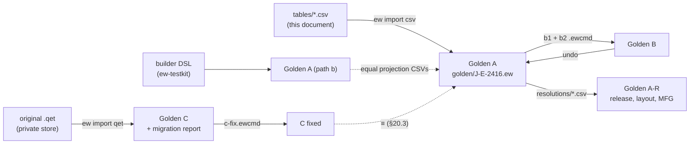

# Golden project: acceptance-test specification

**Status:** Draft v0.1 · **Date:** 2026-10-18 (cycle-11 design pass 2026-10-21: Golden B as built, Golden C runnable, acceptance runner statuses; cycle-12 design pass 2026-10-21: Golden C as built, the M1 gap list at the cycle-12 counts; cycle-13 design pass 2026-10-21: the computed wire numbers, the DP row and folio 908 as built, the M1 gap list closed; cycle-14 design pass 2026-10-21: documents as built, the final wire numbers and Via notation, the cover, the exports, the freshness script, EF-15 = 10, the acceptance counts at the cycle-14 tip; cycle-17 design pass 2026-10-22: the typed revisions, the second D-05 entry and the acceptance counts at the cycle-17 tip, §22; cycle-18 design pass 2026-10-22: the typed solenoid-position map under H1, §11.2, the library copies and the PLC normalisers as built, §22; cycle-24 design pass 2026-10-24: AC-28's W29 chip names the size profile, §21, and D-06's property-grid evidence is WP-S2.05's test PG9, §19, decision log ID-598, ID-599; cycle-25 design pass 2026-10-24: PG9 built and passing, §19, decision log ID-626; cycle-26 design pass 2026-10-24: AC-16's sweep at 2232 keys of 70 memoised families, §22, decision log ID-635) · **Part of:** ElektraWatt design document set

> **Anonymization note:** dates and the manufacturing year of the reference project in this document are synthetic placeholders, not the original values.

**Purpose.** This document turns the reference project (cabinet J-E-2416 from the pilot user's reference drawing
set) into ElektraWatt's (EW) executable acceptance specification. It fixes the data EW must hold as a model
(project, pages, devices, potentials, wires, terminals, cables, PLC, fluid, layout, parts), the outputs it must
regenerate from that model, the check findings it must report, and one regression test per reference defect
D-01 … D-42. The numbered acceptance criteria AC-01 … AC-42 are the pass conditions of the milestone gates G-M1 … G-M6
and G-PP (§22).

**Contents**
1. [Scope, sources and conventions](#1-scope-sources-and-conventions)
2. [The three variants](#2-the-three-variants)
3. [Fixture, build paths and acceptance runner](#3-fixture-build-paths-and-acceptance-runner)
4. [Project and structure data](#4-project-and-structure-data)
5. [Pages](#5-pages)
6. [Devices](#6-devices)
7. [Potentials and the colour and size profile](#7-potentials-and-the-colour-and-size-profile)
8. [Connections and wires](#8-connections-and-wires)
9. [Terminal strips](#9-terminal-strips)
10. [Cables and conductors](#10-cables-and-conductors)
11. [PLC and bus](#11-plc-and-bus)
12. [Pneumatic functions](#12-pneumatic-functions)
13. [Panel layout](#13-panel-layout)
14. [Bill of materials](#14-bill-of-materials)
15. [Cross-reference acceptance table](#15-cross-reference-acceptance-table)
16. [Generated report folios](#16-generated-report-folios)
17. [Frame, title block, grid, lines and fonts](#17-frame-title-block-grid-lines-and-fonts)
18. [Expected check results](#18-expected-check-results)
19. [Defect regression tests D-01 … D-42](#19-defect-regression-tests-d-01--d-42)
20. [Golden C: migration report and fix script](#20-golden-c-migration-report-and-fix-script)
21. [Acceptance criteria](#21-acceptance-criteria)
22. [Milestone gates](#22-milestone-gates)
23. [Unknowns register and questions for the pilot user](#23-unknowns-register-and-questions-for-the-pilot-user)
24. [Requirements covered](#requirements-covered)
25. [Open questions](#open-questions)

---

## 1. Scope, sources and conventions

### 1.1 Sources and precedence

| Source | Used for |
|---|---|
| [Reference analysis](../research/reference-drawing.md) §3, §4, §5 | Defects, golden data, frame geometry. Its §4.15 criteria 1–9 map to AC-03, AC-01, AC-05, AC-06, AC-07, AC-08, AC-09, AC-21 and AC-13 |
| [Gaps and corrections](../research/gaps-and-corrections.md) | Overrides the other research notes (C-15 xref variable, G14 fonts) |
| [Architecture](04-architecture.md) §13–§15 | Build paths, runner, defect classes, spine exit |
| [Domain model](03-domain-model.md) §8–§16, §20 | Entity forms of the golden data (frozen tags, clamps, bonds, channels, layout) |
| [02a](02a-requirements-core.md), [02b](02b-requirements-extended.md), [02c](02c-nonfunctional-requirements.md) | The requirements whose GP acceptance criteria this document makes concrete |

This document supersedes reference-drawing §4 where they differ. Every difference is either an intended
difference (§3.4) or a proposal marked ▲. The reference drawing set itself is confidential and is never
committed; its technical content appears here anonymised (§3.5).

### 1.2 Notation

| Notation | Meaning |
|---|---|
| ▲, ▲U-nn | Not determinable from the reference set. The value given is a **test input**, not a fact; U-nn is its entry in the unknowns register (§23.1) |
| `101-H16` | Cell `<folio>-<row><column>` of the frame grid (columns 0–16, rows A–H) |
| `-102G1:+#2` | Connection point (CP) of a device; `#n` is the internal index that keeps duplicate printed designations unique (FR-DEV-006) |
| `-X1031:12/b` | Terminal 12 of strip -X1031, clamp b. PT 2.5-TWIN: clamp a on side 1, clamps b and c on side 2 ([domain model](03-domain-model.md) §11) |
| W1 … W44 | Physical wires (§8); F1 … F16 fluid lines (§12); BR1 … BR6 bridges; J1 … J6 junctions |
| EF-nn, MF-nn, AC-nn | Expected findings (§18), migration findings (§20), acceptance criteria (§21) |
| Placeholders | `<customer>`, `<end user>`, `<project ref>`, `<drawing id>`, `<engineer>`, `<checker>`, `<address>`, `<country>`, `<confidentiality notice>` |

### 1.3 Value classes

- **Fact:** printed in the reference and kept.
- **Fix:** a defect D-nn corrected where the correct value is determinable (for example "T51" → T55, "BR" → BN).
- **Proposal ▲:** a test input until the pilot user answers (§23.2). Where the *absence* of a value is itself a
  finding (TBD station address, missing cable, missing parts, unplaced devices), Golden A keeps the gap so that the
  check must fire.

---

## 2. The three variants

| Variant | Purpose | Input | Built by | Expected state | First gate |
|---|---|---|---|---|---|
| **Golden A** | The acceptance target: the reference project with the user's visible tags, every determinable defect fixed, unknowns as test inputs | `golden/J-E-2416/tables/` (this document) | `ew import csv` (FR-IMP-022); builder DSL; checked-in fixture | Outputs of §5–§17, findings EF-01 … EF-19 | M1 |
| **Golden B** | Renumbering test: all tags page-based, then a page renumber | Golden A + `variants/b1-page-based-tags.ewcmd`, `variants/b2-renumber-pages.ewcmd` (one `b-renumber.ewcmd` with FT-155) | `RenumberDevices`, `RenumberPages` as previewed commands | Tag map §2.2, identical topology, one undo per step back to A | M1 headless, M2 GUI |
| **Golden C** | Migration test: the pilot's original `.qet` imported; defects visible as findings; fixable to A | The original `.qet` (private, PQ-02; received 2026-10-20, runnable since cycle 11) | `ew import qet` + `variants/c-fix.ewcmd` | Migration report MF-01 … MF-27; C + fixes ≡ A (§20.3) | M2 |

A fourth fixture, **Golden A-R** (A plus the resolution overlay `resolutions/*.csv`, §2.4), is not a variant of
the drawings: it supplies test values for the ▲ gaps so that release, layout, routing and manufacturing outputs can
be tested before the pilot answers.

A fifth fixture, **GP-UT** (`variants/gp-ut.ewcmd`), is the start state of the usability tests of
[16](16-ux-ui.md) §19: Golden A without -102F1 and its wires W20, W21, W24 and W25 and, for round R2, also without
the binding of channel 1 of -201U3. It comes with a basic project built from the shipped defaults; the pilot's own
basic project replaces it only in pilot sessions, so no company logo or notice text enters the repository. With
the gap-filling counter rule of [domain model](03-domain-model.md) §8.6, task T1 re-creates the MCB as -102F1.



### 2.1 Golden A rules

1. **Tags.** Printed tags are kept. S51, F55, T55, E55, S56, E56 and 1X1 are frozen tags (`FrozenTag{sign:
   Hidden}`, FR-NUM-010, ADR-0003). -XPE, -UC1 and the mounting plate -UC1-plate are frozen tags too, as ▲U-34 test
   inputs (Golden B's `include_frozen: true` renumbers -XPE as §2.2 shows). -X1031 and -X1032 are derived by the
   strip rule `{letter}{page}{counter}`, which `settings.numbering` carries as a rule for devices with a strip
   aspect; every other tag by the page-based rule `{page}{letter}{counter}`; valves by
   the child rule `{parent}-{letter}{counter}` (-201U3-Q1, FR-DEV-021). The formatter adds the leading "-" of the
   product aspect; formats never contain it ([domain model](03-domain-model.md) §8.2). Letters follow the shipped
   EN 81346-2:2009 single-letter set (ADR-0026), which maps directional valves to Q.
2. **Fixes.** Every defect of class S or I in [architecture](04-architecture.md) §14 is fixed in the model; class C
   defects are fixed where the correct value is determinable; the rest stay and are reported (§18).
3. **Safety.** D-13 is *not* fixed, because the correct wiring is unknown (▲U-11): EW-POT-013 must report it.
4. **Grid.** All drawn pages sit on the QET 10 px grid, stored exactly as a rational grid (ADR-0005, ADR-0027).
   Their symbols come from the `@qet10` edition of the starter library, which is generated from the native edition
   and never drawn by hand (FR-SYM-030; ADR-0027 recommendation 8, still Proposed). The first PNG approval (§3.3)
   also checks the scaled graphics of that edition on every Golden A page before the starter set is frozen.
5. **Visuals.** Folios reproduce the reference except the intended differences of §3.4.

### 2.2 Golden B

**Step B1:** a settings line sets the numbering to the single page-based scheme `{page}{letter}{counter}` (dropping the strip rule), then `RenumberDevices{scope: project, include_frozen: true, options: {only_nonconforming: true}}`. Letters stay (`TagSpec.letter`); only formats and counters change. Earlier drafts of this document named a `scheme` parameter (a format string) and an `order: [column, row]` parameter of the renumber; neither exists. The format change is the settings line, and the renumber's ordering is the command's fixed position order (decision log ID-289). Exactly ten tags change:

| Golden A | Golden B | Golden A | Golden B |
|---|---|---|---|
| S51 | -101S1 | 1X1 | -101X1 |
| F55 | -101F2 | -XPE | -101X2 |
| T55 | -101T1 | -X1031 | -103X1 |
| E55 | -101E1 | -X1032 | -103X2 |
| S56 | -101S2 | E56 | -101E2 |

-UC1 and its plate keep their enclosure rule: page-based numbering applies only to devices whose main
representation lies on a schematic page ▲. Assertions after commit: no orphan reference; identical connection
endpoints and potential partition (compared by UUID); all 63 cross-reference texts unchanged (they print cells, not
tags); tag texts change only on folios 101, 103 and 902, in the TOC titles of 903–905 and in report folios 901 and
903–907 and 910; one undo restores a byte-identical Golden A. *As built (cycle 15; decision log ID-368):* `ew apply … b1-page-based-tags.ewcmd --preview` lists the 10 device-tag changes of the table above and, beside them, the 28 terminal tags that follow their renamed strips, 38 printed tag lines in all; the "10 tag changes" of this section and of FR-EXT-029 count device tags. Step B2's preview lists 2 tags and 14 cross-reference texts.

**Step B2:** `RenumberPages{section: 1, start: 101, step: 1, keep_gaps: false}` moves folio 106 to 104.
Assertions: -106W1/-106W2 become -104W1/-104W2; exactly 14 cross-reference texts change from "106-…" to "104-…"
(12 on folio 103, "106-G3" on 201, "106-G9" on 202); Next of 103 and Prev of 200 read 104; TOC and outline follow;
apart from the folio label, these xrefs and the two tags (wherever they print), no text changes; undo restores step
B1's state.

**As built (cycle 11).** `variants/*.ewcmd` are command logs in the JSON Lines format of [17](17-extensibility.md) §3.5, replayed by `Session::run_script` (`crates/ew-api/src/cmdlog.rs`; format notes in `golden/J-E-2416/README.md`): `{"cmd": "<name>", "params": {…}}` per line with the parameters of the command's schema. Two logs exist and are tested (`crates/ew-api/tests/golden_b.rs`; decision log ID-289): `variants/b1-page-based-tags.ewcmd` (step B1: `project.settings.set` replaces `numbering` by the single page-based scheme, then `numbering.renumber` with `scope: project`, `include_frozen: true` and `options.only_nonconforming: true`) and `variants/b2-renumber-pages.ewcmd` (step B2: `{"cmd":"page.renumber","params":{"scope":{"section":{"ref":"section:1"}},"start":101,"step":1,"keep_gaps":false}}`). The reference kind `section:<n>` is now listed by [17](17-extensibility.md) §3.5 (decision log ID-288); an unresolvable reference stops the replay with exit 2. FT-155 merges the two logs into one `b-renumber.ewcmd`.

All ten rows of the tag map (the ▲ rows) hold. 1X1 has no strip segment (▲U-43); it takes the page of the main representation of its first placed terminal (decision log ID-293), so it becomes -101X1, and -XPE becomes -101X2. `only_nonconforming` limits B1 to the tags that do not already follow the scheme: under the interim smallest-ID main-representation rule ([03](03-domain-model.md) §8.2 step 4) a full renumber would swap -X1031 and -X1032, so the swap is avoided until WP-S1.11's rule lets a full renumber run (FT-155). B2 changes 2 tags and 14 cross-reference texts; the topology is identical. One undo per line returns the project to Golden A byte for byte. B1, B2 and the undos are verified with the oracle on.

**B′ (identifier-set switch, FR-NUM-014, Should):** switching Golden A to the IEC 81346-2:2019 set is a previewed
renumber whose expected classes are the "IEC 81346-2:2019 class" column of
[reference analysis](../research/reference-drawing.md) §4.4 (S51 → -101QB1, T55 → -101BT1, -X1032 → -103XE1 …),
with the ▲ entries there as test inputs. Golden B is also the seed that `ew-testkit` replicates into the S–XL
performance fixtures ([02c](02c-nonfunctional-requirements.md) §2.1).

### 2.3 Golden C

Golden C imports the pilot's original QElectroTech 0.100.0-dev file of the reference set in lenient mode
(ADR-0009, ADR-0021). The import must reproduce the 18 folios and the cross-reference texts as printed
(including the faulty "3-B0"), list the defects as migration findings (§20.1), and become equivalent to Golden A
after the scripted fixes of §20.2. The pilot supplied the file on 2026-10-20 (PQ-02, decision log ID-272); it lives in the private store (§3.5). As built in cycle 11 (decision log ID-273, ID-283), the lenient project importer imports it with 0 lost connections and reports the 8 EW-TERM-002 groups that MF-09 expects. As built in cycle 12 (decision log ID-301, ID-302), the migration report is `expected/c-migration-report.csv` (§20.1) and the fix script is `variants/c-fix.ewcmd` (§20.2). The file yields 61 of the reference's 63 cross-reference texts: the source of the interruption point PE-1.1 on folio 101 is not an element of the file, which is a source limit. On QET's default border, an interruption point, master or slave lying exactly on an inner column or row line moves 2 nm left or up into QET's cell, and every other element keeps its exact position; with it the cross-reference cells 102-C15, 103-G6 and (202-E1) print as the reference prints them (decision log ID-301; the proper home is a cell-boundary policy, ADR-0027 open item, FT-179). After the fix script, 60 of these 61 texts equal Golden A's; the exception is "3-B0" against "3-B2" (MF-13), which needs the anchor-policy command FT-172. Golden C's gate stays G-M3 (plan of record, lever b). The importer still opens the batch without `ApplyImport` and without import passes (FT-143), so the MF rows that need passes, formulas or recognisers are not produced yet (FT-128 … FT-140).

### 2.4 Golden A-R: the resolution overlay

| Gap | Test value in A-R ▲ | Clears |
|---|---|---|
| U-11 T55/S56 in N | Contacts moved into the L path: F55:2 → T55 → E55:L and F55:2 → S56 → E56 (wire ends below) | EF-01 |
| U-23 address map | Map H2 "coil 14 = channel 2p + 1" | EF-02 |
| U-22 station address | 3, network 1.5 Mbit/s | EF-03 |
| U-13 S56, E56 parts | Test catalogue parts `TEST-DOORSW-1`, `TEST-LAMP-1` (flagged test data, clamp data in `tables/clamps.csv`) | EF-04 |
| U-26 placements | F55 at the end of row 1; -201U9 between -201U8 and -202U1; E55 low on the plate; S56, E56 on the door frame | EF-05 |
| U-19 PE sizes | W6 explicit 2.5 mm² GNYE | EF-06 |
| U-20 supply cable | -101W1, 3 cores L/N/PE 2.5 mm² ▲ | EF-07 |
| U-21 bus cable length | -3W1 = 10 m | EF-08 |
| U-27 accessory parts | Test parts for bridges, end brackets, rails, ducts, the -X1031 end cover, a rail-mounting kit for the valve terminal on R3 and one screw-mounted test part on the plate (§13) | EF-17 |
| U-25 fluid supply and tubes | Medium "compressed air 6 bar [1:4:1]" fed to -201U9:1 through a supply line F17 from an air-supply point; default tube PU 6×4 BU (`ProjectSettings.fluid.default_tube`); manual length 1,200 mm on F1–F17; silencers (`CpOverride.closure`) on ports 3 and 5 of -201U9 and -202U3; plugs on ports 2 and 4 of the 20 spare valves | EF-13, EF-20, EF-21 |
| U-03 checker | `<checker>` ≠ author, approved by the acceptance runner (below) | release gate |

**Rewiring of the F55 circuit (U-11).** The six wire identities stay, so the shop set keeps its 31 wires
([13](13-manufacturing-outputs.md) §15.1) and the A-R finishing-task list is exact; only the ends change:

| W | Golden A | Golden A-R |
|---|---|---|
| 13 | F55:2 → E55:L | F55:2 → T55:5 |
| 14 | F55:2 → E56:X2 | F55:2 → S56:13 |
| 15 | F55:N#2 → T55:5 | F55:N#2 → E55:N |
| 16 | F55:N#2 → S56:13 | F55:N#2 → E56:X1 |
| 17 | T55:3 → E55:N | T55:3 → E55:L |
| 18 | S56:14 → E56:X1 | S56:14 → E56:X2 |

J1 and J2 keep their sequences. The naming-only definitions follow the switched conductor: N-55T becomes L-55T
(T55:3, E55:L) and N-55S becomes L-55S (S56:14, E56:X2); L-55 now holds F55:2, T55:5 and S56:13, and N-55 holds
F55:N#2, E55:N and E56:X1.

**Sign-off.** `HumanOnly` commands are refused in a replay ([15](15-checks-revisions-collaboration.md) §5.4), and a
sign-off is bound to a content digest that a static CSV cannot hold. The A-R acceptance runner therefore applies
the overlay, saves, and then calls the CLI `ew revision approve --as <checker>`; the terminal confirmation comes
from the test harness's test-build confirmation hook ([18](18-quality-security-release.md)), which release builds
lack. It is never a line of a `.ewcmd` script.

---

## 3. Fixture, build paths and acceptance runner

### 3.1 Directory layout

```text
golden/
  J-E-2416.ew/                 # checked-in project fixture (CC0); generated by `ew import csv golden/J-E-2416/tables`
  J-E-2416/
    README.md                  # what the fixture is, licence CC0-1.0 (ADR-0024), anonymisation statement
    tables/*.csv               # source of truth: §4–§14 of this document as CSV (UTF-8, natural order);
                               #   tables/clamps.csv holds the ▲ clamp test data of 13 §15.2, A-R test parts included
    resolutions/*.csv          # Golden A-R overlay (§2.4), every value flagged test data
    history/V1.0/              # synthetic V1.0 state for revision compare and clouds: Golden A with one ▲ test
                               #   change each on 101 and 106 (FR-REV-014, FR-REV-016); the real V1.0 stays historic
    expected/                  # pages, toc, title_blocks, xrefs, tags, bom_component, bom_assembly, terminals,
                               #   wires, potentials, cables, plc, fluid, placements, findings_mvp, findings_1_0,
                               #   findings_manufacturing, findings_en60204, release_blockers (CSV);
                               #   acceptance_headless.md (the committed headless runner report, §22);
                               #   c-migration-report.csv (Golden C's counts per code, §20.1);
                               #   mfg/*.csv (Komax and Rittal WT rows, manual.csv with finishing tasks, consumables);
                               #   geometry/frame.json; text/<folio>.csv; png/<folio>.png
    acceptance/*.sql           # queries over the api_v1 views producing expected/*.csv (ADR-0017)
    variants/                  # b1-page-based-tags.ewcmd, b2-renumber-pages.ewcmd, b2019-identifier-set.ewcmd,
                               #   c-fix.ewcmd, gp-ut.ewcmd
    basic-project/             # basic project built from the shipped defaults (GP-UT sessions, §2)
    assets/logo-placeholder.svg
```

The original `.qet` and the reference PDF live in a private store reachable only by a private CI job (§3.5).

### 3.2 Build paths and their equivalence

Following [architecture](04-architecture.md) §13, Golden A is built three ways:
- **(a) data bootstrap:** `ew import csv` over `tables/`, with IDs `v5(namespace, "{table}|{row key}")` in
  the fixed import lineage `Fixed("golden")` (ADR-0004 amendment 4, [14](14-interop.md) §2.3), so the result is
  reproducible;
- **(b) builder DSL:** the same content issued as commands, which exercises the command layer;
- **(c) checked-in fixture:** the committed output of (a).

(a) and (c) must be byte-identical JSONL. (b) must produce the same `expected/*.csv` (all columns except `id` and
`source_ref`). A pull request that changes `tables/` must regenerate (c) and `expected/` in the same commit
(schema-steward rule, architecture §7.6).

### 3.3 Comparison rules

| Output | Comparison | Tolerance |
|---|---|---|
| Frame, grid, title-block lines | Vector extraction from the EW PDF in printed mm against `geometry/frame.json` (§17) | ±0.2 mm |
| Texts | String exact against `text/<folio>.csv`; anchor position (the run origin, the start of the baseline, as a PDF text extraction gives it; decision log ID-168); size | anchor ±0.2 mm; size ±0.05 pt; font family not compared |
| Symbol placement | Anchor cell exact; raster at 150 dpi against the approved PNG (dify) | ≤ 0.5 % differing pixels ▲ |
| Reports, lists, exports | CSV row-by-row, natural sort order (FR-NUM-018) | exact |
| Check findings | Rule ID, sorted target IDs, severity | exact; message text not compared |
| PDF structure | Outline entries, link annotations, `/PageLabels`, fonts, PDF/A | exact counts; veraPDF pass |
| Determinism | SHA-256 of PDF, SVG, CSV, JSONL | equal |

**Approved PNGs.** At M1 the team and the pilot user compare EW's rendering of every reproduced folio with the
reference PDF in a private review, list any difference not in §3.4, fix it or add it to §3.4, and then approve the
PNGs. This first approval includes the visual check of the scaled graphics of the generated `@qet10` symbol edition
(§2.1 rule 4) on every Golden A page. From then on the approved PNGs are the visual oracle; they contain only
anonymised content.

The first approval also settles these starter-symbol items, raised by the review of WP-S7.02 (decision log ID-34):

| Item | Symbols | Check |
|---|---|---|
| VR-01 | `ew.iec.coil` (rectangle 4 × 8 mm), `ew.iec.resistor` (3 × 8 mm) | The coil and the resistor are told apart at print size on folios 101–106; if not, the coil's proportions change before the starter set is frozen |
| VR-02 | `ew.iec.contact-co`, `ew.iec.contact-nc` | The NC side of the changeover contact shows the same hook as `contact-nc` |

### 3.4 Intended differences from the reference set (Golden A)

| # | Folio(s) | Reference | Golden A | Reason |
|---|---|---|---|---|
| 1 | all | Tahoma | Bundled default font (Noto Sans ▲U-29) | ADR-0028, G14 |
| 2 | all | Company logo, notice text, names | Placeholder logo SVG and placeholder texts | §3.5 |
| 3 | all | Revision "1", "V1", "V1.0", "V2.0" | "V2.0" on every page | D-05 |
| 4 | 101 | Description "Control Cabinet Expansion" | "Expansion Control Cabinets" | D-06 |
| 5 | all | "Customer: <end user>" | Label and binding per ▲U-01 (test value "End user: <end user>") | D-30 |
| 6 | 2, 3, 902 … | Prev/Next over 18 pages | Prev/Next over 36 pages (902 Next = 903) | §5, §16 |
| 7 | 1 | "+N +PE, 50hz", "Yellow / 4 Green", "0.75 mm ²" | "1 x 230 VAC + N + PE, 50 Hz", "Yellow / Green", "0.75 mm²" | D-18 |
| 8 | 101, 102 | "10A C", "4A C", "16 B", "15c", "Murr Elektronik", "Eaton / Holec" | Rendered from typed data and the manufacturer master (▲U-32: "C10", "C4", "B16", "15 °C", "Murrelektronik", "Eaton") | D-18, D-35 |
| 9 | 101, 3 | External arrows without text | "+J-E-206 / JE-N1000-03" in the xref slot (FR-XRF-012) | REF-018 |
| 10 | 3, 201 | -201U1 aux xref "3-B0" | "3-B2" | D-14 |
| 11 | 103 | "+JE2416-X1031", "+JE2416-X1032" | "-X1031", "-X1032" (identifier suppression ▲U-08) | D-03 |
| 12 | 103 | 8th terminal of -X1031 unlabelled | "3+" | D-11 |
| 13 | 106 | Core colour "BR" | "BN" | D-17 |
| 14 | 101, 202, 203–206 | Device tags at 8.88 pt or 9.62 pt | All device tags in style `tag.main` (9.62 pt printed) | D-29 |
| 15 | 202 | 5 valves drawn on -202U2 | 4 valves (overview generated from the assembly) | D-10 |
| 16 | 2, 901 | QET tables | EW report forms with Pos/Qty/Unit columns, sub-page continuation | D-04, §16 |
| 17 | 902 | Free rectangles, "T51", "X1031", not to scale | Placements of devices, "T55", "-X1031", scale 1:10 ▲, legend block | D-02, D-32 |
| 18 | PDF | No outline, no links, physical page labels | Outline, 64 link annotations (one per item; 63 linked xref texts with 64 link targets, §15), folio page labels | D-07, D-33 |

### 3.5 Anonymisation and private fixtures

- Party, person and title-block values in `tables/` are the placeholders of §1.2; the logo is
  `assets/logo-placeholder.svg` (CC0). The pilot's real values live only in their private company basic project.
- A CI guard (NFR-PRIV-09) normalises every committed text file into word n-grams (n ≤ 3), hashes them
  with SHA-256 and fails on any match with `ci/denylist.sha256`, a list of hashes of forbidden tokens supplied by
  the maintainers. Only hashes are committed.
- Golden C and the migration verifier (AC-25 … AC-27) run in a private CI job against the private store; the
  public log carries pass/fail and anonymised diffs only. The anonymised `.qet` is published only with the pilot's
  written consent.
- The pilot corpus is private test input (decision log ID-299). The pilot's three projects (P2 is the reference set and the source of Golden C) live outside the repository and in the private CI store. Agents read only sanitised derived lists (element types and finding codes, with counts); documents and the decision log carry counts only. The corpus's tokens are SHA-256 digests in `ci/denylist.sha256`, and the private smoke test prints counts only.

---

## 4. Project and structure data

### 4.1 Project properties

| Property | Golden A value | Class |
|---|---|---|
| Object / cabinet id | J-E-2416 | Fact |
| Document title (cover subtitle) | Electrical Definition | Fact |
| Project description | Expansion Control Cabinets | Fix (D-06) |
| Long description (cover) | Expansion Control Cabinets `<end user>` | Fact |
| Project reference | `<project ref>` | Fact (anonymised) |
| Drawing identification | `<drawing id>` | Fact (anonymised), separate from project reference (FR-PRJ-002) |
| Manufacturing year | 2025 | Fact |
| Supply | phases 1, N, PE, 230 V AC, 50 Hz; earthing system TN-S ▲U-02; rendered "1 x 230 VAC + N + PE, 50 Hz" | Fact + fix (D-18) |
| Control voltage | 24 V DC, PELV (one 0 V–PE bond, §7.4) | Fact |
| Rated consumption | 6 A | Fact |
| Created / edited | 2025-03-03 / 2025-04-14, displayed dd-mm-yyyy | Fact |
| Revisions | V1.0 2025-03-03 "Initial issue", state Released (historic, no archive); V2.0 2025-04-14 "Changes on 101 and 106", state Open, author `<engineer>`, checker unset ▲U-03, U-04 | Fix (D-05) |
| Page change status | 101 and 106 last changed in V2.0; all others V1.0 | Fix |

### 4.2 Parties and bindings

| Role | Name | Bound in |
|---|---|---|
| Customer | `<customer>` | Cover "Company / Customer" |
| End user | `<end user>`, `<address>`, `<country>` | Cover "End User", "Address", "Postcode / City", "Country"; title-block party cell ▲U-01 |
| Panel builder | the pilot panel builder (logo, notice) | Title-block logo and notice cells |
| Author / engineer | `<engineer>` | Cover "Engineer", title block "Author" |
| Checker | unset ▲U-03 (A-R: `<checker>`) | Title block "Checked" |

Person and party fields are marked personal data (NFR-PRIV-06).

### 4.3 Structure identifiers and sections

| Aspect | Code | Description | Used by |
|---|---|---|---|
| `=` function | =P01 | ▲U-05 | every page and device |
| `+` location | +J-E-2416 (alias "JE2416", never printed) | This cabinet | every in-cabinet device; layout space |
| `+` location | +J-E-206 | Upstream cabinet; external references only | ExternalRef targets on 3 and 101 |
| `+` location | +FIELD ▲U-07 | Process field | 8 field devices -203Q1 … -203Q8 (process valves TA05-V-xx) |
| External device | JE-N1000-03 in +J-E-206 ▲U-06 | Supply origin and PROFIBUS master | 4 ExternalRef uses (L, N, PE, DP) |

Sections: 1 "Wiring Definition" (100–199), 2 "Pneumatics" (200–299), 9 "Nomenclature" (900–999). Folios 1, 2 and 3
belong to no section. Full designations read `=P01+J-E-2416-102G1`; pages print tags without `=P01+J-E-2416` when
these equal the page's structure (FR-NUM-002).

### 4.4 Project settings and profiles

| Setting | Golden A value |
|---|---|
| Identifier set | EN 81346-2:2009 single letters (ADR-0026) |
| Numbering | page-based `{page}{letter}{counter}`; strips `{letter}{page}{counter}` (a rule of `settings.numbering`); -XPE, -UC1 and -UC1-plate frozen ▲U-34; children `{parent}-{letter}{counter}`; order column then row; next free counter = the lowest unused counter in the scope (gaps are filled, [domain model](03-domain-model.md) §8.6) |
| Cross-reference format | `{page}-{row}{column}`, the QET `%F-%l%c` equivalent (C-15); aux → main in parentheses "(201-E1)"; main → aux after "∞"; `{page_index}` (QET `%f`) is the 1-based position in page order counting every page record (drawn page, divider, report base page) but not pagination continuation pages, so folio 102 is page 6 (FR-XRF-003) |
| Xref anchor policy | per symbol (FR-SYM-010): named anchor points placed so that the cells of §15 result, e.g. module aux symbol at its centre (203-B4), CPX power box at its left edge (106-G3), bus port at its graphics (3-B2); interruption points at the arrow tip |
| Frame | QET-compatible A4 landscape, 17 columns 0–16, 8 rows A–H, grid and no-grid variants (§17) |
| Date / units | dd-mm-yyyy; SI spacing and decimal point (en) |
| Colour / size profile | "DBU/WH 24 V" / control 0.75 mm², mains 1.5 mm² (§7) |
| Wire markers | mode "only explicit overrides" (FR-CON-024) |
| Wire numbers | connection-oriented `{page}.{counter}`, counter scope page, cores not numbered, not printed on pages ▲U-33 (§8.1) |
| Manufacturing | length increment 10 mm and fixed reserve 100 mm (`MfgSettings`, [13](13-manufacturing-outputs.md) §2.3, §3.3); destination marking; DIN 46228-4 ferrule colours |
| Text styles, font | §17.5; bundled default font ▲U-29 |
| Check scheme | `pre-delivery` with the parameters of §18; minimum printed cap height 1.2 mm ▲U-31 |
| Derivation profile | the first shipped profile (FR-PRJ-011) |

---

## 5. Pages

| Folio | Page type (FR-PAG-001) | Page description (title block) | Section | Frame | Status |
|---|---|---|---|---|---|
| 1 | Title page (cover form) | Title Page | — | no grid | V1.0 |
| 2, 2.1 | Table of contents (report) | Table of Contents 1, Table of Contents 2 | — | no grid | generated |
| 3 | Bus topology | Bus Topology - Profibus | — | grid | V1.0 |
| 100 | Section divider | =P01+J-E-2416 - Section 1 - Page 100 - 199 - Wiring Definition | 1 | no grid | generated |
| 101 | Multi-line schematic | Power Supply 1 - Main Current | 1 | grid | **V2.0** |
| 102 | Multi-line schematic | Power Supply 2 - Control Current | 1 | grid | V1.0 |
| 103 | Multi-line schematic | Power Supply 3 - Control Current Distribution | 1 | grid | V1.0 |
| 106 | Multi-line schematic | Power Supply 4 - Pneumatics | 1 | grid | **V2.0** |
| 200 | Section divider | =P01+J-E-2416 - Section 2 - Page 200 - 299 - Pneumatics | 2 | no grid | generated |
| 201, 202 | Assembly overview | Valve Manifold Overview 1, 2 | 2 | grid | V1.0 |
| 203 … 206 | Fluid-power schematic | Valve Manifold 1 … 4 | 2 | grid | V1.0 |
| 900 | Section divider | =P01+J-E-2416 - Section 9 - Page 900 - 999 - Nomenclature | 9 | no grid | generated |
| 901, 901.1 | Parts list (report) | Partlist 1, Partlist 2 | 9 | no grid | generated |
| 902 | Panel layout (2D) | Cabinet Layout | 9 | grid | V1.0 |
| 903 … 911 | Generated report pages (§16) | per §16 | 9 | no grid | generated |

The project has **36 pages**: 18 reproduced folios, 2 continuation pages (2.1, 901.1) and 16 generated report pages
(§16). Folio gaps (4–99, 104, 105, 107–199 …) are kept (FR-PAG-005). Prev/Next are computed over page order: folio 1
Prev empty, 911 Next empty (FR-PAG-013). Continuation pages take sub-page labels `<folio>.<n>` and sort naturally
(FR-PAG-006, FR-PAG-030). Every page carries `=P01` and `+J-E-2416`.

---

## 6. Devices

### 6.1 Device table

Representation cells are the anchor cells; the cross-reference cells that must match exactly are in §15.

| # | Tag (Golden A) | Function | Part (manufacturer, part number) | Connection points | Main rep. | Other reps. |
|---|---|---|---|---|---|---|
| 1 | S51 (frozen) | Main switch, 2-pole, 40 A, rotary handle | Eaton 533356 ▲U-16 | 1, 2 (pole 1); 3, 4 (pole 2); fed on 2 and 4 | 101-B2 | 902 |
| 2 | -101F1 | MCB 1P+N C10, feeds the PSU | Schneider Electric A9P52610 | 1, 2 (L pole); N#1 in, N#2 out (both printed "N") | 101-B8 | 902 |
| 3 | F55 (frozen) | MCB 1P+N C4, feeds heater and lamp | Siemens 5SY4204-7 | as -101F1 | 101-B12 | 902 (A-R) |
| 4 | T55 (frozen) | Thermostat, setpoint 15 °C, contact in N (D-13) | Rittal SK 3110.000 | 5, 3 ▲U-12 | 101-C12 | 902 ("T51" in the reference) |
| 5 | E55 (frozen) | Enclosure heater ▲U-14 | Rittal SK 3102.000 | L, N, PE | 101-E12 | 902 (A-R) |
| 6 | S56 (frozen) | Door switch, contact in N (D-13) | none ▲U-13 | 13, 14 ▲ | 101-D14 | door (A-R) |
| 7 | E56 (frozen) | Cabinet lamp | none ▲U-13 | X1, X2 ▲ | 101-E14 | door (A-R) |
| 8 | 1X1 (frozen) | Incoming supply strip | terminals UK 5 N ×2, USLKG 5 ×1 ▲U-17 | terminals 1, 2, PE; field and internal side | 101-D2 | 902 |
| 9 | -XPE ▲U-34 | Main PE point (plate PE stud), drawn as earth symbol without tag | none (waiver W-1) | PE | 101-D5 | — |
| 10 | -102G1 | PSU 1 AC / 24 V DC, 20 A | Phoenix Contact 2904602 | L, N, PE, +#1, +#2, −#1, −#2 | 102-B6 | 902 |
| 11 | -102F1 | MCB 1P B16 in +24 V | Schneider Electric A9F78116 | 1 (alias L1), 2 (alias T1) | 102-C7 | 902 |
| 12 | -102F2 | Electronic load distribution, 4 × 6 A | Murrelektronik MICO 4.10 ▲U-15 | 24VDC#1, #2, GND#1, #2, 13, 14, Out1 … Out4 | 102-E7 | 902 |
| 13 | -X1031 | 24 V / 0 V distribution strip | terminals PT 2.5-TWIN ×20 ▲U-09 | 20 terminals, clamps a, b, c | 103-A3 (24 V segment), 103-A10 (0 V segment) | 902 |
| 14 | -X1032 | PE distribution strip, rail-bonded | terminals PT 2.5-TWIN-PE ×5 | 5 terminals, clamps a, b, c, rail contact | 103-F3 | 902 |
| 15 | -106W1 | Supply cable to -201U1 X1 (7/8") | Festo NEBU-G78W5-K-2-N-LE5 | cores BK, BU, GNYE, WH, BN | 106-F5 | 906 |
| 16 | -106W2 | Supply cable to -202U1 X1 | Festo NEBU-G78W5-K-2-N-LE5 | as -106W1 | 106-F11 | 906 |
| 17 | -3X1 | PROFIBUS DP plug, termination On | Festo 532216 | device side on -201U1:DP; cable entry In (A1, B1), Out (A2, B2) ▲ | 3-B2 | — |
| 18 | -3W1 | PROFIBUS cable to +J-E-206 | Siemens 6XV1830-0EH10 | cores A, B, shield ▲U-21 | 3-E2 | 906 |
| 19 | -201U1 | CPX bus node (DP slave) and power interlinking block; assembly head; PLC station | Festo 195740 + Festo 550208 | X1: 1 0V Val, 2 0V El, 3 FE (printed "PE") ▲U-18, 4 24V El, 5 24V Val; FE screw; DP (Sub-D 9) | 201-E1 | 3-B2 (bus port), 106-G3 (power) |
| 20 | -201U2 | MPA pneumatic interface | Festo 552286 | ▲ | 201-E2 | 902 |
| 21–26 | -201U3 … -201U8 | Electronic module and sub-base: 4 valve positions, 8 outputs | Festo 533361 each | 8 internal output channels; 4 positions | 201-E4, -E6, -E8, -E10, -E12, -E14 | 203-B4, 203-B12, 204-B4, 204-B12, 205-B4, 205-B12; 902 |
| 27 | -201U9 | Supply plate ▲U-24 | Festo 533354 | ports 1, 3, 5 ▲ | 201-E15 | 902 (A-R) |
| 28 | -202U1 | Additional power interlinking block ▲U-24 | Festo 550208 | X1: pins 1–5; FE screw | 202-E1 | 106-G9 |
| 29 | -202U2 | Electronic module and sub-base | Festo 533361 | as -201U3 | 202-E3 | 206-B4; 902 |
| 30 | -202U3 | Supply or end plate ▲U-24 | Festo 533354 | ▲ | 202-E4 | 902 |
| 31 | -UC1 ▲U-34 | Enclosure | Schneider Electric NSYPLA1074G | — | 902 (layout) | — |
| 32 | mounting plate, child of -UC1 ▲ | Mounting plate, PE-bonded | Schneider Electric NSYPMM107 | PE stud (bonds -XPE) | 902 (layout) | — |
| 33–60 | -201U3-Q1 … -202U2-Q4 | 28 × 5/2 solenoid valve (§6.2) | Festo 571334 each | coil 14; ports 1–5 | 203–206 | 201/202 front view |
| 61–68 | -203Q1 … -203Q8 ▲U-07 (process tags TA05-V-15 … TA05-V-37, §6.2) | Process valves with double-acting actuators | supplied by others ▲ | actuator ports A, B ▲ | 203-G | — |

Terminal devices (3 + 20 + 5) are listed in §9, not here. The device-tag overview (folio 910) lists devices 1–68.

### 6.2 Valve terminal and field devices

-201U1 carries the `Assembly`, `PlcStation`, `BusNode` and `ValveTerminal` aspects; -201U2 … -201U9 and -202U1 …
-202U3 are its children with their own page-based tags, in manifold order; each valve is a child of its sub-base
with a child tag ([architecture](04-architecture.md) §4.3). The assembly holds both configurator order codes and the
mapping of order codes to children (▲U-24): order code 1 = 195740 and 550208 of -201U1; order code 2 = all other
children.

| Valves | Parent | Positions | State | Printed in the function-text slot (positions 1–4) |
|---|---|---|---|---|
| -201U3-Q1 … Q4 | -201U3 | 1–4 | used | TA05-V-15, TA05-V-33, TA05-V-18, TA05-V-17 (tracked process tags; no function text stored) |
| -201U4-Q1 … Q4 | -201U4 | 1–4 | used | TA05-V-36, TA05-V-38, TA05-V-16, TA05-V-37 (tracked process tags; no function text stored) |
| -201U5 … -201U8-Q1 … Q4 | -201U5 … -201U8 | 1–4 | spare (16) | Spare (manual function text) |
| -202U2-Q1 … Q4 | -202U2 | 1–4 | spare (4) | Spare (manual function text) |

Used valves carry no function text. Their function-text slot prints the automatic function text, else the process
tag of the field device they drive (`DeviceLink{Drives}`, [11](11-fluid-power.md) §3.1, §3.3); "Spare" is a manual
function text. Reports keep function text and process tag in separate columns.

| Field device (DT ▲U-07) | Process tag | Location | Driven by (DeviceLink) |
|---|---|---|---|
| -203Q1 … -203Q4 | TA05-V-15, TA05-V-33, TA05-V-18, TA05-V-17 | +FIELD ▲ | -201U3-Q1 … Q4 |
| -203Q5 … -203Q8 | TA05-V-36, TA05-V-38, TA05-V-16, TA05-V-37 | +FIELD ▲ | -201U4-Q1 … Q4 |

Each field device has a 2-way process-valve function and a double-acting actuator function joined by a dashed
mechanical linkage (FR-SYM-014, FR-DEV-028). Field devices are marked *supplied by others* (FR-DEV-037): excluded
from the BOM, from EW-CORE-041 (FR-CHK-024) and from EW-LAY-001, included in fluid lines and PLC target tracking.
Valve and field tags are not printed on 203–206 (property arrangement, FR-SYM-012); they appear in reports.

---

## 7. Potentials and the colour and size profile

### 7.1 Colour profile "DBU/WH 24 V"

Basis: "company convention; codes per IEC 60757, DBU is a company code (BU, dark shade)" (FR-CON-020, D-37). The
cover table of folio 1 is generated from these 15 rows (REF-005):

| Voltage class | Function | Potential type | Colour | Code |
|---|---|---|---|---|
| 24 VDC | Positive | L+ | Dark Blue | DBU |
| 24 VDC | Signal | signal, 24 V DC | Dark Blue | DBU |
| 24 VDC | 0V | M | White | WH |
| 230 VAC | Live | L | Black | BK |
| 230 VAC | Signal | signal, 230 V AC | Black | BK |
| 230 VAC | Neutral | N | Blue | BU |
| 230 VAC | Earth | PE | Yellow / Green | GNYE |
| 400 VAC | Phase 1, Phase 2, Phase 3 | L1, L2, L3 | Black | BK (3 rows) |
| 400 VAC | Neutral | N | Blue | BU |
| 400 VAC | Earth | PE | Yellow / Green | GNYE |
| Analogue Signals | Positive | signal + | Gray | GY |
| Analogue Signals | Negative | signal − | White | WH |
| Analogue Signals | Earth | PE | Yellow / Green | GNYE |

**As built (cycle 12; decision log ID-319).** The display order of the colour and size tables is the profile's explicit `order` (the golden size order is DBU, WH, GNYE for control and BK, BU, GNYE for mains, as §7.2). The company profile data (key, name, basis note, `standards` text, DBU code, verified) come from a `profiles.csv` source table, not from importer constants. The cover prints the profile's `standards` text "IEC60757 / EN60204-1" (▲U-35); the basis note stays metadata (the D-37 criterion is unchanged). The size note "If size or sign is not indicated in diagram, standard size or sign is to be used." is part of the cover's size-table block and is always printed on the golden cover. The `profiles.csv` table, the `order` column and the size note are delivered by lane B's cycle-12 fix round.

### 7.2 Size profile and class rules

| Code | Control | Mains |
|---|---|---|
| DBU | 0.75 mm² | — |
| WH | 0.75 mm² | — |
| BK | — | 1.5 mm² |
| BU | — | 1.5 mm² |
| GNYE | 0.75 mm² | 1.5 mm² |

Circuit class: AC potentials at 230 V are mains, 24 V DC potentials are control. A PE connection takes the highest
circuit class of its two ends: at a device end from the device's own potentials, at a terminal end from the potentials
on the terminal's strip ([domain model](03-domain-model.md) §9.1; FR-CON-038). The cover note "If size or sign is not
indicated in diagram, standard size or sign is to be used." is printed because the wire-marker mode is "only explicit
overrides".

### 7.3 Potentials

| Potential | Type, voltage, class | IP aliases | Members | Pages | Colour, default size |
|---|---|---|---|---|---|
| L | L, 230 V AC, mains | J-E-206-L | ext. +J-E-206, 1X1:1, S51:2 | 101 | BK 1.5 |
| N | N, 230 V AC, mains | J-E-206-N | ext., 1X1:2, S51:4 | 101 | BU 1.5 |
| L-S | L, 230 V AC, mains | — | S51:1, -101F1:1, F55:1 | 101 | BK 1.5 |
| N-S | N, 230 V AC, mains | — | S51:3, -101F1:N#1, F55:N#1 | 101 | BU 1.5 |
| L-1 | L, 230 V AC, mains | — | -101F1:2, -102G1:L | 101, 102 | BK 1.5 |
| N-1 | N, 230 V AC, mains | — | -101F1:N#2, -102G1:N | 101, 102 | BU 1.5 |
| L-55 | L, 230 V AC, mains | — | F55:2, E55:L, E56:X2 | 101 | BK 1.5 |
| N-55 | N, 230 V AC, mains | — | F55:N#2, T55:5, S56:13 | 101 | BU 1.5 |
| N-55T | N switched, 230 V AC | — | T55:3, E55:N | 101 | BU 1.5 |
| N-55S | N switched, 230 V AC | — | S56:14, E56:X1 | 101 | BU 1.5 |
| PE | PE | J-E-206-PE, PE-1.1 … PE-1.4, PE-AIR1, PE-AIR2 | 1X1:PE, -XPE, -X1032:1 … 5, E55:PE, -102G1:PE, -201U1:3, -201U1:FE, -202U1:3, -202U1:FE; rails and plate by declared bonding | 101, 102, 103, 106 | GNYE, by class |
| +24V | L+, 24 V DC, control | — | -102G1:+#1, +#2, -102F1:1 | 102 | DBU 0.75 |
| +24V-F | L+, 24 V DC, control | — | -102F1:2, -102F2:24VDC#1, #2 | 102 | DBU 0.75 |
| 24VDC-1 | L+, 24 V DC, control | 24VDC-AIR1 … AIR4 | -102F2:Out1, -X1031:1 … 4, -201U1:4, :5, -202U1:4, :5 | 102, 103, 106 | DBU 0.75 |
| 24VDC-2 | L+, 24 V DC, control | — | -102F2:Out2, -X1031:5, 6 | 102, 103 | DBU 0.75 |
| 24VDC-3 | L+, 24 V DC, control | — | -102F2:Out3, -X1031:7, 8 | 102, 103 | DBU 0.75 |
| 24VDC-4 | L+, 24 V DC, control | — | -102F2:Out4, -X1031:9, 10 | 102, 103 | DBU 0.75 |
| 0V | M, 24 V DC, control | 0VDC, 0VDC-AIR1 … AIR4 | -102G1:−#1, −#2, -102F2:GND#1, #2, -X1031:11 … 20, -201U1:1, :2, -202U1:1, :2 | 102, 103, 106 | WH 0.75 |
| DP | bus | — | -201U1:DP, -3X1, -3W1 A/B, ext. JE-N1000-03 | 3 | (cable) |

24VDC-2, 24VDC-3 and 24VDC-4 are the spare outputs of -102F2. They carry the voltage and class of the 24 V DC control
supply, so the colour rule of §7.1 applies to their wires W30 to W32 (DBU 0.75 mm²; decision log ID-235).

The DP row as built (cycle 13; decision log ID-336): until the bus kinds exist (FT-225), the bus is modelled
single-line, with a page-less `Bus` connection for the plug-on mating of -3X1, and the potential is defined at
-201U1:A (class bus, no voltage). Folio 909 prints 3 members, -201U1:DP, -3X1 and the external end: the cable -3W1 is
an edge of the bus line, not a member ([10](10-plc-and-bus.md) §3.8 A5), so the Members cell above names one member
more than the model has (a model limit, accepted). The colour and size cell prints "(cable)" from the bus line's cable.

N-55T and N-55S are switched neutrals. The fixture defines them for naming only: their type (N switched), voltage
(230 V AC) and circuit class (mains, from N-55) are derived across the pass-through pairs of T55 and S56
([domain model](03-domain-model.md) §9.4), never stored, and the potential overview (folio 909) prints the derived
values (decision log ID-235).

### 7.4 Bond

**B1:** `Bond{a: -102G1:−#1, b: -X1032:2, kind: Pelv0vPe, via: W27}`; 0V and PE stay two potentials joined by one
bond (FR-CON-014, D-22). W27 is listed in the wire list with potential "0V ⇄ PE"; the potential overview
(folio 909) lists the bond in its own row "B1 (0V ⇄ PE)" (decision log ID-234).

---

## 8. Connections and wires

### 8.1 Rules

- A row is a **physical wire** between two device or terminal CPs. Interruption points are transparent; junctions
  resolve by their wiring mode, per [domain model](03-domain-model.md) §9.2. Dot defaults to Star from the first
  sequence member, Bevel to Chain; J5 and J6 are set to Star (§8.3).
- **Size and colour sources:** CDP = explicit override, printed as a wire marker; rule = the colour and size
  profile (§7); core = the cable conductor; bond = the bond rule. The table below writes "(rule)" where the profile
  gives both values and "(profile)" for the profile's colour next to a CDP size; both are the source `rule`. The
  wire list prints one source per property, `cdp`, `rule`, `core`, `bond` or `built-in` (the project default), size
  first, then colour, joined by "/" when they differ (W4: `cdp/rule`; decision log ID-234). The golden CDPs set the
  cross-section only; their colours come from the profile (level 2), so the markers print the effective colour and
  EW-POT-016 stays silent.
- **Wire numbers** (▲U-33) are connection-oriented `{page}.{counter}` with counter scope page, for W1–W34; cable
  cores are identified by cable and core, not numbered (FR-NUM-019); numbers are not printed on pages. The column
  "No." is derived by the numbering order of [08](08-connections-terminals-cables.md) §5.2: the page of the From
  end, the From end's cell (column, then row), the To end's page and cell (the page first, then column, then row),
  then the wire ID. The cells are those of the CPs on the QET grid: a symbol CP, a black-box CP, or the point of a
  terminal in its strip segment ([08](08-connections-terminals-cables.md) §6.7). Where the From and To cells cannot
  separate two wires, the wire ID decides. The column holds the numbers the acceptance runner computes with this
  rule (`expected/wires.csv` is generated by it, and AC-09 compares the runner's numbers with this column through
  `tools/tables_from_doc20.py`); the document could not state them in advance. Since FT-101 the From ends follow
  the flow-distance step of the orientation ([08](08-connections-terminals-cables.md) §3.8), so every From column
  of the table is the runner's From end and the numbers of W1 to W5, W7 and W9 are final (cycle 14; decision log ID-347). AC-09 has no known deviation.

### 8.2 Wire table

| W | No. | Folio | From | To | Potential | Size, colour (source) | Via |
|---|---|---|---|---|---|---|---|
| 1 | 101.3 | 101 | ext. J-E-206-L (+J-E-206 / JE-N1000-03) | 1X1:1 field | L | 1.5 BK (rule) ▲U-20 | no cable (EF-07) |
| 2 | 101.1 | 101 | ext. J-E-206-N | 1X1:2 field | N | 1.5 BU (rule) | idem |
| 3 | 101.2 | 101 | ext. J-E-206-PE | 1X1:PE field | PE | 1.5 GNYE (rule) | idem |
| 4 | 101.7 | 101 | 1X1:1 internal | S51:2 | L | 2.5 (CDP) BK (profile), marker below S51 | — |
| 5 | 101.6 | 101 | 1X1:2 internal | S51:4 | N | 2.5 (CDP) BU (profile) | — |
| 6 | 101.8 | 101 | 1X1:PE internal | -XPE:PE | PE | 1.5 GNYE (rule) ▲U-19 | EF-06 |
| 7 | 101.5 | 101 | S51:1 | -101F1:1 | L-S | 2.5 (CDP) BK (profile), marker above S51 | chain on -101F1:1 |
| 8 | 101.9 | 101 | -101F1:1 | F55:1 | L-S | 1.5 BK (rule) | chain |
| 9 | 101.4 | 101 | S51:3 | -101F1:N#1 | N-S | 2.5 (CDP) BU (profile) | chain on -101F1:N#1 |
| 10 | 101.10 | 101 | -101F1:N#1 | F55:N#1 | N-S | 1.5 BU (rule) | chain |
| 11 | 101.11 | 101→102 | -101F1:2 | -102G1:L | L-1 | 1.5 BK (rule) | IP L-1 |
| 12 | 101.12 | 101→102 | -101F1:N#2 | -102G1:N | N-1 | 1.5 BU (rule) | IP N-1 |
| 13 | 101.14 | 101 | F55:2 | E55:L | L-55 | 1.5 BK (rule) | J1 |
| 14 | 101.16 | 101 | F55:2 | E56:X2 ▲ | L-55 | 1.5 BK (rule) | J1 |
| 15 | 101.13 | 101 | F55:N#2 | T55:5 | N-55 | 1.5 BU (rule) | J2 |
| 16 | 101.15 | 101 | F55:N#2 | S56:13 ▲ | N-55 | 1.5 BU (rule) | J2 |
| 17 | 101.17 | 101 | T55:3 | E55:N | N-55T | 1.5 BU (rule) | — |
| 18 | 101.19 | 101 | S56:14 ▲ | E56:X1 ▲ | N-55S | 1.5 BU (rule) | — |
| 19 | 101.18 | 101→103 | E55:PE | -X1032:1/b | PE | 1.5 GNYE (rule, mains device) | IP PE-1.1 |
| 20 | 102.1 | 102 | -102G1:+#1 | -102F1:1 | +24V | 1.5 (CDP) DBU (profile) | J3 |
| 21 | 102.2 | 102 | -102G1:+#2 | -102F1:1 | +24V | 1.5 (CDP) DBU (profile) | J3; 2 wires on -102F1:1 |
| 22 | 102.4 | 102 | -102G1:−#1 | -102F2:GND#1 | 0V | 1.5 (CDP) WH (profile) | J5 |
| 23 | 102.3 | 102 | -102G1:−#2 | -102F2:GND#2 | 0V | 1.5 (CDP) WH (profile) | J6 |
| 24 | 102.8 | 102 | -102F1:2 | -102F2:24VDC#1 | +24V-F | 1.5 (CDP) DBU (profile) | J4 |
| 25 | 102.9 | 102 | -102F1:2 | -102F2:24VDC#2 | +24V-F | 1.5 (CDP) DBU (profile) | J4 |
| 26 | 102.7 | 102→103 | -102G1:−#2 | -X1031:11/a | 0V | 0.75 WH (rule) | J6; IP 0VDC |
| 27 | 102.5 | 102→103 | -102G1:−#1 | -X1032:2/a | 0V ⇄ PE | 0.75 GNYE (bond rule) ▲U-19 | J5; IP PE-0VDC |
| 28 | 102.6 | 102→103 | -102G1:PE | -X1032:2/b | PE | 1.5 GNYE (rule, mains device) | IP PE-1.2 |
| 29 | 102.10 | 102→103 | -102F2:Out1 | -X1031:1/a | 24VDC-1 | 0.75 DBU (rule) | IP 24VDC-1 |
| 30 | 102.11 | 102→103 | -102F2:Out2 | -X1031:5/a | 24VDC-2 | 0.75 DBU (rule) | IP 24VDC-2 |
| 31 | 102.12 | 102→103 | -102F2:Out3 | -X1031:7/a | 24VDC-3 | 0.75 DBU (rule) | IP 24VDC-3 |
| 32 | 102.13 | 102→103 | -102F2:Out4 | -X1031:9/a | 24VDC-4 | 0.75 DBU (rule) | IP 24VDC-4 |
| 33 | 103.1 | 103→106 | -X1032:3/b | -201U1:FE | PE | 0.75 GNYE (rule, control device) | IP PE-1.3 |
| 34 | 103.2 | 103→106 | -X1032:4/b | -202U1:FE | PE | 0.75 GNYE (rule, control device) | IP PE-1.4 |
| 35 | — | 103→106 | -X1031:12/b | -201U1:1 (0V Val) | 0V | -106W1 BK (core) | IP 0VDC-AIR2 |
| 36 | — | 103→106 | -X1031:11/b | -201U1:2 (0V El) | 0V | -106W1 BU (core) | IP 0VDC-AIR1 |
| 37 | — | 103→106 | -X1032:3/a | -201U1:3 | PE | -106W1 GNYE (core) | IP PE-AIR1 |
| 38 | — | 103→106 | -X1031:2/b | -201U1:4 (24V El) | 24VDC-1 | -106W1 WH (core) | IP 24VDC-AIR2 |
| 39 | — | 103→106 | -X1031:1/b | -201U1:5 (24V Val) | 24VDC-1 | -106W1 BN (core; drawn "BR") | IP 24VDC-AIR1 |
| 40 | — | 103→106 | -X1031:14/b | -202U1:1 | 0V | -106W2 BK (core) | IP 0VDC-AIR4 |
| 41 | — | 103→106 | -X1031:13/b | -202U1:2 | 0V | -106W2 BU (core) | IP 0VDC-AIR3 |
| 42 | — | 103→106 | -X1032:1/a | -202U1:3 | PE | -106W2 GNYE (core) | IP PE-AIR2 |
| 43 | — | 103→106 | -X1031:4/b | -202U1:4 | 24VDC-1 | -106W2 WH (core) | IP 24VDC-AIR4 |
| 44 | — | 103→106 | -X1031:3/b | -202U1:5 | 24VDC-1 | -106W2 BN (core) | IP 24VDC-AIR3 |

The "No." column is the computed numbering of §8.1 (W1 to W34; the ten cable cores carry none). **As built (cycle 14; decision log ID-348).** The Via column of a join is the wire list's notation on folio 907: "star at" or "chain on" the CP, with the junction's grid cell in front where it has one ("101-C11 star at F55:2", "102-D7 chain on -102F1:2"); the names J1 to J6 of §8.3 are the table's own labels and are not printed. Daisy chains exist at device CPs only, and one rule, `cp_label`, writes every CP label.

**The Via column is a generator contract** (decision log ID-379). `golden/J-E-2416/tools/tables_from_doc20.py` reads this table into `tables/connections.csv`, and from the Via column it reads only the junction tokens J1 to J6, "idem", "IP …" and "; 2 wires on …". The printed notation of folio 907 ("star at", "chain on", the junction's cell) is described in the paragraph above and held by the goldens (`expected/csv/wires.csv`), never written into this column. An edit of this table is checked with `tables_from_doc20.py --check` before it is committed.

In marker mode "only explicit overrides" exactly the four reference marker groups print: below and above S51
(W4, W5; W7, W9), below -102G1 (W20–W23) and above -102F2 (W24, W25).

### 8.3 Junctions and bridges

| Junction | Folio | Style | Wiring | Sequence |
|---|---|---|---|---|
| J1 | 101 | Dot | Star (default), from F55:2 | F55:2 → W13, W14 |
| J2 | 101 | Dot | Star (default), from F55:N#2 | F55:N#2 → W15, W16 |
| J3 | 102 | Bevel | Chain (default) | W20, -102F1:1, W21 (far ends in order: -102G1:+#1, -102F1:1, -102G1:+#2) |
| J4 | 102 | Bevel | Chain (default) | W24, -102F1:2, W25 (far ends in order: -102F2:24VDC#1, -102F1:2, -102F2:24VDC#2) |
| J5 | 102 | Bevel | Star (set), from the PSU CP -102G1:−#1 | -102G1:−#1 → W22, W27 |
| J6 | 102 | Bevel | Star (set), from the PSU CP -102G1:−#2 | -102G1:−#2 → W23, W26 |

For a Chain junction the shared CP stands in the middle of the sequence, so that joining consecutive CPs gives the drawn wires ([03](03-domain-model.md) §9.2; [decision log](../plan/06-decision-log.md) ID-68); the drawn stubs J3.1 and J4.1 are the first members.

A new branch's default place in the sequence follows [08](08-connections-terminals-cables.md): the parts of a split
connection are ordered by flow distance from the source, with reading order (row, then column of the far
endpoints' anchor cells) as the tie-break, and the new branch is appended. The M2 usability test confirms it
(PQ-27).

The bevels of the 101 top bus are daisy chains on -101F1 CPs (W7/W8, W9/W10; FR-CON-006), not junctions.

| Bridge | Strip | Terminals | Potential | Part |
|---|---|---|---|---|
| BR1 | -X1031 | 1–4 | 24VDC-1 | plug-in, TBD ▲U-27 |
| BR2 | -X1031 | 5–6 | 24VDC-2 | plug-in, TBD |
| BR3 | -X1031 | 7–8 | 24VDC-3 | plug-in, TBD |
| BR4 | -X1031 | 9–10 | 24VDC-4 | plug-in, TBD |
| BR5 | -X1031 | 11–20 (drawn as the 0VDC bus with bevels) ▲U-10 | 0V | plug-in, TBD |
| BR6 | -X1032 | 1–5 (plus rail contact per terminal) | PE | plug-in, TBD |

Bridges are defined in the strip editor (`page = None`) and drawn by the strip segments.

---

## 9. Terminal strips

Designations are unique sequential numbers. The labels the reference prints at the terminals ("1+", "2-", "PE")
become terminal function texts, printed through `label_mode = FunctionText` so that the drawing looks as before
while lists are unambiguous (FR-TRM-021). The range captions "Pneumatics" and "Spare" are strip groups
(`Strip.groups`, FR-TRM-010), not function texts.

**1X1** (+J-E-2416, 101-D2):

| Terminal | Part | Field side | Internal side | Potential |
|---|---|---|---|---|
| 1 | UK 5 N | W1 from +J-E-206 L | W4 → S51:2 | L |
| 2 | UK 5 N | W2 from +J-E-206 N | W5 → S51:4 | N |
| PE | USLKG 5 ▲U-17 (rail-bonded) | W3 from +J-E-206 PE | W6 → -XPE | PE |

**-X1031** (+J-E-2416; segments 103-A3 and 103-A10; PT 2.5-TWIN ×20 ▲U-09):

| Terminal | Printed (function text) | Group label | Clamp a (feed, bridge) | Clamp b (outgoing) | Potential | State |
|---|---|---|---|---|---|---|
| 1 | 1+ | Pneumatics | W29 from -102F2:Out1; BR1 | W39 -106W1 BN → -201U1:5 | 24VDC-1 | used |
| 2 | 1+ | Pneumatics | BR1 | W38 -106W1 WH → -201U1:4 | 24VDC-1 | used |
| 3 | 1+ | Pneumatics | BR1 | W44 -106W2 BN → -202U1:5 | 24VDC-1 | used |
| 4 | 1+ | Pneumatics | BR1 | W43 -106W2 WH → -202U1:4 | 24VDC-1 | used |
| 5 | 2+ | Spare | W30 from Out2; BR2 | — | 24VDC-2 | spare |
| 6 | 2+ | Spare | BR2 | — | 24VDC-2 | spare |
| 7 | 3+ | Spare | W31 from Out3; BR3 | — | 24VDC-3 | spare |
| 8 | 3+ (unlabelled in the reference, D-11) | Spare | BR3 | — | 24VDC-3 | spare |
| 9 | 4+ | Spare | W32 from Out4; BR4 | — | 24VDC-4 | spare |
| 10 | 4+ | Spare | BR4 | — | 24VDC-4 | spare |
| 11 | 1- | Pneumatics | W26 from -102G1:−#2; BR5 | W36 -106W1 BU → -201U1:2 | 0V | used |
| 12 | 1- | Pneumatics | BR5 | W35 -106W1 BK → -201U1:1 | 0V | used |
| 13 | 1- | Pneumatics | BR5 | W41 -106W2 BU → -202U1:2 | 0V | used |
| 14 | 1- | Pneumatics | BR5 | W40 -106W2 BK → -202U1:1 | 0V | used |
| 15, 16 | 2- | Spare | BR5 | — | 0V | spare |
| 17, 18 | 3- | Spare | BR5 | — | 0V | spare |
| 19, 20 | 4- | Spare | BR5 | — | 0V | spare |

Clamp c of every terminal is free. The strip prints its tag once per segment (FR-TRM-011) and is one BOM row.

**-X1032** (+J-E-2416, 103-F3; PT 2.5-TWIN-PE ×5, rail-bonded, FR-TRM-017):

| Terminal | Printed | Clamp a (side 1) | Clamp b (side 2) | State |
|---|---|---|---|---|
| 1 | PE | W42 -106W2 GNYE → -202U1:3 (PE-AIR2) | W19 from E55:PE (PE-1.1) | used |
| 2 | PE | W27 from -102G1:−#1 (B1, PE-0VDC) | W28 from -102G1:PE (PE-1.2) | used |
| 3 | PE | W37 -106W1 GNYE → -201U1:3 (PE-AIR1) | W33 → -201U1:FE (PE-1.3) | used |
| 4 | PE | — | W34 → -202U1:FE (PE-1.4) | used |
| 5 | PE | — | — | spare |

Accessories: four end brackets (left of 1X1, between 1X1 and -X1031, between -X1031 and -X1032, right of -X1032),
part TBD ▲U-27; and one end cover after -X1031:20, a strip-end accessory of the PT 2.5-TWIN part (test part in
Golden A-R, ▲U-27). The end cover counts in the terminal assembly list and the strip length
([13](13-manufacturing-outputs.md) §15.4); it becomes a BOM row with the accessory rows of FR-TRM-016 at 1.0, so
folio 901 keeps its 27 rows at MVP.

---

## 10. Cables and conductors

| Cable | Part | Length (source) | Ends | Cores → wire |
|---|---|---|---|---|
| -106W1 | Festo NEBU-G78W5-K-2-N-LE5: 7/8" socket, 5 pins, open end | 2 m from the part's type code ▲U-18 | -X1031, -X1032 → -201U1 X1 | BK W35 (pin 1), BU W36 (2), GNYE W37 (3), WH W38 (4), BN W39 (5) |
| -106W2 | same | 2 m ▲ | -X1031, -X1032 → -202U1 X1 | BK W40, BU W41, GNYE W42, WH W43, BN W44 |
| -3W1 | Siemens 6XV1830-0EH10, PROFIBUS FC, 2 cores, shielded | none (EF-08) ▲U-21 | -3X1 In → JE-N1000-03 in +J-E-206 (external end) | A ▲, B ▲, shield ▲; drawn single-line (FR-CBL-008) |
| -101W1 (A-R only) | ▲U-20, 3 cores 2.5 mm² ▲ | ▲ | +J-E-206 → 1X1 field side | L, N, PE on W1–W3 |

Golden A holds 13 conductors (A-R: 16). Core cross-sections come from the cable parts (▲). Core colours are
validated against the part's core definition. A native project cannot store "BR" (FR-CON-019, FR-CBL-005); only a
lenient import keeps it, as a foreign colour code with the quick fix "use BN" (MF-11).

---

## 11. PLC and bus

### 11.1 Bus

| Item | Golden A value |
|---|---|
| Logical network | PROFIBUS DP; master = external partner JE-N1000-03 in +J-E-206 (FR-BUS-005), not in the BOM; data rate unset ▲U-22 |
| Slave | -201U1, bus port "DP", station address `Tbd` (EF-03) |
| Physical segment | master first: JE-N1000-03 (external end, termination unknown, EF-16) → -3W1 → -3X1 (plugged on the port, termination On) → -201U1:DP; the segment is derived from the `Bus` connections (`bus_segments`, [10](10-plc-and-bus.md) §3.8) |
| Folio 3 texts | "Festo / 51E-F13GCQP-D+H2GG / CPX FB13 / Node TBD" rendered from the assembly's order code 1, the part type and the station address (`Tbd` prints "TBD"); "Switch to "ON"" rendered from `-3X1.termination = On` (FR-BUS-004). **As built (cycle 15):** the DP port symbol's `manufacturer` and `order_code` slots print "Festo" and "51E-F13GCQP-D+H2GG" as two lines. The part type is not printed because the part data has no type designation, and "Node TBD" waits for the station address on a `BusPort` (FT-225) |

*Folio-3 text layout (cycle 15; decision log ID-377).* The two lines are the DP port symbol's slots 5 (`manufacturer`) and 6 (`order_code`); the order-code slot sits 5 mm below the manufacturer slot in symbol units, the nearest whole-millimetre pitch above the 3.2 mm text box (3.26 mm printed), because the native symbol grid requires whole-millimetre slot positions. The manufacturer slot reads the device's main part, not the configured part of the order code (FT-265); the part type needs a type designation in the part data (FT-262).

### 11.2 Station, modules and the address map

| Item | Golden A value |
|---|---|
| Configuration project | one, address profile "Siemens TIA (international)" (FR-PLC-008) |
| Station | -201U1, role valve terminal / DP slave |
| Modules | -201U3 … -201U8, -202U2 in manifold slots 1–7 (`SlotPath::Positional`); output start `Auto` (`IoStarts`); output bytes Q0 … Q6 in manifold order (FR-PLC-012); absolute start relative to the node ▲U-22 |
| Channel map (part 533361) | channel n → bit n, 8 DO channels per module |
| Solenoid-position map (part 533361) | test input H1: position p (0–3) → coil 14 on channel 2p, coil 12 on channel 2p + 1 ▲U-23 |
| Valve part 571334 | solenoids `[14]`, monostable |
| Bindings (as drawn) | coil 14 of position p → channel 2p + 1, so the derived addresses print Q n.1, .3, .5, .7 |
| Channel states | 8 used, 20 spare, 28 deactivated (neither bound nor claimed) |
| EW-PLC-012 | H1: 28 findings, one per binding (EF-02). H2 ("coil 14 on channel 2p + 1"): none. Choosing H1 or H2 is a part-data edit, never code (FR-PLC-011, FR-PLC-045) |

*As built (cycle 18; FT-228; decision log ID-464, ID-469).* Test input H1 is typed part data: `tables/part_plc.csv`
gives part 533361 `positions = 4` and the map `14:2p;12:2p+1` (`PlcSection.positions`, [10](10-plc-and-bus.md) §2.6),
so choosing H2 is the edit `14:2p+1;12:2p` of that row. The memoised `solenoid_positions` finds all 28 coils; under
H1 no channel is claimed, so derivation step 4 leaves the states at 8 used, 20 spare and 28 deactivated and no page
changes. Until N-FL-1 (FT-322), valve part 571334 declares solenoid 14 through the non-physical CP named 14 of its
function definition, not through a typed `solenoids` member ([11](11-fluid-power.md) §3.1). EW-PLC-012 is not built
yet (FT-192). The bindings stay the 28 explicit ones "as drawn": N2 never overrides an existing binding.

### 11.3 Channel map (folio 908)

| Module | Byte | Bit 1 | Bit 3 | Bit 5 | Bit 7 | Bits 0, 2, 4, 6 |
|---|---|---|---|---|---|---|
| -201U3 | Q0 | Q1 TA05-V-15 | Q2 TA05-V-33 | Q3 TA05-V-18 | Q4 TA05-V-17 | deactivated |
| -201U4 | Q1 | Q1 TA05-V-36 | Q2 TA05-V-38 | Q3 TA05-V-16 | Q4 TA05-V-37 | deactivated |
| -201U5 | Q2 | Q1 Spare | Q2 Spare | Q3 Spare | Q4 Spare | deactivated |
| -201U6 | Q3 | Spare | Spare | Spare | Spare | deactivated |
| -201U7 | Q4 | Spare | Spare | Spare | Spare | deactivated |
| -201U8 | Q5 | Spare | Spare | Spare | Spare | deactivated |
| -202U2 | Q6 | Spare | Spare | Spare | Spare | deactivated |

The valve column names the valve child (Q1 = -201U3-Q1 …) and its printed text: the process tag of the driven
field device, or the manual function text "Spare". Folio 908 lists all 56 channels Q0.0 … Q6.7 with address, valve,
function text, process tag (separate columns), state and a cross-reference to the coil's representation on 203–206
(FR-PLC-022). Symbols are empty in Golden A; from 1.0 they derive from the
template `{target.process_tag}` with IEC 61131-3 cleaning (TA05_V_15, FR-PLC-017, FR-PLC-047).

**As built (cycle 13; decision log ID-333).** Folio 908 prints the `plc_overview` column set of
[10](10-plc-and-bus.md) §5 (module, part, address, channel number, designation, kind, symbol, function text, process
tag, target, state, page: the cell reference of the coil), a superset of the table above, over 908, 908.1 and 908.2 with 23, 23 and 10 rows. Each row whose channel is bound to a coil (28: 8 used, 20
spare) links to the coil's position (`LinkTarget::Cp`), so the PDF has 92 link annotations (64 + 28). The station address "TBD" is not printed yet (no `BusPort`, FT-225),
and the coil addresses on 203–206 follow with FT-227.

---

## 12. Pneumatic functions

| Valves | Type (ISO 1219-1) | Ports (printed) | Actuation | Drives |
|---|---|---|---|---|
| 28 × 571334 | 5/2 monostable | 3, 1, 5 at the top; 2 and 4 at the bottom | solenoid 14 with manual override; spring return | 8 used valves → one actuator each |

| Lines | From | To | Spec (Golden A) | Spec (Golden A-R ▲U-25) |
|---|---|---|---|---|
| F1, F2 | -201U3-Q1:2, :4 | -203Q1 (TA05-V-15) actuator A, B ▲ | tube unspecified ▲U-25 | PU 6×4 BU (default tube), 1,200 mm manual |
| F3, F4 | -201U3-Q2:2, :4 | -203Q2 (TA05-V-33) | ▲ | as F1 |
| F5, F6 | -201U3-Q3:2, :4 | -203Q3 (TA05-V-18) | ▲ | as F1 |
| F7, F8 | -201U3-Q4:2, :4 | -203Q4 (TA05-V-17) | ▲ | as F1 |
| F9, F10 | -201U4-Q1:2, :4 | -203Q5 (TA05-V-36) | ▲ | as F1 |
| F11, F12 | -201U4-Q2:2, :4 | -203Q6 (TA05-V-38) | ▲ | as F1 |
| F13, F14 | -201U4-Q3:2, :4 | -203Q7 (TA05-V-16) | ▲ | as F1 |
| F15, F16 | -201U4-Q4:2, :4 | -203Q8 (TA05-V-37) | ▲ | as F1 |
| F17 (A-R only) | air-supply point (`MediumDef` "compressed air 6 bar [1:4:1]") | -201U9:1 | — | as F1 |

As drawn (D-28): no supply line to port 1 (-201U9, -202U3), no exhaust treatment on 3/5, no medium; the 20 spare
valves' working ports are open and not marked blanked (▲U-25). Fluid symbols print the bound coil's address and, in
the function-text slot, the automatic function text or else the process tag of the driven field device (§6.2,
FR-FLU-005). The overview on 201/202 is generated from the assembly children in physical order with break marks
between 201 and 202 and four valves on -202U2 (FR-DEV-023, D-10).

**Golden A-R fluid overlay** (§2.4, ▲U-25): F17 brings the medium to -201U9:1; the galleries carry it to every
valve. Silencers close ports 3 and 5 of -201U9 and -202U3, and plugs close ports 2 and 4 of the 20 spare valves
(`CpOverride.closure`). `expected/fluid.csv` then holds the tube list of 17 lines, F1–F17, each PU 6×4 BU at
1,200 mm (source manual), and the media zones of [11](11-fluid-power.md) §5.3. EF-13, EF-20 and EF-21 clear; EF-14
(spare positions, info) stays.

---

## 13. Panel layout

One layout space for +J-E-2416: enclosure -UC1 (NSYPLA1074G, test dimensions 1000 × 750 × 420 mm ▲U-26) with
mounting plate NSYPMM107 (`pe_bond = true`). Folio 902 is a view of the plate at 1:10 ▲ with the scale printed
after the page description ("Cabinet Layout · Scale 1:10" ▲), the PART DATA box as an embedded block bound to -UC1
and its plate, and a placement legend block (FR-LAY-012) right of the plate.

**Carriers.** Positions are the reference's paper positions relative to the cabinet outline (not to scale, for
order only); the model holds carriers in plate millimetres from the test dimensions.

| Carrier | Kind, part | Reference x, y, w, h (paper mm) |
|---|---|---|
| D1 | duct 40×60, top | 2.61, 2.61, 83.51, 5.22 |
| D2 | duct 40×60, left vertical | 2.61, 7.83, 5.22, 99.16 |
| D3 | duct 40×60, right vertical | 80.89, 7.83, 5.22, 52.19 |
| D4 | duct 40×60, middle | 7.82, 33.92, 73.07, 5.22 |
| D5 | duct, lower, type ▲U-26 | 7.82, 54.80, 73.07, 5.22 |
| R1 … R3 | TS 35 rails, rows 1–3 (not drawn in the reference) ▲, `pe_bond = true` | between D1/D4, D4/D5, below D5 |

As built (cycle 12; decision log ID-316), the rail length of 2.192 m and the duct length of 3.81 m are stored as quantities of -UC1's part uses; this is interim, and they are derived from the carriers once layout exists (FT-205).

**Placements, in order on each carrier** (acceptance: carrier, order, no overlap, derived labels):

| Row | Golden A (as drawn, fixed) | Added in A-R ▲ |
|---|---|---|
| R1 | -102G1, -101F1, -102F1, -102F2, T55 (label "T55", not "T51"), S51 | F55 after S51 |
| R2 | end bracket, 1X1, end bracket, -X1031, end bracket, -X1032, end bracket | — |
| R3 | -201U1, -201U2, -201U3 … -201U8, -202U1, -202U2, -202U3 | -201U9 between -201U8 and -202U1 (push mode); the valve terminal sits on a rail-mounting-kit test part ▲U-27 |
| other | — | E55 low on the plate; S56 and E56 on the door frame; one screw-mounted test part on the plate ▲U-27 |

Labels are `layout_label(placement)`: "-X1031", "-X1032" by identifier suppression (FR-LAY-009), frozen tags as
printed. In Golden A five devices are unplaced (EF-05).

**Mounting and drilling (A-R, 1.0).** The golden valve terminal stays rail-mounted on R3; its rail-mounting kit is
a test part, and the real mounting is a pilot question (PQ-24). For FR-LAY-056, the plate's feature list of Golden
A-R contains the rail and duct fixing holes at the configured pitch and the drilling pattern of the one
screw-mounted test part ([12](12-panel-layout.md) §10).

---

## 14. Bill of materials

### 14.1 Component mode (folio 901)

| Pos | Qty | Unit | Manufacturer | Part number | Description | Tags | Folios |
|---|---|---|---|---|---|---|---|
| 1 | 1 | pc | Festo | 532216 | PROFIBUS DP plug with terminating resistor | -3X1 | 3 |
| 2 | ▲U-21 | m | Siemens | 6XV1830-0EH10 | PROFIBUS FC standard cable | -3W1 | 3 |
| 3 | 1 | pc | Eaton | 533356 ▲U-16 | Main switch, 2-pole | S51 | 101 |
| 4 | 2 | pc | Phoenix Contact | UK 5 N | Feed-through terminal | 1X1:1, 1X1:2 | 101 |
| 5 | 1 | pc | Phoenix Contact | USLKG 5 ▲U-17 | PE terminal | 1X1:PE | 101 |
| 6 | 1 | pc | Schneider Electric | A9P52610 | Miniature circuit breaker 1P+N | -101F1 | 101 |
| 7 | 1 | pc | Siemens | 5SY4204-7 | Miniature circuit breaker 1P+N | F55 | 101 |
| 8 | 1 | pc | Rittal | SK 3110.000 | Thermostat | T55 | 101 |
| 9 | 1 | pc | Rittal | SK 3102.000 | Enclosure heater ▲U-14 | E55 | 101 |
| 10 | 1 | pc | Phoenix Contact | 2904602 | Power supply 1 AC / DC | -102G1 | 102 |
| 11 | 1 | pc | Schneider Electric | A9F78116 | Miniature circuit breaker 1P | -102F1 | 102 |
| 12 | 1 | pc | Murrelektronik | MICO 4.10 ▲U-15 | Electronic load distribution, 4 channels | -102F2 | 102 |
| 13 | 20 ▲U-09 | pc | Phoenix Contact | PT 2.5-TWIN | Feed-through terminal, 3 connections | -X1031:1 … 20 | 103 |
| 14 | 5 | pc | Phoenix Contact | PT 2.5-TWIN-PE | PE terminal, 3 connections | -X1032:1 … 5 | 103 |
| 15 | 2 | pc | Festo | NEBU-G78W5-K-2-N-LE5 | Connecting cable 7/8", 5-pin, open end | -106W1, -106W2 | 106 |
| 16 | 1 | pc | Festo | 195740 | CPX-FB13 bus node, PROFIBUS DP | -201U1 | 201 |
| 17 | 2 | pc | Festo | 550208 | CPX-M-GE-EV-S-7/8-5POL interlinking block with supply | -201U1, -202U1 | 201, 202 |
| 18 | 1 | pc | Festo | 552286 | VMPA-FB-EPLM-G pneumatic interface | -201U2 | 201 |
| 19 | 7 | pc | Festo | 533361 | VMPA1-FB-EMG-8 electronic module, 4 positions | -201U3 … -201U8, -202U2 | 201, 202 |
| 20 | 2 | pc | Festo | 533354 | VMPA1-FB-SP supply plate ▲U-24 | -201U9, -202U3 | 201, 202 |
| 21 | 28 | pc | Festo | 571334 | 5/2 monostable solenoid valve | -201U3-Q1 … -202U2-Q4 | 203–206 |
| 22 | 1 | pc | Schneider Electric | NSYPLA1074G | Enclosure, polyester | -UC1 | 902 |
| 23 | 1 | pc | Schneider Electric | NSYPMM107 | Mounting plate | -UC1 (plate) | 902 |
| 24 | ▲ | m | ▲ | TBD | DIN rail TS 35 (3 rows; length from carriers) | -UC1 | 902 |
| 25 | ▲ | m | ▲ | TBD | Wiring duct 40×60 (5 segments; length from carriers) | -UC1 | 902 |
| 26 | 4 | pc | ▲ | TBD | End bracket | 1X1, -X1031, -X1032 | 902 |
| 27 | 6 | pc | ▲ | TBD | Plug-in bridge (pole count per use) | -X1031, -X1032 | 103 |

**As built (cycle 12; decision log ID-316, ID-317).** Rows 24–27 come from four TBD test parts (DIN rail, wiring duct, end bracket, plug-in bridge; part number TBD; kinds `rail`, `duct`, `end_bracket`, `accessory`), generated from §13, §8.3 and §14.1. The rail (2.192 m) and the duct (3.81 m) are stored as quantities of -UC1's part uses (interim; derived from carriers once layout exists, FT-205); the 4 end brackets and 6 bridges are part uses on the strips. Folio 901.1 holds rows 24–27, so the page order has 34 of 36 pages. The EF-17 placeholder-part check on the four TBD parts is part of FT-192. Until layout placements exist, accessory and layout rows print the folios of their devices' representations: rows 22–25 (on -UC1, which has no representation) print no folio, row 26 prints "101, 103" and row 27 "103", where the table above prints 902 for rows 22–26 (accepted interim; FT-204). Row 26's tags print in the sign order of decision log ID-9, "-X1031, -X1032, 1X1"; the manual order "1X1, -X1031, -X1032" of the table above is an accepted difference.

27 rows: folio 901 holds 23, folio 901.1 holds 4. S56 and E56 have no rows (no parts, EF-04); field devices and the
external master are excluded. Consecutive tags are compressed into ranges (FR-REP-046). Descriptions come from part
data, never ratings (D-35). **As built (cycle 14; decision log ID-352).** The five descriptions of the table carry no ratings; the technical data holds them (FR-DEV-010), and 2904602's 24 V DC output is the plain technical-data key `output_voltage` (typed key FT-244).

**Row order** (the component-mode key of [09](09-reports-forms-output.md)): device rows sort by the page order of the
row's first main representation, then its position (column, then row, the numbering order of §4.4), then the part
number, so the folio-3 rows come first. Rows without a schematic representation follow in the layout-legend order of
[12](12-panel-layout.md) §5.4: enclosure, plate, carriers (rails before ducts), then accessories, sorted by part
number and description. The table is generated with this key, not typed in reference order.

### 14.2 Assembly mode (`ew export bom --mode assembly`)

Rows 16–21 are replaced by two configured-product rows; all other rows stay, and their positions renumber after the replaced rows (owner ruling; decision log ID-356). The column is named "Part number" in both modes: a configured product's order code prints in it.

| Pos | Qty | Unit | Manufacturer | Part number | Description | Covers |
|---|---|---|---|---|---|---|
| A1 | 1 | set | Festo | 51E-F13GCQP-D+H2GG | CPX terminal (order code 1) | 195740, 550208 of -201U1 ▲U-24 |
| A2 | 1 | set | Festo | 32P-VGL-R-MAHAHAHAHAHAHUL3LAHU-28MS | MPA valve terminal (order code 2) | -201U2 … -202U3 and the 28 valves |

**As built (cycle 15; FT-245).** -201U1 carries the typed assembly aspect (doc 03 §7) with order codes 1 and 2 (`tables/assembly_configs.csv`) and their configured parts (kind `configured`, unit `set`, in `tables/parts.csv`). `ew export bom --mode assembly` prints rows 1–15, A1, A2 and rows 22–27 renumbered 16–21 (`expected/csv/bom_assembly.csv`). The CSV keeps the Tags and Folios columns of §14.1 and appends "Covers": the devices an order code replaces, as a compressed tag list. A1 covers the head itself (its 195740 and 550208) and prints "-201U1". A2 covers the 11 children and the 28 valves, named explicitly because covers are not transitive, and prints "-201U2 … -202U3, -201U3-Q1 … -202U2-Q4". Which order code covers -202U1 stays ▲U-24, and the fixture follows this table: A2. AC-07's assembly entry and D-36 pass. Since cycle 16 the same file is also produced over build path (b): commands build the assembly aspect and the device tree (`fields.set` on `assembly`, `assembly.attach`, `valve.add`; decision log ID-393, ID-394, ID-398, ID-401).

*Rulings (cycle 15; decision log ID-371, ID-372, ID-374).* The table above shows only the columns in which assembly mode differs: the CSV has the columns of §14.1 (Pos, Qty, Unit, Manufacturer, Part number, Description, Tags, Folios) and then "Covers". A cover may name the assembly device itself and is not transitive; covers outside the head's subtree are ignored (a check reports them, FT-260), and a head that another order code covers is skipped. An order code without a configured part prints and covers nothing, and an assembly with `bom_basis: components` keeps its component rows. A2's Folios cell prints only the head's page (201) instead of the pages of the devices it covers (FT-264).

---

## 15. Cross-reference acceptance table

All 63 linked texts (44 interruption-point texts, 19 main/aux texts) and the 4 external texts must print exactly as
below (FR-XRF-024). The 63 linked texts carry 64 link targets, because the main-function text of -201U1 lists two
auxiliary positions ("∞ 3-B2, 106-G3"); the external texts have no link. Arrows:
▷ outgoing, ◁ incoming; direction is a property, not page side (FR-XRF-009).

**Interruption points (22 pairs):**

| Name | Source cell | Target cell | Printed at source | Printed at target |
|---|---|---|---|---|
| L-1 | 101-H16 ▷ | 102-A1 ▷ | 102-A1 | 101-H16 |
| N-1 | 101-H16 ▷ | 102-A1 ▷ | 102-A1 | 101-H16 |
| PE-1.1 | 101-G15 ▷ | 103-G6 ◁ | 103-G6 | 101-G15 |
| PE-1.2 | 102-A15 ▷ | 103-G6 ◁ | 103-G6 | 102-A15 |
| 0VDC | 102-C15 ▷ | 103-A1 ▷ | 103-A1 | 102-C15 |
| PE-0VDC | 102-D15 ▷ | 103-G1 ▷ | 103-G1 | 102-D15 |
| 24VDC-1 | 102-H15 | 103-A1 | 103-A1 | 102-H15 |
| 24VDC-2 | 102-H15 | 103-C1 | 103-C1 | 102-H15 |
| 24VDC-3 | 102-G15 | 103-D1 | 103-D1 | 102-G15 |
| 24VDC-4 | 102-G15 | 103-F1 | 103-F1 | 102-G15 |
| 24VDC-AIR1 | 103-A6 | 106-E1 | 106-E1 | 103-A6 |
| 24VDC-AIR2 | 103-B6 | 106-E1 | 106-E1 | 103-B6 |
| 24VDC-AIR3 | 103-B6 | 106-B1 | 106-B1 | 103-B6 |
| 24VDC-AIR4 | 103-B6 | 106-B1 | 106-B1 | 103-B6 |
| 0VDC-AIR1 | 103-A14 | 106-E1 | 106-E1 | 103-A14 |
| 0VDC-AIR2 | 103-B14 | 106-F1 | 106-F1 | 103-B14 |
| 0VDC-AIR3 | 103-B14 | 106-B1 | 106-B1 | 103-B14 |
| 0VDC-AIR4 | 103-B14 | 106-C1 | 106-C1 | 103-B14 |
| PE-AIR1 | 106-E1 ◁ | 103-G1 ▷ | 103-G1 | 106-E1 |
| PE-AIR2 | 106-B1 ◁ | 103-G1 ▷ | 103-G1 | 106-B1 |
| PE-1.3 | 106-D1 ◁ | 103-G6 ◁ | 103-G6 | 106-D1 |
| PE-1.4 | 106-A1 ◁ | 103-G6 ◁ | 103-G6 | 106-A1 |

**External connection points (4, no in-project partner):** J-E-206-L, J-E-206-N, J-E-206-PE at 101-G0 and DP at
3-G15 print "+J-E-206 / JE-N1000-03" (FR-XRF-012). The box captions "External Connection (J-E-206 / JE-N1000-03)"
and "To J-E-206 / JE-N1000-03" are texts bound to the ExternalRef.

**Main ↔ auxiliary references (9 devices, 19 texts, 20 targets):**

| Device | Main (printed on each aux as "(…)") | Aux positions (printed on main after "∞") |
|---|---|---|
| -201U1 | 201-E1 | **3-B2** (reference: 3-B0, D-14), 106-G3 |
| -202U1 | 202-E1 | 106-G9 |
| -201U3 | 201-E4 | 203-B4 |
| -201U4 | 201-E6 | 203-B12 |
| -201U5 | 201-E8 | 204-B4 |
| -201U6 | 201-E10 | 204-B12 |
| -201U7 | 201-E12 | 205-B4 |
| -201U8 | 201-E14 | 205-B12 |
| -202U2 | 202-E3 | 206-B4 |

Every text is a link annotation to a named destination at its target's anchor (FR-OUT-005).

---

## 16. Generated report folios

All report pages use the house report form: table x 16.31–277.27 mm, header and rows 6.52 mm, header fill
#C0C0C0, lines 0.183 mm, text 8.88 pt, **23 data rows per page**; pages = ⌈rows / 23⌉; continuation pages take
sub-page labels (▲U-28: in section 9 rather than separate documents). Report blocks are model data and their
pages are derived (ADR-0018).

| Folio | Page description ▲ | Built-in report (FR-REP-…) | Row source | Rows | Pages |
|---|---|---|---|---|---|
| 2 | Table of Contents 1, 2 | TOC (003) | `toc_rows()` | 36 | 2 (2, 2.1) |
| 901 | Partlist 1, 2 | Parts list, component mode (004, 005) | `bom_rows(component)` | 27 | 2 (901, 901.1) |
| 903 | Terminal Diagram 1X1 | Terminal diagram (009) | `terminal_rows(1X1)` | 3 | 1 |
| 904 | Terminal Diagram -X1031 | Terminal diagram | `terminal_rows(-X1031)` | 20 | 1 |
| 905 | Terminal Diagram -X1032 | Terminal diagram | `terminal_rows(-X1032)` | 5 | 1 |
| 906 | Cable Overview and Diagrams | Cable overview + diagrams (012, 013) | `cable_rows` | 3 + 13 cores + 4 headings = 20 | 1 |
| 907 | Wire List 1–3 | Wire list (014) | physical wires, then a separate bridge block (bridges are never wire rows) | 44 + 1 heading + 6 = 51 | 3 (907, 907.1, 907.2) |
| 908 | PLC Overview -201U1 1–3 | PLC overview (019), one row per channel | `plc_overview` over `plc_rows(-201U1)` | 56 | 3 |
| 909 | Potential Overview | Potential overview (016) | `potential_partition()` | 19 + bond = 20 | 1 |
| 910 | Device Tag Overview 1–4 | Structure-identifier and device-tag overview (017) | structure nodes, `device_tag` | 4 + 68 = 72 | 4 |
| 911 | Revision Overview | Revision overview (018) | revisions | 2 | 1 |

Column content: 903–905 per §9 (terminal, function text, part, clamp a/b targets with cable and core, bridge,
state); 906 per §10; 907 per §8.2 plus wire number, wire part and page references (the wire-part column shows only
explicitly assigned wire parts at MVP and is therefore empty on Golden A; profile-derived wire parts fill it from
1.0, FR-CON-033); 908 per §11.3; 909 per §7.3 with
member *counts* (not lists) so that rows never wrap; 910 with full designation, function text, part, main
location; 911 with label, date, author, checker, state, changed pages (101, 106 for V2.0). Report rows link back to
their source objects (FR-REP-042).

---

## 17. Frame, title block, grid, lines and fonts

### 17.1 Sheet, frame and grid

The model holds every drawn page at QET native size; the golden frame form declares a **page-to-sheet transform**
(scale 0.986282578, offset 9.79 mm right and down) that reproduces QET's fit-to-page print on A4 (FR-PAG-029;
`FormDef.page_to_sheet`, QET-compatible frames only). Native EW frames use scale 1. All printed values below are in mm
from the sheet's top-left corner.

| Item | Native (QET px; 1 px = 25.4/96 mm) | Printed |
|---|---|---|
| Sheet | — | A4 landscape 297 × 210 (842 × 595 pt) |
| Frame outer | 1040 × 728 px = 275.17 × 192.61 mm | x 9.79–281.18, y 9.79–199.76 |
| Column header band / row header band | 20 px | y 9.79–15.01 / x 9.79–15.01 |
| Columns | 17 × 60 px, numbered 0–16 | 15.66 each; x0(n) = 15.01 + 15.66 n |
| Rows | 8 × 80 px, A–H | 20.88 each; y0(n) = 15.01 + 20.88 n |
| Drawing area | 1020 × 640 px | x 15.01–281.18, y 15.01–182.02 |
| Title block | 1040 × 68 px, 4 rows of 17 px | x 9.79–281.18, y 182.02–199.76 |
| Cell lookup | integer arithmetic on the rational grid; a point on a boundary belongs to the right/lower cell (FR-PAG-020) | `col = ⌊(x − 15.01)/15.66⌋`, `row = "ABCDEFGH"[⌊(y − 15.01)/20.88⌋]` |
| Grid labels | — | 8.88 pt, centred in the header cells, top and left only |
| Variants | grid: 3, 101–106, 201–206, 902; no grid: 1, 2, 100, 200, 900, 901 and all generated pages | same title block |

### 17.2 Title block

Cell lines 0.261 mm, each drawn once (the reference's double emission is a QET artefact). Each cell is a label plus
a bound value (FR-REP-035); no per-page free-text field exists.

| Cell | x (mm) | y (mm) | Native px | Binding | Printed pt | Align |
|---|---|---|---|---|---|---|
| Logo | 9.79–21.79 | 182.02–199.76 | 46 × 68 | company logo asset `project.logo` (placeholder SVG) | — | fit |
| Page description | 21.79–172.62 | 182.02–190.89 | 578 × 34 | page description (§5) | 8.88 | left, middle |
| Project | 21.79–131.92 | 190.89–195.33 | 422 × 17 | "Project: " + project reference | 6.66 | left |
| Description | 21.79–131.92 | 195.33–199.76 | 422 × 17 | "Description: " + project description | 6.66 | left |
| Drawing | 131.92–172.62 | 190.89–195.33 | 156 × 17 | "Drawing: " + drawing identification | 6.66 | left |
| Revision | 131.92–172.62 | 195.33–199.76 | 156 × 17 | "Revision: " + current revision label | 6.66 | left |
| Function (=) | 172.62–199.76 | 182.02–190.89 | 104 × 34 | page `=` | 8.88 | centre |
| Location (+) | 172.62–199.76 | 190.89–199.76 | 104 × 34 | page `+` | 8.88 | centre |
| Party | 199.76–226.90 | 182.02–186.46 | 104 × 17 | ▲U-01 | 6.66 | left |
| Object | 199.76–226.90 | 186.46–190.89 | 104 × 17 | "Object: " + object id | 6.66 | left |
| Checked | 199.76–226.90 | 190.89–195.33 | 104 × 17 | "Checked: " + revision checker | 6.66 | left |
| Author | 199.76–226.90 | 195.33–199.76 | 104 × 17 | "Author: " + revision author | 6.66 | left |
| Creation | 226.90–254.04 | 182.02–186.46 | 104 × 17 | "Creation: " + project created date | 5.92 | centre |
| Saved | 226.90–254.04 | 186.46–190.89 | 104 × 17 | "Saved: " + project edited date (model value, never file time) | 5.92 | centre |
| Page | 254.04–281.18 | 182.02–186.46 | 104 × 17 | "Page: " + folio label | 8.88 | centre |
| Prev | 254.04–267.61 | 186.46–190.89 | 52 × 17 | "Prev: " + previous folio | 5.92 | centre |
| Next | 267.61–281.18 | 186.46–190.89 | 52 × 17 | "Next: " + next folio | 5.92 | centre |
| Notice | 226.90–281.18 | 190.89–199.76 | 208 × 34 | company notice `project.notice` (placeholder), up to 4 lines | 5.18 | centre |

Every labelled cell prints the label, one space and the value; v0 has no tab stops (decision log ID-41). A cell
that shrinks to its minimum printed cap height and still does not fit reports the overflow and lets the text run
over the cell edge, because clipping is forbidden ([09](09-reports-forms-output.md) §2.5). An unbound value
prints nothing after the label: Golden A's "Checked:" stays empty while the checker is unset (U-03). This title
block has no scale cell, by design, because it reproduces the reference layout. FR-REP-037's scale cell applies to
forms that declare one.

### 17.3 Cover, section dividers, embedded boxes

| Element | Geometry (printed mm) |
|---|---|
| Cover outer frame | 9.79–281.18 × 9.79–182.02, no grid; heavy rule 1.305 at y 13.70 (x 11.09–279.88); light rule 0.522 at y 45.02 |
| Cover title / subtitle | "J-E-2416" 35.51 pt centred at y ≈ 17.6; "Electrical Definition" 19.97 pt; logo 256.72/14.97, 19.69 × 25.92 |
| Project data box | 13.70–118.09 × 47.63–175.50, line 0.418, drop shadow 2.61; separators 0.261 at y 84.16, 120.70, 154.62 |
| Colour table | 128.52–274.66 × 47.63–144.18; columns at x 128.52, 170.28, 217.25, 251.17, 274.66; 2 header + 15 data rows of 5.22; title 11.84 pt; basis text 8.88 pt |
| Size tables | 128.52–198.98 and 204.20–274.66 × 149.40–172.89; note 6.66 pt below |
| Section divider | rule 1.305 at y 18.92; "=P01+J-E-2416" bold 27.37 pt; subtitle 21.45 pt; rule 0.522 at y 50.24 (x 13.70–277.27); logo 259.33/20.18 |
| PART DATA box | 16.31–89.38 × 16.31–52.85 (201, 202), 16.31–71.11 × same (902); shadow 2.61; title 15.53 pt; codes 8.88 pt |
| External connection boxes | dotted 1:2, 0.261; folio 3: 243.34–279.88 × 131.13–167.67; folio 101: cells F0–H5 |
| TOC columns | Folio number 16.31–79.73, Title 79.73–214.90, Location (+) 214.90–277.27 |
| BOM columns ▲ | Pos 12, Qty 14, Unit 10, Manufacturer 36, Part number 42, Description 62, Tags 50.96, Folios 34 (sum 260.96) |

**As built (cycle 12; decision log ID-319).** The `profile_tables` report kind and the embedded block draw the colour table and the two standard-size tables on folio 1 from the profiles; the layout of the block is hard-coded in `ew-scene` (provisional, FT-203). **As built (cycle 14; decision log ID-358).** The cover frame form `ew.frame.qet-a4-landscape-cover` draws the heavy and light rules, the title and subtitle and the project data box from party and project placeholders; `frame.json` lists the form's own graphics lines (AC-01: 489 lines). Three properties have no placeholder path and are not printed: manufacturing year, control current and consumption (FT-240). The logo (no asset) and the cell layout stay provisional (FT-202, FT-203).

### 17.4 Line widths and dash patterns

| Width (mm, printed) | Native px | Pattern (× pen width) | Use |
|---|---|---|---|
| 0.130 | 0.5 | solid; dashed 4:2 | thin symbol lines; MCB internal linkage |
| 0.183 | 0.7 | solid | report table grid |
| 0.261 | 1.0 | solid; dashed 4:2; dotted 1:2 | conductors, outlines, frame, grid, cells; S51 and actuator linkages; external boxes |
| 0.418 | 1.6 | solid | cover boxes and tables |
| 0.522 | 2.0 | solid | cabinet outline, valve double bar, thin cover rule |
| 1.305 | 5.0 | solid | heavy cover and section rules |
| fill | — | black; #C0C0C0 | drop shadows (2.61 offset), junction dots, arrowheads; report headers |

### 17.5 Text styles and fonts

Text styles are model data bound to slot kinds (FR-SYM-013, D-29). Printed pt = native pt × 0.98628; native pt =
QET px × 0.75. The em is `round(px × 793 750 / 3)` nm natively (`ew-text`'s built-in table), and the printed em
column rounds that value times 0.986282578 to 0.01 mm (decision log ID-38).

| Style | QET px | Native pt | Printed pt | Printed em (mm) | Uses |
|---|---|---|---|---|---|
| `cover.title` | 48 | 36.00 | 35.51 | 12.53 | cover "J-E-2416" |
| `section.id` (bold) | 37 | 27.75 | 27.37 | 9.66 | "=P01+J-E-2416" on dividers |
| `section.subtitle` | 29 | 21.75 | 21.45 | 7.57 | divider subtitle |
| `cover.subtitle` | 27 | 20.25 | 19.97 | 7.05 | "Electrical Definition" |
| `box.title` | 21 | 15.75 | 15.53 | 5.48 | "PART DATA" |
| `cover.table` | 16 | 12.00 | 11.84 | 4.18 | cover upper block, table headers |
| `tag.main` | 13 | 9.75 | 9.62 | 3.39 | every device and strip tag, captions |
| `text.normal` | 12 | 9.00 | 8.88 | 3.13 | grid labels, page title, =/+, IP names, report bodies, group labels |
| `field.label` | 11 | 8.25 | 8.14 | 2.87 | MICO "24VDC", "GND" |
| `data.small` | 9 | 6.75 | 6.66 | 2.35 | part data at symbols, xrefs under arrows, terminal labels, title-block fields, PLC addresses, function texts |
| `pin` | 8 | 6.00 | 5.92 | 2.09 | Creation/Saved/Prev/Next, PSU and CPX pins, valve ports, cable part texts |
| `xref.device` | 7 | 5.25 | 5.18 | 1.83 | "(201-E1)", notice, overview module texts, "Switch to "ON"", layout labels |
| `cp.small` | 5 | 3.75 | 3.70 | 1.30 | MCB and switch pin numbers, "DP" |
| `marker` | 5 | 3.75 | 3.70 | 1.30 | wire- and cable-marker texts |

**Fonts.** The fixture pins the bundled default family (Noto Sans Regular and Bold, OFL-1.1, ▲U-29, ADR-0028).
**Tahoma is never bundled, embedded or required**: CI machines have no Tahoma, and AC-13 fails if any embedded font is
Tahoma. Acceptance compares strings, anchors and sizes, not glyph outlines (§3.3). The PDF embeds subsets and records
no substitution for Golden A (it was built with the default font; PDF pipeline per ADR-0015); Golden C records "Tahoma
→ default font" in the migration report and in XMP (FR-IMP-020). Layout labels keep their paper height at any view
scale (FR-LAY-010), so the reference's 1.88–3.40 pt rotated labels do not recur.

---

## 18. Expected check results

### 18.1 Pre-delivery scheme, MVP rules (`expected/findings_mvp.csv`)

Parameters: minimum printed cap height 1.2 mm ▲U-31 (font cap ratio 0.714 ▲), reported per text style (FR-CHK-051);
EW-PLC-012 with map H1 ▲U-23. A more specific rule supersedes a generic one for the same target (FR-CHK-045,
[15](15-checks-revisions-collaboration.md) §3.6): EW-PLC-012 over EW-NUM-002 (FR-CHK-037) for addresses, EW-NUM-001
(FR-CHK-025) over EW-NUM-002 for tags; EW-LAY-001 implements FR-CHK-039. The rule IDs are the final IDs of
[15](15-checks-revisions-collaboration.md) §10.1, and the CSV carries them.

| EF | Rule | Severity | Targets | Count | Defect |
|---|---|---|---|---|---|
| EF-01 | EW-POT-013 N switching (FR-CHK-019) | error | T55 (N-55 → N-55T), S56 (N-55 → N-55S) | 2 | D-13 |
| EF-02 | EW-PLC-012 binding ≠ part map (FR-PLC-045) | error | 28 coil bindings Q0.1 … Q6.7 (odd bits) | 28 | D-26 |
| EF-03 | EW-BUS-001 missing bus address, open item (FR-BUS-015, FR-CHK-034) | error | -201U1 DP station address `Tbd` | 1 | D-15 |
| EF-04 | EW-CORE-041 device without part (FR-CHK-024) | warning | S56, E56 | 2 | D-04 |
| EF-05 | EW-LAY-001 unplaced device (FR-LAY-017, FR-CHK-039) | error (release) | F55, E55, E56, S56, -201U9 | 5 | D-32 |
| EF-06 | EW-POT-006 PE smaller than line (FR-CHK-020) | error | W6 (1.5 < 2.5 at 1X1) | 1 | D-38 |
| EF-07 | EW-CORE-034 external connection without cable (FR-CHK-033) | warning | +J-E-206 → 1X1 (W1–W3) | 1 | D-19 |
| EF-08 | EW-CORE-033 cable without length (FR-CHK-033) | error | -3W1 | 1 | D-19 |
| EF-09 | EW-POT-009 unconnected CP (FR-CHK-018) | warning | -102F2:13, -102F2:14 | 2 | D-23 |
| EF-10 | EW-POT-003 FE pin on PE (FR-CHK-030) | warning | -201U1:3, -202U1:3 (part data FE ▲U-18) | 2 | D-16 |
| EF-11 | EW-POT-005 BU on a non-N conductor (FR-CHK-031) | warning ▲ | W36, W41 (vendor core BU on 0V) | 2 | — |
| EF-12 | EW-CORE-061 text below minimum height (FR-CHK-023, FR-CHK-051) | warning | styles `cp.small`, `marker` | 2 | D-31 |
| EF-13 | EW-FL-001 unconnected working ports (FR-FLU-018) | warning | 20 spare valves, ports 2 and 4 | 20 | D-28 |
| EF-14 | EW-FL-004 spare positions (FR-FLU-017) | info | 20 spare valve positions | 20 | — |
| EF-15 | EW-NUM-001 frozen tag deviates from scheme (FR-CHK-025) | info | S51, F55, T55, E55, S56, E56, 1X1; listed apart, the ▲U-34 frozen test inputs -XPE, -UC1, -UC1-plate | 10 | D-03 |
| EF-16 | EW-BUS-004 segment end termination unknown (FR-BUS-016) | info | external end at JE-N1000-03 | 1 | D-15 |
| EF-17 | EW-CORE-043 placeholder part (FR-CHK-034) | error (release) | TBD bridge, end bracket, rail, duct | 4 | D-04 |
| EF-18 | EW-RDS-003 letter code vs function category (FR-CHK-026) | warning ▲U-37 | T55 (T for a temperature switch) | 1 | D-03 |
| EF-19 | EW-CORE-041 on -XPE, waived (waiver W-1 "PE stud is part of NSYPMM107") | waived | -XPE | 1 | — |

Totals: **42 errors, 32 warnings, 31 infos, 1 waived** (EF-15 counts 10; decision log ID-349). Every other rule of the MVP packs reports nothing on Golden
A: in particular FR-CHK-016 (designations), FR-CHK-017 (22 pairs, 4 external points), FR-CHK-022 (generated
overview), FR-CHK-028 (one bond), FR-CHK-032 (BN), FR-CHK-035 (3-B2) and FR-CHK-038 (sub-pages, no collision).
`ew check --scheme pre-delivery` exits 1 (FR-EXT-002).

### 18.2 Additional findings with the 1.0 packs (`expected/findings_1_0.csv`)

| EF | Rule | Severity | Targets | Count | Defect |
|---|---|---|---|---|---|
| EF-20 | EW-FL-010 manifold without supply on port 1 (FR-FLU-020) | warning | the valve-terminal assembly -201U1 | 1 | D-28 |
| EF-21 | EW-FL-007 line without tube specification | warning | F1 … F16 | 16 | D-28 |
| EF-22 | EW-PLC-013 card supply fed from wrong potential type (FR-PLC-048); supersedes EF-10 | warning | -201U1:3, -202U1:3 | 2 | D-16 |
| EF-23 | EW-POT-007 PE continuity (FR-CHK-029) | — | none: 1X1:PE, -XPE, -X1032 and the CPX FE screws reach the plate through rails R1–R3 | 0 | D-21 |
| EF-24 | EW-POT-018 with EW-PLC-014 load vs channel rating (FR-CHK-041) | — | none at the test loads; the evaluation lists MICO Out1 feeding 24V El and 24V Val of -201U1 and -202U1 | 0 | D-25 |
| EF-25 | EW-CORE-065 description lint (FR-CHK-040) | — | none with the 1.0 content enabled (the MVP schemes do not run it; decision log ID-353) | 0 | D-35 |

### 18.3 Release gate

`ew revision release V2.0` on Golden A is refused (FR-REV-007) and lists exactly: the 42 pre-delivery errors of
§18.1 and EW-REL-001 "checker not set" (FR-REV-005). On Golden A-R (§2.4) the acceptance runner first calls
`ew revision approve --as <checker>` (never a `.ewcmd` line, §2.4), and the release then succeeds: V2.0 becomes
Released, the as-built archive (canonical text, embedded libraries, PDF/A-2b, SHA-256 sums; ADR-0013) is written and
verified, and the revision overview 911 shows V2.0 Released with changed pages 101 and 106 (FR-REV-006, FR-REV-008).

### 18.4 Manufacturing scheme (`expected/findings_manufacturing.csv`, 1.0)

The `manufacturing` scheme extends `pre-delivery` with the EW-MFG pack ([15](15-checks-revisions-collaboration.md)
§4.9). On Golden A its expectation is the §18.1 findings (EW-CORE-033 on -3W1 included) plus 31 × EW-MFG-001 (no
usable length for the shop wires W4–W34), 4 × EW-MFG-008 (undetermined ends at S56 and E56) and 1 × EW-MFG-010
(unverified manufacturing data). On Golden A-R the only manufacturing finding is EW-MFG-010. The scheme never changes
§18.1, §18.2 or AC-22.

### 18.5 Machinery scheme (`expected/findings_en60204.csv`, 1.0)

The opt-in `machinery-en60204` scheme adds the EW-EN60204 pack; its golden expectation is §18.1 plus the golden
column of [15](15-checks-revisions-collaboration.md) §4.7. Whether the reference cabinet is delivered under EN 60204-1
or IEC 61439 is a pilot question (PQ-35); AC-22 stays unchanged.

---

## 19. Defect regression tests D-01 … D-42

Variant A unless stated; "C" means the Golden C migration report (§20). The milestone is where the test first
gates.

| D | Defect (short) | Rule that fires / feature that prevents | Test | Expected result | Gate |
|---|---|---|---|---|---|
| D-01 | -4W1/-4X1 in BOM vs -3W1/-3X1 | Prevent: derived tags (FR-NUM-001), previewed page renumber (FR-PAG-007) | Renumber folio 3 → 4; export; undo | All outputs show -4W1/-4X1 and "∞ 4-B2" in one commit; undo restores -3W1/-3X1 everywhere; C: MF-01 | M1 |
| D-02 | T51 vs T55; free layout rectangles | Prevent: placements reference devices, labels derived (FR-LAY-006, FR-LAY-009) | Rename T55 → T57 | 101, 901, 902, 910 change together; no command creates a placement without device; C: MF-15 | MVP |
| D-03 | Mixed schemes; "+JE2416" | Prevent: one structure node with aliases; per-class numbering; FR-CHK-025 | Numbering report; PDF text search | 10 frozen tags listed (EF-15: the seven of §18.1 and the 3 ▲U-34 test inputs, ID-349); no output contains "JE2416"; C: MF-02, MF-03 | M1 |
| D-04 | BOM incomplete, X1031 twice, no quantities | Prevent: `bom_rows` (FR-REP-004 … 006) | Compare 901 with §14 | 27 rows, PT 2.5-TWIN once with 20; -106W2, -201U4 … -201U9, 571334 × 28, enclosure and plate present | M1 |
| D-05 | Four revision formats | Prevent: revision table (FR-REV-002, FR-REV-003) | Title blocks; schema test | "V2.0" on all 36 pages; Page has no revision field; 911 lists V1.0, V2.0 | M1 |
| D-06 | Description drift on 101 | Prevent: bound description, explicit overrides (FR-REP-036) | Title blocks; set an override on 101 | Uniform text; an override is reported as info and shown in the property grid (info half built, EW-CORE-023; the grid half built in cycle 25 by WP-S2.05 part 1, its G-M2 evidence test PG9 passing in the window and headless, decision log ID-599, ID-626) | M1 |
| D-07 | No bookmarks, links, page labels | Feature: FR-OUT-004 … 006 | PDF structure | Outline by section and page; 64 xref links (one per item of the 63 linked texts); `/PageLabels` = folio labels | M1 |
| D-08 | Free-text wire rule | Prevent: `wire_props_of` with provenance; generated cover tables (FR-CON-017, FR-REP-038) | `ew query wire_props W29 --explain`; change 24 V colour in the profile | W29 0.75 DBU "profile"; W20 1.5 mm² from CDP, DBU from profile; one commit updates folio 1, 907 and colour-dependent texts | M1 |
| D-09 | No wire, terminal, cable, PLC, potential reports; no wire numbers | Feature: report blocks 903–911; FR-NUM-019 | Export | 16 generated pages per §16; W1–W34 numbered, unique, stable under moves | M1 |
| D-10 | Overview 5 vs 4 valves | Prevent: generated overview (FR-DEV-023); FR-CHK-022 | Render 202; C import | 4 valves on -202U2; C: MF-14 | M1 |
| D-11 | Terminal without designation | Invariant (FR-TRM-002), strict | Command sets designation "" on -X1031:8 | Rejected before commit (parameter validation or invariant; decision log ID-287); C: MF-08 (lenient) | M1 |
| D-12 | Duplicate designations | Prevent rule EW-TERM-002, unique per strip (not a structural invariant) | Set -X1031:3 to "4"; swap 3 ↔ 4 in one transaction | First rejected, swap accepted; C: MF-09 | M1 |
| D-13 | T55, S56 in the neutral | EW-POT-013 | Check run; A-R rewiring | EF-01 (2); clears in A-R; a 2-pole switch in L and N is not reported | M2 |
| D-14 | "3-B0" | Prevent: anchor policy (FR-SYM-010, FR-XRF-005); FR-CHK-035 | Render 201; force a named anchor policy on the bus port | "3-B2"; a forced named anchor policy that leaves the bus port's graphics, set on -201U1's bus representation alone (`Representation.anchor`), prints "∞ 3-B0, 106-G3" and EW-CORE-053 reports "3-B0: empty cell", its quick fix restores "3-B2" (the origin alone gives no "3-B0" on Golden A: the starter symbol's origin lies in cell B2; decision log ID-350); C: MF-13 is the real instance | M1 |
| D-15 | Node "TBD"; termination as text | Typed `Tbd`, EW-BUS-001; termination property, EW-BUS-004 | Check; set -3X1 Off | EF-03 blocks release; "Switch to "ON"" rendered; Off yields an EW-BUS-004 error | M2 |
| D-16 | FE vs PE mixed | EW-POT-003 (FR-CHK-030, MVP), EW-PLC-013 (1.0) | Check | EF-10, then EF-22 at 1.0 | M2 |
| D-17 | Core colour "BR" | `ColourCode` (FR-CON-019), FR-CBL-005, FR-CHK-032; prevent rule EW-CORE-031 | Render 106; CSV import of "BR" | "BN" printed; strict import rejects "BR", lenient keeps it as a foreign code and reports it with the quick fix "use BN"; C: MF-11. As built (cycle 15): strict refuses the row (EW-IMP-002 naming EW-CORE-031), lenient reports EW-IMP-008 with the declarative fix `fields.set` | M1 |
| D-18 | Typos, manufacturer names, "50hz" | Manufacturer master (FR-PRT-002), typed values, FR-CHK-040 (1.0) | Render 1, 101, 102; seed "10A C" into a description | §3.4 rows 7–8; the seeded description is linted at 1.0 | M1 / 1.0 |
| D-19 | No supply cable; no lengths | EW-CORE-034, EW-CORE-033 (FR-CHK-033) | Check | EF-07, EF-08; release blocked by EF-08 | M2 |
| D-20 | Junction notation mixed | Junction entities with style and wiring (FR-CON-005) | Wire list | W13/W14 star at F55:2; W7/W8 chain on -101F1:1; dots and bevels drawn as in the reference (as built: the wire list's Via notation, ID-348) | M1 |
| D-21 | PE continuity not drawn | Rail bonding (FR-CON-015, FR-TRM-017); FR-CHK-029 (1.0) | Potential partition; clear `rail_bonded` on -X1032 | 1X1:PE and -X1032 in one PE potential; clearing the flag isolates -X1032 (finding at 1.0) | MVP / 1.0 |
| D-22 | 0V–PE by a plain wire | Bond B1 (FR-CON-014), FR-CHK-028 | Replace B1 by a plain wire | Golden A clean; the replacement is reported (EW-POT-001, EW-POT-002); C: MF-16 | M1 |
| D-23 | 13-14 unconnected | EW-POT-009 (FR-CHK-018) | Check; mark both CPs unused | EF-09 warnings become infos | M2 |
| D-24 | Five IP names on one net | Canonical name and aliases (FR-CON-012) | 909 | 24VDC-1 with AIR1–AIR4; 0V with 0VDC, AIR1–AIR4; PE with 7 aliases | M1 |
| D-25 | Crossed supply pairs, one channel | Load summary (FR-REP-026), EW-PLC-014 | 1.0 load report | EF-24 evaluation; no error at test loads | 1.0 |
| D-26 | Odd-bit addresses | EW-PLC-012 | Check under H1 and H2 | 28 findings / none (EF-02) | M2 |
| D-27 | Untagged valves and process valves | Child tags (FR-DEV-021), process tag, field location (FR-DEV-027) | 908, 910 | 28 child tags; 8 field devices with process tags in +FIELD; C: MF-20 | M1 |
| D-28 | Fluid model incomplete | EW-FL-001 (MVP), EW-FL-007, EW-FL-010 (1.0) | Check; A-R fluid overlay | EF-13; EF-20, EF-21 at 1.0; all three clear on Golden A-R (§12) | M2 / 1.0 |
| D-29 | Tag text sizes vary | Text styles (FR-SYM-013) | Text CSV of 101, 202, 203–206 | Every device tag in `tag.main` | M1 |
| D-30 | Customer vs end user | Party roles (FR-PRJ-003) | Cover and title blocks | Cover binds customer; title block binds per U-01 (built, ID-358); C: MF-06 | M1 |
| D-31 | 3.70 pt texts | EW-CORE-061 (FR-CHK-023) | Check | EF-12 (2 styles) | M2 |
| D-32 | Layout incomplete, not to scale | EW-LAY-001; page scale (FR-LAY-010) | Check; render 902 | EF-05; "Scale 1:10" printed; A-R clears EF-05 | MVP |
| D-33 | Physical page labels; lost spaces | FR-OUT-006, FR-OUT-008 | Text extraction of 101 | "SK 3110.000" with its space; physical page 6 labelled "101" | M1 |
| D-34 | Author = checker | Release invariant (FR-REV-005) | Release with checker unset / = author / `<checker>` | Refused, refused, accepted (A-R) | MVP |
| D-35 | BOM description misuse | Separate description and technical data (FR-DEV-010); FR-CHK-040 | 901 | Descriptions per §14; ratings only at symbols; EF-25 | M1 |
| D-36 | Order code vs components | Assembly aspect, BOM modes (FR-DEV-020, FR-REP-005) | 901 and assembly export | Rows 16–21 vs A1, A2 (§14); folio 3 prints order code 1 from the assembly (built in cycle 15, §14.2) | M1 |
| D-37 | Colour-profile basis | Profiles name their basis (FR-CON-020) | Profile metadata; cover | Basis "company convention", DBU declared a company code; cover basis text per ▲U-35 | M1 |
| D-38 | PE smaller than line | EW-POT-006 (FR-CHK-020) | Check; A-R | EF-06; cleared by W6 = 2.5 | M2 |
| D-39 | IP order not systematic | Assisted: sort tool (FR-XRF-013) | Arrange IPs on 102 by name | As drawn N-1 above L-1; after the command L-1 above N-1; no check | MVP |
| D-40 | CPX block inside MPA section | Assisted: configurator validation EW-FL-003 (1.x, plugin) | — | No finding before 1.x; kept as ▲U-24 | 1.x |
| D-41 | Assembly tagged from two pages | One assembly identity (FR-DEV-022) | Assembly export; 201/202 | One assembly -201U1 with children on both pages; break marks generated (built in cycle 15: the typed aspect, and `assembly_break_marks` derives the marks right after -201U9 on 201 and left before -202U1 on 202) | M1 |
| D-42 | Strip drawn twice | One strip, two segments (FR-TRM-011); merged at import (FR-IMP-013) | 103, 901 | One -X1031 device with segments at 103-A3 and 103-A10; one BOM row; C: MF-10 (info) | M1 |

---

## 20. Golden C: migration report and fix script

**State (cycle 12; decision log ID-302).** The import runs on the reference file with 0 lost connections. `expected/c-migration-report.csv` holds the counts per code with a status (holds, differs, ft, doc, extra); `variants/c-fix.ewcmd` has 49 lines and every line commits; the test `crates/ew-api/tests/golden_c.rs` is gated on the private corpus. Holds: MF-09, MF-10, MF-22. Differs: MF-03 and MF-04. MF-01 does not fit the file. Golden C's gate stays G-M3 (plan of record). Private-corpus figures are in decision log ID-273.

### 20.1 Expected migration report

`ew import qet <original>.qet` runs the `migration` scheme in lenient mode ([15](15-checks-revisions-collaboration.md)
§10.2): every enabled rule of `pre-delivery` at its pre-delivery severity, prevent violations as findings, plus the
EW-IMP findings of the import run. It must import 18 folios with no structural error and the cross-reference
texts as printed in the reference (61 of its 63 for the reference file, §2.3), "3-B0" included: imported symbols keep QET's element-origin anchor (FR-IMP-038).
Counts marked ▲ depend on the file (PQ-02). The code column gives the live rule, or the import code where only the
import run knows the fact ([14](14-interop.md) §15.2).

| MF | Finding class | Code | Defect | Expected | Quick fix |
|---|---|---|---|---|---|
| MF-01 | Stored label differs from the formula result | EW-IMP-101 | D-01 | 0 in the reference file (stored labels equal their formulas; the stale -4W1/-4X1 only in the nomenclature table, MF-21) | use derived tag |
| MF-02 | Structure-code spelling variants | EW-RDS-010 | D-03 | "+JE2416" vs "+J-E-2416" | merge into +J-E-2416, keep alias |
| MF-03 | Plain-text labels become frozen tags | EW-IMP-103 | D-03 | S51, F55, T55, E55 (4); strips are not listed (ID-277), S56 and E56 are not elements of the file | convert to scheme where conforming |
| MF-04 | Per-folio revision values conflict | EW-IMP-104 | D-05 | 4 formats on 18 folios; 2 EW-IMP-104 entries as built (ID-302) | create revisions V1.0, V2.0; drop per-page values |
| MF-05 | Per-folio description differs | EW-CORE-023 | D-06 | folio 101 | drop override |
| MF-06 | Title-block party differs from cover party | EW-IMP-106 | D-30 | "Customer" cell = end user | bind per ▲U-01 (manual) |
| MF-07 | Wire-marker texts converted to overrides (FR-IMP-017) | EW-IMP-107 | D-08 | 4 marker groups → 10 CDPs (W4, W5, W7, W9, W20–W25), cross-section only | — (info) |
| MF-08 | Terminal without designation | EW-TERM-001 | D-11 | 1 (-X1031, 8th terminal) | designate |
| MF-09 | Duplicate terminal designations | EW-TERM-002 | D-12 | 8 groups: 1+, 2+, 4+, 1-, 2-, 3-, 4- on X1031; PE on X1032 | renumber 1–n, move labels to function text |
| MF-10 | Strip drawn as two elements with one tag, merged at import (FR-IMP-013) | EW-IMP-109 | D-42 | -X1031: one strip with two segments (info) | split (not applied) |
| MF-11 | Colour code not in IEC 60757 | EW-CORE-031 | D-17 | "BR" on -106W1, -106W2 | kept foreign; quick fix BN |
| MF-12 | Manufacturer and part spelling | EW-IMP-007, EW-IMP-008 | D-18 | "Murr Elektronik", "Schneider", "Eaton / Holec", "UK5N / ULSKG5" | map to master; split "UK5N / ULSKG5" into UK 5 N (1, 2) and USLKG 5 (PE) |
| MF-13 | Xref target cell empty | EW-CORE-053 | D-14 | "3-B0" | anchor policy "graphics" → "3-B2" |
| MF-14 | Hand-drawn overview ≠ children | EW-CORE-046 | D-10 | -202U2: 5 drawn, 4 in detail | regenerate overview from assembly |
| MF-15 | Layout review queue (FR-IMP-019) | EW-IMP-111 | D-02 | proposals T51 → T55, X1031 → -X1031, X1032 → -X1032; exact matches for the others ▲ | confirm |
| MF-16 | 0V–PE connection without bond | EW-POT-001 | D-22 | W27 | declare bond B1 |
| MF-17 | Several IP names on one potential | EW-IMP-121 | D-24 | 24VDC-1, 0V, PE | — (info, canonical names) |
| MF-18 | "Node TBD" recognised as `Tbd` | EW-IMP-107 | D-15 | -201U1 | — |
| MF-19 | PLC address texts recognised (FR-IMP-017) | EW-IMP-107 | D-26 | 28 texts Q0.1 … Q6.7 | bind after MF-20 |
| MF-20 | Valve symbols without device | EW-IMP-112 | D-27 | 28 | build assembly and children (script step 6) |
| MF-21 | Imported nomenclature table differs from the derived BOM | EW-IMP-113 | D-04 | rows -4W1, -4X1 gone; missing parts added | — (info) |
| MF-22 | Font substitution (FR-IMP-020) | EW-IMP-006 | — | Sans Serif → default font | — (info) |
| MF-23 | N switching | EW-POT-013 | D-13 | T55, S56 | — |
| MF-24 | Unconnected CP (FR-CHK-018) | EW-POT-009 | D-23 | -102F2:13, 14 | mark unused |
| MF-25 | Text below minimum height: FR-CHK-023 (scheme minimum 1.2 mm cap height) | EW-CORE-061 | D-31 | imported 3.70 pt texts | apply text styles |
| MF-26 | Text sizes not styled | EW-CORE-063 | D-29 | tags at 8.88 pt | apply `tag.main` |
| MF-27 | External connection without cable | EW-CORE-034 | D-19 | +J-E-206 → 1X1 | — |

**As built (cycle 12).** `expected/c-migration-report.csv` has one row per code with the MF rows, this table's expected count, the count produced on the file and a status. Codes outside the MF table produced on the file: EW-IMP-004 (94), EW-IMP-005 (3 fallback strips), EW-IMP-008 (13; includes MF-08, the empty designation numbered "8", FT-141), EW-IMP-116 (1), EW-IMP-119 (16), EW-IMP-122 (6), EW-CORE-051 (5 unpaired interruption points; the missing source of PE-1.1 on folio 101 is among them) and EW-CORE-052 (0). Not detected yet: MF-02 (FT-130), MF-05 (FT-173), MF-06 (FT-174, FT-139), MF-07, MF-18 and MF-19 (FT-132), MF-08 (FT-141), MF-11 (FT-135), MF-12 (FT-131), MF-14 and MF-20 (FT-175), MF-15 (FT-176), MF-17 (FT-178), MF-21 (FT-133) and MF-26 (FT-177). The live-rule rows MF-13, MF-16, MF-23, MF-24, MF-25 and MF-27 need imports through the pipeline (FT-143) and their rules (FT-192).

### 20.2 Fix script `variants/c-fix.ewcmd`

1. Apply quick fixes MF-01, MF-02, MF-04, MF-05, MF-08, MF-09, MF-11, MF-12, MF-13, MF-16 (each a previewed
   command, FR-CHK-010). Confirm MF-10: the strip the importer merged is the correct result (D-42), so its "split"
   fix is not applied and the step changes nothing for it.
2. Bind the party cell per U-01 (MF-06).
3. Exchange QET-import symbols for starter-library symbols through `symbol-map.csv` (FR-SYM-022), keeping CPs by
   index.
4. Convert folios 100, 200, 900 into generated section dividers; folios 2 and 901 are already report blocks
   (FR-IMP-016).
5. Assign parts from the starter catalogue to every device with part data (FR-PRT-015).
6. Build the valve-terminal assembly on -201U1 with children and valves, bind the 28 coils to channels, regenerate
   the overviews (MF-14, MF-19, MF-20).
7. Confirm the layout review queue (MF-15); add rails and carriers.
8. Apply text styles (MF-25, MF-26); set the derivation profile and check scheme of §4.4.

**As built (cycle 12; decision log ID-302, ID-304).** `variants/c-fix.ewcmd` has 49 lines and every line commits. It does what existing commands can do: the numbering scheme of §4.4 (`project.settings.set`); -X1031 and -X1032 unfrozen onto the strip rule with their label mode and groups; terminal designations 1 … n with the old labels as function texts, spare states and rail bonding (MF-08, MF-09); the page kinds of folios 1, 3, 201 … 206 and 902 and the layout scale; the eight valves of folio 203 lettered Q and renumbered. The missing commands and their follow-up tasks: bond (step 1, MF-16) FT-164; revision create (MF-04) FT-165; moving a page into a section (step 4) FT-166; embedding a library copy, the frame form without grid (step 4) FT-167; part assignment (step 5) FT-168; valve-terminal assembly (step 6; MF-14, MF-19, MF-20) FT-169; text styles (step 8; MF-25, MF-26) FT-170; the `structure:<code>` command-log reference (MF-02) FT-171; the anchor policy (MF-13) FT-172. The symbol exchange `rep.exchange_symbol` (step 3) is part of FT-127. *Cycle 16:* the commands of step 6 exist (`assembly.attach`, `valve.add`, `plc.bind_channel`, `device.link`; FT-169 closed) and so does `library.embed` for step 4 (FT-167 in part; the page move into a section is FT-166); with `bond.create` (step 1, MF-16, cycle 15) and `rep.set_anchor_policy` (MF-13, cycle 14) they are not yet lines of `variants/c-fix.ewcmd` (FT-286, before AC-26). Importer detections that had no task until now: EW-IMP-105 (MF-05) FT-173, EW-IMP-106 (MF-06) FT-174, EW-IMP-110 and EW-IMP-112 (MF-14, MF-20) FT-175, EW-IMP-111 (MF-15) FT-176, EW-IMP-114 (MF-26) FT-177 and EW-IMP-121 (MF-17) FT-178.

### 20.3 Equivalence

"C fixed ≡ Golden A" means: every `expected/*.csv` produced from C fixed equals Golden A's, ignoring the `id`,
`source_ref` and provenance columns; AC-01 and AC-02 pass on C fixed; the finding set equals §18.1 except MF-22,
which stays as an info in the migration history.

**Anonymisation caveat.** Golden A's title-block values are anonymised placeholders (§3.5), while the import keeps the original file's title-block values in `Page.extra`; no command sets them, so C fixed differs from Golden A in the title-block values by design (decision log ID-302).

---

## 21. Acceptance criteria

Commands run on `golden/J-E-2416.ew` unless stated. "Exact" means the comparison rules of §3.3.

| AC | Criterion | Requirements | Gate |
|---|---|---|---|
| AC-01 | `ew export pdf` reproduces the frame, grid and title-block geometry of every page (folios 1–902 and the generated pages) within ±0.2 mm of §17 | FR-PAG-015, FR-PAG-019, FR-REP-035 | M1 |
| AC-02 | Folios 1, 3, 100–106, 200–206 and 900: every representation's anchor cell equals §6/§15; every text equals `text/<folio>.csv`; raster within the approved-PNG tolerance | FR-SYM-007, FR-SYM-013, FR-OUT-018 | M1 |
| AC-03 | Page order, folio labels, page types, descriptions and sections equal §5 (36 pages); the TOC equals page order; Prev/Next computed | FR-PAG-001, FR-PAG-009, FR-PAG-013, FR-REP-003 | M1 |
| AC-04 | Every page prints the same bound title-block values (§17.2: V2.0, `=P01`, `+J-E-2416`, dates, object); the schema has no per-page free-text title-block field | FR-REP-033, FR-REP-036, FR-REV-003 | M1 |
| AC-05 | The 63 linked cross-reference texts (64 targets) equal §15, including "3-B2"; the 4 external points print the external target | FR-XRF-005, FR-XRF-012, FR-XRF-024 | M1 |
| AC-06 | The tag set equals §6 and §9; every printed occurrence of a device's tag (pages, reports, layout labels, PDF text layer) is identical; PDF text search finds no "-4W1", "-4X1", "T51", "JE2416" or core colour "BR" | FR-NUM-001, FR-NUM-002, FR-LAY-009 | M1 |
| AC-07 | Folio 901 equals §14.1 (27 rows over 901, 901.1); `ew export bom --mode assembly` equals §14.2 | FR-REP-004, FR-REP-005, FR-REP-006, FR-EXP-005 | M1 |
| AC-08 | Folios 903–905 equal §9; designations unique per strip | FR-REP-009, FR-TRM-002, FR-TRM-021 | M1 |
| AC-09 | Folio 907 and `ew export wires` equal §8.2 and §8.3 (44 wires, 6 bridges) with effective size, colour, provenance and wire number; every connection has an effective size and colour | FR-CON-017, FR-CON-034, FR-REP-014 | M1 |
| AC-10 | The potential partition equals §7.3 (19 potentials, bond B1); folio 909 equals it | FR-CON-009, FR-CON-012, FR-CON-014, FR-REP-016 | M1 |
| AC-11 | Folio 906 and `ew export cables` equal §10 | FR-REP-012, FR-REP-013, FR-CBL-001 | M1 |
| AC-12 | Folio 1's colour and size tables are generated from the profiles; changing the 24 V DC colour updates folio 1, every affected wire and folio 907 in one commit | FR-REP-028, FR-REP-038, FR-CON-020, FR-CON-021 | M1 |
| AC-13 | PDF structure: outline (front matter, sections, pages), exactly 64 xref link annotations (one per item), plus report back-links, `/PageLabels` = folio labels, PDF/A-2b passes veraPDF, subset-embedded fonts and no Tahoma, text extraction keeps spaces | FR-OUT-002, FR-OUT-004 … FR-OUT-008 | M1 |
| AC-14 | Byte-identical PDF, SVG, CSV and JSONL across serial and parallel export and shuffled record order (M1, Linux); across Windows, macOS and Linux (MVP) | FR-OUT-019, NFR-REL-07 | M1 / MVP |
| AC-15 | Build paths (a), (b), (c) of §3.2 agree as specified | NFR-REL-04, FR-IMP-022 | M1 |
| AC-16 | Freshness: the scripted edits rename T55, move -102F2 by one cell, renumber folio 103 → 104 and change the 24 V colour each update every affected output in the same commit; `ew verify-derived` reports no difference with the oracle on | FR-XRF-020, NFR-REL-08 | M1 |
| AC-17 | Golden A opens in ≤ 0.5 s, a full check takes ≤ 2 s and `ew export pdf` ≤ 3 s on the baseline machine | NFR-PERF-03, NFR-PERF-09, NFR-PERF-11 | M1 |
| AC-18 | Golden B: step B1 previews exactly the 10 tag changes of §2.2 and step B2 exactly the 2 tag and 14 xref changes; after each commit no orphan, identical topology and pairing; each undo restores the previous bytes | FR-NUM-008, FR-PAG-007 | M1 (CLI), M2 (GUI) |
| AC-19 | Golden B′: the identifier-set switch previews the classes of §2.2 B′ and undoes cleanly | FR-NUM-014 | M2 |
| AC-20 | D-01 replay: renumbering folio 3 → 4 updates -3W1/-3X1 to -4W1/-4X1 and "3-B2" to "4-B2" in every output, writes only that page's file, and undo restores all | FR-PAG-007, FR-NUM-001 | M1 |
| AC-21 | `ew check --scheme pre-delivery` reports exactly `findings_mvp.csv` (§18.1: 42 errors, 32 warnings, 31 infos, 1 waived) and exits 1 | FR-CHK-042, FR-EXT-002 | M2 |
| AC-22 | With the 1.0 packs the findings equal §18.1 plus §18.2 (EF-22 superseding EF-10) | FR-CHK-005 | 1.0 |
| AC-23 | Release of V2.0 is refused on Golden A with exactly the blockers of §18.3 and succeeds on Golden A-R after the runner's `ew revision approve --as <checker>` (§2.4), writing a verified as-built archive | FR-REV-005 … FR-REV-008 | MVP |
| AC-24 | Every regression test of §19 passes at or after its gate | SC-2 | per row |
| AC-25 | Golden C: `ew import qet` imports 18 folios without structural error, reproduces the 63 texts as printed and lists exactly MF-01 … MF-27 | FR-IMP-003, FR-IMP-006, FR-IMP-009, FR-IMP-010 | M2 |
| AC-26 | Golden C plus `c-fix.ewcmd` is equivalent to Golden A (§20.3) | FR-IMP-004, FR-CHK-010 | M2 |
| AC-27 | The migration verifier compares the Golden C import with the reference PDF and reports only the deltas of §3.4 that apply to an import (font, 3-B0 flagged) | FR-IMP-021 | MVP |
| AC-28 | GUI flows (egui_kittest) on Golden A: follow "102-A1" from 101-H16 and back; select W29 and see "0.75 mm² · potential 24VDC-1 · size profile '0.75/1.5' · class control" with the colour "DBU · colour profile 'DBU/WH 24 V'" (amended in cycle 24, decision log ID-598: the chip names the supplying profile); change its colour and undo; add a terminal to -X1031 with ghost preview; every frame ≤ 16 ms | FR-UI-010, FR-UI-019, NFR-PERF-04 | M2 |
| AC-29 | Folio 908 equals §11.3 (56 channels); EW-PLC-012 gives 28 / 0 findings under H1 / H2 by a part-data edit only; changing -201U5's start re-addresses only its 8 channels | FR-PLC-011, FR-PLC-012, FR-PLC-022, FR-PLC-045 | MVP |
| AC-30 | `ew export plc-aml` of station -201U1 (Q0.0 … Q6.7) is valid AR APC 1.4.0 on CAEX 2.15 and imports into TIA Portal without errors; TIA tag XLSX and PLCopen GVL exports contain the 8 used channels with symbols TA05_V_15 … | FR-PLC-029, FR-PLC-036, FR-PLC-037, SC-8 | M3 |
| AC-31 | Bus: EW-BUS-004 reports no error with -3X1 On and one info for the external end; -3X1 Off gives an error; JE-N1000-03 is the master in the network list and absent from the BOM | FR-BUS-004, FR-BUS-005, FR-BUS-015, FR-BUS-016 | M2 |
| AC-32 | Fluid: 28 valve children, overviews 201/202 generated (4 valves on -202U2, break marks, "∞" xrefs), 16 lines F1–F16 to 8 field devices, derived address texts; tube list of Golden A-R (F1–F17, §12) at 1.0 | FR-FLU-004, FR-FLU-005, FR-FLU-006, FR-FLU-012 | MVP / M3 |
| AC-33 | 2D layout: folio 902 is generated from placements in the order of §13 with derived labels, PART DATA block, legend and "Scale 1:10"; EW-LAY-001 lists 5 devices; no command can create a placement without a device | FR-LAY-006, FR-LAY-009, FR-LAY-010, FR-LAY-012, FR-LAY-017 | MVP |
| AC-34 | 3D and routing on Golden A-R: no collisions (EW-LAY-006), `RouteWires` commits lengths for every internal wire, folio 907 shows them; moving -102G1 marks affected lengths stale (EW-LAY-011) until re-routed | FR-LAY-019, FR-LAY-028, FR-LAY-046, FR-LAY-051 | M4 |
| AC-35 | Manufacturing on Golden A-R: the `.ewpp` holds the wire list with lengths (rounded once to the 10 mm project increment), ferrules and markers; every Komax and Rittal WT row equals the folio 907 row with the same RowId, and the machine and manual lists (`expected/mfg/*.csv`) together cover W1–W44; the -X1031 assembly list is complete; the package is byte-deterministic | FR-MFG-001, FR-MFG-016, FR-MFG-020, FR-MFG-021, FR-MFG-031, SC-7 | 1.0 |
| AC-36 | Thermal: with the test power losses of `tables/thermal.csv` ▲ the thermal report of +J-E-2416 equals the hand calculation in `expected/thermal.csv` within 1 % | FR-THM-001, FR-THM-009 | M4 |
| AC-37 | SVG of every page keeps text as text (MVP); DXF AC1015 of folios 101–106 has the configured layers and re-imports as graphic pages within 0.01 mm (1.0) | FR-OUT-013, FR-OUT-015, FR-IMP-032 | MVP / M3 |
| AC-38 | EDZ: importing a vendor EDZ for one golden part (▲, as available) updates its embedded part copy through a previewed command listing changed fields | FR-IMP-025, FR-PRT-014 | M3 |
| AC-39 | The anonymisation guard (§3.5) passes on `golden/`, `docs/` and `expected/`; party and person fields hold placeholders | NFR-DOC-04, NFR-PRIV-06, NFR-PRIV-09 | M1 |
| AC-40 | Every release ships Golden A (CC0) as sample project; it opens offline without libraries or system fonts and passes its acceptance CSVs | NFR-DOC-04, NFR-REL-11 | MVP |
| AC-41 | Two branches editing disjoint fields (function text of -102F2; colour override of W20) merge cleanly with `ew merge-driver`; editing the same field yields one conflict record | FR-COL-013, FR-COL-014 | MVP |
| AC-42 | With nl-NL translations of page descriptions and function texts, the Dutch PDF has identical geometry, tags and cross-references; only translated texts differ | FR-I18N-005 | 1.0 |

---

## 22. Milestone gates

The gates are those of the plan: G-M1 … G-M6 for the milestones M1 … M6, G-PP for the pilot preview M-PP
([gates](../plan/03-gates.md) §8.1 is the assignment of acceptance criteria to gates and wins where this table could
differ). The dates are the plan's ([global plan](../plan/01-global-plan.md) §5.1, [milestones.csv](../plan/milestones.csv)),
not this document's. The release names are M2 = MVP (0.1.0) and M6 = 1.0.

| Gate | Milestone | Must pass |
|---|---|---|
| **G-M1** | M1 spine exit, headless | AC-01 … AC-13, AC-14 (Linux), AC-15 … AC-17, AC-18 (CLI), AC-20, AC-39; §19 rows gated M1 |
| **G-PP** (light) | M-PP pilot preview, 0.0.x | One criterion: the pilot completes folios 101–103 and the parts list 901 of a new project interactively, without developer help, and exports the PDF; the generated parts list equals §14.1 for the parts used (AC-07 on the new project) |
| **G-M2** | M2 MVP, release 0.1.0 | AC-14 (all platforms), AC-18 (GUI), AC-19, AC-21, AC-23, AC-28, AC-29, AC-31, AC-32 (MVP part), AC-33, AC-37 (SVG), AC-40, AC-41; §19 rows gated M2 and every earlier row; SC-3 starts its clock |
| **G-M3** | M3 automation breadth and migration | AC-25, AC-26, AC-27 (QET migration, SC-4); AC-30 (reference files); AC-32 (tube list); AC-37 (DXF); AC-38; AC-22 for EW-PLC, EW-BUS and EW-FL |
| **G-M4** | M4 manufacturing and 3D panel | AC-34; AC-35 (content); AC-22 for EW-LAYOUT |
| **G-M5** | M5 feature complete, 1.0 beta | AC-22 complete |
| **G-M6** | M6 release 1.0 | AC-01 … AC-42 except AC-36 and AC-42; AC-30 with SC-8; AC-35 with SC-7; every §19 row except D-40 |

Two details differ between full and lean scope. At **full scope** the QET migration ships with the MVP, so AC-25
and AC-26 are gated at G-M2 and AC-27 at the MVP release, and AC-36 (thermal) is gated at G-M4 and AC-42 at 1.0; the
plan of record is the lean variant, which moves AC-25 … AC-27 to G-M3 (lever b) and AC-36 and AC-42 to 1.x
(lever c), as in the table ([vision](00-vision-and-scope.md) §9.1). The **Gate** column of §21 names the full-scope
milestone; the table above is the gate assignment of the plan of record.

The acceptance runner reports pass/fail per AC and per D-nn (NFR-MAINT-11). **As built (cycle 11; decision log ID-285).** `cargo xtask acceptance <report.md> [--milestone]` runs the headless M1 subset through nextest with `--profile ci` (JUnit XML) and writes the Markdown report. `--milestone` runs the release profile with `EW_PERF_ASSERT=1` and measures AC-17; without it AC-17 is `not_applicable`. Each entry has one of four statuses: `pass`, `fail`, `not_built` (the feature or the comparison does not exist yet; blocks like a failure) and `not_applicable` (cannot be evaluated by this run; does not block). `not_applicable` needs one of four reasons: headless, pilot, external tool or BM runner. A criterion that passes in part is split into its own entries, one per check. The committed report `golden/J-E-2416/expected/acceptance_headless.md` is compared by the ordinary test, which runs the runner once. Current counts (cycle 17, decision log ID-438): **94 entries: 88 pass, 0 fail, 0 not_built, 6 not_applicable**, with 0 oracle mismatches (cycle 16, ID-406: 93 entries, 87 pass, 0 fail, 1 not_built, 5 not_applicable; cycle 15, ID-390: 93 entries, 86 pass, 1 fail (AC-15 path (b), FT-169), 1 not_built, 5 not_applicable; cycle 14, ID-360: 92 entries, 81 pass, 0 fail, 6 not_built, 5 not_applicable; cycle 13, ID-338: 85 entries, 61 pass, 0 fail, 18 not_built, 6 not_applicable; cycle 12, ID-320: 83 entries, 51 pass, 2 fail, 24 not_built, 6 not_applicable); the full runner (raster on) adds the raster comparison of AC-02 as a pass. Acceptance criteria compare against doc 20's data (the committed expected files, generated from doc 20), never against the importer's own output; AC-07 compares row by row against a committed `expected/parts_list_14_1.csv` with a documented list of accepted differences (lane B's cycle-12 fix round). The golden README ("Acceptance runner") has the details.

**M1 gap list: no fails left (cycle 13; decision log ID-338; no `not_built` and no fail at cycle 17).** The two fails of the cycle-12 counts (ID-320) are
closed:

| Gap at cycle 12 | Entries | Closed by |
|---|---|---|
| Page order: 34 of 36 folios present (908.1 and 908.2 need PLC channel records) | AC-03 | FT-111 (cycle 13, ID-333): 36 of 36 folios, 908 split 23, 23 and 10 rows |
| 18 of 19 potentials; DP via Bus connections | AC-10 | FT-105 (cycle 13, ID-336): 19 of 19 potentials; the DP row prints 3 members and "(cable)" |

D-06's property grid (a UI entry that comes with M-PP) gates at G-M2 with AC-18 (GUI) since the G-M1 readiness rulings, and the runner reports it `not_applicable` with that reason since cycle 17; D-06's headless entries stay at G-M1 ([gates](../plan/03-gates.md) §8.2, decision log ID-422, ID-433). The typed revision is built (FT-165, closed in cycle 17): path (b)'s `unwritten` list is empty. What remains before G-M1 are the items of the G-M1 readiness run: the gate evidence still owed by development and the owner-side items of the plan (decision log ID-420, ID-438, ID-439). Closed in cycle 17: the second D-05 entry (no page record holds a revision value; ID-433). Closed in cycle 16: AC-15 path (b) passes with both BOM exports compared (decision log ID-392 to ID-401). Closed in cycle 15: AC-07's assembly export, D-17, D-36 and D-41 (ID-371 to ID-377), the AC-15 entry of `ew export pdf` over the fixture (ID-362 to ID-364) and AC-15 path (b) through the builder DSL after the owner's page-type ruling (ID-384, ID-385). `ew export pdf golden/J-E-2416.ew` is built since cycle 15 (FT-59, G-M1-01): the shipped export job writes the digest of `expected/pdf/sha256.txt`, and the AC-15 entry of the runner holds it over the checked-in fixture.

Closed in cycle 12: AC-04 and D-05 (FT-62, FT-160), AC-07 and D-04 (27 rows, FT-110), AC-12 (FT-159), D-12 (both entries, FT-161), D-18 and D-33 (FT-162), D-37, and the page goldens built with the colour and size profiles (FT-65). Folio 911 is still a placeholder (deriving `revision_overview` from the revision records is FT-207).

Closed in cycle 13: AC-03 (36 of 36 folios, FT-111) and AC-10 (19 of 19 potentials, FT-105; the SQL half through the Preview column `api_v1_potential.bus_cable_ids`, ID-336); AC-09 and D-09 (the wire numbers, FT-100), the replacement check of D-22 (EW-POT-001), and, **as built (WP-S1.10)**, the SQL halves of AC-08 … AC-11 (`acceptance/terminals_1X1.sql`, `terminals_X1031.sql`, `terminals_X1032.sql`, `wires.sql`, `potentials.sql` and `cables.sql` over the `api_v1` views return `expected/csv/` row by row) and the new AC-15 entry (the acceptance SQL returns the same CSVs over path (a) and over the checked-in fixture (c)). AC-13 counts 92 link annotations on the 36 pages: the 64 cross-reference items plus 28 row links of the PLC overview (ID-333).

Closed in cycle 14: AC-01 (vector comparison of the written PDF), AC-06 (PDF text layer), AC-13 (text extraction keeps spaces) and AC-14 (SVG and parallel export; the record-shuffle entry is evaluated by the runner on the platform of the run); AC-09's known-deviation list is empty (the flow-distance step of the orientation, FT-101: W1 to W5 start at the supply side, and the numbers of W1 to W5, W7 and W9 are final); D-03 (EW-NUM-001 and the `numbering_report` kind list the 10 frozen tags of EF-15: the seven of §18.1 and the 3 ▲U-34 frozen test inputs; owner ruling, EF-15 counts 10); D-06's info half (a new entry, EW-CORE-023); D-20 (the wire list prints the junction's place and wiring and the daisy chains); D-22's PELV entry (EW-POT-002). D-14, restated by the owner ruling (decision log ID-350): a named anchor policy that leaves the bus port's graphics, set on -201U1's bus representation alone (`Representation.anchor`, a per-representation override), makes -201U1 print "∞ 3-B0, 106-G3" and EW-CORE-053 report "3-B0: empty cell", and its quick fix restores "3-B2" (on Golden A the starter symbol's origin lies inside cell B2, so the origin alone gives no "3-B0"; Golden C's MF-13 is the real instance). D-35: the five part descriptions of §14.1 lost their ratings, which the technical data holds, and EW-CORE-065, run with the 1.0 content enabled (the MVP schemes do not run 1.0 rules), reports none (EF-25; decision log ID-352, ID-353). AC-07's parts export (`ew export bom --mode parts`, equal to `expected/csv/bom_parts.csv`) and AC-11's export (`ew export cables`, byte for byte) pass (ID-356); AC-16 passes (freshness: 4 edits, per-edit verify with the oracle on, one memoised read in 8 re-run cold; ID-357); D-30 passes (the cover binds the customer; ID-358); the block titles are templates ("Terminal Diagram {strip}", "PLC Overview {device} {n}"), resolved at derivation, and the renumber of folio 103 to 104 passes (ID-355). Headless counts at this revision: 92 entries, 81 pass, 0 fail, 6 not_built, 5 not_applicable (decision log ID-360).

At the cycle-14 tip the 6 `not_built` entries were AC-07 (assembly export), AC-15 (builder DSL path (b)), D-06 (the property grid, FR-UI-009), D-17 (strict and lenient import), D-36 and D-41; at the cycle-16 tip only D-06 remained, and at the cycle-17 tip none (D-06's property-grid entry is `not_applicable` under ID-422). Six entries are `not_applicable`: D-06's property grid (G-M2, since cycle 17) and the five unchanged since cycle 14, AC-02 raster (headless approval), AC-13 veraPDF (external tool), AC-15 path (a) = (c) (evaluated by the fixture test), AC-17 (BM runner; `--milestone`) and AC-39 (`cargo xtask check-anonymisation`). AC-13's PDF/A-2b requirement passes through krilla's PDF/A-2b validator; the veraPDF cross-check is `not_applicable` headless and runs in the CI job that has veraPDF (decision log ID-287).

*As built (cycle 15, lane C; WP-S6.01).* AC-15 path (b) is built: the builder DSL of `ew-testkit` constructs Golden A through 430 commands from the project shell (the project row and the library copies), and the six acceptance SQL files over it return `expected/csv/` by content. Its entry compares every expected CSV (owner ruling, cycle 15): the six SQL results and `bom_parts.csv` (`ew export bom --mode parts`); `bom_assembly.csv` is excluded by name until FT-169. It is `fail` until FT-169: the parts list over path (b) lacks the 28 valves and the mounting plate, and lists the seven modules one by one, because the valve-terminal assembly is not built. Headless counts: 93 entries, 86 pass, 1 fail (AC-15 path (b)), 1 not_built (D-06), 5 not_applicable. It leaves out, listed, what no command writes yet (PLC channels, device links, the PLC configuration project, revisions FT-165, the valve-terminal assembly FT-169, the supply's origin, library embedding FT-167). The owner ruling of cycle 15 amends decision log ID-55: graphic representations are allowed on MultiLine and BusTopology pages and multi-line ones on Fluid pages (the cable markers of folios 106 and 3, the CPX black boxes of 203 … 206), as the reference drawings show; the tables are not retyped (the golden README, "The builder DSL (path (b))").

*As built (cycle 16; decision log ID-392 to ID-401).* AC-15 path (b) **passes**: the builder issues 606 commands of 23
names from the project shell, building the valve-terminal assembly, the 56 channels (normaliser N1) with their 28
bindings, the 8 device links, the PLC configuration project and the supply origin through commands; the six acceptance
SQL files, `bom_parts.csv` and `bom_assembly.csv` return `expected/csv/`, and path (b) equals path (a) record for
record up to the minted IDs. Only the 2 revisions stay unwritten (a reserved kind, FT-165). Headless counts: **93
entries, 87 pass, 0 fail, 1 not_built (D-06), 5 not_applicable**; the headless M1 acceptance list is complete apart
from the UI entry.

*As built (cycle 17; decision log ID-427 to ID-433, ID-438).* The revisions are typed records (FT-165): the builder
writes the historic released V1.0 and the open V2.0 with its page notes through `revision.create`, so path (b)
issues 608 commands of 24 names and its `unwritten` list is empty. Golden A never had per-page revision values (the
page schema has none); a second D-05 entry checks that no page record holds one, in a member or in `extra`. Folio 911
stays a placeholder until FT-207; its note now reads "awaits the `revision_rows` query" instead of claiming that no
revision records exist, which changed `911.csv`, the 911 PNG candidate, the PDF digest and the SVG digest of AC-14,
while "Revision: V2.0" is byte-identical on every page. Headless counts: **94 entries, 88 pass, 0 fail, 0 not_built,
6 not_applicable**: the headless M1 acceptance list has no blocking entry.

*As built (cycle 18; FT-278).* The builder's first command is `library.embed` of the 46 non-local library copies
(symbols, function definitions and forms of `content/`, as the raw documents of the bootstrap batch, in one
transaction); the project shell keeps the project row and the 26 project-local parts. Path (b) issues 609 commands
of 25 names and still equals path (a) record for record (the library copies are rows of both). The report's counts
are unchanged (94 entries, 88 pass, 0 fail, 0 not_built, 6 not_applicable); the AC-15 path (b) entry names the
embedding. Known defect (FT-316, due cycle 19): undoing the whole build stops at `library.embed`, because the
shell's parts name the embedded function definitions and the model refuses the undo through a structural forbid
policy on `LibRef` links, although the state before the embedding is valid; the test pins the stop and flips to a
full undo when FT-316 lands.

*As built (cycle 18, lane C; FT-228, FT-275 to FT-277; decision log ID-464 to ID-470).* The solenoid-position map of
part 533361 (test input H1) is typed part data, the new memoised family `solenoid_positions` feeds derivation step 4,
and normalisers N2 and N3 and the Bulk command `plc.set_module_part` exist (38 commands). The builder keeps its 28
explicit `plc.bind_channel` commands (§11.2), so path (b) still issues 609 commands of 25 names; the fixture changed
only in part 533361's copy hash, the import-source hash and the manifest, and no digest changed. AC-16 sweeps 2133
keys of 66 memoised families (cycle 17: 2037 of 65). Headless counts: **94 entries, 88 pass, 0 fail, 0 not_built,
6 not_applicable**.

*AC-16's sweep since then.* 2231 keys of 69 families after cycle 21's channel indexes (decision log ID-524), and
**2232 keys of 70 memoised families** after cycle 26, whose wiring package added the family `drawing_settings`
(WP-S2.04 part 2; ID-635): the one line of `expected/acceptance_headless.md` that changed, a reviewed golden change
that waits for the owner's acknowledgement with the generated change list (ID-638). The headless counts are unchanged.

---

## 23. Unknowns register and questions for the pilot user

### 23.1 Unknowns register

| U | Item | Golden A test value | Used in | PQ |
|---|---|---|---|---|
| U-01 | Title-block party cell | label "End user:", end-user role | §17.2, D-30 | PQ-11 |
| U-02 | Earthing system | TN-S | §4.1 | PQ-17 |
| U-03 | Checker of V2.0 | unset (A-R `<checker>`) | §18.3 | PQ-09 |
| U-04 | Revision history | V1.0 released (historic), V2.0 open "Changes on 101 and 106" | §4.1 | PQ-09 |
| U-05 | Meaning of =P01 | description empty | §4.3 | PQ-08 |
| U-06 | J-E-206, JE-N1000-03 | external cabinet and device; PROFIBUS master | §4.3, §11 | PQ-08 |
| U-07 | Field location and DTs of TA05-V-xx | +FIELD, -203Q1 … -203Q8 | §6.2 | PQ-18 |
| U-08 | Strip tag print | "-X1031" (suppressed location) | §3.4 | PQ-08 |
| U-09 | -X1031 physical terminals | 20, designations 1–20 | §9, §14 | PQ-10 |
| U-10 | 0V links between groups | one plug-in bridge 11–20 | §8.3 | PQ-10 |
| U-11 | T55, S56 in N | as drawn (EF-01) | §18 | PQ-13 |
| U-12 | T55 terminal designations | 5, 3 | §6 | PQ-13 |
| U-13 | S56, E56 CPs and parts | 13/14, X1/X2; no parts | §6, EF-04 | PQ-16 |
| U-14 | E55 identity | enclosure heater | §6 | PQ-16 |
| U-15 | MICO 4.10 article number | type only | §14 | PQ-16 |
| U-16 | S51 part number | Eaton 533356 | §14 | PQ-16 |
| U-17 | 1X1 PE terminal | USLKG 5 | §9 | PQ-16 |
| U-18 | NEBU colours per pin, pin 3, length | as drawn (BN for BR); pin 3 FE; 2 m | §10, EF-10 | PQ-16 |
| U-19 | PE and bond wire sizes | rule (W6 1.5, W27 0.75 GNYE) | §8.2 | PQ-17 |
| U-20 | Incoming supply cable | none (A-R -101W1) | EF-07 | PQ-17 |
| U-21 | -3W1 length and cores | none | EF-08 | PQ-15, PQ-16 |
| U-22 | Station address, rate, absolute start | `Tbd`; unset; relative Q0 (A-R 3, 1.5 Mbit/s) | §11 | PQ-15 |
| U-23 | Coil-14 bit of VMPA1-FB-EMG-8 | H1 (even) | EF-02 | PQ-15 |
| U-24 | Festo configuration | -202U1 = 550208; 533354 supply plate; 4 valves; order-code split per §6.2 | §6, §14 | PQ-14 |
| U-25 | Tubes, supply, spare ports | unspecified; no supply; open (A-R: PU 6×4 BU, 1,200 mm, supply line F17 to -201U9:1, silencers and plugs, §2.4) | §12 | PQ-18 |
| U-26 | Enclosure size, scale, missing placements, lower duct | 1000 × 750 × 420 mm; 1:10; unplaced; unknown | §13 | PQ-24 |
| U-27 | Accessory and carrier parts; valve-terminal mounting | placeholders TBD (A-R: test parts incl. the -X1031 end cover, a rail-mounting kit on R3 and one screw-mounted part); Golden A: four TBD test parts for rows 24–27 (ID-316) | §9, §13, §14, EF-17 | PQ-24 |
| U-28 | Report folios 903–911 | in section 9 | §16 | PQ-12 |
| U-29 | Drawing font | Noto Sans | §17.5 | PQ-07 |
| U-30 | Logo and notice in the public fixture | placeholders | §3.5 | — (public-repository rule) |
| U-31 | Minimum text height | 1.2 mm cap height | EF-12 | PQ-36 |
| U-32 | Technical-data format | "C10", "C4", "B16", "20 A", "40 A", "6 A", "15 °C"; "C10" = characteristic + rated current (ID-315) | §3.4 | PQ-36 |
| U-33 | Wire-number format | `{page}.{counter}`, not printed | §8.1 | PQ-22 |
| U-34 | -XPE, -UC1 identity and numbering | frozen tags -XPE (letter X), -UC1 (letter U) and -UC1-plate (the mounting plate, child of -UC1); -XPE without own part (waiver) | §2.1, §4.4, §6 | PQ-36 |
| U-35 | Cover basis text | "IEC60757 / EN60204-1" kept, profile basis shown in metadata | D-37 | PQ-05 |
| U-36 | Spare valves fitted or blanked | valves fitted (28 × 571334) | §14 | PQ-14 |
| U-37 | Letter mapping of the shipped 2009 set (`verified = false`) | T55 reported; accepted: S for S51 and S56, U for the valve-terminal assembly and modules -201U1 … -201U9 and -202U1 … -202U3, Q for the valves (QM as an accepted alternative) | EF-18 | PQ-08 |
| U-38 | Valve cells on the valve-terminal folio | row D, columns c−3, c−1, c+1, c+3 around the module's auxiliary column c (valves Q1 … Q4) | §6.2, §12 | — (fixture choice) |
| U-39 | Field-device cells | valve in row G and actuator in row F, in the column of the driving valve | §6.1, §6.2, §12 | — (fixture choice) |
| U-40 | Junction cells | J1 C11, J2 C13 (folio 101); J3 C6, J4 D7, J5 D5, J6 D6 (folio 102) | §8.3 | — (fixture choice) |
| U-41 | 1X1 terminal offsets | dx −20, 0, +20 px from the cell centre of 101-D2 (terminals 1, 2, PE) | §6.1, §9 | — (fixture choice) |
| U-42 | External-arrow (external reference) offsets | dy −20, 0, +20 px for J-E-206-L, -N, -PE at 101-G0; no offset for DP | §15 | — (fixture choice) |
| U-43 | 1X1 without a strip segment | 1X1 is drawn as its three terminal symbols; no strip-segment representation | §9 | — (fixture choice) |
| U-44 | Folio 901 report block kind | `parts_summary` | §14.1, §16 | — (fixture choice) |
| U-45 | Manufacturer reference | `LibRef v5(ns, "manufacturers\|<name>")` with the name in its `extra.key`, a stopgap until a manufacturer library copy exists (FT-39); for example the name Siemens | §6.1, §14.1 | — (fixture choice) |
| U-46 | -3W1 part use | quantity 1, unit m | §10, §14.1 | — (fixture choice) |
| U-47 | Panel-builder party and author | panel-builder party without a name; no Author party, the author is the revision author | §4.2 | — (fixture choice) |
| U-48 | End-user address storage | street `<address>`, country `<country>` | §1.2, §4.2 | — (fixture choice) |
| U-49 | Interruption points sharing one cell | PE-1.1 … PE-1.4 at 103-G6 and PE-AIR1, PE-AIR2 at 103-G1 get distinct offsets inside their cell, set by the fix round (FT-40) | §15 | — (fixture choice) |

### 23.2 Questions for the pilot user

Each answer replaces a test value; the PQ numbers refer to [brainstorm](01-brainstorm.md).

1. Can you share the `.qet` of the reference project, under an agreement that lets us run it in private CI and
   publish an anonymised version only with your consent? (Golden C; PQ-02)
2. Are T55 and S56 really switching the neutral, or is the pole labelling of F55 wrong? What are T55's real
   terminal designations? (U-11, U-12; PQ-13)
3. Is each drawn terminal on X1031 one PT 2.5-TWIN? Are the 0 V groups linked by one bridge or by wires? Should
   designations be 1–20 with "1+"-style labels as function text? (U-09, U-10; PQ-10)
4. Which bit carries solenoid 14 on VMPA1-FB-EMG-8 (Q0.1 or Q0.0)? What are the PROFIBUS station address, the
   master's data rate and the node's absolute start address? (U-22, U-23; PQ-15)
5. Please decode the two Festo order codes: is -202U1 really 550208, is 533354 a supply or an end plate, are 4 or 5
   valves fitted on -202U2, and are spare positions fitted with valves or blanking plates? (U-24, U-36; PQ-14)
6. Which part numbers do S56 and E56 use, and their terminal designations? Confirm Eaton 533356 for S51, the MICO 4.10
   article number, E55's identity and the spelling USLKG 5. (U-13 … U-17; PQ-16)
7. Which core colour is on which pin of the NEBU cable, is pin 3 PE or FE, and is its length 2 m? (U-18; PQ-16)
8. Which size and colour do the PE wires (1X1:PE to the plate, PE-1.1, PE-1.2, the FE screws) and the 0V–PE link
   use? Which cable feeds 1X1 from J-E-206, and what is the upstream protection? (U-19, U-20; PQ-17)
9. What does =P01 mean, what is JE-N1000-03, and is J-E-206 a separate project we should link to? Should strips
   print "-X1031" or "+J-E-2416-X1031"? (U-05, U-06, U-08; PQ-08)
10. What changed in V2.0 on folios 101 and 106, who checks your drawings, and which revision format do you want?
    (U-03, U-04; PQ-09)
11. Should the title-block party cell show the customer or the end user? (U-01; PQ-11)
12. Where do F55, E55, E56, S56 and -201U9 sit in the cabinet; what is the enclosure's real size; which rails,
    end brackets, bridges, end covers and lower duct do you use; is the valve terminal rail-mounted or screwed to the
    plate; do you want layouts at a stated scale? (U-26, U-27; PQ-24)
13. Where do TA05-V-xx belong (plant area, location code), and which tube sizes and supply arrangement does the
    manifold have? (U-07, U-25; PQ-18)
14. Are report folios 903–911 welcome in section 9 or should they be separate documents? Which wire-number format,
    technical-data notation ("C10" or "10A C") and minimum text height do you want? (U-28, U-31, U-32, U-33; PQ-12,
    PQ-22, PQ-36)
15. Do you keep the Tahoma look (your own installed font) or accept the bundled font? Should the cover keep citing
    "IEC60757 / EN60204-1" for the DBU/WH convention? (U-29, U-35; PQ-05, PQ-07)
16. Is the earthing system TN-S? (U-02; PQ-17)
17. How do you tag the main PE point and the enclosure (-XPE, -UC1), and does the PE stud count as part of the
    mounting plate? (U-34; PQ-36)
18. Is the cabinet delivered under EN 60204-1 or as an IEC 61439 assembly? (§18.5; PQ-35)

---

## Requirements covered

This document elaborates the golden-project acceptance criteria of:

- **PRJ:** FR-PRJ-001 … FR-PRJ-005, FR-PRJ-011, FR-PRJ-012, FR-PRJ-013, FR-PRJ-017, FR-PRJ-020, FR-PRJ-021.
- **PAG:** FR-PAG-001, FR-PAG-005, FR-PAG-006, FR-PAG-007, FR-PAG-008, FR-PAG-009, FR-PAG-011, FR-PAG-013,
  FR-PAG-015, FR-PAG-017, FR-PAG-019, FR-PAG-020, FR-PAG-023, FR-PAG-029, FR-PAG-030.
- **SYM:** FR-SYM-003, FR-SYM-007, FR-SYM-010, FR-SYM-012, FR-SYM-013, FR-SYM-014, FR-SYM-022, FR-SYM-030.
- **DEV:** FR-DEV-006, FR-DEV-007, FR-DEV-010, FR-DEV-012, FR-DEV-020 … FR-DEV-024, FR-DEV-026, FR-DEV-027, FR-DEV-028,
  FR-DEV-037.
- **NUM:** FR-NUM-001, FR-NUM-002, FR-NUM-003, FR-NUM-005, FR-NUM-008, FR-NUM-010, FR-NUM-013, FR-NUM-014,
  FR-NUM-018, FR-NUM-019.
- **CON:** FR-CON-005, FR-CON-006, FR-CON-009 … FR-CON-012, FR-CON-014, FR-CON-015, FR-CON-017, FR-CON-019 …
  FR-CON-022, FR-CON-024, FR-CON-034, FR-CON-038.
- **XRF:** FR-XRF-005, FR-XRF-009, FR-XRF-012, FR-XRF-013, FR-XRF-015, FR-XRF-020, FR-XRF-024.
- **TRM:** FR-TRM-002, FR-TRM-005, FR-TRM-007, FR-TRM-009, FR-TRM-010, FR-TRM-011, FR-TRM-016, FR-TRM-017, FR-TRM-021.
- **CBL:** FR-CBL-001, FR-CBL-005, FR-CBL-008, FR-CBL-009.
- **PRT:** FR-PRT-002, FR-PRT-004, FR-PRT-014, FR-PRT-015.
- **REP:** FR-REP-003 … FR-REP-006, FR-REP-009, FR-REP-012, FR-REP-013, FR-REP-014, FR-REP-016, FR-REP-017,
  FR-REP-018, FR-REP-019, FR-REP-026, FR-REP-028, FR-REP-033, FR-REP-035, FR-REP-036, FR-REP-038, FR-REP-042,
  FR-REP-046.
- **OUT:** FR-OUT-002, FR-OUT-004 … FR-OUT-008, FR-OUT-013, FR-OUT-015, FR-OUT-018, FR-OUT-019.
- **CHK:** FR-CHK-005, FR-CHK-010, FR-CHK-016 … FR-CHK-020, FR-CHK-022 … FR-CHK-026, FR-CHK-028 … FR-CHK-035,
  FR-CHK-037 … FR-CHK-042, FR-CHK-045, FR-CHK-051, FR-CHK-052, FR-CHK-058.
- **REV:** FR-REV-002, FR-REV-003, FR-REV-005 … FR-REV-008, FR-REV-014, FR-REV-016.
- **PLC, BUS:** FR-PLC-011, FR-PLC-012, FR-PLC-017, FR-PLC-022, FR-PLC-029, FR-PLC-036, FR-PLC-037, FR-PLC-045,
  FR-PLC-047, FR-PLC-048; FR-BUS-004, FR-BUS-005, FR-BUS-015, FR-BUS-016.
- **FLU:** FR-FLU-004, FR-FLU-005, FR-FLU-006, FR-FLU-012, FR-FLU-017, FR-FLU-018, FR-FLU-020.
- **LAY, THM, MFG:** FR-LAY-006, FR-LAY-009, FR-LAY-010, FR-LAY-012, FR-LAY-013, FR-LAY-017, FR-LAY-019,
  FR-LAY-028, FR-LAY-046, FR-LAY-051, FR-LAY-056; FR-THM-001, FR-THM-009; FR-MFG-001, FR-MFG-016, FR-MFG-020, FR-MFG-021,
  FR-MFG-031.
- **IMP, EXP:** FR-IMP-003, FR-IMP-004, FR-IMP-006, FR-IMP-009, FR-IMP-010, FR-IMP-016, FR-IMP-017, FR-IMP-019 …
  FR-IMP-022, FR-IMP-025, FR-IMP-032, FR-IMP-038; FR-EXP-005.
- **UI, EXT, COL, I18N:** FR-UI-010, FR-UI-019; FR-EXT-002; FR-COL-013, FR-COL-014; FR-I18N-005.
- **Non-functional:** NFR-PERF-03, NFR-PERF-04, NFR-PERF-09, NFR-PERF-11, NFR-REL-04, NFR-REL-07, NFR-REL-08,
  NFR-REL-11, NFR-PRIV-06, NFR-PRIV-09, NFR-DOC-04, NFR-MAINT-11, NFR-UX-08.

### Proposed new requirements

The eleven rows this document proposed are in the catalogues:
- Added to [02a](02a-requirements-core.md) as: page-to-sheet transform → **FR-PAG-029**; sub-page continuation of
  report blocks → **FR-PAG-030**; scope "supplied by others" → **FR-DEV-037**; PE class from the two ends →
  **FR-CON-038**; tag ranges in report columns → **FR-REP-046**.
- Covered by 02a rows adopted from [15](15-checks-revisions-collaboration.md): rule supersession → **FR-CHK-045**;
  text-height findings per style → **FR-CHK-051**.
- Added to [02b](02b-requirements-extended.md) as: element-origin anchor of QET-import symbols → **FR-IMP-038** (one
  row with the proposal of [14](14-interop.md)); covered by the refined **FR-LAY-017**: part-less devices with a
  panel-mountable function definition count as mountable.
- Added to [02c](02c-nonfunctional-requirements.md) as: anonymisation guard → **NFR-PRIV-09**; acceptance runner per
  AC-nn and D-nn → **NFR-MAINT-11** (one row with the proposal of 02a).

## Open questions

1. **FR-CHK-042 wording.** It listed "D-13, D-26, the TBD address, missing parts of S56 and E56 and unplaced
   devices", while §18.1 derives 19 finding rows from the shipped rules (for example EF-08, EF-11, EF-17).
   **Resolved:** FR-CHK-042's criterion reads "reports exactly the rows of `findings_mvp.csv` (§18.1)"
   ([02a](02a-requirements-core.md)), and that file, with the final rule IDs, is the single source.
2. **Sub-page numbering.** The golden page plan needs sub-pages (2.1, 901.1, 907.1 …). **Resolved:** FR-PAG-006 is
   Must at MVP together with the continuation rule FR-PAG-030 ([02a](02a-requirements-core.md)), so the fixed
   "903–911" block folios hold.
3. **Page-to-sheet transform vs native frames.** Reproducing QET's fit-to-page print needs a transform in the frame
   form. **Resolved:** FR-PAG-029 and `FormDef.page_to_sheet` ([domain model](03-domain-model.md) §6) apply the
   transform on QET-compatible frames only; native EW frames print at 1:1, and the model is never rescaled, which
   would break the exact QET grid (ADR-0027).
4. **Golden B letters.** [Reference analysis](../research/reference-drawing.md) §4.4 proposes letter changes in
   Golden B (-101Q1, -101B1); the architecture's `TagSpec.letter` makes renumbering a counter operation.
   *Recommendation:* Golden B keeps letters (§2.2); letter changes are tested only by B′ (identifier-set switch).
5. **-XPE and -UC1 numbering.** Neither fits the page-based or strip rule, and freezing them would change
   FR-CHK-025's seven frozen tags. *Recommendation:* per-device-class numbering rules in the pilot's basic project
   (as [domain model](03-domain-model.md) OQ 8 recommends for strips), with -XPE's missing part handled by waiver
   W-1 until U-34 (PQ-36) is answered.
6. **FR-CHK-031 on vendor cable cores.** The rule as written reports the BU cores of the Festo cables on 0V
   (EF-11). *Recommendation:* keep reporting at warning and allow a waiver per cable part, as
   [15](15-checks-revisions-collaboration.md) open question 6 also recommends (no exemption for part-defined core
   colours; part-scoped waivers from 1.0).
7. **Text-height threshold.** A threshold of 1.8 mm would also flag the house style's 6.66 pt texts (≈ 1.7 mm cap
   height). **Resolved:** the rule measures the printed cap height (ISO 3098 nominal size), the minimum is a scheme
   parameter, and the pilot basic project and every golden scheme, Golden C included, use 1.2 mm (▲U-31): EF-12 and
   MF-25 report `cp.small` and `marker`, one finding per style (FR-CHK-023, FR-CHK-051).
8. **EW-LAY-001 and part-less devices.** FR-LAY-013/017 count S56 and E56 as unplaced although they have no part.
   **Resolved:** FR-LAY-017 counts a part-less device with a panel-mountable function definition as mountable with
   unknown footprint ([02b](02b-requirements-extended.md)).
9. **Folio 901 mode.** *Recommendation:* folio 901 in component mode (closest to the reference and to EPLAN's
   detailed parts list) and assembly mode as the purchasing export; revisit if the pilot orders by order code only.
10. **Conductor count drift.** [Domain model](03-domain-model.md) §20 counts 16 conductors including the ▲ supply
    cable; Golden A has 13 because EF-07 requires the cable to be missing. **Resolved:** the domain model's table
    says "13 (16 with the A-R supply cable)" and counts 3 cables (4 with -101W1).
11. **Visual oracle bootstrapping.** The first approval of PNGs needs the confidential PDF. *Recommendation:* run
    the approval once in a private session with the pilot (§3.3), commit only EW-rendered PNGs, and repeat it only
    when §3.4 changes.
12. **Order-code split.** Which components belong to order code 1 vs 2 is unknown (U-24), and the assembly-mode BOM
    depends on it. *Recommendation:* store the split as `AssemblyConfig.covers` data per order code
    ([domain model](03-domain-model.md) §7) and keep the §14.2 split as a test input until the order codes are
    decoded (PQ-14).
