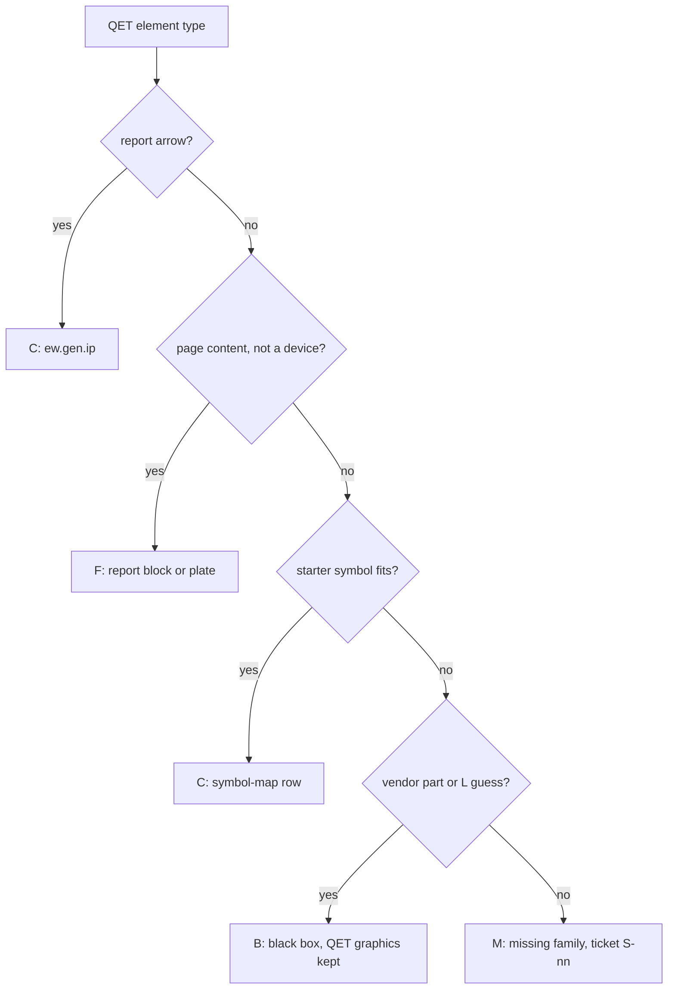

# Symbol coverage of the pilot corpus

**Status:** Draft v0.1 · **Date:** 2026-10-20 · **Part of:** ElektraWatt design document set

> **Anonymization note:** the element-type inventory behind this note is a private, sanitised list of the QElectroTech
> (QET) element types that the pilot's three real projects use, with use counts. It is not in the repository.
> Customer-specific element names were replaced before the analysis, two more names are withheld below, and vendor
> names (Festo, Siemens, Turck, Murr, Pilz, Control Techniques) appear only because they are part of a vendor part's
> element name. No project, customer or person is named here.

**Purpose.** This note measures the starter symbol set of [07](07-symbols-parts-macros.md) §9.1 against the element
types that real QET projects of the pilot use, and says what the importer does with each of them. It maps all 81
distinct element types to one of four outcomes (covered by a named `ew.<id>` symbol, covered by a feature that is not a
symbol, black box with the embedded QET graphics, or missing), ranks the missing symbol families by use, records what the
corpus shows about the pilot's drawing style where it matters for the editor and the templates, and lists follow-up
tickets for the cycle-11 design pass: new starter symbols and mapping entries for the project importer
([14](14-interop.md) §4). It decides nothing: every ticket is a proposal for the lead designer.

**Contents**
1. [Method and reading rules](#1-method-and-reading-rules)
2. [Mapping of the 81 element types](#2-mapping-of-the-81-element-types)
3. [Missing symbol families, ranked](#3-missing-symbol-families-ranked)
4. [Design-language observations](#4-design-language-observations)
5. [Follow-up tickets](#5-follow-up-tickets)
6. [Summary for doc 07](#6-summary-for-doc-07)
7. [Open points for the lead designer](#7-open-points-for-the-lead-designer)
8. [Requirements and documents touched](#8-requirements-and-documents-touched)

---

## 1. Method and reading rules

**Inputs.**
- The inventory: 81 distinct element types and their use counts over the three projects, 2,170 element uses in all.
- The starter set as committed: 36 native symbols in `content/symbols/` and their 36 generated `@qet10` twins
  ([07](07-symbols-parts-macros.md) §3.2 rule 2), the golden-project subset is mapped to folios in [07](07-symbols-parts-macros.md) §9.1.
- The mapping rules of the QET importer ([14](14-interop.md) §4.3) and what `ew-import-qet` implements today: the
  built-in interruption-point FnDef, `kindInformations`, a category-path table and the generic black box of EW-IMP-119.
  The `symbol-map.csv` step is not implemented yet.

**What the inventory cannot tell.** It holds names and counts, not definitions: no terminal counts, no `link_type`, no
`kindInformations`, no drawings. Every function reading below therefore comes from the element name, and each row carries
a confidence: **H** (a vendor or collection name that says what it is), **M** (a reading of the name that is probably
right but must be confirmed) and **L** (a guess). An **L** row is never put on a starter symbol; it stays a black box
until ticket T-01 inspects the definition.

**Outcomes** (column Status):

| Code | Meaning | What the importer does |
|---|---|---|
| C | Covered: a starter symbol exists whose function fits, named in the target column; "variant gap" marks a symbol that fits except for a detail | symbol-map row to the starter key (the `@qet10` twin on QET-grid pages), QET graphics dropped |
| F | Covered by an EW feature that is not a symbol: report block, panel layout plate, generated assembly overview | element dropped or converted as the target column says |
| B | Black box: a vendor part or an unproven element, imported as `ew.gen.blackbox` with the embedded QET graphics kept in the project's "QET import" library (`foreign_terms`, FR-SYM-018) | EW-IMP-119 with the "map symbol" quick fix |
| M | Missing: a generic symbol family that the starter set does not hold and that would be wrong to leave as a black box | black box until the family exists, then a symbol-map row |

The black-box outcome is by design for vendor modules ([07](07-symbols-parts-macros.md) §9.1 draws -102G1, -102F2 and the
CPX power blocks the same way, [14](14-interop.md) §8.4); it is not a gap there. A black box that is only an **L** guess is a
gap in knowledge, not in the library.

**Result.**

| Status | Element types | Uses | Share of uses |
|---|---|---|---|
| C covered by a starter symbol | 37 | 1,607 | 74.1 % |
| F covered by a feature | 2 | 35 | 1.6 % |
| B black box | 29 | 277 | 12.8 % |
| M missing | 13 | 251 | 11.6 % |
| Total | 81 | 2,170 | 100 % |

One element type dominates the missing share: the female connector half is 224 of the 251 uses. The black boxes split
into 18 vendor or by-design types (92 uses) and 11 **L** types (185 uses, of which 153 are one type, `thruright`). If
inspection resolves `thruright` to a terminal variant, coverage rises to 81 % of uses; if it resolves to something the
starter set lacks, the missing share rises to 19 %. That single inspection is the most valuable follow-up (T-01).

---

## 2. Mapping of the 81 element types

Sorted by use count, then in inventory order. "Uses" counts placed elements in the three projects together. Two element
names are withheld because they could identify a customer; their rows say what they are.

| # | QET element type | Uses | Represents | Status | EW target or treatment | Conf. | Note |
|---|---|---|---|---|---|---|---|
| 1 | `section1conducteur` | 455 | Conductor cross-section mark on a wire (one conductor) | C | `ew.gen.wire-marker` | M | Page item `WireMarker` over the connection, text from the wire's cross-section override (FR-IMP-017); not a placed symbol |
| 2 | `borne_continuite` | 316 | Continuity terminal (feed-through terminal of a strip) | C | `ew.iec.terminal` on `ew.gen.strip-segment` | H | Strip device, one level per element (14 §4.11) |
| 3 | `connecteur_f` | 224 | Connector, female contact half (socket contact) | M | none (`ew.iec.plug-pin` is the male half) | H | Family F-01 |
| 4 | `01coming_arrow` | 167 | Coming arrow: folio report, incoming end of an interruption point | C | `ew.gen.ip` | H | `previous_report` becomes `Target`; pairs rebuilt as in 14 §4.6 |
| 5 | `02going_arrow` | 160 | Going arrow: folio report, outgoing end of an interruption point | C | `ew.gen.ip` | H | `next_report` becomes `Source` |
| 6 | `thruright` | 153 | Feed-through element, outgoing to the right (name reading only) | B | black box today (EW-IMP-119) | L | Third most used type and unproven; inspect first (T-01) |
| 7 | `borne_21` | 126 | Terminal variant, read as two-level | C | `ew.iec.terminal`, one per level | M | Levels are model data of the terminal (08 §6), not a second symbol; confirm by inspection (T-01) |
| 8 | `valve` | 58 | Solenoid-operated pneumatic valve (ports 1 to 5) | C | `ew.iso.valve-5-2-sol-spring` | M | FR-IMP-018 `cp_map`; other valve kinds are gap G-2 |
| 9 | `turck1650020` | 56 | Vendor module element (Turck item number in the name) | B | black box, embedded QET graphics | M | Vendor part: the CP pattern comes from the part, not from a generic symbol |
| 10 | `nomenclature_section` | 34 | Nomenclature section: parts-list block on the nomenclature folios | F | BOM report block (FR-IMP-016) | M | Not a symbol; table diff EW-IMP-113 |
| 11 | `fil_de_cable` | 33 | Cable wire: a core of a cable | C | `ew.gen.cable-marker` + `Conductor` of the cable | M | Cores from the crossed conductors (14 §4.11) |
| 12 | `festodoublevalve` | 32 | Valve-terminal slice with two valves | C | `ew.ovw.valve-top` (+ `ew.iso.valve-5-2-sol-spring` on the detail folios) | M | Generated overview (FR-IMP-039) |
| 13 | `connecteur_m` | 27 | Connector, male contact half (plug pin) | C | `ew.iec.plug-pin` | H | Pin pattern of the golden 106 folio |
| 14 | `terre` | 27 | Earth | C | `ew.iec.pe` or `ew.iec.fe` | H | Role from the potential and the text; PE by default, FE proposed when the label says so |
| 15 | `borne_finale` | 26 | End terminal of a strip | C | `ew.iec.terminal` | M | End variant has a CP on one side only (S-13); end brackets are parts, not symbols |
| 16 | `bobine3` | 24 | Coil | C | `ew.iec.coil` | H | Master of a contact group |
| 17 | `con_simple` | 24 | Contact, simple (slave of a coil) | C | `ew.iec.contact-no` | M | State NO, NC or SW from `kindInformations` picks `contact-no`, `contact-nc` or `contact-co` |
| 18 | `borne_31` | 18 | Terminal variant, read as three-level | C | `ew.iec.terminal`, one per level | M | As `borne_21` |
| 19 | `kabel4g` | 16 | Cable, four cores including the protective conductor | C | `ew.gen.cable-marker` | M | Cable device with four `Conductor` records |
| 20 | `com_puiss4` | 11 | Four-pole power connector or power contact (name reading only) | B | black box today (EW-IMP-119) | L | Candidate: multipole power connector; inspect (T-01) |
| 21 | `disjoncteur_magneto-thermique` | 10 | Miniature circuit breaker | C | `ew.iec.mcb-1p` or `ew.iec.mcb-1pn` | M | Terminal count (2 or 4) decides the key |
| 22 | `blankslave` | 8 | Blank slave slice of a valve terminal | C | `ew.ovw.module` | M | Generated overview; blank part |
| 23 | `festovalveterm` | 8 | Valve terminal, assembled | C | `ew.ovw.module` | M | Generated overview |
| 24 | `valvmanfullblank` | 8 | Valve manifold, fully blanked | C | `ew.ovw.module` | M | Generated overview; blank parts |
| 25 | `festodi16` | 8 | Festo CPX 16-input module | B | black box, embedded QET graphics | H | PLC I/O module; overview `ew.ovw.module` |
| 26 | `festo8xvalve` | 8 | Valve-terminal block with eight valves | C | `ew.ovw.module` + children | M | Generated overview |
| 27 | `doubleactingvalve` | 8 | Process valve with double-acting actuator | C | `ew.iso.process-valve-2way` + `ew.iso.cylinder-double-acting` | M | One element becomes two functions joined by the derived linkage (FR-SYM-014) |
| 28 | `moteur_tri_1` | 8 | Three-phase motor | C | `ew.iec.motor-3ph` | H |  |
| 29 | `ecran_3p` | 8 | Cable screen around three conductors | M | none | M | Family F-02 |
| 30 | `festo4valveterminal` | 7 | Valve terminal with four valves | C | `ew.ovw.module` | M | Generated overview |
| 31 | `valveterminal4xo` | 7 | Valve-terminal module with four outputs | C | `ew.ovw.module` | M | Generated overview |
| 32 | `con_simple_nf` | 6 | Contact, simple, normally closed | C | `ew.iec.contact-nc` | M | As above |
| 33 | `qac22` | 5 | Temperature sensor (Siemens QAC series) | M | none | M | Family F-03 |
| 34 | `singleport` | 4 | Single port element (name reading only) | B | black box today (EW-IMP-119) | L | Inspect (T-01) |
| 35 | `dcdividermurr` | 4 | DC distribution module (Murr) | B | black box, embedded QET graphics | M | Vendor module |
| 36 | `festocpx` | 4 | Festo CPX terminal head | B | black box, embedded QET graphics | M | Like the golden CPX power box |
| 37 | `switch5` | 3 | Switch with five terminals (name reading only) | B | black box today (EW-IMP-119) | L | Candidate: selector switch; inspect (T-01) |
| 38 | `festocpxelement` | 3 | Festo CPX module element | B | black box, embedded QET graphics | M |  |
| 39 | `singleuser` | 3 | Single user element (name reading only) | B | black box today (EW-IMP-119) | L | Inspect (T-01) |
| 40 | `isconnectingswitchkey` | 3 | Key-operated switch (name reading only) | B | black box today (EW-IMP-119) | L | Candidate: key switch; inspect (T-01) |
| 41 | `controltechniquesc200` | 3 | Drive module (Control Techniques) | B | black box, embedded QET graphics | M | Vendor drive; CP pattern from the part |
| 42 | `resistances-chauffantes` | 3 | Heating resistors | C | `ew.iec.heater` | H | Golden E55 pattern |
| 43 | `bobine_ka_a_remanence` | 2 | Latching (remanence) coil | C | `ew.iec.coil` (variant gap) | M | Remanence marker missing (S-14) |
| 44 | `powerinputnope` | 2 | Power input element (name reading only) | B | black box today (EW-IMP-119) | L | Inspect (T-01) |
| 45 | `en_60617_03_03_09` | 2 | Symbol named after an IEC 60617 part 3 number | B | black box today (EW-IMP-119) | L | The drawn symbol is not known from the name; inspect (T-01) |
| 46 | `sectionneur1-2` | 2 | Disconnector (isolator), single pole | M | none | M | Family F-05 |
| 47 | `dis_mag_term_2f-1` | 2 | Miniature circuit breaker, two poles (name reading) | M | none | M | Family F-04 |
| 48 | `festovalveterminalfeedterminal` | 2 | Valve-terminal feed (supply) plate | C | `ew.ovw.module` | M | Generated overview, not mapped one to one (FR-IMP-039) |
| 49 | `lampe2` | 2 | Lamp | C | `ew.iec.lamp` | H |  |
| 50 | `socket1` | 2 | Socket outlet | M | none | M | Family F-07 |
| 51 | `3f_n_pe_pravy` | 2 | Three-phase, neutral and PE feed marker (name reading only) | B | black box today (EW-IMP-119) | L | Candidate: supply-system marker; inspect (T-01) |
| 52 | `inter-sectionneur_tetra` | 2 | Switch-disconnector, four poles | M | none (nearest: `ew.iec.switch-2p-manual`) | M | Family F-06 |
| 53 | `blankmaster` | 2 | Blank master slice of a valve terminal | C | `ew.ovw.module` | M | Generated overview; blank part |
| 54 | `siemensethehernet` | 2 | Vendor Ethernet module (Siemens) | B | black box, embedded QET graphics | M | No Ethernet bus port in the starter set (gap G-1) |
| 55 | `poussoir` | 2 | Push-button | C | `ew.iec.pushbutton-no` | H | NC kind needs the variant (S-14) |
| 56 | `siemens16output` | 2 | PLC 16-channel output module (Siemens) | B | black box, embedded QET graphics | H | PLC I/O module; channels from the part (10) |
| 57 | `50101701_indicator` | 2 | Indicator light (item number in the name) | C | `ew.iec.lamp` | M | Lamp symbol, the vendor part is the assigned part |
| 58 | `custom_element_57` | 1 | Custom element | B | black box, embedded QET graphics | L | Inspect (T-01) |
| 59 | `dp1x` | 1 | PROFIBUS DP port, single | C | `ew.bus.dp-port` | M |  |
| 60 | `thermostat_01` | 1 | Thermostat contact | C | `ew.iec.thermostat-nc` | H | Golden T55 pattern |
| 61 | `radiateur_soufflant_seche_cheveux` | 1 | Fan heater | C | `ew.iec.heater` (variant gap) | M | Fan marker missing (S-14) |
| 62 | `2080_ps120_240vac` | 1 | Vendor power supply (part number in the name) | B | black box, embedded QET graphics | M | Generic target is F-09 |
| 63 | `disjoncteur_magneto-thermique_1` | 1 | Miniature circuit breaker, variant | C | `ew.iec.mcb-1p` or `ew.iec.mcb-1pn` | M | As above |
| 64 | `festocpxelement2` | 1 | Festo CPX module element | B | black box, embedded QET graphics | M | Drawn with terminals on a schematic folio, like the golden CPX power box |
| 65 | `festopsu` | 1 | Festo power supply unit | B | black box, embedded QET graphics | M |  |
| 66 | (withheld, mounting plate) | 1 | Mounting back plate | F | panel layout plate (12) via pass P6 | M | Not a schematic symbol |
| 67 | `int_diff5` | 1 | Residual-current device (differential switch) | M | none | M | Family F-08 |
| 68 | `power_supply_acdc_3_pole` | 1 | AC/DC power supply, three-pole input | M | none | M | Family F-09 |
| 69 | `siemensai8x` | 1 | PLC 8-channel analogue input module (Siemens) | B | black box, embedded QET graphics | H | PLC I/O module |
| 70 | `siemens1214c` | 1 | PLC CPU (Siemens) | B | black box, embedded QET graphics | H | PLC CPU |
| 71 | (withheld, custom element) | 1 | Custom element | B | black box, embedded QET graphics | L | Inspect (T-01) |
| 72 | `siemens120016di` | 1 | PLC 16-channel digital input module (Siemens) | B | black box, embedded QET graphics | H | PLC I/O module |
| 73 | `pnoz_s3` | 1 | Safety relay (Pilz) | B | black box, embedded QET graphics | H | Vendor safety device |
| 74 | `pnozs10` | 1 | Safety relay (Pilz) | B | black box, embedded QET graphics | H | Vendor safety device |
| 75 | `16xi` | 1 | PLC 16-channel input module, generic | B | black box, embedded QET graphics | M | Generic n-channel box (FR-SYM-027) |
| 76 | `dis_mag_term_2f-2` | 1 | Miniature circuit breaker, two poles, variant | M | none | M | Family F-04 |
| 77 | `section2conducteurs` | 1 | Conductor cross-section mark, two conductors | C | `ew.gen.wire-marker` | M | As above; the core count is a field of the marker |
| 78 | `e_stop_1p` | 1 | Emergency-stop push-button, one pole | M | none | M | Family F-10 |
| 79 | `comm_electronique` | 1 | Electronic switch (solid-state switching element) | M | none | M | Family F-11 |
| 80 | `sonde_niveau` | 1 | Level probe (level sensor) | M | none | M | Family F-12 |
| 81 | `ai8x` | 1 | PLC 8-channel analogue input module, generic | B | black box, embedded QET graphics | M | Generic n-channel box (FR-SYM-027) |

---

## 3. Missing symbol families, ranked

### 3.1 Families with status M

Ranked by the uses of the element types that need them. The IEC 60617 reference is the part of the standard that holds
the family; the individual `S00nnn` identifiers are not cited because `iec60617_ref` stays empty until the identifiers have
been checked against the standard ([content/symbols/README.md](../../content/symbols/README.md); FR-SYM-019). No family
here belongs to ISO 1219: the corpus has no fluid-power family missing from the starter set.

| Rank | Family | Uses | QET element types | IEC 60617 part (verify) | Nearest starter symbol | Proposed key |
|---|---|---|---|---|---|---|
| 1 | F-01 Connector, female contact (socket contact) | 224 | `connecteur_f` | Part 3, conductors and connecting devices | `ew.iec.plug-pin` (the male half) | `ew.iec.plug-socket` |
| 2 | F-02 Cable screen (shield) | 8 | `ecran_3p` | Part 3 (screening); Part 2 qualifying symbols | `ew.gen.cable-marker` | `ew.gen.screen` |
| 3 | F-03 Temperature sensor (NTC or Ni element) | 5 | `qac22` | Part 4, passive components (temperature-dependent resistor); Part 8, measuring | `ew.iec.resistor` | `ew.iec.sensor-temp` |
| 4 | F-04 Miniature circuit breaker, two poles | 3 | `dis_mag_term_2f-1`, `dis_mag_term_2f-2` | Part 7, switchgear and protective devices | `ew.iec.mcb-1pn` | `ew.iec.mcb-2p` |
| 5 | F-05 Disconnector (isolator), single pole | 2 | `sectionneur1-2` | Part 7 | `ew.iec.switch-2p-manual` | `ew.iec.disconnector-1p` |
| 6 | F-06 Switch-disconnector, four poles | 2 | `inter-sectionneur_tetra` | Part 7 | `ew.iec.switch-2p-manual` | `ew.iec.switch-disconnector-4p` or a parametric n-pole family (FR-SYM-027) |
| 7 | F-07 Socket outlet | 2 | `socket1` | Part 11, installation plans and diagrams; Part 3 | `ew.iec.plug-pin` | `ew.iec.socket` |
| 8 | F-08 Residual-current device | 1 | `int_diff5` | Part 7 | `ew.iec.mcb-1pn` | `ew.iec.rcd` |
| 9 | F-09 AC/DC power supply | 1 (and 2 more as vendor black boxes) | `power_supply_acdc_3_pole`; `2080_ps120_240vac`, `festopsu` | Part 6, production and conversion of electrical energy | `ew.iec.transformer-1ph` | `ew.iec.psu-acdc` |
| 10 | F-10 Emergency-stop push-button | 1 | `e_stop_1p` | Part 7 | `ew.iec.pushbutton-no` | `ew.iec.estop-nc` |
| 11 | F-11 Electronic switch | 1 | `comm_electronique` | Parts 5 and 7 | none | `ew.iec.switch-electronic` |
| 12 | F-12 Level sensor | 1 | `sonde_niveau` | Parts 7 and 8 | none | `ew.iec.sensor-level` |

Families F-04 to F-06 and F-08 are protection and switching devices with a pole count: one parametric family would
serve them (FR-SYM-027, `Could`, 1.x), but the starter set has no parametric mechanism, so the tickets propose fixed
symbols and leave the family question to the lead (§7).

### 3.2 Gaps that are not statuses of a row

| Gap | Evidence | Treatment |
|---|---|---|
| G-1 Ethernet bus port | `siemensethehernet` (2 uses) is a vendor Ethernet module; the starter bus symbols are PROFIBUS DP only (`ew.bus.dp-port`, `ew.bus.dp-connector`) | the module stays a black box; a port symbol and bus FnDef follow when the bus catalogue grows ([10](10-plc-and-bus.md)); ticket S-15 (optional) |
| G-2 Other fluid valve kinds | the corpus has one `valve` type (58 uses) and the starter set one valve; if the pilot's valves are not all 5/2 solenoid-spring, the others are missing | T-01 reads the 58 uses' terminal counts; no family is proposed before that |
| G-3 Variants | latching coil (2), fan heater (1), push-button with normally closed contact (2 uses of `poussoir`, kind unproven), end terminal (26) | ticket S-13 (end terminal) and S-14 (the rest); these are small additions to existing keys or new keys with the same FnDef |

### 3.3 Candidate families pending inspection (confidence L)

These are black boxes today. Their counts show where a wrong guess would cost most, so T-01 inspects them in this order.

| Uses | Element type | Reading from the name | If it is what the name says |
|---|---|---|---|
| 153 | `thruright` | feed-through element, outgoing to the right | a terminal or connection-point variant: covered by `ew.iec.terminal` plus an orientation, or a new variant |
| 11 | `com_puiss4` | four-pole power connector or power contact | a multipole connector family beside F-01 |
| 7 | `singleport`, `singleuser` | single bus port or user element | a bus or interface symbol beside `ew.bus.dp-port` |
| 6 | `switch5`, `isconnectingswitchkey` | selector switch, key switch | an operator-device family (Part 7) |
| 2 | `en_60617_03_03_09` | named after an IEC 60617 part 3 identifier | unknown until inspected |
| 2 | `3f_n_pe_pravy` | three-phase, neutral and PE feed marker | a supply-system marker, probably a graphic |
| 2 | `powerinputnope` | power input | unknown |
| 2 | two custom elements | custom | decided element by element |

---

## 4. Design-language observations

These are statements about how the pilot draws, from counts only. The shares are shares of the 2,170 element uses.

1. **Wiring marks dominate, control logic is rare.** Four families make up 70 % of all uses: conductor cross-section
   marks (456 uses, 21 %), terminals (486 uses over four types, 22 %), interruption-point arrows (327 uses, 15 %) and
   connector halves (251 uses, 12 %). The classic control symbols (coils, contacts, breakers, motor, lamps, heaters,
   push-buttons, thermostat) total about 86 uses, 4 %. The starter set is built on the golden project's power and
   pneumatic folios and covers the control symbols well, yet the pilot's real drawing effort is in marking and
   connecting. The editor's defaults and the templates should serve that.
2. **Cross-section marks are placed one by one.** The most used element type of all, 455 uses, plus one two-conductor
   variant, is a mark placed on a conductor. In EW the mark is a derived display of the wire's overrides
   (`PageItem::WireMarker`, [03](03-domain-model.md) §6; FR-IMP-017), so a new project should get the marks from the size
   profile without any placing. A template that shows markers by default removes the habit; the importer must turn each
   mark into a wire property, not into a symbol (ticket M-03).
3. **Folios are joined by interruption points, in pairs.** There are 167 coming and 160 going arrows. Every pair is one
   interruption point in EW ([14](14-interop.md) §4.6); the surplus of seven coming arrows means that at least seven ends
   have no partner on the other side. They are either external connections or open ends, and FR-CHK-017 will report them
   on import, so the migration report should state the number up front. The editor's pairing aids (star and chain,
   [06](06-schematic-editor.md) §2.8) matter more here than in the golden project.
4. **Terminal strips are drawn terminal by terminal.** Continuity, two-level, three-level and end terminals are separate
   element types (316, 126, 18 and 26 uses). In EW levels belong to the terminal device and the strip is a device with
   segments ([08](08-connections-terminals-cables.md) §6), so importing groups the elements into strips, levels and
   bridges ([14](14-interop.md) §4.11) and the drawn variants disappear into model data. The strip template should offer a
   segment per folio region and let the user choose the level count when placing a terminal, instead of three symbols.
5. **Connectors are drawn as halves, mostly female.** The female half is used eight times as often as the male half
   (224 against 27). EW models plugs like terminals with male or female pins ([08](08-connections-terminals-cables.md)
   §6.10, FR-TRM-023, 1.0), but the starter set draws only the male pin. Plugs are a 1.0 feature (Should), yet the pilot's
   connector style makes the female contact symbol (F-01) the most used missing symbol, so it should not wait for 1.0.
6. **Nomenclature blocks stand in for a bill of materials.** 34 uses of a nomenclature-section element, plus the
   `graphics_table` blocks the importer reads separately ([14](14-interop.md) §4.13), are the pilot's parts lists, drawn on
   the nomenclature folios. EW derives the list from the parts, so these become report blocks and the table diff of
   EW-IMP-113 reports every row that no longer agrees. The basic project's nomenclature section
   ([07](07-symbols-parts-macros.md) §2.8) should hold the BOM report block, so that no one draws it by hand.
7. **Valve terminals are drawn slice by slice.** Nine valve-terminal element types (82 uses, most of them Festo) draw the manifold as blank slices,
   feed plates, double-valve slices and four- and eight-valve blocks, next to 58 valve symbols and 8 process valves with a
   double-acting actuator. This is the golden pattern (-201U1 and its children, [20](20-golden-project.md) §6.2). EW holds
   the manifold as an assembly with a generated overview ([11](11-fluid-power.md) §5.5), so these elements are not mapped
   one to one: the reconstruction assistant of FR-IMP-039 builds the assembly and the overview from the detail folios, and
   the importer reports the drawn slices (EW-IMP-110, EW-IMP-112). The configurator decoder (FR-DEV-036) has to know the
   slice taxonomy that the elements show: blank, feed, valve slice, input and output module.
8. **PLC modules are drawn as one element per module type, with one terminal per channel.** Seven PLC and I/O module
   types (a Siemens CPU, 16-channel input and output modules, an 8-channel analogue input, a Festo 16-input module and two generic
   boxes named after their channel count) show two habits: vendor elements for known hardware and home-made boxes for the
   rest. In EW both are black boxes whose CP pattern comes from the part ([14](14-interop.md) §8.4; [10](10-plc-and-bus.md)
   §3.3), with `ew.ovw.module` on the overview. The home-made boxes are the argument for the n-channel black-box generator
   of FR-SYM-027 and for part-first creation: pick the module, get the box and the channel list.
9. **The tail is long and vendor-heavy.** 39 of the 81 types are used twice or less and 24 exactly once; 22 types carry a
   vendor name. No library covers a tail like that, so the route for it is the black box plus the "map symbol" quick
   fix and the symbol exchange of FR-SYM-022, and the library work should go to the few generic families of §3.1.
10. **Stock QET elements are used for most generic functions.** The collection names (terminals, coil, contacts,
    breaker, motor, lamp, earth) dominate the list. The symbol-map seed (ticket M-01) can therefore key on the stock
    names and the stock definition UUIDs instead of on category paths; T-01 confirms that the `.qet` files carry the UUIDs.

---

## 5. Follow-up tickets

Estimate classes follow the difficulty ladder of `CLAUDE.md`: D1 trivial (mechanical, one pattern, command-verifiable),
D2 routine (closed spec, existing pattern, up to three files), D3 moderate (several files or judgment inside a decided
design). Each symbol ticket follows the procedure of [content/symbols/README.md](../../content/symbols/README.md) (native
drawing, FnDef, sealing, `@qet10` twin, entry in the expected list of `starter_symbols.rs`) and leaves `iec60617_ref`
empty until verified.

### 5.1 New symbols for the starter set

| ID | Group | Symbol | Family | Uses behind it | Class | Note |
|---|---|---|---|---|---|---|
| S-01 | A connectors and cabling | `ew.iec.plug-socket` | F-01 | 224 | D2 | Female contact beside `ew.iec.plug-pin`, two CPs, same text slots; first in order |
| S-02 | A | `ew.gen.screen` | F-02 | 8 | D2 | Graphic bound to the cable's shield `Conductor`, `rep_type` graphic like `ew.gen.cable-marker` |
| S-03 | B protection and switching | `ew.iec.mcb-2p` | F-04 | 3 | D2 | Internal linkage drawn as in `ew.iec.mcb-1pn` (0.13 mm dashed) |
| S-04 | B | `ew.iec.disconnector-1p` | F-05 | 2 | D2 | |
| S-05 | B | `ew.iec.switch-disconnector-4p` | F-06 | 2 | D3 | Needs the decision between fixed symbols and a parametric family (§7); link points per pole as `ew.iec.switch-2p-manual` |
| S-06 | B | `ew.iec.rcd` | F-08 | 1 | D2 | |
| S-07 | B | `ew.iec.estop-nc` | F-10 | 1 | D2 | Mushroom actuator, positive opening |
| S-08 | C sensing, supply and electronics | `ew.iec.sensor-temp` | F-03 | 5 | D2 | Two CPs; FnDef with a sensor category |
| S-09 | C | `ew.iec.sensor-level` | F-12 | 1 | D2 | |
| S-10 | C | `ew.iec.switch-electronic` | F-11 | 1 | D2 | |
| S-11 | C | `ew.iec.psu-acdc` | F-09 | 1 (+2 black boxes) | D2 | Generic box with input and output CP groups; vendor supplies stay black boxes with parts |
| S-12 | C | `ew.iec.socket` | F-07 | 2 | D2 | |
| S-13 | D variants | end-terminal variant of `ew.iec.terminal` | G-3 | 26 | D2 | CP on one side only; confirm the reading of `borne_finale` first (T-01) |
| S-14 | D | latching coil, fan heater, normally closed push-button | G-3 | 5 | D2 | New keys with the existing FnDefs; the schema has no graphic variants other than contact image and CP variants ([07](07-symbols-parts-macros.md) §2.3) |
| S-15 | E buses (optional) | `ew.bus.eth-port` | G-1 | 2 | D3 | Needs an Ethernet bus FnDef; only with the bus catalogue ([10](10-plc-and-bus.md)) |

Order of work for the design pass: S-01 and S-02 (group A) first, because F-01 alone is 89 % of the missing uses; then
group B, which shares one drawing style, then C and D. The symbols of group B and C add up to 19 uses; they are cheap but
move the migration little, which is the reason to keep them behind T-01.

### 5.2 Importer mapping entries (lane A, project importer)

| ID | Entry | Element types | Class | Note |
|---|---|---|---|---|
| M-01 | Seed `symbol-map.csv` with one row per covered type: stock element name (and UUID) to starter key, with the CP map | the 37 type rows of status C | D2 | One file, no code; the CP maps need care for coil, contacts, MCB (two or four terminals), earth (PE or FE), `ew.bus.dp-port` and the contact kinds of `con_simple` |
| M-02 | Terminal elements to strip, terminal and levels: `borne_*` become terminal devices on strip segments; `borne_21` and `borne_31` set the level count | `borne_continuite`, `borne_21`, `borne_31`, `borne_finale` | D2 | Depends on T-01 for the level reading; uses §4.11 grouping |
| M-03 | Cross-section marks become wire overrides, not symbols: the recogniser reads the mark's text, sets the wire's cross-section and drops the element when text and property agree, keeps a free text otherwise (EW-IMP-107, EW-IMP-108) | `section1conducteur`, `section2conducteurs` | D3 | 456 elements: the largest single mapping; the rule for a mark that disagrees with the conductor property needs a decision |
| M-04 | Report arrows: check that all 327 elements have the report link types, then count the unpaired ends for the migration report | `01coming_arrow`, `02going_arrow` | D1 | Pair reconstruction already specified in §4.6 |
| M-05 | Cable elements to cable devices: four-core cable with its cores, cable wire to a core, screen to the shield core | `kabel4g`, `fil_de_cable`, `ecran_3p` | D3 | §4.11, older-cable path; F-02 must exist before the screen row |
| M-06 | Fluid: `valve` through the FR-IMP-018 port map; `doubleactingvalve` to two functions; the Festo slice elements are dropped with EW-IMP-112 and left to the reconstruction assistant | `valve`, `doubleactingvalve`, nine valve-terminal types | D2 | Policy is decided in [11](11-fluid-power.md) §9.2; the entry only records the type names |
| M-07 | PLC and vendor modules to black boxes with a CP pattern taken from the element's terminal names; the vendor name in the element name is proposed as the part manufacturer | the 22 vendor-named types, the generic module boxes | D2 | Uses the black box of EW-IMP-119; no catalogue part is assumed |
| M-08 | Nomenclature and plate: `nomenclature_section` is dropped for the BOM report block (EW-IMP-113 diff); the back plate goes to layout pass P6 | `nomenclature_section`, the withheld plate element | D1 | |
| M-09 | Long tail: every unmapped type becomes a black box with the QET element name in its provenance, and one EW-IMP-119 summary row lists the types with their use counts | the 29 black-box types | D1 | Keeps counts for the corpus statistic of T-03 |

### 5.3 Inspection and documentation

| ID | Task | Class | Note |
|---|---|---|---|
| T-01 | Dump, for the 11 L types first and then the 26 mapped types of confidence M, the definition's `link_type`, `kindInformations`, terminal count, category path and stock UUID, with the QET element reader of `ew-import-qet`; write the result to the private corpus folder only, never to the repository | D1 | Resolves `thruright` (153 uses), `com_puiss4` and the `borne_*` levels; confirms the 58 `valve` uses are 5/2 solenoid-spring |
| T-02 | After each S-ticket, fill `iec60617_ref` once verified against the standard and add the key to the expected list and to [07](07-symbols-parts-macros.md) §9.1 | D1 | Part of the symbol ticket's own check |
| T-03 | A private script that recomputes the table of §1 (covered, black box, missing, by types and by uses) from the inventory and the symbol-map seed, so that each added symbol or map row is seen in the number | D1 | Not committed with corpus data; the script and the aggregate numbers only (WP-S3.13) |

---

## 6. Summary for doc 07

The paragraph below is the text that [07](07-symbols-parts-macros.md) §2.3 carries.

> **Coverage of the pilot corpus** ([23](23-symbol-coverage-pilot-corpus.md)). Against the 81 QET element types that the
> pilot's three real projects use (2,170 placed elements), the 36-symbol starter set covers 37 types and 74 % of the uses,
> two more types (the nomenclature block and a mounting plate) are covered by report blocks and panel layout, 29 types
> (vendor PLC, valve-terminal and safety modules, plus 11 unproven elements) stay black boxes with the embedded QET
> graphics, and 13 types lack a symbol. One family dominates the gap: the female connector half (224 of 251 missing
> uses), followed by cable screen, temperature sensor, two-pole MCB, disconnectors, socket, RCD, power supply, emergency
> stop, electronic switch and level sensor. The note ranks the families, records the pilot's drawing style (wiring marks,
> terminal and interruption-point density, nomenclature blocks as bill of materials, slice-wise valve terminals,
> one-terminal-per-channel PLC modules) and proposes fifteen symbol tickets and nine importer mapping entries. It adds no
> requirement and changes no key; whether the additions join the starter set or WP-S7.04 is the lead's decision.

---

## 7. Open points for the lead designer

1. **Starter set or full library.** FR-SYM-007 fixes the starter set to the golden project's list and FR-SYM-008 puts the
   full library at 1.0. The corpus argues for pulling S-01 and S-02 forward (the female connector half is 89 % of the
   missing uses), but that changes the scope of WP-S7.02 and is not decided here.
2. **Fixed or parametric.** S-03 to S-06 are pole-count variants. Draw four fixed symbols now, or wait for the parametric
   families of FR-SYM-027 (1.x)?
3. **Marks that disagree.** M-03 drops a cross-section mark when its text equals the wire's property. What the importer
   does when it differs (keep as free text and report, or override the property) is open; the first option is the safe
   default.
4. **Inspection before drawing.** The ranking of §3.3 puts 153 uses behind one name reading. The symbol tickets
   of groups B to D can start at once, since their rows have confidence M or H, but nothing should be drawn for a
   candidate family before T-01.

---

## 8. Requirements and documents touched

**Requirements read:** FR-SYM-007, FR-SYM-008, FR-SYM-018, FR-SYM-019, FR-SYM-022, FR-SYM-027, FR-SYM-029, FR-SYM-030,
FR-IMP-016, FR-IMP-017, FR-IMP-018, FR-IMP-039, FR-TRM-023, FR-DEV-036, FR-CHK-017; checks EW-IMP-107, EW-IMP-108,
EW-IMP-110, EW-IMP-112, EW-IMP-113, EW-IMP-119. No requirement is added or reworded.

**Documents that cite this note:** [07](07-symbols-parts-macros.md) §2.3 (coverage paragraph) and
[14](14-interop.md) §4.3 (QET element mapping).

**Work packages:** WP-S7.02 (starter symbol set) and WP-S3.05 (QET element reader) are the ones the tickets amend;
WP-S3.10, WP-S3.11 and WP-S3.13 (project import, links and strips, corpus) take the mapping entries and the statistic.
