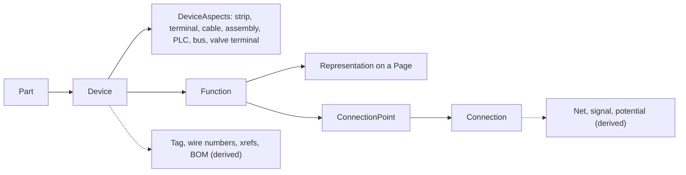

# Glossary

**Status:** Draft v0.1 · **Date:** 2026-10-18 (amended 2026-10-29, cycle 32: the entries caption chip, command bar, count badge, empty state, HUD, rail (UI), status badge and tool options card, decision log ID-747 to ID-750; amended 2026-10-28, cycle 30: the entries job, marker line and notifications log, decision log ID-714; amended 2026-10-25, cycle 27: the entries blind drafter, bound text, marker mode and project fragment, and the exposure class entry, decision log ID-645, ID-647 to ID-649; amended 2026-10-24, cycle 26: the entries hop, junction ordinal and wire kind per page type, and the ID alias as built, decision log ID-635, ID-640; amended 2026-10-24, cycle 25: the entries edit route, field catalogue, ID alias and property sheet, decision log ID-626, ID-630; amended 2026-10-23, cycle 23: the entries asset store, page item and starter library, and the structure box and wire marker entries brought up to the WP-S2.04 specification, decision log ID-566, ID-573) · **Part of:** ElektraWatt design document set

**Purpose.** This glossary fixes the meaning of every domain and project term that the ElektraWatt (EW) document set
uses: IEC 81346 aspects and prefixes, EPLAN and QElectroTech (QET) vocabulary, EW-specific concepts such as
Representation, DeviceAspect, `MlText`, `Dec3`, `ew-memo`, the freshness classes, "frozen on purpose" and committed
computations, the file types (`.ew`, `.ewz`, `.ewpp`), the `api_v1` projection, the golden project, and the ID schemes
(FR, NFR, AC, D, REF, ADR, WP, R-nnn, G-M, KT, CP, GP, PQ and others). For each term it gives a short definition, the EPLAN equivalent,
the QET equivalent where one exists, and the document that defines it. It also gives a translation table for users who
migrate from EPLAN or QET, an abbreviations list and a crate list. The glossary does not decide anything: where it
and a defining document differ, the defining document wins and the glossary is wrong. The in-app glossary panel and
the palette aliases ([16](16-ux-ui.md) §9.3, FR-UI-045, NFR-DOC-05) are generated from the same terms.

**Contents**
1. [How to read this document](#1-how-to-read-this-document)
2. [Glossary](#2-glossary)
3. [Identifier schemes](#3-identifier-schemes)
4. [Translation table: EPLAN, QElectroTech, ElektraWatt](#4-translation-table-eplan-qelectrotech-elektrawatt)
5. [Abbreviations](#5-abbreviations)
6. [Crates](#6-crates)
7. [Maintenance and open questions](#7-maintenance-and-open-questions)

---

## 1. How to read this document

- The glossary (§2) has 326 entries in alphabetical order, ignoring signs and case. A term written with a
  leading dot or backtick is listed under its first letter.
- **EPLAN** names the nearest EPLAN Electric P8 concept, following [eplan-features](../research/eplan-features.md).
  **QElectroTech** names the nearest QET concept, following [interop](14-interop.md) §4. A dash means that the
  system has no equivalent. A different EPLAN or QET meaning is stated in the cell.
- **Defined in** links the document that owns the definition. "03 §8" is [domain model](03-domain-model.md) §8, "04" is
  the [architecture](04-architecture.md), "ADR-nnnn" is a decision record.
- Release labels are MVP (the pilot can stop using QET for new projects), 1.0 (full v1 scope), 1.x and Later
  ([vision](00-vision-and-scope.md) §9).
- Names in code font are records or types of `ew-schema` ([03](03-domain-model.md)); the reference project is the
  golden project, cabinet J-E-2416 ([20](20-golden-project.md)).

The core idea in one picture: a **device** owns a part and has **functions**; each function has one or more
**representations** on pages; everything printed is derived.

The IEC 81346 prefixes that appear in tags:

| Prefix | Aspect | Example (reference project) |
|---|---|---|
| `==` | Functional assignment | — |
| `=` | Function (higher-level function) | =P01 |
| `++` | Installation site | — |
| `+` | Location (mounting location) | +J-E-2416 |
| `-` | Product (device) | -101F1 |
| `&` | Document kind | &EFS (optional) |
| `#` | User defined | — |
| `%` | Type (sign unverified) | — |
| `:` | Connection point separator | -101F1:N |

---

## 2. Glossary

### A

| Term | Definition | EPLAN | QElectroTech | Defined in |
|---|---|---|---|---|
| **Address (`PlcAddress`, `AddrSpec`)** | A PLC I/O address derived from the module start and channel offset by an address profile, or set manually (`AddrSpec::Manual`, a frozen value). | PLC address | — | [10 §2.5](10-plc-and-bus.md) |
| **Address profile** | A data set that says how addresses are formed for a PLC family (byte and bit, symbolic prefixes). | Address profile | — | [10 §2.5](10-plc-and-bus.md) |
| **AI-moderate / AI-strong scenario** | Two AI-assisted planning scenarios of the global plan. Development work in streams S1–S7 is divided by 1.4 (AI-moderate) or 1.8 (AI-strong); S0, people-bound WPs and the review and decision share of each WP are not accelerated. AI-moderate is the internal target; AI-strong is an upside and not planned. Neither replaces the plan of record in external communication. | — | — | [plan/01](../plan/01-global-plan.md) §3.7, GA-14 |
| **Alias (structure node)** | An alternative spelling of a structure code, such as "JE2416" for J-E-2416, stored on the one canonical `StructureNode`. Importers map aliases to the node; aliases are never printed. | — (identifiers are picked from a central table) | — (free strings) | [03 §1.2](03-domain-model.md) |
| **AML (AutomationML)** | IEC 62714 data exchange format. EW writes CAEX 2.15 with the AR APC 1.4.0 and 1.2.0 PLC recommendations and reads 2.15 and 3.0. | AutomationML export | — | [10 §4.3](10-plc-and-bus.md) |
| **Anchor cell** | The frame-grid cell (for example 101-B8) that a representation reports for cross-references and tags, computed by integer arithmetic from the symbol's anchor policy. It is derived, never typed in. | Cross-reference position (grid reference) | Cell computed from the element position | [06 §5.1](06-schematic-editor.md) |
| **Angle2** | Value type for an angle in thousandths of a degree, used only by free texts and graphics so that imports keep arbitrary angles without floats in files. | Text angle | Rotation in degrees (float) | [03 §3.1](03-domain-model.md), [ADR-0005](../adr/0005-value-types-nm-dec3-mltext.md) |
| **api_v1** | The versioned namespace of the read-only SQL projection (`api_v1_*` views). It is tied to the format major version and is the public contract for user SQL reports, rules, MCP agents and acceptance tests. | — | — | [04 §10.2](04-architecture.md), [ADR-0017](../adr/0017-read-only-sql-projection-api-v1.md) |
| **AR APC** | AutomationML application recommendation for PLC configuration data (stations, modules, address ranges). | AML PLC export | — | [10 §4.3](10-plc-and-bus.md) |
| **As-built archive** | The released state of a project kept as an immutable generation plus a PDF, written at release and used for revision comparison and customer hand-over. It lives outside the editing state. | Revision archive (revision management) | — | [05 §14](05-project-format-and-persistence.md), [15 §5](15-checks-revisions-collaboration.md), [ADR-0013](../adr/0013-revisions-and-as-built-archive.md) |
| **As-built package** | The `.ewpp` content returned to engineering after the shop corrected the wiring, so that the as-built state flows back into the project. | Smart Production feedback | — | [13 §11.5](13-manufacturing-outputs.md) |
| **Aspect (reference-designation aspect)** | One of the viewpoints of IEC 81346 under which a structure tree is built (function, product, location, and others). Each aspect has a sign and its own `StructureNode` tree, except the product aspect, which is the device tree. | Identifier block | — (plant and location strings only) | [03 §5](03-domain-model.md), [04 §4.2](04-architecture.md) |
| **Assembly (aspect)** | A device aspect for a configured product with child devices, for example a valve terminal with its order code (`AssemblyConfig`) and a BOM basis of assembly or components. | Part assembly, module overview | — | [03 §7](03-domain-model.md), [11 §3.2](11-fluid-power.md) |
| **Assembly mode (BOM)** | A bill-of-materials mode that lists configured assemblies by order code instead of every child component (the other mode is component mode). | Parts list with assemblies | — | [20 §14.2](20-golden-project.md) |
| **Assembly view** | The overview of a device assembly, drawn by the overview representations of the assembly device and its children, such as the valve terminal on folios 201 and 202. Its break marks are derived from the members' pages (decision log ID-373), so it cannot drift (D-10). | Overview representation of a device assembly | — | [03 §6](03-domain-model.md), [11 §5.5](11-fluid-power.md) |
| **Asset store** | The content-addressed store of image bytes in a project: files `assets/<sha256>.<ext>` (SVG, PNG or JPEG; `glb` meshes from 1.0), kept in the model by hash and named by records through an `AssetRef {sha256, format, size}`, as the company logo is. A save writes the assets that records name and never removes an asset file; unreferenced files go only through the explicit, previewed purge command (`project.assets.purge`, FT-380). | — | — | [05 §13.3](05-project-format-and-persistence.md) |
| **Atomic code token** | A structure code that the parser never splits at prefix characters, so "J-E-2416" is not read as "+J", "-E", "-2416". The parser matches the longest known code first. | — | — | [03 §8.4](03-domain-model.md) |
| **Authored (kind A)** | Classification of a fact decided by a human, or by an importer acting for one. It is stored as a record and changed only by commands. | — | — | [03 §1.1](03-domain-model.md) |
| **Autoconnect** | An editing aid that proposes explicit connections between nearby connection points. In EW it never has model semantics: moving a symbol does not silently rewire. | Autoconnect (a model semantic in EPLAN) | Conductor auto-creation between terminals | [06 §5.2](06-schematic-editor.md), [ADR-0007](../adr/0007-explicit-connections-and-autoconnect.md) |
| **Auto-numbering (online numbering)** | The normaliser that assigns the next free tag counter when a device is committed. The counter is stored once; everything else in the tag is derived. | Online numbering | Element autonumbering (`element_autonums`) | [03 §8.2](03-domain-model.md), [08 §5](08-connections-terminals-cables.md) |
| **Auxiliary function** | A further function of a device (for example a contact of a contactor) drawn on another page. It prints the location of the main function and is itself an `Function` of the same device. | Auxiliary function | Slave element | [06 §2.6](06-schematic-editor.md), [ADR-0006](../adr/0006-function-device-representation-model.md) |

### B

| Term | Definition | EPLAN | QElectroTech | Defined in |
|---|---|---|---|---|
| **Backdating** | A memo optimisation of `ew-memo`: when a recomputed value equals the old one its `changed_at` stamp is kept, so dependents stay valid (early cut-off). | — | — | [04 §6.2](04-architecture.md), [ADR-0002](../adr/0002-derived-data-engine-ew-memo.md) |
| **Basic project** | A company template project (settings, forms, schemes, libraries) from which new projects are created. A company-standard wizard builds it from shipped defaults. | Basic project (`.zw9`) | Template project, `<newdiagrams>` defaults | [07 §2.8](07-symbols-parts-macros.md), [16 §9.2](16-ux-ui.md) |
| **BCP 47 language tag** | The tag format (nl-NL, en-GB) used as `LangTag` in `MlText` to select the display and output language. | Language code | — | [03 §3.3](03-domain-model.md) |
| **Black box** | A function without a library symbol whose outline, device connection points and inner graphics are page geometry (`Representation.box`). A function placed inside it becomes an auxiliary function of its device. | Black box | Rectangle shape without semantics | [06 §2.7](06-schematic-editor.md) |
| **Blanking plate** | A device kind (`DeviceKind::BlankingPlate`) for an empty manifold or valve-terminal position, so that the position map stays complete. | Blanking plate part | — | [11 §2.7](11-fluid-power.md) |
| **Blind drafter** | An agent that drafts in EW without seeing pixels, through the headless shell (`ui.describe`, `page.describe`) and the harness `cargo xtask blind`, as a user would; its gate run is G-PP's recorded rehearsal, never a criterion. | — | — | [18 §3.17](18-quality-security-release.md), [WP-S6.13 spec](../plan/specs/WP-S6.13-blind-drafter-harness.md) |
| **Bond** | A declared electrical link of two potentials that does not merge them, for example 0 V to PE through a wire. Its physical wire is recorded in `Bond.via`. | Potential definition with separate potentials | — | [03 §9.6](03-domain-model.md), [08 §3.7](08-connections-terminals-cables.md) |
| **Bound text** | A free text (a `page_item` of variant `free_text`) whose `bind` names a title-block value (`project.description`, `page.title`, `page.full_name`, …) and prints that value instead of its own text. | Special text | — | [03 §6](03-domain-model.md) |
| **Branch-safe counter** | A "next free" counter (tag, wire number) whose result stays unique and stable after a git merge of parallel branches. | — | — | [15 §6.4](15-checks-revisions-collaboration.md) |
| **Bridge** | A `Connection` of kind Bridge between terminal connection points. It joins potentials and is never a wire in the wire list. | Jumper, cross-connection (bridge) | Terminal bridge (strip) | [08 §6.5](08-connections-terminals-cables.md) |
| **Bundle** | A group of wires produced and delivered together, with a wiring sequence inside it. | Wire bundle (Pro Panel) | — | [13 §2.1](13-manufacturing-outputs.md), [12 §8.7](12-panel-layout.md) |
| **Bus line** | A `Connection{kind: Bus}` between bus ports of a topology page (for example PROFIBUS). | Bus connection | — | [03 §14](03-domain-model.md), [10 §2.7](10-plc-and-bus.md) |
| **Bus node (aspect)** | A device aspect for a participant on a bus, with address and termination data. | Bus system, bus port | — | [10 §2.7](10-plc-and-bus.md) |
| **Bus port** | A typed connection point (`BusPort`) on a device for a bus connector; it carries the termination property. | Bus port | — | [10 §2.7](10-plc-and-bus.md) |

### C

| Term | Definition | EPLAN | QElectroTech | Defined in |
|---|---|---|---|---|
| **Cable** | A device with the `Cable` aspect, holding conductors (cores) and optionally a shield. Its definition line and conductor assignment are on the cable page. | Cable | Cable (QET 0.9 cable data) | [08 §7](08-connections-terminals-cables.md) |
| **CAEX** | The XML schema (IEC 62424) underlying AutomationML; implemented by the permissive `ew-caex` crate. | — | — | [10 §4](10-plc-and-bus.md), [04 §3](04-architecture.md) |
| **Canonical JSON Lines** | The byte-exact file encoding of a project: one record per line, sorted by the ID's random bits, no machine- or time-specific data. It gives clean git diffs and reproducible hashes. | — (binary EDB) | — (one XML file) | [05 §3](05-project-format-and-persistence.md), [ADR-0010](../adr/0010-project-storage-jsonl-directory.md) |
| **Caption chip** | A small pill on a canvas or panel that names an object in `type.caption`, such as a highlight's name or a Place ghost's tag; placed clear of the pointer and the chrome. | — | — | [16a §6.16, §7.4](16a-design-language.md) |
| **Carrier** | A rail, duct or similar mounting element on a mounting surface that devices are placed on. | Mounting rail, wiring duct | — | [03 §16](03-domain-model.md), [12 §2.4](12-panel-layout.md) |
| **Cascading wire properties** | See Wire-property inheritance. | — | — | [08 §4.1](08-connections-terminals-cables.md) |
| **CDP (connection definition point)** | A marker that sets explicit overrides (colour, size, length, ends) for one connection. In EW it is `Connection.overrides`, optionally drawn as a wire marker. | Connection definition point | Conductor text and properties | [03 §1.2](03-domain-model.md), [08 §4.5](08-connections-terminals-cables.md) |
| **Channel** | One I/O point of a PLC module (for example Q0.1) with an address, a state and a binding to a target device function. | PLC point, channel | — (text conventions only) | [10 §2.4](10-plc-and-bus.md) |
| **Channel binding** | The link between a PLC channel and a function (for example a valve coil). A channel binds its coil directly, without a drawn connection. | PLC connection point assignment | — | [10 §3.3](10-plc-and-bus.md) |
| **Channel state** | The effective state of a channel: Used, Spare, Reserved, Deactivated or Tbd. It is derived from an explicit state, the address and the state of the bound target (A3 rules). | Spare, reserved channel | — | [10 §3.2](10-plc-and-bus.md) |
| **Check** | A rule evaluation that yields findings. Checks run online, offline, in prevent mode, at release or before an export. | Check run | — | [15 §3](15-checks-revisions-collaboration.md) |
| **Check mode** | When and how a rule runs: online (o), offline (f), prevent (p), release (r), export (x), plus gate, integrity, import and library-lint markers. | Online/offline checks, module-specific checks | — | [15 §3.1](15-checks-revisions-collaboration.md), [ADR-0019](../adr/0019-rule-engine-and-rule-packs.md) |
| **Check scheme** | A named set of enabled rules and severities, such as `drafting`, `pre-delivery`, `migration`, `full`, `manufacturing`, `machinery-en60204` or `assembly-iec61439`. | Check scheme | — | [15 §4.9](15-checks-revisions-collaboration.md) |
| **Child device** | A device that has a parent device, such as a valve under a sub-base. It is numbered with the Child tag scheme. | Sub-device, subordinate DT | — | [03 §8.5](03-domain-model.md), [11 §3.2](11-fluid-power.md) |
| **Child tag** | A tag scheme in which the product designation is the parent's designation, a child separator, the letter and a counter (-201U3-Q1). The counter scope is the parent. | Hierarchical device tag | — | [03 §8.5](03-domain-model.md) |
| **Clamp** | One connection position on a terminal (a, b, c) in a level; PT 2.5-TWIN has clamp a on side 1 and clamps b and c on side 2. | Connection point of a terminal | Terminal connection | [03 §11](03-domain-model.md), [08 §6.3](08-connections-terminals-cables.md) |
| **Class I, II, III (freshness)** | See Freshness classes. | — | — | [ADR-0003](../adr/0003-freshness-contract.md) |
| **Colour code** | A value of the IEC 60757 enumeration (BK, BN, RD, OG, YE, GN, BU, VT, GY, WH, PK, GD, TQ, SR) or a company code declared by a colour profile. There is no free-text colour. | Colour code | Free text | [03 §3.4](03-domain-model.md) |
| **Colour profile** | A data set that maps potential types and circuit classes to wire colours (for example "DBU/WH 24 V"). It drives automatic wire colours with provenance. | Connection properties by potential | Per-conductor colour | [08 §4.2](08-connections-terminals-cables.md), [20 §7.1](20-golden-project.md) |
| **Colour spec (`ColourSpec`)** | One or two colour codes; GNYE is [GN, YE]. | Two-colour wire | — | [03 §3.4](03-domain-model.md) |
| **Command** | A serialisable, previewable request to change the model. Every front end (GUI, CLI, script, plugin, MCP) submits commands; they become transactions of ops. | Action | Undo command (QUndoCommand) | [04 §5](04-architecture.md), [ADR-0008](../adr/0008-transactions-undo-preview.md) |
| **Command bar** | The window's top band: a tab row (app button, quick access, the tabs Project, Page, Draw, Check, Output and View, the command search) over a command row of grouped buttons and the next step, generated from the action registry. | Ribbon | Menu and toolbars | [16a §5.2](16a-design-language.md) |
| **Committed computation (`Committed<T>`)** | A stored output of an explicit command, such as routes, lengths and frozen numbers, with the hash of the inputs it read (`input_hash`) and a revision. A check flags it when the inputs change. | — (recalculated on demand) | — | [04 §6.5](04-architecture.md), [ADR-0003](../adr/0003-freshness-contract.md) |
| **Component mode (BOM)** | A bill-of-materials mode that lists every component part (the other mode is assembly mode). | Parts list | Nomenclature | [20 §14.1](20-golden-project.md) |
| **Conductor** | A core or shield inside a cable (`Conductor`), carried by a `Connection{kind: Core}` when wired. Also QET's name for a drawn wire. | Core, conductor | Conductor (a drawn wire) | [08 §7](08-connections-terminals-cables.md) |
| **Connection** | An explicit logical edge between two endpoints (connection point or junction) with a route and a kind (Wire, Core, Bridge, Bus, Fluid, Overview, SingleLine). | Connection (autoconnect line) | Conductor | [03 §9](03-domain-model.md), [08 §3.1](08-connections-terminals-cables.md) |
| **Connection point (CP)** | An instantiated point of a function, derived from the FnDef or the part pattern, with a designation and an internal index (`-101F1:N#1`). | Connection point | Terminal (of an element) | [03 §9](03-domain-model.md), [08 §2.1](08-connections-terminals-cables.md) |
| **Connection point designation** | The printed name of a connection point (1, 2, N, L, A1). Duplicates are kept unique by the internal `#n` index. | Connection point designation | Terminal name | [07 §2.4](07-symbols-parts-macros.md) |
| **Consumables summary** | A manufacturing report that totals ferrules, markers and wire stock needed for an order. | Smart Production consumables | — | [13 §3.6](13-manufacturing-outputs.md) |
| **Contact image** | A representation that shows the contacts of a coil or relay and the pages where they are used, derived from the device's functions. | Contact image | Cross-reference (xref) box | [03 §10](03-domain-model.md), [06 §2.8](06-schematic-editor.md) |
| **Core** | A conductor of a cable; the production wire record has kind `core` for it. | Core | Conductor in a cable | [13 §2.1](13-manufacturing-outputs.md) |
| **Count badge** | A pill holding a number beside a row, tab or section, such as a Preview section's count or a page row's findings. | — | — | [16a §6.16](16a-design-language.md) |
| **Cover (title page)** | A `FormDef` of kind Cover that renders the project master data on folio 1. | Title page / cover sheet (`.f26`) | Cover page | [09 §2.4](09-reports-forms-output.md) |
| **Cross-reference (xref)** | A derived pointer between related representations: main to auxiliary functions, coils to contact images, interruption points to partners, same-function relations. | Cross-reference | Cross-ref (`xrefs`) | [06 §2.8](06-schematic-editor.md), [02a XRF](02a-requirements-core.md) |
| **Csa** | Cross-section value type: mm², AWG or kcmil, kept in its original unit. | Cross-section | Section text | [03 §3.2](03-domain-model.md) |
| **Cut list** | A manufacturing output listing rail, duct and plate cut lengths. | Pro Panel cutting list | — | [13 §9.3](13-manufacturing-outputs.md) |

### D

| Term | Definition | EPLAN | QElectroTech | Defined in |
|---|---|---|---|---|
| **Daisy chain** | Several connections on one connection point without a junction entity (FR-CON-006). | Looping through terminals | — | [08 §2.1](08-connections-terminals-cables.md) |
| **Data quality level** | A derived grade of a part record (how complete its data is), shown in the library and checked by rules. | Part data completeness | — | [07 §3.4](07-symbols-parts-macros.md), [07 §4.4](07-symbols-parts-macros.md) |
| **Deactivated (channel)** | A channel state: the I/O point is not fitted, for example a module point or valve slot that is not populated. | — | — | [10 §3.2](10-plc-and-bus.md) |
| **Dec3** | Fixed-point decimal with three places (`i64` thousandths), written as a decimal string, used for cross-sections, currents, voltages, frequencies, pressures, temperatures, masses and losses. | Property value with unit | Free text with unit | [03 §3.2](03-domain-model.md), [ADR-0005](../adr/0005-value-types-nm-dec3-mltext.md) |
| **Defect (D-nn)** | One of 42 defects D-01 … D-42 found in the reference drawing set. Each is a regression test that EW must prevent or detect. | — | — | [20 §19](20-golden-project.md), [01](01-brainstorm.md) |
| **Deferred (check)** | A state, not a mode: an online rule that exceeded its time budget is demoted to a pool job for the session. | — | — | [15 §3.1](15-checks-revisions-collaboration.md) |
| **Derivation profile** | A versioned set of derivation rules pinned per project, so archived drawings do not change when EW is upgraded. | — | — | [04 §6.6](04-architecture.md) |
| **Derived (kind D)** | A pure query result that is never stored and therefore cannot go stale (freshness Class I unless marked II). | Generated (updated by "update reports") | Stored evaluated label | [03 §1.1](03-domain-model.md), [ADR-0001](../adr/0001-core-model-persistent-maps.md) |
| **Device** | Everything that carries one tag and owns a part: the single owner of part data. It has functions and typed aspects, and may have a parent device. | Device (DT) | Element (instance) | [03 §7](03-domain-model.md), [ADR-0006](../adr/0006-function-device-representation-model.md) |
| **Device aspect (`DeviceAspects`)** | An optional typed role on one device: strip, terminal, cable, assembly, PLC station, PLC module, bus node, valve terminal. One device may carry several at once. | Device function category (terminal, cable, PLC box) | `element_type` and `plc_*` keys | [04 §4.3](04-architecture.md), [03 §7](03-domain-model.md) |
| **Device connection point** | A connection point of a black box that belongs to the device rather than to a library symbol; it may have an internal and an external side. | Device connection point | — | [06 §2.7](06-schematic-editor.md) |
| **Device link (`DeviceLink`)** | A functional link between devices, such as "valve drives actuator". | Device link (fluid/mechanical) | — | [03 §7](03-domain-model.md), [11 §3.3](11-fluid-power.md) |
| **Device navigator** | A dockable tree of devices and their functions, placed and unplaced, with drag-to-place. | Device navigator | Element panel | [16 §5](16-ux-ui.md) |
| **Device tag (DT)** | The product designation of a device with its sign, such as -101F1. Stored as a letter, a counter and a scheme; the rest is derived. | Device tag (BMK) | Element label | [03 §8](03-domain-model.md) |
| **Directory project (`.ew`)** | A project stored as a directory of JSON Lines files with a manifest, not as one file. | Project (`.elk` plus `.edb`) | Single `.qet` file | [05 §2](05-project-format-and-persistence.md), [ADR-0010](../adr/0010-project-storage-jsonl-directory.md) |
| **Display list (`ew-dl`)** | The single intermediate representation of everything drawn; screen, PDF, SVG, PNG, print and DXF are all produced from it. | — | Qt scene graphics items | [04 §8.1](04-architecture.md), [ADR-0015](../adr/0015-display-list-renderers-pdf.md) |
| **Document kind (aspect `&`)** | The IEC 81346 / IEC 61355 aspect for the kind of document; it is used for pages only and excluded from device numbering. | Document type block | — | [03 §5](03-domain-model.md) |
| **Drafting scheme** | The default check scheme while editing: all loaded packs online, with completeness rules pending on the page being edited. | — | — | [15 §4.9](15-checks-revisions-collaboration.md) |
| **Drilling data** | DXF per mounting surface with the hole and cut-out geometry from placed devices. | Drilling data (Pro Panel) | — | [13 §9.1](13-manufacturing-outputs.md) |
| **Duct fill** | A derived measure of how much of a wiring duct's cross-section the routed wires use. | Duct fill (Pro Panel) | — | [12 §8.6](12-panel-layout.md) |
| **DWG** | AutoCAD binary drawing format; read through a user-installed converter. | DWG import | — | [14 §6.5](14-interop.md) |
| **DXF** | Drawing exchange format: read for underlays and drawings (R12–2018), written as AC1015 for pages and drilling data. | DXF/DWG import and export | DXF export of folios | [14 §6](14-interop.md) |

### E

| Term | Definition | EPLAN | QElectroTech | Defined in |
|---|---|---|---|---|
| **Edit route** | How the property grid edits one field: through `fields.set` on its settable path, through one `project.settings.set` member, or not at all (read-only, with the reason: identity, another command, a `HumanOnly` command, no command yet, or the narrowing table). A route whose command is `HumanOnly` is always read-only; the grid builds no other command. | — | — | [WP-S2.05](../plan/specs/WP-S2.05-property-grid-find-replace-clipboard.md) §6.1.3 |
| **EDZ** | EPLAN's exchange container for manufacturer part data (a 7-Zip or ZIP archive with XML and macros). EW reads it at 1.0 to update library parts through a previewed command. | EDZ (Data Portal download) | — | [14 §5.2](14-interop.md) |
| **Empty state** | What a pane, navigator or list shows when it has nothing to show: an icon, one line saying why and, where one exists, the action that fills it. | — | — | [16a §6.17](16a-design-language.md) |
| **EN 81346-2:2009** | The classification with single-letter codes used by default for device tags in new projects (the legacy letters F, G, S, T, E, X, W, U, Q, K, M). | DT letter table | — | [ADR-0026](../adr/0026-default-device-tag-identifier-set.md) |
| **Enclosure** | A cabinet or housing in a layout space, holding mounting surfaces. | Enclosure (Pro Panel) | Layout page (shapes only) | [03 §16](03-domain-model.md), [12 §3.1](12-panel-layout.md) |
| **EntityRef** | A typed reference to a record by UUID, used by comments, findings and waivers so they survive renumbering. | — | — | [03 §5](03-domain-model.md) |
| **`ew` (CLI)** | The headless command-line front end (`check`, `query`, `sql`, `render`, `export`, `import`, `diff`, `merge-driver`, `fmt`) that submits the same commands as the GUI. | — (scripting API) | — | [04 §10.1](04-architecture.md), [ADR-0020](../adr/0020-extensibility-tiers-and-security-model.md) |
| **.ew (project directory)** | See Directory project. | — | — | [05 §2](05-project-format-and-persistence.md) |
| **.ewpp** | The production package: a deterministic ZIP with a manifest and hashes, `wires.json`, labels, assembly lists, drilling DXF and machine files. | Smart Production export | — | [13 §8](13-manufacturing-outputs.md), [ADR-0018](../adr/0018-reports-forms-engine-and-machine-profiles.md) |
| **.ewz** | The transport form of a project: a deterministic ZIP of the project directory (mimetype first, sorted entries, fixed times) for e-mail, archive and bug reports. | Project archive (`.zw1`, `.ema`) | `.qetz` (different content) | [05 §12](05-project-format-and-persistence.md) |
| **Exchange image (`ExchangeStamp`)** | The stored snapshot and stamp (format, version, file hash, direction, revision, date) of the last PLC data exchange; it is the base of the three-way merge on re-import. | — | — | [10 §4.2](10-plc-and-bus.md) |
| **Export scheme** | A settings set for page output (PDF layers, language, page selection, naming). | Export scheme, output settings | Export dialog options | [09 §2.9](09-reports-forms-output.md) |
| **Exporter contract** | The permissive API that every exporter implements: it reads a model snapshot and emits a file or package without touching the project. | — | — | [14 §2.2](14-interop.md), [04 §10.6](04-architecture.md) |
| **Exposure class** | A declaration on every command that says which origins may run it (gui, cli, script, plugin, mcp). `HumanOnly` commands (approve, release, waive) are refused for scripts and agents. A history step records the strictest class of its commands, so the undo and redo of a `HumanOnly` step are refused to scripts too (FT-404, decision log ID-649). | — | — | [17](17-extensibility.md), [ADR-0020](../adr/0020-extensibility-tiers-and-security-model.md) |
| **External artefact (kind X)** | A file outside the model: as-built archive, production package, STEP cache. It is written by release and export jobs. | — | — | [03 §1.1](03-domain-model.md) |
| **External reference (`ExternalRef`)** | A typed pointer to another cabinet or drawing, for example "+J-E-206 / JE-N1000-03", shown in external-connection boxes. | Structure box plus free text | Free text | [03 §5](03-domain-model.md), [06 §2.7](06-schematic-editor.md) |

### F

| Term | Definition | EPLAN | QElectroTech | Defined in |
|---|---|---|---|---|
| **Ferrule** | A wire-end sleeve; the end-treatment engine chooses ferrule, twin ferrule, ring, fork or pin lug from csa, clamp and part data. | Wire-end ferrule (Smart Wiring) | — | [13 §4](13-manufacturing-outputs.md) |
| **Field catalogue** | The list of every field of a record kind that the property grid can show, generated by one walker over the kind's JSON schema (`ew_api::output::field_catalogue`): path, value type, category and edit route per node; its record is the expected catalogue file of `ew-api`'s tests. | Property definitions | — | [WP-S2.05](../plan/specs/WP-S2.05-property-grid-find-replace-clipboard.md) §6.1 |
| **Finding** | One result of a rule: rule ID, severity, target entity, message, fingerprint and state (open, waived, possibly resolved). | Message (in message management) | — | [15 §2.5](15-checks-revisions-collaboration.md) |
| **Fingerprint (finding)** | A stable hash of a finding's rule and target that lets a finding be recognised after edits, for waivers and revision diffs. | — | — | [15 §2.5](15-checks-revisions-collaboration.md) |
| **Fluid line** | A `Connection{kind: Fluid}` that carries a `TubeSpec`; it exists only between fluid ports. | Fluid connection / tube | Conductor drawn on a pneumatic page | [11 §2.4](11-fluid-power.md) |
| **Fluid port** | A connection point with a fluid discipline (pneumatic, vacuum) and a port role such as Supply1, Working2, Exhaust3. | Fluid port | Terminal of a pneumatic element | [11 §2.2](11-fluid-power.md) |
| **Folio** | A drawing sheet of the reference set. In EW a folio is a `Page` with a folio label such as 101. | Page | Folio (diagram) | [06 §2.3](06-schematic-editor.md) |
| **Folio label** | The printed number or name of a page (101, 3, 902). Page-based tags use it as the `{page}` token. | Page name | Folio index | [06 §2.3](06-schematic-editor.md) |
| **Form (`FormDef`)** | A library item that defines a frame, title block, cover, report layout or label; fields bind to model values, never to literal text. | Form, plot frame | Title-block template | [09 §2.5](09-reports-forms-output.md) |
| **Frame** | The sheet border with a column and row grid (columns 0–16, rows A–H on the reference). It is a `FormDef` of kind Frame. | Plot frame | Folio border / title block | [06 §2.4](06-schematic-editor.md) |
| **Frame grid** | The column and row labels of a frame, used for cross-reference cells. | Grid / column-row reference | Folio grid | [06 §2.4](06-schematic-editor.md) |
| **Freeze (`FreezeNumbers`)** | A previewed command that stores the current derived wire numbers (or tags) as frozen values, typically at release. | Fix numbering | — | [08 §5.3](08-connections-terminals-cables.md), [ADR-0003](../adr/0003-freshness-contract.md) |
| **Freshness classes** | Three contracts for derived data: Class I synchronous (always fresh), Class II asynchronous (computed on a fork, tagged with its revision, stale badge shown), Class III external (content-addressed cache). | — | — | [ADR-0003](../adr/0003-freshness-contract.md), [04 §6.5](04-architecture.md) |
| **Freshness contract** | The rule that a derived value is either fresh when read or visibly marked stale; release exports require fresh results. | — | — | [ADR-0003](../adr/0003-freshness-contract.md) |
| **Frozen on purpose** | A deliberate override of a derived identifier, stored as a typed field (`TagSpec.frozen`, `NumberSpec::Frozen`, `AddrSpec::Manual`), listed in the numbering report and reported at info severity. | Manual device tag, fixed numbering | Typed label text (stored evaluated) | [ADR-0003](../adr/0003-freshness-contract.md), [03 §8.5](03-domain-model.md) |
| **Frozen tag (`FrozenTag`)** | A device tag kept verbatim (S51, F55, 1X1) with a sign mode (`Hidden` prints it without the dash). | Manually entered DT | Element label text | [03 §8.5](03-domain-model.md) |
| **Full designation** | The structure nodes in aspect order, then the product designation, then an optional connection point, for example `=P01+J-E-2416-101F1:N`. | Full device tag | — | [03 §8.1](03-domain-model.md) |
| **Function aspect (`=`)** | IEC 81346 aspect for what a thing does; the higher-level function (=P01) of a page or device. | Higher-level function | Plant (`plant` field) | [03 §5](03-domain-model.md) |
| **Function category** | A three-level classification of a function definition (for example protection, overcurrent) that maps to a letter code in the active identifier set. | Function category | Element type/family | [07 §2.4](07-symbols-parts-macros.md), [ADR-0026](../adr/0026-default-device-tag-identifier-set.md) |
| **Function definition (`FnDef`)** | A library item that describes what a symbol means electrically: category, connection points and internal links, independent of its drawing. | Function definition | Element definition (part) | [07 §2.4](07-symbols-parts-macros.md) |
| **Function (`Function`)** | A part of a device with a function definition, connection points and representations: a coil, a pole set, a contact. One device has exactly one main function. | Function | Element instance | [03 §7](03-domain-model.md), [ADR-0006](../adr/0006-function-device-representation-model.md) |
| **Function text (`FunctionText`)** | A printed text of a function (such as "1+" on a terminal) that is separate from its designation. | Function text | Element text | [08 §6](08-connections-terminals-cables.md) |
| **Functional assignment (`==`)** | The highest IEC 81346 function-aspect level, above the higher-level function; 1.0. | Functional assignment | — | [03 §5](03-domain-model.md) |

### G

| Term | Definition | EPLAN | QElectroTech | Defined in |
|---|---|---|---|---|
| **Generation (manifest)** | A complete, consistent state of the project files identified by a counter and recorded by the manifest, which is written last. | — | — | [05 §4](05-project-format-and-persistence.md) |
| **Git integration** | The set of repository files, merge driver, textconv and post-merge checks that make projects work in git. | — | — | [05 §11](05-project-format-and-persistence.md), [ADR-0012](../adr/0012-git-integration.md) |
| **Golden A** | The acceptance fixture: the reference with all determinable defects fixed and unknowns as flagged test inputs. | — | — | [20 §2](20-golden-project.md) |
| **Golden A-R** | Golden A plus a resolution overlay that fills the gaps (release, layout, routing, manufacturing tests). | — | — | [20 §2.4](20-golden-project.md) |
| **Golden B** | A renumbering test: Golden A with page-based tags and a page renumber. | — | — | [20 §2.2](20-golden-project.md) |
| **Golden C** | A migration test: the pilot's original QET file imported, with defects visible as findings. | — | — | [20 §2.3](20-golden-project.md) |
| **Golden project (GP)** | The reference project (cabinet J-E-2416) specified as data: the acceptance target with 18 folios, report folios 903–911, 42 defects and 42 acceptance criteria. | — | — | [20](20-golden-project.md) |
| **GP-UT** | The start state of the usability tests: Golden A without -102F1 and four wires. | — | — | [20 §2](20-golden-project.md) |
| **Grid (`Grid`)** | A rational step in nanometres (numerator and denominator). The QET 10 px grid is exactly 7 937 500/3 nm. | Grid | Grid (px) | [03 §3.1](03-domain-model.md), [ADR-0027](../adr/0027-native-symbol-grid-and-qet-grid-policy.md) |
| **Group accessory** | A part that travels with a strip or assembly (end plates, partitions, markers). | Accessory | — | [12 §3.4](12-panel-layout.md) |
| **GSD / GSDML / IODD** | Device description files for PROFIBUS, PROFINET and IO-Link devices; imported to derive device types (1.x). | Device description import | — | [10 §2.8](10-plc-and-bus.md), [10 §4.9](10-plc-and-bus.md) |

### H

| Term | Definition | EPLAN | QElectroTech | Defined in |
|---|---|---|---|---|
| **Hole table** | A list of drilling positions and sizes per mounting surface. | Drilling list | — | [13 §9.2](13-manufacturing-outputs.md) |
| **Hop** | A crossing of two connections drawn as a half circle on the horizontal segment instead of a plain cross, when the project's drawing setting `crossings` is `hops` (FR-CON-031); presentation only, nothing in the model changes (decision log ID-635). | — | — | [06 §5.4](06-schematic-editor.md) |
| **Hostile input limits** | Size, depth and time limits applied to every imported file, backed by fuzzing. | — | — | [14 §11](14-interop.md) |
| **HUD** | The tool heads-up display: an opaque pill centred on the page view that shows the active tool, the quick tools, the tool's prompt and the zoom control; it never takes focus. | — | — | [16a §5.5](16a-design-language.md) |

### I

| Term | Definition | EPLAN | QElectroTech | Defined in |
|---|---|---|---|---|
| **ID alias (`@n`)** | The one spelling of a record ID in the shell's machine text (transcripts and `ui.describe`): `@` and a number counted from 1 in order of first appearance in a session. The model, the window and the recorded command log keep real UUIDs, and an action parameter that takes an ID also takes the alias (decision log ID-630, FT-422). As built in cycle 26 (ID-640): the table is reset only at the start of a script run, an unknown alias fails the step naming it, and `id:@n` resolves where a reference with `id:` is accepted. | — | — | [18 §3.17](18-quality-security-release.md) |
| **Ident (`Ident`)** | An NFC-normalised identifier string for tags, folio labels, terminal names and part numbers; never translated, checked for confusables, and sorted in natural order. | Identifier | Label text | [03 §3.3](03-domain-model.md) |
| **Identifier set (letter-code set)** | A data table in `ew-rds` mapping function categories to letter codes. Shipped sets: EN 81346-2:2009 single letters (default), IEC 81346-2:2019 two-letter classes, IEC 60750 legacy. | DT letter code table | — | [ADR-0026](../adr/0026-default-device-tag-identifier-set.md) |
| **IEC 60617** | The graphical-symbol standard that starter symbols follow. | IEC symbols | IEC symbols | [07](07-symbols-parts-macros.md) |
| **IEC 60750 legacy set** | A selectable identifier set shipped for migrated QET projects. | — | DIN-style letters | [ADR-0026](../adr/0026-default-device-tag-identifier-set.md) |
| **IEC 61082** | The standard for documents used in electrotechnology (page structure, document kinds). | — | — | [standards](../research/standards.md) |
| **IEC 61355** | Classification and designation of documents for plants, systems and equipment (document kind). | Document type | — | [03 §5](03-domain-model.md) |
| **IEC 61439** | Low-voltage switchgear assemblies; EW checks clause 11 routine verification and clause 10 temperature rise (thermal calculation). | — | — | [12 §11](12-panel-layout.md), [13 §10.2](13-manufacturing-outputs.md) |
| **IEC 81346** | The structuring principles and reference designations standard; its aspects give the prefixes =, +, - and others. | Structure identifiers | — | [03 §5](03-domain-model.md), [03 §8](03-domain-model.md) |
| **Import lineage (`ImportLineage`)** | The identity anchor of one imported source, so re-importing keeps the IDs of unchanged records. | — | — | [03 §5](03-domain-model.md), [14 §2.3](14-interop.md) |
| **Import run (`ImportRun`)** | One persisted import with its report entries, options and record hashes; written in the import transaction. | — | — | [14 §2.4](14-interop.md) |
| **Importer contract** | The permissive API by which importers emit format-level records, not model commands, so third parties can import without GPL code. | — | — | [14 §2.1](14-interop.md), [ADR-0021](../adr/0021-importers-emit-format-level-records.md) |
| **Installation site (`++`)** | IEC 81346 location aspect for a plant or building, above the mounting location. | Installation site | — | [03 §5](03-domain-model.md) |
| **Interruption point (IP)** | A named point at which a connection leaves a page and continues on another. Partners are paired by name in star or chain order. | Interruption point | Folio report (`next_report`, `previous_report`) | [03 §10](03-domain-model.md), [06 §3.5](06-schematic-editor.md) |
| **Invariant (S and P)** | A model rule checked on the candidate snapshot at transaction end. S (structural) always rejects a violation; P (prevent) is configurable by strictness. | — | — | [04 §4.6](04-architecture.md), [ADR-0009](../adr/0009-invariant-catalogue.md) |
| **IO-Link** | A point-to-point sensor and actuator interface; its devices are described by IODD files. | — | — | [10](10-plc-and-bus.md) |
| **Item metadata (`ItemMeta`)** | Provenance of a library item: key, version, licence, sources, as_of date, confidence and status. | Part data source | — | [03 §1.2](03-domain-model.md) |

### J

| Term | Definition | EPLAN | QElectroTech | Defined in |
|---|---|---|---|---|
| **JSON Lines (JSONL)** | A text format with one JSON record per line. | — | — | [05 §3](05-project-format-and-persistence.md) |
| **Job** | A unit of background work that `ew-jobs` runs on a thread of its own over a snapshot of the session, with progress, named checkpoints, cooperative cancel and a result that names the revision it ran on; it never blocks edits. As built (cycle 30, WP-S2.09 part 1; decision log ID-692, ID-714) the PDF export is the one job, listed in the Jobs pane and the status bar's job field. | Background job | — | [04 §2](04-architecture.md), [WP-S2.09 spec](../plan/specs/WP-S2.09-messages-bulk-previews-history-jobs-and-recovery-ui.md) §6.1 |
| **Junction** | A T-node on a drawn connection with a style and a wiring mode (Star or Chain) that fixes the order of the physical wires behind it. | Junction point | Conductor junction | [08 §3.2](08-connections-terminals-cables.md) |
| **Junction ordinal** | The `#n` suffix that names one of several junctions sharing a frame cell in the shell's text (`C11#1`, `C11#2`), numbered by position, top to bottom then left to right, ties by ID; a junction alone in its cell is named by the cell (decision log ID-635). | — | — | [WP-S2.04 spec §8.5](../plan/specs/WP-S2.04-placement-wiring-drawing-tools.md) |
| **Junction style** | The visual style of a T-node junction, Dot or Bevel (the wiring mode Star or Chain is a separate property). | Junction point | Conductor junction | [08 §2.1](08-connections-terminals-cables.md) |

### K

| Term | Definition | EPLAN | QElectroTech | Defined in |
|---|---|---|---|---|
| **Kind marker (A, L, D, C, F, X)** | The six classes of the domain model: authored, library copy, derived, committed, frozen and external artefact. | — | — | [03 §1.1](03-domain-model.md) |

### L

| Term | Definition | EPLAN | QElectroTech | Defined in |
|---|---|---|---|---|
| **Label set** | A definition of one marker kind for wires or devices: text, marker part and limits. | Label output settings | — | [13 §5](13-manufacturing-outputs.md) |
| **Layout space (`LayoutSpace`)** | A named physical space for a panel layout, with enclosures, install state and routing settings. | Layout space | Panel page (shapes only) | [03 §16](03-domain-model.md) |
| **Lenient mode** | A project mode in which prevent rules report findings instead of rejecting the transaction; it is how legacy QET projects load. Strict mode rejects. | — | — (QET accepts anything) | [15 §3.5](15-checks-revisions-collaboration.md), [14 §3.3](14-interop.md) |
| **Level (terminal)** | A layer of a multi-level terminal; each level has its own clamps. | Terminal level | Terminal level | [08 §6.3](08-connections-terminals-cables.md) |
| **Lean scope** | The scope of the plan of record: the full v1 scope minus three levers recorded per WP in the `milestone_lean` and `lever` columns of the work-package CSV. (a) The MVP's Should and Could WPs move to 1.0; (b) QET project migration ships in the 0.x release after the MVP; (c) 13 WPs that are not among the four binding v1 additions move to 1.x. PLC/I-O, manufacturing outputs, 3D layout with routing and QET/EDZ/DXF import stay in 1.0. | — | — | [plan/01](../plan/01-global-plan.md) §1, [plan/02](../plan/02-work-packages.md) §7 |
| **Library copy (kind L)** | A library item embedded in the project and updated only by a previewed "Update from library" command. | Project master data copy | Embedded collection element | [03 §1.1](03-domain-model.md), [07 §3.1](07-symbols-parts-macros.md) |
| **Library linter** | The batch run of the EW-LIB rules over a library before contribution or release. | — | — | [15 §4.11](15-checks-revisions-collaboration.md) |
| **Library (tiers)** | Master data in tiers (shipped, company, user, project copy). A project always holds `PartCopy` or `SymbolDef` copies identified by `{library_id, item_id, version, sha256}`. | Master data | Collection (elements) | [07 §2.1](07-symbols-parts-macros.md), [05 §13](05-project-format-and-persistence.md) |
| **Location aspect (`+`)** | IEC 81346 aspect for where a thing is installed (the mounting location, for example +J-E-2416). | Mounting location | Location (`locmach`) | [03 §5](03-domain-model.md) |
| **Lock file** | A heartbeat file that marks a project as open for writing by one process and enables read-only mode for others. | Project lock | `.qet.lock` file | [05 §7](05-project-format-and-persistence.md) |
| **Logical net (`LogicalNet`)** | The derived net of connection points joined by connections, cores, bus lines, internal links and interruption-point pairs. | Net | — | [03 §9](03-domain-model.md) |

### M

| Term | Definition | EPLAN | QElectroTech | Defined in |
|---|---|---|---|---|
| **Machine profile** | Versioned TOML data that maps wire records to one cutting machine's import format, with magazine definitions. | Smart Production machine settings | — | [13 §7](13-manufacturing-outputs.md), [ADR-0018](../adr/0018-reports-forms-engine-and-machine-profiles.md) |
| **Macro instance (`MacroInstance`)** | The record of an inserted macro, with its value set, so it can be updated. | Macro placement | — | [07 §3.5](07-symbols-parts-macros.md) |
| **Macro (`MacroDef`)** | A reusable group of symbols, connections and variables, inserted with value sets and placeholders. | Macro (window, page, symbol macro) | — | [07 §2.7](07-symbols-parts-macros.md) |
| **Magazine** | The set of wire types and ferrule reels loaded on a machine, declared in its profile. | Wire magazine | — | [13 §2.1](13-manufacturing-outputs.md) |
| **Main function** | The function that stands for its device in listings and takes the main representation; there is exactly one per device. | Main function | Master element | [06 §2.6](06-schematic-editor.md), [ADR-0006](../adr/0006-function-device-representation-model.md) |
| **Manifest** | `manifest.json`: the sorted list of project files with SHA-256 hashes, the format and the generation. It is written last, so a save is complete or absent. | — | — | [05 §4](05-project-format-and-persistence.md) |
| **Marker mode** | The project's drawing setting `marker_mode` (`all`, `deviations`, `explicit`, `none`; absent means the as-built `show_marker` rule) that decides which connections print a wire marker. | — | — | [WP-S2.04 spec](../plan/specs/WP-S2.04-placement-wiring-drawing-tools.md) §10.2 |
| **Marker line** | A view-state line that the shell adds to the history by revision for a save, an export ("Exported PDF to <name>") or a recovery ("Recovered <n> changes from the journal"); not an undo step and nothing in the model; the history panel shows them among the steps (WP-S2.09 part 3). Not to be confused with a wire marker. | — | — | [WP-S2.09 spec](../plan/specs/WP-S2.09-messages-bulk-previews-history-jobs-and-recovery-ui.md) D13, §6.3, §8.4 |
| **Marking scheme** | A rule for what a wire or device marker says (source, destination, both) and how it is abbreviated. | Labelling settings | — | [13 §5.1](13-manufacturing-outputs.md) |
| **MCP (Model Context Protocol server)** | An optional, off-by-default interface (`ew mcp`) through which agents read the model and preview or commit commands; commits ask first, and `HumanOnly` commands are refused. | — | — | [17](17-extensibility.md), [ADR-0020](../adr/0020-extensibility-tiers-and-security-model.md) |
| **Medium (`MediumDef`)** | The fluid in a line (compressed air, vacuum), propagated from sources like a potential. | Medium | — | [11 §2.5](11-fluid-power.md) |
| **Memo (`ew-memo`)** | The in-house memoisation layer of the derived-data engine: revision stamps, verification, backdating, durability levels, an LRU byte budget and reverse dependencies. v1 adds it only where profiling demands. | — | — | [04 §6.2](04-architecture.md), [ADR-0002](../adr/0002-derived-data-engine-ew-memo.md) |
| **Merge driver** | A git merge driver (`ew merge-driver`) that merges project records at record and field level and writes in-file conflict records. | — | — | [05 §11.2](05-project-format-and-persistence.md), [ADR-0012](../adr/0012-git-integration.md) |
| **Message management** | The panel that lists findings, with filters, jumps to the graphic and quick fixes. | Message management | — | [16 §8.4](16-ux-ui.md), [15](15-checks-revisions-collaboration.md) |
| **MF finding (MF-nn)** | A numbered migration finding of the golden QET import (MF-01 … MF-27) mapped onto EW-IMP codes. | — | — | [14 §15.2](14-interop.md), [20 §20](20-golden-project.md) |
| **Migration (format)** | The ordered per-kind conversion of an older project file to the current format, with additive-change rules and unknown-byte preservation. | — | — | [05 §10](05-project-format-and-persistence.md), [ADR-0011](../adr/0011-format-versioning-and-migration.md) |
| **Migration report** | The result of an import as a check run in the `migration` scheme: MF findings, lenient violations and import-only facts. | — | — | [14 §2.5](14-interop.md) |
| **MlText** | Multilingual text: either a neutral string or a map of BCP 47 tags to strings, with EPLAN's mutual exclusion (adding a language removes the neutral string and vice versa). | Multilingual text (neutral or per-language) | Single-language string | [03 §3.3](03-domain-model.md) |
| **Model (`Model`)** | The typed Rust domain model in persistent maps (`imbl`), the single source of truth; snapshots are O(1). | Project database (EDB) | DOM of the `.qet` XML | [04 §4](04-architecture.md), [ADR-0001](../adr/0001-core-model-persistent-maps.md) |
| **Mountable predicate** | The derived test that a part may be placed on a carrier or surface (mounting type, width, depth, rail type). | — | — | [12 §2.7](12-panel-layout.md) |
| **Mounting surface** | A plane of an enclosure (back plate, door) with carriers and placements. | Mounting plate / surface | — | [03 §16](03-domain-model.md), [12 §3.1](12-panel-layout.md) |
| **Multi-line (representation)** | A representation type for fully drawn circuits where each conductor is a line. | Multi-line | Standard folio | [06 §2.2](06-schematic-editor.md) |

### N

| Term | Definition | EPLAN | QElectroTech | Defined in |
|---|---|---|---|---|
| **Natural sort** | Ordering in which numbers inside identifiers sort numerically (X2 before X10). | Sort by identifier | — | [03 §3.3](03-domain-model.md) |
| **Navigator** | A dockable tree or list view over the project (pages, devices, connections, terminals, cables, PLC, potentials, messages) with filters and drag-to-place. | Navigator | Element/collection panels | [16 §5](16-ux-ui.md) |
| **Negotiated congestion** | The routing method (rip-up and re-route with rising penalties) used to route wires through ducts. | Wiring Manager routing | — | [12 §8.4](12-panel-layout.md) |
| **Net** | Connection points joined by wires, cores, bus lines, internal links, junctions and interruption-point pairs. A signal is nets joined by internal links; a potential is signals joined by bridges. | Net (autoconnect) | Conductor network | [08 §3.3](08-connections-terminals-cables.md) |
| **NetDef** | A record that names a net or signal scope (`NetDef.scope`). | Net definition | — | [03 §9](03-domain-model.md) |
| **Neutral text** | The language-independent branch of `MlText`. | Neutral language text | — | [03 §3.3](03-domain-model.md) |
| **Nm** | The only linear unit in the model and in files: a signed 64-bit count of nanometres. | Millimetre (float) | Pixel (96 dpi) | [03 §3.1](03-domain-model.md), [ADR-0005](../adr/0005-value-types-nm-dec3-mltext.md) |
| **Normaliser** | A deterministic step in the commit pipeline that completes or tidies authored data after a command (online numbering, autoconnect-on-draw, junction cleanup). | — | — | [06 §3.2](06-schematic-editor.md), [04 §5.2](04-architecture.md) |
| **Numbering report** | A report that lists every frozen value next to the value the rule would derive. | Numbering overview | — | [03 §8.5](03-domain-model.md) |
| **Numbering scheme** | A set of format rules with tokens (`{letter}`, `{counter}`, `{page}`, `{column}`, `{row}`) and counter scopes that derives device tags. | Numbering settings | Autonum formulas | [08 §5.2](08-connections-terminals-cables.md), [03 §8.2](03-domain-model.md) |
| **NumberSpec** | The stored wire-number data: derived by a scheme, or `Frozen` with a fixed text. | Connection number | Conductor text (`num`) | [08 §5](08-connections-terminals-cables.md) |
| **Notifications log** | The session's last 100 notifications, newest first, each with its actions while they are valid (Undo while the step is the next undo step of the same project session, Open while the exported file was written in this session); every toast enters it, and it opens from the status bar's `Notifications <n>` field and View ▸ Notifications (FR-UI-042; decision log ID-693, ID-714). | Message log (in part) | — | [16 §8.2](16-ux-ui.md) |

### O

| Term | Definition | EPLAN | QElectroTech | Defined in |
|---|---|---|---|---|
| **OCCT (Open CASCADE)** | The CAD kernel in the out-of-process `ew-step-worker` that reads and writes STEP; the GUI never links it. | STEP import | — | [12 §6.2](12-panel-layout.md), [ADR-0016](../adr/0016-3d-renderer-wgpu-and-out-of-process-step-worker.md) |
| **Op** | A typed operation with before and after rows; a transaction is a list of ops, and undo applies their inverses. | — | QUndoCommand step | [04 §5.1](04-architecture.md), [ADR-0008](../adr/0008-transactions-undo-preview.md) |
| **Oracle mode** | A test and debug mode that recomputes sampled queries cold after each transaction and compares them with the memoised results. | — | — | [04 §6](04-architecture.md), [ADR-0002](../adr/0002-derived-data-engine-ew-memo.md) |
| **Orient2** | The eight orientations of a symbol: four rotations, each optionally mirrored. | Placement angle and mirror | Rotation and flip | [03 §3.1](03-domain-model.md) |
| **Origin (of a command)** | The front end that submitted it (gui, cli, script, plugin, mcp), recorded in the transaction. | — | — | [ADR-0020](../adr/0020-extensibility-tiers-and-security-model.md) |
| **Overview (representation)** | A representation type for single-line style drawings and assembly overviews; its connections join no potentials. | Overview representation | — | [06 §2.2](06-schematic-editor.md) |
| **Owner (PLC data)** | The side that owns a field group of PLC data (EW or the PLC software), which decides who wins on re-import. | — | — | [10 §3.9](10-plc-and-bus.md) |

### P

| Term | Definition | EPLAN | QElectroTech | Defined in |
|---|---|---|---|---|
| **Page change status** | A derived state per page (unchanged, changed, new) relative to the last released revision. | Revision marker on page | — | [15 §5.6](15-checks-revisions-collaboration.md) |
| **Page (`Page`)** | A drawing or report sheet with a type, folio label, section, title, description, structure assignment and form. | Page | Folio | [03 §6](03-domain-model.md), [06 §2.3](06-schematic-editor.md) |
| **Page item (`PageItem`)** | A record of kind `page_item` that puts content on one page without electrical meaning: a graphic (line, polyline, rectangle, circle, arc, polygon), a free text that is plain or bound to a title-block value, or a wire marker group; later images, macro boxes and views. Specified for WP-S2.04 part 4a; the kind stays reserved until then. | Graphic elements and texts (Insert ▸ Graphic, Text) | Shapes and independent texts | [03 §6](03-domain-model.md), [05 §2.2](05-project-format-and-persistence.md) |
| **Page type** | The type that governs what a page contains: MultiLine, SingleLine, Overview, AssemblyOverview, BusTopology, Fluid, Graphic, TitlePage, PanelLayout, TableOfContents, SectionDivider, Report. | Page type | — | [06 §2.2](06-schematic-editor.md) |
| **Panel macro** | A macro of a mountable part with 3D box or STEP geometry, placed on a mounting surface. | Panel macro | — | [12 §6.3](12-panel-layout.md) |
| **Part** | A catalogue item in a library with technical, commercial and layout data. Inside a project it is always a `PartCopy` reached through a `PartRef`, and parts attach only to devices. | Part (Data Portal, master data) | Element info "manufacturer reference" | [07 §2.5](07-symbols-parts-macros.md), [03 §1.2](03-domain-model.md) |
| **Part use (`PartUse`)** | The record of one device's use of a part, with quantity and variant. | Part assignment | — | [07 §3.3](07-symbols-parts-macros.md) |
| **Pass-through (`PassThrough`)** | An internal function link type that passes the potential type of one connection point to another (terminals, plugs). | Internal connection | — | [03 §1.2](03-domain-model.md) |
| **PE terminal** | A protective-earth terminal; its bridge and PE bonding follow special rules. | PE terminal | Ground terminal | [08 §6.4](08-connections-terminals-cables.md) |
| **Physical net (`PhysicalNet`)** | A derived set of physically connected points; for buses it has an order hint and a medium. | — | — | [03 §14](03-domain-model.md) |
| **Physical wire** | What the shop cuts: one connection-point-to-connection-point piece, resolved through junctions and IP pairs. | Wire (connection) | Conductor | [08 §3.8](08-connections-terminals-cables.md) |
| **Pilot user (pilot panel builder)** | The first real user and acceptance authority; it provides the reference drawing set and tests each milestone. | — | — | [00](00-vision-and-scope.md), [plan/01 §12](../plan/01-global-plan.md) |
| **Placeholder** | A named slot in a form or macro, replaced by a model value at output or insertion. | Placeholder object | — | [09 §2.6](09-reports-forms-output.md), [07 §2.7](07-symbols-parts-macros.md) |
| **Placement3D** | A 3D pose of a device or part on a carrier or surface; the 2D panel layout uses the same record. | Placement (Pro Panel) | — | [03 §16](03-domain-model.md), [12 §2.3](12-panel-layout.md) |
| **Plan of record** | The baseline schedule: three developers, lean scope with levers (a), (b) and (c), M1 at month 16, M-PP at month 26, M2 (MVP) at month 41 and M6 (1.0) at month 65, with a ±20 % band. Each gate review replaces it with a re-forecast from actuals. | — | — | [plan/01](../plan/01-global-plan.md) §3.4, §5.1 |
| **PLC configuration project (`PlcConfigProject`)** | The record that holds an address profile, ownership and exchange snapshot of one PLC project. | PLC project | — | [10 §2.2](10-plc-and-bus.md) |
| **PLC module (`PlcModule`)** | A device aspect for an I/O card, a valve sub-base or a device with channels and an address window. | PLC card | — | [10 §2.3](10-plc-and-bus.md) |
| **PLC station (`PlcStation`)** | A device aspect for a PLC or I/O station that owns a bus port and an address window. | PLC box | — | [10 §2.3](10-plc-and-bus.md) |
| **PLCopen XML** | An exchange format for PLC variables and tags, written for CODESYS. | — | — | [10 §4.6](10-plc-and-bus.md) |
| **Plug** | A connector device with pins that can be assigned to cores and wires (1.0). | Plug | — | [08 §6.10](08-connections-terminals-cables.md) |
| **Plugin (WASM component)** | A sandboxed extension (1.x tier) that talks to the host through WIT interfaces with query and submit capabilities. | — | — | [04 §10.4](04-architecture.md), [ADR-0020](../adr/0020-extensibility-tiers-and-security-model.md) |
| **Pilot preview (M-PP)** | The milestone, release 0.0.x and light gate G-PP at which the pilot can draw new projects interactively (place, wire, terminals, cables, title block, core reports, PDF, online checks, save and load). Unsigned, handed to the pilot only; it shortens the wait for the MVP (R-067, R-068). Plan of record: month 26. | — | — | [plan/01](../plan/01-global-plan.md) §5.3, [plan/03](../plan/03-gates.md) |
| **Pose3** | A 3D translation in `Nm` plus a unit quaternion stored as integers. | Placement | — | [03 §3.1](03-domain-model.md) |
| **Potential** | The electrically equal set of signals joined by bridges and rail bonding. It has a stable `PotentialId`, a name, a type and a circuit class. | Potential | — (per-conductor properties) | [03 §9.3](03-domain-model.md), [08 §3.3](08-connections-terminals-cables.md) |
| **Potential definition (`PotentialDef`)** | The authored definition of a potential's name, type and properties, the root of the property chain. | Potential definition point | — | [03 §9.4](03-domain-model.md) |
| **Potential type** | The electrical kind of a potential (L, N, PE, DC+, DC−, signal) that propagates through functions and drives EW-POT-013 checks. | Potential type | — | [03 §9.1](03-domain-model.md) |
| **Pre-delivery scheme** | The default release check scheme: every enabled rule at release severity. | Check scheme before delivery | — | [15 §4.9](15-checks-revisions-collaboration.md) |
| **Prevent rule** | A rule evaluated on the candidate snapshot at commit; in strict mode a violation rejects the transaction, in lenient mode it becomes a finding. | — | — | [15 §3.5](15-checks-revisions-collaboration.md), [ADR-0009](../adr/0009-invariant-catalogue.md) |
| **Preview** | A fork of the world with a command applied but not committed; the user sees the result and accepts or discards it. | Preview (limited) | — | [04 §5.4](04-architecture.md), [ADR-0008](../adr/0008-transactions-undo-preview.md) |
| **Process tag** | A plant-level tag of a field device (for example a sensor) linked to the electrical device and the channel. | Process tag, P&ID object | — | [11 §3.3](11-fluid-power.md) |
| **Product aspect (`-`)** | IEC 81346 aspect for the thing itself; the device tag after the dash. It is the device tree, not a structure tree. | Product aspect | Element label | [03 §5](03-domain-model.md) |
| **Product designation** | The part of a tag after the sign (101F1, X1031); it is derived from letter, counter and scheme. | Device tag | — | [03 §8.1](03-domain-model.md) |
| **Production package (`.ewpp`)** | A deterministic ZIP with wires, labels, assembly lists, drilling data and machine files: the self-contained hand-off to the shop. | Smart Production export | — | [13 §8](13-manufacturing-outputs.md) |
| **Production wire record** | One row per wire, with ends, treatments, lengths and flags, derived from the model for the shop and the machines. | Wire list (Smart Wiring) | Conductor list | [13 §3](13-manufacturing-outputs.md) |
| **Profile rule** | A rule in a colour or size profile that selects wire colour or size from potential type, circuit class and voltage. | Wire property rule | — | [08 §4.2](08-connections-terminals-cables.md) |
| **Project (`Project`)** | The root record: master data, parties, settings and profiles. | Project | Project | [03 §5](03-domain-model.md) |
| **Project fragment (`#ew-fragment v1`)** | The text form in which copy, cut, duplicate and paste carry records: a comment line, a JSON header, canonical record lines, the library copies and the structure nodes they use; the format of window and page macros too. Its records keep their source IDs as data, and paste mints new ones. | Clipboard content, window macro | Clipboard content | [05 §12](05-project-format-and-persistence.md), [04 §5.5](04-architecture.md) |
| **Project settings (`ProjectSettings`)** | All settings that derivations read: schemes, identifier sets, profiles, language, manufacturing options. | Project settings (schemes) | `<newdiagrams>` defaults | [03 §5](03-domain-model.md) |
| **Property sheet** | What the property grid shows for a selection: a header with the title, location and finding chips, and one section per record kind that every selected record reaches, each row with its value (one value, `‹varies›` or absent), provenance chip, actions and edit route (`Session::property_sheet`). | Properties dialog | Element properties | [WP-S2.05](../plan/specs/WP-S2.05-property-grid-find-replace-clipboard.md) §6.2 to §6.4 |
| **Pt2** | A point on a page in `Nm` with origin at the top left, x right, y down (QET's convention). | Coordinates | Point (px) | [03 §3.1](03-domain-model.md) |

### Q

| Term | Definition | EPLAN | QElectroTech | Defined in |
|---|---|---|---|---|
| **.qet / .qetz** | QElectroTech's XML project file and its ZIP container with a SQLite project database (formats 2–4). The importer reads `.qet` at MVP and `.qetz` at 1.x. | — | `.qet`, `.qetz` | [14 §4](14-interop.md) |
| **Quantity** | A `Dec3` value with a unit; rendering to text is a query over the output language. | Property with unit | — | [03 §3.2](03-domain-model.md) |
| **Quick fix** | A previewed command attached to a finding that resolves it (rename to canonical spelling, use BN). | Automatic correction | — | [15 §2.6](15-checks-revisions-collaboration.md) |

### R

| Term | Definition | EPLAN | QElectroTech | Defined in |
|---|---|---|---|---|
| **Rail (UI)** | A narrow column of icon entries at a window edge that chooses what its panel shows: the left rail the navigators (Project to Structure, History at the foot), the right rail Symbols and Parts. | — | — | [16a §5.4](16a-design-language.md) |
| **Rail bonding** | The joining of adjacent terminals by the rail or a bridge into one potential. | Bridging by rail | — | [08 §3.7](08-connections-terminals-cables.md) |
| **Rail cut length** | A derived length of a DIN rail that fits a terminal strip and its accessories. | Rail length | — | [13 §6.2](13-manufacturing-outputs.md) |
| **Record kind** | A type of persisted record (device, page, connection) with a rank and file placement in the kind registry. | — | — | [05 §2.2](05-project-format-and-persistence.md) |
| **Reference drawing set (reference project)** | The 18-folio drawing set of cabinet J-E-2416, used as the acceptance specification. Its owner's details are anonymised in the repository. | — | — | [reference-drawing](../research/reference-drawing.md), [20](20-golden-project.md) |
| **Report block (`ReportBlock`)** | The authored definition of a report: source, filters, form, continuation and manual overrides. Generated pages follow from it. | Report block / template | Summary, nomenclature, folio list | [09 §2.2](09-reports-forms-output.md) |
| **Report kind** | A built-in report type such as parts list, summarised parts list, device list, terminal diagram, cable diagram, wire list, PLC overview or TOC. | Report type | Summary or nomenclature | [09 §2.4](09-reports-forms-output.md) |
| **Representation** | One drawn appearance of a function on a page: a symbol instance with orientation and text slots. A function can have several (multi-line, overview, panel front). | Representation type, symbol variant | Element on a folio | [03 §6](03-domain-model.md), [ADR-0006](../adr/0006-function-device-representation-model.md) |
| **Representation type** | The kind of drawing a representation is: MultiLine, SingleLine, Overview, ContactImage, StripSegment, Topology, Fluid, SurfaceView and others. | Representation type | — | [06 §2.2](06-schematic-editor.md) |
| **Reservation (Reserved)** | A channel or terminal reserved for later use; channel state Reserved. | Reserve | Spare terminal | [08 §6.6](08-connections-terminals-cables.md), [10 §3.2](10-plc-and-bus.md) |
| **Rev** | A monotonic revision counter of the in-memory model; results of background jobs carry it and the UI shows a stale badge when it is older than the current one. | — | — | [04 §2](04-architecture.md) |
| **Revision cloud** | A graphic mark that highlights changed areas on a page (1.0). | Revision cloud | — | [15 §5.8](15-checks-revisions-collaboration.md) |
| **Revision (`Revision`)** | A released or draft state of a project with a label, purpose, sign-off and change record. | Revision (revision management) | Revision field text | [03 §18](03-domain-model.md), [15 §5](15-checks-revisions-collaboration.md) |
| **Rhai** | The embedded scripting language (v1.26.1) used for formulas, rule packs and automation. Formulas are pure and read through tracked accessors. | Scripting (C#/.NET API) | — | [04 §10.3](04-architecture.md), [ADR-0020](../adr/0020-extensibility-tiers-and-security-model.md) |
| **Route (`RouteWires`)** | The command that computes wire paths and lengths and stores them as a committed computation. | Wiring Manager route | — | [12 §8.5](12-panel-layout.md) |
| **Routing graph** | The graph of ducts, rails and free surfaces over which wires are routed. | Routing path network | — | [12 §8.1](12-panel-layout.md) |
| **Row set (`RowSet`)** | One row source for every consumer: reports, XLSX, CSV, SQL and the API return the same typed rows. | — | — | [09 §2.3](09-reports-forms-output.md) |
| **Rule** | A named check with an ID, class code, kind, modes, default severity and scope. | Check | — | [15 §2.3](15-checks-revisions-collaboration.md) |
| **Rule ID** | The form `owner-family-number`, for example EW-POT-013, with a six-digit code (005013) for external use. | Check number | — | [15 §2.2](15-checks-revisions-collaboration.md) |
| **Rule pack** | A set of rules in a shipped, company or plugin pack (EW-CORE, EW-POT, EW-TERM, EW-PLC, EW-BUS, EW-FL, EW-LAYOUT, EW-THM, EW-MFG, EW-EN60204, EW-REL, EW-IMP, EW-LIB). | Check pack / scheme | — | [15 §4.1](15-checks-revisions-collaboration.md), [ADR-0019](../adr/0019-rule-engine-and-rule-packs.md) |

### S

| Term | Definition | EPLAN | QElectroTech | Defined in |
|---|---|---|---|---|
| **Section (`Section`)** | A group of pages with its own numbering range (for example 100 for power and 200 for pneumatics) and a divider page. | Page structure / section | Folio group | [03 §5](03-domain-model.md), [06 §2.3](06-schematic-editor.md) |
| **Severity** | The level of a finding: error, warning, info, or off. Effective severity depends on the scheme and the mode. | Message class (error, warning, note) | — | [15 §3.2](15-checks-revisions-collaboration.md) |
| **Shard** | A file of device or other records chosen by the last byte of the record ID (256 shards). | — | — | [05 §2](05-project-format-and-persistence.md), [ADR-0010](../adr/0010-project-storage-jsonl-directory.md) |
| **Shield** | A cable's screen, modelled as a conductor with its own connection rules. | Shield | — | [08 §7.4](08-connections-terminals-cables.md) |
| **Signal** | Nets joined through internal short links inside one function (terminal levels, plug pins). | Signal | — | [08 §3.3](08-connections-terminals-cables.md) |
| **Sign-off (four eyes)** | A hard rule that the checker is a different person from the author before release; the approval is a `HumanOnly` command. | Revision approval | — | [15 §5.4](15-checks-revisions-collaboration.md) |
| **Single-line representation** | A representation type for single-line drawings; at 1.0 it maps onto multi-line connections via `SingleLine{conductors}`. | Single-line diagram | — | [06 §2.2](06-schematic-editor.md) |
| **Size class (S, M, L, XL)** | Project size classes used for performance budgets: from small projects to XL with about 20 k terminals and 10 k channels. | — | — | [ADR-0022](../adr/0022-platform-matrix-and-performance-budgets.md), [04 §6.7](04-architecture.md) |
| **Spare** | A channel or terminal state (Spare) for unused points; spares are reported but not errors. | Spare | Spare terminal | [08 §6.6](08-connections-terminals-cables.md) |
| **Spine** | The first phase of work, up to milestone M1: two parallel lanes that build the model and derivation core and the documents, symbols and forms, ending at the headless golden PDF (Golden A rendered without a GUI). Its dates follow [plan/milestones.csv](../plan/milestones.csv) (plan of record: M1 at month 16); the 12 weeks of [04](04-architecture.md) §15.1 are an indicative lane sizing, not a calendar. | — | — | [plan/01](../plan/01-global-plan.md), [plan/02](../plan/02-work-packages.md), [04 §15.1](04-architecture.md) |
| **Spine lane** | One of the two parallel work lanes of the spine: lane 1 model and derivation, lane 2 documents, symbols and forms. | — | — | [04 §15](04-architecture.md) |
| **SQL projection (`ew-sqlview`)** | A read-only SQLite view of the model with versioned `api_v1_*` views for user reports, rules, MCP and tests; never a write path. | Report/SQL queries in the form generator | — | [04 §10.2](04-architecture.md), [ADR-0017](../adr/0017-read-only-sql-projection-api-v1.md) |
| **Stale badge** | A visual mark on Class II results ("810 mm, re-routing…", "as of revision n") whose inputs changed. | — | — | [ADR-0003](../adr/0003-freshness-contract.md), [16 §8.3](16-ux-ui.md) |
| **Star pairing and chain pairing** | Two modes of pairing interruption points: one source with many sinks, or a chain of partners. | Interruption point partners | Folio report pairs | [06 §2.8](06-schematic-editor.md), [03 §10](03-domain-model.md) |
| **Starter library** | The symbols and function definitions that ship with the application (`content/symbols`, `content/fndefs`), compiled into `ew_library::starter`. A new project holds no symbol copies, so the symbol picker lists the starter symbols too, and placing one embeds it with its FnDef as its own undo step first (WP-S2.04 D8). | The symbol library delivered with the software | The built-in element collection | [WP-S2.04](../plan/specs/WP-S2.04-placement-wiring-drawing-tools.md) D8, [07](07-symbols-parts-macros.md) |
| **Status badge** | A small label with an icon and one word on a subtle semantic fill that states an object's state, such as "Pending", "Stale", "Read-only" or a finished job's "Done". | — | — | [16a §6.16](16a-design-language.md) |
| **STEP** | ISO 10303 CAD exchange (AP214, AP242); used for 3D parts and ECAD-to-MCAD export. | STEP import and export | — | [12 §6.2](12-panel-layout.md) |
| **STEP worker (`ew-step-worker`)** | An out-of-process program using OCCT that tessellates STEP files and returns meshes over a defined protocol; results are cached by content hash (freshness Class III). | — | — | [04 §8.6](04-architecture.md), [ADR-0016](../adr/0016-3d-renderer-wgpu-and-out-of-process-step-worker.md) |
| **Strict mode** | A project mode that rejects prevent-rule violations at commit; the default for native projects. | — | — | [15 §3.5](15-checks-revisions-collaboration.md) |
| **Strip (`Strip`)** | A device aspect for a terminal strip, holding terminals, level and label modes, and accessories. | Terminal strip | Terminal strip | [03 §11](03-domain-model.md), [08 §6.1](08-connections-terminals-cables.md) |
| **Structure box (`StructureBox`)** | A dotted or dash-dot outline on a page (at least three vertices, optional caption and external reference) that assigns structure slots to the representations whose anchor point lies inside it; the innermost box wins. An interruption point's structure comes from the box around it through `ip_structure`. Specified for WP-S2.04 part 4a; the kind stays reserved until then. | Structure box, location box | Dotted shape without semantics | [03 §5](03-domain-model.md), [03 §6](03-domain-model.md), [05 §2.2](05-project-format-and-persistence.md), [06 §2.7](06-schematic-editor.md) |
| **Structure node (`StructureNode`)** | One identifier in one aspect tree: code, aliases, description, order. Identifiers are picked from the list, not typed. | Structure identifier | Plant/location strings | [03 §5](03-domain-model.md) |
| **Sub-base** | A valve terminal module (-201U3 … -201U8) carrying `PlcModule` and child valves. | Valve terminal module | — | [11 §3.2](11-fluid-power.md) |
| **Surface feature (`SurfaceFeature`)** | A hole, cut-out or slot on a mounting surface derived from placements and part data. | Drilling pattern | — | [12 §10](12-panel-layout.md) |
| **Surface view (`SurfaceView`)** | The derived 2D elevation of the placements on a mounting surface, used as the panel page (folio 902). | Panel layout page | Layout drawing | [12 §5](12-panel-layout.md) |
| **Symbol instance** | See Representation: the display-list instance is only its rendering. | Symbol placement | Element on a folio | [03 §1.2](03-domain-model.md) |
| **Symbol (`SymbolDef`)** | The vector drawing of a function with connection points, text slots, anchor policy and grid. | Symbol | Element definition (graphic) | [07 §2.3](07-symbols-parts-macros.md) |

### T

| Term | Definition | EPLAN | QElectroTech | Defined in |
|---|---|---|---|---|
| **TagSpec** | The stored tag data of a device: letter, counter, scheme and optional frozen tag. | DT parts | Element label formula | [03 §8.2](03-domain-model.md) |
| **Target tracking (A4)** | The derived map from channels to the devices they drive, following links and bindings. | Target tracking | — | [10 §3.5](10-plc-and-bus.md) |
| **Tbd (address)** | An address state "to be determined", reported by checks until a value is set. | — | — | [10 §3.1](10-plc-and-bus.md) |
| **Telemetry policy** | The rule that EW makes no outbound connection without a user action; crash reports are opt-in (ADR-0029, proposed). | — | — | [ADR-0029](../adr/0029-network-telemetry-crash-reporting-policy.md) |
| **Terminal** | A device with the `Terminal` aspect belonging to a strip, with a sequence, designation, levels and clamps. | Terminal | Terminal (strip) | [08 §6](08-connections-terminals-cables.md) |
| **Terminal diagram** | A derived report of a strip's terminals with their connected wires and cores. | Terminal diagram | Terminal strip table | [09 §2.4](09-reports-forms-output.md) |
| **Thermal calculation** | A derived power-loss and temperature estimate for a cabinet following IEC 61439; 1.x with lever (c). | Cabinet thermal calculation | — | [12 §11](12-panel-layout.md) |
| **Title block** | The frame area with bound fields (project, page, revision, author); fields are driven from project properties, never typed per page. | Title block | Title-block template | [09 §2.7](09-reports-forms-output.md) |
| **Tool options card** | A floating card at the page view's top left that holds a running tool's fields (IP name, text binding, wire marker, structure box); shown only while such a tool runs. | — | — | [16a §5.2](16a-design-language.md) |
| **Topology (representation)** | A representation type for bus topology pages with bus ports and connectors. | Topology | — | [06 §2.2](06-schematic-editor.md) |
| **Transaction** | A set of ops applied atomically; evaluated on the candidate snapshot at its end. | — | Undo group | [04 §5.2](04-architecture.md) |
| **Transmittal** | A record of what was issued to whom and in which revision. | Transmittal | — | [15 §5.9](15-checks-revisions-collaboration.md) |
| **Tube (`TubeSpec`)** | The specification of a pneumatic hose (size, material) on a fluid line. | Tube | — | [11 §2.4](11-fluid-power.md) |

### U

| Term | Definition | EPLAN | QElectroTech | Defined in |
|---|---|---|---|---|
| **Unplaced function** | A function without a representation; it is derived from the absence of one and listed in the device navigator. | Unplaced function | — | [06 §2.6](06-schematic-editor.md) |
| **UUIDv7 / UUIDv5** | Identifier schemes: v7 (time-ordered, random) for records created in EW; v5 (name-based) for imported and generated records, so re-imports yield stable IDs. | Internal ID | Element UUID | [ADR-0004](../adr/0004-identity-uuidv7-uuidv5.md) |

### V

| Term | Definition | EPLAN | QElectroTech | Defined in |
|---|---|---|---|---|
| **Velocity ratio** | The baseline effort of the finished WPs divided by the effort actually spent (the "equivalent velocity ratio" of a scenario). It is measured over the spine WPs at G-M1 to re-baseline the plan; a ratio of 0.90 means effort +11 %. | — | — | [plan/01](../plan/01-global-plan.md) §3.7, §11.2 |
| **Value set** | A named set of variable values used on macro insertion. | Value set (macro variants) | — | [07 §2.7](07-symbols-parts-macros.md) |
| **Valve model (`ValveModel`)** | The data of a valve: ports, positions, sections and actuation. | Valve model | — | [11 §2.3](11-fluid-power.md) |
| **Valve terminal** | A manifold of valves with sub-bases and a bus node, modelled as one device with four aspects (-201U1). | Valve terminal | — | [11 §3.2](11-fluid-power.md) |
| **Verification checklist** | A generated EN 60204-1 clause 18 or IEC 61439 clause 11 form for sign-off. | Verification report | — | [13 §10](13-manufacturing-outputs.md) |

### W

| Term | Definition | EPLAN | QElectroTech | Defined in |
|---|---|---|---|---|
| **Waiver** | A reviewed, expiring exemption of one finding, created by a `HumanOnly` command; the finding stays recorded. | Check suppression | — | [15 §2.5](15-checks-revisions-collaboration.md) |
| **Wire end** | One termination of a wire: locus (device tag and connection point), level and clamp. | Connection end | — | [13 §2.1](13-manufacturing-outputs.md) |
| **Wire kind per page type** | The connection kind the Wire tool draws on a page, fixed by its page type: a `Wire` on multi-line pages, an `Overview` connection on single-line, overview and assembly-overview pages, and nothing yet on bus-topology and fluid pages, whose `Bus` and `Fluid` kinds are not drawn (decision log ID-635, FT-434). | — | — | [06 §2.2](06-schematic-editor.md) |
| **Wire marker** | The page item that shows the content of a CDP: colour, size, number. As the `wire_marker` variant it lists connections and has a position and an angle, and prints one group text such as "2.5 BK BU" (specified for WP-S2.04 part 4a). | Connection definition point symbol | Conductor text | [03 §1.2](03-domain-model.md), [03 §6](03-domain-model.md) |
| **Wire number** | The identifier of a wire, derived by a scheme (for example from the From end) or frozen. | Connection number | Conductor number | [08 §5](08-connections-terminals-cables.md) |
| **Wire type key** | The machine's identity of a wire stock: cross-section plus colour (plus part), such as "0.75 DBU". | Wire type | — | [13 §2.1](13-manufacturing-outputs.md) |
| **Wire-property inheritance** | The chain from project defaults through profile rules, potential definition and net to connection overrides that fixes colour and size, each with provenance. | Connection properties by potential | Conductor properties | [08 §4.1](08-connections-terminals-cables.md) |
| **Wiring manager** | The 3D panel tool for routed wires per layout space. | Wiring Manager | — | [12 §8.8](12-panel-layout.md) |
| **Wiring sequence** | The order in which wires of a bundle or junction are made. | Wiring order | — | [12 §8.7](12-panel-layout.md) |
| **Wiring viewer (`ew-wiring-viewer`)** | A read-only viewer for shop-floor use of the production package (1.0 Should). | Smart Wiring | — | [13 §11](13-manufacturing-outputs.md) |
| **Work copy** | A copy of a project for working without git, with a base generation for later merge (1.0). | — | — | [15 §6.8](15-checks-revisions-collaboration.md) |
| **World** | A (model, memo snapshot) pair that jobs fork in O(1). | — | — | [04 §2](04-architecture.md) |

## 3. Identifier schemes

| Scheme | Form | Meaning | Defined in |
|---|---|---|---|
| FR | `FR-<AREA>-<nnn>` | Functional requirement. Areas of 02a: PRJ, PAG, SYM, DEV, NUM, CON, XRF, TRM, CBL, PRT, MAC, REP, OUT, CHK, REV. Areas of 02b: PLC, BUS, FLU, LAY, THM, MFG, IMP, EXP, UI, EXT, COL, I18N. IDs are stable; a withdrawn requirement keeps its ID | [02a](02a-requirements-core.md) §1.1, [02b](02b-requirements-extended.md) §0 |
| NFR | `NFR-<AREA>-<nn>` | Non-functional requirement. Areas: PERF, PLAT, REL, SEC, PRIV, A11Y, I18N, MAINT, LIC, DOC, COMP, UX | [02c](02c-nonfunctional-requirements.md) |
| REF | `REF-nnn` | Requirement candidate REF-001 … REF-108 extracted from the reference drawing set; each maps to at least one FR | [reference analysis](../research/reference-drawing.md), [02a](02a-requirements-core.md) Appendix A |
| D | `D-nn` | One of the 42 defects D-01 … D-42 of the reference set that EW must prevent or detect | [20](20-golden-project.md) §19, [reference analysis](../research/reference-drawing.md) |
| AC | `AC-nn` | Acceptance criterion AC-01 … AC-42 of the golden project; gates cite them | [20](20-golden-project.md) §21 |
| EF | `EF-nn` | Expected finding of the golden check run (EF-01 … EF-25 on Golden A), listed in the expected-findings CSVs | [20](20-golden-project.md) §18 |
| MF | `MF-nn` | Migration finding of the Golden C QET import (MF-01 … MF-27) | [14](14-interop.md) §15.2, [20](20-golden-project.md) §20 |
| U | `U-nn` | Entry of the unknowns register: a value not determinable from the reference set, marked with a triangle in the golden tables | [20](20-golden-project.md) §1.2 |
| ADR | `ADR-nnnn` | Architecture decision record 0001 … 0030, with status Accepted or Proposed | [adr/](../adr/) |
| EW rule | `EW-<FAMILY>-<nnn>` | Check rule ID (EW-POT-013, EW-CORE-031); each rule also has a six-digit code (005013) | [15](15-checks-revisions-collaboration.md) §2.2 |
| WP | `WP-S<s>.<nn>` | Work package nn of stream s (S0 … S7), for example WP-S1.04 | [plan/02](../plan/02-work-packages.md) |
| S | `S0` … `S7` | Work stream: foundation and governance, core model, interaction and UI, documents and migration, physical, manufacturing, quality and release, content | [plan/02](../plan/02-work-packages.md) §2.1 |
| M | `M0` … `M6`, `M-PP` | Milestone (M0 kick-off, M1 spine exit, M-PP pilot preview 0.0.x, M2 MVP, M3 automation and migration, M4 manufacturing and panel, M5 1.0 feature complete, M6 1.0 release). Dates in [plan/milestones.csv](../plan/milestones.csv) | [plan/01](../plan/01-global-plan.md) §5 |
| G-M, G-PP, G-SP | `G-M0` … `G-M6`, `G-PP`, `G-SP` | Gate of milestone M0 … M6; `G-PP` is the light gate of the pilot preview M-PP; `G-SP` is the optional performance-spike gate (formerly the "gate minus one" spike gate). Gates are never written as bare G0 … G6, which are research gap topics. Exit criteria are numbered `G-M<n>-<nn>`, `G-PP-<nn>`, `G-SP-<nn>` | [plan/03](../plan/03-gates.md) |
| H, M, S | criterion type | Type of a gate exit criterion: H hard (never waived), M must (may become a condition with owner and deadline), S should (a gap needs a dated plan) | [plan/03](../plan/03-gates.md) introduction |
| KT | `KT-1` … `KT-n` | Kill trigger: a condition that forces the stop, pivot or descope options of the gate system (KT-1 acceptance truth lost, KT-2 legal basis lost). Not the vision constraints K-n | [plan/03](../plan/03-gates.md) §6 |
| CP | `CP-01` … `CP-nn` | Gate checkpoint: a dated external item between gates (decision, data, statement). Not the research corrections C-n | [plan/03](../plan/03-gates.md) §2.5 |
| GP | `GP-01` … `GP-nn` | Gate-pack item: a piece of evidence handed to a gate review (GP-01 acceptance-runner report). Not the personas P1 … P6 | [plan/03](../plan/03-gates.md) §4 |
| GB | `GB-n` | Planning basis of the gates document | [plan/03](../plan/03-gates.md) |
| R-nnn | `R-001` … | Risk of the risk register, scored by probability and impact (e.g. R-001: superseded indicative dates keep being quoted) | [plan/04](../plan/04-risk-register.md) |
| RA | `RA-n` | Assumption of the risk scoring (date, horizon, baseline scores) | [plan/04](../plan/04-risk-register.md) §1.2 |
| R | `R0`, `R1`, `R2` | Usability rounds (R1 passed at the MVP, R2 before 1.0); not to be confused with release labels | [16](16-ux-ui.md) §19, [plan/01](../plan/01-global-plan.md) |
| G | `G1` … `G13` | Gap topics of the research corrections (G1 storage, G2 versioning, G3 undo, G4 coordinates, G5 connections, G6 performance baseline, G7 text, G10 inspection, G11 supply chain); also `G6 baseline machine` | [gaps-and-corrections](../research/gaps-and-corrections.md) |
| C | `C-n` | Correction C-1 … of the research set (for example C-1 EDZ container, C-4 DWG route); gate checkpoints are CP-nn | [gaps-and-corrections](../research/gaps-and-corrections.md) |
| K | `K-1` … `K-7` | Constraint of the vision (K-1 team of 2–4 developers plus AI assistance); kill triggers are KT-n | [00](00-vision-and-scope.md) §10 |
| PR | `PR-n` | Design principle of the vision (PR-1 store intent, derive presentation) | [00](00-vision-and-scope.md) §8 |
| AS | `AS-n` | Assumption of the vision (AS-1 the pilot's customers accept PDF documentation) | [00](00-vision-and-scope.md) §10 |
| SC | `SC-n` | Success criterion of the vision (SC-1 golden reproduction … SC-13 community) | [00](00-vision-and-scope.md) §3.2 |
| PQ | `PQ-01` … `PQ-53` | Pilot question to be answered by the pilot user. PQ-01 … PQ-36 originate in the brainstorm, PQ-37 … PQ-52 were added by the consolidation and PQ-53 by the decision log; the list is [01](01-brainstorm.md) §7, the prioritised questionnaire is Part C of the decision log | [01](01-brainstorm.md) §7, [plan/06](../plan/06-decision-log.md) §4 |
| IDEA | `IDEA-nnn` | Idea in the brainstorm backlog, starred when a differentiator | [01](01-brainstorm.md) |
| OQ | `OQ<n>` | Open question numbered inside one document | each document's Open questions |
| ST | `ST-01` … `ST-10` | Steward checklist item (ST-01 cybersecurity policy published), checked by release-checklist item RC-10 | [19](19-open-source-governance.md) §3.10 |
| RC | `RC-nn` | Release-checklist item (RC-02 open fuzz crash blocks the release, RC-10 governance gates) | [18](18-quality-security-release.md) |
| LG | `LG-1` … `LG-6` | Legal gate (employer statement, exceptions, trademark, steward, fixture consent, steward review) | [19](19-open-source-governance.md) §3 |
| LR | `LR-nn` | Licensing rule (SPDX headers, licence map, DCO) | [19](19-open-source-governance.md) |
| GV | `GV-nn` | Governance rule (lazy consensus, review, schema steward) | [19](19-open-source-governance.md) |
| PA | `PA-n` | Planning assumption of the work breakdown (PA-1 … PA-11). The decision log cites these by their WBS meaning | [plan/02](../plan/02-work-packages.md) |
| GA | `GA-n` | Assumption of the global plan (GA-8 committed dates, GA-14 AI-assisted scenarios) | [plan/01](../plan/01-global-plan.md) §1.2 |
| PI | `PI-n` | Planning input of the decision log (formerly numbered PA-n there; a different list from the WBS planning assumptions) | [plan/06](../plan/06-decision-log.md) §2.3 |
| NL | `NL-n` | NLnet milestone of the funding plan (proposal 1 covers NL-1 … NL-4), tied to WPs and AC | [plan/01](../plan/01-global-plan.md) §13.3 |
| PD | `PD-n` | Plan decision needed at M0 (PD-1 adopt the plan of record) | [plan/01](../plan/01-global-plan.md) §14 |
| SR | `SR-n` | Schedule risk of the plan | [plan/01](../plan/01-global-plan.md) §9.3 |
| DS | `DS-n` | Descoping step; DS-1 … DS-3 correspond to levers (a), (b) and (c) | [plan/01](../plan/01-global-plan.md) §16 |
| CI | `CI-<stage>-nn` | Continuous-integration job ID (CI-PR-10, CI-R-09) | [18](18-quality-security-release.md) |
| T, J, P | `T1` … `T11`, `J1` … `J6`, `P1` … `P6` | Usability task, user journey and persona (P1 panel-building engineer … P6 library maintainer) | [16](16-ux-ui.md) §19, [00](00-vision-and-scope.md) §5, §6 |
| UD | `UD-1` … `UD-8` | The binding user decisions of 2026-10-17 (UD-1 language Rust … UD-8 public repository and anonymisation); not re-litigated | [plan/06](../plan/06-decision-log.md) §2.1, [00](00-vision-and-scope.md) §11 |
| DEC | `DEC-001` … `DEC-085` | A numbered open or taken decision of the decision log, with options, recommendation, owner and the gate by which it is due | [plan/06](../plan/06-decision-log.md) |
| Release labels | MVP, 1.0, 1.x, Later | MVP: the pilot can stop using QElectroTech for new projects; 1.0: full v1 scope; 1.x: after 1.0; Later: not planned | [00](00-vision-and-scope.md) |
| Priority | Must, Should, Could | MoSCoW priority within a release | [02a](02a-requirements-core.md) §1.1 |
| ▲, ▲U-nn | triangle marker | A value that is a test input, not a fact from the reference set | [20](20-golden-project.md) §1.2 |

## 4. Translation table: EPLAN, QElectroTech, ElektraWatt

The table maps what a user knows to what to look for in EW. It is grouped by area. The "Migration note" column states
what changes in behaviour, not only in name. The authoritative mappings are [03](03-domain-model.md) §1.2,
[14](14-interop.md) §4 (QET) and [16](16-ux-ui.md) §9.3.

### Project and structure

| EPLAN | QElectroTech | ElektraWatt | Migration note |
|---|---|---|---|
| Project (`.elk` with `.edb`) | Project (`.qet`) | Directory project (`.ew/`), transport `.ewz` | Import QET with `ew import qet`; EPLAN projects are not read in v1 (experimental `.epj` later) |
| Basic project (`.zw9`) | Template project | Basic project | The company-standard wizard builds it from shipped defaults |
| Project properties | Project properties, folio attributes | `Project` master data, parties with roles | Every title-block cell binds to one property, never literal text |
| Identifier block, structure identifier | `plant` and `location` strings | `StructureNode` per aspect | Picked from a list; spellings such as "JE2416" become aliases |
| Higher-level function `=` | Plant | Function aspect `=` | |
| Mounting location `+` | Location | Location aspect `+` | |
| Product aspect `-` | Element label | Product aspect `-` (device tree) | |
| Structure box | Dotted shape | `StructureBox` | Derived default; `Function.device` stays authored |
| Settings scheme | `<newdiagrams>` defaults | `ProjectSettings` | |

### Pages and documents

| EPLAN | QElectroTech | ElektraWatt | Migration note |
|---|---|---|---|
| Page (page type) | Folio | `Page` with a page type | Drawing tools follow the page type |
| Page name, page structure | Folio index, folio label | Folio label, `Section` | Section numbers (100, 200, 900) are ranges |
| Plot frame, form | Title-block template | `FormDef` (Frame, TitleBlock, Cover, Report, Label) | Fields bind to model values |
| Report (report page, embedded report) | Summary, nomenclature, folio list | `ReportBlock` with a report kind | Always current; no "update reports" |
| Report block, template | — | `ReportBlock` | |
| Table of contents | Folio list | Generated page (TOC) | |
| Parts list, summarised parts list | Nomenclature | Parts list, summarised list (component and assembly mode) | Quantities aggregated: D-04 |
| Output (PDF, print) | PDF, print, SVG, DXF | `ew export pdf`, SVG, PNG, DXF; PDF/A-2b | Deterministic bytes |

### Symbols, devices and parts

| EPLAN | QElectroTech | ElektraWatt | Migration note |
|---|---|---|---|
| Symbol | Element definition (graphic) | `SymbolDef` | |
| Function definition | Element definition (type, terminals) | `FnDef` | QET elements map to symbol plus function definition |
| Function | Element instance | `Function` | |
| Device, device tag (DT, BMK) | Element label | `Device`, `TagSpec` | Stored letter and counter; label derived, never stored evaluated |
| Main function / auxiliary function | Master / slave element | Main / auxiliary function | Link data, not text, is mapped |
| Representation type (multi-line, overview, panel front) | — | `Representation` | One function, many representations |
| Black box | Rectangle | Black box (`Representation.box`) | |
| Device connection point | — | Device connection point | |
| Part, article | Element info "manufacturer reference" | `Part` in a library, `PartCopy` in a project | Parts attach only to devices |
| Part assembly, configuration | — | `Assembly` aspect with `AssemblyConfig` | |
| Macro (window, page, symbol macro) | — | `MacroDef`, `MacroInstance`, value sets | |
| Unplaced function | — | Unplaced function | Derived |

### Connections and potentials

| EPLAN | QElectroTech | ElektraWatt | Migration note |
|---|---|---|---|
| Connection (autoconnect) | Conductor | `Connection` (explicit; autoconnect is an editing aid) | ADR-0007 |
| Connection definition point | Conductor text and properties | CDP / `Connection.overrides` / wire marker | |
| Connection point | Element terminal | `ConnectionPoint` (derived) | |
| Junction (connection) | Conductor junction | `Junction` (Star or Chain) | D-20 |
| Potential | — (properties on conductors) | `PotentialDef`, derived potential | |
| Potential definition point | — | `PotentialDef` | |
| Signal, net | — | Signal, `LogicalNet`, `PhysicalNet` | |
| Wire colour and size by potential | Free text per conductor | Colour and size profiles with provenance | D-17, D-19 |
| Connection number | Conductor number (`num`) | `NumberSpec` (derived or frozen) | |
| Interruption point | Folio report (`next_report`, `previous_report`) | Interruption point (`IpSpec`) | Star or chain pairing |
| Cross-reference, contact image | Cross-reference (`xrefs`) | Derived cross-reference, contact image | Formulas read from the project |

### Terminals, cables and plugs

| EPLAN | QElectroTech | ElektraWatt | Migration note |
|---|---|---|---|
| Terminal strip, terminal | Terminal strip, terminal element | `Strip` and `Terminal` aspects | D-11, D-12 are findings on import |
| Terminal level / clamp | Terminal level | Level, clamp, side | |
| Bridge, jumper | Terminal bridge | `Connection{kind: Bridge}` | Never a wire |
| Terminal diagram | Terminal strip table | Terminal diagram report | |
| Cable, core, shield | Cable data, conductor | `Cable` aspect, `Connection{kind: Core}` | |
| Plug | — | Plug (1.0) | |

### PLC, bus and fluid

| EPLAN | QElectroTech | ElektraWatt | Migration note |
|---|---|---|---|
| PLC box, PLC card, PLC point | PLC element with text conventions | `PlcStation`, `PlcModule`, `Channel` | |
| PLC address, address profile | Text | `AddrSpec`, address profile | `AddrSpec::Manual` is frozen on purpose |
| Bus system, bus port | — | `BusNode`, `BusPort`, bus line | |
| Fluid port, tube | Pneumatic element terminal, conductor | Fluid port, `TubeSpec` fluid line | 11 §9 mapping table |
| Valve terminal | Several elements | One device with four aspects | |
| Data Portal | — | Library tiers, EDZ import, BYO-key distributor connectors | No hosted portal |

### Panel and manufacturing

| EPLAN | QElectroTech | ElektraWatt | Migration note |
|---|---|---|---|
| Pro Panel layout space, enclosure, mounting plate | Layout page (shapes) | `LayoutSpace`, `Enclosure`, `MountingSurface` | |
| Placement | — | `Placement3D` | |
| Wiring Manager, route | — | `RouteWires`, committed routes | |
| Smart Production, Smart Wiring | — | `.ewpp`, machine profiles, wiring viewer | |
| Drilling data | — | Drilling DXF, hole tables | |

### Checks, revisions and collaboration

| EPLAN | QElectroTech | ElektraWatt | Migration note |
|---|---|---|---|
| Check run, check scheme | — | Rule engine, check scheme (`drafting`, `pre-delivery`) | |
| Message management | — | Message panel with findings | |
| Revision management | Revision field text | `Revision`, sign-off, release, as-built archive | D-05 |
| Multi-user, cloud project | File sharing | Git, lock file, merge driver | |
| Translation (multilingual text) | — | `MlText`, XLIFF round trip | |
| Scripting (.NET API) | — | rhai, `ew` CLI, plugins, SQL projection, MCP | |

## 5. Abbreviations

| Abbreviation | Meaning | See |
|---|---|---|
| A11Y | Accessibility (requirement area) | [02c](02c-nonfunctional-requirements.md) |
| AC | Acceptance criterion of the golden project | [20 §21](20-golden-project.md) |
| ADR | Architecture decision record | [adr](../adr/) |
| AML | AutomationML | [10 §4.3](10-plc-and-bus.md) |
| AP214, AP242 | STEP application protocols | [14 §7.1](14-interop.md) |
| APC | Automation project configuration (AML PLC recommendation) | [10 §4.3](10-plc-and-bus.md) |
| AR | Application recommendation (AutomationML) | [10 §4.3](10-plc-and-bus.md) |
| BMEcat | Catalogue exchange format for product data | [14 §7.3](14-interop.md) |
| BOM | Bill of materials | [20 §14](20-golden-project.md) |
| BU, BK, BN, GN, GY, OG, PK, RD, SR, TQ, VT, WH, YE, GD | Colour codes of IEC 60757 (blue, black, brown, green, grey, orange, pink, red, silver, turquoise, violet, white, yellow, gold) | [03 §3.4](03-domain-model.md) |
| CAEX | Computer Aided Engineering Exchange (IEC 62424) | [10 §4](10-plc-and-bus.md) |
| CDP | Connection definition point | [03 §1.2](03-domain-model.md) |
| CI | Continuous integration | [18](18-quality-security-release.md) |
| CLI | Command-line interface | [04 §10.1](04-architecture.md) |
| CP | Connection point | [03 §1.1](03-domain-model.md) |
| CRA | Cyber Resilience Act (EU) | [19](19-open-source-governance.md), [ADR-0030](../adr/0030-legal-steward-cra-role-support-signing.md) |
| CSA | Conductor cross-section area | [03 §3.2](03-domain-model.md) |
| DCO | Developer Certificate of Origin | [19](19-open-source-governance.md) |
| DL | Display list | [04 §8.1](04-architecture.md) |
| DT | Device tag (German BMK) | [03 §1.1](03-domain-model.md) |
| DXF, DWG | Drawing exchange format, AutoCAD drawing | [14 §6](14-interop.md) |
| ECLASS | Product classification standard | [07 §2.6](07-symbols-parts-macros.md) |
| EDB | EPLAN project database file | [research](../research/eplan-features.md) |
| EDZ | EPLAN data portal exchange archive | [14 §5.2](14-interop.md) |
| ELK | EPLAN project file extension | [research](../research/eplan-features.md) |
| ETIM | Product classification standard (bundled in EW) | [07 §2.6](07-symbols-parts-macros.md) |
| EW | ElektraWatt | [00](00-vision-and-scope.md) |
| EWPP | ElektraWatt production package | [13 §8](13-manufacturing-outputs.md) |
| EWZ | ElektraWatt zipped project | [05 §12](05-project-format-and-persistence.md) |
| FR | Functional requirement | [02a](02a-requirements-core.md) |
| FTS5 | SQLite full-text search extension used for the library index | [04 §3](04-architecture.md) |
| GP | Golden project | [20](20-golden-project.md) |
| GPL | GNU General Public Licence | [ADR-0024](../adr/0024-licence-set-and-permissive-gpl-boundary.md) |
| GSD, GSDML | PROFIBUS and PROFINET device description files | [10 §4.9](10-plc-and-bus.md) |
| IEC | International Electrotechnical Commission | [standards](../research/standards.md) |
| I/O | Input/output | [10](10-plc-and-bus.md) |
| IODD | IO-Link device description | [10 §4.9](10-plc-and-bus.md) |
| IP | Interruption point (not ingress protection) | [03 §10](03-domain-model.md) |
| IR | Intermediate representation | [04 §8.1](04-architecture.md) |
| JSONL | JSON Lines | [05 §3](05-project-format-and-persistence.md) |
| KKS | Power-plant identification system (uses the document-type block) | [research](../research/eplan-features.md) |
| LRU | Least recently used (cache policy) | [04 §6.2](04-architecture.md) |
| MCB | Miniature circuit breaker | [20](20-golden-project.md) |
| MCP | Model Context Protocol | [04 §10.5](04-architecture.md) |
| MF | Migration finding | [14](14-interop.md) |
| MIT, Apache-2.0 | Permissive licences of the format crates | [ADR-0024](../adr/0024-licence-set-and-permissive-gpl-boundary.md) |
| MlText | Multilingual text | [03 §3.3](03-domain-model.md) |
| MVP | Minimum viable product: the pilot can stop using QElectroTech for new projects | [00 §9](00-vision-and-scope.md) |
| NFC | Unicode normalisation form C | [03 §3.3](03-domain-model.md) |
| NFR | Non-functional requirement | [02c](02c-nonfunctional-requirements.md) |
| OCCT | Open CASCADE Technology | [04 §8.6](04-architecture.md) |
| PDF/A-2b | Archival PDF profile written by `ew-export` | [09 §4.2](09-reports-forms-output.md) |
| PE | Protective earth | [08 §6.4](08-connections-terminals-cables.md) |
| P&ID | Piping and instrumentation diagram | [11 §3.3](11-fluid-power.md) |
| PLC | Programmable logic controller | [10](10-plc-and-bus.md) |
| PSU | Power supply unit | [20](20-golden-project.md) |
| QET | QElectroTech | [14 §4](14-interop.md) |
| RDS | Reference designation system | [03 §8](03-domain-model.md) |
| REUSE | FSFE specification for licence information per file | [19](19-open-source-governance.md) |
| SBOM | Software bill of materials | [18](18-quality-security-release.md) |
| SPDX | Software Package Data Exchange (licence expressions) | [ADR-0024](../adr/0024-licence-set-and-permissive-gpl-boundary.md) |
| SQL | Structured Query Language (the read-only projection) | [ADR-0017](../adr/0017-read-only-sql-projection-api-v1.md) |
| STEP | Standard for the Exchange of Product model data (ISO 10303) | [12 §6.2](12-panel-layout.md) |
| TIA | Totally Integrated Automation (Siemens engineering software) | [10 §4.5](10-plc-and-bus.md) |
| TOC | Table of contents (a generated page) | [09 §2.4](09-reports-forms-output.md) |
| UUID | Universally unique identifier | [ADR-0004](../adr/0004-identity-uuidv7-uuidv5.md) |
| WASM | WebAssembly | [ADR-0020](../adr/0020-extensibility-tiers-and-security-model.md) |
| WBS | Work breakdown structure | [plan/02](../plan/02-work-packages.md) |
| WBSO | Dutch R&D payroll-tax credit | [plan/01 §13](../plan/01-global-plan.md) |
| WIT | WebAssembly Interface Types | [04 §10.4](04-architecture.md) |
| WP | Work package | [plan/02](../plan/02-work-packages.md) |
| XL | The largest project size class | [ADR-0022](../adr/0022-platform-matrix-and-performance-budgets.md) |
| XLIFF | Translation exchange format (2.1) | [14 §8.5](14-interop.md) |
| XLSX | Spreadsheet format used for tables and the TIA tag table | [14 §8](14-interop.md) |

## 6. Crates

| Crate | Layer | Responsibility | Defined in |
|---|---|---|---|
| `ew-units` | permissive | `Nm`, `Pt2`, `Rect`, `Grid`, `Orient2`, `Angle2`, `Pose3`, `Dec3`. | [04 §3](04-architecture.md) |
| `ew-ids` | permissive | Typed `Id<T>`: UUIDv7 for new records, UUIDv5 for imported and generated ones. | [04 §3](04-architecture.md), [ADR-0004](../adr/0004-identity-uuidv7-uuidv5.md) |
| `ew-mltext` | permissive | `MlText`, `LangTag`, NFC normalisation, confusable detection, natural-sort keys. | [04 §3](04-architecture.md) |
| `ew-rds` | permissive | IEC 81346 parser and formatter and the identifier sets as data. | [04 §3](04-architecture.md), [ADR-0026](../adr/0026-default-device-tag-identifier-set.md) |
| `ew-schema` | permissive | The persisted record type of every entity kind, the kind registry and the JSON Schemas. | [04 §3](04-architecture.md) |
| `ew-format` | permissive | JSONL canonical reader and writer, sharding, manifest, upgrade chain and the 3-way record merge core. | [04 §3](04-architecture.md), [05](05-project-format-and-persistence.md) |
| `ew-interop-api` | permissive | `Importer` and `Exporter` traits and their batch, report and proposal types. | [04 §3](04-architecture.md), [14 §2](14-interop.md) |
| `ew-dl` | permissive | The display-list intermediate representation. | [04 §8.1](04-architecture.md), [ADR-0015](../adr/0015-display-list-renderers-pdf.md) |
| `ew-step-proto` | permissive | The IPC contract and cache format of the STEP worker. | [04 §3](04-architecture.md), [ADR-0016](../adr/0016-3d-renderer-wgpu-and-out-of-process-step-worker.md) |
| `ew-memo` | permissive | The generic memoisation engine with revision stamps, early cut-off and durability levels. | [04 §6.2](04-architecture.md), [ADR-0002](../adr/0002-derived-data-engine-ew-memo.md) |
| `ew-plcaddr` | permissive | `PlcAddress`, address profiles as data and the address-grammar engine. | [10 §2.5](10-plc-and-bus.md) |
| `ew-caex` | permissive | CAEX 2.15 and 3.0 model and the exchange image. | [10 §4](10-plc-and-bus.md) |
| `ew-devdesc` | permissive | GSD, GSDML and IODD device descriptions. | [10 §4.9](10-plc-and-bus.md) |
| `ew-ewpp` | permissive | `.ewpp` record types, schemas, reader, writer and package diff. | [13 §8](13-manufacturing-outputs.md) |
| `ew-plugin-wit, ew-plugin-sdk` | permissive | The WIT package and guest SDK for WASM plugins (1.x). | [04 §10.4](04-architecture.md) |
| `ew-model` | GPL | Tables of records, the `Model` snapshot, `Op` apply and invert, structural invariants. | [04 §4](04-architecture.md), [ADR-0001](../adr/0001-core-model-persistent-maps.md) |
| `ew-rhai` | GPL | The configured rhai engine and its pure formula and rule profiles. | [04 §10.3](04-architecture.md) |
| `ew-derive` | GPL | All domain queries and the tracked-read context. | [04 §6](04-architecture.md) |
| `ew-commands` | GPL | Commands, transactions, normalisers, validators, numbering, history and previews. | [04 §5](04-architecture.md) |
| `ew-checks` | GPL | The rule engine, rule packs, waivers and quick fixes. | [15](15-checks-revisions-collaboration.md), [ADR-0019](../adr/0019-rule-engine-and-rule-packs.md) |
| `ew-sqlview` | GPL | The read-only SQL projection with `api_v1_*` views and its sandbox. | [04 §10.2](04-architecture.md), [ADR-0017](../adr/0017-read-only-sql-projection-api-v1.md) |
| `ew-library` | GPL | Parts, symbol, form and macro libraries as `.ewlib` directories at every tier. | [07](07-symbols-parts-macros.md), [05 §13](05-project-format-and-persistence.md) |
| `ew-store` | GPL | Save protocol, lock file, journal, recovery, `.ewz` transport, archive and git commits. | [05](05-project-format-and-persistence.md) |
| `ew-text` | GPL | Fonts and the shared shaped-text query for screen, pagination and paper. | [09 §2.8](09-reports-forms-output.md) |
| `ew-reports` | GPL | Built-in report queries, user SQL reports, pagination and XLSX/CSV tables. | [09](09-reports-forms-output.md) |
| `ew-scene` | GPL | Model-to-display-list conversion, forms engine, spatial index and hit-testing. | [09 §4.1](09-reports-forms-output.md) |
| `ew-render2d` | GPL | The wgpu 2D renderer. | [04 §8.2](04-architecture.md) |
| `ew-render-cpu` | GPL | The vello_cpu renderer for thumbnails, golden PNGs and banded printing. | [04 §8.2](04-architecture.md) |
| `ew-export` | GPL | PDF (PDF/A-2b), SVG, DXF and PNG writers. | [09 §4](09-reports-forms-output.md) |
| `ew-print` | GPL | OS print adapters. | [09 §4.5](09-reports-forms-output.md) |
| `ew-plc` | GPL | PLC exchange orchestration: AML AR APC, TIA PLC Tags, PLCopen. | [10 §4](10-plc-and-bus.md) |
| `ew-panel` | GPL | Layout queries, collision, routing, lengths, duct fill and the 2D panel projection. | [12](12-panel-layout.md) |
| `ew-render3d` | GPL | The wgpu 3D renderer. | [12 §6](12-panel-layout.md) |
| `ew-mfg` | GPL | Production package content, wire lists, ferrules, labels and machine profiles. | [13](13-manufacturing-outputs.md) |
| `ew-import-qet, ew-import-eplan, ew-import-dxf` | GPL | The QET, EPLAN (EDZ, XML, XLSX) and DXF importers. | [14](14-interop.md) |
| `ew-import-catalog` | GPL | Parts import from CSV/XLSX, BMEcat and ETIM xChange. | [14 §7.3](14-interop.md) |
| `ew-import-tables` | GPL | The golden CSV bootstrap, table round trip and translation tables. | [14 §8](14-interop.md) |
| `ew-script, ew-plugin-host` | GPL | rhai automation bindings and the WASM plugin host. | [04 §10](04-architecture.md) |
| `ew-jobs` | GPL | Scheduler, progress, cancellation and staleness tagging. | [04 §2](04-architecture.md) |
| `ew-api` | GPL | The `Session` facade shared by every front end. | [04 §3](04-architecture.md) |
| `ew-viewmodel` | GPL | Toolkit-agnostic panel models for navigators, tables, property grid and messages. | [16 §2.1](16-ux-ui.md) |
| `ew-ui` | GPL | The egui widgets, canvas host, tools, command palette and keymaps. | [16](16-ux-ui.md), [ADR-0014](../adr/0014-gui-toolkit-egui.md) |
| `ew-viewer, ew-wiring-viewer` | GPL | The read-only package viewer library and binary (1.0). | [13 §11](13-manufacturing-outputs.md) |
| `ew-step-worker` | GPL | The out-of-process OCCT STEP reader and tessellator. | [04 §8.6](04-architecture.md), [ADR-0016](../adr/0016-3d-renderer-wgpu-and-out-of-process-step-worker.md) |
| `ew-testkit` | GPL | Golden builders, size generators, oracle comparator and acceptance runner. | [04 §13](04-architecture.md) |
| `ew-py` | GPL | The Python wheel of the headless core (1.x). | [04 §10.5](04-architecture.md) |
| `elektrawatt, ew` | GPL | The GUI binary and the CLI binary. | [04 §3](04-architecture.md) |

## 7. Maintenance and open questions

- **Maintenance.** A new term is added in the change that introduces it in a defining document. The entry copies the
  defining sentence and links the section; it does not add rules.
- **Anonymisation.** The glossary follows the repository rules: no customer, end-user, panel-builder or personal names,
  no addresses, project or drawing numbers, and no confidentiality text.
- **Open question 1.** The `%` Type sign of IEC 81346 is unverified ([03](03-domain-model.md) §5) and is marked as such.
- **Open question 2.** The mapping of the brief's numbered user decisions to ADRs is only implicit (the documents do not
  number them); a numbered decision register would let this glossary link them.
- **Open question 3.** ADR-0027 (grid), ADR-0028 (fonts), ADR-0025 (plugin exception) and ADR-0030 (steward) are pending;
  entries that depend on them may change.
