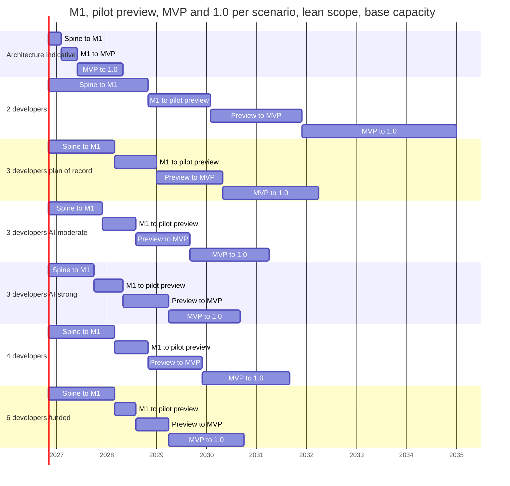
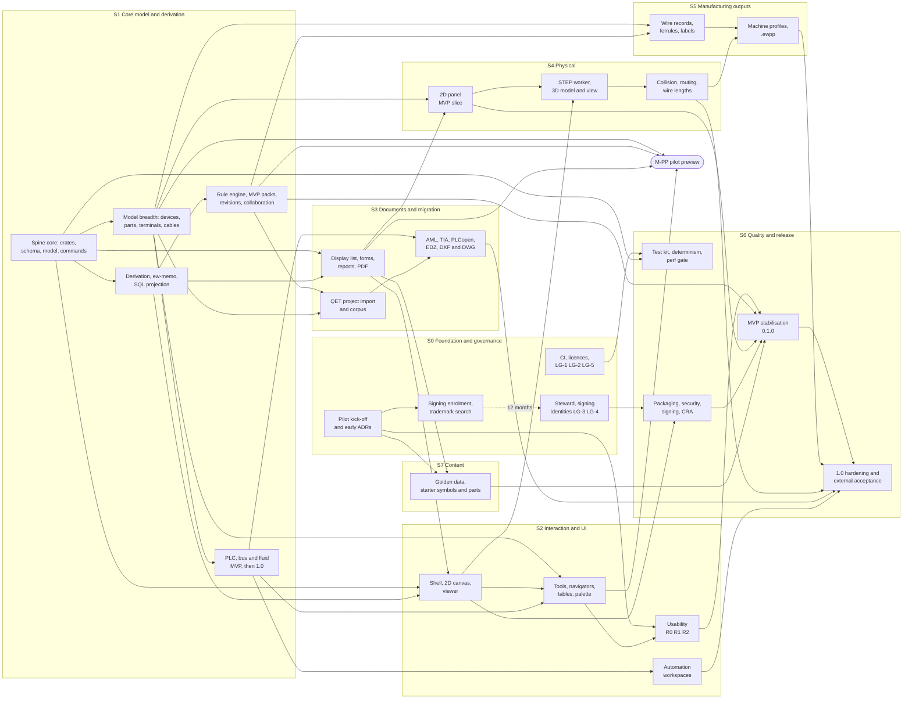

# Global plan

**Status:** Draft v0.46 · Amended 2026-10-31, cycle 41, part 2 (ID-977 to ID-997): the cycle-41 section completed with wave 3 as merged (WP-S4.01 part 5, 902 at its printed scale, WP-S1.22 part 4), the fix rounds, the merge points and the end tip's full-suite verify, the review's parts 3 and 4 and its acceptance, the window check W41b, the play-test sentence, the next IDs and the cycle-42 candidates; the progress table's M2 row (the delivery's end tip and verify; WP-S1.22 part 5 and WP-S4.01 part 4b left). · Amended 2026-10-31, cycle 41, part 1 (ID-948 to ID-976): the cycle-41 section with waves 1 and 2 as merged (WP-S4.01 parts 3 and 4a, WP-S1.18 complete, WP-S1.22 part 3 with the recovery data-loss fix, one test binary per crate, WP-S4.02 and WP-S3.06 specified), the review's parts 1 and 2, the window check W41a, the cycle-40 retro's three changes and wave 3 as dispatched; the cycle-41 candidates as dispatched; the progress table's M2 row (WP-S1.18 complete, 17 packages without a specification on the lean scope); the effort and schedule blocks regenerated for the PERTs of WP-S4.02 (5.5 pw) and WP-S3.06 (2.5 pw). · Amended 2026-10-31, cycle 40, part 4 (ID-945 to ID-947): the fix round FIXPT40 and the play-test rv-vis-4 in the cycle-40 section and the M2 row; cycle 41's first IDs. · Amended 2026-10-31, cycle 40, part 3, the checkpoint (ID-939 to ID-944): the cycle-40 section's end phase (the fix rounds FIX40d and FIX40e, the review's parts 6 and 7 and the FIX40e addendum, all accepted, the window check W40b, the checkpoint) and cycle 41 as dispatched; §3.8's process sentence for the streamlined cycle system (ID-941); the progress table's M2 row: cycle 40 closed at a checkpoint. · Amended 2026-10-31, cycle 40, part 2 (ID-932 to ID-937): the cycle-40 section's lanes J40, FIX40c, H40 and UPKEEP40, the waves as merged, the review's parts 4 to 6, OU-2 on Linux, the cycle-40 candidates as dispatched and the cycle-41 candidates; the progress table's M2 row with its remaining work counted; the owner's process rulings of 2026-10-31 in §3.8's process sentence (ID-938): cycle 40 ends at a checkpoint, the last window check, the play-test and the review's end recorded at the checkpoint, CI at cycle 41's delivery. · Amended 2026-10-31, cycle 40, part 1 (ID-919 to ID-931): the cycle-40 section with its lanes and waves so far (FT-814, WP-S4.01 part 1, WP-S2.08 part 2, WP-S1.22 part 2, WP-S1.19 complete, WP-S1.21 part 4b, the widths at 1920, page arrows and PLC addresses), the review's parts 1 to 3, the window check W40a, the progress table's M2 row; the rest of the cycle in part 2. · Amended 2026-10-31, cycle 39, part 2 (ID-913 to ID-918): the cycle-39 section's end phase (lane M39's follow-up, the fix rounds FIX39a and FIX39b, the window check W39c, the play-test rv-vis-3 and the review loop, accepted); the progress table's M2 row; the cycle-40 candidates with FT-814 (data loss) and FT-816; FT-814 to FT-828; the gate and the delivery recorded in cycle 40's first row. · Amended 2026-10-31, cycle 39, part 1 (ID-892 to ID-912): the cycle-38 delivery and the retro's changes; the cycle-39 section with its lanes, waves, rulings, golden changes and counts, and the owner's two-size rule; the progress table's M2 row; the cycle-39 candidates as dispatched; the cycle-40 candidates; FT-770 to FT-813; the window check, play-test, review and gate recorded at delivery. · Amended 2026-10-30, cycle 38, part 3 (ID-885 to ID-891): lane J38 (WP-S1.19 part 6, UI-1 and UI-4 partly met), the fix rounds FX38b to FX38d, the window check W38, the play-test rv-vis-2 and the review loop (accepted) in the cycle-38 section with its counts; the progress table's M2 row; the cycle-39 candidates; FT-754 to FT-769; the gate and the delivery not yet recorded (cycle 39's first row). · Amended 2026-10-30, cycle 38, part 2 (ID-880 to ID-884): the cycle-38 section's rows for lanes I38, K38, L38 and M38 and the fix round FX38a, WP-S2.18 complete; lane J38, the window check, the play-test, the review loop's outcome and the gate not yet recorded. · Amended 2026-10-30: macOS is not a supported platform (decision log ID-880); §6.2, §9.2 rule 5, §12.1, §13.4 and the first 90 days on Windows and Linux; the generated budget row is not re-based. · Amended 2026-10-30, cycle 38, part 1 (ID-869 to ID-879): the cycle-37 delivery with its fix verify and CI hotfix recorded (ID-869), so cycle 37's gate is recorded; the cycle-38 section with its waves 1 and 2 and the first lanes of wave 3 (WP-S1.21 part 3, WP-S1.18 part 3, WP-S2.07 part 3, WP-S1.19 part 5's acceptance, Golden A's `plc_address` slot and black-box pin designations, two golden changes, the play-test follow-ups); the progress table's M2 row; the cycle-38 candidates as dispatched; FT-725 to FT-749; the rest of wave 3, the window check, the play-test, the review loop, the gate and the cycle-39 candidates not yet recorded. · Amended 2026-10-30, cycle 37 (ID-853 to ID-864): the cycle-36 delivery with its gate fix and CI hotfix recorded (ID-853), so cycle 36's gate is recorded; the cycle-37 section with its three waves and rulings (WP-S1.21 parts 1 and 2, the per-project text styles, WP-S1.18 parts 1 and 2, the UI follow-ups, `rep.join_device`); the progress table's M2 row; the cycle-37 candidates as dispatched; the cycle-38 candidates, M2's fifth cycle (ID-864); FT-690 to FT-704; the play-test and the window check recorded (ID-865, ID-866), the review loop and the fix round (ID-867, ID-868); the gate not yet recorded. · Amended 2026-10-30, cycle 36 (ID-834 to ID-852): the cycle-35 delivery and its CI hotfix recorded (ID-834); the cycle-36 section with its waves and rulings (the test clean-up and opt-level 1, WP-S1.16 part 5, WP-S1.19 part 5, FT-655, FT-656, the small follow-ups, the disk incidents); the progress table's M2 row; the cycle-36 candidates as dispatched; the cycle-37 candidates, M2's fourth cycle (ID-848); FT-670 to FT-680; the play-test, the window check, the review loop and the gate not yet recorded. · Amended 2026-10-29, cycle 35 (ID-815 to ID-830; WP-S2.18 parts 2 and 3 as built, ID-830, with FT-655 and FT-656 among the cycle-36 candidates): the cycle-34 delivery and its CI hotfix recorded (ID-815); the cycle-35 delivered section with its lane table and rulings (WP-S2.18 part 1, WP-S1.19 parts 2 to 4, WP-S2.07 part 2, WP-S1.16 parts 3 and 4; no calamine, ID-827); the progress table's M2 row; the cycle-35 candidates as dispatched; the cycle-36 candidates, M2's third cycle (ID-829); the play-test (ID-831), the window check W35 (ID-832) and the fix round (ID-833) recorded with FT-662 to FT-665, and FT-606, FT-607 and FT-617 among the cycle-36 candidates; the re-review and the gate not yet recorded. · Amended 2026-10-29, cycle 34 (ID-795 to ID-813): the cycle-33 delivery recorded (ID-795); the cycle-34 delivered section with its lane table and rulings; the owner's rulings on visual play-tests and the freeze list (ID-808); WP-S2.18, basic elements from the window, added (ID-812; 28 WPs in M2, the generated tables refreshed); the cycle-35 candidates, M2's second cycle (ID-813); gpp-3, the calibration round and W34 recorded (ID-809 to ID-811); the review loop and the gate not yet recorded. · Amended 2026-10-29, cycle 33 (ID-761 to ID-780): the cycle-32 delivery recorded and the gates at 12 jobs (ID-761); the cycle-33 delivered section (the two G-PP blind runs, gpp-r1's findings built, FT-524 and FT-527 to FT-541); **G-PP recorded Go on the blind-run proxy, M-PP closed and the plan moved to M2** by the owner's rulings (ID-777; §3.8, §5.3); the progress table; the M-PP chain closed; the cycle-33 candidates as dispatched; the cycle-34 candidates, M2's first cycle, with M2's order by dependency (ID-779); owner items unchanged; the review loop and the gate not yet recorded. · Amended 2026-10-29, cycle 32 (ID-744 to ID-759): the cycle-31 delivery recorded (gate, CI with the pixel gate's first hosted run, FT-479's second measurement, ID-744); the build-jobs rule (ID-745) and the tooling lane (ID-746); the cycle-32 delivered section (WP-S2.17 parts 2 to 5, so WP-S2.17 is complete; FT-515, FT-516 and FT-525), the progress table, the M-PP chain with WP-S2.17 complete, the cycle-32 candidates as dispatched, the cycle-33 candidates with G-PP at about cycle 33 or 34 and the owner items; the window fixes' outcome, the review loop and the gate not yet recorded. · Amended 2026-10-28, cycle 31 (ID-721 to ID-742): the cycle-30 delivery recorded (gate, CI, FT-479's first measurement, ID-721); large cycles in waves in §3.8's process sentence (ID-722); the cycle-31 delivered section (WP-S2.06 part 3 and WP-S2.09 parts 2 and 3, so both are complete; the design language with ADR-0031 and the approved mockup; WP-S2.17 specified with parts 1 and 6 delivered; FT-500 to FT-506, FT-509, FT-512 and FT-513), the progress table, the M-PP chain with WP-S2.17, the cycle-31 candidates as dispatched, the cycle-32 candidates with G-PP at about cycle 33, the pixel gate's CI risk and the owner items (the audit item closed, ID-723; the G-PP month question moot, ID-724); window checks, the review loop and the gate not yet recorded. · Amended 2026-10-28, cycle 30 (ID-700 to ID-720; the delivery records: verify, R30, the review loop, FT-499 fixed, FT-513): the cycle-30 delivered section (WP-S2.06 parts 1 and 2, WP-S2.09 part 1, FT-480's GPU image pipeline, FT-485's findings, the SVG work bounds, the router's hygiene and fourteen further follow-ups), Sonnet excluded in §3.8's process sentence (ID-700), the progress table, the M-PP chain, the cycle-30 candidates as dispatched (the stale "no closed specification" text of WP-S2.06 and WP-S2.09 removed), the cycle-31 candidates and the owner items; the review loop's outcome, lane R30's fixes and the gate are not yet recorded. · Amended 2026-10-27, cycle 29 (ID-667 to ID-680): the cycle-29 delivered section (WP-S2.04 part 5, so WP-S2.04 is complete; WP-S6.13 part 2; the `ew-commands` lane FT-460, FT-451, FT-447 and FT-459; FT-456; FT-442 and FT-465; FT-438 taken), the process sentence of §3.8 rewritten to the owner's rulings of 2026-10-27, the progress table, the M-PP chain, the cycle-30 candidates and the owner items; FT-467 closed (ID-676), blind replay made deterministic (ID-677), BD16 done and unblessed (ID-678), the image routing and the asset-save fix (ID-679), the window check (ID-680), FT-480 and FT-485 among the cycle-30 candidates; the review loop's outcome and the gate are not yet recorded. · Amended 2026-10-26, cycle 28 (ID-659 to ID-666): accepted cycle-28 implementation; local validation complete (ID-665); publication status in ID-665; hosted CI pending at publication; hold after delivery; corrected eight-file raster corpus and partial FT-436, FT-470 to FT-473 open, FT-474 enforcement closed; merged references/raster validation and accepted window corrections recorded; scoped Windows window checks passed. · **Date:** 2026-10-25 (v0.27: the cycle-27 delivered section (FT-439; WP-S6.13 part 1; WP-S2.04 parts 3 and 4a; WP-S2.05 part 3, so WP-S2.05 is complete; FT-404, FT-405, FT-408, FT-409 and FT-410; the Windows partitions re-balanced), the progress table, the M-PP chain, the process rulings (two lane builds, the DeepSeek coder) and the cycle-28 candidates, decision log ID-643 to ID-656; v0.26: the cycle-26 delivered section (WP-S2.04 part 2 and WP-S2.05 part 2 delivered, FT-422's alias, FT-406, FT-387 closed with the Windows chain measured at 20:24), the progress table, the M-PP chain and the cycle-27 candidates, decision log ID-633 to ID-642; v0.25: the cycle-25 delivered section (WP-S2.04 part 1 and WP-S2.05 part 1 delivered, WP-S6.13 specified, FT-387 taken in part with a third Windows run job, the integration rules and the window check), the progress table, the M-PP chain and the cycle-26 candidates, decision log ID-625 to ID-632; v0.24: WP-S6.13's fix round and the pilot's prerequisites before G-PP in the M-PP chain, decision log ID-621 to ID-624; v0.23: WP-S6.13 specified in the M-PP chain and the M-PP row, decision log ID-610 to ID-619; v0.22: the cycle-24 delivered section (WP-S2.03 complete with the tool framework, WP-S2.05 specified with its dep-rules precondition met, FT-366 and FT-370 closed, the cycle-23 CI run meeting G-M0-04's wall-time clause), the M1 remaining list, the M-PP chain and the cycle-25 candidates, decision log ID-586 to ID-609; v0.21: the cycle-23 delivered section (WP-S2.03 part 1, the read-only viewer; WP-S2.04 specified in six parts; the wizard completed by report blocks, the asset store, the logo and the profiles; `PRIVACY.md`; the CI split proven and NFR-MAINT-05 read as wall time), the M1 remaining list, the M-PP chain and the cycle-24 candidates, decision log ID-556 to ID-585; v0.20: the cycle-22 delivered section (WP-S2.02 complete with the GPU canvas, WP-S2.03 specified, the wizard's commands, the test-job split and the golden change list), the M1 remaining list after cycle 22, the M-PP chain with WP-S2.03 part 1 next and the cycle-23 candidates, §3.8 and the progress table; decision log ID-531 to ID-555; v0.19: the cycle-21 delivered section (WP-S2.02 part 1, the wgpu audit and `release-check`, the channel indexes and the per-PR fuzz run), the owner's rulings on performance runs and on the viewer, the M1 remaining list after cycle 21, the M-PP chain with WP-S2.02 part 2 next and the cycle-22 candidates, §3.8 and the progress table; decision log ID-512 to ID-530; v0.18: the M-PP chain with WP-S2.02 specified for cycle 21, §3.8; decision log ID-505 to ID-511; v0.17: the cycle-20 delivered section (the shell's second half, the deep nightly and the cargo-fuzz crate, the UI dependency audit), the M1 remaining list after cycle 20, the M-PP chain status with WP-S2.02 next and the cycle-21 candidates, §3.8 and the progress table; decision log ID-486 to ID-504; v0.16: the cycle-19 delivered section (the first UI), the M1 remaining list after cycle 19, the M-PP chain status and the cycle-20 candidates, §3.8 and the progress table; the stale LG-2 text of §11.1 and §14; decision log ID-472 to ID-485; v0.15: the cycle-18 delivered section, the M1 remaining list after cycle 18 and the cycle-19 candidates, §3.8 and the progress table, decision log ID-470, ID-471; v0.14: the owner rulings of 2026-10-22: PD-1 and PD-3 decided, the date rule adopted, no second named code owner, no funding pursued (§13 a reference), the legal and licensing items no longer gate items; §3.8, §13, §15, decision log ID-450 to ID-455; v0.13: the M-PP kick-off: the owner's go, the UI-chain order, the parallel M1 work and the cycle-19 candidates, §3.8, decision log ID-440 to ID-449; v0.12: the cycle-17 delivered section, the M1 remaining list after cycle 17 (the readiness report's §6 and the owner side) and the cycle-18 candidates, §3.8, decision log ID-438, ID-439; v0.11: the G-M1 readiness note, §3.8, decision log ID-419 to ID-426; v0.10: the cycle-16 progress view, the M1 remaining list (the owner-side items, the typed revision FT-165 and the G-M1 readiness run; D-06 with M-PP) and the cycle-17 candidates, §3.8, decision log ID-407; v0.9: the cycle-15 progress view, the M1 remaining list (one not-built entry, the UI-side D-06, plus WP-S6.03, WP-S0.06 and the rest of WP-S6.02) and the cycle-16 candidates, §3.8, decision log ID-391; v0.8: the cycle-14 progress view, the M1 remaining list at six not-built entries and the cycle-15 candidates, §3.8, decision log ID-361; WP-S6.13 in M-PP and the 1.0 month of the plan of record, ID-342; v0.7: the cycle-13 progress view, the M1 gap list without fails and the cycle-14 candidates, §3.8, decision log ID-339; v0.6: the cycle-12 progress view, the M1 gap list at two fails and the cycle-13 candidates, §3.8, decision log ID-321; v0.5: the cycle-11 progress view, the M1 gap list and the cycle-12 candidates, §3.8, decision log ID-300; v0.4: the months are a human-team reference, progress is tracked in cycles, §3.8, decision log ID-271; v0.3: the G-SP re-forecast of 2026-10-20) · **Part of:** ElektraWatt plan

**Purpose.** This is the global plan of ElektraWatt (EW). It turns the [work breakdown](02-work-packages.md) (123
work packages, WPs, with three-point estimates and dependencies) into a capacity model, milestone dates for teams
of 2, 3 and 4 developers and for two AI-assisted scenarios, phases, a pilot preview, a release train, a baseline
schedule, a staffing plan, ways of working, a pilot engagement plan, a funding plan with a budget, the decisions
and their deadlines, a checklist for the first 90 days and an ordered list of descoping options. It fixes the
calendar that the design documents leave to the plan ([vision](../design/00-vision-and-scope.md) §9,
[architecture](../design/04-architecture.md) §15.2, [golden project](../design/20-golden-project.md) §22,
[quality](../design/18-quality-security-release.md) §13.1). Every effort figure and date in a table below is
generated from [work-packages.csv](work-packages.csv) by the scripts in [tools/](tools/) (Appendix A); the same runs
write [milestones.csv](milestones.csv) and [wp-schedule.csv](wp-schedule.csv), which the other plan documents cite.

---

## Summary for decision makers

**Read the months as a human-team reference (2026-10-20, decision log ID-271).** Every month, date and
critical-path figure below models a team of 2–4 human developers. EW is built in AI-driven implementation cycles in
which a work package lands every few hours, so these figures are not its forecast. The plan of record tracks
progress by content and in cycles: §3.8 lists, per milestone, the work packages and follow-up tasks still open
against the observed throughput of about 2–3 work packages per cycle (after cycle 10: the technical part of M0 is
done, G-SP is passed with the outcome Recycle, and 16 of the 22 M1 work packages are delivered in whole or in large
part). The WBS, the estimates, the gates and the acceptance criteria are unchanged.

<!-- generated:summary-headline -->
**The headline.** The full v1 scope is **537.8 person-weeks** (pw) of estimated work, **645.3 pw** with the 20 % integration and bug-fix reserve: 14.9 productive developer-years, 17.9 with the reserve. The lean scope of record is 482.8 pw (579.4 pw with the reserve). Three developers deliver 108 productive pw a year. **The architecture's indicative 15–18 months to 1.0 cannot be met by 2–4 developers.** With three developers, month 16 is when the spine exits (headless golden PDF, M1). No team size reaches 1.0 in 18 months, because the longest dependency chain alone takes 28.5 months.
<!-- /generated:summary-headline -->

**Plan of record (proposed): three developers, lean scope.** Month *n* counts from 2026-11-01 and is labelled
with the calendar month in which it ends. The conservative baseline is the plan of record for every **external**
commitment (pilot, funders, community). The AI-moderate scenario is the **internal** target the team plans its
iterations against. At G-M1 both are replaced by one re-baseline from the measured velocity (§3.7).

<!-- generated:summary-dates -->
| Scenario | M1 spine exit | M-PP pilot preview 0.0.x | M2 MVP 0.1.0 | M6 release 1.0 |
|---|---|---|---|---|
| **3 developers, lean scope: plan of record, external commitments** | **16 (Feb 2028)** | **26 (Dec 2028)** | **42 (Apr 2030)** | **65 (Mar 2032)** |
| Same, capacity −20 % / +20 % | 20 (Jun 2028) / 13 (Nov 2027) | 33 (Jul 2029) / 22 (Aug 2028) | 52 (Feb 2031) / 35 (Sep 2029) | 82 (Aug 2033) / 55 (May 2031) |
| **3 developers + AI-moderate, lean scope: internal target** | **13 (Nov 2027)** | **21 (Jul 2028)** | **34 (Aug 2029)** | **53 (Mar 2031)** |
| 3 developers + AI-strong, lean scope (upside, not planned) | 11 (Sep 2027) | 18 (Apr 2028) | 29 (Mar 2029) | 46 (Aug 2030) |
| 3 developers, full scope (if PD-1 rejects the levers) | 16 (Feb 2028) | 26 (Dec 2028) | 45 (Jul 2030) | 72 (Oct 2032) |
| 4 developers (fourth from month 4), lean scope | 16 (Feb 2028) | 24 (Oct 2028) | 37 (Nov 2029) | 58 (Aug 2031) |
| 2 developers, lean scope | 24 (Oct 2028) | 39 (Jan 2030) | 61 (Nov 2031) | 98 (Dec 2034) |
| 6 developers (funded growth, outside the 2–4 decision), lean scope | 16 (Feb 2028) | 21 (Jul 2028) | 29 (Mar 2029) | 47 (Sep 2030) |
<!-- /generated:summary-dates -->

**"Lean"** applies the three scope levers of the [work breakdown](02-work-packages.md#7-scope-levers), recorded per
WP in the `milestone_lean` and `lever` columns of the CSV: (a) the MVP's Should and Could WPs move to 1.0; (b) QET
project migration ships in the 0.x release after the MVP, so the pilot switches for *new* projects first; (c) 13
WPs that are not among the four binding v1 additions move to 1.x (thermal, project translations, revision compare,
the forms editor, model views and busbars, checklists, the wiring viewer, the full symbol libraries and others).
PLC/I-O, manufacturing outputs, 3D panel layout with routing and wire lengths, and QET/EDZ/DXF import all stay in
1.0.

**New: a pilot preview (M-PP, release 0.0.x).** The long wait for the MVP is the top adoption risk (R-067, R-068).
M-PP is the smallest slice that lets the pilot draw *new* projects like the reference set: interactive 2D
schematic editing with the starter symbols, terminals and cables, title block, core reports, PDF with links and
bookmarks, core online checks, save and load (§5.3). It is an unsigned build for the pilot only, ten months after
M1 and 15 months before the MVP in the baseline. Its light gate G-PP asks one thing: the pilot completes golden
folios 101–103 and 901 interactively.

**What moves the dates.**

<!-- generated:summary-movers -->
| Change against the plan of record (M-PP 26, M2 42, M6 65) | M-PP month (change) | M2 month (change) | M6 month (change) |
|---|---|---|---|
| AI-moderate (internal target, §3.7) | 21 (−5) | 34 (−8) | 53 (−12) |
| Fourth developer from month 4 (§10.3) | 24 (−2) | 37 (−5) | 58 (−7) |
| Effort +10 % (estimates optimistic) | 29 (+3) | 46 (+4) | 72 (+7) |
| Capacity −20 % | 33 (+7) | 52 (+10) | 82 (+17) |
| Third developer joins at month 6 | 28 (+2) | 44 (+2) | 67 (+2) |
| Strict stream silos instead of the pull rule (§10.2) | 38 (+12) | 57 (+15) | 76 (+11) |
| Full scope instead of the levers (PD-1) | 26 (±0) | 45 (+3) | 72 (+7) |
<!-- /generated:summary-movers -->

- **Measured velocity decides.** The estimates are judgement. Actuals logged from the first commit re-scale the plan
  at G-M1 (§3.7, §11.2). The AI-assisted scenarios are hypotheses with weak evidence (§3.7); the plan commits to
  them nowhere outside the team.
- **A fourth developer, early,** brings the MVP and 1.0 forward but not the preview, which is bound by the UI chain
  after M1 (§10.3).
- **Generalists, not silos.** Stream owners own design and review; whoever is free pulls the next ready WP (§10.2).
- **Legal gates and lead times.** No signed release without the employer statement (LG-1), the steward and its
  signing identity (LG-4). Signing enrolment takes at least 12 months of calendar time, so it starts in the first
  90 days (WP-S0.05a) and the plan models the wait (§9.2 rule 5).

**Decisions needed now (M0, November 2026)** (§14): PD-1 adopt the plan of record and the AI-moderate internal
target; PD-2 confirm lever (b) and PD-14 the M-PP scope with the pilot in the pre-G-M0 workshop; PD-3 decide on
the fourth developer and its funding by month 2; PD-4 and PD-5 settle ADR-0027 (grid) and ADR-0028 (fonts); PD-7a
name the phase-1 identity holder so that signing enrolment starts; have LG-1 and LG-5 signed; the employer files
the WBSO application; the first NLnet proposal goes to the first call. *Since 2026-10-22 (decision log ID-450 to
ID-454): PD-1 and PD-3 are decided, the legal items are no longer gate items and no funding is pursued; the WBSO and
NLnet steps are reference text for a human-team scenario.*

**What the pilot gets** (plan of record):

<!-- generated:pilot-timeline -->
| Month (plan of record) | Milestone or event | What the pilot gets |
|---|---|---|
| 16 (Feb 2028) | M1 | The reference set as a PDF generated from the model; nightly `ew` CLI builds |
| 26 (Dec 2028) | M-PP, release 0.0.x | **Pilot preview**: draws new projects interactively (place, wire, terminals, cables, title block, core reports, PDF, online checks, save and load); unsigned, pilot only |
| 26 (Dec 2028) | R0 | Formative usability round on the preview build |
| 41 (Mar 2030) | R1 | Summative usability round on the MVP release candidate |
| 42 (Apr 2030) | M2, release 0.1.0 | Signed release for new projects on three OSes |
| 47 (Sep 2030) | release 0.6.0 | Migration of existing QET projects (lever b) |
| 65 (Mar 2032) | M6, release 1.0 | PLC exchange, 3D layout, wire lengths and machine files |
<!-- /generated:pilot-timeline -->

**Budget.** With the illustrative loaded cost of €100k per developer-year, the baseline costs about €1.7 million
gross to 1.0, about €1.3 million after the WBSO offset; staff is about nine tenths of it (§13.5). All amounts are
estimates to verify.

**Top schedule risks** (§9.3): optimistic estimates; capacity below 36 pw per developer-year; loss of a key
developer; specialisation; and the wait for the first release, which M-PP now shortens for the pilot.

---

**Contents**
1. [Planning basis and assumptions](#1-planning-basis-and-assumptions)
2. [Capacity model](#2-capacity-model)
3. [Effort versus capacity](#3-effort-versus-capacity)
4. [Phases](#4-phases)
5. [Milestones and gates](#5-milestones-and-gates)
6. [Release train](#6-release-train)
7. [Baseline schedule: three developers](#7-baseline-schedule-three-developers)
8. [Streams and dependencies](#8-streams-and-dependencies)
9. [Critical path and schedule risks](#9-critical-path-and-schedule-risks)
10. [Staffing plan](#10-staffing-plan)
11. [Ways of working](#11-ways-of-working)
12. [Pilot-user engagement](#12-pilot-user-engagement)
13. [Funding plan](#13-funding-plan)
14. [Decisions and deadlines](#14-decisions-and-deadlines)
15. [The first 90 days](#15-the-first-90-days)
16. [Descoping options if behind schedule](#16-descoping-options-if-behind-schedule)
17. [Appendix A: the planning tools](#appendix-a-the-planning-tools)
18. [Sources](#sources)
19. [Open questions](#open-questions)

---

## 1. Planning basis and assumptions

### 1.1 Inputs

| Input | What the plan takes from it |
|---|---|
| [Work breakdown](02-work-packages.md) and [work-packages.csv](work-packages.csv) | 124 WPs in streams S0–S7: estimates, dependencies and external lead times, full-scope and lean milestones, levers, owner roles, the critical path |
| [Vision and scope](../design/00-vision-and-scope.md) §3.2, §9, §10 | Success criteria SC-1 … SC-13; the MVP, 1.0, 1.x and Later targets per capability area; constraints K-1 … K-7 |
| [Architecture](../design/04-architecture.md) §15, §16 | The two-lane spine, streams S1–S4, the indicative months, the risk list |
| Requirement catalogues [02a](../design/02a-requirements-core.md), [02b](../design/02b-requirements-extended.md), [02c](../design/02c-nonfunctional-requirements.md) | Through the WBS: every MVP, 1.0 and 1.x row is named by a WP ([WBS](02-work-packages.md#8-requirement-coverage) §8) |
| [Golden project](../design/20-golden-project.md) §21, §22 | Acceptance criteria AC-01 … AC-42 and their gates; defect regression tests D-01 … D-42 |
| [Quality, security and release](../design/18-quality-security-release.md) §6, §7, §13 | Upgrade train, versions and cadence, format window, release checklist, CRA dates |
| [Open-source governance](../design/19-open-source-governance.md) §2.5, §3.3, §3.4, §3.9, §3.10 | Roles, legal gates LG-1 … LG-6, decision-making, funding sources, steward options |
| [UX and UI](../design/16-ux-ui.md) §19 | Usability rounds R0, R1 and R2, tasks T1–T11, the pilot log |
| Scope tables of the feature documents [05](../design/05-project-format-and-persistence.md) … [17](../design/17-extensibility.md) | Through the WBS WPs |
| ADRs [0007](../adr/0007-explicit-connections-and-autoconnect.md), [0025](../adr/0025-gpl-plugin-exception-wording.md), [0027](../adr/0027-native-symbol-grid-and-qet-grid-policy.md) … [0030](../adr/0030-legal-steward-cra-role-support-signing.md) | Decisions with deadlines (§14) |
| [OSS landscape](../research/oss-landscape.md) §8.4 | Funding sources: WBSO, NLnet NGI Zero, sponsors |
| [CLAUDE.md](../../CLAUDE.md) | The AI model-routing policy (Opus lead, Sonnet workers, Haiku for mechanical work) behind the AI-assisted scenarios |

### 1.2 Assumptions

| ID | Assumption | Value used | Source |
|---|---|---|---|
| GA-1 | **Start and calendar** | Month 0 = 2026-11-01. Month *n* is the point *n* months later, labelled with the calendar month that ends there: month 15 = end of January 2028. "Joins at month 4" means from 2027-03-01 | WBS PA-1 |
| GA-2 | **Team** | Baseline 3 developers from month 0; scenarios 2 and 4. In the 4-developer scenario the fourth developer joins at month 4 and the team works at 90 % efficiency **from that month** because of coordination; before it the three work at 100 %. Teams beyond four work at 85 % from the last join. One model in every table and every plan document | WBS PA-2 |
| GA-3 | **Capacity** | **36 productive pw per developer-year** (§2.1): 0.69 pw per calendar week, 3 pw per month. Sensitivity **±20 %** (28.8 and 43.2 pw) | WBS PA-3 |
| GA-4 | **Estimates** | Three points per WP; PERT mean = (O + 4L + P) / 6. An estimate contains design note, code, tests, review, crate docs and CI wiring; user docs, release engineering and pilot work are their own WPs | WBS PA-5, PA-6 |
| GA-5 | **AI assistance in the estimates** | Helps with boilerplate, parsers, test scaffolding and drafting, and is already counted: the likely values are 10–20 % below unassisted work. The estimates do **not** assume a throughput multiplier | WBS PA-7 |
| GA-6 | **Reserve** | 20 % integration, hardening and bug-fix reserve on every WP, plus two stabilisation WPs (WP-S6.08, WP-S6.12). The reserve is never spent on new scope | WBS PA-8 |
| GA-7 | **Schedule model** | Resource-constrained list scheduling with generalist developers and lagged dependencies for external lead times ([tools/engine.py](tools/engine.py), Appendix A). Accuracy about ±1 month | WBS PA-9 |
| GA-8 | **Committed dates** | The baseline dates at base capacity are the external plan of record; the ±20 % band is what we communicate externally. The AI-moderate dates are the internal target only. Each gate review replaces both with a re-forecast from actuals (§3.7, §11.2) | This plan |
| GA-9 | **Scope of record** | Lean scope (levers a, b and c; the `milestone_lean` column) pending PD-1; full-scope dates (the `milestone` column) are kept alongside so that PD-1 can be taken either way | WBS §7.4 |
| GA-10 | **Releases** | No public binary release before the MVP: until then only nightlies labelled "unsigned development build" exist ([governance](../design/19-open-source-governance.md#33-legal-and-organisational-gates) §3.3). The pilot preview 0.0.x is such a build, handed to the pilot only. Monthly 0.x releases from the MVP to 1.0 | 19 §3.3, 18 §7.1 |
| GA-11 | **CRA** | Full application from 2027-12-11, which is month 14. Every public release in every scenario ships under full application, so steward-grade processes (WP-S6.04, WP-S0.05) are MVP exit conditions | 18 §13.1 |
| GA-12 | **Money, not pw** | Counsel, notary, trademark fees, signing, CI, test hardware, test participants, partner-shop time and AI tooling are paid, not estimated in pw (§13.4, §13.5) | WBS PA-10 |
| GA-13 | **Background load** | Routine support, triage, meetings and the quarterly upgrade train are inside the GA-3 deduction; planned pilot and community deliverables are in WP-S0.08 and WP-S0.09 | WBS PA-11 |
| GA-14 | **AI-assisted scenarios** | Development work in S1–S7 is divided by 1.4 (AI-moderate) or 1.8 (AI-strong); S0, people-bound WPs and the review and decision share of each WP are not accelerated; the reserve still applies (§3.7) | This plan; CLAUDE.md |

### 1.3 Relation to the WBS figures

Both documents take their numbers from the same scripts and the same CSV, so they cannot disagree: `schedule.py
--check` and `totals.py --check` fail if a generated table in either document is stale (Appendix A). The 4-developer
model of GA-2 replaces the "90 % for the whole period" variant of the first draft; the 4-developer dates in all
plan documents follow it.

---

## 2. Capacity model

### 2.1 From a calendar year to 36 productive person-weeks

| Item | Weeks per developer-year | Note |
|---|---|---|
| Calendar | 52.0 | |
| Leave and public holidays | −6.5 | About 25 days of leave plus Dutch public holidays |
| Illness and training | −1.5 | |
| **Working weeks** | **44.0** | |
| Team rituals | −3.5 | Iteration planning, demos, retrospectives, gate reviews, plan reviews (§11) |
| Routine support and triage | −2.5 | Pilot questions, bug reports, community questions; not the planned pilot WPs |
| Upkeep outside WPs | −2.0 | Quarterly upgrade train, CI care, security advisories, governance chores |
| **Productive pw** | **36.0** | 82 % of working weeks; 0.69 pw per calendar week; 3 pw per month |

Code review of other people's work is inside each WP's estimate (GA-4), not in this deduction. A WP of 1 pw takes
one developer about 1.5 calendar weeks, 1.7 with the reserve.

### 2.2 Team scenarios

<!-- generated:team-scenarios -->
| Scenario | Developers | Efficiency | pw per month | pw per year (steady state) | pw in 15 months | pw in 18 months |
|---|---|---|---|---|---|---|
| 2 developers | 2 from month 0 | 100 % | 6.0 | 72 | 90 | 108 |
| **3 developers (baseline)** | 3 from month 0 | 100 % | 9.0 | 108 | 135 | 162 |
| 4 developers | 3 from month 0, 1 from month 4 | 90 % from month 4 | 9.0, then 10.8 | 130 | 155 | 187 |
| 6 developers (funded growth, for comparison) | 3 from month 0, 1 from month 4, 2 from month 6 | 85 % from month 6 | 9.0, then 12.0, then 15.3 | 184 | 198 | 244 |
<!-- /generated:team-scenarios -->

### 2.3 Sensitivity

| Case | pw per developer-year | 3-developer team per month | Typical cause |
|---|---|---|---|
| −20 % | 28.8 | 7.2 | Heavy pilot or community support, illness, a developer partly on other company work |
| Base | 36.0 | 9.0 | GA-3 |
| +20 % | 43.2 | 10.8 | Fewer interruptions |

The ±20 % band also stands in for correlated estimation error (a team slower or faster on every WP), which the
PERT σ of independent WPs does not capture (WBS PA-5). AI acceleration is modelled separately (§3.7), because it
does not act on S0 work, people-bound WPs or the review share of each WP.

---

## 3. Effort versus capacity

### 3.1 What the effort contains

Lean scope to 1.0, PERT means in pw:

<!-- generated:effort-parts -->
| Part | pw | Share | Contains |
|---|---|---|---|
| Feature work, streams S1–S5 | 372.9 | 77.2 % | Core model and derivation, UI, documents and migration, physical, manufacturing |
| Quality, security and release engineering, S6 | 56.3 | 11.6 % | Test kit, perf gate, fuzzing, privacy, packaging, signing, SBOM, CRA; release engineering and stabilisation 33.3 pw (WP-S6.06 … WP-S6.10, WP-S6.12) |
| Content and documentation, S7 | 27.7 | 5.7 % | Golden data, starter symbols and parts, user documentation and tutorials |
| Foundation, governance, pilot and community, S0 | 25.9 | 5.4 % | Repository, licences, legal gates, signing enrolment, docs site, funding, pilot programme |
| **Subtotal** | **482.8** | **100 %** |  |
| Integration, hardening and bug-fix reserve (20 %) | 96.6 |  | GA-6 |
| **Total to 1.0** | **579.4** |  |  |

Cross-cutting lines inside these totals: documentation 13.8 pw (WP-S0.06, WP-S7.05, WP-S7.07, plus the crate docs inside every WP); pilot, usability and external acceptance 19.0 pw (WP-S0.08, WP-S0.09, WP-S2.12, WP-S2.16, WP-S6.11).
<!-- /generated:effort-parts -->

### 3.2 Effort per scope option

<!-- generated:effort-scope -->
| Scope | M-PP (PERT) | M-PP with reserve | MVP (PERT) | MVP with reserve | 1.0 (PERT) | 1.0 with reserve | 1.x backlog (PERT) |
|---|---|---|---|---|---|---|---|
| Full scope | 187.4 | 224.9 | 319.6 | 383.5 | 537.8 | 645.3 | 43.5 |
| **Lean: levers (a), (b) and (c) — plan of record** | **187.4** | **224.9** | **297.9** | **357.4** | **482.8** | **579.4** | **98.4** |
<!-- /generated:effort-scope -->

Levers (a) and (b) move work from the MVP into the 1.0 releases; only lever (c) removes work from 1.0. M-PP is a
subset of the MVP in both scopes, so it is the same in both.

### 3.3 Capacity bound versus simulated dates

The capacity bound is the month at which the team has delivered the effort with perfect parallelism. The simulated
month adds the dependencies, the lead times and the one-owner-per-WP rule.

<!-- generated:capacity-bound -->
| Team | Lean M-PP: bound / simulated | Lean MVP: bound / simulated | Lean 1.0: bound / simulated | Full M-PP: bound / simulated | Full MVP: bound / simulated | Full 1.0: bound / simulated |
|---|---|---|---|---|---|---|
| 2 developers | 37.5 / 39 | 59.6 / 61 | 96.6 / 98 | 37.5 / 39 | 63.9 / 66 | 107.6 / 108 |
| 3 developers | 25.0 / 26 | 39.7 / 42 | 64.4 / 65 | 25.0 / 26 | 42.6 / 45 | 71.7 / 72 |
| 4 developers (fourth from month 4) | 21.5 / 24 | 33.8 / 37 | 54.3 / 58 | 21.5 / 25 | 36.2 / 39 | 60.4 / 62 |
<!-- /generated:capacity-bound -->

**Reading it.** For the MVP and 1.0 the simulated dates are within a few months of the capacity bound: the team
is almost fully used, so the end dates follow effort ÷ capacity, and with three developers every 9 pw of extra work
before a milestone moves it by about a month. M-PP is different: it is bound by the UI chain after M1
(WP-S2.01 → WP-S2.03 → WP-S2.04), which a fourth developer cannot shorten.

### 3.4 Milestone dates per scenario

G-SP is the performance-spike decision, which needs `ew-model` (WP-S1.03) and is not a milestone (§9.2 rule 2).

*Human-team reference (decision log ID-271).* The months in the tables of this section and of §3.5 to §3.7 are
those of a human team of the size in each row; they are not the forecast of the AI-driven cycles, whose progress
view is §3.8. The tables are generated by `schedule.py` and kept for the funding plan, the descoping ladder and
any hand-over to a human team.

**Lean scope (plan of record), base capacity.**

<!-- generated:dates-lean -->
| Team | M0 | G-SP spike | M1 | M-PP 0.0.x | M2 MVP | M3 | M4 | M5 beta | M6 1.0 |
|---|---|---|---|---|---|---|---|---|---|
| 2 developers | 3 (Jan 2027) | 7 (May 2027) | 24 (Oct 2028) | 39 (Jan 2030) | 61 (Nov 2031) | 71 (Sep 2032) | 85 (Nov 2033) | 90 (Apr 2034) | 98 (Dec 2034) |
| **3 developers** | **3 (Jan 2027)** | **6 (Apr 2027)** | **16 (Feb 2028)** | **26 (Dec 2028)** | **42 (Apr 2030)** | **48 (Oct 2030)** | **59 (Sep 2031)** | **60 (Oct 2031)** | **65 (Mar 2032)** |
| 4 developers (fourth from month 4) | 3 (Jan 2027) | 6 (Apr 2027) | 16 (Feb 2028) | 24 (Oct 2028) | 37 (Nov 2029) | 41 (Mar 2030) | 53 (Mar 2031) | 53 (Mar 2031) | 58 (Aug 2031) |
<!-- /generated:dates-lean -->

**Full scope (if PD-1 rejects the levers), base capacity.**

<!-- generated:dates-full -->
| Team | M0 | G-SP spike | M1 | M-PP 0.0.x | M2 MVP | M3 | M4 | M5 beta | M6 1.0 |
|---|---|---|---|---|---|---|---|---|---|
| 2 developers | 3 (Jan 2027) | 7 (May 2027) | 24 (Oct 2028) | 39 (Jan 2030) | 66 (Apr 2032) | 73 (Nov 2032) | 88 (Feb 2034) | 101 (Mar 2035) | 108 (Oct 2035) |
| 3 developers | 3 (Jan 2027) | 6 (Apr 2027) | 16 (Feb 2028) | 26 (Dec 2028) | 45 (Jul 2030) | 49 (Nov 2030) | 61 (Nov 2031) | 67 (May 2032) | 72 (Oct 2032) |
| 4 developers (fourth from month 4) | 3 (Jan 2027) | 6 (Apr 2027) | 16 (Feb 2028) | 25 (Nov 2028) | 39 (Jan 2030) | 43 (May 2030) | 52 (Feb 2031) | 57 (Jul 2031) | 62 (Dec 2031) |
<!-- /generated:dates-full -->

With the lean scope, M5 falls one month after M4 (3 developers) or in the same month (4 developers), because lever
(c) empties most of M5. The two gate reviews can then be held together (open question 6).

### 3.5 Sensitivity and best case

M2 and M6 at 80 %, 100 % and 120 % of GA-3 capacity. "Best case" sets every WP to its optimistic estimate **and**
uses 120 % capacity.

<!-- generated:sensitivity -->
| Team | Scope | M2 at −20 % | M2 base | M2 at +20 % | M6 at −20 % | M6 base | M6 at +20 % | Best case M2 / M6 |
|---|---|---|---|---|---|---|---|---|
| 2 | Lean | 76 (Feb 2033) | 61 (Nov 2031) | 51 (Jan 2031) | 122 (Dec 2036) | 98 (Dec 2034) | 81 (Jul 2033) | 34 / 53 |
| **3** | **Lean** | **52 (Feb 2031)** | **42 (Apr 2030)** | **35 (Sep 2029)** | **82 (Aug 2033)** | **65 (Mar 2032)** | **55 (May 2031)** | **24 / 36** |
| 4 | Lean | 45 (Jul 2030) | 37 (Nov 2029) | 31 (May 2029) | 73 (Nov 2032) | 58 (Aug 2031) | 49 (Nov 2030) | 21 / 33 |
| 2 | Full | 82 (Aug 2033) | 66 (Apr 2032) | 55 (May 2031) | 135 (Jan 2038) | 108 (Oct 2035) | 90 (Apr 2034) | 36 / 59 |
| 3 | Full | 56 (Jun 2031) | 45 (Jul 2030) | 37 (Nov 2029) | 90 (Apr 2034) | 72 (Oct 2032) | 60 (Oct 2031) | 25 / 40 |
| 4 | Full | 48 (Oct 2030) | 39 (Jan 2030) | 33 (Jul 2029) | 77 (Mar 2033) | 62 (Dec 2031) | 52 (Feb 2031) | 22 / 35 |
<!-- /generated:sensitivity -->

### 3.6 Can v1 fit 15–18 months?

**No.** Three developers have 135–162 pw in 15–18 months; lean 1.0 needs more than 560 pw with the reserve, 3.5–4.2
times as much. Even the best case (optimistic estimates on every WP and 20 % more capacity) or the AI-strong
scenario puts the lean 1.0 years beyond month 18. With unlimited developers, the longest dependency chain still
takes more than 28 months (§9.1), and the WBS shows what ten developers would reach
([WBS](02-work-packages.md#54-what-the-indicative-dates-would-take) §5.4). The indicative dates assumed roughly one
week per crate-level component; the WBS estimates three to six.

<!-- generated:gantt-teams -->

<!-- /generated:gantt-teams -->

What *can* be done honestly within 15–18 months with three developers: M0 at month 3 and M1 (headless golden PDF,
the format crates and the `ew` CLI core) at month 16, i.e. the open format and the derivation engine, proven on the
reference set.

### 3.7 AI-assisted scenarios

The team will implement much of EW with Claude subagents under the model-routing policy of
[CLAUDE.md](../../CLAUDE.md): an Opus lead turns open questions into closed specifications, Sonnet workers implement
specified commands, importers, reports, panels and tests, and Haiku does mechanical work (scaffolding, renames,
fixtures, licence headers). Two scenarios bound what that may do to the dates.

**Model.** For every WP of streams S1–S7, 25 % of the estimate is review, design decision and verification against
the golden project; it is not accelerated. The other 75 % is development work and is divided by **1.4
(AI-moderate)** or **1.8 (AI-strong)**. Not accelerated at all: S0 (governance, legal gates, funding, pilot
programme) and the people-bound WPs WP-S2.12 and WP-S2.16 (usability rounds), WP-S6.09 (release operations) and
WP-S6.11 (external acceptance). The capacity deductions of §2.1 (rituals, support, upkeep) stay as they are. The
20 % reserve applies to the reduced effort. The factors act on the WBS estimates, which already contain today's
level of assistance (GA-5).

<!-- generated:ai-scenarios -->
| Scenario (3 developers, lean scope) | Effort to 1.0 with reserve (pw) | Equivalent velocity ratio | M1 | M-PP 0.0.x | M2 MVP 0.1.0 | M6 1.0 |
|---|---|---|---|---|---|---|
| Baseline: conservative estimates (plan of record, external) | 579 | 1.00 | 16 (Feb 2028) | 26 (Dec 2028) | 42 (Apr 2030) | 65 (Mar 2032) |
| AI-moderate: development × 1/1.4 (internal target) | 465 | 1.25 | 13 (Nov 2027) | 21 (Jul 2028) | 34 (Aug 2029) | 53 (Mar 2031) |
| AI-strong: development × 1/1.8 (upside) | 402 | 1.44 | 11 (Sep 2027) | 18 (Apr 2028) | 29 (Mar 2029) | 46 (Aug 2030) |
| AI-moderate with capacity −20 % | 465 | 1.25 | 16 (Feb 2028) | 27 (Jan 2029) | 42 (Apr 2030) | 66 (Apr 2032) |
<!-- /generated:ai-scenarios -->

"Equivalent velocity ratio" is the baseline effort divided by the scenario's effort: the ratio the G-M1 measurement
would have to show for the scenario to be true.

**How the plan uses them.**
- **External commitments** (pilot, funders, community, `ROADMAP.md`) use the conservative baseline and its ±20 %
  band until G-M1.
- **Internal target.** Iterations and the monthly forecast are planned against AI-moderate. A gap between target
  and baseline is expected and is not a slip.
- **Re-baseline rule at G-M1.** Measure the velocity ratio over the spine WPs (estimated pw of finished WPs ÷
  actual pw, [gates](03-gates.md) §4.2), clamped to 0.6–1.5. Re-run the scheduler with every remaining estimate
  divided by the measured ratio; the AI scenarios then retire, because the measurement contains whatever the AI
  workflow delivers. The result becomes the single plan of record, and its capacity −20 % case becomes the external
  outer date. In the gates' velocity zones: a ratio of 0.9 or more is green (re-baseline at the measured ratio); a
  ratio of about 1.25 or more confirms AI-moderate; below 0.9 the amber and red reactions of the gates apply. A
  ratio above 1.25 moves external dates earlier only after G-M2 confirms it on non-spine work.
- **AI-moderate is not a buffer.** The table shows that AI-moderate with 20 % less capacity lands on the baseline:
  the conservative baseline is what the team gets if the AI effect is real but the team is interrupted more than
  planned, or if the effect is small.

**The evidence gap.** The published evidence does not support a planning factor, only a range of hypotheses
(**verify** each source before citing it externally):
- A controlled experiment with GitHub Copilot found a self-contained JavaScript task finished about 56 % faster
  (Peng et al., 2023). Greenfield toy tasks are the best case for code completion.
- Field experiments at large companies reported roughly a quarter more completed tasks with an assistant (Cui et
  al., 2024–2025), with large variation between developers.
- A randomised trial with experienced open-source developers on their own mature repositories found them about 19 %
  **slower** with early-2025 tools, while they believed they were faster (METR, 2025).
- We know of no controlled study of agentic multi-agent workflows (lead and worker models with closed
  specifications) on domain-heavy, standards-bound and safety-relevant software such as an ECAD core. The
  routing policy is designed for this case, but it is untested here.

The factors 1.4 and 1.8 are therefore planning inputs chosen by the project, not measurements. The spine is the
first measurement, and the time logs of §11.2 record AI-assisted and unassisted work separately so that G-M1 can
tell the AI effect from estimation error.

### 3.8 Cycle-based progress view (plan of record since 2026-10-20)

*Decision log ID-271 (project owner, delegated).* EW is built in **implementation cycles** by AI agents under the
routing policy of [CLAUDE.md](../../CLAUDE.md): a cycle dispatches its lanes in sequential waves (since the owner's ruling of 2026-10-28, about twice the work of a cycle-30 cycle, decision log ID-722), has the cycle's total diff reviewed
independently once, fixes the findings, records the decisions in a design pass and integrates once; a work package lands
every few hours, not every few weeks. Since the owner's rulings of 2026-10-27 (decision log ID-667) all work is done by Claude subagents (the DeepSeek coder of ID-653 is retired), the orchestrator choosing Opus, Sonnet or Haiku per task in each cycle and fitting the effort to the task (an ambiguous task goes to a higher model class at lower effort rather than to a lower class at higher effort, and briefs for the lower classes are as clear as possible); one independent review of the cycle's total diff, by a fresh-context Opus subagent at high effort, comes before the gate, its findings are fixed by a Sonnet subagent at xhigh effort and re-reviewed until the reviewer accepts; and at most three builders run at once (a lane's build, a gate or a verify chain). Since the owner's ruling of 2026-10-28 Sonnet is excluded until the owner lifts it (decision log ID-700): the orchestrator chooses Opus or Haiku, Opus at a lower effort where a rule names Sonnet for work that needs judgment, and the review's fixer is Opus at medium effort. Since the owner's rulings of 2026-10-31 (decision log ID-938, restated as CLAUDE.md's orchestration rules 0 to 23 by ID-941) the cycles run as a continuous three-slot pipeline: at least two of the three builder slots carry work-package parts at every moment, and polish, FT, fix and verify work share the third; each wave ends at a merge point (integrate, regenerate once, one merged-tip verify of what the wave's changes reach, `cargo xtask affected`), and beside the next wave come its review part, a window check and a design-pass part; the end phase (the last review part and its fixes, the last window check, the last verify) runs beside the next cycle's first wave, whose lanes are reviewed in the next cycle. Cycles end alternately at a checkpoint (working branch pushed, `main` unmoved, no CI; the last verify runs the full suite) and at a delivery whose gate is CI dispatched on the working branch (`ci.yml` and `docs.yml`), with only what CI lacks run locally and the visual play-test at each delivery. The review's findings are triaged (majors, and minors that touch data, the format or what users see, fixed in the cycle; the rest FT rows for one batch lane in the next cycle; after the last wave only the blockers and majors among the window check's and the play-test's findings are fixed before the end tip, the rest go to the next cycle's first polish lane); fixes go back to the authoring lane with no separate re-review rounds, the next review part checking earlier fixes first and only a major re-opening a full review; every lane self-checks its diff against the review checklist; upkeep goes through `cargo xtask settle` once the tooling work package builds it. Cycle 40 closed at a checkpoint, cycle 41 is a delivery. The capacity model of §2 (36 productive pw per developer-year) and the months
of §3.4 to §3.7 and §9 do not describe that pace. They are kept as the **reference of a human-team scenario**: what
the same scope costs a team of 2–4 developers, which the funding plan (§13), the descoping ladder (§16) and any
hand-over to a human team still need. They are not this project's forecast, and the cycle-8 re-baseline "M1 from
month 15 to 16" (decision log ID-225) is a statement about that reference only. The plan of record measures
progress **by content**: a milestone is reached when its work packages, the follow-up tasks due before its gate and
its gate items are done, whatever the date. WBS, estimates, gates and acceptance criteria are unchanged; the
estimates in pw stay the measure of size and of the velocity ratio of §3.7.

**Observed throughput.** Cycles 1 to 17 (2026-10-18 to 2026-10-22) delivered the two technical M0 work packages
and 17 of the 22 M1 work packages in whole or in large part, about 28 deliveries when a work package delivered in
parts (WP-S1.05, WP-S1.07, WP-S3.03, WP-S3.05, WP-S6.01, WP-S7.01) counts each part, plus the QET project import
spike pulled forward from M3, Golden C's migration report and the first `ew-checks` rule packs (WP-S1.15 and WP-S1.16a scope) in cycle 12, and the SQL projection v0 (WP-S1.10), wire numbering and the golden PLC and bus records (WP-S1.21 in part) in cycle 13, and the PDF checks, the SVG export, five rules, the exports and the freshness check in cycle 14, and the export job with `ew export pdf|svg`, `ew apply`, the typed assembly aspect with the assembly BOM and the import modes in cycle 15, with the builder DSL of AC-15 path (b) and the command fuzzer (WP-S6.01 delivered, WP-S6.02 in part), and the device tree, PLC records, supply origin and library copies through commands with AC-15 path (b) passing and the user guide with its generated reference (WP-S0.06 in part) in cycle 16, and the typed revision (WP-S1.18 in part), the fuzzer over every command with its nightly job (WP-S6.02 in part) and the G-M1 readiness run in cycle 17: roughly **2–3 work packages per cycle**, plus the follow-up tasks of each review (306 recorded after the cycle-17 design pass, 66 closed; Appendix B of the
[work breakdown](02-work-packages.md#appendix-b-follow-up-tasks-from-the-implementation-cycles)). Owner-side items
(pilot answers, approvals of goldens, the BM-class runner; no longer legal gates and enrolments, ID-454, nor download approvals, ID-472) do not follow the cycle pace; they are
listed separately because they, not the agents' throughput, bound the gates.

| Milestone or gate | Work packages (lean) | Content-based status (2026-10-29, cycle 33 design pass; cycle 28's local validation and publication status ID-665) | Remaining |
|---|---|---|---|
| **M0** Foundations | 4 | Technical part delivered: WP-S0.01 (workspace and CI on three OSes, green again after the cycle-9 repair, decision log ID-270) and WP-S0.02 (licensing, REUSE, licence-boundary check). The grid and font defaults are in force (ID-1, ID-2) | Owner side, after the owner rulings of 2026-10-22 (ID-450 to ID-455): PD-1 and PD-3 are decided (G-M0-01, G-M0-02 met); LG-5 and WP-S0.05a's trademark search are no longer gate items, and its signing enrolment is a later release item of WP-S6.07; open: WP-S0.08 (pilot kick-off, PD-2, PD-14), ADR-0027 and ADR-0028 acceptance, the licence-boundary demonstration pull request (G-M0-05), the repository settings (branch protection, the CI denylist hashes); gate G-M0 not held |
| **G-SP** Performance spike | — | Held 2026-10-20 in cycle 8: **passed with the outcome Recycle** (ADR-0002 amendment 4). The recycle's engine and incremental connectivity are delivered in cycles 9 and 10 (WP-S1.07 parts 1 and 2, ADR-0002 amendments 5 and 6) | The re-test on a BM-class runner (DEC-034), with the memory measurements at XL (FT-114) and FT-26 (the composite bench family and the growth test were delivered in the cycle-10 fix round); S within budget first, because the pilot's size data (received 2026-10-20, G-SP-08 closed) puts all its projects in class S. Class S was re-tested on 2026-10-22 on the developer machine, informational: every median within noise of the baseline, NFR-PERF-05 met at S on the incremental commit path, the cold path still over (ID-501). **The owner moved the rest to the release phase** (ID-512): no performance measurement runs during development, and the performance criteria are assumed to pass until then |
| **M1** Spine exit | 22 | Delivered with open follow-up tasks: WP-S1.01 to WP-S1.04, WP-S1.06 to WP-S1.10 (WP-S1.10 as v0, ID-328), WP-S3.01 to WP-S3.05, WP-S7.02; WP-S1.05 (engine and instruments; the re-test above is open); WP-S7.01 for Golden A (tables including the PLC and bus records, expected rows, 36 of the 36 pages, the 27-row parts list, the cover tables, part data on 101 and 102, the computed wire numbers), Golden B (two command logs, AC-18 headless) and Golden C (migration report and fix script, gated at G-M3; ID-302); WP-S6.01's acceptance runner (`cargo xtask acceptance`, 94 entries: 88 pass, 0 fail, 0 not built, 6 not applicable; ID-438), delivered in cycle 15 with both golden builders (path (b) through the builder DSL, ID-384; passing since cycle 16, when commands build the valve-terminal assembly, the PLC records and the supply origin, ID-392 to ID-401), with the written PDF read back (AC-01, AC-06, AC-13), the SVG and parallel export (AC-14) and the freshness check (AC-16); the `Session` export job with `ew export pdf|svg` (WP-S3.04, FT-59; G-M1-01's command writes the golden digest) and `ew apply` (FT-156) in cycle 15. Delivered ahead of plan: the QET project import spike (M3 scope, ID-273) and `project.settings.set` (WP-S1.11 scope, ID-290) in cycle 11; the check engine with prevent at apply and `ew check` (WP-S1.15 and WP-S1.16a scope, ID-305, ID-306, ID-309) in cycle 12; the PLC record kinds and the DP bus potential (WP-S1.21 scope, ID-333 to ID-337) in cycle 13; five rules of WP-S1.16 (ID-354), `ew export cables` and `ew export bom` and `ew verify-derived` (WP-S1.22 scope, ID-356, ID-357) in cycle 14; the typed assembly aspect with A1 and A2 and the derived break marks (WP-S1.13 scope, ID-371 to ID-374) and the strict and lenient table import (ID-375) in cycle 15; the device-tree, PLC, supply and library commands with normaliser N1 (WP-S1.13, WP-S1.19 and WP-S1.21 scope, ID-392 to ID-399) and the user guide with the generated reference and the `docs-book` job (WP-S0.06 in part, ID-402 to ID-404) in cycle 16; the typed revision with `revision.create` (WP-S1.18 scope, FT-165, ID-427 to ID-433) and the fuzzer over all 37 commands with its nightly `fuzz.yml` (WP-S6.02 in part, ID-434 to ID-437) in cycle 17; the PLC part-data binding with N2, N3 and `plc.set_module_part` (WP-S1.21 scope, ID-464 to ID-469), the ordered-collection lint and the CI evidence jobs (WP-S6.02 in part, ID-456 to ID-463) in cycle 18; the undo of `library.embed` restored (FT-316, ID-478), the `disallowed-methods` lint (FT-317, ID-481) and the nightly CLI artefact (FT-299, ID-480) in cycle 19; the deep nightly CI-N-02 with the cargo-fuzz crate `fuzz/` (CI-N-03) and AddressSanitizer (WP-S6.02 in part, FT-297, FT-304, ID-494 to ID-497) in cycle 20. The golden PDF is generated from the model with 64 link annotations | Development (the [readiness report](gate-records/G-M1-2026-10-readiness.md) §6; about two cycles): the headless M1 acceptance list has **no blocking entry** (D-06's property grid is `not_applicable` at G-M1 and gates at G-M2, ID-422) and path (b) writes every record; what is left is gate evidence and follow-up tasks: the evidence jobs `verapdf` and `headless` are green on `main` since the cycle-18 delivery (G-M1-01 met, ID-483; FT-296's coverage report waits for the owner's dated plan); the CI jobs and artefacts the gate still names (the deep nightly and the fuzz targets are built in cycle 20, and their seven nights count from the first scheduled run; CI-PR-08, the per-pull-request fuzz run, FT-335; FT-298 the permissive sample reader, FT-300 the golden change list, the first scheduled run of the nightly CLI artefact and the filled `m1` notes); the G-SP re-test and WP-S6.03's measurements are no longer M1 work (release phase, owner ruling ID-512; G-M1-05, -11 and -12 assumed pass); CI-PR-08 is built in cycle 21 (FT-335); the tasks due before the page approvals (FT-102, FT-103, FT-107, FT-108, FT-240, the logo of FT-202, FT-262, FT-246) and FT-207 (folio 911) before the side-by-side review; FT-301, the Appendix B sweep; follow-ups with their own dues (the rest of WP-S1.10, FT-234, FT-282). Owner side (the readiness report §5, after the owner rulings of 2026-10-22, ID-450 to ID-455): the G-M0 decisions PD-2 and PD-14 and the acceptance of ADR-0027 and ADR-0028, the BM-class runner with seven green nights (DEC-034), the first PNG approval (FT-10), the pilot's P1 and P2 answers, golden acknowledgement and side-by-side review, PD-11's re-plan at T (G-M1-24), the repository settings (FT-284), the Weblate project and the website (FT-281, FT-285). No longer gate items: LG-1 to LG-5, ADR-0030 with counsel and the enrolments (ID-454), the second named code owner (ID-452), funding (ID-453); the go-ahead for WP-S2.01 is given (ID-440) |
| **M-PP** Pilot preview | 16 | **Closed; G-PP recorded Go on the blind-run proxy (the owner's ruling of 2026-10-29, ID-777).** Cycle 33 (ID-761 to ID-780): **WP-S6.13 part 3 delivered** (the G-PP blind runs gpp-r1 and gpp-r2, ID-768, ID-776), so **WP-S6.13 is complete**; gpp-r1's thirteen findings built (ID-770 to ID-774); FT-524 and FT-527 to FT-541 closed (ID-779). Cycle 32 (ID-744 to ID-759): **WP-S2.17 parts 2 to 5 delivered** (the command surface, the canvas overlays, the docks, rails, rows, Properties and the status bar, the dialogs, toasts, menus, palette and empty states; ID-747 to ID-750), so **WP-S2.17 is complete** (ID-751); FT-338, FT-348 (except FT-526), FT-390, FT-391, FT-425, FT-507, FT-508, FT-510, FT-514 to FT-516, FT-518, FT-519, FT-521, FT-523 and FT-525 closed (ID-759). Cycle 31 (ID-721 to ID-742): **WP-S2.06 part 3 delivered** (table mode; ID-729), so **WP-S2.06 is complete**; **WP-S2.09 parts 2 and 3 delivered** (the message panel, the Preview tab, the renumber dialogs, the history panel; ID-730, ID-731), so **WP-S2.09 is complete**; **WP-S2.17 specified** (the design language, ADR-0031 and the owner-approved mockup; ID-725, ID-726) with **parts 1 and 6 delivered** (tokens, themes, fonts and the pixel gate; the icon set; ID-740, ID-737); FT-500 to FT-506, FT-509, FT-512, FT-513, FT-417, FT-466 and FT-493 closed (ID-742). Cycle 30 (ID-700 to ID-718): **WP-S2.06 parts 1 and 2 delivered** (the navigator framework, eleven navigators, `page.reorder`, 55 commands, highlighting; ID-709, ID-712), **WP-S2.09 part 1 delivered** (jobs, the export job, notifications, the recovery dialog; ID-714); FT-480, FT-485, FT-484, FT-470, FT-471, FT-437, FT-424, FT-392, FT-389 and further follow-ups closed (ID-717). Cycle 29 (ID-667 to ID-680): WP-S2.04 part 5 and WP-S6.13 part 2 delivered; BD16, the dry run on folio 101, done as pass-with-gaps and unblessed (ID-678); FT-467 closed (ID-676). Cycle 28 implementation and local validation complete (ID-665); hosted CI pending at publication. Started (the owner's go of 2026-10-22, ID-440): **WP-S2.01 delivered** (part 1 in cycle 19, ID-473 to ID-477; part 2 in cycle 20, ID-486 to ID-493: new project, the complete start page, first run and the company-standard wizard, docking with named workspaces, F1 and the complete About, the leftover-journal discard; muda deferred, FT-310); **WP-S2.02 delivered** (part 1 in cycle 21, the canvas on the CPU tile path, ID-517 to ID-522; part 2 in cycle 22, the GPU canvas and the switch rule, ID-539 to ID-544); **WP-S2.03 delivered** (specified in cycle 22, ID-531 to ID-538; part 1 in cycle 23, the read-only viewer with navigation, ID-556 to ID-560; part 2 in cycle 24, the tool framework with Select and Measure, ID-586 to ID-590); **WP-S2.04 specified** in cycle 23 (ID-561 to ID-571), **its part 1 delivered** in cycle 25 (place and arrange, 45 commands, ID-625), **its part 2** in cycle 26 (wiring: the router, the Wire tool, proposals, route edit, the junction editor, hops; ID-635), **its parts 3 and 4a** in cycle 27 (interruption points and black boxes, ID-646; the page-item and structure-box record kinds, ID-647); **WP-S2.05 specified** in cycle 24 (ID-591 to ID-600), **its part 1 delivered** in cycle 25 (the field catalogue, the property sheet and the grid, PG9 as D-06's G-M2 evidence, ID-626), **its part 2** in cycle 26 (find and replace with `fields.set_many`, 46 commands, ID-634), **its part 3** in cycle 27 (the clipboard, ID-648), so **WP-S2.05 is delivered**; the two parts integrated with shortcuts unique per shell context and the window check passed (ID-628, ID-629), and again in cycle 26 with Ctrl+Enter bound per context (ID-638, ID-639); the ID alias `@n` in the shell's machine text (FT-422, ID-640); no UUID-keyed order in shell output (FT-439, ID-643); the pilot's prerequisites FT-408 and FT-409 (`page.new`, `structure.new`, `external_ref.new`, ID-650) and FT-410 (the parts import, ID-651); undo and redo under `HumanOnly` (FT-404, ID-649); rasters in the PDF writer (FT-406, ID-636); **WP-S6.13 specified** in cycle 25 (ID-610 to ID-619), **its part 1 delivered** in cycle 27 (the harness `cargo xtask blind`, ID-645); the wizard complete: FT-336 (the company, frames, languages and check-scheme commands, ID-545 to ID-547), FT-341 (report blocks) and FT-337 (the asset store, the logo and the profiles) closed in cycle 23 (ID-572 to ID-578), and `PRIVACY.md` (FT-342, ID-579); since cycle 25 the shell edits: it places, moves, transforms, exchanges and deletes symbols and edits properties (ID-513's viewer phase ends), since cycle 26 it wires and finds and replaces, and since cycle 27 it places interruption points and black boxes, copies and pastes, creates pages, structure nodes and external references, and imports parts (54 commands); the UI dependency audit in part (FT-326, ID-498, ID-515: wgpu audited; the distribution hold of ID-476 lifts with FT-331 and a green `release-check`); delivered ahead of plan in M1 cycles: parts of WP-S1.11, WP-S1.13, WP-S1.15, WP-S1.16a and WP-S1.19a (the M1 row); **WP-S2.04 part 4b implemented in cycle 28** (ID-659, ID-660), including FT-411, FT-441, FT-446, FT-450, FT-452 and FT-462; FT-418 calibration and FT-474 timing enforcement implemented; local validation complete; publication status ID-665; **WP-S2.04 part 5 delivered in cycle 29** (images, ID-668), so **WP-S2.04 is delivered**; **WP-S6.13 part 2 delivered in cycle 29** (the prompts, personas, checker, the G-PP task sheet and the scoring, ID-669); the owner's process rulings of 2026-10-27 (ID-667) | None for G-PP. **Carried into M2 (ID-777):** the remaining scope of WP-S1.11 to WP-S1.15, WP-S1.16a and WP-S1.19a, delivered where the tools needed them, and every open follow-up due before G-PP, re-dated to M2 (FT-399 to M2 cycle 1); the preview build on the tag `pp` and the pilot's own run of G-PP-01 stay available to the owner. *Before cycle 33 this cell read:* the other 11, in the order of the kick-off plan below (ID-449), next content candidate WP-S6.13's part 3, the G-PP blind run (ID-759); FT-87, FT-88, FT-89, FT-91 and FT-92 of WP-S1.09, re-dated from M1 to before G-PP (ID-425); FT-310, FT-331, FT-332, FT-334 (FT-331 with a green `release-check` lifts the distribution hold), FT-339, FT-340, FT-346, FT-347, FT-357 to FT-365, FT-367, FT-368, FT-371 to FT-379, FT-381, FT-384 to FT-386, FT-393 to FT-403, FT-407, FT-412, FT-426, FT-430, FT-436/FT-472 (partial raster evidence), FT-473 (before broadening SVG/image acceptance), FT-455, FT-479 (measured twice, over 30 minutes; ID-744), FT-524, FT-526, FT-528, FT-530, FT-532 (the empty state and the focus ring), FT-536 and FT-538 where due before G-PP; the visual pass FT-348 is delivered as WP-S2.17 (ID-751) |
| **M2** MVP 0.1.0 | 28 | Cycle 41, M2's eighth cycle (ID-948 to ID-976, part 1, waves 1 and 2): WP-S4.01 parts 3 and 4a built (the panel page; the carrier lines, the folios and the legend query; golden changes on 902, 901 and 901.1), WP-S1.18 part 5 built so **WP-S1.18 is complete**, WP-S1.22 part 3 built (`ew fmt`, `ew recover`, `ew import csv`) with a recovery data-loss fix (FT-889), one integration-test binary per crate, WP-S4.02 and WP-S3.06 specified; the review's parts 1 and 2 accepted with no major; the window check W41a; ID-977 to ID-997, part 2: WP-S4.01 part 5 built (the EW-LAYOUT rules, FT-845; Golden A's release count 42) and 902 at its printed 1:10, WP-S1.22 part 4 built (`ew query --explain`), the fix rounds FIXPT40's, FIX41b, FIX41d, FIX41e and FIX41f, the review accepted (parts 1 to 4), the window check W41b, the play-test rv-vis-5 beside the design pass; the delivery on the code end tip `283abb80` with this design pass on top, its last verify the merged-tip verify on Windows, the full suite, green; CI (`ci.yml`, `docs.yml`) on the delivered tip, recorded in cycle 42's first row. Cycle 40, M2's seventh cycle (ID-919 to ID-931, part 1; ID-932 to ID-937, part 2: WP-S4.01 part 2 built, the layout queries and Golden A's layout data; WP-S2.08 part 2 complete, KM-4 met; FT-717 and FT-779 closed; OU-2 met on Linux; the cycle ends at a checkpoint, ID-938, so main stays at cycle 39's delivery and CI covers cycles 40 and 41 at cycle 41's delivery; ID-939 to ID-944, part 3: the fix rounds FIX40d and FIX40e, the review accepted (parts 1 to 7 and the FIX40e addendum), the window check W40b; ID-945 to ID-947, part 4: the fix round FIXPT40 for the play-test rv-vis-4's two blockers (the job done in 114 turns, no electrical fault); and **the checkpoint on `eb878aba`**, its last verify the full suite on Windows, green): FT-814 closed (a release discard needs this directory's own run record), WP-S4.01 part 1 built (the layout records and commands), WP-S2.08 part 2 built (keymaps; KM-4 in part), WP-S1.22 part 2 built (page and row outputs; five golden PNGs re-blessed), WP-S1.19 complete (FT-785, FT-786), WP-S1.21 part 4b built (the part-level bus port; FT-770), the widths at 1920 (FT-816, FT-798 in part), FT-822 and FT-823 (page arrows, PLC addresses); the review's parts 1 to 3 accepted; the rest in part 2. Cycle 39, M2's sixth cycle (ID-892 to ID-912, part 1): WP-S1.21 part 4 built (the typed bus model, the EW-BUS rules, AC-31; BU-7 waits, FT-770), WP-S1.18 part 4 built (the atomic release and the as-built archive), WP-S2.07 parts 4a and 4b built (the part selection dialog, the part editor, the paste choice; the package open for FT-781 and FT-782), WP-S1.22 part 1 and WP-S2.08 part 1 built (the CLI conventions and result schemas, the palette), FT-754 in part, the play-test blockers FT-753, FT-734 with FT-758 and FT-756 closed, the window at two sizes with the owner's rule; WP-S4.01 specified; three golden changes; part 2 (ID-913 to ID-918): the fix rounds FIX39a (a release discard keeps another project's archive; FT-814 High for cycle 40) and FIX39b, the window check W39c, the play-test rv-vis-3b complete and electrically correct by its checker, and the review loop, accepted; the gate recorded in cycle 40's first row. Cycle 38, M2's fifth cycle (ID-869 to ID-879, part 1; ID-880 to ID-884, part 2: WP-S2.18 complete with part 4, the fix round FX38a): WP-S1.21 part 3 built (addressing commands, the MVP EW-PLC rules, AC-29; PA-2 de-scoped, FT-725), WP-S1.18 part 3 built (the content digest, `revision.approve`, the release gate), WP-S2.07 part 3 built (the PLC navigator and grid), WP-S1.19 part 5's acceptance complete (MC-4, MC-5), Golden A prints its Q addresses (FT-698) and its black-box pin designations (FT-707), two golden changes; the play-test follow-ups FT-705 to FT-712; part 3 (ID-885 to ID-891): WP-S1.19 part 6 built (the Macros and Libraries navigators; UI-1 and UI-4 partly met, FT-754), the fix rounds FX38b to FX38d (a free representation in line connected through, the Messages dock's close and the zoom kept across docks), the window check W38, the play-test rv-vis-2 (not accepted by its checker) and the review loop, accepted; the gate not yet recorded. Cycle 37, M2's fourth cycle (ID-853 to ID-864, delivered ID-869): WP-S1.21 parts 1 and 2 built (PLC records from the window, the derived address texts; Golden A unchanged), WP-S1.18 parts 1 and 2 built (the revision lifecycle, page digests and the derived revision overview; folio 911 a golden change), WP-S1.12's per-project text styles built (ADR-0032, FT-662), WP-S2.18 D3 built as `rep.join_device`, and the UI follow-ups FT-633, FT-649, FT-663, FT-664, FT-670, FT-673 to FT-675 and FT-687; play-test, window check, review and gate not yet recorded. Cycle 36, M2's third cycle (ID-834 to ID-852, delivered ID-853): WP-S1.16 part 5 built, so WP-S1.16 parts 1 to 5 are in (FT-186 and nl-NL beyond the golden rules de-scoped); WP-S1.19 part 5 built without MC-4 and MC-5, so parts 1 to 5 are in and part 6 is open; FT-655 and FT-656; WP-S1.21 and WP-S1.18 specified; the test clean-up. Cycle 35, M2's second cycle (ID-815 to ID-829): WP-S2.18 part 1 (D3 deferred), WP-S1.19 parts 2, 3 and 4, WP-S2.07 part 2 and WP-S1.16 parts 3 and 4 delivered; WP-S2.18 parts 2 and 3 delivered (the generic starter parts, ID-830), so WP-S2.18 parts 1 to 3 are in and part 4 waits for WP-S1.21. Cycle 34 was M2's first cycle (ID-796 to ID-813): WP-S2.07 part 1, WP-S1.16 parts 1 and 2, WP-S1.19 part 1 and WP-S6.13 part 4 delivered; WP-S2.18 (basic elements from the window) added on the owner's request (ID-812); next: cycle 40, FT-814 first, then WP-S4.01 part 1 (ID-912, amended by ID-914) | 28 under the lean scope (the 34 packages whose milestone is M2, less WP-S1.23, WP-S2.10 and WP-S3.10 to WP-S3.13, which the lean scope moves to M3 or M5), as they stand at cycle 41's end: **complete (4):** WP-S1.16 (parts 1 to 5; FT-680 and FT-186's quick fix de-scoped), WP-S1.18 (FT-666, FT-693, FT-731, FT-733, FT-872 and FT-873 open as follow-ups), WP-S1.19, WP-S2.18; **built, open for follow-ups (1):** WP-S2.07 (parts 1 to 4b; FT-737 to FT-740, FT-781, FT-782 and FT-784 open); **in progress (4), parts left:** WP-S1.21 part 5 (and BU-7g's last clause, FT-841); WP-S1.22 part 5 (part 4 built; OU-5's CI proof at cycle 41's delivery); WP-S2.08 parts 3 to 6; WP-S4.01 part 4b (part 5 built); **specified, not started (2):** WP-S3.06 (2.5 pw left), WP-S4.02 (5.5 pw); **not yet specified (17 on the lean scope; the full scope gives 23):** WP-S0.03, WP-S0.05 (its legal part not pursued, ID-454), WP-S0.07, WP-S1.17, WP-S1.20, WP-S2.11, WP-S2.12, WP-S3.07, WP-S3.08, WP-S3.09, WP-S6.04, WP-S6.05, WP-S6.06, WP-S6.07, WP-S6.08, WP-S7.03, WP-S7.05, with groundwork built ahead in earlier milestones for WP-S3.07 (`ew export svg`, cycle 15), WP-S3.08 (the CSV row exports and the XLSX reader, ID-827), WP-S3.09 (the importers' lineage records), WP-S2.11 (the `egui_kittest` snapshot tests), WP-S6.05 (`PRIVACY.md`, ID-579) and WP-S7.03 (the generic starter parts and the basic-project backend, WP-S2.18 and WP-S1.19); and the legal and signing gates (SR-6) |
| **M3 to M6**, 1.x | 38, 18 | Not started | All |

**Cycle 28 implementation and local validation complete (ID-665, ID-666).** WP-S2.04 part 4b and FT-411/441/446/450/452/462 are implemented; the clipboard carries items/boxes and guards incomplete Cut (ID-659, ID-660). FT-418's 27-file SVG calibration is implemented, with FT-470/471 work bounds due before G-PP and FT-473 before broader SVG/image acceptance. FT-436 is partial: eight provenance-checked raster files, remaining evidence FT-472 before G-PP. FT-468/469 save completeness/generator fixes and FT-474 six-file lazy timing enforcement are closed; local-dev excludes dedicated perf tests. A/B corrections are accepted/integrated. The merged, unblessed blind-reference tests passed 3/3: 198 actions and 266 structural words, with 54 commands (ten actions/fourteen words added). All eight retained fixture PDFs generated from merged code passed external veraPDF 1.30.3 validation as PDF/A-2b (8/8 compliant), and the checker passed with `--expect-jobs 8`. The accepted Properties lookup and incomplete-item Cut banner corrections passed focused normal Windows rechecks; scoped normal Windows checks, including OS clipboard publication and changed-external-fragment Paste after `6ecc9e7`, passed with supplementary and platform limits recorded in ID-665; final local validation and publication status are recorded in ID-665; hosted CI was pending at publication. Automated rehearsal does not establish G-PP usability. Deferred content candidates, subject to the owner's hold after cycle 28 delivery, remain WP-S6.13 part 2 (FT-442/465), the bounded command follow-ups FT-459/460/447/451 (FT-440/456 if it fits), FT-438, FT-467 and part 5; FT-389/392/424's second half/437 and ID-655 owner work stay open. Historical cycle-27 gate evidence is unchanged. No further candidate work or cycle 29 starts until the owner resumes it.

At the observed throughput the M1 development work left after cycle 26 is about **one to two cycles** (the readiness report's §6: FT-298 and the page tasks, which got no lane beside the UI work, and the deep nightly's seven nights; FT-300 landed in cycle 22; re-read after cycle 26, unchanged, ID-641) (an estimate from the table,
not a commitment); the owner-side items decide when G-M1 can be held. The figure is re-read after every cycle from
the table above, which the design pass of each cycle updates with the work-package statuses of the
[work breakdown](02-work-packages.md).

**G-M1 readiness (2026-10-22, at the cycle-16 delivery de23b55; decision log ID-419 to ID-426).** The readiness run
of the [gates](03-gates.md) §3.3 finds G-M1 **not ready**: 4 of its 15 hard criteria are met (AC-14 on Linux, AC-15
and AC-16, AC-18 and AC-20, AC-39), and 6 of the 10 must criteria are open; G-M0 has not been held. The headless
engineering is close to done; what development still owes is gate evidence: the CI jobs the gate names and that do
not exist (veraPDF, the headless container, coverage, the deep nightly and the fuzz targets: FT-294 to FT-297), the
sample reader, the nightly CLI artefact and the golden change list (FT-298 to FT-300), the G-SP re-test with the XL
benches and the in-gate seeded slowdown (FT-287, FT-288), FT-271 and the tasks due before the page approvals, about
two cycles after cycle 17 rather than the one cycle estimated after cycle 16; the remaining list above had also left out
FT-87, FT-88, FT-89, FT-91 and FT-92, which ruling R7 re-dates to before G-PP (now in the M-PP row). The owner side
bounds the date: LG-5 and the G-M0 decisions, LG-1, LG-2 with counsel (and the CC-BY-SA question, ID-383), ADR-0030
with counsel and the enrolment submissions, a second named code owner, and the BM-class runner (DEC-034) with seven
green nights; the pilot's PNG approval, acknowledgement, answers and side-by-side review are the conditions.
**Rulings (delegated, 2026-10-22):** the content-triggered date rule is adopted (ID-421: G-M1 within two weeks after
the later of a clean repeated readiness run and the last owner-side hard item on file; the owner confirms or amends
it at G-M0), G-M0 is held first, D-06's property-grid entry gates at G-M2 (ID-422), G-M1-24 is restated for the
cycle-based plan and G-M1-25 is not applicable (ID-423; G-M1-26 open until the owner states whether funding is
pursued), gate records live in `docs/plan/gate-records/`, and FT-294 to FT-301 stand; the second code owner
(G-M1-16, ID-424) is the owner's own decision. Report and pack draft:
[G-M1-2026-10-readiness.md](gate-records/G-M1-2026-10-readiness.md),
[G-M1-2026-10-pack-draft.md](gate-records/G-M1-2026-10-pack-draft.md).

**Owner rulings (2026-10-22; decision log ID-450 to ID-455).** Taken by the project owner in chat, not by
delegation: PD-1 and PD-3 are adopted (the cycle-based plan of record is the plan of record, the human-team months stay
a reference only, there is no fourth developer; G-M0-01 and G-M0-02 are met); the content-triggered date rule of ID-421
is adopted; a second named code owner is not required (G-M1-16 not applicable; NFR-MAINT-07's second owner and R-014
accepted); no funding is pursued (G-M1-26 not applicable; §13 is a reference only); and the legal and licensing items
are no longer gate items, in the owner's words: "Regarding all the licensing, and legal items, this is no longer relevant." This retires
LG-1 to LG-6, ADR-0025 and ADR-0030 with counsel, the enrolments and the trademark search as gate criteria
(G-M0-08, -09, -10, -17, G-M1-18 to G-M1-21, G-M2-18, G-M2-19's legal part, G-M6-12, G-M6-13); the signing identities
that sign release binaries stay a release item of WP-S6.07, and the repository's licence rules are unchanged. After
these rulings G-M1 has 5 of 11 applicable hard criteria met; the [readiness report](gate-records/G-M1-2026-10-readiness.md)
carries the recount in its second addendum.

**The pilot's projects** (received 2026-10-20, decision log ID-272). Three of the pilot's QElectroTech projects,
held privately, have 18 to 36 folios and at most 1,445 placed elements and 718 conductors: all inside class S. The
S budgets therefore decide the pilot preview, and M to XL stay engineering margins. The pilot's drawings carry no
proper BOMs and have known layout imprecision owed to QET; ElektraWatt reproduces their content, not that style
(owner statement, 2026-10-20). Since cycle 11 the lenient project importer reads all three with no lost connection
(P1 34 folios and 1,004 devices, P2 18 and 110, P3 36 and 734; decision log ID-273), and since cycle 12 Golden C has its migration report and fix script on the reference set (ID-302); it stays gated
at G-M3 in the plan of record.

**Cycle 12 delivered** (decision log ID-301 to ID-321): Golden C's migration report and fix script, with the
grid-line nudge for printed cells; the first `ew-checks` rule packs, prevent at apply through the shipped hook,
`terminal.designate` and `ew check`; the M1 report and page gaps (revision label and TOC structure, the 27-row parts
list on 901 and 901.1, the cover tables, part data on 101 and 102). FT-15, FT-62, FT-65, FT-110 and FT-159 to
FT-162 are closed.

**Cycle 13 delivered** (decision log ID-324 to ID-339): wire numbering on folio 907 with doc 20 §8.2 following the
computed numbers (FT-100, FT-201); the SQL projection v0 with thirteen `api_v1` views, the sandbox, `ew sql` and the
acceptance SQL (WP-S1.10 as v0); the PLC record kinds, the 56 channels, folios 908 to 908.2 and the DP bus potential
(FT-111, FT-105; WP-S1.21 in part; ADR-0011 amendment 4). AC-03 and AC-10 pass, so the M1 gap list has no fails
(85 entries: 61 pass, 0 fail, 18 not built, 6 not applicable). FT-100, FT-105, FT-111 and FT-201 are closed, FT-80 in part.

**Cycle 14 delivered** (decision log ID-340 to ID-361): the written PDF read back by an in-repo reader for AC-01,
AC-06 and AC-13, the SVG writer and the parallel page phase on `par_map` (AC-14); the flow-distance orientation
(FT-101) with the final wire numbers, the junction notation of the wire list, the numbering report and the rules
EW-NUM-001, EW-CORE-023, EW-CORE-053, EW-POT-002 and EW-CORE-065, the per-representation anchor override and the part
descriptions without ratings; `ew export cables`, `ew export bom`, `ew verify-derived` with the freshness script, the
block-title templates and the cover (D-30). 92 entries: 81 pass, 0 fail, 6 not built, 5 not applicable. FT-101 and
FT-212 to FT-214 are closed. The owner added product principle PR-13 (ID-340) and the blind drafter (ID-341,
WP-S6.13).

**Cycle 15 delivered** (decision log ID-362 to ID-391): the `Session` export job in `ew-api` with the memoised view parts and one family per layer, `ew export pdf|svg` (G-M1-01's command writes the golden digest), the PDF document ID with a content digest and `ew apply` (FT-59, FT-156); the typed assembly aspect with the rows A1 and A2, the "Covers" column, the derived break marks and the folio-3 order code (FT-245), the strict and lenient table import with the first quick fix "use BN"; the builder DSL of AC-15 path (b) after the owner's page-type ruling (ID-385), three new commands and the command fuzzer. 93 entries: 86 pass, 1 fail (AC-15 path (b): the builder DSL cannot build the valve-terminal assembly until FT-169), 1 not built (D-06's property grid), 5 not applicable. FT-59, FT-156, FT-164, FT-206 and FT-245 are closed. Three hotfixes went to `main` on branches from `main` (ID-382); three lanes built at once against the two-builder rule (ID-359), which the next cycle keeps.

**Cycle 16 delivered** (decision log ID-392 to ID-410): seven commands for the device tree, the PLC records, the supply origin and library copies (`assembly.attach`, `valve.add`, `device.link`, `plc.config_project.create`, `plc.bind_channel`, `project.supply.set`, `library.embed`; 36 registered), `fields.set` on the tag scheme and the assembly and PLC aspects, and normaliser N1, so AC-15 path (b) passes with 606 commands and equals path (a) record for record (lane A); the user guide as an mdBook with the generated command and rule reference, `cargo xtask docs-gen --check` in `cargo xtask ci` and the `docs-book` job with an offline build (WP-S0.06 in part; lane C); the headless acceptance tests once per CI job (FT-268), the nightly performance and memory gate `cargo xtask perf-gate` with `perf.yml`, report-only on the hosted runner, and the CI-time trend (FT-269) (WP-S6.03 in part; lane B). 93 entries: 87 pass, 0 fail, 1 not built (D-06's property grid), 5 not applicable: the headless M1 acceptance list is complete apart from the UI entry. FT-169, FT-256, FT-268 and FT-269 are closed, FT-167 and FT-270 in part. The cycle-15 gate's counterexample was a property-test generator gap, not a model defect (ID-405).

**Cycle 17 delivered** (decision log ID-419 to ID-439): the typed `Revision` with EW-INV-016 to EW-INV-020, `revision.create` and `fields.set`/`edit.delete` on the open revision (37 commands), the title block on the typed records and a second D-05 entry, so path (b) writes every record (608 commands, `unwritten` empty); typing the reserved kind is additive inside the unreleased 0.1, and ADR-0009 amendment 6 records the historic released revision without a checker (lane A; ID-427 to ID-433); the command fuzzer over all 37 commands with a validity oracle each, save-and-reload and CSV import steps, and the nightly `fuzz.yml` running `fuzz_long`, with the cargo-fuzz target deferred (lane B; ID-434 to ID-437); the G-M1 readiness run with its report, pack draft and the delegated rulings R1 to R8 (lane C; ID-419 to ID-426). 94 entries: 88 pass, 0 fail, 0 not built, 6 not applicable: no entry blocks the headless M1 gate, and G-M1 has 5 of 15 hard criteria met (ID-438). FT-165, FT-279 and FT-283 are closed, FT-272 in part; FT-302 to FT-306 are new.

**M-PP kick-off (2026-10-22; decision log ID-440 to ID-449).** *The ruling:* the project owner ruled in chat on
2026-10-22 that development may proceed with further milestones; the UI chain starts in cycle 19, before G-M1 is
held (ID-440). The reason is the state of the two sides: the engine is ahead of the gates (no headless M1 acceptance
entry blocks, ID-438), and what bounds G-M1 is the owner side of the readiness report's §5, which the lanes cannot
close. G-M1 stays content-triggered (ID-421). §9.2 rule 3's warning (pulling the UI chain in front of M1 work delays
the spine) is a statement about a capacity-bound human team; under the cycle pace the M1 development items run in
the same cycles.

*The UI chain, in order* (ID-449): WP-S2.01 part 1, the shell, in cycle 19 on its
[closed specification](specs/WP-S2.01-application-shell.md) → WP-S2.02, the GPU canvas, beside WP-S2.01 part 2
(FT-307 to FT-312: new project, first run and wizard, docking and workspaces, native menus, F1 and About, the start
page) → WP-S2.03, the viewer, view models and tool framework (the viewer build for R0) → WP-S2.04, placement, wiring
and drawing tools → WP-S2.05, the property grid (D-06's grid entry, gated at G-M2, ID-422), with WP-S2.06 and WP-S2.09
beside it → **WP-S6.13**, the blind-drafter harness (1.6 pw, ID-341), right after WP-S2.04, driving the shell's
headless mode (ID-443, FT-314); its first run on the M-PP editor comes before the G-PP review, as an occasion and never
blocking → **G-PP**. The M-PP engine work packages (WP-S1.11 to WP-S1.16a, WP-S1.19a) run where the tools need them;
WP-S2.04 needs the rest of WP-S1.13.

*In parallel for M1:* the readiness report's §6 items that cycle 18 does not finish (the CI evidence FT-294 to
FT-300 and FT-304, FT-271, the page tasks before the approvals) and the G-SP re-test (FT-26, FT-114 to FT-119,
FT-121, FT-288).

*Cycle-19 candidates*, in the order the lead recommended at the kick-off (ID-449; superseded by the list after cycle 18 below, ID-471): (1) WP-S2.01 part 1 as a programmer lane (D3),
first; (2) FT-306 with it, because the GUI crates add build time to every test job (ID-448); (3) the M1 evidence items
cycle 18 leaves; (4) the closed specification of FT-307, the project-creation entry point of `ew-api` (lead-programmer).
An estimate, not a commitment.

**Cycle 18 delivered** (decision log ID-440 to ID-471): the CI evidence jobs in `ci.yml`, `verapdf` per push (CI-N-09; veraPDF 1.30.3 by image digest over three golden PDF variants, AC-13 reading its report in the gate path) and `headless` (CI-PR-05; `ew export pdf` on 1 and 4 threads in a bare, digest-pinned container), the weekly coverage report (report-only until the owner's dated plan), `fuzz_smoke` once per CI job, the image-digest rule of `check-workflows` and the rule that an evidence job whose image pull fails stays failed (lane A; ID-456 to ID-460); the builder's library copies through `library.embed` (609 commands) with the known undo defect FT-316, and the ordered-collection lint with 9 reviewed lookup-only allow sites (lane B; ID-461 to ID-463); the typed solenoid-position map and derivation step 4, the pin-designation map `pin_of` as a format decision, N1's kind change, N2 and N3, and the Bulk command `plc.set_module_part` as FR-PLC-053's confirmation (38 commands), with FR-PLC-051 reworded to the accepted deviation (lane C; ID-464 to ID-469); the M-PP kick-off and the owner rulings (lane D; ID-440 to ID-455). 94 entries: 88 pass, 0 fail, 0 not built, 6 not applicable (unchanged); AC-16 sweeps 2133 keys of 66 families (ID-470). FT-228, FT-271, FT-275 to FT-278, FT-294, FT-295 and FT-306 are closed, FT-296 delivered report-only; FT-307 to FT-325 are new. The jobs `headless` and `verapdf` run for the first time at the fast-forward of `main`; their first green runs are the G-M1-01 and G-M1-02 evidence, and they become required checks after three green runs on `main` (owner, FT-325 with FT-284).

**M1 remaining after cycle 18** (ID-471): the readiness report's §6 minus what landed. Development: the first green runs of `headless` and `verapdf` on `main`; FT-297 and FT-304 (G-M1-13, with FT-272's cargo-fuzz target), FT-298, FT-299, FT-300, FT-317 (G-M1-14's second half); the G-SP re-test (FT-26, FT-114 to FT-119, FT-121, FT-288) with FT-287 and FT-291; the page tasks before the approvals and FT-207 before the side-by-side review; FT-301. Owner side: the dated coverage plan (G-M1-15), the required checks (FT-284, FT-325) and the items of the readiness report's second addendum (the BM-class runner, PD-2 and PD-14 with ADR-0027 and ADR-0028, FT-10, the pilot's P1 and P2 answers, golden acknowledgement and side-by-side review, the re-plan at T). G-M1 stays content-triggered (ID-421).

**Cycle 19 delivered** (decision log ID-472 to ID-485): **the first UI.** WP-S2.01 part 1, the application shell: `elektrawatt` opens an eframe window on wgpu with an egui menu bar on every OS, the start page, the page list and the read-only CPU page view, the Ctrl+K palette, the About, shortcuts, go-to-page and unsaved-changes dialogs, rfd file dialogs and the status bar, every action dispatched on one toolkit-neutral shell model that reaches the model only through `Session`; the headless mode `elektrawatt --headless --script` with the JSON Lines formats `ew.uiscript/1` and `ew.uitranscript/1`, `ui.describe` for agents and `--smoke` for CI; the journal kept on a dirty exit and a dirty script exiting 1; the UI dependency set with 296 cargo-vet exemptions and no audit yet (FT-326 before any distribution) and `rust-version` 1.95 for the three UI crates (lane A; ID-473 to ID-477); FT-316, the undo of `library.embed`, restored through the delete-time rule EW-INV-021 and the history path `Model::apply_history`, with ADR-0009 amendment 7 and the replay collision rule (lane B; ID-478, ID-479); the LG-2 merge block removed, the nightly unsigned CLI artefact CI-N-12 and the `disallowed-methods` lint with the reader crates scanned at source level (lane C; ID-480, ID-481). 94 entries: 88 pass, 0 fail, 0 not built, 6 not applicable (unchanged); 38 commands. CI for the cycle-18 delivery was green with the first runs of `verapdf` and `headless`, so G-M1-01 and G-M1-14 are met (ID-483); the Windows test job took 37 min 53 s, over the 30-minute budget, and runs only its all-features nextest run from FT-330 on (ID-482). FT-299, FT-315, FT-316 and FT-317 are closed; FT-302, FT-313 and FT-314 are extended; FT-326 to FT-330 are new.

**M1 remaining after cycle 19** (ID-484): the readiness report's §6 minus what landed (the first green runs of `headless` and `verapdf`, FT-271, FT-278, FT-294, FT-295, FT-299, FT-306, FT-315, FT-316, FT-317). Development: the G-SP re-test by the orchestrator on a quiet machine (FT-26, FT-114 to FT-119, FT-121, FT-288; stopped in cycle 19, not re-run); FT-297 and FT-304 (G-M1-13); FT-298 (G-M1-17); FT-300 (G-M1-09); the page tasks before the approvals and FT-207 before the side-by-side review; FT-301; the first scheduled run of CI-N-12 and the filled `m1` notes (G-M1-22); FT-287 and FT-291 wait for the BM-class runner. Owner side: the dated coverage plan (FT-296, G-M1-15), the required checks (FT-284, FT-325) and the items of the readiness report's second addendum (the BM-class runner, PD-2 and PD-14 with ADR-0027 and ADR-0028, FT-10, the pilot's P1 and P2 answers, golden acknowledgement and side-by-side review, the re-plan at T). After the cycle-19 addendum G-M1 has 6 of 11 applicable hard criteria met; it stays content-triggered (ID-421).

**Cycle 20 delivered** (decision log ID-486 to ID-504): **the shell's second half, the deep nightly and the UI dependency audit.** WP-S2.01 part 2: File ▸ New project through `Session::new_project` (re-identified copies of a basic project with ordered lists kept in order, after the review found the remap re-sorting them) and `pub use ew_store::SaveError`, the two `ew-api` additions; the complete start page; first run and the company-standard wizard with a draft and a live preview, writing only existing commands; docking with egui_tiles 0.18.0 and named workspaces in the toolkit-neutral `ew.workspace/1`; F1 context help and the complete About; the discard of a leftover journal; the empty-directory rule; the complete, tested `ui.describe` vocabulary (lane A; ID-486 to ID-493); the cargo-fuzz crate `fuzz/` with the JSONL loader, migration-chain and command-sequence targets on a pinned nightly, and the deep nightly `deep-nightly.yml` with the full oracle, the 20,000-case proptest run, the fuzz targets and `fuzz_long` under AddressSanitizer, the ODR report proved a false positive of SQLite's merged tables, the fuzz dependencies under a report-only nightly `cargo deny`, and a stable PR check of the crate in the `lint` job (lane B; ID-494 to ID-497); the UI dependency audit: six cargo-vet audit sets imported without auditor identities (ADR-0023 amendment 5), 20 lead audits marked "AI-performed, owner-delegated", exemptions 485 to 384, the version-keyed build-script allowlist, the `zbus_xml` hold in the manifest and the `PKG_CONFIG=false` release rule, with ID-476's distribution hold kept (lane C; ID-498, ID-499); FT-330, the Windows test job on the all-features run only (lane D; ID-500); the G-SP class-S re-test (the orchestrator; ID-501). 94 entries: 88 pass, 0 fail, 0 not built, 6 not applicable (unchanged); 38 commands. CI for the cycle-19 delivery was green, with the first macOS build of the UI (ID-502). FT-113, FT-272, FT-297, FT-304, FT-307, FT-308, FT-309, FT-311, FT-312, FT-327 and FT-330 are closed; FT-313 and FT-326 in part; FT-335 to FT-344 are new.

**M1 remaining after cycle 20** (ID-503): the readiness report's §6 minus what landed (cycle 19's list, then FT-297 and FT-304, and class S of the G-SP re-test). Development: the class-M re-test by the orchestrator on a quiet machine (FT-26, FT-114 to FT-119, FT-121, FT-288; `EW_PERF_RUNNER=dev-windows-x86_64` for a comparable run); seven nights of the deep nightly from its first scheduled run, CI-PR-08 (FT-335) and no open fuzz crash (G-M1-13); FT-298 (G-M1-17); FT-300 (G-M1-09); the page tasks before the approvals and FT-207 before the side-by-side review; FT-301; the first scheduled run of CI-N-12 and the filled `m1` notes (G-M1-22); FT-287 and FT-291 wait for the BM-class runner. Owner side: the dated coverage plan (FT-296, G-M1-15), the required checks (FT-284, FT-325) and the items of the readiness report's second addendum (the BM-class runner, PD-2 and PD-14 with ADR-0027 and ADR-0028, FT-10, the pilot's P1 and P2 answers, golden acknowledgement and side-by-side review, the re-plan at T). The recount is unchanged: 6 of 11 applicable hard criteria met; G-M1 stays content-triggered (ID-421).

**Cycle 21 delivered** (decision log ID-512 to ID-530): **the canvas, the wgpu audit and the per-PR fuzz run.** WP-S2.02 part 1: the project view's page pane is a zoomable canvas on the CPU tile path (256-pixel tiles of `ew-render-cpu` as egui textures, exact once still; zoom 5 % to 5000 % in √2 steps around the pointer, pan, fit, the connection grid under the frame's page-to-sheet map, the page bounds, a dashed hover outline; the cursor, zoom, grid and `CPU` in the status bar), with four public items below the shell, the new crate `ew-render2d`, the canvas actions in the headless mode and `ui.describe`, the frame statistics and the report-only `canvas` bench; the review's fix round closed a tile-pool race and bounded the snapshot (lane A; ID-517 to ID-522; A15 by the orchestrator on a copy of the golden fixture); the wgpu 30.0.1 audit with its mapped-view caveat (exemptions 384) and `release-check`, CI-R-03's assertions before the release pipeline (lane B; ID-515, ID-516); the shared designation expander with the map-language grammar (no subtraction), the channel indexes (69 memo families) under the transaction-read rule of ADR-0008 amendment 4, CI-PR-08 `fuzz-smoke`, the ODR dispatch input and the `read_back` tests (lane C; ID-523 to ID-526); WP-S2.02's specification with its open items ruled (lane D; ID-505 to ID-511, ID-514). 94 entries: 88 pass, 0 fail, 0 not built, 6 not applicable (unchanged); AC-16 sweeps 2231 keys of 69 families. CI for the cycle-20 delivery was green; the Windows test job took 33 min 20 s and Linux 30 min 23 s, so ID-482's split is specified (FT-353, ID-527). **The owner ruled** that no performance measurement runs during development: performance criteria are assumed to pass until the release phase (ID-512); and that the shell is a viewer until WP-S2.03 and the editing packages land, with a visual pass only if he schedules it (ID-513, FT-348). FT-318, FT-319, FT-333, FT-335, FT-343 and FT-344 are closed; FT-326 stays in part; the performance tasks are re-dated to the release phase; FT-348 to FT-356 are new.

**M1 remaining after cycle 21** (ID-529): the readiness report's §6 minus what landed (FT-335, FT-318, FT-319) and minus the performance work, which moved to the release phase (G-M1-05, -11 and -12 assumed pass, ID-512; FT-26, FT-114 to FT-119, FT-121, FT-288, FT-291). Development: seven nights of the deep nightly from its first scheduled run and no open fuzz crash, with CI-PR-08's first hosted run (G-M1-13); FT-298 (G-M1-17); FT-300 (G-M1-09); the page tasks before the approvals and FT-207 before the side-by-side review; FT-301; the first scheduled run of CI-N-12 and the filled `m1` notes (G-M1-22). Owner side: FT-296's dated coverage plan (G-M1-15), the required checks (FT-284, FT-325) and the items of the readiness report's second addendum (PD-2 and PD-14 with ADR-0027 and ADR-0028, FT-10, the pilot's P1 and P2 answers, golden acknowledgement and side-by-side review, the re-plan at T); the BM-class runner is a release-phase item now. Not M1 items: FT-331 (with WP-S4.03), which with a green `release-check` lifts ID-476's distribution hold, and FT-336 to FT-342 (before G-PP). **Recount:** 6 of 11 applicable hard criteria met, 3 assumed pass, 2 open (G-M1-02 on the owner side, G-M1-24); G-M1 stays content-triggered (ID-421).

**The M-PP chain** (ID-449, ID-503, ID-529, ID-554, ID-631, ID-641, ID-654, ID-674, ID-717, ID-742, ID-759, ID-777): WP-S2.01 **delivered** (part 1 in cycle 19, part 2 in cycle 20; FT-310's muda deferred under ID-446) → **WP-S2.02, the 2D canvas renderer `ew-render2d` with its GPU-less fallback, delivered** ([specification](specs/WP-S2.02-canvas-renderer.md); ID-505 to ID-511): part 1 in cycle 21 (ID-517 to ID-522), the zoomable canvas on the CPU tile path that is also the fallback; part 2 in cycle 22 (ID-539 to ID-544), the GPU path with the switch rule, FT-328, FT-349 and FT-356 → **WP-S2.03, the viewer, view models and tool framework** ([specification](specs/WP-S2.03-viewer-and-tool-framework.md); ID-531 to ID-538): **delivered**: part 1 in cycle 23, the read-only viewer (ID-556 to ID-560); part 2 in cycle 24, the tool framework (ID-586 to ID-590) → **WP-S2.04, the editing gestures, specified** in cycle 23 ([specification](specs/WP-S2.04-placement-wiring-drawing-tools.md); ID-561 to ID-571): six parts, 1 → 2 → {3 ∥ 4a} → 4b → 5, part 4a at D5; **part 1 delivered** in cycle 25 (ID-625), **part 2 delivered** in cycle 26 with FT-423 and FT-421 (ID-635), **parts 3 and 4a delivered** in cycle 27 (ID-646, ID-647), **part 4b implemented in cycle 28; final local validation and publication status in ID-665** (ID-659, ID-660), **part 5 delivered** in cycle 29 (ID-668), so the package is complete → **WP-S2.05, the property grid, find and replace and the clipboard, specified** in cycle 24 ([specification](specs/WP-S2.05-property-grid-find-replace-clipboard.md); ID-591 to ID-600): three parts, 1 → 2 and 1 + WP-S2.04 part 1 → 3; **part 1 delivered** in cycle 25 (ID-626; D-06's grid entry, gated at G-M2, its evidence PG9 built, ID-599), **part 2 delivered** in cycle 26 (ID-634), **part 3 delivered** in cycle 27 (ID-648), so the package is complete; WP-S2.06 and WP-S2.09 follow, their first slices FT-408, FT-409 and FT-410 delivered in cycle 27 (ID-650, ID-651) → **WP-S2.06, navigators and table mode, specified** in cycle 30 ([specification](specs/WP-S2.06-navigators-and-table-mode.md); ID-681 to ID-689): three parts, 1 → 2 → 3, **parts 1 and 2 delivered** in cycle 30 (ID-709, ID-712), **part 3 delivered** in cycle 31 (ID-729), so the package is complete → **WP-S2.09, messages, bulk previews, history, jobs and recovery, specified** in cycle 30 ([specification](specs/WP-S2.09-messages-bulk-previews-history-jobs-and-recovery-ui.md); ID-690 to ID-699): three parts, **part 1 delivered** in cycle 30 (ID-714), **parts 2 and 3 delivered** in cycle 31 (ID-730, ID-731), so the package is complete → **WP-S2.17, the design language and UI polish, specified** in cycle 31 ([specification](specs/WP-S2.17-design-language-and-ui-polish.md); ID-725 to ID-727): six parts in three waves, {1 ∥ 6} → {2 ∥ 5} → {3 ∥ 4}, **parts 1 and 6 delivered** in cycle 31 (ID-740, ID-737), **parts 2 to 5 delivered** in cycle 32 (ID-747 to ID-750), so the package is complete (ID-751) → **WP-S6.13, the blind-drafter harness, specified** in cycle 25 ([specification](specs/WP-S6.13-blind-drafter-harness.md); ID-610 to ID-619): three parts, 1 → 2 → 3, **part 1 delivered** in cycle 27 (ID-645), **part 2 delivered** in cycle 29 (ID-669) (part 1 the harness `cargo xtask blind` with its loopback keeper, `--keep-going`, parameter signatures and `page.describe`, after WP-S2.04 part 1 (delivered) and the ID alias `@n` (FT-422, delivered in cycle 26, ID-640) and FT-439 (the shell's UUID-keyed orders), with the licence rows of FT-415 in its own lane; part 2 the prompts, personas and the G-PP task sheet with a dry run on folio 101; part 3 the G-PP run after WP-S2.04 part 4b and WP-S2.05 part 1), driving `elektrawatt --headless --script -` with `ui.describe` and `page.describe` as the agent's only senses (FT-314, ID-493); its gate run is G-PP's recorded rehearsal, never a criterion (ID-612; fix round ID-621 to ID-624: the agent isolated from the repository, part 3 on the reserve, the PERT unchanged); the gaps it found for the pilot's task are FT-408 to FT-412, and **the pilot's prerequisites FT-408 to FT-411 are due before G-PP** (ID-623): `page.new` and the structure and external-reference creation in WP-S2.06, the parts import's UI action in WP-S2.09, the strip-bridge gesture in WP-S2.04 part 4b; FT-408 to FT-410 are delivered in cycle 27, FT-411 is implemented with part 4b in cycle 28; final local validation and publication status in ID-665 → G-PP. A manual GUI check on Linux (Wayland and X11) and macOS is an owner or blind-drafter item; the macOS build, kittest and smoke test are green on CI since the cycle-19 delivery, and the owner has seen the shell on Windows (ID-513). Since WP-S2.03 part 1 the shell is a viewer with navigation; editing started with WP-S2.04 part 1 and WP-S2.05 part 1 in cycle 25 (ID-513's note), and wiring and find and replace followed in cycle 26. Cycle 27 added interruption points, black boxes, the clipboard, page and structure creation and the parts import. Cycle 29 added images and the blind drafter's prompts, personas and checker. Cycle 30 added the navigators with highlighting, page reordering, the export job with cancel, notifications and the journal recovery dialog. Cycle 31 added table mode, the message panel, the Preview tab, the renumber dialogs, the history panel and the design language's tokens, themes and icons. Cycle 32 put the design language in the window: the command bar, the app menu and the HUD, the rails with Properties under the navigator, the restyled rows, data grid, Messages and History, the dialogs, toasts, menus and palette, the canvas overlays and window memory. Cycle 33 ran the G-PP blind run twice, built the first run's findings (parts on the Parts row, part-first terminals, bridge chains, the bond, typed potentials, the tag proposal) and closed the chain: **WP-S6.13 part 3 delivered, so WP-S6.13 is complete, and G-PP recorded Go on the blind-run proxy (ID-777) → M2.**

**Cycle 22 delivered** (decision log ID-531 to ID-555): **the GPU canvas, the viewer's specification and the wizard's commands.** WP-S2.02 part 2: the GPU path of the canvas (lyon tessellation on a preparation worker into an offscreen 4× MSAA texture resolved into a pane-sized `Rgba8Unorm` texture, content-keyed meshes), the switch rule with the labels `GPU DX12|Vulkan|Metal|GL`, `WARP` and `CPU`, the CPU-renderer setting, the banners, `--no-gpu` and exit code 3, the parity test B2 on hardware DX12, WARP and, in CI, Mesa's lavapipe with `EW_REQUIRE_GPU_ADAPTER=1`, FT-328's backends per OS (the Windows release binary 52,502,528 B), FT-349 and FT-356; the review's fix round added the session to the scene key; **WP-S2.02 is complete** (lane A; ID-539 to ID-544); WP-S2.03's closed specification in two parts with its rulings, the requirement moves and FR-PAG-024's new acceptance text (lane B; ID-531 to ID-538); FT-336 in part: `project.company.set`, `project.frames.set`, `project.languages.set` and the first `HumanOnly` command `project.checks.set` (42 commands), applied by the wizard's confirmed step and on the command line by `ew project checks set` with a confirmation typed on a terminal, as FR-EXT-030 requires (FT-369; lane C; ID-545 to ID-547); FT-353, the test-job split (lane E; ID-548); FT-300, the golden change list with every commit mapped (lane D; ID-549, ID-550). 94 entries: 88 pass, 0 fail, 0 not built, 6 not applicable (unchanged). CI for the cycle-21 delivery was green except the first hosted `fuzz-smoke` run, whose `migration_chain` finding lane F fixed: a library copy with a BOM did not open (the reader now strips one BOM there, as in the JSONL files), and a harness oracle bug (ID-551, ID-552). FT-300, FT-328, FT-349, FT-353, FT-356 and FT-369 are closed; FT-336 and FT-347 in part; FT-354 deferred; FT-357 to FT-370 are new.

**M1 remaining after cycle 22** (ID-554): the readiness report's §6 minus what landed (FT-300). Development: seven nights of the deep nightly and no open fuzz crash, counted from lane F's `migration_chain` fix (G-M1-13); FT-298 (G-M1-17); the page tasks before the approvals and FT-207 before the side-by-side review; FT-301; the first scheduled run of CI-N-12 and the filled `m1` notes (G-M1-22). Owner side: the golden acknowledgement of the generated list (G-M1-09, O9), FT-296's dated coverage plan (G-M1-15), the required checks with FT-353's new job names (FT-284, FT-325) and the items of the readiness report's second addendum. **Recount:** unchanged, 6 of 11 applicable hard criteria met, 3 assumed pass, 2 open; G-M1 stays content-triggered (ID-421).

**Cycle 23 delivered** (decision log ID-556 to ID-585): **the viewer, the first editing package's specification and the complete wizard.** WP-S2.03 part 1: the read-only viewer (the page navigator, flat, by section or by structure, sorted and filtered, listing Golden A's 36 pages; at most 32 canvas tabs in one or two groups with the Window menu; link follow with F or a click, Back and Forward per tab, Go to a folio or a cell, the cursor's cell in the status bar, the keyboard grid cursor announced to screen readers), with five public items below the shell whose link rectangles equal the PDF writer's to 0.01 pt; V15's manual look passed (lane A; ID-556 to ID-560); WP-S2.04's closed specification in six parts with its rulings, the record shapes of `page_item` and `structure_box` written into docs 03 and 05 and EW-INV-022 and EW-INV-023 specified (lane B; ID-561 to ID-571); FT-341 and FT-337: report blocks embedded from the library, the content-addressed asset store (written by the save protocol, never removed by a save, journalled, a 512 KiB logo bound), the logo through `project.company.set` and the two shipped colour profiles, so the wizard writes every field and FT-336 closes (lane C; ID-572 to ID-578); FT-342, `PRIVACY.md` (lane D; ID-579); two CI hotfixes after the cycle-22 delivery and the split's first green run, with NFR-MAINT-05 read as wall time (lane E; ID-580 to ID-582). 94 entries: 88 pass, 0 fail, 0 not built, 6 not applicable (unchanged); 42 commands. FT-336, FT-337, FT-341, FT-342 and FT-345 are closed; FT-359 narrowed; FT-371 to FT-388 are new.

**M1 remaining after cycle 23** (ID-584): unchanged from cycle 22. Development: seven nights of the deep nightly and no open fuzz crash, counted from lane F's `migration_chain` fix (G-M1-13); FT-298 (G-M1-17); the page tasks before the approvals and FT-207 before the side-by-side review; FT-301; the first scheduled run of CI-N-12 and the filled `m1` notes (G-M1-22). Owner side: the golden acknowledgement of the generated list (G-M1-09, O9), FT-296's dated coverage plan (G-M1-15), the required checks with FT-353's job names (FT-284, FT-325) and the items of the readiness report's second addendum. **Recount:** unchanged, 6 of 11 applicable hard criteria met, 3 assumed pass, 2 open; G-M1 stays content-triggered (ID-421).

**Cycle 24 delivered** (decision log ID-586 to ID-609): **the tool framework, the property grid's specification and five follow-ups.** WP-S2.03 part 2: the tool contract, host and overlay in `ew-viewmodel` with previews on the UI thread and the commit paths, `Session::page_cps`, the Select tool (clicks, enclosing and touching bands, link follow, the 2-pixel selection outline) and the Measure tool (snapped to connection points or the grid, the readout), keyboard tool input with physical bracket keys, Enter and Backspace, the Escape chain, and the 300 ms link preview popup; the fix round made taps click and added egui's widget hit test; the window check passed; **WP-S2.03 is complete** (lane A; ID-586 to ID-590); WP-S2.05's closed specification in three parts with its rulings, the requirement texts amended to the golden project and PG9 as D-06's G-M2 evidence, and its precondition met in this pass by the `ew-api` edges in `ci/dep-rules.toml` (lane B; ID-591 to ID-600); the asset follow-ups: the purge command `project.assets.purge` (the 43rd command, `HumanOnly` with a typed confirmation on the command line after its review, ID-620), the mechanical asset-presence guard, the SVG hazard checks inside the sniff, and usvg admitted so that SVG logos print in every renderer and PNG on screen (lane C; ID-605; FT-380, FT-382, FT-383 closed, FT-384 in part with the raster rest in FT-406); FT-370, FT-387's README part, FT-366 (`ew check`'s scheme from the project and the decimal separator; the undo and redo `HumanOnly` gap to FT-404) and the navigator cache with two pins (lane D; ID-601 to ID-604). CI for the cycle-23 delivery was green in every job, and its Windows chain of 27:20 met G-M0-04's wall-time clause in that run (ID-606). 94 entries: 88 pass, 0 fail, 0 not built, 6 not applicable (unchanged); 43 commands. FT-366, FT-370, FT-380, FT-382 and FT-383 are closed; FT-384 and FT-387 closed in part; FT-371 narrowed; FT-389 to FT-407 are new.

**M1 remaining after cycle 24** (ID-608): unchanged from cycle 23. Development: seven nights of the deep nightly and no open fuzz crash, counted from lane F's `migration_chain` fix (G-M1-13); FT-298 (G-M1-17); the page tasks before the approvals and FT-207 before the side-by-side review; FT-301; the first scheduled run of CI-N-12 and the filled `m1` notes (G-M1-22). Owner side: the golden acknowledgement of the generated list (G-M1-09, O9), FT-296's dated coverage plan (G-M1-15), the required checks with FT-353's job names (FT-284, FT-325) and the items of the readiness report's second addendum. **Recount:** unchanged, 6 of 11 applicable hard criteria met, 3 assumed pass, 2 open; G-M1 stays content-triggered (ID-421).

**Cycle 25 delivered** (decision log ID-625 to ID-632; lane E's WP-S6.13 specification, recorded in cycle 24's branch, is ID-610 to ID-624): **the first editing tools and the property grid.** WP-S2.04 part 1, place and arrange: the picker with the starter library (Insert ▸ Symbol, I; Insert ▸ Device from part, Shift+I), the Place tool with part-first and terminal targets, the black-box join and the predicted tag after the 80 ms preview, grid-step drags with rubber bands and the readout, the keyboard move, rotate, mirror, variant and delete on a selection, Edit ▸ Change symbol, the tool strip and the Insert menu; `from_part`, `new_terminal` and `rep.move` `steps` as additive members, `rep.exchange_symbol` and `project.drawing.set` as new commands (**45 commands**, every new member `skip_serializing_if`); the folio-101 script places all 17 representations and replays with `ew apply`; thirteen rulings, among them the page-type refusal text and the double click on the window's input clock (lane A; ID-625). WP-S2.05 part 1: the field catalogue (19 kinds, 406 nodes, 167 editable) from one schema walker, the property sheet and the Properties pane with provenance chips, `‹varies›`, override, freeze and reset, typed editors with option lists, the preview card for identifiers, bulk commands and more than 500 targets, the toast with Undo and keyboard-only operation; the grid never builds a `HumanOnly` command, and revision author and checker are read-only; PG1 to PG11 pass, so **D-06's G-M2 evidence PG9 exists** (lane B; ID-626). FT-387 in part: a third Windows run job after the cycle-24 delivery run's chain of 30:01 (lane F; ID-627). The orchestrator integrated the two parts with shortcuts unique per shell context, one text per reason key and PG5 through `select.set`, at 192 describe words and 145 actions (ID-628), and the window check passed on Windows (ID-629). One grammar for record IDs in machine text, the alias `@n`, replaces the masking `‹id›` once FT-422 lands (ID-630). Acceptance, AC-15 and the golden bytes are unchanged by both lanes; the full suite runs at the delivery. Lane D (FT-406, FT-404, FT-405) does not land in cycle 25: the owner asked to hold after this delivery (quota), and its unreviewed commits move to cycle 26. FT-387 closed in part again (unmeasured; closed in cycle 26 at 20:24, ID-633); FT-389, FT-391 and FT-392 re-dated to WP-S2.04 part 2; FT-412 amended; FT-421 to FT-429 are new.

**M1 remaining after cycle 25** (ID-631): unchanged from cycle 24. Development: seven nights of the deep nightly and no open fuzz crash, counted from lane F's `migration_chain` fix (G-M1-13); FT-298 (G-M1-17); the page tasks before the approvals and FT-207 before the side-by-side review; FT-301; the first scheduled run of CI-N-12 and the filled `m1` notes (G-M1-22). Owner side: the golden acknowledgement of the generated list (G-M1-09, O9), FT-296's dated coverage plan (G-M1-15), the required checks with the Windows job names of FT-387 (FT-284, FT-325) and the items of the readiness report's second addendum. **Recount:** unchanged, 6 of 11 applicable hard criteria met, 3 assumed pass, 2 open; G-M1 stays content-triggered (ID-421).

**Cycle 26 delivered** (decision log ID-633 to ID-642): **wiring, find and replace, the ID alias and rasters in the PDF.** WP-S2.04 part 2, wiring: the orthogonal router `ew_commands::route::auto_route` (an exact least-cost search with a deterministic tie rule, capped at 262,144 nodes with the L route as the fallback), the Wire tool (W) with keyboard wiring and the page type's wire kind, autoconnect proposals on the Place ghost, route edit of middle segments, the junction sequence editor and crossings as hops; FT-423 (the far end of a moved route never moves) and FT-421 (`PlaceCatalogue.strips`) closed; nine rulings, the review's fix round and the window check's rules (a page change ends a tool, the tool strip's row always reserved, no chip without a tag or cross-reference change), with the coordinate form of `junction.open` withdrawn; folio 101 wired by a generated script twice identically and replayed (lane A; ID-635). WP-S2.05 part 2, find and replace: the Find pane below the page view (Ctrl+F, Ctrl+H), `Session::find`, one previewed `fields.set_many` per replace (**46 commands**), Freeze on several devices, the NFC guard and the `run_script` Bulk rule; the regex runtime edge (291 packages in the shipped graph, three regex exemptions for the owner, 386 exemptions); FT-427 closed (lane B; ID-634). FT-422, the ID alias `@n` in the shell's machine text, delivered as ID-630 ruled, the table reset only at a script run's start (lane C; ID-640). FT-406: PNG and JPEG image items in the PDF writer and JPEG on the CPU path, four audited packages, krilla's GIF and WebP paths disallowed, undecodable rasters as page findings, a JPEG without EOI undecodable (lane D; ID-636, ID-637). FT-387 closed: the six slowest test binaries in the first Windows part brought the chain from 31:14 to **20:24**, measured; `test-macos` took 30:04 in that run (FT-438) (lane F; ID-633). The orchestrator integrated the lanes with Ctrl+Enter bound per shell context, at 227 describe words and 167 actions (ID-638), and the window checks on Windows passed with their defects fixed in the cycle (the find pane's Tab, the route mode across a page change, the strip's 25 px shift, stale marks after undo; ID-639); the window checks are delegated from now on (owner). Acceptance, AC-15 and the golden bytes are unchanged; one reviewed golden line, AC-16's "2232 keys of 70 memoised families", waits for the owner's acknowledgement. FT-387, FT-406, FT-421, FT-422, FT-423 and FT-427 are closed, FT-424 in part; FT-389 and FT-392 re-dated to WP-S2.04 part 3, FT-391 to WP-S2.08, FT-404 and FT-405 to cycle 27; FT-374, FT-412 and FT-416 amended; FT-430 to FT-439 are new.

**M1 remaining after cycle 26** (ID-641): unchanged from cycle 25. Development: seven nights of the deep nightly and no open fuzz crash, counted from lane F's `migration_chain` fix (G-M1-13); FT-298 (G-M1-17); the page tasks before the approvals and FT-207 before the side-by-side review; FT-301; the first scheduled run of CI-N-12 and the filled `m1` notes (G-M1-22). Owner side: the golden acknowledgement of the generated list (G-M1-09, O9), FT-296's dated coverage plan (G-M1-15), the required checks with the Windows job names of FT-387 (FT-284, FT-325) and the items of the readiness report's second addendum. **Recount:** unchanged, 6 of 11 applicable hard criteria met, 3 assumed pass, 2 open; G-M1 stays content-triggered (ID-421). G-M0-04's wall-time clause, which is not a G-M1 criterion, is met by the Windows chain and missed by `test-macos` by four seconds in the measuring run (FT-438).

**Cycle 27 delivered** (decision log ID-643 to ID-656): **interruption points and black boxes, the page-item kinds, the clipboard, the harness and the pilot's prerequisites.** FT-439: shell output orders records by label, else place, the ID only as the last key, with a replay guard under ascending and descending IDs (lane A; ID-643). WP-S6.13 part 1: the blind-drafter harness `cargo xtask blind` with its loopback keeper, `--keep-going`, parameter signatures on every action, `page.describe` and the CI replay of the self-test recording; FT-314 and FT-415 closed, the keeper's token from the operating system's random source (lane B; ID-645). WP-S2.04 part 3: the IP tool (P, Continue on page, Arrange), the black box tool (B) with grips, and `connection.draw_to_ip`, `ip.arrange` and `box.reshape`; folios 101 and 102 place their interruption points and black boxes by the tools (lane C; ID-646). WP-S2.04 part 4a: the record kinds `page_item` and `structure_box` with their derivation, drawing and the commands `box.structure`, `item.place` and `marker.place`; AC-16 re-blessed to 2527 keys of 72 memoised families (lane D; ID-647). WP-S2.05 part 3, the clipboard: `edit.paste` with the fragment `#ew-fragment v1`, copy, cut, paste, duplicate and Copy tag list, so WP-S2.05 is complete (lane E; ID-648). FT-404 and FT-405: undo and redo refuse a `HumanOnly` step to scripted origins, and `ew check` notices an unshipped project scheme (lane I; ID-649). FT-408 and FT-409: `page.new`, `structure.new` and `external_ref.new` with a creation form and the navigator's New page (lane G; ID-650). FT-410: the parts import (`parts.import`, `ew import parts`, File ▸ Import ▸ Parts table…), built below the shell after the first lane found none (lane H; ID-651). The Windows partitions re-balanced as two lists of nine binaries and their complement after the cycle-26 delivery run's 29:34 (lane F; ID-644). The orchestrator integrated six lanes in one pick chain, regenerating the generated files once on the merged tip (ID-652): **54 commands**, 188 actions, 252 describe words. The window checks on the merged build passed in their main paths; their seven defects (a silent inside-out grip refusal, a second aspect sign accepted, no reason for a paste on the title page, missing repaints after a native dialog and a stale band, a stale item count, a navigator group) are fixed in the cycle-27 window fix round (ID-652). Acceptance, AC-15 and the golden bytes are unchanged; one reviewed golden line, AC-16's, waits for the owner's acknowledgement. FT-314, FT-404, FT-405, FT-408, FT-409, FT-410, FT-415 and FT-439 are closed; FT-416, FT-420 and FT-432 amended; FT-389, FT-392, FT-424's second half and FT-437 re-dated to WP-S2.04 part 4b; FT-440 to FT-466 are new. From this cycle the owner's process rulings apply: two lane builds at a time and the DeepSeek coder for every closed task (ID-653).

**M1 remaining after cycle 27** (ID-654): unchanged from cycle 26. G-M0-04's wall-time clause, which is not a G-M1 criterion, is met in the cycle-26 delivery run 40041990698, narrowly (Windows chain 29:34, `test-macos` 23:12; ID-644); the first CI run after gate 27 measures lane F's re-balance.

**Cycle-28 candidates** (ID-654, in the order the lead recommends): (1) WP-S2.04 part 4b, the text, graphic, marker and structure-box tools, the marker-mode action and the G-PP rehearsal (D4), with FT-411 (`strip.bridge`), FT-462 (the part-first Place embeds every FnDef of its template; a part with two FnDefs cannot be placed today), part 4a's deviation (Select's move and Delete of page items and structure boxes, PI7) and FT-389, FT-392, FT-424's second half, FT-437, FT-441, FT-446, FT-450 and FT-452 where they touch it: it bounds G-PP; (2) FT-418 and FT-436, the SVG rejecter and the raster corpus against real exporters (D3), before G-PP; (3) WP-S6.13 part 2, the prompts, personas, checker and G-PP task sheet with a dry run on folio 101 (D3), with FT-442 and FT-465; (4) a small `ew-commands` lane (D4): FT-459 (`page.create`'s folio checks, FR-PAG-012), FT-460 (`propose_folio`'s sub-page label), FT-447 (the project-description command) and FT-451 (`fields.set`'s colour-code check), and FT-440 and FT-456 (numbering without minted-ID ties) if it has room; (5) FT-438, `test-macos`'s wall time (D2), with the first CI run after gate 27 measuring the Windows re-balance. At most two lanes build at once, and every closed task goes to the DeepSeek coder (owner, 2026-10-24 and 2026-10-25; ID-653). Owner items (ID-655): the golden acknowledgement with AC-16's line at 2527 keys of 72 families, the AI-performed audits and the regex exemptions (FT-435), PD-2, PD-14, ADR-0027 and ADR-0028, FT-379, the required checks with the Windows job names, FT-367, FT-348, the folio-103 confirmation at G-PP, the look of the GUI on Linux and macOS, Narrator and the bracket keys on German and French layouts, FT-415's rows as written, and from WP-S6.13 the gate run kind, the transcript policy and whether G-PP moves to month 27 (ID-624). An estimate, not a commitment.

**Cycle 29 delivered** (decision log ID-667 to ID-680): **images, the blind drafter's prompts, personas and checker, the folio and colour checks, online numbering by anchor cell and the split macOS job.** WP-S2.04 part 5: the `image` page item, `item.place` with a held asset or the file's bytes, the Image tool (Insert ▸ Image…, the file dialog and the OS file drop) and images drawn in the scene and the PDF (SVG as vector paths, PNG and JPEG as images), so **WP-S2.04 is complete** (lane A29; ID-668). WP-S6.13 part 2: the prompts, the personas, the checker, the G-PP task sheet `gpp-101-103` with its setup-only prelude and oracle, and the scoring with `bless-oracle` and `check-task`; FT-442 (a check run cannot drag on the canvas) and FT-465 (`ew export bom`'s message) closed; BD16, the dry run on folio 101, was run by the orchestrator after the integration: outcome pass-with-gaps, recorded as done but unblessed because the harness's D16 guard digests all of `golden/` and FT-440 changed files there during the run (lane C29; ID-669, ID-678). The `ew-commands` lane: the sub-page folio `101.1` (FT-460), the colour check of `fields.set` on a connection (FT-451), the project description through `fields.set` (FT-447) and `page.create`'s folio refusals (FT-459) (lane B29; ID-670). Online numbering in the order of the anchor cells (FT-456), with FT-440's golden finding, nine wires renumbered, accepted by the owner and landed as ID-675 (lanes D29 and G29; ID-671, ID-675). FT-438: `test-macos` split into two parallel jobs, open until measured (lane E29; ID-672). FT-467, the repaint after a native file dialog, is closed (lane F29; ID-676): the dialog's modal loop swallowed the repaint request inside eframe's frame, and every native dialog (OpenFolder, NewFolder, OpenQet, OpenPartsTable, OpenImage, SavePdf) now runs on a thread of its own, owned by the main window on Windows. Blind replay is deterministic: ties between coincident connection points and between fallback potential names go to what is printed (the CP label, the name text), the random ID only last; Golden A's page texts are unchanged (lane H29; ID-677). The window check found a raster image not drawn: since the GPU canvas has no texture path, a page with a PNG or JPEG is drawn by the CPU tile path until a textured-quad pipeline exists (FT-480), the tile path's culling of images is fixed, and so is a data loss found before delivery, a save that did not write the assets of image items (lane A29, rounds 3 and 4; ID-679, ID-680). The orchestrator integrated the lanes (ID-673; the tip fbdbc2f2 has the same counts, ID-680): **54 commands**, 201 actions, 267 describe words; AC-16 and the golden bytes unchanged. From this cycle the owner's rulings of 2026-10-27 apply (ID-667): all work by Claude subagents, the DeepSeek coder retired, and one independent review of the cycle's total diff by a fresh-context Opus subagent, its findings fixed by a Sonnet subagent and re-reviewed until accepted, before the gate; the review's outcome and the gate are added by the orchestrator. FT-442, FT-447, FT-451, FT-456, FT-459, FT-460, FT-465 and FT-467 are closed; FT-438 is taken and open; FT-440 is closed (ID-675); FT-475 to FT-485 are new.

**Cycle 30 delivered** (decision log ID-681 to ID-720): **the navigators, the export job and the recovery dialog, raster images on the GPU and BD16's findings.** Fifteen lanes, with the model and effort the orchestrator chose for each; Sonnet was excluded from 2026-10-28 (ID-700), so lanes C30, D30 and E30 are the last on Sonnet and the planned Sonnet lanes ran on Opus. Lane A30 (Opus/high): FT-480, raster images drawn on the GPU canvas by a textured-quad pipeline with a byte-budgeted texture cache and bilinear sampling that matches the CPU path, so ID-679's CPU routing is removed (ID-702). Lane B30 (Opus/medium): FT-485, BD16's eleven findings fixed or ruled: page-text positions in click coordinates, a pickable point on every wire line and `select.set wire:`, toasts for strips, structure nodes, external references, autoconnect and the PDF export, `ip.external` by location and connection, frozen tags typed as printed, Delete of a device selection; with lane J30 (Haiku/low) the blind help v3 (ID-703). Lane C30 (Sonnet/high): FT-475 (sub-page labels follow a renumber), FT-476 (a conductor's colour check), FT-478 (`orient_wire` ties on what is printed, no golden change) and FT-483 (the link list's tie) (ID-704). Lane D30 (Sonnet/medium): FT-484, the D16 guard on the golden project only and no run folder after a refused `start` (ID-705). Lane E30 (Sonnet/medium): FT-479's causes (an apt stall, the Windows archive download) and a rebalance, projected not measured, and FT-438 closed by measurement (ID-706). Lane F30 (Opus/high) and lane I30 (Opus/high): the closed specifications of WP-S2.06 and WP-S2.09 (ID-681 to ID-699; their rulings accepted, ID-701). Lane G30 (Opus/medium): FT-481 traced to comdlg32 waiting on a disconnected network drive's shell probes, closed as environmental with the upstream texts recorded (ID-707). Lane H30 (Opus/high): **WP-S2.06 part 1**, the navigator framework, Pages on it with marking and `page.reorder` (**55 commands**), the Devices navigator and selection synchronisation (ID-709). Lane K30 (Opus/high, two rounds): FT-470 and FT-471, SVG marker and style work bounded before usvg, then a path-segment cap and a per-arc cap against arc amplification (ID-708). Lane L30 (Opus/medium): FT-437 (no U-turns, untidy routes refused), FT-424's second half, FT-392 and FT-389 (ID-710). Lane M30 (Opus/xhigh): **WP-S2.09 part 1**, the `ew-jobs` runner, the PDF export as a job with progress, cancel and no partial file, the Jobs pane, the notifications log and the journal recovery dialog, with FT-464 (ID-714, ID-715). Lane N30 (Opus/medium): **WP-S2.06 part 2**, nine further navigators and potential and net highlighting (ID-712, ID-713). Lane O30 (Opus/medium): BD16's follow-ups, the `#n` label of a repeated clamp letter, with the starter terminal FnDefs' side-2 clamp ruled a cycle-31 golden change (ID-711). Lane P30 (Opus/low): the window checks, which passed in their main paths, with F3, F4, F5 and F9 fixed in lane R30 (Opus/low) and the rest follow-ups (ID-718). The orchestrator integrated the lanes (ID-716): **55 commands**, 225 actions, 309 describe words; no byte under `golden/` changed. FT-251 (except the memo snapshot), FT-313, FT-360, FT-362, FT-389, FT-392, FT-424, FT-437, FT-438, FT-461, FT-464, FT-470, FT-471, FT-475, FT-476, FT-478, FT-480, FT-481, FT-483, FT-484 and FT-485 are closed; FT-371 narrowed; FT-479 is open until two delivery runs measure; FT-499 to FT-513 are new (FT-511 closed as specified; FT-513 from the review). The merged-tip verify was green after one fix: NP6 asserted N30's own-base totals, corrected to 225 actions and 309 words (fcecbb0c), with the blind references and the self-test recording re-blessed (3b121aaf) (ID-716). Lane R30 fixed F4 (the recovery banner names the recovery dialog), F5 ("Recovered 1 change", and the history marker), F9 (a paged Report-block row opens its first folio) and F3 (a defensive repaint after a file dialog, not reproduced headless and still to be confirmed in a real window) (ID-718). The independent review (Opus/high, fixer Opus/medium) took three rounds and was accepted in round 3; round 1 found two MAJORs, among them FT-499, now **fixed** (e99eef27), and round 2's NIT became FT-513 (ID-719, ID-720). The gate and the CI run happen at delivery and are recorded in the cycle-31 design pass.

**Cycle 31 delivered** (decision log ID-721 to ID-742): **table mode, the message panel, the Preview tab and history, and the design language.** Run as three waves (ID-722) with at most three builders, Opus only (ID-700). Lane A31 (Opus/high, two rounds): **WP-S2.06 part 3**, table mode on egui_table 0.11.0 with fill-down, pattern fill, paste from Excel and the column chooser, the identifier flags ruled, enumn accepted as a third package, FT-506 and FT-509 closed (ID-728, ID-729). Lane B31 (Opus/medium): **WP-S2.09 part 2**, the message panel (ID-730). Lane D31 (Opus/high): **WP-S2.09 part 3**, the Preview tab, the renumber dialogs (AC-18's GUI path), the history panel with context restore and the purge step (ID-731). Lane I31 (Opus/medium) integrated D31 and A31 onto the other lanes; the Messages pane has no table mode (ID-732). Lane C31 (Opus/medium): FT-505, the starter terminal's clamp `b`, a golden change (ID-733). Lane E31 (Opus/medium): FT-500, the pick stack and the repeated-click walk (ID-734). Lane G31 (Opus/medium): FT-513, FT-504, FT-501, FT-512 and FT-502 (ID-735); FT-503 ruled as the elapsed time and built by lane N31 (Opus/low; ID-736). Lane H31 (Opus/high): the design language (doc 16a), ADR-0031 Accepted and WP-S2.17's specification; the owner approved the mockup (ID-725, ID-726). Lane K31 (Opus/medium): the built widgets mapped to the design language (ID-727). Lane L31 (Opus/low): **WP-S2.17 part 6**, the icon set (ID-737). Lane J31 (Opus/medium): **WP-S2.17 part 1**, tokens, four themes, two densities, Noto Sans SemiBold and the in-house pixel gate that replaces D7's rejected dev-features (ID-739, ID-740). The owner confirmed the supply-chain approach for the pilot's 0.0.x builds (ID-723) and ruled the plan's dates irrelevant (ID-724). **55 commands, 254 actions, 344 describe words** at 9af26fc2; 388 vet exemptions; under `golden/` only FT-505's two FnDef copies and their manifest hashes changed. A full disk turned the first merged-tip verify red; the lanes stopped as ID-359 requires, and verify31b was green on e7d32d57 (ID-741). FT-514 to FT-524 are new; FT-479 measured once, over 30 minutes (ID-721). **Risk:** the pixel gate is proven on local WARP only; its first hosted run in `test-windows-3` at the cycle-31 delivery confirms it, or its images are re-blessed from the runner's artifact (ID-740). The window checks (by offscreen screenshots), the independent review and the gate happen at delivery and are recorded in the cycle-32 design pass.

**Cycle 32 delivered** (decision log ID-744 to ID-759): **the design language in the window: WP-S2.17 complete.** Run as three waves (ID-722) with at most three builders, Opus only (ID-700); the cycle-31 delivery was recorded first (the gate, CI run 40759314402 green with the pixel gate's first hosted proof, FT-479's second measurement over 30 minutes; ID-744), and the owner set the build jobs by free cores, with the two hosts' gates in sequence (ID-745). Lane A32 (Opus/high): **WP-S2.17 part 2**, the command bar generated from the registry, the app menu, the HUD and the zoom control, FT-514 and FT-521; lane H32 (Opus/low) reported the HUD and the zoom control as chrome obstacles and blessed CB7's per-tab snapshots (ID-747). Lane B32 (Opus/medium, one fix round): **WP-S2.17 part 5**, the canvas overlays with `place_chip`, FT-391's scale rule, the selection's casing, the CP tooltip, FT-390, FT-507 and FT-508 (ID-748). Lanes D32, J32, K32 and L32 (Opus/medium): **WP-S2.17 part 3**, the rails, the default workspace, named splitters (FT-338), Properties' Main and Advanced, the status bar, Messages, History with FT-518 and FT-519, the data grid with FT-523 kept, and window memory (ID-749). Lane E32 (Opus/medium): **WP-S2.17 part 4**, dialogs on `egui::Modal`, toasts, menus, the palette, the picker with FT-425, cards, the Preview tab, empty states and FT-510 (ID-750). With parts 1 and 6 from cycle 31, **WP-S2.17 is complete** (ID-751). Lane C32 (Opus/medium): the long tests sharded (long pole 222.8 s to 81.8 s, not a product measurement), rust-lld for local Windows links, `cargo xtask affected` and the WP counts checked by `docs-gen` (ID-746). Lane F32 (Opus/low rather than Haiku, ID-754): FT-516 and FT-525 (ID-753); FT-515 stopped, was ruled and built by lane G32 (Opus/low; ID-752). **55 commands, 258 actions, 354 describe words** after the blind re-bless at 6129001f (ID-757); verify32b green on 8ad62635 (ID-758). The window check W32 (Opus/low) found 21 items; five are by design under doc 16a and the mockup (ID-755), the other sixteen go to the window-fix lanes X32a and X32b (ID-756, completed after integration). FT-526 to FT-539 are new; FT-479 stays open. The window fixes' outcome, the independent review and the gate happen at delivery and are recorded in the cycle-33 design pass.

**Cycle 33 delivered** (decision log ID-761 to ID-780): **the G-PP blind runs, their findings built, and G-PP recorded.** The cycle-32 delivery was recorded first (both gates green at 12 jobs after a resource failure at 16, CI 15 of 16 jobs green with the `fuzz-smoke` failure fixed by lane I33; ID-761, ID-769), and the build jobs of a full gate set to 12 on either host (ID-745 amended). Run in four waves with at most three builders, Opus or Haiku only (ID-762). Lanes A33 to E33 (Opus/low and medium) closed FT-524 and FT-527 to FT-539 and FT-541: the navigators' reveal and scroll, Properties' chips, actions menu and filter, the data grid's empty state, focus ring and DK12 images, the chrome snapshots with the 300 % image gated, and the two flakes' causes (test folders that adopted a killed run's leftovers; toasts on the wall clock) (ID-763 to ID-767). **WP-S6.13 part 3, the G-PP blind run:** gpp-r1 (drafter and checker Opus/low) scored pass-with-gaps with thirteen findings (ID-768); lanes J33 to N33 built them: the minimal part chooser moved out of WP-S2.07, part-first terminals, no orphan device after a delete with EW-CORE-047, bridge chains with the new command `connection.draw_many`, EW-POT-008 with the implicit main location, row keys by printed label, Draw ▸ Bond, Type and Voltage defining a drawn potential (ID-752 amended), black boxes from parts, the tag proposal taken in one step, the marker's release point, refusal sentences and pending previews in the text interface, and positions and terminal sides in the page text (ID-770 to ID-774); lane O33 the polish D33 found, with `view.bottom_dock` and FT-540 (ID-775). gpp-r2 on the fixed build scored pass-with-gaps with H4 12 of 14 rows, keep 7/10 and 68 turns, and is committed as `gpp-2` (ID-776). **G-PP is recorded Go on the blind-run proxy** by the owner's ruling, M-PP is closed and the plan moves to M2 (ID-777). The window check W33 found 9 rank-B and 9 rank-C items (ID-778). **56 commands, 262 actions, 355 describe words.** FT-543 to FT-586 are new; FT-399 and every other open follow-up due before G-PP are re-dated to M2. The cycle-33 review loop and gate are recorded in the cycle-34 design pass.

**Cycle 34 delivered** (decision log ID-795 to ID-813): **M2's first cycle: the strip editor, the EW-POT pack, typed part data and the visual play-test harness.** The cycle-33 delivery was recorded first (both gates green at 12 jobs, CI 40841680639 green in all 16 jobs, the tag `pp`; ID-795). Run as three waves with at most three builders, Opus or Haiku only (ID-796):

| Wave | Lane | Model / effort | Task | Decision log |
|---|---|---|---|---|
| 1 | A34 | Opus/medium | WP-S2.07 specification | ID-782 |
| 1 | B34 | Opus/medium | G-PP placement and interruption points: FT-399, FT-543, FT-545 to FT-547, FT-550, FT-578 | ID-797 |
| 1 | C34 | Opus/low | FT-544, FT-549, FT-554 | ID-798 |
| 1 | D34 | Opus/low | The harness: FT-555, FT-556, FT-580, FT-582 to FT-584 | ID-799 |
| 2 | E34 | Opus/medium | W33's window findings: FT-557 to FT-567, FT-571, FT-581 | ID-800 |
| 2 | F34 | Opus/medium | WP-S1.16 part 1 (potential naming) with FT-551 and FT-577 | ID-801 |
| 2 | G34 | Opus/medium | WP-S1.19 and WP-S1.16 specifications | ID-783, ID-784 |
| 2 | V34 | Opus/medium | Visual play-test specification (WP-S6.13 parts 4 and 5; the owner's request) | ID-785 to ID-794 |
| 3 | H34 | Opus/high | WP-S2.07 part 1 (the strip editor) | ID-802 |
| 3 | P34 | Opus/high | WP-S6.13 part 4 (the visual play-test harness), pulled into this cycle | ID-807 |
| 3 | I34 | Opus/medium | WP-S1.16 part 2 (the EW-POT pack) with FT-187, FT-188, FT-236, FT-587, FT-588 | ID-803 |
| 3 | X34 | Opus/high | Golden A's data fixed to doc 08, the EF rows | ID-804 |
| 3 | J34 | Haiku/medium | FT-569 and FT-586 (one `fresh_dir` in `ew-testdir`) | ID-805 |
| 3 | K34 | Opus/xhigh | WP-S1.19 part 1 (typed part, manufacturer and macro data, format 0.1 additive) | ID-806 |
| end | — | — | gpp-3, the calibration round, W34, this design pass, the review loop, the gate | ID-809 to ID-811 |

**Rulings:** Ctrl+Enter, not Alt+Enter, places without autoconnect's wires (Alt+Enter is `props.focus`, ID-797); `bond_carrier` is a Cold query so that Golden A's AC-16 row stays byte-equal (ID-801); Alt+Up and Alt+Down are `strip.move` while the Strips navigator has the focus (ID-802); D-22's acceptance row reads 0V (FT-587's natural order, ID-803); Golden A's 1P+N MCB switches N with L and the valve terminal's earth screw is PE, a golden change (ID-804); the disabled-Primary exemption stands (FT-581, ID-800); `ew-testdir` is a crate of its own (ID-805). **The owner's rulings on visual play-tests** (ID-808, ID-793 amended): visual rounds only at the gates of pure UI-polish cycles, one right before each milestone gate; briefs only on frozen areas (the freeze list below); friction in areas still in feature work parked; text runs at feature gates; a brief must be completable on its build; cycle 34 runs a calibration round only. `gpp-2` no longer replays after FT-544 and FT-550 and is superseded by gpp-3 (ID-809). **WP-S2.18, basic elements from the window,** is added on the owner's request, with the generic starter parts moved from WP-S7.03 (ID-812). **58 commands, 268 actions, 357 describe words**, 73 memo families. FT-24, FT-187 to FT-189, FT-236, FT-399, FT-543 to FT-551, FT-553 to FT-567, FT-569 to FT-571, FT-576 to FT-578 and FT-580 to FT-588 are closed; FT-594 to FT-625 are new. **Played at the end of the cycle:** gpp-3 (run gpp-r3, `qet-veteran`, Opus at `low`) scored pass-with-gaps with H4 at 10 of 14 rows (gpp-r1: 2 of 14), the rest of H4 being WP-S2.07 part 2's accessories and bridges (ID-809); the calibration round was valid: the reading probe read 20 of 20, so the default frame stays, the text run of `brief-valve-switch` was done and the visual run nearly done, and sight found one blocker the text run could not, a terminal picked with no strip doing nothing (FT-605; ID-810); the window check W34 found the intended changes landed, with two minor findings and a pixel-gate gap (FT-623 to FT-625; ID-811). The review loop (one major finding and seven minor ones fixed, accepted on re-review; ID-814) and the gate (both hosts green at c0d6ceb6; hosted CI red in two jobs, fixed by the hotfix lane H35 and green at 5a9a7dd2; ID-815) are recorded in the cycle-35 design pass.

**Cycle 35 delivered** (decision log ID-815 to ID-829): **M2's second cycle: joining a device from the window, the libraries and the parts import, the edit-cable table, and the EW-CORE rules.** The cycle-34 delivery was recorded first, with its CI hotfix (an `ew-testdir` parent folder and a png chunk check before png decodes; CI 40909026763 green; ID-815). Run in four waves with at most three builders, Opus or Haiku only, no visual round (ID-816):

| Wave | Lane | Model / effort | Task | Decision log |
|---|---|---|---|---|
| 0 | H35 | Opus/medium | The CI hotfix | ID-815 |
| 1 | A35 | Opus/medium | WP-S2.18 part 1 (join from the window; D1, D2, D4), FT-599 | ID-817 |
| 1 | B35 | Opus/high | WP-S1.19 part 2 (library tiers, `.ewlib`, the lock, the search index, `ew lib`) | ID-818 |
| 1 | C35 | Opus/medium | WP-S2.07 part 2 with §6.8, FT-600, FT-605, FT-618, FT-621 (FT-608 and FT-622 stopped) | ID-819 |
| 2 | D35 | Opus/high | WP-S1.19 part 3 (manufacturer copies, `part.assign`, `library.update`) with FT-604 | ID-820 |
| 2 | E35 | Opus/medium | WP-S1.16 part 3 (the EW-CORE rules of cables, parts and devices) with FT-594 (FT-595 stopped) | ID-821 |
| 2 | F35 | Opus/medium | Follow-ups FT-596 to FT-598, FT-602, FT-619, FT-622, FT-624 to FT-627 | ID-822 |
| 3 | I35 | Opus/medium | WP-S1.16 part 4 (pages, texts, designations, terminals, the rule system) | ID-823 |
| 3 | J35 | Opus/medium | WP-S1.19 part 4 (the parts import and the basic project) | ID-824, ID-827 |
| 3 | K35 | Opus/medium | EW-CORE-061 on used styles only | ID-825 |
| 3 | G35 | Opus/medium | WP-S2.18 parts 2 and 3 (the generic starter parts, their reach from a new project, every starter symbol placeable, the briefs without embed lines), FT-592 | ID-830 |
| end | — | — | The text play-test, W35, this design pass, the review loop, the gate | ID-831 to ID-833 |

**Rulings:** WP-S2.18's D3 (the typed-tag join) is deferred until the Tag row is editable and a core `function.move_to_device` exists (FT-628, ID-817); the library lock follows doc 05 §7.4, a stale lock taken over only on explicit confirmation, and `ew-library` gains the edge to `ew-ids` (ID-818); WP-S2.07 part 2's choices are accepted as built, with no part-2 specification pass (ID-819); FT-622's rule: a terminal placed on a point of its strip's terminal moves two grid steps right until free, with no autoconnect wires (ID-822); D35's manufacturer copies re-bless Golden A with every output byte-equal, a golden change under the owner's delegation (ID-820); E35's and I35's rule interpretations are accepted, and EW-CORE-041's excess on Golden A is a recorded known gap (ID-821, ID-823); EW-CORE-061 reports only the styles a project prints with, and the built-in small styles stay at 0.94 mm (ID-825); **no calamine**: its zip turned on flate2's zlib-rs backend and changed Golden A's PDF bytes, so the parts import reads XLSX with an own bounded reader on `miniz_oxide` and `quick-xml`, and pinning the PDF compression backend is FT-652 (ID-827); FT-595: the EW-POT-001 conflict colour overrides, otherwise an unbonded merged 0 V/PE potential shows the PE colour (ID-828); G35's sixteen generic starter parts are compiled into `ew-library`, so a new project lists them in the picker and the Parts row with no setup, but placing one from the picker is two undo steps for now (FT-656), and the relay and contactor carry their contacts as contact data only until the CP derivation matches the template entry (FT-655; ID-830). The merged-tip verifies caught a wrong fuzzer colour, a semantic conflict between D35 and E35, the seed corpora's dependence on Golden A's file list and two count-only pixel-gate re-blesses; lanes now run the pixel gate, `command_fuzz` or `seed_corpus` when their change reaches them (ID-826). **60 commands, 275 actions, 359 describe words.** FT-39, FT-168, FT-194, FT-196, FT-208, FT-229, FT-261, FT-265, FT-274, FT-368, FT-463, FT-592, FT-594 to FT-600, FT-602, FT-604, FT-605, FT-618, FT-619, FT-621, FT-622 and FT-624 to FT-627 are closed (FT-595 as ruled); FT-323, FT-487 and FT-490 in part; FT-627 to FT-661 are new. **The play-test** rv-txt-1 (first-timer, `brief-relays-valves` version 2): 32 turns, 283 steps, the replay held, the PDFs identical at 1 and 4 threads, Golden A unchanged; A7 (hard) not met and a real unreturned-coil fault missed by the acceptance, so not blessed; its friction to the fix round, FT-655, FT-659, FT-660 and FT-661 (ID-831). **The window check W35:** the intended changes landed; six minor findings, two fixed, the rest to FT-663 and FT-664 (ID-832). **The fix round** (ID-833): the review's first pass was not accepted (XLSX shared-string amplification, a lock takeover moving a live lock, downgrades, non-injective CP maps, duplicate shard lines, orphan manufacturer copies), all fixed with tests; EW-POT-005 skips the built-in level-0 colour; the UI fixes from the play-test and W35; EW-CORE-061 in fresh projects goes to FT-662 (per-project text styles, a format change); FT-662 to FT-665 are new. **Review:** the re-review accepted the fix round. **Gate and delivery** (ID-834): Windows green after one pinned test became a shape assertion, WSL green (4923 of 4939 tests run); `main` at 639bfe45 on 2026-10-29; CI red in `test-macos` (the runner out of disk) and `legal-docs` (`reuse lint` on a generated SPDX header), fixed by 407d7e32, CI green: delivered.

**Cycle 41** (decision log ID-948 to ID-976, part 1 of the design pass, waves 1 and 2): **M2's eighth cycle: the panel page, the carrier lines and the legend query, WP-S1.18 complete, `ew fmt`, `ew recover` and `ew import csv` with a recovery data-loss fix, one test binary per crate, and WP-S4.02 and WP-S3.06 specified.** Its first wave ran beside cycle 40's end phase (CLAUDE.md rule 8); each wave of at most three builders ends at a merge point with one merged-tip verify (rule 7); the review runs in parts, one per wave (rule 11), Opus or Haiku only (ID-700):

| Wave | Lane | Model | Task | Decision log |
|---|---|---|---|---|
| spec | S41 | Opus/high | WP-S4.02 specified (six parts, 5.2 pw plus 0.3 pw reserve) | ID-948 |
| spec | S41b | Opus/medium | WP-S4.01 part 4 cut into parts 4a and 4b (embedded blocks drawn through one path) | ID-949 |
| 1 | A41 | Opus/high | WP-S4.01 part 3 (the panel page; a golden change on 902) | ID-951 to ID-957 |
| 1 | B41 | Opus/high | WP-S1.18 part 5 with FT-842 (the archive's use, the dialogs, AC-23; WP-S1.18 complete) | ID-958 to ID-962 |
| 2 | C41 | Opus/high | WP-S4.01 part 4a (the carrier lines, the folios, the legend query; a golden change on 901 and 901.1) | ID-963 to ID-967 |
| 2 | T3 | Opus/medium | One integration-test binary per crate (the owner's ruling C) | ID-971 |
| 2 | D41 | Opus/xhigh | WP-S1.22 part 3 (`ew fmt`, `ew recover`, `ew import csv`) and the recovery data-loss fix | ID-968 to ID-970 |
| spec | S41c | Opus/high | WP-S3.06 specified (three parts, 2.2 pw plus 0.3 pw reserve), for cycle 42 | ID-950 |
| merge | — | — | Wave 1 on cb37d7d2 (abbc5d4b: the `ew-api` allow count 11): green after the allow count; the cycle's first commit 51f14d30 | ID-972 |
| merge | — | — | Wave 2: one merged-tip verify on 582ba55e, green the first time (T3's verify restarted on the D41-merged tip) | ID-973 |
| review | — | Opus/high | Part 1 (19917c83..51f14d30: FIXPT40 and wave 1) and part 2 (51f14d30..993af637: C41, T3, D41, S41c), each accepted, no major | ID-974; ID-976 |
| check | — | — | The window check of waves 1 and 2 (W41a, on 344e1098, both sizes) | ID-975 |
| 3 | F41 | Opus/medium | WP-S4.01 part 5 (the EW-LAYOUT rules with FT-845; Golden A's release count 37 → 42 errors) | ID-979; ID-980 |
| 3 | FIX41c | Opus | Part 3's fix round: 902 at its stated 1:10, the labels knock out the carriers (a golden change on 902) | ID-977; ID-978 |
| 3 | E41 | Opus/high | WP-S1.22 part 4 (`ew query --explain`, the query registry) | ID-981; ID-982 |
| merge | — | — | Wave 3 on 993af637: one merged-tip verify on ae29ad4a, green the first time | ID-991 |
| fix | FIX41a | Opus | FIXPT40's fix round: a black box's quarter turns cancel wherever it lies; an erased interruption-point name cancels the typed one (FT-865) | ID-983; ID-984 |
| fix | FIX41e | Opus | The journal refusal names `ew recover` | ID-985 |
| fix | FIX41b | Opus | The revision refusals in words, settling an incomplete release asks first, W41a's revision minors | ID-986 to ID-988 |
| fix | FIX41d | Opus | Stale `--test` commands fixed and checked | ID-989 |
| fix | FIX41f | Opus | EW-LAY-006 bounded on hostile layouts; two placements of one device worded | ID-990 |
| merge | — | — | The fix wave: the merged-tip verify on 283abb80, the full suite on Windows, green | ID-992 |
| review | — | Opus/high | Part 3 (993af637..ae29ad4a) and part 4 (ae29ad4a..283abb80, with the re-review of the fixes), each accepted; the cycle-41 review accepted for its delivery | ID-993; ID-994 |
| check | — | — | The window check of wave 3 and the fixes (W41b, on 2e0eed84, both sizes) | ID-995 |
| end | — | — | The visual play-test rv-vis-5 on the code end tip's binaries | ID-997 |

**Rulings** (project owner (delegated), 2026-10-31): WP-S4.02's PERT is re-estimated to 5.5 pw, and its part 1 may need one rebase but never runs beside WP-S4.01 part 5 (ID-948); WP-S4.01 part 4 is cut, 0.35 pw drawn from D15's reserve, which keeps 0.25 pw (confirmed at this design pass), PART DATA on 201 and 202 starts drawing in part 4b, and an embedded block named only by its ID is FT-887 (ID-949); WP-S3.06's remaining scope is 2.5 pw, its XLSX writer is WP-S3.08's, `io_list` gets `include_deactivated` (default false) through WP-S1.21 part 5's brief, and no open-items block is in the company standard by default at MVP (ID-950); a second `page.surface_view.set` replaces the view in place, and LP-6's rename set is 101, 901, 902, 907 and 910.2 (ID-951, ID-956); the HumanOnly gate is judged per submission, the visual driver's shell is not a person (ID-958); carrier part lines are one per part copy with the lengths summed and rounded once (ID-963); EW-CORE-043 keeps counting carrier lines, so EF-17 stays at 4: C41's deviation from the orchestrator's ruling 3 is accepted (ID-967); recovery acts on one journal at a time, removes only the segment it acted on, and the readers' retry is not built because the store already waits behind a save (ID-968, ID-970); every frame maps page to sheet at 0.986282578, so the projection divides by the frame's factor and 902 prints at its stated scale (the review's part-1 finding 5, a golden change in wave 3, ID-974); stale `--test <mod>` commands become `--test it -E 'test(/^<mod>::/)'` and `check-test-layout` fails on a `--test` that names no binary (ID-976). **Golden changes** (under the owner's delegation): 902's text, PNG and page file with `tables/pages.csv`'s view columns and the files that follow (ID-956); 901 and 901.1 (rows 22 to 25 print 902, rows 24 and 25 read 1.71 m and 3.17 m) with the generator's tables, the fixture and the files that follow (ID-963). **The data-loss defect:** the Opus feasibility read of D41's brief found that recovery replayed one crashed session's journal and deleted the others unreplayed, on the shipped path too; D41 fixed it (FT-889, High, closed; ID-970). **The merge points:** wave 1 green after `ew-api`'s allow count (ID-972); wave 2 green the first time (ID-973). **The review:** part 1 accepted with no major, its findings 1 to 5 sent back to FIXPT40's fixer, B41 and A41 with rulings, 6 to this design pass, 7, 8 and 10 to FT rows, 9 into FT-864 (ID-974); part 2 accepted with no major, findings 1 and 2 back to T3 and D41, 3 and 4 to FT rows, 5 and 6 to this design pass, and the correction that a leftover journal of another generation is replayed with the collision check (doc 05 §8.2 step 4) (ID-976). **The window check W41a:** 902, the revision dialogs, the BOM and the black box OK at both sizes; its minors back to A41 (carrier lines under the labels) and B41 (EW-REL message texts, a raw OS error, the Revision submenu's order); BOM row 23's tag and the cells' padding to FT rows; row 26 is WP-S4.02 part 5's (ID-975). FT-27, FT-200 (as ruled), FT-252, FT-253, FT-842 and FT-889 are closed; FT-868 to FT-889 are new. **85 commands, 308 actions** at 993af637. **The cycle-40 retro's three changes:** (1) per-lane target growth (one lane's target over 100 GB, the disk guard serialising dispatch) is answered by the owner's disk rulings of 2026-10-31: dependencies build without debug info, lanes test once with `--all-features` (51f14d30), and one integration-test binary per crate (lane T3: 368 → 57 binaries, a full test build's target 102 → 19 GB, observed, not measured); (2) for a brief that touches a core crate, the format or golden data, the orchestrator writes its rulings after the Haiku read and the Opus read checks them (CLAUDE.md rule 17, marked "cycle-40 retro"; C41 and D41 already ran so, and D41's Opus read found the data-loss defect); (3) a fix that lands after a cycle's review is accepted opens the next cycle's first review part (rule 14, marked "cycle-40 retro"; FIXPT40 opened part 1). **Wave 3 as dispatched:** **E41** WP-S1.22 part 4 (`ew query --explain`, Opus/high) and **F41** WP-S4.01 part 5 (the EW-LAYOUT rules with FT-845, Opus/medium) in the two work-package slots; in the third slot the fix lanes **FIX41a** to **FIX41e** for the review's findings 1 to 5 of part 1, findings 1 and 2 of part 2 and W41a's minors, each back to its author (FIX41a FIXPT40's, FIX41b B41's, FIX41c A41's with the scale ruling and W41a's 902 finding, FIX41d T3's, FIX41e D41's); S41c's specification feeds cycle 42. Their decisions are recorded by part 2 of this design pass. Cycle 41 closes at a delivery on the code end tip `283abb80` with this design pass on top; the last verify and CI: the merged-tip verify on Windows, the full suite, green; CI (`ci.yml`, `docs.yml`) on the delivered tip, recorded in cycle 42's first row.

**Part 2 of the design pass** (ID-977 to ID-997): wave 3, the fix rounds and the end. **Wave 3 as merged:** **F41** (Opus/medium) built WP-S4.01 part 5, the EW-LAYOUT MVP rules EW-LAY-001, -003, -004, -006 (2D), -010 and -016 at the project scope with FT-845's cases; LC-1 to LC-8 met, no de-scope; AC-21's subset admits EW-LAYOUT, so EF-05 is compared, and Golden A's release run counts 42 errors, was 37 (ID-979, ID-980); **FIX41c**, A41's fix round, makes 902 print at its stated 1:10 (75.0 × 100.0 mm printed) and knocks the carriers out under the labels (ID-977, ID-978); **E41** (Opus/high) built WP-S1.22 part 4, `ew query` with `--explain` over the registry of twelve queries and `Store::explain`, read-only; QU-1 to QU-6 met (ID-981, ID-982). The wave's merged-tip verify on ae29ad4a was green the first time (ID-991). **The fix rounds,** each back to its author: FIXPT40's round (FIX41a: a black box's quarter turns cancel wherever it lies, so ID-945's claim holds for every box; an erased interruption-point name cancels the typed one, FT-865 closed; ID-983, ID-984), FIX41e (the journal refusal names `ew recover`; ID-985), FIX41b (the revision refusals in words, Complete release and Discard archive ask first with the git toggle as the consent, W41a's revision minors; ID-986 to ID-988), FIX41d (stale `--test` commands fixed and checked by `check-test-layout`; ID-989) and FIX41f (EW-LAY-006 bounded: at most 64 overlap findings per surface plus one summary, the sweep O(n log n + k); two placements of one device worded; ID-990). **The fix wave's merge point** is the code end tip 283abb80: its merged-tip verify ran the full suite on Windows, green: workspace nextest 5,539 tests passed with default features and 5,557 with `--all-features`, the doctests, the snapshot gate, both blind selftests, clippy, fmt, the policy checks and rustdoc; the regeneration changed nothing (ID-992). **Rulings** (project owner (delegated), 2026-10-31): every frame's page-to-sheet factor enters the projection, so a stated scale holds on paper (ID-977); the labels knock out the carriers by a cut, not a fill, and a `layout.move` rebuilds 902's carriers too (ID-978); the EW-LAYOUT rules run at the project scope until checks can be scoped to a space or a surface, and LC-7 is a filter in `run()` (ID-979); the review's part-3 finding 1, a minor, is fixed in the cycle because a freeze is user-visible (ID-990, ID-993); `overlaps()` treats a rectangle without area as overlapping nothing, FIX41f's deviation accepted (ID-990); WP-S4.01 §13's page item variant belongs in docs 03 and 05, not doc 06 (ID-996); FT-879 and FT-883 need rulings and move to their own lanes. **Golden changes** (under the owner's delegation): 902's text and PNG, the PDF digest and the AC-14 SVG digest (ID-977); AC-23's 42 errors and EF-05's row, with the Messages scripts' counts, seven snapshots and the book's summary (ID-980); AC-23's EW-REL-001 text, the blind actions list and the selftest recordings' hash of it (ID-988). **The review:** part 3 (993af637..ae29ad4a) accepted with no major, part 1's finding 5 closed, findings 1 and 2 fixed by FIX41f, 3 and 4 to FT rows (ID-993); part 4 (ae29ad4a..283abb80, the re-review scoped to the fixes) accepted, every finding of parts 1 to 3 sent to a fix round closed with a named test, one nit to an FT row; **the cycle-41 review is accepted for its delivery** (ID-994). **The window check W41b** (2e0eed84, both sizes): 902 at its printed scale, the revision dialogs, the black box, the interruption-point name and W41a's minors OK; the refused steps all designed refusals; one minor at the floor to the polish lane and two FT rows (ID-995). WP-S4.01 §13's documents after parts 3, 4a and 5 are applied (ID-996). **The play-test rv-vis-5** runs beside this design pass on the code end tip's binaries; its findings are recorded by cycle 42's first design-pass part; rv-vis-4's remaining findings are FT-890 to FT-904 (ID-997). FT-845 and FT-865 are closed; FT-890 to FT-917 are new. **85 commands, 308 actions** at 283abb80. **Next IDs:** cycle 42 starts at ID-998 and FT-918.

**Cycle 40** (decision log ID-919 to ID-931, part 1 of the design pass; ID-932 to ID-937, part 2; ID-939 to ID-944, part 3, the checkpoint; ID-945 to ID-947, part 4): **M2's seventh cycle: FT-814's data-loss fix, the layout records and commands, keymaps, page and row outputs, WP-S1.19 complete, the part-level bus port, the widths at 1920, and the play-test's page arrows and PLC addresses.** The cycle-39 delivery and its two CI hotfixes were recorded first (ID-919). One specification lane ran first (S40, the part-level bus port, ID-920), then waves of at most three builders as rolling slots, Opus or Haiku only (ID-700), with the review in parts, one per wave, beside the next wave (CLAUDE.md rule 6 as amended in a3b25fed); the model and effort of each lane are in the orchestrator's cycle table:

| Wave | Lane | Task | Decision log |
|---|---|---|---|
| spec | S40 | WP-S1.21 part 4b specified (the part-level bus port, FT-770) | ID-920 |
| 1 | A40 | FT-814 (a release discard needs this directory's own run record) | ID-921 |
| 1 | C40 | FT-798 in part, FT-816 (widths at the typical size) | ID-922 |
| 1 | D40 | WP-S2.08 part 2 (keymaps; KM-4 in part) | ID-923 |
| 1 | B40 | WP-S4.01 part 1 (the layout records and commands) | ID-924 |
| 1 | FIX40a | The review's part-1 findings on FT-814 | ID-921 |
| 2 | E40 | WP-S1.22 part 2 (page and row outputs; five golden PNGs re-blessed) | ID-925 |
| 2 | F40 | FT-785, FT-786 (WP-S1.19 complete) | ID-926 |
| 2 | I40 | WP-S1.21 part 4b (the part-level bus port; FT-770) | ID-927 |
| 2 | G40 | FT-822, FT-823 (page arrows, PLC addresses; FT-646) | ID-928 |
| 2 | FIX40b | The review's part-2 findings (the archive fallback, the layout refusal and `replace_all`, the keymap file) | ID-929 |
| 2 | J40 | WP-S4.01 part 2 (the layout queries and Golden A's layout data) | ID-932 |
| 3 | FIX40c | The review's part-3 findings and part 4's addendum (raster bounds, strips, file names, texts) | ID-933 |
| 3 | H40 | FT-717, FT-779, KM-4 met (WP-S2.08 part 2 complete) and the window check's findings | ID-934 |
| 3 | UPKEEP40 | FT-803 and the review's part-5 nits | ID-935 |
| end | FIX40d | The review's part-6 findings and the W40b keymap finding (command errors in words, key caps, the keymap copied aside once) | ID-939 |
| end | FIX40e | The W40b layout findings (toast, preview chip, the Properties grid, the shortcuts list) | ID-940 |
| end | FIXPT40 | The play-test rv-vis-4's blockers (black-box pins and turns, grid refusals in words, the typed interruption-point name) | ID-945 to ID-947 |
| review | — | The review, parts 1 to 7 and the FIX40e addendum, all accepted | ID-929; ID-936; ID-943 |
| check | — | The window check of waves 1 and 2 (W40a) | ID-930 |
| check | — | OU-2 on a Linux host (the renderer's PNG bytes) | ID-937 |
| check | — | The window check of wave 3 (W40b) | ID-944 |
| end | — | The checkpoint: the last verify, the full suite on Windows | ID-942 |

**Rulings:** a release discard needs positive evidence outside the project, a run record per project directory and archive written before the rename, and a tag's `Run:` mark; temps are owned by the directory's key, superseding ID-914's project-ID owner; a nonce in the archive is rejected because RA-5 needs byte-identical archives (ID-921); the left column, the search and form dialogs grow with the window, with the junction editor, the parts card and the first-run screen as fixed exceptions (ID-922); KM-4: Ctrl+0 binds `Ctrl+phys:Digit0`, and a binding that needs Shift is no error when its action has another typable binding (ID-923); B40's refusals beyond D6's letter and `part.edit_copy`'s re-pointing accepted; `replace_all` over several placed part uses moves only the first replaced use's placements; LQ-3's and LQ-4's numbers are in the surface frame, LQ-4's interval in s (ID-924); the five golden PNGs re-blessed because OU-2 needs byte equality (ID-925); WP-S1.21 §8a.1's compatibility claim corrected in both directions and accepted under ID-334 (ID-927); a refused page arrow is a refusal, not project state, and the banner overlays the canvas (ID-928); `api-break` is the API label (ID-931). **Golden change** (under the owner's delegation): `expected/png/102`, `106`, `204`, `205` and `206.png` (ID-925). FT-646, FT-770, FT-785, FT-786, FT-795, FT-814, FT-816, FT-822 and FT-823 are closed, so **WP-S1.19 is complete**; FT-798 is in part; FT-832 to FT-844 are new. **84 commands, 302 actions, 397 describe words** at the end of wave 3's FIX40b. **The window check W40a** (both sizes, no refused step) confirmed C40's widths; its findings went to lane H40 (ID-930). **The review:** parts 1 to 3 accepted, their findings fixed in FIX40a and FIX40b, part 3's in FIX40c (ID-929). **Part 2 of the design pass** (ID-932 to ID-937). The waves are counted as merged and verified: the second merged-tip verify (66e3033e) covered G40, FIX40b and J40 beside E40, F40 and I40, so wave 3 is FIX40c, H40 and UPKEEP40 (part 1's table had G40 and FIX40b in wave 3). **WP-S4.01 part 2 built** (lane J40): Golden A's layout test geometry (doc 20 §13, ▲U-50) through all three build paths and the MVP layout queries in `ew_derive::layout`, none stored; LQ-1 to LQ-6 met; parts 3 to 5 remain (ID-932). **FIX40c** bounds the page raster (150 million pixels per page, 600 million in flight), keeps every run of a strip, refuses clashing file names case-insensitively and points the row exports' PDF refusal to `export report` (ID-933). **Lane H40:** FT-717 (`lists.parts`) and FT-779 (refusals in words) closed; KM-4 met, so **WP-S2.08 part 2 is complete**; the window check's findings on the macro card and the keymap editor, and the refused page arrow's one refusal (ID-934). FT-803 with lane UPKEEP40 (ID-935). **Rulings:** footprints in the surface frame and occupancy in s; no ":" suffix for a function's placement; no clearance padding; save as basic omits the layout with the devices and keeps the layout spaces (ID-932, ID-936); Ctrl+0 binds the physical digit and a covered needs-Shift binding is an info (ID-934). **Golden change** (under the owner's delegation): D13's part 2 list and the re-blesses that follow from it, the import lineage hash, the acceptance report's counts, four `ew-api` fixtures and the selftest recording; no exported output changed (ID-932). **OU-2 met on Windows and Linux:** the `ew` outputs tests pass on a Linux host, 13 of 13; OU-5 is proven by CI at cycle 41's delivery (ID-937). **The review:** part 4 accepted (its findings 1, 2, 4 and 5 to FIX40c; 3 and 6, with finding 2's document half, to this pass: WP-S1.19 D14, WP-S1.21 §8a.1 and WP-S4.01 D13 as built), part 5 accepted (two nits to UPKEEP40), part 6 recorded at the checkpoint (ID-936). FT-717, FT-754, FT-779 and FT-803 are closed; FT-845 to FT-847 are new. **84 commands, 303 actions, 397 describe words** at H40's tip. **Cycle 40 ends at a checkpoint** (the owner's rulings of 2026-10-31, ID-938): the working branch is pushed, `main` stays at cycle 39's delivery and CI does not run; cycle 41 is the delivery whose CI on the working branch covers both cycles. The last window check, the play-test and the end of the review: recorded at the checkpoint. **Part 3 of the design pass** (ID-939 to ID-944), the end phase. **FIX40d** (the review's part-6 findings and the W40b keymap finding): every shell path that shows a command error names an invalid parameter in words through one function; the second-source notice names the key bound to the direction action; one display function shows every `phys:` key as its key cap in every keymap text; a junction refusal names two different assigned numbers; a refused keymap is copied aside once and its banner reads in plain sentences (ID-939). **FIX40e** (the W40b layout findings): toasts grow to 0.22 of the window and wrap up to three rows; the preview chip lies below the Tool options card; the Properties label column gives way to a value at the floor; the shortcuts list shows whole rows in up to half the window; three snapshots re-blessed (ID-940). **The window check W40b** (85b5199d, both sizes): items 2, 5, 7, 8 and 9 met, 1 met with findings, 3 met for addresses, 4 and 6 not frameable; its minors went to FIX40d and FIX40e (ID-944). **The review:** part 6's findings fixed in FIX40d; part 7 (85b5199d..5ad14a5f, the scoped re-review) accepted, every part-5 and part-6 finding closed with a named test, three nits to FT rows; the FIX40e addendum (5ad14a5f..f8c32fea) accepted, four findings to FT rows with the orchestrator's rulings, among them that only identifier values narrow the Properties labels, which amends FIX40e's rule for cycle 41; **the cycle-40 review is accepted**, parts 1 to 7 and the addendum (ID-943). **The streamlined cycle system** (5ad14a5f): CLAUDE.md's orchestration rules 0 to 23, amending ID-938 (ID-941). FT-848 to FT-862 are new; FT-843 and FT-844 seen again. **84 commands, 303 actions, 397 describe words** at the end tip (FIX40d and FIX40e add none). **Cycle 40 closes at a checkpoint** on `eb878aba`, the verified code tip, with the design pass's docs commits on top (ID-942): the working branch pushed, `main` left at cycle 39's delivery (44b2e150), no CI run; the last verify ran the full suite on Windows (workspace nextest with and without `--all-features`, the doctests, the snapshot gate, both blind selftests, clippy, fmt, the policy checks, rustdoc, `cargo deny` and `cargo vet` when the lock changed, MSRV): green: workspace nextest 5,406 tests passed without and 5,424 with `--all-features` (27 skipped each), every other step ok; Linux and CI are covered at cycle 41's delivery. **The play-test rv-vis-4** (first-timer persona, brief-plc-io, visual, binaries from 85b5199d) did the job in 114 turns; its checker: A1 to A9, A11 and A13 met, A10 and A12 not checkable, A14 nearly, no electrical fault. Its two blockers, the off-grid black box after a drag, a mirror or a turn and the ignored typed interruption-point name, were fixed by **FIXPT40** before the end tip: black-box pins are connection points and a box mirrors and turns within its bounding box, grid refusals read in words, and a typed interruption-point name names the next point (ID-945 to ID-947, part 4 of the design pass). The other findings go to cycle 41's polish lane and FT rows, recorded by cycle 41's first design-pass part. FT-863 to FT-867 are new.

**Cycle-41 candidates (M2 cycle 8), as dispatched** (decision log ID-932 to ID-937; (1) ran as B41, (3)'s part 3 as D41 and its part 4 as E41 in wave 3, (6) as A41 (part 3), C41 (part 4a, after the cut of ID-949) and F41 (part 5 with FT-845, wave 3), (7) as S41; the open M2 work in the plan's order, each with what it needs; the orchestrator chooses): (1) **WP-S1.18 part 5** (the archive's use, the dialogs, AC-23): specified, ready, the last part; it carries FT-666, FT-693, FT-704 and FT-842 (release troubles in the window); (2) **WP-S1.21 part 5** (the I/O list, card supply groups, the model follow-ups): specified, ready after parts 1 to 4b; FT-841 (a bus-port function joining a CPU, which BU-7g's last clause and FT-831 need) beside it; (3) **WP-S1.22 parts 3 and 4** (the format, recovery and import subcommands; `ew query`): specified, ready, side by side; part 5 (the API guard) last; (4) **WP-S2.07's open rows:** FT-737 to FT-739 (ready since WP-S1.21 part 4), FT-740, FT-781, FT-782; FT-784 waits for a format decision; (5) **WP-S2.08 parts 3 and 5** (Fluent and the pseudo-locale; accessibility and scaling): specified, ready, side by side; part 4 after part 3, part 6 last; FT-846 is small and fits beside them; (6) **WP-S4.01 parts 3 and 5** (the panel page; the EW-LAYOUT rules with FT-845): specified, ready side by side after part 2; part 4 after part 3; (7) **specifying WP-S4.02** (2D panel editing tools): the next unstarted package of the physical stream, fed by FT-804, FT-805 and FT-837 to FT-840; the other M2 packages without a specification are listed in the progress table's M2 row; (8) the top follow-ups: FT-791 (autoconnect's routeless wire, core), FT-768 (accidental series insertion), FT-774 and FT-775, FT-798's rest, FT-813's waiting bindings, FT-832 and FT-833 (release copies), FT-847 (the acceptance report's pinned totals), and the delivery's window-check and play-test findings. Waves of at most three builders (ID-722), Opus or Haiku only (ID-700). An estimate, not a commitment.

**Cycle 41's third slot** (ID-941, ID-971): the tooling work package was dispatched as **T3**, one integration-test binary per crate (the owner's ruling C), ahead of T1 (`cargo xtask settle`) and T2 (`cargo xtask lane-check`), which are not in waves 1 and 2; the FT batch and the polish lane (FT-848 to FT-867 and the play-test's findings) are not dispatched in waves 1 and 2. Cycle 41 is a delivery: its CI on the working branch covers cycles 40 and 41.

**Cycle-42 candidates (M2 cycle 9)** (decision log ID-977 to ID-997; the open M2 work in the plan's order, each with what it needs; the orchestrator chooses): (1) **WP-S4.01 part 4b** (the embedded report blocks drawn, the legend on 902 and its CSV export; lane A42): specified, ready, the package's last part; (2) **WP-S4.02 part 1** (lane B42): specified, ready now that WP-S4.01 part 5 is built; (3) **the FT batch FT42:** the rows targeted "Cycle 42 (FT batch)", among them FT-886, FT-888, FT-904, FT-905, FT-907 to FT-909, FT-912 and FT-913, with the polish rows of rv-vis-4 and W41b (FT-890 to FT-903, FT-910, FT-911, FT-915 to FT-917) for a polish lane; (4) **WP-S1.21 part 5** (the I/O list with `include_deactivated`, card supply groups, the model follow-ups); (5) **WP-S1.22 part 5** (the API guard and the generated references), the package's last part; (6) **WP-S3.06** (the MVP report pack's remaining scope, three parts); (7) **WP-S4.02's later parts** after part 1; (8) **FT-879 and FT-883 as their own lanes,** each after its ruling (the generator line of every saved manifest; the hash of an unread oversize archive); and rv-vis-5's findings. Waves of at most three builders (ID-722), Opus or Haiku only (ID-700). An estimate, not a commitment.

**Cycle 39** (decision log ID-892 to ID-912, part 1 of the design pass): **M2's sixth cycle: the bus model, the atomic release, part selection and the part editor, the CLI conventions, the palette, the play-test blockers, and the window at two sizes.** The cycle-38 delivery was recorded first (CI green on 4772bf49, no hotfix), with the retro's three changes: a window check per finished wave, stateless check runs, and a `cargo check` after a conflict resolution (ID-892). Three specification lanes ran first (ID-893 to ID-895), then three waves of at most three builders as rolling slots, Opus or Haiku only (ID-700); the model and effort of each lane are in the orchestrator's cycle table:

| Wave | Lane | Task | Decision log |
|---|---|---|---|
| spec | S39a | WP-S4.01 specified (the layout model and 2D panel pages) | ID-893 |
| spec | S39b | WP-S2.07 part 4 specified (parts 4a and 4b) | ID-894 |
| spec | S39c | WP-S1.22's and WP-S2.08's remaining scope specified | ID-895 |
| 1 | A39 | WP-S1.21 part 4 (the typed bus model, EW-BUS-001 and -004, AC-31; BU-7 stopped, FT-770; a golden change) | ID-896 |
| 1 | B39 | WP-S1.18 part 4 (the atomic release, the deterministic archive, git; FT-302) | ID-897 |
| 1 | C39 | FT-734, FT-758, FT-767 (canvas texts and the router; a golden change) | ID-898 |
| 2 | D39 | FT-753, FT-757 (a field device's I/O from the PLC navigator, its polish, PG6) | ID-899 |
| 2 | E39 | FT-756, FT-755, FT-752 (words, not IDs) | ID-900 |
| 2 | F39 | WP-S2.07 part 4a (the part selection dialog and the part editor; FT-394, FT-629) | ID-901 |
| 2 | G39 | FT-754 (WP-S1.19's follow-ups; (c) and the value-set table left) | ID-903 |
| 2 | H39 | FT-751, FT-759, FT-769 and the wave-1 window check's findings (FT-717 not built; a golden change) | ID-904 |
| 2 | J39 | WP-S1.22 part 1 (the CLI conventions, 17 result schemas; FT-249; `boon` as a dev-only validator) | ID-906 |
| 2 | K39 | WP-S2.08 part 1 (the palette, the glossary; FT-361) | ID-907 |
| 3 | F39b | WP-S2.07 part 4b (FT-396's paste choice) | ID-902 |
| 3 | I39 | FT-766, FT-760, FT-763 (stateless check runs, BV9, Unicode macro keys) | ID-905 |
| 3 | L39 | The offscreen window at more than one size (the owner's request) | ID-908 |
| 3 | M39 | The wave-2 window checks' findings (truncation that scales) | ID-909 |
| end | — | Harness upkeep and the specification lanes' follow-ups | ID-910, ID-911 |
| fix | M39 | The follow-up on the review's M39 findings (FT-799) | ID-913 |
| fix | FIX39a | The review's findings 1 to 8: a release discard keeps another project's archive, tag and temps; paths normalised; FT-792 | ID-914 |
| fix | FIX39b | The last window check's findings: the Preview tab a card opened closes with its last card; dialogs grow with the window | ID-916 |
| end | — | The window check (W39c) | ID-915 |
| end | — | The play-test (rv-vis-3, re-run as rv-vis-3b with the persona at medium effort) | ID-917 |
| end | — | The review loop, accepted | ID-918 |
| end | — | The gate and the delivery, with two CI hotfixes | ID-919 |

**Rulings:** EW-BUS-001 supersedes EW-CORE-044 for a TBD bus port, and the bus master JE-N1000-03 is the external partner behind folio 3's interruption point, not a device record (ID-896); BU-7 waits for a part-level bus port (FT-770; ID-896); the freeze step of a release is empty at MVP (ID-897); the strip route wins in `part.choose` while the strip editor has the focus, and Golden A's copies are project-local (ID-901); keep both is a format-level follow-up (FT-784; ID-902); a fitted, untouched view refits when a dock opens or closes, amending ID-889 (ID-904); O1 of WP-S1.22 decided by the orchestrator: `boon` =0.6.1 as a dev-dependency of `bin/ew` only, `borrow-or-share` MIT-0 accepted as dev-only and not in the global allow list (ID-906); no ICU collation for the palette (ID-907); a form's display name is its kind word and key (ID-900). **The owner's two-size rule (2026-10-31):** the UI is judged at the typical 1920 × 1080 for look and hierarchy and at the 1280 × 800 floor for nothing truncated or overlapping; a fix for the floor scales with the window, it never caps a width chosen for 1280 (ID-908; doc 16a §2). **Golden changes** (under the owner's delegation): Golden A's DP bus records, folio 3's "Node TBD" and folio 909's four DP members (ID-896); captions and tags moved off CPs and wires on folios 3, 102 and 106 (ID-898); a cable tag beside its mark on folios 3 and 106 (ID-904); `png/907.png` refreshed (FT-735). FT-225, FT-249, FT-302, FT-361, FT-394, FT-396 (adapt and update), FT-629, FT-734, FT-735, FT-751, FT-753, FT-755 to FT-760, FT-763, FT-766, FT-767 and FT-769 are closed; FT-589, FT-752, FT-754, FT-717 and FT-764 are in part or amended; FT-770 to FT-813 are new. **73 commands, 295 actions, 392 describe words.** **The end phase (part 2 of the design pass, ID-913 to ID-918):** lane M39's follow-up closed FT-799 (ID-913); the review's major, a release discard that could delete another project's archive, tag or temps, was fixed in FIX39a: only an archive whose `ARCHIVE.json` names this project and revision is discarded, a tag only when its message carries the archive's SHA-256, temps carry the project's ID as owner; doc 05 §14.1 and WP-S1.18 D11 and D13 follow (ID-914); the window check W39c at both sizes found one major, the empty Preview dock left open after Apply (ID-915), fixed in FIX39b with the HUD, the paste card, form label widths and dialogs that take a share of the window (ID-916; WP-S2.09 §8.1, doc 16a §6.23 and WP-S2.17 amended); the play-test rv-vis-3b did the whole job sheet in 125 turns and its checker found it complete and electrically correct, A1 to A4 and A14 met where rv-vis-2 missed them, A11 (PLC addresses in the page text) not met; a persona at low effort quits early, so play-tests run it at medium (ID-917); the review loop accepted cycle 39 on 4772bf49..598f52c9 (ID-918). FT-792 and FT-799 closed, FT-779 in part, FT-814 to FT-828 new. The gate and the delivery: cycle 40's first row.

**Cycle-40 candidates (M2 cycle 7), as dispatched** (decision log ID-912, amended by ID-914 and ID-916; (0) ran as A40 with FIX40a; (1) as B40, and part 2 as J40; (2) as D40 and E40; (3) as F40; (4) as H40; (5) as S40 and I40; (6) as H40 (FT-779), C40 (FT-798 in part, FT-816), ID-931 (FT-795) and G40 (FT-822, FT-823); FT-791, FT-774 and FT-775 were not reached; in this order): (0) **FT-814** first, a release discard's data-loss risk when two copies of a project share its ID (High); (1) **WP-S4.01 part 1** (the layout records and the `layout.*` commands, Opus at `xhigh` per its specification), which starts the physical stream; (2) **WP-S2.08 part 2** (keymaps) and **WP-S1.22 part 2** (page and row outputs); (3) **the FT-754 remainder** (FT-785 ad-hoc values, FT-786 the value-set table), which closes WP-S1.19; (4) **FT-717 with its action** (`lists.parts` or the like); (5) **the bus part member** for BU-7 (FT-770, a format decision first); (6) the top follow-ups: FT-779 (texts that still print an ID), FT-791 (autoconnect's routeless wire, core), FT-774 and FT-775 (attach and bind), FT-798 (WP-S2.17's look at 1920) with FT-816 (the widths FIX39b-2 left), FT-795 (one API label), and the play-test's FT-822 (page arrows) and FT-823 (PLC addresses); FT-792 was closed in FIX39a. Waves of at most three builders (ID-722), Opus or Haiku only (ID-700). An estimate, not a commitment.

**Cycle 38** (decision log ID-869 to ID-879, part 1; ID-880 to ID-884, part 2; ID-885 to ID-891, part 3): **M2's fifth cycle: PLC addressing and its rules, the release gate's sign-off, the PLC navigator, the valve typicals, and the play-test's follow-ups.** The cycle-37 delivery was recorded first, with its fix verify (a rustdoc tag, a transient resource failure at 16 jobs) and its CI hotfix (an MSRV let chain from lane B37, `test-linux-default` out of runner disk; CI green on 0498f04c; ID-869). Run in three waves of at most three builders as rolling slots, Opus or Haiku only (ID-700); the model and effort of each lane are in the orchestrator's cycle table:

| Wave | Lane | Task | Decision log |
|---|---|---|---|
| 1 | A38 | WP-S1.21 part 3 (`plc.set_start`, `plc.set_profile`, the cut-off, the MVP EW-PLC rules, FT-721; PA-2 de-scoped) | ID-870 |
| 1 | B38 | WP-S1.18 part 3 (the content digest, `revision.approve`, the release gate, `ew revision`) | ID-871 |
| 1 | C38 | FT-705 and FT-708 (wires through free terminals, the open-CP marker, a double click on a wired pin) | ID-872 |
| 2 | D38 | WP-S2.07 part 3 (the PLC navigator and grid; FT-690) | ID-877 |
| 2 | E38 | FT-706 (the router) | ID-873 |
| 2 | F38 | FT-698 (Golden A's `plc_address` slot, a golden change; FT-227) | ID-874 |
| 3 | G38 | FT-671 and FT-672 (the valve typicals, `orient` on insert) | ID-878 |
| 3 | H38 | FT-709 to FT-712 (the delete toast, one count rule, EW-POT-011's words, the picker rows) | ID-875 |
| 3 | H38b | FT-707 (black-box pin designations, a golden change) | ID-876 |
| 3 | I38 | FT-714 to FT-716, FT-718, FT-719, FT-723 and the double-click rule (FT-717 to cycle 39) | ID-883 |
| 3 | J38 | WP-S1.19 part 6; FT-720 (b) | ID-885 |
| 3 | K38 | WP-S2.18 part 4 (`brief-plc-io`; FT-593), so WP-S2.18 is complete | ID-882 |
| 3 | L38 | FT-720 (a), FT-722, FT-724 (`script.expect_refused`, the memoised page digest, EW-POT-001's text parity) | ID-881 |
| 3 | M38 | macOS dropped as a platform (the owner's decision) | ID-880 |
| fix | FX38a | The cycle-38 review's findings and K38's black-box find (FT-745 to FT-750) | ID-884 |
| fix | FX38b | The review's w-a to w-c and j1, Save as macro's refusals, the dead strings | ID-886 |
| fix | FX38c | The free representation in line connected through; the picker owns the keyboard (W38) | ID-888 |
| fix | FX38d | The Messages dock's close and toggle, the zoom kept across docks, the off-card bind, the failed card and the shared pin in words (W38, rv-vis-2) | ID-889 |
| end | — | The window check (W38) | ID-887 |
| end | — | The play-test (rv-vis-2) | ID-890 |
| end | — | The review loop, accepted | ID-891 |
| end | — | The gate and the delivery | Cycle 39's first row |

**Rulings:** `plc.readdress` and `plc.convert_manual_to_auto` leave WP-S1.21 part 3 under its de-scope rule, because A1 over a whole configuration project inside one transaction breaks ADR-0008 amendment 4 (FT-725; ID-870); dates in records are UTC dates, the sign-off's as the waiver's (ID-871); the router's fallback of the G-PP rehearsal's W24/W25 marker on folio 102 is accepted as intended (ID-873); PG2 is tested on a starter project because Golden A's valve coils have no drawn CPs (FT-740; ID-877); `canvas.open_cp` becomes a subdued neutral ink, built in the fix round (FT-745; ID-879); -202U2's parent is -201U1, as doc 20 §6.2 says (ID-878). **Golden changes** (under the owner's delegation): folios 203 to 206 print Q0.1 … Q6.7 (AC-13/14 3717 → 3745 glyph runs; ID-874), and folios 102 and 106 print the black-box pin designations (3774; ID-876). The wave verify's new MSRV check caught a let chain in `ew-plcaddr` before CI (74645609; ID-869). FT-224, FT-227, FT-350, FT-671, FT-672, FT-690, FT-698, FT-705 to FT-712 and FT-721 are closed; FT-302, FT-323, FT-402, FT-589 and FT-701 are in part; FT-725 to FT-749 are new, FT-745 to FT-749 for the fix round. **Part 2:** macOS is no longer a supported platform (ID-880); WP-S2.18 part 4 delivered, so WP-S2.18 is complete (ID-882); the double-click rule reverses WP-S2.04 §6.1, now amended (ID-883; FT-751); the fix round FX38a closed FT-745 to FT-750: the IEC bit address without its size, EW-PLC-001 per overlap group, the catalogue's words in a pack definition, `canvas.open_cp` in `slate-400` and one CP accessor for the commands (ID-884); AC-16 sweeps 2918 keys of 78 memoised families (ID-881). FT-593, FT-714 to FT-716, FT-718, FT-719 and FT-722 to FT-724 are closed; FT-720 is in part; FT-750 to FT-753 are new. **Part 3:** WP-S1.19 part 6 delivered with the Macros and Libraries navigators, Insert macro… in Draw ▸ Place as a recorded deviation from its specification (ADR-0031), Save as macro… in the window only, and UI-1 and UI-4 partly met (ID-885; FT-754); the fix round FX38b reworded EW-PLC-001 to "change addresses until none overlap" and kept an isolated run's library cache under `EW_DATA_DIR` (ID-886); the window check W38 found four real defects, all fixed this cycle (ID-887); two lanes tested apart, C38 and E38, had made the router go round a free terminal in line on the merged tip: FX38c connects a free representation in line through when the router's own `route::clear` finds the direct route clear (ID-888; FT-765, the lesson a joint test on the merged tip); FX38d closes the Messages dock from its header, toggles `messages.show`, keeps the canvas zoom across docks and clamps the dock at half the client height, amending ID-743 (ID-889); the play-test rv-vis-2 on `brief-plc-io` scored 6/10, and its checker did not accept the drawing: A1 to A4 missed by the regression FX38c fixed (ID-890); the review loop accepted the cycle in six parts (ID-891). FT-487, FT-720 and FT-765 are closed; FT-754 to FT-769 are new. **69 commands, 287 actions, 373 describe words.** The gate, the delivery and CI: cycle 39's first row.

**Cycle-39 candidates (M2 cycle 6), as dispatched** (decision log ID-891; (1) ran as D39, C39 and E39; (2) as G39, with (c) and the value-set table left; (3) as A39, B39, F39 and F39b; (4) as J39 and K39; (5) as S39a; (6) as H39 and E39, FT-717 not built; in this order): (1) **the play-test blockers:** FT-753 (attaching a field device to a PLC card from the window), FT-734 with FT-758 (canvas texts and the router), and FT-756 (words, not IDs, in command errors); (2) **WP-S1.19's follow-ups**, FT-754 (the thumbnail, the full Save as macro… dialog, ad-hoc values, Update…'s shell test, macro copies in `library_status`, the company tier), which closes WP-S1.19; (3) the next parts of **WP-S1.21** (part 4), **WP-S1.18** (part 4, the atomic release) and **WP-S2.07** (part 4, the part selection dialog and editor), from their specifications, WP-S1.21 part 4 and WP-S1.18 part 4 at `xhigh`; (4) the next parts of **WP-S1.22** and **WP-S2.08**; (5) **specifying WP-S4.01** (the layout model and 2D panel pages): the next unstarted M2 package in dependency order, because WP-S1.19, its library predecessor, is now built through part 6 and WP-S1.13 and WP-S3.03 were built ahead for Golden A, it starts the physical stream (S1 → S4) and WP-S4.02 waits for it; (6) the small rows: FT-751, FT-752, FT-717 and FT-759 (picker, tools and messages polish). FT-768 is watched in the next play-test. Waves of at most three builders (ID-722), Opus or Haiku only (ID-700). Owner items: remove `test-macos` and `test-macos-all-features` from the required status checks (ID-880); the png upstream issue (FT-653); FT-481's confirmation and the upstream texts of FT-481 and FT-482 (ID-707); ID-655 open without its items (2) and (13). An estimate, not a commitment.

**Cycle 37** (decision log ID-853 to ID-864): **M2's fourth cycle: PLC records and addresses from the window, the revision lifecycle and page digests, per-project text styles, and the grouped UI follow-ups.** The cycle-36 delivery was recorded first, with its gate fix (the fuzz workspace's lock file, a rustdoc link) and its CI hotfix (`kurbo` at opt-level 0 after macOS's merged `sin`/`cos` changed the icon table; `test-linux` frees runner disk; CI green on 480cf1e7; ID-853). Run in three waves of at most three builders as rolling slots (a finished lane's slot went to the next queued lane), Opus or Haiku only (ID-700); the model and effort of each lane are in the orchestrator's cycle table:

| Wave | Lane | Task | Decision log |
|---|---|---|---|
| 1 | A37 | WP-S1.21 part 1 (normaliser N0, PLC1 on demand, the auto-attach, the channel members, EW-GEN-CPU-1) | ID-854 |
| 1 | B37 | WP-S1.12, the per-project text styles (ADR-0032; FT-662) | ID-855 |
| 1 | C37 | WP-S1.18 part 1 (the typed sign-off, release and reason, the label format, `revision_ensure_open`, `revision.set_author`, `revision.withdraw`; FT-303) | ID-856 |
| 2 | D37 | FT-663, FT-670, FT-664 (a) to (c) | ID-857 |
| 2 | E37 | FT-674 (Waive…/Unwaive), FT-675 (the conflict overlay), FT-687 (slot-text collision), FT-664's toast | ID-858 |
| 2 | F37 | WP-S2.18 D3 as `rep.join_device` (FT-628); one-step copies on the remaining paths (FT-673) | ID-859 |
| 3 | G37 | WP-S1.21 part 2 (the derived PLC address texts; FT-227 in part) | ID-860 |
| 3 | H37 | WP-S1.18 part 2 (page digests, the change status, the revision overview; FT-207) | ID-861 |
| 3 | I37 | FT-633 (F2 on structure nodes and devices), FT-649 (the parts-table mapping card) | ID-862 |
| end | — | The window check (W37) | ID-865 |
| end | — | The play-test (rv-vis-1) | ID-866 |
| end | — | The review loop and the window-check fix round; the gate | ID-867, ID-868; the gate and delivery ID-869 |

**Rulings:** N0 may fire in AC-15 path (b), equal bytes being the criterion (PW-7 amended; ID-854); `ProjectSettings.revision_label` is declared before `text_styles`, in byte order of the names, so older lines stay canonical (ID-856); Golden A stays byte-for-byte unchanged by WP-S1.21 part 2, and only the starter coil, valve-coil, pushbutton and selector symbols gain the `plc_address` slot (0.2.0), so folios 203 to 206 wait for a library update (FT-698; ID-860); folio 911 is derived, a golden change (ID-861); the waiver date reads the store's system clock, not `SystemTime` (ID-858). All nine briefs of waves 2 and 3 were flagged by the feasibility read and resolved by rulings before dispatch; no lane stopped on a premise; the wave verify gains `check-raw-read`, the fuzz lock check and the workspace rustdoc (ID-853, ID-863). **66 commands, 279 actions, 367 describe words.** FT-207, FT-303, FT-628, FT-633, FT-649, FT-662, FT-663, FT-664, FT-670, FT-673, FT-674, FT-675 and FT-687 are closed; FT-227, FT-302 and FT-402 are in part and open; FT-690 to FT-704 are new. The play-test, the window check, the review loop and the fix round are ID-865 to ID-868; the gate, the delivery on 86092fc7 and the CI hotfix 0498f04c (the MSRV let chain, runner disk) are ID-869.

**Cycle-38 candidates (M2 cycle 5), as dispatched** (decision log ID-864; (1) ran as A38 and B38 in wave 1; (2) as K38 in wave 3; (3) as F38 in wave 2; (4) as J38 in wave 3; (5) the play-test's follow-ups ran as C38, E38, H38 and H38b, FT-671 and FT-672 as G38, and I38 and L38 in wave 3; WP-S2.07 part 3, which WP-S2.18 part 4 waits for, ran as D38; in this order): (1) **WP-S1.21 part 3** (addressing commands, the EW-PLC rules, AC-29) and **WP-S1.18 part 3** (the content digest, sign-off, the release gate); (2) **WP-S2.18 part 4** (`brief-plc-io`, FT-593), now that channels and address texts exist; (3) **the Golden A `plc_address` library update** (FT-698, a golden change; it closes FT-227); (4) **WP-S1.19 part 6**; (5) the small FTs at low priority (among them FT-690 to FT-697 and FT-699 to FT-704, FT-669, FT-671, FT-672, FT-676, FT-678, FT-680). **WP-S1.21 part 4 and WP-S1.18 part 4 at `xhigh` in a wave of their own later.** Waves of at most three builders (ID-722), Opus or Haiku only (ID-700). Owner items: the png upstream issue (FT-653); `test-macos-all-features` in the required checks (ID-672); FT-481's confirmation and the upstream texts of FT-481 and FT-482 (ID-707); ID-655 open without its items (2) and (13). An estimate, not a commitment.

**Cycle 36** (decision log ID-834 to ID-852): **M2's third cycle: the test clean-up, the waivers and Fluent messages, macros, and a library part placed in one step.** The cycle-35 delivery was recorded first, with its CI hotfix (`test-macos` without debug info after the runner ran out of disk, and the generated SPDX header REUSE-ignored; CI green on 407d7e32; ID-834). Run in three waves with at most three builders, Opus or Haiku only (ID-700); the model and effort of each lane are in the orchestrator's cycle table:

| Wave | Lane | Task | Decision log |
|---|---|---|---|
| 1 | P | The test clean-up: pinned totals of growing sets replaced by derived or shape assertions; CONTRIBUTING.md's Tests section | ID-839 |
| 1 | F | The test clean-up: ew-ui's shared fixture (Golden A read once per test binary), the snapshot images 111 → 56 | ID-839 |
| 1 | D | The test clean-up: removals and merges across the crates; sampled oracles in the gate with exhaustive `nightly_*` twins in the deep nightly; a small `ew-store` fixture | ID-839 |
| 1 | — | Dependencies at opt-level 1 in dev and test builds | ID-839 |
| 2 | A36 | WP-S1.16 part 5 (the typed waiver, `check.waive` and `check.unwaive`, Fluent messages and `ew check --lang`, W-1, the AC-21 subset, the AC-24 rows), FT-494, FT-654 | ID-844 |
| 2 | B36 | WP-S1.19 part 5 (macros; ADR-0011 amendment 5), FT-640, FT-651 | ID-842 |
| 2 | C36 | FT-655 (a function's template entry chooses its CPs; the generic relay and contactor template their contacts) | ID-841 |
| 2 | S36 | WP-S1.21 and WP-S1.18 specified; ADR-0032 (per-project text styles) Accepted | ID-835 to ID-838 |
| 3 | E36 | FT-656 (`device.place` and `box.black` embed their `copies`; a placement from the picker is one undo step) | ID-843 |
| 3 | F36 | Small follow-ups, part 1: FT-665, FT-606 (a), FT-660, FT-659, FT-607, FT-658 | ID-845 |
| 3 | F36b | Small follow-ups, part 2: FT-661, FT-641, FT-606 (b, c), FT-617 | ID-849 |
| end | — | The play-test, the window check, the review loop, this design pass, the gate | ID-850 to ID-853 |

**Rulings:** the speed rules (a feasibility read of every brief, one verify per wave over every reachable package, the review started early, Haiku for mechanical upkeep, no pinned totals) and a retro after every delivery, the owner's rules of 2026-10-29 (ID-840). **Observed during the clean-up** (wall-clock development observations, not performance tests): workspace nextest 250 → 180 s and 317 → 201 s with all features, then with dependencies at opt-level 1 180 → 143 s and the snapshot gate 29 → 15 s, a clean build 48 s longer, the output bytes unchanged (ID-839). FT-655: `Function.template_entry` is appended within 0.1 (ADR-0011 amendment 1); an entry whose `cps` match its FnDef's CP count pairs by position; Golden A unchanged (ID-841). The project fragment widens within v1 for macros (ADR-0011 amendment 5); folio 102's full PSU block inserted on folio 105 is refused by EW-CORE-052, which stands; MC-4, MC-5 and the orientation on insert are FT-671 and FT-672 (ID-842). The `copies` member is a command parameter, not a format change; the exchange, IP and `place.pick device=` paths still embed separately (FT-673; ID-843). The waiver commands are `check.waive` and `check.unwaive`, and docs 15 and 17 follow; nl-NL beyond the twelve Golden A rules and FT-186's quick fix are de-scoped by the spec's §13.1 rule (FT-680; ID-844). A new project tags the lamp E, not P, and the valve coil M (ID-845). The wave verifies found the cross-lane breakages (a missing command title, the vocabulary allow-list and count, the blind reference); `brief-relays-valves`' reference names each contactor's 13-14 slot, since FT-655's contacts are template slots (ID-846). The drive filled twice; lanes now delete their own `target` before reporting, and every wave verify ends with `cargo clean` (ID-847). **63 commands, 275 actions, 361 describe words.** FT-494, FT-607, FT-640, FT-641, FT-651, FT-654 (as narrowed), FT-655, FT-656, FT-658, FT-659, FT-660, FT-661, FT-665 and FT-677 are closed; FT-606 and FT-617 are closed too (ID-849); FT-666 to FT-680 are new, and FT-681 to FT-689 (ID-849 to ID-852). The play-test (ID-850), the window check (ID-851) and the review loop (ID-852) are recorded; the gate and the delivery are recorded with cycle 37 (main 2b5c5f15, the CI hotfix 480cf1e7; ID-853).

**The freeze list** (ID-808 (3); a visual play-test brief runs only on areas listed here; the design pass keeps it): none yet. An area enters the list when no work package planned for the next two cycles changes it, and the first polish cycle sets it; until then visual rounds do not run outside the calibration round.

**Cycle-37 candidates (M2 cycle 4), as dispatched** (decision log ID-838, ID-848; (1) ran as A37 and G37 (parts 1 and 2), (2) as B37 without FT-669, (3) as C37 and H37; WP-S1.21 part 3 and WP-S1.18 part 3 were not reached; the UI work ran in waves 2 and 3 as D37, E37, F37 and I37 without WP-S1.19 part 6; the low-priority FTs were not taken; in the order the lead had recommended): (1) **WP-S1.21 part 1**, then part 2, because WP-S2.18 part 4 (`brief-plc-io`, FT-593) waits for the channel assignment; (2) **the per-project text styles** (ADR-0032, FT-662, with FT-669's window half where it fits) beside it, small and touching no PLC file; (3) **WP-S1.18 parts 1 and 2** (no dependency on WP-S1.16); then WP-S1.21 parts 2 and 3 and WP-S1.18 part 3, now that WP-S1.16 part 5 is in; WP-S1.21 part 4 and WP-S1.18 part 4 at `xhigh` in a wave of their own. **The UI work waits for one or two UI cycles with visual play-tests**, by the owner's ruling to group it (ID-793 as amended by ID-808): FT-663, FT-664, FT-628, FT-633 and FT-649, with WP-S1.19 part 6, FT-670, FT-673, FT-674 and FT-675. at low priority where a slot is free: FT-671, FT-672, FT-676, FT-678 and FT-680. Waves of at most three builders (ID-722), Opus or Haiku only (ID-700). Owner items: the png upstream issue (FT-653); `test-macos-all-features` in the required checks (ID-672); FT-481's confirmation and the upstream texts of FT-481 and FT-482 (ID-707); ID-655 open without its items (2) and (13). An estimate, not a commitment.

**Cycle-36 candidates, as dispatched** (decision log ID-829; (1) ran as A36 with FT-654, FT-638 recounted and FT-645 not taken; (2) as B36 with FT-640 and FT-651; (3) FT-655 as C36 and FT-641 in F36b; (4) and (5) were specified by S36 (ID-835, ID-836); (6) was not reached; UI cycle 1 did not start, but FT-656 ran as E36; FT-606, FT-607, FT-617 and FT-665 ran in F36 and F36b; wave 1 was the test clean-up, the owner's request; in the order the lead had recommended): (1) **WP-S1.16 part 5** (Fluent messages, waivers with W-1, the AC-21 subset and the AC-24 rows; Opus at `high`) with FT-654, FT-638 and FT-645; (2) **WP-S1.19 part 5** (macros; Opus at `high`), with FT-640 and FT-651; (3) **FT-641**, strip edits that keep bridge groups valid (ranked high; WP-S2.07), and **FT-655**, the CP derivation's template entry so that a part may template several functions of one FnDef (high, core; before UI cycle 1; ID-830); (4) **WP-S1.21's remaining scope**, because WP-S2.18 part 4 waits for its channel assignment; (5) **WP-S1.18's remaining revision work**; (6) WP-S2.08 or WP-S2.11 beside them; **UI cycle 1** once WP-S1.19 parts 1 to 5 are in (ID-793 as amended by ID-808), with FT-628, FT-633, FT-649 and **FT-656** (`device.place` and `box.black` carry the part's closure, so a placement from a library part is one undo step; high; ID-830), FT-663 and FT-664 (W35, ID-832); FT-662 (per-project text styles, high, a format change with an ADR; ID-833); at low priority where a slot is free, the WP-S2.18 follow-ups FT-606, FT-607 and FT-617, and FT-665. No visual round while a cycle carries feature WPs (ID-808); text runs only. Waves of at most three builders (ID-722), Opus or Haiku only (ID-700). Owner items: the png upstream issue (FT-653); `test-macos-all-features` in the required checks (ID-672); FT-481's confirmation and the upstream texts of FT-481 and FT-482 (ID-707); ID-655 open without its items (2) and (13). An estimate, not a commitment.

**Cycle-35 candidates, as dispatched** (decision log ID-813; (1) ran as A35, B35 and D35 with WP-S2.18 parts 2 and 3 in G35, (2) as C35 with FT-622 built in F35, (3) as E35 with FT-595 ruled (ID-828), (4) as J35, (5) as F35 (FT-601, FT-603 and FT-604's ruling aside: FT-604 went to D35, FT-601 and FT-603 stay open) and (6) was not reached; WP-S1.16 part 4 ran as I35 and K35; in the order the lead had recommended): (1) **WP-S2.18 part 1**, joining an existing device from the window (the Join chooser, the typed-tag proposal, `place.pick` by tag; FT-599), with **WP-S1.19 part 2** (library tiers and the search index) in wave 1, then **WP-S1.19 part 3** and **WP-S2.18 parts 2 and 3** in later waves (with FT-606, FT-607 and FT-617), so that `brief-relays-valves` becomes runnable with no embed line; (2) **WP-S2.07 part 2**, raised by the calibration round because it carries the first-timer's blocker FT-605 (a terminal picked with no strip does nothing) with FT-608, FT-618, FT-621 and FT-622, beside the edit-cable table, §6.8 Enter-to-place and the drag (FT-600); (3) **WP-S1.16 part 3** (the EW-CORE rules of cables, parts and devices) with FT-594 and FT-595; (4) **WP-S1.19 part 4** (the parts import and the basic project) beside part 3; (5) the follow-ups as one closed lane: FT-596 (remove `BUILTIN_LIBRARY`), FT-597 (the Save tooltip), FT-598 (the oracle's S2 asymmetry), FT-601, FT-602, FT-603, FT-604, the bug FT-619 (an external point inherits the last IP's name) and the window checks FT-624 and FT-625; the parked friction (FT-609 to FT-612, FT-614, FT-620, FT-623) waits for the first polish cycle; (6) WP-S2.08 or WP-S2.11 where a slot is free. **No visual round in cycle 35**: it is a feature cycle (ID-808); text runs only. About twice a classic cycle, in waves of at most three builders (ID-722; the owner's rule of 2026-10-28), Opus or Haiku only (ID-700). Owner items unchanged: `test-macos-all-features` in the required checks (ID-672); FT-481's confirmation and the upstream texts of FT-481 and FT-482 (ID-707); ID-655 open without its items (2) and (13). An estimate, not a commitment.

**Cycle-34 candidates, as dispatched** (decision log ID-779; (1) ran as A34 and H34, (2) as B34 and C34, (3) as F34, (4) as E34, (5) as D34 and (6) as G34, with WP-S1.16 part 2, WP-S1.19 part 1 and WP-S6.13 part 4 built in wave 3 (I34, K34, P34); M2's UI cycles below are amended by ID-808; in the order the lead had recommended): (1) **WP-S2.07 specified** (lead designer), and its first part built in a later wave of the same cycle: the strip editor with the end-bracket and plug-in-bridge accessory rows that close G-PP's H4 gap, the terminal and group labels (FT-553), bridges however selected (FT-548) and their missing tests (FT-576), and the fallback bridge's storage (FT-585); its part selection dialog waits for WP-S1.19's catalogues; (2) **the G-PP tool follow-ups** as two closed lanes: placement and interruption points (FT-399, FT-543, FT-545, FT-546, FT-547, FT-550, FT-578), and properties and outcomes (FT-544, FT-549, FT-554, FT-579); (3) **potential naming and EW-POT-001 on a 0 V-PE bond** (FT-551, with FT-577's user-typed name), the first slice of WP-S1.16; (4) **W33's window lane** (FT-557 to FT-567, FT-571, FT-581); (5) **the harness lane**: the oracle fix and the re-score of `gpp-2` (FT-555), help paging (FT-556), the broken-step key (FT-582), the task sheet (FT-583, FT-584) and the cards' summary line (FT-580); (6) **the next M2 packages by dependency, specified first**: WP-S1.19 (parts, libraries and macros; WP-S2.07's part selection, WP-S4.01 and WP-S7.03 depend on it) and WP-S1.16 (the MVP rule packs on WP-S1.16a), with WP-S2.08 and WP-S2.11 able to run beside any of them (they depend only on delivered packages). **M2's order after cycle 34**, by dependency: WP-S1.19 → WP-S2.07's remaining parts → WP-S1.21's remaining PLC and bus scope → WP-S1.18's remaining revision work → WP-S3.06 → WP-S4.01 → WP-S4.02 → WP-S7.03; WP-S2.08, WP-S2.11, WP-S1.17, WP-S1.20, WP-S1.22, WP-S3.07 to WP-S3.09, WP-S6.04 to WP-S6.07, WP-S2.12, WP-S7.05 and WP-S0.03 where capacity allows; WP-S6.08 last. **M2's UI cycles** (decision log ID-793, on the owner's ruling to group heavy UI work, ID-785): WP-S6.13 part 4, the visual play-test harness, in cycle 35 with a baseline visual round at its gate; **UI cycle 1** once WP-S1.19 parts 1 to 5 and WP-S2.07 part 1 are delivered (WP-S2.07 parts 2 and 4, WP-S1.19 part 6, the baseline's FT drafts, W33's leftovers, FT-518, FT-520, FT-522, FT-568, with WP-S6.13 part 5 beside them); **UI cycle 2** as the last feature cycle before R1's release candidate (WP-S2.08, WP-S2.07 part 3, cycle 1's drafts); a visual round at each UI cycle's gate and at G-M2. Waves with at most three builders (ID-722), Opus or Haiku only (ID-700), the build jobs of ID-745 as amended. Owner items unchanged: `test-macos-all-features` in the required checks (ID-672); FT-481's confirmation and whether to post its upstream texts and FT-482's (ID-707); ID-655 stays open without its items (2) and (13). An estimate, not a commitment.

**Cycle 33 candidates, as dispatched** (decision log ID-759; (1) ran as G33 and the second run gpp-r2, its findings built by lanes J33 to O33; (2)'s FT-528 and FT-530 went to lane A33, FT-532 and FT-536 to lane B33, FT-524 and FT-538 to lane E33, and FT-526 was closed in the cycle-32 review loop; (3) G-PP was recorded in cycle 33 on the owner's proxy ruling, ID-777; in the order the lead had recommended): (1) **WP-S6.13 part 3, the G-PP blind run**, now that WP-S2.17 has landed, so that it exercises the window the pilot will see; (2) the follow-ups due before G-PP as one or two closed lanes beside it: FT-526 (the window position clamp at start), FT-528 (`navigator.row` into a collapsed Messages group), FT-530 (the Properties header's finding chips and actions popup), FT-532's empty state and focus ring, FT-536 (the grid's tool line, unless X32b built it) and FT-538's flake watch with FT-524's; (3) **G-PP at about cycle 33 or 34**: the blind run and those follow-ups in cycle 33, cycle 34 for what the run finds; owner-side items aside. Waves with at most three builders (ID-722), Opus or Haiku only (ID-700), the build jobs of ID-745. Owner items (ID-655, which stays open without its items (2) and (13); its item (8) is delivered as WP-S2.17): `test-macos-all-features` in the required checks (ID-672); FT-481's confirmation by removing or reconnecting the disconnected mapped drive, and whether to post its upstream texts (ID-707) and FT-482's. An estimate, not a commitment.

**Cycle 32 candidates, as dispatched** (decision log ID-742; lanes A32 and B32 built (1) as wave 1 with lane H32 for the seam between them, and lane C32 the tooling beside them; lanes D32 and E32 built (2) as wave 2, and lanes J32, K32 and L32 the rest of part 3 as wave 3; lane F32 built (3)'s FT-516 and FT-525 and lane G32 its FT-515, FT-524's watch saw `switch::b5_warp` again (FT-538), and FT-479's measurement #2 is ID-744; (4) moved to cycle 33; the window-fix lanes X32a and X32b followed the window check W32; in the order the lead had recommended): (1) **WP-S2.17 parts 2 and 5** as the first wave: part 2, the command surface generated from the registry with the app menu, the HUD with FT-514 and FT-521 and the icon keys (1.2 pw, Opus/high), and part 5, the canvas overlays with `place_chip`, FT-507, FT-508, FT-390, FT-391, FT-512's tooltip look and the OV7 hover (0.9 pw, Opus/medium); (2) **WP-S2.17 parts 3 and 4** as the second wave after part 2 (1.5 and 0.9 pw, Opus/medium each), with FT-338, FT-519, FT-523 (part 3) and FT-510, FT-425 and the card strip (part 4); (3) the small FTs due before G-PP as closed lanes beside the waves: FT-515, FT-516 and FT-524's watch, with FT-479's measurement #2 at the cycle-31 delivery; (4) **WP-S6.13 part 3, the G-PP blind run**, after WP-S2.17 has landed, so that it exercises the window the pilot will see. **G-PP estimate: about cycle 33** (WP-S2.17 in cycle 32, the blind run and the last small FTs in cycle 33; owner-side items aside). Waves with at most three builders (ID-722), Opus or Haiku only (ID-700). Owner items (ID-655, which stays open without its items (2), closed by ID-723, and (13), moot by ID-724; its item (8) is scheduled as WP-S2.17): `test-macos-all-features` in the required checks (ID-672); FT-481's confirmation by removing or reconnecting the disconnected mapped drive, and whether to post its upstream texts (ID-707) and FT-482's. An estimate, not a commitment.

**Cycle 31 candidates, as dispatched** (decision log ID-717; lane A31 built (1) with FT-506 and FT-509, lane B31 (2), lane D31 (3), lane C31 (4), lane E31 (5); (6)'s FT-512 went to lane G31 and FT-507, FT-508 and FT-510 to WP-S2.17; lane G31 built (7) with FT-503 ruled and built by lane N31; (8) moved to cycle 32 behind WP-S2.17, which lanes H31, K31, J31 and L31 added; in the order the lead had recommended): (1) **WP-S2.06 part 3**, table mode on egui_table 0.11.0 with the column chooser, the closed table of editable columns, fill-down, pattern fill and paste from Excel (1.5 pw, D4, Opus/high), with FT-506 (the two highlight slots below 3:1 on white) and FT-509 (the left dock's tab overflow) if they fit; (2) **WP-S2.09 part 2**, the message panel as `NavKind::Messages` on the framework (0.85 pw, D3; Opus/medium, since Sonnet is excluded), beside it; (3) **WP-S2.09 part 3**, the Preview tab, the renumber dialogs, the history panel with context restore and the GUI purge step (1.2 pw, D4, Opus/high), whose precondition, part 1, is met; (4) **FT-505**, the starter terminal FnDefs' side-2 clamp `b`, a golden change in its own commit with the golden change list regenerated and the page texts re-blessed (ID-711); (5) FT-500, the unpickable wires of folio 101 and W29's pick; (6) the window-check follow-ups FT-512 (a terminal's connection points in Properties and a CP tooltip), FT-507 and FT-508 (the ghost label against the chips and the statistics panel) and FT-510 (Done in the Jobs pane); (7) FT-504, FT-502, FT-501, FT-503 and FT-513 as small closed tasks; (8) WP-S6.13 part 3, the G-PP run, whose prerequisites FT-484 and FT-485 are closed, best after WP-S2.06 and WP-S2.09 have landed so that it exercises what the pilot will see. FT-479 is measured by the next two delivery runs. What bounds G-PP now is WP-S2.06 part 3, WP-S2.09 parts 2 and 3, WP-S6.13 part 3 and the follow-ups due before G-PP. Three builders at once and the review loop of ID-667 apply, with Opus or Haiku only (ID-700). Owner items (ID-655, which stays open, plus): `test-macos-all-features` in the required checks (ID-672); FT-481's confirmation by removing or reconnecting the disconnected mapped drive, and whether to post its upstream texts (ID-707) and FT-482's. An estimate, not a commitment.

**Cycle 30 candidates, as dispatched** (decision log ID-674; lane A30 built (1)'s FT-480 and lane B30 its FT-485, lanes D30 and O30 the prerequisites and BD16's follow-ups, while WP-S6.13 part 3 itself was not scheduled; lane E30 built (2); lane C30 built (3) with FT-483; (4) had landed in cycle 29; (5) became lanes F30 and I30, the specifications of WP-S2.06 and WP-S2.09, then lanes H30 and N30 (WP-S2.06 parts 1 and 2) and M30 (WP-S2.09 part 1); lanes G30, K30 and L30 took FT-481, FT-470 and FT-471, and FT-389, FT-392, FT-424's second half and FT-437; in the order the lead had recommended): (1) WP-S6.13 part 3, the G-PP run, with its prerequisites (FT-484, the D16 guard that digests all of `golden/`) and the follow-ups of BD16's dry run (ID-678), above all **FT-485**, the checklist of product findings for the next shell lane (about eleven items, each to be fixed or ruled, among them `ip.external` refused for every spelling and the missing feedback of `strip.new`), and **FT-480**, the textured-quad GPU pipeline for raster images (WP-S2.02, about 1.5 to 2 pw by the lane's estimate), which removes the CPU routing of ID-679; (2) FT-479, the CI wall time of `test-linux-default` and the Windows chain against NFR-MAINT-05's 30 minutes, with the measurement of FT-438's two halves; (3) FT-475, FT-476 and FT-478 as one small `ew-commands` and `ew-derive` lane (`page.renumber`'s labels, the conductor's colour check and `orient_wire`'s tie, the last golden-gated); (4) taken: FT-440 landed in cycle 29 (ID-675); (5) the next M-PP package by the plan: WP-S2.06, navigators and table mode (5.2 pw; its first slice FT-408 and FT-409 is delivered), specification first, with WP-S2.09's remaining slices (messages, bulk previews, history, jobs) beside it (both specified and in part delivered in cycle 30, see above); WP-S2.07, the domain tables and the part selection dialog, is an M2 package, not an M-PP one (FT-425 and the H4 gap of ID-669 name it). What bounds G-PP now is WP-S2.06 and WP-S2.09's remaining scope, WP-S6.13 part 3 and the follow-ups due before G-PP (among them FT-389, FT-392, FT-424's second half, FT-437, FT-470 to FT-472, FT-475, FT-476, FT-478, FT-480, FT-481, FT-483, FT-484 and FT-485). Three builders at once and the review loop of ID-667 apply. Owner items (ID-655, which stays open, plus one): `test-macos-all-features` in the required checks (ID-672). An estimate, not a commitment.

**Cycle 27 candidates, as dispatched** (decision log ID-641; nine lanes: lane A built (1)'s FT-439 and lane B its WP-S6.13 part 1 with FT-415's rows; lanes C and D built (2), parts 3 and 4a; lane E built (3); lane G built (4)'s FT-408 and FT-409 and lane H its FT-410, after a first lane found no parts import below the shell; lane I built (6); lane F re-balanced FT-387's Windows partitions; (5) and (7) were not scheduled; in the order the lead had recommended): (1) FT-439, the UUID-keyed orders out of shell output (D4, lead-programmer), then WP-S6.13 part 1, the harness, with FT-415's licence rows, a programmer lane at D3 on its specification's §12.2: FT-422 has landed, so its normaliser only guards against raw UUIDs, and an alias must name the same record in every replay; (2) WP-S2.04 parts 3 (interruption points and black boxes, D4) ∥ 4a (the page-item and structure-box record kinds, D5), lead-programmer lanes, the chain that bounds G-PP, with FT-389, FT-392, FT-424's second half and FT-437 where they touch it; (3) WP-S2.05 part 3, the clipboard (D5); (4) the pilot's prerequisites FT-408 and FT-409 as WP-S2.06's first slice and FT-410 as WP-S2.09's (D3); (5) FT-418 and FT-436, the SVG rejecter and the raster corpus against real exporters, before G-PP; (6) FT-404 and FT-405; (7) FT-438, `test-macos`'s wall time (D2). At most three lanes built at once then (owner, 2026-10-24); two again since the owner's ruling of 2026-10-25 (ID-653). Owner items: the folio-103 confirmation at G-PP, PD-2 and ADR-0027, FT-379, the required checks with `test-windows-3`, FT-367, FT-348, the golden acknowledgement with AC-16's line, the AI-performed audits of cycles 24 and 26 and the three regex exemptions (FT-435), Narrator and the bracket keys on German and French layouts, and from WP-S6.13 the gate run kind, the licence rows and transcript policy as ruled, and whether G-PP moves to month 27 (ID-624); the default branch is `main` since 2026-10-24. An estimate, not a commitment.

**Cycle 26 candidates, as dispatched** (decision log ID-631; lane A built (1) with FT-423 and FT-421, lane B (2) with FT-427, lane C took (3)'s FT-422, whose WP-S6.13 part 1 moves to cycle 27, lane D took (6)'s FT-406 with its review and fix rounds, and lane F FT-387's second lever; (4) and (5) were not scheduled; in the order the lead had recommended): (1) WP-S2.04 part 2, wiring (the router, the Wire tool and keyboard wiring, autoconnect proposals and split on insert, route edit, the junction sequence editor, crossings as hops), a lead-programmer lane at D4 that first lands FT-423 (the gated `follow_end` dog-leg with its property test, because part 2's routes rest on it) and FT-421 (`PlaceCatalogue.strips`, which the G-PP demo variant needs), with FT-389, FT-391, FT-392 and FT-424 where they touch it: part 2 heads the chain that bounds G-PP; (2) WP-S2.05 part 2, find and replace with `fields.set_many`, a lead-programmer lane at D4 beside it, with FT-427: it needs only part 1, and part 3 waits for it; (3) FT-422, the ID alias (D4, `ew-viewmodel`), then WP-S6.13 part 1, the harness, with FT-415's licence rows in its own lane, because its normaliser and filter read that grammar; a third building lane only when the two-builder rule allows (ID-359); (4) the pilot's prerequisites FT-408 and FT-409 as WP-S2.06's first slice and FT-410 as WP-S2.09's (D3), because they block G-PP-01 for the pilot and each replaces a prelude step of the G-PP task (FT-411 stays with WP-S2.04 part 4b); (5) FT-418, the SVG rejecter calibrated against real exporters, before G-PP; (6) FT-406, FT-404 and FT-405, whose commits exist on lane D's branch and need their review and fix round. Cycle 26 starts when the owner lifts the hold after the cycle-25 delivery. Owner items: the default branch, the folio-103 confirmation at G-PP, PD-2 and ADR-0027, FT-379, the required checks with `test-windows-3`, FT-367, FT-348, the golden acknowledgement, Narrator and the bracket keys on German and French layouts, and from WP-S6.13 the gate run kind beside the free run, the licence rows and transcript policy as ruled, and whether G-PP moves to month 27 rather than part 3 running on the reserve (ID-624). An estimate, not a commitment.

**Cycle 25 candidates, as dispatched** (decision log ID-608; lane A built (1), lane B built (2), lane D took (3) and (4), whose unreviewed commits move to cycle 26 under the owner's hold, lane F took (5)'s third Windows run job, and lane E's WP-S6.13 specification, which followed in the list, was written in cycle 24's branch; in the order the lead had recommended): (1) WP-S2.04 part 1, place and arrange (the symbol picker, the Place tool, grid-step moves, rotate, mirror, delete, change symbol), a lead-programmer lane at D4, with FT-392 and the groundwork of FT-389 where they touch it; (2) WP-S2.05 part 1, the field catalogue, the property sheet and the grid, a lead-programmer lane at D4 beside it (its dep-rules precondition is met, ID-600); (3) FT-406, rasters in the PDF writer and JPEG on the CPU path, with lane C's review items; (4) FT-404, undo and redo under `HumanOnly` (D4), with FT-405 as a small worker task; (5) FT-387's job changes if a delivery run shows the Windows chain over budget again. WP-S2.04 part 2 (wiring) or the WP-S6.13 harness specification follow. Owner items: the default branch, the folio-103 confirmation at G-PP, PD-2 and ADR-0027, FT-379, the required checks, FT-367, FT-348, the golden acknowledgement, Narrator and the bracket keys on German and French layouts. An estimate, not a commitment.

**Cycle 24 candidates, as dispatched** (decision log ID-584; lane A built (1), lane B wrote (2)'s WP-S2.05 specification, lane D took (3)'s FT-370, FT-366 and FT-387's README part with FT-371's cache, lane C the asset follow-ups; (4) was not scheduled; in the order the lead had recommended): (1) WP-S2.03 part 2, the tool framework (the tool contract and host, the preview protocol, the overlay, snapping, Select and Measure, keyboard tool input, the link hover preview), a lead-programmer lane at D4, with FT-371's viewer items beside it; (2) WP-S2.04 part 1 if part 2 lands early, else the closed specification of WP-S2.05, the property grid (D-06's grid entry, gated at G-M2); (3) FT-370, FT-366 and the ODR level-1 dispatch reading (FT-343), with FT-387's step-time reading of the Windows build job; (4) the lyon audit (FT-326) if the owner wants ID-543's hold lifted early. An estimate, not a commitment.

**Cycle 23 candidates, as dispatched** (decision log ID-554; lane A built (1), lane B wrote (2)'s WP-S2.04 specification, lane C took (3) without FT-366, lane D (4), and lane E the two CI hotfixes; (5) stayed with the orchestrator; in the order the lead had recommended): (1) WP-S2.03 part 1, the read-only viewer (the page navigator, tabs and two pages side by side, follow with Back and Forward, Go to with the cell in the status bar, the grid cursor; FT-345), a lead-programmer lane planned as one lane-cycle plus a fix round, drawing on the package's reserve first (ID-531); (2) WP-S2.04's closed specification by the lead designer, or WP-S2.03 part 2 if part 1 lands early; (3) FT-341 (report blocks) and FT-337 (profiles and logo), which complete the wizard, with FT-366 (the readers of the scheme) beside them; (4) FT-342, `PRIVACY.md`; (5) the orchestrator's readings: the ODR level-1 dispatch trial, the first `release-check` run and the next `fuzz-smoke` runs after lane F's fix, with FT-370. An estimate, not a commitment.

**Cycle 22 candidates, as dispatched** (decision log ID-529; lane A built (1), lane B wrote (2), lane C took (3), lane D (5)'s FT-300, lane E FT-353 and lane F the first `fuzz-smoke` finding; (4) was not scheduled by the owner; in the order the lead had recommended): (1) WP-S2.02 part 2, the GPU path: lyon tessellation into the offscreen 4× MSAA texture, the switch rule with WARP on the GPU path and exit code 3 (ID-514), the render-to-texture parity test, FT-328's per-OS backends, with FT-349 (100 % without the UI scale) and FT-354 (optional mipmaps); a lead-programmer lane on the specification's part-2 list; (2) WP-S2.03's closed specification by the lead designer (navigation, tabs and per-page views, go to cell with FT-345, the selection model and the tool framework with its state machines, transient overlays, snap and the keyboard grid cursor, on which WP-S2.04's editing gestures build), documents only, so that cycle 23 can build it; (3) FT-336, the commands for the wizard fields that stay in its draft (the company as a party, frames, languages and formatting, the check scheme); (4) the visual pass FT-348, if the owner schedules it; (5) FT-300's golden change list with FT-296's dated plan (owner). Beside them, FT-353 (the test-job split) as a small CI lane. An estimate, not a commitment.

**Cycle 21 candidates, as dispatched** (decision log ID-503; lane D wrote WP-S2.02's specification and lane A built part 1 from (1), lane B took (3)'s wgpu audit with FT-333, lane C (4) with FT-335, FT-343 and FT-344; (2) was stopped and then ruled out by the owner, ID-512; FT-331 waits for WP-S4.03; (5) is unchanged; in the order the lead had recommended): (1) WP-S2.02, the 2D canvas renderer: its closed specification by the lead designer, then the first part as a programmer lane (a heavy build); (2) the class-M performance run and FT-288's budget check (the orchestrator, in a quiet window); (3) FT-331, the zbus descriptors at the STEP worker spawn (when WP-S4.03 starts), and the wgpu 30.0.1 audit, which with FT-333 lift ID-476's distribution hold; (4) the module and connection-point index tasks (FT-319) with the shared designation expander (FT-318); (5) FT-296's dated plan (owner) and FT-300, the golden change list. An estimate, not a commitment.

**Cycle 20 candidates, as dispatched** (decision log ID-484; lane A took (1) without FT-310, lane B (2), lane C (3), lane D FT-330 under ID-482, and the orchestrator ran (5)'s class S; (4) went to the cycle-21 candidates; in the order the lead had recommended): (1) WP-S2.01 part 2 per the specification's part-2 list: FT-307 (the project-creation entry point of `ew-api`, lead-programmer first), FT-308, FT-309, FT-310 (after the lead's `unsafe` decision), FT-311 and FT-312, with FT-313's journal discard (ID-475); the rest of FT-313 belongs to WP-S2.09 and FT-314 to WP-S6.13; (2) FT-297, the deep nightly and the parser fuzz targets in a `fuzz/` crate on the nightly toolchain (downloads need no approval, ID-472), with FT-304's ASan; (3) FT-326, the lead's audit of the UI dependency tree, before any distribution; (4) the index tasks FT-319 with the shared designation expander FT-318; (5) the G-SP re-test numbers, if the orchestrator runs it before the dispatch. WP-S2.02 is not a candidate while two heavy lanes build (ID-359). An estimate, not a commitment.

**Cycle 19 candidates, as dispatched** (decision log ID-471; lane A took (1), lane B (2), lane C (3) and (5); (4) went to the cycle-20 candidates, and the re-test (6) was stopped to free the machine and not re-run; in the order the lead had recommended): (1) WP-S2.01 part 1, the application shell, on its [closed specification](specs/WP-S2.01-application-shell.md), first, per the owner's go (ID-440): a Sonnet programmer lane, the cargo-vet exemptions of the UI dependency set reviewed by the lead (ID-447); (2) FT-316, the undo of `library.embed` (D5, lead); (3) FT-299, the nightly CLI artefact, and the `m1` release notes; (4) FT-297, the deep nightly and the parser fuzz targets in a `fuzz/` crate, with FT-304's ASan; (5) FT-315, the removal of the LG-2 merge block, with FT-317, the `disallowed-methods` lint; (6) the G-SP re-test by the orchestrator on a quiet machine (FT-26, FT-114 to FT-119, FT-121, FT-288). The first reports of the nightlies `perf.yml` and `fuzz.yml` are read at the cycle-19 delivery. An estimate, not a commitment.

**Cycle 18 candidates, as dispatched** (decision log ID-439; lane A took (1) with FT-306 and FT-296, lane B (3) and FT-271, lane C (4), lane D the M-PP kick-off after the owner's go for (6); the G-SP re-test (2) was left to the orchestrator and FT-299 to cycle 19; in the order the lead had recommended): (1) FT-294, the veraPDF job, and FT-295, the headless container job (the evidence of G-M1-02 and G-M1-01); (2) the G-SP re-test (FT-26, FT-114 to FT-119, FT-121, FT-288; class S on the hosted runner, informational; M and XL wait for the BM-class runner); (3) FT-278, the builder's library copies through `library.embed`; (4) the rest of WP-S1.21 (FT-228, then FT-275's N2 and N3, FT-276, FT-277); (5) FT-271, the ordered-collection lint, FT-296, coverage, and FT-299, the nightly CLI artefact; (6) WP-S2.01, the application shell and the start of M-PP's UI chain, only if the project owner says so (the owner said so on 2026-10-22, ID-440: see the kick-off above). D-06's property grid comes with that chain.

**Cycle 17 candidates, as dispatched** (decision log ID-407; lane A took (1), lane C (2), lane B (4); N2 and N3 (3), the builder's library copies (5), FT-271 and FT-234 were deferred; in the order the lead had recommended): (1) the typed `Revision` (FT-165) as a D5 package with an Opus lead; (2) the G-M1 readiness run; (3) N2 and N3 with the typed solenoid-position map (FT-275, FT-228); (4) the fuzzer's coverage of the 36 commands (FT-279) and its nightly form (FT-272); (5) the builder's library copies through `library.embed` (FT-278); then WP-S2.01 after the owner's go-ahead.

**Cycle 16 candidates, as dispatched** (decision log ID-391; the owner put FT-169 first, so lane A took the valve-terminal assembly with the PLC and library commands, lane B the acceptance suite once per job and the performance gate, lane C the docs infrastructure; in the order the lead had recommended): (1) the performance and memory gate of WP-S6.03 with the CI-time trend (FT-269); (2) the docs infrastructure of WP-S0.06; (3) the headless acceptance tests once per CI job (FT-268); (4) sha2 digests and the platform comparison (FT-234); (5) `ew recover` (FT-252) and the rest of WP-S6.02 (FT-271, FT-272). Then the G-M1 readiness run. D-06's property grid comes with the UI chain of M-PP.

**Cycle 15 candidates, as dispatched** (decision log ID-361; lanes A and B took (1) to (3), lane C took (4) and (5)'s fuzzer; in the order the lead recommended): (1) the `Session` export job FT-59
with `ew export pdf` and `ew export svg` (a must: G-M1-01) and `ew apply` (FT-156); (2) D-41's typed assembly aspect
with the rows A1 and A2, the "Covers" column and the folio-3 order code (FT-245; AC-07's assembly entry, D-36,
D-41); (3) D-17's strict and lenient CSV import with quick fixes; (4) the builder DSL of AC-15 path (b), WP-S6.01;
(5) the command fuzzer of WP-S6.02, the performance gate of WP-S6.03 and the docs infrastructure of WP-S0.06. Then
the G-M1 readiness run (cycle 16). The symbol tickets (FT-148, FT-149), FT-157, FT-125 and the bus kinds (FT-225)
stay candidates after M1.

**Cycle 14 candidates, as dispatched** (decision log ID-339; the lanes took (1) and the M1 not-built list instead of (2) to (5)): (1) the flow-distance orientation
(FT-101), which turns the seven provisional wire numbers final and empties AC-09's deviation list; (2) the symbol
tickets (FT-148, FT-149); (3) the orphan-retention code of ADR-0002 amendment 7 (FT-157) and the split of `ip_notes`
and `flow_notes` (FT-125); (4) the bus kinds `BusPort`, `LogicalNet` and `PhysicalNet` with `bus_segments` (FT-225),
which also print the station address "TBD"; (5) towards G-M3, Golden C's fix-script commands FT-164 to FT-172.

**Cycle 13 candidates, as dispatched** (decision log ID-321, in the order the lead recommended): (1) the two M1 fails: the DP
potential via Bus connections (AC-10, FT-105) and the PLC overview 908.1 and 908.2 (AC-03, FT-111); (2) wire
numbering (FT-100, AC-09 and D-09); (3) the SQL projection v0 (WP-S1.10, the four SQL halves); (4) the symbol
tickets (FT-148, FT-149); (5) the orphan-retention code of ADR-0002 amendment 7 (FT-157) and the split of
`ip_notes` and `flow_notes` (FT-125). Golden C's fix-script commands (FT-164 to FT-172) wait for G-M3.

**What stays calendar-bound.** External lead times (signing enrolment of at least 12 months, §9.2 rule 5; counsel;
trademark search), the pilot's availability and answers, the usability rounds with real participants and the
quarterly upgrade train keep their calendar logic. **External dates** (DEC-001, DEC-081) stay open: when the owner
names one, it is derived from the content still open and the owner-side lead times, not from the month tables.

---

## 4. Phases

Phases overlap: a developer who has no ready WP of the current milestone takes one of the next (Appendix A). Months
are for the plan of record (3 developers, lean scope); a phase starts with its first non-S0 WP.

<!-- generated:phases -->
| Phase | Months | Calendar | Goal | Main streams | Ends with |
|---|---|---|---|---|---|
| **P0 Foundations** | 0–3 | Nov 2026 – Jan 2027 | Repository, CI on three OSes, licences and the licence boundary, pilot kick-off, signing enrolment and trademark search started, early ADRs | S0, S6 | M0 |
| **P1 Spine** | 0–16 | Nov 2026 – Feb 2028 | Two lanes ([architecture](../design/04-architecture.md#15-spine-build-order-and-parallel-streams) §15.1): core (crates, schema, model, commands, derivation, `ew-memo`, persistence, SQL projection) and output (display list, forms, reports, CPU renderer, PDF), plus test kit and golden data | S1, S3, S6, S7 | M1 |
| **P2 Pilot preview** | 15–26 | Feb 2028 – Dec 2028 | Shell, 2D canvas, viewer, placement and wiring tools, property grid, navigators, messages; model breadth for devices, terminals, cables, numbering; rule engine and core online checks; project parts | S1, S2 | M-PP, release 0.0.x (pilot only) |
| **P3 Interactive MVP** | 25–42 | Dec 2028 – Apr 2030 | Rule packs, revisions, collaboration, parts libraries and macros; PLC, bus and fluid MVP model; domain tables, palette, keymaps; 2D panel; packaging, signing, CRA processes; R0 and R1 | S1, S2, S4, S6, S7 | M2, release 0.1.0 |
| **P4 Automation breadth and migration** | 38–48 | Jan 2030 – Oct 2030 | PLC, bus and fluid 1.0; QET project migration; AML, TIA and PLCopen exchange; EDZ; DXF/DWG | S1, S2, S3 | M3 |
| **P5 Physical and manufacturing** | 46–59 | Sep 2030 – Sep 2031 | STEP worker, 3D model and view, collision, routing, lengths; wire records, ferrules, labels, machine profiles, `.ewpp` | S4, S5 | M4 |
| **P6 Completion** | 55–60 | Jun 2031 – Oct 2031 | Model, rule-pack and report completion; deferred MVP Should items; beta | S1, S2, S3 | M5, 1.0 beta |
| **P7 Hardening and release** | 59–65 | Oct 2031 – Mar 2032 | 1.0 quality layers, R2, external acceptance (SC-7, SC-8), documentation and German, format freeze, stabilisation | S6, S2, S7 | M6, release 1.0 |
| **P8 1.x** | from 66 | from Apr 2032 | Quarterly minors with the 1.x themes (§6.4) | all | — |
<!-- /generated:phases -->

---

## 5. Milestones and gates

### 5.1 Milestone table

Milestones are cumulative: reaching M3 means every WP of M0 … M3 is done. Months per scenario are in §3.4 and
[milestones.csv](milestones.csv). The release column is for the plan of record; in other scenarios the 0.x number
is "months since M2, plus one". Gate IDs are G-M0 … G-M6 and G-PP (and G-SP for the spike decision); the acceptance
criteria are those of the [golden project](../design/20-golden-project.md#21-acceptance-criteria) §21, adjusted for
the levers. The WPs of each milestone are those of the `milestone_lean` column.

| Milestone | Content | Release | Exit gate | Key deliverables | Demo |
|---|---|---|---|---|---|
| **M0** Kick-off and foundations | Workspace and per-PR CI green on three OSes; licence files, REUSE, DCO and licence-boundary check active; pilot kick-off and the pre-G-M0 scope workshop held; ADR-0027 and ADR-0028 decided; LG-1 and LG-5 requested; signing enrolment submitted and trademark search commissioned; PD-1 taken | None (CI artefacts only) | **G-M0**: the M0 exit criteria of the [WBS](02-work-packages.md#22-milestones) §2.2 | WP-S0.01, WP-S0.02, WP-S0.05a, WP-S0.08 | A pull request that adds a GPL dependency to a permissive crate fails the boundary check on all three OSes |
| **M1** Spine exit: headless golden PDF | `ew export pdf golden/J-E-2416.ew` writes the 18 folios plus report folios 903–911 without a GUI; acceptance SQL/CSV pairs pass with the oracle on; perf gate running; two owners per critical crate; ADR-0030 decided; LG-1 and LG-2 closed | None: a signed source tag `m1`; nightly CLI builds for the pilot | **G-M1**: AC-01 … AC-13, AC-14 (Linux), AC-15 … AC-17, AC-18 (CLI), AC-20, AC-39; golden §19 rows gated M1; the velocity re-baseline (§3.7) | Spine lanes WP-S1.01 … WP-S1.10 and WP-S3.01 … WP-S3.05; WP-S6.01 … WP-S6.03; WP-S7.01, WP-S7.02; WP-S0.04, WP-S0.06 | The generated PDF beside the reference set; rename T55 and renumber folio 3 → 4 (the D-01 replay): every affected output changes in one commit, and undo restores the bytes |
| **M-PP** Pilot preview | Interactive 2D editing of new projects with the starter symbol set; core reports and PDF from the M1 stack; core online checks; save and load (§5.3) | **0.0.x**: unsigned development build, pilot only | **G-PP** (light, §5.3) | The 16 WPs of §5.3 | The pilot draws golden folios 101–103 and 901 in a new project and exports the PDF |
| **M2** MVP: pilot release | Interactive 2D editing of the reference set; core reports, PDF and SVG; checks with the pre-delivery scheme; revisions and as-built archive; 2D panel (folio 902); PLC, bus and fluid MVP model; first signed release on three OSes; R1 passed (validates ADR-0007); LG-3 and LG-4 closed; ADR-0029 decided; CRA steward processes live | **0.1.0** | **G-M2**: AC-14 (all OSes), AC-18 (GUI), AC-19, AC-21, AC-23, AC-28, AC-29, AC-31, AC-32 (MVP part), AC-33, AC-37 (SVG), AC-40, AC-41; SC-1, SC-2 (2D), SC-5 (S, M), SC-6, SC-9 (R1), SC-10 … SC-12. AC-25 … AC-27 move to G-M3 with lever (b) | The M2 WPs of the lean scope, closed by WP-S6.08 | Usability tasks T1–T5 live on Golden A; `ew check --scheme pre-delivery` exits 1 with exactly the expected findings; offline installation of the signed build on a clean Windows VM |
| **M3** Automation breadth and migration | PLC and bus 1.0; fluid 1.0; QET project migration (lever b); AML, TIA tag table and PLCopen exchange against reference files; EDZ and EPLAN parts XML; DXF and DWG; automation workspaces | 0.x (0.7.0 in the baseline) | **G-M3**: AC-25, AC-26, AC-27 (SC-4), AC-30 (reference files), AC-32 (1.0 part), AC-37 (DXF), AC-38; the EW-PLC and EW-BUS part of AC-22 | WP-S1.24, WP-S1.25, WP-S2.13, WP-S3.10, WP-S3.11, WP-S3.13, WP-S3.16, WP-S3.18, WP-S3.19 | A QET corpus project imported with its migration report; the AML of station -201U1 exported and validated; a golden part updated from an EDZ through a previewed command |
| **M4** Manufacturing and 2D/3D panel | STEP worker, 3D view, collision, routing and lengths; production wire records, ferrules, labels; Komax, Rittal and Weidmüller profiles; drilling DXF; `.ewpp` | 0.x (0.18.0 in the baseline) | **G-M4**: AC-34; AC-35 content. AC-36 (thermal) moves to 1.x with lever (c) | WP-S1.28, WP-S4.03 … WP-S4.08, WP-S5.01 … WP-S5.07, WP-S7.06 | Golden A-R in 3D without collisions; `RouteWires` commits lengths that folio 907 shows; moving -102G1 marks lengths stale; the `.ewpp` rows equal folio 907 |
| **M5** 1.0 feature complete (beta) | All 1.0 features merged; 1.0 rule packs exact; beta to the pilot and early adopters | 1.0.0-beta.1 | **G-M5**: AC-22 | WP-S1.26, WP-S1.30, WP-S3.15; lever (a) WPs WP-S1.23, WP-S2.10, WP-S3.12 | The pre-delivery check with the 1.0 packs on Golden A equals golden §18.1 plus §18.2; walkthrough of journeys J1–J6 |
| **M6** 1.0 release | Format frozen (since rc.1); R2 passed; SC-7 and SC-8 shown with real machines and installations; signed 1.0; word mark filed; LG-6 review | **1.0.0** | **G-M6**: AC-01 … AC-42 except AC-36 and AC-42 (1.x with lever c); every golden §19 row except D-40; NFR-UX-01 and NFR-UX-02 at 1.0; SC-7, SC-8; SC-13 reported | WP-S0.09, WP-S2.16, WP-S6.10, WP-S6.11, WP-S6.12, WP-S7.07, WP-S7.08 | TIA Portal imports the AML and the tag table round-trips; a partner shop loads the Komax and Rittal WT files; the R2 report |

### 5.2 Gate reviews

| Aspect | Rule |
|---|---|
| **Who** | Maintainers (chair: project lead), the pilot user, the steward liaison; the release manager from G-M2. G-PP: project lead, pilot user and the S2 owner only |
| **Input, one week before** | Acceptance-runner report per AC-nn and D-nn (NFR-MAINT-11); the exit criteria of §5.1 with evidence links; open risks (§9.3); actual versus estimated pw; the re-forecast of the remaining milestones (§11.2); the decisions of §14 that are due |
| **Outcomes** | **Pass**; **pass with conditions**, closed within 4 weeks and re-checked by the chair; **fail**, with a re-plan within 2 weeks that uses the descoping ladder of §16 |
| **Never waived** | Any AC of the gate, the CRA and signing conditions before a public release, the 20 % reserve as a scope buffer, the anonymisation guard (AC-39) |
| **Record** | A gate record in the repository: date, outcome, evidence, conditions, decisions, new forecast. `ROADMAP.md` is regenerated from it (GV-07) |

Milestone reviews are lighter: at every monthly plan review (§11.2) the forecast for the next two milestones is
updated and published.

### 5.3 Pilot preview M-PP and gate G-PP

**Why.** Between M1 and the MVP the pilot would otherwise wait more than two years with nothing to draw on. M-PP
gives them the editor for *new* projects as early as the UI chain allows, so that their feedback shapes the MVP and
their engagement holds (R-067, R-068; SR-8).

**In scope.** Interactive 2D schematic editing with the starter symbol set (WP-S7.02): place, wire, junctions,
interruption points, terminals and cables; device tags and wire numbers from the numbering engine; property grid,
navigators, messages and undo history; title block and frame; the core reports (table of contents, parts list,
terminal diagram, wire list) and PDF export with links and bookmarks, all from the M1 output stack; the core online
checks (WP-S1.16a); project parts with CSV import (WP-S1.19a); save and load in the open format.

**Out of scope.** QET project import, PLC, bus and fluid breadth, panel layout, macros and catalogues, revisions
and the as-built archive, collaboration and merge, broad libraries, the symbol editor, signed installers.

**Release.** 0.0.x builds are unsigned development builds from CI, handed to the pilot for use on their own
machines and own projects; no public binaries, no download page (GA-10). Every 0.0.x build may change the format
and upgrades on read. **Verify with counsel** that a pilot-only preview is not "making available on the market"
under the CRA (WP-S6.04, ADR-0030).

**Gate G-PP (light).** One criterion: the pilot user completes golden folios 101–103 and the parts list 901 in a
new project interactively, without developer help, and exports the PDF; the generated parts list equals golden
§14.1 for the parts used (AC-07 on the new project). Findings go to the pilot log and the R0 fix list; G-PP never
blocks other work and has no conditions.

**The WPs of M-PP** (`milestone_lean` = `M-PP`; two of them slices split off MVP WPs,
[WBS](02-work-packages.md#appendix-a-csv-format-and-the-totals-script) Appendix A):

<!-- generated:pp-scope -->
| WP | Title | Stream | PERT (pw) |
|---|---|---|---|
| WP-S1.11 | Numbering engine and renumber commands | S1 | 4.7 |
| WP-S1.12 | Project, structure and page model breadth | S1 | 3.1 |
| WP-S1.13 | Devices, functions and assemblies breadth | S1 | 4.2 |
| WP-S1.14 | Terminals, strips, cables and conductors | S1 | 4.0 |
| WP-S1.15 | Rule engine, rhai formulas, trust model and the check CLI | S1 | 7.2 |
| WP-S1.16a | Core online checks for the pilot preview | S1 | 2.1 |
| WP-S1.19a | Project parts and part import for the pilot preview | S1 | 2.6 |
| WP-S2.01 | Application shell, first run and company-standard wizard UI | S2 | 5.8 |
| WP-S2.02 | 2D canvas renderer (ew-render2d) and GPU-less fallback | S2 | 4.7 |
| WP-S2.03 | Viewer, view models and canvas tool framework | S2 | 6.8 |
| WP-S2.04 | Placement, wiring and drawing tools | S2 | 10.3 |
| WP-S2.05 | Property grid, provenance, find and replace, clipboard | S2 | 4.6 |
| WP-S2.06 | Navigators and table mode | S2 | 5.2 |
| WP-S2.09 | Messages, bulk previews, history, jobs and recovery UI | S2 | 3.6 |
| WP-S2.17 | Design language and UI polish | S2 | 6.0 |
| WP-S6.13 | Blind-drafter gate agent: harness, personas and prompt | S6 | 1.6 |
| **Sum** | **16 WPs** |  | **76.1** |

With the M0 and M1 WPs, M-PP needs 187.4 pw (224.9 pw with the reserve); the MVP needs 297.9 pw. The preview is therefore 63 % of the MVP effort and reuses every M1 output unchanged.
<!-- /generated:pp-scope -->

---

*Recorded (2026-10-29, cycle 33; decision log ID-777).* G-PP is recorded **Go** on the blind-run proxy by the project owner's ruling ("Blind run as proxy"): the second blind-drafter gate run `gpp-2` drew folios 101 to 103 and the parts list in a new project through the text interface, valid by its audit and pass-with-gaps, every hard row holding except H4's two accessory rows, the declared WP-S2.07 gap ([gates](03-gates.md) §5.4). G-PP-01's pilot run and the preview build on the tag `pp` stay available to the owner. By the owner's direction ("When G-PP passes move onto M2") the plan moves to M2.

## 6. Release train

### 6.1 Before the MVP: no public binary releases

Governance §3.3 allows no tagged binary release before the first signed installer. Until 0.1.0:
- **Nightlies** from `main`, labelled "unsigned development build" (ADR-0030). They may write an unreleased format,
  with a warning ([quality](../design/18-quality-security-release.md#71-versions-and-cadence) §7.1). The pilot
  uses CLI nightlies from M1 (WP-S0.09).
- **Pilot preview 0.0.x** from M-PP: the nightly editor build handed to the pilot, with release notes and a
  pilot-only feedback channel (§5.3).
- **Source tags** at funding milestones, at M1 (`m1`) and at M-PP (`pp`): signed git tags with release notes, no
  binaries. They give funders and the community an auditable state.
- **Monthly progress notes** (what landed, what is next, the current forecast) on the project site from M0.

### 6.2 From the MVP: monthly 0.x releases

The 0.x cadence of [quality](../design/18-quality-security-release.md#71-versions-and-cadence) §7.1 applies: RC on
the first working day of the month, release the following week if no blocker; the format may change with
upgrade-on-read and an unstable-format banner; only the latest 0.x is supported. **0.1.0** at M2 carries the MVP:
interactive 2D schematics reproducing the reference set; IEC 81346 structure, numbering with previewed renumber;
connections, potentials, wire properties, cross-references; terminals, cables, PLC, bus and fluid MVP model; parts
and macros; rule engine with the pre-delivery scheme; revisions and as-built archive; core reports, PDF/A-2b, SVG,
printing, table exports; 2D panel (folio 902); `ew` CLI; signed installers for Windows and Linux. After it,
a capability lands in the release of the month in which its WP finishes (plan of record; months without a landing
WP ship fixes only):

<!-- generated:release-train -->
| Release | Month (calendar) | Milestone | WPs that land (finished in that month) |
|---|---|---|---|
| 0.3.0 | 44 (Jun 2030) |  | WP-S1.25 Fluid 1.0: valve models, media, tubes, fluid reports; WP-S3.19 DXF and DWG exchange |
| 0.5.0 | 46 (Aug 2030) |  | WP-S3.11 QET project import II: links, formulas, strips, tables; WP-S3.16 PLC exchange: AutomationML, TIA tag tables, PLCopen XML |
| 0.6.0 | 47 (Sep 2030) |  | WP-S2.13 Automation workspaces: PLC, bus and fluid; WP-S3.13 QET corpus, migration verifier and pilot migrations |
| 0.7.0 | 48 (Oct 2030) | **M3** at 0.7.0 | WP-S3.18 EDZ, EPLAN parts XML and QET 1.0 import |
| 0.8.0 | 49 (Nov 2030) |  | WP-S4.03 STEP worker (ew-step-worker) |
| 0.9.0 | 50 (Dec 2030) |  | WP-S1.28 Parts 1.0: accessories, variants, classification, consumables; WP-S5.01 Production wire records, change list and Manufacturing workspace |
| 0.10.0 | 51 (Jan 2031) |  | WP-S4.05 3D layout model: enclosures, doors, surfaces, panel macros, 3D CPs; WP-S5.02 Ferrules and end treatments |
| 0.12.0 | 53 (Mar 2031) |  | WP-S4.04 3D renderer and the Panel 3D workspace; WP-S5.03 Marking schemes and label engine |
| 0.13.0 | 54 (Apr 2031) |  | WP-S4.06 Collision and clearance checking; WP-S4.07 Routing graph and RouteWires |
| 0.14.0 | 55 (May 2031) |  | WP-S4.08 Wire lengths, duct fill and wiring manager; WP-S5.06 Machining features, drilling DXF and hole tables |
| 0.15.0 | 56 (Jun 2031) |  | WP-S5.05 Terminal assembly lists, cut lists and consumables; WP-S7.06 Golden 1.0 fixtures: A-R, 3D, thermal, exchange, manufacturing |
| 0.16.0 | 57 (Jul 2031) |  | WP-S5.04 Machine export profiles and pre-flight |
| 0.17.0 | 58 (Aug 2031) |  | WP-S1.26 Model 1.0 completion: connections, terminals, cables, numbering, project; WP-S1.30 1.0 rule packs, SQL rules and SARIF |
| 0.18.0 | 59 (Sep 2031) | **M4** at 0.18.0 | WP-S2.10 Symbol editor; WP-S5.07 Production package .ewpp |

Finished before the MVP although they are later scope (in the 0.1.0 build, but neither promised nor gated by the MVP): WP-S1.24, WP-S3.10.
<!-- /generated:release-train -->

### 6.3 1.0: betas, release candidates and the format freeze

<!-- generated:betas -->
| Release | Month (calendar) | Content |
|---|---|---|
| 1.0.0-beta.1 | 60 (Oct 2031) | **M5**: feature complete; WP-S1.23 Headless read-only MCP server; WP-S3.12 QET migration assistants: cables, fluid map, layout binding, reconstruction; WP-S3.15 1.0 report kinds and user SQL reports |
| 1.0.0-beta.2 | 61 (Nov 2031) | Fixes |
| 1.0.0-beta.3 | 62 (Dec 2031) | WP-S2.16 Usability round R2 and fixes; WP-S6.10 1.0 quality layers and release hardening |
| 1.0.0-rc.1 | 63 (Jan 2032) | **Format freeze**, 8 weeks before 1.0 ([quality](../design/18-quality-security-release.md#72-format-change-window) §7.2) |
| 1.0.0-rc.2 | 64 (Feb 2032) | WP-S7.07 Documentation and tutorials 1.0, German translation |
| **1.0.0** | 65 (Mar 2032) | **M6**; WP-S6.11 External acceptance: TIA Portal, CODESYS and a machine shop (SC-7, SC-8); WP-S6.12 1.0 beta-to-release stabilisation; WP-S7.08 First manufacturer data pack and content repositories |
<!-- /generated:betas -->

Betas and release candidates keep the monthly rhythm and are pre-1.0 in SemVer, so the 0.x rules (latest only,
upgrade-on-read) still apply to them.

### 6.4 After 1.0: 1.x themes

From 1.0, minors are quarterly with additive format changes only, and the yearly major ships in the March format
window (§11.6).

<!-- generated:themes-1x -->
| Theme | Earliest release | WPs | PERT (pw) | With reserve |
|---|---|---|---|---|
| Review and productivity: revision compare, change lists, review and merge UI, editor completion, macros 1.0 | 1.1 (Jun 2032) | WP-S1.31, WP-S2.15, WP-S2.14, WP-S1.29 | 15.5 | 18.6 |
| Panel engineering: thermal calculation, model views, busbars, 3D export, verification checklists, wiring viewer | 1.2 (Sep 2032) | WP-S4.10, WP-S4.09, WP-S5.08, WP-S5.09 | 17.1 | 20.5 |
| Content, forms and languages: full IEC 60617 and ISO 1219 libraries, forms editor and ISO 5457 frames, project translations, GSD/GSDML/IODD | 1.3 (Dec 2032) | WP-S7.04, WP-S3.14, WP-S1.27, WP-S3.17 | 19.2 | 23.0 |
| Extensibility and backlogs: WASM plugins and SDK, automation 1.0, interop, physical and manufacturing 1.x | 1.4 (Mar 2033), then 2.0 in the format window (Mar 2033 at the earliest) | WP-S1.33, WP-S1.32, WP-S3.20, WP-S4.11, WP-S5.10, WP-S1.34 | 46.7 | 56.0 |

The 1.x backlog (lever (c) WPs plus the original 1.x WPs) is 98.4 pw, 118.1 pw with the reserve: about 13 months of the 3-developer team before any new 1.x scope.
<!-- /generated:themes-1x -->

---

## 7. Baseline schedule: three developers

Generated from the schedule model for the plan of record. Bars are WP groups; a bar runs from the first start to
the last finish of its WPs and can contain short gaps. The level-of-effort WPs WP-S0.09 and WP-S6.09 are drawn as
spans. The bar "Enrolment lead time" is the external wait of at least 12 months between WP-S0.05a and WP-S0.05. R0
is drawn when the placement and wiring tools land, R1 six weeks before the MVP. Start and finish months of every
WP, in every main scenario, are in [wp-schedule.csv](wp-schedule.csv).

<!-- generated:gantt-baseline -->

<!-- /generated:gantt-baseline -->

**Reading it.**
- **The spine takes the first 16 months** because both lanes are long: lane 1 (WP-S1.01 … WP-S1.10) and lane 2
  (WP-S3.01 … WP-S3.05) together are about 74 pw, plus CI, legal, test kit, golden data and starter symbols.
- **The UI starts at M1** and reaches the pilot preview about ten months later; the rest of the MVP (rule packs,
  revisions, collaboration, parts libraries, PLC, bus and fluid models, panel, packaging and CRA processes) fills
  the 15 months from the preview to the MVP, ending with the stabilisation WP-S6.08.
- **The physical and manufacturing chain runs at the end** and is near-critical for 1.0 (§9.2).
- **Release engineering is spread out:** packaging, security and CRA, privacy and the release pipeline all fall in
  the last year before the MVP; the first signed release needs all of them and the signing identities of WP-S0.05.

---

## 8. Streams and dependencies

The streams are those of the [WBS](02-work-packages.md#21-streams) §2.1, which map to the architecture's S1–S4 and
add the cross-cutting S0, S5, S6 and S7. `ew-schema` and the query catalogue are the contract between streams:
UI, output and physical developers code against `World`, the queries and the golden data, not against mocks
([architecture](../design/04-architecture.md#152-parallel-streams-after-the-spine) §15.2). Nodes are WP groups; the
dotted edge is the external enrolment lead time.



<!-- generated:cross-stream -->
Cross-stream dependencies in the CSV (lean scope, without the two stabilisation WPs) concentrate on S1: 41 of the 76 cross-stream edges start in S1. The strongest interfaces:

| From → to | Edges | Interface | Typical WP pair |
|---|---|---|---|
| S1 → S3 | 14 | Schema, derivation queries, rule engine, PLC model | WP-S1.06/WP-S1.07 → WP-S3.03 (report engine); WP-S1.24 → WP-S3.16 (PLC exchange) |
| S1 → S2 | 11 | `Session` facade, view-model queries, model breadth | WP-S1.04 → WP-S2.01; WP-S1.13/WP-S1.07 → WP-S2.04 (tools) |
| S1 → S6 | 5 | Determinism and perf targets need the model and the memo engine | WP-S1.05 → WP-S6.03 |
| S0 → S6 | 4 | Steward, signing identities and CI for the release pipeline | WP-S0.05 → WP-S6.07 |
| S1 → S4 | 4 | Parts and device breadth | WP-S1.19 → WP-S4.01 |
| S1 → S7 | 4 | Part data for content | WP-S1.28 → WP-S7.08 |
| S2 → S6 | 4 | Shell and renderer for packaging | WP-S2.01 → WP-S6.06 |
| S2 → S4 | 3 | Renderer and navigators for 3D | WP-S2.02 → WP-S4.04 |
| S4 → S5 | 3 | Layout and routed lengths feed the manufacturing outputs | WP-S4.08 → WP-S5.04 |
| S3 → S2 | 1 | The display list feeds the 2D canvas | WP-S3.01 → WP-S2.02 |
| Other pairs | 23 | Smaller interfaces | — |
<!-- /generated:cross-stream -->

---

## 9. Critical path and schedule risks

*Human-team reference (decision log ID-271).* The chain lengths, months and impacts of this section model a human
team; the order of work they derive (§9.2) still applies to the AI-driven cycles, but their months are not the
project's forecast, which is the content-based view of §3.8. The risks of §9.3 are read in cycles and content where
they concern the pace (SR-1, SR-2, SR-7, SR-15).

### 9.1 Path-bound or capacity-bound

<!-- generated:critical-path -->
| Milestone (lean scope) | Longest dependency chain, unlimited developers | Capacity bound, 3 developers | Simulated, 3 developers |
|---|---|---|---|
| M1 | 13.7 months (WP-S1.01 → WP-S1.02 → WP-S1.03 → WP-S1.07 → WP-S3.03 → WP-S3.04) | 14.8 months | 15.5 → month 16 |
| M-PP | 18.0 months (WP-S1.01 … WP-S1.03, WP-S1.07, WP-S1.08, WP-S2.03, WP-S2.04, WP-S6.13) | 25.0 months | 25.8 → month 26 |
| M2 | 20.9 months (WP-S1.01 … WP-S1.03, WP-S1.07, WP-S1.08, WP-S2.03, WP-S2.04, WP-S2.12, WP-S6.08) | 39.7 months | 41.5 → month 42 |
| M6 | 28.5 months (WP-S1.01 … WP-S1.04, WP-S1.13, WP-S1.19a, WP-S1.19, WP-S4.01, WP-S4.05, WP-S4.07, WP-S4.08, WP-S5.04, WP-S5.07, WP-S6.10, WP-S6.12) | 64.4 months | 64.8 → month 65 |
<!-- /generated:critical-path -->

**The M1 WPs include 1.9 pw moved from M2 work packages** (WP-S1.12, WP-S1.14, WP-S1.18, WP-S3.08, WP-S6.05,
WP-S6.08) into the spine WPs (WP-S1.02, WP-S1.04, WP-S1.06, WP-S1.07, WP-S3.03, WP-S6.01, WP-S6.03): the G-M1
acceptance criteria AC-03, AC-04, AC-06, AC-07, AC-08, AC-11, AC-17, AC-20 and AC-39 need a thin slice of those
requirements at M1. The move left the total unchanged and leaves M1 with almost no margin inside month 16.

**With 2–4 developers the schedule is capacity-bound** for the MVP and 1.0. No single chain decides those dates;
every pw of extra work before a milestone moves it (about 1/9 of a month per pw with three developers). The chains
still decide the *order* of work, and they decide the date where capacity is not the limit: at M1, at M-PP (the UI
chain) and in the last 18 months before 1.0.

### 9.2 Ordering rules

1. **The core chain never waits.** WP-S1.01 → WP-S1.02 → WP-S1.03 → WP-S1.04 starts on day 1 and is not interrupted
   by S0 work, funding, pilot meetings or reviews beyond the GA-3 deduction. A slip at its head moves M1, M-PP and
   M2, because nothing else is ready to work on yet.
2. **Run the performance spike right after WP-S1.03** (month 5), not when WP-S1.05 is otherwise reached (month 8 in
   the model). The go/fallback decision of architecture §6.1 then lands at gate G-SP in month 6 (PD-8), before
   derivation II and III fix their query shapes. The G-SP month in every table is the finish of WP-S1.03 plus one
   month. G-SP was held on 2026-10-20 (cycle 8) with the outcome Recycle (ADR-0002 amendment 4): the architecture's
   fallback of page-scoped dirty flags with coarse recomputation does not meet the budget and is replaced by
   incremental connectivity. Its engine work landed in cycle 9 (WP-S1.07 part 1); the re-spike measures the
   reshaped queries after WP-S1.07 part 2 in cycle 10 and overlaps WP-S1.05 and WP-S1.07 (decision log ID-250).
3. **The UI chain starts as soon as M1 work allows.** WP-S2.01 → WP-S2.03 → WP-S2.04 is the longest chain to M-PP
   and to the MVP; R0 follows WP-S2.04 directly. Pulling the UI chain in front of M1 work does not bring M-PP
   forward: the spine then exits later by about as much (tested with the model).
4. **The physical chain starts as soon as M3 work allows.** WP-S4.03 → WP-S4.05 → WP-S4.07 → WP-S4.08 → WP-S5.04 →
   WP-S5.07 → WP-S6.10 → WP-S6.12 runs in the last 18 months before 1.0 in the baseline. With a fourth developer,
   building the STEP worker (WP-S4.03) before M2 gains up to two months at 1.0 for a month at the MVP; with three
   developers it gains nothing at 1.0 (see the impact table of §9.3), so only its risky part (OCCT packaging on
   three OSes) is spiked early.
5. **External lead times start early and are modelled.** The signing identities (Artifact Signing, D-U-N-S) take
   calendar time, not pw. WP-S0.05a submits the enrolments in the first
   90 days, together with the trademark clearance search (LG-3); WP-S0.05 ("signing identities usable by CI") has a
   lagged dependency of 12 months on it, so the scheduler cannot place it earlier, and WP-S6.07 (release pipeline)
   waits for WP-S0.05. Line up the TIA Portal installation, a CODESYS installation and the partner shop for SC-7
   and SC-8 at M3.

### 9.3 Schedule risk register

Impacts are simulated on the plan of record (3 developers, lean scope) unless stated:

<!-- generated:impacts -->
| Case (lean scope) | M1 | M-PP | M2 | M6 |
|---|---|---|---|---|
| Plan of record (3 developers, lean scope) | 16 | 26 | 42 | 65 |
| Effort +10 % | 18 | 29 | 46 | 72 |
| Effort +25 % | 20 | 33 | 52 | 82 |
| Velocity ratio 0.90 (effort +11 %) | 18 | 29 | 47 | 73 |
| Velocity ratio 0.80 (effort +25 %) | 20 | 33 | 52 | 82 |
| Velocity ratio 0.67 (effort +50 %) | 24 | 39 | 63 | 98 |
| Velocity ratio 1.25 on every WP | 13 | 21 | 34 | 52 |
| Velocity ratio 1.50 on every WP (clamp limit) | 11 | 18 | 28 | 44 |
| Capacity −20 % | 20 | 33 | 52 | 82 |
| Third developer joins at month 6 | 18 | 28 | 44 | 67 |
| Third developer joins at month 12 | 20 | 30 | 46 | 69 |
| Strict roles: dev 1 S0 and S1; dev 2 S2, S4, S6; dev 3 S3, S5, S6, S7 | 27 | 38 | 57 | 76 |
| Strict, but dev 3 also takes S1, dev 2 also S7 and dev 1 also S6 | 20 | 35 | 47 | 72 |
| 4 developers, plan order | 16 | 24 | 37 | 58 |
| 4 developers, STEP worker (WP-S4.03) before M2 | 16 | 24 | 38 | 56 |
| 3 developers, STEP worker (WP-S4.03) before M2 | 16 | 26 | 43 | 65 |
<!-- /generated:impacts -->

| ID | Risk | Early indicator | Impact (rows of the table above) | Mitigation | Owner |
|---|---|---|---|---|---|
| SR-1 | **Estimates optimistic** | Velocity ratio below 0.9 at two monthly reviews; M1 forecast beyond month 17 | "Effort +10 %", "Effort +25 %" | Re-baseline at G-M1 with the measured ratio (§3.7, §11.2); descoping ladder (§16); reserve not spent on scope | Project lead |
| SR-2 | **Capacity below 36 pw per developer-year** | Logged productive time below 0.6 pw per developer-week for two months | "Capacity −20 %" | Support rota (one developer per iteration takes triage); protected focus days; support load visible in the log | All developers |
| SR-3 | **Specialisation** | Ready WPs waiting for "their" developer while another is idle | "Strict roles" rows (§10.2) | Pull rule; pairing across lanes during the spine; two owners per critical crate by M1 | Project lead |
| SR-4 | **Loss of a key developer** | A crate with one reviewer; one person with most commits in `ew-memo`, the `Op` set, `ew-format` or `ew-derive` | Three months out ≈ +1 month. Permanent loss of one of three gives the 2-developer dates of §3.4 unless replaced | Two owners (NFR-MAINT-07); design notes per crate; hire developer 4 (§10.3) | Project lead |
| SR-5 | **Third developer starts late** | Not on board at kick-off | "Third developer joins at month 6 / 12" | Hire before kick-off; the output lane starts with WP-S3.01 at month 3 at the latest | Employer |
| SR-6 | **Legal and steward gates late** | Identity holder not named or enrolment not submitted at G-M0; ADR-0030 not decided at G-M1; LG-1 unsigned at G-M0 | Blocks 0.1.0 however ready the code is. With the 12-month lead time the enrolment could start as late as about month 20 in the baseline before it moves the MVP, but only about month 18 in AI-moderate and month 13 in AI-strong (tested with the model) | Enrolment in the first 90 days (WP-S0.05a); ADR-0030 by M1; SignPath as documented fallback ([quality](../design/18-quality-security-release.md) open question 4) | Steward liaison |
| SR-7 | **Performance spike fails** | Partly materialised at G-SP (2026-10-20, outcome Recycle): cold connectivity 2.6–97× over NFR-PERF-05 | Human-team reference: up to 1–2 months at M1 (re-forecast +1 month, M1 at month 16). In cycles: the recycle took two cycles, 9 and 10 (WP-S1.07 parts 1 and 2), instead of one | Recycle: incremental connectivity, push invalidation and the `ew-memo` integration, delivered in cycles 9 and 10 (WP-S1.07, WP-S1.05; ADR-0002 amendments 5 and 6); re-test on a BM-class runner with the composite bench family delivered in cycle 10 | Core developer |
| SR-8 | **Pilot engagement fades** before the first release | Monthly pilot review missed twice; pilot questions open for more than 2 months | SC-3 starts late; acceptance truth unconfirmed; usability rounds lack participants | M-PP (§5.3); engagement plan §12: monthly demos, nightlies from M1, R0 on the preview, a named pilot liaison | Pilot liaison |
| SR-9 | **UI-stack churn** | Upgrade train above 3 developer-days twice in a row | Up to one developer-week per quarter | Abort rule and lag limits ([quality](../design/18-quality-security-release.md#63-the-quarterly-upgrade-train) §6.3); `ew-ui` isolation | Quarter's steward |
| SR-10 | **External acceptance unavailable** (TIA Portal V21, CODESYS, a partner shop with Komax and Rittal machines) | No named partner by G-M3 | Blocks G-M6 (SC-7, SC-8) | Partners named at M3; reference-file tests from M3; recorded deviations if a machine is unavailable | Pilot liaison |
| SR-11 | **Third-party format material missing** (EDZ samples, Komax and Rittal formats, AS-5) | Not received by G-M2 | M3 and M4 WPs at their pessimistic values | Request through the pilot at M0 and M1 | Output developer |
| SR-12 | **Scope creep** | Catalogue rows added without a WP; pilot requests merged without trade-off | Every 9 pw ≈ one month | A new catalogue row needs a WP in the same PR ([WBS](02-work-packages.md#8-requirement-coverage) §8); "one in, one out" at gate reviews | Project lead |
| SR-13 | **Funding not obtained** (NLnet calls after 2025 uncertain, **verify**) | Rejection or no suitable call | None on the plan of record, which assumes no grants; the upside of §10.3 is lost | WBSO first; several NLnet proposals; sponsors from the steward's creation | Project lead |
| SR-14 | **CRA duties broader than assumed** (steward scope, nightlies, the pilot preview) | Counsel's opinion at M1 | Extra process work before M-PP or 0.1.0 | Counsel review at M1; WP-S6.04 carries the work | Steward liaison |
| SR-15 | **AI effect smaller than the internal target, or negative** | Velocity ratio of AI-assisted WPs not above that of unassisted WPs at two monthly reviews; review queues grow | The internal target slips towards the baseline; external dates unaffected | External commitments on the baseline only; separate time logs (§11.2); review capacity protected (the 25 % share of §3.7) | Project lead |

---

## 10. Staffing plan

### 10.1 Roles and holders

Roles are hats, not people ([WBS](02-work-packages.md#24-owner-roles) §2.4,
[governance](../design/19-open-source-governance.md#25-roles) §2.5).

| Role | 3 developers | 4 developers | Duties | From |
|---|---|---|---|---|
| **Project lead** | Dev 1 | Dev 1 | Roadmap and plan, funding, governance, gate chair, steward liaison | M0 |
| **S1 owner** (core) | Dev 1; dev 3 is second owner of `ew-memo` and the `Op` set by M1 | Dev 1; dev 4 second owner | `ew-schema`, query catalogue, model, derivation, rule engine | M0 |
| **S2 owner** (UI) and UX researcher | Dev 2 | Dev 2 | Shell, renderer, tools; usability rounds R0–R2 | M1 (UI work starts right after the spine) |
| **S3 and S5 owner** (output, migration, manufacturing) | Dev 3 | Dev 3 | Display list, forms, reports, PDF, importers, exchange, manufacturing outputs | M0 (spine lane 2) |
| **S4 owner** (physical) | Dev 2 | Dev 4 | Layout model, STEP worker, 3D, routing | The start of WP-S4.01 ([wp-schedule.csv](wp-schedule.csv): about month 26 in the baseline) |
| **S6 release engineer** | Rotating per quarter; dev 2 leads packaging and the platform matrix | Rotating | CI, packaging, signing, SBOM, release pipeline | M0 |
| **S7 content maintainer**; docs maintainer | Dev 3; docs rotating | Dev 3; docs rotating | Golden data, symbols, parts; user documentation | M0 |
| **Schema steward** | Quarterly rotation among the `ew-schema` and `ew-format` owners (dev 1 → dev 3 → dev 2 …) | Same, with dev 4 | Format rule (GV-04); never approves their own format PR; also runs that quarter's upgrade train (§11.5) | Q1 2027 (first format change in WP-S1.02) |
| **AI workflow lead** | The project lead | The project lead | Routing policy of [CLAUDE.md](../../CLAUDE.md), closed specifications for worker agents, review of agent output, the AI time-log tags (§11.2) | M0 |
| **Release manager** | Rotating per release | Rotating | Release checklist RC-01 … RC-11; never the only reviewer of the release PR | 0.1.0 |
| **Pilot liaison** | Dev 3 day to day; project lead for agreements and escalation | Same | Pilot reviews, pilot log, corpus, acceptance-truth acknowledgements, test participants, the preview builds | M0 |
| **Security response team** | Dev 1 and dev 2 | Dev 1 and dev 4 | Private advisories, CRA notifications through the steward | WP-S6.04 (before 0.1.0) |
| **Conduct contacts** | Two people, at least one outside the core team where possible | Same | Code of Conduct reports | First binary release |

### 10.2 Generalists, not silos

**Pull rule.** A developer who finishes a WP takes the ready WP with the earliest milestone, then the one with the
longest remaining chain, whatever its stream. The stream owner reviews it and keeps the stream's design coherent.
The schedule model uses exactly this rule. Strict silos are expensive:

<!-- generated:silos -->
| Working mode (3 developers, lean scope) | M1 | M-PP | M2 | M6 |
|---|---|---|---|---|
| **Pull rule, owners review (plan of record)** | 16 | 26 | 42 | 65 |
| Strict: dev 1 S0 and S1; dev 2 S2, S4, S6; dev 3 S3, S5, S6, S7 | 27 | 38 | 57 | 76 |
| Strict, but dev 3 also takes S1, dev 2 also S7 and dev 1 also S6 | 20 | 35 | 47 | 72 |
<!-- /generated:silos -->

S1 is almost 30 % of the effort; one person cannot carry it. Everyone therefore works in the core during the
spine: WP-S1.06, WP-S1.07 and WP-S1.09 are natural first WPs for the UI and output developers, and pairing on
`ew-memo` and the `Op` set gives the two owners NFR-MAINT-07 asks for by M1.

### 10.3 When to add developer 4

Lean scope, three developers from month 0, the fourth from the given month; the team works at 90 % efficiency from
the join date (GA-2). "Developer-years added" counts from the join to 1.0.

<!-- generated:dev4-join -->
| Developer 4 joins | M1 | M-PP | M2 | M6 | Gain against 3 developers (M2 / M6, months) | Developer-years added |
|---|---|---|---|---|---|---|
| Not at all | 16 | 26 | 42 | 65 | — | — |
| Month 4 (from 2027-03-01) | 16 | 24 | 37 | 58 | 5 / 7 | 4.5 |
| Month 9 (from 2027-08-01) | 15 | 27 | 37 | 59 | 5 / 6 | 4.2 |
| Month 12 (from 2027-11-01) | 15 | 27 | 38 | 60 | 4 / 5 | 4.0 |
| Month 15 (from 2028-02-01) | 16 | 28 | 39 | 60 | 3 / 5 | 3.8 |
| Month 24 (from 2028-11-01) | 16 | 26 | 40 | 62 | 2 / 3 | 3.2 |
| Month 30 (from 2029-05-01) | 16 | 26 | 41 | 63 | 1 / 2 | 2.8 |
| Month 40 (from 2030-03-01) | 16 | 26 | 42 | 64 | 0 / 1 | 2.0 |
| Month 46 (from 2030-09-01) | 16 | 26 | 42 | 65 | 0 / 0 | 1.6 |
<!-- /generated:dev4-join -->

**Recommendation.**
- **Profile:** a physical and 3D developer (S4 owner: wgpu, geometry, the STEP worker's FFI) who becomes the
  second core owner.
- **Timing:** decide by month 2 (December 2026) for a start at month 4 (PD-3). The latest start that still pays
  off well is M1 (month 16). A late hire no longer advances 1.0 and should be hired for 1.x.
- **First work:** a core WP of the spine (pairing with dev 1), then the S4 queue as it becomes ready; with four
  developers, the STEP worker before M2 is an option (§9.2 rule 4). A fourth developer brings M-PP forward by
  only two months (month 24 against 26 in the re-forecast of 2026-10-20, §3.4).

### 10.4 Beyond four developers

Growth beyond four is outside the user's 2–4 decision and is shown only to make the trade-off visible:

<!-- generated:beyond-four -->
| Team (lean scope) | M-PP | M2 | M6 |
|---|---|---|---|
| 5: 3 from month 0, 1 from month 4, 1 from month 6, 85 % efficiency from month 6 | 24 (Oct 2028) | 32 (Jun 2029) | 52 (Feb 2031) |
| 6: 3 from month 0, 1 from month 4, 2 from month 6, 85 % efficiency from month 6 | 21 (Jul 2028) | 29 (Mar 2029) | 47 (Sep 2030) |
<!-- /generated:beyond-four -->

A cheaper route to extra capacity is a contractor on a self-contained WP set funded by a grant (§13.3). The best
candidate is QET project migration (WP-S3.09 … WP-S3.11, WP-S3.13: 17.1 pw, 20.5 pw with the reserve), which can
start once WP-S1.13 and WP-S1.15 exist. Budget about 2 pw of maintainer time per contractor for onboarding and
review (assumption).

### 10.5 People who are not developers

| Who | Needed for | When |
|---|---|---|
| Counsel | LG-1 statement, ADR-0025 exception wording, ADR-0030 steward and CRA role, trademark, the CRA status of the pilot preview | Months 0–16 |
| The pilot user and colleagues | Decisions, the pre-G-M0 scope workshop, golden truth, corpus, the pilot preview, R0 | From M0 |
| Two EPLAN users and one QET user (R1); five participants including a PLC programmer and a wireman (R2) | Usability rounds ([UX](../design/16-ux-ui.md#192-rounds) §19.2) | Before M2; between M5 and M6 |
| Translators (Weblate) | Dutch at the MVP, German at 1.0 | The last year before the MVP onwards |
| A partner shop with Komax and Rittal machines; TIA Portal and CODESYS installations | SC-7, SC-8 | From M3 to M6 |
| Community contributors | Symbols, parts, translations; not counted in the dates | From the first binary release |

---

## 11. Ways of working

### 11.1 Iterations

| Practice | Rule |
|---|---|
| Iteration | **2 weeks**. Planning (1 h) on the first Monday, demo and retrospective (1.5 h) on the last Friday. The pilot is invited to the demo at least monthly |
| Board | GitHub Projects with every WP of [work-packages.csv](work-packages.csv) as an issue: stream, milestone and lean milestone, O/L/P, owner role, status and **actual pw**. Labels `funded:<source>`, `pilot`, `ai-assisted` (`blocked:LG-2` retired with the merge block, decision log ID-480) |
| Work in progress | One WP per developer at a time, plus reviews. A WP above 4 pw is split into tasks of at most 1 pw |
| Definition of done for a WP | Its AC-nn and NFR rows pass in CI; reference pages and crate docs written; golden changes approved by two maintainers (and acknowledged by the pilot for `golden/J-E-2416/tables/`); actual pw recorded; CSV status updated |
| Review | One maintainer other than the author; two area owners for `ew-memo`, the `Op` set, `ew-format` and `ew-derive` (GV-02, NFR-MAINT-07). Agent-written code is reviewed like any other and never merged by an agent |
| Trunk | Trunk-based; no release branches before 1.0 ([quality](../design/18-quality-security-release.md) §7.3) |
| AI assistance | Under the AI-use policy of governance and the routing policy of [CLAUDE.md](../../CLAUDE.md): the lead (a maintainer with the Opus lead agent) writes a closed specification with inputs, outputs, files owned and acceptance checks; worker agents implement it; every task ends with a mechanical check (build, tests, lint, ID check). Project data never goes to machine translation (NFR-PRIV-08) |

### 11.2 Tracking and re-planning

- **Actuals.** Each developer logs productive time per WP in half-days every week, tagged "AI-assisted" or not, so
  that the AI effect can be told from estimation error. The same log serves as the WBSO hour administration
  (§13.2).
- **Velocity ratio** = PERT pw of finished WPs ÷ actual pw, reported monthly per tag and overall, with the capacity
  actually available.
- **Monthly plan review** (30 min, project lead): re-runs `schedule.py` with the ratio and the actual team,
  publishes the forecast of the next two milestones against both the baseline and the internal target, and updates
  the risk register.
- **G-M1 re-baseline (PD-11).** As in §3.7: scale the remaining estimates by the ratio measured on the spine,
  clamped to 0.6–1.5 until G-M2 confirms it ([WBS](02-work-packages.md#open-questions) open question 2); retire the
  AI scenarios; confirm or revise the levers; republish this plan.
- **Every gate** replaces the committed dates with the re-forecast (GA-8).
- **Per cycle (since 2026-10-20, decision log ID-271).** While EW is built in AI-driven cycles, the design pass of
  every cycle updates the work-package statuses and follow-up tasks, and with them the content-based view of §3.8;
  that view, not the monthly `schedule.py` forecast, is the progress report of the plan of record. The time logs
  and the velocity ratio above apply to human work.

### 11.3 Milestone and gate reviews

See §5.2. Gate reviews are held within two weeks of the forecast milestone date. A gate that is not ready is
re-forecast, not passed with missing acceptance criteria.

### 11.4 RFC and ADR flow

([governance](../design/19-open-source-governance.md#34-decision-making-rfcs-adrs-schema-steward-roadmap) §3.4)

- **Until 0.1.0:** architecture decisions are ADRs (MADR) by the owner and maintainers (GV-03). "Proposed (needs
  user decision)" ADRs are decided by the project owner by the deadlines of §14.
- **From 0.1.0:** RFCs for format majors, `api_v1` view versions, WIT world majors, CLI or command-stability breaks
  and the data-model ontology (7-day final-comment period), and for licence, trademark and governance (14 days,
  GV-06).
- **Every format change**, before and after 1.0, passes the schema-steward rule: migration, fixture, regenerated
  JSON Schemas and docs in the same PR (GV-04, architecture §7.6).

### 11.5 Quarterly upgrade train and schema-steward rotation

- **When:** the first month of each quarter (January, April, July, October), starting January 2027 with the
  toolchain and the drawing stack (krilla, vello_cpu, parley); the egui, wgpu and winit stack joins from the first
  train after the UI work starts (M1).
- **How:** the 7 steps and the abort rule of
  [quality](../design/18-quality-security-release.md#63-the-quarterly-upgrade-train) §6.3; target one
  developer-day, abort after three. Before 1.0 the train merges before the month's RC is cut; after 1.0 at least
  four weeks before the quarter's feature freeze.
- **Who:** that quarter's schema steward, so the steward rotation and the upgrade train change hands together
  (GV-04).

### 11.6 Format-change window

| Period | Rule |
|---|---|
| Until 1.0.0-rc.1 (two months before M6) | Any 0.0.x preview or monthly 0.x may change the format, with upgrade-on-read and the unstable-format banner; every released format's fixture stays in the corpus |
| 1.0.0-rc.1 to 1.0.0 | 1.0 format frozen; fixes only |
| After 1.0 | Quarterly minors: additive format minor only. Format majors only in the yearly window: the major ships in March, the format freezes 8 weeks earlier. The first window is at least a year after 1.0 (§6.4). Between windows, format-major work sits behind the `next-format` feature, which only nightlies enable ([quality](../design/18-quality-security-release.md#72-format-change-window) §7.2) |

### 11.7 Release cadence and support

Nightly from M0; pilot preview builds from M-PP; monthly 0.x from 0.1.0 (§6.2); quarterly minors and a yearly
major from 1.0; patch releases as needed. Support follows
[quality](../design/18-quality-security-release.md#75-support-policy) §7.5: before 1.0 only the latest 0.x; from
1.0 the latest minor gets all fixes and its predecessor security and data-loss fixes for six more months. Every
public release goes through the full pipeline and checklist
([quality](../design/18-quality-security-release.md#74-release-pipeline-and-checklist) §7.4), because all of them
fall under the CRA's full application (GA-11).

---

## 12. Pilot-user engagement

The pilot user is the panel builder whose reference drawing set is the acceptance specification. The MVP exists to
let them stop using QET for new projects (SC-3). The plan has to keep them engaged until the first release; the
pilot preview halves the time in which they have nothing to draw with. Months for each stage are in the pilot
timeline of the summary and in §3.4.

### 12.1 What the pilot gets and gives, per milestone

| When | What the pilot gets | What the pilot provides | Feedback loop |
|---|---|---|---|
| **M0** (first 90 days) | Kick-off; this plan; the **pre-G-M0 scope workshop** (§15); decision workshop for ADR-0027 (grid) and ADR-0028 (fonts) | LG-1 and LG-5 signatures; the triage of the MVP Must rows and the confirmation of the M-PP scope (PD-14); answers to AS-1 … AS-4 (customers accept PDF, project sizes, storage, the original `.qet` files); the questions of [golden](../design/20-golden-project.md#232-questions-for-the-pilot-user) §23.2; two EPLAN users to consult; a QET baseline timing of two reference-size projects for SC-3; if the pilot's company is the phase-1 identity holder, its D-U-N-S and enrolment data | Kick-off interviews; workshop record; decision records |
| **M0–M1** | Monthly demo; CI-generated PNG and PDF previews of the golden folios | Review of the golden tables, which the pilot owns as acceptance truth; answers to open pilot questions within a month | Monthly pilot review (1 h) |
| **M1** | The reference set generated as a PDF from the model; nightly `ew` CLI builds ("unsigned development build") | Side-by-side comparison with their drawings; acknowledgement of golden changes | `pilot` issues; the pilot log of [UX](../design/16-ux-ui.md#197-pilot-log) §19.7 starts |
| **M-PP**, release 0.0.x, and **R0** | The pilot preview: the editor for new projects (§5.3); an onboarding session | Gate G-PP (folios 101–103 and 901 drawn in a new project); the pilot user and a colleague for R0 tasks T1, T2, T8 (think-aloud); their title block and logo for a private basic project | G-PP record; R0 report → fix list; first EPLAN-like keymap notes; pilot log with timings |
| **M-PP to M2** | Preview builds every iteration; help to build their company basic project (their title block and logo stay private) | Real small projects drawn in the preview, with QET as the production tool; project-size data for the L and XL fixtures | Iteration demos; monthly review; preview issues triaged at iteration planning |
| **R1** (six weeks before M2) | The M2 release candidate | Two EPLAN users and one QET user for T1–T8 (PQ-27) | R1 report; ADR-0007 validation record |
| **M2, 0.1.0** | Signed release for Windows and Linux; an onboarding session; a direct support channel | The first new production project in EW, with QET as fallback; three consecutive projects close SC-3 (target: within six months) | Weekly 30-min check-in during the first project; pilot log with timings |
| **0.x to M3** | Migration of their existing QET projects; PLC, bus and fluid 1.0; AML and TIA tag exports | Their QET projects for the private corpus; access to a TIA Portal installation for the first AML import; EDZ samples | Migration reports reviewed together |
| **M4** | 3D layout, routing, wire lengths, `.ewpp` and machine files | A partner shop contact (Komax, Rittal WT); a wireman for T11 | Shop trial |
| **M5, beta** | 1.0 beta | Beta use on production projects | Beta feedback in `pilot` issues |
| **M6, 1.0** | 1.0; an anonymised case study if they agree | Participants for R2 (≥ 2 EPLAN, ≥ 2 QET, 1 PLC programmer, a wireman); SC-7 and SC-8 sign-off | R2 report; acceptance records |

### 12.2 Feedback loops

| Loop | Cadence | Content |
|---|---|---|
| Iteration demo | Every 2 weeks; pilot at least monthly | What landed; what the pilot can try in the nightly or the preview |
| Pilot review | Monthly, 1 h, pilot liaison and project lead | Forecast, open pilot questions, top pilot issues, decisions needed from the pilot |
| `pilot` issues | Continuous; reply within a week (governance target) | Bugs and requests from nightlies, previews and releases, triaged at iteration planning |
| Pilot log | Per session from M1 | Time per task, blockers; the evidence for SC-3 ([UX](../design/16-ux-ui.md#197-pilot-log) §19.7) |
| Golden acknowledgement | Per golden-table change | The pilot confirms changes to the acceptance truth (governance §3.4) |
| Usability rounds | R0 (at M-PP), R1 (before M2), R2 (between M5 and M6) | Protocol, tasks and thresholds of [UX](../design/16-ux-ui.md#192-rounds) §19.2 |
| Roadmap review | Quarterly | The pilot's priorities feed `ROADMAP.md` (GV-07); "one in, one out" |

Pilot drawings, logos and customer data stay out of the public repository; pilot sessions use the pilot's own basic
project on their machines, and the private corpus lives outside the repository (vision constraint K-7).

---

## 13. Funding plan

*Reference only.* The project owner ruled on 2026-10-22 that no funding is pursued (decision log ID-453): no WBSO
application, no NLnet proposal and no other grant is planned. This section is kept as the funding plan of the
human-team reference scenario (§3.8); where it names a step, an owner or a month, read it as what that scenario
would need, not as a commitment.

### 13.1 Principles

- **The plan of record assumes no grant income.** Funding only changes dates when it adds a person (§10.3, §10.4).
  A grant that refinances the existing three developers' hours lowers the employer's cost but moves no date; it can
  still pay for developer 4.
- **One edition, no open core.** Money pays for development, infrastructure and services, never for features, and
  funders get no merge rights or roadmap veto (GV-05; [governance](../design/19-open-source-governance.md#39-funding)
  §3.9).
- **Loaded cost.** The budget (§13.5) uses an illustrative loaded cost of €100k per developer-year as an explicit
  parameter; the employer replaces it with its own figure. At that rate, €50k is half a developer-year, about 18
  productive pw.

### 13.2 Sources and timing

| Source | Action | When (baseline) | Tied to | Adds capacity? | Owner |
|---|---|---|---|---|---|
| **WBSO** (Dutch R&D payroll-tax credit) | The employer applies for the EW developers' R&D hours, before the period starts (deadlines and rates **verify** with RVO); renewed every year | First application in November–December 2026 for 2027; then every Q4 | M0; needs LG-1 clear on ownership | Lowers the cost of existing hours; makes developer 4 affordable | Project lead, employer |
| **NLnet NGI Zero, proposal 1** | "Open ECAD format and headless reference engine" (§13.3) | First call after LG-1 is signed: target month 3 (Jan–Feb 2027; call dates **verify**) | M1 deliverables | Only if it funds extra people or developer 4 | Project lead |
| **NLnet NGI Zero, proposal 2** | "Migration and checks: QET import and the `ew check` CLI" | At M1 | M2 and M3 deliverables | Yes, if it funds a contractor for QET migration (§10.4) | Project lead |
| **NLnet NGI Zero, proposal 3** | "Open PLC and manufacturing exchange" | At M2 | M3 and M4 deliverables | As above | Project lead |
| GitHub Sponsors, Open Collective (EU fiscal host) | Open when the steward holds the GitHub organisation (WP-S0.05), not only at the first binary release | The finish of WP-S0.05 ([wp-schedule.csv](wp-schedule.csv)) | LG-4 | Small; pays CI hardware, fees | Steward liaison |
| Manufacturer data partnerships | Approach once EDZ and EPLAN parts XML import work | From M3 | WP-S7.08 at M6 | In kind (open data packs, 3D models) | Content maintainer |
| Sponsored features and bounties | Komax and Rittal WT profiles, an importer | From M4 | Public RFC or issue | Yes, if paid to a contributor | Project lead |
| Corporate sponsor tiers | KiCad-style tiers | After 1.0 | — | Medium term | Steward |
| Paid support, migration services, LTS builds | Only after a budgeted decision, by a separate entity, which then is a CRA manufacturer | 1.x or later | NFR-COMP-02 | Long term | Steward |

Amounts for NLnet are typically €5k–€50k for a first proposal (unverified); EU NGI funding after 2025 is uncertain
(**verify** the current calls before each proposal).

### 13.3 NLnet proposals mapped to work packages

NLnet pays per finished milestone, and only for work after the agreement. Proposal 1 therefore covers work that is
mostly done after month 6, not the first foundation crates. Each milestone is public and testable. The month is
when the listed WPs finish in the baseline.

<!-- generated:nlnet -->
| ID | Proposal | Deliverable | WPs | Evidence | Baseline month (WPs finish) |
|---|---|---|---|---|---|
| NL-1 | 1 | Derivation engine: connectivity, potentials, wire properties, cross-references and interruption points | WP-S1.07, WP-S1.08 | AC-05, AC-09, AC-10, AC-12 | 10–13 |
| NL-2 | 1 | SQL projection `api_v1` and the acceptance runner | WP-S1.10, WP-S6.01 | AC-15 | 13–14 |
| NL-3 | 1 | `ew-memo` engine with oracle and the performance gate | WP-S1.05, WP-S6.03 | AC-16, AC-17 | 12–16 |
| NL-4 | 1 | PDF/A-2b of the golden drawing set; published format specification and a permissive-only sample reader | WP-S3.04 | AC-13, AC-14 (Linux), SC-11 | 15 |
| NL-5 | 2 | Rule engine and `ew check` CLI with the MVP packs | WP-S1.15, WP-S1.16a, WP-S1.16, WP-S1.22 | AC-21 | 21–37 |
| NL-6 | 2 | QET project import with lineage and migration report | WP-S3.09, WP-S3.10, WP-S3.11 | AC-25, AC-26 | 30–46 |
| NL-7 | 2 | QET corpus and migration verifier | WP-S3.13 | AC-27, SC-4 | 47 |
| NL-8 | 3 | AML AR APC, TIA tag tables and PLCopen XML | WP-S3.16 | AC-30 | 46 |
| NL-9 | 3 | EDZ and EPLAN parts XML import; DXF and DWG exchange | WP-S3.18, WP-S3.19 | AC-37 (DXF), AC-38 | 44–48 |
| NL-10 | 3 | Machine export profiles and the production package | WP-S5.04, WP-S5.07 | AC-35 | 57–59 |
<!-- /generated:nlnet -->

This splits the governance's single first proposal (format crates, importers and `ew check` at M1) into three,
because with the realistic calendar those deliverables are years apart (open question 7).

### 13.4 Costs that are money, not pw

| Item | When | Note |
|---|---|---|
| Counsel: LG-1, ADR-0025, ADR-0030, CRA scope, the CRA status of the pilot preview | Months 0–16 | Before the first external contribution and before M1 |
| Trademark clearance search (LG-3) | First 90 days (WP-S0.05a) | Before any public announcement or logo spend; a conflict means renaming early |
| D-U-N-S, Artifact Signing (eligibility **verify**) | Submitted in the first 90 days (WP-S0.05a); usable after at least 12 months (WP-S0.05) | Yearly fees from enrolment |
| Word-mark filing | Before 1.0 | WP-S0.09 |
| Usability participants and a moderator for R1 and R2 | Before M2; between M5 and M6 | Optional external moderator |
| Partner-shop time; TIA Portal and CODESYS licences for SC-7 and SC-8 | From M3 to M6 | The pilot's installations where possible |
| Hosted CI runners beyond the free tier; Weblate hosting; test hardware | From M0 | Small |
| AI tooling (subscriptions or API use) | From M0 | Scales with the AI scenario (§13.5) |

### 13.5 Budget per scenario

Cost to 1.0 per team scenario, in euro excluding VAT. **Every amount is an estimate to verify**; the loaded cost
per developer-year is an explicit, illustrative parameter (`BUDGET` in [tools/schedule.py](tools/schedule.py)).
Staff runs from each developer's join month to the scenario's M6 month. Offsets are negative lines: WBSO is
counted in the plan of record because the employer applies every year; NLnet is shown as upside only.

<!-- generated:budget -->
| Parameter | Value used (estimate, **verify**) |
|---|---|
| Loaded cost per developer-year (salary, employer charges, workplace, overhead) | €100k (illustrative; the employer replaces it) |
| AI tooling per developer-month: baseline / AI-moderate / AI-strong | €50 / €200 / €400 |
| Pilot time | 6 h per month at €90 per hour |
| WBSO | 25 % of staff cost (about 36 % of the wage cost of R&D hours in the first bracket, wage about 70 % of loaded cost) |
| Staff period | Each developer from the join month to the M6 month of the scenario; no cost after 1.0 |

| Cost line (euro, excluding VAT; all amounts are estimates to verify) | 3 devs (baseline) | 3 devs + AI-moderate | 3 devs + AI-strong | 4 devs | 2 devs |
|---|---|---|---|---|---|
| M6 1.0 at month | 65 | 53 | 46 | 58 | 98 |
| Developer-years to 1.0 (to the MVP) | 16.3 (10.5) | 13.3 (8.5) | 11.5 (7.3) | 19.0 (12.0) | 16.3 (10.2) |
| Developer staff to 1.0 (developer-years × loaded cost) | €1 625k | €1 325k | €1 150k | €1 900k | €1 633k |
| AI tooling (subscriptions or API use per developer-month) | €10k | €32k | €55k | €11k | €10k |
| Counsel: LG-1, ADR-0025, ADR-0030, CRA scope (one-off) | €20k | €20k | €20k | €20k | €20k |
| Counsel after M1 (per year) | €12k | €10k | €9k | €10k | €18k |
| Trademark: clearance search, EU word mark (classes 9, 42), attorney | €4k | €4k | €4k | €4k | €4k |
| Code signing: Artifact Signing and Apple Developer Program (per year from enrolment) | €1k | €1k | €1k | €1k | €2k |
| CI runners beyond the free tier, Weblate, website (per year) | €8k | €7k | €6k | €7k | €12k |
| Test hardware: three OSes and a performance runner, refreshed every 3 years | €8k | €8k | €8k | €8k | €10k |
| Usability rounds R1 and R2: participants, optional moderator | €6k | €6k | €6k | €6k | €6k |
| External acceptance: partner-shop time, TIA Portal access | €5k | €5k | €5k | €5k | €5k |
| Stichting founding (LG-6, phase 2) | €2k | €2k | €2k | €2k | €2k |
| Pilot time, in kind (hours per month × rate) | €35k | €29k | €25k | €31k | €53k |
| **Gross cost to 1.0** | **€1 737k** | **€1 449k** | **€1 291k** | **€2 007k** | **€1 776k** |
| WBSO offset (share of staff cost, **verify** rates with RVO) | −€406k | −€331k | −€288k | −€475k | −€408k |
| **Net cost to 1.0, plan of record (no grants)** | **€1 331k** | **€1 117k** | **€1 003k** | **€1 532k** | **€1 368k** |
| NLnet, if 3 proposals are granted at €30k each (upside, not planned) | −€90k | −€90k | −€90k | −€90k | −€90k |
| Net cost with NLnet | €1 241k | €1 027k | €913k | €1 442k | €1 278k |
<!-- /generated:budget -->

**Reading it.** Staff is close to 90 % of the cost or more in every scenario, so the cost follows the
developer-years to 1.0. A faster schedule is cheaper even with more AI tooling; a fourth developer costs more in total but brings 1.0
forward (§10.3). The money that is not staff (counsel, signing, trademark, hardware, participants, partner shop)
is small but has deadlines: counsel and the enrolment fees fall in the first 90 days.

---

## 14. Decisions and deadlines

| ID | Decision | Owner | Due (baseline) | Blocks if late | Recommendation |
|---|---|---|---|---|---|
| PD-1 | Scope, team and dates: adopt the plan of record (3 developers, lean scope) as the external baseline and AI-moderate as the internal target | Project owner | M0 (Nov 2026) | Every plan document; catalogue edits for levers (b) and (c) | Adopt; re-baseline at G-M1 (§3.7) |
| PD-2 | Lever (b): QET project migration in the 0.x after the MVP | Project owner with the pilot | Pre-G-M0 workshop (WP-S0.08) | Order of WP-S3.10 … WP-S3.13 | Take it if the pilot's first EW projects are new |
| PD-3 | Developer 4 and its funding | Project owner, employer | Month 2 (Dec 2026) for a month-4 start; M1 at the latest | Dates (§10.3) | Hire as early as funding allows |
| PD-4 | ADR-0027 native grid and QET grid policy | Pilot user | Spine week 2 (mid-November 2026) | WP-S3.01, WP-S7.02 | 4 mm, as the ADR recommends |
| PD-5 | ADR-0028 default drawing fonts | Pilot user | Spine week 3 (late November 2026) | WP-S3.02 text stack, goldens | Noto Sans, as the ADR recommends |
| PD-6 | ADR-0025 plugin-exception wording (LG-2) | Project owner, counsel | Not gated since the owner ruling of 2026-10-22 (decision log ID-454) | Nothing: the merge block was removed (FT-315, ID-480) | Settle the wording before 1.x plugins |
| PD-7a | ADR-0030 part 1: the phase-1 identity holder, so that signing enrolment can start | Project owner, legal advice | First 90 days (M0) | WP-S0.05a, and through its 12-month lag the first signed release | The pilot's company as interim steward, or the stichting if it is founded first ([governance](../design/19-open-source-governance.md) §3.10) |
| PD-7 | ADR-0030 in full: steward, CRA role, support period (LG-4) | Project owner, legal advice | G-M1 | WP-S0.05, steward processes, 0.1.0 | Decide by M1 |
| PD-8 | Performance spike: go or fallback (architecture §6.1), gate G-SP. **Decided 2026-10-20: Recycle** (ADR-0002 amendment 4; decision log ID-218) | Core developer | Month 6 (Apr 2027), right after WP-S1.03 | Which queries `ew-memo` memoises | Spike first (§9.2 rule 2) |
| PD-9 | ADR-0029 network, telemetry and crash reporting | Project owner | Before WP-S6.05 starts ([wp-schedule.csv](wp-schedule.csv)) | First-run prompt, `PRIVACY.md`, 0.1.0 | Zero by default, as the ADR recommends |
| PD-10 | ADR-0007 autoconnect validation | Maintainers | R1 | Wiring-tool defaults | Accept or adjust from the R1 findings; R0 on the preview gives early evidence |
| PD-11 | G-M1 re-baseline: velocity scaling, retirement of the AI scenarios, confirmation of lever (c) | Project owner | G-M1 | 1.0 dates | Scale by the measured ratio, clamped 0.6–1.5 (§3.7) |
| PD-12 | Further descoping if behind (§16, DS-4 onwards) | Project owner | Any gate review | 1.0 dates | Follow the ladder in order |
| PD-13 | LG-6 steward review | Maintainers, steward | Event-driven; at 1.0 at the latest | Phase-2 steward | As governance §3.3 |
| PD-14 | M-PP scope and the triage of the MVP Must rows, with the pilot | Project owner with the pilot | Pre-G-M0 workshop | M-PP content; DS-7 | Confirm §5.3; record which Must rows the pilot's first three projects need |
| PD-15 | The pilot user's acknowledgement of every change under `golden/J-E-2416/tables/` ([governance](../design/19-open-source-governance.md) §3.4); first for the 23 tables of cycle 6 and the identifier-set correction (decision log ID-80, ID-92) | Project owner with the pilot | Before the tables are used as M1 acceptance evidence; then per change | The golden evidence of G-M1 (AC-01 … AC-13) | Ask at the kick-off for the initial tables; batch later changes per cycle |

---

## 15. The first 90 days

*Reference only since 2026-10-22* (decision log ID-450 to ID-454): PD-1 and PD-3 are decided, the legal items
(LG-1 to LG-5, counsel, the enrolments and the trademark search as gate items) are no longer gate items, and no
funding is pursued, so the WBSO and NLnet steps below are not planned. The checklist stays as the human-team reference.

November 2026 – January 2027, ending with G-M0.

**Weeks 0–3 (November 2026)**
- [ ] **PD-1** taken and recorded; this plan becomes the plan of record, AI-moderate the internal target. *Owner:*
  project owner.
- [ ] **Pilot kick-off** (WP-S0.08): interviews on AS-1 … AS-3; request for the original `.qet` files and further
  projects (AS-4) under a private-CI agreement; project-size data (AS-2); the golden §23.2 questions handed over.
  *Owner:* project lead, pilot liaison.
- [ ] **LG-5** consent signed (it is overdue: the anonymised content is already public). LG-1 drafted with counsel.
- [ ] **PD-4** (ADR-0027 grid) decided with two EPLAN users by week 2; **PD-5** (ADR-0028 fonts) by week 3.
- [ ] **Repository and CI bootstrap** (WP-S0.01): workspace, pinned toolchain, `Cargo.lock`, per-PR CI on three
  OSes; `totals.py`, `schedule.py` and `trace.py` in `--check` mode in CI. *Owner:* release engineer.
- [ ] **WP-S1.01 started on day 1** by the core developer and kept uninterrupted (§9.2 rule 1).
- [ ] **Board** set up from [work-packages.csv](work-packages.csv), with fields for actual pw and the
  `ai-assisted` tag; iteration 1 planned.
- [ ] **Time logging** per WP from the first day (velocity, AI effect and WBSO).
- [ ] **WBSO** application for 2027 prepared by the employer (deadline **verify**).
- [ ] **PD-3** discussed: developer 4 profile, cost and funding route.

**Weeks 4–8 (December 2026)**
- [ ] **Pre-G-M0 scope workshop with the pilot** (half a day; WP-S0.08): triage the 538 MVP Must rows of the
  [WBS](02-work-packages.md#8-requirement-coverage) §8 by area into "needed for our first three new projects",
  "needed later" and "never"; confirm the M-PP scope of §5.3 and the G-PP folios; take PD-2 (lever b) and PD-14.
  Record the result as a decision record and feed DS-7 (§16). *Owner:* project lead with the pilot.
- [ ] **PD-7a** taken: the phase-1 identity holder named; **signing enrolment submitted** (D-U-N-S,
  Artifact Signing identity validation) and the **trademark clearance
  search** (LG-3) commissioned (WP-S0.05a). *Owner:* steward liaison.
- [ ] **Licensing** (WP-S0.02): licence files, REUSE, DCO check, licence-boundary check active.
- [ ] **Docs site** infrastructure (WP-S0.06); monthly progress notes start.
- [ ] **Counsel engaged** for ADR-0025 (LG-2) and ADR-0030 (LG-4), and for the CRA status of the pilot preview.
- [ ] **NLnet proposal 1** drafted (§13.3).
- [ ] **CODEOWNERS** drafted with a second owner named for each critical crate; first **schema steward** named for
  Q1 2027.
- [ ] **AI workflow** set up: role subagents and the routing policy of CLAUDE.md; the first closed specifications
  for WP-S1.01 tasks.
- [ ] **PD-3 decided** by the end of month 2, for a start at month 4.
- [ ] **WBSO** application filed.

**Weeks 9–13 (January 2027)**
- [ ] **Q1 2027 upgrade train**: toolchain and drawing stack (§11.5).
- [ ] **LG-1** signed (target M0); WP-S0.04 under way for LG-2.
- [ ] **NLnet proposal 1** submitted at the first suitable call.
- [ ] **QET baseline timing** of two reference-size projects agreed with the pilot (SC-3 baseline).
- [ ] **Synthetic L and XL fixture generator** designed, so that the performance spike can run directly after
  WP-S1.03 (PD-8, G-SP).
- [ ] **First velocity report** (WP-S0.01, WP-S0.02, WP-S1.01 actual against estimate, AI-assisted and not) and the
  first monthly pilot review.
- [ ] **Risk register** of §9.3 on the board with owners.
- [ ] **G-M0 gate review** (target month 3, January 2027): enrolment submitted, workshop record filed.

---

## 16. Descoping options if behind schedule

Apply in order: each step costs users less than the next. Steps DS-1 … DS-3 are already in the plan of record.
Effects are for 3 developers at base capacity, each step on top of the previous one (DS-6 on top of the lean
scope). Rule of thumb: 9 pw ≈ one month with three developers, 10.8 pw with four.

<!-- generated:descoping -->
| Step | Option | PERT pw out of the MVP | PERT pw out of 1.0 | M2 (3 developers) | M6 (3 developers) |
|---|---|---|---|---|---|
| DS-1 | Lever (a) | 7.8 | 0.0 | 45 → 44 | 72 → 72 |
| DS-2 | Lever (b) | 14.0 | 0.0 | 44 → 42 | 72 → 72 |
| DS-3 | Lever (c) | 0.0 | 54.9 | 42 → 42 | 72 → 65 |
| DS-6 | 3D, routing and lengths chain to 1.1 | 0.0 | 34.3 | 42 → 42 | 65 → 60 |
<!-- /generated:descoping -->

| Order | Option | What users lose | Decision |
|---|---|---|---|
| **DS-1** *(in baseline)* | Lever (a): MVP Should and Could WPs to 1.0: read-only MCP, symbol editor, QET migration assistants | These features 18 months later; the pilot draws with the starter set and imported QET elements | PD-1 |
| **DS-2** *(in baseline)* | Lever (b): QET project migration in the 0.x after the MVP | Existing projects migrate a few months after 0.1.0 instead of with it; SC-4 moves to G-M3 | PD-1, PD-2 |
| **DS-3** *(in baseline)* | Lever (c): 13 WPs to 1.x (thermal, translations, revision compare, macros 1.0, automation 1.0, editor completion, review UI, forms editor, GSD/GSDML/IODD, model views and busbars, checklists, wiring viewer, full libraries) | §6.4 themes; AC-36 and AC-42 move to 1.x; 28 Must 1.0 rows move | PD-1 |
| DS-4 | Defer 1.0 **Should** rows that are not started yet, inside the remaining WPs (size at the gate; 140 Should rows at 1.0) | Comfort and breadth features; months, depending on the rows | PD-12 |
| DS-5 | Narrow breadth **inside** the binding additions: machine profiles Komax and generic CSV first, Rittal WT and Weidmüller in 1.x; PLC exchange AML and TIA first, PLCopen in 1.x; PROFINET first, IO-Link and EtherCAT in 1.x (fractions of WP-S5.04, WP-S3.16, WP-S1.24; 1–3 months, size at the gate) | SC-7 and SC-8 shrink to the formats kept; needs vision §9 edits | PD-12 |
| DS-6 | Move the 3D, routing and lengths chain (WP-S4.03 … WP-S4.08) to 1.1; wire lengths entered or estimated | Re-opens a binding v1 decision; SC-7 (routed lengths) moves to 1.1 | Project owner |
| DS-7 | Narrow the MVP further **with the pilot**: remove Must rows the pilot's first three projects do not need, using the triage of the pre-G-M0 workshop | Depends on the rows; each 9 pw ≈ −1 month; needs catalogue edits | PD-12, pilot |
| DS-8 | Accept the later date inside the ±20 % band (§3.5) | Time | Project owner |

**Never cut:** the 20 % reserve and the stabilisation WPs, the acceptance gates of §5, CRA and signing conditions
before a public release, the anonymisation guard, the licence-boundary check. Cutting them moves defects to the
pilot, which is the failure EW exists to prevent.

---

## Appendix A: the planning tools

All tools are committed in [tools/](tools/), Python 3 standard library only, and run from any directory. They read
[work-packages.csv](work-packages.csv) (column format in the
[WBS](02-work-packages.md#appendix-a-csv-format-and-the-totals-script) Appendix A).

| Script | What it does |
|---|---|
| [tools/wbs.py](tools/wbs.py) | Shared helpers: CSV loading, PERT, milestone order (M0, M1, M-PP, M2 … M6, 1.x), the calendar convention of GA-1, the generated-block markers |
| [tools/engine.py](tools/engine.py) | The schedule model of GA-7: list scheduling with the pull rule, stabilisation WPs, lagged dependencies, efficiency from the last join, capacity factor, optimistic estimates, AI factors (§3.7), strict roles (§10.2); the critical path |
| [tools/schedule.py](tools/schedule.py) | Defines every scenario and the budget parameters; writes [milestones.csv](milestones.csv), [wp-schedule.csv](wp-schedule.csv) and every date, schedule, impact and budget table of this plan and of the WBS |
| [tools/totals.py](tools/totals.py) | Effort totals of this plan and of the WBS; consistency checks between the CSV and the WBS sections |
| [tools/trace.py](tools/trace.py) | The [traceability report](05-traceability.md) and [matrix](traceability-matrix.csv), with full and lean milestones |

```sh
python3 -I docs/plan/tools/totals.py            # regenerate effort tables, check CSV and WBS sections
python3 -I docs/plan/tools/schedule.py          # regenerate dates, schedules, budget, milestones.csv, wp-schedule.csv
python3 -I docs/plan/tools/trace.py             # regenerate the traceability report and matrix
python3 -I docs/plan/tools/schedule.py --print  # milestone months of every scenario
python3 -I docs/plan/tools/totals.py --check && python3 -I docs/plan/tools/schedule.py --check \
  && python3 -I docs/plan/tools/trace.py --check   # CI: exit 1 if anything generated is stale
```

**Scenario keys** in [milestones.csv](milestones.csv): `<n>d-<scope>` for *n* developers and the full or lean
scope (for example `3d-lean`, the plan of record), with the suffixes `-cap80`, `-cap120` (capacity ±20 %) and
`-best` (optimistic estimates at +20 % capacity); `3d-lean-ai-moderate`, `3d-lean-ai-strong` and
`3d-lean-ai-moderate-cap80`; `5d`, `6d`, `8d` and `10d` for the funded-growth comparisons. Each scenario has one
row per milestone and one for G-SP. [wp-schedule.csv](wp-schedule.csv) holds start and finish months (one decimal)
for `3d-lean`, the two AI scenarios, `3d-full`, `4d-lean` and `2d-lean`, and the developer of each WP in the
baseline.

**Rules of the model** (GA-2, GA-3, GA-6, GA-7, WBS PA-9): duration = PERT mean × AI factor × 1.2 ÷ (0.69 pw per
week × capacity factor × efficiency); the efficiency of a larger team applies to WPs started from the last join; a
free developer takes the ready WP with the earliest milestone, then the longest remaining chain, then the lowest ID;
a WP with a lagged dependency waits that many months after the dependency finishes; the stabilisation WPs wait for
every earlier WP of their release (WP-S0.07 excepted); a dependency on work that the scope moves to a later
milestone is dropped; a milestone month is the ceiling of the last finish of its WPs and of every earlier
milestone's WPs, without the level-of-effort WPs.

---

## Sources

- [Work breakdown structure](02-work-packages.md) and [work-packages.csv](work-packages.csv): PA-1 … PA-11, streams,
  milestones, levers, splits, critical path, open questions.
- [Vision and scope](../design/00-vision-and-scope.md) §3.2 (SC-1 … SC-13), §9 (scope by release), §10
  (constraints K-1 … K-7, assumptions AS-1 … AS-7), §11 (user decisions).
- [Architecture](../design/04-architecture.md) §6.1 (performance spike and fallback), §7.6 (schema-steward rule),
  §15 (spine and streams), §16 (risks).
- Requirement catalogues [02a](../design/02a-requirements-core.md), [02b](../design/02b-requirements-extended.md),
  [02c](../design/02c-nonfunctional-requirements.md), through the WBS coverage table.
- [Golden project](../design/20-golden-project.md) §14 (parts list), §18, §19, §21 (AC-01 … AC-42), §22 (milestone
  gates), §23.2 (questions for the pilot user).
- [Quality, security and release](../design/18-quality-security-release.md) §6.3 (upgrade train), §7 (release
  process, format window, support), §13 (CRA), §18 (scope by release).
- [Open-source governance](../design/19-open-source-governance.md) §2.5 (roles), §3.3 (LG-1 … LG-6), §3.4
  (decision-making, GV-01 … GV-07), §3.7 (channels), §3.9 (funding), §3.10 (steward options).
- [UX and UI](../design/16-ux-ui.md) §19 (usability rounds R0–R2, tasks T1–T11, pilot log).
- [Gates](03-gates.md) §4.2 (velocity ratio and zones), [risk register](04-risk-register.md) R-067, R-068.
- ADRs with pending decisions: [ADR-0025](../adr/0025-gpl-plugin-exception-wording.md),
  [ADR-0027](../adr/0027-native-symbol-grid-and-qet-grid-policy.md),
  [ADR-0028](../adr/0028-default-drawing-fonts.md),
  [ADR-0029](../adr/0029-network-telemetry-crash-reporting-policy.md),
  [ADR-0030](../adr/0030-legal-steward-cra-role-support-signing.md); validation of
  [ADR-0007](../adr/0007-explicit-connections-and-autoconnect.md).
- [OSS landscape](../research/oss-landscape.md) §8.4 (funding sources for a Netherlands-based project).
- AI productivity studies cited in §3.7 (all **verify** before external use): S. Peng, E. Kalliamvakou, P. Cihon,
  M. Demirer, "The Impact of AI on Developer Productivity: Evidence from GitHub Copilot", arXiv 2302.06590 (2023);
  K. Cui et al., field experiments with coding assistants in three companies (working paper, 2024–2025); METR,
  "Measuring the Impact of Early-2025 AI on Experienced Open-Source Developer Productivity" (2025).

---

## Open questions

1. **Plan of record (PD-1).** Three developers and the lean scope, with the dates of the summary. *Recommendation:*
   adopt it at M0 as the external baseline, communicate the ±20 % band, plan iterations against AI-moderate, and
   re-baseline at G-M1 with measured velocity (§3.7).
2. **Funding developer 4 (PD-3).** The largest date lever inside the 2–4 decision is a fourth developer by month 4.
   *Recommendation:* the employer funds the hire, with WBSO lowering the cost and grant income refinancing part of
   it; decide by December 2026.
3. **Community channels before the first binary.** Governance opens Discussions, Matrix and donations at the first
   binary release, which is now the MVP. *Recommendation:* open GitHub Discussions at M1 (the headless golden PDF
   is a good first public moment, after LG-3) and donations when the steward holds the organisation (WP-S0.05);
   amend governance §3.7 and §3.9.
4. **Version numbering.** This plan makes the pilot preview 0.0.x, the MVP 0.1.0, numbers monthly releases by
   months since the MVP and uses 1.0.0-beta.N and 1.0.0-rc.N from M5. *Recommendation:* adopt it; the alternative
   (0.19 … 0.23 for the betas) hides the feature-complete point.
5. **SC-3 window.** SC-3 needs three consecutive production projects after 0.1.0. *Recommendation:* target closing
   it within six months (by M3) and plan pilot support (WP-S0.09) for that window. Experience from the preview
   should make the first production project faster.
6. **M4 and M5 under the lean scope** fall one month apart or together. *Recommendation:* hold one combined gate
   review when both are forecast within six weeks of each other; keep both gate IDs for traceability.
7. **NLnet scope versus calendar.** Governance §3.9 scopes one first proposal to the format crates, the importers
   and `ew check` at M1; on the realistic calendar these deliverables are 1–3 years apart. *Recommendation:* the
   three proposals of §13.3, the first at the first call after M0.
8. **A two-developer team.** With two developers even the lean MVP lies years out (§3.4), which no pilot can wait
   for. *Recommendation:* if the team turns out to be two, re-scope to the MVP plus one binding v1 addition at a
   time, chosen with the pilot, and re-plan; M-PP becomes the first release target.
9. **The CRA status of the pilot preview.** A build handed to one pilot company may or may not be "made available
   on the market". *Recommendation:* ask counsel in the first 90 days; if it is, ship the preview only after
   WP-S6.04's minimum (security contact, vulnerability handling) is in place, which costs little.
10. **The AI factors.** 1.4 and 1.8 are planning inputs, not measurements (§3.7). *Recommendation:* keep them out of
    every external document until G-M1; at G-M1 replace them with the measured ratio.
