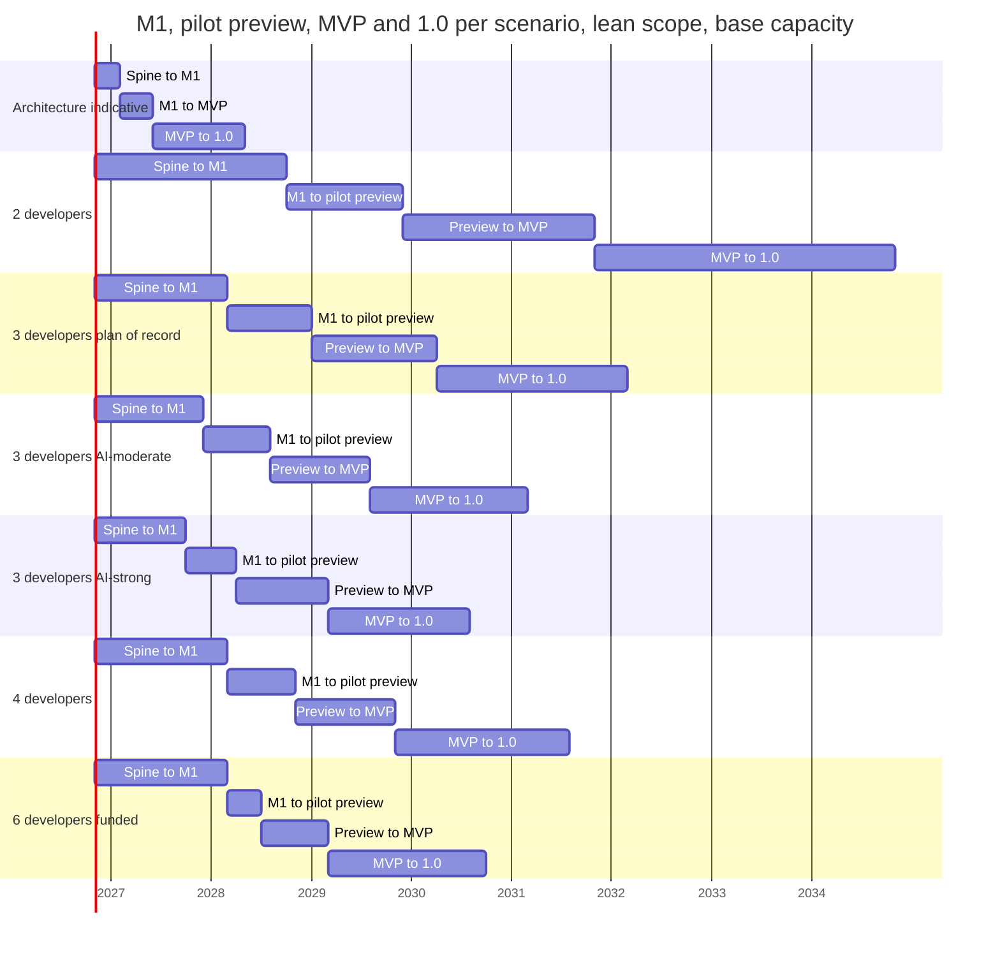
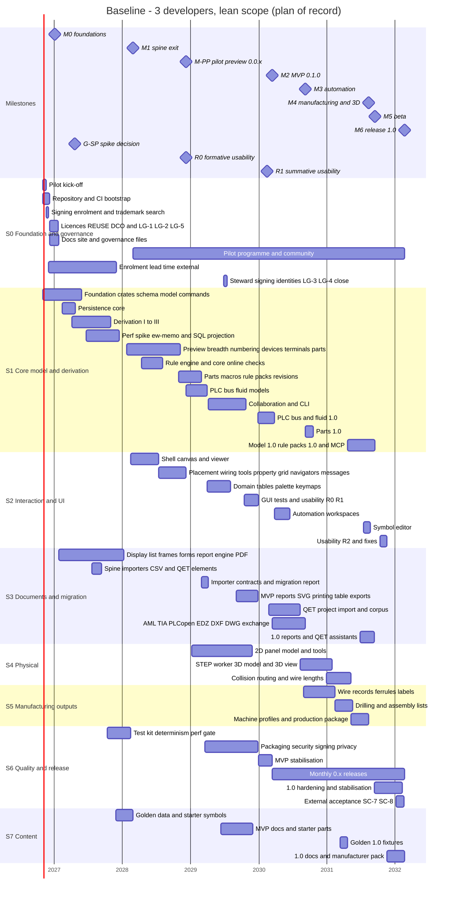

# Global plan

**Status:** Draft v0.6 · **Date:** 2026-10-21 (v0.6: the cycle-12 progress view, the M1 gap list at two fails and the cycle-13 candidates, §3.8, decision log ID-321; v0.5: the cycle-11 progress view, the M1 gap list and the cycle-12 candidates, §3.8, decision log ID-300; v0.4: the months are a human-team reference, progress is tracked in cycles, §3.8, decision log ID-271; v0.3: the G-SP re-forecast of 2026-10-20) · **Part of:** ElektraWatt plan

**Purpose.** This is the global plan of ElektraWatt (EW). It turns the [work breakdown](02-work-packages.md) (123
work packages, WPs, with three-point estimates and dependencies) into a capacity model, milestone dates for teams
of 2, 3 and 4 developers and for two AI-assisted scenarios, phases, a pilot preview, a release train, a baseline
schedule, a staffing plan, ways of working, a pilot engagement plan, a funding plan with a budget, the decisions
and their deadlines, a checklist for the first 90 days and an ordered list of descoping options. It fixes the
calendar that the design documents leave to the plan ([vision](../design/00-vision-and-scope.md) §9,
[architecture](../design/04-architecture.md) §15.2, [golden project](../design/20-golden-project.md) §22,
[quality](../design/18-quality-security-release.md) §13.1). Every effort figure and date in a table below is
generated from [work-packages.csv](work-packages.csv) by the scripts in [tools/](tools/) (Appendix A); the same runs
write [milestones.csv](milestones.csv) and [wp-schedule.csv](wp-schedule.csv), which the other plan documents cite.

---

## Summary for decision makers

**Read the months as a human-team reference (2026-10-20, decision log ID-271).** Every month, date and
critical-path figure below models a team of 2–4 human developers. EW is built in AI-driven implementation cycles in
which a work package lands every few hours, so these figures are not its forecast. The plan of record tracks
progress by content and in cycles: §3.8 lists, per milestone, the work packages and follow-up tasks still open
against the observed throughput of about 2–3 work packages per cycle (after cycle 10: the technical part of M0 is
done, G-SP is passed with the outcome Recycle, and 16 of the 22 M1 work packages are delivered in whole or in large
part). The WBS, the estimates, the gates and the acceptance criteria are unchanged.

<!-- generated:summary-headline -->
**The headline.** The full v1 scope is **532.4 person-weeks** (pw) of estimated work, **638.8 pw** with the 20 % integration and bug-fix reserve: 14.8 productive developer-years, 17.7 with the reserve. The lean scope of record is 477.5 pw (572.9 pw with the reserve). Three developers deliver 108 productive pw a year. **The architecture's indicative 15–18 months to 1.0 cannot be met by 2–4 developers.** With three developers, month 16 is when the spine exits (headless golden PDF, M1). No team size reaches 1.0 in 18 months, because the longest dependency chain alone takes 28.5 months.
<!-- /generated:summary-headline -->

**Plan of record (proposed): three developers, lean scope.** Month *n* counts from 2026-11-01 and is labelled
with the calendar month in which it ends. The conservative baseline is the plan of record for every **external**
commitment (pilot, funders, community). The AI-moderate scenario is the **internal** target the team plans its
iterations against. At G-M1 both are replaced by one re-baseline from the measured velocity (§3.7).

<!-- generated:summary-dates -->
| Scenario | M1 spine exit | M-PP pilot preview 0.0.x | M2 MVP 0.1.0 | M6 release 1.0 |
|---|---|---|---|---|
| **3 developers, lean scope: plan of record, external commitments** | **16 (Feb 2028)** | **26 (Dec 2028)** | **41 (Mar 2030)** | **64 (Feb 2032)** |
| Same, capacity −20 % / +20 % | 20 (Jun 2028) / 14 (Dec 2027) | 32 (Jun 2029) / 22 (Aug 2028) | 51 (Jan 2031) / 34 (Aug 2029) | 80 (Jun 2033) / 54 (Apr 2031) |
| **3 developers + AI-moderate, lean scope: internal target** | **13 (Nov 2027)** | **21 (Jul 2028)** | **33 (Jul 2029)** | **52 (Feb 2031)** |
| 3 developers + AI-strong, lean scope (upside, not planned) | 11 (Sep 2027) | 17 (Mar 2028) | 28 (Feb 2029) | 45 (Jul 2030) |
| 3 developers, full scope (if PD-1 rejects the levers) | 16 (Feb 2028) | 26 (Dec 2028) | 44 (Jun 2030) | 72 (Oct 2032) |
| 4 developers (fourth from month 4), lean scope | 16 (Feb 2028) | 24 (Oct 2028) | 36 (Oct 2029) | 57 (Jul 2031) |
| 2 developers, lean scope | 23 (Sep 2028) | 37 (Nov 2029) | 60 (Oct 2031) | 96 (Oct 2034) |
| 6 developers (funded growth, outside the 2–4 decision), lean scope | 16 (Feb 2028) | 20 (Jun 2028) | 28 (Feb 2029) | 47 (Sep 2030) |
<!-- /generated:summary-dates -->

**"Lean"** applies the three scope levers of the [work breakdown](02-work-packages.md#7-scope-levers), recorded per
WP in the `milestone_lean` and `lever` columns of the CSV: (a) the MVP's Should and Could WPs move to 1.0; (b) QET
project migration ships in the 0.x release after the MVP, so the pilot switches for *new* projects first; (c) 13
WPs that are not among the four binding v1 additions move to 1.x (thermal, project translations, revision compare,
the forms editor, model views and busbars, checklists, the wiring viewer, the full symbol libraries and others).
PLC/I-O, manufacturing outputs, 3D panel layout with routing and wire lengths, and QET/EDZ/DXF import all stay in
1.0.

**New: a pilot preview (M-PP, release 0.0.x).** The long wait for the MVP is the top adoption risk (R-067, R-068).
M-PP is the smallest slice that lets the pilot draw *new* projects like the reference set: interactive 2D
schematic editing with the starter symbols, terminals and cables, title block, core reports, PDF with links and
bookmarks, core online checks, save and load (§5.3). It is an unsigned build for the pilot only, ten months after
M1 and 15 months before the MVP in the baseline. Its light gate G-PP asks one thing: the pilot completes golden
folios 101–103 and 901 interactively.

**What moves the dates.**

<!-- generated:summary-movers -->
| Change against the plan of record (M-PP 26, M2 41, M6 64) | M-PP month (change) | M2 month (change) | M6 month (change) |
|---|---|---|---|
| AI-moderate (internal target, §3.7) | 21 (−5) | 33 (−8) | 52 (−12) |
| Fourth developer from month 4 (§10.3) | 24 (−2) | 36 (−5) | 57 (−7) |
| Effort +10 % (estimates optimistic) | 28 (+2) | 45 (+4) | 71 (+7) |
| Capacity −20 % | 32 (+6) | 51 (+10) | 80 (+16) |
| Third developer joins at month 6 | 27 (+1) | 43 (+2) | 66 (+2) |
| Strict stream silos instead of the pull rule (§10.2) | 38 (+12) | 58 (+17) | 76 (+12) |
| Full scope instead of the levers (PD-1) | 26 (±0) | 44 (+3) | 72 (+8) |
<!-- /generated:summary-movers -->

- **Measured velocity decides.** The estimates are judgement. Actuals logged from the first commit re-scale the plan
  at G-M1 (§3.7, §11.2). The AI-assisted scenarios are hypotheses with weak evidence (§3.7); the plan commits to
  them nowhere outside the team.
- **A fourth developer, early,** brings the MVP and 1.0 forward but not the preview, which is bound by the UI chain
  after M1 (§10.3).
- **Generalists, not silos.** Stream owners own design and review; whoever is free pulls the next ready WP (§10.2).
- **Legal gates and lead times.** No signed release without the employer statement (LG-1), the steward and its
  signing identity (LG-4). Signing enrolment takes at least 12 months of calendar time, so it starts in the first
  90 days (WP-S0.05a) and the plan models the wait (§9.2 rule 5).

**Decisions needed now (M0, November 2026)** (§14): PD-1 adopt the plan of record and the AI-moderate internal
target; PD-2 confirm lever (b) and PD-14 the M-PP scope with the pilot in the pre-G-M0 workshop; PD-3 decide on
the fourth developer and its funding by month 2; PD-4 and PD-5 settle ADR-0027 (grid) and ADR-0028 (fonts); PD-7a
name the phase-1 identity holder so that signing enrolment starts; have LG-1 and LG-5 signed; the employer files
the WBSO application; the first NLnet proposal goes to the first call.

**What the pilot gets** (plan of record):

<!-- generated:pilot-timeline -->
| Month (plan of record) | Milestone or event | What the pilot gets |
|---|---|---|
| 16 (Feb 2028) | M1 | The reference set as a PDF generated from the model; nightly `ew` CLI builds |
| 26 (Dec 2028) | M-PP, release 0.0.x | **Pilot preview**: draws new projects interactively (place, wire, terminals, cables, title block, core reports, PDF, online checks, save and load); unsigned, pilot only |
| 26 (Dec 2028) | R0 | Formative usability round on the preview build |
| 40 (Feb 2030) | R1 | Summative usability round on the MVP release candidate |
| 41 (Mar 2030) | M2, release 0.1.0 | Signed release for new projects on three OSes |
| 46 (Aug 2030) | release 0.6.0 | Migration of existing QET projects (lever b) |
| 64 (Feb 2032) | M6, release 1.0 | PLC exchange, 3D layout, wire lengths and machine files |
<!-- /generated:pilot-timeline -->

**Budget.** With the illustrative loaded cost of €100k per developer-year, the baseline costs about €1.7 million
gross to 1.0, about €1.3 million after the WBSO offset; staff is about nine tenths of it (§13.5). All amounts are
estimates to verify.

**Top schedule risks** (§9.3): optimistic estimates; capacity below 36 pw per developer-year; loss of a key
developer; specialisation; and the wait for the first release, which M-PP now shortens for the pilot.

---

**Contents**
1. [Planning basis and assumptions](#1-planning-basis-and-assumptions)
2. [Capacity model](#2-capacity-model)
3. [Effort versus capacity](#3-effort-versus-capacity)
4. [Phases](#4-phases)
5. [Milestones and gates](#5-milestones-and-gates)
6. [Release train](#6-release-train)
7. [Baseline schedule: three developers](#7-baseline-schedule-three-developers)
8. [Streams and dependencies](#8-streams-and-dependencies)
9. [Critical path and schedule risks](#9-critical-path-and-schedule-risks)
10. [Staffing plan](#10-staffing-plan)
11. [Ways of working](#11-ways-of-working)
12. [Pilot-user engagement](#12-pilot-user-engagement)
13. [Funding plan](#13-funding-plan)
14. [Decisions and deadlines](#14-decisions-and-deadlines)
15. [The first 90 days](#15-the-first-90-days)
16. [Descoping options if behind schedule](#16-descoping-options-if-behind-schedule)
17. [Appendix A: the planning tools](#appendix-a-the-planning-tools)
18. [Sources](#sources)
19. [Open questions](#open-questions)

---

## 1. Planning basis and assumptions

### 1.1 Inputs

| Input | What the plan takes from it |
|---|---|
| [Work breakdown](02-work-packages.md) and [work-packages.csv](work-packages.csv) | 123 WPs in streams S0–S7: estimates, dependencies and external lead times, full-scope and lean milestones, levers, owner roles, the critical path |
| [Vision and scope](../design/00-vision-and-scope.md) §3.2, §9, §10 | Success criteria SC-1 … SC-13; the MVP, 1.0, 1.x and Later targets per capability area; constraints K-1 … K-7 |
| [Architecture](../design/04-architecture.md) §15, §16 | The two-lane spine, streams S1–S4, the indicative months, the risk list |
| Requirement catalogues [02a](../design/02a-requirements-core.md), [02b](../design/02b-requirements-extended.md), [02c](../design/02c-nonfunctional-requirements.md) | Through the WBS: every MVP, 1.0 and 1.x row is named by a WP ([WBS](02-work-packages.md#8-requirement-coverage) §8) |
| [Golden project](../design/20-golden-project.md) §21, §22 | Acceptance criteria AC-01 … AC-42 and their gates; defect regression tests D-01 … D-42 |
| [Quality, security and release](../design/18-quality-security-release.md) §6, §7, §13 | Upgrade train, versions and cadence, format window, release checklist, CRA dates |
| [Open-source governance](../design/19-open-source-governance.md) §2.5, §3.3, §3.4, §3.9, §3.10 | Roles, legal gates LG-1 … LG-6, decision-making, funding sources, steward options |
| [UX and UI](../design/16-ux-ui.md) §19 | Usability rounds R0, R1 and R2, tasks T1–T11, the pilot log |
| Scope tables of the feature documents [05](../design/05-project-format-and-persistence.md) … [17](../design/17-extensibility.md) | Through the WBS WPs |
| ADRs [0007](../adr/0007-explicit-connections-and-autoconnect.md), [0025](../adr/0025-gpl-plugin-exception-wording.md), [0027](../adr/0027-native-symbol-grid-and-qet-grid-policy.md) … [0030](../adr/0030-legal-steward-cra-role-support-signing.md) | Decisions with deadlines (§14) |
| [OSS landscape](../research/oss-landscape.md) §8.4 | Funding sources: WBSO, NLnet NGI Zero, sponsors |
| [CLAUDE.md](../../CLAUDE.md) | The AI model-routing policy (Opus lead, Sonnet workers, Haiku for mechanical work) behind the AI-assisted scenarios |

### 1.2 Assumptions

| ID | Assumption | Value used | Source |
|---|---|---|---|
| GA-1 | **Start and calendar** | Month 0 = 2026-11-01. Month *n* is the point *n* months later, labelled with the calendar month that ends there: month 15 = end of January 2028. "Joins at month 4" means from 2027-03-01 | WBS PA-1 |
| GA-2 | **Team** | Baseline 3 developers from month 0; scenarios 2 and 4. In the 4-developer scenario the fourth developer joins at month 4 and the team works at 90 % efficiency **from that month** because of coordination; before it the three work at 100 %. Teams beyond four work at 85 % from the last join. One model in every table and every plan document | WBS PA-2 |
| GA-3 | **Capacity** | **36 productive pw per developer-year** (§2.1): 0.69 pw per calendar week, 3 pw per month. Sensitivity **±20 %** (28.8 and 43.2 pw) | WBS PA-3 |
| GA-4 | **Estimates** | Three points per WP; PERT mean = (O + 4L + P) / 6. An estimate contains design note, code, tests, review, crate docs and CI wiring; user docs, release engineering and pilot work are their own WPs | WBS PA-5, PA-6 |
| GA-5 | **AI assistance in the estimates** | Helps with boilerplate, parsers, test scaffolding and drafting, and is already counted: the likely values are 10–20 % below unassisted work. The estimates do **not** assume a throughput multiplier | WBS PA-7 |
| GA-6 | **Reserve** | 20 % integration, hardening and bug-fix reserve on every WP, plus two stabilisation WPs (WP-S6.08, WP-S6.12). The reserve is never spent on new scope | WBS PA-8 |
| GA-7 | **Schedule model** | Resource-constrained list scheduling with generalist developers and lagged dependencies for external lead times ([tools/engine.py](tools/engine.py), Appendix A). Accuracy about ±1 month | WBS PA-9 |
| GA-8 | **Committed dates** | The baseline dates at base capacity are the external plan of record; the ±20 % band is what we communicate externally. The AI-moderate dates are the internal target only. Each gate review replaces both with a re-forecast from actuals (§3.7, §11.2) | This plan |
| GA-9 | **Scope of record** | Lean scope (levers a, b and c; the `milestone_lean` column) pending PD-1; full-scope dates (the `milestone` column) are kept alongside so that PD-1 can be taken either way | WBS §7.4 |
| GA-10 | **Releases** | No public binary release before the MVP: until then only nightlies labelled "unsigned development build" exist ([governance](../design/19-open-source-governance.md#33-legal-and-organisational-gates) §3.3). The pilot preview 0.0.x is such a build, handed to the pilot only. Monthly 0.x releases from the MVP to 1.0 | 19 §3.3, 18 §7.1 |
| GA-11 | **CRA** | Full application from 2027-12-11, which is month 14. Every public release in every scenario ships under full application, so steward-grade processes (WP-S6.04, WP-S0.05) are MVP exit conditions | 18 §13.1 |
| GA-12 | **Money, not pw** | Counsel, notary, trademark fees, signing, CI, test hardware, test participants, partner-shop time and AI tooling are paid, not estimated in pw (§13.4, §13.5) | WBS PA-10 |
| GA-13 | **Background load** | Routine support, triage, meetings and the quarterly upgrade train are inside the GA-3 deduction; planned pilot and community deliverables are in WP-S0.08 and WP-S0.09 | WBS PA-11 |
| GA-14 | **AI-assisted scenarios** | Development work in S1–S7 is divided by 1.4 (AI-moderate) or 1.8 (AI-strong); S0, people-bound WPs and the review and decision share of each WP are not accelerated; the reserve still applies (§3.7) | This plan; CLAUDE.md |

### 1.3 Relation to the WBS figures

Both documents take their numbers from the same scripts and the same CSV, so they cannot disagree: `schedule.py
--check` and `totals.py --check` fail if a generated table in either document is stale (Appendix A). The 4-developer
model of GA-2 replaces the "90 % for the whole period" variant of the first draft; the 4-developer dates in all
plan documents follow it.

---

## 2. Capacity model

### 2.1 From a calendar year to 36 productive person-weeks

| Item | Weeks per developer-year | Note |
|---|---|---|
| Calendar | 52.0 | |
| Leave and public holidays | −6.5 | About 25 days of leave plus Dutch public holidays |
| Illness and training | −1.5 | |
| **Working weeks** | **44.0** | |
| Team rituals | −3.5 | Iteration planning, demos, retrospectives, gate reviews, plan reviews (§11) |
| Routine support and triage | −2.5 | Pilot questions, bug reports, community questions; not the planned pilot WPs |
| Upkeep outside WPs | −2.0 | Quarterly upgrade train, CI care, security advisories, governance chores |
| **Productive pw** | **36.0** | 82 % of working weeks; 0.69 pw per calendar week; 3 pw per month |

Code review of other people's work is inside each WP's estimate (GA-4), not in this deduction. A WP of 1 pw takes
one developer about 1.5 calendar weeks, 1.7 with the reserve.

### 2.2 Team scenarios

<!-- generated:team-scenarios -->
| Scenario | Developers | Efficiency | pw per month | pw per year (steady state) | pw in 15 months | pw in 18 months |
|---|---|---|---|---|---|---|
| 2 developers | 2 from month 0 | 100 % | 6.0 | 72 | 90 | 108 |
| **3 developers (baseline)** | 3 from month 0 | 100 % | 9.0 | 108 | 135 | 162 |
| 4 developers | 3 from month 0, 1 from month 4 | 90 % from month 4 | 9.0, then 10.8 | 130 | 155 | 187 |
| 6 developers (funded growth, for comparison) | 3 from month 0, 1 from month 4, 2 from month 6 | 85 % from month 6 | 9.0, then 12.0, then 15.3 | 184 | 198 | 244 |
<!-- /generated:team-scenarios -->

### 2.3 Sensitivity

| Case | pw per developer-year | 3-developer team per month | Typical cause |
|---|---|---|---|
| −20 % | 28.8 | 7.2 | Heavy pilot or community support, illness, a developer partly on other company work |
| Base | 36.0 | 9.0 | GA-3 |
| +20 % | 43.2 | 10.8 | Fewer interruptions |

The ±20 % band also stands in for correlated estimation error (a team slower or faster on every WP), which the
PERT σ of independent WPs does not capture (WBS PA-5). AI acceleration is modelled separately (§3.7), because it
does not act on S0 work, people-bound WPs or the review share of each WP.

---

## 3. Effort versus capacity

### 3.1 What the effort contains

Lean scope to 1.0, PERT means in pw:

<!-- generated:effort-parts -->
| Part | pw | Share | Contains |
|---|---|---|---|
| Feature work, streams S1–S5 | 368.6 | 77.2 % | Core model and derivation, UI, documents and migration, physical, manufacturing |
| Quality, security and release engineering, S6 | 54.7 | 11.4 % | Test kit, perf gate, fuzzing, privacy, packaging, signing, SBOM, CRA; release engineering and stabilisation 33.3 pw (WP-S6.06 … WP-S6.10, WP-S6.12) |
| Content and documentation, S7 | 28.3 | 5.9 % | Golden data, starter symbols and parts, user documentation and tutorials |
| Foundation, governance, pilot and community, S0 | 25.9 | 5.4 % | Repository, licences, legal gates, signing enrolment, docs site, funding, pilot programme |
| **Subtotal** | **477.5** | **100 %** |  |
| Integration, hardening and bug-fix reserve (20 %) | 95.5 |  | GA-6 |
| **Total to 1.0** | **572.9** |  |  |

Cross-cutting lines inside these totals: documentation 13.8 pw (WP-S0.06, WP-S7.05, WP-S7.07, plus the crate docs inside every WP); pilot, usability and external acceptance 20.7 pw (WP-S0.08, WP-S0.09, WP-S2.12, WP-S2.16, WP-S6.11).
<!-- /generated:effort-parts -->

### 3.2 Effort per scope option

<!-- generated:effort-scope -->
| Scope | M-PP (PERT) | M-PP with reserve | MVP (PERT) | MVP with reserve | 1.0 (PERT) | 1.0 with reserve | 1.x backlog (PERT) |
|---|---|---|---|---|---|---|---|
| Full scope | 179.8 | 215.8 | 312.5 | 375.0 | 532.4 | 638.8 | 43.5 |
| **Lean: levers (a), (b) and (c) — plan of record** | **179.8** | **215.8** | **290.8** | **348.9** | **477.5** | **572.9** | **98.4** |
<!-- /generated:effort-scope -->

Levers (a) and (b) move work from the MVP into the 1.0 releases; only lever (c) removes work from 1.0. M-PP is a
subset of the MVP in both scopes, so it is the same in both.

### 3.3 Capacity bound versus simulated dates

The capacity bound is the month at which the team has delivered the effort with perfect parallelism. The simulated
month adds the dependencies, the lead times and the one-owner-per-WP rule.

<!-- generated:capacity-bound -->
| Team | Lean M-PP: bound / simulated | Lean MVP: bound / simulated | Lean 1.0: bound / simulated | Full M-PP: bound / simulated | Full MVP: bound / simulated | Full 1.0: bound / simulated |
|---|---|---|---|---|---|---|
| 2 developers | 36.0 / 37 | 58.2 / 60 | 95.5 / 96 | 36.0 / 37 | 62.5 / 64 | 106.5 / 107 |
| 3 developers | 24.0 / 26 | 38.8 / 41 | 63.7 / 64 | 24.0 / 26 | 41.7 / 44 | 71.0 / 72 |
| 4 developers (fourth from month 4) | 20.6 / 24 | 33.0 / 36 | 53.7 / 57 | 20.6 / 23 | 35.4 / 38 | 59.8 / 61 |
<!-- /generated:capacity-bound -->

**Reading it.** For the MVP and 1.0 the simulated dates are within a few months of the capacity bound: the team
is almost fully used, so the end dates follow effort ÷ capacity, and with three developers every 9 pw of extra work
before a milestone moves it by about a month. M-PP is different: it is bound by the UI chain after M1
(WP-S2.01 → WP-S2.03 → WP-S2.04), which a fourth developer cannot shorten.

### 3.4 Milestone dates per scenario

G-SP is the performance-spike decision, which needs `ew-model` (WP-S1.03) and is not a milestone (§9.2 rule 2).

*Human-team reference (decision log ID-271).* The months in the tables of this section and of §3.5 to §3.7 are
those of a human team of the size in each row; they are not the forecast of the AI-driven cycles, whose progress
view is §3.8. The tables are generated by `schedule.py` and kept for the funding plan, the descoping ladder and
any hand-over to a human team.

**Lean scope (plan of record), base capacity.**

<!-- generated:dates-lean -->
| Team | M0 | G-SP spike | M1 | M-PP 0.0.x | M2 MVP | M3 | M4 | M5 beta | M6 1.0 |
|---|---|---|---|---|---|---|---|---|---|
| 2 developers | 3 (Jan 2027) | 7 (May 2027) | 23 (Sep 2028) | 37 (Nov 2029) | 60 (Oct 2031) | 70 (Aug 2032) | 84 (Oct 2033) | 88 (Feb 2034) | 96 (Oct 2034) |
| **3 developers** | **3 (Jan 2027)** | **6 (Apr 2027)** | **16 (Feb 2028)** | **26 (Dec 2028)** | **41 (Mar 2030)** | **47 (Sep 2030)** | **58 (Aug 2031)** | **59 (Sep 2031)** | **64 (Feb 2032)** |
| 4 developers (fourth from month 4) | 3 (Jan 2027) | 6 (Apr 2027) | 16 (Feb 2028) | 24 (Oct 2028) | 36 (Oct 2029) | 40 (Feb 2030) | 52 (Feb 2031) | 52 (Feb 2031) | 57 (Jul 2031) |
<!-- /generated:dates-lean -->

**Full scope (if PD-1 rejects the levers), base capacity.**

<!-- generated:dates-full -->
| Team | M0 | G-SP spike | M1 | M-PP 0.0.x | M2 MVP | M3 | M4 | M5 beta | M6 1.0 |
|---|---|---|---|---|---|---|---|---|---|
| 2 developers | 3 (Jan 2027) | 7 (May 2027) | 23 (Sep 2028) | 37 (Nov 2029) | 64 (Feb 2032) | 72 (Oct 2032) | 87 (Jan 2034) | 99 (Jan 2035) | 107 (Sep 2035) |
| 3 developers | 3 (Jan 2027) | 6 (Apr 2027) | 16 (Feb 2028) | 26 (Dec 2028) | 44 (Jun 2030) | 48 (Oct 2030) | 60 (Oct 2031) | 66 (Apr 2032) | 72 (Oct 2032) |
| 4 developers (fourth from month 4) | 3 (Jan 2027) | 6 (Apr 2027) | 16 (Feb 2028) | 23 (Sep 2028) | 38 (Dec 2029) | 42 (Apr 2030) | 51 (Jan 2031) | 56 (Jun 2031) | 61 (Nov 2031) |
<!-- /generated:dates-full -->

With the lean scope, M5 falls one month after M4 (3 developers) or in the same month (4 developers), because lever
(c) empties most of M5. The two gate reviews can then be held together (open question 6).

### 3.5 Sensitivity and best case

M2 and M6 at 80 %, 100 % and 120 % of GA-3 capacity. "Best case" sets every WP to its optimistic estimate **and**
uses 120 % capacity.

<!-- generated:sensitivity -->
| Team | Scope | M2 at −20 % | M2 base | M2 at +20 % | M6 at −20 % | M6 base | M6 at +20 % | Best case M2 / M6 |
|---|---|---|---|---|---|---|---|---|
| 2 | Lean | 74 (Dec 2032) | 60 (Oct 2031) | 50 (Dec 2030) | 120 (Oct 2036) | 96 (Oct 2034) | 80 (Jun 2033) | 33 / 53 |
| **3** | **Lean** | **51 (Jan 2031)** | **41 (Mar 2030)** | **34 (Aug 2029)** | **80 (Jun 2033)** | **64 (Feb 2032)** | **54 (Apr 2031)** | **23 / 36** |
| 4 | Lean | 45 (Jul 2030) | 36 (Oct 2029) | 30 (Apr 2029) | 72 (Oct 2032) | 57 (Jul 2031) | 48 (Oct 2030) | 21 / 32 |
| 2 | Full | 80 (Jun 2033) | 64 (Feb 2032) | 53 (Mar 2031) | 134 (Dec 2037) | 107 (Sep 2035) | 89 (Mar 2034) | 35 / 59 |
| 3 | Full | 55 (May 2031) | 44 (Jun 2030) | 37 (Nov 2029) | 89 (Mar 2034) | 72 (Oct 2032) | 60 (Oct 2031) | 25 / 40 |
| 4 | Full | 47 (Sep 2030) | 38 (Dec 2029) | 32 (Jun 2029) | 76 (Feb 2033) | 61 (Nov 2031) | 51 (Jan 2031) | 22 / 35 |
<!-- /generated:sensitivity -->

### 3.6 Can v1 fit 15–18 months?

**No.** Three developers have 135–162 pw in 15–18 months; lean 1.0 needs more than 560 pw with the reserve, 3.5–4.2
times as much. Even the best case (optimistic estimates on every WP and 20 % more capacity) or the AI-strong
scenario puts the lean 1.0 years beyond month 18. With unlimited developers, the longest dependency chain still
takes more than 28 months (§9.1), and the WBS shows what ten developers would reach
([WBS](02-work-packages.md#54-what-the-indicative-dates-would-take) §5.4). The indicative dates assumed roughly one
week per crate-level component; the WBS estimates three to six.

<!-- generated:gantt-teams -->

<!-- /generated:gantt-teams -->

What *can* be done honestly within 15–18 months with three developers: M0 at month 3 and M1 (headless golden PDF,
the format crates and the `ew` CLI core) at month 16, i.e. the open format and the derivation engine, proven on the
reference set.

### 3.7 AI-assisted scenarios

The team will implement much of EW with Claude subagents under the model-routing policy of
[CLAUDE.md](../../CLAUDE.md): an Opus lead turns open questions into closed specifications, Sonnet workers implement
specified commands, importers, reports, panels and tests, and Haiku does mechanical work (scaffolding, renames,
fixtures, licence headers). Two scenarios bound what that may do to the dates.

**Model.** For every WP of streams S1–S7, 25 % of the estimate is review, design decision and verification against
the golden project; it is not accelerated. The other 75 % is development work and is divided by **1.4
(AI-moderate)** or **1.8 (AI-strong)**. Not accelerated at all: S0 (governance, legal gates, funding, pilot
programme) and the people-bound WPs WP-S2.12 and WP-S2.16 (usability rounds), WP-S6.09 (release operations) and
WP-S6.11 (external acceptance). The capacity deductions of §2.1 (rituals, support, upkeep) stay as they are. The
20 % reserve applies to the reduced effort. The factors act on the WBS estimates, which already contain today's
level of assistance (GA-5).

<!-- generated:ai-scenarios -->
| Scenario (3 developers, lean scope) | Effort to 1.0 with reserve (pw) | Equivalent velocity ratio | M1 | M-PP 0.0.x | M2 MVP 0.1.0 | M6 1.0 |
|---|---|---|---|---|---|---|
| Baseline: conservative estimates (plan of record, external) | 573 | 1.00 | 16 (Feb 2028) | 26 (Dec 2028) | 41 (Mar 2030) | 64 (Feb 2032) |
| AI-moderate: development × 1/1.4 (internal target) | 460 | 1.24 | 13 (Nov 2027) | 21 (Jul 2028) | 33 (Jul 2029) | 52 (Feb 2031) |
| AI-strong: development × 1/1.8 (upside) | 398 | 1.44 | 11 (Sep 2027) | 17 (Mar 2028) | 28 (Feb 2029) | 45 (Jul 2030) |
| AI-moderate with capacity −20 % | 460 | 1.24 | 16 (Feb 2028) | 26 (Dec 2028) | 41 (Mar 2030) | 65 (Mar 2032) |
<!-- /generated:ai-scenarios -->

"Equivalent velocity ratio" is the baseline effort divided by the scenario's effort: the ratio the G-M1 measurement
would have to show for the scenario to be true.

**How the plan uses them.**
- **External commitments** (pilot, funders, community, `ROADMAP.md`) use the conservative baseline and its ±20 %
  band until G-M1.
- **Internal target.** Iterations and the monthly forecast are planned against AI-moderate. A gap between target
  and baseline is expected and is not a slip.
- **Re-baseline rule at G-M1.** Measure the velocity ratio over the spine WPs (estimated pw of finished WPs ÷
  actual pw, [gates](03-gates.md) §4.2), clamped to 0.6–1.5. Re-run the scheduler with every remaining estimate
  divided by the measured ratio; the AI scenarios then retire, because the measurement contains whatever the AI
  workflow delivers. The result becomes the single plan of record, and its capacity −20 % case becomes the external
  outer date. In the gates' velocity zones: a ratio of 0.9 or more is green (re-baseline at the measured ratio); a
  ratio of about 1.25 or more confirms AI-moderate; below 0.9 the amber and red reactions of the gates apply. A
  ratio above 1.25 moves external dates earlier only after G-M2 confirms it on non-spine work.
- **AI-moderate is not a buffer.** The table shows that AI-moderate with 20 % less capacity lands on the baseline:
  the conservative baseline is what the team gets if the AI effect is real but the team is interrupted more than
  planned, or if the effect is small.

**The evidence gap.** The published evidence does not support a planning factor, only a range of hypotheses
(**verify** each source before citing it externally):
- A controlled experiment with GitHub Copilot found a self-contained JavaScript task finished about 56 % faster
  (Peng et al., 2023). Greenfield toy tasks are the best case for code completion.
- Field experiments at large companies reported roughly a quarter more completed tasks with an assistant (Cui et
  al., 2024–2025), with large variation between developers.
- A randomised trial with experienced open-source developers on their own mature repositories found them about 19 %
  **slower** with early-2025 tools, while they believed they were faster (METR, 2025).
- We know of no controlled study of agentic multi-agent workflows (lead and worker models with closed
  specifications) on domain-heavy, standards-bound and safety-relevant software such as an ECAD core. The
  routing policy is designed for this case, but it is untested here.

The factors 1.4 and 1.8 are therefore planning inputs chosen by the project, not measurements. The spine is the
first measurement, and the time logs of §11.2 record AI-assisted and unassisted work separately so that G-M1 can
tell the AI effect from estimation error.

### 3.8 Cycle-based progress view (plan of record since 2026-10-20)

*Decision log ID-271 (project owner, delegated).* EW is built in **implementation cycles** by AI agents under the
routing policy of [CLAUDE.md](../../CLAUDE.md): a cycle dispatches two or three lanes, has each reviewed
independently, fixes the findings, records the decisions in a design pass and integrates once; a work package lands
every few hours, not every few weeks. The capacity model of §2 (36 productive pw per developer-year) and the months
of §3.4 to §3.7 and §9 do not describe that pace. They are kept as the **reference of a human-team scenario**: what
the same scope costs a team of 2–4 developers, which the funding plan (§13), the descoping ladder (§16) and any
hand-over to a human team still need. They are not this project's forecast, and the cycle-8 re-baseline "M1 from
month 15 to 16" (decision log ID-225) is a statement about that reference only. The plan of record measures
progress **by content**: a milestone is reached when its work packages, the follow-up tasks due before its gate and
its gate items are done, whatever the date. WBS, estimates, gates and acceptance criteria are unchanged; the
estimates in pw stay the measure of size and of the velocity ratio of §3.7.

**Observed throughput.** Cycles 1 to 12 (2026-10-18 to 2026-10-21) delivered the two technical M0 work packages
and 17 of the 22 M1 work packages in whole or in large part, about 28 deliveries when a work package delivered in
parts (WP-S1.05, WP-S1.07, WP-S3.03, WP-S3.05, WP-S6.01, WP-S7.01) counts each part, plus the QET project import
spike pulled forward from M3, Golden C's migration report and the first `ew-checks` rule packs (WP-S1.15 and WP-S1.16a scope) in cycle 12: roughly **2–3 work packages per cycle**, plus the follow-up tasks of each review (208 recorded, 46 closed; Appendix B of the
[work breakdown](02-work-packages.md#appendix-b-follow-up-tasks-from-the-implementation-cycles)). Owner-side items
(legal gates, enrolments, pilot answers, approvals of goldens and downloads) do not follow the cycle pace; they are
listed separately because they, not the agents' throughput, bound the gates.

| Milestone or gate | Work packages (lean) | Content-based status (2026-10-21, after cycle 12) | Remaining |
|---|---|---|---|
| **M0** Foundations | 4 | Technical part delivered: WP-S0.01 (workspace and CI on three OSes, green again after the cycle-9 repair, decision log ID-270) and WP-S0.02 (licensing, REUSE, licence-boundary check). The grid and font defaults are in force (ID-1, ID-2) | Owner side: WP-S0.05a (signing enrolment, trademark search), WP-S0.08 (pilot kick-off, PD-1, PD-3, PD-14), LG-5, ADR-0027 and ADR-0028 acceptance, the repository settings (branch protection, the CI denylist hashes); gate G-M0 not held |
| **G-SP** Performance spike | — | Held 2026-10-20 in cycle 8: **passed with the outcome Recycle** (ADR-0002 amendment 4). The recycle's engine and incremental connectivity are delivered in cycles 9 and 10 (WP-S1.07 parts 1 and 2, ADR-0002 amendments 5 and 6) | The re-test on a BM-class runner (DEC-034), with the memory measurements at XL (FT-114) and FT-26 (the composite bench family and the growth test were delivered in the cycle-10 fix round); S within budget first, because the pilot's size data (received 2026-10-20, G-SP-08 closed) puts all its projects in class S |
| **M1** Spine exit | 22 | Delivered with open follow-up tasks: WP-S1.01 to WP-S1.04, WP-S1.06 to WP-S1.09, WP-S3.01 to WP-S3.05, WP-S7.02; WP-S1.05 (engine and instruments; the re-test above is open); WP-S7.01 for Golden A (tables, expected rows, 34 of the 36 pages, the 27-row parts list, the cover tables, part data on 101 and 102), Golden B (two command logs, AC-18 headless) and Golden C (migration report and fix script, gated at G-M3; ID-302); WP-S6.01's acceptance runner (`cargo xtask acceptance`, 83 entries: 51 pass, 2 fail, 24 not built, 6 not applicable; ID-320). Delivered ahead of plan: the QET project import spike (M3 scope, ID-273) and `project.settings.set` (WP-S1.11 scope, ID-290) in cycle 11; the check engine with prevent at apply and `ew check` (WP-S1.15 and WP-S1.16a scope, ID-305, ID-306, ID-309) in cycle 12. The golden PDF is generated from the model with 64 link annotations | Development: the **M1 gap list** of the runner's two fails (ID-320): the PLC overview pages 908.1/908.2 (FT-111) and the DP potential via Bus (FT-105); the not-built entries that gate M1, among them wire numbering (FT-100), the builder DSL (WP-S6.01) and the PDF text and vector checks; WP-S1.10 (SQL projection v0, which also unblocks the four SQL halves); WP-S6.02 (determinism, property tests and the command fuzzer: oracle and property tests exist, the fuzzer does not); WP-S6.03 (performance and memory gate: the harness exists, the gate does not); WP-S0.06 (documentation and website infrastructure); the open follow-up tasks due before the M1 approvals; the G-SP re-test. Owner side: WP-S0.04 (LG-1, LG-2, LG-5), the first PNG approval (FT-10), the pilot's P1 and P2 answers |
| **M-PP** Pilot preview | 14 | Not started | All 14 (the UI chain WP-S2.01 → WP-S2.03 → WP-S2.04 first, §9.2 rule 3) |
| **M2** MVP 0.1.0 | 27 | Not started | All 27; the legal and signing gates (SR-6) |
| **M3 to M6**, 1.x | 38, 18 | Not started | All |

At the observed throughput the M1 development work left after cycle 12 is about **two cycles** (an estimate from the table,
not a commitment); the owner-side items decide when G-M1 can be held. The figure is re-read after every cycle from
the table above, which the design pass of each cycle updates with the work-package statuses of the
[work breakdown](02-work-packages.md).

**The pilot's projects** (received 2026-10-20, decision log ID-272). Three of the pilot's QElectroTech projects,
held privately, have 18 to 36 folios and at most 1,445 placed elements and 718 conductors: all inside class S. The
S budgets therefore decide the pilot preview, and M to XL stay engineering margins. The pilot's drawings carry no
proper BOMs and have known layout imprecision owed to QET; ElektraWatt reproduces their content, not that style
(owner statement, 2026-10-20). Since cycle 11 the lenient project importer reads all three with no lost connection
(P1 34 folios and 1,004 devices, P2 18 and 110, P3 36 and 734; decision log ID-273), and since cycle 12 Golden C has its migration report and fix script on the reference set (ID-302); it stays gated
at G-M3 in the plan of record.

**Cycle 12 delivered** (decision log ID-301 to ID-321): Golden C's migration report and fix script, with the
grid-line nudge for printed cells; the first `ew-checks` rule packs, prevent at apply through the shipped hook,
`terminal.designate` and `ew check`; the M1 report and page gaps (revision label and TOC structure, the 27-row parts
list on 901 and 901.1, the cover tables, part data on 101 and 102). FT-15, FT-62, FT-65, FT-110 and FT-159 to
FT-162 are closed.

**Cycle 13 candidates** (decision log ID-321, in the order the lead recommends): (1) the two M1 fails: the DP
potential via Bus connections (AC-10, FT-105) and the PLC overview 908.1 and 908.2 (AC-03, FT-111); (2) wire
numbering (FT-100, AC-09 and D-09); (3) the SQL projection v0 (WP-S1.10, the four SQL halves); (4) the symbol
tickets (FT-148, FT-149); (5) the orphan-retention code of ADR-0002 amendment 7 (FT-157) and the split of
`ip_notes` and `flow_notes` (FT-125). Golden C's fix-script commands (FT-164 to FT-172) wait for G-M3.

**What stays calendar-bound.** External lead times (signing enrolment of at least 12 months, §9.2 rule 5; counsel;
trademark search), the pilot's availability and answers, the usability rounds with real participants and the
quarterly upgrade train keep their calendar logic. **External dates** (DEC-001, DEC-081) stay open: when the owner
names one, it is derived from the content still open and the owner-side lead times, not from the month tables.

---

## 4. Phases

Phases overlap: a developer who has no ready WP of the current milestone takes one of the next (Appendix A). Months
are for the plan of record (3 developers, lean scope); a phase starts with its first non-S0 WP.

<!-- generated:phases -->
| Phase | Months | Calendar | Goal | Main streams | Ends with |
|---|---|---|---|---|---|
| **P0 Foundations** | 0–3 | Nov 2026 – Jan 2027 | Repository, CI on three OSes, licences and the licence boundary, pilot kick-off, signing enrolment and trademark search started, early ADRs | S0, S6 | M0 |
| **P1 Spine** | 0–16 | Nov 2026 – Feb 2028 | Two lanes ([architecture](../design/04-architecture.md#15-spine-build-order-and-parallel-streams) §15.1): core (crates, schema, model, commands, derivation, `ew-memo`, persistence, SQL projection) and output (display list, forms, reports, CPU renderer, PDF), plus test kit and golden data | S1, S3, S6, S7 | M1 |
| **P2 Pilot preview** | 14–26 | Jan 2028 – Dec 2028 | Shell, 2D canvas, viewer, placement and wiring tools, property grid, navigators, messages; model breadth for devices, terminals, cables, numbering; rule engine and core online checks; project parts | S1, S2 | M-PP, release 0.0.x (pilot only) |
| **P3 Interactive MVP** | 24–41 | Nov 2028 – Mar 2030 | Rule packs, revisions, collaboration, parts libraries and macros; PLC, bus and fluid MVP model; domain tables, palette, keymaps; 2D panel; packaging, signing, CRA processes; R0 and R1 | S1, S2, S4, S6, S7 | M2, release 0.1.0 |
| **P4 Automation breadth and migration** | 38–47 | Jan 2030 – Sep 2030 | PLC, bus and fluid 1.0; QET project migration; AML, TIA and PLCopen exchange; EDZ; DXF/DWG | S1, S2, S3 | M3 |
| **P5 Physical and manufacturing** | 45–58 | Aug 2030 – Aug 2031 | STEP worker, 3D model and view, collision, routing, lengths; wire records, ferrules, labels, machine profiles, `.ewpp` | S4, S5 | M4 |
| **P6 Completion** | 53–59 | Apr 2031 – Sep 2031 | Model, rule-pack and report completion; deferred MVP Should items; beta | S1, S2, S3 | M5, 1.0 beta |
| **P7 Hardening and release** | 58–64 | Sep 2031 – Feb 2032 | 1.0 quality layers, R2, external acceptance (SC-7, SC-8), documentation and German, format freeze, stabilisation | S6, S2, S7 | M6, release 1.0 |
| **P8 1.x** | from 65 | from Mar 2032 | Quarterly minors with the 1.x themes (§6.4) | all | — |
<!-- /generated:phases -->

---

## 5. Milestones and gates

### 5.1 Milestone table

Milestones are cumulative: reaching M3 means every WP of M0 … M3 is done. Months per scenario are in §3.4 and
[milestones.csv](milestones.csv). The release column is for the plan of record; in other scenarios the 0.x number
is "months since M2, plus one". Gate IDs are G-M0 … G-M6 and G-PP (and G-SP for the spike decision); the acceptance
criteria are those of the [golden project](../design/20-golden-project.md#21-acceptance-criteria) §21, adjusted for
the levers. The WPs of each milestone are those of the `milestone_lean` column.

| Milestone | Content | Release | Exit gate | Key deliverables | Demo |
|---|---|---|---|---|---|
| **M0** Kick-off and foundations | Workspace and per-PR CI green on three OSes; licence files, REUSE, DCO and licence-boundary check active; pilot kick-off and the pre-G-M0 scope workshop held; ADR-0027 and ADR-0028 decided; LG-1 and LG-5 requested; signing enrolment submitted and trademark search commissioned; PD-1 taken | None (CI artefacts only) | **G-M0**: the M0 exit criteria of the [WBS](02-work-packages.md#22-milestones) §2.2 | WP-S0.01, WP-S0.02, WP-S0.05a, WP-S0.08 | A pull request that adds a GPL dependency to a permissive crate fails the boundary check on all three OSes |
| **M1** Spine exit: headless golden PDF | `ew export pdf golden/J-E-2416.ew` writes the 18 folios plus report folios 903–911 without a GUI; acceptance SQL/CSV pairs pass with the oracle on; perf gate running; two owners per critical crate; ADR-0030 decided; LG-1 and LG-2 closed | None: a signed source tag `m1`; nightly CLI builds for the pilot | **G-M1**: AC-01 … AC-13, AC-14 (Linux), AC-15 … AC-17, AC-18 (CLI), AC-20, AC-39; golden §19 rows gated M1; the velocity re-baseline (§3.7) | Spine lanes WP-S1.01 … WP-S1.10 and WP-S3.01 … WP-S3.05; WP-S6.01 … WP-S6.03; WP-S7.01, WP-S7.02; WP-S0.04, WP-S0.06 | The generated PDF beside the reference set; rename T55 and renumber folio 3 → 4 (the D-01 replay): every affected output changes in one commit, and undo restores the bytes |
| **M-PP** Pilot preview | Interactive 2D editing of new projects with the starter symbol set; core reports and PDF from the M1 stack; core online checks; save and load (§5.3) | **0.0.x**: unsigned development build, pilot only | **G-PP** (light, §5.3) | The 14 WPs of §5.3 | The pilot draws golden folios 101–103 and 901 in a new project and exports the PDF |
| **M2** MVP: pilot release | Interactive 2D editing of the reference set; core reports, PDF and SVG; checks with the pre-delivery scheme; revisions and as-built archive; 2D panel (folio 902); PLC, bus and fluid MVP model; first signed release on three OSes; R1 passed (validates ADR-0007); LG-3 and LG-4 closed; ADR-0029 decided; CRA steward processes live | **0.1.0** | **G-M2**: AC-14 (all OSes), AC-18 (GUI), AC-19, AC-21, AC-23, AC-28, AC-29, AC-31, AC-32 (MVP part), AC-33, AC-37 (SVG), AC-40, AC-41; SC-1, SC-2 (2D), SC-5 (S, M), SC-6, SC-9 (R1), SC-10 … SC-12. AC-25 … AC-27 move to G-M3 with lever (b) | The M2 WPs of the lean scope, closed by WP-S6.08 | Usability tasks T1–T5 live on Golden A; `ew check --scheme pre-delivery` exits 1 with exactly the expected findings; offline installation of the signed build on a clean Windows VM |
| **M3** Automation breadth and migration | PLC and bus 1.0; fluid 1.0; QET project migration (lever b); AML, TIA tag table and PLCopen exchange against reference files; EDZ and EPLAN parts XML; DXF and DWG; automation workspaces | 0.x (0.7.0 in the baseline) | **G-M3**: AC-25, AC-26, AC-27 (SC-4), AC-30 (reference files), AC-32 (1.0 part), AC-37 (DXF), AC-38; the EW-PLC and EW-BUS part of AC-22 | WP-S1.24, WP-S1.25, WP-S2.13, WP-S3.10, WP-S3.11, WP-S3.13, WP-S3.16, WP-S3.18, WP-S3.19 | A QET corpus project imported with its migration report; the AML of station -201U1 exported and validated; a golden part updated from an EDZ through a previewed command |
| **M4** Manufacturing and 2D/3D panel | STEP worker, 3D view, collision, routing and lengths; production wire records, ferrules, labels; Komax, Rittal and Weidmüller profiles; drilling DXF; `.ewpp` | 0.x (0.18.0 in the baseline) | **G-M4**: AC-34; AC-35 content. AC-36 (thermal) moves to 1.x with lever (c) | WP-S1.28, WP-S4.03 … WP-S4.08, WP-S5.01 … WP-S5.07, WP-S7.06 | Golden A-R in 3D without collisions; `RouteWires` commits lengths that folio 907 shows; moving -102G1 marks lengths stale; the `.ewpp` rows equal folio 907 |
| **M5** 1.0 feature complete (beta) | All 1.0 features merged; 1.0 rule packs exact; beta to the pilot and early adopters | 1.0.0-beta.1 | **G-M5**: AC-22 | WP-S1.26, WP-S1.30, WP-S3.15; lever (a) WPs WP-S1.23, WP-S2.10, WP-S3.12 | The pre-delivery check with the 1.0 packs on Golden A equals golden §18.1 plus §18.2; walkthrough of journeys J1–J6 |
| **M6** 1.0 release | Format frozen (since rc.1); R2 passed; SC-7 and SC-8 shown with real machines and installations; signed 1.0; word mark filed; LG-6 review | **1.0.0** | **G-M6**: AC-01 … AC-42 except AC-36 and AC-42 (1.x with lever c); every golden §19 row except D-40; NFR-UX-01 and NFR-UX-02 at 1.0; SC-7, SC-8; SC-13 reported | WP-S0.09, WP-S2.16, WP-S6.10, WP-S6.11, WP-S6.12, WP-S7.07, WP-S7.08 | TIA Portal imports the AML and the tag table round-trips; a partner shop loads the Komax and Rittal WT files; the R2 report |

### 5.2 Gate reviews

| Aspect | Rule |
|---|---|
| **Who** | Maintainers (chair: project lead), the pilot user, the steward liaison; the release manager from G-M2. G-PP: project lead, pilot user and the S2 owner only |
| **Input, one week before** | Acceptance-runner report per AC-nn and D-nn (NFR-MAINT-11); the exit criteria of §5.1 with evidence links; open risks (§9.3); actual versus estimated pw; the re-forecast of the remaining milestones (§11.2); the decisions of §14 that are due |
| **Outcomes** | **Pass**; **pass with conditions**, closed within 4 weeks and re-checked by the chair; **fail**, with a re-plan within 2 weeks that uses the descoping ladder of §16 |
| **Never waived** | Any AC of the gate, the CRA and signing conditions before a public release, the 20 % reserve as a scope buffer, the anonymisation guard (AC-39) |
| **Record** | A gate record in the repository: date, outcome, evidence, conditions, decisions, new forecast. `ROADMAP.md` is regenerated from it (GV-07) |

Milestone reviews are lighter: at every monthly plan review (§11.2) the forecast for the next two milestones is
updated and published.

### 5.3 Pilot preview M-PP and gate G-PP

**Why.** Between M1 and the MVP the pilot would otherwise wait more than two years with nothing to draw on. M-PP
gives them the editor for *new* projects as early as the UI chain allows, so that their feedback shapes the MVP and
their engagement holds (R-067, R-068; SR-8).

**In scope.** Interactive 2D schematic editing with the starter symbol set (WP-S7.02): place, wire, junctions,
interruption points, terminals and cables; device tags and wire numbers from the numbering engine; property grid,
navigators, messages and undo history; title block and frame; the core reports (table of contents, parts list,
terminal diagram, wire list) and PDF export with links and bookmarks, all from the M1 output stack; the core online
checks (WP-S1.16a); project parts with CSV import (WP-S1.19a); save and load in the open format.

**Out of scope.** QET project import, PLC, bus and fluid breadth, panel layout, macros and catalogues, revisions
and the as-built archive, collaboration and merge, broad libraries, the symbol editor, signed installers.

**Release.** 0.0.x builds are unsigned development builds from CI, handed to the pilot for use on their own
machines and own projects; no public binaries, no download page (GA-10). Every 0.0.x build may change the format
and upgrades on read. **Verify with counsel** that a pilot-only preview is not "making available on the market"
under the CRA (WP-S6.04, ADR-0030).

**Gate G-PP (light).** One criterion: the pilot user completes golden folios 101–103 and the parts list 901 in a
new project interactively, without developer help, and exports the PDF; the generated parts list equals golden
§14.1 for the parts used (AC-07 on the new project). Findings go to the pilot log and the R0 fix list; G-PP never
blocks other work and has no conditions.

**The WPs of M-PP** (`milestone_lean` = `M-PP`; two of them slices split off MVP WPs,
[WBS](02-work-packages.md#appendix-a-csv-format-and-the-totals-script) Appendix A):

<!-- generated:pp-scope -->
| WP | Title | Stream | PERT (pw) |
|---|---|---|---|
| WP-S1.11 | Numbering engine and renumber commands | S1 | 4.7 |
| WP-S1.12 | Project, structure and page model breadth | S1 | 3.1 |
| WP-S1.13 | Devices, functions and assemblies breadth | S1 | 4.2 |
| WP-S1.14 | Terminals, strips, cables and conductors | S1 | 4.0 |
| WP-S1.15 | Rule engine, rhai formulas, trust model and the check CLI | S1 | 7.2 |
| WP-S1.16a | Core online checks for the pilot preview | S1 | 2.1 |
| WP-S1.19a | Project parts and part import for the pilot preview | S1 | 2.6 |
| WP-S2.01 | Application shell, first run and company-standard wizard UI | S2 | 5.8 |
| WP-S2.02 | 2D canvas renderer (ew-render2d) and GPU-less fallback | S2 | 4.7 |
| WP-S2.03 | Viewer, view models and canvas tool framework | S2 | 6.8 |
| WP-S2.04 | Placement, wiring and drawing tools | S2 | 10.3 |
| WP-S2.05 | Property grid, provenance, find and replace, clipboard | S2 | 4.6 |
| WP-S2.06 | Navigators and table mode | S2 | 5.2 |
| WP-S2.09 | Messages, bulk previews, history, jobs and recovery UI | S2 | 3.6 |
| **Sum** | **14 WPs** |  | **68.6** |

With the M0 and M1 WPs, M-PP needs 179.8 pw (215.8 pw with the reserve); the MVP needs 290.8 pw. The preview is therefore 62 % of the MVP effort and reuses every M1 output unchanged.
<!-- /generated:pp-scope -->

---

## 6. Release train

### 6.1 Before the MVP: no public binary releases

Governance §3.3 allows no tagged binary release before the first signed installer. Until 0.1.0:
- **Nightlies** from `main`, labelled "unsigned development build" (ADR-0030). They may write an unreleased format,
  with a warning ([quality](../design/18-quality-security-release.md#71-versions-and-cadence) §7.1). The pilot
  uses CLI nightlies from M1 (WP-S0.09).
- **Pilot preview 0.0.x** from M-PP: the nightly editor build handed to the pilot, with release notes and a
  pilot-only feedback channel (§5.3).
- **Source tags** at funding milestones, at M1 (`m1`) and at M-PP (`pp`): signed git tags with release notes, no
  binaries. They give funders and the community an auditable state.
- **Monthly progress notes** (what landed, what is next, the current forecast) on the project site from M0.

### 6.2 From the MVP: monthly 0.x releases

The 0.x cadence of [quality](../design/18-quality-security-release.md#71-versions-and-cadence) §7.1 applies: RC on
the first working day of the month, release the following week if no blocker; the format may change with
upgrade-on-read and an unstable-format banner; only the latest 0.x is supported. **0.1.0** at M2 carries the MVP:
interactive 2D schematics reproducing the reference set; IEC 81346 structure, numbering with previewed renumber;
connections, potentials, wire properties, cross-references; terminals, cables, PLC, bus and fluid MVP model; parts
and macros; rule engine with the pre-delivery scheme; revisions and as-built archive; core reports, PDF/A-2b, SVG,
printing, table exports; 2D panel (folio 902); `ew` CLI; signed installers for Windows, macOS and Linux. After it,
a capability lands in the release of the month in which its WP finishes (plan of record; months without a landing
WP ship fixes only):

<!-- generated:release-train -->
| Release | Month (calendar) | Milestone | WPs that land (finished in that month) |
|---|---|---|---|
| 0.3.0 | 43 (May 2030) |  | WP-S3.10 QET project import I: pages, devices, conductors, title blocks; WP-S3.19 DXF and DWG exchange |
| 0.4.0 | 44 (Jun 2030) |  | WP-S2.13 Automation workspaces: PLC, bus and fluid |
| 0.5.0 | 45 (Jul 2030) |  | WP-S3.11 QET project import II: links, formulas, strips, tables |
| 0.6.0 | 46 (Aug 2030) |  | WP-S3.13 QET corpus, migration verifier and pilot migrations |
| 0.7.0 | 47 (Sep 2030) | **M3** at 0.7.0 | WP-S3.16 PLC exchange: AutomationML, TIA tag tables, PLCopen XML; WP-S3.18 EDZ, EPLAN parts XML and QET 1.0 import |
| 0.8.0 | 48 (Oct 2030) |  | WP-S1.28 Parts 1.0: accessories, variants, classification, consumables |
| 0.9.0 | 49 (Nov 2030) |  | WP-S4.03 STEP worker (ew-step-worker); WP-S5.01 Production wire records, change list and Manufacturing workspace |
| 0.11.0 | 51 (Jan 2031) |  | WP-S4.05 3D layout model: enclosures, doors, surfaces, panel macros, 3D CPs; WP-S5.02 Ferrules and end treatments |
| 0.12.0 | 52 (Feb 2031) |  | WP-S4.04 3D renderer and the Panel 3D workspace; WP-S5.03 Marking schemes and label engine |
| 0.13.0 | 53 (Mar 2031) |  | WP-S4.06 Collision and clearance checking; WP-S4.07 Routing graph and RouteWires |
| 0.14.0 | 54 (Apr 2031) |  | WP-S5.06 Machining features, drilling DXF and hole tables; WP-S7.06 Golden 1.0 fixtures: A-R, 3D, thermal, exchange, manufacturing |
| 0.15.0 | 55 (May 2031) |  | WP-S4.08 Wire lengths, duct fill and wiring manager; WP-S5.05 Terminal assembly lists, cut lists and consumables |
| 0.17.0 | 57 (Jul 2031) |  | WP-S1.26 Model 1.0 completion: connections, terminals, cables, numbering, project; WP-S1.30 1.0 rule packs, SQL rules and SARIF; WP-S5.04 Machine export profiles and pre-flight |
| 0.18.0 | 58 (Aug 2031) | **M4** at 0.18.0 | WP-S2.10 Symbol editor; WP-S3.15 1.0 report kinds and user SQL reports; WP-S5.07 Production package .ewpp |

Finished before the MVP although they are later scope (in the 0.1.0 build, but neither promised nor gated by the MVP): WP-S1.24, WP-S1.25.
<!-- /generated:release-train -->

### 6.3 1.0: betas, release candidates and the format freeze

<!-- generated:betas -->
| Release | Month (calendar) | Content |
|---|---|---|
| 1.0.0-beta.1 | 59 (Sep 2031) | **M5**: feature complete; WP-S1.23 Headless read-only MCP server; WP-S3.12 QET migration assistants: cables, fluid map, layout binding, reconstruction |
| 1.0.0-beta.2 | 60 (Oct 2031) | Fixes |
| 1.0.0-beta.3 | 61 (Nov 2031) | WP-S2.16 Usability round R2 and fixes |
| 1.0.0-rc.1 | 62 (Dec 2031) | **Format freeze**, 8 weeks before 1.0 ([quality](../design/18-quality-security-release.md#72-format-change-window) §7.2); WP-S6.10 1.0 quality layers and release hardening |
| 1.0.0-rc.2 | 63 (Jan 2032) | WP-S7.07 Documentation and tutorials 1.0, German translation |
| **1.0.0** | 64 (Feb 2032) | **M6**; WP-S6.11 External acceptance: TIA Portal, CODESYS and a machine shop (SC-7, SC-8); WP-S6.12 1.0 beta-to-release stabilisation; WP-S7.08 First manufacturer data pack and content repositories |
<!-- /generated:betas -->

Betas and release candidates keep the monthly rhythm and are pre-1.0 in SemVer, so the 0.x rules (latest only,
upgrade-on-read) still apply to them.

### 6.4 After 1.0: 1.x themes

From 1.0, minors are quarterly with additive format changes only, and the yearly major ships in the March format
window (§11.6).

<!-- generated:themes-1x -->
| Theme | Earliest release | WPs | PERT (pw) | With reserve |
|---|---|---|---|---|
| Review and productivity: revision compare, change lists, review and merge UI, editor completion, macros 1.0 | 1.1 (May 2032) | WP-S1.31, WP-S2.15, WP-S2.14, WP-S1.29 | 15.5 | 18.6 |
| Panel engineering: thermal calculation, model views, busbars, 3D export, verification checklists, wiring viewer | 1.2 (Aug 2032) | WP-S4.10, WP-S4.09, WP-S5.08, WP-S5.09 | 17.1 | 20.5 |
| Content, forms and languages: full IEC 60617 and ISO 1219 libraries, forms editor and ISO 5457 frames, project translations, GSD/GSDML/IODD | 1.3 (Nov 2032) | WP-S7.04, WP-S3.14, WP-S1.27, WP-S3.17 | 19.2 | 23.0 |
| Extensibility and backlogs: WASM plugins and SDK, automation 1.0, interop, physical and manufacturing 1.x | 1.4 (Feb 2033), then 2.0 in the format window (Mar 2033 at the earliest) | WP-S1.33, WP-S1.32, WP-S3.20, WP-S4.11, WP-S5.10, WP-S1.34 | 46.7 | 56.0 |

The 1.x backlog (lever (c) WPs plus the original 1.x WPs) is 98.4 pw, 118.1 pw with the reserve: about 13 months of the 3-developer team before any new 1.x scope.
<!-- /generated:themes-1x -->

---

## 7. Baseline schedule: three developers

Generated from the schedule model for the plan of record. Bars are WP groups; a bar runs from the first start to
the last finish of its WPs and can contain short gaps. The level-of-effort WPs WP-S0.09 and WP-S6.09 are drawn as
spans. The bar "Enrolment lead time" is the external wait of at least 12 months between WP-S0.05a and WP-S0.05. R0
is drawn when the placement and wiring tools land, R1 six weeks before the MVP. Start and finish months of every
WP, in every main scenario, are in [wp-schedule.csv](wp-schedule.csv).

<!-- generated:gantt-baseline -->

<!-- /generated:gantt-baseline -->

**Reading it.**
- **The spine takes the first 16 months** because both lanes are long: lane 1 (WP-S1.01 … WP-S1.10) and lane 2
  (WP-S3.01 … WP-S3.05) together are about 74 pw, plus CI, legal, test kit, golden data and starter symbols.
- **The UI starts at M1** and reaches the pilot preview about ten months later; the rest of the MVP (rule packs,
  revisions, collaboration, parts libraries, PLC, bus and fluid models, panel, packaging and CRA processes) fills
  the 15 months from the preview to the MVP, ending with the stabilisation WP-S6.08.
- **The physical and manufacturing chain runs at the end** and is near-critical for 1.0 (§9.2).
- **Release engineering is spread out:** packaging, security and CRA, privacy and the release pipeline all fall in
  the last year before the MVP; the first signed release needs all of them and the signing identities of WP-S0.05.

---

## 8. Streams and dependencies

The streams are those of the [WBS](02-work-packages.md#21-streams) §2.1, which map to the architecture's S1–S4 and
add the cross-cutting S0, S5, S6 and S7. `ew-schema` and the query catalogue are the contract between streams:
UI, output and physical developers code against `World`, the queries and the golden data, not against mocks
([architecture](../design/04-architecture.md#152-parallel-streams-after-the-spine) §15.2). Nodes are WP groups; the
dotted edge is the external enrolment lead time.


<!-- generated:cross-stream -->
Cross-stream dependencies in the CSV (lean scope, without the two stabilisation WPs) concentrate on S1: 40 of the 73 cross-stream edges start in S1. The strongest interfaces:

| From → to | Edges | Interface | Typical WP pair |
|---|---|---|---|
| S1 → S3 | 14 | Schema, derivation queries, rule engine, PLC model | WP-S1.06/WP-S1.07 → WP-S3.03 (report engine); WP-S1.24 → WP-S3.16 (PLC exchange) |
| S1 → S2 | 10 | `Session` facade, view-model queries, model breadth | WP-S1.04 → WP-S2.01; WP-S1.13/WP-S1.07 → WP-S2.04 (tools) |
| S1 → S6 | 5 | Determinism and perf targets need the model and the memo engine | WP-S1.05 → WP-S6.03 |
| S0 → S6 | 4 | Steward, signing identities and CI for the release pipeline | WP-S0.05 → WP-S6.07 |
| S1 → S4 | 4 | Parts and device breadth | WP-S1.19 → WP-S4.01 |
| S1 → S7 | 4 | Part data for content | WP-S1.28 → WP-S7.08 |
| S2 → S4 | 3 | Renderer and navigators for 3D | WP-S2.02 → WP-S4.04 |
| S2 → S6 | 3 | Shell and renderer for packaging | WP-S2.01 → WP-S6.06 |
| S4 → S5 | 3 | Layout and routed lengths feed the manufacturing outputs | WP-S4.08 → WP-S5.04 |
| S3 → S2 | 1 | The display list feeds the 2D canvas | WP-S3.01 → WP-S2.02 |
| Other pairs | 22 | Smaller interfaces | — |
<!-- /generated:cross-stream -->

---

## 9. Critical path and schedule risks

*Human-team reference (decision log ID-271).* The chain lengths, months and impacts of this section model a human
team; the order of work they derive (§9.2) still applies to the AI-driven cycles, but their months are not the
project's forecast, which is the content-based view of §3.8. The risks of §9.3 are read in cycles and content where
they concern the pace (SR-1, SR-2, SR-7, SR-15).

### 9.1 Path-bound or capacity-bound

<!-- generated:critical-path -->
| Milestone (lean scope) | Longest dependency chain, unlimited developers | Capacity bound, 3 developers | Simulated, 3 developers |
|---|---|---|---|
| M1 | 13.7 months (WP-S1.01 → WP-S1.02 → WP-S1.03 → WP-S1.07 → WP-S3.03 → WP-S3.04) | 14.8 months | 15.9 → month 16 |
| M-PP | 17.3 months (WP-S1.01 … WP-S1.03, WP-S1.07, WP-S1.08, WP-S2.03, WP-S2.04) | 24.0 months | 25.3 → month 26 |
| M2 | 20.9 months (WP-S1.01 … WP-S1.03, WP-S1.07, WP-S1.08, WP-S2.03, WP-S2.04, WP-S2.12, WP-S6.08) | 38.8 months | 40.5 → month 41 |
| M6 | 28.5 months (WP-S1.01 … WP-S1.04, WP-S1.13, WP-S1.19a, WP-S1.19, WP-S4.01, WP-S4.05, WP-S4.07, WP-S4.08, WP-S5.04, WP-S5.07, WP-S6.10, WP-S6.12) | 63.7 months | 63.9 → month 64 |
<!-- /generated:critical-path -->

**The M1 WPs include 1.9 pw moved from M2 work packages** (WP-S1.12, WP-S1.14, WP-S1.18, WP-S3.08, WP-S6.05,
WP-S6.08) into the spine WPs (WP-S1.02, WP-S1.04, WP-S1.06, WP-S1.07, WP-S3.03, WP-S6.01, WP-S6.03): the G-M1
acceptance criteria AC-03, AC-04, AC-06, AC-07, AC-08, AC-11, AC-17, AC-20 and AC-39 need a thin slice of those
requirements at M1. The move left the total unchanged and leaves M1 with almost no margin inside month 16.

**With 2–4 developers the schedule is capacity-bound** for the MVP and 1.0. No single chain decides those dates;
every pw of extra work before a milestone moves it (about 1/9 of a month per pw with three developers). The chains
still decide the *order* of work, and they decide the date where capacity is not the limit: at M1, at M-PP (the UI
chain) and in the last 18 months before 1.0.

### 9.2 Ordering rules

1. **The core chain never waits.** WP-S1.01 → WP-S1.02 → WP-S1.03 → WP-S1.04 starts on day 1 and is not interrupted
   by S0 work, funding, pilot meetings or reviews beyond the GA-3 deduction. A slip at its head moves M1, M-PP and
   M2, because nothing else is ready to work on yet.
2. **Run the performance spike right after WP-S1.03** (month 5), not when WP-S1.05 is otherwise reached (month 8 in
   the model). The go/fallback decision of architecture §6.1 then lands at gate G-SP in month 6 (PD-8), before
   derivation II and III fix their query shapes. The G-SP month in every table is the finish of WP-S1.03 plus one
   month. G-SP was held on 2026-10-20 (cycle 8) with the outcome Recycle (ADR-0002 amendment 4): the architecture's
   fallback of page-scoped dirty flags with coarse recomputation does not meet the budget and is replaced by
   incremental connectivity. Its engine work landed in cycle 9 (WP-S1.07 part 1); the re-spike measures the
   reshaped queries after WP-S1.07 part 2 in cycle 10 and overlaps WP-S1.05 and WP-S1.07 (decision log ID-250).
3. **The UI chain starts as soon as M1 work allows.** WP-S2.01 → WP-S2.03 → WP-S2.04 is the longest chain to M-PP
   and to the MVP; R0 follows WP-S2.04 directly. Pulling the UI chain in front of M1 work does not bring M-PP
   forward: the spine then exits later by about as much (tested with the model).
4. **The physical chain starts as soon as M3 work allows.** WP-S4.03 → WP-S4.05 → WP-S4.07 → WP-S4.08 → WP-S5.04 →
   WP-S5.07 → WP-S6.10 → WP-S6.12 runs in the last 18 months before 1.0 in the baseline. With a fourth developer,
   building the STEP worker (WP-S4.03) before M2 gains up to two months at 1.0 for a month at the MVP; with three
   developers it gains nothing at 1.0 (see the impact table of §9.3), so only its risky part (OCCT packaging on
   three OSes) is spiked early.
5. **External lead times start early and are modelled.** The signing identities (Artifact Signing, Apple Developer
   Program as an organisation, D-U-N-S) take calendar time, not pw. WP-S0.05a submits the enrolments in the first
   90 days, together with the trademark clearance search (LG-3); WP-S0.05 ("signing identities usable by CI") has a
   lagged dependency of 12 months on it, so the scheduler cannot place it earlier, and WP-S6.07 (release pipeline)
   waits for WP-S0.05. Line up the TIA Portal installation, a CODESYS installation and the partner shop for SC-7
   and SC-8 at M3.

### 9.3 Schedule risk register

Impacts are simulated on the plan of record (3 developers, lean scope) unless stated:

<!-- generated:impacts -->
| Case (lean scope) | M1 | M-PP | M2 | M6 |
|---|---|---|---|---|
| Plan of record (3 developers, lean scope) | 16 | 26 | 41 | 64 |
| Effort +10 % | 18 | 28 | 45 | 71 |
| Effort +25 % | 20 | 32 | 51 | 80 |
| Velocity ratio 0.90 (effort +11 %) | 18 | 29 | 46 | 72 |
| Velocity ratio 0.80 (effort +25 %) | 20 | 32 | 51 | 80 |
| Velocity ratio 0.67 (effort +50 %) | 24 | 38 | 61 | 97 |
| Velocity ratio 1.25 on every WP | 13 | 21 | 33 | 52 |
| Velocity ratio 1.50 on every WP (clamp limit) | 11 | 17 | 28 | 43 |
| Capacity −20 % | 20 | 32 | 51 | 80 |
| Third developer joins at month 6 | 18 | 27 | 43 | 66 |
| Third developer joins at month 12 | 20 | 29 | 45 | 68 |
| Strict roles: dev 1 S0 and S1; dev 2 S2, S4, S6; dev 3 S3, S5, S6, S7 | 27 | 38 | 58 | 76 |
| Strict, but dev 3 also takes S1, dev 2 also S7 and dev 1 also S6 | 20 | 32 | 44 | 72 |
| 4 developers, plan order | 16 | 24 | 36 | 57 |
| 4 developers, STEP worker (WP-S4.03) before M2 | 16 | 24 | 36 | 55 |
| 3 developers, STEP worker (WP-S4.03) before M2 | 16 | 26 | 42 | 64 |
<!-- /generated:impacts -->

| ID | Risk | Early indicator | Impact (rows of the table above) | Mitigation | Owner |
|---|---|---|---|---|---|
| SR-1 | **Estimates optimistic** | Velocity ratio below 0.9 at two monthly reviews; M1 forecast beyond month 17 | "Effort +10 %", "Effort +25 %" | Re-baseline at G-M1 with the measured ratio (§3.7, §11.2); descoping ladder (§16); reserve not spent on scope | Project lead |
| SR-2 | **Capacity below 36 pw per developer-year** | Logged productive time below 0.6 pw per developer-week for two months | "Capacity −20 %" | Support rota (one developer per iteration takes triage); protected focus days; support load visible in the log | All developers |
| SR-3 | **Specialisation** | Ready WPs waiting for "their" developer while another is idle | "Strict roles" rows (§10.2) | Pull rule; pairing across lanes during the spine; two owners per critical crate by M1 | Project lead |
| SR-4 | **Loss of a key developer** | A crate with one reviewer; one person with most commits in `ew-memo`, the `Op` set, `ew-format` or `ew-derive` | Three months out ≈ +1 month. Permanent loss of one of three gives the 2-developer dates of §3.4 unless replaced | Two owners (NFR-MAINT-07); design notes per crate; hire developer 4 (§10.3) | Project lead |
| SR-5 | **Third developer starts late** | Not on board at kick-off | "Third developer joins at month 6 / 12" | Hire before kick-off; the output lane starts with WP-S3.01 at month 3 at the latest | Employer |
| SR-6 | **Legal and steward gates late** | Identity holder not named or enrolment not submitted at G-M0; ADR-0030 not decided at G-M1; LG-1 unsigned at G-M0 | Blocks 0.1.0 however ready the code is. With the 12-month lead time the enrolment could start as late as about month 20 in the baseline before it moves the MVP, but only about month 18 in AI-moderate and month 13 in AI-strong (tested with the model) | Enrolment in the first 90 days (WP-S0.05a); ADR-0030 by M1; SignPath as documented fallback ([quality](../design/18-quality-security-release.md) open question 4) | Steward liaison |
| SR-7 | **Performance spike fails** | Partly materialised at G-SP (2026-10-20, outcome Recycle): cold connectivity 2.6–97× over NFR-PERF-05 | Human-team reference: up to 1–2 months at M1 (re-forecast +1 month, M1 at month 16). In cycles: the recycle took two cycles, 9 and 10 (WP-S1.07 parts 1 and 2), instead of one | Recycle: incremental connectivity, push invalidation and the `ew-memo` integration, delivered in cycles 9 and 10 (WP-S1.07, WP-S1.05; ADR-0002 amendments 5 and 6); re-test on a BM-class runner with the composite bench family delivered in cycle 10 | Core developer |
| SR-8 | **Pilot engagement fades** before the first release | Monthly pilot review missed twice; pilot questions open for more than 2 months | SC-3 starts late; acceptance truth unconfirmed; usability rounds lack participants | M-PP (§5.3); engagement plan §12: monthly demos, nightlies from M1, R0 on the preview, a named pilot liaison | Pilot liaison |
| SR-9 | **UI-stack churn** | Upgrade train above 3 developer-days twice in a row | Up to one developer-week per quarter | Abort rule and lag limits ([quality](../design/18-quality-security-release.md#63-the-quarterly-upgrade-train) §6.3); `ew-ui` isolation | Quarter's steward |
| SR-10 | **External acceptance unavailable** (TIA Portal V21, CODESYS, a partner shop with Komax and Rittal machines) | No named partner by G-M3 | Blocks G-M6 (SC-7, SC-8) | Partners named at M3; reference-file tests from M3; recorded deviations if a machine is unavailable | Pilot liaison |
| SR-11 | **Third-party format material missing** (EDZ samples, Komax and Rittal formats, AS-5) | Not received by G-M2 | M3 and M4 WPs at their pessimistic values | Request through the pilot at M0 and M1 | Output developer |
| SR-12 | **Scope creep** | Catalogue rows added without a WP; pilot requests merged without trade-off | Every 9 pw ≈ one month | A new catalogue row needs a WP in the same PR ([WBS](02-work-packages.md#8-requirement-coverage) §8); "one in, one out" at gate reviews | Project lead |
| SR-13 | **Funding not obtained** (NLnet calls after 2025 uncertain, **verify**) | Rejection or no suitable call | None on the plan of record, which assumes no grants; the upside of §10.3 is lost | WBSO first; several NLnet proposals; sponsors from the steward's creation | Project lead |
| SR-14 | **CRA duties broader than assumed** (steward scope, nightlies, the pilot preview) | Counsel's opinion at M1 | Extra process work before M-PP or 0.1.0 | Counsel review at M1; WP-S6.04 carries the work | Steward liaison |
| SR-15 | **AI effect smaller than the internal target, or negative** | Velocity ratio of AI-assisted WPs not above that of unassisted WPs at two monthly reviews; review queues grow | The internal target slips towards the baseline; external dates unaffected | External commitments on the baseline only; separate time logs (§11.2); review capacity protected (the 25 % share of §3.7) | Project lead |

---

## 10. Staffing plan

### 10.1 Roles and holders

Roles are hats, not people ([WBS](02-work-packages.md#24-owner-roles) §2.4,
[governance](../design/19-open-source-governance.md#25-roles) §2.5).

| Role | 3 developers | 4 developers | Duties | From |
|---|---|---|---|---|
| **Project lead** | Dev 1 | Dev 1 | Roadmap and plan, funding, governance, gate chair, steward liaison | M0 |
| **S1 owner** (core) | Dev 1; dev 3 is second owner of `ew-memo` and the `Op` set by M1 | Dev 1; dev 4 second owner | `ew-schema`, query catalogue, model, derivation, rule engine | M0 |
| **S2 owner** (UI) and UX researcher | Dev 2 | Dev 2 | Shell, renderer, tools; usability rounds R0–R2 | M1 (UI work starts right after the spine) |
| **S3 and S5 owner** (output, migration, manufacturing) | Dev 3 | Dev 3 | Display list, forms, reports, PDF, importers, exchange, manufacturing outputs | M0 (spine lane 2) |
| **S4 owner** (physical) | Dev 2 | Dev 4 | Layout model, STEP worker, 3D, routing | The start of WP-S4.01 ([wp-schedule.csv](wp-schedule.csv): about month 26 in the baseline) |
| **S6 release engineer** | Rotating per quarter; dev 2 leads packaging and the platform matrix | Rotating | CI, packaging, signing, SBOM, release pipeline | M0 |
| **S7 content maintainer**; docs maintainer | Dev 3; docs rotating | Dev 3; docs rotating | Golden data, symbols, parts; user documentation | M0 |
| **Schema steward** | Quarterly rotation among the `ew-schema` and `ew-format` owners (dev 1 → dev 3 → dev 2 …) | Same, with dev 4 | Format rule (GV-04); never approves their own format PR; also runs that quarter's upgrade train (§11.5) | Q1 2027 (first format change in WP-S1.02) |
| **AI workflow lead** | The project lead | The project lead | Routing policy of [CLAUDE.md](../../CLAUDE.md), closed specifications for worker agents, review of agent output, the AI time-log tags (§11.2) | M0 |
| **Release manager** | Rotating per release | Rotating | Release checklist RC-01 … RC-11; never the only reviewer of the release PR | 0.1.0 |
| **Pilot liaison** | Dev 3 day to day; project lead for agreements and escalation | Same | Pilot reviews, pilot log, corpus, acceptance-truth acknowledgements, test participants, the preview builds | M0 |
| **Security response team** | Dev 1 and dev 2 | Dev 1 and dev 4 | Private advisories, CRA notifications through the steward | WP-S6.04 (before 0.1.0) |
| **Conduct contacts** | Two people, at least one outside the core team where possible | Same | Code of Conduct reports | First binary release |

### 10.2 Generalists, not silos

**Pull rule.** A developer who finishes a WP takes the ready WP with the earliest milestone, then the one with the
longest remaining chain, whatever its stream. The stream owner reviews it and keeps the stream's design coherent.
The schedule model uses exactly this rule. Strict silos are expensive:

<!-- generated:silos -->
| Working mode (3 developers, lean scope) | M1 | M-PP | M2 | M6 |
|---|---|---|---|---|
| **Pull rule, owners review (plan of record)** | 16 | 26 | 41 | 64 |
| Strict: dev 1 S0 and S1; dev 2 S2, S4, S6; dev 3 S3, S5, S6, S7 | 27 | 38 | 58 | 76 |
| Strict, but dev 3 also takes S1, dev 2 also S7 and dev 1 also S6 | 20 | 32 | 44 | 72 |
<!-- /generated:silos -->

S1 is almost 30 % of the effort; one person cannot carry it. Everyone therefore works in the core during the
spine: WP-S1.06, WP-S1.07 and WP-S1.09 are natural first WPs for the UI and output developers, and pairing on
`ew-memo` and the `Op` set gives the two owners NFR-MAINT-07 asks for by M1.

### 10.3 When to add developer 4

Lean scope, three developers from month 0, the fourth from the given month; the team works at 90 % efficiency from
the join date (GA-2). "Developer-years added" counts from the join to 1.0.

<!-- generated:dev4-join -->
| Developer 4 joins | M1 | M-PP | M2 | M6 | Gain against 3 developers (M2 / M6, months) | Developer-years added |
|---|---|---|---|---|---|---|
| Not at all | 16 | 26 | 41 | 64 | — | — |
| Month 4 (from 2027-03-01) | 16 | 24 | 36 | 57 | 5 / 7 | 4.4 |
| Month 9 (from 2027-08-01) | 15 | 26 | 36 | 58 | 5 / 6 | 4.1 |
| Month 12 (from 2027-11-01) | 16 | 27 | 37 | 59 | 4 / 5 | 3.9 |
| Month 15 (from 2028-02-01) | 16 | 27 | 37 | 59 | 4 / 5 | 3.7 |
| Month 24 (from 2028-11-01) | 16 | 26 | 39 | 61 | 2 / 3 | 3.1 |
| Month 30 (from 2029-05-01) | 16 | 26 | 40 | 62 | 1 / 2 | 2.7 |
| Month 40 (from 2030-03-01) | 16 | 26 | 41 | 63 | 0 / 1 | 1.9 |
| Month 46 (from 2030-09-01) | 16 | 26 | 41 | 65 | 0 / −1 | 1.6 |
<!-- /generated:dev4-join -->

**Recommendation.**
- **Profile:** a physical and 3D developer (S4 owner: wgpu, geometry, the STEP worker's FFI) who becomes the
  second core owner.
- **Timing:** decide by month 2 (December 2026) for a start at month 4 (PD-3). The latest start that still pays
  off well is M1 (month 16). A late hire no longer advances 1.0 and should be hired for 1.x.
- **First work:** a core WP of the spine (pairing with dev 1), then the S4 queue as it becomes ready; with four
  developers, the STEP worker before M2 is an option (§9.2 rule 4). A fourth developer brings M-PP forward by
  only two months (month 24 against 26 in the re-forecast of 2026-10-20, §3.4).

### 10.4 Beyond four developers

Growth beyond four is outside the user's 2–4 decision and is shown only to make the trade-off visible:

<!-- generated:beyond-four -->
| Team (lean scope) | M-PP | M2 | M6 |
|---|---|---|---|
| 5: 3 from month 0, 1 from month 4, 1 from month 6, 85 % efficiency from month 6 | 23 (Sep 2028) | 31 (May 2029) | 51 (Jan 2031) |
| 6: 3 from month 0, 1 from month 4, 2 from month 6, 85 % efficiency from month 6 | 20 (Jun 2028) | 28 (Feb 2029) | 47 (Sep 2030) |
<!-- /generated:beyond-four -->

A cheaper route to extra capacity is a contractor on a self-contained WP set funded by a grant (§13.3). The best
candidate is QET project migration (WP-S3.09 … WP-S3.11, WP-S3.13: 17.1 pw, 20.5 pw with the reserve), which can
start once WP-S1.13 and WP-S1.15 exist. Budget about 2 pw of maintainer time per contractor for onboarding and
review (assumption).

### 10.5 People who are not developers

| Who | Needed for | When |
|---|---|---|
| Counsel | LG-1 statement, ADR-0025 exception wording, ADR-0030 steward and CRA role, trademark, the CRA status of the pilot preview | Months 0–16 |
| The pilot user and colleagues | Decisions, the pre-G-M0 scope workshop, golden truth, corpus, the pilot preview, R0 | From M0 |
| Two EPLAN users and one QET user (R1); five participants including a PLC programmer and a wireman (R2) | Usability rounds ([UX](../design/16-ux-ui.md#192-rounds) §19.2) | Before M2; between M5 and M6 |
| Translators (Weblate) | Dutch at the MVP, German at 1.0 | The last year before the MVP onwards |
| A partner shop with Komax and Rittal machines; TIA Portal and CODESYS installations | SC-7, SC-8 | From M3 to M6 |
| Community contributors | Symbols, parts, translations; not counted in the dates | From the first binary release |

---

## 11. Ways of working

### 11.1 Iterations

| Practice | Rule |
|---|---|
| Iteration | **2 weeks**. Planning (1 h) on the first Monday, demo and retrospective (1.5 h) on the last Friday. The pilot is invited to the demo at least monthly |
| Board | GitHub Projects with every WP of [work-packages.csv](work-packages.csv) as an issue: stream, milestone and lean milestone, O/L/P, owner role, status and **actual pw**. Labels `funded:<source>`, `blocked:LG-2`, `pilot`, `ai-assisted` |
| Work in progress | One WP per developer at a time, plus reviews. A WP above 4 pw is split into tasks of at most 1 pw |
| Definition of done for a WP | Its AC-nn and NFR rows pass in CI; reference pages and crate docs written; golden changes approved by two maintainers (and acknowledged by the pilot for `golden/J-E-2416/tables/`); actual pw recorded; CSV status updated |
| Review | One maintainer other than the author; two area owners for `ew-memo`, the `Op` set, `ew-format` and `ew-derive` (GV-02, NFR-MAINT-07). Agent-written code is reviewed like any other and never merged by an agent |
| Trunk | Trunk-based; no release branches before 1.0 ([quality](../design/18-quality-security-release.md) §7.3) |
| AI assistance | Under the AI-use policy of governance and the routing policy of [CLAUDE.md](../../CLAUDE.md): the lead (a maintainer with the Opus lead agent) writes a closed specification with inputs, outputs, files owned and acceptance checks; worker agents implement it; every task ends with a mechanical check (build, tests, lint, ID check). Project data never goes to machine translation (NFR-PRIV-08) |

### 11.2 Tracking and re-planning

- **Actuals.** Each developer logs productive time per WP in half-days every week, tagged "AI-assisted" or not, so
  that the AI effect can be told from estimation error. The same log serves as the WBSO hour administration
  (§13.2).
- **Velocity ratio** = PERT pw of finished WPs ÷ actual pw, reported monthly per tag and overall, with the capacity
  actually available.
- **Monthly plan review** (30 min, project lead): re-runs `schedule.py` with the ratio and the actual team,
  publishes the forecast of the next two milestones against both the baseline and the internal target, and updates
  the risk register.
- **G-M1 re-baseline (PD-11).** As in §3.7: scale the remaining estimates by the ratio measured on the spine,
  clamped to 0.6–1.5 until G-M2 confirms it ([WBS](02-work-packages.md#open-questions) open question 2); retire the
  AI scenarios; confirm or revise the levers; republish this plan.
- **Every gate** replaces the committed dates with the re-forecast (GA-8).
- **Per cycle (since 2026-10-20, decision log ID-271).** While EW is built in AI-driven cycles, the design pass of
  every cycle updates the work-package statuses and follow-up tasks, and with them the content-based view of §3.8;
  that view, not the monthly `schedule.py` forecast, is the progress report of the plan of record. The time logs
  and the velocity ratio above apply to human work.

### 11.3 Milestone and gate reviews

See §5.2. Gate reviews are held within two weeks of the forecast milestone date. A gate that is not ready is
re-forecast, not passed with missing acceptance criteria.

### 11.4 RFC and ADR flow

([governance](../design/19-open-source-governance.md#34-decision-making-rfcs-adrs-schema-steward-roadmap) §3.4)

- **Until 0.1.0:** architecture decisions are ADRs (MADR) by the owner and maintainers (GV-03). "Proposed (needs
  user decision)" ADRs are decided by the project owner by the deadlines of §14.
- **From 0.1.0:** RFCs for format majors, `api_v1` view versions, WIT world majors, CLI or command-stability breaks
  and the data-model ontology (7-day final-comment period), and for licence, trademark and governance (14 days,
  GV-06).
- **Every format change**, before and after 1.0, passes the schema-steward rule: migration, fixture, regenerated
  JSON Schemas and docs in the same PR (GV-04, architecture §7.6).

### 11.5 Quarterly upgrade train and schema-steward rotation

- **When:** the first month of each quarter (January, April, July, October), starting January 2027 with the
  toolchain and the drawing stack (krilla, vello_cpu, parley); the egui, wgpu and winit stack joins from the first
  train after the UI work starts (M1).
- **How:** the 7 steps and the abort rule of
  [quality](../design/18-quality-security-release.md#63-the-quarterly-upgrade-train) §6.3; target one
  developer-day, abort after three. Before 1.0 the train merges before the month's RC is cut; after 1.0 at least
  four weeks before the quarter's feature freeze.
- **Who:** that quarter's schema steward, so the steward rotation and the upgrade train change hands together
  (GV-04).

### 11.6 Format-change window

| Period | Rule |
|---|---|
| Until 1.0.0-rc.1 (two months before M6) | Any 0.0.x preview or monthly 0.x may change the format, with upgrade-on-read and the unstable-format banner; every released format's fixture stays in the corpus |
| 1.0.0-rc.1 to 1.0.0 | 1.0 format frozen; fixes only |
| After 1.0 | Quarterly minors: additive format minor only. Format majors only in the yearly window: the major ships in March, the format freezes 8 weeks earlier. The first window is at least a year after 1.0 (§6.4). Between windows, format-major work sits behind the `next-format` feature, which only nightlies enable ([quality](../design/18-quality-security-release.md#72-format-change-window) §7.2) |

### 11.7 Release cadence and support

Nightly from M0; pilot preview builds from M-PP; monthly 0.x from 0.1.0 (§6.2); quarterly minors and a yearly
major from 1.0; patch releases as needed. Support follows
[quality](../design/18-quality-security-release.md#75-support-policy) §7.5: before 1.0 only the latest 0.x; from
1.0 the latest minor gets all fixes and its predecessor security and data-loss fixes for six more months. Every
public release goes through the full pipeline and checklist
([quality](../design/18-quality-security-release.md#74-release-pipeline-and-checklist) §7.4), because all of them
fall under the CRA's full application (GA-11).

---

## 12. Pilot-user engagement

The pilot user is the panel builder whose reference drawing set is the acceptance specification. The MVP exists to
let them stop using QET for new projects (SC-3). The plan has to keep them engaged until the first release; the
pilot preview halves the time in which they have nothing to draw with. Months for each stage are in the pilot
timeline of the summary and in §3.4.

### 12.1 What the pilot gets and gives, per milestone

| When | What the pilot gets | What the pilot provides | Feedback loop |
|---|---|---|---|
| **M0** (first 90 days) | Kick-off; this plan; the **pre-G-M0 scope workshop** (§15); decision workshop for ADR-0027 (grid) and ADR-0028 (fonts) | LG-1 and LG-5 signatures; the triage of the MVP Must rows and the confirmation of the M-PP scope (PD-14); answers to AS-1 … AS-4 (customers accept PDF, project sizes, storage, the original `.qet` files); the questions of [golden](../design/20-golden-project.md#232-questions-for-the-pilot-user) §23.2; two EPLAN users to consult; a QET baseline timing of two reference-size projects for SC-3; if the pilot's company is the phase-1 identity holder, its D-U-N-S and enrolment data | Kick-off interviews; workshop record; decision records |
| **M0–M1** | Monthly demo; CI-generated PNG and PDF previews of the golden folios | Review of the golden tables, which the pilot owns as acceptance truth; answers to open pilot questions within a month | Monthly pilot review (1 h) |
| **M1** | The reference set generated as a PDF from the model; nightly `ew` CLI builds ("unsigned development build") | Side-by-side comparison with their drawings; acknowledgement of golden changes | `pilot` issues; the pilot log of [UX](../design/16-ux-ui.md#197-pilot-log) §19.7 starts |
| **M-PP**, release 0.0.x, and **R0** | The pilot preview: the editor for new projects (§5.3); an onboarding session | Gate G-PP (folios 101–103 and 901 drawn in a new project); the pilot user and a colleague for R0 tasks T1, T2, T8 (think-aloud); their title block and logo for a private basic project | G-PP record; R0 report → fix list; first EPLAN-like keymap notes; pilot log with timings |
| **M-PP to M2** | Preview builds every iteration; help to build their company basic project (their title block and logo stay private) | Real small projects drawn in the preview, with QET as the production tool; project-size data for the L and XL fixtures | Iteration demos; monthly review; preview issues triaged at iteration planning |
| **R1** (six weeks before M2) | The M2 release candidate | Two EPLAN users and one QET user for T1–T8 (PQ-27) | R1 report; ADR-0007 validation record |
| **M2, 0.1.0** | Signed release for Windows, macOS and Linux; an onboarding session; a direct support channel | The first new production project in EW, with QET as fallback; three consecutive projects close SC-3 (target: within six months) | Weekly 30-min check-in during the first project; pilot log with timings |
| **0.x to M3** | Migration of their existing QET projects; PLC, bus and fluid 1.0; AML and TIA tag exports | Their QET projects for the private corpus; access to a TIA Portal installation for the first AML import; EDZ samples | Migration reports reviewed together |
| **M4** | 3D layout, routing, wire lengths, `.ewpp` and machine files | A partner shop contact (Komax, Rittal WT); a wireman for T11 | Shop trial |
| **M5, beta** | 1.0 beta | Beta use on production projects | Beta feedback in `pilot` issues |
| **M6, 1.0** | 1.0; an anonymised case study if they agree | Participants for R2 (≥ 2 EPLAN, ≥ 2 QET, 1 PLC programmer, a wireman); SC-7 and SC-8 sign-off | R2 report; acceptance records |

### 12.2 Feedback loops

| Loop | Cadence | Content |
|---|---|---|
| Iteration demo | Every 2 weeks; pilot at least monthly | What landed; what the pilot can try in the nightly or the preview |
| Pilot review | Monthly, 1 h, pilot liaison and project lead | Forecast, open pilot questions, top pilot issues, decisions needed from the pilot |
| `pilot` issues | Continuous; reply within a week (governance target) | Bugs and requests from nightlies, previews and releases, triaged at iteration planning |
| Pilot log | Per session from M1 | Time per task, blockers; the evidence for SC-3 ([UX](../design/16-ux-ui.md#197-pilot-log) §19.7) |
| Golden acknowledgement | Per golden-table change | The pilot confirms changes to the acceptance truth (governance §3.4) |
| Usability rounds | R0 (at M-PP), R1 (before M2), R2 (between M5 and M6) | Protocol, tasks and thresholds of [UX](../design/16-ux-ui.md#192-rounds) §19.2 |
| Roadmap review | Quarterly | The pilot's priorities feed `ROADMAP.md` (GV-07); "one in, one out" |

Pilot drawings, logos and customer data stay out of the public repository; pilot sessions use the pilot's own basic
project on their machines, and the private corpus lives outside the repository (vision constraint K-7).

---

## 13. Funding plan

### 13.1 Principles

- **The plan of record assumes no grant income.** Funding only changes dates when it adds a person (§10.3, §10.4).
  A grant that refinances the existing three developers' hours lowers the employer's cost but moves no date; it can
  still pay for developer 4.
- **One edition, no open core.** Money pays for development, infrastructure and services, never for features, and
  funders get no merge rights or roadmap veto (GV-05; [governance](../design/19-open-source-governance.md#39-funding)
  §3.9).
- **Loaded cost.** The budget (§13.5) uses an illustrative loaded cost of €100k per developer-year as an explicit
  parameter; the employer replaces it with its own figure. At that rate, €50k is half a developer-year, about 18
  productive pw.

### 13.2 Sources and timing

| Source | Action | When (baseline) | Tied to | Adds capacity? | Owner |
|---|---|---|---|---|---|
| **WBSO** (Dutch R&D payroll-tax credit) | The employer applies for the EW developers' R&D hours, before the period starts (deadlines and rates **verify** with RVO); renewed every year | First application in November–December 2026 for 2027; then every Q4 | M0; needs LG-1 clear on ownership | Lowers the cost of existing hours; makes developer 4 affordable | Project lead, employer |
| **NLnet NGI Zero, proposal 1** | "Open ECAD format and headless reference engine" (§13.3) | First call after LG-1 is signed: target month 3 (Jan–Feb 2027; call dates **verify**) | M1 deliverables | Only if it funds extra people or developer 4 | Project lead |
| **NLnet NGI Zero, proposal 2** | "Migration and checks: QET import and the `ew check` CLI" | At M1 | M2 and M3 deliverables | Yes, if it funds a contractor for QET migration (§10.4) | Project lead |
| **NLnet NGI Zero, proposal 3** | "Open PLC and manufacturing exchange" | At M2 | M3 and M4 deliverables | As above | Project lead |
| GitHub Sponsors, Open Collective (EU fiscal host) | Open when the steward holds the GitHub organisation (WP-S0.05), not only at the first binary release | The finish of WP-S0.05 ([wp-schedule.csv](wp-schedule.csv)) | LG-4 | Small; pays CI hardware, fees | Steward liaison |
| Manufacturer data partnerships | Approach once EDZ and EPLAN parts XML import work | From M3 | WP-S7.08 at M6 | In kind (open data packs, 3D models) | Content maintainer |
| Sponsored features and bounties | Komax and Rittal WT profiles, an importer | From M4 | Public RFC or issue | Yes, if paid to a contributor | Project lead |
| Corporate sponsor tiers | KiCad-style tiers | After 1.0 | — | Medium term | Steward |
| Paid support, migration services, LTS builds | Only after a budgeted decision, by a separate entity, which then is a CRA manufacturer | 1.x or later | NFR-COMP-02 | Long term | Steward |

Amounts for NLnet are typically €5k–€50k for a first proposal (unverified); EU NGI funding after 2025 is uncertain
(**verify** the current calls before each proposal).

### 13.3 NLnet proposals mapped to work packages

NLnet pays per finished milestone, and only for work after the agreement. Proposal 1 therefore covers work that is
mostly done after month 6, not the first foundation crates. Each milestone is public and testable. The month is
when the listed WPs finish in the baseline.

<!-- generated:nlnet -->
| ID | Proposal | Deliverable | WPs | Evidence | Baseline month (WPs finish) |
|---|---|---|---|---|---|
| NL-1 | 1 | Derivation engine: connectivity, potentials, wire properties, cross-references and interruption points | WP-S1.07, WP-S1.08 | AC-05, AC-09, AC-10, AC-12 | 10–13 |
| NL-2 | 1 | SQL projection `api_v1` and the acceptance runner | WP-S1.10, WP-S6.01 | AC-15 | 13–14 |
| NL-3 | 1 | `ew-memo` engine with oracle and the performance gate | WP-S1.05, WP-S6.03 | AC-16, AC-17 | 12–15 |
| NL-4 | 1 | PDF/A-2b of the golden drawing set; published format specification and a permissive-only sample reader | WP-S3.04 | AC-13, AC-14 (Linux), SC-11 | 15 |
| NL-5 | 2 | Rule engine and `ew check` CLI with the MVP packs | WP-S1.15, WP-S1.16a, WP-S1.16, WP-S1.22 | AC-21 | 21–36 |
| NL-6 | 2 | QET project import with lineage and migration report | WP-S3.09, WP-S3.10, WP-S3.11 | AC-25, AC-26 | 30–45 |
| NL-7 | 2 | QET corpus and migration verifier | WP-S3.13 | AC-27, SC-4 | 46 |
| NL-8 | 3 | AML AR APC, TIA tag tables and PLCopen XML | WP-S3.16 | AC-30 | 47 |
| NL-9 | 3 | EDZ and EPLAN parts XML import; DXF and DWG exchange | WP-S3.18, WP-S3.19 | AC-37 (DXF), AC-38 | 43–47 |
| NL-10 | 3 | Machine export profiles and the production package | WP-S5.04, WP-S5.07 | AC-35 | 57–58 |
<!-- /generated:nlnet -->

This splits the governance's single first proposal (format crates, importers and `ew check` at M1) into three,
because with the realistic calendar those deliverables are years apart (open question 7).

### 13.4 Costs that are money, not pw

| Item | When | Note |
|---|---|---|
| Counsel: LG-1, ADR-0025, ADR-0030, CRA scope, the CRA status of the pilot preview | Months 0–16 | Before the first external contribution and before M1 |
| Trademark clearance search (LG-3) | First 90 days (WP-S0.05a) | Before any public announcement or logo spend; a conflict means renaming early |
| D-U-N-S, Apple Developer Program as an organisation, Artifact Signing (eligibility **verify**) | Submitted in the first 90 days (WP-S0.05a); usable after at least 12 months (WP-S0.05) | Yearly fees from enrolment |
| Word-mark filing | Before 1.0 | WP-S0.09 |
| Usability participants and a moderator for R1 and R2 | Before M2; between M5 and M6 | Optional external moderator |
| Partner-shop time; TIA Portal and CODESYS licences for SC-7 and SC-8 | From M3 to M6 | The pilot's installations where possible |
| Hosted CI runners beyond the free tier; Weblate hosting; test hardware | From M0 | Small |
| AI tooling (subscriptions or API use) | From M0 | Scales with the AI scenario (§13.5) |

### 13.5 Budget per scenario

Cost to 1.0 per team scenario, in euro excluding VAT. **Every amount is an estimate to verify**; the loaded cost
per developer-year is an explicit, illustrative parameter (`BUDGET` in [tools/schedule.py](tools/schedule.py)).
Staff runs from each developer's join month to the scenario's M6 month. Offsets are negative lines: WBSO is
counted in the plan of record because the employer applies every year; NLnet is shown as upside only.

<!-- generated:budget -->
| Parameter | Value used (estimate, **verify**) |
|---|---|
| Loaded cost per developer-year (salary, employer charges, workplace, overhead) | €100k (illustrative; the employer replaces it) |
| AI tooling per developer-month: baseline / AI-moderate / AI-strong | €50 / €200 / €400 |
| Pilot time | 6 h per month at €90 per hour |
| WBSO | 25 % of staff cost (about 36 % of the wage cost of R&D hours in the first bracket, wage about 70 % of loaded cost) |
| Staff period | Each developer from the join month to the M6 month of the scenario; no cost after 1.0 |

| Cost line (euro, excluding VAT; all amounts are estimates to verify) | 3 devs (baseline) | 3 devs + AI-moderate | 3 devs + AI-strong | 4 devs | 2 devs |
|---|---|---|---|---|---|
| M6 1.0 at month | 64 | 52 | 45 | 57 | 96 |
| Developer-years to 1.0 (to the MVP) | 16.0 (10.3) | 13.0 (8.3) | 11.3 (7.0) | 18.7 (11.7) | 16.0 (10.0) |
| Developer staff to 1.0 (developer-years × loaded cost) | €1 600k | €1 300k | €1 125k | €1 867k | €1 600k |
| AI tooling (subscriptions or API use per developer-month) | €10k | €31k | €54k | €11k | €10k |
| Counsel: LG-1, ADR-0025, ADR-0030, CRA scope (one-off) | €20k | €20k | €20k | €20k | €20k |
| Counsel after M1 (per year) | €12k | €10k | €8k | €10k | €18k |
| Trademark: clearance search, EU word mark (classes 9, 42), attorney | €4k | €4k | €4k | €4k | €4k |
| Code signing: Artifact Signing and Apple Developer Program (per year from enrolment) | €1k | €1k | €1k | €1k | €2k |
| CI runners beyond the free tier, Weblate, website (per year) | €8k | €6k | €6k | €7k | €12k |
| Test hardware: three OSes and a performance runner, refreshed every 3 years | €8k | €8k | €8k | €8k | €10k |
| Usability rounds R1 and R2: participants, optional moderator | €6k | €6k | €6k | €6k | €6k |
| External acceptance: partner-shop time, TIA Portal access | €5k | €5k | €5k | €5k | €5k |
| Stichting founding (LG-6, phase 2) | €2k | €2k | €2k | €2k | €2k |
| Pilot time, in kind (hours per month × rate) | €35k | €28k | €24k | €31k | €52k |
| **Gross cost to 1.0** | **€1 711k** | **€1 422k** | **€1 264k** | **€1 973k** | **€1 741k** |
| WBSO offset (share of staff cost, **verify** rates with RVO) | −€400k | −€325k | −€281k | −€467k | −€400k |
| **Net cost to 1.0, plan of record (no grants)** | **€1 311k** | **€1 097k** | **€983k** | **€1 506k** | **€1 341k** |
| NLnet, if 3 proposals are granted at €30k each (upside, not planned) | −€90k | −€90k | −€90k | −€90k | −€90k |
| Net cost with NLnet | €1 221k | €1 007k | €893k | €1 416k | €1 251k |
<!-- /generated:budget -->

**Reading it.** Staff is close to 90 % of the cost or more in every scenario, so the cost follows the
developer-years to 1.0. A faster schedule is cheaper even with more AI tooling; a fourth developer costs more in total but brings 1.0
forward (§10.3). The money that is not staff (counsel, signing, trademark, hardware, participants, partner shop)
is small but has deadlines: counsel and the enrolment fees fall in the first 90 days.

---

## 14. Decisions and deadlines

| ID | Decision | Owner | Due (baseline) | Blocks if late | Recommendation |
|---|---|---|---|---|---|
| PD-1 | Scope, team and dates: adopt the plan of record (3 developers, lean scope) as the external baseline and AI-moderate as the internal target | Project owner | M0 (Nov 2026) | Every plan document; catalogue edits for levers (b) and (c) | Adopt; re-baseline at G-M1 (§3.7) |
| PD-2 | Lever (b): QET project migration in the 0.x after the MVP | Project owner with the pilot | Pre-G-M0 workshop (WP-S0.08) | Order of WP-S3.10 … WP-S3.13 | Take it if the pilot's first EW projects are new |
| PD-3 | Developer 4 and its funding | Project owner, employer | Month 2 (Dec 2026) for a month-4 start; M1 at the latest | Dates (§10.3) | Hire as early as funding allows |
| PD-4 | ADR-0027 native grid and QET grid policy | Pilot user | Spine week 2 (mid-November 2026) | WP-S3.01, WP-S7.02 | 4 mm, as the ADR recommends |
| PD-5 | ADR-0028 default drawing fonts | Pilot user | Spine week 3 (late November 2026) | WP-S3.02 text stack, goldens | Noto Sans, as the ADR recommends |
| PD-6 | ADR-0025 plugin-exception wording (LG-2) | Project owner, counsel | Before the first non-maintainer merge | External contributions (`blocked:LG-2`) | Engage counsel in the first 90 days |
| PD-7a | ADR-0030 part 1: the phase-1 identity holder, so that signing enrolment can start | Project owner, legal advice | First 90 days (M0) | WP-S0.05a, and through its 12-month lag the first signed release | The pilot's company as interim steward, or the stichting if it is founded first ([governance](../design/19-open-source-governance.md) §3.10) |
| PD-7 | ADR-0030 in full: steward, CRA role, support period (LG-4) | Project owner, legal advice | G-M1 | WP-S0.05, steward processes, 0.1.0 | Decide by M1 |
| PD-8 | Performance spike: go or fallback (architecture §6.1), gate G-SP. **Decided 2026-10-20: Recycle** (ADR-0002 amendment 4; decision log ID-218) | Core developer | Month 6 (Apr 2027), right after WP-S1.03 | Which queries `ew-memo` memoises | Spike first (§9.2 rule 2) |
| PD-9 | ADR-0029 network, telemetry and crash reporting | Project owner | Before WP-S6.05 starts ([wp-schedule.csv](wp-schedule.csv)) | First-run prompt, `PRIVACY.md`, 0.1.0 | Zero by default, as the ADR recommends |
| PD-10 | ADR-0007 autoconnect validation | Maintainers | R1 | Wiring-tool defaults | Accept or adjust from the R1 findings; R0 on the preview gives early evidence |
| PD-11 | G-M1 re-baseline: velocity scaling, retirement of the AI scenarios, confirmation of lever (c) | Project owner | G-M1 | 1.0 dates | Scale by the measured ratio, clamped 0.6–1.5 (§3.7) |
| PD-12 | Further descoping if behind (§16, DS-4 onwards) | Project owner | Any gate review | 1.0 dates | Follow the ladder in order |
| PD-13 | LG-6 steward review | Maintainers, steward | Event-driven; at 1.0 at the latest | Phase-2 steward | As governance §3.3 |
| PD-14 | M-PP scope and the triage of the MVP Must rows, with the pilot | Project owner with the pilot | Pre-G-M0 workshop | M-PP content; DS-7 | Confirm §5.3; record which Must rows the pilot's first three projects need |
| PD-15 | The pilot user's acknowledgement of every change under `golden/J-E-2416/tables/` ([governance](../design/19-open-source-governance.md) §3.4); first for the 23 tables of cycle 6 and the identifier-set correction (decision log ID-80, ID-92) | Project owner with the pilot | Before the tables are used as M1 acceptance evidence; then per change | The golden evidence of G-M1 (AC-01 … AC-13) | Ask at the kick-off for the initial tables; batch later changes per cycle |

---

## 15. The first 90 days

November 2026 – January 2027, ending with G-M0.

**Weeks 0–3 (November 2026)**
- [ ] **PD-1** taken and recorded; this plan becomes the plan of record, AI-moderate the internal target. *Owner:*
  project owner.
- [ ] **Pilot kick-off** (WP-S0.08): interviews on AS-1 … AS-3; request for the original `.qet` files and further
  projects (AS-4) under a private-CI agreement; project-size data (AS-2); the golden §23.2 questions handed over.
  *Owner:* project lead, pilot liaison.
- [ ] **LG-5** consent signed (it is overdue: the anonymised content is already public). LG-1 drafted with counsel.
- [ ] **PD-4** (ADR-0027 grid) decided with two EPLAN users by week 2; **PD-5** (ADR-0028 fonts) by week 3.
- [ ] **Repository and CI bootstrap** (WP-S0.01): workspace, pinned toolchain, `Cargo.lock`, per-PR CI on three
  OSes; `totals.py`, `schedule.py` and `trace.py` in `--check` mode in CI. *Owner:* release engineer.
- [ ] **WP-S1.01 started on day 1** by the core developer and kept uninterrupted (§9.2 rule 1).
- [ ] **Board** set up from [work-packages.csv](work-packages.csv), with fields for actual pw and the
  `ai-assisted` tag; iteration 1 planned.
- [ ] **Time logging** per WP from the first day (velocity, AI effect and WBSO).
- [ ] **WBSO** application for 2027 prepared by the employer (deadline **verify**).
- [ ] **PD-3** discussed: developer 4 profile, cost and funding route.

**Weeks 4–8 (December 2026)**
- [ ] **Pre-G-M0 scope workshop with the pilot** (half a day; WP-S0.08): triage the 538 MVP Must rows of the
  [WBS](02-work-packages.md#8-requirement-coverage) §8 by area into "needed for our first three new projects",
  "needed later" and "never"; confirm the M-PP scope of §5.3 and the G-PP folios; take PD-2 (lever b) and PD-14.
  Record the result as a decision record and feed DS-7 (§16). *Owner:* project lead with the pilot.
- [ ] **PD-7a** taken: the phase-1 identity holder named; **signing enrolment submitted** (D-U-N-S, Apple
  Developer Program as an organisation, Artifact Signing identity validation) and the **trademark clearance
  search** (LG-3) commissioned (WP-S0.05a). *Owner:* steward liaison.
- [ ] **Licensing** (WP-S0.02): licence files, REUSE, DCO check, licence-boundary check active.
- [ ] **Docs site** infrastructure (WP-S0.06); monthly progress notes start.
- [ ] **Counsel engaged** for ADR-0025 (LG-2) and ADR-0030 (LG-4), and for the CRA status of the pilot preview.
- [ ] **NLnet proposal 1** drafted (§13.3).
- [ ] **CODEOWNERS** drafted with a second owner named for each critical crate; first **schema steward** named for
  Q1 2027.
- [ ] **AI workflow** set up: role subagents and the routing policy of CLAUDE.md; the first closed specifications
  for WP-S1.01 tasks.
- [ ] **PD-3 decided** by the end of month 2, for a start at month 4.
- [ ] **WBSO** application filed.

**Weeks 9–13 (January 2027)**
- [ ] **Q1 2027 upgrade train**: toolchain and drawing stack (§11.5).
- [ ] **LG-1** signed (target M0); WP-S0.04 under way for LG-2.
- [ ] **NLnet proposal 1** submitted at the first suitable call.
- [ ] **QET baseline timing** of two reference-size projects agreed with the pilot (SC-3 baseline).
- [ ] **Synthetic L and XL fixture generator** designed, so that the performance spike can run directly after
  WP-S1.03 (PD-8, G-SP).
- [ ] **First velocity report** (WP-S0.01, WP-S0.02, WP-S1.01 actual against estimate, AI-assisted and not) and the
  first monthly pilot review.
- [ ] **Risk register** of §9.3 on the board with owners.
- [ ] **G-M0 gate review** (target month 3, January 2027): enrolment submitted, workshop record filed.

---

## 16. Descoping options if behind schedule

Apply in order: each step costs users less than the next. Steps DS-1 … DS-3 are already in the plan of record.
Effects are for 3 developers at base capacity, each step on top of the previous one (DS-6 on top of the lean
scope). Rule of thumb: 9 pw ≈ one month with three developers, 10.8 pw with four.

<!-- generated:descoping -->
| Step | Option | PERT pw out of the MVP | PERT pw out of 1.0 | M2 (3 developers) | M6 (3 developers) |
|---|---|---|---|---|---|
| DS-1 | Lever (a) | 7.8 | 0.0 | 44 → 43 | 72 → 72 |
| DS-2 | Lever (b) | 14.0 | 0.0 | 43 → 41 | 72 → 72 |
| DS-3 | Lever (c) | 0.0 | 54.9 | 41 → 41 | 72 → 64 |
| DS-6 | 3D, routing and lengths chain to 1.1 | 0.0 | 34.3 | 41 → 41 | 64 → 60 |
<!-- /generated:descoping -->

| Order | Option | What users lose | Decision |
|---|---|---|---|
| **DS-1** *(in baseline)* | Lever (a): MVP Should and Could WPs to 1.0: read-only MCP, symbol editor, QET migration assistants | These features 18 months later; the pilot draws with the starter set and imported QET elements | PD-1 |
| **DS-2** *(in baseline)* | Lever (b): QET project migration in the 0.x after the MVP | Existing projects migrate a few months after 0.1.0 instead of with it; SC-4 moves to G-M3 | PD-1, PD-2 |
| **DS-3** *(in baseline)* | Lever (c): 13 WPs to 1.x (thermal, translations, revision compare, macros 1.0, automation 1.0, editor completion, review UI, forms editor, GSD/GSDML/IODD, model views and busbars, checklists, wiring viewer, full libraries) | §6.4 themes; AC-36 and AC-42 move to 1.x; 28 Must 1.0 rows move | PD-1 |
| DS-4 | Defer 1.0 **Should** rows that are not started yet, inside the remaining WPs (size at the gate; 140 Should rows at 1.0) | Comfort and breadth features; months, depending on the rows | PD-12 |
| DS-5 | Narrow breadth **inside** the binding additions: machine profiles Komax and generic CSV first, Rittal WT and Weidmüller in 1.x; PLC exchange AML and TIA first, PLCopen in 1.x; PROFINET first, IO-Link and EtherCAT in 1.x (fractions of WP-S5.04, WP-S3.16, WP-S1.24; 1–3 months, size at the gate) | SC-7 and SC-8 shrink to the formats kept; needs vision §9 edits | PD-12 |
| DS-6 | Move the 3D, routing and lengths chain (WP-S4.03 … WP-S4.08) to 1.1; wire lengths entered or estimated | Re-opens a binding v1 decision; SC-7 (routed lengths) moves to 1.1 | Project owner |
| DS-7 | Narrow the MVP further **with the pilot**: remove Must rows the pilot's first three projects do not need, using the triage of the pre-G-M0 workshop | Depends on the rows; each 9 pw ≈ −1 month; needs catalogue edits | PD-12, pilot |
| DS-8 | Accept the later date inside the ±20 % band (§3.5) | Time | Project owner |

**Never cut:** the 20 % reserve and the stabilisation WPs, the acceptance gates of §5, CRA and signing conditions
before a public release, the anonymisation guard, the licence-boundary check. Cutting them moves defects to the
pilot, which is the failure EW exists to prevent.

---

## Appendix A: the planning tools

All tools are committed in [tools/](tools/), Python 3 standard library only, and run from any directory. They read
[work-packages.csv](work-packages.csv) (column format in the
[WBS](02-work-packages.md#appendix-a-csv-format-and-the-totals-script) Appendix A).

| Script | What it does |
|---|---|
| [tools/wbs.py](tools/wbs.py) | Shared helpers: CSV loading, PERT, milestone order (M0, M1, M-PP, M2 … M6, 1.x), the calendar convention of GA-1, the generated-block markers |
| [tools/engine.py](tools/engine.py) | The schedule model of GA-7: list scheduling with the pull rule, stabilisation WPs, lagged dependencies, efficiency from the last join, capacity factor, optimistic estimates, AI factors (§3.7), strict roles (§10.2); the critical path |
| [tools/schedule.py](tools/schedule.py) | Defines every scenario and the budget parameters; writes [milestones.csv](milestones.csv), [wp-schedule.csv](wp-schedule.csv) and every date, schedule, impact and budget table of this plan and of the WBS |
| [tools/totals.py](tools/totals.py) | Effort totals of this plan and of the WBS; consistency checks between the CSV and the WBS sections |
| [tools/trace.py](tools/trace.py) | The [traceability report](05-traceability.md) and [matrix](traceability-matrix.csv), with full and lean milestones |

```sh
python3 -I docs/plan/tools/totals.py            # regenerate effort tables, check CSV and WBS sections
python3 -I docs/plan/tools/schedule.py          # regenerate dates, schedules, budget, milestones.csv, wp-schedule.csv
python3 -I docs/plan/tools/trace.py             # regenerate the traceability report and matrix
python3 -I docs/plan/tools/schedule.py --print  # milestone months of every scenario
python3 -I docs/plan/tools/totals.py --check && python3 -I docs/plan/tools/schedule.py --check \
  && python3 -I docs/plan/tools/trace.py --check   # CI: exit 1 if anything generated is stale
```

**Scenario keys** in [milestones.csv](milestones.csv): `<n>d-<scope>` for *n* developers and the full or lean
scope (for example `3d-lean`, the plan of record), with the suffixes `-cap80`, `-cap120` (capacity ±20 %) and
`-best` (optimistic estimates at +20 % capacity); `3d-lean-ai-moderate`, `3d-lean-ai-strong` and
`3d-lean-ai-moderate-cap80`; `5d`, `6d`, `8d` and `10d` for the funded-growth comparisons. Each scenario has one
row per milestone and one for G-SP. [wp-schedule.csv](wp-schedule.csv) holds start and finish months (one decimal)
for `3d-lean`, the two AI scenarios, `3d-full`, `4d-lean` and `2d-lean`, and the developer of each WP in the
baseline.

**Rules of the model** (GA-2, GA-3, GA-6, GA-7, WBS PA-9): duration = PERT mean × AI factor × 1.2 ÷ (0.69 pw per
week × capacity factor × efficiency); the efficiency of a larger team applies to WPs started from the last join; a
free developer takes the ready WP with the earliest milestone, then the longest remaining chain, then the lowest ID;
a WP with a lagged dependency waits that many months after the dependency finishes; the stabilisation WPs wait for
every earlier WP of their release (WP-S0.07 excepted); a dependency on work that the scope moves to a later
milestone is dropped; a milestone month is the ceiling of the last finish of its WPs and of every earlier
milestone's WPs, without the level-of-effort WPs.

---

## Sources

- [Work breakdown structure](02-work-packages.md) and [work-packages.csv](work-packages.csv): PA-1 … PA-11, streams,
  milestones, levers, splits, critical path, open questions.
- [Vision and scope](../design/00-vision-and-scope.md) §3.2 (SC-1 … SC-13), §9 (scope by release), §10
  (constraints K-1 … K-7, assumptions AS-1 … AS-7), §11 (user decisions).
- [Architecture](../design/04-architecture.md) §6.1 (performance spike and fallback), §7.6 (schema-steward rule),
  §15 (spine and streams), §16 (risks).
- Requirement catalogues [02a](../design/02a-requirements-core.md), [02b](../design/02b-requirements-extended.md),
  [02c](../design/02c-nonfunctional-requirements.md), through the WBS coverage table.
- [Golden project](../design/20-golden-project.md) §14 (parts list), §18, §19, §21 (AC-01 … AC-42), §22 (milestone
  gates), §23.2 (questions for the pilot user).
- [Quality, security and release](../design/18-quality-security-release.md) §6.3 (upgrade train), §7 (release
  process, format window, support), §13 (CRA), §18 (scope by release).
- [Open-source governance](../design/19-open-source-governance.md) §2.5 (roles), §3.3 (LG-1 … LG-6), §3.4
  (decision-making, GV-01 … GV-07), §3.7 (channels), §3.9 (funding), §3.10 (steward options).
- [UX and UI](../design/16-ux-ui.md) §19 (usability rounds R0–R2, tasks T1–T11, pilot log).
- [Gates](03-gates.md) §4.2 (velocity ratio and zones), [risk register](04-risk-register.md) R-067, R-068.
- ADRs with pending decisions: [ADR-0025](../adr/0025-gpl-plugin-exception-wording.md),
  [ADR-0027](../adr/0027-native-symbol-grid-and-qet-grid-policy.md),
  [ADR-0028](../adr/0028-default-drawing-fonts.md),
  [ADR-0029](../adr/0029-network-telemetry-crash-reporting-policy.md),
  [ADR-0030](../adr/0030-legal-steward-cra-role-support-signing.md); validation of
  [ADR-0007](../adr/0007-explicit-connections-and-autoconnect.md).
- [OSS landscape](../research/oss-landscape.md) §8.4 (funding sources for a Netherlands-based project).
- AI productivity studies cited in §3.7 (all **verify** before external use): S. Peng, E. Kalliamvakou, P. Cihon,
  M. Demirer, "The Impact of AI on Developer Productivity: Evidence from GitHub Copilot", arXiv 2302.06590 (2023);
  K. Cui et al., field experiments with coding assistants in three companies (working paper, 2024–2025); METR,
  "Measuring the Impact of Early-2025 AI on Experienced Open-Source Developer Productivity" (2025).

---

## Open questions

1. **Plan of record (PD-1).** Three developers and the lean scope, with the dates of the summary. *Recommendation:*
   adopt it at M0 as the external baseline, communicate the ±20 % band, plan iterations against AI-moderate, and
   re-baseline at G-M1 with measured velocity (§3.7).
2. **Funding developer 4 (PD-3).** The largest date lever inside the 2–4 decision is a fourth developer by month 4.
   *Recommendation:* the employer funds the hire, with WBSO lowering the cost and grant income refinancing part of
   it; decide by December 2026.
3. **Community channels before the first binary.** Governance opens Discussions, Matrix and donations at the first
   binary release, which is now the MVP. *Recommendation:* open GitHub Discussions at M1 (the headless golden PDF
   is a good first public moment, after LG-3) and donations when the steward holds the organisation (WP-S0.05);
   amend governance §3.7 and §3.9.
4. **Version numbering.** This plan makes the pilot preview 0.0.x, the MVP 0.1.0, numbers monthly releases by
   months since the MVP and uses 1.0.0-beta.N and 1.0.0-rc.N from M5. *Recommendation:* adopt it; the alternative
   (0.19 … 0.23 for the betas) hides the feature-complete point.
5. **SC-3 window.** SC-3 needs three consecutive production projects after 0.1.0. *Recommendation:* target closing
   it within six months (by M3) and plan pilot support (WP-S0.09) for that window. Experience from the preview
   should make the first production project faster.
6. **M4 and M5 under the lean scope** fall one month apart or together. *Recommendation:* hold one combined gate
   review when both are forecast within six weeks of each other; keep both gate IDs for traceability.
7. **NLnet scope versus calendar.** Governance §3.9 scopes one first proposal to the format crates, the importers
   and `ew check` at M1; on the realistic calendar these deliverables are 1–3 years apart. *Recommendation:* the
   three proposals of §13.3, the first at the first call after M0.
8. **A two-developer team.** With two developers even the lean MVP lies years out (§3.4), which no pilot can wait
   for. *Recommendation:* if the team turns out to be two, re-scope to the MVP plus one binding v1 addition at a
   time, chosen with the pilot, and re-plan; M-PP becomes the first release target.
9. **The CRA status of the pilot preview.** A build handed to one pilot company may or may not be "made available
   on the market". *Recommendation:* ask counsel in the first 90 days; if it is, ship the preview only after
   WP-S6.04's minimum (security contact, vulnerability handling) is in place, which costs little.
10. **The AI factors.** 1.4 and 1.8 are planning inputs, not measurements (§3.7). *Recommendation:* keep them out of
    every external document until G-M1; at G-M1 replace them with the measured ratio.
