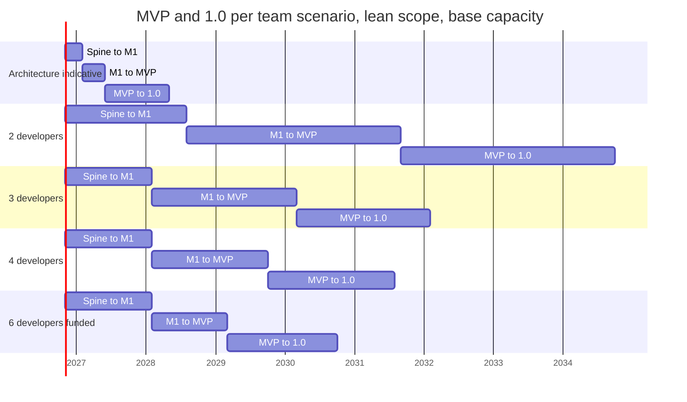
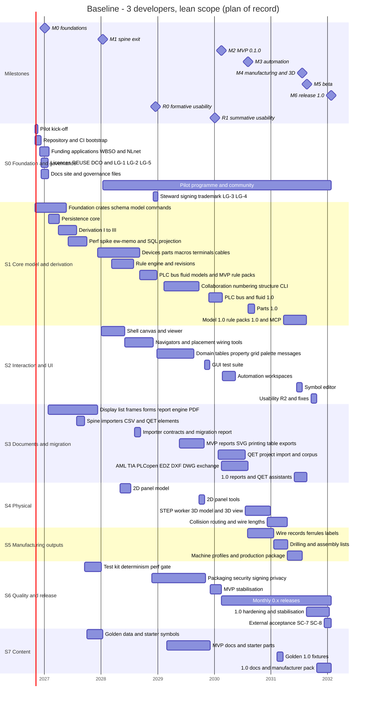
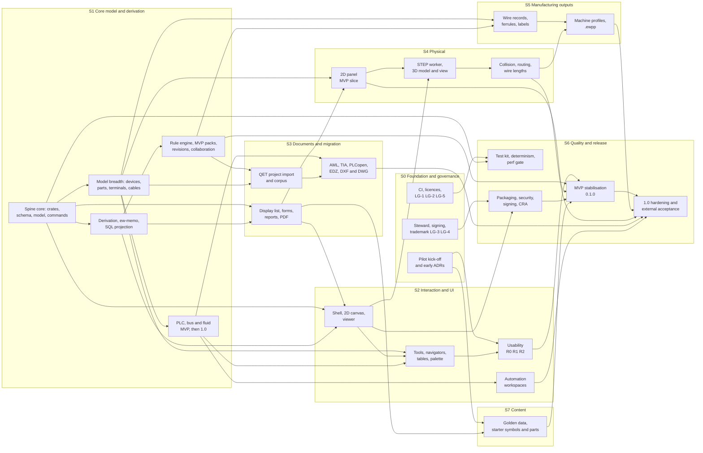

# Global plan

**Status:** Draft v0.1 · **Date:** 2026-10-18 · **Part of:** ElektraWatt plan

**Purpose.** This is the global plan of ElektraWatt (EW). It turns the [work breakdown](02-work-packages.md) (120
work packages, WPs, with three-point estimates and dependencies) into a capacity model, milestone dates for teams
of 2, 3 and 4 developers, phases, a release train, a baseline schedule, a staffing plan, ways of working, a pilot
engagement plan, a funding plan, the decisions and their deadlines, a checklist for the first 90 days and an
ordered list of descoping options. It fixes the calendar that the design documents leave to the plan
([vision](../design/00-vision-and-scope.md) §9, [architecture](../design/04-architecture.md) §15.2,
[golden project](../design/20-golden-project.md) §22, [quality](../design/18-quality-security-release.md) §13.1).
Every effort figure and date below is computed from [work-packages.csv](work-packages.csv) with the script in
Appendix A.

---

## Summary for decision makers

**The headline.** The full v1 scope is **523 person-weeks** (pw) of estimated work, **628 pw** with the 20 %
integration and bug-fix reserve: 14.5 productive developer-years, 17.4 with the reserve. Three developers deliver
108 productive pw a year. **The architecture's indicative 15–18 months to 1.0 cannot be met by 2–4 developers.**
With three developers, month 15 is when the spine exits (headless golden PDF, M1). No team size reaches 1.0 in
18 months, because the longest dependency chain alone takes about 28 months.

**Plan of record (proposed): three developers, lean scope.** Month *n* counts from 2026-11-01 and is labelled
with the calendar month in which it ends.

| Scenario | M1 spine exit | M2 MVP, release 0.1.0 | M6 release 1.0 |
|---|---|---|---|
| **3 developers, lean scope (plan of record)** | **15 (Jan 2028)** | **40 (Feb 2030)** | **63 (Jan 2032)** |
| Same, capacity −20 % / +20 % | 19 (May 2028) / 13 (Nov 2027) | 50 (Dec 2030) / 34 (Aug 2029) | 79 (May 2033) / 53 (Mar 2031) |
| 3 developers, full scope | 15 (Jan 2028) | 43 (May 2030) | 71 (Sep 2032) |
| 4 developers (fourth from month 4), lean | 15 (Jan 2028) | 35 (Sep 2029) | 57 (Jul 2031) |
| 2 developers, lean | 21 (Jul 2028) | 58 (Aug 2031) | 95 (Sep 2034) |
| 6 developers (funded growth, outside the 2–4 decision), lean | 15 (Jan 2028) | 28 (Feb 2029) | 47 (Sep 2030) |

**"Lean"** applies the three scope levers of the [work breakdown](02-work-packages.md#7-scope-levers): (a) the
MVP's Should and Could WPs move to 1.0; (b) QET project migration ships in the 0.x release after the MVP, so the
pilot switches for *new* projects first; (c) 13 WPs that are not among the four binding v1 additions move to 1.x
(thermal, project translations, revision compare, the forms editor, model views and busbars, checklists, the
wiring viewer, the full symbol libraries and others). PLC/I-O, manufacturing outputs, 3D panel layout with routing
and wire lengths, and QET/EDZ/DXF import all stay in 1.0. Lean saves 3 months at the MVP and 8 months at 1.0.

**What moves the dates.**
- **Measured velocity.** The estimates are judgement. Actuals logged from the first commit re-scale the plan at M1.
  AI assistance is assumed to lower the likely estimates by 10–20 %, not to multiply throughput. If it does more,
  M1 will show it.
- **A fourth developer, early.** Joining at month 4 brings the MVP 5 months and 1.0 6 months forward. Joining after
  month 30 no longer advances 1.0.
- **Generalists, not silos.** If each developer works only in "their" streams, the 3-developer MVP slips to month
  54 and 1.0 to month 77. Stream owners own design and review; whoever is free pulls the next ready WP.
- **Legal gates.** No signed release without the employer statement (LG-1), the steward and its signing identity
  (LG-4).

**Decisions needed now (M0, November 2026)** (§14): PD-1 adopt the plan of record; PD-2 confirm lever (b) with
the pilot; PD-3 decide on the fourth developer and its funding by month 2; PD-4 and PD-5 settle ADR-0027 (grid) and
ADR-0028 (fonts); have LG-1 and LG-5 signed; the employer files the WBSO application; the first NLnet proposal goes
to the first call.

**What the pilot gets.** Month 15: the reference set as a PDF generated from the model, and nightly builds of the
`ew` CLI. About month 26: the first interactive development build (usability round R0). Month 40: signed release
0.1.0 for new projects. Month 45: migration of existing QET projects. Month 63: 1.0 with PLC exchange, 3D layout,
wire lengths and machine files.

**Top schedule risks** (§9.3): optimistic estimates (+10 % effort costs 4 months at the MVP and 7 months at 1.0);
capacity below 36 pw per developer-year; loss of a key developer; specialisation; and 40 months until the first
release, which strains pilot and community engagement.

---

**Contents**
1. [Planning basis and assumptions](#1-planning-basis-and-assumptions)
2. [Capacity model](#2-capacity-model)
3. [Effort versus capacity](#3-effort-versus-capacity)
4. [Phases](#4-phases)
5. [Milestones and gates](#5-milestones-and-gates)
6. [Release train](#6-release-train)
7. [Baseline schedule: three developers](#7-baseline-schedule-three-developers)
8. [Streams and dependencies](#8-streams-and-dependencies)
9. [Critical path and schedule risks](#9-critical-path-and-schedule-risks)
10. [Staffing plan](#10-staffing-plan)
11. [Ways of working](#11-ways-of-working)
12. [Pilot-user engagement](#12-pilot-user-engagement)
13. [Funding plan](#13-funding-plan)
14. [Decisions and deadlines](#14-decisions-and-deadlines)
15. [The first 90 days](#15-the-first-90-days)
16. [Descoping options if behind schedule](#16-descoping-options-if-behind-schedule)
17. [Appendix A: the schedule script](#appendix-a-the-schedule-script)
18. [Sources](#sources)
19. [Open questions](#open-questions)

---

## 1. Planning basis and assumptions

### 1.1 Inputs

| Input | What the plan takes from it |
|---|---|
| [Work breakdown](02-work-packages.md) and [work-packages.csv](work-packages.csv) | 120 WPs in streams S0–S7: estimates, dependencies, milestones, owner roles, the three scope levers, the critical path |
| [Vision and scope](../design/00-vision-and-scope.md) §3.2, §9 | Success criteria SC-1 … SC-13; the MVP, 1.0, 1.x and Later targets per capability area |
| [Architecture](../design/04-architecture.md) §15, §16 | The two-lane spine, streams S1–S4, the indicative months, the risk list |
| Requirement catalogues [02a](../design/02a-requirements-core.md), [02b](../design/02b-requirements-extended.md), [02c](../design/02c-nonfunctional-requirements.md) | Through the WBS: every MVP, 1.0 and 1.x row is named by a WP ([WBS](02-work-packages.md#8-requirement-coverage) §8) |
| [Golden project](../design/20-golden-project.md) §21, §22 | Acceptance criteria AC-01 … AC-42 and their gates; defect regression tests D-01 … D-42 |
| [Quality, security and release](../design/18-quality-security-release.md) §6, §7, §13 | Upgrade train, versions and cadence, format window, release checklist, CRA dates |
| [Open-source governance](../design/19-open-source-governance.md) §2.5, §3.3, §3.4, §3.9 | Roles, legal gates LG-1 … LG-6, decision-making, funding sources |
| [UX and UI](../design/16-ux-ui.md) §19 | Usability rounds R0, R1 and R2, tasks T1–T11, the pilot log |
| Scope tables of the feature documents [05](../design/05-project-format-and-persistence.md) … [17](../design/17-extensibility.md) | Through the WBS WPs |
| ADRs [0007](../adr/0007-explicit-connections-and-autoconnect.md), [0025](../adr/0025-gpl-plugin-exception-wording.md), [0027](../adr/0027-native-symbol-grid-and-qet-grid-policy.md) … [0030](../adr/0030-legal-steward-cra-role-support-signing.md) | Decisions with deadlines (§14) |
| [OSS landscape](../research/oss-landscape.md) §8.4 | Funding sources: WBSO, NLnet NGI Zero, sponsors |

### 1.2 Assumptions

| ID | Assumption | Value used | Source |
|---|---|---|---|
| GA-1 | **Start and calendar** | Month 0 = 2026-11-01. Month *n* is the point *n* months later, labelled with the calendar month that ends there: month 15 = end of January 2028. "Joins at month 4" means from 2027-03-01 | WBS PA-1 |
| GA-2 | **Team** | Baseline 3 developers from month 0; scenarios 2 and 4. In the 4-developer scenario the fourth developer joins at month 4 and the team works at 90 % efficiency because of coordination. The scenario tables apply the 90 % for the whole period, as the WBS does; §10.3 applies it only from the join date | WBS PA-2 |
| GA-3 | **Capacity** | **36 productive pw per developer-year** (§2.1): 0.69 pw per calendar week, 3 pw per month. Sensitivity **±20 %** (28.8 and 43.2 pw) | WBS PA-3 |
| GA-4 | **Estimates** | Three points per WP; PERT mean = (O + 4L + P) / 6. An estimate contains design note, code, tests, review, crate docs and CI wiring; user docs, release engineering and pilot work are their own WPs | WBS PA-5, PA-6 |
| GA-5 | **AI assistance** | Helps with boilerplate, parsers, test scaffolding and drafting, and is already counted: the likely values are 10–20 % below unassisted work. It is **not** assumed to multiply throughput, because design, review, debugging, verification against the golden project and the reading of standards stay human-paced | WBS PA-7 |
| GA-6 | **Reserve** | 20 % integration, hardening and bug-fix reserve on every WP, plus two stabilisation WPs (WP-S6.08, WP-S6.12). The reserve is never spent on new scope | WBS PA-8 |
| GA-7 | **Schedule model** | Resource-constrained list scheduling with generalist developers (Appendix A). Accuracy about ±1 month | WBS PA-9 |
| GA-8 | **Committed dates** | The plan-of-record dates at base capacity are the internal commitment; the ±20 % band is what we communicate externally. Each gate review replaces them with a re-forecast from actuals (§11.2) | This plan |
| GA-9 | **Scope of record** | Lean scope (levers a, b and c) pending PD-1; full-scope dates are kept alongside so that PD-1 can be taken either way | WBS §7.4 |
| GA-10 | **Releases** | No binary release before the MVP: until then only nightlies labelled "unsigned development build" exist ([governance](../design/19-open-source-governance.md#33-legal-and-organisational-gates) §3.3). Monthly 0.x releases from the MVP to 1.0 | 19 §3.3, 18 §7.1 |
| GA-11 | **CRA** | Full application from 2027-12-11, which is month 14. Every public release in every scenario ships under full application, so steward-grade processes (WP-S6.04, WP-S0.05) are MVP exit conditions | 18 §13.1 |
| GA-12 | **Money, not pw** | Counsel, notary, trademark fees, signing certificates, test participants and partner-shop time are paid, not estimated in pw (§13.4) | WBS PA-10 |
| GA-13 | **Background load** | Routine support, triage, meetings and the quarterly upgrade train are inside the GA-3 deduction; planned pilot and community deliverables are in WP-S0.08 and WP-S0.09 | WBS PA-11 |

### 1.3 Relation to the WBS figures

The script of Appendix A reproduces the dates of the [WBS](02-work-packages.md#5-effort-versus-capacity-realistic-dates)
§5.2, §5.3, §5.4 and §7.3. All 3- and 4-developer values agree exactly. Two 2-developer cells differ by one month:
the WBS prints 77 for M2 at −20 % capacity (full scope) and 94 for M6 (lean scope, base capacity); the rerun gives
78 and 95. Differences of one month are scheduling noise of the model (GA-7). This plan uses the rerun values.

---

## 2. Capacity model

### 2.1 From a calendar year to 36 productive person-weeks

| Item | Weeks per developer-year | Note |
|---|---|---|
| Calendar | 52.0 | |
| Leave and public holidays | −6.5 | About 25 days of leave plus Dutch public holidays |
| Illness and training | −1.5 | |
| **Working weeks** | **44.0** | |
| Team rituals | −3.5 | Iteration planning, demos, retrospectives, gate reviews, plan reviews (§11) |
| Routine support and triage | −2.5 | Pilot questions, bug reports, community questions; not the planned pilot WPs |
| Upkeep outside WPs | −2.0 | Quarterly upgrade train, CI care, security advisories, governance chores |
| **Productive pw** | **36.0** | 82 % of working weeks; 0.69 pw per calendar week; 3 pw per month |

Code review of other people's work is inside each WP's estimate (GA-4), not in this deduction. A WP of 1 pw takes
one developer about 1.5 calendar weeks, 1.7 with the reserve.

### 2.2 Team scenarios

| Scenario | Developers | Efficiency | pw per month | pw per year (steady state) | pw in 15 months | pw in 18 months |
|---|---|---|---|---|---|---|
| 2 developers | 2 from month 0 | 100 % | 6.0 | 72 | 90 | 108 |
| **3 developers (baseline)** | 3 from month 0 | 100 % | 9.0 | 108 | 135 | 162 |
| 4 developers | 3 from month 0, 1 from month 4 | 90 % | 8.1, then 10.8 | 130 | 151 | 184 |
| 6 developers (funded growth, for comparison) | 3 from month 0, 1 from month 4, 2 from month 6 | 85 % | 15.3 from month 6 | 184 | — | — |

### 2.3 Sensitivity

| Case | pw per developer-year | 3-developer team per month | Typical cause |
|---|---|---|---|
| −20 % | 28.8 | 7.2 | Heavy pilot or community support, illness, a developer partly on other company work |
| Base | 36.0 | 9.0 | GA-3 |
| +20 % | 43.2 | 10.8 | Fewer interruptions; AI assistance helping more than GA-5 assumes |

The ±20 % band also stands in for correlated estimation error (a team slower or faster on every WP), which the
PERT σ of independent WPs does not capture (WBS PA-5).

---

## 3. Effort versus capacity

### 3.1 What the effort contains

Lean scope to 1.0, PERT means in pw:

| Part | pw | Share | Contains |
|---|---|---|---|
| Feature work, streams S1–S5 | 359.7 | 76.8 % | Core model and derivation, UI, documents and migration, physical, manufacturing |
| Quality, security and release engineering, S6 | 54.7 | 11.7 % | Test kit, perf gate, fuzzing, privacy, packaging, signing, SBOM, CRA; release engineering and stabilisation 33.5 pw (WP-S6.06 … WP-S6.10, WP-S6.12) |
| Content and documentation, S7 | 28.3 | 6.0 % | Golden data, starter symbols and parts, user documentation and tutorials |
| Foundation, governance, pilot and community, S0 | 25.9 | 5.5 % | Repository, licences, legal gates, docs site, funding, pilot programme |
| **Subtotal** | **468.5** | **100 %** | |
| Integration, hardening and bug-fix reserve (20 %) | 93.7 | | GA-6 |
| **Total to 1.0** | **562.2** | | |

Cross-cutting lines inside these totals: documentation 13.8 pw (WP-S0.06, WP-S7.05, WP-S7.07, plus the crate
docs inside every WP); pilot, usability and external acceptance 20.7 pw (WP-S0.08, WP-S0.09, WP-S2.12, WP-S2.16,
WP-S6.11).

### 3.2 Effort per scope option

| Scope | MVP (PERT) | MVP with reserve | 1.0 (PERT) | 1.0 with reserve | 1.x backlog (PERT) |
|---|---|---|---|---|---|
| Full scope | 303.6 | 364.3 | 523.4 | 628.1 | 43.5 |
| **Lean: levers (a), (b) and (c) — plan of record** | **281.8** | **338.2** | **468.5** | **562.2** | **98.4** |

Levers (a) and (b) move work from the MVP into the 1.0 releases; only lever (c) removes work from 1.0.

### 3.3 Capacity bound versus simulated dates

The capacity bound is the month at which the team has delivered the effort with perfect parallelism. The simulated
month adds the dependencies and the one-owner-per-WP rule.

| Team | Lean MVP: bound / simulated | Lean 1.0: bound / simulated | Full MVP: bound / simulated | Full 1.0: bound / simulated |
|---|---|---|---|---|
| 2 developers | 56.4 / 58 | 93.7 / 95 | 60.7 / 62 | 104.7 / 105 |
| 3 developers | 37.6 / 40 | 62.5 / 63 | 40.5 / 43 | 69.8 / 71 |
| 4 developers | 32.3 / 35 | 53.1 / 57 | 34.7 / 37 | 59.2 / 61 |

**Reading it.** The simulated dates are within 1–4 months of the capacity bound. The team is almost fully used, so
the end dates follow effort ÷ capacity: with three developers, every 9 pw of extra work before a milestone moves it
by about a month.

### 3.4 Milestone dates per scenario

**Lean scope (plan of record), base capacity.**

| Team | M0 | M1 | M2 MVP | M3 | M4 | M5 beta | M6 1.0 |
|---|---|---|---|---|---|---|---|
| 2 developers | 3 (Jan 2027) | 21 (Jul 2028) | 58 (Aug 2031) | 68 (Jun 2032) | 82 (Aug 2033) | 86 (Dec 2033) | 95 (Sep 2034) |
| **3 developers** | **3 (Jan 2027)** | **15 (Jan 2028)** | **40 (Feb 2030)** | **46 (Aug 2030)** | **57 (Jul 2031)** | **58 (Aug 2031)** | **63 (Jan 2032)** |
| 4 developers | 3 (Jan 2027) | 15 (Jan 2028) | 35 (Sep 2029) | 39 (Jan 2030) | 52 (Feb 2031) | 52 (Feb 2031) | 57 (Jul 2031) |

**Full scope (if PD-1 rejects the levers), base capacity.**

| Team | M0 | M1 | M2 MVP | M3 | M4 | M5 beta | M6 1.0 |
|---|---|---|---|---|---|---|---|
| 2 developers | 3 (Jan 2027) | 21 (Jul 2028) | 62 (Dec 2031) | 70 (Aug 2032) | 85 (Nov 2033) | 97 (Nov 2034) | 105 (Jul 2035) |
| 3 developers | 3 (Jan 2027) | 15 (Jan 2028) | 43 (May 2030) | 48 (Oct 2030) | 58 (Aug 2031) | 66 (Apr 2032) | 71 (Sep 2032) |
| 4 developers | 3 (Jan 2027) | 15 (Jan 2028) | 38 (Dec 2029) | 44 (Jun 2030) | 51 (Jan 2031) | 56 (Jun 2031) | 61 (Nov 2031) |

With the lean scope, M5 falls one month after M4 (3 developers) or in the same month (4 developers), because lever
(c) empties most of M5. The two gate reviews can then be held together (open question 6).

### 3.5 Sensitivity and best case

M2 and M6 month numbers at 80 %, 100 % and 120 % of GA-3 capacity. "Best case" sets every WP to its optimistic
estimate **and** uses 120 % capacity.

| Team | Scope | M2 at −20 % | M2 base | M2 at +20 % | M6 at −20 % | M6 base | M6 at +20 % | Best case M2 / M6 |
|---|---|---|---|---|---|---|---|---|
| 2 | Lean | 72 (Oct 2032) | 58 (Aug 2031) | 48 (Oct 2030) | 118 (Aug 2036) | 95 (Sep 2034) | 79 (May 2033) | 32 / 52 |
| **3** | **Lean** | **50 (Dec 2030)** | **40 (Feb 2030)** | **34 (Aug 2029)** | **79 (May 2033)** | **63 (Jan 2032)** | **53 (Mar 2031)** | **22 / 35** |
| 4 | Lean | 44 (Jun 2030) | 35 (Sep 2029) | 30 (Apr 2029) | 71 (Sep 2032) | 57 (Jul 2031) | 48 (Oct 2030) | 20 / 32 |
| 2 | Full | 77 (Mar 2033) | 62 (Dec 2031) | 52 (Feb 2031) | 132 (Oct 2037) | 105 (Jul 2035) | 88 (Feb 2034) | 34 / 58 |
| 3 | Full | 54 (Apr 2031) | 43 (May 2030) | 36 (Oct 2029) | 88 (Feb 2034) | 71 (Sep 2032) | 59 (Sep 2031) | 24 / 39 |
| 4 | Full | 47 (Sep 2030) | 38 (Dec 2029) | 32 (Jun 2029) | 76 (Feb 2033) | 61 (Nov 2031) | 51 (Jan 2031) | 21 / 34 |

### 3.6 Can v1 fit 15–18 months?

**No.** Three developers have 135–162 pw in 15–18 months; lean 1.0 needs 562 pw, 3.5–4.2 times as much. Even the
best case (optimistic estimates on every WP and 20 % more capacity) puts the lean 1.0 at month 35 with three
developers and month 32 with four. With unlimited developers, the longest dependency chain still takes about 28
months (§9.1), and the WBS shows that ten developers would reach 1.0 at month 36
([WBS](02-work-packages.md#54-what-the-indicative-dates-would-take) §5.4). The indicative dates assumed roughly one
week per crate-level component; the WBS estimates three to six.



What *can* be done honestly within 15–18 months with three developers: M0 at month 3 and M1 (headless golden PDF,
the format crates and the `ew` CLI core) at month 15, i.e. the open format and the derivation engine, proven on the
reference set.

---

## 4. Phases

Phases overlap: a developer who has no ready WP of the current milestone takes one of the next (Appendix A). Months
are for the plan of record (3 developers, lean scope).

| Phase | Months | Calendar | Goal | Main streams | Ends with |
|---|---|---|---|---|---|
| **P0 Foundations** | 0–3 | Nov 2026 – Jan 2027 | Repository, CI on three OSes, licences and the licence boundary, pilot kick-off, early ADRs | S0, S6 | M0 |
| **P1 Spine** | 0–15 | Nov 2026 – Jan 2028 | Two lanes ([architecture](../design/04-architecture.md#15-spine-build-order-and-parallel-streams) §15.1): core (crates, schema, model, commands, derivation, `ew-memo`, persistence, SQL projection) and output (display list, forms, reports, CPU renderer, PDF), plus test kit and golden data | S1, S3, S6, S7 | M1 |
| **P2 Interactive MVP** | 14–40 | Dec 2027 – Feb 2030 | Model breadth, rule engine and packs, revisions, collaboration; egui shell, canvas, tools, navigators; 2D panel; packaging, signing, CRA processes; R0 and R1 | S1, S2, S4, S6, S7 | M2, release 0.1.0 |
| **P3 Automation breadth and migration** | 37–46 | Nov 2029 – Aug 2030 | PLC, bus and fluid 1.0; QET project migration; AML, TIA and PLCopen exchange; EDZ; DXF/DWG | S1, S2, S3 | M3 |
| **P4 Physical and manufacturing** | 45–57 | Jul 2030 – Jul 2031 | STEP worker, 3D model and view, collision, routing, lengths; wire records, ferrules, labels, machine profiles, `.ewpp` | S4, S5 | M4 |
| **P5 Completion** | 53–58 | Mar 2031 – Aug 2031 | Model, rule-pack and report completion; deferred MVP Should items; beta | S1, S2, S3 | M5, 1.0 beta |
| **P6 Hardening and release** | 58–63 | Aug 2031 – Jan 2032 | 1.0 quality layers, R2, external acceptance (SC-7, SC-8), documentation and German, format freeze, stabilisation | S6, S2, S7 | M6, release 1.0 |
| **P7 1.x** | from 64 | from Feb 2032 | Quarterly minors with the 1.x themes (§6.4) | all | — |

---

## 5. Milestones and gates

### 5.1 Milestone table

Milestones are cumulative: reaching M3 means every WP of M0 … M3 is done. Dates are base capacity, lean scope.
The release column is for the plan of record; in other scenarios the 0.x number is "months since M2, plus one".
Gate IDs are G-M0 … G-M6; the acceptance criteria are those of the
[golden project](../design/20-golden-project.md#21-acceptance-criteria) §21, adjusted for the levers.

| Milestone | 2 devs | 3 devs (baseline) | 4 devs | Content | Release | Exit gate | Key deliverables | Demo |
|---|---|---|---|---|---|---|---|---|
| **M0** Kick-off and foundations | 3 (Jan 2027) | 3 (Jan 2027) | 3 (Jan 2027) | Workspace and per-PR CI green on three OSes; licence files, REUSE, DCO and licence-boundary check active; pilot kick-off held; ADR-0027 and ADR-0028 decided; LG-1 and LG-5 requested; PD-1 taken | None (CI artefacts only) | **G-M0**: the M0 exit criteria of the [WBS](02-work-packages.md#22-milestones) §2.2 | WP-S0.01, WP-S0.02, WP-S0.08 | A pull request that adds a GPL dependency to a permissive crate fails the boundary check on all three OSes |
| **M1** Spine exit: headless golden PDF | 21 (Jul 2028) | 15 (Jan 2028) | 15 (Jan 2028) | `ew export pdf golden/J-E-2416.ew` writes the 18 folios plus report folios 903–911 without a GUI; acceptance SQL/CSV pairs pass with the oracle on; perf gate running; two owners per critical crate; ADR-0030 decided; LG-1 and LG-2 closed | None: a signed source tag `m1`; nightly CLI builds for the pilot | **G-M1**: AC-01 … AC-13, AC-14 (Linux), AC-15 … AC-17, AC-18 (CLI), AC-20, AC-39; golden §19 rows gated M1 | 22 WPs: WP-S1.01 … WP-S1.10, WP-S3.01 … WP-S3.05, WP-S6.01 … WP-S6.03, WP-S7.01, WP-S7.02, WP-S0.04, WP-S0.06 | The generated PDF beside the reference set; rename T55 and renumber folio 3 → 4 (the D-01 replay): every affected output changes in one commit, and undo restores the bytes |
| **M2** MVP: pilot release | 58 (Aug 2031) | 40 (Feb 2030) | 35 (Sep 2029) | Interactive 2D editing of the reference set; core reports, PDF and SVG; checks with the pre-delivery scheme; revisions and as-built archive; 2D panel (folio 902); PLC, bus and fluid MVP model; first signed release on three OSes; R1 passed (validates ADR-0007); LG-3 and LG-4 closed; ADR-0029 decided; CRA steward processes live | **0.1.0** | **G-M2**: AC-14 (all OSes), AC-18 (GUI), AC-19, AC-21, AC-23, AC-28, AC-29, AC-31, AC-32 (MVP part), AC-33, AC-37 (SVG), AC-40, AC-41; SC-1, SC-2 (2D), SC-5 (S, M), SC-6, SC-9 (R1), SC-10 … SC-12. AC-25 … AC-27 move to G-M3 with lever (b) | 39 WPs of M2 (lean), closed by WP-S6.08 | Usability tasks T1–T5 live on Golden A; `ew check --scheme pre-delivery` exits 1 with exactly the expected findings; offline installation of the signed build on a clean Windows VM |
| **M3** Automation breadth and migration | 68 (Jun 2032) | 46 (Aug 2030) | 39 (Jan 2030) | PLC and bus 1.0; fluid 1.0; QET project migration (lever b); AML, TIA tag table and PLCopen exchange against reference files; EDZ and EPLAN parts XML; DXF and DWG; automation workspaces | 0.7.0 | **G-M3**: AC-25, AC-26, AC-27 (SC-4), AC-30 (reference files), AC-32 (1.0 part), AC-37 (DXF), AC-38; the EW-PLC and EW-BUS part of AC-22 | WP-S1.24, WP-S1.25, WP-S2.13, WP-S3.10, WP-S3.11, WP-S3.13, WP-S3.16, WP-S3.18, WP-S3.19 | A QET corpus project imported with its migration report; the AML of station -201U1 exported and validated; a golden part updated from an EDZ through a previewed command |
| **M4** Manufacturing and 2D/3D panel | 82 (Aug 2033) | 57 (Jul 2031) | 52 (Feb 2031) | STEP worker, 3D view, collision, routing and lengths; production wire records, ferrules, labels; Komax, Rittal and Weidmüller profiles; drilling DXF; `.ewpp` | 0.18.0 | **G-M4**: AC-34; AC-35 content. AC-36 (thermal) moves to 1.x with lever (c) | WP-S1.28, WP-S4.03 … WP-S4.08, WP-S5.01 … WP-S5.07, WP-S7.06 | Golden A-R in 3D without collisions; `RouteWires` commits lengths that folio 907 shows; moving -102G1 marks lengths stale; the `.ewpp` rows equal folio 907 |
| **M5** 1.0 feature complete (beta) | 86 (Dec 2033) | 58 (Aug 2031) | 52 (Feb 2031) | All 1.0 features merged; 1.0 rule packs exact; beta to the pilot and early adopters | 1.0.0-beta.1 | **G-M5**: AC-22 | WP-S1.26, WP-S1.30, WP-S3.15; lever (a) WPs WP-S1.23, WP-S2.10, WP-S3.12 | The pre-delivery check with the 1.0 packs on Golden A equals golden §18.1 plus §18.2; walkthrough of journeys J1–J6 |
| **M6** 1.0 release | 95 (Sep 2034) | 63 (Jan 2032) | 57 (Jul 2031) | Format frozen (since rc.1); R2 passed; SC-7 and SC-8 shown with real machines and installations; signed 1.0; word mark filed; LG-6 review | **1.0.0** | **G-M6**: AC-01 … AC-42 except AC-36 and AC-42 (1.x with lever c); every golden §19 row except D-40; NFR-UX-01 and NFR-UX-02 at 1.0; SC-7, SC-8; SC-13 reported | WP-S0.09, WP-S2.16, WP-S6.10, WP-S6.11, WP-S6.12, WP-S7.07, WP-S7.08 | TIA Portal imports the AML and the tag table round-trips; a partner shop loads the Komax and Rittal WT files; the R2 report |

### 5.2 Gate reviews

| Aspect | Rule |
|---|---|
| **Who** | Maintainers (chair: project lead), the pilot user, the steward liaison; the release manager from G-M2 |
| **Input, one week before** | Acceptance-runner report per AC-nn and D-nn (NFR-MAINT-11); the exit criteria of §5.1 with evidence links; open risks (§9.3); actual versus estimated pw; the re-forecast of the remaining milestones (§11.2); the decisions of §14 that are due |
| **Outcomes** | **Pass**; **pass with conditions**, closed within 4 weeks and re-checked by the chair; **fail**, with a re-plan within 2 weeks that uses the descoping ladder of §16 |
| **Never waived** | Any AC of the gate, the CRA and signing conditions before a public release, the 20 % reserve as a scope buffer, the anonymisation guard (AC-39) |
| **Record** | A gate record in the repository: date, outcome, evidence, conditions, decisions, new forecast. `ROADMAP.md` is regenerated from it (GV-07) |

Milestone reviews are lighter: at every monthly plan review (§11.2) the forecast for the next two milestones is
updated and published.

---

## 6. Release train

### 6.1 Before the MVP: no binary releases

Governance §3.3 allows no tagged binary release before the first signed installer. Until 0.1.0:
- **Nightlies** from `main`, labelled "unsigned development build" (ADR-0030). They may write an unreleased format,
  with a warning ([quality](../design/18-quality-security-release.md#71-versions-and-cadence) §7.1). The pilot
  uses them from M1 (WP-S0.09).
- **Source tags** at funding milestones and at M1 (`m1`): signed git tags with release notes, no binaries. They
  give funders and the community an auditable state.
- **Monthly progress notes** (what landed, what is next, the current forecast) on the project site from M0.

### 6.2 From the MVP: monthly 0.x releases

The 0.x cadence of [quality](../design/18-quality-security-release.md#71-versions-and-cadence) §7.1 applies: RC on
the first working day of the month, release the following week if no blocker; the format may change with
upgrade-on-read and an unstable-format banner; only the latest 0.x is supported. Capabilities land in the release
after their WPs finish (plan of record):

| Release | Month (calendar) | Milestone | Capabilities that land |
|---|---|---|---|
| **0.1.0** | 40 (Feb 2030) | **M2 MVP** | Interactive 2D schematics reproducing the reference set; IEC 81346 structure, numbering with previewed renumber; connections, potentials, wire properties, cross-references; terminals, cables, PLC, bus and fluid MVP model; parts and macros; rule engine with the pre-delivery scheme; revisions and as-built archive; core reports, PDF/A-2b, SVG, printing, table exports; 2D panel (folio 902); `ew` CLI; signed installers for Windows, macOS and Linux |
| 0.2–0.4 | 41–43 (Mar–May 2030) | | PLC and bus 1.0, fluid 1.0 model (WP-S1.24, WP-S1.25); QET project import I (WP-S3.10); DXF and DWG exchange (WP-S3.19); PLC, bus and fluid workspaces (WP-S2.13) |
| 0.5–0.7 | 44–46 (Jun–Aug 2030) | **M3** at 0.7 | QET project import II (WP-S3.11); QET corpus and migration verifier, so existing projects migrate (WP-S3.13, SC-4); AML, TIA tag tables and PLCopen XML (WP-S3.16); EDZ and EPLAN parts XML (WP-S3.18) |
| 0.8–0.13 | 47–52 (Sep 2030 – Feb 2031) | | Parts 1.0 (WP-S1.28); STEP worker (WP-S4.03); production wire records and the Manufacturing workspace (WP-S5.01); ferrules (WP-S5.02); 3D layout model and the Panel 3D workspace (WP-S4.05, WP-S4.04); labels (WP-S5.03); collision and routing (WP-S4.06, WP-S4.07) |
| 0.14–0.18 | 53–57 (Mar–Jul 2031) | **M4** at 0.18 | Drilling DXF and hole tables (WP-S5.06); wire lengths and duct fill (WP-S4.08); terminal assembly and cut lists (WP-S5.05); model 1.0 completion (WP-S1.26); machine profiles (WP-S5.04); 1.0 rule packs and SARIF (WP-S1.30); `.ewpp` (WP-S5.07); symbol editor (WP-S2.10); 1.0 reports and user SQL reports (WP-S3.15) |

### 6.3 1.0: betas, release candidates and the format freeze

| Release | Month (calendar) | Content |
|---|---|---|
| 1.0.0-beta.1 | 58 (Aug 2031), **M5** | Feature complete: read-only `ew mcp` (WP-S1.23) and the QET migration assistants (WP-S3.12) close the list |
| 1.0.0-beta.2, beta.3 | 59–60 (Sep–Oct 2031) | 1.0 quality layers and hardening (WP-S6.10); R2 and its fixes (WP-S2.16) |
| 1.0.0-rc.1 | 61 (Nov 2031) | **Format freeze**, 8 weeks before 1.0 ([quality](../design/18-quality-security-release.md#72-format-change-window) §7.2): the 1.0 format fixture enters the corpus for good |
| 1.0.0-rc.2 | 62 (Dec 2031) | Documentation 1.0 and German (WP-S7.07) |
| **1.0.0** | 63 (Jan 2032), **M6** | Stabilisation (WP-S6.12), external acceptance (WP-S6.11), first manufacturer data pack (WP-S7.08) |

Betas and release candidates keep the monthly rhythm and are pre-1.0 in SemVer, so the 0.x rules (latest only,
upgrade-on-read) still apply to them.

### 6.4 After 1.0: 1.x themes

From 1.0, minors are quarterly with additive format changes only, and the yearly major ships in the March format
window (§11.6). The 1.x backlog is the lever (c) WPs plus the original 1.x WPs: 98.4 pw, 118 pw with the reserve,
about 13 months of the 3-developer team before any new 1.x scope.

| Theme | Earliest release | WPs | PERT (pw) | With reserve |
|---|---|---|---|---|
| Review and productivity: revision compare, change lists, review and merge UI, editor completion, macros 1.0 | 1.1 (Apr 2032) | WP-S1.31, WP-S2.15, WP-S2.14, WP-S1.29 | 15.5 | 18.6 |
| Panel engineering: thermal calculation, model views, busbars, 3D export, verification checklists, wiring viewer | 1.2 (Jul 2032) | WP-S4.10, WP-S4.09, WP-S5.08, WP-S5.09 | 17.1 | 20.5 |
| Content, forms and languages: full IEC 60617 and ISO 1219 libraries, forms editor and ISO 5457 frames, project translations, GSD/GSDML/IODD | 1.3 (Oct 2032) | WP-S7.04, WP-S3.14, WP-S1.27, WP-S3.17 | 19.2 | 23.0 |
| Extensibility and backlogs: WASM plugins and SDK, automation 1.0, interop, physical and manufacturing 1.x | 1.4, then 2.0 in the format window (March 2033 at the earliest) | WP-S1.33, WP-S1.32, WP-S3.20, WP-S4.11, WP-S5.10, WP-S1.34 | 46.7 | 56.0 |

---

## 7. Baseline schedule: three developers

Generated from the Appendix A model for the plan of record. Bars are WP groups; a bar runs from the first start to
the last finish of its WPs and can contain short gaps. The level-of-effort WPs WP-S0.09 and WP-S6.09 are drawn as
spans. WP-S0.07 (funding, 1.7 pw) is drawn at months 1–3, where the funding plan needs it; the project lead does it
beside the M0 work, and it must never interrupt the core chain WP-S1.01 … WP-S1.04 (§9.2). R0 and R1 are drawn as
markers inside WP-S2.12.



**Reading it.**
- **The spine takes the first 15 months** because both lanes are long: lane 1 (WP-S1.01 … WP-S1.10) is 47.5 pw and
  lane 2 (WP-S3.01 … WP-S3.05) 26.8 pw, plus CI, legal, test kit, golden data and starter symbols.
- **The UI starts at M1** (WP-S2.01 starts in January 2028). The interactive MVP takes 26 months after it,
  because the M2 work of S1 (61 pw) and S2 (57 pw) must both be done before the stabilisation WP-S6.08.
- **The physical and manufacturing chain runs at the end** (months 45–57) and is near-critical for 1.0 (§9.2).
- **Release engineering is spread out:** packaging from month 25, security and CRA from month 30, the release
  pipeline from month 32; the first signed release needs all of them.

---

## 8. Streams and dependencies

The streams are those of the [WBS](02-work-packages.md#21-streams) §2.1, which map to the architecture's S1–S4 and
add the cross-cutting S0, S5, S6 and S7. `ew-schema` and the query catalogue are the contract between streams:
UI, output and physical developers code against `World`, the queries and the golden data, not against mocks
([architecture](../design/04-architecture.md#152-parallel-streams-after-the-spine) §15.2). Nodes are WP groups; red
borders mark the critical chain of §9.1.



Cross-stream dependencies in the CSV (lean scope, without the two stabilisation WPs) concentrate on S1: 40 of the
73 cross-stream edges start in S1. The strongest interfaces:

| From → to | Edges | Interface | Typical WP pair |
|---|---|---|---|
| S1 → S3 | 14 | Schema, derivation queries, rule engine, PLC model | WP-S1.06/WP-S1.07 → WP-S3.03 (report engine); WP-S1.24 → WP-S3.16 (PLC exchange) |
| S1 → S2 | 10 | `Session` facade, view-model queries, model breadth | WP-S1.04 → WP-S2.01; WP-S1.13/WP-S1.07 → WP-S2.04 (tools) |
| S1 → S6 | 5 | Determinism and perf targets need the model and the memo engine | WP-S1.05 → WP-S6.03 |
| S1 → S4, S1 → S7 | 4 each | Parts and device breadth; part data for content | WP-S1.19 → WP-S4.01; WP-S1.28 → WP-S7.08 |
| S4 → S5 | 3 | Layout and routed lengths feed the manufacturing outputs | WP-S4.08 → WP-S5.04 |
| S2 → S4, S2 → S6 | 3 each | Renderer and navigators for 3D; shell and renderer for packaging | WP-S2.02 → WP-S4.04; WP-S2.01 → WP-S6.06 |
| S3 → S2 | 1 | The display list feeds the 2D canvas | WP-S3.01 → WP-S2.02 |

---

## 9. Critical path and schedule risks

### 9.1 Path-bound or capacity-bound

| Milestone (lean scope) | Longest dependency chain, unlimited developers | Capacity bound, 3 developers | Simulated, 3 developers |
|---|---|---|---|
| M1 | 12.1 months (chain ends in WP-S3.04) | 13.7 months | 14.9 → month 15 |
| M2 | 19.5 months (WP-S1.01 … WP-S1.04 → WP-S2.01 → WP-S2.03 → WP-S2.04 → WP-S2.12 → WP-S6.08) | 37.6 months | 39.8 → month 40 |
| M6 | 28.1 months (WP-S1.01 … WP-S1.04 → WP-S1.13 → WP-S1.19 → WP-S4.01 → WP-S4.05 → WP-S4.07 → WP-S4.08 → WP-S5.04 → WP-S5.07 → WP-S6.10 → WP-S6.12) | 62.5 months | 62.8 → month 63 |

**The M1 row includes 1.9 pw moved from M2 work packages** (WP-S1.12, WP-S1.14, WP-S1.18, WP-S3.08, WP-S6.05, WP-S6.08) into the spine WPs (WP-S1.02, WP-S1.04, WP-S1.06, WP-S1.07, WP-S3.03, WP-S6.01, WP-S6.03): the G1 acceptance criteria AC-03, AC-04, AC-06, AC-07, AC-08, AC-11, AC-17, AC-20 and AC-39 need a thin slice of those requirements at M1. Total effort is unchanged (523.4 pw); M1 moves from 14.3 to 14.9 months, still month 15 but with almost no margin.

**With 2–4 developers the schedule is capacity-bound.** No single chain decides the date; every pw of extra work
before a milestone moves it (about 1/9 of a month per pw with three developers). The chains still decide the
*order* of work, and they decide the date where capacity is not the limit: at M1, and in the last 18 months before
1.0.

### 9.2 Ordering rules

1. **The core chain never waits.** WP-S1.01 → WP-S1.02 → WP-S1.03 → WP-S1.04 starts on day 1 and is not interrupted
   by S0 work, funding, pilot meetings or reviews beyond the GA-3 deduction. A one-month slip at its head
   (WP-S1.01) moves M1 and M2 by two months and M6 by one, because nothing else is ready to work on yet.
2. **Run the performance spike right after WP-S1.03** (month 5), not when WP-S1.05 is otherwise reached (month 7 in
   the model). The go/fallback decision of architecture §6.1 then lands by month 6 (PD-8), before derivation II and
   III fix their query shapes.
3. **The UI chain starts as soon as WP-S1.04 lands.** WP-S2.01 → WP-S2.03 → WP-S2.04 is the longest chain to the
   MVP; R0 follows WP-S2.04 directly.
4. **The physical chain starts as soon as M3 work allows.** WP-S4.03 → WP-S4.05 → WP-S4.07 → WP-S4.08 → WP-S5.04 →
   WP-S5.07 → WP-S6.10 → WP-S6.12 runs from month 45 to month 62 in the baseline, with about one month of slack
   before M6. With a fourth developer, building the STEP worker (WP-S4.03) before M2 brings 1.0 from month 57 to 55 at the
   cost of one month at the MVP (36 instead of 35); with three developers it gains nothing at 1.0 and costs a month
   at the MVP, so only its risky part (OCCT packaging on three OSes) is spiked early.
5. **External lead times start early.** The steward's signing identity and the Apple enrolment (LG-4) take
   calendar time, not pw: start them at least 12 months before the planned M2 (month 28 in the baseline). The
   trademark search (LG-3) runs in the first 90 days. Line up the TIA Portal installation, a CODESYS installation
   and the partner shop for SC-7 and SC-8 at M3.

### 9.3 Schedule risk register

Impacts are simulated on the plan of record (3 developers, lean scope, M2 month 40, M6 month 63).

| ID | Risk | Early indicator | Impact | Mitigation | Owner |
|---|---|---|---|---|---|
| SR-1 | **Estimates optimistic** | Velocity ratio (estimated pw of finished WPs ÷ actual pw) below 0.9 at two monthly reviews; M1 forecast beyond month 16 | +10 % effort: M2 44, M6 70. +25 %: M2 50, M6 79 | Re-plan at G-M1 with the measured ratio (§11.2); descoping ladder (§16); reserve not spent on scope | Project lead |
| SR-2 | **Capacity below 36 pw per developer-year** | Logged productive time below 0.6 pw per developer-week for two months | −20 %: M2 50, M6 79 | Support rota (one developer per iteration takes triage); protected focus days; support load visible in the log | All developers |
| SR-3 | **Specialisation** | Ready WPs waiting for "their" developer while another is idle | Strict roles: M1 23, M2 54, M6 77 (§10.2) | Pull rule; pairing across lanes during the spine; two owners per critical crate by M1 | Project lead |
| SR-4 | **Loss of a key developer** | A crate with one reviewer; one person with most commits in `ew-memo`, the `Op` set, `ew-format` or `ew-derive` | Three months out ≈ +1 month. Permanent loss of one of three gives the 2-developer dates (M2 58, M6 95) unless replaced | Two owners (NFR-MAINT-07); design notes per crate; hire developer 4 (§10.3) | Project lead |
| SR-5 | **Third developer starts late** | Not on board at kick-off | Joins at month 6: M2 42, M6 65. At month 12: M2 44, M6 67 | Hire before kick-off; the output lane starts with WP-S3.01 at month 3 at the latest | Employer |
| SR-6 | **Legal and steward gates late** | ADR-0030 not decided at G-M1; signing enrolment not started by month 28; LG-1 unsigned at G-M0 | Blocks 0.1.0 however ready the code is | Decide ADR-0030 by M1; enrolment ≥ 12 months before M2; SignPath as documented fallback ([quality](../design/18-quality-security-release.md) open question 4) | Steward liaison |
| SR-7 | **Performance spike fails** | Spike results beyond the thresholds of architecture §6.1 | Up to 1–2 months at M1 if the named fallback is needed | Spike right after WP-S1.03 (§9.2 rule 2); fallback already designed | Core developer |
| SR-8 | **Pilot engagement fades** before the first release (40 months) | Monthly pilot review missed twice; pilot questions open for more than 2 months | SC-3 starts late; acceptance truth unconfirmed; usability rounds lack participants | Engagement plan §12: monthly demos, nightlies from M1, R0 at month 26, a named pilot liaison | Pilot liaison |
| SR-9 | **UI-stack churn** | Upgrade train above 3 developer-days twice in a row | Up to one developer-week per quarter | Abort rule and lag limits ([quality](../design/18-quality-security-release.md#63-the-quarterly-upgrade-train) §6.3); `ew-ui` isolation | Quarter's steward |
| SR-10 | **External acceptance unavailable** (TIA Portal V21, CODESYS, a partner shop with Komax and Rittal machines) | No named partner by G-M3 | Blocks G-M6 (SC-7, SC-8) | Partners named at M3; reference-file tests from M3; recorded deviations if a machine is unavailable | Pilot liaison |
| SR-11 | **Third-party format material missing** (EDZ samples, Komax and Rittal formats, AS-5) | Not received by G-M2 | M3 and M4 WPs at their pessimistic values | Request through the pilot at M0 and M1 | Output developer |
| SR-12 | **Scope creep** | Catalogue rows added without a WP; pilot requests merged without trade-off | Every 9 pw ≈ one month | A new catalogue row needs a WP in the same PR ([WBS](02-work-packages.md#8-requirement-coverage) §8); "one in, one out" at gate reviews | Project lead |
| SR-13 | **Funding not obtained** (NLnet calls after 2025 uncertain, **verify**) | Rejection or no suitable call | None on the plan of record, which assumes no grants; the upside of §10.3 is lost | WBSO first; several NLnet proposals; sponsors from the steward's creation | Project lead |
| SR-14 | **CRA duties broader than assumed** (steward scope, nightlies) | Counsel's opinion at M1 | Extra process work before 0.1.0 | Counsel review at M1; WP-S6.04 carries the work | Steward liaison |

---

## 10. Staffing plan

### 10.1 Roles and holders

Roles are hats, not people ([WBS](02-work-packages.md#24-owner-roles) §2.4,
[governance](../design/19-open-source-governance.md#25-roles) §2.5).

| Role | 3 developers | 4 developers | Duties | From |
|---|---|---|---|---|
| **Project lead** | Dev 1 | Dev 1 | Roadmap and plan, funding, governance, gate chair, steward liaison | M0 |
| **S1 owner** (core) | Dev 1; dev 3 is second owner of `ew-memo` and the `Op` set by M1 | Dev 1; dev 4 second owner | `ew-schema`, query catalogue, model, derivation, rule engine | M0 |
| **S2 owner** (UI) and UX researcher | Dev 2 | Dev 2 | Shell, renderer, tools; usability rounds R0–R2 | M1 (UI work starts in January 2028) |
| **S3 and S5 owner** (output, migration, manufacturing) | Dev 3 | Dev 3 | Display list, forms, reports, PDF, importers, exchange, manufacturing outputs | M0 (spine lane 2) |
| **S4 owner** (physical) | Dev 2 | Dev 4 | Layout model, STEP worker, 3D, routing | May 2028 (WP-S4.01) |
| **S6 release engineer** | Rotating per quarter; dev 2 leads packaging and the platform matrix | Rotating | CI, packaging, signing, SBOM, release pipeline | M0 |
| **S7 content maintainer**; docs maintainer | Dev 3; docs rotating | Dev 3; docs rotating | Golden data, symbols, parts; user documentation | M0 |
| **Schema steward** | Quarterly rotation among the `ew-schema` and `ew-format` owners (dev 1 → dev 3 → dev 2 …) | Same, with dev 4 | Format rule (GV-04); never approves their own format PR; also runs that quarter's upgrade train (§11.5) | Q1 2027 (first format change in WP-S1.02) |
| **Release manager** | Rotating per release | Rotating | Release checklist RC-01 … RC-11; never the only reviewer of the release PR | 0.1.0 |
| **Pilot liaison** | Dev 3 day to day; project lead for agreements and escalation | Same | Pilot reviews, pilot log, corpus, acceptance-truth acknowledgements, test participants | M0 |
| **Security response team** | Dev 1 and dev 2 | Dev 1 and dev 4 | Private advisories, CRA notifications through the steward | WP-S6.04 (before 0.1.0) |
| **Conduct contacts** | Two people, at least one outside the core team where possible | Same | Code of Conduct reports | First binary release |

### 10.2 Generalists, not silos

**Pull rule.** A developer who finishes a WP takes the ready WP with the earliest milestone, then the one with the
longest remaining chain, whatever its stream. The stream owner reviews it and keeps the stream's design coherent.
The model of Appendix A uses exactly this rule. Strict silos are expensive:

| Working mode (3 developers, lean scope) | M1 | M2 | M6 |
|---|---|---|---|
| **Pull rule, owners review (plan of record)** | 15 | 40 | 63 |
| Strict: dev 1 S0 and S1; dev 2 S2, S4, S6; dev 3 S3, S5, S6, S7 | 23 | 54 | 77 |
| Strict, but dev 3 also takes S1, dev 2 also S7 and dev 1 also S6 | 18 | 43 | 72 |

S1 is 29 % of the effort; one person cannot carry it. Everyone therefore works in the core during the spine:
WP-S1.06, WP-S1.07 and WP-S1.09 are natural first WPs for the UI and output developers, and pairing on
`ew-memo` and the `Op` set gives the two owners NFR-MAINT-07 asks for by M1.

### 10.3 When to add developer 4

Lean scope, three developers from month 0, the fourth from the given month; the team works at 90 % efficiency from
the join date. "Developer-years added" counts from the join to 1.0.

| Developer 4 joins | M1 | M2 | M6 | Gain against 3 developers (M2 / M6, months) | Developer-years added |
|---|---|---|---|---|---|
| Not at all | 15 | 40 | 63 | — | — |
| Month 4 (from 2027-03-01) | 14 | 35 | 57 | 5 / 6 | 4.4 |
| Month 9 (from 2027-08-01) | 14 | 36 | 57 | 4 / 6 | 4.0 |
| Month 12 (from 2027-11-01) | 15 | 36 | 58 | 4 / 5 | 3.8 |
| Month 15, M1 (from 2028-02-01) | 15 | 37 | 58 | 3 / 5 | 3.6 |
| Month 24 (from 2028-11-01) | 15 | 38 | 60 | 2 / 3 | 3.0 |
| Month 30 (from 2029-05-01) | 15 | 39 | 61 | 1 / 2 | 2.6 |
| Month 40, M2 (from 2030-03-01) | 15 | 40 | 62 | 0 / 1 | 1.8 |
| Month 46 (from 2030-09-01) | 15 | 40 | 64 | 0 / −1 | 1.5 |

**Recommendation.**
- **Profile:** a physical and 3D developer (S4 owner: wgpu, geometry, the STEP worker's FFI) who becomes the
  second core owner.
- **Timing:** decide by month 2 (December 2026) for a start at month 4 (PD-3). The latest start that still pays
  off well is M1 (month 15). After month 30 a new developer no longer advances 1.0 and should be hired for 1.x.
- **First work:** a core WP of the spine (pairing with dev 1), then the S4 queue as it becomes ready; with four
  developers, the STEP worker before M2 is an option (§9.2 rule 4).

### 10.4 Beyond four developers

Growth beyond four is outside the user's 2–4 decision and is shown only to make the trade-off visible:

| Team (lean scope) | M2 | M6 |
|---|---|---|
| 5: 3 from month 0, 1 from month 4, 1 from month 6, 85 % efficiency | 32 (Jun 2029) | 51 (Jan 2031) |
| 6: 3 from month 0, 1 from month 4, 2 from month 6, 85 % efficiency | 28 (Feb 2029) | 47 (Sep 2030) |

A cheaper route to extra capacity is a contractor on a self-contained WP set funded by a grant (§13.3). The best
candidate is QET project migration (WP-S3.09 … WP-S3.11, WP-S3.13: 17.1 pw, 20.5 pw with the reserve), which can
start once WP-S1.13 and WP-S1.15 exist (about month 20). Budget about 2 pw of maintainer time per contractor for
onboarding and review (assumption).

### 10.5 People who are not developers

| Who | Needed for | When |
|---|---|---|
| Counsel | LG-1 statement, ADR-0025 exception wording, ADR-0030 steward and CRA role, trademark | Months 0–15 |
| The pilot user and colleagues | Decisions, golden truth, corpus, R0 | From M0 |
| Two EPLAN users and one QET user (R1); five participants including a PLC programmer and a wireman (R2) | Usability rounds ([UX](../design/16-ux-ui.md#192-rounds) §19.2) | Months 38–39; months 59–60 |
| Translators (Weblate) | Dutch at the MVP, German at 1.0 | From month 30 |
| A partner shop with Komax and Rittal machines; TIA Portal and CODESYS installations | SC-7, SC-8 | Months 46–63 |
| Community contributors | Symbols, parts, translations; not counted in the dates | From the first binary release |

---

## 11. Ways of working

### 11.1 Iterations

| Practice | Rule |
|---|---|
| Iteration | **2 weeks**. Planning (1 h) on the first Monday, demo and retrospective (1.5 h) on the last Friday. The pilot is invited to the demo at least monthly |
| Board | GitHub Projects with every WP of [work-packages.csv](work-packages.csv) as an issue: stream, milestone, O/L/P, owner role, status and **actual pw**. Labels `funded:<source>`, `blocked:LG-2`, `pilot` |
| Work in progress | One WP per developer at a time, plus reviews. A WP above 4 pw is split into tasks of at most 1 pw |
| Definition of done for a WP | Its AC-nn and NFR rows pass in CI; reference pages and crate docs written; golden changes approved by two maintainers (and acknowledged by the pilot for `golden/J-E-2416/tables/`); actual pw recorded; CSV status updated |
| Review | One maintainer other than the author; two area owners for `ew-memo`, the `Op` set, `ew-format` and `ew-derive` (GV-02, NFR-MAINT-07) |
| Trunk | Trunk-based; no release branches before 1.0 ([quality](../design/18-quality-security-release.md) §7.3) |
| AI assistance | Used for boilerplate, parsers, tests and drafts under the AI-use policy of governance; AI-written code is reviewed like any other; project data never goes to machine translation (NFR-PRIV-08) |

### 11.2 Tracking and re-planning

- **Actuals.** Each developer logs productive time per WP in half-days every week. The same log serves as the
  WBSO hour administration (§13.2).
- **Velocity ratio** = PERT pw of finished WPs ÷ actual pw. Reported monthly with the capacity actually available.
- **Monthly plan review** (30 min, project lead): re-runs Appendix A with the ratio and the actual team, publishes
  the forecast of the next two milestones and updates the risk register.
- **G-M1 re-plan (PD-11).** Scale the remaining estimates by the ratio measured on the spine, clamped to 0.6–1.5
  until G-M2 confirms it ([WBS](02-work-packages.md#open-questions) open question 2); confirm or revise the levers;
  republish this plan.
- **Every gate** replaces the committed dates with the re-forecast (GA-8).

### 11.3 Milestone and gate reviews

See §5.2. Gate reviews are held within two weeks of the forecast milestone date. A gate that is not ready is
re-forecast, not passed with missing acceptance criteria.

### 11.4 RFC and ADR flow

([governance](../design/19-open-source-governance.md#34-decision-making-rfcs-adrs-schema-steward-roadmap) §3.4)

- **Until 0.1.0:** architecture decisions are ADRs (MADR) by the owner and maintainers (GV-03). "Proposed (needs
  user decision)" ADRs are decided by the project owner by the deadlines of §14.
- **From 0.1.0:** RFCs for format majors, `api_v1` view versions, WIT world majors, CLI or command-stability breaks
  and the data-model ontology (7-day final-comment period), and for licence, trademark and governance (14 days,
  GV-06).
- **Every format change**, before and after 1.0, passes the schema-steward rule: migration, fixture, regenerated
  JSON Schemas and docs in the same PR (GV-04, architecture §7.6).

### 11.5 Quarterly upgrade train and schema-steward rotation

- **When:** the first month of each quarter (January, April, July, October), starting January 2027 with the
  toolchain and the drawing stack (krilla, vello_cpu, parley); the egui, wgpu and winit stack joins from the
  January 2028 train, when the UI work starts.
- **How:** the 7 steps and the abort rule of
  [quality](../design/18-quality-security-release.md#63-the-quarterly-upgrade-train) §6.3; target one
  developer-day, abort after three. Before 1.0 the train merges before the month's RC is cut; after 1.0 at least
  four weeks before the quarter's feature freeze.
- **Who:** that quarter's schema steward, so the steward rotation and the upgrade train change hands together
  (GV-04).

### 11.6 Format-change window

| Period | Rule |
|---|---|
| Until 1.0.0-rc.1 (month 61) | Any monthly 0.x may change the format, with upgrade-on-read and the unstable-format banner; every released format's fixture stays in the corpus |
| 1.0.0-rc.1 to 1.0.0 | 1.0 format frozen; fixes only |
| After 1.0 | Quarterly minors: additive format minor only. Format majors only in the yearly window: the major ships in March, the format freezes 8 weeks earlier. The first window is March 2033 (2.0) at the earliest. Between windows, format-major work sits behind the `next-format` feature, which only nightlies enable ([quality](../design/18-quality-security-release.md#72-format-change-window) §7.2) |

### 11.7 Release cadence and support

Nightly from M0; monthly 0.x from 0.1.0 (§6.2); quarterly minors and a yearly major from 1.0; patch releases as
needed. Support follows [quality](../design/18-quality-security-release.md#75-support-policy) §7.5: before 1.0
only the latest 0.x; from 1.0 the latest minor gets all fixes and its predecessor security and data-loss fixes for
six more months. Every public release goes through the full pipeline and checklist
([quality](../design/18-quality-security-release.md#74-release-pipeline-and-checklist) §7.4), because all of them
fall under the CRA's full application (GA-11).

---

## 12. Pilot-user engagement

The pilot user is the panel builder whose reference drawing set is the acceptance specification. The MVP exists to
let them stop using QET for new projects (SC-3). The plan has to keep them engaged for 40 months before the first
release.

### 12.1 What the pilot gets and gives, per milestone

| When (baseline) | What the pilot gets | What the pilot provides | Feedback loop |
|---|---|---|---|
| **M0** (months 0–3) | Kick-off; this plan; decision workshop for ADR-0027 (grid) and ADR-0028 (fonts) | LG-1 and LG-5 signatures; answers to AS-1 … AS-4 (customers accept PDF, project sizes, storage, the original `.qet` files); the questions of [golden](../design/20-golden-project.md#232-questions-for-the-pilot-user) §23.2; two EPLAN users to consult; a QET baseline timing of two reference-size projects for SC-3 | Kick-off interviews; decision records |
| **M0–M1** (months 3–15) | Monthly demo; CI-generated PNG and PDF previews of the golden folios | Review of the golden tables, which the pilot owns as acceptance truth; answers to open pilot questions within a month | Monthly pilot review (1 h) |
| **M1** (month 15) | The reference set generated as a PDF from the model; nightly `ew` CLI builds ("unsigned development build") | Side-by-side comparison with their drawings; acknowledgement of golden changes | `pilot` issues; the pilot log of [UX](../design/16-ux-ui.md#197-pilot-log) §19.7 starts |
| **R0** (about month 26, Dec 2028) | The first interactive development build: viewer, place and wire on Golden A | The pilot user and a colleague for tasks T1, T2, T8 (think-aloud) | R0 report → fix list; first EPLAN-like keymap notes |
| **M1–M2** (months 26–40) | Editor nightlies; help to build their company basic project (their title block and logo stay private) | The basic project's content; project-size data for the L and XL fixtures | Iteration demos; monthly review |
| **R1** (about month 39, Jan 2030) | The M2 release candidate | Two EPLAN users and one QET user for T1–T8 (PQ-27) | R1 report; ADR-0007 validation record |
| **M2, 0.1.0** (month 40) | Signed release for Windows, macOS and Linux; an onboarding session; a direct support channel | The first new production project in EW, with QET as fallback; three consecutive projects close SC-3 (target: within six months) | Weekly 30-min check-in during the first project; pilot log with timings |
| **0.3–0.7, M3** (months 42–46) | Migration of their existing QET projects; PLC, bus and fluid 1.0; AML and TIA tag exports | Their QET projects for the private corpus; access to a TIA Portal installation for the first AML import; EDZ samples | Migration reports reviewed together |
| **M4** (month 57) | 3D layout, routing, wire lengths, `.ewpp` and machine files | A partner shop contact (Komax, Rittal WT); a wireman for T11 | Shop trial |
| **M5, beta** (month 58) | 1.0 beta | Beta use on production projects | Beta feedback in `pilot` issues |
| **M6, 1.0** (month 63) | 1.0; an anonymised case study if they agree | Participants for R2 (≥ 2 EPLAN, ≥ 2 QET, 1 PLC programmer, a wireman); SC-7 and SC-8 sign-off | R2 report; acceptance records |

### 12.2 Feedback loops

| Loop | Cadence | Content |
|---|---|---|
| Iteration demo | Every 2 weeks; pilot at least monthly | What landed; what the pilot can try in the nightly |
| Pilot review | Monthly, 1 h, pilot liaison and project lead | Forecast, open pilot questions, top pilot issues, decisions needed from the pilot |
| `pilot` issues | Continuous; reply within a week (governance target) | Bugs and requests from nightlies and releases, triaged at iteration planning |
| Pilot log | Per session from M1 | Time per task, blockers; the evidence for SC-3 ([UX](../design/16-ux-ui.md#197-pilot-log) §19.7) |
| Golden acknowledgement | Per golden-table change | The pilot confirms changes to the acceptance truth (governance §3.4) |
| Usability rounds | R0 (month 26), R1 (month 39), R2 (months 59–60) | Protocol, tasks and thresholds of [UX](../design/16-ux-ui.md#192-rounds) §19.2 |
| Roadmap review | Quarterly | The pilot's priorities feed `ROADMAP.md` (GV-07); "one in, one out" |

Pilot drawings, logos and customer data stay out of the public repository; pilot sessions use the pilot's own basic
project on their machines, and the private corpus lives outside the repository (K-7).

---

## 13. Funding plan

### 13.1 Principles

- **The plan of record assumes no grant income.** Funding only changes dates when it adds a person (§10.3, §10.4).
  A grant that refinances the existing three developers' hours lowers the employer's cost but moves no date; it can
  still pay for developer 4.
- **One edition, no open core.** Money pays for development, infrastructure and services, never for features, and
  funders get no merge rights or roadmap veto (GV-05; [governance](../design/19-open-source-governance.md#39-funding)
  §3.9).
- **Rough conversion.** At an illustrative loaded cost of €100k per developer-year (an assumption for sizing only;
  the employer replaces it), €50k is half a developer-year, about 18 productive pw.

### 13.2 Sources and timing

| Source | Action | When (baseline) | Tied to | Adds capacity? | Owner |
|---|---|---|---|---|---|
| **WBSO** (Dutch R&D payroll-tax credit) | The employer applies for the EW developers' R&D hours, before the period starts (deadlines and rates **verify** with RVO); renewed every year | First application in November–December 2026 for 2027; then every Q4 | M0; needs LG-1 clear on ownership | Lowers the cost of existing hours; makes developer 4 affordable | Project lead, employer |
| **NLnet NGI Zero, proposal 1** | "Open ECAD format and headless reference engine" (§13.3) | First call after LG-1 is signed: target month 3 (Jan–Feb 2027; call dates **verify**) | M1 deliverables | Only if it funds extra people or developer 4 | Project lead |
| **NLnet NGI Zero, proposal 2** | "Migration and checks: QET import and the `ew check` CLI" | At M1 (month 15) | M2 and M3 deliverables | Yes, if it funds a contractor for QET migration (§10.4) | Project lead |
| **NLnet NGI Zero, proposal 3** | "Open PLC and manufacturing exchange" | At M2 (month 40) | M3 and M4 deliverables | As above | Project lead |
| GitHub Sponsors, Open Collective (EU fiscal host) | Open when the steward exists (WP-S0.05, about month 26), not only at the first binary release | Month 26 | LG-4 | Small; pays CI hardware, fees | Steward liaison |
| Manufacturer data partnerships | Approach once EDZ and EPLAN parts XML import work | From M3 (month 46) | WP-S7.08 at M6 | In kind (open data packs, 3D models) | Content maintainer |
| Sponsored features and bounties | Komax and Rittal WT profiles, an importer | From M4 | Public RFC or issue | Yes, if paid to a contributor | Project lead |
| Corporate sponsor tiers | KiCad-style tiers | After 1.0 | — | Medium term | Steward |
| Paid support, migration services, LTS builds | Only after a budgeted decision, by a separate entity, which then is a CRA manufacturer | 1.x or later | NFR-COMP-02 | Long term | Steward |

Amounts for NLnet are typically €5k–€50k for a first proposal (unverified); EU NGI funding after 2025 is uncertain
(**verify** the current calls before each proposal).

### 13.3 NLnet proposals mapped to work packages

NLnet pays per finished milestone, and only for work after the agreement. Proposal 1 therefore covers work that is
mostly done after month 6, not the first foundation crates. Each milestone is public and testable.

| ID | Proposal | Deliverable | WPs | Evidence | Baseline month |
|---|---|---|---|---|---|
| NL-1 | 1 | Derivation engine: connectivity, potentials, wire properties, cross-references and interruption points | WP-S1.07, WP-S1.08 | AC-05, AC-09, AC-10, AC-12 | 9 |
| NL-2 | 1 | SQL projection `api_v1` and the acceptance runner | WP-S1.10, WP-S6.01 | AC-15 | 12 |
| NL-3 | 1 | `ew-memo` engine with oracle and the performance gate | WP-S1.05, WP-S6.03 | AC-16, AC-17 | 14 |
| NL-4 | 1 | PDF/A-2b of the golden drawing set; published format specification and a permissive-only sample reader | WP-S3.04, format docs | AC-13, AC-14 (Linux), SC-11 | 14–15 |
| NL-5 | 2 | Rule engine and `ew check` CLI with the MVP packs | WP-S1.15, WP-S1.16, WP-S1.22 | AC-21 | 20–35 |
| NL-6 | 2 | QET project import with lineage and migration report | WP-S3.09, WP-S3.10, WP-S3.11 | AC-25, AC-26 | 22–44 (earlier with a funded contractor) |
| NL-7 | 2 | QET corpus and migration verifier | WP-S3.13 | AC-27, SC-4 | 45 |
| NL-8 | 3 | AML AR APC, TIA tag tables and PLCopen XML | WP-S3.16 | AC-30 | 45 |
| NL-9 | 3 | EDZ and EPLAN parts XML import; DXF and DWG exchange | WP-S3.18, WP-S3.19 | AC-37 (DXF), AC-38 | 42–46 |
| NL-10 | 3 | Machine export profiles and the production package | WP-S5.04, WP-S5.07 | AC-35 | 56–57 |

This splits the governance's single first proposal (format crates, importers and `ew check` at M1) into three,
because with the realistic calendar those deliverables are years apart (open question 7).

### 13.4 Costs that are money, not pw

| Item | When | Note |
|---|---|---|
| Counsel: LG-1, ADR-0025, ADR-0030, CRA scope | Months 0–15 | Before the first external contribution and before M1 |
| Trademark clearance search (LG-3) | First 90 days | Before any public announcement or logo spend; a conflict means renaming early |
| Steward legal person, Apple Developer organisation (D-U-N-S, **verify**), Artifact Signing (eligibility **verify**) | From month 28 | At least 12 months before M2 |
| Word-mark filing | Before 1.0 | WP-S0.09 |
| Usability participants and a moderator for R1 and R2 | Months 38–39, 59–60 | Optional external moderator |
| Partner-shop time; TIA Portal and CODESYS licences for SC-7 and SC-8 | Months 46–63 | The pilot's installations where possible |
| Hosted CI runners beyond the free tier; Weblate hosting | From M1 | Small |

---

## 14. Decisions and deadlines

| ID | Decision | Owner | Due (baseline) | Blocks if late | Recommendation |
|---|---|---|---|---|---|
| PD-1 | Scope, team and dates: adopt the plan of record (3 developers, lean scope) | Project owner | M0 (Nov 2026) | Every plan document; catalogue edits for levers (b) and (c) | Adopt; re-plan at G-M1 |
| PD-2 | Lever (b): QET project migration in the 0.x after the MVP | Project owner with the pilot | Pilot kick-off (WP-S0.08) | Order of WP-S3.10 … WP-S3.13 | Take it if the pilot's first EW projects are new |
| PD-3 | Developer 4 and its funding | Project owner, employer | Month 2 (Dec 2026) for a month-4 start; M1 at the latest | Dates (§10.3) | Hire as early as funding allows |
| PD-4 | ADR-0027 native grid and QET grid policy | Pilot user | Spine week 2 (mid-November 2026) | WP-S3.01, WP-S7.02 | 4 mm, as the ADR recommends |
| PD-5 | ADR-0028 default drawing fonts | Pilot user | Spine week 3 | WP-S3.02 text stack, goldens | Noto Sans, as the ADR recommends |
| PD-6 | ADR-0025 plugin-exception wording (LG-2) | Project owner, counsel | Before the first non-maintainer merge | External contributions (`blocked:LG-2`) | Engage counsel in the first 90 days |
| PD-7 | ADR-0030 steward, CRA role and signing (LG-4) | Project owner, legal advice | G-M1 (Jan 2028) | WP-S0.05, signing, 0.1.0 | Decide by M1; start enrolment by month 28 |
| PD-8 | Performance spike: go or fallback (architecture §6.1) | Core developer | Month 6 (Apr 2027), right after WP-S1.03 | Which queries `ew-memo` memoises | Spike first (§9.2 rule 2). The WBS deadline "spine week 5" cannot hold, because `ew-model` (WP-S1.03) is only done in month 5 |
| PD-9 | ADR-0029 network, telemetry and crash reporting | Project owner | Before WP-S6.05 starts (month 34) | First-run prompt, `PRIVACY.md`, 0.1.0 | Zero by default, as the ADR recommends |
| PD-10 | ADR-0007 autoconnect validation | Maintainers | R1 (month 39) | Wiring-tool defaults | Accept or adjust from the R1 findings |
| PD-11 | G-M1 re-plan: velocity scaling, confirmation of lever (c) | Project owner | G-M1 | 1.0 dates | Scale by the measured ratio, clamped 0.6–1.5 |
| PD-12 | Further descoping if behind (§16, DS-4 onwards) | Project owner | Any gate review | 1.0 dates | Follow the ladder in order |
| PD-13 | LG-6 steward review | Maintainers, steward | Event-driven; at 1.0 at the latest | Phase-2 steward | As governance §3.3 |

---

## 15. The first 90 days

November 2026 – January 2027, ending with G-M0.

**Weeks 0–3 (November 2026)**
- [ ] **PD-1** taken and recorded; this plan becomes the plan of record. *Owner:* project owner.
- [ ] **Pilot kick-off** (WP-S0.08): interviews on AS-1 … AS-3; request for the original `.qet` files and further
  projects (AS-4) under a private-CI agreement; project-size data (AS-2); the golden §23.2 questions handed over;
  PD-2 asked. *Owner:* project lead, pilot liaison.
- [ ] **LG-5** consent signed (it is overdue: the anonymised content is already public). LG-1 drafted with counsel.
- [ ] **PD-4** (ADR-0027 grid) decided with two EPLAN users by week 2; **PD-5** (ADR-0028 fonts) by week 3.
- [ ] **Repository and CI bootstrap** (WP-S0.01): workspace, pinned toolchain, `Cargo.lock`, per-PR CI on three
  OSes. *Owner:* release engineer.
- [ ] **WP-S1.01 started on day 1** by the core developer and kept uninterrupted (§9.2 rule 1).
- [ ] **Board** set up from [work-packages.csv](work-packages.csv), with fields for actual pw; iteration 1 planned.
- [ ] **Time logging** per WP from the first day (velocity and WBSO).
- [ ] **WBSO** application for 2027 prepared by the employer (deadline **verify**).
- [ ] **PD-3** discussed: developer 4 profile, cost and funding route.

**Weeks 4–8 (December 2026)**
- [ ] **Licensing** (WP-S0.02): licence files, REUSE, DCO check, licence-boundary check active.
- [ ] **Docs site** infrastructure (WP-S0.06); monthly progress notes start.
- [ ] **Counsel engaged** for ADR-0025 (LG-2) and ADR-0030 (LG-4); **trademark clearance search** (LG-3)
  commissioned.
- [ ] **NLnet proposal 1** drafted (§13.3).
- [ ] **CODEOWNERS** drafted with a second owner named for each critical crate; first **schema steward** named for
  Q1 2027.
- [ ] **PD-3 decided** by the end of month 2, for a start at month 4.
- [ ] **WBSO** application filed.

**Weeks 9–13 (January 2027)**
- [ ] **Q1 2027 upgrade train**: toolchain and drawing stack (§11.5).
- [ ] **LG-1** signed (target M0); WP-S0.04 under way for LG-2.
- [ ] **NLnet proposal 1** submitted at the first suitable call.
- [ ] **QET baseline timing** of two reference-size projects agreed with the pilot (SC-3 baseline).
- [ ] **Synthetic L and XL fixture generator** designed, so that the performance spike can run directly after
  WP-S1.03 (PD-8).
- [ ] **First velocity report** (WP-S0.01, WP-S0.02, WP-S1.01 actual against estimate) and the first monthly pilot
  review.
- [ ] **Risk register** of §9.3 on the board with owners.
- [ ] **G-M0 gate review** (target month 3, January 2027).

---

## 16. Descoping options if behind schedule

Apply in order: each step costs users less than the next. Steps DS-1 … DS-3 are already in the plan of record.
Effects are for 3 developers at base capacity. Rule of thumb: 9 pw ≈ one month with three developers, 10.8 pw with
four.

| Order | Option | Effort moved (PERT) | MVP | 1.0 | What users lose | Decision |
|---|---|---|---|---|---|---|
| **DS-1** *(in baseline)* | Lever (a): MVP Should and Could WPs to 1.0: read-only MCP, symbol editor, QET migration assistants | 7.8 pw out of the MVP | 43 → 42 | 71 | These features 18 months later; the pilot draws with the starter set and imported QET elements | PD-1 |
| **DS-2** *(in baseline)* | Lever (b): QET project migration in the 0.x after the MVP | 14.0 pw out of the MVP | 42 → 40 | 71 | Existing projects migrate at 0.6 (month 45) instead of 0.1; SC-4 moves to G-M3 | PD-1, PD-2 |
| **DS-3** *(in baseline)* | Lever (c): 13 WPs to 1.x (thermal, translations, revision compare, macros 1.0, automation 1.0, editor completion, review UI, forms editor, GSD/GSDML/IODD, model views and busbars, checklists, wiring viewer, full libraries) | 54.9 pw out of 1.0 | 40 | 71 → 63 | §6.4 themes; AC-36 and AC-42 move to 1.x; 28 Must 1.0 rows move | PD-1 |
| DS-4 | Defer 1.0 **Should** rows that are not started yet, inside the remaining WPs | Size at the gate (140 Should rows at 1.0) | — | Months, depending on the rows | Comfort and breadth features | PD-12 |
| DS-5 | Narrow breadth **inside** the binding additions: machine profiles Komax and generic CSV first, Rittal WT and Weidmüller in 1.x; PLC exchange AML and TIA first, PLCopen in 1.x; PROFINET first, IO-Link and EtherCAT in 1.x | Fractions of WP-S5.04, WP-S3.16, WP-S1.24; size at the gate | — | 1–3 months (estimate at the gate) | SC-7 and SC-8 shrink to the formats kept; needs vision §9 edits | PD-12 |
| DS-6 | Move the 3D, routing and lengths chain (WP-S4.03 … WP-S4.08) to 1.1; wire lengths entered or estimated | 34.3 pw out of 1.0 | 40 | 63 → 59 | Re-opens a binding v1 decision; SC-7 (routed lengths) moves to 1.1 | Project owner |
| DS-7 | Narrow the MVP further **with the pilot**: remove Must rows the pilot's first three projects do not need | Size with the pilot | Each 9 pw ≈ −1 month | — | Depends on the rows; needs catalogue edits | PD-12, pilot |
| DS-8 | Accept the later date inside the ±20 % band | — | Up to 50 | Up to 79 | Time | Project owner |

**Never cut:** the 20 % reserve and the stabilisation WPs, the acceptance gates of §5, CRA and signing conditions
before a public release, the anonymisation guard, the licence-boundary check. Cutting them moves defects to the
pilot, which is the failure EW exists to prevent.

---

## Appendix A: the schedule script

Python 3, standard library only. Save as `schedule.py` next to the CSV and run
`python3 schedule.py work-packages.csv`. It prints the milestone months of §3.4 and §3.5. The rules are those of the
WBS PA-2, PA-3, PA-8 and PA-9; the levers are those of WBS §7. Other tables of this plan call `simulate()` with
other `joins`, efficiencies or `eff_from_join=True` (§10.3).

```python
import csv, math, sys

MS = ["M0", "M1", "M2", "M3", "M4", "M5", "M6", "1.x"]
RANK = {m: i for i, m in enumerate(MS)}
PROD = 36 / 52                      # productive pw per calendar week per developer (PA-3)
LOE = {"WP-S0.09", "WP-S6.09"}      # level of effort: uses capacity, gates no milestone (PA-9)
LEVERS = {                          # WBS section 7: WP -> milestone it moves to
    "a": dict.fromkeys(["WP-S1.23", "WP-S2.10", "WP-S3.12"], "M5"),
    "b": dict.fromkeys(["WP-S3.10", "WP-S3.11", "WP-S3.13"], "M3"),
    "c": dict.fromkeys(["WP-S1.27", "WP-S1.29", "WP-S1.31", "WP-S1.32", "WP-S2.14", "WP-S2.15",
                        "WP-S3.14", "WP-S3.17", "WP-S4.09", "WP-S4.10", "WP-S5.08", "WP-S5.09",
                        "WP-S7.04"], "1.x"),
}

def load(path, levers=""):
    wp = {}
    for r in csv.DictReader(open(path, newline="", encoding="utf-8")):
        o, l, p = (float(r[k]) for k in ("effort_opt_pw", "effort_likely_pw", "effort_pess_pw"))
        wp[r["wp_id"]] = {"ms": r["milestone"], "mean": (o + 4 * l + p) / 6, "o": o,
                          "deps": r["depends_on"].split()}
    for lever in levers:
        for k, m in LEVERS[lever].items():
            wp[k]["ms"] = m
    # stabilisation WPs wait for every earlier WP of their release; WP-S0.07 (funding) gates nothing
    for cid, lim in (("WP-S6.08", "M2"), ("WP-S6.12", "M5")):
        deps = set(wp[cid]["deps"]) | {k for k, w in wp.items() if RANK[w["ms"]] <= RANK[lim]
                                        and k not in LOE | {cid, "WP-S0.07"}}
        wp[cid]["deps"] = sorted(d for d in deps if RANK[wp[d]["ms"]] <= RANK[wp[cid]["ms"]])
    for k, w in wp.items():         # nobody waits for work moved to a later release
        if k not in ("WP-S6.08", "WP-S6.12"):
            w["deps"] = [d for d in w["deps"] if RANK[wp[d]["ms"]] <= RANK[w["ms"]]]
    return {k: w for k, w in wp.items() if w["ms"] != "1.x"}

def simulate(wp, joins, eff=1.0, cap=1.0, est="mean", eff_from_join=False):
    """List scheduling (PA-9). joins: start month per developer. Returns milestone months."""
    base = {k: w[est] * 1.2 / (PROD * cap) for k, w in wp.items()}   # weeks, 20 % reserve
    succ = {k: [j for j, v in wp.items() if k in v["deps"]] for k in wp}
    tail = {}
    def chain(k):
        if k not in tail:
            tail[k] = base[k] + max([chain(s) for s in succ[k]] or [0])
        return tail[k]
    last_join = max(joins) * 52 / 12
    todo, done = set(wp), {}
    free = [(j * 52 / 12, d) for d, j in enumerate(joins)]
    while todo:
        free.sort()
        t, dev = free.pop(0)
        ready = [k for k in todo if all(done.get(d, math.inf) <= t + 1e-9 for d in wp[k]["deps"])]
        if not ready:
            free.append((min(f for f in done.values() if f > t + 1e-9), dev))
            continue
        k = min(ready, key=lambda x: (RANK[wp[x]["ms"]], -chain(x), x))
        e = eff if (not eff_from_join or t >= last_join - 1e-9) else 1.0
        todo.remove(k)
        done[k] = t + base[k] / e
        free.append((done[k], dev))
    out, run = {}, 0.0
    for m in MS[:-1]:
        run = max([run] + [f * 12 / 52 for k, f in done.items()
                           if RANK[wp[k]["ms"]] <= RANK[m] and k not in LOE])
        out[m] = math.ceil(run - 1e-9)
    return out

TEAMS = {2: ([0, 0], 1.0), 3: ([0, 0, 0], 1.0), 4: ([0, 0, 0, 4], 0.9)}     # PA-2
if __name__ == "__main__":
    path = sys.argv[1] if len(sys.argv) > 1 else "work-packages.csv"
    for levers, name in (("", "full scope"), ("abc", "lean scope")):
        wp = load(path, levers)
        for n, (joins, eff) in TEAMS.items():
            for cap in (0.8, 1.0, 1.2):
                print(name, n, "devs, capacity", cap, simulate(wp, joins, eff, cap))
            print(name, n, "devs, best case", simulate(wp, joins, eff, 1.2, est="o"))
```

The effort totals of §3 come from the totals script of the
[WBS](02-work-packages.md#appendix-a-csv-format-and-the-totals-script) Appendix A, applied after `load()` with and
without the levers.

---

## Sources

- [Work breakdown structure](02-work-packages.md) and [work-packages.csv](work-packages.csv): PA-1 … PA-11, streams,
  milestones, levers, critical path, open questions.
- [Vision and scope](../design/00-vision-and-scope.md) §3.2 (SC-1 … SC-13), §9 (scope by release), §10
  (constraints K-1 … K-7, assumptions AS-1 … AS-7), §11 (user decisions).
- [Architecture](../design/04-architecture.md) §6.1 (performance spike and fallback), §7.6 (schema-steward rule),
  §15 (spine and streams), §16 (risks).
- Requirement catalogues [02a](../design/02a-requirements-core.md), [02b](../design/02b-requirements-extended.md),
  [02c](../design/02c-nonfunctional-requirements.md), through the WBS coverage table.
- [Golden project](../design/20-golden-project.md) §18, §19, §21 (AC-01 … AC-42), §22 (milestone gates), §23.2
  (questions for the pilot user).
- [Quality, security and release](../design/18-quality-security-release.md) §6.3 (upgrade train), §7 (release
  process, format window, support), §13 (CRA), §18 (scope by release).
- [Open-source governance](../design/19-open-source-governance.md) §2.5 (roles), §3.3 (LG-1 … LG-6), §3.4
  (decision-making, GV-01 … GV-07), §3.7 (channels), §3.9 (funding).
- [UX and UI](../design/16-ux-ui.md) §19 (usability rounds R0–R2, tasks T1–T11, pilot log).
- ADRs with pending decisions: [ADR-0025](../adr/0025-gpl-plugin-exception-wording.md),
  [ADR-0027](../adr/0027-native-symbol-grid-and-qet-grid-policy.md),
  [ADR-0028](../adr/0028-default-drawing-fonts.md),
  [ADR-0029](../adr/0029-network-telemetry-crash-reporting-policy.md),
  [ADR-0030](../adr/0030-legal-steward-cra-role-support-signing.md); validation of
  [ADR-0007](../adr/0007-explicit-connections-and-autoconnect.md).
- [OSS landscape](../research/oss-landscape.md) §8.4 (funding sources for a Netherlands-based project).

---

## Open questions

1. **Plan of record (PD-1).** Three developers and the lean scope give an MVP at month 40 (Feb 2030) and 1.0 at
   month 63 (Jan 2032). *Recommendation:* adopt it at M0, communicate the ±20 % band (MVP Aug 2029 – Dec 2030, 1.0
   Mar 2031 – May 2033) and re-plan at G-M1 with measured velocity.
2. **Funding developer 4 (PD-3).** The largest date lever inside the 2–4 decision is a fourth developer by month 4
   (5 months at the MVP, 6 at 1.0). *Recommendation:* the employer funds the hire, with WBSO lowering the cost and
   grant income refinancing part of it; decide by December 2026.
3. **Community channels before the first binary.** Governance opens Discussions, Matrix and donations at the first
   binary release, which is now month 40. *Recommendation:* open GitHub Discussions at M1 (the headless golden PDF
   is a good first public moment, after LG-3) and donations when the steward exists (about month 26); amend
   governance §3.7 and §3.9.
4. **Version numbering.** This plan makes the MVP 0.1.0, numbers monthly releases 0.2 … 0.18 and uses
   1.0.0-beta.N and 1.0.0-rc.N from M5. *Recommendation:* adopt it; the alternative (0.19 … 0.23 for the betas)
   hides the feature-complete point.
5. **SC-3 window.** SC-3 needs three consecutive production projects after 0.1.0. *Recommendation:* target closing
   it within six months (by M3) and plan pilot support (WP-S0.09) for that window.
6. **M4 and M5 under the lean scope** fall one month apart. *Recommendation:* hold one combined gate review when
   both are forecast within six weeks of each other; keep both gate IDs for traceability.
7. **NLnet scope versus calendar.** Governance §3.9 scopes one first proposal to the format crates, the importers
   and `ew check` at M1; on the realistic calendar these deliverables are 1–3 years apart. *Recommendation:* the
   three proposals of §13.3, the first at the first call after M0.
8. **A two-developer team.** With two developers the lean MVP is month 58 (Aug 2031) and 1.0 month 95 (Sep 2034),
   which no pilot can wait for. *Recommendation:* if the team turns out to be two, re-scope to the MVP plus one
   binding v1 addition at a time, chosen with the pilot, and re-plan.
