# Work breakdown structure

**Status:** Draft v0.29 · Amended 2026-10-28, cycle 30 (ID-681 to ID-699): WP-S2.06 and WP-S2.09 specified; FT-486 to FT-498; FT-463 moved to WP-S1.19a and FT-488 to WP-S2.14 (ID-691). · Amended 2026-10-27, cycle 29 (ID-667 to ID-680): WP-S2.04 part 5 delivered, so WP-S2.04 is complete; WP-S6.13 part 2 delivered; FT-442, FT-447, FT-451, FT-456, FT-459, FT-460, FT-465 and FT-467 closed; FT-438 taken and open until measured; FT-440 closed after the owner accepted its golden renumbering; FT-401 noted; BD16 done, pass-with-gaps and unblessed (ID-678); FT-475 to FT-485. · Amended 2026-10-26, cycle 28 (ID-659 to ID-666): accepted implementation; final local validation and publication status in ID-665; hosted CI pending at publication; hold after delivery; corrected eight-file raster corpus, FT-436 partial; FT-470 to FT-473 open and FT-474 timing enforcement closed; merged references/raster validation and accepted window corrections recorded; scoped Windows window checks passed. · **Date:** 2026-10-25 (v0.28: the cycle-27 statuses (decision log ID-643 to ID-657): WP-S2.04 parts 3 and 4a, WP-S2.05 part 3 (the package delivered) and WP-S6.13 part 1 delivered, the first slices of WP-S2.06 and WP-S2.09; FT-314, FT-404, FT-405, FT-408, FT-409, FT-410, FT-415 and FT-439 closed, FT-416, FT-420 and FT-432 amended, FT-387 and FT-438 noted, FT-389, FT-392, FT-424 and FT-437 re-dated to WP-S2.04 part 4b, FT-440 to FT-468; v0.27: the cycle-26 statuses (decision log ID-633 to ID-642): WP-S2.04 part 2 and WP-S2.05 part 2 delivered, FT-387, FT-406, FT-421, FT-422, FT-423 and FT-427 closed, FT-424 in part, FT-389, FT-391, FT-392, FT-404 and FT-405 re-dated, FT-374, FT-412 and FT-416 amended, FT-430 to FT-439; v0.26: the cycle-25 statuses (decision log ID-625 to ID-632): WP-S2.04 part 1 and WP-S2.05 part 1 delivered, FT-387 taken in part with a third Windows run job, FT-389, FT-391 and FT-392 re-dated to WP-S2.04 part 2, FT-412 amended by the alias grammar, FT-421 to FT-429; v0.25: WP-S6.13's fix round (decision log ID-621 to ID-624): its status and restated parts with the PERT unchanged, FT-408 to FT-411 with hosts and sizes before G-PP, FT-414 and FT-415 amended, FT-420; notes under WP-S2.06 and WP-S2.09; v0.24: lane C's fix round recorded (decision log ID-620): FT-380 closed as a `HumanOnly` purge, FT-383 hardened, FT-417 to FT-419; v0.23: WP-S6.13 specified (decision log ID-610 to ID-619), FT-408 to FT-416, FT-314's closing route; v0.22: the cycle-24 statuses (WP-S2.03 delivered, parts 1 and 2; WP-S2.05 specified with decision log ID-591 to ID-600, part 1's dep-rules precondition met), FT-366 and FT-370 closed, FT-387's README part closed, FT-371 narrowed, FT-380, FT-382 and FT-383 closed and FT-384 closed in part (lane C), FT-389 to FT-407, decision log ID-586 to ID-609; v0.21: the cycle-23 statuses (WP-S2.03 part 1 delivered, part 2 next; WP-S2.04 specified with decision log ID-561 to ID-571; WP-S1.12's structure-box item to WP-S2.04 part 4a; WP-S6.05's `PRIVACY.md`), FT-336, FT-337, FT-341, FT-342 and FT-345 closed, FT-359 narrowed, FT-338 and FT-353 noted, FT-371 to FT-388, decision log ID-556 to ID-585; v0.20: the cycle-22 statuses (WP-S2.02 delivered, parts 1 and 2; WP-S2.03 specified, part 1 next; FR-UI-015 and FR-UI-018 added to WP-S2.04 and FR-UI-018 to WP-S2.06), FT-300, FT-328, FT-349, FT-353, FT-356 and FT-369 closed, FT-336 and FT-347 in part, FT-354 deferred, FT-310, FT-314, FT-326, FT-338 extended, FT-357 to FT-370, decision log ID-531 to ID-555; v0.19: the cycle-21 statuses (WP-S2.02 part 1 delivered, part 2 open; WP-S2.03's specification next; WP-S6.03's measurements in the release phase), FT-318, FT-319, FT-333, FT-335, FT-343 and FT-344 closed, FT-326 in part, FT-26, FT-114 to FT-119, FT-121, FT-288 and FT-291 re-dated to the release phase, FT-347 extended, FT-348 to FT-356, decision log ID-512 to ID-530; v0.18: WP-S2.02 specified for cycle 21 in two parts, FT-345 to FT-347, decision log ID-505 to ID-511; v0.17: the cycle-20 statuses (WP-S2.01 delivered, parts 1 and 2, muda deferred; WP-S6.02 with the deep nightly CI-N-02 and the cargo-fuzz crate CI-N-03 built, CI-PR-08 open), FT-113, FT-272, FT-297, FT-304, FT-307, FT-308, FT-309, FT-311, FT-312, FT-327 and FT-330 closed, FT-313 and FT-326 in part, FT-314 extended, FT-335 to FT-344, decision log ID-486 to ID-504; v0.16: the cycle-19 statuses (WP-S2.01 part 1 delivered, part 2 cycle 20; WP-S0.04's stale LG-2 text), FT-299, FT-315, FT-316 and FT-317 closed, FT-302, FT-313 and FT-314 extended, FT-326 to FT-330, decision log ID-472 to ID-485; v0.15: the cycle-18 statuses (WP-S1.21 part-data binding delivered with follow-ups; WP-S6.02 delivered in part; WP-S6.01), FT-228, FT-275 to FT-277, FT-294, FT-295 and FT-306 closed, FT-296 delivered report-only, FT-192 extended, FT-317 to FT-325, decision log ID-456 to ID-471; v0.14: the owner rulings of 2026-10-22: WP-S0.04 and the legal parts of WP-S0.05a and WP-S0.05 not pursued, the signing identities a later release item of WP-S6.07, FT-315, decision log ID-450 to ID-455; v0.13: the M-PP kick-off: WP-S2.01 specified for cycle 19 in two parts, FT-307 to FT-314, decision log ID-440 to ID-449; v0.12: the cycle-17 statuses (the typed revision, WP-S1.18 in part; the fuzzer's coverage and nightly form, WP-S6.02), FT-165 and FT-279 closed, FT-272 closed in part, FT-139, FT-207 and FT-286 extended, FT-302 to FT-306; v0.11: the G-M1 readiness run: WP-S0.04's status, FT-294 to FT-301; its rulings: FT-87, FT-88, FT-89, FT-91 and FT-92 re-dated to before G-PP; v0.10: the cycle-16 statuses (the device-tree, PLC, supply and library commands with AC-15 path (b) passing, the user guide and its generated reference, the acceptance tests once per CI job and the nightly performance gate), FT-273 to FT-293 (the lane-B review follow-ups FT-287 to FT-293), FT-169 and FT-256, FT-268, FT-269 closed, FT-167 and FT-270 in part; v0.9: the cycle-15 statuses (the export job, `ew apply`, the assembly aspect, the import modes), the builder DSL and the fuzzer, FT-246 to FT-272, FT-59, FT-156, FT-164, FT-206 and FT-245 closed; v0.8: the cycle-14 statuses, WP-S6.13 (the blind-drafter harness, 124 WPs), FT-233 to FT-245, FT-101 and FT-212 to FT-214 closed; v0.7: the cycle-13 statuses, wire numbering, the SQL projection v0, the PLC record kinds and the DP bus potential, FT-212 to FT-232, FT-100, FT-105, FT-111 and FT-201 closed, FT-80 partly; v0.6: the cycle-12 statuses, Golden C, the check engine, the M1 report and page gaps, FT-164 to FT-211, FT-15, FT-62, FT-65, FT-110 and FT-159 to FT-162 closed; v0.5: the cycle-11 statuses, the QET project import spike, the acceptance runner, Golden B, the symbol rulings, FT-127 to FT-163; v0.4: the cycle-10 statuses, WP-S1.07 part 2 delivered, FT-84, FT-86 and FT-109 closed, FT-117 to FT-126; v0.3: the cycle-9 statuses, WP-S1.07 in two parts, FT-100 to FT-116; v0.2: the estimates of WP-S1.05, WP-S1.07 and WP-S1.08 after G-SP, the cycle-8 statuses and FT-86 to FT-99) · **Part of:** ElektraWatt plan

**Purpose.** This document breaks the full v1 scope of ElektraWatt (EW) into 124 work packages (WPs) in eight
streams. For every WP it states the objective, scope, deliverables, dependencies, the requirements it delivers,
a three-point effort estimate, its milestone, its acceptance criteria and an owner role. From these it derives
effort totals per stream and milestone, the critical path and realistic dates for teams of 2, 3 and 4
developers. It answers the question that the [architecture](../design/04-architecture.md) §15.2 and
[vision and scope](../design/00-vision-and-scope.md) §9 leave to the plan: when can the MVP and 1.0 realistically
ship? The machine-readable twin is [work-packages.csv](work-packages.csv), which carries the full-scope milestone,
the lean-scope milestone and the scope lever of every WP. Every total and date in this document is generated from
that file by the scripts in [tools/](tools/) (Appendix A); the tables between `generated` markers must not be edited
by hand.

<!-- generated:wbs-key-results -->
> **Key results**
> - **Effort.** The MVP and 1.0 scope is 119 WPs with a PERT mean of **534.0 person-weeks** (pw), σ ≈
>   7.2 pw, or **640.7 pw** with the 20 % integration and bug-fix reserve. The MVP alone is 314.1 pw
>   (376.9 pw with the reserve). The 1.x backlog adds 43.5 pw. 1.0 is about 14.8 productive
>   developer-years.
> - **The full v1 scope does not fit 15–18 months.** Three developers have about 162 pw in 18 months;
>   1.0 needs 4.0 times that. No team size reaches 1.0 before month 29, because the longest
>   dependency chain alone takes that long (§6).
> - **Realistic dates, full scope, base capacity.** 3 developers: spine exit (M1) at month 16 (Feb 2028), MVP at month 44 (Jun 2030), 1.0 at month 72 (Oct 2032). 2 developers: MVP at month 64 (Feb 2032), 1.0 at month 108 (Oct 2035). 4 developers: MVP at month 39 (Jan 2030), 1.0 at month 61 (Nov 2031).
> - **Levers.** Deferring the MVP's Should items, moving the QET migration to the 0.x release after the MVP and
>   moving 13 1.0 WPs to 1.x (the `milestone_lean` column) brings 3 developers to the MVP at month 41 (Mar 2030) and 1.0 at month 65 (Mar 2032). Even with every WP at its optimistic estimate and 20 % more capacity, that lean scope lands at month 24 (MVP) and month 36 (1.0). §7.4 recommends a combination.
> - **Pilot preview.** 15 WPs, two of them slices split off MVP WPs, form milestone M-PP (release 0.0.x, pilot only): interactive 2D drawing of new projects at month 26 (Dec 2028) with three developers, 15 months before the MVP.
<!-- /generated:wbs-key-results -->

**Contents**
1. [Planning assumptions](#1-planning-assumptions)
2. [Streams, milestones, decisions and roles](#2-streams-milestones-decisions-and-roles)
3. [WBS overview](#3-wbs-overview)
4. [Effort totals](#4-effort-totals)
5. [Effort versus capacity: realistic dates](#5-effort-versus-capacity-realistic-dates)
6. [Critical path](#6-critical-path)
7. [Scope levers](#7-scope-levers)
8. [Requirement coverage](#8-requirement-coverage)
9. [Work packages](#9-work-packages)
10. [Appendix A: CSV format and the totals script](#appendix-a-csv-format-and-the-totals-script)
11. [Appendix B: follow-up tasks from the implementation cycles](#appendix-b-follow-up-tasks-from-the-implementation-cycles)
12. [Sources](#sources)
13. [Open questions](#open-questions)

---

## 1. Planning assumptions

| ID | Assumption | Value used | Consequence |
|---|---|---|---|
| PA-1 | **Start** | Month 0 = November 2026 (2026-11-01). "Month *n*" ends *n* months later; month 14 ends in December 2027 | All dates in this document are month numbers with their calendar month |
| PA-2 | **Team** | Baseline **3 developers**; scenarios 2 and 4. In the 4-developer scenario the fourth developer joins at month 4 ([architecture](../design/04-architecture.md) §15.2) and the whole team works at 90 % efficiency **from the month the fourth developer joins** (coordination overhead); before that the three work at 100 %. The larger teams of §5.4 add developers at month 6 and work at 85 % from then. This one model is used in every plan document | More developers help less than proportionally |
| PA-3 | **Capacity** | **36 productive pw per developer per year**, after holidays, meetings, routine support and community work: 0.69 pw per calendar week, 3 pw per month. Sensitivity **±20 %** (28.8 and 43.2 pw per year) | A WP of 1 pw takes one developer about 1.5 calendar weeks, 1.7 with the reserve |
| PA-4 | **Unit** | 1 pw = one developer's productive week on the WP | Comparable across streams |
| PA-5 | **Estimates** | Three points per WP: **O** (known approach, no rework), **L** (most likely), **P** (significant rework, for example a spike fallback or a format surprise; not a catastrophe). PERT mean = (O + 4L + P) / 6, σ = (P − O) / 6. Totals add means; σ of a total assumes independent WPs | σ of totals understates correlated risk, such as a slow team across all WPs; the ±20 % capacity sensitivity covers that |
| PA-6 | **What an estimate contains** | Design note, implementation, unit, property and golden tests, code review, crate documentation, CI wiring and the WP's reference pages. It does not contain cross-WP integration and bug fixing (PA-8), release engineering (S6) or user documentation (S7), which have their own lines | No double counting between streams |
| PA-7 | **AI assistance** | The estimates assume today's level of assistance for boilerplate, parsers, test scaffolding and drafting, judged to lower the likely values by about 10–20 % against unassisted work. They do **not** assume a throughput multiplier: design, review, debugging, verification against the golden project and the interpretation of standards stay human-paced. The AI-assisted scenarios of the [global plan](01-global-plan.md#37-ai-assisted-scenarios) §3.7 are an internal target on top of these estimates, not part of them | If measured velocity at M1 is better, the dates scale directly (open question 2) |
| PA-8 | **Reserve** | **20 %** integration, hardening and bug-fix reserve on every WP, applied in the schedule model and shown in the totals, plus two explicit stabilisation WPs before the MVP and 1.0 releases (WP-S6.08, WP-S6.12) | Total contingency is above 20 % |
| PA-9 | **Schedule model** | Resource-constrained list scheduling: each WP has one owner at a time; developers are treated as generalists; a free developer takes the ready WP with the earliest milestone, then the one with the longest remaining dependency chain. A milestone is reached when every WP of it and of earlier milestones is done; the level-of-effort WPs WP-S0.09 and WP-S6.09 consume capacity but do not gate milestones. Duration = PERT mean × 1.2 ÷ 0.69 calendar weeks. A **lagged dependency** (`lagged_deps`, for example `WP-S0.05a+12`) is an external lead time: the WP cannot start until that many months after the named WP finished, and the wait uses no capacity | Results are accurate to about ±1 month; role specialisation (§2.4) makes real schedules somewhat longer |
| PA-10 | **External costs** | Counsel, notary, trademark fees, signing certificates, test participants and partner-shop time are money, not pw. Only maintainers' coordination time is in the WPs | Funding (WP-S0.07) pays for them |
| PA-11 | **Background load** | Routine triage, user questions and chat are inside the PA-3 deduction. WP-S0.08 and WP-S0.09 contain only planned pilot and community deliverables | Pilot support is not counted twice |

---

## 2. Streams, milestones, decisions and roles

### 2.1 Streams

| Stream | Owns | Design documents | Mapped from architecture §15.2 |
|---|---|---|---|
| **S0** Project foundation and governance | Repository and CI bootstrap, licences, REUSE, DCO, legal gates LG-1 … LG-6, trademark, governance files, docs and website infrastructure, funding, pilot and community | [19](../design/19-open-source-governance.md), [18](../design/18-quality-security-release.md) | New (cross-cutting) |
| **S1** Core model and derivation | Spine lane 1, model breadth, numbering, checks, revisions, collaboration, PLC, bus and fluid models, CLI, scripting, MCP | [03](../design/03-domain-model.md), [05](../design/05-project-format-and-persistence.md), [08](../design/08-connections-terminals-cables.md), [10](../design/10-plc-and-bus.md), [11](../design/11-fluid-power.md), [15](../design/15-checks-revisions-collaboration.md), [17](../design/17-extensibility.md) | S1 |
| **S2** Interaction and UI | egui shell, 2D renderer, tools, navigators, property grid, keymaps, accessibility, workspaces, usability rounds | [06](../design/06-schematic-editor.md), [16](../design/16-ux-ui.md) | S2 |
| **S3** Documents, reports and migration | Spine lane 2, forms, reports, PDF, SVG, DXF, QET, EDZ, DXF/DWG import, AML, TIA and PLCopen exchange | [09](../design/09-reports-forms-output.md), [14](../design/14-interop.md), [10](../design/10-plc-and-bus.md) | S3 (exchange part) |
| **S4** Physical | 2D panel slice, STEP worker, 3D view, collision, routing, lengths, model views, thermal | [12](../design/12-panel-layout.md) | S4 |
| **S5** Manufacturing outputs | Wire records, ferrules, labels, machine profiles, drilling, `.ewpp`, checklists, viewer | [13](../design/13-manufacturing-outputs.md) | S3 (manufacturing part) |
| **S6** Quality, security and release engineering | Test kit, determinism, perf gate, fuzzing, privacy, packaging, signing, SBOM, CRA, stabilisation | [18](../design/18-quality-security-release.md) | New (cross-cutting) |
| **S7** Content | Golden project, symbols, parts, profiles, user documentation and tutorials | [20](../design/20-golden-project.md), [07](../design/07-symbols-parts-macros.md) | New (cross-cutting) |

### 2.2 Milestones

Milestones are cumulative: reaching M3 means that every WP of M0 … M3 is done. M-PP is a pilot-only preview
(release 0.0.x, no public binaries) of the interactive editor; M2 is the first signed binary release
([governance](../design/19-open-source-governance.md) §3.3). M3 and M4 are internal milestones that ship as monthly
0.x releases. Each milestone has the gate of the same name in [gates](03-gates.md) (G-M0 … G-M6, G-PP). The
acceptance column below is the **full-scope** allocation of the [golden project](../design/20-golden-project.md)
§21 criteria; with the levers, AC-25 … AC-27 move to M3 and AC-36 and AC-42 to 1.x ([gates](03-gates.md) §8.1;
[traceability](05-traceability.md) §6 shows both). The architecture's months are indicative only and superseded by
the realistic months below.

| ID | Name | Release | Exit criteria | Acceptance gates (full scope) | Architecture §15.2 month (indicative, superseded) |
|---|---|---|---|---|---|
| M0 | Kick-off and foundations | MVP | Workspace and per-PR CI green on three OSes; licence files, REUSE, DCO and boundary check active; pilot kick-off and the pre-G-M0 scope workshop held; ADR-0027 and ADR-0028 decided; LG-1 and LG-5 requested (LG-1 target); signing enrolment submitted and trademark clearance search commissioned (WP-S0.05a) | — | 0 |
| M1 | Spine exit: headless golden PDF | MVP | `ew export pdf golden/J-E-2416.ew` writes the 18 folios plus report folios 903–911 headless; acceptance SQL/CSV pairs pass with the oracle; perf gate running; ADR-0030 decided; LG-1, LG-2 closed; NLnet proposal sent (the ADR-0030, LG and NLnet items not applicable since decision log ID-453, ID-454) | AC-01 … AC-17, AC-18 (CLI), AC-20, AC-39 | 3 |
| M-PP | Pilot preview | MVP (release 0.0.x, pilot only) | Interactive 2D schematic editing with the starter symbol set: place, wire, junctions, interruption points, terminals, cables; title block and frame; core reports (TOC, BOM, terminal diagram, wire list) and PDF with links and bookmarks from the M1 stack; core online checks; save and load. Unsigned development build handed to the pilot; no public binaries | Gate G-PP: the pilot draws golden folios 101–103 and 901 interactively in a new project; its parts list is correct | — |
| M2 | MVP: pilot release | MVP | First signed binary release on three OSes; interactive 2D editing of the reference set; QET corpus imports; pre-delivery check exact; R1 passed (validates ADR-0007); LG-3 and LG-4 closed; ADR-0029 decided; CRA steward processes live | AC-14 (all OSes), AC-18 (GUI), AC-19, AC-21, AC-23, AC-25 … AC-29, AC-31, AC-32 (MVP part), AC-33, AC-37 (SVG), AC-40, AC-41 | 6–7 |
| M3 | Automation breadth: PLC, bus, fluid, exchange | 1.0 | PLC and bus 1.0 model; fluid 1.0; AML, TIA tag and PLCopen exchange against reference files; EDZ, DXF and DWG import; automation workspaces | AC-30, AC-32 (1.0 part), AC-37 (DXF), AC-38; EW-PLC and EW-BUS part of AC-22 | 9 |
| M4 | Manufacturing and 2D/3D panel | 1.0 | STEP worker, 3D view, collision, routing and lengths; production wire records, ferrules, labels, Komax, Rittal and Weidmüller profiles, `.ewpp`; thermal | AC-34, AC-36; AC-35 content; EW-LAYOUT part of AC-22 | 12 |
| M5 | 1.0 feature complete (beta) | 1.0 | All 1.0 features merged; 1.0 rule packs exact; translations exchange; beta release to the pilot and early adopters | AC-22, AC-42 | — |
| M6 | 1.0 release | 1.0 | Format freeze; R2 passed; SC-7 and SC-8 shown with real machines and installations; 1.0 signed release; word mark filed; LG-6 review | AC-35 with SC-7; SC-8; NFR-UX-01 and NFR-UX-02 at 1.0 | 15–18 |
| 1.x | 1.x backlog | 1.x | Not a milestone: the backlog of 1.x rows, to be split into WPs after 1.0 | — | — |

**Realistic months** (base capacity; every scenario is in [milestones.csv](milestones.csv)):

<!-- generated:wbs-milestone-months -->
| ID | Name | Gate | Realistic month, 3 developers, full scope | Realistic month, 3 developers, lean scope (plan of record) |
|---|---|---|---|---|
| M0 | Kick-off and foundations | G-M0 | 3 (Jan 2027) | 3 (Jan 2027) |
| M1 | Spine exit: headless golden PDF | G-M1 | 16 (Feb 2028) | 16 (Feb 2028) |
| M-PP | Pilot preview 0.0.x | G-PP | 26 (Dec 2028) | 26 (Dec 2028) |
| M2 | MVP: pilot release 0.1.0 | G-M2 | 44 (Jun 2030) | 41 (Mar 2030) |
| M3 | Automation breadth and migration | G-M3 | 48 (Oct 2030) | 47 (Sep 2030) |
| M4 | Manufacturing and 2D/3D panel | G-M4 | 60 (Oct 2031) | 58 (Aug 2031) |
| M5 | 1.0 feature complete (beta) | G-M5 | 67 (May 2032) | 59 (Sep 2031) |
| M6 | 1.0 release | G-M6 | 72 (Oct 2032) | 65 (Mar 2032) |
<!-- /generated:wbs-milestone-months -->

### 2.3 Decision deadlines inside the WPs

| Decision | Due | Owning WP | Blocks if late |
|---|---|---|---|
| ADR-0027 native symbol grid and QET grid policy | Spine week 2 | WP-S0.08 | WP-S7.02 starter symbols, WP-S3.01 |
| ADR-0028 default drawing fonts | Spine week 3 | WP-S0.08 | WP-S3.02 text stack, PNG and PDF goldens |
| ADR-0025 plugin-exception wording (gate LG-2; not gated since ID-454) | No longer a gate (ID-454); before 1.x plugins | WP-S0.04 (not pursued) | Nothing since the merge block was removed (FT-315, ID-480); the licence text for plugin authors |
| ADR-0030 part 1: the phase-1 identity holder, so that signing enrolment can start | First 90 days (M0) | WP-S0.05a | The 12-month enrolment lead time, hence the first signed release |
| Trademark clearance search (LG-3 search) | First 90 days (M0) | WP-S0.05a | Public announcement, logo, domain |
| ADR-0030 in full: steward, CRA role, support period (gates LG-4, later LG-6) | M1 | WP-S0.05 | Steward processes (WP-S6.04), the first signed release |
| ADR-0029 network, telemetry and crash reporting | Before M2 | WP-S6.05 | First-run prompt, `PRIVACY.md`, MVP release |
| ADR-0007 autoconnect validation | R1, before M2 | WP-S2.12 | Wiring-tool design (WP-S2.04) |
| Performance spike go/fallback (architecture §6.1), gate G-SP | Month 6, right after WP-S1.03 (the spike needs `ew-model`) | WP-S1.05 | Which queries `ew-memo` memoises |
| Scope versus team versus date (§7.4) | M0 | Project owner | The dates of every other plan document |
| MVP Must-row triage and the M-PP scope, with the pilot (pre-G-M0 workshop) | M0 | WP-S0.08 | M-PP content; DS-7 narrowing of the MVP |

### 2.4 Owner roles

Roles are hats, not people. The schedule model of PA-9 treats developers as generalists; the mapping below follows
architecture §15.2 and is what a real schedule should respect.

| Role | Holds | 2 developers | 3 developers | 4 developers |
|---|---|---|---|---|
| Core developer | S1, `ew-memo` and the `Op` set (with a second owner by M1) | dev A | dev 1 | dev 1 |
| UI developer | S2 | dev B | dev 2 | dev 2 |
| Output and migration developer | S3, S5 | dev A | dev 3 | dev 3 |
| Physical developer | S4 | dev B after the MVP | dev 2 from WP-S4.01 (the first S4 WP, about month 27 in the baseline; [wp-schedule.csv](wp-schedule.csv)) | dev 4 from month 4 |
| Release engineer | S6 and S0.01; rotates with the release-manager rotation | rotating | rotating | rotating |
| Project lead | Pilot, funding, governance, roadmap | dev A | dev 1 | dev 1 |
| Steward liaison | Legal gates with counsel and the steward | project lead | project lead | project lead |
| Content maintainer | S7 content; pilot staff and contributors help | rotating | dev 3 | dev 3 |
| Docs maintainer | S7 documentation | rotating | rotating | rotating |
| UX researcher | Usability rounds R0–R2; the pilot user recruits participants | dev B | dev 2 | dev 2 |

---

## 3. WBS overview

The mind map groups the 124 WPs per stream. Section 9 lists every WP; the CSV holds the same data.

```mermaid
mindmap
  root((EW v1 WBS))
    S0 Foundation and governance
      Repository and CI · S0.01
      Licences and legal gates · S0.02 S0.04
      Signing enrolment and steward · S0.05a S0.05
      Governance and docs infrastructure · S0.03 S0.06
      Funding · S0.07
      Pilot and community · S0.08 S0.09
    S1 Core model and derivation
      Spine crates · S1.01 to S1.05 S1.09 S1.10
      Derivation · S1.06 to S1.08
      Pilot preview breadth · S1.11 to S1.14 S1.19a
      Model breadth MVP · S1.19 to S1.21
      Checks · S1.15 S1.16a S1.16
      Revisions collaboration · S1.17 S1.18
      CLI and MCP · S1.22 S1.23
      Automation breadth · S1.24 S1.25
      1.0 completion · S1.26 to S1.32
      1.x backlog · S1.33 S1.34
    S2 Interaction and UI
      Shell canvas viewer · S2.01 to S2.03
      Tools and panels · S2.04 to S2.10
      GUI tests and usability · S2.11 S2.12 S2.16
      1.0 workspaces and completion · S2.13 to S2.15
    S3 Documents reports migration
      Page output and forms · S3.01 S3.02 S3.04 S3.07
      Reports and tables · S3.03 S3.06 S3.08 S3.15
      QET migration · S3.05 S3.09 to S3.13
      Exchange 1.0 · S3.16 to S3.19
      Forms editor and PDF options · S3.14
      1.x backlog · S3.20
    S4 Physical
      2D panel MVP slice · S4.01 S4.02
      STEP worker and 3D · S4.03 to S4.05
      Collision routing lengths · S4.06 to S4.08
      Views busbars thermal · S4.09 S4.10
      1.x backlog · S4.11
    S5 Manufacturing outputs
      Wire records and ferrules · S5.01 S5.02
      Labels and machine profiles · S5.03 S5.04
      Shop documents · S5.05 S5.06 S5.08
      Package and viewer · S5.07 S5.09
      1.x backlog · S5.10
    S6 Quality security release
      Test infrastructure · S6.01 to S6.03
      Security privacy CRA · S6.04 S6.05
      Packaging and release pipeline · S6.06 S6.07 S6.09
      Stabilisation and hardening · S6.08 S6.10 S6.12
      External acceptance · S6.11
    S7 Content
      Golden project · S7.01 S7.06
      Symbols and parts · S7.02 S7.03 S7.04 S7.08
      Documentation · S7.05 S7.07
```



---

## 4. Effort totals

All figures are person-weeks computed from [work-packages.csv](work-packages.csv) with the script of Appendix A.

### 4.1 Per stream

<!-- generated:wbs-totals-stream -->
| Stream | Name | WPs | O | L | P | PERT mean | Mean + 20 % reserve | Share of 1.0 | PERT mean, lean scope |
|---|---|---|---|---|---|---|---|---|---|
| S0 | Project foundation and governance | 10 | 15.5 | 25.0 | 40.0 | 25.9 | 31.1 | 5 % | 25.9 |
| S1 | Core model and derivation | 34 | 104.9 | 153.5 | 236.8 | 159.3 | 191.1 | 30 % | 145.2 |
| S2 | Interaction and UI | 16 | 51.5 | 75.0 | 112.5 | 77.3 | 92.8 | 14 % | 69.7 |
| S3 | Documents, reports and migration | 19 | 59.5 | 88.0 | 136.0 | 91.3 | 109.5 | 17 % | 81.3 |
| S4 | Physical: 2D/3D layout, routing, thermal | 10 | 35.5 | 52.0 | 79.5 | 53.8 | 64.6 | 10 % | 43.0 |
| S5 | Manufacturing outputs | 9 | 23.5 | 34.5 | 52.5 | 35.7 | 42.8 | 7 % | 29.4 |
| S6 | Quality, security and release engineering | 13 | 36.5 | 54.5 | 83.0 | 56.3 | 67.5 | 11 % | 56.3 |
| S7 | Content: symbols, parts, golden project, docs | 8 | 22.5 | 33.5 | 50.0 | 34.4 | 41.3 | 6 % | 28.3 |
| **All** | **MVP and 1.0** | **119** | **349.4** | **516.0** | **790.3** | **534.0** | **640.7** | **100 %** | **479.0** |
| 1.x | Backlog bucket (5 WPs, not in the totals above) | 5 | 28.0 | 42.5 | 63.0 | 43.5 | 52.2 | — | — |
<!-- /generated:wbs-totals-stream -->

### 4.2 Per milestone

P80 is the cumulative mean plus 0.84 σ (normal approximation over independent WPs), then plus the reserve. Full
scope (`milestone` column):

<!-- generated:wbs-totals-milestone -->
| Milestone | Name | Release | WPs | O | L | P | PERT mean | σ | Cumulative mean | Cumulative + 20 % reserve | Cumulative P80 + reserve |
|---|---|---|---|---|---|---|---|---|---|---|---|
| M0 | Kick-off and foundations | MVP | 4 | 4.5 | 7.5 | 12.0 | 7.8 | 0.7 | 7.8 | 9.3 | 10.0 |
| M1 | Spine exit: headless golden PDF | MVP | 22 | 68.8 | 99.9 | 152.7 | 103.5 | 3.2 | 111.3 | 133.5 | 136.8 |
| M-PP | Pilot preview 0.0.x | MVP | 15 | 46.4 | 67.9 | 102.9 | 70.2 | 2.7 | 181.4 | 217.7 | 222.0 |
| M2 | MVP: pilot release | MVP | 33 | 86.2 | 128.2 | 197.2 | 132.7 | 3.4 | 314.1 | 376.9 | 382.4 |
| M3 | Automation breadth: PLC, bus, fluid, exchange | 1.0 | 7 | 28.0 | 41.0 | 63.5 | 42.6 | 2.3 | 356.7 | 428.0 | 434.0 |
| M4 | Manufacturing and 2D/3D panel | 1.0 | 16 | 49.5 | 72.0 | 109.5 | 74.5 | 2.7 | 431.2 | 517.4 | 524.0 |
| M5 | 1.0 feature complete (beta) | 1.0 | 15 | 43.0 | 64.5 | 99.0 | 66.7 | 2.5 | 497.9 | 597.4 | 604.4 |
| M6 | 1.0 release | 1.0 | 7 | 23.0 | 35.0 | 53.5 | 36.1 | 2.0 | 534.0 | 640.7 | 648.0 |
| 1.x | backlog bucket (no milestone) | 1.x | 5 | 28.0 | 42.5 | 63.0 | 43.5 | 2.6 | — | — | — |
<!-- /generated:wbs-totals-milestone -->

Lean scope, the plan of record (`milestone_lean` column):

<!-- generated:wbs-totals-milestone-lean -->
| Milestone | Name | Release | WPs | O | L | P | PERT mean | σ | Cumulative mean | Cumulative + 20 % reserve | Cumulative P80 + reserve |
|---|---|---|---|---|---|---|---|---|---|---|---|
| M0 | Kick-off and foundations | MVP | 4 | 4.5 | 7.5 | 12.0 | 7.8 | 0.7 | 7.8 | 9.3 | 10.0 |
| M1 | Spine exit: headless golden PDF | MVP | 22 | 68.8 | 99.9 | 152.7 | 103.5 | 3.2 | 111.3 | 133.5 | 136.8 |
| M-PP | Pilot preview 0.0.x | MVP | 15 | 46.4 | 67.9 | 102.9 | 70.2 | 2.7 | 181.4 | 217.7 | 222.0 |
| M2 | MVP: pilot release | MVP | 27 | 72.7 | 107.2 | 164.2 | 111.0 | 3.1 | 292.4 | 350.8 | 356.1 |
| M3 | Automation breadth: PLC, bus, fluid, exchange | 1.0 | 9 | 35.0 | 51.5 | 79.5 | 53.4 | 2.6 | 345.8 | 414.9 | 420.8 |
| M4 | Manufacturing and 2D/3D panel | 1.0 | 15 | 46.5 | 68.0 | 103.5 | 70.3 | 2.6 | 416.1 | 499.3 | 505.8 |
| M5 | 1.0 feature complete (beta) | 1.0 | 7 | 17.0 | 26.0 | 40.0 | 26.8 | 1.5 | 443.0 | 531.5 | 538.2 |
| M6 | 1.0 release | 1.0 | 7 | 23.0 | 35.0 | 53.5 | 36.1 | 2.0 | 479.0 | 574.8 | 581.8 |
| 1.x | backlog bucket (no milestone) | 1.x | 18 | 63.5 | 95.5 | 145.0 | 98.4 | 3.5 | — | — | — |
<!-- /generated:wbs-totals-milestone-lean -->

### 4.3 Stream × milestone (PERT mean, full scope)

<!-- generated:wbs-totals-matrix -->
| Stream | M0 | M1 | M-PP | M2 | M3 | M4 | M5 | M6 | 1.x | Total to 1.0 |
|---|---|---|---|---|---|---|---|---|---|---|
| S0 | 7.8 | 3.7 | — | 5.3 | — | — | — | 9.3 | — | 25.9 |
| S1 | — | 55.3 | 27.7 | 36.2 | 12.0 | 3.6 | 24.4 | — | 21.0 | 159.3 |
| S2 | — | — | 40.8 | 19.0 | 6.8 | — | 7.7 | 3.1 | — | 77.3 |
| S3 | — | 26.8 | — | 29.2 | 23.8 | — | 11.4 | — | 8.2 | 91.3 |
| S4 | — | — | — | 8.8 | — | 38.4 | 6.7 | — | 8.2 | 53.8 |
| S5 | — | — | — | — | — | 29.4 | 6.3 | — | 6.2 | 35.7 |
| S6 | — | 10.1 | 1.6 | 24.5 | — | — | 4.1 | 16.0 | — | 56.3 |
| S7 | — | 7.7 | — | 9.8 | — | 3.1 | 6.2 | 7.8 | — | 34.4 |
| **All** | **7.8** | **103.5** | **70.2** | **132.7** | **42.6** | **74.5** | **66.7** | **36.1** | **43.5** | **534.0** |
<!-- /generated:wbs-totals-matrix -->

### 4.4 Plausibility checks

<!-- generated:wbs-plausibility -->
- **Per requirement.** The catalogues hold 999 rows released at MVP or 1.0. 534.0 pw over them is
  0.53 pw, about 2.7 productive days per row, each with an acceptance criterion, tests and documentation. For an ECAD application whose rows include an AML exchange with three-way merge, a STEP worker and negotiated-congestion routing, this is not slack.
- **The spine.** Architecture §15.1 plans the spine as two developers for 12 weeks: 24 calendar person-weeks, about 17 productive pw under PA-3. The M0 and M1 WPs here total 111.3 pw: lane 1 (WP-S1.01 … WP-S1.10) is 55.3 pw, lane 2 (WP-S3.01 … WP-S3.05) is 26.8 pw, and 29.1 pw are the CI, licensing, legal, signing enrolment, test kit, determinism tests, performance gate, golden data and starter symbols that the M1 exit criteria need but the lane table does not list. The lane table assumes roughly one week per crate-level component; the estimates here assume three to six.
<!-- /generated:wbs-plausibility -->

---

## 5. Effort versus capacity: realistic dates

### 5.1 The verdict

The full v1 scope does **not** fit the indicative 15–18 months of architecture §15.2 with 2–4 developers, and the
MVP does not fit months 6–7. The gap is not a rounding issue:

<!-- generated:wbs-capacity -->
| Team | Capacity per month (pw, steady state) | 15 months | 18 months | Months for MVP effort + reserve | Months for 1.0 effort + reserve |
|---|---|---|---|---|---|
| 2 | 6.0 | 90 pw | 108 pw | 63 | 107 |
| 3 | 9.0 | 135 pw | 162 pw | 42 | 72 |
| 4 | 10.8 | 155 pw | 187 pw | 36 | 60 |
<!-- /generated:wbs-capacity -->

"Months for … effort" is the pure capacity bound with perfect parallelism; the simulated dates below are later
because WPs depend on each other and have one owner at a time.

### 5.2 Dates per team scenario, full scope

Month numbers per PA-1 (calendar month in brackets), base capacity.

<!-- generated:wbs-dates-full -->
| Team | M0 | G-SP spike | M1 | M-PP 0.0.x | M2 MVP | M3 | M4 | M5 beta | M6 1.0 |
|---|---|---|---|---|---|---|---|---|---|
| 2 developers | 3 (Jan 2027) | 7 (May 2027) | 23 (Sep 2028) | 37 (Nov 2029) | 64 (Feb 2032) | 72 (Oct 2032) | 87 (Jan 2034) | 99 (Jan 2035) | 108 (Oct 2035) |
| 3 developers (baseline) | 3 (Jan 2027) | 6 (Apr 2027) | 16 (Feb 2028) | 26 (Dec 2028) | 44 (Jun 2030) | 48 (Oct 2030) | 60 (Oct 2031) | 67 (May 2032) | 72 (Oct 2032) |
| 4 developers | 3 (Jan 2027) | 6 (Apr 2027) | 16 (Feb 2028) | 24 (Oct 2028) | 39 (Jan 2030) | 43 (May 2030) | 51 (Jan 2031) | 56 (Jun 2031) | 61 (Nov 2031) |
<!-- /generated:wbs-dates-full -->

### 5.3 Sensitivity and best case

M2 and M6 month numbers at 80 %, 100 % and 120 % of the PA-3 capacity. "Best case" sets every WP to its
optimistic estimate **and** uses 120 % capacity. "Lean" applies all three levers of §7.

<!-- generated:wbs-sensitivity -->
| Team | Scope | M2 at −20 % | M2 base | M2 at +20 % | M6 at −20 % | M6 base | M6 at +20 % | Best case M2 / M6 |
|---|---|---|---|---|---|---|---|---|
| 2 | Lean | 75 | 60 | 50 | 121 | 97 | 81 | 33 / 53 |
| **3** | **Lean** | **51** | **41** | **34** | **81** | **65** | **54** | **24 / 36** |
| 4 | Lean | 45 | 36 | 30 | 72 | 58 | 48 | 21 / 32 |
| 2 | Full | 80 | 64 | 54 | 134 | 108 | 90 | 36 / 59 |
| 3 | Full | 55 | 44 | 37 | 90 | 72 | 60 | 25 / 40 |
| 4 | Full | 48 | 39 | 32 | 77 | 61 | 51 | 22 / 35 |
<!-- /generated:wbs-sensitivity -->

Even the best case with the lean scope and four developers misses an 18-month 1.0. The estimates would have to be
wrong by a factor of more than three in the team's favour for the indicative dates to hold.

### 5.4 What the indicative dates would take

Teams larger than four are outside the user's 2–4 decision; they are shown only to make the trade-off visible.
Funding (WP-S0.07) is the only way to get there: WBSO lowers the employer's cost of developer hours but adds none,
and a first NLnet grant, typically €5k–€50k (unverified, [governance](../design/19-open-source-governance.md) §3.9;
[global plan](01-global-plan.md#132-sources-and-timing) §13.2), pays for a fraction of one developer-year.

<!-- generated:wbs-larger-teams -->
| Team | Profile | M1 | M2 MVP | M6 1.0 | M6 with the lean scope |
|---|---|---|---|---|---|
| 3 | 3 from month 0 | 16 (Feb 2028) | 44 (Jun 2030) | 72 (Oct 2032) | 65 (Mar 2032) |
| 4 | 3 from month 0, 1 from month 4, 90 % efficiency from month 4 | 16 (Feb 2028) | 39 (Jan 2030) | 61 (Nov 2031) | 58 (Aug 2031) |
| 6 | 3 from month 0, 1 from month 4, 2 from month 6, 85 % efficiency from month 6 | 16 (Feb 2028) | 30 (Apr 2029) | 47 (Sep 2030) | 47 (Sep 2030) |
| 8 | 3 from month 0, 1 from month 4, 4 from month 6, 85 % efficiency from month 6 | 16 (Feb 2028) | 27 (Jan 2029) | 39 (Jan 2030) | 38 (Dec 2029) |
| 10 | 3 from month 0, 1 from month 4, 6 from month 6, 85 % efficiency from month 6 | 16 (Feb 2028) | 25 (Nov 2028) | 36 (Oct 2029) | 36 (Oct 2029) |
<!-- /generated:wbs-larger-teams -->

With unlimited developers the dependency chain of §6 still takes more than 28 months, so no team size reaches 1.0
in 15–18 months with this WBS. Splitting the chain's WPs between two developers shortens it, at extra effort.

### 5.5 Consequences for the other plan documents

- **Calendar.** With the baseline team, every public binary release falls after 2027-12-11, so the MVP and 1.0
  ship under the full application of the CRA ([quality](../design/18-quality-security-release.md) §13.1).
  WP-S6.04 and WP-S0.05 must be complete before the first public release in any scenario.
- **Pilot.** SC-3 (three projects without QET) cannot start before the MVP release. Between M1 and M-PP the pilot
  sees headless nightly builds (WP-S0.09); from M-PP it draws new projects in the pilot preview (release 0.0.x,
  unsigned, pilot only), which is the main lever against the long wait for the MVP.
- **Support periods.** The 0.x monthly cadence of WP-S6.09 runs for the whole time between MVP and 1.0, which is
  years, not months, in every scenario.

---

## 6. Critical path

The critical path is the longest dependency chain to M6 with unlimited developers in the lean scope (the plan of
record), using the WP durations of PA-9 (PERT mean × 1.2 ÷ 0.69 weeks, one owner per WP) and the lagged
dependencies. The same computation produces the [global plan](01-global-plan.md#91-path-bound-or-capacity-bound)
§9.1 table.

<!-- generated:wbs-critical-path -->


| # | WP | Title | Milestone (lean) | PERT (pw) | Duration with reserve (weeks) | Finishes at month |
|---|---|---|---|---|---|---|
| 1 | WP-S1.01 | Permissive foundation crates: units, ids, text, reference designations | M1 | 3.7 | 6.4 | 1.5 |
| 2 | WP-S1.02 | ew-schema v0 and JSON Schemas | M1 | 3.2 | 5.5 | 2.7 |
| 3 | WP-S1.03 | ew-model: tables, operations, indexes, invariants | M1 | 4.7 | 8.1 | 4.6 |
| 4 | WP-S1.04 | ew-commands and the Session facade | M1 | 5.6 | 9.6 | 6.8 |
| 5 | WP-S1.13 | Devices, functions and assemblies breadth | M-PP | 4.2 | 7.2 | 8.5 |
| 6 | WP-S1.19a | Project parts and part import for the pilot preview | M-PP | 2.6 | 4.5 | 9.5 |
| 7 | WP-S1.19 | Parts, libraries and macros | M2 | 5.8 | 10.0 | 11.8 |
| 8 | WP-S4.01 | Layout model and 2D panel pages (MVP slice) | M2 | 5.7 | 9.8 | 14.1 |
| 9 | WP-S4.05 | 3D layout model: enclosures, doors, surfaces, panel macros, 3D CPs | M4 | 5.2 | 9.0 | 16.2 |
| 10 | WP-S4.07 | Routing graph and RouteWires | M4 | 6.2 | 10.7 | 18.6 |
| 11 | WP-S4.08 | Wire lengths, duct fill and wiring manager | M4 | 4.7 | 8.1 | 20.5 |
| 12 | WP-S5.04 | Machine export profiles and pre-flight | M4 | 4.7 | 8.1 | 22.4 |
| 13 | WP-S5.07 | Production package .ewpp | M4 | 3.1 | 5.3 | 23.6 |
| 14 | WP-S6.10 | 1.0 quality layers and release hardening | M6 | 6.2 | 10.7 | 26.1 |
| 15 | WP-S6.12 | 1.0 beta-to-release stabilisation | M6 | 6.2 | 10.7 | 28.5 |

**Near-critical chains** (lean scope, unlimited developers). To M1: WP-S1.01 → WP-S1.02 → WP-S1.03 → WP-S1.07 → WP-S3.03 → WP-S3.04, 13.7 months. To M-PP: WP-S1.01 → WP-S1.02 → WP-S1.03 → WP-S1.07 → WP-S1.08 → WP-S2.03 → WP-S2.04 → WP-S6.13, 18.0 months. To M2: WP-S1.01 → WP-S1.02 → WP-S1.03 → WP-S1.07 → WP-S1.08 → WP-S2.03 → WP-S2.04 → WP-S2.12 → WP-S6.08, 20.9 months.

**Float** to the end of the chain: the STEP worker (WP-S4.03) about 38 weeks, the production wire records (WP-S5.01) about 5 weeks and the PLC exchange (WP-S3.16) about 28 weeks.
<!-- /generated:wbs-critical-path -->

**Reading it.**
- The chain runs through the core spine (model and commands), device breadth and the parts library into the 2D
  layout model, then the 3D layout model, routing and lengths, the machine profiles, the `.ewpp`, 1.0 hardening and
  the 1.0 stabilisation. It does not run through the GUI; the GUI chain sets the M-PP and MVP dates instead.
- Use the STEP worker's float to retire its FFI and packaging risk early rather than late.
- **With 2–4 developers the schedule is capacity-bound, not path-bound.** The path sets the order of work (the core
  developer stays on WP-S1.01 … WP-S1.04 from day 1; the physical developer starts WP-S4.01 as soon as WP-S1.19
  lands), but the end date follows effort ÷ capacity (§5.1).

---

## 7. Scope levers

Each lever moves whole WPs. Levers (b) and (c) move Must rows to a later release; they need a scope decision by the
owner, then edits of [vision](../design/00-vision-and-scope.md) §9 and of the requirement catalogues by their
editors. This document only prepares the decision.

### 7.1 MVP

**Lever (a): defer the MVP's Should and Could WPs to 1.0.** No Must row changes, except rows that only apply once the
deferred feature exists.

| WP | Title | Moves to | PERT (pw) | Must rows that move with it | Why it can move |
|---|---|---|---|---|---|
| WP-S1.23 | Headless read-only MCP server | 1.0 (M5) | 2.1 | 3 | MCP is Could at MVP; its Must rows (token, personal-data omission) apply only once MCP exists |
| WP-S2.10 | Symbol editor | 1.0 (M5) | 3.1 | 0 | Should; the pilot draws with the starter set and imported QET elements first |
| WP-S3.12 | QET migration assistants: cables, fluid map, layout binding, reconstruction | 1.0 (M5) | 2.6 | 0 | Should; the core QET import works without these assistants |
| **Sum** | | | **7.8** | **3** | |

**Lever (b): split the MVP, pilot release first and QET migration in the next 0.x release.** SC-3 is about new projects, so
the pilot can switch for new work before existing projects migrate. SC-4 and its 14 Must rows move with
it.

| WP | Title | Moves to | PERT (pw) | Must rows that move with it | Why it can move |
|---|---|---|---|---|---|
| WP-S3.10 | QET project import I: pages, devices, conductors, title blocks | 0.x after MVP (M3) | 6.2 | 9 | SC-3 is about new projects; migration of existing projects can follow in the next 0.x release |
| WP-S3.11 | QET project import II: links, formulas, strips, tables | 0.x after MVP (M3) | 4.7 | 5 | As WP-S3.10 |
| WP-S3.13 | QET corpus, migration verifier and pilot migrations | 0.x after MVP (M3) | 3.2 | 0 | As WP-S3.10; SC-4 moves with it |
| **Sum** | | | **14.0** | **14** | |

### 7.2 Lever (c), 1.0-lean: move WPs to 1.x

The four binding v1 additions (PLC/I-O integration, manufacturing outputs, 3D panel layout, EPLAN/QET/DXF import)
stay. The candidates are breadth inside or beside them. Together they move 28 Must 1.0 rows.

| WP | Title | Moves to | PERT (pw) | Must rows that move with it | Why it can move |
|---|---|---|---|---|---|
| WP-S1.27 | Project languages and translation exchange | 1.x | 3.1 | 4 | Not one of the four binding v1 additions; one language per project is enough for the pilot |
| WP-S1.29 | Macros 1.0: placeholders, variants, updates, table instantiation | 1.x | 3.2 | 1 | Typicals work with MVP macros; placeholders and variants are productivity features |
| WP-S1.31 | Revision compare, change lists and review | 1.x | 4.7 | 3 | Release, sign-off and the as-built archive exist from MVP; compare and clouds can follow |
| WP-S1.32 | Automation 1.0: scripts, jobsets, macro recorder, MCP writes | 1.x | 3.2 | 2 | Scripts and jobsets have the CLI and `.ewcmd` as interim tools |
| WP-S2.14 | Editor 1.0 completion | 1.x | 4.6 | 0 | Comfort features on top of a complete editor |
| WP-S2.15 | Revision, review and merge UI | 1.x | 3.1 | 1 | Follows WP-S1.31 |
| WP-S3.14 | Forms editor, ISO 5457 frames and PDF 1.0 options | 1.x | 6.8 | 2 | The shipped QET-compatible forms cover the pilot; the frame editor is a company-standard tool |
| WP-S3.17 | Device descriptions: GSD, GSDML and IODD import | 1.x | 3.2 | 2 | AML and TIA tag exchange work with device types from part data; description-file import can follow |
| WP-S4.09 | Model views, dimensions, busbars, bonding and 3D export | 1.x | 6.7 | 2 | Model views, busbars and MCAD export are beyond the binding "3D panel layout" core |
| WP-S4.10 | Thermal calculation and climate sizing | 1.x | 4.2 | 7 | Thermal is not among the four binding v1 additions |
| WP-S5.08 | Verification checklists and as-built package | 1.x | 3.1 | 3 | The binding manufacturing list names wire lists, terminal plans, labels and machine export, not checklists |
| WP-S5.09 | Read-only wiring viewer | 1.x | 3.2 | 0 | Should; the `.ewpp` and printed lists serve the shop in 1.0 |
| WP-S7.04 | Full IEC 60617 and ISO 1219 libraries with symbol lint | 1.x | 6.2 | 1 | The starter set plus community contributions can carry 1.0; the full library completes in 1.x |
| **Sum** | | | **54.9** | **28** | |

### 7.3 Effect on dates (base capacity)

Each row applies only the named levers (the `lever` column of the CSV); "Lean" is the `milestone_lean` column.

<!-- generated:wbs-lever-dates -->
| Scope | Effort to MVP (mean + reserve) | Effort to 1.0 (mean + reserve) | 2 devs M2 / M6 | 3 devs M2 / M6 | 4 devs M2 / M6 |
|---|---|---|---|---|---|
| Full scope | 377 pw | 641 pw | 64 / 108 | 44 / 72 | 39 / 61 |
| Lever (a): MVP Should deferral | 368 pw | 641 pw | 63 / 108 | 43 / 72 | 37 / 61 |
| Levers (a) and (b): plus MVP split | 351 pw | 641 pw | 60 / 108 | 42 / 72 | 36 / 61 |
| Lever (c) only: 1.0-lean | 377 pw | 575 pw | 64 / 96 | 44 / 65 | 38 / 57 |
| Lean: all three levers | 351 pw | 575 pw | 60 / 97 | 41 / 65 | 36 / 58 |
<!-- /generated:wbs-lever-dates -->

Differences of one month between neighbouring rows are scheduling noise of the PA-9 model. The levers save
months, not years: the MVP is dominated by the spine, the interactive editor and core breadth, which no lever
removes.

### 7.4 Recommendation

1. **Decide the trade-off now, at M0.** Three developers, the full v1 scope and a 1.0 at month 15–18 cannot all
   hold. The other plan documents need one baseline.
2. **Baseline for the other plan documents:** 3 developers with all three levers (the `milestone_lean` column), with
   the ±20 % band of §5.3; the months are in [milestones.csv](milestones.csv) (scenario `3d-lean`) and in the
   key results above. Treat these as the committed external dates until the G-M1 re-baseline.
3. **Make capacity the first funding goal.** Growing to six developers (a fourth at month 4, two more at month 6)
   brings the lean scope's MVP and 1.0 forward by about a year (§5.4). Aim the NLnet proposal at self-contained WPs
   (WP-S1.01, WP-S1.02, WP-S1.09, WP-S3.09 … WP-S3.11, WP-S1.15).
4. **Re-estimate at M1 with measured velocity.** Log actual pw per WP from the first commit. If the spine runs
   faster than estimated (for example because AI assistance helps more than PA-7 assumes), scale §5 by the ratio
   and re-plan; if it runs slower, cut further before the MVP.
5. **Narrow the MVP further only with the pilot.** Beyond the levers above, a shorter MVP means removing Must rows
   that the pilot's first three projects do not need. The largest MVP blocks are core breadth (S1 M2 WPs), the
   interactive editor (S2) and the report and output stack (S3).

---

## 8. Requirement coverage

Every requirement row of [02a](../design/02a-requirements-core.md), [02b](../design/02b-requirements-extended.md)
and [02c](../design/02c-nonfunctional-requirements.md) with release MVP, "MVP / 1.0" or 1.0 is named by at least
one WP, through an explicit ID or an ID range in the `requirements` column; 1.x rows are named where a 1.x WP
already exists, the rest is planned with the 1.x backlog. "Matching milestone" means an MVP
row is covered by a WP of M0–M2, a 1.0 row by a WP of M0–M6 and a 1.x row by a 1.x WP. Staged "MVP / 1.0" rows are
covered by an MVP WP and completed by the 1.0 WPs of their area.

The coverage figures are **generated**, not maintained here: see [traceability](05-traceability.md) §2 (coverage
per area, release and priority, full and lean scope) and §3 (gaps), regenerated by
`python3 -I docs/plan/tools/trace.py` and verified in CI with `--check`. At the time of writing:

- **No Must or Should row of MVP or 1.0 is uncovered** (full scope), and no MVP row depends only on a post-MVP WP.
- **22 Could / 1.x / Later rows have no WP** and are not promised by this plan ([traceability](05-traceability.md)
  §3.3). Seven of them (FR-DEV-040, FR-PRT-036, FR-CBL-021, FR-CHK-062, FR-REP-052, FR-LAY-067, FR-EXP-012) record the
  scope-boundary decision of [vision](../design/00-vision-and-scope.md) §9.2 (functional-safety data, topology and
  interconnection diagrams, conductor sizing); they are planned with the 1.x backlog at the 1.0 re-plan.

- **How to re-check.** Run the generator; it expands each range of the `requirements` column
  (`FR-CON-009..FR-CON-015` is seven rows) and compares it with the ID column of the three catalogues. A
  requirement-catalogue change that adds an MVP or 1.0 row must add it to a WP in the same pull request.

---

## 9. Work packages

Each WP has one table. "Requirements" lists catalogue IDs; ranges are inclusive. "Acceptance" lists golden-project
criteria (AC-nn) and NFR verifications. Effort is in pw (PA-4).

### 9.1 S0 Project foundation and governance

S0 makes the project legally and organisationally able to accept contributions, sign releases and take money. Its legal gates are milestone conditions ([governance](../design/19-open-source-governance.md) §3.3). Counsel and notary time are external costs; the WPs count only the maintainers' time.

<!-- generated:wbs-stream-S0 -->
| WP | Title | Milestone | Lean scope | PERT (pw) | Owner role |
|---|---|---|---|---|---|
| [WP-S0.01](#wp-s001-repository-workspace-and-ci-bootstrap) | Repository, workspace and CI bootstrap | M0 | same | 3.2 | Release engineer |
| [WP-S0.02](#wp-s002-licensing-reuse-dco-and-licence-boundary-check) | Licensing, REUSE, DCO and licence-boundary check | M0 | same | 2.0 | Project lead |
| [WP-S0.03](#wp-s003-governance-files-and-contribution-process) | Governance files and contribution process | M2 | same | 2.0 | Project lead |
| [WP-S0.04](#wp-s004-legal-gates-for-contributions-lg-1-lg-2-lg-5) | Legal gates for contributions: LG-1, LG-2, LG-5 | M1 | same | 1.7 | Steward liaison |
| [WP-S0.05a](#wp-s005a-signing-enrolment-and-trademark-search-lg-3-lg-4-start) | Signing enrolment and trademark search: LG-3, LG-4 start | M0 | same | 1.0 | Steward liaison |
| [WP-S0.05](#wp-s005-steward-signing-identities-and-trademark-lg-3-lg-4-close) | Steward, signing identities and trademark: LG-3, LG-4 close | M2 | same | 1.6 | Steward liaison |
| [WP-S0.06](#wp-s006-documentation-and-website-infrastructure) | Documentation and website infrastructure | M1 | same | 2.0 | Docs maintainer |
| [WP-S0.07](#wp-s007-funding-applications-and-reporting) | Funding applications and reporting | M2 | same | 1.7 | Project lead |
| [WP-S0.08](#wp-s008-pilot-kick-off-and-early-decisions) | Pilot kick-off and early decisions | M0 | same | 1.6 | Project lead |
| [WP-S0.09](#wp-s009-pilot-programme-community-and-governance-to-10) | Pilot programme, community and governance to 1.0 | M6 | same | 9.3 | Project lead |
<!-- /generated:wbs-stream-S0 -->

#### WP-S0.01 Repository, workspace and CI bootstrap

| Field | Value |
|---|---|
| Objective | Give every later work package a building, tested and policy-checked workspace from the first commit. |
| Scope in | cargo workspace with the crate skeletons of architecture §3; `rust-toolchain.toml`, committed `Cargo.lock`; `xtask` with crate-dependency rules; per-PR CI on Windows, macOS and Linux (fmt, clippy `-D warnings`, nextest, insta); cargo-deny and cargo-audit; actions pinned by SHA and read-only tokens; no-retry policy |
| Scope out | Release pipeline, packaging and signing (WP-S6.06, WP-S6.07); the nightly performance runner (WP-S6.03) |
| Deliverables | Workspace layout; CI workflow files; `xtask` rule checks; branch protection |
| Depends on | — (can start at month 0) |
| Requirements | NFR-MAINT-01, NFR-MAINT-03, NFR-MAINT-05, NFR-MAINT-08, NFR-MAINT-13, NFR-SEC-10, NFR-SEC-19 (7 rows) |
| Effort (pw) | O 2 · L 3 · P 5 · **PERT 3.2** (σ 0.5) |
| Milestone · release | M0 Kick-off and foundations · MVP |
| Acceptance | NFR-MAINT-05 |
| Owner role | Release engineer |

#### WP-S0.02 Licensing, REUSE, DCO and licence-boundary check

| Field | Value |
|---|---|
| Objective | Make the licence set of ADR-0024 enforceable by CI before any code or content lands. |
| Scope in | `LICENSE.md`, `LICENSES/`, `REUSE.toml` and the licence map; SPDX headers with the collective copyright notice; DCO check; licence-boundary check of the permissive layer; cargo-about notice generation; QET-derived code confined to `ew-import-qet` |
| Scope out | The wording of the plugin and design exceptions (WP-S0.04, counsel) |
| Deliverables | Licence files; REUSE lint job; boundary-check job; notice template |
| Depends on | WP-S0.01 |
| Requirements | NFR-LIC-01 … NFR-LIC-05, NFR-LIC-08, NFR-LIC-09, NFR-LIC-10, NFR-MAINT-02 (9 rows) |
| Effort (pw) | O 1 · L 2 · P 3 · **PERT 2.0** (σ 0.3) |
| Milestone · release | M0 Kick-off and foundations · MVP |
| Acceptance | NFR-LIC-01, NFR-LIC-04 |
| Owner role | Project lead |

#### WP-S0.03 Governance files and contribution process

| Field | Value |
|---|---|
| Objective | Publish how the project is run and how people contribute, in two steps: the pre-MVP set at M0 and the launch set at the first binary release. |
| Scope in | M0: `CONTRIBUTING.md` with the AI-assistance policy, `CODE_OF_CONDUCT.md`, `SECURITY.md` stub, `CODEOWNERS`, issue and PR templates, ADR and schema-steward process. M2: `GOVERNANCE.md`, `ROADMAP.md`, `TRADEMARKS.md`, RFC process, Discussions and Matrix, `FUNDING.yml` |
| Scope out | `PRIVACY.md` content (WP-S6.05); the full `SECURITY.md` policy (WP-S6.04) |
| Deliverables | Governance files in the repository root; RFC template |
| Depends on | WP-S0.01 |
| Requirements | NFR-DOC-08, NFR-DOC-09, NFR-COMP-03 (3 rows) |
| Effort (pw) | O 1 · L 2 · P 3 · **PERT 2.0** (σ 0.3) |
| Milestone · release | M2 MVP: pilot release · MVP |
| Acceptance | NFR-DOC-08 |
| Owner role | Project lead |

#### WP-S0.04 Legal gates for contributions: LG-1, LG-2, LG-5

| Field | Value |
|---|---|
| Objective | Secure the rights position before code is written on company time and before the first external merge. |
| Scope in | LG-1 employer copyright statement (target M0); LG-5 fixture publication consent (now); ADR-0025 plugin-exception and design-exception wording with counsel and adoption in headers (LG-2, before the first non-maintainer merge); `blocked:LG-2` label until then |
| Scope out | Counsel's own time (external cost); the steward entity (WP-S0.05) |
| Deliverables | Signed statements held privately; adopted exception texts in `LICENSES/`; ADR-0025 accepted |
| Depends on | WP-S0.02 |
| Requirements | NFR-LIC-11, NFR-LIC-12 (2 rows) |
| Effort (pw) | O 1 · L 1.5 · P 3 · **PERT 1.7** (σ 0.3) |
| Milestone · release | M1 Spine exit: headless golden PDF · MVP |
| Acceptance | NFR-LIC-12 |
| Owner role | Steward liaison |

*Status (2026-10-22, G-M1 readiness run).* Not started on the owner side: no LG-1 or LG-5 statement is on file,
ADR-0025 is Proposed and the exception texts are not in `LICENSES/`; the `blocked:LG-2` merge block then ran in the
`legal-docs` job (NFR-LIC-12; removed in cycle 19, FT-315). The owner's actions are items O1, O3 and O4 of the
[G-M1 readiness report](gate-records/G-M1-2026-10-readiness.md#5-owner-side-items) (decision log ID-420).

*Status (2026-10-22, owner ruling).* **Not pursued** (decision log ID-454): the project owner ruled that the legal
and licensing items are no longer relevant, so LG-1, LG-2 and LG-5 are not gate items and the work package is not
executed; its estimate stays in the CSV as reference until the next re-plan. The `blocked:LG-2` merge block was removed
in cycle 19 (FT-315, decision log ID-480). The repository's licence rules (REUSE headers, the licence map, the permissive/GPL boundary) are unchanged.

#### WP-S0.05a Signing enrolment and trademark search: LG-3, LG-4 start

| Field | Value |
|---|---|
| Objective | Start the external lead times of the first signed release in the first 90 days, because they take calendar time that no developer can shorten. |
| Scope in | The phase-1 identity holder named (part 1 of ADR-0030: the interim steward of [governance](../design/19-open-source-governance.md) §3.10, or the stichting if it is founded first), with its transfer commitment; D-U-N-S number requested; Apple Developer Program enrolment as an organisation and Artifact Signing identity validation submitted (eligibility **verify**); SignPath fallback application prepared; trademark clearance search for "ElektraWatt" in Nice classes 9 and 42 and the domain check (LG-3 search) |
| Scope out | Waiting for the enrolment (external lead time of at least 12 months, modelled as the lag of WP-S0.05); the rest of ADR-0030 (CRA role, support period) and the GitHub organisation (WP-S0.05); word-mark filing (WP-S0.09) |
| Deliverables | Enrolment requests filed; clearance-search report; decision record for the identity holder |
| Depends on | WP-S0.08 |
| Requirements | NFR-LIC-13 (1 rows) |
| Effort (pw) | O 0.5 · L 1 · P 1.5 · **PERT 1.0** (σ 0.2) |
| Milestone · release | M0 Kick-off and foundations · MVP |
| Acceptance | NFR-LIC-13 (clearance-search part) |
| Owner role | Steward liaison |

*Status (2026-10-22, owner ruling).* **Legal part not pursued** (decision log ID-454): the trademark clearance search
(LG-3) and the steward and identity-holder decision as a gate item are dropped. The signing enrolments (D-U-N-S, the
Apple Developer Program, the Windows signing identity) are kept, because binaries cannot be distributed signed without
them, and move to WP-S6.07 as a later release item; their 12-month lead time still applies before the first signed
release (§9.2 rule 5 of the global plan). The CSV is unchanged.

#### WP-S0.05 Steward, signing identities and trademark: LG-3, LG-4 close

| Field | Value |
|---|---|
| Objective | Have a legal person that can sign releases and act as open-source steward before the first signed release. |
| Scope in | ADR-0030 decided in full by M1 (CRA role, support period, phase-2 trigger); phase-1 steward set up with its transfer commitment; GitHub organisation with two owners and repository transfer; enrolments of WP-S0.05a completed and the signing identities wired into the release environment; SignPath fallback active if an enrolment fails; LG-3 closed (search passed, `TRADEMARKS.md` drafted) |
| Scope out | Founding the stichting (LG-6, WP-S0.09); word-mark filing (WP-S0.09); the release pipeline itself (WP-S6.07) |
| Deliverables | ADR-0030 accepted; steward checklist complete; signing identities usable by CI |
| Depends on | WP-S0.04, WP-S0.05a; external lead time: starts no earlier than WP-S0.05a + 12 months (enrolment and identity validation) |
| Requirements | NFR-COMP-01, NFR-COMP-02, NFR-COMP-08 (3 rows) |
| Effort (pw) | O 1 · L 1.5 · P 2.5 · **PERT 1.6** (σ 0.3) |
| Milestone · release | M2 MVP: pilot release · MVP |
| Acceptance | NFR-COMP-08 |
| Owner role | Steward liaison |

*Status (2026-10-22, owner ruling).* **Legal part not pursued** (decision log ID-454): the steward as a legal person,
ADR-0030 with counsel, the CRA role and the trademark are no longer gate items. The signing identities usable by CI
stay, as a release item of WP-S6.07. The CSV is unchanged.

#### WP-S0.06 Documentation and website infrastructure

| Field | Value |
|---|---|
| Objective | Provide the documentation toolchain so that every work package can ship its pages. |
| Scope in | mdBook in the Diátaxis structure; mdbook-i18n-helpers and Weblate project; link check and offline build in CI; generated-reference hooks; project website with download and privacy pages |
| Scope out | Writing the user documentation (WP-S7.05, WP-S7.07) |
| Deliverables | Docs build job; website; Weblate project |
| Depends on | WP-S0.01 |
| Requirements | NFR-DOC-01, NFR-I18N-07 (2 rows) |
| Effort (pw) | O 1 · L 2 · P 3 · **PERT 2.0** (σ 0.3) |
| Milestone · release | M1 Spine exit: headless golden PDF · MVP |
| Acceptance | NFR-DOC-01 |
| Owner role | Docs maintainer |

*Status (2026-10-22, cycle 16).* **Delivered in part** (decision log ID-402 to ID-404): the user guide as an mdBook in the Diátaxis structure under `docs/book` (landing pages, the first tutorial on the golden project), the generated command and rule reference (`cargo xtask docs-gen`, with `--check` in `cargo xtask ci`; the rule-catalogue snapshot across the licence boundary), the `docs-book` CI job (pinned mdBook 0.5.4, a build without network, the stdlib link check, the built book as an artifact). Open: the first CI run and the hosted-runner network check (FT-283), the required status check (FT-284), mdbook-i18n-helpers (FT-282) and the Weblate project (FT-281), the website with the download and privacy pages (FT-285).

#### WP-S0.07 Funding applications and reporting

| Field | Value |
|---|---|
| Objective | Turn the funding options of governance §3.9 into applications that can add capacity. |
| Scope in | WBSO application by the employer at M0 (needs LG-1), renewed every year; three NLnet NGI0 proposals as in the [global plan](01-global-plan.md#133-nlnet-proposals-mapped-to-work-packages) §13.3 (the first at the first call after M0, about month 3); GitHub Sponsors and Open Collective once the steward exists (WP-S0.05, global plan §13.2); yearly funding statement |
| Scope out | Paid services or support (excluded by NFR-COMP-02) |
| Deliverables | Submitted applications; milestone plan for the grant; funding page |
| Depends on | WP-S0.04 |
| Requirements | NFR-COMP-07 (1 rows) |
| Effort (pw) | O 1 · L 1.5 · P 3 · **PERT 1.7** (σ 0.3) |
| Milestone · release | M2 MVP: pilot release · MVP |
| Acceptance | NFR-COMP-07 |
| Owner role | Project lead |

#### WP-S0.08 Pilot kick-off and early decisions

| Field | Value |
|---|---|
| Objective | Start with the pilot user in week 0 and take the decisions the spine needs in its first weeks. |
| Scope in | Kick-off interviews (AS-1 … AS-3); request for the original `.qet` files and further projects (AS-4); project-size data (AS-2); ADR-0027 grid and ADR-0028 font decisions with two EPLAN users by spine week 2–3; private fixture handling; QET timing baseline for SC-3 |
| Scope out | Usability test sessions (WP-S2.12); the pilot programme after kick-off (WP-S0.09) |
| Deliverables | Decision records for ADR-0027 and ADR-0028; private corpus; SC-3 baseline |
| Depends on | — (can start at month 0) |
| Requirements | NFR-UX-05 (1 rows) |
| Effort (pw) | O 1 · L 1.5 · P 2.5 · **PERT 1.6** (σ 0.3) |
| Milestone · release | M0 Kick-off and foundations · MVP |
| Acceptance | NFR-UX-05 |
| Owner role | Project lead |

#### WP-S0.09 Pilot programme, community and governance to 1.0

| Field | Value |
|---|---|
| Objective | Keep the pilot in the loop from nightly builds to production use, and grow the contributor base towards SC-13. |
| Scope in | Nightly trials from M1 and the pilot log; planned pilot support (company standard, project reviews) until SC-3 closes after the MVP release; contributor onboarding and good-first issues; translation coordination; rights-holder complaint handling; word-mark filing; LG-6 steward review; `publiccode.yml` and OpenSSF badge |
| Scope out | General background support and chat, which the 36 pw/year capacity already deducts |
| Deliverables | SC-3 evidence; SC-13 statistics; filed word mark; LG-6 decision |
| Depends on | WP-S0.08, WP-S0.03 |
| Requirements | NFR-UX-05, NFR-LIC-14, NFR-LIC-13 (3 rows) |
| Effort (pw) | O 6 · L 9 · P 13.5 · **PERT 9.3** (σ 1.3) |
| Milestone · release | M6 1.0 release · 1.0 |
| Acceptance | NFR-UX-05 |
| Owner role | Project lead |

### 9.2 S1 Core model and derivation

S1 owns `ew-schema` and the query catalogue, which are the contract for every other stream ([architecture](../design/04-architecture.md) §15.2). WP-S1.01 … WP-S1.10 are spine lane 1; the breadth WPs follow the requirement areas of [02a](../design/02a-requirements-core.md) and [02b](../design/02b-requirements-extended.md).

<!-- generated:wbs-stream-S1 -->
| WP | Title | Milestone | Lean scope | PERT (pw) | Owner role |
|---|---|---|---|---|---|
| [WP-S1.01](#wp-s101-permissive-foundation-crates-units-ids-text-reference-designations) | Permissive foundation crates: units, ids, text, reference designations | M1 | same | 3.7 | Core developer |
| [WP-S1.02](#wp-s102-ew-schema-v0-and-json-schemas) | ew-schema v0 and JSON Schemas | M1 | same | 3.2 | Core developer |
| [WP-S1.03](#wp-s103-ew-model-tables-operations-indexes-invariants) | ew-model: tables, operations, indexes, invariants | M1 | same | 4.7 | Core developer |
| [WP-S1.04](#wp-s104-ew-commands-and-the-session-facade) | ew-commands and the Session facade | M1 | same | 5.6 | Core developer |
| [WP-S1.05](#wp-s105-performance-spike-and-ew-memo-engine-with-oracle) | Performance spike and ew-memo engine with oracle | M1 | same | 9.3 | Core developer |
| [WP-S1.06](#wp-s106-derivation-i-structure-tags-pages-title-block-bom) | Derivation I: structure, tags, pages, title block, BOM | M1 | same | 4.9 | Core developer |
| [WP-S1.07](#wp-s107-derivation-ii-connectivity-potentials-wire-properties) | Derivation II: connectivity, potentials, wire properties | M1 | same | 10.5 | Core developer |
| [WP-S1.08](#wp-s108-derivation-iii-cross-references-and-interruption-points) | Derivation III: cross-references and interruption points | M1 | same | 4.2 | Core developer |
| [WP-S1.09](#wp-s109-persistence-core-ew-format-and-ew-store) | Persistence core: ew-format and ew-store | M1 | same | 5.8 | Core developer |
| [WP-S1.10](#wp-s110-sql-projection-v0-ew-sqlview-api_v1) | SQL projection v0 (ew-sqlview, api_v1) | M1 | same | 3.6 | Core developer |
| [WP-S1.11](#wp-s111-numbering-engine-and-renumber-commands) | Numbering engine and renumber commands | M-PP | same | 4.7 | Core developer |
| [WP-S1.12](#wp-s112-project-structure-and-page-model-breadth) | Project, structure and page model breadth | M-PP | same | 3.1 | Core developer |
| [WP-S1.13](#wp-s113-devices-functions-and-assemblies-breadth) | Devices, functions and assemblies breadth | M-PP | same | 4.2 | Core developer |
| [WP-S1.14](#wp-s114-terminals-strips-cables-and-conductors) | Terminals, strips, cables and conductors | M-PP | same | 4.0 | Core developer |
| [WP-S1.15](#wp-s115-rule-engine-rhai-formulas-trust-model-and-the-check-cli) | Rule engine, rhai formulas, trust model and the check CLI | M-PP | same | 7.2 | Core developer |
| [WP-S1.16a](#wp-s116a-core-online-checks-for-the-pilot-preview) | Core online checks for the pilot preview | M-PP | same | 2.1 | Core developer |
| [WP-S1.16](#wp-s116-mvp-rule-packs-ew-core-ew-iec81346-ew-term-ew-pot) | MVP rule packs: EW-CORE, EW-IEC81346, EW-TERM, EW-POT | M2 | same | 4.7 | Core developer |
| [WP-S1.17](#wp-s117-collaboration-external-change-migrations-integrity-merge-driver) | Collaboration: external change, migrations, integrity, merge driver | M2 | same | 6.8 | Core developer |
| [WP-S1.18](#wp-s118-revisions-release-gate-and-as-built-archive) | Revisions, release gate and as-built archive | M2 | same | 4.6 | Core developer |
| [WP-S1.19a](#wp-s119a-project-parts-and-part-import-for-the-pilot-preview) | Project parts and part import for the pilot preview | M-PP | same | 2.6 | Core developer |
| [WP-S1.19](#wp-s119-parts-libraries-and-macros) | Parts, libraries and macros | M2 | same | 5.8 | Core developer |
| [WP-S1.20](#wp-s120-fluid-power-model-mvp) | Fluid power model (MVP) | M2 | same | 3.1 | Core developer |
| [WP-S1.21](#wp-s121-plc-and-bus-model-with-addressing-mvp) | PLC and bus model with addressing (MVP) | M2 | same | 6.3 | Core developer |
| [WP-S1.22](#wp-s122-cli-surface-and-api-stability-guard) | CLI surface and API stability guard | M2 | same | 3.1 | Core developer |
| [WP-S1.23](#wp-s123-headless-read-only-mcp-server) | Headless read-only MCP server | M2 | M5 (lever a) | 2.1 | Core developer |
| [WP-S1.24](#wp-s124-plc-and-bus-10-tracking-symbols-safety-profinet-io-link-ethercat) | PLC and bus 1.0: tracking, symbols, safety, PROFINET, IO-Link, EtherCAT | M3 | same | 7.3 | Core developer |
| [WP-S1.25](#wp-s125-fluid-10-valve-models-media-tubes-fluid-reports) | Fluid 1.0: valve models, media, tubes, fluid reports | M3 | same | 4.7 | Core developer |
| [WP-S1.26](#wp-s126-model-10-completion-connections-terminals-cables-numbering-project) | Model 1.0 completion: connections, terminals, cables, numbering, project | M5 | same | 5.7 | Core developer |
| [WP-S1.27](#wp-s127-project-languages-and-translation-exchange) | Project languages and translation exchange | M5 | 1.x (lever c) | 3.1 | Core developer |
| [WP-S1.28](#wp-s128-parts-10-accessories-variants-classification-consumables) | Parts 1.0: accessories, variants, classification, consumables | M4 | same | 3.6 | Core developer |
| [WP-S1.29](#wp-s129-macros-10-placeholders-variants-updates-table-instantiation) | Macros 1.0: placeholders, variants, updates, table instantiation | M5 | 1.x (lever c) | 3.2 | Core developer |
| [WP-S1.30](#wp-s130-10-rule-packs-sql-rules-and-sarif) | 1.0 rule packs, SQL rules and SARIF | M5 | same | 4.7 | Core developer |
| [WP-S1.31](#wp-s131-revision-compare-change-lists-and-review) | Revision compare, change lists and review | M5 | 1.x (lever c) | 4.7 | Core developer |
| [WP-S1.32](#wp-s132-automation-10-scripts-jobsets-macro-recorder-mcp-writes) | Automation 1.0: scripts, jobsets, macro recorder, MCP writes | M5 | 1.x (lever c) | 3.2 | Core developer |
| [WP-S1.33](#wp-s133-plugins-wasm-component-host-and-sdk-1x) | Plugins: WASM component host and SDK (1.x) | 1.x | same | 9.3 | Core developer |
| [WP-S1.34](#wp-s134-core-collaboration-and-automation-backlog-1x) | Core, collaboration and automation backlog (1.x) | 1.x | same | 11.7 | Core developer |
<!-- /generated:wbs-stream-S1 -->

#### WP-S1.01 Permissive foundation crates: units, ids, text, reference designations

| Field | Value |
|---|---|
| Objective | Build the value types every other crate relies on, in the permissive layer. |
| Scope in | `ew-units` (Nm, rational grid, Orient2, Pose3, Dec3); `ew-ids` (UUIDv7/v5, interner); `ew-mltext` (MlText, NFC, confusables, specified natural sort); `ew-rds` (IEC 81346 strict and lenient grammar, identifier sets EN 81346-2:2009, IEC 81346-2:2019, IEC 60750 as data) |
| Scope out | Numbering rules (WP-S1.11) |
| Deliverables | Four published-quality crates with docs and property tests |
| Depends on | — (can start at month 0) |
| Requirements | FR-NUM-003, FR-NUM-015 … FR-NUM-018, FR-PRJ-017, FR-I18N-001 … FR-I18N-003, FR-I18N-010, FR-I18N-011, NFR-I18N-03, NFR-I18N-04 (13 rows) |
| Effort (pw) | O 2.5 · L 3.5 · P 5.5 · **PERT 3.7** (σ 0.5) |
| Milestone · release | M1 Spine exit: headless golden PDF · MVP |
| Acceptance | AC-06, NFR-I18N-03 |
| Owner role | Core developer |

#### WP-S1.02 ew-schema v0 and JSON Schemas

| Field | Value |
|---|---|
| Objective | Define the persisted record types of the golden subset as the contract between the two spine lanes. |
| Scope in | Record structs for every golden entity kind (project, structure, page, device, function, representation, connection, junction, terminal, cable, part copy, symbol, FnDef, form, report block); kind registry; per-kind schema versions; schemars JSON Schemas |
| Scope out | Kinds outside the golden subset (added by the breadth WPs under the steward rule) |
| Deliverables | `ew-schema` crate; generated schemas; steward-rule checklist |
| Depends on | WP-S1.01 |
| Requirements | FR-COL-010, FR-COL-012, NFR-PRIV-06 (3 rows) |
| Effort (pw) | O 2.1 · L 3.1 · P 4.6 · **PERT 3.2** (σ 0.4) |
| Milestone · release | M1 Spine exit: headless golden PDF · MVP |
| Acceptance | AC-15 |
| Owner role | Core developer |

#### WP-S1.03 ew-model: tables, operations, indexes, invariants

| Field | Value |
|---|---|
| Objective | Implement the in-memory model on persistent maps with invertible operations and the invariant catalogue. |
| Scope in | `Table<T>`, Model snapshot, `Op` apply and invert, base reverse indexes, structural invariants of ADR-0009, link delete policies |
| Scope out | Derived data (WP-S1.05 … WP-S1.08) |
| Deliverables | `ew-model` crate; invariant tests; op round-trip property tests |
| Depends on | WP-S1.02 |
| Requirements | FR-DEV-001 … FR-DEV-004, FR-DEV-030, FR-CON-001, FR-CON-002 (7 rows) |
| Effort (pw) | O 3 · L 4.5 · P 7 · **PERT 4.7** (σ 0.7) |
| Milestone · release | M1 Spine exit: headless golden PDF · MVP |
| Acceptance | AC-18 |
| Owner role | Core developer |

#### WP-S1.04 ew-commands and the Session facade

| Field | Value |
|---|---|
| Objective | Make every edit a validated, previewable and undoable transaction, reachable from GUI, CLI and MCP alike. |
| Scope in | `Command`, `TxBuilder`, normalisers, validators, `History` with undo and redo, preview fork, about 20 commands including page renumber, stable dotted command names and exposure classes; `ew-api` Session facade v0 |
| Scope out | The full numbering engine (WP-S1.11); domain-specific commands of the breadth WPs |
| Deliverables | `ew-commands`, `ew-api` v0; command tests on the golden project |
| Depends on | WP-S1.03 |
| Requirements | FR-CON-004 … FR-CON-006, FR-CON-008, FR-EXT-015, FR-EXT-030, NFR-UX-07, FR-PAG-007 (8 rows) |
| Effort (pw) | O 3.8 · L 5.3 · P 8.3 · **PERT 5.6** (σ 0.8) |
| Milestone · release | M1 Spine exit: headless golden PDF · MVP |
| Acceptance | AC-18, AC-20 |
| Owner role | Core developer |

*Note (2026-10-25, cycle 27, ID-649).* FT-404 is closed: a history step records its strictest exposure class, and `undo(&Origin)` and `redo(&Origin)` refuse a `HumanOnly` step to scripted origins (`CmdError::Exposure`). New here: FT-451 (the colour-code check of `fields.set` on `overrides.colour`) and FT-457 (the journal's undo origin); FT-448 with WP-S6.13 and FT-459 with WP-S1.12.

#### WP-S1.05 Performance spike and ew-memo engine with oracle

| Field | Value |
|---|---|
| Objective | Decide by measurement which queries to memoise, then build the small memo engine with an oracle that proves memoised equals cold. |
| Scope in | Performance spike right after WP-S1.03 (month 5, decision at gate G-SP in month 6, PD-8) on synthetic L and XL projects (cold latency of move, wire, renumber, profile change; global connectivity; open time; memory) with the go/fallback decision; `ew-memo` revisions, dependency recording, early cut-off, durability, LRU, statistics, oracle hooks; two named owners |
| Scope out | Parallel memo evaluation (excluded in v1) |
| Deliverables | Spike report and decision; `ew-memo` crate; oracle mode in CI |
| Depends on | WP-S1.03 |
| Requirements | NFR-REL-08, NFR-MAINT-07, NFR-PERF-07 (3 rows) |
| Effort (pw) | O 6 · L 9 · P 14 · **PERT 9.3** (σ 1.3) |
| Milestone · release | M1 Spine exit: headless golden PDF · MVP |
| Acceptance | AC-16, NFR-PERF-05 |
| Owner role | Core developer |

*Status (2026-10-19, cycle 6).* The instruments are delivered: `ew-memo` v1 (ADR-0002 amendment 3), the seeded
S–XL generator `ew_testkit::synth` and the cold-operation benchmark harness `ew_testkit::bench`, and the source
guard of FT-01. The spike run, its report and gate G-SP are pending: they need the connectivity queries of WP-S1.07
(the global potential update is the family G-SP-03 measures), and run in cycle 7 after the fix-round tasks FT-26 and
FT-32 to FT-35.

*Status (2026-10-20, cycle 8).* The spike ran on S, M and L (report `docs/research/spike-g-sp-2026-10.md`, benches
and memo prototype in `ew-testkit`) and G-SP was held: **outcome Recycle**, PD-8 closed by ADR-0002 amendment 4
(decision log ID-218 to ID-226; gate record in [03 §5.1](03-gates.md#51-g-sp-performance-spike-decision)). The
estimate grows by 3 pw (likely) for the engine work the recycle needs: the memo backend of `Q` with nested memo
dependencies, push invalidation from the touched keys, O(1) hits, `Query::bytes` for the connectivity values, the
incremental re-execution hook, page-level keys in the reverse-dependency index (about 56 MB at XL with row-level
keys), and the re-spike itself on a BM-class runner. The XL results are in the report (FT-99 closed). Open: memory
(G-SP-04: the XL peak working set is 5.78 GB against 4 GB), the pilot's size data (G-SP-08, an owner action before
the re-test), FT-26, FT-44 and FT-60.

*Status (2026-10-20, cycle 9).* The engine work of the recycle is built with WP-S1.07 part 1 (ADR-0002 amendment 5;
decision log ID-241 to ID-248): the memo backend of `Q`, push invalidation over page-level keys, O(1) hits, part
dependencies, the incremental hook and `Query::bytes` for the connectivity values; memoisation is on by default
under a committed oracle test; the review's twelve findings are fixed. FT-44 and FT-60 are closed. Open: the
oracle at `Oracle::Every` in a nightly or release run (FT-113), the re-spike measurements of the new structures
(FT-114), `#[non_exhaustive]` statistics (FT-115), a wired fixture for the value-bytes test (FT-116), the benchmark
on `MemoStore` and the re-spike after WP-S1.07 part 2 (cycle 10), G-SP-04, G-SP-08 and FT-26.

*Status (2026-10-20, cycle 10).* The spike bench measures the memo families on `ew_derive::MemoStore` (one smoke
run, not evidence; cold sessions run with memoisation off, the bench oracle covers a subset of the potentials, and
the memoised profile change has its own budget; decision log ID-257). The review fix round added the composite
family of a move or wire commit (`memo.composite.move`, `.wire`: the partition, the page's local nets, the names of
its potentials and the cross-reference texts of its representations), the notes in the cold comparison and primed
samples (each timed commit follows an untimed one), so the bench is ready for the G-SP re-test on a BM-class runner
(decision log ID-265). The pilot's size data arrived: all three projects sit inside class S, so G-SP-08 is closed
and the re-test shows S within budget first (ID-272). Open: FT-26, FT-113 to FT-116 and G-SP-04.

#### WP-S1.06 Derivation I: structure, tags, pages, title block, BOM

| Field | Value |
|---|---|
| Objective | Derive, never store, everything the golden project prints about structure, tags and pages. |
| Scope in | Structure queries; full and displayed tags; anchor cells by frame arithmetic; page order, folio labels, sections and dividers; TOC rows; title-block values; BOM rows in component and assembly mode; versioned derivation profiles |
| Scope out | Report pagination and forms (WP-S3.03) |
| Deliverables | Query set in `ew-derive`; golden assertions for AC-03, AC-04, AC-06, AC-07 |
| Depends on | WP-S1.03 |
| Requirements | FR-PRJ-011, FR-PAG-001, FR-PAG-005, FR-PAG-006, FR-PAG-008 … FR-PAG-010, FR-PAG-012, FR-PAG-013, FR-PAG-020, FR-NUM-001, FR-NUM-002, FR-NUM-028, FR-REP-003 … FR-REP-006, FR-DEV-019, FR-DEV-021, FR-REV-003, NFR-REL-09 (21 rows) |
| Effort (pw) | O 3.2 · L 4.7 · P 7.2 · **PERT 4.9** (σ 0.7) |
| Milestone · release | M1 Spine exit: headless golden PDF · MVP |
| Acceptance | AC-03, AC-04, AC-06, AC-07 |
| Owner role | Core developer |

#### WP-S1.07 Derivation II: connectivity, potentials, wire properties

| Field | Value |
|---|---|
| Objective | Compute nets, potentials and effective wire properties with provenance so that D-08-class defects cannot occur. |
| Scope in | Two-level nets with stable PotentialIds; potential types, switched and protected flags, circuit classes, bonds; signals; physical wires through junctions; inheritance levels with provenance; colour and size profiles; wire-number display rules |
| Scope out | Net definitions, clamp data, AWG (WP-S1.26) |
| Deliverables | Connectivity queries; golden assertions for AC-09, AC-10, AC-12; latency benchmarks |
| Depends on | WP-S1.03 |
| Requirements | FR-CON-009 … FR-CON-015, FR-CON-017 … FR-CON-027, FR-CON-034 … FR-CON-045, FR-TRM-002, FR-TRM-021, FR-CBL-001, NFR-PERF-05 (34 rows) |
| Effort (pw) | O 7.6 · L 10.1 · P 15.1 · **PERT 10.5** (σ 1.3) |
| Milestone · release | M1 Spine exit: headless golden PDF · MVP |
| Acceptance | AC-09, AC-10, AC-12, NFR-PERF-05 |
| Owner role | Core developer |

*Status (2026-10-19, cycle 7).* The core is delivered: `page_local_nets`, `stitch_graph`, `potential_partition`,
`physical_wires_of`, `potential_flow` and `wire_props_of` in `ew-derive` with the golden connectivity acceptance
(decision log ID-146 to ID-154). The cross-page `rep.move` of FR-CON-043 (FT-16) and the auto-route (FT-18, FT-43)
remain; the fixture and importer gaps are FT-63 to FT-65, and the rulings of the part-A review are FT-75 to
FT-78.

*Status (2026-10-20, cycle 8).* G-SP's outcome Recycle (ADR-0002 amendment 4) makes this WP the lead item of cycle
9: incremental connectivity (component-scoped stitch graph and partition over the per-page local nets, architecture
§6.1), `potential_names` split out of `potential_partition`, index reads in `stitch_graph`, `profile_row_for` and
per-member settings keys, `potential_flow` Cold, and the super-linear wire chain of `physical_wires_of` isolated and
fixed, all under the oracle and integrated with `ew-memo` (WP-S1.05). The estimate grows by 4 pw (likely).

*Status (2026-10-20, cycle 9).* **Part 1 delivered in cycle 9** (decision log ID-241 to ID-250; ADR-0002 amendment
5): the `ew-memo` engine with push invalidation over page-level keys, O(1) hits, part dependencies, the incremental
re-execution hook and volatile executions; the memo backend of `Q` (`MemoStore`), with memoisation on by default in
every `Session` under the committed oracle test over the golden project; and `drawn_page_order` read by the
connectivity queries, so the connectivity report kinds paginate. **Part 2 is the lead item of cycle 10:** the
profile queries (`settings_member`, `profile_row_for`) and the three causes of the super-linear wire chain; the
derived-index families with incremental hooks, a `bond_vias` family and the interruption-point pairing split out of
the stitch graph (the cross-references read it); the partition as a producer (a topology-only value keyed by
`PotentialId`, incidence per component with a fingerprint, cold = the global algorithm, the incremental
re-execution a union-find over the affected components, parts per potential and endpoint, per-potential
`potential_names` and attributes); and the benchmark on `MemoStore` with one smoke run, before the G-SP re-test.
The estimate is unchanged (ID-250).

*Status (2026-10-20, cycle 10).* **Part 2 delivered in cycle 10** (decision log ID-251 to ID-265; ADR-0002 amendment
6), reviewed with the verdict "accept with fixes" (no soundness defect) and its cost and memory findings fixed in
cycle 10: the profile queries (`settings_member`, `wire_profiles`, `profile_row_for`, `end_class`) and the three
causes of the super-linear wire chain; the derived-index families with incremental hooks, `bond_vias`, and
`ip_info`/`ip_pairing` split out of the stitch graph (the cross-references read the pairing per point); the
partition as an incremental producer of parts, with `potential_name(p)` and `potential_attrs(p)` per potential;
value parts as cut-off firewalls and note-free topology families; the incremental-epoch engine test; the oracle test
over 20 edit states, a property test of the incremental against the cold partition, and from the fix round the
cold-evaluation and long-session growth tests and the debug guards of producers and note-free families. Open, as follow-up tasks:
the incremental flow BFS (FT-117), incremental re-pairing (FT-118), the bulk-edit cold fallback (FT-119), property
test breadth (FT-120), the PE end-class cut-off (FT-121), the per-key note families (FT-125), FT-101, FT-107 and
FT-116; the G-SP re-test belongs to WP-S1.05. The estimate is unchanged.

*Status (2026-10-21, cycle 14).* The flow-distance step of the orientation is built (`cp_flow_distance`, rule 2 in `orient_wire`; FT-101 closed, decision log ID-347), with `wire_join` for the junction notation and `cp_label` as the one CP label rule (ID-348).

#### WP-S1.08 Derivation III: cross-references and interruption points

| Field | Value |
|---|---|
| Objective | Produce the 63 golden cross-reference texts (64 link targets) from relations, synchronously with every edit. |
| Scope in | Xref relation model and token formats (including QET `%f`/`%F`); star and chain interruption points; external targets; main/aux and overview references; contact images; freshness class I |
| Scope out | Interactive arranging and continuing of interruption points (WP-S2.04) |
| Deliverables | Xref queries; AC-05 passing; D-01 replay (AC-20) |
| Depends on | WP-S1.06, WP-S1.07 |
| Requirements | FR-XRF-001 … FR-XRF-012, FR-XRF-015 … FR-XRF-018, FR-XRF-020 … FR-XRF-022, FR-XRF-024, FR-XRF-025 (21 rows) |
| Effort (pw) | O 2.9 · L 4 · P 6.3 · **PERT 4.2** (σ 0.6) |
| Milestone · release | M1 Spine exit: headless golden PDF · MVP |
| Acceptance | AC-05, AC-20 |
| Owner role | Core developer |

*Status (2026-10-20, cycle 8).* Delivered with follow-up tasks: `ew-derive` has the format, relation and text queries and the interruption-point pairing (star and chain); the golden page output prints the cross-reference texts with 63 link annotations and the 4 external texts without a link, and the golden acceptance of doc 20 §15 passes (`golden_xref`: the 44 interruption-point and 19 main/aux texts, no "3-B0", the folio renumber replay). The design pass fixed the counts (63 texts, 64 targets) and the open rules (decision log ID-188 to ID-199). Open: the settings of FR-XRF-017 and FR-XRF-018 (FT-82), xref slots on the -203Q group (FT-81), the external texts on folio 101 (FT-83), the per-slot text style (FT-84) and the glyph "∞" (FT-85, closed in cycle 9: the symbol fallback face draws it, ID-237). After
G-SP (ADR-0002 amendment 4) the estimate grows by 0.5 pw (likely): the cross-references read interruption-point names
and anchor cells through the new `potential_names` family. One link per listed item is FT-86.

#### WP-S1.09 Persistence core: ew-format and ew-store

| Field | Value |
|---|---|
| Objective | Store projects as canonical, git-diffable JSONL that survives crashes and concurrent access. |
| Scope in | Canonical JSONL writer and reader; sharding; manifest with hashes; save protocol with `sync_all` and roll-forward; journal and recovery; `.~ew.lock` with heartbeat and read-only sessions; fault-injection harness; incremental-save byte identity |
| Scope out | External change, `.ewz` and migrations (WP-S1.17) |
| Deliverables | `ew-format`, `ew-store`; fault-injection suite |
| Depends on | WP-S1.02 |
| Requirements | FR-COL-001 … FR-COL-006, FR-COL-026 … FR-COL-028, NFR-REL-01 … NFR-REL-04, NFR-REL-11, NFR-REL-16, NFR-PLAT-05, NFR-SEC-16, NFR-PERF-12 (18 rows) |
| Effort (pw) | O 4 · L 5.5 · P 8.5 · **PERT 5.8** (σ 0.8) |
| Milestone · release | M1 Spine exit: headless golden PDF · MVP |
| Acceptance | AC-14, AC-15, NFR-REL-01 |
| Owner role | Core developer |

*Status (2026-10-20, cycle 8).* Delivered with follow-up tasks and accepted by its independent review after one fix
round: `ew-format` (canonical JSONL reader and writer, line order, shards, the manifest, integrity findings with
EW-CORE-019 for the reader limits) and `ew-store` (the save protocol with roll-forward and the `base` check, the lock
with heartbeat, takeover and read-only sessions, the journal with recovery, incremental saves byte-identical to a
full save, and the `Vfs` seam with the in-memory fault harness), plus the checked-in fixture `golden/J-E-2416.ew`
(164 files, generation 1). The design pass recorded the protocol as built in ADR-0010 amendment 3 and doc 05 v0.2
(decision log ID-200 to ID-217). Open: the lenient model build of FR-COL-004 (FT-87); journal snapshot slots,
group commit and the undo rebuild of FR-COL-028 (FT-88); the PID probe on Windows and macOS (FT-89); bounded reads of
the manifest, lock and intent (FT-90); `save-begin{seq}` (FT-91); the real-file-system crash harness of NFR-REL-01
(FT-92, milestone); the findings cap (FT-93); `min_reader`, `unstable` and original-line preservation (FT-95, FT-96,
with WP-S1.17); the generation after a conflicted manifest (FT-97); duplicate stray copies (FT-98). Not in scope of
v0 by plan: the writer thread, the watcher and external-change merge, `.ewz`, git files, migrations (WP-S1.17) and the
save budgets (milestone performance run).

#### WP-S1.10 SQL projection v0 (ew-sqlview, api_v1)

| Field | Value |
|---|---|
| Objective | Expose a read-only, versioned SQL view of the model for acceptance tests, reports and third parties. |
| Scope in | Materialisation into bundled SQLite; `api_v1_*` views of the MVP set; sandbox with limits; `ew_natural` collation; `ew sql` |
| Scope out | User SQL reports and SQL rules (WP-S3.15, WP-S1.30); any write path (never) |
| Deliverables | `ew-sqlview`; acceptance SQL/CSV pairs runnable |
| Depends on | WP-S1.06, WP-S1.07 |
| Requirements | FR-EXT-006, FR-EXT-007, FR-EXT-032, NFR-PERF-14 (4 rows) |
| Effort (pw) | O 2 · L 3.5 · P 5.5 · **PERT 3.6** (σ 0.6) |
| Milestone · release | M1 Spine exit: headless golden PDF · MVP |
| Acceptance | AC-15, NFR-PERF-14 |
| Owner role | Core developer |

*Status (2026-10-21, cycle 13).* **Delivered as v0** (decision log ID-328 to ID-331; ADR-0017 amendment 2 extended): `ew-sqlview` (rusqlite 0.40.2 bundled; in-memory build, read-only deserialised copy per consumer, statement gate, authorizer, `SQLITE_LIMIT_*`, deadline, row and byte caps, `ew_natural`, `ew_ml`, date functions without the clock), thirteen `api_v1` views (the eleven of FR-EXT-007, `api_v1_meta`, `api_v1_bond`), `ew sql` (query, `--file`, dump, schema) and the six acceptance SQL/CSV pairs (AC-08 … AC-11 SQL halves and an AC-15 entry pass). Open: the FR-EXT-032 views `api_v1_cp`, `_structure`, `_xref`, `_revision` (FT-216); `ew_regexp` (FT-217); `--format xlsx` (FT-218); file-backed XL projections (FT-219) and the per-table refresh (FT-220); the connectivity rules duplicated from `ew-reports` (FT-221); the `.sql` lint (FT-222); the sandbox fuzz target and hostile-SQL corpus (FT-223); NFR-PERF-14 not measured (milestone rule).

#### WP-S1.11 Numbering engine and renumber commands

| Field | Value |
|---|---|
| Objective | Number devices and wires online and by previewed bulk commands, with frozen values and identifier-set switches. |
| Scope in | Letter-code mapping; sequential and page-based schemes and formats; online next-free numbering; renumber with scope and options; frozen tags; identifier-set switch; wire numbering connection- and potential-oriented; '?' placeholders; branch-safe counters |
| Scope out | Format groups and rhai formats (WP-S1.26) |
| Deliverables | Numbering commands; Golden B and B′ tests |
| Depends on | WP-S1.04, WP-S1.06 |
| Requirements | FR-NUM-004 … FR-NUM-014, FR-NUM-019, FR-NUM-021 … FR-NUM-023, FR-NUM-029 … FR-NUM-032 (19 rows) |
| Effort (pw) | O 3 · L 4.5 · P 7 · **PERT 4.7** (σ 0.7) |
| Milestone · release | M-PP Pilot preview 0.0.x · MVP |
| Acceptance | AC-18, AC-19 |
| Owner role | Core developer |

*Status (2026-10-21, cycle 11).* Delivered ahead of the WP: `numbering.renumber` with `include_frozen` (only the frozen devices the scheme can number are unfrozen; `options.skip_frozen` removed), `project.settings.set` (ADR-0008 amendment 3) and the interim segment-less strip rule shared by `ew-derive` and `ew-commands` (decision log ID-290 to ID-293). Open in this WP: the main-representation rule of doc 03 §8.2 step 4, FT-151, FT-152, FT-154, FT-155 and FT-163.

*Note (2026-10-25, cycle 27, ID-643, ID-648).* Two numbering orders still tie by minted IDs, which are not monotonic within one transaction: the wire-number order's last key, the wire ID (FT-440), and normaliser 4's order of new devices (FT-456; `edit.paste` numbers its devices in fragment order itself until then). Both are due before G-PP. Both closed in cycle 29 (FT-456, ID-671; FT-440, ID-675).

#### WP-S1.12 Project, structure and page model breadth

| Field | Value |
|---|---|
| Objective | Complete project master data, parties, supply, settings schemes, structure trees and page commands. |
| Scope in | Typed master data and parties with roles (D-30); structured supply; named, versioned settings schemes; structure-node CRUD, rename and merge as previewed commands; structure boxes; external references; formatting settings; personal-data marking; page create, copy, move, delete |
| Scope out | 1.0 additions (WP-S1.26) |
| Deliverables | Commands and tests; scheme export and import |
| Depends on | WP-S1.04 |
| Requirements | FR-PRJ-001 … FR-PRJ-008, FR-PRJ-012 … FR-PRJ-016, FR-PRJ-018 … FR-PRJ-021, FR-PRJ-023, FR-PRJ-024, FR-PRJ-028, FR-PRJ-029, FR-PAG-002, FR-PAG-025 (23 rows) |
| Effort (pw) | O 2 · L 3 · P 4.5 · **PERT 3.1** (σ 0.4) |
| Milestone · release | M-PP Pilot preview 0.0.x · MVP |
| Acceptance | AC-04 |
| Owner role | Core developer |

*Status note (2026-10-23, cycle 23 design pass).* The scope item "structure boxes" is carried by WP-S2.04 part 4a, which implements the reserved kind `structure_box` with its containment in `structure_of` and `ip_structure` (decision log ID-566); FR-PRJ-020 stays mapped here and to WP-S2.04.

#### WP-S1.13 Devices, functions and assemblies breadth

| Field | Value |
|---|---|
| Objective | Model every device situation of the reference set: main and auxiliary functions, black boxes, assemblies, spares. |
| Scope in | Functions and representations; CP designations, aliases and overrides; typed technical data and function texts; process tags; black boxes with device CPs; assemblies with order codes and children; states; field devices and functional links; copy, delete policies, multi-edit, find and replace |
| Scope out | PLC and bus aspects (WP-S1.21) |
| Deliverables | Device commands and queries; tests on folios 101–106 and 201–206 |
| Depends on | WP-S1.04 |
| Requirements | FR-DEV-001 … FR-DEV-032, FR-DEV-037 … FR-DEV-039 (35 rows) |
| Effort (pw) | O 3 · L 4 · P 6 · **PERT 4.2** (σ 0.5) |
| Milestone · release | M-PP Pilot preview 0.0.x · MVP |
| Acceptance | AC-02, AC-32 |
| Owner role | Core developer |

*Status (2026-10-22, cycle 15).* Built ahead of the WP for Golden A (D-36, D-41): the typed assembly aspect (`configs` with label, order code, configured part and covers; `bom_basis`) with its model links, the assembly BOM rows A1 and A2 with the "Covers" column, the derived break marks and the order-code slot (decision log ID-371 to ID-374, ID-377, ID-378). Not built: `fields.set` paths for `assembly.*` (FT-256), a per-page break-mark family (FT-257), the generated overview content (FT-263), the Chk rule for out-of-scope covers (FT-260) and the covers-cascade repair (FT-266).

*Status (2026-10-22, cycle 16).* The device tree is built by commands (FT-169 and FT-256 closed; decision log ID-392 to ID-394, ID-398): `assembly.attach` (no push insert, no detach: FT-273), `valve.add` (interim `fndef` and `letter` until N-FL-1), `device.link`, and `fields.set` on `tag.scheme` and the `assembly` aspect. Not built: N-FL-1 and the push insert of N-FL-2, `valve.set_occupancy`, the generated overview content (FT-263).

#### WP-S1.14 Terminals, strips, cables and conductors

| Field | Value |
|---|---|
| Objective | Make strips and cables first-class devices with levels, TWIN terminals, bridges and conductors. |
| Scope in | Strip aspect, terminal sequence and unique designations, multi-level and TWIN terminals, bridges and bridge groups, spares, segments, field side; strip commands; cables with conductors from part data, definition lines, assignment, shields, bus single-line cables, pre-assembled pin maps, external ends, lengths with source |
| Scope out | Accessories, plugs, cable catalogue (WP-S1.26); routed lengths (WP-S4.08) |
| Deliverables | Commands and queries; AC-08 and AC-11 through the GUI path |
| Depends on | WP-S1.04, WP-S1.07 |
| Requirements | FR-TRM-001, FR-TRM-003 … FR-TRM-007, FR-TRM-009 … FR-TRM-020, FR-TRM-022, FR-TRM-026, FR-TRM-027, FR-CBL-002 … FR-CBL-009, FR-CBL-011 … FR-CBL-016 (35 rows) |
| Effort (pw) | O 2.4 · L 3.9 · P 5.9 · **PERT 4.0** (σ 0.6) |
| Milestone · release | M-PP Pilot preview 0.0.x · MVP |
| Acceptance | AC-08, AC-11 |
| Owner role | Core developer |

#### WP-S1.15 Rule engine, rhai formulas, trust model and the check CLI

| Field | Value |
|---|---|
| Objective | Run Rust and rhai rules online, offline, as prevent rules and at release, with waivers and quick fixes, and keep received projects from running anything until trusted. |
| Scope in | rhai 1.26.1 with no I/O and operation limits (formula and rule profiles); content-hash trust store, banner and `--trust`; rule registry and IDs; modes and schemes; online rules as queries with time budgets and demotion; offline jobs; findings with fingerprints; waivers; quick fixes as previewed commands; strict versus lenient prevent rules; check report; `ew check` text, JSON, JUnit and `--baseline` |
| Scope out | SQL rules and company locks (WP-S1.30) |
| Deliverables | `ew-checks` engine; `ew check` |
| Depends on | WP-S1.05, WP-S1.04 |
| Requirements | FR-CHK-001 … FR-CHK-015, FR-CHK-043 … FR-CHK-048, FR-CHK-053, FR-EXT-002, FR-EXT-011, FR-EXT-014, FR-EXT-031, NFR-PERF-09, NFR-SEC-05, NFR-SEC-06 (29 rows) |
| Effort (pw) | O 4.5 · L 7 · P 10.5 · **PERT 7.2** (σ 1.0) |
| Milestone · release | M-PP Pilot preview 0.0.x · MVP |
| Acceptance | AC-21, NFR-PERF-09, NFR-SEC-05 |
| Owner role | Core developer |

*Status (2026-10-21, cycle 12).* Started: `ew-checks` has the rule trait and registry, findings with fingerprints, the shipped schemes `drafting`, `pre-delivery`, `migration` and `full` in online and release mode, the memo family `check_findings(rule, scope)`, waivers by fingerprint with EW-CORE-081, prevent at apply through `ew-api`'s shipped hook, `Session::check` and `ew check --scheme --mode --format` (decision log ID-305, ID-306, ID-309, ID-310). Open in this WP: TOML packs, Fluent messages, rhai and SQL rules, project and company schemes and strictness, the registry file and its CI test, typed note targets, a CP target kind, online evaluation through reverse dependencies, the prevent hook's strictness and origin, and the remaining `ew check` options (FT-180 to FT-183, FT-185, FT-187, FT-191, FT-193, FT-197, FT-199, FT-200); trust and rhai formulas are untouched.

*Note (2026-10-25, cycle 27, ID-649).* FT-405 is closed: `ew check` prints `notice: project scheme '<name>' is not shipped by this build; using pre-delivery` on stderr when the project's scheme slot names a scheme this build does not ship. New here: FT-454 (duplicate potential names).

#### WP-S1.16a Core online checks for the pilot preview

| Field | Value |
|---|---|
| Objective | Give the pilot preview the online checks a panel builder relies on while drawing, so that the first interactive projects are checked as they grow. |
| Scope in | About 12 online rules of EW-CORE, EW-TERM and EW-POT: terminal designations and duplicates, unpaired interruption points, unconnected CPs, devices without parts, tags against the numbering scheme, potential conflicts, GNYE and BU misuse, cables without length, cross-references outside the frame, report-folio collisions; Fluent messages en-GB and nl-NL for them; rule fixtures |
| Scope out | The rest of the four packs and the pre-delivery scheme (WP-S1.16) |
| Deliverables | Core online rule set; messages; fixtures |
| Depends on | WP-S1.15, WP-S1.08, WP-S1.14 |
| Requirements | FR-CHK-016 … FR-CHK-018, FR-CHK-024, FR-CHK-025, FR-CHK-028, FR-CHK-031, FR-CHK-033, FR-CHK-035, FR-CHK-038 (10 rows) |
| Effort (pw) | O 1.5 · L 2 · P 3 · **PERT 2.1** (σ 0.3) |
| Milestone · release | M-PP Pilot preview 0.0.x · MVP |
| Acceptance | — (the acceptance criterion of each listed requirement row applies; G-PP) |
| Owner role | Core developer |

*Status (2026-10-21, cycle 12).* Delivered ahead of the WP: EW-TERM-001, -002 (prevent), -005, EW-RDS-004 (no prevent at MVP, ADR-0009 amendment 5), EW-POT-001, -008 (part), -011, -012, -014, EW-CORE-033, -051, -052 and -081 (decision log ID-305, ID-307, ID-308, ID-311). On Golden A the pre-delivery run gives EF-08 only; the other §18.1 rules are FT-192 (WP-S1.16, M2), quick fixes FT-186.

*Status (2026-10-21, cycle 14).* Five rules of WP-S1.16 are built ahead of it: EW-NUM-001, EW-CORE-023, EW-CORE-053, EW-POT-002 and EW-CORE-065, the last in the 1.0 content that `RuleMeta.release` keeps out of the shipped schemes (decision log ID-353, ID-354; FT-212 to FT-214 closed; FT-236 to FT-239 follow).

#### WP-S1.16 MVP rule packs: EW-CORE, EW-IEC81346, EW-TERM, EW-POT

| Field | Value |
|---|---|
| Objective | Ship the rules that make the reference defects visible, ending with the exact pre-delivery finding set. |
| Scope in | The remaining rules of the four packs (about 48, including EW-POT-013) on top of WP-S1.16a; the pre-delivery scheme; Fluent messages en-GB and nl-NL; rule fixtures; `expected/findings_mvp.csv` (42 errors, 32 warnings, 31 infos, 1 waived) |
| Scope out | PLC, bus, fluid and layout MVP subsets (in their WPs); 1.0 packs (WP-S1.30) |
| Deliverables | Rule packs; AC-21; defect regression rows of golden §19 for MVP |
| Depends on | WP-S1.15, WP-S1.08, WP-S1.14, WP-S1.16a |
| Requirements | FR-CHK-019, FR-CHK-020, FR-CHK-022, FR-CHK-023, FR-CHK-026, FR-CHK-027, FR-CHK-030, FR-CHK-032, FR-CHK-034, FR-CHK-036, FR-CHK-037, FR-CHK-039, FR-CHK-042, FR-CHK-051, FR-CHK-055 … FR-CHK-057, FR-CHK-060, NFR-COMP-05 (19 rows) |
| Effort (pw) | O 3 · L 4.5 · P 7 · **PERT 4.7** (σ 0.7) |
| Milestone · release | M2 MVP: pilot release · MVP |
| Acceptance | AC-21, AC-24 |
| Owner role | Core developer |

#### WP-S1.17 Collaboration: external change, migrations, integrity, merge driver

| Field | Value |
|---|---|
| Objective | Let projects live safely on shares and in git: detect foreign changes, upgrade formats, merge records. |
| Scope in | External-change detection, diff and apply; cloud-folder warning and conflict copies; `.ewz`; format versioning, upgrade chain, preservation of unknown fields and fixture corpus; INT-01 … INT-16 on open and after merges; `ew diff` and textconv; `ew merge-driver`; conflict records; conflict-marker loading; `ew git setup` |
| Scope out | Conflict panel and cross-file reconciliation (WP-S2.15, WP-S1.31) |
| Deliverables | Store and format extensions; merge-driver tests; AC-41 |
| Depends on | WP-S1.09, WP-S1.15 |
| Requirements | FR-COL-007 … FR-COL-010, FR-COL-013, FR-COL-014, FR-COL-024, FR-COL-025, FR-COL-029, FR-CHK-012, NFR-REL-05, NFR-REL-06 (12 rows) |
| Effort (pw) | O 4.5 · L 6.5 · P 10 · **PERT 6.8** (σ 0.9) |
| Milestone · release | M2 MVP: pilot release · MVP |
| Acceptance | AC-41, NFR-REL-05 |
| Owner role | Core developer |

#### WP-S1.18 Revisions, release gate and as-built archive

| Field | Value |
|---|---|
| Objective | Replace free-text revision fields with managed revisions and a four-eyes release that writes an archive. |
| Scope in | Revision table and label format; page change status by digest; author/checker rule; release command running the EW-REL gate; sign-off bound to the content digest; atomic release; as-built archive with PDF and report snapshots; reproduction from the archive |
| Scope out | Revision compare, clouds and transmittals (WP-S1.31) |
| Deliverables | Revision commands; AC-23 on Golden A and A-R |
| Depends on | WP-S1.15, WP-S1.09 |
| Requirements | FR-REV-001, FR-REV-002, FR-REV-004 … FR-REV-012, FR-REV-020 … FR-REV-022, NFR-REL-10, NFR-REL-15 (16 rows) |
| Effort (pw) | O 2.9 · L 4.4 · P 6.9 · **PERT 4.6** (σ 0.7) |
| Milestone · release | M2 MVP: pilot release · MVP |
| Acceptance | AC-23 |
| Owner role | Core developer |

*Status (2026-10-22, cycle 17).* **In part** (decision log ID-427 to ID-433): the revision table is typed (`revision`, rank 60, additive within format 0.1) with the structural invariants EW-INV-016 to EW-INV-020, and `revision.create`, `fields.set` and `edit.delete` write the open revision and a historic released one; the title block reads the typed records (FT-165 closed). Remaining: the label format, page change status by digest, sign-off, the release command with the EW-REL gate, the atomic release and the as-built archive (FT-302, AC-23), the revision overview of folio 911 (FT-207) and the open revision's note on a deleted page (FT-303).

#### WP-S1.19a Project parts and part import for the pilot preview

| Field | Value |
|---|---|
| Objective | Let the pilot assign parts in new projects, so that the parts list and the terminal and wire reports of the preview are complete. |
| Scope in | Part records with manufacturer reference, part number, type, description and contact data; manufacturer master list; embedded part copies in the project; CSV import of the pilot's own part list with column mapping and provenance; quantities with units |
| Scope out | Catalogues at system, company and user level, FTS5 search, XLSX import, previewed part update, macros, the basic-project wizard backend (WP-S1.19) |
| Deliverables | Part model and project part store in `ew-library`; `ew import parts` (CSV) |
| Depends on | WP-S1.04, WP-S1.13 |
| Requirements | FR-PRT-001, FR-PRT-002, FR-PRT-009, FR-PRT-013, FR-PRT-016, FR-PRT-017, FR-PRT-026 (7 rows) |
| Effort (pw) | O 1.5 · L 2.5 · P 4 · **PERT 2.6** (σ 0.4) |
| Milestone · release | M-PP Pilot preview 0.0.x · MVP |
| Acceptance | AC-07 (folio 901 from parts assigned in the editor) |
| Owner role | Core developer |

*Note (2026-10-25, cycle 27, ID-651).* The parts import of this package exists in its strict form since FT-410: `parse_parts_tables` in `ew-import-tables` (path-free), the command `parts.import` (project-local copies as the golden emitter mints them, provenance the file's base name, no import date, an absent licence `NOASSERTION`) and `ew import parts`; the column mapping (FT-463), a leading byte-order mark (FT-464) and the update of held parts (FR-PRT-014) remain.

#### WP-S1.19 Parts, libraries and macros

| Field | Value |
|---|---|
| Objective | Provide catalogues with search, previewed updates and the window and page macros the pilot uses as typicals, on top of the project parts of WP-S1.19a. |
| Scope in | Part model L0–L3 with CP patterns and optional sections; SQLite catalogues with FTS5 at system, company and user level; previewed update of embedded copies; XLSX part import; carrier part kinds; window and page macros with value sets and include flags; basic project and company-standard wizard backend |
| Scope out | Project parts and CSV import (WP-S1.19a); accessories, variants, ECLASS/ETIM, consumables (WP-S1.28); macro placeholders and variants (WP-S1.29) |
| Deliverables | `ew-library` catalogues; part and macro commands; folios 203–206 as one typical |
| Depends on | WP-S1.04, WP-S1.13, WP-S1.19a |
| Requirements | FR-PRT-004, FR-PRT-006 … FR-PRT-008, FR-PRT-010 … FR-PRT-012, FR-PRT-014, FR-PRT-023, FR-PRT-024, FR-PRT-027, FR-PRT-028, FR-PRT-031, FR-PRT-034, FR-SYM-016, FR-MAC-001 … FR-MAC-007, FR-MAC-011, FR-MAC-018, FR-PRJ-009, FR-PRJ-010, NFR-PERF-21 (27 rows) |
| Effort (pw) | O 4 · L 5.5 · P 8.5 · **PERT 5.8** (σ 0.8) |
| Milestone · release | M2 MVP: pilot release · MVP |
| Acceptance | AC-32, NFR-PERF-21 |
| Owner role | Core developer |

*Status (2026-10-22, cycle 16).* Built ahead of the WP: `library.embed` (raw library documents with their lineage, the copy identity and the hash rule, the caller owning the closure; decision log ID-397). Open in this WP's scope: the library-reference form through `ew-library` (FT-274), "update from library" (FR-PRT-014), the Golden C step 4 line (FT-167, FT-166).

#### WP-S1.20 Fluid power model (MVP)

| Field | Value |
|---|---|
| Objective | Draw and check the pneumatic part of the reference set in the same project as the electrics. |
| Scope in | Fluid CPs with port roles, fluid lines and line kinds, solenoid valves with coil functions, valve-terminal children and occupancy, field devices and `Drives` links, EW-FL-001, -02, -04, -11, -13 |
| Scope out | Valve models, media, tubes (WP-S1.25) |
| Deliverables | Fluid model and rules; AC-32 MVP part |
| Depends on | WP-S1.13, WP-S1.21 |
| Requirements | FR-FLU-001 … FR-FLU-006, FR-FLU-017, FR-FLU-018, FR-FLU-027 … FR-FLU-029, FR-CHK-005 (12 rows) |
| Effort (pw) | O 2 · L 3 · P 4.5 · **PERT 3.1** (σ 0.4) |
| Milestone · release | M2 MVP: pilot release · MVP |
| Acceptance | AC-32 |
| Owner role | Core developer |

#### WP-S1.21 PLC and bus model with addressing (MVP)

| Field | Value |
|---|---|
| Objective | Model the station -201U1 with modules, channels and derived addresses, plus the Profibus topology of folio 3. |
| Scope in | Configuration projects, stations, modules, channels and internal channels; canonical addresses and address profiles (TIA international, IEC); part address maps; Auto, Manual, Excluded, Tbd; card supply typing; bus ports, logical and physical networks, connectors with termination, external partners; EW-PLC MVP rules, EW-BUS-001 and -04 |
| Scope out | Target tracking, safety, exchange formats (WP-S1.24, WP-S3.16) |
| Deliverables | `ew-plc` model part; AC-29 and AC-31 |
| Depends on | WP-S1.13, WP-S1.14 |
| Requirements | FR-PLC-001 … FR-PLC-008, FR-PLC-011 … FR-PLC-014, FR-PLC-016, FR-PLC-019, FR-PLC-022 … FR-PLC-024, FR-PLC-044, FR-PLC-045, FR-PLC-051 … FR-PLC-053, FR-PLC-055, FR-BUS-001 … FR-BUS-006, FR-BUS-009, FR-BUS-015, FR-BUS-016, FR-CHK-005 (33 rows) |
| Effort (pw) | O 4 · L 6 · P 9.5 · **PERT 6.3** (σ 0.9) |
| Milestone · release | M2 MVP: pilot release · MVP |
| Acceptance | AC-29, AC-31 |
| Owner role | Core developer |

*Status (2026-10-21, cycle 13).* **Started (partly delivered)** for the golden project (decision log ID-333 to ID-337): `ew-plcaddr` (addresses, the TIA profile, unit intervals, the map language); the kinds `plc_config_project`, `channel`, `device_link`, the aspects `plc_station` and `plc_module` and the part section `sections.plc`, additive within format 0.1 (ADR-0011 amendment 4); the doc 10 §2.10 queries the golden project needs and `plc_overview` (908, 908.1, 908.2); the interim single-line bus model with the DP potential (FT-105 and FT-111 closed). Open: `bus_segments` and the bus kinds (FT-225), the per-module cut-off (FT-224), the PLC commands (FT-226), coil addresses on 203–206 (FT-227), derivation step 4 (FT-228), the orphan-channel check (FT-229, FT-230), the channel normaliser N1, the EW-PLC and EW-BUS rules (FT-192); AC-29 and AC-31 are not yet evaluated.

*Status (2026-10-22, cycle 16).* The PLC records are built by commands (decision log ID-395, ID-398, ID-399): `plc.config_project.create`, `plc.bind_channel` (within the module's subtree; FR-PLC-005), the `plc_station` and `plc_module` aspects through `fields.set`, and normaliser N1, which creates a module's channels from its part data and never removes one. FT-270 is closed in part. Open: N2 and N3 (FT-275, after FT-228), N1's kind change and surplus removal with FR-PLC-053's confirmation (FT-276, FT-277), the channel members through `fields.set` (FT-226), the items of the cycle-13 status above.

*Status (2026-10-22, cycle 18).* **Part-data binding delivered, with follow-ups** (decision log ID-464 to ID-469): the typed solenoid-position map `PlcSection.positions` and the pin-designation map `pin_of` (additive within 0.1), the memoised `solenoid_positions(module)` and derivation step 4; N1 applies the part's channel kind (FT-276); N2 and N3 (registry rows 13 and 14, FT-275, FR-PLC-051 reworded); the Bulk command `plc.set_module_part` as FR-PLC-053's confirmation (FT-277; 38 commands). FT-228 and FT-275 to FT-277 are closed. Open: EW-PLC-012 and EW-FL-002 (FT-192), the shared pattern expander (FT-318), the channel indexes (FT-319), a valve moved out of its module (FT-320), N3 after a part change (FT-321), N-FL-1 with the typed valve `solenoids` (FT-322), the part-data confidence (FT-323), exchange records in the surplus preview (FT-324), the channel members through `fields.set` (FT-226) and the items of the cycle-13 status above.

#### WP-S1.22 CLI surface and API stability guard

| Field | Value |
|---|---|
| Objective | Offer every MVP capability headless with stable names and machine-readable output. |
| Scope in | `ew` subcommands export, render, query/explain, verify-derived, import, diff, fmt, upgrade, apply `.ewcmd`, print; `--json` with published schemas; snapshots of command, query and CLI registries as the compatibility guard; generated reference docs |
| Scope out | MCP (WP-S1.23); jobsets (WP-S1.32) |
| Deliverables | `ew` binary; registry snapshots in CI |
| Depends on | WP-S1.10, WP-S1.15 |
| Requirements | FR-EXT-001, FR-EXT-003 … FR-EXT-005, FR-EXT-008, FR-EXT-009, FR-EXT-024, FR-EXT-027, FR-EXT-029, NFR-MAINT-10, NFR-DOC-06, NFR-PLAT-04 (12 rows) |
| Effort (pw) | O 2 · L 3 · P 4.5 · **PERT 3.1** (σ 0.4) |
| Milestone · release | M2 MVP: pilot release · MVP |
| Acceptance | AC-21, NFR-MAINT-10 |
| Owner role | Core developer |

*Status (2026-10-21, cycle 14).* Built ahead of the WP: `ew export cables`, `ew export bom --mode parts|assembly` and `ew verify-derived` (decision log ID-356, ID-357). Not built: `ew export pdf` and `ew export svg` (FT-59, cycle 15), `ew apply` (FT-156), the other exports and formats (FT-241, FT-242).

*Status (2026-10-22, cycle 15).* `ew export pdf|svg` (FT-59, closed) and `ew apply [--preview] [--one-step]` (FT-156, closed) are built (decision log ID-362, ID-368, ID-370); `ew export bom --mode assembly` prints A1 and A2. Not built: `--project` and `--json` for these subcommands (FT-249), `--lang` (FT-250), `--omit-personal-data` (FT-255), `ew export png` (FT-254), `ew recover` (FT-252), composite undo and the BOM and wire rows of the preview (FT-247, FT-248), `ew import csv` (FT-27).

*Status (2026-10-22, cycle 16).* No subcommand changed. The generated reference docs of this WP's scope exist for the command catalogue (36 pages from the parameter schemas) and the rule catalogue, built by `cargo xtask docs-gen` with a staleness check (NFR-DOC-06 in part; decision log ID-403); the CLI reference, the `api_v1` view reference and the format specification are not generated yet.

#### WP-S1.23 Headless read-only MCP server

| Field | Value |
|---|---|
| Objective | Let a user-chosen agent read and check a project over MCP without any network exposure. |
| Scope in | `ew mcp` over stdio or loopback with a per-session token; read tools over queries, SQL and checks; `render_page`; personal-data omission |
| Scope out | Ask-first writes (WP-S1.32); GUI live bridge (1.x) |
| Deliverables | `ew mcp`; security tests |
| Depends on | WP-S1.22, WP-S1.10 |
| Requirements | FR-EXT-016, FR-EXT-026, FR-EXT-033, FR-EXT-034, NFR-SEC-08, NFR-PRIV-08 (6 rows) |
| Effort (pw) | O 1 · L 2 · P 3.5 · **PERT 2.1** (σ 0.4) |
| Milestone · release | M2 MVP: pilot release · MVP; lean scope: M5 (lever a) |
| Acceptance | NFR-SEC-08 |
| Owner role | Core developer |
| Scope lever | Lever (a): can be deferred from MVP to 1.0 (§7.1) |

#### WP-S1.24 PLC and bus 1.0: tracking, symbols, safety, PROFINET, IO-Link, EtherCAT

| Field | Value |
|---|---|
| Objective | Complete PLC and bus engineering to the breadth that TIA Portal and CODESYS users expect. |
| Scope in | Target tracking and automatic symbols; freeze; Rockwell address rendering; safety data with EW-SAF rules; process-tag scheme; wiring, supply and load rules; aspects for every PLC and bus role; PROFINET, IO-Link and EtherCAT structure; bus overview pages and address lists; remaining EW-BUS and EW-IOL rules |
| Scope out | Exchange formats (WP-S3.16, WP-S3.17); ESI, EDS, L5X (1.x) |
| Deliverables | PLC and bus 1.0 model, rules and row sources |
| Depends on | WP-S1.21 |
| Requirements | FR-PLC-009, FR-PLC-015, FR-PLC-017, FR-PLC-018, FR-PLC-041 … FR-PLC-043, FR-PLC-046 … FR-PLC-049, FR-PLC-054, FR-DEV-034, FR-BUS-007, FR-BUS-008, FR-BUS-010 … FR-BUS-012, FR-BUS-014, FR-BUS-017 … FR-BUS-019, FR-BUS-023, FR-BUS-024 (24 rows) |
| Effort (pw) | O 5 · L 7 · P 11 · **PERT 7.3** (σ 1.0) |
| Milestone · release | M3 Automation breadth: PLC, bus, fluid, exchange · 1.0 |
| Acceptance | AC-22, AC-29 |
| Owner role | Core developer |

#### WP-S1.25 Fluid 1.0: valve models, media, tubes, fluid reports

| Field | Value |
|---|---|
| Objective | Add the fluid semantics needed for tube lists and fluid BOM lines. |
| Scope in | Valve models with switching positions; media with propagation; galleries; tube specifications with inheritance; line tags; physical tubes across fluid interruption points; tube list, cut list, labels, valve-terminal configuration and medium overview row sources; fluid BOM; EW-FL-005 … -10, -12, -14 |
| Scope out | Tube routing in 3D (1.x) |
| Deliverables | Fluid 1.0 model, rules and row sources; AC-32 1.0 part |
| Depends on | WP-S1.20 |
| Requirements | FR-FLU-007 … FR-FLU-016, FR-FLU-019 … FR-FLU-021, FR-FLU-023, FR-FLU-026, FR-FLU-030 … FR-FLU-032 (18 rows) |
| Effort (pw) | O 3 · L 4.5 · P 7 · **PERT 4.7** (σ 0.7) |
| Milestone · release | M3 Automation breadth: PLC, bus, fluid, exchange · 1.0 |
| Acceptance | AC-32 |
| Owner role | Core developer |

#### WP-S1.26 Model 1.0 completion: connections, terminals, cables, numbering, project

| Field | Value |
|---|---|
| Objective | Close the 1.0 rows of the core areas that the MVP left out. |
| Scope in | Net definitions; clamp data and capacity; single-line conductor mapping; connection groups; AWG and kcmil; wire parts per profile; wire-number format groups and rhai formats; terminal-designation schemes; ISO 1219-2 identification; bridge proposals; strip accessories and length; plugs; cable catalogue and twisted pairs; potential cross-reference lists; extra identifier blocks; external-reference resolution; nameplate data; project kinds |
| Scope out | Rules over these data (WP-S1.30) |
| Deliverables | Model and command extensions with tests |
| Depends on | WP-S1.14, WP-S1.11, WP-S1.12 |
| Requirements | FR-CON-016, FR-CON-028 … FR-CON-030, FR-CON-032, FR-CON-033, FR-NUM-020, FR-NUM-024 … FR-NUM-026, FR-TRM-008, FR-TRM-016, FR-TRM-023, FR-TRM-024, FR-CBL-017 … FR-CBL-019, FR-XRF-023, FR-PRJ-014, FR-PRJ-022, FR-PRJ-025, FR-PRJ-026 (22 rows) |
| Effort (pw) | O 4 · L 5.5 · P 8 · **PERT 5.7** (σ 0.7) |
| Milestone · release | M5 1.0 feature complete (beta) · 1.0 |
| Acceptance | AC-22 |
| Owner role | Core developer |

#### WP-S1.27 Project languages and translation exchange

| Field | Value |
|---|---|
| Objective | Produce the same drawing set in several languages with identical geometry and tags. |
| Scope in | Translation and display languages; display language as a query key; PDF per language; XLIFF 2.1 and CSV exchange; foreign language-tag mapping; overflow checks per language; multilingual colour names |
| Scope out | Dictionaries and machine translation (1.x) |
| Deliverables | AC-42 on the Dutch golden PDF |
| Depends on | WP-S1.06, WP-S3.04 |
| Requirements | FR-I18N-004 … FR-I18N-008, FR-I18N-012, FR-I18N-013, NFR-I18N-05 (8 rows) |
| Effort (pw) | O 2 · L 3 · P 4.5 · **PERT 3.1** (σ 0.4) |
| Milestone · release | M5 1.0 feature complete (beta) · 1.0; lean scope: 1.x (lever c) |
| Acceptance | AC-42 |
| Owner role | Core developer |
| Scope lever | Lever (c): can move to 1.x by a scope decision (§7.2) |

#### WP-S1.28 Parts 1.0: accessories, variants, classification, consumables

| Field | Value |
|---|---|
| Objective | Give manufacturing and BOM the part data they need: accessories, consumables, classification. |
| Scope in | Variants; accessory lists into the BOM; ECLASS/ETIM dictionary identifiers and the ETIM class pack; quality levels; commercial data; consumable kinds (wire, ferrule, marker); device selection by function; `ew lib lint`, `render`, `pack` |
| Scope out | BMEcat, community parts repository (1.x) |
| Deliverables | Part schema 1.0; library tooling |
| Depends on | WP-S1.19 |
| Requirements | FR-PRT-003, FR-PRT-005, FR-PRT-018, FR-PRT-019, FR-PRT-021, FR-PRT-025, FR-PRT-032, FR-PRT-035, FR-REP-051, FR-DEV-033 (10 rows) |
| Effort (pw) | O 2.5 · L 3.5 · P 5 · **PERT 3.6** (σ 0.4) |
| Milestone · release | M4 Manufacturing and 2D/3D panel · 1.0 |
| Acceptance | AC-35 |
| Owner role | Core developer |

#### WP-S1.29 Macros 1.0: placeholders, variants, updates, table instantiation

| Field | Value |
|---|---|
| Objective | Make typicals re-applicable and data-driven. |
| Scope in | Placeholder objects with re-applicable value sets; representation variants; macro update by preview; symbol macros; value-set CSV and rhai expressions; macro projects; one instance per table row |
| Scope out | Rule-based project generation (1.x) |
| Deliverables | Macro 1.0 commands and tests |
| Depends on | WP-S1.19 |
| Requirements | FR-MAC-008 … FR-MAC-010, FR-MAC-012 … FR-MAC-015, FR-MAC-017 (8 rows) |
| Effort (pw) | O 2 · L 3 · P 5 · **PERT 3.2** (σ 0.5) |
| Milestone · release | M5 1.0 feature complete (beta) · 1.0; lean scope: 1.x (lever c) |
| Acceptance | — (no golden AC row; the acceptance criterion of each listed requirement row applies) |
| Owner role | Core developer |
| Scope lever | Lever (c): can move to 1.x by a scope decision (§7.2) |

#### WP-S1.30 1.0 rule packs, SQL rules and SARIF

| Field | Value |
|---|---|
| Objective | Complete the rule packs so that the 1.0 finding set of the golden project is exact. |
| Scope in | Complete EW-PLC, EW-BUS, EW-FL and EW-LAYOUT; EW-EN60204 (opt-in by applicable standards); PE continuity; clamp capacity; load versus rating; SQL rules over `api_v1`; part-scoped waivers and expiry; company scheme locks; report-block completeness; SARIF output |
| Scope out | EW-MFG (WP-S5.04); EW-THM (WP-S4.10) |
| Deliverables | Packs and fixtures; AC-22 |
| Depends on | WP-S1.16, WP-S1.24, WP-S1.25, WP-S4.06 |
| Requirements | FR-CHK-005, FR-CHK-007, FR-CHK-021, FR-CHK-029, FR-CHK-040, FR-CHK-041, FR-CHK-046, FR-CHK-049, FR-CHK-050, FR-CHK-052, FR-CHK-054, FR-CHK-061, FR-EXT-025 (13 rows) |
| Effort (pw) | O 3 · L 4.5 · P 7 · **PERT 4.7** (σ 0.7) |
| Milestone · release | M5 1.0 feature complete (beta) · 1.0 |
| Acceptance | AC-22 |
| Owner role | Core developer |

#### WP-S1.31 Revision compare, change lists and review

| Field | Value |
|---|---|
| Objective | Show what changed between revisions and let reviewers comment on entities. |
| Scope in | Archive loading; compare against a released revision; BOM, wire-list, terminal and PLC deltas; revision clouds; page overlay; completed-project state; review comments anchored by UUID; issue purposes and transmittals; release blocked by open issues; `ew archive verify`; cross-file reconciliation after merges; work copies |
| Scope out | PDF annotation import (1.x); the compare and conflict UI (WP-S2.15) |
| Deliverables | Revision 1.0 queries and commands |
| Depends on | WP-S1.18, WP-S1.17 |
| Requirements | FR-REV-013 … FR-REV-018, FR-REV-023 … FR-REV-025, FR-COL-016, FR-COL-018, FR-COL-022 (12 rows) |
| Effort (pw) | O 3 · L 4.5 · P 7 · **PERT 4.7** (σ 0.7) |
| Milestone · release | M5 1.0 feature complete (beta) · 1.0; lean scope: 1.x (lever c) |
| Acceptance | — (no golden AC row; the acceptance criterion of each listed requirement row applies) |
| Owner role | Core developer |
| Scope lever | Lever (c): can move to 1.x by a scope decision (§7.2) |

#### WP-S1.32 Automation 1.0: scripts, jobsets, macro recorder, MCP writes

| Field | Value |
|---|---|
| Objective | Automate repeated engineering steps without opening a write path around the command pipeline. |
| Scope in | rhai automation over queries and commands with a GUI runner; recorded commands exported as rhai; jobsets (`ew jobs run`); MCP ask-first writes via `commit_preview`; `ew import table` |
| Scope out | WASM plugins and Python (1.x) |
| Deliverables | Automation features and tests |
| Depends on | WP-S1.15, WP-S1.23 |
| Requirements | FR-EXT-010, FR-EXT-012, FR-EXT-013, FR-EXT-017, FR-EXT-028 (5 rows) |
| Effort (pw) | O 2 · L 3 · P 5 · **PERT 3.2** (σ 0.5) |
| Milestone · release | M5 1.0 feature complete (beta) · 1.0; lean scope: 1.x (lever c) |
| Acceptance | — (no golden AC row; the acceptance criterion of each listed requirement row applies) |
| Owner role | Core developer |
| Scope lever | Lever (c): can move to 1.x by a scope decision (§7.2) |

#### WP-S1.33 Plugins: WASM component host and SDK (1.x)

| Field | Value |
|---|---|
| Objective | Open EW to third-party extensions in a capability sandbox. |
| Scope in | wasmtime LTS host, WIT world `elektrawatt:plugin@1`, capabilities approved at install, signed `.ewplugin` packages, namespaced plugin data, guest SDK |
| Scope out | Native plugins (never) |
| Deliverables | Plugin host; SDK crates |
| Depends on | WP-S1.32 |
| Requirements | FR-EXT-019 … FR-EXT-021, FR-EXT-035 … FR-EXT-037, NFR-SEC-07 (7 rows) |
| Effort (pw) | O 6 · L 9 · P 14 · **PERT 9.3** (σ 1.3) |
| Milestone · release | 1.x backlog bucket (no milestone) · 1.x |
| Acceptance | NFR-SEC-07 |
| Owner role | Core developer |

#### WP-S1.34 Core, collaboration and automation backlog (1.x)

| Field | Value |
|---|---|
| Objective | Hold the 1.x rows of the core areas until they are scheduled after 1.0. |
| Scope in | Multi-project sessions; external-document pages; QET-grid conversion; parametric symbols; pair xrefs; configurator decoders; tags from PLC data; rule-based generation; voltage drop; PDF annotation import; local history; request edit; MCP GUI bridge; Python wheel; dictionaries; more address profiles; EtherCAT E-bus budget; EtherNet/IP and AS-i; EW-FL-003 |
| Scope out | Later items (parked) |
| Deliverables | Backlog to be split into WPs after 1.0 |
| Depends on | WP-S1.31 |
| Requirements | FR-PRJ-027, FR-PAG-004, FR-PAG-022, FR-SYM-027, FR-DEV-035, FR-DEV-036, FR-NUM-027, FR-MAC-016, FR-CHK-059, FR-REV-019, FR-COL-019, FR-COL-020, FR-COL-023, FR-EXT-018, FR-EXT-022, FR-I18N-014 … FR-I18N-016, FR-PLC-010, FR-BUS-020, FR-BUS-021, FR-FLU-022 (22 rows) |
| Effort (pw) | O 8 · L 11.5 · P 16 · **PERT 11.7** (σ 1.3) |
| Milestone · release | 1.x backlog bucket (no milestone) · 1.x |
| Acceptance | — (no golden AC row; the acceptance criterion of each listed requirement row applies) |
| Owner role | Core developer |

### 9.3 S2 Interaction and UI

S2 builds the egui shell and every interactive tool against `World`, the queries and golden data, not mocks ([UX](../design/16-ux-ui.md), ADR-0014). A read-only viewer comes first so that usability round R0 can start early.

<!-- generated:wbs-stream-S2 -->
| WP | Title | Milestone | Lean scope | PERT (pw) | Owner role |
|---|---|---|---|---|---|
| [WP-S2.01](#wp-s201-application-shell-first-run-and-company-standard-wizard-ui) | Application shell, first run and company-standard wizard UI | M-PP | same | 5.8 | UI developer |
| [WP-S2.02](#wp-s202-2d-canvas-renderer-ew-render2d-and-gpu-less-fallback) | 2D canvas renderer (ew-render2d) and GPU-less fallback | M-PP | same | 4.7 | UI developer |
| [WP-S2.03](#wp-s203-viewer-view-models-and-canvas-tool-framework) | Viewer, view models and canvas tool framework | M-PP | same | 6.8 | UI developer |
| [WP-S2.04](#wp-s204-placement-wiring-and-drawing-tools) | Placement, wiring and drawing tools | M-PP | same | 10.3 | UI developer |
| [WP-S2.05](#wp-s205-property-grid-provenance-find-and-replace-clipboard) | Property grid, provenance, find and replace, clipboard | M-PP | same | 4.6 | UI developer |
| [WP-S2.06](#wp-s206-navigators-and-table-mode) | Navigators and table mode | M-PP | same | 5.2 | UI developer |
| [WP-S2.07](#wp-s207-domain-tables-strip-cable-and-plc-editors-part-selection) | Domain tables: strip, cable and PLC editors, part selection | M2 | same | 3.6 | UI developer |
| [WP-S2.08](#wp-s208-command-palette-keymaps-accessibility-and-ui-localisation) | Command palette, keymaps, accessibility and UI localisation | M2 | same | 6.7 | UI developer |
| [WP-S2.09](#wp-s209-messages-bulk-previews-history-jobs-and-recovery-ui) | Messages, bulk previews, history, jobs and recovery UI | M-PP | same | 3.6 | UI developer |
| [WP-S2.10](#wp-s210-symbol-editor) | Symbol editor | M2 | M5 (lever a) | 3.1 | UI developer |
| [WP-S2.11](#wp-s211-gui-test-suite-egui_kittest) | GUI test suite (egui_kittest) | M2 | same | 2.6 | UI developer |
| [WP-S2.12](#wp-s212-usability-rounds-r0-and-r1) | Usability rounds R0 and R1 | M2 | same | 3.1 | UX researcher |
| [WP-S2.13](#wp-s213-automation-workspaces-plc-bus-and-fluid) | Automation workspaces: PLC, bus and fluid | M3 | same | 6.8 | UI developer |
| [WP-S2.14](#wp-s214-editor-10-completion) | Editor 1.0 completion | M5 | 1.x (lever c) | 4.6 | UI developer |
| [WP-S2.15](#wp-s215-revision-review-and-merge-ui) | Revision, review and merge UI | M5 | 1.x (lever c) | 3.1 | UI developer |
| [WP-S2.16](#wp-s216-usability-round-r2-and-fixes) | Usability round R2 and fixes | M6 | same | 3.1 | UX researcher |
<!-- /generated:wbs-stream-S2 -->

#### WP-S2.01 Application shell, first run and company-standard wizard UI

| Field | Value |
|---|---|
| Objective | Provide the egui shell in which every tool and panel lives, and a first-run path into the company standard. |
| Scope in | eframe shell, native menus (muda), toolbar, docking with egui_tiles, status bar, start page, Schematic workspace, named workspaces; versioned settings files; About; first run and company-standard wizard steps 1–9, 11; F1 to documentation anchors |
| Scope out | PLC, Fluid, Panel 3D and Manufacturing workspaces (WP-S2.13, WP-S4.04, WP-S5.01) |
| Deliverables | `elektrawatt` binary with shell; wizard |
| Depends on | WP-S1.04 |
| Requirements | FR-UI-001, FR-UI-002, FR-UI-030, FR-UI-031, FR-UI-033, FR-UI-034, FR-UI-038, FR-UI-049, NFR-PERF-02 (9 rows) |
| Effort (pw) | O 4 · L 5.5 · P 8.5 · **PERT 5.8** (σ 0.8) |
| Milestone · release | M-PP Pilot preview 0.0.x · MVP |
| Acceptance | NFR-PERF-02, NFR-UX-04 |
| Owner role | UI developer |

*Status (2026-10-22, cycle 18 design pass).* **Specified, cycle 19** (decision log ID-440 to ID-449): delivered in two parts (ID-442). Part 1, the shell (about 2.4 pw), has the closed specification [specs/WP-S2.01-application-shell.md](specs/WP-S2.01-application-shell.md) and goes to a programmer lane in cycle 19: the toolkit-neutral action registry and shell model in `ew-viewmodel`, open, the read-only CPU page view, page switching, undo, redo, save, save as, PDF export and close through `ew-api` only, an egui menu bar, a basic palette, the status bar, the settings file, and the headless mode `elektrawatt --headless --script` (ID-443). Part 2 (about 3.4 pw) is FT-307 to FT-312: new project from a basic project, first run and the company-standard wizard, docking and named workspaces, native menus, F1 and the complete About, the rest of the start page.

*Status (2026-10-22, cycle 19 design pass).* **Part 1 delivered (cycle 19), part 2 cycle 20** (decision log ID-473 to ID-477): the shell of the specification as built, with the egui menu bar, the start page, the read-only CPU page view, the palette, the dialogs, the status bar and the headless mode `ew.uiscript/1` and `ew.uitranscript/1`; 71 tests; the journal kept on a dirty exit (ID-475). Part 2 is FT-307 to FT-312 with FT-313's journal discard (ID-475) and FT-327; the UI dependency audit FT-326 comes before any distribution.

*Status (2026-10-22, cycle 20 design pass).* **Delivered (parts 1 and 2; muda FT-310 deferred)** (decision log ID-486 to ID-493): part 2 added File ▸ New project through `Session::new_project` (FT-307) with `pub use ew_store::SaveError` (FT-327), the complete start page (FT-312), first run and the company-standard wizard with its draft and live preview, writing only existing commands (FT-308), docking with egui_tiles 0.18.0 and named workspaces in the toolkit-neutral `ew.workspace/1` (FT-309), F1 and the complete About (FT-311), the discard of a leftover journal (FT-313's first part) and the empty-directory rule. Open follow-ups: FT-310 (muda, ID-446), the rest of FT-313 (WP-S2.09), FT-314 (WP-S6.13), FT-328, FT-332, FT-336 to FT-342 and FT-344; the distribution hold of ID-476 stays until the wgpu audit, FT-331 and FT-333.

#### WP-S2.02 2D canvas renderer (ew-render2d) and GPU-less fallback

| Field | Value |
|---|---|
| Objective | Render pages at 60 fps from the shared display list, also without a GPU. |
| Scope in | wgpu renderer with lyon tessellation once per symbol, instancing, screen-space lines, glyph atlas; DX12, Metal, Vulkan; WARP and CPU-renderer fallback in the canvas; print-true sheet colours; DPI scaling |
| Scope out | 3D rendering (WP-S4.04) |
| Deliverables | `ew-render2d`; frame-time benchmarks |
| Depends on | WP-S3.01 |
| Requirements | FR-UI-027, FR-UI-028, FR-UI-043, NFR-PERF-04, NFR-PERF-06, NFR-PLAT-02, NFR-PLAT-03 (7 rows) |
| Effort (pw) | O 3 · L 4.5 · P 7 · **PERT 4.7** (σ 0.7) |
| Milestone · release | M-PP Pilot preview 0.0.x · MVP |
| Acceptance | NFR-PERF-06, NFR-PLAT-03 |
| Owner role | UI developer |

*Status (2026-10-22, cycle 21).* **Specified, cycle 21** (decision log ID-505 to ID-511): the closed specification [specs/WP-S2.02-canvas-renderer.md](specs/WP-S2.02-canvas-renderer.md), in two parts, each a lead-programmer lane (D4). Part 1 (about 2.4 pw), cycle 21: the canvas in the project view on the CPU tile path, which is also the GPU-less fallback (zoom 5 % to 5000 % around the cursor, pan, fit, the page's connection grid, page bounds, a hover highlight placeholder, the cursor, zoom, grid and backend in the status bar), its registry actions, transcript member and `ui.describe` lines, the frame statistics and the report-only `canvas` bench. Part 2 (about 2.3 pw), after part 1: the wgpu renderer (lyon tessellation into an offscreen MSAA texture, ID-506), the backend switch rule (ID-507), the GPU parity test (ID-508) and FT-328. Follow-ups: FT-345 to FT-347.

*Status (2026-10-22, cycle 21 design pass).* **Part 1 delivered (cycle 21), part 2 open** (decision log ID-514, ID-517 to ID-522): the canvas replaces the page view in the project view on the CPU tile path (256-pixel tiles of `ew-render-cpu` shown as egui textures, exact once still; zoom 5 % to 5000 % in √2 steps, pan, fit, the grid with the page-to-sheet map, the page bounds, a dashed hover outline; the status bar's cursor, zoom, grid and `CPU`), with the four public items below the shell, the new crate `ew-render2d`, the registry actions, the transcript member, the describe words, the frame statistics and the report-only `canvas` bench (built, not run: ID-512); A1 to A15 pass (A15 by the orchestrator, ID-522). Part 2, the next package: the GPU path, the switch rule, the parity test and FT-328, with FT-349 (100 % without the UI scale) and FT-354 (optional mipmaps). Follow-ups: FT-345 to FT-347, FT-349, FT-354 to FT-356. Until WP-S2.03, WP-S2.04 and WP-S2.05 land the shell is a viewer (owner, ID-513).

*Status (2026-10-22, cycle 22 design pass).* **Delivered (parts 1 and 2)** (decision log ID-539 to ID-544): part 2 adds the GPU path (lyon tessellation on a preparation worker into an offscreen 4× MSAA texture resolved into a pane-sized `Rgba8Unorm` texture, content-keyed meshes, depth-ordered paint, per-instance clips), the switch rule `gpu::choose` with the status labels `GPU DX12|Vulkan|Metal|GL`, `WARP` and `CPU`, the setting `canvas_backend` behind View ▸ Use the CPU renderer for the canvas, the banners, `--no-gpu` and exit code 3, the parity test B2 on hardware DX12 and WARP (and on Mesa lavapipe in CI with `EW_REQUIRE_GPU_ADAPTER=1`), and the review's fix round (the session epoch in the scene key, the exit-3 rule, the handlers logged). FT-328, FT-349 and FT-356 are closed, FT-347 in part, FT-354 deferred; follow-ups FT-345 (with WP-S2.03), FT-346, FT-347's rest, FT-355, FT-363 and FT-364; the lyon family waits under dated exemptions for FT-326 (ID-543). Performance not measured (owner's rule).

#### WP-S2.03 Viewer, view models and canvas tool framework

| Field | Value |
|---|---|
| Objective | Ship a read-only viewer first, then the tool state machines every editing tool builds on. |
| Scope in | `ew-viewmodel`; page navigator; tabs and side-by-side pages; xref jump, back and forward; go to cell; tool state machines with transient overlay and preview command; snap indicators and per-page grid; keyboard grid cursor |
| Scope out | Individual editing tools and panels (WP-S2.04 … WP-S2.10) |
| Deliverables | Viewer build for R0; tool framework |
| Depends on | WP-S2.01, WP-S2.02, WP-S1.08 |
| Requirements | FR-UI-015, FR-UI-016, FR-UI-018, FR-UI-019, FR-UI-035, FR-UI-039, FR-PAG-024, FR-XRF-019, NFR-A11Y-01 (9 rows) |
| Effort (pw) | O 4.5 · L 6.5 · P 10 · **PERT 6.8** (σ 0.9) |
| Milestone · release | M-PP Pilot preview 0.0.x · MVP |
| Acceptance | AC-28 |
| Owner role | UI developer |

*Status (2026-10-22, cycle 22 design pass).* **Specified, cycle 22** ([closed specification](specs/WP-S2.03-viewer-and-tool-framework.md); decision log ID-531 to ID-538): two lead-programmer parts at D4, part 1 the read-only viewer (2.5 pw: the page navigator, tabs and two pages side by side, cross-reference jumps with Back and Forward per tab, Go to page or cell with the cell in the status bar, the keyboard grid cursor; FT-345, and FT-356's budget, delivered by WP-S2.02 part 2, extended to the canvas tabs) as the cycle-23 candidate, planned as one lane-cycle plus a fix round, part 2 the tool framework (2.4 pw: tool state machines, the transient overlay, previews through `Session::preview`, snapping with indicators, keyboard tool input, the Select and Measure tools) after part 1's delivery; the 1.9 pw between the parts and the PERT is a reserve inside the package, drawn on for part 1 first (ID-531). FR-UI-015's acceptance moves to WP-S2.04 and FR-UI-018's rest to WP-S2.04 and WP-S2.06; FR-PAG-024's acceptance reads the 36-entry page order (ID-538). Follow-ups FT-357 to FT-362; FT-314 and FT-338 extended. No shipped tool commits: the shell stays a viewer until WP-S2.04 and WP-S2.05 land (owner, ID-513).

*Status (2026-10-23, cycle 23 design pass).* **Part 1 delivered (cycle 23), part 2 next** (decision log ID-556 to ID-560): the read-only viewer as built: the page navigator (flat, by section or by structure, sorted, filtered; FR-PAG-024's viewing part on Golden A's 36 entries), at most 32 canvas tabs in one or two groups, link follow, Back and Forward per tab, Go to a folio or a cell, the cursor's cell in the status bar (FT-345 closed) and the keyboard grid cursor; the public items `link_sources`, `page_rows`, `page_cells`, `resolve_goto` and `link_targets` below the shell; V1 to V14 passed and V15's manual look passed; eleven lane rulings accepted ("103-A" stays `NotFound`), the review's fix round, a test follow-up and the rule that tile-count assertions do not depend on delivery timing; design items in FT-371 and FT-338. The shell is a viewer with navigation and stays read-only until WP-S2.04 (ID-513's note). Part 2, the tool framework (§7 of the specification), is next.

*Status (2026-10-24, cycle 24 design pass).* **Delivered (parts 1 and 2)** (decision log ID-586 to ID-590): part 2, the tool framework, as built: the tool contract exactly as WP-S2.04 §2.1 lists it (no `World` in `ToolCx`), the toolkit-neutral overlay, the snapper on grid indices, the selection and the host in `ew-viewmodel` (one tool per window; previews through `Session::preview_with` on the UI thread; commits through `commit`, `execute_with` or `run_script`, refused on a read-only project), `Session::page_cps` below the shell, the overlay painted through `ew-render2d`, the dwell actions and the 320 × 200 point link preview popup; Select (clicks, enclosing and touching bands, link follow) and Measure (snapped readout) ship and neither previews nor commits; the probe behind the dev-only `testkit` feature; T1 to T12 passed, the fix round (taps, the Measure announcement, non-vacuous T11, the QWERTZ bracket route, the widget hit test) and the window check passed; 18 describe words for part 2, 45 for the package (ID-474). Lane rulings 1 to 9 accepted (6 as an interim) and the lead's rulings on hover, read-only previews and the overlay-mark scale (ID-589); follow-ups FT-389 to FT-392; FT-371 narrowed. **WP-S2.03 is complete**; the shell stays read-only until WP-S2.04 (ID-513).

#### WP-S2.04 Placement, wiring and drawing tools

| Field | Value |
|---|---|
| Objective | Let users draw the reference set: place symbols, wire with the autoconnect assistant, add interruption points, boxes and texts. |
| Scope in | Placement with variants and part-first placement; move, rotate, mirror; change symbol; explicit wiring with two-stage autoconnect ghosts; orthogonal routes and segment editing; junctions and sequence editor; split on insert; interruption points with continue and arrange; black boxes and structure boxes; free texts, graphics, images; wire markers; crossings or hops |
| Scope out | Layout tools (WP-S4.02) |
| Deliverables | Editing tools with kittest flows |
| Depends on | WP-S2.03, WP-S1.13, WP-S1.07 |
| Requirements | FR-UI-015, FR-UI-017, FR-UI-018, FR-SYM-015, FR-SYM-022, FR-SYM-023 … FR-SYM-025, FR-CON-003, FR-CON-005 … FR-CON-008, FR-CON-024, FR-CON-031, FR-CON-039, FR-XRF-013, FR-XRF-014, FR-DEV-013, FR-DEV-039, FR-PRJ-020 (21 rows) |
| Effort (pw) | O 7 · L 10 · P 15 · **PERT 10.3** (σ 1.3) |
| Milestone · release | M-PP Pilot preview 0.0.x · MVP |
| Acceptance | AC-28, NFR-UX-01 |
| Owner role | UI developer |

*Note (2026-10-24, cycle 25, ID-622, ID-623).* Part 4b hosts the strip-bridge gesture `strip.bridge` due before G-PP (FT-411, 0.2 pw from this package's reserve; its specification §10.7 and PI10), and parts 2, 3 and 4b add fewer describe words when WP-S6.13 part 1's `page.describe` integrates first (11, 5 and 12; ID-621).

*Status (2026-10-22, cycle 23).* **Specified, cycle 23** ([closed specification](specs/WP-S2.04-placement-wiring-drawing-tools.md); decision log ID-561 to ID-571, recorded by the cycle-23 design pass): six lead-programmer parts after the review's fix round, part 1 place and arrange (2.4 pw, D4: the picker with the starter library, the Place tool with part-first and terminal targets, grid-step moves, transforms, delete, change symbol), part 2 wiring (2.4 pw, D4: the router, the Wire tool and keyboard wiring, autoconnect proposals and split on insert, route edit, the junction sequence editor, crossings as hops), part 3 interruption points and black boxes (1.9 pw, D4), part 4a the reserved record kinds `page_item` and `structure_box` with derivation, drawing and commands (1.6 pw, D5), part 4b their tools and the G-PP rehearsal (0.9 pw, D4), part 5 images (0.5 pw, D4, after FT-337); order 1 → 2 → {3 ∥ 4a} → 4b → 5, after WP-S2.03 part 2; the 0.6 pw between the parts and the PERT is the reserve inside the package. The catalogue grows from 42 to 50 commands with five additive amendments; every tool commits through registered commands and previews through `Session::preview` (rulings delegated by the owner). *Cycle-23 design pass:* the shapes of `page_item` and `structure_box` are written into doc 03 §5 and §6 and doc 05 §2.2 with EW-INV-022 and EW-INV-023 specified (ADR-0009 amendment 8; ID-566), so part 4a's precondition is met; the AC-16 re-bless rule (ID-570); the open questions ruled with two owner items, the folio-103 drawing at G-PP and PD-2 with ADR-0027 (ID-571); follow-ups FT-372 to FT-379; FT-359 narrowed. Part 1 starts after WP-S2.03 part 2.

*Status (2026-10-24, cycle 25 design pass).* **Part 1 delivered (cycle 25), part 2 next** (decision log ID-625, ID-628, ID-629): place and arrange as built: the picker with the starter library and the grid-family filter (Insert ▸ Symbol, I; Insert ▸ Device from part, Shift+I), the Place tool with part-first and terminal targets and the black-box join, grid-step drags and the keyboard move (M), rotate, mirror, variant and delete on a selection, Edit ▸ Change symbol, the tool strip and the double click as `tool.finish`; `from_part` and `new_terminal`, `rep.move` `steps`, `rep.exchange_symbol` and `project.drawing.set` (built in part 1 at the orchestrator's request, its derivation read in part 2), so **45 commands**; ID-474's vocabulary +28 words; the folio-101 script places all 17 representations and replays with `ew apply`; AC-15, acceptance and the golden bytes unchanged; the window check passed on Windows. Thirteen rulings and one design item (ID-625). **Due before part 2:** FT-423 (the gated `follow_end` dog-leg, before part 2 integrates) and FT-421 (`PlaceCatalogue.strips`, before part 2's delivery); with part 2: FT-389, FT-391, FT-392 (re-dated from part 1) and FT-424; FT-422 (the ID alias, ID-630) before WP-S6.13 part 1; FT-425, FT-426. Part 2 adds 21 describe words alone, 10 after WP-S6.13 part 1 (ID-632).

*Status (2026-10-24, cycle 26 design pass).* **Part 2 delivered (cycle 26), parts 3 ∥ 4a next** (decision log ID-635, ID-638, ID-639): wiring as built: the router `ew_commands::route::auto_route` (an exact least-cost search, capped at 262,144 nodes with the L fallback), the Wire tool (W) with keyboard wiring, the page type's wire kind and Backspace, autoconnect proposals on the Place ghost (Tab; Alt or Ctrl+Enter without them), route edit of middle segments, the junction sequence editor on exactly one selected junction, crossings as hops (a new memoised family, AC-16's golden line for the owner); no new command (46 with WP-S2.05's); ID-474's vocabulary +21; folio 101 wired by a generated script twice identically and replayed. Nine rulings, the fix round and the window-check rules (a page change ends a tool, the tool strip's row always reserved, no chip without a tag or cross-reference change); the coordinate form of `junction.open` withdrawn. **Closed:** FT-421, FT-423; FT-424 in part. **Re-dated:** FT-389 and FT-392 to part 3, FT-391 to WP-S2.08. **New:** FT-434, FT-437; FT-374 and FT-416 amended. Open from part 2: the folio-102 script.

*Status (2026-10-25, cycle 27 design pass).* **Parts 3 and 4a delivered (cycle 27), part 4b next** (decision log ID-646, ID-647, ID-652): part 3, interruption points and black boxes: `connection.draw_to_ip`, `ip.arrange` and `box.reshape`, the IP tool (P, Continue on page…, Arrange interruption points), the black box tool (B) with grips, ten actions and 5 words, folios 101 and 102 placing their interruption points and black boxes by the tools; part 4a, the record kinds `page_item` and `structure_box` (additive within format 0.1), their derivation (`rep_structure_box`, `ip_structure`, bound texts, marker modes, captions), drawing and the commands `box.structure`, `item.place` and `marker.place`; AC-16 at 2527 keys of 72 memoised families for the owner. The catalogue is **54 commands** at the integration tip. Rulings: fourteen of part 3 and thirteen of part 4a, with the review's (the unlink of wire markers on a cross-page move among them). **Deviation:** Select's move and Delete of page items and structure boxes move to part 4b (PI7). **Not taken:** FT-389, FT-392, FT-424's second half and FT-437, re-dated to part 4b. **New:** FT-441, FT-443 to FT-447, FT-450, FT-452, FT-462. Part 4b (the tools, FT-411, FT-462 and the G-PP rehearsal) is next.

*Cycle 28 (ID-659, ID-660):* part 4b implemented; merged verification passed 124 targeted tests and 3/3 unblessed blind references (198 actions, 266 structural words, 54 commands), and the accepted Properties/Cut window corrections passed focused normal Windows rechecks. The scoped normal Windows window checks, including OS clipboard publication and changed-external-fragment Paste after `6ecc9e7`, passed, with supplementary and platform limits in ID-665; final local validation and publication status are recorded in ID-665; hosted CI was pending at publication; FT-411, FT-441, FT-446, FT-450, FT-452 and FT-462 closed. Part 5 remains open; FT-389, FT-392, FT-424's second half and FT-437 remain open before G-PP.

*Cycle 29 (ID-668):* **part 5 delivered, so WP-S2.04 is complete** (all six parts): `PageItemKind::Image`, `item.place` with `asset` or `data` (the file's bytes, through `store_image`, the logo path's function), the Image tool (Insert ▸ Image…, `image.pick`, `image.file`, the file dialog and the OS file drop), images in the scene (SVG as vector paths in the screen and PDF paths, PNG and JPEG with their bytes in the PDF), `ew_api::asset_ref_of`; actions 198 → 201, 267 describe words, 54 commands; five judgment calls accepted, among them that images do not yet travel in fragments (FT-477). FT-401's due point is reached. The window check then found three faults, fixed in the same cycle (ID-679): a page with a raster image is drawn by the CPU tile path until a textured-quad GPU pipeline exists (FT-480), the tile path culled every image, and a save did not write the assets of image items (a data loss found before delivery). FT-389, FT-392, FT-424's second half and FT-437 stay open before G-PP.

#### WP-S2.05 Property grid, provenance, find and replace, clipboard

| Field | Value |
|---|---|
| Objective | Show every value with its origin and edit selections as single transactions. |
| Scope in | Schema-driven property grid with provenance chips, override, freeze, reset and `‹varies›`; multi-select edit; project-wide find and replace; table edits with undo toast; copy and paste with ID remapping and project fragments on the clipboard |
| Scope out | 'Why this value?' trail and multi-format clipboard (WP-S2.14) |
| Deliverables | Property grid; clipboard |
| Depends on | WP-S2.03 |
| Requirements | FR-UI-009, FR-UI-010, FR-UI-020, FR-UI-036, FR-UI-040, FR-UI-044, FR-DEV-029, FR-DEV-031, FR-DEV-032 (9 rows) |
| Effort (pw) | O 3 · L 4.5 · P 6.5 · **PERT 4.6** (σ 0.6) |
| Milestone · release | M-PP Pilot preview 0.0.x · MVP |
| Acceptance | AC-28 |
| Owner role | UI developer |

*Status (2026-10-23, cycle 24).* **Specified, cycle 24** ([closed specification](specs/WP-S2.05-property-grid-find-replace-clipboard.md); decision-log entries and follow-ups to be recorded by the cycle-24 design pass): three lead-programmer parts, part 1 the field catalogue, the property sheet and the property grid (2.3 pw, D4: a schema walker over `ew_schema::kind_schema`, edit routes from `fields.set`'s settable paths, provenance with override, freeze and reset, `‹varies›` and multi-selection edits, preview-first commits with FR-UI-044's policy, an inline preview card and a toast until WP-S2.09; AC-28's W29 step and D-06's property-grid entry as M-PP evidence for G-M2), part 2 find and replace with the new command `fields.set_many` (0.8 pw, D4), part 3 the clipboard with the text project fragment `#ew-fragment v1`, the new command `edit.paste`, duplicate and cut (1.5 pw, D5); order 1 → 2, and 1 + WP-S2.04 part 1 → 3; the parts fill the PERT with no reserve. Rulings delegated by the owner: the grid is schema-driven from `ew-schema` with no per-kind panels, edits only what commands expose, stays read-only for `HumanOnly` members, and WP-S2.06 and WP-S2.09 stay out. Part 1 starts after WP-S2.03 part 2.

*Status (2026-10-24, cycle 24 design pass).* **Specified, cycle 24**, recorded as decision log ID-591 to ID-600: the review's eight items applied (8f8a25b), the de-scope rule on a > 20 % overrun instead of a reserve, the stale-card rule, `#ew-fragment v1` as the one project-fragment format of ARCH §5.5, paste judged by `ew_model::LINKS`, revision author and checker read-only in the grid, 72 describe words; the requirement texts AC-28, FR-UI-010, FR-CON-017, FR-UI-020 and FR-DEV-032 amended to the golden project (ID-598); PG9 named as D-06's G-M2 evidence in gates §8.2 and doc 20 §19 (ID-599); **part 1's precondition met:** `ci/dep-rules.toml` and ARCH §3 allow `ew-api → ew-units` and `ew-api → ew-mltext` as normal edges (ID-600). Follow-ups FT-393 to FT-403. Part 1 may start now (WP-S2.03 delivered) and may run beside WP-S2.04 part 1.

*Status (2026-10-24, cycle 25 design pass).* **Part 1 delivered (cycle 25), part 2 next** (decision log ID-626, ID-628): the field catalogue (19 kinds, 406 nodes, 167 editable, one schema walker; the editable `Json` fallbacks as the expected catalogue records them, FT-429), the property sheet and the Properties pane (View ▸ Properties) with provenance chips, `‹varies›`, override, freeze and reset, typed editors with option lists, the inline preview card and the toast, keyboard-only operation and named AccessKit rows; the commit path builds only `fields.set` and the four `project.settings.set` members and never a `HumanOnly` one; revision author and checker read-only; PG1 to PG11 pass, PG9 being D-06's G-M2 evidence (gates §8.2) and PG5 selecting W29 through `select.set`; ID-474's vocabulary +53 words. Twelve rulings (ID-626); the masking `‹id›` gives way to the alias `@n` (ID-630, FT-422). Follow-ups FT-427 with part 2, FT-428, FT-429; the review's two minor notes (the pointer click on an option, the uncounted `field_choices` calls and the highlighted option) are settled by lane B's last fix (ID-626). Part 2 (find and replace) may start now; part 3 after part 2's delivery and WP-S2.04 part 1 (delivered).

*Status (2026-10-24, cycle 26 design pass).* **Part 2 delivered (cycle 26), part 3 next** (decision log ID-634, ID-638, ID-639): find and replace as built: the Find pane below the page view (Ctrl+F, Ctrl+H), `Session::find` and `FindResults::replace_command`, one `fields.set_many` per replace (**46 commands**) always through the card inside the pane, Freeze on several devices, the NFC guard, the card counting only changing hits; ID-474's vocabulary +14; FR1 to FR6 pass. Twelve rulings, the `run_script` Bulk rule (doc 17 §3.5) and the regex edge (291 packages in the shipped graph, three regex exemptions for the owner to confirm, 386 exemptions); the window check's Tab defect fixed in the cycle. **Closed:** FT-427. **New:** FT-430 to FT-433, FT-435. Part 3 (the clipboard, D5) may start.

*Status (2026-10-25, cycle 27 design pass).* **Delivered (parts 1 to 3)** (decision log ID-648): part 3, the clipboard: `edit.paste` with the fragment `#ew-fragment v1` (records by kind rank and position, raw UUIDs kept as data, the import lineage dropped), `Session::copy_fragment`, `parse_fragment` and `tag_list`, the paste tool with its ghost and predicted tags, Duplicate, Cut (the device left unplaced), Copy, Paste through egui's paste event and `RequestPaste`, Copy tag list and the headless clipboard; six actions and 6 words; CB1 to CB8 pass. Eleven rulings; the specification's §8.1 and §8.4 amended. **New:** FT-452 to FT-455; FT-456 with WP-S1.11.

*Cycle 28 addendum (ID-660):* fragment v1 now carries page items and structure boxes; Cut refuses an incomplete selected page-item transfer before side effects. FT-452 closed; delivered parts 1–3 stay delivered. Cycle validation of this extension is pending.

#### WP-S2.06 Navigators and table mode

| Field | Value |
|---|---|
| Objective | Provide the MVP navigators with virtualised tables that scale to 100,000 rows. |
| Scope in | Pages, devices, connections, strips, cables, PLC, potentials, interruption points, structure, messages, parts in use, unplaced devices, report blocks; filter, multi-select, jump; table mode with column chooser, natural sort, fill-down, pattern fill, Excel paste |
| Scope out | Bus, fluid, layout and comment navigators (1.0 WPs) |
| Deliverables | Navigator panels and view models |
| Depends on | WP-S2.03 |
| Requirements | FR-UI-005, FR-UI-007, FR-UI-008, FR-UI-018, NFR-PERF-15 (5 rows) |
| Effort (pw) | O 3.5 · L 5 · P 7.5 · **PERT 5.2** (σ 0.7) |
| Milestone · release | M-PP Pilot preview 0.0.x · MVP |
| Acceptance | NFR-PERF-15 |
| Owner role | UI developer |

*Note (2026-10-24, cycle 25, ID-623).* Two named scope items due before G-PP, because they block the pilot's G-PP-01: `page.new` (FT-408, 0.15 pw) and the creation of structure nodes and external references (FT-409, 0.3 pw), inside this package's PERT.

*Note (2026-10-25, cycle 27, ID-650).* FT-408 and FT-409, this package's first slice, are delivered: `page.new` (Page ▸ New page and the page navigator's New page), `structure.new` and `external_ref.new` with the creation form. New here: FT-458 and FT-461; FT-459 and FT-460 with WP-S1.12.

*Status (2026-10-28, cycle 30 design pass).* **Specified, cycle 30** ([closed specification](specs/WP-S2.06-navigators-and-table-mode.md); decision log ID-681 to ID-689): three parts after the delivered slice (FT-408, FT-409; 0.45 pw), order 1 → 2 → 3, filling the 5.2 pw PERT with no reserve and a de-scope rule on a > 20 % overrun (Report blocks, then Parts in use, then type-ahead, then table copy). Part 1, 2.2 pw, D4 (lead-programmer): the navigator framework (`Session::navigator_table`, `ew_reports::project_rows`, filter with facets, natural sort, multi-selection, selection synchronisation both ways with the "not on this page" chip line), the Pages navigator migrated with its actions and lines kept, drag and keys to reorder through the new command `page.reorder` (FT-360), the Devices navigator with the drag of unplaced functions, FT-461's pages half and FT-371's navigator item. Part 2, 1.05 pw, D3 (programmer): Connections (the wire list), Terminal strips, Cables, PLC, Potentials, Interruption points, Structure identifiers, Parts in use and Report blocks, and potential and net highlighting with colour and hatch (FR-UI-018, FT-362). Part 3, 1.5 pw, D4 (lead-programmer): table mode on egui_table 0.11.0 (ADR-0014 amendment 4) with the column chooser, a closed table of editable columns, one `fields.set` or `fields.set_many` per gesture under FR-UI-044's policy, fill-down, pattern fill and paste from Excel (FR-UI-008). The Messages navigator moves to WP-S2.09's message panel on this framework (FT-493) and the Unplaced devices navigator to WP-S4.02 (FT-486); follow-ups FT-486 to FT-493. NFR-PERF-15's timings are not measured (owner's rule, ID-512; FT-491). Part 1 may start now.

#### WP-S2.07 Domain tables: strip, cable and PLC editors, part selection

| Field | Value |
|---|---|
| Objective | Give the table-shaped engineering tasks their editors. |
| Scope in | Strip editor with unplaced terminals; edit-cable table; PLC navigator and grid with drag-bind; part selection dialog with search and filters; part editor with validation |
| Scope out | Rack/slot editor (WP-S2.13) |
| Deliverables | Editors with kittest flows |
| Depends on | WP-S2.06, WP-S1.14, WP-S1.21, WP-S1.19 |
| Requirements | FR-TRM-013, FR-TRM-015, FR-CBL-016, FR-PLC-020, FR-PLC-021, FR-PRT-015, FR-PRT-022 (7 rows) |
| Effort (pw) | O 2.5 · L 3.5 · P 5 · **PERT 3.6** (σ 0.4) |
| Milestone · release | M2 MVP: pilot release · MVP |
| Acceptance | AC-28 |
| Owner role | UI developer |

#### WP-S2.08 Command palette, keymaps, accessibility and UI localisation

| Field | Value |
|---|---|
| Objective | Make every command reachable by keyboard and name, accessible to assistive technology and translatable. |
| Scope in | Fuzzy palette with modes, aliases and parameter forms; keymaps EW and KiCad-like with conflict checks; EPLAN and QET vocabulary aliases; glossary panel; contextual tips; AccessKit names and roles; CVD-safe palettes and patterns; contrast themes; 300 % scaling; Fluent with English and Dutch; pseudo-locale CI; QWERTZ and AZERTY reachability |
| Scope out | EPLAN-like keymap and German UI (WP-S2.14, WP-S7.07) |
| Deliverables | Palette, keymaps, a11y and i18n layers |
| Depends on | WP-S2.01 |
| Requirements | FR-UI-012, FR-UI-013, FR-UI-025 … FR-UI-027, FR-UI-032, FR-UI-045, FR-UI-047, FR-UI-048, NFR-A11Y-01 … NFR-A11Y-04, NFR-I18N-01, NFR-I18N-02, NFR-I18N-06, NFR-UX-03 (17 rows) |
| Effort (pw) | O 4.5 · L 6.5 · P 9.5 · **PERT 6.7** (σ 0.8) |
| Milestone · release | M2 MVP: pilot release · MVP |
| Acceptance | NFR-A11Y-02, NFR-UX-03 |
| Owner role | UI developer |

#### WP-S2.09 Messages, bulk previews, history, jobs and recovery UI

| Field | Value |
|---|---|
| Objective | Make long operations, findings and history visible and controllable. |
| Scope in | Message panel grouped by severity and rule; bulk-preview tab for renumber, import, update parts; history panel with origins; jobs panel and stale badges; notifications log; completeness markers; crash-recovery dialog |
| Scope out | OS notifications (1.x) |
| Deliverables | Panels and job integration |
| Depends on | WP-S2.03, WP-S1.15 |
| Requirements | FR-UI-021 … FR-UI-024, FR-UI-041, FR-UI-042, FR-UI-050, NFR-PERF-08, NFR-PERF-19 (9 rows) |
| Effort (pw) | O 2.5 · L 3.5 · P 5 · **PERT 3.6** (σ 0.4) |
| Milestone · release | M-PP Pilot preview 0.0.x · MVP |
| Acceptance | AC-18 |
| Owner role | UI developer |

*Note (2026-10-24, cycle 25, ID-623).* A named scope item due before G-PP, because it blocks the pilot's G-PP-01: the parts table import's UI action over WP-S1.19a's CSV import with a previewed commit (FT-410, 0.4 pw), inside this package's PERT.

*Note (2026-10-25, cycle 27, ID-651).* FT-410, this package's first slice, is delivered: the strict parts import of the golden tables' dialect (`parts.import`, `ew import parts`, File ▸ Import ▸ Parts table… with its card), built below the shell because WP-S1.19a's import did not exist yet. Free column mapping (FT-463), a leading byte-order mark (FT-464) and the QElectroTech import's place in the Import submenu (FT-466) stay with this package.

*Status (2026-10-28, cycle 30 design pass).* **Specified, cycle 30** ([closed specification](specs/WP-S2.09-messages-bulk-previews-history-jobs-and-recovery-ui.md); decision log ID-690 to ID-699): three parts after the delivered slice (FT-410; 0.4 pw), filling the 3.6 pw PERT with no reserve and a de-scope rule on a > 20 % overrun (Show changes, then the purge step, then Open PDF, then the F8 walk). Part 1, 1.15 pw, D5 (lead-programmer): the job runner in `ew-jobs` and the PDF export as a job on a snapshot with progress, cancel and no partial file, the replace rule, the Jobs pane and status field, the notifications log (FR-UI-042), the journal recovery dialog (doc 05 §8.3; FT-313's rest; Open read-only keeps the journal) and FT-464; it closes FT-251 (its memo snapshot moves to FT-497) and FT-313. Part 2, 0.85 pw, D3 (programmer): the message panel as `NavKind::Messages` on WP-S2.06's framework (FT-493) with the project's online scheme, pending completeness findings (FR-UI-041), quick fixes always previewed, F8 and F1. Part 3, 1.2 pw, D4 (lead-programmer): the Preview tab for every card (FR-UI-022), Page ▸ Renumber pages… and Tools ▸ Renumber devices… (AC-18's GUI path), the history panel with origins, marker lines, Undo to here and the context restore (FR-UI-023), the GUI purge step (FT-417) and FT-466. Part 1 may start now; part 2 after WP-S2.06 part 1's delivery; part 3 after part 1's. Out of the package (ID-691): waiver recording (FT-494, WP-S1.16), FR-UI-050's crash-report half (FT-495, WP-S6.05), rendered candidate pages (FT-496) and canvas finding markers (FT-498) at 1.0 with WP-S2.14, the job pool and memo snapshot (FT-497), FT-463 (WP-S1.19a) and FT-488 (WP-S2.14). NFR-PERF-08 and NFR-PERF-19 are not measured (owner's rule, ID-512).

#### WP-S2.10 Symbol editor

| Field | Value |
|---|---|
| Objective | Let users draw and maintain their own symbols with lint feedback. |
| Scope in | Graphics, CP placement on the native grid, FnDef assignment, text slots and anchors, variants preview |
| Scope out | Library lint rules (WP-S7.04) |
| Deliverables | Symbol editor |
| Depends on | WP-S2.04 |
| Requirements | FR-SYM-017 (1 rows) |
| Effort (pw) | O 2 · L 3 · P 4.5 · **PERT 3.1** (σ 0.4) |
| Milestone · release | M2 MVP: pilot release · MVP; lean scope: M5 (lever a) |
| Acceptance | — (no golden AC row; the acceptance criterion of each listed requirement row applies) |
| Owner role | UI developer |
| Scope lever | Lever (a): can be deferred from MVP to 1.0 (§7.1) |

#### WP-S2.11 GUI test suite (egui_kittest)

| Field | Value |
|---|---|
| Objective | Lock the GUI flows of the golden project into CI. |
| Scope in | kittest harness, AC-28 flows, accessibility-name audit, image snapshots on Linux (lavapipe) and Windows (WARP) |
| Scope out | Usability testing with people (WP-S2.12) |
| Deliverables | kittest suite in per-PR CI |
| Depends on | WP-S2.04, WP-S2.05 |
| Requirements | NFR-MAINT-11 (1 rows) |
| Effort (pw) | O 1.5 · L 2.5 · P 4 · **PERT 2.6** (σ 0.4) |
| Milestone · release | M2 MVP: pilot release · MVP |
| Acceptance | AC-28, NFR-A11Y-02 |
| Owner role | UI developer |

#### WP-S2.12 Usability rounds R0 and R1

| Field | Value |
|---|---|
| Objective | Validate the editor and ADR-0007's autoconnect with real EPLAN and QET users before the MVP release. |
| Scope in | R0 formative on the first interactive build (viewer plus place and wire, the M-PP tools), with the pilot user and a colleague; R1 summative before M2 with ≥ 2 EPLAN and ≥ 1 QET users on T1–T8; consent forms; GP-UT fixture; analysis and fix list |
| Scope out | Implementing the fixes (in the owning WPs and WP-S6.08) |
| Deliverables | Study reports; ADR-0007 validation record |
| Depends on | WP-S2.04, WP-S0.08 |
| Requirements | NFR-UX-01, NFR-UX-02, NFR-UX-04, NFR-UX-06, NFR-UX-09, NFR-PRIV-10 (6 rows) |
| Effort (pw) | O 2 · L 3 · P 4.5 · **PERT 3.1** (σ 0.4) |
| Milestone · release | M2 MVP: pilot release · MVP |
| Acceptance | NFR-UX-01, NFR-UX-02 |
| Owner role | UX researcher |

#### WP-S2.13 Automation workspaces: PLC, bus and fluid

| Field | Value |
|---|---|
| Objective | Give PLC and fluid engineers their own workspaces. |
| Scope in | PLC workspace with rack/slot editor and exchange dialog; bus navigator; fluid navigator and workspace; valve-terminal overview command; medium zone highlight |
| Scope out | Panel 3D and Manufacturing workspaces (WP-S4.04, WP-S5.01) |
| Deliverables | Workspaces with kittest flows |
| Depends on | WP-S2.07, WP-S1.24, WP-S1.25 |
| Requirements | FR-UI-003, FR-UI-006, FR-PLC-028, FR-FLU-033, FR-FLU-034 (5 rows) |
| Effort (pw) | O 4.5 · L 6.5 · P 10 · **PERT 6.8** (σ 0.9) |
| Milestone · release | M3 Automation breadth: PLC, bus, fluid, exchange · 1.0 |
| Acceptance | — (no golden AC row; the acceptance criterion of each listed requirement row applies) |
| Owner role | UI developer |

#### WP-S2.14 Editor 1.0 completion

| Field | Value |
|---|---|
| Objective | Close the 1.0 rows of the interaction area. |
| Scope in | Second-monitor windows; 'why this value?' trail; EPLAN-like keymap; 'Describe page'; multi-format clipboard; dimension objects |
| Scope out | Dark-sheet view details (in WP-S2.08 themes) |
| Deliverables | 1.0 editor features |
| Depends on | WP-S2.05, WP-S2.08 |
| Requirements | FR-UI-004, FR-UI-011, FR-UI-014, FR-UI-046, FR-UI-051, FR-SYM-026 (6 rows) |
| Effort (pw) | O 3 · L 4.5 · P 6.5 · **PERT 4.6** (σ 0.6) |
| Milestone · release | M5 1.0 feature complete (beta) · 1.0; lean scope: 1.x (lever c) |
| Acceptance | — (no golden AC row; the acceptance criterion of each listed requirement row applies) |
| Owner role | UI developer |
| Scope lever | Lever (c): can move to 1.x by a scope decision (§7.2) |

#### WP-S2.15 Revision, review and merge UI

| Field | Value |
|---|---|
| Objective | Present revision differences, review comments and merge conflicts in the GUI. |
| Scope in | Conflict-resolution panel; visual comparison of two project states; revision clouds and overlay on screen; review-comment panel |
| Scope out | PDF annotation import (1.x) |
| Deliverables | Compare and review UI |
| Depends on | WP-S1.31, WP-S2.09 |
| Requirements | FR-COL-015, FR-COL-017, FR-REV-016 … FR-REV-018 (5 rows) |
| Effort (pw) | O 2 · L 3 · P 4.5 · **PERT 3.1** (σ 0.4) |
| Milestone · release | M5 1.0 feature complete (beta) · 1.0; lean scope: 1.x (lever c) |
| Acceptance | — (no golden AC row; the acceptance criterion of each listed requirement row applies) |
| Owner role | UI developer |
| Scope lever | Lever (c): can move to 1.x by a scope decision (§7.2) |

#### WP-S2.16 Usability round R2 and fixes

| Field | Value |
|---|---|
| Objective | Confirm at the 1.0 release candidate that core, layout and PLC tasks work for at least five users. |
| Scope in | R2 with ≥ 5 participants (EPLAN, QET, PLC programmer, wireman) on T1–T11; one GPU-less RDP session; SUS ≥ 75; fix list |
| Scope out | Fix implementation beyond the stabilisation WP |
| Deliverables | R2 report; SC-9 evidence |
| Depends on | WP-S2.13, WP-S4.04, WP-S5.01 |
| Requirements | NFR-UX-01, NFR-UX-02 (2 rows) |
| Effort (pw) | O 2 · L 3 · P 4.5 · **PERT 3.1** (σ 0.4) |
| Milestone · release | M6 1.0 release · 1.0 |
| Acceptance | NFR-UX-01, NFR-UX-02 |
| Owner role | UX researcher |

### 9.4 S3 Documents, reports and migration

S3 owns everything that becomes a page, a table or a foreign file: forms, reports, PDF, SVG, DXF, the importers and the PLC exchange formats ([reports](../design/09-reports-forms-output.md), [interop](../design/14-interop.md), [PLC](../design/10-plc-and-bus.md)). WP-S3.01 … WP-S3.05 are spine lane 2.

<!-- generated:wbs-stream-S3 -->
| WP | Title | Milestone | Lean scope | PERT (pw) | Owner role |
|---|---|---|---|---|---|
| [WP-S3.01](#wp-s301-display-list-scene-and-symbol-model) | Display list, scene and symbol model | M1 | same | 5.7 | Output and migration developer |
| [WP-S3.02](#wp-s302-frames-forms-title-blocks-text-and-fonts) | Frames, forms, title blocks, text and fonts | M1 | same | 4.7 | Output and migration developer |
| [WP-S3.03](#wp-s303-report-engine-and-spine-report-folios) | Report engine and spine report folios | M1 | same | 5.6 | Output and migration developer |
| [WP-S3.04](#wp-s304-page-output-cpu-renderer-png-goldens-and-pdf) | Page output: CPU renderer, PNG goldens and PDF | M1 | same | 6.8 | Output and migration developer |
| [WP-S3.05](#wp-s305-spine-importers-csv-golden-bootstrap-and-qet-element-reader) | Spine importers: CSV golden bootstrap and QET element reader | M1 | same | 4.2 | Output and migration developer |
| [WP-S3.06](#wp-s306-mvp-report-pack) | MVP report pack | M2 | same | 3.7 | Output and migration developer |
| [WP-S3.07](#wp-s307-svg-export-and-printing) | SVG export and printing | M2 | same | 3.2 | Output and migration developer |
| [WP-S3.08](#wp-s308-table-exports-and-excel-round-trip) | Table exports and Excel round trip | M2 | same | 2.7 | Output and migration developer |
| [WP-S3.09](#wp-s309-importer-contracts-lineage-and-migration-report) | Importer contracts, lineage and migration report | M2 | same | 3.1 | Output and migration developer |
| [WP-S3.10](#wp-s310-qet-project-import-i-pages-devices-conductors-title-blocks) | QET project import I: pages, devices, conductors, title blocks | M2 | M3 (lever b) | 6.2 | Output and migration developer |
| [WP-S3.11](#wp-s311-qet-project-import-ii-links-formulas-strips-tables) | QET project import II: links, formulas, strips, tables | M2 | M3 (lever b) | 4.7 | Output and migration developer |
| [WP-S3.12](#wp-s312-qet-migration-assistants-cables-fluid-map-layout-binding-reconstruction) | QET migration assistants: cables, fluid map, layout binding, reconstruction | M2 | M5 (lever a) | 2.6 | Output and migration developer |
| [WP-S3.13](#wp-s313-qet-corpus-migration-verifier-and-pilot-migrations) | QET corpus, migration verifier and pilot migrations | M2 | M3 (lever b) | 3.2 | Output and migration developer |
| [WP-S3.14](#wp-s314-forms-editor-iso-5457-frames-and-pdf-10-options) | Forms editor, ISO 5457 frames and PDF 1.0 options | M5 | 1.x (lever c) | 6.8 | Output and migration developer |
| [WP-S3.15](#wp-s315-10-report-kinds-and-user-sql-reports) | 1.0 report kinds and user SQL reports | M5 | same | 4.7 | Output and migration developer |
| [WP-S3.16](#wp-s316-plc-exchange-automationml-tia-tag-tables-plcopen-xml) | PLC exchange: AutomationML, TIA tag tables, PLCopen XML | M3 | same | 9.3 | Output and migration developer |
| [WP-S3.17](#wp-s317-device-descriptions-gsd-gsdml-and-iodd-import) | Device descriptions: GSD, GSDML and IODD import | M3 | 1.x (lever c) | 3.2 | Output and migration developer |
| [WP-S3.18](#wp-s318-edz-eplan-parts-xml-and-qet-10-import) | EDZ, EPLAN parts XML and QET 1.0 import | M3 | same | 6.8 | Output and migration developer |
| [WP-S3.19](#wp-s319-dxf-and-dwg-exchange) | DXF and DWG exchange | M3 | same | 4.7 | Output and migration developer |
| [WP-S3.20](#wp-s320-interop-1x-backlog) | Interop 1.x backlog | 1.x | same | 8.2 | Output and migration developer |
<!-- /generated:wbs-stream-S3 -->

#### WP-S3.01 Display list, scene and symbol model

| Field | Value |
|---|---|
| Objective | Turn the model into one display list per page and layer that every output shares. |
| Scope in | `ew-dl` IR (paths, glyph runs, images, symbol instances, link sources and targets, entity tags); `ew-scene` with spatial index and hit testing; symbol records with variants A–H, CPs on the native grid, anchors, text slots, property arrangements, text styles, linkages; symbol search |
| Scope out | Frames and forms (WP-S3.02) |
| Deliverables | `ew-dl`, `ew-scene`; scene tests |
| Depends on | WP-S1.02 |
| Requirements | FR-SYM-001 … FR-SYM-006, FR-SYM-009 … FR-SYM-014, FR-SYM-016, FR-SYM-019, FR-SYM-021, FR-OUT-018 (16 rows) |
| Effort (pw) | O 4 · L 5.5 · P 8 · **PERT 5.7** (σ 0.7) |
| Milestone · release | M1 Spine exit: headless golden PDF · MVP |
| Acceptance | AC-02 |
| Owner role | Output and migration developer |

#### WP-S3.02 Frames, forms, title blocks, text and fonts

| Field | Value |
|---|---|
| Objective | Reproduce the QET-compatible frame and title block within ±0.2 mm from declarative forms. |
| Scope in | Parametric frames; the 17 × 8 QET-compatible A4 frame with and without grid; page grids and scales; declarative forms in nm with bound placeholders; title blocks and their cells; text stack with parley, bundled fonts (ADR-0028) and missing-glyph reporting |
| Scope out | Forms editor and ISO 5457 frames (WP-S3.14) |
| Deliverables | Forms engine; shipped forms as data; AC-01 |
| Depends on | WP-S3.01 |
| Requirements | FR-PAG-014 … FR-PAG-019, FR-PAG-021, FR-PAG-023, FR-PAG-029, FR-PAG-031, FR-REP-032 … FR-REP-037, FR-OUT-027, NFR-REL-17 (18 rows) |
| Effort (pw) | O 3 · L 4.5 · P 7 · **PERT 4.7** (σ 0.7) |
| Milestone · release | M1 Spine exit: headless golden PDF · MVP |
| Acceptance | AC-01, AC-04 |
| Owner role | Output and migration developer |

*Status (2026-10-21, cycle 14).* The cover frame form draws the rules, the title, the subtitle and the project data box from placeholders (D-30, decision log ID-358); report-block titles are templates (ID-355). Open: the logo (FT-202), the cell layout (FT-203), three placeholder paths (FT-240).

#### WP-S3.03 Report engine and spine report folios

| Field | Value |
|---|---|
| Objective | Paginate report blocks into derived pages and produce report folios 901 and 903–911 of the golden project. |
| Scope in | Report blocks with filters, sort and grouping; header, data and footer areas; continuation sub-pages; folio allocation; TOC, BOM, terminal diagram, cable diagram and overview, wire list, potential overview, PLC overview from bootstrap data; embedded PART DATA and profile tables; cover page; stable row identities |
| Scope out | The rest of the MVP report pack (WP-S3.06) |
| Deliverables | `ew-reports`; report folio goldens |
| Depends on | WP-S3.02, WP-S1.06, WP-S1.07 |
| Requirements | FR-REP-001 … FR-REP-006, FR-REP-009, FR-REP-012 … FR-REP-014, FR-REP-016, FR-REP-027, FR-REP-028, FR-REP-038, FR-REP-039, FR-REP-041, FR-REP-048, FR-PAG-011, FR-PAG-030, FR-I18N-009, FR-EXP-005, FR-LAY-009, NFR-PERF-10 (23 rows) |
| Effort (pw) | O 3.9 · L 5.4 · P 7.9 · **PERT 5.6** (σ 0.7) |
| Milestone · release | M1 Spine exit: headless golden PDF · MVP |
| Acceptance | AC-03, AC-07, AC-08, AC-09, AC-10, AC-11, AC-12 |
| Owner role | Output and migration developer |

*Status (2026-10-19, cycle 7).* `ew-reports` is delivered: the `RowSet`, the kind registry, arrangement,
pagination into generated pages and the provider hook of `page_order` (decision log ID-124 to ID-135, ID-155 to
ID-161); `toc`, `parts_summary`, `parts_list`, `part_data` and `structure_overview` are derived, the other kinds are
placeholder pages. The derived golden page order has 31 of doc 20 §16's 36 pages for now (ID-145): 907 and 908 are
one placeholder page each until their row sources exist (WP-S1.07 delivered the potentials; the terminal, cable,
wire and PLC row sources follow), and 901 has 23 rows because the TBD parts of BOM rows 24–27 are not in the tables,
so there is no 901.1. Open: drawing the report content (FT-53), the review rulings FT-66 to FT-69, XLSX and CSV
(FT-61).

*Status (2026-10-20, cycle 9).* The `tables` layer of `ew-scene` draws the house report table of every generated
page, and the four connectivity kinds (`wire_list`, `potential_overview`, `terminal_diagram`,
`cable_overview_diagrams`) derive and paginate (decision log ID-229 to ID-236; FT-53 closed): the golden page order
has 33 of doc 20 §16's 36 pages (907 paginates into 907, 907.1 and 907.2), and row-level goldens check the
connectivity rows. `plc_overview`, `profile_tables` and `revision_overview` stay placeholders (no PLC or revision
records in schema v0). Open: 901.1 (FT-110), 908.1 and 908.2 (FT-111), the derivation gaps of the connectivity rows
(FT-100 to FT-108) and the 24 V spare-potential fixture change (FT-109).

*Status (2026-10-21, cycle 13).* Folio 907 prints the wire numbers in the numbering order (`wire_numbers`, FT-100 closed; decision log ID-324 to ID-327), and `plc_overview` derives 908, 908.1 and 908.2 from the channel records (FT-111 closed, ID-333).

*Status (2026-10-21, cycle 12).* The `profile_tables` kind draws the folio-1 cover tables from the profiles through an embedded block (FT-159 closed; layout provisional, FT-203; decision log ID-319); layout-only accessories sort with the layout-legend rows and 901 paginates into 901 and 901.1 (ID-316, ID-317).

*Status (2026-10-21, cycle 14).* The wire list prints the junction notation (D-20), the `numbering_report` kind lists the frozen tags (FR-REP-022, EF-15 = 10), the block titles resolve `{strip}` and `{device}` at derivation, and the CSV writer and the export row source are shared with the exports (decision log ID-348, ID-349, ID-355, ID-356; FT-61's CSV half done).

#### WP-S3.04 Page output: CPU renderer, PNG goldens and PDF

| Field | Value |
|---|---|
| Objective | Export the golden drawing set headless as byte-identical PDF/A-2b with links, plus PNG goldens. |
| Scope in | vello_cpu renderer, PNG export and visual goldens; krilla PDF with outline, link annotations, named destinations from stable IDs, page labels, subset fonts, XMP, monochrome, partial-export links, output dates; veraPDF and PDF-structure tests; `ew export pdf golden/` |
| Scope out | SVG, printing (WP-S3.07); tagged PDF, PDF/A-3b (WP-S3.14) |
| Deliverables | `ew-render-cpu`, `ew-export` PDF; AC-13 |
| Depends on | WP-S3.02, WP-S3.03 |
| Requirements | FR-OUT-001 … FR-OUT-011, FR-OUT-014, FR-OUT-019, FR-OUT-020, FR-OUT-022, FR-OUT-025, FR-OUT-026, FR-EXT-004, NFR-PERF-11 (19 rows) |
| Effort (pw) | O 4.5 · L 6.5 · P 10 · **PERT 6.8** (σ 0.9) |
| Milestone · release | M1 Spine exit: headless golden PDF · MVP |
| Acceptance | AC-02, AC-13, AC-14, AC-17 |
| Owner role | Output and migration developer |

*Status (2026-10-19, cycle 7).* Delivered: the page layers of `ew-scene` over a caller-filled view with the
provisional router, `ew-render-cpu` (vello_cpu 0.3.0, PNG), the deterministic PDF/A-2b writer of `ew-export`
(krilla 0.8.2) and the golden PNG, text and geometry candidates of the drawn folios (decision log ID-136 to ID-144,
ID-163 to ID-168; ADR-0015 amendments 5 to 7). 47 of the 72 page wires are not drawn yet (FT-54, FT-55), so the PNG
candidates are regenerated before the first approval (FT-58, FT-10). *Update after the fix rounds:* the
goldens and the PDF come from the `Session`'s `Q`, black boxes and strip segments carry their CPs, and the candidates
are regenerated (FT-52, FT-54, FT-55, FT-58 closed); the golden PDF has 31 of doc 20 §16's 36 pages (ID-187). *Update, cycle 8:* the cross-reference texts and their 63 link annotations are in the page output, and the structure and SHA-256 goldens of the PDF are committed (WP-S1.08, ID-188); FT-52 is closed in full. *Update, cycle 9:* the golden PDF has 33 pages with their report tables and embeds two fonts, the symbol fallback included, with no dropped `.notdef` glyph (FT-53 and FT-85 closed, ID-233, ID-240). *Update, cycle 10:* a text slot names its own style (`TextSlot.style`, the xref slots `xref.device`) and a cross-reference text that lists several items carries one link per item as an invisible path, so the golden PDF has 64 link annotations and 96 named destinations (FT-84 and FT-86 closed, ID-266 to ID-268; ADR-0015 amendment 9); the 24 V spare potentials are re-blessed with the fixture (FT-109 closed, ID-269). Open: the export job (FT-59), veraPDF, `ew export pdf golden/`, the first PNG approval (FT-10) after FT-83, a rotated link box (FT-122) and exact item ends (FT-123).

*Status (2026-10-21, cycle 14).* The SVG writer and the parallel page phase are built (`ew_export::svg`, `ew_export::par_map`; FR-OUT-013 partial, AC-14 passes; decision log ID-344, ID-345); the export job with the `ew export pdf` and `ew export svg` subcommands is FT-59, the first item of cycle 15 (ID-346); font embedding in SVG, cross-platform digests and raster parity are FT-233 to FT-235.

*Status (2026-10-22, cycle 15).* **The export job is delivered** (FT-59 closed; decision log ID-362 to ID-367, ID-369, ID-370): `ew_api::output` with the view parts and one Memo + LRU family per layer, the page phase on `par_map` in the shipped path, `ew export pdf|svg`, the PDF ID with a content digest, durable writes; G-M1-01's command writes the golden digest. Open: the job pool with progress and cancel (FT-251), PNG export (FT-254), the `lang` key (FT-250), sha2 for the digest (FT-234), the per-edit completeness check of the partial views (FT-246).

#### WP-S3.05 Spine importers: CSV golden bootstrap and QET element reader

| Field | Value |
|---|---|
| Objective | Build the golden project from tables, and read QET elements, before any GUI exists. |
| Scope in | Minimal `Importer` trait; `ew import csv` from the golden tables; `.elmt` geometry and terminals embedded in `.qet` into a per-project QET-import library on its own grid with QET's anchor |
| Scope out | Full QET project import (WP-S3.10, WP-S3.11) |
| Deliverables | Two importers; build path (a) of golden §3.2 |
| Depends on | WP-S1.03, WP-S3.01 |
| Requirements | FR-IMP-022, FR-SYM-018, FR-IMP-008, FR-IMP-038 (4 rows) |
| Effort (pw) | O 2.5 · L 4 · P 6.5 · **PERT 4.2** (σ 0.7) |
| Milestone · release | M1 Spine exit: headless golden PDF · MVP |
| Acceptance | AC-15 |
| Owner role | Output and migration developer |

*Status (2026-10-21, cycle 11).* Beyond this WP's scope, the lenient import of whole QET projects was delivered as a spike, pulled forward from lever (b) (decision log ID-273 to ID-284; [interop](../design/14-interop.md) §4.16): the pilot's three projects import, derive and export to PDF with no lost connection, and the reference set (Golden C's source) reports the 8 EW-TERM-002 groups of MF-09. The spike is a head start on WP-S3.10 and WP-S3.11, whose estimates and milestones are unchanged; their remaining scope is FT-127 to FT-145.

*Status (2026-10-22, cycle 15).* The table importer has `ImportContext.mode`: strict by default, refusing only the row (EW-IMP-002 naming EW-CORE-031), and lenient, keeping a foreign colour with EW-IMP-008 and the quick fix "use BN"; `assembly_configs.csv` emits the assembly aspect (decision log ID-375, ID-376). Open: the subcommand (FT-27), the "GN/YE" alias (FT-259).

#### WP-S3.06 MVP report pack

| Field | Value |
|---|---|
| Objective | Complete the MVP report kinds the pilot prints today by hand or not at all. |
| Scope in | Device list; terminal-strip overview; structure and tag overviews; revision overview; PLC overview and I/O list; open items; numbering report; layout legend rows; report back-links; tag runs; report-completeness hints |
| Scope out | 1.0 report kinds (WP-S3.15) |
| Deliverables | Report kinds with goldens |
| Depends on | WP-S3.03, WP-S1.14, WP-S1.21 |
| Requirements | FR-REP-007, FR-REP-008, FR-REP-010, FR-REP-017 … FR-REP-019, FR-REP-021, FR-REP-022, FR-REP-042, FR-REP-046, FR-REP-047, FR-PLC-022, FR-PLC-023, FR-PLC-052 (14 rows) |
| Effort (pw) | O 2.5 · L 3.5 · P 5.5 · **PERT 3.7** (σ 0.5) |
| Milestone · release | M2 MVP: pilot release · MVP |
| Acceptance | AC-29, AC-33 |
| Owner role | Output and migration developer |

#### WP-S3.07 SVG export and printing

| Field | Value |
|---|---|
| Objective | Give users vector pages and reliable printing on all three platforms. |
| Scope in | SVG with text as text and stable order; printing through the OS from the PDF master with page and section ranges; `ew print` |
| Scope out | DXF page export (WP-S3.19) |
| Deliverables | SVG exporter; print adapters |
| Depends on | WP-S3.04 |
| Requirements | FR-OUT-013, FR-OUT-017, FR-OUT-018, FR-EXT-009 (4 rows) |
| Effort (pw) | O 2 · L 3 · P 5 · **PERT 3.2** (σ 0.5) |
| Milestone · release | M2 MVP: pilot release · MVP |
| Acceptance | AC-37 |
| Owner role | Output and migration developer |

#### WP-S3.08 Table exports and Excel round trip

| Field | Value |
|---|---|
| Objective | Export every report and navigator table and take edits back through Excel safely. |
| Scope in | `Exporter` contract; XLSX and CSV of all row sources; CSV dialect presets; hidden stable `id` column and round-trip import; purchasing BOM; deterministic output; formula-injection protection; generic I/O list round trip |
| Scope out | TIA and PLCopen formats (WP-S3.16) |
| Deliverables | Table exporters; round-trip tests |
| Depends on | WP-S3.03, WP-S1.04 |
| Requirements | FR-EXP-001 … FR-EXP-004, FR-EXP-006, FR-REP-030, FR-PLC-038, NFR-SEC-17 (8 rows) |
| Effort (pw) | O 1.6 · L 2.6 · P 4.1 · **PERT 2.7** (σ 0.4) |
| Milestone · release | M2 MVP: pilot release · MVP |
| Acceptance | AC-07 |
| Owner role | Output and migration developer |

#### WP-S3.09 Importer contracts, lineage and migration report

| Field | Value |
|---|---|
| Objective | Make every importer a pure, limited, previewed function whose findings are a check run. |
| Scope in | `ew-interop-api` ImportBatch and SourceRef; v5 IDs per source key; lineage and import runs; migration report as a check run; import preview with page and entity diffs; input limits; no external entities |
| Scope out | Format-specific importers (WP-S3.10 onward) |
| Deliverables | Interop API; fuzz targets registered |
| Depends on | WP-S3.05, WP-S1.15 |
| Requirements | FR-IMP-001 … FR-IMP-005, FR-IMP-040, FR-IMP-041, NFR-SEC-02, NFR-SEC-18 (9 rows) |
| Effort (pw) | O 2 · L 3 · P 4.5 · **PERT 3.1** (σ 0.4) |
| Milestone · release | M2 MVP: pilot release · MVP |
| Acceptance | AC-25 |
| Owner role | Output and migration developer |

#### WP-S3.10 QET project import I: pages, devices, conductors, title blocks

| Field | Value |
|---|---|
| Objective | Import QET projects of versions 0.3 to 0.200 into native pages, devices and connections. |
| Scope in | Folios as pages; element information to IEC 81346 designations; conductor ends (legacy and UUID); connections with nets and potentials rebuilt from connectivity; title-block templates to frame forms; free texts recognised as data; Tahoma substitution; computed conductor paths; foreign colour notations |
| Scope out | Link semantics and strips (WP-S3.11) |
| Deliverables | `ew-import-qet` part 1 |
| Depends on | WP-S3.09, WP-S3.05, WP-S1.13 |
| Requirements | FR-IMP-006, FR-IMP-007, FR-IMP-011, FR-IMP-012, FR-IMP-015, FR-IMP-017, FR-IMP-020, FR-IMP-043, FR-IMP-044, NFR-PERF-25 (10 rows) |
| Effort (pw) | O 4 · L 6 · P 9 · **PERT 6.2** (σ 0.8) |
| Milestone · release | M2 MVP: pilot release · MVP; lean scope: M3 (lever b) |
| Acceptance | AC-25 |
| Owner role | Output and migration developer |
| Scope lever | Lever (b): can move to the 0.x release after MVP by a scope decision (§7.1) |

*Status (2026-10-21, cycle 11).* Started early as the spike recorded under WP-S3.05 (decision log ID-273): pages, devices, main and auxiliary functions, interruption points, conductors with exact ends, inferred strips and the CLI exist. Remaining: FT-130, FT-131, FT-132, FT-134, FT-136, FT-137, FT-139, FT-142 to FT-145. Milestone unchanged (M3 in the plan of record).

#### WP-S3.11 QET project import II: links, formulas, strips, tables

| Field | Value |
|---|---|
| Objective | Map QET's link semantics and formulas so that imported cross-references print exactly as before. |
| Scope in | Master/slave to main/aux and folio reports to interruption points from link data; each project's own formulas; numbering-rule inference per letter class; terminal strips from 0.100+ data; graphics tables to report blocks |
| Scope out | Migration assistants (WP-S3.12) |
| Deliverables | `ew-import-qet` part 2; AC-25, AC-26 on Golden C |
| Depends on | WP-S3.10, WP-S1.14 |
| Requirements | FR-IMP-009, FR-IMP-010, FR-IMP-013, FR-IMP-016, FR-IMP-042 (5 rows) |
| Effort (pw) | O 3 · L 4.5 · P 7 · **PERT 4.7** (σ 0.7) |
| Milestone · release | M2 MVP: pilot release · MVP; lean scope: M3 (lever b) |
| Acceptance | AC-25, AC-26 |
| Owner role | Output and migration developer |
| Scope lever | Lever (b): can move to the 0.x release after MVP by a scope decision (§7.1) |

*Status (2026-10-21, cycle 12).* The grid-line nudge for interruption points, masters and slaves (decision log ID-301; its proper home is FT-179) and the `migration` scheme on imports (ID-312) are built. The detections EW-IMP-105, -106, -110, -111, -112, -114 and -121 are FT-173 to FT-178.

#### WP-S3.12 QET migration assistants: cables, fluid map, layout binding, reconstruction

| Field | Value |
|---|---|
| Objective | Recover semantics QET does not store explicitly. |
| Scope in | Cables from 0.200 data or from text; user-extendable fluid element map; layout-page device matching; valve-terminal reconstruction assistant |
| Scope out | — |
| Deliverables | Assistants with fixtures |
| Depends on | WP-S3.11, WP-S1.20 |
| Requirements | FR-IMP-014, FR-IMP-018, FR-IMP-019, FR-IMP-039 (4 rows) |
| Effort (pw) | O 1.5 · L 2.5 · P 4 · **PERT 2.6** (σ 0.4) |
| Milestone · release | M2 MVP: pilot release · MVP; lean scope: M5 (lever a) |
| Acceptance | — (no golden AC row; the acceptance criterion of each listed requirement row applies) |
| Owner role | Output and migration developer |
| Scope lever | Lever (a): can be deferred from MVP to 1.0 (§7.1) |

*Scope note (2026-10-21, cycle 11).* The fluid element map takes doc 23's M-06 (`valve` through the FR-IMP-018 port map, `doubleactingvalve` to two functions, the valve-terminal slice elements left to the reconstruction assistant with EW-IMP-112); cables take FT-135 (decision log ID-296).

#### WP-S3.13 QET corpus, migration verifier and pilot migrations

| Field | Value |
|---|---|
| Objective | Prove SC-4 on the 24 QET examples and every pilot project. |
| Scope in | Corpus fixture; migration verifier comparing imported pages with the source PDF; triage of failures; migration of the pilot's projects with their reports |
| Scope out | Batch import (WP-S3.18) |
| Deliverables | Corpus CI job; SC-4 evidence; AC-27 |
| Depends on | WP-S3.11 |
| Requirements | FR-IMP-021, NFR-UX-06 (2 rows) |
| Effort (pw) | O 2 · L 3 · P 5 · **PERT 3.2** (σ 0.5) |
| Milestone · release | M2 MVP: pilot release · MVP; lean scope: M3 (lever b) |
| Acceptance | AC-27, NFR-UX-06 |
| Owner role | Output and migration developer |
| Scope lever | Lever (b): can move to the 0.x release after MVP by a scope decision (§7.1) |

#### WP-S3.14 Forms editor, ISO 5457 frames and PDF 1.0 options

| Field | Value |
|---|---|
| Objective | Let companies edit their own frames and forms and produce accessible PDFs. |
| Scope in | Forms and frame editor with placeholder palette and live preview; ISO 5457 frames A4–A0 and A3 with an ISO 7200 title block; page layers; document kind codes; tagged PDF/UA-1; PDF/A-3b attachments; status marks on unreleased revisions |
| Scope out | PDF layers and 3D PDF (Later) |
| Deliverables | Forms editor; PDF options |
| Depends on | WP-S3.02, WP-S2.03, WP-S3.04 |
| Requirements | FR-REP-040, FR-REP-050, FR-PAG-016, FR-PAG-026 … FR-PAG-028, FR-OUT-003, FR-OUT-012, FR-OUT-021, NFR-A11Y-05 (10 rows) |
| Effort (pw) | O 4.5 · L 6.5 · P 10 · **PERT 6.8** (σ 0.9) |
| Milestone · release | M5 1.0 feature complete (beta) · 1.0; lean scope: 1.x (lever c) |
| Acceptance | — (no golden AC row; the acceptance criterion of each listed requirement row applies) |
| Owner role | Output and migration developer |
| Scope lever | Lever (c): can move to 1.x by a scope decision (§7.2) |

#### WP-S3.15 1.0 report kinds and user SQL reports

| Field | Value |
|---|---|
| Objective | Complete the report catalogue for PLC, bus, fluid, layout and manufacturing users. |
| Scope in | Terminal line-up; device connection diagram; bus overview; enclosure legend and mounting list; plug diagrams; order and manufacturer lists; load summary; embedded blocks of every kind; domain row sources of 02b; user SQL reports over `api_v1`; fixed row heights |
| Scope out | Graphical reports (1.x) |
| Deliverables | Report kinds with goldens |
| Depends on | WP-S3.06, WP-S1.10 |
| Requirements | FR-REP-011, FR-REP-015, FR-REP-020, FR-REP-023 … FR-REP-026, FR-REP-029, FR-REP-031, FR-REP-045, FR-REP-049 (11 rows) |
| Effort (pw) | O 3 · L 4.5 · P 7 · **PERT 4.7** (σ 0.7) |
| Milestone · release | M5 1.0 feature complete (beta) · 1.0 |
| Acceptance | AC-22 |
| Owner role | Output and migration developer |

#### WP-S3.16 PLC exchange: AutomationML, TIA tag tables, PLCopen XML

| Field | Value |
|---|---|
| Objective | Exchange stations and tags with TIA Portal and CODESYS without manual rework. |
| Scope in | AML AR APC 1.4.0 on CAEX 2.15 export (and 1.2.0); bus interfaces and nodes; import of CAEX 2.15 and 3.0 with three-way merge against the stored snapshot; exchange-drift rule; TIA 'PLC Tags' workbook export and import; PLCopen XML TC6 GVLs; symbol validation per target; instrument-list import; EW identity in CAEX IDs |
| Scope out | TIA Openness bridge (Later) |
| Deliverables | `ew-plc` exchange; AC-30 against reference files |
| Depends on | WP-S1.24, WP-S3.09 |
| Requirements | FR-PLC-029 … FR-PLC-033, FR-PLC-035 … FR-PLC-037, FR-PLC-047, FR-PLC-050, FR-PLC-056, FR-EXP-009, NFR-PERF-22 (13 rows) |
| Effort (pw) | O 6 · L 9 · P 13.5 · **PERT 9.3** (σ 1.3) |
| Milestone · release | M3 Automation breadth: PLC, bus, fluid, exchange · 1.0 |
| Acceptance | AC-30 |
| Owner role | Output and migration developer |

#### WP-S3.17 Device descriptions: GSD, GSDML and IODD import

| Field | Value |
|---|---|
| Objective | Create device types from vendor description files. |
| Scope in | PROFIBUS GSD, PROFINET GSDML and IODD 1.1 parsers into device types with fuzz targets |
| Scope out | ESI and EDS (1.x) |
| Deliverables | Parsers and device-type mapping |
| Depends on | WP-S1.24 |
| Requirements | FR-PLC-025, FR-PLC-026, FR-BUS-013 (3 rows) |
| Effort (pw) | O 2 · L 3 · P 5 · **PERT 3.2** (σ 0.5) |
| Milestone · release | M3 Automation breadth: PLC, bus, fluid, exchange · 1.0; lean scope: 1.x (lever c) |
| Acceptance | — (no golden AC row; the acceptance criterion of each listed requirement row applies) |
| Owner role | Output and migration developer |
| Scope lever | Lever (c): can move to 1.x by a scope decision (§7.2) |

#### WP-S3.18 EDZ, EPLAN parts XML and QET 1.0 import

| Field | Value |
|---|---|
| Objective | Bring EPLAN part data and batches of QET projects into EW. |
| Scope in | EDZ in 7-Zip and ZIP with terms notice; extras where permitted; EPLAN parts XML; EPLAN report spreadsheets; PDF/DXF underlays; `ew import qet --batch`; import as copy; QET element collections into a user library |
| Scope out | EPLAN project XML (Later) |
| Deliverables | `ew-import-eplan`; AC-38 |
| Depends on | WP-S3.09, WP-S1.19 |
| Requirements | FR-IMP-023, FR-IMP-025 … FR-IMP-030, FR-IMP-045, FR-SYM-029 (9 rows) |
| Effort (pw) | O 4.5 · L 6.5 · P 10 · **PERT 6.8** (σ 0.9) |
| Milestone · release | M3 Automation breadth: PLC, bus, fluid, exchange · 1.0 |
| Acceptance | AC-38 |
| Owner role | Output and migration developer |

#### WP-S3.19 DXF and DWG exchange

| Field | Value |
|---|---|
| Objective | Import DXF drawings and symbols and export pages as DXF. |
| Scope in | DXF R12–2018 graphic pages; SHX substitution table; DXF-to-symbol wizard; vendor outlines and drilling patterns; DWG through the user-installed ODA converter; DXF AC1015 page export with layer mapping |
| Scope out | Native DWG (1.x) |
| Deliverables | `ew-import-dxf`; DXF exporter; AC-37 |
| Depends on | WP-S3.09, WP-S3.04 |
| Requirements | FR-IMP-032 … FR-IMP-036, FR-OUT-015 (6 rows) |
| Effort (pw) | O 3 · L 4.5 · P 7 · **PERT 4.7** (σ 0.7) |
| Milestone · release | M3 Automation breadth: PLC, bus, fluid, exchange · 1.0 |
| Acceptance | AC-37 |
| Owner role | Output and migration developer |

#### WP-S3.20 Interop 1.x backlog

| Field | Value |
|---|---|
| Objective | Hold the 1.x exchange and report rows until after 1.0. |
| Scope in | QETZ; native DWG via acadrust; BMEcat and ETIM xChange; part comparison; community parts repository; distributor connectors; EW→QET export; ESI; TIA Selection Tool; L5X; graphical and labour reports |
| Scope out | Later items |
| Deliverables | Backlog |
| Depends on | WP-S3.18, WP-S3.19 |
| Requirements | FR-IMP-024, FR-IMP-037, FR-PRT-020, FR-PRT-029, FR-PRT-030, FR-PRT-033, FR-EXP-010, FR-PLC-027, FR-PLC-034, FR-PLC-039, FR-REP-043, FR-REP-044 (12 rows) |
| Effort (pw) | O 5 · L 8 · P 12 · **PERT 8.2** (σ 1.2) |
| Milestone · release | 1.x backlog bucket (no milestone) · 1.x |
| Acceptance | — (no golden AC row; the acceptance criterion of each listed requirement row applies) |
| Owner role | Output and migration developer |

### 9.5 S4 Physical: 2D/3D layout, routing, thermal

S4 starts with the thin MVP slice that [panel layout](../design/12-panel-layout.md) §17 asks to be staffed explicitly (folio 902 from placements), then builds 3D, the STEP worker, collision, routing, lengths and thermal.

<!-- generated:wbs-stream-S4 -->
| WP | Title | Milestone | Lean scope | PERT (pw) | Owner role |
|---|---|---|---|---|---|
| [WP-S4.01](#wp-s401-layout-model-and-2d-panel-pages-mvp-slice) | Layout model and 2D panel pages (MVP slice) | M2 | same | 5.7 | Physical developer |
| [WP-S4.02](#wp-s402-2d-panel-editing-tools) | 2D panel editing tools | M2 | same | 3.1 | Physical developer |
| [WP-S4.03](#wp-s403-step-worker-ew-step-worker) | STEP worker (ew-step-worker) | M4 | same | 6.3 | Physical developer |
| [WP-S4.04](#wp-s404-3d-renderer-and-the-panel-3d-workspace) | 3D renderer and the Panel 3D workspace | M4 | same | 8.3 | Physical developer |
| [WP-S4.05](#wp-s405-3d-layout-model-enclosures-doors-surfaces-panel-macros-3d-cps) | 3D layout model: enclosures, doors, surfaces, panel macros, 3D CPs | M4 | same | 5.2 | Physical developer |
| [WP-S4.06](#wp-s406-collision-and-clearance-checking) | Collision and clearance checking | M4 | same | 3.7 | Physical developer |
| [WP-S4.07](#wp-s407-routing-graph-and-routewires) | Routing graph and RouteWires | M4 | same | 6.2 | Physical developer |
| [WP-S4.08](#wp-s408-wire-lengths-duct-fill-and-wiring-manager) | Wire lengths, duct fill and wiring manager | M4 | same | 4.7 | Physical developer |
| [WP-S4.09](#wp-s409-model-views-dimensions-busbars-bonding-and-3d-export) | Model views, dimensions, busbars, bonding and 3D export | M5 | 1.x (lever c) | 6.7 | Physical developer |
| [WP-S4.10](#wp-s410-thermal-calculation-and-climate-sizing) | Thermal calculation and climate sizing | M4 | 1.x (lever c) | 4.2 | Physical developer |
| [WP-S4.11](#wp-s411-physical-1x-backlog) | Physical 1.x backlog | 1.x | same | 8.2 | Physical developer |
<!-- /generated:wbs-stream-S4 -->

#### WP-S4.01 Layout model and 2D panel pages (MVP slice)

| Field | Value |
|---|---|
| Objective | Generate folio 902 from placements bound to devices, so that D-02 cannot recur. |
| Scope in | Layout spaces per location; box enclosures and plates from part data; parametric rails and ducts; placements bound to devices and part uses; part-derived footprints; live labels; layout pages at scale; legend and PART DATA; unplaced-devices list; EW-L001 … L004, L006 (2D), L010, L016 |
| Scope out | 3D, collision, routing (WP-S4.03 onward) |
| Deliverables | `ew-panel` 2D part; AC-33 |
| Depends on | WP-S1.19, WP-S1.13, WP-S3.03 |
| Requirements | FR-LAY-001, FR-LAY-002, FR-LAY-004 … FR-LAY-013, FR-LAY-017, FR-LAY-018, FR-LAY-059, FR-LAY-062, FR-REP-007, FR-CHK-039, FR-CHK-005 (19 rows) |
| Effort (pw) | O 4 · L 5.5 · P 8 · **PERT 5.7** (σ 0.7) |
| Milestone · release | M2 MVP: pilot release · MVP |
| Acceptance | AC-33 |
| Owner role | Physical developer |

#### WP-S4.02 2D panel editing tools

| Field | Value |
|---|---|
| Objective | Let users place devices on rails quickly and keep strips and assemblies together. |
| Scope in | Drag from the unplaced list; rail snapping (free, push, swap); strip placement in order with accessories; bulk placement; group brackets; assembly placement |
| Scope out | 3D editing (WP-S4.05) |
| Deliverables | Layout tools with kittest flows |
| Depends on | WP-S4.01, WP-S2.03 |
| Requirements | FR-LAY-014 … FR-LAY-016, FR-LAY-060, FR-LAY-061 (5 rows) |
| Effort (pw) | O 2 · L 3 · P 4.5 · **PERT 3.1** (σ 0.4) |
| Milestone · release | M2 MVP: pilot release · MVP |
| Acceptance | AC-33 |
| Owner role | Physical developer |

#### WP-S4.03 STEP worker (ew-step-worker)

| Field | Value |
|---|---|
| Objective | Read vendor STEP models out of process so that a crash or hostile file cannot take the editor down. |
| Scope in | OCCT via occt-sys in a separate binary; `ew-step-proto` IPC and cache; tessellation, feature edges, hulls, mounting frames; mesh references by hash; validation against W×H×D; packaging on three OSes |
| Scope out | OS sandbox for the worker (1.x) |
| Deliverables | `ew-step-worker`; fuzzed IPC |
| Depends on | WP-S1.02, WP-S0.01 |
| Requirements | FR-LAY-020 … FR-LAY-022, NFR-PERF-18, NFR-REL-12 (5 rows) |
| Effort (pw) | O 4 · L 6 · P 10 · **PERT 6.3** (σ 1.0) |
| Milestone · release | M4 Manufacturing and 2D/3D panel · 1.0 |
| Acceptance | NFR-PERF-18 |
| Owner role | Physical developer |

#### WP-S4.04 3D renderer and the Panel 3D workspace

| Field | Value |
|---|---|
| Objective | Show the cabinet in 3D with CAD navigation inside its own workspace. |
| Scope in | `ew-render3d` with instancing, LODs, feature edges, transparency, CAD camera, picking and the gizmo API, with the transform-gizmo-egui gizmo itself in `ew-ui` (ADR-0016 amendment 1); parametric prisms for carriers; unrouted-wire lines; Panel 3D workspace with layout navigators |
| Scope out | Hidden-line views (1.x) |
| Deliverables | 3D view and workspace |
| Depends on | WP-S2.02, WP-S4.01, WP-S2.06 |
| Requirements | FR-LAY-019, FR-LAY-064, FR-UI-029, FR-UI-003, FR-UI-006 (5 rows) |
| Effort (pw) | O 5.5 · L 8 · P 12 · **PERT 8.3** (σ 1.1) |
| Milestone · release | M4 Manufacturing and 2D/3D panel · 1.0 |
| Acceptance | AC-34 |
| Owner role | Physical developer |

#### WP-S4.05 3D layout model: enclosures, doors, surfaces, panel macros, 3D CPs

| Field | Value |
|---|---|
| Objective | Extend the layout model from a flat plate to a real enclosure with doors and connection points in space. |
| Scope in | Enclosure templates with walls, doors, glands, sides and roof; door layouts; box macros from W×H×D; panel-macro editor; 3D CPs validated against the schematic; EW-L005; segmented strip placement |
| Scope out | Door-swing sweep (1.x) |
| Deliverables | Layout model 1.0; macro editor |
| Depends on | WP-S4.01, WP-S4.03 |
| Requirements | FR-LAY-003, FR-LAY-023, FR-LAY-024, FR-LAY-026, FR-LAY-027, FR-LAY-032, FR-LAY-063 (7 rows) |
| Effort (pw) | O 3.5 · L 5 · P 7.5 · **PERT 5.2** (σ 0.7) |
| Milestone · release | M4 Manufacturing and 2D/3D panel · 1.0 |
| Acceptance | AC-34 |
| Owner role | Physical developer |

#### WP-S4.06 Collision and clearance checking

| Field | Value |
|---|---|
| Objective | Report collisions and clearance violations within 10 ms of a drag. |
| Scope in | BVH broad phase with parry3d; hull-then-mesh narrow phase; clearance zones as soft solids; door-closed check; placement rule pack; door-coupled main-switch check |
| Scope out | Door swing (1.x) |
| Deliverables | Collision reconciler; EW-L006 |
| Depends on | WP-S4.05 |
| Requirements | FR-LAY-028 … FR-LAY-030, FR-LAY-033, FR-LAY-034, NFR-PERF-17 (6 rows) |
| Effort (pw) | O 2.5 · L 3.5 · P 5.5 · **PERT 3.7** (σ 0.5) |
| Milestone · release | M4 Manufacturing and 2D/3D panel · 1.0 |
| Acceptance | AC-34, NFR-PERF-17 |
| Owner role | Physical developer |

#### WP-S4.07 Routing graph and RouteWires

| Field | Value |
|---|---|
| Objective | Route every internal wire through ducts and free-air paths as a previewed, explicit command. |
| Scope in | Editable routing graph from duct centrelines with slots; free-air segments; A* with negotiated congestion; `RouteWires` on a fork with preview; overrides and pinned paths keyed by connection ID; segregation classes |
| Scope out | Wiring holes and tube routing (1.x) |
| Deliverables | Routing engine; performance benchmarks |
| Depends on | WP-S4.05 |
| Requirements | FR-LAY-042, FR-LAY-043, FR-LAY-045 … FR-LAY-048, NFR-PERF-16 (7 rows) |
| Effort (pw) | O 4 · L 6 · P 9 · **PERT 6.2** (σ 0.8) |
| Milestone · release | M4 Manufacturing and 2D/3D panel · 1.0 |
| Acceptance | AC-34, NFR-PERF-16 |
| Owner role | Physical developer |

#### WP-S4.08 Wire lengths, duct fill and wiring manager

| Field | Value |
|---|---|
| Objective | Turn routes into the wire and cable lengths the wire list and machines need. |
| Scope in | Length formula with stubs, Δz and allowances; calibration factor and offsets; estimates when data is missing; duct fill with heat-map; pre-assembled cables as objects; bundles and sequence; wiring-manager table; stale marking (EW-L011) |
| Scope out | Feedback calibration (1.x) |
| Deliverables | Lengths in folio 907; AC-34 |
| Depends on | WP-S4.07, WP-S1.14 |
| Requirements | FR-LAY-049 … FR-LAY-055, FR-CBL-010, FR-CBL-020 (9 rows) |
| Effort (pw) | O 3 · L 4.5 · P 7 · **PERT 4.7** (σ 0.7) |
| Milestone · release | M4 Manufacturing and 2D/3D panel · 1.0 |
| Acceptance | AC-34 |
| Owner role | Physical developer |

#### WP-S4.09 Model views, dimensions, busbars, bonding and 3D export

| Field | Value |
|---|---|
| Objective | Derive drawings from the 3D layout and export the cabinet to MCAD. |
| Scope in | Model-view page type with orthographic and isometric views; associative dimensions; straight busbar systems with phases; PE bonding through carriers and surfaces; glTF and STL export; STEP AP242 (Could) |
| Scope out | Bent copper, HLR views (Later, 1.x) |
| Deliverables | Model views; exporters |
| Depends on | WP-S4.05, WP-S4.04 |
| Requirements | FR-PAG-003, FR-LAY-035, FR-LAY-039, FR-LAY-041, FR-LAY-058, FR-CON-015, FR-EXP-007, FR-EXP-008 (8 rows) |
| Effort (pw) | O 4 · L 6.5 · P 10 · **PERT 6.7** (σ 1.0) |
| Milestone · release | M5 1.0 feature complete (beta) · 1.0; lean scope: 1.x (lever c) |
| Acceptance | — (no golden AC row; the acceptance criterion of each listed requirement row applies) |
| Owner role | Physical developer |
| Scope lever | Lever (c): can move to 1.x by a scope decision (§7.2) |

#### WP-S4.10 Thermal calculation and climate sizing

| Field | Value |
|---|---|
| Objective | Verify temperature rise of a single compartment and size climate devices. |
| Scope in | Power-loss sum from part data; conductor losses; effective cooling surface; IEC 61439-1 10.10.4.2 with IEC TR 60890 data supplied by the user; per-placement air temperature; filter-fan and cooling-unit sizing; thermal report; EW-THM rules |
| Scope out | Multi-compartment and forced ventilation (1.x, Later) |
| Deliverables | Thermal module; AC-36 |
| Depends on | WP-S4.05, WP-S1.28 |
| Requirements | FR-THM-001 … FR-THM-009, FR-THM-012, NFR-PERF-23 (11 rows) |
| Effort (pw) | O 3 · L 4 · P 6 · **PERT 4.2** (σ 0.5) |
| Milestone · release | M4 Manufacturing and 2D/3D panel · 1.0; lean scope: 1.x (lever c) |
| Acceptance | AC-36 |
| Owner role | Physical developer |
| Scope lever | Lever (c): can move to 1.x by a scope decision (§7.2) |

#### WP-S4.11 Physical 1.x backlog

| Field | Value |
|---|---|
| Objective | Hold the 1.x layout rows until after 1.0. |
| Scope in | CP suggestions from holes; door swing; punching lattice; enclosure assistant; HLR views; wiring holes; saved views; macros with placements; multi-compartment thermal; tube routing; worker OS sandbox |
| Scope out | Later items |
| Deliverables | Backlog |
| Depends on | WP-S4.09 |
| Requirements | FR-LAY-025, FR-LAY-031, FR-LAY-037, FR-LAY-038, FR-LAY-040, FR-LAY-044, FR-LAY-065, FR-LAY-066, FR-THM-010, FR-FLU-024, NFR-SEC-21 (11 rows) |
| Effort (pw) | O 5 · L 8 · P 12 · **PERT 8.2** (σ 1.2) |
| Milestone · release | 1.x backlog bucket (no milestone) · 1.x |
| Acceptance | — (no golden AC row; the acceptance criterion of each listed requirement row applies) |
| Owner role | Physical developer |

### 9.6 S5 Manufacturing outputs

S5 turns the model and the routed layout into shop-floor data ([manufacturing](../design/13-manufacturing-outputs.md)). Its machine profiles are data; only the engines are code.

<!-- generated:wbs-stream-S5 -->
| WP | Title | Milestone | Lean scope | PERT (pw) | Owner role |
|---|---|---|---|---|---|
| [WP-S5.01](#wp-s501-production-wire-records-change-list-and-manufacturing-workspace) | Production wire records, change list and Manufacturing workspace | M4 | same | 6.8 | Output and migration developer |
| [WP-S5.02](#wp-s502-ferrules-and-end-treatments) | Ferrules and end treatments | M4 | same | 3.6 | Output and migration developer |
| [WP-S5.03](#wp-s503-marking-schemes-and-label-engine) | Marking schemes and label engine | M4 | same | 3.6 | Output and migration developer |
| [WP-S5.04](#wp-s504-machine-export-profiles-and-pre-flight) | Machine export profiles and pre-flight | M4 | same | 4.7 | Output and migration developer |
| [WP-S5.05](#wp-s505-terminal-assembly-lists-cut-lists-and-consumables) | Terminal assembly lists, cut lists and consumables | M4 | same | 2.5 | Output and migration developer |
| [WP-S5.06](#wp-s506-machining-features-drilling-dxf-and-hole-tables) | Machining features, drilling DXF and hole tables | M4 | same | 5.3 | Output and migration developer |
| [WP-S5.07](#wp-s507-production-package-ewpp) | Production package .ewpp | M4 | same | 3.1 | Output and migration developer |
| [WP-S5.08](#wp-s508-verification-checklists-and-as-built-package) | Verification checklists and as-built package | M5 | 1.x (lever c) | 3.1 | Output and migration developer |
| [WP-S5.09](#wp-s509-read-only-wiring-viewer) | Read-only wiring viewer | M5 | 1.x (lever c) | 3.2 | Output and migration developer |
| [WP-S5.10](#wp-s510-manufacturing-1x-backlog) | Manufacturing 1.x backlog | 1.x | same | 6.2 | Output and migration developer |
<!-- /generated:wbs-stream-S5 -->

#### WP-S5.01 Production wire records, change list and Manufacturing workspace

| Field | Value |
|---|---|
| Objective | Compute one production record per wire that every manufacturing output reads. |
| Scope in | Wire records with IDs, ends on multi-level and TWIN terminals, lengths with source; wire-list variants; rework change list between revisions; rounding to the length increment; Manufacturing workspace |
| Scope out | Ferrules and labels (WP-S5.02, WP-S5.03) |
| Deliverables | `ew-mfg` record layer; workspace |
| Depends on | WP-S1.14, WP-S1.18, WP-S2.06 |
| Requirements | FR-MFG-001 … FR-MFG-004, FR-MFG-051, FR-UI-003 (6 rows) |
| Effort (pw) | O 4.5 · L 6.5 · P 10 · **PERT 6.8** (σ 0.9) |
| Milestone · release | M4 Manufacturing and 2D/3D panel · 1.0 |
| Acceptance | AC-35 |
| Owner role | Output and migration developer |

#### WP-S5.02 Ferrules and end treatments

| Field | Value |
|---|---|
| Objective | Select the right ferrule, twin ferrule or lug for every wire end. |
| Scope in | Rules over wire class, cross-section and clamp; twin ferrules and the shop's two-wire policy; DIN 46228-4 and 'French' colour schemes; lugs; per-end overrides; machine-capability filtering |
| Scope out | AWG keys (1.x) |
| Deliverables | Ferrule engine with tables |
| Depends on | WP-S5.01, WP-S1.28 |
| Requirements | FR-MFG-005 … FR-MFG-008, FR-MFG-042, FR-MFG-043, FR-MFG-050 (7 rows) |
| Effort (pw) | O 2.5 · L 3.5 · P 5 · **PERT 3.6** (σ 0.4) |
| Milestone · release | M4 Manufacturing and 2D/3D panel · 1.0 |
| Acceptance | AC-35 |
| Owner role | Output and migration developer |

#### WP-S5.03 Marking schemes and label engine

| Field | Value |
|---|---|
| Objective | Produce wire, terminal, device and enclosure markers that match the drawings. |
| Scope in | Marking scheme settings; deterministic DT abbreviation; one label engine; CSV/XLSX in marking-software layouts; enclosure QR code; terminal markers with unique designations |
| Scope out | Lookup QR codes on wires (1.x); printer drivers (Later) |
| Deliverables | Label engine and presets |
| Depends on | WP-S5.01 |
| Requirements | FR-MFG-010 … FR-MFG-013, FR-MFG-015, FR-MFG-048 (6 rows) |
| Effort (pw) | O 2.5 · L 3.5 · P 5 · **PERT 3.6** (σ 0.4) |
| Milestone · release | M4 Manufacturing and 2D/3D panel · 1.0 |
| Acceptance | AC-35 |
| Owner role | Output and migration developer |

#### WP-S5.04 Machine export profiles and pre-flight

| Field | Value |
|---|---|
| Objective | Feed Komax and Rittal machines from data-driven profiles that refuse stale inputs. |
| Scope in | Versioned TOML profiles; generic CSV/XLSX; Komax TopConvert CSV; Rittal WT; Weidmüller WPC; pre-flight EW-MFG-001 … 06; release-mode refusal of stale Class II inputs; embedded profile copies; EW-MFG pack and `manufacturing` scheme |
| Scope out | Schleuniger and further profiles (1.x) |
| Deliverables | Profiles; pre-flight checks |
| Depends on | WP-S5.02, WP-S5.03, WP-S4.08 |
| Requirements | FR-MFG-018 … FR-MFG-022, FR-MFG-024, FR-MFG-025, FR-MFG-047, FR-CHK-058 (9 rows) |
| Effort (pw) | O 3 · L 4.5 · P 7 · **PERT 4.7** (σ 0.7) |
| Milestone · release | M4 Manufacturing and 2D/3D panel · 1.0 |
| Acceptance | AC-35 |
| Owner role | Output and migration developer |

#### WP-S5.05 Terminal assembly lists, cut lists and consumables

| Field | Value |
|---|---|
| Objective | List what the shop assembles and cuts before wiring starts. |
| Scope in | Strip assembly lists with accessories; cut lists for rails, ducts and busbars; consumables summary per layout space |
| Scope out | Configurator export (1.x) |
| Deliverables | Report kinds and CSV |
| Depends on | WP-S5.01, WP-S4.05 |
| Requirements | FR-MFG-016, FR-MFG-030, FR-MFG-049 (3 rows) |
| Effort (pw) | O 1.5 · L 2.5 · P 3.5 · **PERT 2.5** (σ 0.3) |
| Milestone · release | M4 Manufacturing and 2D/3D panel · 1.0 |
| Acceptance | AC-35 |
| Owner role | Output and migration developer |

#### WP-S5.06 Machining features, drilling DXF and hole tables

| Field | Value |
|---|---|
| Objective | Give the mechanical shop drilling and cut-out data per surface. |
| Scope in | Surface machining features (holes, threads, cut-outs, door cut-outs); minimum-web checks; drilling and cut-out DXF per surface; hole tables |
| Scope out | NC formats (Later) |
| Deliverables | Feature model; DXF and tables |
| Depends on | WP-S4.05, WP-S3.19 |
| Requirements | FR-LAY-056, FR-LAY-057, FR-MFG-028, FR-MFG-029 (4 rows) |
| Effort (pw) | O 3.5 · L 5 · P 8 · **PERT 5.3** (σ 0.8) |
| Milestone · release | M4 Manufacturing and 2D/3D panel · 1.0 |
| Acceptance | — (no golden AC row; the acceptance criterion of each listed requirement row applies) |
| Owner role | Output and migration developer |

#### WP-S5.07 Production package .ewpp

| Field | Value |
|---|---|
| Objective | Hand the shop one deterministic, hashed package with everything it needs. |
| Scope in | Deterministic ZIP, schemas, revision stamp, content hash over canonical members; personal-data stripping; permissive reader crate |
| Scope out | Immutable hand-off with feedback (1.x) |
| Deliverables | `.ewpp` writer and reader crate; AC-35 |
| Depends on | WP-S5.04 |
| Requirements | FR-MFG-031, FR-MFG-032, FR-MFG-044, FR-MFG-046, FR-EXP-009, NFR-PERF-24 (6 rows) |
| Effort (pw) | O 2 · L 3 · P 4.5 · **PERT 3.1** (σ 0.4) |
| Milestone · release | M4 Manufacturing and 2D/3D panel · 1.0 |
| Acceptance | AC-35, NFR-PERF-24 |
| Owner role | Output and migration developer |

#### WP-S5.08 Verification checklists and as-built package

| Field | Value |
|---|---|
| Objective | Generate the EN 60204-1 and IEC 61439 verification paperwork from the model. |
| Scope in | EN 60204-1 clause 18 and IEC 61439 clause 11 checklists as PDF and JSON; as-built package additions; assembly marking data; declaration and design-verification forms |
| Scope out | Filling in checklists in the viewer (1.x) |
| Deliverables | Checklist generators |
| Depends on | WP-S5.07, WP-S1.18 |
| Requirements | FR-MFG-036 … FR-MFG-041 (6 rows) |
| Effort (pw) | O 2 · L 3 · P 4.5 · **PERT 3.1** (σ 0.4) |
| Milestone · release | M5 1.0 feature complete (beta) · 1.0; lean scope: 1.x (lever c) |
| Acceptance | — (no golden AC row; the acceptance criterion of each listed requirement row applies) |
| Owner role | Output and migration developer |
| Scope lever | Lever (c): can move to 1.x by a scope decision (§7.2) |

#### WP-S5.09 Read-only wiring viewer

| Field | Value |
|---|---|
| Objective | Let a wireman browse a `.ewpp` without the project or libraries. |
| Scope in | Viewer binary or mode that opens `.ewpp`, finds wires and both ends, shows terminal plans |
| Scope out | Status logging (1.x); tablet build (Later) |
| Deliverables | Wiring viewer |
| Depends on | WP-S5.07, WP-S2.02 |
| Requirements | FR-MFG-033 (1 rows) |
| Effort (pw) | O 2 · L 3 · P 5 · **PERT 3.2** (σ 0.5) |
| Milestone · release | M5 1.0 feature complete (beta) · 1.0; lean scope: 1.x (lever c) |
| Acceptance | — (no golden AC row; the acceptance criterion of each listed requirement row applies) |
| Owner role | Output and migration developer |
| Scope lever | Lever (c): can move to 1.x by a scope decision (§7.2) |

#### WP-S5.10 Manufacturing 1.x backlog

| Field | Value |
|---|---|
| Objective | Hold the 1.x manufacturing rows until after 1.0. |
| Scope in | AWG keys; lookup QR codes; configurator exports; more profiles; machine feedback import; viewer status log; immutable hand-off; terminal-configurator export |
| Scope out | Later items |
| Deliverables | Backlog |
| Depends on | WP-S5.09 |
| Requirements | FR-MFG-009, FR-MFG-014, FR-MFG-017, FR-MFG-023, FR-MFG-026, FR-MFG-034, FR-MFG-045, FR-TRM-025 (8 rows) |
| Effort (pw) | O 4 · L 6 · P 9 · **PERT 6.2** (σ 0.8) |
| Milestone · release | 1.x backlog bucket (no milestone) · 1.x |
| Acceptance | — (no golden AC row; the acceptance criterion of each listed requirement row applies) |
| Owner role | Output and migration developer |

### 9.7 S6 Quality, security and release engineering

S6 implements the test layers, gates, packaging, signing and CRA processes of [quality, security and release](../design/18-quality-security-release.md), plus the two stabilisation WPs before the MVP and 1.0 releases.

<!-- generated:wbs-stream-S6 -->
| WP | Title | Milestone | Lean scope | PERT (pw) | Owner role |
|---|---|---|---|---|---|
| [WP-S6.01](#wp-s601-ew-testkit-and-acceptance-runner) | ew-testkit and acceptance runner | M1 | same | 3.7 | Release engineer |
| [WP-S6.02](#wp-s602-determinism-property-tests-and-command-fuzzer) | Determinism, property tests and command fuzzer | M1 | same | 3.1 | Release engineer |
| [WP-S6.03](#wp-s603-performance-and-memory-gate) | Performance and memory gate | M1 | same | 3.3 | Release engineer |
| [WP-S6.04](#wp-s604-security-engineering-and-cra-readiness) | Security engineering and CRA readiness | M2 | same | 4.7 | Release engineer |
| [WP-S6.05](#wp-s605-privacy-controls-crash-reports-and-update-check) | Privacy controls, crash reports and update check | M2 | same | 3.0 | Release engineer |
| [WP-S6.06](#wp-s606-packaging-installers-and-the-platform-ci-matrix) | Packaging, installers and the platform CI matrix | M2 | same | 7.3 | Release engineer |
| [WP-S6.07](#wp-s607-release-pipeline-signing-provenance-sbom) | Release pipeline: signing, provenance, SBOM | M2 | same | 3.7 | Release engineer |
| [WP-S6.08](#wp-s608-mvp-release-stabilisation-and-the-first-signed-release) | MVP release stabilisation and the first signed release | M2 | same | 6.0 | Release engineer |
| [WP-S6.09](#wp-s609-monthly-0x-releases-and-support-from-mvp-to-10) | Monthly 0.x releases and support from MVP to 1.0 | M5 | same | 4.1 | Release engineer |
| [WP-S6.10](#wp-s610-10-quality-layers-and-release-hardening) | 1.0 quality layers and release hardening | M6 | same | 6.2 | Release engineer |
| [WP-S6.11](#wp-s611-external-acceptance-tia-portal-codesys-and-a-machine-shop-sc-7-sc-8) | External acceptance: TIA Portal, CODESYS and a machine shop (SC-7, SC-8) | M6 | same | 3.7 | Output and migration developer |
| [WP-S6.12](#wp-s612-10-beta-to-release-stabilisation) | 1.0 beta-to-release stabilisation | M6 | same | 6.2 | Release engineer |
| [WP-S6.13](#wp-s613-blind-drafter-gate-agent-harness-personas-and-prompt) | Blind-drafter gate agent: harness, personas and prompt | M-PP | same | 1.6 | UX researcher |
<!-- /generated:wbs-stream-S6 -->

#### WP-S6.01 ew-testkit and acceptance runner

| Field | Value |
|---|---|
| Objective | Give every acceptance criterion a runnable, gated test. |
| Scope in | Golden builders (CSV and command DSL); S–XL generator; oracle comparator; `ew-testkit accept --gate`; digests; anonymisation guard |
| Scope out | Performance gate (WP-S6.03) |
| Deliverables | `ew-testkit`; acceptance job |
| Depends on | WP-S1.02, WP-S0.01 |
| Requirements | NFR-MAINT-11, NFR-PRIV-09 (2 rows) |
| Effort (pw) | O 2.6 · L 3.6 · P 5.1 · **PERT 3.7** (σ 0.4) |
| Milestone · release | M1 Spine exit: headless golden PDF · MVP |
| Acceptance | AC-15, AC-24, AC-39 |
| Owner role | Release engineer |

*Status (2026-10-21, cycle 11).* The acceptance runner is delivered as `cargo xtask acceptance <report.md> [--milestone]` with four statuses (pass, fail, not_built, not_applicable) and a committed headless report: 83 entries, 41 pass, 10 fail, 26 not_built, 6 not_applicable (decision log ID-285, ID-286). Open in this WP: the builder DSL (path (b), AC-15), the `ew-testkit accept --gate` CLI form, and the SQL halves once WP-S1.10 lands.

*Status (2026-10-21, cycle 12).* At the integrated tip the headless report reads 51 pass, 2 fail (AC-03, AC-10), 24 not_built, 6 not_applicable (decision log ID-320). Reasons that still name the check engine as missing are FT-201.

*Status (2026-10-21, cycle 13).* The runner evaluates the acceptance SQL (step 2: the SQL halves of AC-08 to AC-11 and an AC-15 entry), AC-09 compares the wire numbers with `expected/wire_numbers_8_2.csv` with the FT-101 rows as its known-deviation list (ID-325), and the reasons name the missing rules (FT-201 closed, ID-324). At the cycle-13 tip the headless report reads 61 pass, 0 fail, 18 not_built, 6 not_applicable (decision log ID-338): the M1 gap list has no fails left.

*Status (2026-10-21, cycle 14).* The runner reads the written PDF back with an in-repo reader for AC-01, AC-06 and AC-13 (decision log ID-343), compares serial, parallel and shuffled exports for AC-14 and runs the freshness script of AC-16 with a per-edit verify (ID-357): 92 entries, 81 pass, 0 fail, 6 not_built, 5 not_applicable (ID-360). The builder DSL of AC-15 path (b) remains; the TOC-length limit of the sweep is FT-243.

*Status (2026-10-22, cycle 15).* **Delivered** (decision log ID-384, ID-387, ID-390): both golden builders in `ew_testkit::golden` (path (a) `bootstrap`, path (b) `build` with the builder DSL through a `CommandSink`, 420 commands), the runner as `cargo xtask acceptance` (no `ew-testkit accept` binary, ID-387), the digests and the anonymisation guard; the S–XL generator existed. Headless: 93 entries, 86 pass, 1 fail (AC-15 path (b): no valve-terminal assembly through commands, FT-169), 1 not_built (D-06's property grid, M-PP), 5 not_applicable; the AC-15 entries cover `ew export pdf` over the fixture and path (b). Open follow-ups: the records path (b) still lists as unwritten (FT-165, FT-167, FT-169, FT-270), the per-edit completeness of the partial views (FT-246), the assembly edit in AC-16 (FT-258), the acceptance tests once per CI job (FT-268).

*Status (2026-10-22, cycle 16).* **AC-15 path (b) is complete** (decision log ID-401, ID-405): the builder issues 606 commands of 23 names, path (b) equals path (a) record for record up to the minted IDs, both BOM exports are compared, and only the 2 revisions stay unwritten (FT-165, ID-400). Headless: 93 entries, 87 pass, 0 fail, 1 not_built (D-06's property grid, M-PP), 5 not_applicable. Open: FT-246, FT-258, FT-278 (the builder's library copies through `library.embed`).

*Status (2026-10-22, cycle 18).* The builder embeds the 46 non-local library copies through `library.embed` (FT-278 closed; 609 commands of 25 names; ID-461); undoing the whole build stops at that command, a known model defect pinned until FT-316 (ID-462). AC-13's veraPDF entry reads a veraPDF report in the gate path (ID-456). Headless: 94 entries, 88 pass, 0 fail, 0 not_built, 6 not_applicable; AC-16 sweeps 2133 keys of 66 families. Open: FT-246, FT-258, FT-316.

#### WP-S6.02 Determinism, property tests and command fuzzer

| Field | Value |
|---|---|
| Objective | Prove byte identity across order, threads and platforms, and fuzz command sequences against the oracle. |
| Scope in | Shuffle-order and serial/parallel tests; ordered-collection lint; property tests; command-sequence fuzzer with invariants and oracle |
| Scope out | Parser fuzzing (WP-S6.04) |
| Deliverables | Test suites and nightly jobs |
| Depends on | WP-S1.04, WP-S1.09 |
| Requirements | NFR-REL-07, NFR-REL-08, NFR-REL-16, NFR-MAINT-06, NFR-MAINT-12 (5 rows) |
| Effort (pw) | O 2 · L 3 · P 4.5 · **PERT 3.1** (σ 0.4) |
| Milestone · release | M1 Spine exit: headless golden PDF · MVP |
| Acceptance | AC-14, AC-16 |
| Owner role | Release engineer |

*Status (2026-10-22, cycle 15).* **In part** (decision log ID-388): the command-sequence fuzzer as a seeded test over Golden A with the integrity, memo-oracle, prevent and undo-all oracles (`fuzz_smoke` in the targeted tests; a run of 20 seeds × 200 steps found no defect), beside the shuffle and parallel-export tests of cycle 14. Remaining: the ordered-collection lint (FT-271), save and reload, macros and imports in the step set and a cargo-fuzz target (FT-272), the platform digests (FT-234).

*Status (2026-10-22, cycle 17).* **In part** (decision log ID-434 to ID-437): the fuzzer generates all 37 registered commands with a validity oracle per command (FT-279 closed), its step set has the save-and-reload round trip and the CSV table import, and the nightly `.github/workflows/fuzz.yml` runs `fuzz_long` (12 seeds × 200 steps, 75-minute budget, red for a finding, a failed build, a seed in flight at the end and a missing verdict). Remaining: the cargo-fuzz target (FT-272, with FT-297's `fuzz/` crate), ASan on the nightly (FT-304), macro insertion (FT-305), `fuzz_smoke` once per CI job (FT-306), the ordered-collection lint (FT-271), the platform digests (FT-234), the deep nightly and the parser fuzz targets (FT-297).

*Status (2026-10-22, cycle 18).* **Delivered in part** (decision log ID-456 to ID-460, ID-463): the ordered-collection lint is built (FT-271 closed): the std and `imbl` hash containers are `disallowed-types` in the generated `clippy.toml`, and `cargo xtask check-ordered-collections` keeps the reviewed allow sites by crate and item path in `ci/ordered-collections-allow.toml` (`ci/README.md`; doc 18 §3.5). The CI evidence jobs `verapdf` (CI-N-09, per push) and `headless` (CI-PR-05) are in `ci.yml` (FT-294, FT-295 closed; their first green runs on `main` are the G-M1-01 and G-M1-02 evidence), the weekly coverage report is report-only until the owner's dated plan (FT-296), and `fuzz_smoke` runs once per CI job (FT-306 closed). Remaining: the cargo-fuzz target (FT-272, with FT-297's `fuzz/` crate), the deep nightly and the parser fuzz targets (FT-297), ASan on the nightly (FT-304), the `disallowed-methods` lint (FT-317), macro insertion (FT-305), the platform digests (FT-234) and the required checks (FT-325, owner).

*Status (2026-10-22, cycle 20).* **Delivered in part** (decision log ID-494 to ID-497): CI-N-02 and CI-N-03 are built: `.github/workflows/deep-nightly.yml` runs the full memo oracle, the 20,000-case proptest run, the three cargo-fuzz targets of the new crate `fuzz/` (`jsonl_loader`, `migration_chain`, `command_sequence`, FT-272 closed in full) and `fuzz_long` under AddressSanitizer (FT-304) every night, with a report-only `cargo deny` over the fuzz crate's own graph; the crate is linted on stable in the `lint` job (FT-297, FT-113 closed; the `disallowed-methods` lint FT-317 landed in cycle 19). Remaining: CI-PR-08, the per-pull-request fuzz run (FT-335), the `detect_odr_violation=1` trial (FT-343), macro insertion (FT-305), the platform digests (FT-234) and the required checks (FT-325, owner); G-M1-13 counts seven nights from the deep nightly's first scheduled run.

*Note (2026-10-25, cycle 27, ID-644, ID-647).* The Windows test partitions are two explicit lists of nine binaries and their complement since 542acc2 (FT-387's note). New here: FT-449 (the `page-items` fuzz seed's assertion in the stable suite).

*Cycle 28 (ID-662 to ID-664):* FT-468 save completeness and FT-469 generator classification are closed at code level; full-content diagnostics and exact replay guard them. The png_pdf target (max_len 16,384) exercises accepted PNGs through PDF generation. FT-474 timing enforcement is closed; functional/hostile-input coverage remains selected. All eight retained fixture PDFs generated from merged code passed external veraPDF 1.30.3 validation as PDF/A-2b (8/8 compliant), and the checker passed with `--expect-jobs 8`. Scoped normal Windows window checks, including the `6ecc9e7` clipboard correction, passed with limits in ID-665; final local validation and publication status are recorded in ID-665; hosted CI, including fuzz/validator jobs, was pending at publication; the package's remaining scope is unchanged.

#### WP-S6.03 Performance and memory gate

| Field | Value |
|---|---|
| Objective | Stop regressions of more than 15 % before they reach users. |
| Scope in | Fixture classes; benchmarks; dedicated BM-class runner; median-based gate; memory gate with counting allocator; engine statistics per PR |
| Scope out | Routing and 3D benchmarks (WP-S6.10) |
| Deliverables | Nightly gate |
| Depends on | WP-S1.05, WP-S6.01 |
| Requirements | NFR-PERF-01, NFR-PERF-03, NFR-PERF-13, NFR-PERF-09, NFR-PERF-20 (5 rows) |
| Effort (pw) | O 2.2 · L 3.2 · P 4.7 · **PERT 3.3** (σ 0.4) |
| Milestone · release | M1 Spine exit: headless golden PDF · MVP |
| Acceptance | AC-17, NFR-PERF-20 |
| Owner role | Release engineer |

*Status (2026-10-22, cycle 16, lane B).* **Delivered in part:** the nightly workflow `perf.yml` and `cargo xtask perf-gate` over class S every night and class M on a manual dispatch (the `spike` and `cold_ops` benches; ID-414), a committed, informational class-S baseline from a developer Windows machine with the 15 % median threshold (ID-411 to ID-413), the memory estimates and the peak RSS (Linux), the engine statistics of the memo store and the CI-time trend (FT-269) in one Markdown report; report-only on the hosted runner, `EW_PERF_ASSERT` makes it fail. Not built: the dedicated BM-class runner (owner item, DEC-034) and the class M baseline (FT-291), the rolling 7-night baseline with p99 gating (FT-287), the budget check (FT-288), the bisect on red (FT-289), the `perf-baseline-reset` rule (FT-290), the counting allocator through a vetted bench-only dependency (FT-292), the peak RSS of Windows and macOS (`ew-sysprobe`, FT-89), L and XL, and the benchmarks that the two benches do not cover. Design: [18](../design/18-quality-security-release.md) §4.7.

*Status (2026-10-22, cycle 21 design pass).* **Measurements moved to the release phase** (owner ruling, decision log ID-512): no performance measurement runs during development; the BM-class runner (DEC-034), the class-M baseline (FT-291), the budget check (FT-288) and the first measurement and bless of the `canvas` bench (FT-355) are release-phase items, and G-M1-05, -11 and -12 are assumed pass until then. The nightly `perf.yml` stays as built, report-only on the hosted runner, and now also runs the `canvas` bench of `ew-ui` once per gate run (class GP, report-only); a bench that cannot run still fails the job (ID-520).

#### WP-S6.04 Security engineering and CRA readiness

| Field | Value |
|---|---|
| Objective | Treat every received file as hostile and meet steward-grade CRA duties before the first public release. |
| Scope in | Threat model; cargo-fuzz targets for every parser, the merge driver and the SQL sandbox; hostile corpus; `unsafe` allowlist; `SECURITY.md` with private reporting and support period; vulnerability-handling runbook (24 h / 72 h / 14 days); single-reporting-platform account; disclaimers |
| Scope out | Tabletop exercise (WP-S6.10) |
| Deliverables | Threat model; fuzz jobs; runbook |
| Depends on | WP-S3.09, WP-S1.09, WP-S0.05a |
| Requirements | NFR-SEC-01 … NFR-SEC-04, NFR-SEC-14, NFR-SEC-18, NFR-REL-12, NFR-COMP-01, NFR-COMP-03, NFR-COMP-04 (10 rows) |
| Effort (pw) | O 3 · L 4.5 · P 7 · **PERT 4.7** (σ 0.7) |
| Milestone · release | M2 MVP: pilot release · MVP |
| Acceptance | NFR-SEC-03, NFR-COMP-01 |
| Owner role | Release engineer |

#### WP-S6.05 Privacy controls, crash reports and update check

| Field | Value |
|---|---|
| Objective | Make 'zero network without a user action' provable and crash data local. |
| Scope in | ADR-0029 decision before MVP; CI network sandbox; `PRIVACY.md`; local minidumps and redacted logs; opt-in update check with signed manifest; policy keys for MSI deployments; release-binary audit for debug endpoints; anonymisation n-gram guard |
| Scope out | Crash upload endpoint (only if ADR-0029 creates one) |
| Deliverables | Sandbox job; privacy docs; update check |
| Depends on | WP-S2.01 |
| Requirements | NFR-PRIV-01 … NFR-PRIV-05, NFR-PRIV-07 … NFR-PRIV-09, NFR-REL-13, NFR-SEC-09, NFR-SEC-15, NFR-PLAT-08 (12 rows) |
| Effort (pw) | O 1.9 · L 2.9 · P 4.4 · **PERT 3.0** (σ 0.4) |
| Milestone · release | M2 MVP: pilot release · MVP |
| Acceptance | AC-39, NFR-PRIV-01 |
| Owner role | Release engineer |

*Status note (2026-10-23, cycle 23 design pass).* `PRIVACY.md` is delivered (FT-342, decision log ID-579): the stored-data and network-flow inventory, linked from the About dialog and the first-run privacy step through the repository's web copy until FT-386 bundles it; NFR-PRIV-07 is met for this version's flows (all network flows unbuilt) and is re-checked whenever a flow is built. The rest of the package is open.

#### WP-S6.06 Packaging, installers and the platform CI matrix

| Field | Value |
|---|---|
| Objective | Ship offline installers that run without admin rights, and keep all platforms and GPU-less paths green while egui and wgpu move. |
| Scope in | MSI and per-user setup; DMG; AppImage and `.deb`; CLI archives; fonts, symbols, starter libraries and the golden sample inside; best-effort artefacts; `--smoke` tests; Windows, macOS arm64 and Linux runners; WARP and CPU-renderer jobs; cross-platform byte identity; quarterly lock-step upgrade train |
| Scope out | Flathub (WP-S6.10) |
| Deliverables | Installers per OS |
| Depends on | WP-S2.01, WP-S2.02, WP-S0.01 |
| Requirements | NFR-PLAT-01 … NFR-PLAT-04, NFR-PLAT-06, NFR-PLAT-07, NFR-MAINT-04, NFR-MAINT-09 (8 rows) |
| Effort (pw) | O 5 · L 7 · P 10.5 · **PERT 7.3** (σ 0.9) |
| Milestone · release | M2 MVP: pilot release · MVP |
| Acceptance | AC-14, AC-40 |
| Owner role | Release engineer |

#### WP-S6.07 Release pipeline: signing, provenance, SBOM

| Field | Value |
|---|---|
| Objective | Build every release from a signed tag with signatures, provenance and SBOMs. |
| Scope in | Release environment with second-maintainer approval; Authenticode or Artifact Signing; notarisation; SLSA provenance; signed `SHA256SUMS`; CycloneDX SBOM including non-Rust components; cargo-auditable; advisory gate; release checklist with LG-1 and LG-4 |
| Scope out | Reproducible builds (WP-S6.10) |
| Deliverables | Release workflow; checklist |
| Depends on | WP-S6.06, WP-S0.05 |
| Requirements | NFR-SEC-10 … NFR-SEC-13, NFR-SEC-19 (5 rows) |
| Effort (pw) | O 2.5 · L 3.5 · P 5.5 · **PERT 3.7** (σ 0.5) |
| Milestone · release | M2 MVP: pilot release · MVP |
| Acceptance | NFR-SEC-12, NFR-SEC-13 |
| Owner role | Release engineer |

*Note (2026-10-22, owner ruling, decision log ID-454).* WP-S6.07 takes over the signing enrolments of WP-S0.05a and
the signing identities of WP-S0.05 as a later release item: they are needed to sign the release binaries, not a legal
gate. Its release checklist drops the LG items.

#### WP-S6.08 MVP release stabilisation and the first signed release

| Field | Value |
|---|---|
| Objective | Turn the M2 release candidate into the first signed binary release the pilot can rely on. |
| Scope in | Release-candidate cycles; R1 fix list; pilot blocker fixes; MVP acceptance run on all gates; release notes and migration notes; first signed MVP release |
| Scope out | Routine integration work during development (in the 20 % reserve) |
| Deliverables | Signed MVP release; acceptance report |
| Depends on | Every M0–M2 work package except WP-S0.07 and itself; the CSV lists the 27 that are not already implied: WP-S0.03, WP-S1.11, WP-S1.12, WP-S1.17, WP-S1.18, WP-S1.23, WP-S2.07, WP-S2.08, WP-S2.09, WP-S2.10, WP-S2.11, WP-S2.12, WP-S3.06, WP-S3.07, WP-S3.08, WP-S3.12, WP-S3.13, WP-S4.02, WP-S6.02, WP-S6.03, WP-S6.04, WP-S6.05, WP-S6.07, WP-S7.01, WP-S7.02, WP-S7.03, WP-S7.05 |
| Requirements | NFR-REL-11, NFR-DOC-07 (2 rows; an activity WP, it also verifies requirements delivered elsewhere) |
| Effort (pw) | O 3.8 · L 5.8 · P 8.8 · **PERT 6.0** (σ 0.8) |
| Milestone · release | M2 MVP: pilot release · MVP |
| Acceptance | AC-21, AC-23, AC-40, AC-41 |
| Owner role | Release engineer |

#### WP-S6.09 Monthly 0.x releases and support from MVP to 1.0

| Field | Value |
|---|---|
| Objective | Release monthly between MVP and 1.0 under the CRA's full application from 2027-12-11. |
| Scope in | Monthly RC and release; patch releases; release and migration notes; support of the latest 0.x; unstable-format banner |
| Scope out | — |
| Deliverables | 0.x releases |
| Depends on | WP-S6.08 |
| Requirements | NFR-DOC-07 (1 rows) |
| Effort (pw) | O 2.5 · L 4 · P 6 · **PERT 4.1** (σ 0.6) |
| Milestone · release | M5 1.0 feature complete (beta) · 1.0 |
| Acceptance | — (no golden AC row; the acceptance criterion of each listed requirement row applies) |
| Owner role | Release engineer |

#### WP-S6.10 1.0 quality layers and release hardening

| Field | Value |
|---|---|
| Objective | Add the 1.0 test layers and freeze what 1.0 promises to keep stable. |
| Scope in | L/XL gating; routing, collision and STEP benchmarks; lavapipe 3D smoke; 8-hour soak; worker crash isolation; format freeze and yearly window; API guard at the 1.0 freeze; reproducible Linux builds; crates.io trusted publishing of the permissive crates; Flathub; tabletop exercise |
| Scope out | — |
| Deliverables | 1.0 CI layers; published crates |
| Depends on | WP-S6.03, WP-S4.07, WP-S5.07, WP-S6.07 |
| Requirements | FR-COL-011, FR-EXT-023, NFR-SEC-20, NFR-REL-05, NFR-REL-12, NFR-REL-14 (6 rows) |
| Effort (pw) | O 4 · L 6 · P 9 · **PERT 6.2** (σ 0.8) |
| Milestone · release | M6 1.0 release · 1.0 |
| Acceptance | NFR-REL-05, NFR-REL-14 |
| Owner role | Release engineer |

#### WP-S6.11 External acceptance: TIA Portal, CODESYS and a machine shop (SC-7, SC-8)

| Field | Value |
|---|---|
| Objective | Prove SC-7 and SC-8 with real installations and machines rather than reference files. |
| Scope in | Import of the golden AML into TIA Portal V21 and a tag-table round trip; CODESYS PLCopen import; Komax and Rittal WT files loaded at a partner shop; row identity between the printed wire list and machine files; fixes or recorded deviations |
| Scope out | — |
| Deliverables | Exchange and machine acceptance records |
| Depends on | WP-S3.16, WP-S5.07 |
| Requirements | FR-PLC-036, FR-PLC-037, FR-MFG-020, FR-MFG-021 (4 rows; an activity WP, it verifies requirements delivered elsewhere) |
| Effort (pw) | O 2 · L 3.5 · P 6 · **PERT 3.7** (σ 0.7) |
| Milestone · release | M6 1.0 release · 1.0 |
| Acceptance | AC-30, AC-35 |
| Owner role | Output and migration developer |

#### WP-S6.12 1.0 beta-to-release stabilisation

| Field | Value |
|---|---|
| Objective | Close beta findings and the R2 fix list and ship 1.0. |
| Scope in | Beta programme with the pilot and early adopters; R2 fixes; 1.0 acceptance on all gates; 1.0 release notes |
| Scope out | Routine integration work during development (in the 20 % reserve) |
| Deliverables | EW 1.0 |
| Depends on | Every M0–M5 work package, plus WP-S2.16 and WP-S6.10, except WP-S0.07, WP-S6.09 and itself; the CSV lists the 23 that are not already implied: WP-S1.26, WP-S1.27, WP-S1.29, WP-S1.30, WP-S1.32, WP-S2.14, WP-S2.15, WP-S2.16, WP-S3.14, WP-S3.15, WP-S3.16, WP-S3.17, WP-S3.18, WP-S4.09, WP-S4.10, WP-S5.05, WP-S5.06, WP-S5.08, WP-S5.09, WP-S6.08, WP-S6.10, WP-S7.04, WP-S7.06 |
| Requirements | NFR-COMP-06, NFR-REL-14 (2 rows; an activity WP, it also verifies requirements delivered elsewhere) |
| Effort (pw) | O 4 · L 6 · P 9 · **PERT 6.2** (σ 0.8) |
| Milestone · release | M6 1.0 release · 1.0 |
| Acceptance | AC-22, AC-35, AC-42 |
| Owner role | Release engineer |

#### WP-S6.13 Blind-drafter gate agent: harness, personas and prompt

| Field | Value |
|---|---|
| Objective | Give large UI changes and large feature implementations a cheap, repeatable outside view: an agent draws a cabinet with EW alone, as a user would, and hands back where it lost its way ([18](../design/18-quality-security-release.md) §3.17; decision log ID-341). |
| Scope in | The harness `cargo xtask blind` (`start`, `do`, `note`, `stop`, `check`; one folder per run with `drafter.md`, the replayable `.ewcmd`, the PDF and PNGs and the check report); the prompt `tools/blind/BLIND_DRAFTER.md` with the live-note, patience, flow and quit rules, the time and action caps and the fixed hand-back; the personas under `tools/blind/personas/` (the QET veteran, the switcher from EPLAN or E3; the apprentice later); the compose script; task sheets with placeholder data only |
| Scope out | The runs themselves (after large UI changes or large feature implementations, never blocking; in the 20 % reserve); fixing what a run finds (the owning WPs, through follow-up tasks); the moderated usability rounds (WP-S2.12) |
| Deliverables | The harness, the prompt, the personas and the compose script; a first run on the M-PP editor |
| Depends on | WP-S2.04, WP-S6.01 |
| Requirements | NFR-UX-04 (1 row; it gives early signals on a requirement delivered elsewhere) |
| Effort (pw) | O 1 · L 1.5 · P 2.5 · **PERT 1.6** (σ 0.3) |
| Milestone · release | M-PP Pilot preview 0.0.x · MVP |
| Acceptance | — |
| Owner role | UX researcher |

*Status (2026-10-24, cycle 25, after the review's fix round).* **Specified, cycle 25** ([closed specification](specs/WP-S6.13-blind-drafter-harness.md); decision log ID-610 to ID-619 and the fix round ID-621 to ID-624, follow-ups FT-408 to FT-416 and FT-420): three parts, part 1 the harness `cargo xtask blind` in `xtask` with a run folder outside the repository, a loopback keeper run from the copied binary and a `--stateless` mode, the product additions `--keep-going`, action parameter signatures with the pinned reference files (closing FT-314) and the headless `page.describe` (22 words), the licence rows and the replay of committed recordings in CI (1.1 pw, D3, programmer lane); part 2 the prompts, the personas (`qet-veteran`, `switcher`), the checker, the G-PP task sheet `gpp-101-103` with its prelude, oracle and scoring, and a dry run on folio 101 after WP-S2.04 part 1 (0.5 pw, D3); part 3 the full G-PP run with the checker and the committed recording (0.3 pw from the 20 % reserve, where this table's scope-out row puts the runs; D4, orchestrator and Opus reading); order 1 → 2 → 3. The PERT stays 1.6 pw (ID-624). The gate run is G-PP's recorded rehearsal, never a criterion (ID-612).

*Status (2026-10-24, cycle 26 design pass).* FT-422's alias `@n` is delivered (ID-640), so part 1's normaliser only guards against a raw UUID; FT-439 (the UUID-keyed orders of shell output) goes first, then part 1 with FT-415's licence rows is a cycle-27 candidate (ID-641).

*Status (2026-10-25, cycle 27 design pass).* **Part 1 delivered (cycle 27), part 2 next** (decision log ID-645): the harness `cargo xtask blind` (run folders outside the repository, the loopback keeper as the run's copied `xtask`, `resume`, `--stateless`, `compose`, `stop`, `bless`, `replay`, `selftest`), the product additions `--keep-going`, parameter signatures on all actions and `page.describe` (11 words), the reference files compared by a test (FT-314 closed), the CI replay of the self-test recording and FT-415's licence rows (closed); nothing de-scoped. The keeper's token comes from the operating system's random source through `std`'s `RandomState`, not `uuid`'s `v4` feature (ID-621 amended). **New:** FT-442, FT-465. Part 2 (the prompts, personas, the checker and the G-PP task sheet) is a cycle-28 candidate.

*Status (2026-10-27, cycle 29 design pass).* **Part 2 delivered (cycle 29), part 3 next** (decision log ID-669): the prompts `tools/blind/BLIND_DRAFTER.md` and `CHECKER.md`, `HELP.md` version 2, the personas `qet-veteran` and `switcher`, the task sheets `gpp-101-103` (task, setup-only prelude, gaps, oracle with counts, bill of materials and rows) and `free`, and the scoring H1 to H7 and S1 to S8 with `bless-oracle` and `check-task` in `xtask`; BD14 and BD15 pass, the golden digest is unchanged, and BD16 (the dry run on folio 101) was run by the orchestrator after the integration: outcome pass-with-gaps, recorded as done but unblessed (ID-678), with FT-484 and FT-485 as follow-ups. FT-442 (the check run refuses the canvas actions that reach a tool's commit) and FT-465 (`ew export bom`'s message) are closed; seven deviations are recorded as built in the specification's §12.8; H4 is a gap owned by WP-S2.07. Part 3, the G-PP run, follows.

### 9.8 S7 Content: symbols, parts, golden project, docs

S7 produces the content that makes EW correct by default and learnable: the golden project, symbols, parts, profiles and the user documentation ([golden project](../design/20-golden-project.md), [symbols and parts](../design/07-symbols-parts-macros.md)).

<!-- generated:wbs-stream-S7 -->
| WP | Title | Milestone | Lean scope | PERT (pw) | Owner role |
|---|---|---|---|---|---|
| [WP-S7.01](#wp-s701-golden-project-data-a-b-c-and-expected-outputs) | Golden project data (A, B, C) and expected outputs | M1 | same | 4.6 | Content maintainer |
| [WP-S7.02](#wp-s702-starter-symbol-set) | Starter symbol set | M1 | same | 3.1 | Content maintainer |
| [WP-S7.03](#wp-s703-starter-parts-profiles-address-maps-and-basic-project) | Starter parts, profiles, address maps and basic project | M2 | same | 3.1 | Content maintainer |
| [WP-S7.04](#wp-s704-full-iec-60617-and-iso-1219-libraries-with-symbol-lint) | Full IEC 60617 and ISO 1219 libraries with symbol lint | M5 | 1.x (lever c) | 6.2 | Content maintainer |
| [WP-S7.05](#wp-s705-user-documentation-rule-pages-and-mvp-tutorials) | User documentation, rule pages and MVP tutorials | M2 | same | 6.7 | Docs maintainer |
| [WP-S7.06](#wp-s706-golden-10-fixtures-a-r-3d-thermal-exchange-manufacturing) | Golden 1.0 fixtures: A-R, 3D, thermal, exchange, manufacturing | M4 | same | 3.1 | Content maintainer |
| [WP-S7.07](#wp-s707-documentation-and-tutorials-10-german-translation) | Documentation and tutorials 1.0, German translation | M6 | same | 5.2 | Docs maintainer |
| [WP-S7.08](#wp-s708-first-manufacturer-data-pack-and-content-repositories) | First manufacturer data pack and content repositories | M6 | same | 2.6 | Content maintainer |
<!-- /generated:wbs-stream-S7 -->

#### WP-S7.01 Golden project data (A, B, C) and expected outputs

| Field | Value |
|---|---|
| Objective | Turn the golden specification into tables, expected CSVs and scripts that the acceptance runner reads. |
| Scope in | Golden tables of doc 20 §4–§17; expected outputs and findings; Golden B scripts; Golden C source and fix script; anonymised placeholders; private fixtures kept out of the repository |
| Scope out | 1.0 fixtures (WP-S7.06) |
| Deliverables | `golden/` and `expected/` trees |
| Depends on | WP-S3.05, WP-S0.08 |
| Requirements | NFR-DOC-04, NFR-UX-08 (2 rows) |
| Effort (pw) | O 3 · L 4.5 · P 6.5 · **PERT 4.6** (σ 0.6) |
| Milestone · release | M1 Spine exit: headless golden PDF · MVP |
| Acceptance | AC-01, AC-03, AC-05, AC-07, AC-09, AC-39 |
| Owner role | Content maintainer |

*Status (2026-10-21, cycle 11).* Golden B is delivered as two command logs, `variants/b1-page-based-tags.ewcmd` and `variants/b2-renumber-pages.ewcmd`; all ten tag-map rows hold and one undo per line returns to Golden A byte for byte (decision log ID-289; one log is FT-155). Golden C is runnable on the received reference file; its migration report and fix script are cycle-12 work (ID-283). Open: FT-110 and FT-111 (the last three golden pages).

*Status (2026-10-21, cycle 12).* Golden C as built: `expected/c-migration-report.csv`, `variants/c-fix.ewcmd` (49 lines) and the corpus-gated `golden_c.rs` (decision log ID-302 to ID-304); the gate of Golden C stays G-M3. Golden A gained the revision records, the four TBD test parts of BOM rows 24 to 27, the profiles in the project settings and typed technical data (ID-315 to ID-319); 34 of 36 pages. Open: the fix-script commands FT-164 to FT-172 and the importer detections FT-173 to FT-178 before AC-25.

*Status (2026-10-21, cycle 13).* Golden A gained the PLC and bus tables (`plc_config_projects.csv`, `part_plc.csv`, `channels.csv` with 56 rows, `device_links.csv` with 8 rows, the bus connections `DP.1` and `DP.2`, the DP potential; ID-333 to ID-336) and `expected/wire_numbers_8_2.csv` (ID-325); 36 of 36 pages.

*Status (2026-10-21, cycle 14).* Golden A: the final wire numbers (FT-101), part descriptions without ratings and `output_voltage` in the technical data (ID-352), the cover frame on the title page, title templates in `report_blocks.csv`, `expected/csv/bom_parts.csv`, `variants/ac16-freshness.ewcmd` and the cover lines in `frame.json`; the assembly configuration of -201U1 is FT-245.

*Status (2026-10-22, cycle 15).* Golden A: `assembly_configs.csv` and the two configured parts (29 parts), `expected/csv/bom_assembly.csv`, the folio-3 order code on two lines (decision log ID-374, ID-377); doc 20 §8.2's Via column is a generator contract, and the generator reads only the junction tokens (ID-379). Open: the type designation of 195740 (FT-262).

#### WP-S7.02 Starter symbol set

| Field | Value |
|---|---|
| Objective | Draw the about 40 IEC 60617 and ISO 1219 symbols the golden project needs, on the grid ADR-0027 decides. |
| Scope in | Original drawings with SPDX licence and source; FnDefs; generated QET 10 px edition |
| Scope out | Full library (WP-S7.04) |
| Deliverables | Starter library |
| Depends on | WP-S3.01, WP-S0.08 |
| Requirements | FR-SYM-007, FR-SYM-019, FR-SYM-030, NFR-LIC-07 (4 rows) |
| Effort (pw) | O 2 · L 3 · P 4.5 · **PERT 3.1** (σ 0.4) |
| Milestone · release | M1 Spine exit: headless golden PDF · MVP |
| Acceptance | AC-02 |
| Owner role | Content maintainer |

*Scope note (2026-10-21, cycle 11).* Seven symbols that a pilot project uses at least twice join the starter set (FT-148: female connector half, cable screen, temperature sensor, two-pole MCB, single-pole disconnector, four-pole switch-disconnector, socket outlet), pole-count variants are generated from family sources (FT-149, [symbols](../design/07-symbols-parts-macros.md) §3.2 rule 10), and two variants follow after inspection (FT-150) (decision log ID-294 to ID-296). The additions are absorbed by the WP's estimate and the integration reserve.

#### WP-S7.03 Starter parts, profiles, address maps and basic project

| Field | Value |
|---|---|
| Objective | Ship the data that makes a new project correct by default. |
| Scope in | Golden and pilot-essential parts (CC0) with dimensions and CP patterns; colour profiles DBU/WH 24 V, EN 60204-1, IEC 60445; size profiles; TIA and IEC address profiles and part address maps; QET-compatible forms; company basic project |
| Scope out | Manufacturer packs (WP-S7.08) |
| Deliverables | Content packs in the release |
| Depends on | WP-S1.19, WP-S1.21 |
| Requirements | FR-PLC-008, FR-CON-020, FR-CON-021, NFR-LIC-06, NFR-LIC-07 (5 rows) |
| Effort (pw) | O 2 · L 3 · P 4.5 · **PERT 3.1** (σ 0.4) |
| Milestone · release | M2 MVP: pilot release · MVP |
| Acceptance | AC-40, NFR-UX-08 |
| Owner role | Content maintainer |

#### WP-S7.04 Full IEC 60617 and ISO 1219 libraries with symbol lint

| Field | Value |
|---|---|
| Objective | Provide a complete original library for control cabinets and pneumatics. |
| Scope in | Contacts, coils, protection, PLC, terminals, motors, sensors; ISO 1219 families of PBF §9.2; `ew lib lint` in CI; community review pipeline |
| Scope out | Parametric families (1.x) |
| Deliverables | Libraries with lint |
| Depends on | WP-S7.02, WP-S2.10 |
| Requirements | FR-SYM-008, FR-SYM-020 (2 rows) |
| Effort (pw) | O 4 · L 6 · P 9 · **PERT 6.2** (σ 0.8) |
| Milestone · release | M5 1.0 feature complete (beta) · 1.0; lean scope: 1.x (lever c) |
| Acceptance | — (no golden AC row; the acceptance criterion of each listed requirement row applies) |
| Owner role | Content maintainer |
| Scope lever | Lever (c): can move to 1.x by a scope decision (§7.2) |

*Scope note (2026-10-21, cycle 11).* Takes doc 23's S-06 (RCD), S-07 (emergency stop), S-09 (level sensor), S-10 (electronic switch), S-11 (AC/DC power supply) and S-15 (Ethernet port) (decision log ID-294, ID-296).

#### WP-S7.05 User documentation, rule pages and MVP tutorials

| Field | Value |
|---|---|
| Objective | Document the MVP so that a QET user can switch without a trainer. |
| Scope in | Diátaxis mdBook; a page per shipped rule ID; EPLAN↔EW and QET↔EW glossaries; tutorials 1, 2, 4 and 6; release and migration notes; Dutch translation through Weblate |
| Scope out | 1.0 chapters (WP-S7.07) |
| Deliverables | Documentation release |
| Depends on | WP-S0.06, WP-S1.16 |
| Requirements | NFR-DOC-01 … NFR-DOC-03, NFR-DOC-05, NFR-DOC-07, NFR-COMP-05, FR-CHK-015, NFR-I18N-07, NFR-I18N-01 (9 rows) |
| Effort (pw) | O 4.5 · L 6.5 · P 9.5 · **PERT 6.7** (σ 0.8) |
| Milestone · release | M2 MVP: pilot release · MVP |
| Acceptance | NFR-DOC-02, NFR-DOC-03 |
| Owner role | Docs maintainer |

#### WP-S7.06 Golden 1.0 fixtures: A-R, 3D, thermal, exchange, manufacturing

| Field | Value |
|---|---|
| Objective | Extend the golden project so that the 1.0 criteria are testable. |
| Scope in | Golden A-R overlay; placements with 3D data; thermal test losses and hand calculation; AML, TIA and PLCopen expected files; manufacturing expected outputs |
| Scope out | — |
| Deliverables | Fixtures and expected outputs |
| Depends on | WP-S7.01, WP-S4.05 |
| Requirements | FR-LAY-051, FR-MFG-031, FR-THM-001 (3 rows; an activity WP, it verifies requirements delivered elsewhere) |
| Effort (pw) | O 2 · L 3 · P 4.5 · **PERT 3.1** (σ 0.4) |
| Milestone · release | M4 Manufacturing and 2D/3D panel · 1.0 |
| Acceptance | AC-34, AC-35, AC-36 |
| Owner role | Content maintainer |

#### WP-S7.07 Documentation and tutorials 1.0, German translation

| Field | Value |
|---|---|
| Objective | Document PLC, fluid, panel, manufacturing and exchange, and publish the accessibility report. |
| Scope in | Chapters for the 1.0 areas; tutorials 3 and 5; WCAG check of the HTML docs; Accessibility Conformance Report against EN 301 549; German UI and docs |
| Scope out | — |
| Deliverables | 1.0 documentation |
| Depends on | WP-S7.05 |
| Requirements | NFR-DOC-03, NFR-A11Y-06, NFR-COMP-06, NFR-I18N-01 (4 rows) |
| Effort (pw) | O 3.5 · L 5 · P 7.5 · **PERT 5.2** (σ 0.7) |
| Milestone · release | M6 1.0 release · 1.0 |
| Acceptance | NFR-DOC-03 |
| Owner role | Docs maintainer |

#### WP-S7.08 First manufacturer data pack and content repositories

| Field | Value |
|---|---|
| Objective | Publish verified part data with an explicit redistribution licence. |
| Scope in | Content repositories with the 'verified' mark; one manufacturer pack (data, macros, 3D references); contribution guide for packs |
| Scope out | Community parts repository (1.x) |
| Deliverables | Pack release |
| Depends on | WP-S1.28 |
| Requirements | NFR-LIC-06 (1 rows) |
| Effort (pw) | O 1.5 · L 2.5 · P 4 · **PERT 2.6** (σ 0.4) |
| Milestone · release | M6 1.0 release · 1.0 |
| Acceptance | — (no golden AC row; the acceptance criterion of each listed requirement row applies) |
| Owner role | Content maintainer |


---

## Appendix A: CSV format and the totals script

[work-packages.csv](work-packages.csv) is UTF-8, comma-separated, with a header row and RFC 4180 quoting.

| Column | Content |
|---|---|
| `wp_id` | `WP-S<stream>.<nn>`, optionally with a one-letter suffix (see below) |
| `stream` | `S0` … `S7` |
| `title` | Short title |
| `milestone` | Full-scope milestone: `M0`, `M1`, `M-PP`, `M2` … `M6` or `1.x` |
| `milestone_lean` | Lean-scope milestone, the plan of record: equal to `milestone` unless a lever moves the WP |
| `lever` | `a`, `b` or `c` when a scope lever of §7 moves the WP (a → M5, b → M3, c → 1.x), else empty |
| `release` | `MVP`, `1.0` or `1.x`, from the full-scope milestone (M-PP WPs are MVP work) |
| `effort_opt_pw`, `effort_likely_pw`, `effort_pess_pw` | Three-point estimate in productive person-weeks |
| `depends_on` | Space-separated WP IDs that must finish first. For the two stabilisation WPs, the CSV lists the transitively reduced set of every earlier WP |
| `lagged_deps` | Space-separated `WP-ID+months`: an external lead time after that dependency (PA-9). Every lagged dependency is also in `depends_on` |
| `requirements` | Space-separated requirement IDs and inclusive ranges `FR-XXX-nnn..FR-XXX-mmm` |
| `acceptance` | Space-separated AC-nn and NFR IDs |
| `owner_role` | One role of §2.4 |

**Split WPs.** When a WP is split, the original ID keeps the part that stays at its milestone, its title and its
downstream dependencies; the part split off earlier gets the suffix `a` and becomes a dependency of the original.
The splits so far: WP-S0.05a (signing enrolment and trademark search in the first 90 days), WP-S1.16a and WP-S1.19a
(the pilot-preview slices of the MVP rule packs and of the parts library). Each split adds about 0.5 pw of
integration effort, which the estimates include.

**Tools.** All scripts are Python 3, standard library only, and run from any directory:

| Script | Reads | Writes or checks |
|---|---|---|
| [tools/totals.py](tools/totals.py) | the CSV, the catalogues (row count) | The effort tables of §4 and §9 and of the global plan §3.1 and §3.2; checks the CSV (milestones, levers, releases, dependencies) and that every WP section of §9 matches the CSV (effort, milestone and lean milestone, dependencies and lags, requirement count) |
| [tools/schedule.py](tools/schedule.py) with [tools/engine.py](tools/engine.py) | the CSV | The dates of the key results, §2.2, §5, §6 and §7.3, every date table of the [global plan](01-global-plan.md), [milestones.csv](milestones.csv) (every scenario × milestone) and [wp-schedule.csv](wp-schedule.csv) (start and finish per WP and scenario, developer in the baseline) |
| [tools/trace.py](tools/trace.py) | the CSV, the catalogues, golden project, checks catalogue, gates §8 | [Traceability](05-traceability.md) and [traceability-matrix.csv](traceability-matrix.csv), with full and lean milestones |

```sh
python3 -I docs/plan/tools/totals.py && python3 -I docs/plan/tools/schedule.py && python3 -I docs/plan/tools/trace.py
python3 -I docs/plan/tools/totals.py --check && python3 -I docs/plan/tools/schedule.py --check \
  && python3 -I docs/plan/tools/trace.py --check      # CI: exit 1 if any generated table is stale
```

The generated tables sit between `<!-- generated:NAME -->` and `<!-- /generated:NAME -->` markers. A change to the
CSV is a pull request that also contains the regenerated documents; the `--check` modes keep them honest.

---

## Appendix B: follow-up tasks from the implementation cycles

The implementation cycles and their reviews leave small tasks that belong to a WP but are not yet in its code: a
decision of the [decision log](06-decision-log.md) §2.4 that the code must follow, or a check that the design adds.
Each task is well below 0.5 pw and is absorbed by its host WP's estimate or by the 20 % integration reserve, so the
CSV and every total are unchanged. A task is closed by the commit that implements it; the decision row stays.

| Task | Content | Host WP | Due | Source |
|---|---|---|---|---|
| FT-01 | `cargo xtask check-raw-read`: fail on `raw_read!`, the `raw-read` feature or a raw-read item in non-test source outside `ew-model`, `ew-derive`, `ew-commands` and `ew-store`; part of `cargo xtask ci` | WP-S1.05 | **Closed:** implemented in cycle 6 (call detection by type follows as FT-32) | ID-50, ID-77; [ADR-0001](../adr/0001-core-model-persistent-maps.md) amendment 2 |
| FT-02 | Assert that `ICU4X_DATA_DIR` is unset in every CI build now, and in the release build with CI-R-03 | WP-S6.02 (CI); WP-S6.07 (release) | Cycle 6 (CI hygiene) | ID-52; [18](../design/18-quality-security-release.md) §3.5 |
| FT-03 | Add the Noto Sans trademark line (name ID 7) to `NOTICE` | WP-S3.02 | Cycle 6 | ID-51 |
| FT-04 | Release gate: assemble the non-crate notices (fonts) from `NOTICE` into `THIRD-PARTY-NOTICES.html` beside the cargo-about output; fail on an SBOM component without a notice | WP-S6.07 | With the release pipeline | ID-51; [19](../design/19-open-source-governance.md) §5.3; [18](../design/18-quality-security-release.md) CI-R-07 |
| FT-05 | Forms: an unresolved or unbound placeholder renders as empty text with the `Binding` finding, never as raw `{…}`; `project.logo` and `project.notice` bind the basic project's company data | WP-S3.02 | Cycle 6 (fix round) | ID-40; [09](../design/09-reports-forms-output.md) §2.6 |
| FT-06 | `ew-text` style test: compare the printed em within 0.005 mm now that doc 20 §17.5 reads 7.05 and 1.30 | WP-S3.02 | Cycle 6 (fix round) | ID-38 |
| FT-07 | `ew-import-qet`: the one built-in FnDef is `ew.fn.ip` with `version_req` `^0.1` (`BUILTIN_FNDEF_KEYS`, `BUILTIN_VERSION_REQ`) | WP-S3.05 | Cycle 6 (fix round) | ID-33; [14](../design/14-interop.md) §4.3 |
| FT-08 | Starter content: the `handle` link point of `ew.iec.switch-2p-manual` and no drawn linkage except the MCB's; PE and FE graphics, text slots and the content lint; regenerate the `@qet10` edition | WP-S7.02 | Cycle 6 (fix round) | ID-35, ID-36 |
| FT-09 | `ew-scene` symbol lowering: flip text alignment under the orientation variants as [07](../design/07-symbols-parts-macros.md) §4.1 states | WP-S3.01 | Cycle 6 | ID-49 |
| FT-10 | First PNG approval: check VR-01 (coil against resistor) and VR-02 (hook of the changeover contact) | WP-S3.04 | M1 PNG approval; can proceed since cycle 9: the nine "∞" texts and "0V ⇄ PE" print with the symbol fallback face (FT-85 closed). Since cycle 12 the page goldens are built with the colour and size profiles (FT-65 closed, ID-319); FT-83 still changes the candidates (FT-84 and FT-86 were blessed in cycle 10) | ID-34, ID-232, ID-240; [20](../design/20-golden-project.md) §3.3 |
| FT-11 | `ew-commands`: three productive passes plus one confirming pass; junction clean-up by worklist; history budget by the in-memory size of the rows only the history keeps alive | WP-S1.04 | Cycle 5 review fix round | ID-43, ID-44; [ADR-0008](../adr/0008-transactions-undo-preview.md) amendment 2 |
| FT-12 | `ew-commands` command rules: colliding explicit counter edits rejected with a proposal; off-grid positions and routes rejected; `edit.delete` Bulk by delete-plan size; `device.place_from_part` unregistered; disallowed representation types refused; vanished hint targets reported; junction dissolve keeps the assigned wire number | WP-S1.04 | Cycle 5 review fix round | ID-53, ID-54, ID-55, ID-60 |
| FT-13 | `ew-commands` interface: parameter schemas reject unknown open-enum tags; parameter document limits; `Origin::Cli { confirmed }`; a public surface of summaries only, full ops under `testkit` | WP-S1.04 | Cycle 5 review fix round | ID-56, ID-57, ID-59; [ADR-0001](../adr/0001-core-model-persistent-maps.md) amendment 3 |
| FT-14 | The dedicated `HumanOnly` subcommands that set `confirmed` after the typed confirmation; `undo` refusing a `HumanOnly` step from a script, MCP, plugin or Python origin; the `Origin` members `sha256`, `session` and `version` | WP-S1.22 | Before the first `HumanOnly` command | ID-57; [17](../design/17-extensibility.md) §2.3, §4 |
| FT-15 | Wire the prevent hook to the rule engine, which closes the known gap of duplicate terminal designations | WP-S1.15 | **Closed:** implemented in cycle 12 (`ShippedPrevent` installed by every session; the base snapshot; ID-306) | ID-58 |
| FT-16 | Cross-page `rep.move` with the IP-pair replacement of FR-CON-043, and a test of `ip.continue` refusing an external connection point once a fixture has an `ExternalRef` | WP-S1.07 | With the WP | ID-46 |
| FT-17 | Asset import: sniff the magic bytes and record format and intrinsic size in `AssetRef {sha256, format, size}`, which the forms layer trusts | WP-S1.09 | With the asset store | ID-61; [05](../design/05-project-format-and-persistence.md) §13.3 |
| FT-18 | Grid rule follow-ups of the cycle-5 re-review: a split point on a junction-to-junction piece of an off-grid (CP-exact) wire is still refused, and routes derived by `rep.move`/`rep.transform` are not grid-checked; both are settled with the auto-route re-solve of [06](../design/06-schematic-editor.md) §5.4 | WP-S1.07 | With the WP | ID-54; review cycle 5 part 2 (N1 limitation, N2) |
| FT-19 | `ew-import-tables`: a position or symbol anchor off the page's connection grid is an EW-IMP-002 error that drops the row, never a snap; a non-NFC key is refused (EW-IMP-002); `ImportContext.project` nil or equal to the derived project ID, else the import is refused; the crate docs and the tables' README say so | WP-S3.05 | **Closed:** implemented in cycle 6 | ID-71, ID-110, ID-112; [14](../design/14-interop.md) §8.4 |
| FT-20 | `ew-derive` `bom_rows` (assembly mode): configured rows ordered by the part-use order on the device, so A1 is the CPX node; the golden test fixes which row is which | WP-S1.06 | **Closed:** implemented in cycle 6 | ID-74; [20](../design/20-golden-project.md) §14.2 |
| FT-21 | `ci/dep-rules.toml` and `cargo xtask check-features`: `ew-testkit` only on dev edges (in `banned_crates`, or a new rule kind if that list cannot name a workspace package) | WP-S1.05 | Cycle 6 (fix round) | ID-76 |
| FT-22 | `ew-derive` request-scoped `DeriveNote` channel, surfaced by `ew-api`'s `Session` as findings: an unknown pinned profile (EW-CORE-018, error), a numbering scheme not applied, the built-in default frame used, a malformed `extra` shim | WP-S1.06 | **Closed:** implemented in cycle 6 | ID-72, ID-99, ID-103, ID-104; [ADR-0003](../adr/0003-freshness-contract.md) amendment 1 |
| FT-23 | Refuse device and wire numbering, renumbering and every upgrade except the profile upgrade while the pinned profile is unknown; the profile upgrade resolves the pin | WP-S1.11 | With the WP | ID-72; [05](../design/05-project-format-and-persistence.md) §10.1 |
| FT-24 | Move `BUILTIN_LIBRARY` from `ew-import-qet` and `ew-import-tables` to `ew-interop-api` when the system library is named | WP-S1.19a | With the WP | ID-66, ID-24 |
| FT-25 | Type the `ew-derive` shims in `ew-schema` and remove them: `settings.numbering`, `settings.frames` (with WP-S3.02 if that comes first), the company logo and notice, the `revision` record; the colour and size profiles (with `order`; `colour_name` derived from the code names, ID-319) | WP-S1.11 | With the WP | ID-78 |
| FT-26 | Generator option for a non-conformantly numbered project, so the renumber benchmark needs no counter scrambling | WP-S1.05 | **Release phase** (owner ruling 2026-10-22, ID-512: no performance measurement runs during development); was: With the G-SP re-test (cycle 10, after WP-S1.07 part 2); the first spike measured the folio renumber, not the device renumbering | ID-79, ID-218, ID-250, ID-512 |
| FT-27 | Wire `TablesImporter` to `ew import csv <dir>` once `bin/ew` has subcommands | WP-S3.05 | With the first `ew` subcommands; since cycle 15 the library importer has `ImportContext.mode` (strict by default, lenient); the subcommand takes `--strict` and `--lenient` (ID-375); the user guide's first tutorial starts from the checked-in project until it exists (ID-402) | ID-65; [14](../design/14-interop.md) §8.4, ID-375 |
| FT-28 | Bind `project.control_voltage` and `project.consumption` once `Quantity` has a text formatter | WP-S1.06 | With the `Quantity` formatter | ID-88; [09](../design/09-reports-forms-output.md) §3.7 |
| FT-29 | Golden tables: `project.csv` and the generator store the identifier-set key `EN81346-2:2009`; needs the pilot's acknowledgement (PD-15) | WP-S7.01 | Cycle 6 (fix round) | ID-92, ID-80 |
| FT-30 | Main representation by doc 03 §8.2 step 4 (page order, row, column, ID among counted types) in `ew-commands` and `ew-derive` together | WP-S1.11 | With the WP | ID-73 |
| FT-31 | `ew-interop-api`: the `Importer::id` doc comment names `csv`, not `golden-csv` | WP-S3.05 | **Closed:** implemented in cycle 6 | ID-64 |
| FT-32 | `cargo xtask check-raw-read` generates the workspace `clippy.toml` `disallowed-methods` list from `ew-model`'s gated items and fails on a stale file and on `allow(clippy::disallowed_methods)` outside the four readers; the readers opt out at the crate root; the name heuristics are removed | WP-S1.05 | **Closed:** implemented in cycle 6 | ID-94; [ADR-0001](../adr/0001-core-model-persistent-maps.md) amendment 4 |
| FT-33 | `ew-memo`: adopt a fork only on equal mutation token and with both revisions at the base revision; recompute a green memo's durability from its dependencies' current durabilities on every verification | WP-S1.05 | **Closed:** implemented in cycle 6 | ID-95, ID-96; [ADR-0002](../adr/0002-derived-data-engine-ew-memo.md) amendment 3 |
| FT-34 | Benchmark scope: the bench header states that the commit pipeline has no global potential update yet; a single-folio renumber latency bench for G-SP-03; the spike run adds the potential family | WP-S1.05 | **Closed:** implemented in cycle 6 | ID-97; [03](03-gates.md) G-SP-03 |
| FT-35 | Generator topology: signals paired across functions and devices, channel → terminal → load chains, a documented fraction of page-local wires with orthogonal routes on the native grid, and a no-routes option | WP-S1.05 | **Closed:** implemented in cycle 6 | ID-98 |
| FT-36 | `ew-model`: the structural invariant "the inheritance graph (terminal → strip, child → parent, unplaced → parent) is acyclic", with the next free EW-INV number named in the commit | WP-S1.03 | **Closed:** implemented in cycle 6 | ID-101; [ADR-0009](../adr/0009-invariant-catalogue.md) amendment 4 |
| FT-37 | `ew-derive` (and `ew-commands` for the main representation): `cell_of` rounding window; `ContactImage` never the main representation; only page-scoped `{page}` schemes applied; the built-in default frame; the current-revision rule; frozen before terminal in `device_tag`; `function_cps` from the part's CP pattern for template functions | WP-S1.06 | **Closed:** implemented in cycle 6 | ID-67, ID-100, ID-102 … ID-105, ID-107 |
| FT-38 | `ew-schema`: `SlotOverride.pos` documented as symbol coordinates before the orientation; the JSON Schemas regenerated | WP-S1.06 | Cycle 6 (fix round) | ID-106 |
| FT-39 | Manufacturer library copies: replace the `extra.key` stopgap of manufacturer `LibRef`s by real copies, in the importers and the golden tables | WP-S1.19a | With the WP | ID-111 |
| FT-40 | Golden tables and generator: frozen tags for -XPE, -UC1 and -UC1-plate (▲U-34) and the strip rule in `settings.numbering`; full type, voltage, AC/DC and class on every typed potential of doc 20 §7.3; distinct ▲U-49 offsets for stacked interruption points; needs the pilot's acknowledgement (PD-15) | WP-S7.01 | Cycle 6 (fix round) | ID-69, ID-93, ID-113 |
| FT-41 | One exact anchor function in `ew-schema` (`SymbolDef` geometry, integer nm, ties toward zero), used by `ew-derive`, the importers and `ew-scene` (the `ew-scene` convergence may follow later) | WP-S1.06 | **Closed:** implemented in cycle 6 (importer side; the `ew-derive` and `ew-scene` convergence on the shared anchor stays open as FT-45) | ID-109 |
| FT-42 | Importers: parent and inheritance walks, junction cascades and clean-ups are linear or O(n log n), with a hostile-input test per walk | WP-S3.05 | Cycle 6 (fix round) | ID-115; [14](../design/14-interop.md) §11 |
| FT-43 | `follow_end` on a 2-vertex route moves the far end's perpendicular coordinate off its CP (`ew-commands` v0) | WP-S1.07 (or the routing WP) | With the WP | review cycle 6 |
| FT-44 | Notes pushed by queries must become part of the memoised value before a family that pushes notes is memoised | WP-S1.05 (phase 2) | **Closed:** implemented in cycle 9 with the `Q` memo backend; notes are stored with the value and shared by reference | ID-120; review cycle 6; ID-220, ID-245 |
| FT-45 | `ew-scene::resolve_anchor` converges on `SymbolDef::anchor_point` | WP-S3.01 | With the host WP | ID-109; FT-41 |
| FT-46 | The typed `ReportBlock` `filter` and `params` encoding (format decision), replacing the provisional `extra.params.mode` of `parts_summary` | WP-S3.06 | With the WP | ID-131; [09](../design/09-reports-forms-output.md) §2.2 |
| FT-47 | Move the house report layout (23 rows × 6.52 mm) from `ew-reports` into the derivation profile | WP-S3.03 | Cycle 8 | ID-132 |
| FT-48 | `bom_rows`: a terminal device without a representation takes its strip's placement (PT 2.5-TWIN at positions 13–14 on folio 103) | WP-S1.06 | **Closed:** implemented in the cycle-7 fix round (at the strip's first segment, ID-178) | ID-134; [20](../design/20-golden-project.md) §14.1 |
| FT-49 | A `DeriveNote` for EW-CORE-025 (TOC count not settled), surfaced by the `Session` as a warning | WP-S3.03 | Cycle 7 (fix round) | ID-135, ID-99 |
| FT-50 | Honest `rust-version` per crate: the permissive crates keep 1.85 (MSRV job), `ew-export`, `ew-render-cpu` and their dependents declare 1.92, other GPL crates follow the pinned toolchain; `ci/README` states the rule | WP-S6.02 | **Closed:** implemented in the cycle-7 fix round (ID-183) | ID-141; [18](../design/18-quality-security-release.md) §6.2 |
| FT-51 | Clusters in `ew-dl`'s `ShapedRun` (from `ew-text`), and the PDF writer's ToUnicode by cluster instead of 1:1 or one cluster per run | WP-S3.04 | Before the golden PDF is approved | ID-139 |
| FT-52 | Golden page output from the `Session`'s `Q`: generated pages in Prev/Next, outline and `/PageLabels` with frame and title block; PDF destinations `v5(block, index)` for generated pages and the section ID for dividers, a duplicate destination an export error; `expected/pdf/structure.json` committed; `PdfOptions.date` required, the export passing FR-OUT-026's date; the PDF's SHA-256 committed once cross-references exist (WP-S1.08) | WP-S3.04 | **Closed:** implemented in the cycle-7 fix round; the PDF's SHA-256 was committed in cycle 8 with the cross-references of WP-S1.08 | ID-139, ID-163, ID-164 |
| FT-53 | Draw report content: the `tables` layer from the `RowSet` into the form's data area for generated pages and embedded blocks, so the golden PDF has every page of the order with its rows | WP-S3.03 | **Closed** in cycle 9: the `tables` layer draws the house table (doc 20 §16) of every generated page, and since the connectivity queries read `drawn_page_order` the four connectivity kinds paginate (907 → 907, 907.1, 907.2; 33 of 36 pages). The remaining pages are FT-110 (901.1) and FT-111 (908.1, 908.2) | ID-136, ID-145, ID-163, ID-233 |
| FT-54 | Black boxes: the CSV bootstrap emits `Representation.box` from the part's black-box pattern (-102G1, -102F2, -201U1, -202U1), and `ew-scene` reads the box CPs | WP-S3.05 (importer); WP-S3.04 (`ew-scene`) | **Closed:** implemented in the cycle-7 fix round (ID-181) | ID-142 |
| FT-55 | Strip segments: each drawn terminal gets one CP per side, one connection-grid step apart along the segment axis (the fix lead reports the exact rule for doc 08 §6.7 and doc 07 §9.1); terminal representations print the designation, the strip tag once (1X1 on folio 101) | WP-S3.04 (`ew-scene`, CP positions); WP-S7.01 (fixture) | **Closed:** implemented in the cycle-7 fix round (ID-180) | ID-143, ID-162; [08](../design/08-connections-terminals-cables.md) §6.7 |
| FT-56 | `ew-scene`: draw stored symbol variants (the geometry key's `extra`) and apply a slot's `max_width` | WP-S3.01 | Cycle 8 | ID-142 |
| FT-57 | Validate font bytes when fonts are loaded and remove the `catch_unwind` around glifo in `ew-render-cpu` | WP-S3.04 | **Closed:** implemented in the cycle-7 fix round (fonts validated on load; the `catch_unwind` stays as a backstop) | ID-142 |
| FT-58 | Regenerate the PNG and text candidates of folios 102, 103 and 106 once FT-54 and FT-55 draw their wires, before the first PNG approval | WP-S3.04 | **Closed:** implemented in the cycle-7 fix round (candidates regenerated, still awaiting FT-10) | ID-138, ID-142 |
| FT-59 | The `Session` export job (`ew-api`, `ew-jobs`): it owns the glue rules of the view, builds one view and one memoised `page_display_list` query per layer that reads only that layer's inputs, so a wire edit never rebuilds the title block; it runs the page phase on `ew_export::par_map` in the shipped path, AC-14 then tests that path, and it brings `ew export pdf` and `ew export svg` (G-M1-01) | WP-S3.04 | **Closed:** implemented in cycle 15 (`ew_api::output`: the view parts and one Memo + LRU family per layer, the page phase on `par_map` in the shipped path, `ew export pdf\|svg`; `ew export pdf golden/J-E-2416.ew` writes the digest of `expected/pdf/sha256.txt`, G-M1-01; ID-362 to ID-364) | ID-125, ID-144, ID-344, ID-346; [ADR-0015](../adr/0015-display-list-renderers-pdf.md) amendment 7, ID-362 |
| FT-60 | When `ew-memo` backs `Q`: bind the report-pages provider to the memo store at creation; `Q`s with different providers never share a store | WP-S1.05 (phase 2) | **Closed:** implemented in cycle 9 (`MemoStore::with_report_pages`; the `Session` binds its report engine at creation) | ID-126, ID-220, ID-246 |
| FT-61 | `ew-reports`: XLSX and CSV writers over the `RowSet` (rust_xlsxwriter, csv), and wrapped rows measured with `shaped_text` once the schema has a wrap policy | WP-S3.03 | With the WP; **the CSV half is done** since cycle 14 (`ew_reports::csv` in the golden dialect, shared by the exports and the golden tests; ID-356); the XLSX writer and wrapped rows remain | ID-130, ID-356; [09](../design/09-reports-forms-output.md) §3.2, §4.6 |
| FT-62 | Bind `revision.current.label` in the title block (the current revision of ID-105) | WP-S1.06 | **Closed:** implemented in cycle 12 (revision records from `revisions.csv`; ID-318) | ID-105, ID-286 |
| FT-63 | Golden tables: the black-box PSU part pattern declares its `source_output` CPs and the MICO its Out pass-throughs; needs the pilot's acknowledgement (PD-15) | WP-S7.01 | Cycle 7 (fix round) | ID-152 |
| FT-64 | Doc 20 §7.3: 24VDC-2 … 4 typed "L+, 24 V DC, control", together with the §7.3 parser of the golden generator script, so W30–W32 become DBU | WP-S7.01 | Cycle 7 (fix round) | ID-152 |
| FT-65 | The CSV bootstrap writes `colour_profile` and `size_profile` into `ProjectSettings.extra` in the shapes of doc 03 §5.1 instead of EW-IMP-004 | WP-S3.05 | **Closed:** implemented in cycle 12 (the page goldens print the profile sources; ID-319) | ID-153, ID-90 |
| FT-66 | `page_order`: the TOC count by the closed form with one confirming round, and the TOC capacity from the TOC form's data area, else the profile | WP-S3.03 | **Closed:** implemented in the cycle-7 fix round | ID-155, ID-158; [09](../design/09-reports-forms-output.md) §3.1 |
| FT-67 | The typed, escaped `RowId` text form (`e:`, `i:`, `n:`), and `parts_list` row IDs (device, part copy, variant, ordinal among equal parts) | WP-S3.03 | **Closed:** implemented in the cycle-7 fix round | ID-159, ID-161 |
| FT-68 | Group texts in the displayed tag form of the page's structure context, groups in the group column's sort direction, headings bounding groups; invalid layouts falling back to the house layout with a form finding | WP-S3.03 | **Closed:** implemented in the cycle-7 fix round (the dedicated note is FT-79) | ID-156, ID-157 |
| FT-69 | Register the schema's report kinds that have no engine yet (`device_list`, `terminal_overview`, `io_list`, `open_items`, `numbering_report`, `enclosure_legend`, `check_report`); until then each paginates to one placeholder page | WP-S3.03 (placeholders); the WP that owns each kind | Placeholders in cycle 7 (fix round); kinds with their WPs | ID-160 |
| FT-70 | The `@qet10` edition's pens in QET px (1.0, 0.5, 2.0 px) and the 1.0 px wire and junction pen on QET-grid pages; regenerate the edition | WP-S7.02; WP-S3.04 | **Closed:** implemented in the cycle-7 fix round (ID-183) | ID-165; [20](../design/20-golden-project.md) §17.4 |
| FT-71 | Interruption points print their pairing name in the function-text slot | WP-S3.04 | **Closed:** implemented in the cycle-7 fix round | ID-166 |
| FT-72 | Golden tables: an `arrangement` column in `representations.csv` for the hidden tags of doc 20 §6.2 on 203–206; a used valve prints the driven field device's process tag through the `DeviceLink { Drives }` fallback; needs PD-15 | WP-S7.01; WP-S3.04 | **Closed:** implemented in the cycle-7 fix round for the `arrangement` column; the `DeviceLink` fallback is FT-80 | ID-167 |
| FT-73 | `ew-scene`: draw stored routes as stored and clean only provisional ones | WP-S3.04 | **Closed:** implemented in the cycle-7 fix round | ID-137 |
| FT-74 | Track the duplicate font stacks (skrifa 0.42 and 0.44, read-fonts, font-types) and remove them at the next vello_cpu bump | WP-S3.04 (upgrade train) | Next vello_cpu bump | Review cycle 7 (page output) |
| FT-75 | `physical_wires_of`: the carrier of a junction arm is the connection of the arm that touches the end CP, also across an IP pair (identity rule) | WP-S1.07 | **Closed:** implemented in the cycle-7 fix round | ID-169; [08](../design/08-connections-terminals-cables.md) §3.8 |
| FT-76 | `stitch_graph`: equal pin designations join only for black-box and part-pattern-origin functions, never terminals or across levels; disconnect and fuse terminals short same-level, same-side clamps; rail bonding only for `RailFoot` and PE/PEN CPs, a terminal without a location skipped with a note | WP-S1.07 | **Closed:** implemented in the cycle-7 fix round (findings per ID-185) | ID-170, ID-171, ID-173 |
| FT-77 | `potential_partition` and `potential_flow`: loads as consuming functions; external source points name a potential before the fallback; definition conflicts and contradicted roles as EW-POT-001 errors | WP-S1.07 | **Closed:** implemented in the cycle-7 fix round (compatible roles per ID-184) | ID-172, ID-174, ID-175 |
| FT-78 | `wire_props_of`: override provenance names the carrying constituent; built-in colours by circuit class (AC control L RD); disagreeing equal-specificity colour rows a profile load error | WP-S1.07 | **Closed:** implemented in the cycle-7 fix round | ID-176, ID-177 |
| FT-79 | A dedicated `DeriveNote::InvalidForm` for invalid report layouts instead of `MalformedShim` | WP-S3.03 | Cycle 8 | ID-179, ID-157 |
| FT-80 | The `DeviceLink` record kind (format change, FR-DEV-028) and with it the used-valve process-tag fallback of ID-167 | WP-S1.13 | **Partly closed** in cycle 13: the `DeviceLink` record kind exists (`device_link`, eight golden rows, ID-333); the used-valve function-text slot fallback on 203–206 stays open | ID-182, ID-167, ID-333 |
| FT-81 | Xref slots on the symbols of the -203Q mains and the actuators, so that their derived cross-reference texts are drawn (the texts derive today, but the symbols have no `xref` slot and nothing prints) | WP-S7.02 | With the symbol-set rework | ID-193 |
| FT-82 | Act on the contact-image settings `show_unused`, glyph, placement and `contact_image` (parsed with defaults today): unused part contacts, the glyph from the contact-image variant, "in path" or "on component" placement; then drop the "partial" marks of FR-XRF-017 and FR-XRF-018 | WP-S1.08 (derivation); WP-S3.04 (`ew-scene`, placement) | Cycle 9 or later | ID-195; [06](../design/06-schematic-editor.md) §2.8 |
| FT-83 | Folio 101: move the text slot of the external-connection symbol, so that "+J-E-206 / JE-N1000-03" is no longer clipped by the symbol's slot box (the three external texts start left of the frame and overlap the next point's name; "J-E-206-PE" starts 0.27 mm left of the drawing area; golden README, gaps for FT-10); regenerate the candidates | WP-S7.02 (symbol); WP-S3.04 (goldens) | Cycle 9 | ID-196 |
| FT-84 | `TextSlot.style`: the optional member in `ew-schema` (absent = the style of the slot's kind), honoured by `ew-scene`, the schema bless and the doc 07 §2.3 wording; an unknown style name falls back to the slot kind's style with a note (ID-227); then the xref slots name `xref.device` where doc 06 §2.8 and doc 20 §17.5 bind it, and the `@qet10` edition and the golden candidates are regenerated | WP-S1.02 (schema); WP-S3.01 (`ew-scene`); WP-S7.02 (content) | **Closed** in cycle 10: `TextSlot.style` is optional and absent by default; an unknown name renders in the kind's style and is reported as `PageFinding::UnknownSlotStyle`; the xref slots of the IEC contact and coil symbols, `ew.ovw.module`, `ew.bus.dp-port` and `ew.gen.blackbox` name `xref.device`; the `@qet10` twins and the symbol schema are updated, the candidates re-blessed with FT-109 | ID-197, ID-227, ID-266; [20](../design/20-golden-project.md) §17.5 |
| FT-85 | The symbol fallback font for "∞" (U+221E): after the owner approves the download of Noto Sans Math Regular (OFL-1.1, about 0.5 MB, notofonts GitHub release): pin its SHA-256, add its `NOTICE` entry, add the fontique fallback chain in `ew-text`, regenerate the PNG, text and PDF goldens, assert `dropped_notdef_glyphs` = 0 in the structure golden, then approve at FT-10 | WP-S3.02 (`ew-text`); WP-S3.04 (goldens) | **Closed** in cycle 9: Noto Sans Math Regular 3.000 bundled with its `NOTICE` entry and SHA-256 as the fallback of the Latin, Greek and Cyrillic scripts; goldens regenerated, `dropped_notdef_glyphs` = 0, two embedded fonts, 63 links; missing glyphs reported from what was drawn | ID-198, ID-237 to ID-240; [ADR-0028](../adr/0028-default-drawing-fonts.md) amendment 1 |
| FT-86 | One link per listed item: a cross-reference text that lists several items ("∞ 3-B2, 106-G3", the -201U1 main text) carries one link per item in `ew-scene`'s page layer and one link annotation per item in `ew-export`, so the 106-G3 target gets its annotation; the PDF then has 64 xref link annotations (one per target), and the structure golden and the golden-PDF lines of docs 09 and 18 move from 63 to 64 annotations in the same change; doc 20 §3.4 row 18 and AC-13 already read "63 until FT-86 lands, 64 afterwards" (owner-approved, ID-228) | WP-S3.04 (`ew-scene`, `ew-export`, goldens) | **Closed** in cycle 10: one invisible link path per item over the item's glyph span, 64 link annotations and 96 named destinations; docs 02a, 09, 17, 18, 20 (D-07) and the gates moved to 64 in the cycle-10 design pass, not in the FT-86 change as this row asked | ID-188, ID-228, ID-267, ID-268 |
| FT-87 | Lenient model build for damaged projects: `Model::from_records` (or a lenient variant) builds a model from a record set that breaks a structural invariant or holds dangling references, reporting EW-CORE-008/-012 instead of refusing, so FR-COL-004's "load anyway" holds and the project opens read-only with its findings | WP-S1.09 (`ew-model`, `ew-store`) | Before G-PP (re-dated from "Before M1" by the G-M1 readiness ruling R7, ID-425) | ID-217; [05](../design/05-project-format-and-persistence.md) §6.2 |
| FT-88 | Journal completeness: the three snapshot slots of doc 05 §8.1 (overlay of changed files every 2 minutes while dirty), group commit with a sync within 1 s (NFR-REL-02) and on focus loss, and the undo rebuild of recovered transactions (FR-COL-028) | WP-S1.09 (`ew-store`, `ew-commands`) | Before G-PP (re-dated from "Before M1" by the G-M1 readiness ruling R7, ID-425) | ID-217; [05](../design/05-project-format-and-persistence.md) §8 |
| FT-89 | The `ew-sysprobe` crate (GPL-3.0-or-later, on the `unsafe` allowlist, `SAFETY:` comment per block, second-maintainer review): process liveness and start time on Windows (`windows-sys`: `OpenProcess` with `PROCESS_QUERY_LIMITED_INFORMATION`, `GetExitCodeProcess`, `GetProcessTimes`) and macOS (`libc::proc_pidinfo`), the start time on Linux (`/proc/<pid>/stat` with the clock tick from `libc::sysconf`), and the peak resident memory for the performance gate (since cycle 16 `cargo xtask perf-gate` reads `VmHWM` on Linux only and reports Windows and macOS as a gap until this crate provides `PeakWorkingSetSize` and `task_info`; ID-409); `ew-store`'s `OsProbe` and the spike benches call it; the ARCH §3 node and edges and `ci/dep-rules.toml` in the same commit; `cargo deny` licence check (both MIT OR Apache-2.0) | WP-S1.09; WP-S6.03 (peak memory) | Before G-PP (re-dated from "Before M1" by the G-M1 readiness ruling R7, ID-425) | ID-216; [05](../design/05-project-format-and-persistence.md) §7.4; [18](../design/18-quality-security-release.md) §11.2 |
| FT-90 | Bounded reads: `Vfs::read_limited` reads the manifest, the lock record and an intent with a size bound before they are parsed, like the record files (doc 05 §3.6); a file beyond the bound is EW-CORE-019 or, for the lock, an unreadable lock | WP-S1.09 (`ew-store`) | Cycle 9 | ID-207, ID-217 |
| FT-91 | `save-begin{seq}` in the journal, and open-time deletion of the files a crashed save removed only when the journal entry and the file still match (sequence and hash), so a file that reappeared since (a colleague's restored file, a pull) is never deleted | WP-S1.09 (`ew-store`) | Before G-PP (re-dated from "Before M1" by the G-M1 readiness ruling R7, ID-425) | ID-201, ID-217 |
| FT-92 | The real-file-system crash harness of doc 05 §5.6: child-process kill mode on ext4, NTFS and APFS (1,000 random cut points each) and the power-loss mode on Linux nightly, reopening with the real file system (NFR-REL-01) | WP-S1.09; WP-S6.02 (CI) | Before G-PP (re-dated from "Milestone (G-M1 evidence)" by the G-M1 readiness ruling R7, ID-425) | ID-200, ID-217 |
| FT-93 | The findings cap keeps the most severe findings (errors first, then by file and line) instead of the first 1,000; the read-only flag already counts every finding | WP-S1.09 (`ew-format`) | Cycle 9 | ID-207, ID-217 |
| FT-94 | `cargo xtask check-features` checks feature bans over the resolved graph, so a banned feature (serde_json `preserve_order`, rhai `unchecked`) enabled by a third-party crate is caught too, not only on workspace edges | WP-S6.02 (`xtask`) | Cycle 9 | ID-215, ID-217; [18](../design/18-quality-security-release.md) CI-PR-09 |
| FT-95 | Manifest stamps: `min_reader` computed from the `since` metadata of the kinds, members and variants present (doc 05 §4), and `unstable: true` written by development builds with an unreleased schema (§10.4) | WP-S1.17 | With the WP | ID-217; [ADR-0011](../adr/0011-format-versioning-and-migration.md) |
| FT-96 | Original-line preservation: an untouched record with unknown members is written by its original line (ADR-0011 amendment 1, doc 05 §10.3), not re-emitted canonically | WP-S1.17 | With the WP | ID-217; [ADR-0011](../adr/0011-format-versioning-and-migration.md) amendment 1 |
| FT-97 | After a conflicted or merged manifest, the next save writes generation max(ours, theirs) + 1 (doc 05 §11.3) instead of restarting at 1 | WP-S1.17 | With the merge driver | ID-202, ID-217 |
| FT-98 | Windows: a move-aside rename that a sync client delays can leave several `.unlisted` copies of one file after retries; a copy whose bytes equal an existing stray copy of the same generation is not moved again (clutter only, no data at risk) | WP-S1.17 (cloud and share handling) | With the WP | ID-203, ID-217 |
| FT-99 | Append the XL results of the G-SP spike to its report: the XL rows of the budget table, the memory projection (G-SP-04) and the tight L profile case; mark the XL peak as not comparable with L (the two super-linear families are left out) | WP-S1.05 | **Closed:** the XL results were committed with the report on 2026-10-20 (appendix A.4) | ID-218, ID-224 |
| FT-100 | Wire numbering query: the "No." column of the wire list (doc 08 §5, FR-NUM-019) and rows in the numbering order of doc 20 §8.1 (it needs the cells of terminals drawn in strip segments); the rows are in reading order today | WP-S1.07 (wire-number display); WP-S3.03 (wire list) | **Closed:** implemented in cycle 13 (`wire_numbers` in `ew-derive`, the numbering order of ID-326, folio 907 prints the numbers; AC-09 and D-09 pass; ID-324) | ID-236; [20](../design/20-golden-project.md) §8.1; ID-324 |
| FT-101 | From and To of a wire by the flow-distance step of doc 08 §3.8 (FR-CON-040): a per-CP distance from the source in `ew-derive`; W1 to W5 print reversed today; then re-bless the page-101 numbers (W1 to W5, W7, W9 are provisional in doc 20 §8.2) and empty AC-09's known-deviation list (ID-325) | WP-S1.07 | **Closed:** implemented in cycle 14 (`cp_flow_distance` and rule 2 in `orient_wire`; W1 to W5, W7 and W9 final, AC-09 without known deviations; ID-347) | ID-236, ID-325 |
| FT-102 | Wire list and terminal targets: the `#n` suffix on a repeated CP designation (`-101F1:N#2`, `-102G1:+#1`) and a terminal end printed `1/b` instead of the clamp in the CP column | WP-S3.03 | Before the 907 approval; the label rule exists since cycle 14 (`cp_label` of `ew-derive`, used by the Via column and `api_v1_wire`; ID-348): the From and To CP columns (`conn::end_text`) converge on it | ID-236; [20](../design/20-golden-project.md) §8.2 |
| FT-103 | Terminal diagrams: apply `Strip.field_side` (the field side of 1X1 first, doc 20 §9), and print the wire number in the targets; the numbers exist since cycle 13 (`wire_numbers`, FT-100 closed) | WP-S3.03 | Before the 903–905 approval | ID-236, ID-324 |
| FT-104 | Cable overview: cores in pin order (doc 20 §10: BK, BU, GNYE, WH, BN), which needs core pins in the cable part's core definition | WP-S1.14 (model); WP-S3.03 (kind) | With the cable model | ID-236 |
| FT-105 | Potential overview: the PROFIBUS potential DP through `Bus` connections (doc 20 §7.3, folio 909) | WP-S1.21 | **Closed:** implemented in cycle 13 (the interim single-line bus model, `DP.1` and the page-less `DP.2`; 19 of 19 potentials, AC-10 passes; the bus kinds are FT-225; ID-336) | ID-236, ID-336 |
| FT-106 | Cable lengths "from part": a length value on the cable part (▲U-18, 2 m for -106W1 and -106W2) read by the cable overview | WP-S1.14 | With the cable model | ID-236 |
| FT-107 | Core cross-sections from the cable part (doc 20 §10): the bootstrap gives the conductors the part's cross-section, and `wire_props_of` takes the core's value before the size profile; W33 to W44 print `rule` or `rule/core` today | WP-S1.07 (precedence); WP-S3.05 (bootstrap) | Before the 907 approval | ID-236; [20](../design/20-golden-project.md) §10 |
| FT-108 | Potential overview: print the type, voltage and class of a switched potential as derived across its pass-through pair (N-55T and N-55S: N switched, 230 V AC, mains), not the partition's naming-only values | WP-S3.03 (kind); WP-S1.07 (flow attributes) | Before the 909 approval | ID-235 |
| FT-109 | The 24 V spare potentials (owner's fixture decision): doc 20 §7.3 gives 24VDC-2, 24VDC-3 and 24VDC-4 "L+, 24 V DC, control" with a note that they are the spare outputs of -102F2. In the same change `tables_from_doc20.py` stops emitting a test-input row whose target list is empty, the tables and the README block are regenerated, the data-gap expectations of `crates/ew-api/tests/golden_connectivity.rs` (W30 to W32, the class rows) move to DBU and control, and the fixture `golden/J-E-2416.ew`, `rows/907.csv`, `rows/909.csv`, the page text of 909 and the PDF SHA-256 are re-blessed | WP-S7.01 | **Closed** in cycle 10 in one commit: doc 20 §7.3 data and note, the generator's spare branch removed, the tables, the fixture, rows 907 and 909, the 909 page text and the expectations re-blessed together; 34 wires take their colour at level 2 | ID-235, ID-269 |
| FT-110 | Folio 901.1: the parts of BOM rows 24 to 27 (TBD in doc 20 §14.1) as fixture parts or explicit test inputs, so 901 paginates into two pages | WP-S7.01 (fixture); WP-S3.05 (bootstrap) | **Closed:** implemented in cycle 12 (four TBD test parts, 901.1; ID-316) | ID-233 |
| FT-111 | Folios 908.1 and 908.2: PLC channel records (doc 20 §11.3) so that `plc_overview` derives its 56 rows | WP-S1.21 | **Closed:** implemented in cycle 13 (the PLC record kinds and 56 channels; 908, 908.1 and 908.2 with 23, 23 and 10 rows; 36 of 36 folios, AC-03 passes; ID-333) | ID-230, ID-233, ID-333 |
| FT-112 | `ew-dl`: an optional "logical text" marker on `Group` for a text drawn as several per-face runs (search, extraction, a future SVG text writer), and a sentence in the `ew-dl` module documentation that a text line may be a group of runs, one per font | WP-S3.04 | When a consumer needs the logical text of a line | ID-239; [ADR-0015](../adr/0015-display-list-renderers-pdf.md) amendment 8 |
| FT-113 | Run `crates/ew-api/tests/memo_oracle.rs` at `Oracle::Every` in a nightly or release CI job (the per-PR run samples `OneIn(8)`) | WP-S6.02 (CI); WP-S1.05 | **Closed:** implemented in cycle 20 (the deep nightly's `full-oracle` job runs `memo_oracle`'s ignored twin `oracle_finds_no_mismatch_over_every_state_on_every_read` with the oracle on every read over Golden A, and Golden B; ID-494) | ID-246, ID-494 |
| FT-114 | Re-spike measurements of the cycle-9 engine: the memory at XL of the stored registrations (`Memo::reg`) and of the note DAG (`NoteSet`); the marking cost per commit with pending marks and the frequency of mark-epoch bumps once incremental connectivity lands; `value_bytes` per family (G-SP-04); since cycle 10 also the incidence maps of the partition and the index families, and the part stamps (ID-260) | WP-S1.05 | **Release phase** (owner ruling 2026-10-22, ID-512: no performance measurement runs during development); was: With the G-SP re-test | ID-242, ID-245, ID-248, ID-260, ID-512 |
| FT-115 | Mark `ew_memo::Counters` `#[non_exhaustive]`, so a counter added later (part 2's incremental counters; the cycle-10 fix round added `collected`) is not a breaking change of the permissive API; constructors inside the crate only | WP-S1.05 (`ew-memo`) | **Release phase** (owner ruling 2026-10-22, ID-512: no performance measurement runs during development); was: With the G-SP re-test (not part of WP-S1.07 part 2) | ID-244, ID-512 |
| FT-116 | Test coverage: `ew-derive`'s golden test fixture has no connections, so the value-bytes test runs on a small wired fixture; give `ew-derive` a wired golden fixture (or run the value-bytes check over the `ew-api` golden project) so the bytes of the connectivity families are checked on real data | WP-S1.07 | **Release phase** (owner ruling 2026-10-22, ID-512: no performance measurement runs during development); was: With the G-SP re-test (not part of WP-S1.07 part 2) | ID-248, ID-512 |
| FT-117 | Incremental flow: `potential_flow_bfs` keeps its value when its inputs are unchanged but otherwise runs the BFS over the whole partition; re-run only the potentials reachable from the changed components over the pass-through pairs, declaring the changed `Flow` parts, under the oracle | WP-S1.07 | **Release phase** (owner ruling 2026-10-22, ID-512: no performance measurement runs during development); was: Before the G-SP re-test, if the composite move family shows the BFS on the commit path | ID-258, ID-512 |
| FT-118 | Incremental re-pairing: `ip_pairing` pairs every group again when a point changed; re-pair only the groups (name, scope) of the changed points, in star and chain mode, declaring the changed `Ip` parts | WP-S1.07; WP-S1.08 | **Release phase** (owner ruling 2026-10-22, ID-512: no performance measurement runs during development); was: Before the G-SP re-test, if the re-pairing shows on the commit path | ID-258, ID-512 |
| FT-119 | Bulk edits: a bulk device edit at L marks the partition through more than 4,096 memos, so the hook falls back to the cold algorithm (correct, declares the difference, but costs a cold run); measure it in the re-spike and either raise the attribution (coarser `via` classes) or run bulk edits as preview jobs (ARCH §2) | WP-S1.07; WP-S1.05 | **Release phase** (owner ruling 2026-10-22, ID-512: no performance measurement runs during development); was: With the G-SP re-test | ID-258, ID-512 |
| FT-120 | Property-test breadth of `crates/ew-derive/tests/incremental_partition.rs`: chain-mode pairing groups, external interruption points, `Core` and `Bus` connections, in addition to the 36 cases of cycle 10 | WP-S1.07; WP-S6.02 | Cycle 11 | ID-264 |
| FT-121 | The PE end class as its own cut-off family: a PE wire reads the classes of its end function's own CPs through `profile_row_for` directly, so a row change of another potential on that terminal re-executes the PE wire's properties once (values correct); read them through `end_class` or a per-function family instead | WP-S1.07 | **Release phase** (owner ruling 2026-10-22, ID-512: no performance measurement runs during development); was: When the profile change (NFR-PERF-07) is measured | ID-265, ID-512 |
| FT-122 | A rotated link-box test: `ew-export` writes a link over the axis-aligned box of a path's control points, exact at 0° and 90° only; test a cross-reference text at a free angle and write `QuadPoints` for it | WP-S3.04 | When a free-angle cross-reference text occurs in a fixture | ID-267 |
| FT-123 | Exact item ends from cluster data: the per-item link span re-shapes the text up to each item's ends, which ignores kerning across the item boundary; take the ends from the shaped clusters of the `ShapedRun` (with FT-51) | WP-S3.02 (`ew-text`); WP-S3.04 (`ew-scene`) | With FT-51 | ID-268 |
| FT-124 | `cargo xtask` source lint: fail on a `#[path]` attribute inside an inline module, and on an edition-2024 let chain in a crate whose `rust-version` is 1.85 (the permissive crates), so the two cycle-9 CI failures are caught on every OS | WP-S6.02 (`xtask`) | Cycle 11 | ID-270; [18](../design/18-quality-security-release.md) §3.16 |
| FT-125 | Per-key note families: `xref_relation` reads `ip_notes` whole and `potential_flow` reads `flow_notes` whole (value parts), so a changed note of one interruption point or pass-through conflict reaches every reader of the whole note family (the fan-out is bounded by the value-part cut-off: readers re-execute only when the family's value changes); split them into `ip_notes(f)` and `flow_notes(p)` after deciding which notes a single reader shows (review cycle 10, finding 6) | WP-S1.07; WP-S1.08 | When the composite bench shows note fan-out on the commit path | ID-252, ID-264 |
| FT-126 | Slot reuse in `ew-memo`: orphan collection drops a memo, but its slot and key stay interned, so the store is bounded by the distinct keys ever read rather than by the live ones; reuse or compact collected slots and measure it with the long-session growth test | WP-S1.05 (`ew-memo`) | With FT-114 | ID-260 |
| FT-127 | Starter-symbol exchange in the project importer: seed `symbol-map.csv` with one row per covered QET element type and its CP map (doc 23 M-01: the 37 covered types; care for coil, contacts, MCB with two or four terminals, earth, `ew.bus.dp-port`) and apply it in the importer (doc 14 §4.3 step 1), as Golden C's fix step 3 needs; with it the `rep.exchange_symbol` command of doc 06 §3.1 for Golden C's step 3 (ID-304) | WP-S3.11 | Cycle 12 (Golden C) | ID-283, ID-296; [23](../design/23-symbol-coverage-pilot-corpus.md) §5.2 |
| FT-128 | Formula evaluation in the project importer: translate and evaluate each project's element formulas (doc 14 §4.4.1 step 1, §4.8; ported `assignvariables`) and report stale stored labels as EW-IMP-101 (MF-01) | WP-S3.11 | Cycle 12 (Golden C) | ID-277 |
| FT-129 | Tag rules beyond the page rule: R2 `{letter}{page}{counter}`, R3 `{letter}{counter}`, the choice per letter class with the `AdoptRule` proposal (FR-IMP-042, doc 14 §4.4.1 steps 2 to 4) | WP-S3.11 | With Golden C's migration report | ID-277 |
| FT-130 | Structure nodes from `plant`, `location` and label prefixes through `ew-rds` lenient parsing, with the spelling-variant merge proposal EW-IMP-102 (MF-02); today the prefix stays in `Device.extra` | WP-S3.10 | Cycle 12 (Golden C) | ID-277 |
| FT-131 | Parts from element information: `PartUse`, project `PartCopy` and the auxiliary parts of doc 14 §4.4, manufacturers through the master's aliases (MF-12) | WP-S3.10 | With Golden C's fix script | ID-273 |
| FT-132 | Text-to-data recognisers of doc 14 §4.12 (EW-IMP-107, EW-IMP-108; MF-07, MF-18, MF-19) and the cross-section marks of doc 23 M-03: drop an agreeing mark, report a disagreeing one as EW-IMP-123 with the mark's value and the override quick fix | WP-S3.10 | With Golden C's migration report | ID-284 |
| FT-133 | `graphics_table` → report blocks (FR-IMP-016, EW-IMP-113, MF-21); the nomenclature-section element is dropped for the BOM block (doc 23 M-08) | WP-S3.11 | With Golden C's migration report | ID-273, ID-296 |
| FT-134 | Free texts, shapes, images and thumbnails → `PageItem::FreeText`, `Graphic` and `Image` (doc 14 §4.13, §4.3); today they are reported as EW-IMP-004 | WP-S3.10 | With Golden C's fix script | ID-279 |
| FT-135 | Cables in the project importer: QET 0.200 `<cables>` and the older cable-marker path, with cable wires to cores and the screen to the shield core (doc 14 §4.11; doc 23 M-05, after S-02) | WP-S3.12 | With the WP | ID-296 |
| FT-136 | Conductor properties: `function` and `tension_protocol` → `PotentialDef` candidates (pass P1), `conductor_color` and `conductor_section` → overrides pruned by pass P2 (FR-IMP-012); today kept in `Connection.extra` | WP-S3.10 | With FT-143 | ID-273 |
| FT-137 | QET's auto-route for conductors without segments (FR-IMP-043, ported profile algorithm); today they get EW's provisional route | WP-S3.10 | With the WP | ID-273 |
| FT-138 | Interruption points: switch a project whose names repeat to chain mode (or report the star-mode quick fix), pass P3, the external-end proposals of doc 14 §4.6 step 6, and the unpaired-end count for the report arrows (doc 23 M-04) | WP-S3.11 | With Golden C's migration report | ID-278, ID-296 |
| FT-139 | Title-block templates → title-block forms (FR-IMP-015, doc 14 §4.9), with the majority lifting and the revision records of EW-IMP-104; extended in cycle 17: the EW-IMP-104 quick fix also drops the per-folio `indexrev` that QET imports keep in `Page.extra["qet.titleblock"]` (the only per-page revision value anywhere; no derivation reads it), once the revision records it lifts exist (ID-432) | WP-S3.10 | With the WP | ID-279, ID-432 |
| FT-140 | Read QET 0.100+ `<terminal_strips>` (`terminal_strip_data`, `physical_terminal`, `real_terminal`, `terminal_strip_bridge`) into strips, terminal levels and bridge connections (FR-IMP-013, doc 14 §4.11; the `borne_*` levels of doc 23 M-02); today the member is EW-IMP-004 and its bridges are dropped | WP-S3.11 | With Golden C's migration report | ID-280, ID-296 |
| FT-141 | Empty terminal designations (MF-08, D-11): `Ident` cannot be empty, so an empty designation cannot be imported and EW-TERM-001 cannot report it; decide the schema form (an optional designation or an explicit marker) with its doc 03 and doc 05 impact, then import empty designations as found; today the importer numbers the empty designation ("8", reported inside EW-IMP-008 on Golden C), and EW-TERM-001 declares prevent mode but cannot fire | WP-S1.14 (schema); WP-S3.11 | Before AC-25 (G-M3) | ID-280 |
| FT-142 | Junction counting: `conductor_counts` counts the ends of pasted copies of a junction element against the first copy; count per copy (minor; no corpus file has a junction element) | WP-S3.10 | With the WP | ID-273 |
| FT-143 | Imports through the pipeline of doc 14 §3: `ApplyImport`, lenient validators, import passes P1 to P7, proposals and the `ImportRun` record instead of `Session::from_records`; the `migration` check scheme (doc 15 §10.2) replaces the front-door EW-RDS-004 and EW-TERM-002 checks. *Partly done in cycle 12 (ID-312):* the `migration` scheme runs on imports; the rest remains | WP-S3.10; WP-S1.15 | Before Golden C's migration report is compared (AC-25) | ID-276, ID-281 |
| FT-144 | Synthesised tags of unlabelled elements (EW-IMP-122): decide whether they print "?" (the owner's interim ruling) or are hidden, and how a hidden tag stays visible to checks | WP-S3.10 | With FT-143 | ID-275 |
| FT-145 | The black-box long tail: vendor and PLC modules as black boxes with a CP pattern from the element's terminal names and the vendor name proposed as manufacturer (doc 23 M-07); one EW-IMP-119 summary row listing the unmapped types with their use counts (M-09) | WP-S3.10 | With Golden C's migration report | ID-296 |
| FT-146 | Inspection dump T-01: for the uncertain element types, the definition's link type, `kindInformations`, terminal count, category path and stock UUID, written to the private corpus folder only, never to the repository | WP-S3.13 | Before FT-150 and before any candidate family is drawn | ID-296 |
| FT-147 | Private corpus statistic T-03: a script that recomputes doc 23 §1's coverage figures from the private inventory and the `symbol-map.csv` seed; only the script and the aggregate numbers may be committed | WP-S3.13 | With FT-127 | ID-296 |
| FT-148 | Seven starter symbols for the pilot corpus: S-01 `ew.iec.plug-socket`, S-02 `ew.gen.screen`, S-03 `ew.iec.mcb-2p`, S-04 `ew.iec.disconnector-1p`, S-05 `ew.iec.switch-disconnector-4p`, S-08 `ew.iec.sensor-temp`, S-12 `ew.iec.socket`, each by the procedure of `content/symbols/README.md` with its `@qet10` twin and its `iec60617_ref` once verified (T-02); S-03 and S-05 through FT-149 | WP-S7.02 | Cycle 12 onwards (symbol tickets) | ID-294, ID-296 |
| FT-149 | Pole-count family generator: `content/families/<family>.json` expanded by `cargo xtask symbols-qet10` into sealed SymbolDef and FnDef documents with `@qet10` twins and the keyword `family.<base>`, committed and checked by regeneration (doc 07 §3.2 rule 10) | WP-S7.02 (`xtask`) | Before S-03 and S-05 | ID-295 |
| FT-150 | S-13 (end-terminal variant of `ew.iec.terminal`) and S-14 (latching coil, fan heater, NC push-button): join the starter set when T-01 confirms the reading and a pilot project uses the symbol at least twice, else WP-S7.04 | WP-S7.02 | After FT-146 | ID-294 |
| FT-151 | Frozen literals reserve their counters: a frozen tag whose text reads like a scheme tag ("-101F3") does not yet keep online numbering or a renumber from giving a new device the same tag | WP-S1.11 | With the WP | ID-292 |
| FT-152 | Derived-diff coverage: `Session::derived_diff` compares tags and cross-reference texts only; add wire properties (for colour and size profile edits), BOM and TOC rows, and a flag naming the kinds the diff covers | WP-S1.11; WP-S2.04 (preview UI) | Before the GUI preview of settings edits | ID-290 |
| FT-153 | `affected_pages` of a preview ignores changes of the project row, so a settings edit reports no affected page; list the pages whose derived output changes | WP-S1.04 | With FT-152 | ID-290 |
| FT-154 | The renumber preview lists the frozen devices that `include_frozen` leaves frozen (unplaced, terminals, `Child` or named-scheme devices) | WP-S1.11 | With the WP | ID-292 |
| FT-155 | Golden B in one `variants/b-renumber.ewcmd` (B1 and B2 in one log, doc 20 §2) once WP-S1.11's main-representation rule allows a full renumber without swapping -X1031 and -X1032 | WP-S7.01; WP-S1.11 | With WP-S1.11 | ID-289 |
| FT-156 | `ew apply <project> <file.ewcmd> [--preview] [--one-step]` (FR-EXT-029) over `Session::run_script` with the exit codes of `CmdLogError::exit_code`; the `tag:` and `folio:` references exist since cycle 12 without `find` (ID-303) | WP-S1.22 | **Closed:** implemented in cycle 15 (`ew apply [--preview] [--one-step]`, saving once, refusing a crashed session's journal; composite undo FT-247, BOM and wire rows FT-248; ID-368) | ID-288, ID-356, ID-368 |
| FT-157 | Orphan-collection retention (ADR-0002 amendment 7): collect only memos of dead keys or under LRU eviction; the host passes each commit's deleted record IDs, `ew-derive` maps record kinds to families, producers retire derived keys through `Store::forget`; no cascade by readership; the 300-cycle growth test stays flat and a test shows that a representation move keeps the unread `device_tag` and `device_part_lines` memos | WP-S1.05 (`ew-memo`); WP-S1.07 (`ew-derive`) | Cycle 12 | ID-297 |
| FT-158 | `cargo xtask` lint: fail on an assertion that compares `Instant`/`elapsed` durations outside an `#[ignore]`d test or an `EW_PERF_ASSERT` guard | WP-S6.03 (`xtask`) | Cycle 12 | ID-298 |
| FT-159 | Folio 1 cover tables generated from the colour and size profiles (AC-12, D-30, D-37), with the bootstrap emitting the profiles (ID-90) | WP-S3.03; WP-S3.05 (bootstrap) | **Closed:** implemented in cycle 12 (`profile_tables` and the embedded block; title, logo and data box are FT-202; ID-319) | ID-286 |
| FT-160 | The structure cells (=P01, +J-E-2416) of the title block on the two TOC pages (AC-04, D-05; the revision label is FT-62) | WP-S3.04 | **Closed:** implemented in cycle 12 (`page_ref_structure` for blocks outside every section; ID-318) | ID-286 |
| FT-161 | Terminal-designation uniqueness: the prevent rule of FR-TRM-002 on the candidate snapshot (strict rejects, lenient reports EW-TERM-001/002) as the first rule pack of `ew-checks`, so D-12 is rejected and a swap in one transaction passes | WP-S1.14; WP-S1.16a | **Closed:** implemented in cycle 12 (EW-TERM-002 as prevent rule, `terminal.designate`; ID-306) | ID-286 |
| FT-162 | Part data in the symbol slots of folios 101 and 102: typed ratings ("C10", "B16", "15 °C"), manufacturer names from the master and the enclosure part text "SK 3110.000" (D-18, D-33) | WP-S1.19a; WP-S3.04 | **Closed:** implemented in cycle 12 (typed technical data, `tech_data_text`, two new slots; ID-314, ID-315) | ID-286 |
| FT-163 | Numbering formats whose tokens are ambiguous without separators (`{page}{counter}{letter}`: page 20 with counter 16 and page 201 with counter 6 both print "-2016U") must be refused or made unambiguous by `check_settings_member`; the still-accepted, harmless cases to settle with it: duplicate scheme keys, an unknown rule aspect, an empty child separator, matrix 0, empty colour or size rows | WP-S1.11 | With the WP | ID-290 |
| FT-164 | A bond command: declare a bond between two potentials at named CPs and a via connection (doc 20 §20.2 step 1, MF-16: `pelv_0v_pe` between -102G1:−#1 and -X1032:2 via W27), previewed, undoable, so Golden C's fix script can declare B1 | WP-S1.14 | **Closed:** implemented in cycle 15 (`bond.create`, used by the builder DSL of AC-15 path (b); ID-386) | ID-304, ID-386 |
| FT-165 | A revision-create command (open revision with label, date and state; a historic released revision without archive) and the removal of per-page revision values, for MF-04 and §20.2 step 1 | WP-S1.18 | **Closed:** implemented in cycle 17 (the typed `revision` kind with EW-INV-016 to EW-INV-020; `revision.create` for an open or a historic released revision; `fields.set` and `edit.delete` on the open revision; Golden A never had per-page revision values, which a second D-05 entry checks; path (b) writes both revisions, `unwritten` is empty; ID-427 to ID-433). Left: the state transitions and the release record (FT-302), the open revision's note on a deleted page (FT-303), the `indexrev` drop of QET imports (FT-139), the fix-script lines (FT-286) | ID-304, ID-400, ID-427 |
| FT-166 | Moving pages into a section (`page.move` of doc 06 §3.1) and turning imported folios into generated section dividers (§20.2 step 4) | WP-S1.12 | Before AC-25 (G-M3) | ID-304 |
| FT-167 | A command that embeds a library copy into the project (the frame form without grid for the dividers and report pages of §20.2 step 4), with its lineage | WP-S1.19 | Before AC-25 (G-M3); **in part** since cycle 16: `library.embed` is built (raw documents, the hash rule; ID-397); open: the `c-fix.ewcmd` line of step 4 (with FT-166), the library-reference form (FT-274), the builder's copies (FT-278) | ID-304, ID-397 |
| FT-168 | Part records in the project and a part-assignment command for devices with part data (§20.2 step 5, FR-PRT-015) | WP-S1.19a | Before AC-25 (G-M3) | ID-304 |
| FT-169 | A valve-terminal assembly command: build the assembly on -201U1 with its children, bind the 28 coils to channels and regenerate the overviews (§20.2 step 6; MF-14, MF-19, MF-20) | WP-S1.13; WP-S1.21 | **Closed:** implemented in cycle 16 (`assembly.attach`, `valve.add`, the `assembly` aspect through `fields.set`, `plc.bind_channel`; the overviews and break marks are derived; ID-392 to ID-395); push insert and detach are FT-273 | ID-304, ID-392 |
| FT-170 | A text-style command that applies `tag.main` and the other styles to imported texts (§20.2 step 8; MF-25, MF-26) | WP-S3.02 | Before AC-25 (G-M3) | ID-304 |
| FT-171 | The command-log reference `structure:<code>` to a structure node created earlier in the log (=P01, +J-E-2416 of MF-02), so a log can assign the nodes it creates | WP-S1.22 | Before AC-25 (G-M3) | ID-303, ID-304 |
| FT-172 | A command that sets the anchor policy of an imported symbol copy or representation ("graphics"), the quick fix of MF-13 (D-14: "3-B0" → "3-B2"), so Golden C's fix script reaches C fixed ≡ A on that text | WP-S1.08 | Before AC-25 (G-M3); **the command is built** since cycle 14 (`rep.set_anchor_policy`, writing the per-representation override `Representation.anchor`; ID-351), the line in Golden C's fix script remains | ID-302, ID-304, ID-351 |
| FT-173 | Importer: map the per-folio description to `description_override` with EW-IMP-105 (MF-05), instead of an EW-IMP-104 folio-property entry | WP-S3.10 | With Golden C's migration report | ID-304 |
| FT-174 | Importer: EW-IMP-106 when the title block's party cell differs from the cover's party (MF-06), with FT-139 | WP-S3.10 | With FT-139 | ID-304 |
| FT-175 | Importer: EW-IMP-110 (hand-drawn overview against children, MF-14) and EW-IMP-112 (valve symbols without device, MF-20), as inputs of the reconstruction step | WP-S3.12 | With the WP | ID-304 |
| FT-176 | Importer: the layout review queue EW-IMP-111 with its proposals (MF-15, FR-IMP-019) | WP-S3.12 | With the WP | ID-304 |
| FT-177 | Importer: EW-IMP-114 for text sizes that no text style covers (MF-26), with the styles of doc 14 §4.10 | WP-S3.10 | With the WP | ID-304 |
| FT-178 | Importer: EW-IMP-121 when several interruption-point names fall on one potential (MF-17), with the canonical-name info | WP-S3.11 | With FT-138 | ID-304 |
| FT-179 | Cell-boundary policy for imported QET pages (ADR-0027 open item): decide how a point on a frame line maps to a cell on QET-grid pages (for example a per-page convention honoured by `cell_of`), then remove the importer's 2 nm grid-line nudge for interruption points, masters and slaves | WP-S3.10; ADR-0027 | Before G-M3 | ID-301 |
| FT-180 | TOML rule packs on disk (doc 15 §3.7): pack manifests, severities and scheme overrides read from packs instead of the in-code metadata | WP-S1.15 | With the WP | ID-305 |
| FT-181 | Fluent messages `rule-<id>` with `.title` and `.hint` (ADR-0019 amendment 4); today the message texts are English strings in the rules; since cycle 16 the generated rule pages of the user guide carry metadata only and gain the title, hint and fixes from these messages | WP-S1.15 | With the WP | ID-305, ID-403 |
| FT-182 | rhai rules in `ew-checks` and SQL rules through `ew-sqlview`, registered by `ew-api` at session start (ADR-0019 amendment 7) | WP-S1.15; WP-S1.30 (SQL) | With the WPs | ID-305 |
| FT-183 | Project and company schemes and the project strictness setting (doc 15 §2.4, §3.5), with their `HumanOnly` edits | WP-S1.15 | With the WP | ID-305 |
| FT-184 | Waiver part targets (1.0) and `expires` with EW-CORE-082; today waivers match by fingerprint only | WP-S1.16; WP-S1.30 (part targets) | With the WP | ID-310 |
| FT-185 | The registry file of six-digit codes and the CI test of doc 15 §2.2 (duplicates, reuse, number blocks, rule IDs cited in the documentation but missing from the registry); today the registry is the in-code list with a test on order and families | WP-S1.15 | With the WP | ID-305 |
| FT-186 | Quick fixes as previewed commands (doc 15 §2.6), first EW-TERM-002's "renumber 1–n, keep labels as function text" | WP-S1.16 | With the WP | ID-305 |
| FT-187 | Typed targets on derivation notes, so findings built from notes (EW-POT rules) target records instead of names | WP-S1.15 | With the WP | ID-305 |
| FT-188 | De-duplicate findings from derivation notes that a bond closure repeats in several potentials | WP-S1.16 | With the WP | ID-305 |
| FT-189 | The PE-island half of EW-POT-008 (more than one PE potential in one location), once locations exist | WP-S1.16; WP-S4.01 | With the layout model | ID-305 |
| FT-190 | EW-CORE-033 verifies a length taken from the cable part (the part's own length value); today a part length counts unverified | WP-S1.16; WP-S1.19a | With the parts work | ID-305 |
| FT-191 | `ew check` options of doc 17 §3.3 not built: an offline mode, `--gate`, `--integrity`, `--pages`, `--structure`, `--packs-as-of`, `--baseline`, JUnit and SARIF output | WP-S1.15; WP-S1.22; WP-S1.30 (SARIF) | With the WPs | ID-309 |
| FT-192 | The remaining pre-delivery rules of doc 20 §18.1 (EF rows other than EF-08: EW-POT-013, EW-PLC-012, EW-BUS-001, EW-CORE-041, EW-LAY-001, EW-POT-006, EW-CORE-034, EW-POT-009, -003, -005, EW-CORE-061, EW-FL-001, -004, EW-BUS-004, EW-CORE-043 with EF-17 on the four TBD parts, EW-RDS-003); EW-NUM-001 (EF-15) and EW-CORE-065 (EF-25) are built since cycle 14 (ID-354); since cycle 18 also EW-FL-002 (coil bindings against solenoids, doc 15 §4.5.3), which derivation step 4 and N2 name, and EW-PLC-012 reads `solenoid_positions` (FT-228, ID-464) | WP-S1.16 | M2 | ID-313, ID-354 |
| FT-193 | A CP target kind: findings about a CP should target its `v5(function, idx)` (doc 15 §2.5), but `Target` needs a record kind and there is no CP kind; today they target the function | WP-S1.15 | With the WP | ID-305 |
| FT-194 | EW-CORE-052's prevent mode (ADR-0009 amendment 1) through the shipped prevent hook | WP-S1.16 | With the WP | ID-307 |
| FT-195 | An odd chain-mode interruption-point group is reported under EW-CORE-051 (a point without partner); decide whether it belongs to EW-CORE-052 and move it | WP-S1.16 | With the WP | ID-307 |
| FT-196 | A per-strip cache in the EW-TERM-002 prevent rule, so a commit re-checks only the strips it touched without rebuilding the designation sets | WP-S1.16 | Before the M2 performance gate | ID-306 |
| FT-197 | Online per-commit evaluation through the memo store's reverse dependencies, so only rules whose inputs changed re-run (doc 15 §3.3, NFR-PERF-09) | WP-S1.15 | With the WP | ID-305 |
| FT-198 | The `tag_case` gap: EW-TERM-002 and EW-RDS-004 compare under `settings.formatting.tag_case`, numbering and the command layer do not; one comparison key for checks, numbering and the prevent hook | WP-S1.11 | With the WP | ID-305 |
| FT-199 | The prevent hook reads the project's strictness and the transaction origin, so a lenient `ApplyImport` commits its violations as findings (doc 15 §3.5) | WP-S1.15 | With FT-143 | ID-306 |
| FT-200 | The reader's retry of doc 17 §3.1 for `ew check` (and later readers): retry up to 5 s while a save is in progress, then exit 2 | WP-S1.22 | With the WP | ID-309 |
| FT-201 | Acceptance runner reasons that still say the check engine does not exist (D-03, D-06, D-14, D-22, D-35): name the missing rule or feature instead | WP-S6.01 | **Closed:** implemented in cycle 13 (D-03 EW-NUM-001, D-06 EW-CORE-023, D-14 EW-CORE-053, D-35 EW-CORE-065; D-22 split into EW-POT-001, pass, and EW-POT-002, FT-212; ID-324) | ID-320, ID-324 |
| FT-202 | The rest of the cover of folio 1 (doc 20 §17.3): the heavy and light rules, the title and subtitle, the logo and the project data box | WP-S3.02 | Before the folio-1 approval; **done but for the logo** since cycle 14 (the cover frame form draws the rules, the title, the subtitle and the project data box, D-30; ID-358); the logo needs a logo asset, the three unprinted properties are FT-240 | ID-319, ID-358 |
| FT-203 | The cover block's layout from the form's regions instead of the proportions hard-coded in `ew-scene`'s `embedded` module | WP-S3.02 | With FT-202 | ID-319 |
| FT-204 | Layout placements, so the folio column of the layout and accessory rows of the parts list prints the layout page (902) as doc 20 §14.1 does | WP-S4.01 | With the WP | ID-317 |
| FT-205 | Rail and duct lengths derived from the carriers of doc 20 §13 instead of quantities stored on -UC1's part uses | WP-S4.01 | With the WP | ID-316 |
| FT-206 | The slot texts of symbols (part number, manufacturer, technical data, type designation) as an `ew-derive` product query; today the `ew-api` test glue fills them (`slot_values`) | WP-S1.19a; WP-S3.04 | **Closed:** resolved in `ew-api` in cycle 15 (the export job's view part `page_slots`, `PageSlotsOf`; it moves into `ew-derive` when a second reader needs it; ID-367) | ID-315, ID-367 |
| FT-207 | `revision_overview` (folio 911) derived from the revision records, which exist since cycle 12 and are typed since cycle 17 (the `revision_rows` query the placeholder note names; a withdrawal record listed after the revision it withdraws, doc 15 §5.10) | WP-S1.18; WP-S3.06 | Before the pilot's side-by-side review (G-M1-23; extended in cycle 17, ID-432) | ID-318, ID-432 |
| FT-208 | Define a device's main part (the part use that provides the main function) and use it in `main_part`; today the first part use is taken | WP-S1.19a | With the WP | ID-315 |
| FT-209 | "Supplied by others": the device attribute `supply_scope` (`own`, `by_others`; FR-DEV-037) in `ew-schema` and the model, the golden fixture marks the process valves -203Q1 to -203Q8, the BOM leaves such devices out with a note, and EW-CORE-041 exempts them | WP-S1.13; WP-S7.01 (fixture); WP-S1.16 (rule) | With FT-192 | ID-322 |
| FT-210 | The restore-on-touch mode of `Strict` projects: a transaction that touches a key with an existing prevent violation must restore it (doc 15 §3.5, ADR-0009 amendment 5); the MVP rule refuses only violations a transaction creates | WP-S1.15 | After MVP, with FT-183 | ID-323 |
| FT-211 | The cover's size note ("If size or sign is not indicated in diagram, standard size or sign is to be used.") prints only when the project's wire-marker mode makes it apply (doc 08 §4.2); today `profile_tables` prints it whenever a size profile exists, because the wire-marker mode is not yet a project setting (ADR-0008) | WP-S3.04 | With the wire-marker setting | Lane B review, cycle 12 |
| FT-212 | EW-POT-002 (PELV or SELV bonding, FR-CHK-028): a PELV potential without exactly one 0 V–PE bond, a SELV potential with any; passes D-22's second entry (the PELV bonding check, `not_built` since cycle 13) | WP-S1.16 | **Closed:** implemented in cycle 14 (D-22's PELV entry passes; ID-354) | ID-324 |
| FT-213 | EW-CORE-023 (title-block override, info): a title-block value overridden on one page; the rule half of D-06 (the override info in the property grid follows with the UI) | WP-S1.16 | **Closed:** implemented in cycle 14 (D-06's info entry passes; the property grid half stays with FR-UI-009; ID-354) | ID-324 |
| FT-214 | EW-CORE-053 (cross-reference cell invalid, with the reason note of ID-199); the rule half of D-14 (forcing the origin anchor is FT-172) | WP-S1.16 | **Closed:** implemented in cycle 14 (D-14 passes as restated, ID-350; the ID-199 reason note moves to FT-239; ID-354) | ID-324 |
| FT-215 | One owner of the CP geometry: `ew-scene` (`cp_points` in `page.rs`) and the `ew-api` page-output test helper read the CP points from `ew-derive`'s `cp_point` instead of restating the symbol, black-box and strip-segment rules; the agreement test then becomes a unit test of `cp_point` | WP-S3.04 (`ew-scene`); WP-S1.07 | With the next page-scene change | ID-327 |
| FT-216 | The FR-EXT-032 views `api_v1_cp`, `api_v1_structure`, `api_v1_xref` and `api_v1_revision` with the columns of doc 17 §6.1 (`api_v1_cp.role` derived; `i_load` at 1.0), and the D-25 report of doc 17 §17.1 over them | WP-S1.10 | Before G-M2 | ID-328 |
| FT-217 | `ew_regexp(pattern, text)` in the projection's function allowlist (deterministic, innocuous, with a pattern-size and backtracking-free engine limit) | WP-S1.10 | With FT-216 | ID-328 |
| FT-218 | `ew sql --format xlsx` through the shared XLSX writer of the report row sources | WP-S1.22; WP-S3.06 | With the XLSX writer | ID-328 |
| FT-219 | File-backed projections for class XL (doc 17 §6.2: the consumer opens the file read-only instead of a deserialised in-memory copy) and the NFR-PERF-14 measurement at the milestone | WP-S1.10; WP-S6.03 | Before the M1 performance run | ID-328 |
| FT-220 | Per-table refresh of the GUI's Class II projection: rebuild only the `t_*` tables whose source queries changed since the last generation | WP-S1.10 | With the SQL console (GUI) | ID-328 |
| FT-221 | Hoist the connectivity rules that `ew-sqlview` duplicates from `ew-reports` (wire ends, bridge rows, terminal potentials and states) into `ew-derive` queries that both read | WP-S1.07; WP-S3.03 | Before the next connectivity change | ID-328 |
| FT-222 | CI lint for every shipped and acceptance `.sql` file: prepare it against the current `api_v1` schema and run `EXPLAIN`, so a renamed column fails the PR, not the acceptance run | WP-S6.01 | With FT-216 | ID-328 |
| FT-223 | A fuzz target for the SQL sandbox and a committed hostile-SQL corpus (recursive-CTE bombs, deep expressions, authorizer bypass attempts, clock leaks through BLOB arguments, CTEs named after views) run in CI (NFR-SEC-03, NFR-SEC-06) | WP-S6.04 | Before G-M2 | ID-328, ID-331 |
| FT-224 | The per-module cut-off of `module_starts`: an edit to one module re-derives only that module's starts and channel addresses, not `channel_addresses` of every module (FR-PLC-012; AC-29 "changing -201U5's start re-addresses only its 8 channels") | WP-S1.21 | Before AC-29 (G-M2) | ID-333 |
| FT-225 | The bus kinds `BusPort`, `LogicalNet` and `PhysicalNet` and the query `bus_segments` (doc 10 §2.7, §3.8), replacing the interim single-line model of ID-336; the station address `Tbd` printed "TBD" on folio 3 and 908, and the network address list | WP-S1.21 | Before AC-31 (G-M2); folio 3's "Node TBD" line waits for it (ID-377) | ID-333, ID-336, ID-377 |
| FT-226 | `ew-commands` for the PLC kinds: `KindName` and `fields.set` for `plc_config_project`, `channel` and `device_link`, and the affected-pages computation ignoring `Channel` rows that no page draws | WP-S1.21; WP-S1.04 | With the first PLC command; the PLC commands exist since cycle 16 (`plc.config_project.create`, `plc.bind_channel`, `device.link`; ID-395), so this task is now the `fields.set` path for the channel members (designation, address, state, symbol, comment, target), FT-270's remainder | ID-333, ID-399 |
| FT-227 | Channel addresses printed at the coils on folios 203 to 206 (doc 10 §9.1) | WP-S1.21; WP-S3.04 | Before AC-29 (G-M2) | ID-333 |
| FT-228 | Derivation step 4 of doc 10 §3.2 (the solenoid-position map of part 533361, test input H1 of doc 20 §11.2) in the part section and the channel-state derivation, so EW-PLC-012 (FT-192) can report 28 findings under H1 and none under H2 | WP-S1.21 | **Closed:** implemented in cycle 18 (`PlcSection.positions`, 0-based; the memoised `solenoid_positions(module)`; step 4 in `channel_states`, a coil counting as bound when any channel binds it; H1 in `tables/part_plc.csv`, states unchanged at 8, 20, 28; decision log ID-464). EW-PLC-012 over the map stays FT-192 | ID-333 |
| FT-229 | Orphan-channel check: a channel whose module does not exist or carries no `plc_module` aspect is reported (integrity finding with a delete quick fix) instead of being kept silently | WP-S1.16; WP-S1.21 | With FT-226 | ID-333, ID-334 |
| FT-230 | Mixed-build test of ID-334: a project in which an older 0.1 build deleted a module (channels kept verbatim, module gone) opens in the current build, anchors the channels by the anchor fallback (ID-205) and reports them through FT-229 | WP-S1.09 | With FT-229 | ID-334 |
| FT-231 | Row links of the TOC and the parts list drawn in the page scene and the PDF, as the `plc_overview` rows are since cycle 13 (`ew-scene` table rows draw a row's link); then the golden PDF's annotation count is re-blessed | WP-S3.04 | With the next golden PDF change | ID-333 |
| FT-232 | Row-level golden of folio 908: `expected/rows/908.csv` with the 56 `plc_overview` rows, generated from doc 20 §11.3 and compared by the runner like the other connectivity folios (ID-232 unchanged) | WP-S3.03; WP-S7.01 | Before AC-29 (G-M2) | ID-333 |
| FT-233 | SVG fonts embedded as `@font-face` subsets with a subsetter that keeps the `cmap`, as doc 09 §4.4 specifies; the SVG then renders without the fonts installed, and FR-OUT-013 is complete | WP-S3.04 | Before G-M2 | ID-345 |
| FT-234 | Cross-platform digests: the platform CI matrix compares the PDF and SVG SHA-256 of the golden project on Linux, Windows and macOS (SC-6, AC-14's platform entry) | WP-S6.06; WP-S3.04 | MVP (before G-M2); since cycle 15 it also moves the PDF ID's content digest from the std `Hash` order to sha2 over canonical bytes (ID-364) | ID-345, ID-364 |
| FT-235 | Raster parity of doc 18 §3.9: hayro rasterises each page of the written PDF and dify compares it with the vello_cpu PNG within tolerance (FR-OUT-018), with its cargo-vet exemption (ID-332) | WP-S3.04; WP-S6.01 | Before G-M2 | ID-343 |
| FT-236 | Part reads for potential-scope checks: `potential_targets` and EW-POT-002 read the bonds of their potential through a part query (`BondsOf`) instead of whole partitions, so a topology change re-runs only the checks of the potentials it touches (NFR-PERF-09) | WP-S1.16; WP-S1.07 | Before the M2 performance gate | ID-354 |
| FT-237 | A command that edits a part's description in the project (previewed, undoable), the quick fix of EW-CORE-065 | WP-S1.19a | With FT-168 | ID-354 |
| FT-238 | EW-CORE-065's manufacturer-spelling half: a manufacturer name in a part description or part record that differs from the master's name and aliases (FR-PRT-002, D-18) | WP-S1.16; WP-S1.19a | With the manufacturer master (FR-PRT-002) | ID-354 |
| FT-239 | The reason note of ID-199 on EW-CORE-053 (an auxiliary whose main function has no cross-reference main representation: drawn only as a strip segment, only as contact images, or not placed) | WP-S1.16 | With FT-192 (M2) | ID-354 |
| FT-240 | Placeholder paths for the three unprinted rows of the cover's project data box: `project.manufacturing_year`, `project.control_voltage` and `project.rated_consumption` (a text form of `Quantity` for the last two) | WP-S3.02; WP-S1.12 | Before the folio-1 approval | ID-358 |
| FT-241 | The rest of the export CLI of doc 17 §3.3: `ew export wires`, `ew export terminals`, `--format xlsx\|pdf` for every row export (with FT-61's XLSX writer) and `--block` to choose a block | WP-S1.22; WP-S3.06 | Before G-M2 | ID-356 |
| FT-242 | The CSV presets of doc 09 §4.6 for the exports, and the FR-EXP-005 columns (column-map profile, ECLASS, ETIM, type); the golden dialect stays the default of the acceptance files | WP-S3.06 | Before G-M2 | ID-356 |
| FT-243 | `ew_api::verify` sweeps the TOC pages for the page count the block actually has, not for counts 1 to 3 only, so a longer table of contents is checked | WP-S6.01 | With the next change of `ew_api::verify` | ID-357 |
| FT-244 | A typed technical-data key `output_voltage` in the native key list (doc 07 §2.5, ID-15, ID-315), with its slot composition; the golden part 2904602 moves to it from the plain key | WP-S1.19a | With the parts work | ID-352 |
| FT-245 | The assembly mode on the golden project: D-41's typed assembly aspect of -201U1, its configured parts, the rows A1 and A2 with the "Covers" column of doc 20 §14.2 and the order-code text on folio 3 (D-36); then AC-07's assembly entry, D-36 and D-41 pass | WP-S1.13; WP-S3.03; WP-S7.01 | **Closed:** implemented in cycle 15 (the typed assembly aspect, A1 and A2 with the "Covers" column, the derived break marks, the folio-3 order code; AC-07's assembly entry, D-36 and D-41 pass; ID-371 to ID-374, ID-377) | ID-356, ID-360, ID-371 |
| FT-246 | Per-edit completeness of the partial page views: at every edit state of AC-16 (and in `ew verify-derived`), check that the views a layer reads are complete, not only that memoised and cold values agree | WP-S6.01; WP-S3.04 | Before G-M1 approvals | ID-363 |
| FT-247 | The composite command of `ew apply --one-step`: the whole log as one undo step (doc 17 §3.5), needed once the GUI or a long-lived session runs a log; the CLI's on-disk result is already all-or-nothing | WP-S1.22 | With the GUI's command-log entry | ID-368 |
| FT-248 | BOM and wire rows in the `ew apply --preview` diff (`diff_query` of doc 17 §3.5); today it prints changed records, printed tags and cross-reference texts | WP-S1.22 | Before G-M2 | ID-368 |
| FT-249 | `--project` and `--json` (doc 17 §3.1, FR-EXT-024) for `ew export pdf\|svg` and `ew apply` | WP-S1.22 | Before G-M2 | ID-362, ID-368 |
| FT-250 | The `lang` key of the `page_display_list` families and `ew export --lang` (FR-I18N-005): the layers are built in the neutral language today | WP-S3.04 | With the first translation (WP-S7.07 or earlier) | ID-363 |
| FT-251 | The export job as an `ew-jobs` job on a `World` fork with progress and cooperative cancel (NFR-PERF-19, ARCH §2); needs a memo snapshot in the fork | WP-S1.05; WP-S3.04; WP-S2.09 | Before the GUI exports (M-PP) **Specified** in cycle 30 as WP-S2.09 part 1 (a `std`-thread runner and `ExportJob` on a cold `Q` over the snapshot, ID-692); the memo snapshot in the fork moves to FT-497 | ID-362, ID-692 |
| FT-252 | `ew recover` (doc 17 §3.1, doc 05 recovery): replay or discard a crashed session's journal from the CLI; `ew apply` refuses such a project and names it | WP-S1.09; WP-S1.22 | Before G-M2 | ID-368 |
| FT-253 | The journal-refusal test of `ew apply` asserts that the crashed session's journal survives the refusal (and that `Session::close` deletes only its own journal) | WP-S1.22; WP-S1.09 | With the next change of `ew apply` | ID-368 |
| FT-254 | `ew export png` (FR-OUT-014) over the export job, one PNG per page | WP-S3.04 | Before G-M2 | ID-362 |
| FT-255 | `--omit-personal-data` for the page exports (doc 17 §3.3); a usage error today | WP-S1.22; WP-S6.05 | Before G-M2 | ID-362 |
| FT-256 | `fields.set` paths for the assembly aspect (`assembly.configs[]`, `assembly.bom_basis`), so an assembly can be edited by command and by a command log | WP-S1.13 | **Closed:** implemented in cycle 16 (`assembly`, `assembly.configs`, `assembly.bom_basis`; an added cover outside the subtree is refused; ID-398) | ID-376, ID-398 |
| FT-257 | A per-page break-mark family (`page_break_marks` memoised per page) instead of the project-level `assembly_break_marks()`, so a move on one page re-reads no other page's marks | WP-S1.13 | With the performance gate (WP-S6.03) | ID-373 |
| FT-258 | AC-16 assembly edit: move -202U1 to folio 201 and back in the freshness script, with the break marks and the BOM checked after each edit | WP-S6.01 | After FT-256 (closed in cycle 16) | ID-373 |
| FT-259 | The "GN/YE" alias of doc 14 §4.12 in the table reader's colour parser (a slash-separated foreign notation) | WP-S3.05 | With the next importer change | ID-376 |
| FT-260 | The Chk rule for a cover outside the assembly device's subtree (doc 03 §7): report the configuration and the device; the BOM derivation already ignores it | WP-S1.16 | Before G-M2 | ID-371 |
| FT-261 | EW-CORE-031 as a live check and prevent rule (doc 15 §4); it then owns the "use BN" quick fix that EW-IMP-008 carries today | WP-S1.16 | Before G-M2 | ID-375, ID-376 |
| FT-262 | The type designation of part 195740 ("CPX FB13") in the golden part data, so folio 3 prints the part type line | WP-S7.01; WP-S1.19 | Before the folio-3 approval | ID-377 |
| FT-263 | The generated content of the assembly overview (doc 11 §5.5 steps 1 to 4: module glyphs, part texts, valve glyphs, tags and "∞" lists from the children; AC-32) | WP-S1.13; WP-S1.20 | AC-32 (MVP part, G-M2) | ID-373 |
| FT-264 | A2's Folios column in the assembly BOM prints the pages of the devices it covers, not only the head's page | WP-S3.03 | Before G-M2 | ID-374 |
| FT-265 | Folio 3's manufacturer slot reads the configured part of the order code, not the device's main part | WP-S1.13; WP-S1.19 | With FT-262 | ID-374 |
| FT-266 | A dangling cover (a covered device deleted by an older 0.1 build) opens: report it, then unlink it, instead of `Model::from_records` refusing the project; a mixed-build test as FT-230 | WP-S1.09; WP-S1.16 | With FT-229 | ID-378 |
| FT-267 | One conversion from `ew_interop_api::QuickFixProposal` to `ew_checks::QuickFix` in `ew-api` with a shape test, and a confidence field for the alias table's proposals (GR → GY medium) | WP-S1.15 | With FT-186 | ID-376 |
| FT-268 | The headless acceptance tests run once per CI test job (behind the all-features run or a nextest filter), not in both nextest runs | WP-S6.01; WP-S0.01 | **Closed:** implemented in cycle 16 (the default-features nextest run of each test job and the first nextest step of `cargo xtask ci` skip the acceptance binary with `not (package(ew-api) and binary(acceptance))`; the all-features run, a superset, runs it; an `xtask` test keeps the filters equal; about 2 min saved per job; ID-408, ID-411; the guard test sees single-line calls only, FT-293) | ID-381, ID-408 |
| FT-269 | The CI-time trend (per-job durations on the hosted runners) in the performance gate's report, against NFR-MAINT-05 | WP-S6.03 | **Closed:** implemented in cycle 16 (`ci/ci-times.py`, appended to the nightly report of `perf.yml`; ID-410) | ID-381, ID-410 |
| FT-270 | Commands for the records that the builder DSL still lists as unwritten and no other task covers: PLC channels and their bindings, device links, the PLC configuration project and the supply origin, so path (b) builds them through commands (revisions, library embedding and the valve-terminal assembly are FT-165, FT-167 and FT-169) | WP-S1.21; WP-S1.13 | Before G-M2; **in part** since cycle 16: N1 creates the channels, `plc.bind_channel`, `device.link`, `plc.config_project.create` and `project.supply.set` build the rest, and path (b) writes them (ID-395, ID-396, ID-399, ID-401); open: the channel members through `fields.set` (FT-226), N2 and N3 (FT-275), N1's kind change (FT-276) | ID-384, ID-399 |
| FT-271 | The ordered-collection lint of WP-S6.02: no `HashMap` or `HashSet` iteration order reaches a persisted, exported or printed sequence (a `cargo xtask` check or a clippy `disallowed-types` list for the output crates) | WP-S6.02 | **Closed:** implemented in cycle 18 (workspace-wide `disallowed-types` in the generated `clippy.toml`; `cargo xtask check-ordered-collections` against `ci/ordered-collections-allow.toml`, in the lint job and `cargo xtask ci`; 9 lookup-only allow sites in 4 crates, no order-dependent use found) | ID-388 |
| FT-272 | The command fuzzer's remaining steps and form: save and reload round trips, macro insertion and imports in the step set, and a cargo-fuzz target over the same generator for the nightly run (doc 18 §3.6, CI-N-02) | WP-S6.02 | **Closed** (in part in cycle 17, in full in cycle 20): the save-and-reload round trips and the CSV table imports are in the step set, and the nightly form is the `fuzz_long` test run by `.github/workflows/fuzz.yml` (ID-434, ID-435); the cargo-fuzz target over the same generator is `command_sequence` of the `fuzz/` crate, the generator driven by a byte tape (cycle 20, ID-494). Macro insertion moved to FT-305 | ID-388, ID-435, ID-494 |
| FT-273 | `assembly.detach` (clear `parent` and `position`; a child-scheme tag that followed its position is handled by N-FL-2) and the push insert of N-FL-2 (later siblings shift, the preview lists every changed child tag and every binding that no longer matches the position map) | WP-S1.13; WP-S1.20 | Before AC-32 (G-M2) | ID-393 |
| FT-274 | The library-reference form of `library.embed`: name items by `LibRef` and resolve them, with their closure (a part's FnDefs, a symbol's FnDef), from a library tier through `ew-library`, instead of the caller passing raw documents | WP-S1.19 | With the library tiers (WP-S1.19) | ID-397 |
| FT-275 | Normalisers N2 (solenoid binding by the part's solenoid-position map, after FT-228 types the map) and N3 (module pin binding by the part's channel map), doc 06 §3.2 rows 13 and 14; the golden builder then drops its explicit `plc.bind_channel` commands where the map gives the same binding | WP-S1.21 | **Closed:** implemented in cycle 18 (N2 `solenoid_binding`, row 13, on the pairs the transaction touches, FR-PLC-051 reworded, ID-467; N3 `module_pin_binding`, row 14, by the pin designations of `pin_of`, ID-465; ID-466). The golden builder keeps its 28 explicit `plc.bind_channel` commands: under H1 the map assigns coil 14 to channel 2p, the drawing binds it to 2p + 1. Follow-ups FT-318 to FT-321 | ID-399 |
| FT-276 | N1 on a part change that changes a channel's kind: apply the new kind to an existing channel (or report the mismatch), with a test; today the existing channel keeps its kind | WP-S1.21 | **Closed:** implemented in cycle 18 (N1 applies the part's channel kind to existing channels, binding kept, with a notice; a kind of a newer format is kept; ID-468) | ID-399 |
| FT-277 | FR-PLC-053's confirmation: a part change that leaves surplus channels previews them and removes them only after confirmation (with their bindings); today N1 never removes a channel | WP-S1.21 | **Closed:** implemented in cycle 18 (the Bulk command `plc.set_module_part{module, parts?}`: its preview lists the surplus channels with their bindings and symbols and committing it is the confirmation; N1 never removes a channel and names the surplus; 38 commands; ID-468). Exchange records in the preview: FT-324 | ID-399 |
| FT-278 | The golden builder embeds the non-local library copies through `library.embed`, so the shell keeps only the project row and the project-local items | WP-S6.01 | **Closed:** implemented in cycle 18 (the builder's first command is `library.embed` of the 46 non-local copies; 609 commands; the shell keeps the project row and the 26 project-local parts; undoing the whole build stops at `library.embed`, a known model defect tracked as FT-316, not a designed stop) | ID-397, ID-401 |
| FT-279 | The command fuzzer covers the commands it leaves out (today `rep.*`, `fields.set` on connections, deletes and `page.renumber` among 36): `device.place`, `ip.place`, `page.create`, `device.create`, `terminal.add`, `cable.create`, `box.black`, `bond.create`, `external_ref.create` and the cycle-16 commands (`assembly.attach`, `valve.add`, `device.link`, `plc.config_project.create`, `plc.bind_channel`, `project.supply.set`, `library.embed`) and the new `fields.set` paths | WP-S6.02 | **Closed:** implemented in cycle 17 (37 of 37 registered commands have a generator arm with a validity oracle, `revision.create` and `fields.set`/`edit.delete` on revisions included; `every_registered_command_has_a_generator_arm` compares the arms with the registry; ID-434) | ID-388, ID-392, ID-434 |
| FT-280 | An ADR-0008 amendment that makes the electrical members of the project supply settable by a Bulk command with a preview and semantic validation (as amendment 3 does for the project settings), then the members in `project.supply.set` | WP-S1.12; WP-S1.07 | Before G-M2 | ID-396 |
| FT-281 | The Weblate project for the user guide and the UI strings (NFR-I18N-07): an account and project created by a maintainer | WP-S0.06 | Before the Dutch tutorials (MVP) | ID-402 |
| FT-282 | mdbook-i18n-helpers (PO extraction and translated builds) in the book build, once a pinned version is verified to build offline with the pinned mdBook | WP-S0.06 | With FT-281 | ID-402 |
| FT-283 | Confirm on the first `docs-book` run that `sudo unshare --net` works on the hosted Ubuntu runner; if not, an equivalent network-less build step, fixed on a branch from `main` (ID-382) | WP-S0.06 | **Closed:** the first run on `main` (de23b55, 2026-10-22, docs run 39706671506) was green in 49 s: the network-less build, the pinned mdBook digest and the link check passed | ID-404 |
| FT-284 | `docs-book` in the required status checks of `main` (repository settings, owner) | WP-S0.06; WP-S0.01 | After FT-283 | ID-404 |
| FT-285 | The project website with the download and privacy pages (WP-S0.06's remaining deliverable), with the signing and release items | WP-S0.06; WP-S0.05 | Before the first public download (M-PP) | ID-402 |
| FT-286 | Golden C's fix script gains the lines of the commands built since cycle 12: `bond.create` (step 1, MF-16), `rep.set_anchor_policy` (MF-13), `assembly.attach`, `valve.add`, `plc.bind_channel` and `device.link` (step 6; MF-14, MF-19, MF-20) and `library.embed` (step 4, with FT-166); today `variants/c-fix.ewcmd` uses `fields.set`, `numbering.renumber` and `project.settings.set` only; extended in cycle 17: the two `revision.create` lines of step 1, MF-04 (V1.0 `released`, V2.0 `open` with its page notes; ID-432) | WP-S7.01; WP-S3.12 | Before AC-26 (G-M3) | ID-392, ID-397, ID-432 |
| FT-287 | The rolling baseline of doc 18 §4.4 (the median of the last 7 green nightly values per runner and generator version, noise 3 × MAD), with p99 gating for the latency families, and the in-gate seeded slowdown of `potential_partition` | WP-S6.03 | With the BM-class runner (DEC-034) | ID-412, ID-413 |
| FT-288 | The budget check `over` of doc 18 §4.4 in the gate: each benchmark against its 02c budget (the G-SP budgets), gating from MVP for S and M | WP-S6.03 | **Release phase** (owner ruling 2026-10-22, ID-512: no performance measurement runs during development); was: Before G-M2 | ID-409, ID-512 |
| FT-289 | The bisect job on red: replay the gate over the commits merged since the last green run (at most 20, same runner) and post the first bad commit to the tracking issue | WP-S6.03 | With FT-287 | ID-409 |
| FT-290 | The `perf-baseline-reset` rule: a change to `ci/perf-baseline.toml` needs the label and a stated reason (a CI check), reviewed like code | WP-S6.03; WP-S0.01 | With FT-287 | ID-409, ID-411 |
| FT-291 | The class M baseline and the re-bless of the baseline on the BM-class runner (DEC-034), after which the nightly measures S and M | WP-S6.03 | **Release phase** (owner ruling 2026-10-22, ID-512: no performance measurement runs during development); was: With the BM-class runner (owner item) | ID-411, ID-414, ID-512 |
| FT-292 | The counting allocator of doc 18 §4.6 through a vetted, bench-only dependency (dhat or stats_alloc, cargo-vet audited), with the phases of §4.6 (after open, warm-up, full check, PDF export) | WP-S6.03 | Before G-M2 | ID-418 |
| FT-293 | The acceptance-filter guard test of FT-268 also reads nextest calls inside multi-line `run: \|` blocks of the workflows (today it sees single-line calls only) | WP-S0.01 | With the next CI change | ID-408 |
| FT-294 | The veraPDF cross-check job (CI-N-09): veraPDF installed at a pinned version with checksum verification, run on every golden PDF export variant with the PDF/A-2b profile; AC-13's veraPDF entry then reads the job's result instead of `not_applicable` | WP-S3.04; WP-S6.02 (CI) | **Closed:** implemented in cycle 18 (the `verapdf` job of `ci.yml`, per push: three golden PDF variants, veraPDF 1.30.3 by image digest, `ci/verapdf-check.py`; AC-13 reads the report through `Options.verapdf` in the gate path; ID-456). G-M1-02's evidence is its first green run on `main` | ID-420, ID-425 |
| FT-295 | The headless job CI-PR-05: `ew export pdf golden/J-E-2416.ew` in a Linux container with no display, no GPU, no system fonts and empty library directories, comparing the digest with `expected/pdf/sha256.txt` (NFR-PLAT-04, NFR-REL-11); `ew render --page 103 --png` follows with `ew export png` (FT-254) | WP-S6.02 (CI); WP-S0.01 | **Closed:** implemented in cycle 18 (the `headless` job of `ci.yml`: `ew export pdf` on 1 and 4 threads in a digest-pinned `ubuntu:24.04` with no network, display, GPU, font or device; both PDFs equal the committed digest; ID-457). `ew render --page 103 --png` follows with FT-254. G-M1-01's evidence is its first green run on `main` | ID-420, ID-425 |
| FT-296 | The coverage job CI-PR-13: cargo-llvm-cov on the core crates with the 80 % line threshold of NFR-MAINT-06, report first, gating once the core crates reach it | WP-S6.02 (CI) | **Delivered report-only** in cycle 18 (the weekly `coverage.yml`: cargo-llvm-cov 0.9.1, `ci/coverage-summary.py` over the six core crates against 80 %; red only when the measurement fails; ID-459). The dated plan that makes the threshold a gate is the project owner's (G-M1-15) | ID-425 |
| FT-297 | The deep nightly CI-N-02 (the full oracle and the 20,000-case proptest run, beside the fuzzer hour of FT-272) and cargo-fuzz targets for the JSONL loader and the migration chain (doc 18 §3.12), 60 s per pull request (CI-PR-08) and 30 min a night (CI-N-03), with crash triage | WP-S6.02 | **Closed:** implemented in cycle 20 (the crate `fuzz/` with the targets `jsonl_loader`, `migration_chain` and `command_sequence` on `nightly-2026-10-08`, 33 seeds; `.github/workflows/deep-nightly.yml` with `full-oracle`, `proptest` at 20,000 cases, three 30-minute fuzz jobs under ASan, `asan-command-fuzz` and the report-only `fuzz-deny`; the crate linted on stable in the `lint` job; ID-494 to ID-497). The 60-s run per pull request (CI-PR-08) is FT-335; automatic triage issues are not built. G-M1-13 counts seven nights from the first scheduled run | ID-425, ID-494 |
| FT-298 | The permissive-only sample reader: a small reader in the permissive layer that reads and validates Golden A against the published JSON Schemas without linking a GPL crate (FR-COL-012, SC-11, NL-4), run in the test job | WP-S1.02 | Before G-M1 (G-M1-17) | ID-425 |
| FT-299 | The nightly CLI artefact labelled "unsigned development build" (no version tag, no signature) and the release notes of the `m1` source tag; signing the tag is the owner's (ID-383 is owner-accepted as a distribution fact, ID-454, so nothing waits for counsel) | WP-S6.02 (CI); WP-S0.01 | **Closed:** implemented in cycle 19 (`cli-artefact.yml`, CI-N-12: `ew` release builds on three OSes nightly, `ew-<os>-<arch>-unsigned-dev-<short sha>` with the licence texts, `NOTICE` and the cargo-about notices; the skeleton `docs/release-notes/m1-draft.md`; ID-480). G-M1-22 still needs the first scheduled run, the filled notes and the owner's signed tag | ID-425 |
| FT-300 | The golden-table change list for the pilot's acknowledgement: every change to `golden/J-E-2416/tables/` and to doc 20's tables since the first commit, with its decision ID and the rows touched, generated from the repository history (FT-29, FT-40 and FT-63 among them) | WP-S7.01 | **Closed** in cycle 22, lane D (ID-549): `golden_changes.py` writes the list from the history, the eight commits without an ID mapped by the design pass (ID-550); `--check` runs at every delivery gate, not in CI. The acknowledgement itself is the owner's (readiness O9) | ID-425, ID-549, ID-550 |
| FT-301 | A status sweep of this appendix: verify against the code and close, re-date or re-host every open task whose due is a past cycle (FT-02 to FT-13, FT-21, FT-29, FT-38, FT-40, FT-42, FT-47, FT-49, FT-56, FT-63, FT-64, FT-79, FT-90, FT-93, FT-94, FT-120, FT-124, FT-127, FT-128, FT-130, FT-157, FT-158 and others), so that the gate pack's open list is true | — (plan bookkeeping) | Before the G-M1 pack | ID-425 |
| FT-302 | The revision state transitions: `revision.approve` (the sign-off bound to the content digest), `revision.release` (`HumanOnly`; the EW-REL gate, the atomic release step with the as-built archive) and `revision.withdraw` (`HumanOnly`; a new record with `withdraws` and `reason`), with the typed `purpose`, `sign_off`, `release` (the release record of doc 03 §18) and `reason` members; ruling R4's check of `revision.create` moves from `extra["release"]` to the typed member; when `revision.withdraw`, the first `HumanOnly` command, is registered, the shell's acceptance check A9 (`command.run` of a non-`Edit` command fails with the exposure error and changes nothing, `crates/ew-viewmodel/tests/shell.rs`) stops being vacuous, and the change asserts that its loop ran at least once (ID-473) | WP-S1.18 | Before AC-23 (G-M2) | ID-427, ID-431, ID-432 |
| FT-303 | Deleting a page drops the open revision's page note on it in the same transaction (today the note lingers: a `fields.set` of `page_notes` that keeps it is refused, and folio 911 would list a dead page); notes of released and withdrawn revisions stay (EW-INV-020) | WP-S1.18 | With FT-207 | ID-432 |
| FT-304 | AddressSanitizer on the nightly command fuzzer (doc 18 §3.6, CI-N-02's "1 h with ASan"): the nightly toolchain for that job only, pinned like the stable one | WP-S6.02 | **Closed:** implemented in cycle 20 (the job `asan-command-fuzz` of the deep nightly: `fuzz_long` built with `-Zsanitizer=address` on the pinned nightly, 100 steps per seed, a 55-minute budget; the cargo-fuzz targets run under ASan too; `detect_odr_violation=0` kept with the proof of a false positive, ID-495). A `detect_odr_violation=1` trial is FT-343 | ID-436, ID-495 |
| FT-305 | Macro insertion in the fuzzer's step set, with a validity oracle, once a macro command and the macro instance record exist (FR-MAC-005) | WP-S6.02; WP-S1.19 | With `macro.insert` | ID-436 |
| FT-306 | `fuzz_smoke` runs once per CI test job, in the all-features nextest run, as FT-268 did for the acceptance tests (it takes 15 to 19 s in a debug build on the Windows job's critical path) | WP-S6.02; WP-S0.01 | **Closed:** implemented in cycle 18 (`ONCE_PER_JOB_FILTER` also skips the `command_fuzz` binary of `ew-testkit` in the default-features run; all 7 tests run in the all-features run; ID-459) | ID-437 |
| FT-307 | New project: an `ew-api` entry point that creates a project from the built-in basic project or a company basic project directory (FR-PRJ-009, FR-PRJ-010; a public API, lead-programmer), and the shell's `file.new` with Ctrl+N and the start-page entry | WP-S2.01 (part 2); WP-S1.12 | **Closed:** implemented in cycle 20 (`Session::new_project(ProjectTemplate, NewProjectKind, options)` with `v5(new project, source)` re-identification, re-derived PLC channel IDs and ordered lists kept in order; `file.new` with Ctrl+N and the start-page entry; ID-486, ID-487). `Project.basic_project` is FT-339, the template re-derivation FT-340, `read_back`'s sorting test FT-344 | ID-442, ID-487 |
| FT-308 | First run (doc 16 §9.1) and the company-standard wizard steps 1–9 and 11 with the live preview (doc 16 §9.2), Help ▸ First-run setup, offline under the network sandbox (FR-UI-030) | WP-S2.01 (part 2) | **Closed:** implemented in cycle 20 (first run in five skippable steps; the wizard in ten steps with a draft and a live preview of the cover and folio 102; Help ▸ First-run setup; offline; ID-486, ID-491, ID-492). The wizard writes only existing commands: the fields without one stay in the draft (FT-336), step 9's report blocks wait for FT-341, the shipped profiles and the logo asset for FT-337 | ID-442, ID-491 |
| FT-309 | Docking with egui_tiles, the Schematic workspace and named workspaces in `workspaces/<name>.json` (FR-UI-002, doc 16 §2.6, §3.4), replacing part 1's fixed panel layout | WP-S2.01 (part 2) | **Closed:** implemented in cycle 20 (egui_tiles 0.18.0, the Schematic workspace, named workspaces in the toolkit-neutral `ew.workspace/1`, View ▸ Workspace; ID-489, ID-490). Naming the splitter handles is FT-338 | ID-442, ID-489, ID-490 |
| FT-310 | Native menus through muda on macOS and Windows from the same registry (FR-UI-001, ADR-0014 amendment 1), after a lead decision on the `unsafe` allowlist entry for the Windows attach (doc 18 §11.2) | WP-S2.01 (part 2) | Before M2 *Cycle 22 (ID-544):* the crash path also owns recovery from a real GPU device loss (one shared device, so the window ends with the canvas: switch-rule row 8 helps for uncaptured errors only), and its panic hook must tell a lyon panic caught with `catch_unwind` in `ew-render2d` from a crash | ID-446, ID-544 |
| FT-311 | F1 to documentation anchors and tooltip "learn more" links (FR-UI-031); the complete About dialog with the third-party notices, the disclaimer and the support status (FR-UI-038) | WP-S2.01 (part 2) | **Closed:** implemented in cycle 20 (F1 in doc 16 §13's context order with anchors tested against the book, "F1: learn more" in tooltips, the complete About with the disclaimer, the offline support status and the notices; ID-486, ID-492). `PRIVACY.md` is FT-342; no build bundles the built guide yet | ID-442, ID-486 |
| FT-312 | Start page completion (doc 16 §3.7): open sample project (NFR-DOC-04), import QET project, create company standard, tutorials, the language and keymap quick switches | WP-S2.01 (part 2) | **Closed:** implemented in cycle 20 (open sample project read-only, import QET project, create and edit company standard, tutorials as a fresh copy of the sample, the language and keymap quick switches; ID-486) | ID-442, ID-486 |
| FT-313 | PDF export as a job with progress and cooperative cancel off the UI thread (FR-UI-024, NFR-PERF-19), replacing part 1's synchronous export; the crash-recovery dialog (doc 05 §8.3) replacing part 1's read-only open of a project with a leftover journal; first of all, **discarding a leftover journal in the application** (a banner action with a confirmation, then the editing open), because since cycle 19 every dirty exit keeps the journal and the next open is read-only until it is recovered or discarded (ID-475); `ew apply`'s refusal text then names that path | WP-S2.09; WP-S2.01 (part 2, the discard) | **First part delivered** in cycle 20: File ▸ Discard leftover journal, with a confirmation, then the editing open; `ew apply`'s refusal names that path (ID-486). Remaining, with WP-S2.09: the PDF export as a job with progress and cancel, and the crash-recovery dialog; **specified** in cycle 30 as WP-S2.09 part 1 (ID-692, ID-694) | ID-445, ID-475, ID-486, ID-692, ID-694 |
| FT-314 | The blind-drafter harness drives the shell through `elektrawatt --headless --script -` (`cargo xtask blind do`), reads `ui.describe` and `view.snapshot`, and keeps the run's `.ewcmd` from `--record`; the harness's own help documents the `ui.describe` vocabulary (machine text: the structural words stay English and untranslated, the quoted labels are user text; a vocabulary change is a reviewed transcript change, ID-474), because the drafter may read only user-facing material (doc 18 §3.17) The vocabulary is `VOCABULARY` and `FREE_TEXT_MARKERS` of `ew-viewmodel`'s `describe.rs`, checked by a test; quoted text is user text, including the option lists of a choice, every dialog-text line (titles and buttons) and an unavailable preview's reason, and the review step's lines end in `written` or `kept` (ID-493) | WP-S6.13 | With WP-S6.13 *Cycle 22:* the help gains WP-S2.02 part 2's words `renderer`, `auto` and `cpu` (ID-540) and WP-S2.03's 44 words as each part lands (ID-537). *Cycle 25 (specified):* WP-S6.13 part 1 closes it: `ActionMeta.params` and the pinned `tools/blind/reference/actions.txt` and `vocabulary.txt`, compared by an `ew-viewmodel` test, so the help cannot drift from the registry (ID-615) **Closed** in cycle 27 (a22199d; ID-645): `ActionMeta.params` and the generated `tools/blind/reference/actions.txt` and `vocabulary.txt`, compared by the `blind_reference` test. | ID-443, ID-537, ID-540, ID-615, ID-645 |
| FT-315 | Remove the LG-2 merge block from the `legal-docs` job of `.github/workflows/docs.yml` (the step "LG-2 merge block (non-maintainer pull requests)" and its header comment) and the matching rows of doc 18 §5.2 (CI-PR-10) and doc 19; the DCO check, `reuse lint`, the licence map and the other legal-docs steps stay (a CI change for a programmer lane) | WP-S0.02; WP-S0.01 | **Closed:** implemented in cycle 19 (the step and its comment removed from `docs.yml`; `ci/README.md`, doc 18 §5.2 and doc 19 aligned; the plan's stale LG-2 text fixed by the design pass; ID-480) | ID-454 |
| FT-316 | Undo of `library.embed` is refused when a row names an embedded item through a `LibRef` (a `part.function_template[].fndef` of a project-local part): a `LibRef` to a non-embedded item is valid (it names nothing and is not dangling: links.rs, invariants.md, NFR-REL-11), so the state before the embedding is valid and undo must restore it, but `Policy::Forbid` on `LibRef` links is enforced structurally in `Model::apply` and undo goes through it, which breaks `undo(all) ∘ apply(cmds) = id` (doc 04 §13). Make the `LibRef` keep-alive a delete-time prevent check in `edit.delete` and the purge rather than part of EW-INV-001 (undo skips prevent rules, doc 04 §5.3); invariants.md and an ADR-0009 amendment; then the golden build undoes completely (pinned in `golden_dsl.rs`) | WP-S1.02; WP-S1.03 | **Closed:** implemented in cycle 19 (EW-INV-021, a delete-time rule evaluated by `Model::apply_with`, the edit path; undo, redo and the journal replay take `Model::apply_history`, structural only; ADR-0009 amendment 7; the golden build undoes completely; the replay on a moved base reports a removed copy still named through a `LibRef` as a collision; ID-478, ID-479) | cycle-18 lane B review; ID-462 |
| FT-317 | The `disallowed-methods` half of doc 18 §3.5's static rules: `SystemTime::now` and `Instant::now` outside the `ew-ids` generator and the allowlisted tracing wrapper, `rand::thread_rng`, `Uuid::new_v4` and `Uuid::now_v7` outside `ew-ids`, `std::env::var` outside the settings module; through the generated `clippy.toml` (beside the raw-read list) with reviewed allow sites like `check-ordered-collections` | WP-S6.02 | **Closed:** implemented in cycle 19 (the generated `clippy.toml`, `check-disallowed-methods` with `ci/disallowed-methods-allow.toml`, the source scan of the reader crates, `allow-invalid` for the `uuid` and `rand` paths, the feature bans; not scoped by crate or module, every use a reviewed site; ID-481). The reader crates' opt-out and the scan's gaps are FT-329 | ID-463 |
| FT-318 | One shared expander for the designation pattern language: `ChannelTexts` (`ew-derive`) replaces only a literal `{n}` in the channel designation pattern, while `channel_pin` expands every `{<expression in n>}` of `pin_of`; both use one function, so `designation = "X2:{n+1}"` (doc 10 §2.4) prints `X2:1`, with a test over both | WP-S1.21 | **Closed:** implemented in cycle 21 (`ew_derive::expand_pattern` with `PatternError`; `ChannelTexts` and `channel_pin` both use it; a pattern that does not expand gives no designation and a derivation note, no pin and N3's notice with the reason; the map language has no subtraction, so `{n-1}` does not parse; no digest changed) | ID-465, ID-523 |
| FT-319 | Channel indexes: a channels-by-module index, so that `module_channels` finds a module's channels by (module, number) as N1 keys them, not by the v5 ID (a table scan would break per-module invalidation), and a CP → channel index, so that step 4, N2 and `plc.set_module_part` stop scanning the whole channel table per module (O(modules × channels) per binding edit) | WP-S1.21; WP-S1.05 | **Closed:** implemented in cycle 21 (the memoised families `channels_by_module`, `module_channel_ids` and `channels_by_cp`, 66 to 69 families, incremental over the channel table, with a per-module slice, so a channel edit re-runs its own module's readers only; step 4 reads the whole CP index, so a binding edit re-runs `channel_states` of every module whose position map claims a channel (pinned by a test); `module_channels` keys on (module, number) as N1 does, the lower ID winning a duplicate; step 4 reads the CP → channel index; N1, N2, N3, `plc.bind_channel` and `plc.set_module_part` read the model's base indexes with read-your-writes, `TxBuilder::channels_of_module` and `channels_at_cp`; the AC-16 sweep is 2231 keys of 69 families, the only change of the acceptance report; the channel scan of N2 for the valve's module children `tx.iter::<Device>()` is left) | ID-464, ID-466, ID-524, ID-525 |
| FT-320 | A valve moved out of its module (`assembly.attach`) keeps its coil bound to a channel of the old module, outside that channel's module subtree, which `plc.bind_channel` refuses (ID-395): the move unbinds such a channel in the same transaction and names it in a notice, with a test | WP-S1.21; WP-S1.13 | Before G-M2 | ID-466 |
| FT-321 | N3 after a part change: a channel whose binding is the pin that the old part's `pin_of` gave its number is re-pinned to the new part's pin, or unbound with a notice when the new part has none; a channel bound to anything else is left as it is | WP-S1.21 | With the first part that has `pin_of` | ID-466 |
| FT-322 | Normaliser N-FL-1 (doc 11 §4.2, doc 06 §3.2 row 1) with the typed `solenoids` of the valve part's fluid section: the valve and coil functions from the part, replacing the interim declaration rule (a non-physical CP named after the solenoid, ID-469) and `valve.add`'s interim `fndef` (ID-394) | WP-S1.20; WP-S1.21 | Before G-M2 | ID-469 |
| FT-323 | The part-data confidence `ItemMeta.confidence` (verified, unverified, test) of the PLC and bus sections (doc 10 §2.6; part 533361's map is `test`, ▲U-23) and the "based on non-verified part data" marker on findings computed from such a section | WP-S1.21; WP-S1.19 | With FT-192 | ID-464 |
| FT-324 | FR-PLC-053's confirmation lists the exchange records of the surplus channels (doc 10 §4.2) once exchange records exist: `plc.set_module_part`'s preview names them, and the removal deletes or orphans them by the exchange rules | WP-S1.21 | With the exchange image of doc 10 §4.2 | ID-468 |
| FT-325 | `headless` and `verapdf` in the required status checks of `main` after three green runs on `main` (repository settings, owner; both pull Docker Hub images anonymously) | WP-S0.01; WP-S6.02 (CI) | With FT-284 | ID-460 |
| FT-326 | The lead's cargo-vet audit of the UI dependency tree before any binary that links it is distributed (ID-476): import the published audit sets that cover the graph (after reading each set's criteria) and hand-audit what they leave, at least wgpu-hal and wgpu-core, naga, winit, zbus and zvariant, rfd, x11rb, accesskit_windows and accesskit_unix, libloading, gpu-allocator and x11-dl, so that the 296 exemptions of cycle 19 shrink to a reviewed remainder; make `ci/build-scripts.allowlist` version-aware (it matches crate names, so a new version's build script passes unread); turn the `zbus_xml` 5.2.1 hold into a manifest constraint (it lives only in `Cargo.lock`, so a `cargo update` could bring back quick-xml 0.38.4 with RUSTSEC-2026-0194 and -0195); record that x11-dl writes the build machine's library directories into the binary (a reproducibility point for WP-S6.07) | WP-S6.07; WP-S2.01 | **Closed in part** in cycle 20, lane C (lead; ID-498, ID-499): the six audit sets imported without auditor identities (`check-vet-imports`, ADR-0023 amendment 5); 20 lead audits, marked "AI-performed, owner-delegated" (winit, zbus, zvariant, x11rb, x11rb-protocol, x11-dl, accesskit_windows, accesskit_unix, rfd 0.17.2 with a caveat for its unbuilt gtk3 backend under the rule of 18 §5.4; deltas for the wgpu 30.0.1 family, naga and libloading); gpu-allocator covered by an imported set; exemptions 485 to 384 (385 at the integration tip with egui_tiles 0.18.0); `check-build-scripts` keyed by `name@version`; `zbus_xml = "=5.2.1"` in the `elektrawatt` manifest; x11-dl kept (winit has no X11 without it) with the `PKG_CONFIG=false` release rule of 18 §5.4. Open: the wgpu 30.0.1 front-end crate stays exempt with a dated note. **ID-476's distribution hold stays** until the wgpu audit, FT-333 and FT-331 are done; the review findings are FT-331 to FT-334. *Cycle 21, lane B (lead):* the wgpu 30.0.1 front end audited `safe-to-deploy` ("AI-performed, owner-delegated (2026-10-22)"; scope: the `wgpu_core` backend as eframe builds it; caveat: the safe `Buffer::destroy` and wgpu-core's device loss free a mapped buffer without checking for live `BufferView`s, upstream gfx-rs/wgpu#10256, fixed on trunk by #10307 for v31, the v30 backport #10593 open; egui-wgpu 0.37 never calls `Buffer::destroy` and drops its one capture view before `unmap`, device loss is outside its control, and ElektraWatt's renderers must not hold a view across `destroy`) and its exemption removed (385 to 384: 374 `safe-to-deploy`, 10 `safe-to-run`); FT-333 built report-only before the release pipeline. **With the wgpu audit and FT-333 built, the hold lifts when FT-331 lands and `release-check` is green on `main`** (FT-331: the zbus descriptors at the STEP worker spawn, with WP-S4.03); the lift itself is the design pass's record *Cycle-21 design pass (ID-515):* the wgpu part recorded; FT-326 stays **in part** for the lyon crates of WP-S2.02 part 2 and any later addition to the UI graph; the hold lifts when FT-331 lands and `release-check` is green on `main` (ID-516). *Cycle-22 design pass (ID-543):* lyon_tessellation 1.0.22, lyon_path 1.0.19, lyon_geom 1.0.20 and float_next_after 1.0.0 entered with WP-S2.02 part 2 as four dated `safe-to-deploy` exemptions and join this list; termcolor pruned; exemptions 384 to 387. Stays **in part**; ID-476's hold is unchanged | ID-447, ID-476, ID-498, ID-515, ID-543 |
| FT-327 | An `ew-api` error kind for save errors: the shell's `save_error_key` derives the message key from the Debug text of the save error (`ReadOnly`, `LockLost`, `ExternalChange`, `Failed`, `Incomplete`, `PendingIncomplete`), which breaks silently when a variant is renamed; a public kind in `ew-api` replaces it (a public API, lead-programmer) | WP-S2.01; WP-S1.09 | **Closed:** implemented in cycle 20 (`pub use ew_store::SaveError` in `ew-api`, the second approved addition of part 2; the shell matches the variant instead of parsing the Debug text; ID-487) | ID-473, ID-487 |
| FT-328 | Trim wgpu's backends per OS: eframe's `wgpu` feature builds every backend, and the release binary of `elektrawatt` is 47.7 MiB; keep DX12 (with WARP) on Windows, Metal on macOS, Vulkan and the GL path on Linux (`wgpu-hal/gles` must stay on while wayland-sys is in the graph: the `required_features` guard, ID-476), measure the size and the build time before and after, and keep NFR-PLAT-03's fallback chain | WP-S2.02; WP-S6.06 | **Closed** in cycle 22 with WP-S2.02 part 2 (ID-539): eframe's `wgpu_no_default_features` with DX12 and WARP on Windows, Metal on macOS, Vulkan and GL on Linux (ID-476's guard kept); the Windows release binary 54,407,168 B with the GPU path untrimmed, 52,502,528 B trimmed, against 53,900,288 B before part 2; build time not measured (owner's rule) | ID-473, ID-539 |
| FT-329 | Per-reader-crate `clippy.toml` files generated by `cargo xtask check-raw-read --bless` (ADR-0001 amendment 2's mechanism), so that `ew-model`, `ew-derive`, `ew-commands` and `ew-store` drop their root opt-out of `disallowed_methods` and clippy enforces the wall-clock, environment and randomness rule there by path resolution, replacing the source scan and its gaps (an alias or re-export, a qualified `<SystemTime>::now`, a call inside a macro, a second call under one counted import); add `std::env::temp_dir`, `current_dir`, `home_dir` and `std::process::id` to the list and review their sites | WP-S6.02 | Before G-M2 | ID-481 |
| FT-330 | The Windows test job (CI-PR-03) runs only the all-features nextest run; the default-features build and run stay in the Linux and macOS jobs and in `cargo xtask ci`; the `xtask` guard test, `.config/nextest.toml` and `ci/README.md` follow; record the job's step times from the jobs API before and after | WP-S0.01; WP-S6.02 (CI) | **Closed:** implemented in cycle 20, lane D (the Windows job runs the ICU4X assertion, the all-features nextest run, the annotations and the all-features doctests; the guard test expects the filtered line in two jobs and the unfiltered one in three; the job took 45 min 29 s before, run 39771243693; the first measurement after comes with the cycle-20 CI run; ID-500) | ID-448, ID-482, ID-500 |
| FT-331 | zbus 5.13.2 receives D-Bus file descriptors without close-on-exec (`recvmsg` without `MSG_CMSG_CLOEXEC`), so a child started with `std::process::Command` while such a descriptor is open inherits it; the STEP worker spawn closes every descriptor above 2 in the child (or the spawn path is audited to prove none can be open), with a test (cycle-20 audit finding) | WP-S4.03 | With the STEP worker spawn; before ID-476's distribution hold lifts | ID-476 |
| FT-332 | rfd 0.17.2 starts `zenity` from `PATH` when the XDG portal call fails (TM-17 of 18 §11.1, same-user, low risk): remove the spawn with a future rfd feature set without the fallback, or check that the portal answers before calling rfd, and correct the shell's comment that says rfd returns nothing without a bus (cycle-20 audit finding) | WP-S2.01 | With WP-S2.01 part 2 or the next rfd upgrade | ID-476 |
| FT-333 | CI-R-03 asserts `PKG_CONFIG=false` and no target-specific `PKG_CONFIG_*` variable for the release build of `elektrawatt`, beside the `ICU4X_DATA_DIR` assertion, so x11-dl bakes no build-host library directory into the binary (18 §5.4, §3.5's build-time-data row; NFR-REL-07, NFR-SEC-20) | WP-S6.07 | **Closed:** built before the release pipeline in cycle 21, lane B (lead): the report-only nightly job `release-check` of `cli-artefact.yml` (18 §5.2; `ci/release-check.sh`, `ci/README.md`) builds `elektrawatt` in release on ubuntu-24.04 with `PKG_CONFIG=false` and `--remap-path-prefix` for the cargo home, rustup home and checkout, fails if a `PKG_CONFIG_*`, `HOST_PKG_CONFIG*` or `TARGET_PKG_CONFIG*` variable, `ICU4X_DATA_DIR`, `CARGO_ENCODED_RUSTFLAGS` or a cargo `[env]` table reaches the build, then on any build-host path in the binary (outside a reviewed exception list, empty today), any `NEEDED` libwayland, libxkbcommon, libX11, libxcb, libEGL, libGL or libvulkan, and any `Some` libdir in x11-dl's config; it uploads the report, never the binary. Open: its first run's evidence (the image's environment, any remaining path hit, the cold build time); WP-S6.07's CI-R-03 adopts the same environment, flags and scan The first Linux run is read after the fast-forward; a red first run is a fix for the next cycle, not a reopening (ID-516). | ID-476, ID-516 |
| FT-334 | A plain `cargo vet` that fetches the imported audit sets writes auditors' names into `supply-chain/imports.lock` in the working tree before CI's `check-vet-imports` can catch them: add a pre-commit hook or a `cargo xtask vet` wrapper that always runs the scrub (`check-vet-imports --bless`) after `cargo vet`, and point CONTRIBUTING.md at it (ADR-0023 amendment 5) | WP-S6.02 (CI) | Before the next dependency update | ID-476 |
| FT-335 | CI-PR-08, the per-pull-request fuzz run: 60 s per changed cargo-fuzz target of `fuzz/` (a path filter maps the changed crates to the targets that reach them; `command_sequence` for a change of `ew-commands`, `ew-model` or the testkit generator) on the nightly pinned in `fuzz/rust-toolchain.toml`, with the committed corpus as seeds and a crash committed under `fuzz/regressions/`; until then `fuzz_smoke` stands for the command fuzzer and the stable `lint` step only builds the crate (18 §5.2) | WP-S6.02 (CI) | **Closed:** implemented in cycle 21 (`ci.yml` job `fuzz-smoke`, CI-PR-08: 60 s per affected target on the pinned nightly; the path filter `ci/fuzz-smoke-targets.py` with a self-test and the table `ci/fuzz-smoke-targets.toml` of each target's path-dependency closure (recomputed from the Cargo.toml files by a test of xtask), every target for a dispatch or a push without a base; red for a finding, a build failure or a run without a verdict, the run's own time bound (exit code 124) included; the artifact `fuzz-smoke` with `if: always()`; the xtask pin test covers `ci.yml`'s nightly too). The job has not run on a hosted runner yet (dispatch `ci.yml` to exercise it); a finding is committed under `fuzz/regressions/` by whoever reports it | ID-494, ID-526 |
| FT-336 | Commands for the wizard fields that stay in its draft: the company as a party (`Party{role: PanelBuilder}`) with the title-block notice text, the frame and title-block defaults (`FrameDefaults`, the cell mapping), the project languages and formatting (`ProjectLanguages`, `Formatting`) and the check scheme (`CheckSchemeRef`); with their schemas, catalogue rows and fuzzer arms; then `wizard.finish` writes them and the review step says `written` (16 §9.2) | WP-S1.12; WP-S1.15 (the check scheme) | **Closed** in cycle 23 (ID-573): the cycle-22 commands (ID-545 to ID-547) and, in cycle 23, the logo through `project.company.set` (FT-337) complete every field; the check scheme is applied by the confirmed GUI step and the `HumanOnly` CLI subcommand (ID-546), the designed path and not a gap. Carried elsewhere: the editable title-block cell mapping (FT-365), the readers of `checks` and `decimal_separator` (FT-366), path (b)'s adoption (FT-367, owner) | ID-491, ID-545, ID-546, ID-547, ID-573 |
| FT-337 | The shipped colour profiles "EN 60204-1 machine" and "IEC 60445 installation" as content data (08 §4.3, 16 §9.2 step 3) and a content-addressed asset store for the company logo (SVG; PNG with the rasterised-print warning, D-07), so that wizard steps 1 and 3 offer more than the sample project's convention | WP-S1.14; WP-S3.02 | **Closed** in cycle 23, lane C (ID-573 to ID-578): the content-addressed asset store in `ew-model`, `ew-commands` and `ew-store` (written by the save protocol, never removed by a save, journalled in base64, 512 KiB logo bound), `project.company.set`'s `logo` with `ew.company.logo = {sha256, format, size}`, the two shipped colour profiles (`verified: false`; the circuit-class limitation in doc 08 §4.3), the wizard writing the logo and the chosen profile; the wizard's colour default stays the sample's convention (ID-577). Follow-ups: FT-380 (purge), FT-381 (journal side files), FT-382 (asset-read guard), FT-383 (SVG sanitising), FT-384 (image items drawn) | ID-492, ID-573, ID-574, ID-575, ID-576, ID-577, ID-578 |
| FT-338 | Name the dock's splitter handles for AccessKit (NFR-A11Y-02): egui_tiles 0.18.0 leaves them unnamed, so the accessible-name walker skips exactly `splitter_count()` unnamed handles; an upstream fix or an `ew-ui` wrapper names them ("Resize <pane> and <pane>") and the walker's skip is removed | WP-S2.08; WP-S2.01 | Before G-PP *Extended (cycle 22, ID-537):* also the splitter of WP-S2.03's canvas area, and a `TabList` node where egui_tiles exposes none *Confirmed (cycle 23, ID-560):* WP-S2.03 part 1 sets no `TabList` role because egui_tiles 0.18 exposes no tab-bar node; the canvas area's splitter is counted by the walker | ID-490, ID-537, ID-560 |
| FT-339 | `Project.basic_project = {id, version}` (07 §2.8) as a schema member, written by `Session::new_project` from a company basic project, so that a project records the standard it was created from (a format change: ADR-0011's additive-member rule, schema and golden tests) | WP-S1.12; WP-S1.02 | Before G-PP | ID-487 |
| FT-340 | `Session::new_project` re-derives the IDs of a basic project's function and route templates once they are records (today they are not, so nothing is copied for them); with a test that a copied template keeps its references | WP-S1.12; WP-S1.13 | When the templates become records | ID-487 |
| FT-341 | Wizard step 9's report blocks: a `report_block.create` that embeds the report-block definition from the library into the project in the same transaction (the definitions live in the library), then the wizard writes the golden layout of 16 §9.2 step 9 instead of omitting it | WP-S3.03; WP-S2.01 | **Closed** in cycle 23, lane C (ID-572): `report_block.create` gains `form_copies` (the form and its title block, embedded in the same transaction through transaction lookups, a held copy of the same version reused); the wizard writes the golden layout (2, 901, one terminal-diagram block at 903, 906 to 911; `{n}` titles). Follow-up: `report_block.delete`, `report_block.set` and an editable block list (FT-385) | ID-491, ID-572 |
| FT-342 | `PRIVACY.md` at the repository root with the data-flow inventory of 18 §12.1 (NFR-PRIV-07), linked from the About dialog and the first-run privacy step instead of the present line "PRIVACY.md does not exist yet" | WP-S6.05; WP-S2.01 | **Closed** in cycle 23, lane D (commit d0b3951; ID-579): `PRIVACY.md` with the stored-data and network-flow inventory (every network flow not implemented in this version), the About dialog's and the first-run step's "Privacy (PRIVACY.md)" button opening the repository's web copy (the documented exception until FT-386), `PRIVACY.md` in `check-governance-files`; the `.~ew.lock` row kept and listed in doc 18 §12.1; NFR-PRIV-07 met for this version's flows | ID-492, ID-579 |
| FT-343 | Try `ASAN_OPTIONS=detect_odr_violation=1` in the `asan-command-fuzz` job on a dispatch run: level 1 reports only size mismatches, so SQLite's two equal `aiOff` tables stay silent while a real second SQLite copy of another version is still caught; adopt it if the run is clean (18 §3.6) | WP-S6.02 (CI) | **Closed:** cycle 21 added the dispatch input `asan_odr_level1` (boolean, default off) to `deep-nightly.yml`, which sets `ASAN_OPTIONS=detect_odr_violation=1` for the `asan-command-fuzz` test step; adopting level 1 for the nightly waits for a clean dispatch run (the orchestrator or the owner dispatches it). The trial dispatch is an orchestrator item, not a follow-up task (ID-526). | ID-495, ID-526 |
| FT-344 | A unit test of `read_back`'s sorting branch in `ew-api`'s `new_project.rs`: an ID set that the remap leaves unsorted (a page's include or exclude list) is sorted at the reader's JSON pointer, while an ordered list beside it keeps its order | WP-S1.12 | **Closed:** implemented in cycle 21 (unit tests in `new_project.rs`: a report block's include and exclude sets left unsorted by the remap are sorted at the reader's pointer, its ordered `sort` list keeps its order, and a bad record is an error) | ID-487, ID-526 |
| FT-345 | The cursor's cell in the status bar (doc 16 §3.6, "102-H15 · x 255.0 y 172.5 mm", FR-UI-034): a `Session` cell lookup over the frame grid of the page (the exact integer rule of `ew-derive`'s cell query), shared with go to cell (FR-UI-039), so that the canvas shows the cell beside the millimetres | WP-S2.03; WP-S2.02 | **Closed** in cycle 23 with WP-S2.03 part 1 (ID-556): the status bar shows `102-H15 · x … mm` through `Session::page_cells`, shared with Go to (`resolve_goto`); a string key for the no-cell status | ID-511, ID-535, ID-556 |
| FT-346 | The canvas's page display list off the UI thread: `Session::export_pages` for a page not yet memoised runs on the UI thread because the `Session` is not `Send`; measure its cold time on the class-M fixture at the milestone run and, if it exceeds NFR-PERF-19's 100 ms, fetch it through the `World` fork job of FT-251 while the previous page stays on screen | WP-S2.02; WP-S1.05 | Before G-PP | ID-505 |
| FT-347 | Per-layer GPU buffers kept across a commit (NFR-PERF-20's PR criterion "keeps the GPU buffers of unchanged display-list layers"): `Session` access to the memoised `page_display_list(page, layer, lang)` layers (ADR-0015 amendment 7) instead of the composed sheet list, so that the GPU canvas re-prepares only the layers a commit changed; and key the canvas scene by a digest of the page's content instead of the revision, so that a commit on another page keeps the page's tiles and meshes instead of rastering every visible tile again (cycle-21 review note, ID-520) | WP-S2.04; WP-S2.02 | **In part** in cycle 22 (ID-539): meshes keyed by content, so re-preparing after a commit elsewhere tessellates nothing; the tile-scene digest and the per-layer buffers stay with WP-S2.04 (part 1's fallback test relies on a commit elsewhere making a new scene) | ID-506, ID-520, ID-539 |
| FT-348 | The visual pass of the shell after WP-S2.02: a theme beyond egui's default, icons, a toolbar (doc 16 §3.3), window size and position memory, fit and view refinements, page thumbnails in the page list; a closed specification by the lead designer first, then a programmer lane | WP-S2.08; WP-S2.01 | When the owner schedules it (declined for now, 2026-10-22) | ID-513 |
| FT-349 | The canvas's 100 % without the UI scale: `CanvasModel` takes the UI-scale factor from the settings (1.0 headless) and the display resolution becomes `D = zoom × 96 × ppp / ui_scale`, so a paper millimetre at 100 % is 96/25.4 physical pixels times the operating system's scale factor whatever the UI scale; the zoom field, the transcript and the snapshot are unchanged at UI scale 1.0; a kittest at UI scale 1.5 asserts the page's pixel size at 100 % | WP-S2.02 | **Closed** in cycle 22 with WP-S2.02 part 2 (ID-539): the UI scale enlarges the chrome only; headless 1.0, so no transcript or golden change | ID-521, ID-539 |
| FT-350 | A check finding for two channels of one module with the same number (today the lower ID wins and the other is silently shadowed, ID-524), and the ruling whether a channel with a v5 ID should outrank a foreign (imported) ID in that case; a rule of the PLC pack with its catalogue row and rule page | WP-S1.21; WP-S1.16 | Before G-M2 | ID-524 |
| FT-351 | The part linter rejects an invalid designation pattern (`ChannelSpec.designation`, `pin_of`) and an invalid map expression (`bit_of`, `channel`) at import with the reason of `PatternError` (an unclosed or stray brace, an expression outside `[k]x[+c]` such as `{n-1}`, an expression in the wrong variable), so the derivation note and N3's notice are never the first report | WP-S1.19a; WP-S1.21 | With the part import of WP-S1.19a | ID-523 |
| FT-352 | N2 finds a module's valve children through a structural-index lookup on `TxBuilder` (the referrer index of the parent link, with read-your-writes, in the read set; ID-525) instead of scanning the device table, with the same rebase test as `channels_of_module` | WP-S1.21; WP-S1.13 | Before G-M2 (with FT-320) | ID-524, ID-525 |
| FT-353 | The CI test jobs back under 30 minutes (ID-482, ID-527): (1) record the step times of ci run 39797238020 from the jobs API; (2) drop the all-features doctest step from `test-windows` (Linux, macOS and `cargo xtask ci` keep it); (3) a test job whose recorded time without it still exceeds 30 minutes becomes a build job writing a `cargo nextest archive` plus two run jobs with `--partition count:1/2` and `count:2/2`; the `xtask` guard test, `ci/README.md` and doc 18 §3.14 and §5.2 follow | WP-S6.02 (CI); WP-S0.01 | **Closed** in cycle 22, lane E (ID-548): the Windows archive split (`test-windows-build`, `test-windows-1`, `test-windows-2`), the Linux split by feature set (`test-linux`, `test-linux-default`), no doctests on Windows, the `bin_exe()` helpers as reviewed allow sites; CI-proven with the cycle-22 delivery run, whose job times the orchestrator records; the required-check list takes the new names (FT-325) *Note (cycle 23, ID-582):* CI-proven by run 39857566843 (every job under 30 minutes; ID-482's condition closed); NFR-MAINT-05 counts wall time, and the Windows chain (21:53 + 10:58 = 32:51) and `test-linux` (28:53) go to FT-387, whose first lever is the build job's step times and the next dropping `test-linux`'s default-features doctest step | ID-527, ID-548, ID-582 |
| FT-354 | Optional mipmaps for the canvas's level tiles, which are scaled down by up to 2 while the view moves (egui texture options or a pre-filtered half level), decided in part 2 by what the window shows; no change to the settled, exact tiles | WP-S2.02 | **Deferred** in cycle 22 (ID-539): egui-wgpu 0.37 makes one mip level and ignores `mipmap_mode`, so mipmaps would need a CPU half level; the GPU draws motion wherever an adapter is usable and the stills show no defect. Taken up only if a visual defect is reported | ID-520, ID-539 |
| FT-355 | The `canvas` bench's first measurement and bless in the release phase: run it on the BM-class runner, bless `frame.gesture.*`, `render.pan.cpu` and `render.zoom.cpu` with their `.dense_a3` variants into the baseline (the GPU families stay out of any hosted baseline), and read them against NFR-PERF-04 and NFR-PERF-06 (the bench waits for tiles with `TilePool::recv_timeout`, 50 ms, since the fix round, ID-519) | WP-S6.03; WP-S2.02 | Release phase (ID-512) | ID-509, ID-519, ID-520 |
| FT-356 | A budgeted retention of the tiles of a page pane that is hidden behind another tab but still open: since the cycle-21 fix round a canvas not on screen submits an empty plan and drops its scenes (ID-519), so returning to the tab rasters its tiles again; keep the hidden panes' tiles within a share of the 256 MiB cache, least recently shown first | WP-S2.03; WP-S2.02 | **Closed** in cycle 22 with WP-S2.02 part 2 (ID-539): a page pane hidden behind another dock tab keeps its tiles within a quarter of the cache and frees its GPU targets; WP-S2.03 part 1 extends the same budget to its canvas tabs (ID-535) | ID-519, ID-535, ID-539 |
| FT-357 | Open tabs and per-page viewports persisted in `view.json` (doc 16 §2.5, FR-UI-033): a `Store` accessor for the per-user state directory and an `ew.view/1` file; the jump history stays unpersisted (ID-532) | WP-S2.03; WP-S2.08 | Before G-PP | ID-532 |
| FT-358 | Previews on a fork job off the UI thread: `Session` is not `Send`, so WP-S2.03's previews run on the UI thread; move a preview to a fork job when a release-phase measurement shows one slower than NFR-PERF-19 (with FT-251) | WP-S2.04; WP-S2.03 | Release phase (ID-512) | ID-536 |
| FT-359 | Typed selection references (doc 16 §2.3), `page_spatial_index` with exact kurbo picking and the per-tool pick priorities (doc 06 §5.7), the rich selection announcement and undo restoring the selection; until then picking uses the display list's entity rectangles | WP-S2.04; WP-S2.05 | With WP-S2.04 *Narrowed (cycle 23, ID-563):* WP-S2.04 resolves selected entities to their kinds through the page tables and picks connections by exact integer segment distance (D14), so this task keeps the spatial index, kurbo picking, the per-tool priorities, the rich announcement and undo restoring the selection | ID-536, ID-563 |
| FT-360 | The page navigator's multi-selection and drag to reorder with the renumber preview (FR-PAG-024's rest: dragging 106 before 103 opens the preview) | WP-S2.06; WP-S2.09 | With WP-S2.06 | ID-538 |
| FT-361 | The command palette's `#` page and `:` cell prefixes over `Session::page_rows` and `Session::resolve_goto` | WP-S2.08 | With WP-S2.08 | ID-535 |
| FT-362 | Potential and net highlighting with pattern and colour (FR-UI-018's rest; its acceptance: 24VDC-1 hatched and coloured on folios 102 and 103) from the potential navigator | WP-S2.06 | With WP-S2.06 | ID-538 |
| FT-363 | A per-frame CPU fallback for `GpuError::Limits` (a pane larger than the device allows): `GpuHost::render` returns none without recording a fault, so the CPU draws only that frame, instead of ending the GPU path for the session with a banner | WP-S2.02; WP-S2.11 | Before G-PP | ID-544 |
| FT-364 | The exit-3 adapter count honours `WGPU_BACKEND` while eframe's instance does not: make both read the same backend set (or neither), so exit code 3 and the window agree when the variable is set | WP-S2.02 | Before G-PP | ID-542 |
| FT-365 | A command that forks an embedded form copy, so that a project's title-block cell mapping can be edited without changing the shipped form (doc 03 §5.1's `FrameDefaults` cell mapping) | WP-S1.12; WP-S3.02 | Before G-PP | ID-545 |
| FT-366 | Readers of `settings.extra.checks` (the active and release schemes in the check engine and the release gate) and of `settings.formatting.decimal_separator` (number printing); nothing reads them yet (the `HumanOnly` CLI path they depend on meets FR-EXT-030 since FT-369); also verify, and add if missing, that `undo` refuses a `HumanOnly` step from a script, command-log, MCP, plugin or Python origin (doc 17 §2.3; carried over from FT-369) | WP-S1.15; WP-S3.02 | **Closed** in cycle 24, lane D (de6edcb; ID-602): `ew check` without `--scheme` runs the project's `release_scheme` in mode `release` and `active_scheme` in mode `online`, else `pre-delivery`; `ew_reports::render` prints a quantity without an output language with the project's decimal separator (default `.`), an output language keeping its own. The undo check found that undo and redo do **not** refuse a `HumanOnly` step from a scripted origin: moved to FT-404 (ID-603); the unshipped-scheme notice is FT-405 | ID-545, ID-546, ID-602, ID-603 |
| FT-367 | AC-15's build path (b) adopts `project.languages.set` and `project.company.set`, once the owner accepts the change of the committed `golden/J-E-2416/expected/acceptance_headless.md` (AC-15 "609 commands") | WP-S6.01; WP-S7.01 | After the owner's acceptance | ID-547 |
| FT-368 | A check finding "a page's form names a copy the project does not hold" (the page output and the cell grid fall through to the next rule, ID-547) | WP-S1.16 | Before G-PP | ID-547 |
| FT-369 | `ew project checks set` brought to FR-EXT-030 and doc 17 §2.3: the change printed and the scheme name typed on the controlling terminal, exit 2 without a terminal, no `--confirm` flag, `ew-testkit`'s test-build confirmation hook for CI; and verify (add if missing) that `undo` refuses a `HumanOnly` step from a script, command-log, MCP, plugin or Python origin, now that the first `HumanOnly` command ships | WP-S1.22; WP-S1.15 | **Closed** in cycle 22, lane C (commit 4e210eb; ID-546): the scheme check comes first (a scheme that does not ship exits 1 without asking); off a terminal (stdin or stdout not a terminal, `std::io::IsTerminal`) it exits 2 with "HumanOnly: needs an interactive terminal" before the project is opened (no lock, no journal); on a terminal it prints the active and release schemes (or "back to the default") and that they decide check outcomes, then asks for the active scheme's name (the release scheme's if only `--release` was given); an exact match, surrounding white space aside, writes and saves with exit 0, anything else exits 1 and changes nothing; usage errors (no scheme, `--confirm`, `--yes`) exit 2; tests through `bin_exe()` (exit 2 with empty and piped stdin, the project unchanged) and unit tests with an injected reader and writer | ID-546 |
| FT-370 | Name the class of a `fuzz-smoke` finding in the job's `::error::` annotation: the artefact's prefix (`crash`, `oom`, `timeout`, `leak`) and the target, because the job log and the uploaded artefact need repository admin rights and a contributor without them cannot tell the classes apart | WP-S6.02 (CI) | **Closed** in cycle 24, lane D (41388c7, 9d08f45; ID-601): the annotation names the class (crash, oom, timeout or leak) from the artefact's prefix and the target; `ci/README.md` CI-PR-08 updated; only a real finding exercises it | ID-552, ID-601 |
| FT-371 | The viewer's review items: the page navigator's row cursor follows jumps made elsewhere (the canvas, a link, Go to) instead of staying where the user put it; the navigator rows cached per (revision, navigator state) instead of rebuilt on every call; the mouse back and forward buttons act on the hovered group, not the focused one | WP-S2.03 | **Narrowed** in cycle 24: the rows cached per (page-rows fetch count, revision, navigator state) are built (416c12d, lane D; ID-604); open: the row cursor following jumps, the mouse buttons on the hovered group, and a filter-change case in the cache's kittest; with WP-S2.04 part 1 | ID-560, ID-604 |
| FT-372 | Undo coalescing for nudges, rotate presses and junction reorders through a coalescing key that `run_script` carries too, so the window's and the headless undo stacks stay equal (doc 06 §3.9; WP-S2.04 D11) | WP-S2.04; WP-S2.05 | Before G-PP | ID-568 |
| FT-373 | Autoconnect proposals committed during a move (`C`, doc 06 §5.2) and the sticky wire continuing from its end point (doc 06 §4.4) | WP-S2.04 | After WP-S2.04 part 2 | ID-562 |
| FT-374 | Junction moves and bend insertion or removal on a stored route, beyond WP-S2.04's segment drags. *Amended in cycle 26 (ID-635):* the first and last segments of a route never move (WP-S2.04 §8.4), so an L-shaped wire (every route-less wire of Golden A draws as an L) has no segment a pointer or `tool.route_edit` can move; bend insertion is its only route edit, and a press on such a wire gives a rubber band | WP-S2.04 | After WP-S2.04 part 2 | ID-564, ID-635 |
| FT-375 | The per-page wire-marker mode of FR-CON-024 beside the project setting `settings.extra.drawing.marker_mode` (WP-S2.04 D16) | WP-S2.04; WP-S1.07 | With WP-S2.05 | ID-568 |
| FT-376 | Path function texts: `FreeText` role `path_function` (FR-DEV-011), kept verbatim until then | WP-S2.04; WP-S1.13 | M2 | ID-566 |
| FT-377 | Polygon outlines for black boxes, and the detach question when a joined function is moved out of a black box (doc 06 §2.7) | WP-S2.04 | M2 | ID-561 |
| FT-378 | Stored CP and contact-image variants (`Representation.variant`) chosen while placing (FR-SYM-004) | WP-S2.04; WP-S1.06 | M2 | ID-565 |
| FT-379 | **Golden data (owner):** the MICO 4.10 part copy of Golden A has a one-function template (the black box with all ten CPs), while doc 06 §9.2 steps 7 and 8 and FR-UI-017's acceptance expect its 13-14 contact as a separate unplaced function; reconcile the part copy or the texts (a golden change needs the owner's acknowledgement; WP-S2.04's PL2 uses a fixture part meanwhile) | WP-S7.01; WP-S2.04 | Before G-PP (owner) | ID-571 |
| FT-380 | The asset purge command: explicit and previewed; deletes only asset files whose hash appears in no project file (kept lines included) and in no undo entry; refused in read-only sessions and while lines are quarantined; the deletions through the save protocol's removal list (doc 05 §13.3) | WP-S1.09; WP-S3.02 | **Closed** in cycle 24, lane C and its fix round (ID-605, ID-620): `project.assets.purge`, a `Bulk` non-undoable marker line, **`HumanOnly`** (owner ruling; the `Session` checks its origin), the file side in the `Session`, `ew project assets purge [<dir>]` confirmed with the typed word `purge` on a terminal (`--preview` without one); a file goes only if its bytes match its name when re-hashed and no record, project file, unsaved step or undo or redo entry names its hash; the refusals and the crash-safe deletion of doc 05 §13.3; the GUI step is FT-417 | ID-574, ID-605 |
| FT-381 | Journal side files for large assets: `journal/<segment>.assets/<sha256>` written and synced before the transaction line that names them, for rasters above the 512 KiB logo bound and `glb` meshes (doc 05 §8.1) | WP-S1.09 | Before images above 512 KiB (WP-S2.04 part 5 or WP-S4) | ID-574 |
| FT-382 | The asset-read guard: a `check-raw-read` rule that fails when non-test source of `ew-derive` reaches the model's asset accessors outside an allowlisted site, with `Q::logo_asset` as the only entry and its reason (ARCH §3 rule 1) | WP-S6.02; WP-S1.09 | **Closed** in cycle 24, lane C (ID-605): `[raw_read.asset_presence]` flags `.asset(`, `.assets(`, `.has_asset(` and their `::` paths in non-test `ew-derive` source, `Q::logo_asset` the only allowed site; a planted violation fails | ID-575, ID-605 |
| FT-383 | SVG assets sanitised before any renderer draws them: parsed and normalised through usvg, which rejects or normalises DOCTYPE internal subsets, `<script>`, `on*` attributes, `foreignObject` and external hrefs; tests with hostile SVGs; doc 18 §11 TM-18 | WP-S2.04 (part 5); WP-S3.02 | **Closed** in cycle 24, lane C (ID-605): `ew_schema::svg_hazard` inside `sniff` refuses the five constructs, entities, non-fragment `href`s (embedded `data:` images too, FT-407) and the audit's crash and hang constructs; the parse inside `catch_unwind`; synthetic hostile SVGs. **Hardened** in the fix round (ID-620): character references and the predefined entities decoded before the checks, other references refused; numbers after a letter found; `id`, `class` and `href` not read as numbers; the href chains of gradients, patterns and filters in the cycle check (usvg 0.48.1 hangs on such a cycle); reference chains capped at 32; calibration against real exporters is FT-418 | ID-576, ID-605 |
| FT-384 | Image items drawn by every renderer (CPU, PDF, SVG): PNG and JPEG as image items, SVG as vector paths through usvg in `ew-scene` (resvg not admitted), the title-block logo included; usvg admitted with the cargo-deny and cargo-vet audit and its licence verified as MIT OR Apache-2.0 | WP-S2.04 (part 5); WP-S3.02 | **Closed in part** in cycle 24, lane C (ID-605): usvg 0.48.1 admitted (Apache-2.0 OR MIT, six owner-delegated audits, exemptions 387); SVG logos drawn by the CPU renderer, the PDF writer, the SVG writer and the viewer, PNG on the CPU path, PNG and JPEG embedded by the SVG writer; the golden PDF bytes unchanged. The rest (rasters in the PDF, JPEG on the CPU path) is FT-406 | ID-576, ID-605 |
| FT-385 | `report_block.delete` and `report_block.set`, and an editable list of report blocks in the company-standard wizard instead of the fixed golden layout | WP-S3.03; WP-S2.01 | Before G-PP | ID-572 |
| FT-386 | Bundle `PRIVACY.md` and the user guide with the build and open them locally (`file://`), removing the web-link exception of the About dialog and the first-run privacy step | WP-S6.05; WP-S6.06 | Before the first distributed build | ID-579 |
| FT-387 | NFR-MAINT-05's wall time: the Windows chain (`test-windows-build` 21:53 + the longer partition 10:58 = 32:51) and `test-linux` (28:53): read the build job's step times (build, archive, upload) from the jobs API, take the cheapest cut they show (whether pull requests hit `main`'s rust-cache, a slimmer archive), drop `test-linux`'s default-features doctest step (`cargo xtask ci` keeps it), and split again only if needed; `ci/README.md` and doc 18 §3.14 and §5.2 follow, with lane E's two lessons and the CI-PR-03 row's archive path in `ci/README.md` | WP-S6.02 (CI) | **README part closed** in cycle 24 (dec30a8; ID-601). The job changes stay open: the cycle-23 delivery run 39866735085 had the Windows chain at 17:34 + 9:46 = 27:20, under budget (G-M0-04's clause met in that run, ID-606), but the chain varies with the cache (32:51 before), so the levers stay listed and are taken when a delivery run is over budget again. **Taken in part in cycle 25** (3194fbd; ID-627): the cycle-24 delivery run 39892594457 had 20:01 + 10:00 = 30:01, one second over, so the archive runs in three partitions (`test-windows-1` to `test-windows-3`, `count:1/3` to `3/3`); the projection of about 27:00 is not measured, and the task stays open until the cycle-25 delivery run records the chain; next levers a fourth part, then the cache save off the build job's critical path. **Closed** in cycle 26 (69f072e; ID-633): the cycle-25 delivery run 39914507884 had 16:20 + 14:54 = 31:14 (`count` balanced tests, not time), so part 1 runs the six slowest test binaries by `binary_id` and parts 2 and 3 the complement by `count:1/2` and `count:2/2`, with `line-tables-only` debug info in CI; **measured** in run 39985050322: `test-windows-build` 10:49 + the longest part 9:35 = **20:24**; `test-linux` 26:25. `test-macos` (30:04 in that run) is FT-438 *Cycle 27 (542acc2; ID-644):* the cycle-26 delivery run 40041990698 had 14:33 + 15:01 = 29:34 (`test-macos` 23:12), so parts 1 and 2 run two explicit lists of nine binaries and part 3 their complement; projected at about 29:10, balance only, the build job being the other half; the first CI run after gate 27 measures it. | ID-582, ID-601, ID-606, ID-627, ID-633, ID-644 |
| FT-388 | Colour profiles that select by circuit class (an AC control line typed `L` printed red under EN 60204-1; the excepted circuits in orange) and the shipped profiles "EN 60204-1 machine" and "IEC 60445 installation" checked against licensed copies and marked `verified: true`; then the wizard's step-3 default is reconsidered (doc 08 §4.3, doc 16 §9.2) | WP-S1.14; WP-S3.02 | M2 | ID-577 |
| FT-389 | The preview chips (the semantic ghost's `before -> after` texts and the stale badge) placed by the changed tag's position on the page instead of the canvas's top-left corner (ruling 6's interim, ID-587), once WP-S2.04's page tables give positions; they never cover the statistics panel | WP-S2.04; WP-S2.03 | With WP-S2.04 part 2 (re-dated in cycle 25: part 1 did not take it, ID-631). *Re-dated in cycle 26 (ID-641):* part 2 did not take it; with WP-S2.04 part 3, whose tools change tags (a preview that changes no tag paints no chip since 553951d) *Re-dated in cycle 27 (ID-646):* part 3 did not take it; with WP-S2.04 part 4b. *Cycle 28 (ID-659, ID-666):* not taken by part 4b; remains open before G-PP, with WP-S2.04 part 5 or a focused tool/router fix lane. | ID-587, ID-589, ID-631, ID-641, ID-646; ID-659; ID-666 |
| FT-390 | An AccessKit node for the link preview popup (a named, non-focusable image region with the target folio and cell), so a screen reader can tell that it is open (NFR-A11Y-01; the status hint already names the target); the walker covers it | WP-S2.03; WP-S2.08 | Before G-PP | ID-589 |
| FT-391 | One scale rule for overlay marks: the integer factor `s = max(1, ⌊ppp⌋)` for every tool mark (lines `s` px, dashes 4s on 4s off, grid cross and junction square 6s + 1 px, CP ring 8s + 1 px, selection outline 2s), replacing the fixed 7/9 px markers beside lines that double at ppp ≥ 2; `ew-render2d` unit tests at ppp 1, 1.5, 2 and 3 and snapshots unchanged at ppp 1 | WP-S2.03 (`ew-render2d`); WP-S2.08 | With WP-S2.04 part 2 (re-dated in cycle 25: part 1 did not take it, ID-631). *Re-dated in cycle 26 (ID-641):* part 2 did not take it; with WP-S2.08 (M2), HiDPI polish that no G-PP check needs | ID-589, ID-631, ID-641 |
| FT-392 | A canvas group hidden while a primary press is held (View ▸ Side by side off, or the group's last tab closed by keyboard): the tool is escaped as for a focus change (ruling 2) and the release that follows is dropped, with no selection change; a kittest | WP-S2.03; WP-S2.04 | With WP-S2.04 part 2 (re-dated in cycle 25: part 1 did not take it, ID-631). *Re-dated in cycle 26 (ID-641):* part 2 did not take it (the page-change rule of 553951d ends a tool on a page change, not on a hidden group); with WP-S2.04 part 3 *Re-dated in cycle 27 (ID-646):* part 3 did not take it; with WP-S2.04 part 4b. *Cycle 28 (ID-659, ID-666):* not taken by part 4b; remains open before G-PP, with WP-S2.04 part 5 or a focused tool/router fix lane. | ID-587, ID-589, ID-631, ID-641, ID-646; ID-659; ID-666 |
| FT-393 | Candidate values for "derived would be" (a wire property without its level-7 override) and "rule gives" (a frozen tag's scheme value) from `ew-derive`, shown by the property grid; the basis of FR-UI-011's trail | WP-S2.05; WP-S2.14 | M2 | ID-593 |
| FT-394 | Library-copy fields in find and replace and the property grid (FR-DEV-032's manufacturer example): a previewed command that edits a project's part copy, with WP-S2.07's part editor | WP-S2.07; WP-S2.05 | M2 | ID-598 |
| FT-395 | Paste across connection grids (doc 06 §8 item 3), keeping nm geometry and snapping the insertion point, instead of WP-S2.05's refusal | WP-S2.05 | M2 | ID-596 |
| FT-396 | The three-way choice when a fragment carries another version of a held library copy (update, adapt, keep both; doc 06 §3.6 item 4, FR-SYM-016), instead of the refusal | WP-S2.05; WP-S2.07 | M2 | ID-596 |
| FT-397 | Paste as representation (Ctrl+Shift+V, doc 06 §3.6) | WP-S2.05 | M2 | ID-596 |
| FT-398 | Copy as image (PNG through egui's `copy_image` and `ew-render-cpu`), FR-UI-040's third flavour | WP-S2.05; WP-S2.14 | M2 | ID-596 |
| FT-399 | Settable IP members: `fields.set` gains `function` `ip.name`, `ip.direction`, `ip.sort` and `ip.star_source`, so an interruption point is renamed from the grid | WP-S2.05; WP-S1.13 | Before G-PP | ID-593 |
| FT-400 | `project.master.set`: a command for the project's master data following `project.supply.set`'s pattern, one member `master` (`description`, `document_title`, `drawing_id`), so the grid and the wizard edit what the title blocks print; `parties` stay out (personal data, FR-PRJ-024); the grid's `master` rows then get that route. The wizard's defaults are accepted for the G-PP rehearsal until then (a D3 lane) | WP-S1.12; WP-S2.05 | Before G-PP | ID-591, ID-593 |
| FT-401 | Image items in cross-project fragments: the asset bytes travel in the fragment under ADR-0008 amendment 5's limits | WP-S2.05; WP-S2.04 (part 5) | After WP-S2.04 part 5 (delivered in cycle 29, ID-668; the project fragment's case is FT-477) | ID-596; ID-668 |
| FT-402 | Revision `author` and `checker` moved from `fields.set` to a `HumanOnly` sign-off command (FR-REV-007, D-34), so the four-eyes roles have one confirmed path; the property grid's narrowing entry then becomes a `HumanOnly` route | WP-S1.18; WP-S2.05 | Before G-PP | ID-593 |
| FT-403 | Fragments of an older `format` or record `$v` migrated through WP-S1.17's chain instead of refused (doc 06 §8 item 15; ARCH §5.5) | WP-S1.17; WP-S2.05 | With WP-S1.17's migration chain | ID-596 |
| FT-404 | Undo and redo under `HumanOnly` (ADR-0008 amendment 3's note): the history step records the strictest exposure of its commands at commit (a coalesced step the strictest of its parts); `undo(&Origin)` and `redo(&Origin)` refuse a `HumanOnly` step from any origin but the GUI and a confirmed CLI subcommand (`CmdError::Exposure`); tests from the command-log, script and GUI origins over `project.checks.set`, and `Session` callers updated (D4, `ew-commands`) | WP-S1.04; WP-S1.15 | Before G-PP. Not started in cycle 26 (lane D took FT-406 only); a cycle-27 candidate (ID-641) **Closed** in cycle 27 (8f79c36, 349937b; ID-649). | ID-603, ID-641, ID-649 |
| FT-405 | `ew check` prints a notice on stderr when the project's `release_scheme` or `active_scheme` names a scheme this build does not ship ("project scheme '<name>' is not shipped by this build; using pre-delivery"), exit status unchanged; a test through `bin_exe()` with a hand-written slot (a D2 worker task) | WP-S1.15; WP-S1.22 | Before G-PP. Not started in cycle 26; a cycle-27 candidate (ID-641) **Closed** in cycle 27 (3129095, 349937b; ID-649): the notice reads `notice: project scheme '<name>' is not shipped by this build; using pre-delivery`. | ID-602, ID-641, ID-649 |
| FT-406 | The raster remainder of FT-384: rasters in the PDF writer through krilla's `raster-images` feature (its `gif` and `image-webp` crates admitted with the cargo-deny and cargo-vet audit and the licence check of ADR-0024), and JPEG on the CPU path through `zune-jpeg` at the version already in `Cargo.lock` (0.5.15) as a direct dependency of `ew-render-cpu`; a PNG and a JPEG logo printed on the golden cover in a test copy, the golden PDF bytes unchanged | WP-S3.02; WP-S2.04 (part 5) | **Closed** in cycle 26 (719d849, 21571f8, fb6642d, aed3f09, 4af19a6; ID-636, ID-637): four new audited packages (gif, image-webp, imagesize 0.14.0, color_quant), zune-jpeg a direct edge of `ew-render-cpu`, the GIF and WebP paths of krilla disallowed, `decode_image` as the one decoder, undecodable rasters as page findings, a JPEG without EOI undecodable; the golden PDF bytes unchanged; follow-ups FT-435, FT-436 | ID-605, ID-636, ID-637 |
| FT-407 | Embedded raster `data:` URIs in SVG assets accepted when the decoded bytes pass the raster sniff (PNG or JPEG, the size limits of doc 05 §13.3) and drawn where rasters are drawn; refused in v0 by `svg_hazard` (ruling) | WP-S3.02; WP-S2.04 (part 5) | M2 | ID-605 |
| FT-408 | `page.new` (Page ▸ New page and the pages navigator's New page; params `folio`, `type`, `title`, `section`), committing `page.create` through the host, so that folios 101 to 103 are created by a user action in a new project (doc 16 §3.2, doc 06 §9.2 step 1); a named scope item of WP-S2.06, 0.15 pw inside its PERT; it blocks G-PP-01 for the pilot as well (ID-623); until then the G-PP task's prelude creates the pages as a `drawing` line scored as this gap (WP-S6.13 spec §2.3) | WP-S2.06 | Before G-PP **Closed** in cycle 27 (25cf86a, c27ea10, 2367fe6, fa17e77, b871e75; ID-650). | ID-619, ID-623, ID-650 |
| FT-409 | Structure nodes and external references created from the UI (the location `+J-E-206` and the external target `JE-N1000-03` that folio 101's external points print, doc 20 §3.4 item 9), each one previewed command; a named scope item of WP-S2.06 (the structure navigator), 0.3 pw inside its PERT; it blocks G-PP-01 for the pilot as well (ID-623) | WP-S2.06; WP-S1.12 | Before G-PP **Closed** in cycle 27 (25cf86a, c27ea10, 2367fe6, fa17e77, b871e75; ID-650). | ID-619, ID-623, ID-650 |
| FT-410 | Part copies into a new project from the UI: File ▸ Import ▸ Parts table… driving WP-S1.19a's CSV import with its column mapping and a previewed commit (WP-S2.09's bulk preview), so that the pilot (and the blind drafter) bring their parts without a script; a named scope item of WP-S2.09, 0.4 pw inside its PERT; it blocks G-PP-01 for the pilot as well (ID-623); until then the G-PP task's prelude embeds the golden part copies as `setup` | WP-S2.09; WP-S1.19a | Before G-PP **Closed** in cycle 27 (1afc2a1, 2f34717, 2723095, 088f508, 2406848, 42e7791, d40ea6e; ID-651): the strict import of the golden tables' dialect, built below the shell because WP-S1.19a's import did not exist; free column mapping is FT-463. | ID-619, ID-623, ID-651 |
| FT-411 | Strip bridges from the UI before the strip editor: the action `strip.bridge` (Edit ▸ Bridge terminals) on exactly two terminals of one strip, committing the existing page-less `connection.draw` (one undo step), so that folio 103's bridges BR1 to BR6 (doc 20 §8.3) can be drawn with terminals placed one by one (ID-571); hosted by WP-S2.04 part 4b (its specification §10.7 and PI10), 0.2 pw from WP-S2.04's reserve; WP-S2.07's strip editor stays M2; a G-PP-01 gap for the pilot as well | WP-S2.04 (part 4b) | Before G-PP **Closed** in cycle 28's implementation (ID-659): strip.bridge on exactly two terminals of one strip uses the lowest CP of the first part use with a shaft-1 bridge entry, checks existing bridge connectivity/group selection, and commits one page-less connection.draw, one undo step; PI10 and the folio-103 demo variant provide automated evidence. Normal-window and cycle delivery checks are separate. | ID-619, ID-622, ID-623; ID-659 |
| FT-412 | UUID-free references for every UUID-valued UI parameter (`place.pick` `function`, `ip.external`, the junction editor's target; signature type `ref`), resolved through WP-S2.05's `resolve_reference` plus a connection point by its printed label, so that a recorded UI script never needs a minted ID; and the `canvas hover` and `canvas selection` describe lines naming each entity's kind and label after its UUID (doc 16 §4.6's announcement data; FT-359's rich announcement stays there); a reviewed transcript change. *Amended in cycle 25 (ID-630):* the `ref` signature type also takes the alias `@n` of FT-422, the one grammar for record IDs in machine text; labels stay the preferred reference | WP-S2.04 (parts 2 and 3); WP-S2.05 (part 1) | Before G-PP. *Cycle 26 (ID-640):* the alias grammar is in place (FT-422 delivered); the `ref` signature type and the label references stay open | ID-619, ID-630, ID-640 |
| FT-413 | The first free run of the blind drafter with the `switcher` persona after WP-S2.05 part 1, read by an Opus lead; its findings become follow-up tasks (a run, in the reserve) | WP-S6.13 | After WP-S6.13 part 2 | ID-616, ID-619 |
| FT-414 | The deep nightly replays the long blind-drafter recordings: `cargo nextest run -p elektrawatt --run-ignored only -E 'test(blind_replay_long)'` on Linux in `deep-nightly.yml`, uploading the replay's normalised transcript as an artefact (an orchestrator change) | WP-S6.13; WP-S6.03 | With WP-S6.13 part 3 | ID-618, ID-622 |
| FT-415 | The licence rows for `tools/blind/` in `ci/licence-map.toml` and `REUSE.toml`: `tools/blind/**` CC-BY-4.0 like `docs/`, the generated `tools/blind/reference/**` GPL-3.0-or-later (the `docs-gen` precedent), the harness code under `xtask/` unchanged; the ADR-0024 boundary unchanged. *Amended by ID-622:* part-1 work of WP-S6.13, not a design-pass precondition | WP-S6.13 (part 1) | With WP-S6.13 part 1 **Closed** in cycle 27 (3360033; ID-645); the owner confirms the rows (ID-655). | ID-611, ID-622, ID-645 |
| FT-416 | A command log of a new-project session that `ew apply` can replay on a fresh project: either the recorder pins the minted IDs (an advisory member of `ew.cmdlog/1` lines read by a replay ID source) or the headless mode offers a seeded ID source for test projects (ADR-0004's uniqueness question); a lead decision at D5. *Amended in cycle 26 (ID-635):* the order of hops and the ordinal of junctions sharing a cell no longer tie by minted IDs (junctions are numbered by position), but the replay of the folio-101 wiring script still maps minted IDs by place *Amended in cycle 27 (ID-643, ID-645, ID-650):* the scene's remaining ID ties (coincident drawn connection points, the order of hops at coincident crossings) stay keyed by minted IDs until this task, because FT-439 left them for the golden bytes; a new project's PDF is not reproducible because its random IDs reach the PDF, so the self-test recording leaves out its digest (ab0d7c5) and gate runs keep it as evidence (FT-420); the recorder is to write the `{"ref"}` form wherever a unique code exists (`section:N`, `node:<aspect>:<path>`) instead of a minted UUID, and an `external_ref.create` line's location is always a minted UUID today. | WP-S1.04; WP-S6.13 | M2 | ID-618, ID-635, ID-643, ID-645, ID-650 |
| FT-417 | The GUI purge step: a confirmed `HumanOnly` step under Project settings → Storage (doc 05 §16) that shows `purge_preview`'s file list in the `Destructive` dialog and runs `project.assets.purge` from the GUI origin; no GUI purge action exists yet | WP-S2.09; WP-S1.09 | Before the Storage settings ship **Specified** in cycle 30 as WP-S2.09 part 3: Tools ▸ Purge unused library copies… with the file list in a confirmation (ID-697); the Storage page may host it later | ID-620, ID-697 |
| FT-418 | Calibrate the SVG rejecter against real exporters' output (Illustrator's CSS rules with more than 32 selector groups; "preserve editing" exports with entity subsets and `foreignObject`): a corpus of exporter files, limits adjusted only where the audits allow, and refusal messages that say how to re-export (plain SVG, no editing data) | WP-S3.02; WP-S2.01 | Before G-PP **Closed for the implemented calibration scope** in cycle 28 (ID-661): 27 real SVGs, 3 refused, bounded CSS calibration and actionable refusals, with the independent namespace-ambiguity correction. Remaining work bounds FT-470/FT-471 and exporter/false-positive coverage FT-473 stay open. | ID-620; ID-661 |
| FT-419 | An SVG parse cache by hash in the viewer, so a logo is parsed once per session and not on every page-content build on the model's thread (not measured, owner's rule) | WP-S2.02; WP-S3.02 | M2 | ID-620 |
| FT-420 | The G-PP blind-drafter run's full normalised transcript (3 to 10 MB) attached to the `pp` release notes, the release attachment of ruling Q4; git keeps only the replay inputs, notes and score (an orchestrator task) *Amended in cycle 27 (ID-645):* a gate run's recording keeps `out/project-t1.pdf.sha256`, which ties it to the attached PDF; it is evidence only, never compared, and the self-test recording leaves it out. | WP-S6.13 (part 3); WP-S6.07 | With WP-S6.13 part 3 and the preview build | ID-622, ID-645 |
| FT-421 | The strip chooser of the picker (WP-S2.04 §7.1) from the model: `PlaceCatalogue` gains `strips: Vec<CatalogueStrip { id, tag, next_designation, next_seq }>` (every strip of the project by tag; the next free decimal designation and sequence number as `terminal.add` would take them), which the picker's strip rows and the Place tool's label read, replacing part 1's next-designation heuristic and the "(new strip)" label once a strip has a tag; a test on -X1031 of Golden A and on a new strip. A specification defect: §7.1 requires the chooser, whose source §4.3 does not give and §4.1 rule 1 forbids a lane to add | WP-S2.04 (part 2) | **Closed** in cycle 26 (b515031; ID-635): `PlaceCatalogue.strips` by displayed tag with the next designation and sequence number, the strip chooser, the "(new strip)" label and the heuristic gone | ID-625, ID-635 |
| FT-422 | The ID alias of ID-630: every UUID the shell writes into transcript members and describe text printed as `@n` (first appearance per session, the table in the shell model), `@n` accepted wherever an action parameter takes a UUID or a reference (resolved before `resolve_reference`, an unknown alias refused naming it; `--record` writes the resolved UUID), `mask_uuids`' `‹id›` replaced, the failed preview's chip included, the vocabulary test treating an alias as a value token; WP-S6.13's normaliser then only guards against a raw UUID; a reviewed transcript change with two scripts byte-identical and a replay test (D4, `ew-viewmodel`) | WP-S2.04 (part 2); WP-S2.05; WP-S6.13 (part 1) | **Closed** in cycle 26 (lane C; ID-640): `@n` printed in transcript lines and describe text, the table reset at a script run's start only, `@n` and `id:@n` accepted where IDs and references are, an unknown alias failing the step with `error-unknown-alias`, `‹id›` gone; the UUID-keyed orders of shell output are FT-439 | ID-625, ID-626, ID-630, ID-640 |
| FT-423 | The gated `follow_end` dog-leg (`crates/ew-commands/src/geometry.rs`, the two-vertex case): a route of two vertices moved at one end pulls its far end off its connection point, and `rep.exchange_symbol`'s two sequential `follow_end` calls can do the same; the follow keeps both ends exact (a dog-leg on the grid where a straight segment cannot follow), with a property test that after any `rep.move` (`delta` or `steps`), `rep.transform` or `rep.exchange_symbol` every stored route still starts and ends on its connection points | WP-S2.04 (part 2) | **Closed** in cycle 26 (9219eb9; ID-635): the far end never moves, a dog-leg at the grid coordinate nearest the middle where a segment cannot keep its axis, `follow_ends` for both ends, the property test | ID-625, ID-635 |
| FT-424 | The exchange tool's map without notices: `ShapeCp` gains `designation` (the FnDef connection point's designation), and the command's pin-map derivation of `rep.exchange_symbol` becomes a public pure function in `ew-api` that the exchange tool calls with both shapes, so the ghost names unmapped points before the dwell, replacing part 1's reading of the structured notices (ruling 6, a stopgap) | WP-S2.04 | With WP-S2.04 part 2. **First half closed** in cycle 26 (5f582d0; ID-635): `ShapeCp.designation`; the public pin-map function stays open, with WP-S2.04 part 3 *Re-dated in cycle 27 (ID-646):* part 3 did not take the second half; with WP-S2.04 part 4b. *Cycle 28 (ID-659, ID-666):* not taken by part 4b; remains open before G-PP, with WP-S2.04 part 5 or a focused tool/router fix lane. | ID-625, ID-635, ID-646; ID-659; ID-666 |
| FT-425 | The picker's part rows under a manufacturer header (the part number and manufacturer of each embedded part copy grouped by manufacturer, as the part selection dialog of WP-S2.07 will show them), with the filter matching either | WP-S2.04; WP-S2.07 | Before G-PP | ID-625 |
| FT-426 | The double click's interval from the platform (the OS setting where the window can read it, egui's 0.5 s otherwise) instead of the fixed 500 ms, still measured by the window and sent as `tool.finish` (ruling 10) | WP-S2.04; WP-S2.08 | M2 | ID-625 |
| FT-427 | The two `ReadOnlyReason` types: the grid's `ew_api::output::ReadOnlyReason` renamed (for example `FieldReadOnly`) so that it no longer shares a name with the root's `ew_api::ReadOnlyReason` of a read-only project; the dead `overrides.flags.*` case in the row typing removed; group headers shown without a route in the expected catalogue instead of `read-only:no-command` (a reviewed regeneration of `field_catalogue.txt`) | WP-S2.05 | **Closed** in cycle 26 (c4f77ea; ID-634): `FieldReadOnly`, the dead case removed, group headers `-` in the expected catalogue | ID-626, ID-634 |
| FT-428 | The Menu key opens the row menu and the context menus beside Shift+F10 (doc 16 §4.4) once egui reports the key; until then Shift+F10 is the binding and the keymap editor lists the Menu key as unavailable | WP-S2.08 | M2 | ID-626 |
| FT-429 | Typed editors for the editable `Json` fallbacks that the catalogue records (`crates/ew-api/tests/expected/field_catalogue.txt` is the list; at db94522: section `folio_range`, page `scale`, device `cable.length`, `plc_module.slot`, `plc_module.start.input` and `.output`, `tag.scheme`, `tech_data[].value`, representation `text_slots[].pos`, connection `kind` and `number`, report block `empty`, the four project settings members), each by its schema shape instead of raw JSON; the WP-S2.05 specification's list points to the file | WP-S2.05; WP-S2.07 | M2 | ID-626 |
| FT-430 | The Properties pane's Form row (and every reference-valued row the window shows) prints the referenced record's label, the symbol form's name or key, instead of its UUID; the window keeps real UUIDs in its widgets (ID-630), but a UUID is no value for a user; a kittest on a representation's sheet | WP-S2.05 | Before G-PP | ID-639 |
| FT-431 | A per-platform keymap: `ActionMeta` gains a macOS override (Find and replace ⌥⌘F, because ⌘H hides an application; doc 16 §4.4's macOS column) without breaking the Ctrl+Alt+letter rule elsewhere (NFR-I18N-06); the registry tests check uniqueness per platform and context | WP-S2.08; WP-S2.05 | M2 | ID-634 |
| FT-432 | Fields the find cannot reach: terminal designations, potential names, wire numbers (WP-S2.05 §7.1 names "wire number" as a subject without a field), structure descriptions and, with WP-S2.04 part 4a, `page_item` texts; each as a `FindField` with its replace route or its not-replaceable reason (FR-UI-020) *Amended in cycle 27 (ID-647):* part 4a's free texts exist; find's Text field does not list them yet. | WP-S2.05 | M2 | ID-634, ID-647 |
| FT-433 | The find pane's result list built only for the visible rows (egui's `show_rows`; up to 10,000 hits build a widget each per frame today), and the match markers `[[…]]` moved from the accessible name into the accessible description so that a screen reader reads the text plainly | WP-S2.05; WP-S2.08 | M2 | ID-634 |
| FT-434 | `Bus` and `Fluid` connection kinds drawn by the Wire tool on bus-topology and fluid pages (doc 06 §2.2), with autoconnect proposals filtered by discipline once a table connection point carries one; until then `tool.wire` is disabled there with `reason-no-wire-kind` | WP-S2.04; WP-S1.20; WP-S1.21 | M2 | ID-635 |
| FT-435 | Audits of the shipped `safe-to-deploy` exemptions that parse untrusted text or bytes: the owner confirms, or an audit replaces, the exemptions of `aho-corasick` 1.1.5, `regex` 1.13.1 and `regex-automata` 0.4.18 (285 `unsafe` sites, raised for `Session::find`), and of zune-jpeg 0.5.15 (with zune-core 0.5.3) and png 0.18.1, which decode user rasters since FT-406; and the owner confirms the four lead audits of FT-406 | WP-S6.07; WP-S2.05; WP-S3.02 | Before any distributed binary (ID-476's hold) | ID-634, ID-637 |
| FT-436 | A real-exporter raster corpus: JPEGs from common tools (Adobe CMYK and YCCK, with ICC profiles, without the EOI marker, progressive) and PNG variants (translucent, 16-bit) through `decode_image`, the PDF writer and veraPDF, with a fuzz target that a PNG `decode_image` accepts also serialises through krilla; relax ID-637's EOI rule only if real files lack it | WP-S3.02; WP-S6.02 | Before G-PP (a pilot logo) **Closed in part** in cycle 28 (ID-662): eight provenance-checked real-exporter raster files, fixed sniff/decode/PDF verdicts, eight expected veraPDF jobs and png_pdf target. The originally requested uncovered variants and lost ICC/grey-JPEG coverage remain FT-472 before G-PP. All eight retained fixture PDFs generated from merged code passed external veraPDF 1.30.3 validation as PDF/A-2b (8/8 compliant), and the checker passed with `--expect-jobs 8`. Hosted veraPDF remains pending. | ID-637; ID-662 |
| FT-437 | Route hygiene: the router takes a fixed bend's incoming direction, so it never doubles back over the last segment, and the model refuses or tidies a route with duplicate vertices or a self-overlapping segment (`require_route`), with a property test over `connection.draw` and `connection.route` | WP-S2.04; WP-S1.07 | With WP-S2.04 part 3 *Re-dated in cycle 27 (ID-646):* part 3 did not take it; with WP-S2.04 part 4b. *Cycle 28 (ID-659, ID-666):* not taken by part 4b; remains open before G-PP, with WP-S2.04 part 5 or a focused tool/router fix lane. | ID-635, ID-646; ID-659; ID-666 |
| FT-438 | `test-macos` within NFR-MAINT-05's 30 minutes: run 39985050322 took 30:04 (four seconds over, a chain of one job); read its step times (build, nextest, doctests) and take the cheapest cut, as FT-387 did for Windows (a split or one feature set fewer per `target`), with `ci/README.md` and doc 18 §5.2 following *Cycle 27 (ID-644):* 23:12 in the cycle-26 delivery run 40041990698; the task stays open, because the time varies from run to run. *Cycle 29 (ID-672):* taken: `test-macos` is split into two parallel jobs, `test-macos` and `test-macos-all-features` (74d755c); the task stays open until the next runs measure the two halves (projected, not measured: about 22:20 and 20:30 to 22:30); the owner adds `test-macos-all-features` to the required checks. | WP-S6.02 (CI) | Before G-M0 is held | ID-633, ID-644, ID-672 |
| FT-439 | No UUID-keyed order in shell output: the property sheet's `targets` (a `BTreeSet<Uuid>`) and the ID lists that `ew-api`'s editing output sorts by UUID are ordered by label, position or first appearance, because v7 IDs minted in one transaction are not monotonic and an alias would otherwise name a different record in a replay; two runs creating the same records byte-identical with aliases (D4, `ew-api`, `ew-viewmodel`) | WP-S2.05; WP-S2.04; WP-S6.13 | Before WP-S6.13 part 1 **Closed** in cycle 27 (1d78dbf, 68ef210, 7d9d377, e584e2d; ID-643). | ID-640, ID-643 |
| FT-440 | The wire-number tie without the minted wire ID: FR-NUM-028 orders wire counters by the From end's page and cell, the To end's page and cell, then the wire ID, and IDs minted in one transaction are not monotonic, so two wires whose ends share those pages and cells can take each other's numbers between a session and its replay; the tie goes to what a person sees (the From end's CP label, then the To end's, then the first route vertex by y, then x), the wire ID only for wires equal in all of them; first read Golden A for such ties (a changed number is a golden-bytes change for the owner), then amend FR-NUM-028; a lead-programmer task in `ew-derive` (D4, D5 if a golden byte changes) | WP-S1.11 | Before G-PP **Closed** in cycle 29 (96f0ec15; ID-675): read against Golden A (ID-671), the tie-break renumbers 9 of 15 tied wires (7 groups; W1 to W5, W7 and W9 of folio 101 and W22 and W23 of folio 102); the owner accepted the renumbering, so the rule is in `ew-derive`'s `wire_numbers` with a test per step, FR-NUM-028, doc 08 §5.2 and §11 and doc 20 §8.2 are amended, and `wires.csv`, the 907 rows and text, the PDF hash, the headless acceptance report's SVG digest and `wire_numbers_8_2.csv` are re-blessed; the golden project file is unchanged. | ID-643; ID-671; ID-675 |
| FT-441 | One order for unnumbered wires: `Session::junction_wires` (the junction sequence editor's list) sorts the `?` of an unnumbered wire first in its natural order, while `wires_of` (FT-439's `number_order`) puts unnumbered wires last; `junction_wires` puts them last too, with a unit test (D2) | WP-S2.04 | With WP-S2.04 part 4b **Closed** in cycle 28's implementation (ID-659): junction_wires places unnumbered wires last in the same natural order as wires_of; targeted test. | ID-643; ID-659 |
| FT-442 | A blind-drafter check run cannot drag on the canvas: the check run's filter admits the actions of kind `View` (WP-S6.13 §5.3), and the canvas pointer actions are of that kind, so a checker can move representations in its copy of the project (the drafter's project is safe, but the audit may describe a changed drawing); the check-run filter refuses the canvas actions that can reach a tool's commit (press, drag, release and activate on the canvas) and keeps navigation, zoom and `look`; WP-S6.13 part 2's specification names the list | WP-S6.13 (part 2) | With WP-S6.13 part 2 **Closed** in cycle 29 (f770d68; ID-669): a check run refuses `canvas.press`, `canvas.release`, `canvas.activate`, `canvas.activate_alt`, `tool.finish` and any `canvas.drag*`, and keeps `nav.*`, `page.*`, `view.zoom*`, `view.pan*`, `view.fit_page`, `tab.*`, `pages.*`, `canvas.pointer`, `canvas.dwell`, `cursor.*`, `tool.select`, `tool.measure`, `ui.describe`, `page.describe`, `file.open` and `app.quit`; a test asserts that the refused `View` actions are exactly this list (WP-S6.13 §5.3). | ID-645; ID-669 |
| FT-443 | A page chooser for Edit ▸ Continue on page… (`ip.continue_on`): in the interim of lane C's ruling 7 the menu entry commits at once at the default position without a chooser (headless, the action takes the `folio`); a list of the project's pages whose type takes interruption points, like Go to page's chooser, with the default position kept | WP-S2.04; WP-S2.06 | M2 | ID-646 |
| FT-444 | Black-box connection points and the FnDef (lane C's ruling 13, an interim): a box CP that draws no FnDef connection point (one added by Edit ▸ Add connection point, or any CP of a box drawn without a part) has no designation, and the FnDef's connection points that no box CP draws are not listed; a lead ruling on how such CPs are designated and shown (the ghost, the property sheet), then the tool and command change | WP-S2.04; WP-S2.07 | M2 | ID-646 |
| FT-445 | Text slots that follow a reshaped black box: after `box.reshape` widens or moves an edge, the box's text slots stay where the black-box symbol's rectangle puts them; they follow the outline (their positions relative to the outline's bounds), with a scene test; the golden boxes keep their bytes (their outline equals the rectangle) | WP-S2.04 | M2 | ID-646 |
| FT-446 | `connection.draw_to_ip` refuses an `a` end that is not drawn on `page` (a connection point drawn on another page, or a junction or connection of another page) with a message naming both pages, as the Wire tool never sends one; a rejection test in `tests/cmd_ip_box.rs` (D2) | WP-S2.04 | With WP-S2.04 part 4b **Closed** in cycle 28's implementation (ID-659): connection.draw_to_ip refuses an a end not drawn on page. A CP is drawn there when a representation on that page lists its function or its strip's function; junction/connection ends must belong to that page. Refusal tests include the strip case. | ID-646; ID-659 |
| FT-447 | A command for the project description that bound texts print: no registered command sets the project's description (`master.description`), so PI3 proves FR-SYM-024's binding with `page.title` only; the member joins `fields.set`'s settable paths of the project (or a `project.master.set` command, by the lane's lead), and PI3 checks a free text bound to `project.description` after the edit (D4, `ew-commands`) | WP-S1.12; WP-S2.04 | Before G-PP **Closed** in cycle 29 (01b1d97; ID-670): no new command; `fields.set` of kind `project` (its ID as the one target) takes `master.description`, and `edit.delete` refuses the project ("the project cannot be deleted"); PI3 proves a free text bound to `project.description` after the edit. | ID-647; ID-670 |
| FT-448 | Same-log record names in `ew apply`: a command log cannot name a record that an earlier line of the same log created except by its minted ID, which a replay on a fresh project does not know (lane D's finding with the part-4a replay log); the log's reference forms gain a way to name such a record (a per-log name bound by the creating line's outcome, or FT-416's pinned IDs), a lead decision with FT-416 | WP-S1.04; WP-S6.13 | M2 | ID-647 |
| FT-449 | The `page-items` seed of the `jsonl_loader` fuzz corpus (7004e9f) is asserted to load without a finding and to round-trip only where the cargo-fuzz crate's tests run (the nightly toolchain); the same assertion runs in the stable test suite (a test in `ew-format` or `ew-testkit` over the committed seed) | WP-S6.02 | M2 | ID-647 |
| FT-450 | Narrowing rows for the members of `page_item` and `structure_box` that `fields.set` does not take: the command-route rows (`page_item` and `structure_box`, every path, `rep.move`, "the canvas") of `ew-api`'s `output/fields.rs` send them all to `rep.move`, so `kind` and a marker's `kind.wire_marker.connections` read "move it on the canvas"; they get narrowing rows with WP-S2.04 §5.2's reasons (a variant is not changed in place; a group is changed by deleting and placing it), and the expected field catalogue is regenerated (a reviewed change) | WP-S2.05; WP-S2.04 | With WP-S2.04 part 4b **Closed** in cycle 28's implementation (ID-659): narrowing rows give the variant/marker-group reasons rather than routing every page-item/box member to rep.move; the merged field catalogue is verified. Actual sheet lookup was corrected by `e9e9600` and focused normal Windows rechecks passed (ID-665). | ID-647; ID-659 |
| FT-451 | `fields.set` on a connection's `overrides.colour` accepts a colour that is neither an IEC 60757 code nor a company code of the colour profile; `marker.place` refuses such a colour (FR-CON-019), and `fields.set` refuses it the same way at `/value`, with a rejection test (lane D's ruling 10; D2, `ew-commands`) | WP-S1.04 | Before G-PP **Closed** in cycle 29 (7c86346; ID-670): `fields.set` and `fields.set_many` on a connection's `overrides.colour` apply `marker.place`'s colour check, refused at `/value` with the two texts of ID-670, `null` removing the override; the conductor's colour is FT-476. | ID-647; ID-670 |
| FT-452 | The project fragment carries the part-4a kinds: `copy_fragment` and `edit.paste` take page items and structure boxes (ranks 43 and 44) in fragment order; a wire marker's list is remapped to the copied connections and keeps live entries only (a marker left empty is not pasted); a structure box's `external` is cleared on a paste into another project; an unknown page-item variant is skipped and counted, and unknown items take no part in the anchor and the ghost (lane E's integration notes with part 4a) | WP-S2.05; WP-S2.04 | With WP-S2.04 part 4b **Closed** in cycle 28's implementation (ID-660): fragment v1 carries ranks 43/44 with geometry and link remapping, external cleared across projects, unsupported/empty marker skips counted; Cut refuses incomplete selected page items before any side effect. | ID-647, ID-648; ID-660 |
| FT-453 | A same-project paste keeps a child device's parent: today a child whose parent was not copied loses its parent, position and child scheme (WP-S2.05 §8.4 effect 4); when the fragment's project is the target project and the parent exists, the copy stays its child with the next free position of the parent's child positions (an allocation rule the lane specifies with the lead) | WP-S2.05 | M2 | ID-648 |
| FT-454 | Duplicate potential names: a paste (or any edit) can leave two unconnected potentials with one name (two `24VDC-1`); a check rule in doc 15's catalogue reports it, and the paste's preview names the clash as a notice | WP-S1.15; WP-S2.05 | M2 | ID-648 |
| FT-455 | The clipboard between two instances on Linux, a manual check: copy in one instance and paste in another under Wayland and under X11 (egui's clipboard through arboard, the only path), and from a text editor; with the owner's look at the GUI on Linux | WP-S2.05; WP-S2.11 | Before G-PP | ID-648 |
| FT-456 | Online numbering in FR-NUM-028's order: normaliser 4 numbers new devices in ID order, and IDs minted in one transaction are not monotonic, so a transaction that creates several numbered devices (other than `edit.paste`, which numbers its devices in fragment order through `numbering::number_devices`) can number them differently in a replay; the normaliser numbers them in the order of their anchor cells (column, then row), ties by position, and `edit.paste`'s own call goes away (lane E's ruling) | WP-S1.11 | Before G-PP **Closed** in cycle 29 (2723268; ID-671): normaliser 4 numbers the devices a transaction creates or moves in the order of the anchor cells of their main representations (column, then row), devices without a cell after those with one, ties by the anchor point (x, then y), the device ID only for devices anchored on the same point, a counter collision yielding to the earlier candidate; `edit.paste`'s own numbering is removed; `numbering::anchor_cell` equals `ew_derive::RepAnchorCell` by agreement tests. | ID-648; ID-671 |
| FT-457 | The crash journal records the origin of an undo or redo (GUI, CLI, script), so that a recovered session can tell which steps a script undid (optional, from lane I's review) | WP-S1.04; WP-S2.09 | M2 | ID-649 |
| FT-458 | `page.new` takes the grid of the basic project's setting "grid for new pages" (FR-PAG-031) once it exists; until then it keeps `page.create`'s default, the QET 10 px grid (lane G's ruling Q1) | WP-S2.06; WP-S1.12 | M2 | ID-650 |
| FT-459 | `page.create` with an explicit folio is not checked against the section's folio range, a divider's folio or the folios of the report blocks, so `page.new` can create a folio that collides with a generated page; the command refuses such a folio, as FR-PAG-012 and FR-REP-041 read, with rejection tests (D4, `ew-commands`) | WP-S1.12; WP-S1.04 | Before G-PP **Closed** in cycle 29 (459d629; ID-670): `page.create` with an explicit folio is refused, in this order, outside the section's folio range, on the section's divider folio, on a folio a non-embedded report block of the section generates (its first folio; with sub-page continuation its sub-pages; with next-folio continuation only the first, the rest staying with FR-REP-041 and FR-CHK-038) and on a folio another page of the section prints, in strict and lenient projects alike; FR-PAG-012 amended. | ID-650; ID-670 |
| FT-460 | `propose_folio` proposes the sub-page label `1` for a new sub-page of folio 101 instead of `101.1` (doc 06 §5.6); the proposal follows the section's folio format, with a unit test (D2, `ew-commands`) | WP-S1.12 | Before G-PP **Closed** in cycle 29 (8d153df; ID-670): the proposal is `<printed folio of after>.k`, k the smallest that no page of the section prints (101 → 101.1, then 101.2; after 101.1 → 101.1.1); doc 06 §5.6 amended; the labels that `page.renumber` leaves behind are FT-475. | ID-650; ID-670 |
| FT-461 | The creation form is pre-filled: Page ▸ New page and the page navigator's New page fill the Folio field with the folio proposed after the current page (the window check found it empty, with a placeholder only) and take the selected section, and the structure navigator's New node takes the selected parent (WP-S2.06's navigator work) | WP-S2.06 | M2 | ID-650, ID-652 |
| FT-462 | The part-first Place embeds every FnDef of the part's template that the project does not hold: it embeds only the placed entry's FnDef today, so a part whose template has two FnDefs cannot be placed (`device.place` `from_part` requires every template FnDef embedded); one `library.embed` of the missing copies in the Place commit, with a test on a two-FnDef part | WP-S2.04 (part 4b) | Before G-PP **Closed** in cycle 28's implementation (ID-659): the part-first Place arm embeds every missing template FnDef before device.place; a two-FnDef part test guards it. | ID-651; ID-659 |
| FT-463 | Free column mapping for the parts import: today the header names must be the golden tables' exactly; a mapping step in the import card (column to member, saved per source), as WP-S1.19a and WP-S2.09's bulk preview describe | WP-S1.19a | M2 (moved from WP-S2.09 to WP-S1.19a, whose scope names the column mapping, ID-691) | ID-651, ID-691 |
| FT-464 | The parts import accepts a leading UTF-8 byte-order mark: the golden tables' dialect refuses one ("file starts with a byte order mark"), and spreadsheet programs write it when they save "CSV UTF-8", so the pilot's own table is refused; the import skips it (the fragment parser's rule), while the golden bootstrap keeps the strict dialect | WP-S2.09; WP-S1.19a | Before G-PP **Specified** in cycle 30 as WP-S2.09 part 1 (`ew_api::import::parse_parts_tables` strips one leading BOM, ID-691) | ID-651, ID-691 |
| FT-465 | `ew export bom` exits 2 on the blind self-test's project (a new project from the built-in template with one page): read the cause and either print an empty bill of materials with exit 0 or name the refusal in its message, so that a drafter's export step is judged on the product, not on the CLI | WP-S1.22; WP-S6.13 | With WP-S6.13 part 2 **Closed** in cycle 29 (f831e46; ID-669): the cause is that a project from the built-in template has no `parts_summary` report block, and `ExportError::NoBlock` is by design; exit 2 is kept, and the CLI message now names the block, the wizard origin (folio 901 or 906) and "nothing to export". | ID-645; ID-669 |
| FT-466 | File ▸ Import QElectroTech project… moves into the File ▸ Import submenu beside Parts table…, the action ID unchanged | WP-S2.09; WP-S2.01 | M2 **Specified** in cycle 30 as WP-S2.09 part 3 (ID-691) | ID-651, ID-691 |
| FT-467 | The parts-import card, and any card or dialog raised after a native file dialog, is painted only after pointer input on Windows: the repaint requests issued when the modal dialog returns (now, 30 ms, 120 ms) produce no visible frame until the mouse moves, although the headless frame test passes; investigate the eframe/winit interaction with a modal native dialog (an asynchronous dialog that keeps the UI loop running, or an explicit wake-up of the event loop after the dialog returns) | WP-S2.01; WP-S2.09 | Before G-PP **Closed** in cycle 29 (24b19c8f; ID-676): the cause was that the synchronous native file dialog ran inside eframe's frame and its modal message loop swallowed the repaint request (winit parked it in its event buffer, egui blocked a second one, eframe slept until input); every native dialog (OpenFolder, NewFolder, OpenQet, OpenPartsTable, OpenImage, SavePdf) now runs on a thread of its own (`spawn_pick`, `PickReply`, `Platform::start_pick`), owned by the main window on Windows, and the answer returns by a channel with `ctx.request_repaint()`; the parts-import card appears with no pointer input; the new follow-ups are FT-481 and FT-482. | ID-652; ID-676 |
| FT-468 | The `fuzz-smoke` finding of CI run 40115388450 (target `command_sequence`, input `fuzz/regressions/command_sequence/structure-box-dropped-by-save`, seed 7): on Golden A the input runs `device.link`, then `box.structure` (a dotted structure box on a page, with an `assigns.location` and an `external` reference), then a save and reload, and the round-trip oracle panics with "save and reload failed: the models differ (not in a row: an unknown record or an index entry)". The store writes no `page_item` and no `structure_box` record: its key list (`all_keys`, `ew-store`'s `rows.rs`) omits both kinds, so `Store::create` and a full save write none, and after an open a save that rewrites a page's file drops that page's items and boxes; the row lines of `ew-commands`' `model_lines`, which the oracle and the acceptance tests compare, omit them too (ID-657). Expected: page items and structure boxes survive every save and reload with the model equal (`content_eq`); both lists cover every kind of the model, with a test that fails when one is missing; the oracle names what differs when the row lines agree; the input becomes a plain test of the fixed crate, kept alongside the replay (D5, data loss) | WP-S2.04 (part 4a); WP-S1.09; WP-S1.04; WP-S6.02 | **Closed** (ID-663): b72fb53, d129a5c and 23b3fdf; common Model::keys inventory, completeness/save tests, Model::content_diff oracle diagnosis and the plain exact-sequence regression. The finding was preserved separately before the fix. | ID-657; ID-663 |
| FT-469 | Correct the command fuzzer's non-cable refusal candidate set. CI-PR-08 run 40131448239 on 25a4c1d found seed 18446744073709486082, eight steps: `conductor.add` accepted fresh core C1 on a cable although the generator expected refusal. This is a generator false positive: `plain_devices` excludes terminals and strips, not cables. Preserve `fuzz/regressions/command_sequence/non-cable-refusal-picked-a-cable`; filter only the non-cable refusal branch against `live.cables`; prove candidate classification and the exact input in plain tests and sanitized replay. Production command behavior stays unchanged. | WP-S6.02 | **Closed** (ID-658, ID-663): separate generator-only fix e3fdad0 after finding 725c1e0; candidate classification, exact-input plain tests and sanitized replay pass. Production conductor.add unchanged; hosted fuzz-smoke remains a delivery check. | ID-658; ID-663 |
| FT-470 | Bound hostile SVG marker-application work: the current pre-scan bounds marker content/reference closure but not applications across inheriting shapes and path vertices. Specify a deterministic work budget/refusal before usvg processing; if parsing is moved off the model/UI thread, cancellation/isolation must also stop excess work rather than merely hide an unbounded parse. Add non-timing adversarial tests for inherited markers and many vertices, plus ordinary Visio arrowhead controls; do not relax existing SVG limits. Performance not measured (owner's rule). | WP-S3.02; WP-S2.04 (part 5) | Before G-PP | ID-661; TM-18 |
| FT-471 | Bound hostile CSS descendant-selector matching: raw rule/declaration caps do not bound rules × elements × ancestor-chain search in simplecss. Specify and enforce a deterministic selector/matching budget before the admitted stylesheet reaches the parser, or a cancellable isolated parse with an enforceable work limit; include deep descendant/ancestor fixtures and real-exporter controls without a timing assertion. Keep the calibrated CSS caps and refusals. Performance not measured (owner's rule). | WP-S3.02; WP-S2.04 (part 5) | Before G-PP | ID-661; TM-18 |
| FT-472 | Complete FT-436's real-exporter raster evidence with separately verified image and embedded-profile licences: CMYK/YCCK, real missing-EOI and grey JPEG, Adobe/HP ICC and PNG iCCP, 16-bit/grey-alpha/interlaced PNG and EXIF-oriented samples. Record exporter/version, source/provenance and expected sniff/decode/PDF/veraPDF verdicts; a refused variant is useful evidence, no decoder-policy relaxation is presumed. EXIF orientation remains ignored until a separate behavior ruling. Do not reintroduce excluded profile bytes or call stripped/converted samples unchanged real-exporter files; generated/fuzz samples are separate evidence. | WP-S3.02; WP-S6.02 | Before G-PP (remaining FT-436 scope) | ID-662; FT-436; TM-19 |
| FT-473 | Extend the bounded SVG exporter calibration to licence-clean KiCad/QElectroTech samples and pin the conservative false-positive cases (at-rules/escapes, case-insensitive class matching and conflicting local id/class/href values). Keep unsafe/ambiguous cases refused unless a reviewed parser-compatible rule proves safe; report each accepted/refused verdict and retained limitation instead of treating the 27-file corpus as every named exporter. | WP-S3.02; WP-S2.04 (part 5) | Before broadening SVG/image acceptance | ID-661; FT-418; TM-18 |
| FT-474 | Separate optional timing instrumentation from normal correctness and hostile-input tests in ew-commands limits/history_budget, ew-derive xref, ew-text shaping, ew-scene forms_overflow and ew-import-qet hostile_input, preserving test selection, inputs, thresholds and functional assertions. | WP-S6.02; WP-S6.03 | **Closed in cycle 28:** optional timing sections in the six listed test files are lazy-guarded by EW_PERF_ASSERT; functional/hostile-input assertions remain selected; local-dev excludes dedicated perf tests. Accepted correction 43f4085; final local validation and publication status in ID-665. | ID-664; ID-512 |
| FT-475 | `page.renumber` rewrites a label whose leading number segment is the page's old number, so that a sub-page's `101.1` prints `20.1` after folio 101 is renumbered to 20; today it keeps printing `101.1` (FT-460's sub-page labels carry the printed folio of their parent), and the same holds for imported labels; with a unit test (`ew-commands`) | WP-S1.12 | Before G-PP | ID-670 |
| FT-476 | `fields.set` on a conductor's `colour` (the cores of a cable) applies the same colour check as FT-451: a colour that is neither an IEC 60757 code nor a company code of the colour profile is refused at `/value`, with a rejection test (`ew-commands`) | WP-S1.04 | Before G-PP | ID-670 |
| FT-477 | Images travel in project fragments: Copy carries an image's asset (a fragment section for assets) so that Paste places it; today Copy treats an image as an unknown item (its asset is not in the fragment) and Paste leaves it out with a notice (WP-S2.04 part 5, judgment call 3); the cross-project case with ADR-0008 amendment 5's limits is FT-401 | WP-S2.05 | Before 1.0 | ID-668 |
| FT-478 | `orient_wire` step 3 breaks ties by the smallest representation ID and the connection point's function ID, which are minted IDs, so a wire's From and To orientation can depend on mint order; the tie goes to what is printed first (the pattern of FT-440); golden-gated, because a changed orientation can change golden bytes | WP-S1.11 | Before G-PP | ID-671 |
| FT-479 | CI wall time against NFR-MAINT-05's 30 minutes: `test-linux-default` took 28:40 and 26:35 in the two latest runs, and the Windows chain (`test-windows-build` plus `test-windows-3`) 33:38 in run 40376419761 and 40:37 in run 40364837825; re-balance the partitions as FT-387 and FT-438 did, then measure | WP-S6.02 (CI) | Before G-M0 is held | ID-672 |
| FT-480 | A textured-quad GPU pipeline for raster images: the GPU canvas has no texture path and skips raster image items, so since cycle 29 a page whose display list holds a PNG or JPEG is drawn by the CPU tile path (`has_raster_images`, `GpuHost::draws_page`); add the pipeline (decode on the worker, a hash-keyed texture cache with a byte budget, alpha in the translucent batch, parity tests against the CPU render), then remove `has_raster_images`' CPU routing; lane estimate about 1.5 to 2 pw | WP-S2.02 | Before G-PP | ID-679 |
| FT-481 | The native file dialog returns 5 to 6 s after it closes on Windows (rfd `pick_*` and `save_file`, Open and Cancel alike; pre-existing; the window stays live since FT-467): find the cause (COM uninitialise, shell-extension teardown) or report it upstream | WP-S2.01 | Before G-PP | ID-676 |
| FT-482 | Report upstream (winit, eframe) that a repaint request issued while a nested message loop runs inside a frame is stranded until input (the cause of FT-467; the `WM_CLOSE` quit stall seen twice on the old build) | WP-S2.01 | Before 1.0 | ID-676 |
| FT-483 | The link list's tie by paint order depends on random representation IDs (WP-S2.03 §6.4: reading order, then paint order, and paint order sorts representations by their IDs): tie on what is printed, as ID-677 did for coincident connection points | WP-S2.03 | Before G-PP | ID-677 |
| FT-484 | The blind harness's D16 guard digests all of `golden/`; it should digest the golden project fixture only, so that a legitimate change to expected outputs or documents during a run does not void it (it refused BD16's blessing, ID-678); and `start` refusing an option must not leave a non-empty run folder | WP-S6.13 (a part 3 prerequisite) | Before G-PP | ID-678 |
| FT-485 | BD16's product findings, one checklist for the next shell lane, each item to be fixed or ruled: `strip.new` gives no feedback (the strip appears only in a second picker); freezing a tag takes five steps and setting the frozen tag directly fails with an undocumented `FrozenTag` JSON error; autoconnect on placement silently draws unintended wires, and Alt+Enter's suppression is not explained; wires cannot be hovered or selected from text; the page text's coordinates are offset from click coordinates by about +7.9 and +9.3 mm; `cp.next`'s walk order is not predictable from the page text; ending a wire on a wire picked the wrong wire once; `ip.external` was refused with `reason-no-external` for every spelling tried, so the external link could not be made; unused strips cannot be deleted; `edit.delete_selection` refused "nothing selected" after a selection; `file.export_pdf` reports only "done" (no file or page count) | WP-S2.04; WP-S2.09 | Before G-PP | ID-678 |
| FT-486 | The Unplaced devices navigator of doc 16 §5.2 (location → device; part and dimensions; drag to a rail or surface) on WP-S2.06's navigator framework, once WP-S4.01 records layout placements: before them every device would be listed as unplaced | WP-S4.02 | M2 | ID-682 |
| FT-487 | The library status of parts in use (current, update available, local fork) as a column and badge of the Parts in use navigator, from the library version comparison of FR-SYM-016 | WP-S1.19 | M2 | ID-682 |
| FT-488 | Finding-count badges ("E 2") on navigator rows and the `has:finding` filter facet, fed by the message panel's findings of the current revision | WP-S2.14 | 1.0 (moved from WP-S2.09 and M2: the message panel is the MVP's findings view, ID-691) | ID-682, ID-691 |
| FT-489 | Persist each navigator's view, sort, filter, visible columns, column order and widths in the per-user view state `.ew/u-<hash>/view.json` (doc 16 §2.5, §5.3) | WP-S2.08 | M2 | ID-682 |
| FT-490 | Delete in navigators with the cascade preview, F2 rename of authored labels in navigator trees, and row insert, delete and move in tables through the domain commands (doc 16 §5.1, §7.2) | WP-S2.07 | M2 | ID-686 |
| FT-491 | NFR-PERF-15 measured at XL in the release phase through WP-S2.06's `#[ignore]`d Devices-navigator test; if a budget fails, incremental navigator tables or doc 16 §15.2's job filter above 20,000 nodes; and the signal and net levels of the potentials tree | WP-S6.03 | Release phase | ID-683, ID-684 |
| FT-492 | The Pages navigator's thumbnail mode from the cached page thumbnails (FR-UI-005's optional thumbnails) | WP-S2.14 | 1.0 | ID-682 |
| FT-493 | The Messages navigator of FR-UI-005 as WP-S2.09's message panel (FR-UI-021) built on WP-S2.06's framework: `NavKind::Messages` with severity → rule → finding, the columns of doc 16 §8.4, Enter jumping to the object, selection synchronisation; it may start after WP-S2.06 part 1's delivery | WP-S2.09 | With WP-S2.09 **Specified** in cycle 30 as WP-S2.09 part 2 (ID-695) | ID-682, ID-695 |
| FT-494 | Waiver recording (FR-CHK-009, FR-UI-021): a `HumanOnly` command `check.waive` with a typed `waiver` record (schema, format, the engine reading it), the message panel's Waive… action requiring a reason and recording the author's display name, and FR-UI-021's and FR-UI-041's EW-POT-013 assertions once FT-192 builds the rule | WP-S1.16 | M2 | ID-691, ID-699 |
| FT-495 | FR-UI-050's crash-report half on WP-S2.09's recovery dialog: crash records (the panic hook with the journal flush, minidumps, `report.json`, the log tail), the start-up dialog listing crash reports and the leftover journals of projects not being opened (Recover opens the project and WP-S2.09's dialog), Open report folder, Copy summary, Delete, the payload preview with 1.0, and Help ▸ Diagnostics | WP-S6.05 | M2 | ID-691, ID-699 |
| FT-496 | The preview tab's rendered before and after pages of the affected pages (on a job, changed regions hatched), the findings delta (new and resolved by fingerprint) and the CSV export of a diff (doc 16 §7.6; FR-UI-022's rendered candidates) | WP-S2.14 | 1.0 | ID-691, ID-699 |
| FT-497 | A memo snapshot in a job's fork, the rayon job pool and adopt-if-unchanged (ARCH §2), if the release-phase measurement of WP-S2.09's export job (a cold `Q`) or of a preview asks for them; FT-251's remainder | WP-S6.03 | Release phase | ID-692 |
| FT-498 | Finding markers on the canvas: a severity icon at each target's anchor with a patterned halo, hover showing message, rule and quick fixes, pending ones muted (doc 06 §3.10, FR-UI-025) | WP-S2.14 | 1.0 | ID-691 |

---

## Sources

- [Vision and scope](../design/00-vision-and-scope.md) §3.2 (SC-1 … SC-13), §9 (scope by release), §10 (constraints).
- [Architecture](../design/04-architecture.md) §3 (crates), §15 (spine and streams), §16 (risks).
- Requirement catalogues [02a](../design/02a-requirements-core.md), [02b](../design/02b-requirements-extended.md),
  [02c](../design/02c-nonfunctional-requirements.md) (IDs, priorities, releases as of 2026-10-18).
- [Golden project](../design/20-golden-project.md) §21 (AC-01 … AC-42 and their gates).
- [Quality, security and release](../design/18-quality-security-release.md) §5, §7, §8, §9, §13, §18.
- [Open-source governance](../design/19-open-source-governance.md) §3.3 (LG-1 … LG-6), §3.9 (funding), §9.
- [UX and UI](../design/16-ux-ui.md) usability rounds R0–R2 and tasks T1–T11.
- Scope-by-release tables of the feature documents [05](../design/05-project-format-and-persistence.md) …
  [17](../design/17-extensibility.md).
- ADRs with pending decisions: [ADR-0025](../adr/0025-gpl-plugin-exception-wording.md),
  [ADR-0027](../adr/0027-native-symbol-grid-and-qet-grid-policy.md),
  [ADR-0028](../adr/0028-default-drawing-fonts.md),
  [ADR-0029](../adr/0029-network-telemetry-crash-reporting-policy.md),
  [ADR-0030](../adr/0030-legal-steward-cra-role-support-signing.md); validation of
  [ADR-0007](../adr/0007-explicit-connections-and-autoconnect.md).
- [OSS landscape](../research/oss-landscape.md) (funding: WBSO, NLnet NGI0).

---

## Open questions

1. **Scope, team and dates** (decision needed from the project owner, at M0). The user decisions "2–4 developers"
   and "v1 includes PLC/I-O, manufacturing outputs, 3D panel layout and EPLAN/QET/DXF import" together put 1.0
   at about month 72 (Oct 2032) with three developers. *Recommendation:* adopt §7.4: three developers as the committed
   baseline with all three levers, capacity growth as the first funding goal, and a re-plan at M1.
2. **Velocity calibration.** The estimates are judgement, not measurement. *Recommendation:* record actual pw per
   WP in the tracker from the first commit; at M1 compare actuals with the M0 and M1 estimates and scale the
   remaining plan by the ratio, clamped to 0.6–1.5 until M2 confirms it.
3. **QET import in the MVP.** Lever (b) moves 14 Must rows and SC-4 out of the MVP. *Recommendation:* ask
   the pilot at kick-off (WP-S0.08) whether their first EW projects are new; if yes, take lever (b) and ship the
   migration in the next 0.x release.
4. **Generalist developers.** PA-9 lets anyone take any WP. With strict roles (§2.4) the 3-developer schedule gets
   longer, because the UI and physical work queue behind one person each. *Recommendation:* keep the
   two-owner rule of architecture §15.1 and pair across streams during the spine, so that at least two people can
   take every stream's WPs by M2.
5. **Thermal, verification checklists and model views in 1.0.** None of them is among the four binding v1
   additions. *Recommendation:* take lever (c) for WP-S4.10, WP-S5.08 and WP-S4.09 unless the pilot names a
   customer who requires them.
6. **Splitting critical-path WPs.** The chain of §6 assumes one owner per WP. *Recommendation:* from M2, plan
   WP-S4.05, WP-S4.07 and WP-S4.08 for two developers each when a fourth developer is available; this shortens the
   path to 1.0 by a few months at about 15 % extra effort on those WPs.
7. **Content from the community.** WP-S7.04 (full libraries) and WP-S7.08 (manufacturer pack) suit external
   contributors and manufacturer partnerships. *Recommendation:* publish the symbol lint and contribution guide
   at the MVP so that community work can replace part of these WPs; do not count on it in the dates.
