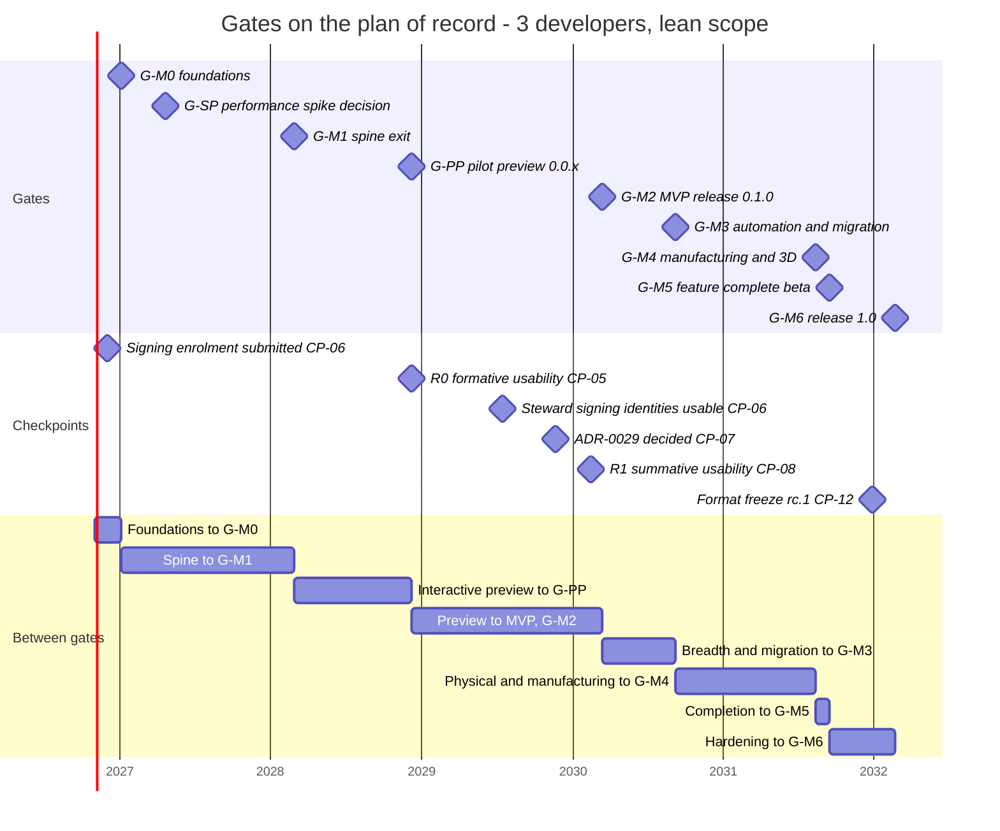
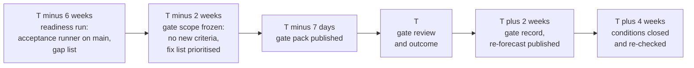
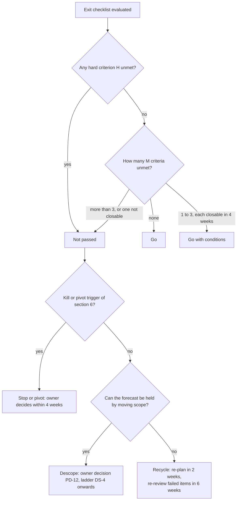

# Gates

**Status:** Draft v0.5 · **Date:** 2026-10-22 (v0.5: open question 3 in use, the G-M1 readiness run in `gate-records/`, decision log ID-419; v0.4: the blind drafter at G-PP and G-M2, WP-S6.13 in M-PP and the 1.0 month of the plan of record, decision log ID-341, ID-342; the Golden A info total; v0.3: the G-SP gate record of 2026-10-20 and the re-forecast) · **Part of:** ElektraWatt plan

**Purpose.** This document defines the gate system of ElektraWatt (EW): the decision points G-M0 … G-M6 and the
light gate G-PP of the pilot preview, aligned with the milestones M0 … M6 and M-PP of the
[global plan](01-global-plan.md) and the [work breakdown](02-work-packages.md), plus one optional decision gate,
G-SP, after the performance spike. For every gate it states the purpose, the timing in the 2-, 3- and 4-developer
scenarios, who decides, the entry criteria, the exit criteria as a checklist of measurable evidence (acceptance
criteria AC-nn and defect tests D-nn of the [golden project](../design/20-golden-project.md), performance budgets of
the [non-functional requirements](../design/02c-nonfunctional-requirements.md), CI jobs of
[quality, security and release](../design/18-quality-security-release.md), usability results, the legal gates LG-1 …
LG-6 of [governance](../design/19-open-source-governance.md), and the open ADRs), the artefacts a review needs, the
possible outcomes, and the kill and pivot criteria. It ends with a gate-review template and a RACI table. It adds no
estimates of its own: every date is a milestone date of the global plan, computed from
[work-packages.csv](work-packages.csv) and written to [milestones.csv](milestones.csv) and
[wp-schedule.csv](wp-schedule.csv) by [tools/schedule.py](tools/schedule.py); the date tables below are generated
blocks of that script, and `schedule.py --check` fails when one is stale.

**ID scheme.** Gates are **G-M0 … G-M6**, **G-PP** and **G-SP**, never the bare short forms of the earlier draft (G1 … G13 are the
research gap topics and G-SP was once written with a number). Kill triggers are **KT-1 … KT-8** (the vision constraints K-1 … K-7 are a different list),
gate checkpoints are **CP-01 … CP-13** (the research corrections C-n are a different list), gate-pack items are
**GP-01 … GP-14** (the personas P1 … P6 are a different list). Exit criteria are numbered
**G-M*n*-*nn***, **G-PP-*nn*** and **G-SP-*nn***. The work breakdown's planning assumptions are **PA-n**, the global
plan's **GA-n**, and this document's own planning basis **GB-n**.

---

## Summary for decision makers

**The system in one paragraph.** Eight gates (G-M0 … G-M6 and the light G-PP) and one optional decision gate,
G-SP. Each gate is a review of evidence against a fixed checklist, held within two weeks of the forecast milestone
date, with one of five outcomes: go, go with conditions, recycle, descope or stop. Criteria are typed: **H** (hard:
never waived, never conditioned), **M** (must: may become a condition with an owner and a deadline of at most four
weeks) and **S** (should: a gap needs a dated plan). G-PP is deliberately light: one hard criterion, no conditions,
one hour. A gate does not stop work, because phases overlap and a free developer pulls the next ready work package
(WP). A failed gate stops *commitments*: a release, an external date, spending, and the dropping of scope. Every gate
replaces the committed dates with a re-forecast from measured velocity.

| Gate | Milestone | Plan-of-record month (3 developers, lean) | What the gate decides | Hardest evidence |
|---|---|---|---|---|
| **G-SP** (optional) | Performance spike | 6 (Apr 2027) | Cold-first with selective `ew-memo`, or the named fallback per query family (PD-8). **Held 2026-10-20: Recycle** (ADR-0002 amendment 4, §5.1 gate record) | Spike report against NFR-PERF-03, -05, -07, -13 on synthetic S/M/L/XL |
| **G-M0** | M0 Foundations | 3 (Jan 2027) | The team, scope and plan of record (PD-1, PD-3, PD-14); legal basis started; the spine may be built | CI on three OSes, licence-boundary check, LG-5 signed, ADR-0027 and ADR-0028 accepted, signing enrolment submitted |
| **G-M1** | M1 Spine exit | 16 (Feb 2028) | The open format and derivation engine are proven headless; the plan is re-based on measured velocity (PD-11); the legal basis is closed enough to accept contributions | AC-01 … AC-13, AC-15 … AC-17, AC-20, AC-39; LG-1, LG-2; ADR-0030 |
| **G-PP** (light) | M-PP Pilot preview, release 0.0.x | 26 (Dec 2028) | The pilot may use the unsigned preview for new projects; R0 starts | The pilot draws golden folios 101–103 and the parts list 901 in a new project and exports the PDF (AC-07) |
| **G-M2** | M2 MVP, release 0.1.0 | 41 (Mar 2030) | The first signed public release; the pilot may switch for new projects | AC-14 (all OSes), AC-18 (GUI), AC-21, AC-23, AC-28 …; R1; LG-3, LG-4; CI-R-01 … CI-R-11 |
| **G-M3** | M3 Automation and migration | 47 (Sep 2030) | Existing QET projects migrate; PLC exchange and EDZ/DXF work against reference files; SC-3 and SC-4 closed | AC-25 … AC-27, AC-30, AC-38; SC-3, SC-4 |
| **G-M4** | M4 Manufacturing and 3D | 58 (Aug 2031) | The physical and manufacturing chain works on Golden A-R | AC-34, AC-35 content; NFR-PERF-16, -17, -18, -24 |
| **G-M5** | M5 Feature complete (beta) | 59 (Sep 2031) | No new scope; 1.0 beta may be published | AC-22; L/XL performance gate green |
| **G-M6** | M6 Release 1.0 | 65 (Mar 2032) | 1.0 may be published | AC-01 … AC-42 (except AC-36, AC-42); SC-7, SC-8; R2; format freeze |

**The honest timing.** The architecture's indicative gate months (M1 at 3, M2 at 6–7, M3 at 9, M4 at 12, 1.0 at
15–18) cannot be met by two to four developers, as the global plan shows. The gates below sit at the realistic
months of [milestones.csv](milestones.csv) (§2.2): with three developers G-M1 is at month 16 (Feb 2028), G-PP at
month 26 (Dec 2028), G-M2 at month 41 (Mar 2030) and G-M6 at month 65 (Mar 2032). The ±20 % capacity band moves
G-M2 to month 34–51 and G-M6 to month 54–81 (§2.2). A fourth developer from month 4 brings G-M2 to month 36 and
G-M6 to month 58; two developers push G-M2 to month 60 and G-M6 to month 97, which §6 treats as a trigger for a
viability review, not as a plan. The internal AI-moderate target of the global plan (§3.7) would bring G-M2 to month
33 and G-M6 to month 52; it plans the team's iterations, while gates, external dates and `ROADMAP.md` stay on the
conservative baseline until the G-M1 re-baseline.

**What is asked of the project owner now (G-M0, November 2026).**
1. Adopt the gate system and the typing of criteria (H, M, S) together with PD-1, with the conservative baseline as
   the external plan of record and AI-moderate as the internal target only (decision log DEC-081).
2. Confirm the scope of the pilot preview and its one-criterion gate G-PP with the pilot in the pre-G-M0 workshop
   (PD-14, decision log DEC-082).
3. Adopt the schedule triggers of §4.2 and §6.1: amber at a velocity ratio below 0.9, red below 0.8, viability
   review below 0.67 (the point at which three developers deliver the two-developer schedule).
4. Name the gate chair (project lead) and the delegates for the project owner and the pilot user (RACI, §9).
5. Decide whether G-SP is held as a gate or folded into the monthly plan review (open question 1). The
   recommendation is a gate, because the fallback changes the shape of every later derivation WP.

---

**Contents**
1. [Planning basis and principles](#1-planning-basis-and-principles)
2. [Gate overview and timing](#2-gate-overview-and-timing)
3. [Gate governance: who decides, how, with which outcomes](#3-gate-governance-who-decides-how-with-which-outcomes)
4. [Evidence, forecast and the decision calendar](#4-evidence-forecast-and-the-decision-calendar)
5. [The gates](#5-the-gates)
   - [5.1 G-SP Performance spike decision](#51-g-sp-performance-spike-decision)
   - [5.2 G-M0 Foundations](#52-g-m0-foundations-m0)
   - [5.3 G-M1 Spine exit](#53-g-m1-spine-exit-m1)
   - [5.4 G-PP Pilot preview (light gate)](#54-g-pp-pilot-preview-light-gate-m-pp)
   - [5.5 G-M2 MVP release 0.1.0](#55-g-m2-mvp-release-010-m2)
   - [5.6 G-M3 Automation breadth and migration](#56-g-m3-automation-breadth-and-migration-m3)
   - [5.7 G-M4 Manufacturing and 3D panel](#57-g-m4-manufacturing-and-3d-panel-m4)
   - [5.8 G-M5 Feature complete, 1.0 beta](#58-g-m5-feature-complete-10-beta-m5)
   - [5.9 G-M6 Release 1.0](#59-g-m6-release-10-m6)
6. [Kill and pivot criteria across gates](#6-kill-and-pivot-criteria-across-gates)
7. [Gate-review template](#7-gate-review-template)
8. [Traceability: acceptance, defects, success criteria, legal gates and CI by gate](#8-traceability-acceptance-defects-success-criteria-legal-gates-and-ci-by-gate)
9. [RACI](#9-raci)
10. [Sources](#sources)
11. [Open questions](#open-questions)

---

## 1. Planning basis and principles

### 1.1 Planning basis

The gate dates inherit the planning assumptions of the [global plan](01-global-plan.md#12-assumptions) (GA-1 …
GA-13). They are repeated here because every date in this document depends on them.

| ID | Assumption | Value used |
|---|---|---|
| GB-1 | **Start** | Month 0 = November 2026 (2026-11-01). Month *n* is labelled with the calendar month that ends there: month 3 = January 2027, month 15 = January 2028 |
| GB-2 | **Team** | Baseline **3 developers** from month 0. Scenarios: **2 developers**, and **4 developers** with the fourth joining at month 4 and the team working at 90 % efficiency |
| GB-3 | **Capacity** | **36 productive person-weeks (pw) per developer per year** after holidays, illness, team rituals, routine support and upkeep (3 pw per month). Sensitivity **±20 %** (28.8 and 43.2 pw per developer-year) |
| GB-4 | **AI assistance** | Helps with boilerplate, parsers, test scaffolding and drafting and is already inside the likely estimates (10–20 % below unassisted work). It is **not** assumed to multiply throughput |
| GB-5 | **Reserve** | 20 % integration, hardening and bug-fix reserve on every WP, plus the stabilisation WPs WP-S6.08 and WP-S6.12. Never spent on new scope |
| GB-6 | **Scope of record** | Lean scope (levers a, b and c of [WBS §7](02-work-packages.md#7-scope-levers)) pending PD-1: pilot preview at month 26, MVP at month 41, 1.0 at month 65 (milestone months of [milestones.csv](milestones.csv)). PLC/I-O, manufacturing outputs, 3D panel layout with routing and wire lengths, and QET/EDZ/DXF import stay in 1.0. Full-scope dates are shown alongside. The conservative baseline is the external plan of record; the AI-moderate scenario of the global plan (§3.7) is an internal target and never moves a gate date until the G-M1 re-baseline (GB-9) |
| GB-7 | **Gate date** | The milestone month of the scenario, base capacity. The review is held within two weeks of the *forecast* milestone date ([global plan §11.3](01-global-plan.md#113-milestone-and-gate-reviews)); each review replaces the committed dates with a re-forecast |
| GB-8 | **Effort of gates** | The review meeting is at most 3 hours (G-SP and G-PP: 1 hour) and sits inside the 3.5 pw per developer-year of team rituals. Evidence is produced by CI and the acceptance runner, not by hand; the release gates are carried by WP-S6.08 (G-M2), WP-S6.09 (G-M5) and WP-S6.10 and WP-S6.12 (G-M6). The gate system adds no pw to the WBS |
| GB-9 | **Re-baseline** | At G-M1 the AI scenarios retire: the velocity ratio measured on the spine WPs replaces both the baseline and the AI-moderate target, and the result becomes the single plan of record ([global plan §3.7](01-global-plan.md#37-ai-assisted-scenarios), PD-11) |

### 1.2 Principles

1. **Criteria, not dates.** A gate is passed on evidence. A slipping date moves the review, never the checklist.
   "Re-forecast, not pass with missing acceptance criteria" ([global plan §11.3](01-global-plan.md#113-milestone-and-gate-reviews)).
2. **The acceptance runner is the judge.** The runner reports pass or fail per AC-nn, per D-nn and per requirement
   ID (NFR-MAINT-11); each gate evaluates its AC subset ([golden §22](../design/20-golden-project.md#22-milestone-gates)).
   Opinions do not replace a red row.
3. **Gates stop commitments, not work.** Phases overlap by design. A failed gate puts its failed items at the top of
   the board, and the team keeps pulling ready WPs of later milestones where nothing is blocked. What stops: the
   release, external dates, spending, and any decision to drop scope.
4. **Some things are never waived** (§3.5): any AC of the gate, the CRA and signing conditions before a public
   release, the 20 % reserve as a scope buffer, the anonymisation guard (AC-39), and the licence-boundary check.
5. **One owner decides, with named concurrence.** The project owner decides scope, legal, funding and release. The
   pilot user concurs on acceptance truth. Counsel confirms legal evidence in writing. No concurrence can be given by
   silence.
6. **The ladder comes first.** Scope moves only along the descoping ladder DS-4 … DS-8 of the
   [global plan §16](01-global-plan.md#16-descoping-options-if-behind-schedule), in order, by an owner decision
   (PD-12).
7. **Evidence is tied to a commit.** Every piece of evidence names the commit or tag it was produced on and is no
   older than seven days (nightlies) or from the release candidate itself (release gates).
8. **Public repository.** Gate records contain roles, not names, and never contain customer or end-user names,
   project or drawing identification numbers, e-mail addresses or the confidentiality notice of the reference set
   (anonymisation rules of the [golden project §3.5](../design/20-golden-project.md)). Signed statements stay on
   file with the steward (`legal/`, ST-09); the gate record cites that they exist, not what they say.

### 1.3 Gates, releases and checkpoints

| Thing | What it is | Relation to gates |
|---|---|---|
| **Gate** | A human decision on a fixed checklist (this document) | Eight gates (G-M0 … G-M6 and the light G-PP) and G-SP |
| **Release** | A build through the pipeline CI-R-01 … CI-R-11 and the checklist RC-01 … RC-11 ([quality §7.4](../design/18-quality-security-release.md#74-release-pipeline-and-checklist)) | Every release repeats the pipeline. CI-R-02 collects the acceptance rows of every milestone reached. G-M2 authorises 0.1.0, G-M5 authorises 1.0.0-beta.1, G-M6 authorises 1.0.0. The monthly 0.x releases between gates need the pipeline and the checklist, not a gate review |
| **Checkpoint** | A dated decision or event between gates (§2.5, CP-01 … CP-13): a usability round, an enrolment submission, an ADR | Its outcome is evidence for the next gate; a missed checkpoint is a risk item in the pack |
| **Monthly plan review** | 30 minutes, project lead ([global plan §11.2](01-global-plan.md#112-tracking-and-re-planning)) | Produces the forecast that every gate pack contains |

### 1.4 Names

The gate of milestone M*n* is **G-M*n*** (G-M0 … G-M6), and the light gate of the pilot preview M-PP is **G-PP**,
in this document and in the global plan. The optional decision gate after the performance spike is **G-SP**. The
earlier short forms (the letter G and a bare digit, and a gate written minus one) collided with the research gap topics
G1 … G13 and with the spine exit; no plan document uses them (`doccheck.py` enforces it). Kill triggers are KT-n, checkpoints CP-nn, gate-pack items GP-nn
and exit criteria G-M*n*-*nn*, G-PP-*nn* and G-SP-*nn*.

---

## 2. Gate overview and timing

### 2.1 Overview

| Gate | Milestone and release | Kind | Authorises | Review length | Typical attendees |
|---|---|---|---|---|---|
| **G-SP** | Performance spike after WP-S1.03 | Decision gate | The memoisation list and the fallback per query family; closes PD-8 | 1 h | Project lead (chair), core developer, second `ew-memo` owner, project owner |
| **G-M0** | M0 Kick-off and foundations; CI artefacts only | Milestone gate | The plan of record (PD-1, PD-3, PD-14), the spend on counsel and trademark search, external announcement of the plan | 2 h | Project lead, all developers, project owner, pilot user, counsel for LG-1 and LG-5 |
| **G-M1** | M1 Spine exit; signed source tag `m1`, nightly CLI builds | Milestone gate | The interactive phase as the main effort, acceptance of external contributions (LG-2), opening community channels, the re-based plan (PD-11) | 3 h | As G-M0, plus steward liaison |
| **G-PP** | M-PP Pilot preview; unsigned development build **0.0.x** for the pilot, source tag `pp` | Light gate | The pilot's use of the preview for new projects; the first preview issue list and R0 | 1 h | Project lead (chair), pilot user, S2 owner |
| **G-M2** | M2 MVP; release **0.1.0** | Release gate | The first signed public release; the pilot's switch for new projects | 3 h, plus a go/no-go of 30 minutes at the release candidate | As G-M1, plus release manager and UX researcher |
| **G-M3** | M3 Automation breadth and migration; release 0.7.0 | Milestone gate | QET migration for existing projects as supported; PLC exchange claims; SC-3 and SC-4 closed | 2 h | As G-M1 |
| **G-M4** | M4 Manufacturing and 2D/3D panel; release 0.18.0 | Milestone gate | The claim "3D layout, routing and wire lengths work"; partner-shop trials | 2 h | As G-M1 |
| **G-M5** | M5 Feature complete; release **1.0.0-beta.1** | Release gate | Publication of the beta; the feature stop; R2 preparation | 2 h | As G-M2 |
| **G-M6** | M6 Release 1.0; release **1.0.0** | Release gate | Publication of 1.0; LG-6 steward review; the 1.x plan | 3 h, plus 30 minutes at the final release candidate | As G-M2, plus counsel |

### 2.2 Timing per scenario

Month and calendar label (the month in which the month ends). **Lean scope, base capacity** unless a column says
otherwise. All tables of this section are generated blocks: `python3 -I docs/plan/tools/schedule.py` rewrites them
from [work-packages.csv](work-packages.csv) and the same run writes [milestones.csv](milestones.csv); `--check` fails
when one is stale. They hold one model for every team size (global plan GA-2): the fourth developer joins at month 4
and the whole team works at 90 % efficiency from that month. The G-SP month is the finish of WP-S1.03 (`ew-model`)
plus one month for the spike itself (about three weeks of work) and its report; the spike then runs right after
WP-S1.03, as [global plan §9.2](01-global-plan.md#92-ordering-rules) rule 2 requires, and not when WP-S1.05 is
otherwise reached. The two AI columns are the internal target and the upside of the global plan
([§3.7](01-global-plan.md#37-ai-assisted-scenarios)); they are not dates to promise.

<!-- generated:gate-timing -->
| Gate | 2 developers | **3 developers (baseline)** | 4 developers (fourth from month 4) | 3 + AI-moderate (internal) | 3 + AI-strong |
|---|---|---|---|---|---|
| **G-SP** | 7 (May 2027) | **6 (Apr 2027)** | 6 (Apr 2027) | 5 (Mar 2027) | 5 (Mar 2027) |
| **G-M0** | 3 (Jan 2027) | **3 (Jan 2027)** | 3 (Jan 2027) | 3 (Jan 2027) | 3 (Jan 2027) |
| **G-M1** | 23 (Sep 2028) | **16 (Feb 2028)** | 16 (Feb 2028) | 13 (Nov 2027) | 11 (Sep 2027) |
| **G-PP** | 37 (Nov 2029) | **26 (Dec 2028)** | 24 (Oct 2028) | 21 (Jul 2028) | 18 (Apr 2028) |
| **G-M2** | 60 (Oct 2031) | **41 (Mar 2030)** | 36 (Oct 2029) | 33 (Jul 2029) | 29 (Mar 2029) |
| **G-M3** | 70 (Aug 2032) | **47 (Sep 2030)** | 40 (Feb 2030) | 38 (Dec 2029) | 32 (Jun 2029) |
| **G-M4** | 84 (Oct 2033) | **58 (Aug 2031)** | 52 (Feb 2031) | 47 (Sep 2030) | 40 (Feb 2030) |
| **G-M5** | 88 (Feb 2034) | **59 (Sep 2031)** | 52 (Feb 2031) | 47 (Sep 2030) | 41 (Mar 2030) |
| **G-M6** | 97 (Nov 2034) | **65 (Mar 2032)** | 58 (Aug 2031) | 52 (Feb 2031) | 45 (Jul 2030) |
<!-- /generated:gate-timing -->

**Sensitivity, three developers.** Capacity −20 % / +20 % (28.8 / 43.2 pw per developer-year), and the full scope
(PD-1 rejects the levers).

<!-- generated:gate-sensitivity-3d -->
| Gate | −20 % capacity | Base | +20 % capacity | Full scope, base |
|---|---|---|---|---|
| **G-SP** | 7 (May 2027) | 6 (Apr 2027) | 5 (Mar 2027) | 6 (Apr 2027) |
| **G-M0** | 3 (Jan 2027) | 3 (Jan 2027) | 2 (Dec 2026) | 3 (Jan 2027) |
| **G-M1** | 20 (Jun 2028) | 16 (Feb 2028) | 14 (Dec 2027) | 16 (Feb 2028) |
| **G-PP** | 33 (Jul 2029) | 26 (Dec 2028) | 22 (Aug 2028) | 26 (Dec 2028) |
| **G-M2** | 51 (Jan 2031) | 41 (Mar 2030) | 34 (Aug 2029) | 44 (Jun 2030) |
| **G-M3** | 58 (Aug 2031) | 47 (Sep 2030) | 39 (Jan 2030) | 48 (Oct 2030) |
| **G-M4** | 73 (Nov 2032) | 58 (Aug 2031) | 49 (Nov 2030) | 60 (Oct 2031) |
| **G-M5** | 74 (Dec 2032) | 59 (Sep 2031) | 50 (Dec 2030) | 67 (May 2032) |
| **G-M6** | 81 (Jul 2033) | 65 (Mar 2032) | 54 (Apr 2031) | 72 (Oct 2032) |
<!-- /generated:gate-sensitivity-3d -->

**Sensitivity, two and four developers** (lean scope; −20 % / base / +20 %).

<!-- generated:gate-sensitivity-2d4d -->
| Gate | 2 developers: −20 % | base | +20 % | 4 developers: −20 % | base | +20 % |
|---|---|---|---|---|---|---|
| **G-SP** | 9 (Jul 2027) | 7 (May 2027) | 6 (Apr 2027) | 7 (May 2027) | 6 (Apr 2027) | 5 (Mar 2027) |
| **G-M0** | 3 (Jan 2027) | 3 (Jan 2027) | 2 (Dec 2026) | 3 (Jan 2027) | 3 (Jan 2027) | 2 (Dec 2026) |
| **G-M1** | 29 (Mar 2029) | 23 (Sep 2028) | 19 (May 2028) | 19 (May 2028) | 16 (Feb 2028) | 13 (Nov 2027) |
| **G-PP** | 47 (Sep 2030) | 37 (Nov 2029) | 31 (May 2029) | 30 (Apr 2029) | 24 (Oct 2028) | 21 (Jul 2028) |
| **G-M2** | 75 (Jan 2033) | 60 (Oct 2031) | 50 (Dec 2030) | 45 (Jul 2030) | 36 (Oct 2029) | 30 (Apr 2029) |
| **G-M3** | 87 (Jan 2034) | 70 (Aug 2032) | 59 (Sep 2031) | 50 (Dec 2030) | 40 (Feb 2030) | 34 (Aug 2029) |
| **G-M4** | 105 (Jul 2035) | 84 (Oct 2033) | 70 (Aug 2032) | 65 (Mar 2032) | 52 (Feb 2031) | 44 (Jun 2030) |
| **G-M5** | 110 (Dec 2035) | 88 (Feb 2034) | 74 (Dec 2032) | 65 (Mar 2032) | 52 (Feb 2031) | 44 (Jun 2030) |
| **G-M6** | 121 (Nov 2036) | 97 (Nov 2034) | 81 (Jul 2033) | 72 (Oct 2032) | 58 (Aug 2031) | 48 (Oct 2030) |
<!-- /generated:gate-sensitivity-2d4d -->

**Full scope, base capacity, two and four developers.**

<!-- generated:gate-full-2d4d -->
| Gate | 2 developers, full scope | 4 developers, full scope |
|---|---|---|
| **G-SP** | 7 (May 2027) | 6 (Apr 2027) |
| **G-M0** | 3 (Jan 2027) | 3 (Jan 2027) |
| **G-M1** | 23 (Sep 2028) | 16 (Feb 2028) |
| **G-PP** | 37 (Nov 2029) | 24 (Oct 2028) |
| **G-M2** | 64 (Feb 2032) | 39 (Jan 2030) |
| **G-M3** | 72 (Oct 2032) | 43 (May 2030) |
| **G-M4** | 87 (Jan 2034) | 51 (Jan 2031) |
| **G-M5** | 99 (Jan 2035) | 56 (Jun 2031) |
| **G-M6** | 108 (Oct 2035) | 61 (Nov 2031) |
<!-- /generated:gate-full-2d4d -->

**Reading it.**
- The first three gates are nearly scenario-independent in *content* but not in time. G-M0 is month 3 in every base
  case because the foundation WPs are short and parallel.
- G-PP is bound by the UI chain after M1 (WP-S2.01 → WP-S2.03 → WP-S2.04): a fourth developer does not bring it
  forward by more than two months (month 26 with three developers, 24 with four), and two developers push it to
  month 37 (Nov 2029).
- With three developers G-M4 and G-M5 are one month apart; with four they fall in the same month. In both cases the
  gates may be held in one meeting with two records (§3.3).
- Everything from G-M2 onwards is at least 34 months out in every three-developer case with the lean scope. Those
  dates are forecasts; the *evidence* for them is the velocity ratio measured at G-M1 (§4.2), and each gate
  re-forecasts the rest.
- A gate month is "when the criteria are expected to be met", so it already contains the 20 % reserve. A gate that
  closes early is held early; there is no waiting for the calendar.
- The architecture's indicative months (M1 at 3, M2 at 6–7, M3 at 9, M4 at 12, 1.0 at 15–18) are superseded by this
  table.



The gate dates are those of the baseline gantt of the [global plan §7](01-global-plan.md#7-baseline-schedule-three-developers)
(generated by `schedule.py`); the checkpoint dates are WP start and finish months of
[wp-schedule.csv](wp-schedule.csv), converted with the same tool.

### 2.3 Scenario rules

| Scenario | Rule |
|---|---|
| **3 developers (baseline)** | As in §2.2. G-M4 and G-M5 may be held as one meeting if both are forecast within six weeks of each other ([global plan open question 6](01-global-plan.md#open-questions)) |
| **3 developers, AI-moderate (internal target)** | Plans the iterations and the monthly forecast only. No gate is brought forward, no external date is quoted from it, and a gap between target and baseline is not a slip. G-M1 re-baselines both from the measured ratio ([global plan §3.7](01-global-plan.md#37-ai-assisted-scenarios), GB-9) |
| **4 developers** | G-M0 checks that PD-3 was taken by month 2 and that developer 4 has a start date. G-SP includes the new developer as the second `ew-memo` owner if they joined (month 4 is before the spike). G-M4 and G-M5 coincide in the lean scope: one meeting. The STEP worker (WP-S4.03) may be built before G-M2 ([global plan §9.2](01-global-plan.md#92-ordering-rules) rule 4); G-M2 then also checks that the extra work did not move G-M2 by more than one month |
| **2 developers** | Both developers are the two owners of each critical crate (NFR-MAINT-07), so the bus factor equals the team. **G-M1 must take the re-scope decision** of [global plan open question 8](01-global-plan.md#open-questions) (MVP plus one binding v1 addition at a time, chosen with the pilot; **G-PP becomes the first release target**); an MVP at month 60 is a trigger of §6.1, not a plan |
| **Any scenario, team change** | A change of two or more developers (loss or addition) triggers an out-of-cycle re-forecast and a gate-type review of the plan of record (PD-1 re-confirmed) within four weeks |

### 2.4 Combined and out-of-cycle reviews

- **Combined.** Gates forecast within six weeks of each other are held in one meeting. Each gate keeps its own
  record, outcome and checklist. A combined meeting never merges criteria.
- **Early.** If all exit criteria are green earlier than forecast, the gate is held early. There is no reward for
  waiting.
- **Out of cycle.** The chair calls an out-of-cycle review when a trigger of §6.1 fires, when a legal gate fails
  (LG-1 refused, no steward), or when two developers or the pilot user leave.

### 2.5 Checkpoints between gates

Checkpoints are decisions and events whose dates the gates depend on. Months are for the plan of record (3
developers, lean scope; WP months from [wp-schedule.csv](wp-schedule.csv)); in other scenarios they move with the
milestone they precede.

| ID | Checkpoint | Plan-of-record date | Owner | Feeds | If missed |
|---|---|---|---|---|---|
| CP-01 | **ADR-0027 grid and ADR-0028 fonts** decided with the pilot user and two EPLAN users (PD-4 by spine week 2, PD-5 by spine week 3) | Mid-November 2026 (week 2) and late November 2026 (week 3) | Project owner, pilot user | G-M0 | WP-S3.01, WP-S3.02 and the starter symbols wait: the output lane stalls |
| CP-02 | **Developer 4 decision** (PD-3) | Month 2 (Dec 2026) | Project owner, employer | G-M0 | In the first year each month of delay costs about a tenth of a month at G-M2 (start at month 4: G-M2 at 36; month 9: 36; month 15: 37; [global plan §10.3](01-global-plan.md#103-when-to-add-developer-4)) |
| CP-03 | **Pilot size data** (three largest projects) and the QET baseline timing | **Size data closed 2026-10-20** (decision log ID-272): three projects received, all inside class S; the QET baseline timing stays due by month 3 (Jan 2027) | Pilot liaison | G-M0, G-SP, G-M1, G-M3 | Size classes S/M/L/XL stay assumptions (AS-2); SC-3 has no baseline |
| CP-04 | **Quarterly upgrade train** with the schema-steward rotation | Jan, Apr, Jul, Oct | Quarter's steward | All gates | More than 3 developer-days or abort rule: SR-9 |
| CP-05 | **R0 formative usability round** (think-aloud tasks T1, T2, T8 with the pilot user and a colleague) on the preview build (WP-S2.12, [global plan §12.1](01-global-plan.md#121-what-the-pilot-gets-and-gives-per-milestone)) | Month 26 (Dec 2028), with M-PP | UX researcher | G-PP, G-M2 | R1 starts without formative findings (NFR-UX-09) |
| CP-06 | **Steward and signing enrolment submitted** (PD-7a: identity holder named; D-U-N-S, Apple organisation, Artifact Signing identity validation; SignPath fallback decision) in the first 90 days by WP-S0.05a; the enrolment lead time of at least 12 months is modelled as a lag of WP-S0.05, whose finish makes the identities usable by CI | Submitted: finish of WP-S0.05a, month 1 (Nov 2026), at the latest at G-M0 (month 3, Jan 2027). Identities usable: finish of WP-S0.05, month 33 (Jul 2029) | Steward liaison | G-M0, G-M1 (plan), G-M2 | SR-6: G-M2 cannot be passed however ready the code is. The latest submission that still holds the MVP date is about month 20 in the baseline ([global plan §9.3](01-global-plan.md#93-schedule-risk-register) SR-6) |
| CP-07 | **ADR-0029 decided** (before WP-S6.05 starts) | Month 37 (Nov 2029) | Project owner | G-M2 | First-run prompt, `PRIVACY.md` and 0.1.0 blocked |
| CP-08 | **R1 summative round** on the release candidate (PD-10 follows) | Month 40 (Feb 2030) | UX researcher | G-M2 | G-M2 cannot be held (NFR-UX-01) |
| CP-09 | **Partners named** for SC-7 and SC-8: TIA Portal V21 and CODESYS installations, a partner shop with Komax and Rittal WT machines | By G-M3 (month 47, Sep 2030) | Pilot liaison | G-M3, G-M6 | SR-10: G-M6 blocked or a recorded deviation |
| CP-10 | **OCCT packaging spike** for `ew-step-worker` on Windows, macOS and Linux | Before WP-S4.03 starts (month 46, Aug 2030) | Physical developer | G-M3, G-M4 | The float of WP-S4.03 (38 weeks) is spent without a result |
| CP-11 | **R2 summative round** on the 1.0 release candidate | Months 60–61 (Oct–Nov 2031) | UX researcher | G-M6 | G-M6 cannot be held (NFR-UX-01, NFR-UX-02) |
| CP-12 | **Format freeze** at 1.0.0-rc.1, 8 weeks before 1.0.0 | Month 62 (Dec 2031) | Schema steward | G-M6 | The 1.0 format window is missed ([quality §7.2](../design/18-quality-security-release.md#72-format-change-window)) |
| CP-13 | **Funding calls**: WBSO application (Q4 each year); NLnet proposal 1 at the first call after LG-1 is signed (target month 3), proposal 2 at G-M1, proposal 3 at G-M2 | See [global plan §13](01-global-plan.md#13-funding-plan) | Project lead | G-M0, G-M1, G-M2 | No date impact on the plan of record, which assumes no grants (SR-13) |
| CP-14 | **Pre-G-M0 scope workshop with the pilot** (half a day, WP-S0.08): triage of the MVP Must rows, PD-2, PD-14, the M-PP scope and the G-PP folios; the record feeds DS-7 | Weeks 4–8 (December 2026) | Project lead with the pilot | G-M0, G-PP | The M-PP scope stays unconfirmed and DS-7 has no triage to work from (R-067, R-068) |
| CP-15 | **Counsel's answer on the CRA status of a pilot-only preview** ([global plan open question 9](01-global-plan.md#open-questions)) | Within the first 90 days; before the first 0.0.x build is handed over | Steward liaison | G-M0, G-PP | If the preview counts as made available, it ships only after the WP-S6.04 minimum (security contact, vulnerability handling) is in place |

---

## 3. Gate governance: who decides, how, with which outcomes

### 3.1 Roles

Roles are hats, not people ([WBS §2.4](02-work-packages.md#24-owner-roles),
[global plan §10.1](01-global-plan.md#101-roles-and-holders)). In a small team one person holds several. A person
never reviews their own evidence alone: the evidence owner and the reviewer of the same item differ.

| Role | Who holds it | Part in a gate |
|---|---|---|
| **Project owner** | The person who decides scope, licence, funding and release for EW (PD-1 … PD-15) | Decides descope, stop and the *go* of the release gates G-M2, G-M5 and G-M6; takes the owner decisions that a gate lists; may delegate in writing for one gate |
| **Project lead** | Holds the plan, funding and governance hat (dev 1 in the baseline); may be the project owner | **Chairs** every gate; decides go, go with conditions and recycle at G-SP, G-M0, G-M1, G-PP, G-M3 and G-M4; owns the gate pack and the gate record |
| **Core team** | The developers and maintainers (2, 3 or 4) | Produces and presents evidence; recommends the outcome; each presents the area they own |
| **Stream owners** | S1 owner (core), S2 owner (UI and UX researcher), S3 and S5 owner, S4 owner, S6 release engineer, S7 content maintainer | Present the exit criteria of their stream |
| **Release manager** | Rotating per release (from 0.1.0) | Runs CI-R-01 … CI-R-11 and RC-01 … RC-11; never the only reviewer of the release PR; present from G-M2 |
| **Pilot user** | The panel builder whose reference drawing set is the acceptance specification | Owns acceptance truth (`golden/J-E-2416/tables/`); concurs on golden acknowledgement, G-PP-01, SC-3, SC-4, SC-9 and the pilot-related criteria; no vote on architecture |
| **Counsel** | External legal adviser | Confirms LG-1, LG-2, LG-3, LG-4, LG-5 and ADR-0025 and ADR-0030 evidence in writing; no vote on technical matters |
| **Steward liaison** | Holds legal gates with counsel and the steward | Presents LG-x evidence, the steward checklist ST-01 … ST-10 and RC-10 |
| **UX researcher** | S2 owner or a delegate | Presents usability rounds R0 … R2 |

**Who must be present and who must concur** (a criterion in a person's domain cannot be passed without their
concurrence; absence means the criterion stays open):

| Gate | Chair | Owner decides | Pilot user concurs on | Counsel confirms in writing | Also required |
|---|---|---|---|---|---|
| G-SP | Project lead | Only descope of class bounds or a KT-3 review | Informed only | none | Core developer (decides PD-8 with the chair), second `ew-memo` owner |
| G-M0 | Project lead | PD-1, PD-3, PD-14; spend on counsel | ADR-0027, ADR-0028, LG-5, kick-off answers, the M-PP scope and the Must-row triage | LG-1 text, LG-5 text, the CRA status of the preview | All developers |
| G-M1 | Project lead | PD-7, PD-11; opening channels | Golden acknowledgement, side-by-side review | LG-1, LG-2, ADR-0025, ADR-0030, CRA scope | Steward liaison |
| G-PP | Project lead | None (light gate); a descope of the preview scope only through PD-12 | G-PP-01 (the folios drawn in a new project), the preview issue list | none | S2 owner |
| G-M2 | Project lead | **Go for 0.1.0**; PD-9, PD-10 | R1 result, SC-3 start, pilot switch | LG-3, LG-4, steward checklist | Release manager, UX researcher |
| G-M3 | Project lead | Go; PD-12 if needed | SC-3, SC-4, migration of their projects | none (inform) | Steward liaison |
| G-M4 | Project lead | Go; PD-12 if needed | Partner-shop trial, T11 dry run | none | Release manager |
| G-M5 | Project lead | **Go for the beta**; PD-12 | Journeys J1 … J6 walkthrough | none | Release manager, UX researcher |
| G-M6 | Project lead | **Go for 1.0**; PD-13 | R2, SC-7, SC-8, SC-3 | LG-6 form, word-mark filing | Release manager, steward liaison, UX researcher |

### 3.2 Decision rule

1. The chair opens with the evidence pack (§4.1) and the exit checklist. Each stream owner states per criterion:
   met, not met, or not measurable yet. Discussion of *whether* a criterion applies happens before the gate (pack
   review), not in it.
2. The core team recommends an outcome by consensus. A developer who disagrees records a dissent in the gate record.
3. The chair decides go, go with conditions or recycle. For G-M2, G-M5 and G-M6 the project owner decides the *go*. Descope
   and stop are always the project owner's decision (PD-12).
4. A criterion is *met* only with its named evidence. A legal criterion needs counsel's or the steward's written
   confirmation on file; an acceptance criterion needs a green row in the runner report on the gated commit.
5. **Quorum.** Chair, the project owner or a written delegate, at least two developers (all of them in a
   two-developer team), and for G-M0, G-M1, G-PP, G-M2, G-M3, G-M5 and G-M6 the pilot user or a written delegate. Without quorum the gate is postponed, not held. G-PP needs only the chair, the pilot user (or delegate) and the S2 owner.
6. Decisions are recorded in the gate record (§7) within two weeks and `ROADMAP.md` is regenerated from it (GV-07).

### 3.3 Review procedure and calendar



| Step | When | Content | Owner |
|---|---|---|---|
| Readiness run | T − 6 weeks | Run the acceptance runner and all gate CI jobs on `main`; list every criterion that is red or not measurable, with an owner. The list becomes the top of the board | Project lead |
| Scope freeze | T − 2 weeks | No new criteria and no new WPs for the milestone. New requests wait for the next gate ("one in, one out") | Project lead |
| Pack | T − 7 days | Evidence pack (§4.1) published in the repository or its CI artefacts | Core team |
| Review | T, within two weeks of the forecast milestone date | §3.2. For G-M2 and G-M6 a second 30-minute go/no-go is held on the final release candidate. G-PP is a one-hour review with the reduced pack of §4.1 | Chair |
| Record and forecast | T + 2 weeks | Gate record; forecast of the next two milestones; risk register; `ROADMAP.md` | Project lead |
| Conditions | T + 4 weeks at the latest | Each condition closed and re-checked by the chair; an unclosed condition turns the outcome into *recycle* | Condition owners |

### 3.4 Outcomes

The [global plan §5.2](01-global-plan.md#52-gate-reviews) names three outcomes (pass, pass with conditions, fail).
This document refines *fail* into recycle, descope and stop.

| Outcome | Meaning | When | What follows | Global plan term |
|---|---|---|---|---|
| **Go** | All H and M criteria met; S criteria met or with a dated plan | Evidence complete | The gate authorises what §2.1 lists; the next phase continues; the forecast is updated | Pass |
| **Go with conditions** | All H criteria met; at most **3** M criteria open, each closable within **4 weeks** with a named owner and an evidence-based test | Typical for a late document, a missing screenshot, a flaky test under quarantine | The authorisation takes effect, except for anything the condition names; the chair re-checks every condition at T + 4 weeks. A release gate publishes only when its release conditions are met | Pass with conditions |
| **Recycle** | At least one H unmet, more than 3 M unmet, or a condition overdue | Evidence does not support the claim | Failed items go to the top of the board; a re-plan within **2 weeks** (ladder of [global plan §16](01-global-plan.md#16-descoping-options-if-behind-schedule)); re-review of the failed criteria only, within **6 weeks**; at most two recycles per gate, after which the project owner must descope or stop | Fail |
| **Descope** | The project owner moves named scope out to hold the forecast or to meet a criterion | Recycle would not hold the ±20 % band, or a criterion depends on work no longer affordable | PD-12 record; WBS levers and `work-packages.csv` updated; vision §9 and the catalogue rows edited by their editors; the acceptance rows that move are listed in the gate record; the forecast is re-run | Fail, resolved by the ladder |
| **Stop** | The project owner stops further investment under the current plan | A kill trigger of §6 has fired and the options do not hold | One of the pivot paths of §6.2 is chosen within 4 weeks; released versions stay available; permissive crates keep their licences | Fail, escalated |

**The light gate G-PP** has only two outcomes, as the [global plan §5.3](01-global-plan.md#53-pilot-preview-m-pp-and-gate-g-pp) says it "never blocks other work and has no conditions": **Go** (its one criterion is met) and **Not yet** (it is not met: the findings go to the pilot log and the R0 fix list, the pilot keeps using the preview, and the criterion is re-checked at the next monthly pilot review). A *Not yet* repeated for three consecutive monthly reviews is a risk item for the next gate pack (R-067) and a fact for KT-1. G-PP never recycles, descopes or stops anything by itself.



### 3.5 Never waived

These stay red until fixed, whatever the schedule says. They are criteria of type **H** wherever they occur.

| Item | Why | Where checked |
|---|---|---|
| Any AC-nn assigned to the gate (and the D-nn rows gated at or before it) | Cutting acceptance moves defects to the pilot, which is the failure EW exists to prevent | Acceptance runner (NFR-MAINT-11) |
| The CRA and signing conditions before every public release: LG-1, LG-4, steward checklist ST-01 … ST-10, SBOM, provenance, signatures, no unpatched high or critical advisory | CRA full application from 2027-12-11 (month 14) covers every public release in every scenario (GA-11) | CI-R-02, CI-R-06 … CI-R-08, RC-03, RC-10 |
| The 20 % reserve and the stabilisation WPs WP-S6.08 and WP-S6.12 | The reserve is not a scope buffer | Board, velocity report |
| The anonymisation guard (AC-39, NFR-PRIV-09, CI-PR-10) | The repository is public; the reference set is confidential customer work | CI-PR-10 |
| The licence-boundary check (CI-PR-09) and REUSE, DCO and the exception texts (NFR-LIC-01 … NFR-LIC-04, NFR-LIC-12) | Closed permissive layer from the first commit (ADR-0024) | CI-PR-09, CI-PR-10 |
| Zero outbound connections without a user action (SC-10, NFR-PRIV-01) | Confidential projects, GDPR, CRA steward position | CI-N-06 |

---

## 4. Evidence, forecast and the decision calendar

### 4.1 The gate pack

One week before every review the core team publishes a pack. Items marked *G* are required at every gate except the light gate G-PP, whose reduced pack is GP-01 (an extract: the M1 acceptance rows still pass on the preview build), GP-02 (its one-row checklist), GP-05, GP-07, GP-09 (with the preview issue list), GP-12 (the folios drawn live) and GP-14.

| # | Artefact | Content | Required at |
|---|---|---|---|
| GP-01 | **Acceptance-runner report** | Pass or fail per AC-nn, per D-nn and per requirement ID on the gated commit or release candidate, with the commit SHA and the CI run links | *G* (from G-M1) |
| GP-02 | **Exit-checklist sheet** | The checklist of the gate with status, evidence link and owner per row (the table of §7) | *G* |
| GP-03 | **CI report** | The CI jobs required at the gate (§8.5), last 7 nightlies, quarantined tests (≤ 10, RC-02) | *G* |
| GP-04 | **Performance and memory report** | The gate of [quality §4](../design/18-quality-security-release.md#4-performance-and-memory-gate) for the classes that gate at this milestone, with the 15 % regression rule | G-SP, G-M1 … G-M6 |
| GP-05 | **Forecast** | Velocity ratio, actual versus estimated pw per stream, re-run of the Appendix A script of the global plan with the actual team, forecast of the next two milestones in the three scenarios and the ±20 % band | *G* |
| GP-06 | **Risk register** | The schedule risks SR-1 … SR-14 of [global plan §9.3](01-global-plan.md#93-schedule-risk-register) with indicators and owners, and the architecture risks of [architecture §16](../design/04-architecture.md#16-risks-mitigations-and-non-goals) | *G* |
| GP-07 | **Decision log** | Owner decisions (PD-n), ADR status changes since the last gate, those due at this gate (§4.3) | *G* |
| GP-08 | **Legal-gate status** | LG-1 … LG-6 with evidence on file (cited, not copied) | G-M0, G-M1, G-M2, G-M6 |
| GP-09 | **Pilot report** | Pilot log, open pilot questions, golden acknowledgements, SC-3 timings | G-M1 … G-M6 |
| GP-10 | **Usability report** | R0, R1 or R2 report (anonymised, participant codes only) | G-M2, G-M6 |
| GP-11 | **Release dossier** | The release candidate, CI-R-01 … CI-R-11 results, RC-01 … RC-11 checklist, SBOM and attestation links, release notes and migration notes | G-M2, G-M5, G-M6 |
| GP-12 | **Demo script** | The demo of [global plan §5.1](01-global-plan.md#51-milestone-table) run live from the release candidate | *G* |
| GP-13 | **Funding evidence** | Deliverables for NLnet milestones that fall at the gate, WBSO hour log | G-M1 … G-M4 |
| GP-14 | **Gate record draft** | The template of §7 filled up to the outcome | *G* |

### 4.2 Forecast, velocity and triggers

The velocity ratio is the PERT pw of finished WPs divided by the actual pw logged ([global plan §11.2](01-global-plan.md#112-tracking-and-re-planning)).
At G-M1 it is measured over the spine WPs (WP-S1.01 … WP-S1.10, WP-S3.01 … WP-S3.05) and clamped to 0.6 – 1.5 until
G-M2 confirms it. The effects below are simulated with `schedule.py` on the plan of record (3 developers,
lean scope; the ratio is applied to every WP): an effort overrun of *x* % is the same as a capacity of 1/(1 + x). The
ranges of the zone table are read from the generated table under it.

| Zone | Velocity ratio | Effort overrun | Forecast G-PP (3 developers) | Forecast G-M2 | Forecast G-M6 | Reaction |
|---|---|---|---|---|---|---|
| **Green** | ≥ 0.90 | up to +11 % | 26 – 29 (Dec 2028 – Mar 2029) | 41 – 46 (Mar – Aug 2030) | 65 – 72 (Mar – Oct 2032) | Continue |
| **Amber** | 0.80 – 0.90 | +11 % to +25 % | 29 – 33 (Mar – Jul 2029) | 46 – 51 (Aug 2030 – Jan 2031) | 72 – 81 (Oct 2032 – Jul 2033) | Chair informs the project owner; descoping ladder DS-4 and DS-7 prepared; hiring (PD-3) reconsidered |
| **Red** | 0.67 – 0.80 | +25 % to +50 % | 33 – 39 (Jul 2029 – Jan 2030) | 51 – 62 (Jan – Dec 2031) | 81 – 97 (Jul 2033 – Nov 2034) | Out-of-cycle review within 4 weeks; the project owner chooses: add a developer, descope along the ladder, or accept the later date. Communicate the new band |
| **Viability review** | < 0.67, or forecast G-M2 beyond month 62, or forecast G-M6 beyond month 97 (sizes for 3 developers) | more than +50 % | not a trigger | beyond 62 (beyond Dec 2031) | beyond 97 (beyond Nov 2034) | §6.1 KT-4: a viability review with the options of §6.2 |

<!-- generated:velocity-zones -->
| Velocity ratio (every WP) | Effort change | G-M1 | G-PP | G-M2 | G-M6 |
|---|---|---|---|---|---|
| 1.50 | −33 % | 11 (Sep 2027) | 18 (Apr 2028) | 28 (Feb 2029) | 43 (May 2030) |
| 1.25 | −20 % | 13 (Nov 2027) | 21 (Jul 2028) | 33 (Jul 2029) | 52 (Feb 2031) |
| 1.10 | −9 % | 15 (Jan 2028) | 24 (Oct 2028) | 38 (Dec 2029) | 59 (Sep 2031) |
| 1.00 | +0 % | 16 (Feb 2028) | 26 (Dec 2028) | 41 (Mar 2030) | 65 (Mar 2032) |
| 0.90 | +11 % | 18 (Apr 2028) | 29 (Mar 2029) | 46 (Aug 2030) | 72 (Oct 2032) |
| 0.80 | +25 % | 20 (Jun 2028) | 33 (Jul 2029) | 51 (Jan 2031) | 81 (Jul 2033) |
| 0.67 | +50 % | 24 (Oct 2028) | 39 (Jan 2030) | 62 (Dec 2031) | 97 (Nov 2034) |
<!-- /generated:velocity-zones -->

At +50 % effort, three developers reach G-M2 at month 62 and G-M6 at month 97, about the two-developer dates
(2 developers, lean scope: G-M2 60, G-M6 97; §2.2). A velocity ratio of 0.67 therefore means that the third
developer is already consumed by estimation error.

**What G-M1 does with the ratio** ([global plan §3.7](01-global-plan.md#37-ai-assisted-scenarios), GB-9). A ratio of
0.90 or more is green: the plan is re-baselined at the measured ratio and the AI scenarios retire. A ratio of about
1.25 or more confirms the AI-moderate internal target for planning; external dates move earlier only after G-M2
confirms the ratio on non-spine work. Below 0.90 the amber and red reactions apply.

Two correction rules complement the ratio:
- **Reserve discipline.** The 20 % reserve is consumed only by integration and bug fixing. If the reserve is spent
  on scope, the forecast adds the spent amount back.
- **Pessimistic bound.** The P estimates and the −20 % capacity case are reported with the forecast so that nobody
  reads the base case as a promise (GA-8).

### 4.3 Decisions and legal gates by gate

Everything below must be *closed* by the gate in the column "Due". "Status" is today (2026-10-18).

| Item | Status today | Due | Remark |
|---|---|---|---|
| **PD-1** adopt the plan of record (3 developers, lean scope; conservative baseline external, AI-moderate internal target only) | Open | G-M0 | Includes the gate system and the §4.2 triggers (DEC-001, DEC-081) |
| **PD-2** lever (b), QET project migration after the MVP | Open | G-M0 | Asked at the pilot kick-off and confirmed in the pre-G-M0 workshop (CP-14) |
| **PD-14** M-PP scope and the triage of the MVP Must rows, with the pilot | Open | G-M0 | Pre-G-M0 workshop (CP-14); fixes the G-PP folios; feeds DS-7 (DEC-082) |
| **PD-3** developer 4 and its funding | Open | G-M0 (decided by month 2) | A "no" is a decision; it moves the plan to the 3-developer dates |
| **ADR-0027** native grid and QET grid policy (PD-4) | Proposed | G-M0 | Recommendation: 4 mm |
| **ADR-0028** default drawing fonts (PD-5) | Proposed | G-M0 | Recommendation: Noto Sans |
| **LG-5** fixture publication consent | Overdue ("now") | G-M0 | The anonymised content is already public in `docs/` |
| **LG-1** employer copyright statement | Open | G-M0 target; **G-M1 hard**; re-verified at G-M2 | Also needed for WBSO ownership clarity; every other employer before their first merge |
| **PD-7a** ADR-0030 part 1: the phase-1 identity holder, so that signing enrolment can start | Open | G-M0 (first 90 days) | Enrolment submitted by WP-S0.05a (CP-06) |
| **PD-8** performance spike go/fallback | **Closed 2026-10-20: Recycle** | G-SP | Closed by ADR-0002 amendment 4 (decision log ID-218); the re-test follows the recycle |
| **ADR-0025** plugin exception wording (PD-6, LG-2) | Proposed | G-M1 (before the first non-maintainer merge) | Counsel drafts; engage in the first 90 days |
| **ADR-0030** steward, CRA role, support, signing (PD-7, LG-4 decision) | Proposed | G-M1 | Part 1 (identity holder, PD-7a) in the first 90 days; enrolment submitted by WP-S0.05a (CP-06) |
| **LG-3** trademark clearance | Open | Search commissioned at G-M0 (WP-S0.05a); report at G-M1; closed at G-M2; word mark filed by G-M6 | Before any public announcement or logo spend |
| **PD-11** G-M1 re-plan | – | G-M1 | Measured velocity replaces baseline and AI-moderate target; confirmation of lever (c) |
| **ADR-0029** network, telemetry, crash reporting (PD-9) | Proposed | Month 37 (CP-07); at the latest G-M2 | Zero by default |
| **ADR-0007** autoconnect validation (PD-10) | Accepted, to be validated | G-M2 | By R1; R0 on the preview build (G-PP) gives early evidence |
| **LG-4** steward, identity, repository organisation | Open | G-M2 (hard) | Hard gate before the first signed release (NFR-SEC-12) |
| **PD-12** further descoping | – | Any gate | Ladder DS-4 onwards |
| **LG-6** steward review | Event-driven | Checked at G-M5; held at G-M6 at the latest | Trigger: more than 3 regular external contributors, more than 50k euro income a year, or 1.0 |
| **PD-13** phase-2 steward | – | G-M6 | |

**After G-M2 no ADR remains in the state Proposed.** ADR-0027 and ADR-0028 close at G-M0, ADR-0025 and ADR-0030 at G-M1,
ADR-0029 at the latest at G-M2. A new ADR proposed later carries its own due gate in the decision log.

---

## 5. The gates

**How to read the checklists.** Each exit criterion has an ID (G-M*n*-*nn*, G-PP-*nn* or G-SP-*nn*), a type (**H** hard, **M** must, **S**
should; §3.4, §3.5), a measurable criterion and the evidence that proves it. "BM" is the baseline machine of
[NFR §1.4](../design/02c-nonfunctional-requirements.md). AC-nn and D-nn refer to the
[golden project](../design/20-golden-project.md); every criterion that names a CI job means "green on the gated
commit" unless it says otherwise. Entry criteria are what must be true for the review to be *held*; if they are not
true the review is postponed (§3.2).

### 5.1 G-SP Performance spike decision

| Aspect | Content |
|---|---|
| **Purpose** | Decide by measurement whether cold-first derivation with a selective `ew-memo` meets the interactive budgets, or which query families take the named fallback (since 2026-10-20 incremental maintenance, still under the oracle, which replaced page-scoped dirty flags with coarse recomputation; [architecture §6.1](../design/04-architecture.md#61-cold-first-memoise-where-measured)). The decision fixes the query shapes before Derivation II and III (WP-S1.07, WP-S1.08) are built |
| **Why a gate** | Architecture risk 2 (interactive latency at L/XL) and risk 1 (stale memos) are the two risks that shape the most code; SR-7 prices a failed spike at one to two months at G-M1; the fallback changes every later derivation WP; PD-8 needs an owner decision. A gate costs one hour |
| **Kind and length** | Decision gate, 1 hour, no release. Recommended; if the owner prefers fewer gates, PD-8 is decided at a monthly plan review and the evidence rules of this section still apply |
| **Timing** | WP-S1.03 (`ew-model`) done, plus one month: **month 6 (Apr 2027)** with three or four developers, month 7 (May 2027) with two (±1 month with capacity ±20 %; the generated tables of §2.2) |
| **Decision makers** | Chair and decider: project lead, on the recommendation of the core developer (S1 owner, the owner of PD-8) and the second `ew-memo` owner. The project owner is consulted, and decides if the outcome is a descope of the class bounds or a KT-3 review. Informed: pilot user (size classes), other developers |
| **WBS link** | PD-8; spike part of WP-S1.05; [global plan §9.2](01-global-plan.md#92-ordering-rules) rule 2 |

**Entry criteria**
- WP-S1.03 is done: tables, `Op` set, base indexes and invariants.
- The synthetic fixture generator produces S, M, L and XL projects by replicating the golden project to the class
  bounds of [NFR §2.1](../design/02c-nonfunctional-requirements.md), seeded and reproducible. The bounds are
  recalibrated with the pilot's three largest projects (CP-03), or the recalibration is recorded as pending with the
  assumed bounds named in the report.
- Cold implementations exist for the measured operations: move, wire, renumber folio, profile change, global
  connectivity (two-level nets).
- BM and the measurement procedure follow [quality §4.3](../design/18-quality-security-release.md#43-runner-and-measurement):
  median of 10 runs for single operations, p99 over at least 1,000 samples for latencies.

**Exit criteria**

| ID | Type | Criterion | Evidence |
|---|---|---|---|
| G-SP-01 | H | The spike report is merged: method, fixtures, BM, raw numbers per class (S, M, L, XL) for each query family, cold and (where prototyped) memoised, plus memory | Design note in the repository; benchmark output attached |
| G-SP-02 | H | The decision is recorded: ADR-0002 is amended with *go* (cold-first, memo for the listed families) or *fallback* for named families; PD-8 is closed | ADR-0002 amendment, decision log (GP-07) |
| G-SP-03 | H | Latency per family is measured against the budgets that will gate later: commit of a move or wire including the global potential update, p99 S/M ≤ 5 ms, L ≤ 10 ms, XL ≤ 20 ms (NFR-PERF-05); a profile change reaches all visible views in S/M ≤ 30 ms, L ≤ 60 ms, XL ≤ 100 ms and renumbering folio 103 → 104 commits in ≤ 5 ms plus its preview diff (NFR-PERF-07). Each family is either within budget or assigned to memo or fallback with a predicted value | Report table family × class × budget × measured × decision |
| G-SP-04 | M | Memory is within budget or has a plan: memo bytes at XL ≤ 300 MB, the reverse-dependency index for the online check engine ≤ 40 MB estimated at XL (ADR-0002; above budget the engine uses coarse page and shard keys), peak RSS projection ≤ 4 GB at XL (NFR-PERF-13). Model build or warm-up time is reported as the proxy for open time (NFR-PERF-03: S ≤ 0.5 s, M ≤ 2 s, L ≤ 5 s, XL ≤ 20 s); the real open time is confirmed at G-M1 | Report memory section |
| G-SP-05 | M | The list of queries with their initial policy (Memo or Cold) is final, and each Memo has a cold cost above about 20 µs or is read every frame ([architecture §6.3](../design/04-architecture.md#63-granularity-and-memory-rules) rule 3); changes against the query catalogue ([architecture §6.4](../design/04-architecture.md#64-query-catalogue)) are listed | Query-policy table |
| G-SP-06 | M | The plan impact is stated: changes to the estimates of WP-S1.05, WP-S1.07 and WP-S1.08, the M1 re-forecast and the SR-7 entry | Forecast (GP-05), risk register (GP-06) |
| G-SP-07 | S | Both named `ew-memo` owners presented the report (NFR-MAINT-07 progress; formal exit at G-M1) | Review attendance |
| G-SP-08 | S | Where the pilot's size data is still pending, a date is set; if it moves a class bound, the change to [NFR §2.1](../design/02c-nonfunctional-requirements.md) is proposed in a reviewed PR that cites the measurement | Decision log |

**Deliverables.** Spike report; ADR-0002 amendment; query-policy table; updated forecast; the fixture generator as
part of `ew-testkit` (it becomes the generator of the G-M1 performance gate).

**Outcomes and kill/pivot**

| Outcome | At G-SP |
|---|---|
| **Go** | All families are within budget cold or with the planned memo. Derivation II and III proceed |
| **Go with conditions** | Memory plan or pilot-size recalibration open, closable within 4 weeks (G-SP-04, G-SP-08) |
| **Recycle** | One re-spike of at most 4 weeks after the cold implementations are fixed (typical cause: a wrong index or an accidental global scan). At most one recycle |
| **Descope** | Lower the L/XL class bounds ("lower the bounds rather than relax the budgets", [NFR open question](../design/02c-nonfunctional-requirements.md)); L and XL budgets gate only from 1.0, so the MVP is not blocked ([quality §4.4](../design/18-quality-security-release.md#44-gate-decision)). A budget itself changes only by a reviewed edit of the NFR file that cites the measurement |
| **Stop** | Not decided at G-SP alone. **Kill trigger KT-3** (§6.1): with the fallback prototype the M-class commit p99 stays above 10 ms (twice the budget) or the XL open time above 40 s (twice the budget) after one recycle. Then no further S1 derivation WP starts before an architecture review of ADR-0001 and ADR-0002 has run (project owner decides, 4 weeks) |

**Gate record, first review (2026-10-20, cycle 8).** Decided by the project owner (delegated to the orchestrating
session) on the [spike report](../research/spike-g-sp-2026-10.md) and its independent review; recorded as
[ADR-0002](../adr/0002-derived-data-engine-ew-memo.md) amendment 4 and decision log ID-218 to ID-226.

- **Outcome: Recycle** (the first of at most one). The cold global connectivity misses NFR-PERF-05 by 2.6–3× at S,
  25–27× at M and 66–97× at L, and an opaque whole-project memo of `potential_partition` is worse than cold; the
  folio renumber, the open-time proxy and the affected-only profile change are within budget at S, M and L. The
  review confirmed the four causes in the code (whole-table reads in `stitch_graph` and `potential_partition`, names
  computed inside the topology query, a super-linear wire chain whose cause is not isolated, and pull verification
  that is O(dependencies), hits included). **XL** (report appendix A.4; concurrent builds inflated the tails, so
  medians decide): move commit p99 9.24 s (462×, median 2.85 s), wire commit 6.17 s (308×); folio renumber with
  page order and tags 6.09 ms (1.2×), so XL needs the planned memos of `page_order` and `device_tag`; affected-only
  profile change 209 ms (2.1×), a lower bound already over, so the wire chain must get cheaper too; memo prototype
  7.6× (partition after an unrelated edit), 139–142× (after a move or wire), 4.4× (per-page local nets, 4,999
  verifications); open-time proxy 2.49 s of 20 s; the oracle found no mismatch in 420 comparisons. **KT-3 is not
  triggered**: it applies after the fallback prototype and one recycle; for the record, the M-class commit p99 is
  134.7 ms cold and the XL open time is far below the 40 s line.
- **Criteria.** G-SP-01 met (S to XL, raw output in the report). G-SP-02 met (this record and the amendment). G-SP-03
  met for every class with predicted values per family. G-SP-05 met (the query-policy table of the report, carried
  into [architecture §6.4](../design/04-architecture.md#64-query-catalogue)). G-SP-06 met (WP-S1.05 +3 pw, WP-S1.07
  +4 pw, WP-S1.08 +0.5 pw likely; the re-forecast and R-018 below). **Open:** G-SP-04 (memory: the benchmark's peak
  working set, an upper bound that includes the generator's records, is 1.83 GiB at L, over the 1.5 GB of
  NFR-PERF-13, and 5.78 GB at XL, over the 4 GB budget, although the XL run left out the two heaviest families, so
  the true worst case is higher; model rows 313 MiB at XL; the prototyped dependency lists hold 0.87 million entries,
  28 MB, and a reverse-dependency index over them about 56 MB, over its 40 MB, so the index needs page-level keys;
  value bytes per family are measured in the re-spike), G-SP-07 (formal exit at G-M1) and G-SP-08 (below).
- **What the recycle builds** (cycles 9 and 10, WP-S1.07 parts 1 and 2 as the lead items with the `ew-memo`
  integration of WP-S1.05; part 1, the engine and the memoised `Q`, was delivered in cycle 9, decision log ID-250):
  incremental connectivity instead of the coarse fallback (whose global recompute costs 87 ms at M), push
  invalidation from the touched keys, O(1) hits, nested memos through `Q`, value bytes, and the query shapes of
  [architecture §6.4](../design/04-architecture.md#64-query-catalogue) (potential names split out,
  `profile_row_for`, per-member settings keys, `potential_flow` Cold, index reads in `stitch_graph`). The profile
  change (NFR-PERF-07) is feasible only with push invalidation: the affected-only measurement (56 ms p99 at L
  against 60 ms) is a lower bound that leaves out the verification of the about 33,000 unaffected wire-property
  memos, which pull verification would push over the budget at L; at XL the lower bound itself is over (209 ms),
  so the wire-chain fix is needed as well.
- **Evidence rules, accepted once.** The non-dedicated Windows desktop and the clamp rule (100 timed samples when the
  warm-up median exceeds ten times the budget, rows flagged) are accepted as evidence for this outcome, because the
  gaps are an order of magnitude beyond the machine factor. The re-test runs on a BM-class runner by
  [quality §4.3](../design/18-quality-security-release.md#43-runner-and-measurement), with 1,000 samples.
- **G-SP-08.** The recalibration of the class bounds against the pilot's three largest projects (CP-03) stays open
  as an owner action, due before the re-test. **Closed 2026-10-20** (decision log ID-272): the pilot's three
  projects (34, 18 and 36 folios; at most 1,445 placed elements, 718 conductors and 3,689 terminal points) all sit
  inside class S of NFR §2.1, so the class bounds stay as they are; class S is the pilot's working range and M to XL
  remain engineering margins. The NFR-PERF budgets at S are the ones that matter for the pilot preview, and the
  re-test must show S within budget first. The pilot's `.qet` of the reference set was received with them, which
  unblocks Golden C (PQ-02); its work stays at M2 ([golden project](../design/20-golden-project.md) §2.3).
- **Re-forecast** (GP-05, GP-06). M1 of the plan of record moves from month 15 to month 16 (+3 to +5 weeks on the
  critical chain); the likelihood of SR-7 (R-018) rises to 4 (score 16). The re-review covers the open criteria
  (G-SP-04, -08) and the re-measured families in every class; it is held at the end of the re-spike of at most four
  weeks (Recycle row above), once the reshaped queries exist.

### 5.2 G-M0 Foundations (M0)

| Aspect | Content |
|---|---|
| **Purpose** | Confirm that the project can start the spine at the decided scale: team, scope of record, legal basis in motion, pilot engaged, CI and licence boundary running, and the two decisions the spine needs in its first weeks |
| **Kind and length** | Milestone gate, 2 hours, no release (CI artefacts only; governance §3.3 allows no binary before the first signed installer) |
| **Timing** | **Month 3 (Jan 2027)**; month 2 at +20 % capacity (§2.2) |
| **Decision makers** | Chair: project lead. Decides: project owner (PD-1, PD-3, PD-14). Concurrence: pilot user (ADR-0027, ADR-0028, LG-5, kick-off answers, the M-PP scope), counsel (text of LG-1 and LG-5). Present: all developers |
| **WBS link** | M0 exit criteria ([WBS §2.2](02-work-packages.md#22-milestones)); the four M0 WPs WP-S0.01, WP-S0.02, WP-S0.05a, WP-S0.08; the first 90 days ([global plan §15](01-global-plan.md#15-the-first-90-days)) |

**Entry criteria**
- WP-S0.01, WP-S0.02, WP-S0.05a and WP-S0.08 are reported done or on a dated plan; WP-S1.01 started on day 1 and not
  interrupted ([global plan §9.2](01-global-plan.md#92-ordering-rules) rule 1).
- The board holds all 124 WPs of `work-packages.csv` with stream, milestone (and `milestone_lean`), O/L/P, owner
  role and an *actual pw* field; time logging has run for at least eight weeks.

**Exit criteria**

| ID | Type | Criterion | Evidence |
|---|---|---|---|
| G-M0-01 | H | **PD-1 recorded**: plan of record (team size, scope lean or full, dates with the ±20 % band, the gate system of this document and the triggers of §4.2) adopted in writing, with the conservative baseline as the external plan and the AI-moderate scenario as the internal target only (DEC-081); levers (b) and (c) decided; if lever (c) is taken, the vision §9 and catalogue edits are merged by their editors | Decision record; merged PRs |
| G-M0-02 | H | **PD-3 recorded**: developer 4 yes, no or not before a stated month, with the funding route. A "no" moves the plan to the 3-developer dates; a "yes" has a start date and a profile (physical and 3D developer who becomes the second core owner) | Decision record |
| G-M0-03 | H | **PD-2 recorded**: lever (b) confirmed with the pilot, who states that their first EW projects are new projects | Pilot kick-off minutes |
| G-M0-04 | H | Per-PR CI runs green on Linux, Windows and macOS: CI-PR-01 lint, CI-PR-02 test-linux, CI-PR-03 test-windows, CI-PR-04 test-macos, CI-PR-09 supply-chain, CI-PR-10 legal-docs, CI-PR-15 docs-diagrams; wall time ≤ 30 min (NFR-MAINT-05); committed `Cargo.lock` and pinned toolchain (NFR-SEC-10) | CI run on `main`; branch protection settings |
| G-M0-05 | H | **Licence boundary demonstrated**: a test PR that adds a GPL dependency to a permissive crate fails CI-PR-09 on all three OSes; `reuse lint` is clean (NFR-LIC-01, NFR-LIC-02); the DCO check is active (NFR-LIC-03); `cargo-deny` allowlist and licence map in place (NFR-LIC-04) | Failing and fixed PR links; CI log |
| G-M0-06 | H | **Anonymisation guard active** in CI-PR-10: the hashed token list of NFR-PRIV-09 is committed and a seeded violation fails the build | CI log |
| G-M0-07 | H | **ADR-0027 and ADR-0028 Accepted** (PD-4, PD-5), decided by the pilot user after consulting two EPLAN users; the starter symbol set and text stack work from the decisions | ADR status; consultation record |
| G-M0-08 | H | **LG-5 signed**: the pilot panel builder (and its customer if its contract requires) consent in writing to publication of the anonymised technical content of the reference project as CC0. It is overdue because the content is already public | Statement on file (ST-09) |
| G-M0-09 | M | **LG-1**: the employer statement is signed; or counsel has reviewed the final text and a signing date no later than G-M1 is set. LG-1 is a hard gate at G-M1 | Statement on file, or counsel's review and date |
| G-M0-10 | M | Counsel engaged for ADR-0025 (LG-2), ADR-0030 (LG-4) and the CRA status of a pilot-only preview (CP-15); the trademark clearance search (LG-3) is commissioned (WP-S0.05a) | Engagement confirmation; search order |
| G-M0-11 | M | **Pilot kick-off held** (WP-S0.08): interviews on AS-1 … AS-3; request for the original `.qet` files and further projects (AS-4) under a private-CI agreement; project-size data of the three largest projects received (CP-03); the golden §23.2 questions handed over; the QET baseline timing of two reference-size projects agreed for SC-3; monthly pilot review in the calendar; a pilot liaison named | Kick-off minutes; private corpus index |
| G-M0-12 | M | Funding: the WBSO application for 2027 is filed by the employer (deadline **verify**); NLnet proposal 1 is submitted or has a dated call | Filing confirmation; proposal reference |
| G-M0-13 | M | Ownership prepared: `CODEOWNERS` drafted with a second owner named for `ew-memo`, the `Op` set, `ew-format` and `ew-derive` (NFR-MAINT-07); the first schema steward is named; the synthetic L/XL fixture generator is designed so that the spike can run (G-SP entry) | `CODEOWNERS`; design note |
| G-M0-14 | M | First velocity report: WP-S0.01, WP-S0.02 and WP-S1.01 actual against estimate; risk register SR-1 … SR-14 on the board with owners | Velocity report; board |
| G-M0-15 | S | Progress notes: the monthly progress note exists and states the forecast with the ±20 % band | Project site |
| G-M0-16 | M | **PD-14 recorded**: the pre-G-M0 scope workshop (CP-14) is held; the triage of the MVP Must rows into "needed for the pilot's first three new projects", "needed later" and "never" is on file as a decision record; the M-PP scope of [global plan §5.3](01-global-plan.md#53-pilot-preview-m-pp-and-gate-g-pp) and the G-PP folios are confirmed or amended; the record is the input of DS-7 | Workshop record; decision record (DEC-082) |
| G-M0-17 | M | **Signing enrolment submitted** (WP-S0.05a, PD-7a): the phase-1 identity holder is named; D-U-N-S, the Apple Developer Program as an organisation and the Artifact Signing identity validation are submitted; the SignPath fallback is noted. The 12-month lead time starts here (CP-06, SR-6) | Submission receipts on file (cited, not copied) |

**Open decisions closed by G-M0.** PD-1, PD-2, PD-3, PD-4, PD-5, PD-7a, PD-14; LG-5; LG-1 at least dated.

**Deliverables.** Decision records PD-1 … PD-5, PD-7a and PD-14; the workshop record and the Must-row triage; the signing enrolment receipts; the signed LG-5 on file; CI and licence-boundary demonstration;
pilot kick-off minutes and private corpus index; board with the time log; first velocity report; drafted
`CODEOWNERS`; funding filings.

**Outcomes and kill/pivot**

| Outcome | At G-M0 |
|---|---|
| **Go** | All H met, M met or conditioned. The spine runs; the plan is published with its band |
| **Go with conditions** | Typical: LG-1 text agreed but unsigned, a CI job still flaky, WBSO filing pending, an enrolment receipt outstanding (G-M0-09, G-M0-12, G-M0-17) |
| **Recycle** | Any H open. Typical: PD-4 or PD-5 undecided (the output lane stalls), CI not green on one OS. Re-review in 6 weeks; WP-S1.01 continues meanwhile |
| **Descope** | PD-1 takes the full scope off the table (lever (c)); or the team is smaller than assumed: scope the plan to the actual team (§2.3) |
| **Stop** | **KT-1** the pilot withdraws and no replacement panel builder with real projects is found within three months; **KT-2** LG-1 or LG-5 is refused (a refused LG-5 also means the already-public content must be removed and replaced with synthetic data); **KT-5** fewer than two developers committed. Options: §6.2 |

A trademark conflict found by the search (LG-3) is not a stop: it means renaming before any logo or domain spend,
which at month 3 costs little.

### 5.3 G-M1 Spine exit (M1)

| Aspect | Content |
|---|---|
| **Purpose** | Prove that the open format and the derivation engine reproduce the reference drawing set headless, deterministically and within budget, and re-base the plan on measured velocity. G-M1 is the first real test of the estimates and the hardest legal checkpoint before contributions arrive |
| **Kind and length** | Milestone gate, 3 hours. Output: a signed source tag `m1` and nightly CLI builds labelled "unsigned development build"; no binary release |
| **Timing** | **Month 16 (Feb 2028)**; month 20 at −20 % capacity, 14 at +20 %; 2 developers: month 23; 4 developers: month 16 (§2.2) |
| **Decision makers** | Chair: project lead. Decides: project owner (PD-7, PD-11, channel opening). Concurrence: pilot user (golden acknowledgement, side-by-side review), counsel (LG-1, LG-2, ADR-0025, ADR-0030, CRA scope). Present: steward liaison, all developers |
| **WBS link** | M1 exit criteria; 22 WPs: WP-S1.01 … WP-S1.10, WP-S3.01 … WP-S3.05, WP-S6.01 … WP-S6.03, WP-S7.01, WP-S7.02, WP-S0.04, WP-S0.06 |

**Entry criteria**
- All 22 M1 WPs are done or listed with a dated plan; the readiness run of §3.3 has been made at T − 6 weeks.
- The G-SP decision (PD-8) is closed and ADR-0002 amended.
- Golden data A, B and C and expected outputs exist (WP-S7.01); the pilot has seen the golden tables.

**Exit criteria**

*Acceptance*

| ID | Type | Criterion | Evidence |
|---|---|---|---|
| G-M1-01 | H | `ew export pdf golden/J-E-2416.ew` writes the 18 folios plus report folios 903 … 911 in a container with no display, no GPU, no system fonts and empty library directories | CI-PR-05 log; PDF digest recorded |
| G-M1-02 | H | **AC-01 … AC-13** pass on Golden A: frame, grid and title block within ±0.2 mm; 36 pages in the order of §5; 63 cross-reference texts (64 targets) including "3-B2"; tags consistent in every output; folio 901 with 27 rows; 903 … 905, 906, 907 (44 wires, 6 bridges), 909 (19 potentials) equal their tables; PDF/A-2b passes veraPDF with outline, 64 xref link annotations (one per listed item) and `/PageLabels` | Runner report (GP-01); CI-PR-06; CI-N-09 |
| G-M1-03 | H | **AC-14 (Linux)**: PDF, SVG, CSV and JSONL byte-identical across serial and parallel export and shuffled record order. Digests from Windows and macOS are reported but gate at G-M2 | CI-N-04 (Linux part) |
| G-M1-04 | H | **AC-15** build paths (a) bootstrapped as data, (b) through commands, (c) checked-in fixture agree; **AC-16** the scripted edits (rename T55, move -102F2, renumber folio 103 → 104, change the 24 V colour) each update every affected output in the same commit and `ew verify-derived` reports no difference with the oracle on | Runner report; CI-PR-02 oracle |
| G-M1-05 | H | **AC-17** on BM: Golden A opens in ≤ 0.5 s, `ew export pdf` ≤ 3 s, a full check ≤ 2 s (with the rules that exist at M1; the MVP packs follow at G-M2 and NFR-PERF-09 is re-measured there) | CI-N-01 report |
| G-M1-06 | H | **AC-18 (CLI)**: Golden B step B1 previews exactly the 10 tag changes and step B2 exactly the 2 tag and 14 cross-reference changes; no orphan, identical topology and pairing after each commit; each undo restores the previous bytes. **AC-20** the D-01 replay renumbers folio 3 → 4 in every output, writes only that page's file and undoes completely | Runner report |
| G-M1-07 | H | **AC-39** the anonymisation guard passes on `golden/`, `docs/` and `expected/`; party and person fields hold placeholders | CI-PR-10 |
| G-M1-08 | H | Every defect regression gated M1 passes (**AC-24**): D-01, D-03 … D-12, D-14, D-17, D-18 (M1 part), D-20, D-22, D-24, D-27, D-29, D-30, D-33, D-35 … D-37, D-41, D-42 | Runner report per D-nn |
| G-M1-09 | M | The acceptance SQL/CSV pairs pass with the oracle on, still without a GUI; every golden-table change since G-M0 is acknowledged by the pilot user | CI-PR-02; acknowledgement list |
| G-M1-10 | M | SC-1 headless: criteria 1 … 7 and 9 of the reference analysis §4.15 pass (the folio set from the model alone; criterion 8, the check run, follows at G-M2), and the determinism part of SC-6 holds on Linux | Runner report |

*Performance and quality*

| ID | Type | Criterion | Evidence |
|---|---|---|---|
| G-M1-11 | H | The XL synthetic project opens in ≤ 20 s; commit p99 ≤ 5 ms at M and ≤ 20 ms at XL for move and wire gestures (NFR-PERF-03, NFR-PERF-05; ADR-0022) | CI-N-01 report |
| G-M1-12 | H | The performance and memory gate runs nightly on the dedicated runner with at least 7 consecutive green nights (the baseline of [quality §4.4](../design/18-quality-security-release.md#44-gate-decision)); the seeded 20 % slowdown in `potential_partition` turns it red; engine statistics (hits, re-executions, cut-offs) are asserted as exact counts on every PR (NFR-PERF-20) | CI-N-01; gate self-test |
| G-M1-13 | M | Oracle differential on Golden A in every PR; the last 7 nights of CI-N-02 (full oracle, 20,000 proptest cases, command fuzzer 1 h with ASan) green; fuzz targets for the JSONL loader and migration chain and the command sequence run (CI-PR-08, CI-N-03) with no open crash (NFR-SEC-03) | CI-PR-02, CI-PR-08, CI-N-02, CI-N-03 |
| G-M1-14 | M | `load(save(m)) = m` byte-stable on Golden A (NFR-REL-04); determinism lints active (NFR-MAINT-12); incremental saves equal full saves (NFR-REL-16) | CI-PR-02 |
| G-M1-15 | S | Core crates ≥ 80 % line coverage (NFR-MAINT-06); quarantined tests ≤ 10 (RC-02) | CI-PR-13 |

*Ownership, format and openness*

| ID | Type | Criterion | Evidence |
|---|---|---|---|
| G-M1-16 | H | **NFR-MAINT-07**: two named owners in `CODEOWNERS` for `ew-memo`, the `Op` set, `ew-format` and `ew-derive`; each lane's developer has reviewed the other lane's core crates ([architecture §15.1](../design/04-architecture.md#151-the-spine-two-lanes-from-day-one)) | `CODEOWNERS`; review statistics |
| G-M1-17 | M | The JSON Schemas of `ew-schema` are generated from code and published; the permissive crates deny missing docs (NFR-MAINT-08); the permissive-only sample reader reads and validates Golden A (prerequisite of SC-11); the schema-steward rotation has had one handover and every format change carried migration, fixture and regenerated schemas (GV-04) | CI-PR-02, CI-PR-10; steward log |

*Legal, governance and release posture*

| ID | Type | Criterion | Evidence |
|---|---|---|---|
| G-M1-18 | H | **LG-1** signed by the pilot panel builder, and by every other employer whose staff merged code. This is the hard gate before any external contribution is merged and before the first binary release (NFR-LIC-11) | Statements on file (ST-09); counsel's confirmation |
| G-M1-19 | H | **LG-2**: ADR-0025 Accepted; the plugin exception and the design exception are in `LICENSES/` and in the SPDX headers of the affected paths; the CI-PR-10 merge block for non-maintainer PRs is lifted. No non-maintainer PR is merged before this holds (NFR-LIC-12) | ADR status; CI-PR-10; counsel's confirmation |
| G-M1-20 | H | **ADR-0030 Accepted** (PD-7): steward form, CRA role, support period and signing identity are decided; counsel's opinion on the CRA scope (SR-14) and on the CRA status of the pilot preview (CP-15) is on file; the enrolments submitted in the first 90 days (CP-06, G-M0-17) are on track, with receipts on file and calendar dates for the completion of WP-S0.05 (SR-6) | ADR status; opinion on file; plan |
| G-M1-21 | M | **LG-3**: the clearance report (TMview, EUIPO eSearch, BOIP; Nice classes 9 and 42; a domain check) is on file with no conflict, or the rename decision is taken. Required before opening GitHub Discussions or any public announcement | Report on file |
| G-M1-22 | M | The signed source tag `m1` exists with release notes; nightly CLI builds carry the label "unsigned development build"; no binary release has been published | Tag; nightly artefact label |
| G-M1-23 | M | Pilot: the side-by-side review of the generated PDF with the reference set is held (deviations are the intended ones of golden §3.4); the pilot log has started; no pilot question has been open for more than two months | Review minutes; pilot log |

*Plan and funding*

| ID | Type | Criterion | Evidence |
|---|---|---|---|
| G-M1-24 | H | **PD-11 re-plan done**: the velocity ratio is measured over the spine WPs, clamped 0.6 – 1.5; `schedule.py` is re-run with every remaining estimate divided by the ratio; the AI scenarios retire and the result becomes the single plan of record, its capacity −20 % case the external outer date (GB-9); levers (a), (b), (c) are confirmed or revised; the M-PP scope and the G-PP folios are re-confirmed with the pilot (PD-14); the plan is republished with the ±20 % band; PD-3 is reconsidered (the latest useful start for developer 4 is M1) | Forecast (GP-05); updated global plan |
| G-M1-25 | M | With a two-developer team: the re-scope decision of [global plan open question 8](01-global-plan.md#open-questions) is taken (§2.3) | Decision record |
| G-M1-26 | M | Funding: NLnet proposal 2 is submitted; the milestone evidence for NL-1 … NL-4 is archived; WBSO renewal for the next year is prepared | Proposal reference; evidence index |
| G-M1-27 | S | Landscape re-check against [oss-landscape](../research/oss-landscape.md): no other open project has delivered the differentiators of the MVP (derived data, previewed renumbering, check packs) | Note in the pack |

**Open decisions closed by G-M1.** PD-6/ADR-0025 (LG-2), PD-7/ADR-0030, PD-8 (already), PD-11; LG-1 signed; LG-3
search report in. Opening community channels (Discussions at M1; donations when the steward exists) is decided here
([global plan open question 3](01-global-plan.md#open-questions)).

**Deliverables.** The runner report; the generated PDF beside the reference set; the demo (rename T55 and renumber
folio 3 → 4 live, every affected output changes in one commit, undo restores the bytes); `m1` tag; nightly CLI build;
the performance dashboard; `CODEOWNERS`; ADR-0025 and ADR-0030; counsel's opinion; the re-based plan; NLnet
proposal 2 and the evidence for NL-1 … NL-4.

**Outcomes and kill/pivot**

| Outcome | At G-M1 |
|---|---|
| **Go** | The interactive phase becomes the main effort; contributions are accepted; channels open; the re-based plan is published |
| **Go with conditions** | Typical: coverage below 80 %, a pending fuzz triage, LG-3 report in transit (G-M1-15, G-M1-17, G-M1-21) |
| **Recycle** | Any AC red, LG-1 or LG-2 unsigned, ownership not met. The failed items lead the board; the UI work that already started continues |
| **Descope** | Confirm the levers, or move to DS-4 … DS-7 if the measured ratio is amber or red (§4.2); with two developers, the re-scope of G-M1-25 |
| **Stop or pivot** | **KT-2** LG-1 refused by the pilot panel builder or any employer whose staff wrote core code; **KT-3** the architecture review of G-SP has not resolved the M-class budgets; **KT-4** velocity ratio below 0.67 or the forecast beyond the viability line of §4.2. Pivot A (engine and format first) is the natural landing place at this gate (§6.2) |

### 5.4 G-PP Pilot preview (light gate, M-PP)

| Aspect | Content |
|---|---|
| **Purpose** | Confirm that the pilot can draw *new* projects interactively like the reference set on the unsigned preview, early enough that their feedback shapes the MVP and their engagement holds (R-067, R-068, SR-8). The gate is deliberately light: one hard criterion, no conditions, and it never blocks other work ([global plan §5.3](01-global-plan.md#53-pilot-preview-m-pp-and-gate-g-pp)) |
| **Kind and length** | Light gate, 1 hour, no public release. The artefact is an unsigned development build **0.0.x** from CI and the source tag `pp`, handed to the pilot only; no download page, no public binaries (GA-10). Every 0.0.x build may change the format and upgrades on read |
| **Authorises** | The pilot's use of the preview on its own machines for small real projects, with QET remaining the production tool until G-M2 ([global plan §12](01-global-plan.md#12-pilot-user-engagement)); the first preview issue list; R0 on this build (CP-05) |
| **Timing** | **Month 26 (Dec 2028)** with three developers; month 24 (Oct 2028) with four; month 37 (Nov 2029) with two; month 33 at −20 % capacity, 22 at +20 % (the generated tables of §2.2). The UI chain WP-S2.01 → WP-S2.03 → WP-S2.04 decides it, so a fourth developer brings it forward by only two months |
| **Decision makers** | Chair: project lead, who decides *Go* or *Not yet*. Concurrence: the pilot user (the criterion is theirs). Present: S2 owner. No project-owner decision, no counsel |
| **WBS link** | The 15 WPs of M-PP: WP-S1.11 … WP-S1.15, WP-S1.16a, WP-S1.19a, WP-S2.01 … WP-S2.06, WP-S2.09, WP-S6.13 ([global plan §5.3](01-global-plan.md#53-pilot-preview-m-pp-and-gate-g-pp), `milestone_lean` = `M-PP` in [work-packages.csv](work-packages.csv)) |

**Entry criteria**
- The 15 WPs of M-PP are done, or listed with a dated plan; the scope is the one confirmed with the pilot at G-M0
  (PD-14, G-M0-16) and re-confirmed at G-M1 (G-M1-24).
- A preview build exists from CI on the tag `pp`, labelled "unsigned development build, pilot only"; the nightly
  runner report shows that the M1 acceptance rows (AC-01 … AC-13) still pass on it.
- Counsel's answer on the CRA status of a pilot-only preview is on file (CP-15); if the preview counts as made
  available, the WP-S6.04 minimum (security contact, vulnerability handling) is in place before the build is handed
  over.
- An onboarding session with the pilot and the S2 owner is booked.

**Exit criterion**

| ID | Type | Criterion | Evidence |
|---|---|---|---|
| G-PP-01 | H | **The pilot draws golden folios 101–103 and the parts list 901 in a new project** interactively, without developer help, and exports the PDF; the generated parts list equals golden §14.1 for the parts used (AC-07 on the new project) | Pilot log with timings; runner extract for AC-07 on the saved project; the exported PDF |

**Not criteria, but recorded.** The review also reads, without gating on them: the preview issue list ranked by the
pilot, the R0 plan and participants (CP-05), the velocity ratio of the M-PP WPs and the re-run forecast (GP-05), and
the pilot's attendance at the monthly reviews since G-M1 (R-067, KT-1). Findings go to the pilot log and the R0 fix
list; they never become conditions. The first run of the blind drafter ([18](../design/18-quality-security-release.md) §3.17,
WP-S6.13, decision log ID-341) belongs here: G-PP is its natural occasion, because the preview is the first large UI
change; its hand-back is read with the issue list, and its findings become follow-up tasks, never conditions.

**Open decisions closed by G-PP.** None. The version numbering 0.0.x (DEC-085) is confirmed by the first handover.

**Deliverables.** The preview build and release notes; the pilot's session record; the preview issue list; the R0
plan; the re-forecast of G-M2 … G-M6; the one-row gate record.

**Outcomes and kill/pivot**

| Outcome | At G-PP |
|---|---|
| **Go** | G-PP-01 met. The pilot uses the preview for small real projects; R0 runs on it; the preview issue list feeds the MVP iterations |
| **Not yet** | G-PP-01 not met. Findings go to the pilot log and the R0 fix list, the pilot keeps using the build, and the criterion is re-checked at the next monthly pilot review. No recycle, no condition, no effect on other work |
| **Stop or pivot** | None by itself. **KT-1** is checked here: if the pilot has not used the preview within three months of the handover, or has missed two monthly reviews, the chair calls the out-of-cycle review of §6.1 and starts the search for a second pilot panel builder (R-067) |

### 5.5 G-M2 MVP release 0.1.0 (M2)

| Aspect | Content |
|---|---|
| **Purpose** | Authorise the first signed public release and the pilot's switch to EW for new projects. G-M2 is the gate where the product, the supply chain, the CRA posture and the legal basis must all be real at once |
| **Kind and length** | Release gate, 3 hours on the release candidate (RC on the first working day of the month, release the following week if no blocker), plus 30 minutes go/no-go at the final candidate |
| **Timing** | **Month 41 (Mar 2030)**; month 51 at −20 % capacity, 34 at +20 %; 2 developers: month 60; 4 developers: month 36 (§2.2) |
| **Decision makers** | Chair: project lead. **Go decided by the project owner.** Concurrence: pilot user (R1 result, SC-3 start, pilot switch); counsel (LG-3, LG-4, steward checklist). Present: release manager, UX researcher, steward liaison, all developers |
| **WBS link** | The 27 WPs of M2 in the lean scope (`milestone_lean` = `M2`; the 15 WPs of M-PP are already behind G-PP), closed by WP-S6.08; with lever (b) the QET project import WPs WP-S3.10, WP-S3.11 and WP-S3.13 move to G-M3 and AC-25 … AC-27 with them |

**Entry criteria**
- All M2 WPs of the lean scope are done, including WP-S6.04 (security and CRA readiness), WP-S6.05 (privacy and
  update check), WP-S6.06 (packaging), WP-S6.07 (signing, provenance, SBOM) and the stabilisation WP-S6.08.
- A release candidate exists from a signed tag, built by CI-R-01 … CI-R-11 (publication in CI-R-11 waits for the
  go).
- G-PP was held (or recorded *Not yet* with its findings); R0 and R1 are done and their reports exist (CP-05, CP-08).
- ADR-0029 is Accepted (CP-07) and the steward and signing identity exist (CP-06).

**Exit criteria**

*Acceptance and product*

| ID | Type | Criterion | Evidence |
|---|---|---|---|
| G-M2-01 | H | **AC-14 (all OSes)**: PDF, SVG, CSV and JSONL byte-identical on Windows, macOS and Linux, across thread counts and record order (NFR-REL-07) | CI-N-04 digests from all three OSes |
| G-M2-02 | H | **AC-18 (GUI)**: Golden B steps through the GUI; **AC-19** the identifier-set switch previews and undoes cleanly; **AC-28** the egui_kittest flows on Golden A (follow "102-A1" from 101-H16 and back, the provenance text for W29, colour change and undo, add a terminal to -X1031 with ghost preview) with every frame ≤ 16 ms | CI-PR-03, CI-PR-04, CI-PR-07 |
| G-M2-03 | H | **AC-21** `ew check --scheme pre-delivery` reports exactly `findings_mvp.csv` (42 errors, 32 warnings, 31 infos, 1 waived) and exits 1; **AC-23** release of V2.0 is refused on Golden A with exactly the blockers of §18.3 and succeeds on Golden A-R after `ew revision approve --as <checker>`, writing a verified as-built archive; the release is atomic (NFR-REL-15) | Runner report; kill-point test |
| G-M2-04 | H | **AC-29** folio 908 with 56 channels and EW-PLC-012 giving 28 / 0 findings under H1 / H2; **AC-31** bus rules (EW-BUS-004 with -3X1 On and Off); **AC-32 (MVP part)** 28 valve children and overviews 201 and 202; **AC-33** folio 902 from placements with 5 devices listed by EW-LAY-001; **AC-37 (SVG)** text stays text; **AC-40** Golden A (CC0) ships as sample project, opens offline without libraries or system fonts and passes its CSVs; **AC-41** the merge driver merges disjoint edits and records one conflict for the same field | Runner report; CI-R-10 |
| G-M2-05 | H | Every defect regression gated M2 or MVP passes, and the M1 rows still pass (**AC-24**): D-02, D-13, D-15, D-16, D-19, D-21 (MVP part), D-23, D-26, D-28 (MVP part), D-31, D-32, D-34, D-38, D-39 | Runner report per D-nn |
| G-M2-06 | M | **SC-1** (interactive reproduction of the reference set) and **SC-2** (2D): no command can produce a D-nn of class S or I; every class-C defect of a source project is reported by `ew check --scheme pre-delivery` | CI-N-02 command fuzzer; Golden B |

*Performance, platform and reliability*

| ID | Type | Criterion | Evidence |
|---|---|---|---|
| G-M2-07 | H | The performance gate is green for S and M classes (gating from the MVP) on the last 14 nightly runs; L and XL are measured and reported (SC-5). Budgets: open S ≤ 0.5 s, M ≤ 2 s (NFR-PERF-03); frame p99 ≤ 16 ms (NFR-PERF-04); commit p99 ≤ 5 ms (NFR-PERF-05); derived views ≤ 30 ms (NFR-PERF-07); full check ≤ 2 s (NFR-PERF-09); report pagination ≤ 3 s (NFR-PERF-10); PDF ≤ 50 ms per page and GP ≤ 3 s (NFR-PERF-11); incremental save ≤ 200 ms (NFR-PERF-12); peak memory ≤ 500 MB (NFR-PERF-13); no UI-thread span over 100 ms (NFR-PERF-19) | CI-N-01 report; CI-PR-02 watchdog |
| G-M2-08 | H | Without a hardware adapter: A4 page at ≥ 30 fps on the CPU renderer, WARP job green, every 2D function available, the backend named in the status bar (NFR-PERF-06, NFR-PLAT-03); an RDP session without GPU completes the five core tasks (RC-05) | CI-N-05; manual record |
| G-M2-09 | H | Reliability: interrupted, failed and crashed saves leave a recoverable project (NFR-REL-01 … NFR-REL-03, NFR-REL-13); fault injection green on ext4, NTFS and APFS; killing `ew revision release` at random points never leaves a half release | CI-N-07; CI-PR-11 |
| G-M2-10 | M | Accessibility: 100 % of interactive widgets expose name, role and state (NFR-A11Y-02, SC-12); the five core tasks run from the keyboard (NFR-A11Y-01); colour-vision and contrast lints pass (NFR-A11Y-03, NFR-A11Y-04) | CI-PR-07 |
| G-M2-11 | M | Stability guards: snapshots of commands, queries, CLI and `api_v1` columns checked on every PR (CI-PR-14, NFR-MAINT-10); every released format fixture opens; upgrade-on-read and the unstable-format banner work (NFR-REL-05, NFR-REL-06) | CI-PR-14; fixture corpus |
| G-M2-12 | M | UI locales English and Dutch listed as supported: at least 95 % of strings and 100 % of core-flow strings translated (NFR-I18N-01) | Weblate statistics |

*Security, privacy and release*

| ID | Type | Criterion | Evidence |
|---|---|---|---|
| G-M2-13 | H | The release pipeline **CI-R-01 … CI-R-11** ran end to end on the release candidate: signed-tag verification, hermetic build, packaging (MSI, per-user setup, DMG, AppImage, `.deb`, CLI archives), Authenticode and notarisation, `SHA256SUMS`, SBOM per artefact, SLSA provenance, canary assertions, clean-VM offline installation on Windows 10 22H2, Windows 11, macOS, Ubuntu 22.04 and Debian 12 | Release dossier (GP-11) |
| G-M2-14 | H | No known unpatched high or critical advisory in the dependency closure; waivers expire within 90 days and have owners (NFR-SEC-11, RC-03); no open fuzz crash (RC-02); the hostile corpus passes (NFR-SEC-02, NFR-SEC-03) | CI-R-02 log; CI-N-03 |
| G-M2-15 | H | **SC-10**: zero outbound connections without a user action (NFR-PRIV-01), no listening socket (NFR-SEC-09), no telemetry identifier (NFR-PRIV-02); `PRIVACY.md` lists every data flow (NFR-PRIV-07); **ADR-0029 Accepted** (PD-9) | CI-N-06; CI-R-09; ADR status |
| G-M2-16 | H | **CRA steward processes live** (NFR-COMP-01): cybersecurity policy; `SECURITY.md` with private reporting, supported-versions table and support dates (NFR-SEC-14, NFR-COMP-03); the 24 h / 72 h / 14-day reporting runbook with an account on the single reporting platform and a contact for market-surveillance authorities; threat model reviewed (NFR-SEC-01, RC-01). CRA full application starts on 2027-12-11, so this release ships under it | Repository files; runbook; tabletop note |
| G-M2-17 | H | **Release checklist RC-01 … RC-10** complete, including the manual tests of RC-05 (RDP without GPU, NVDA, VoiceOver, Orca, two printers, installers, Windows and macOS network observation), the content audit RC-07 (licences, provenance, no Tahoma, no standards text) and the engineering-verification disclaimer RC-09 | Checklist with evidence |

*Legal and governance*

| ID | Type | Criterion | Evidence |
|---|---|---|---|
| G-M2-18 | H | **LG-1** statements on file for every employer whose staff contributed since G-M1 (re-verified); **LG-3** closed: the clearance report is on file with no conflict | Statements; report |
| G-M2-19 | H | **LG-4**: the steward exists as a legal person and holds the signing identity (Artifact Signing for an EU organisation; Apple Developer Program enrolment as an organisation; the SignPath Foundation programme is the documented Windows fallback, eligibility **verify**); the repository is in a GitHub organisation controlled by the steward with at least two owners and no release secret depends on a personal account (NFR-COMP-08); the steward checklist **ST-01 … ST-10** is complete with evidence (RC-10) | Counsel's and steward's confirmation; checklist |

*Usability, documentation and pilot*

| ID | Type | Criterion | Evidence |
|---|---|---|---|
| G-M2-20 | H | **R1 passed** (SC-9, NFR-UX-01, NFR-UX-02): ≥ 2 EPLAN users and ≥ 1 QET user complete ≥ 80 % of the core tasks T1 … T5 unassisted (with three participants at least 12 of 15 attempts); SUS ≥ 68; every severe finding (Nielsen 3 or 4) is fixed with a kittest flow; T6 (QET users, 30 minutes) is reported | R1 report (GP-10) |
| G-M2-21 | H | **ADR-0007 validated** (PD-10): the report states whether explicit connections with the autoconnect assistant are accepted as is or amended; the wiring-tool defaults are frozen | ADR status; R1 report |
| G-M2-22 | M | The R0 report (formative round on the preview build, CP-05) exists and its fixes are closed (NFR-UX-09) | R0 report |
| G-M2-23 | M | Documentation: mdBook bundled offline with F1 anchors (NFR-DOC-01); a page for every shipped rule (NFR-DOC-02); tutorials (1), (2) and (4) (NFR-DOC-03; tutorial (6) on QET import follows with lever (b) at G-M3); EPLAN ↔ EW and QET ↔ EW glossaries (NFR-DOC-05); release and migration notes (NFR-DOC-07); governance files incl. `ROADMAP.md` (NFR-DOC-08) | CI-PR-10; docs build |
| G-M2-24 | H | **Pilot switch ready**: the pilot has used the preview since G-PP and its issue list is triaged; the pilot's company basic project builds Golden A from the shipped defaults (NFR-UX-08); an onboarding session is held; weekly 30-minute check-ins are scheduled for the first project; the SC-3 baseline is recorded; the pilot's go for the switch is on file | Pilot report (GP-09) |
| G-M2-25 | M | Re-forecast of G-M3 … G-M6 in the three scenarios; NLnet proposal 3 submitted; the funding statement (NFR-COMP-07) drafted | Forecast; proposal reference |

**Blind drafter (not a criterion).** After the large UI and feature work of M2 the blind drafter runs again
([18](../design/18-quality-security-release.md) §3.17, decision log ID-341) before R1; its hand-back, including the
QET-veteran time estimate, is read beside the R1 protocol and turns into follow-up tasks. It never blocks the gate.

**Open decisions closed by G-M2.** PD-9 (ADR-0029), PD-10 (ADR-0007), LG-3, LG-4. After G-M2 no ADR is Proposed (§4.3).

**Deliverables.** The release dossier with signed artefacts and attestations; the runner report; R0 and R1
reports; `PRIVACY.md`, `SECURITY.md`, runbook, steward checklist evidence; clean-VM installation record; the demo
(usability tasks T1 … T5 live on Golden A; `ew check --scheme pre-delivery` exits 1 with exactly the expected
findings; offline installation of the signed build on a clean Windows VM); funding evidence (NL-5 progress).

**Outcomes and kill/pivot**

| Outcome | At G-M2 |
|---|---|
| **Go** | CI-R-11 publishes 0.1.0 after two-maintainer approval. The pilot starts its first new production project; SC-3 clock starts |
| **Go with conditions** | Only for items that do not touch a release: a missing tutorial, a partly translated rare dialog, funding paperwork (G-M2-12, G-M2-23, G-M2-25). A condition never covers G-M2-13 … G-M2-19 |
| **Recycle** | Any H open. The cost is one month (the RC cadence): fix, new RC on the first working day of the next month, new 30-minute go/no-go |
| **Descope** | DS-7: narrow the MVP with the pilot (remove Must rows the pilot's first three projects do not need, using the triage of the pre-G-M0 workshop, CP-14); each 9 pw is about one month. Never by dropping a never-waived item (§3.5) |
| **Stop or pivot** | **KT-6** no steward or signing identity can be established: options are the stichting from day one, SignPath for Windows (macOS notarisation still needs the Apple organisation), or source-only releases and unsigned nightlies (no binary release is allowed without LG-4); **KT-1** the pilot has left and R1 cannot be staffed; **KT-4** viability line. R1 failing twice is a UX recycle, not a stop: ADR-0007 defaults are amended and re-tested with at least one participant per fix |

### 5.6 G-M3 Automation breadth and migration (M3)

| Aspect | Content |
|---|---|
| **Purpose** | Show that existing QET projects migrate with a report the pilot can resolve in an hour, that PLC, bus and fluid 1.0 and the exchange formats (AutomationML, TIA tag tables, PLCopen, EDZ, DXF and DWG) work against reference files, that the pilot has switched (SC-3), and that the partners for external acceptance (SC-7, SC-8) exist before the physical chain starts |
| **Kind and length** | Milestone gate, 2 hours. Release 0.7.0 (the 0.2 … 0.7 releases passed the pipeline individually) |
| **Timing** | **Month 47 (Sep 2030)**; month 58 at −20 %, 39 at +20 %; 2 developers: month 70; 4 developers: month 40 (§2.2). With the full scope (levers refused) G-M3 is month 48 |
| **Decision makers** | Chair: project lead. Decides: project owner. Concurrence: pilot user (SC-3, SC-4, migration of their own projects). Present: steward liaison, release manager, S3 and S5 owner |
| **WBS link** | WP-S1.24, WP-S1.25, WP-S2.13, WP-S3.10, WP-S3.11, WP-S3.13, WP-S3.16, WP-S3.18, WP-S3.19 (WP-S3.17 GSD/GSDML/IODD moves to 1.x with lever (c)) |

**Entry criteria**
- All WPs of M3 (lean) are done; releases 0.2 … 0.7 went through CI-R-01 … CI-R-11.
- The private corpus job CI-N-10 and the corpus job CI-N-11 (24 QET examples at a pinned commit, DXF and EDZ
  corpora) have run nightly for at least two weeks.
- The OCCT packaging spike (CP-10) has reported.

**Exit criteria**

| ID | Type | Criterion | Evidence |
|---|---|---|---|
| G-M3-01 | H | **AC-25** Golden C imports 18 folios without structural error, reproduces the 63 texts (64 targets) as printed and lists exactly MF-01 … MF-27; **AC-26** Golden C plus `c-fix.ewcmd` is equivalent to Golden A (§20.3); **AC-27** the migration verifier reports only the deltas of §3.4 that apply to an import (font, 3-B0 flagged) | Runner report; CI-N-10 |
| G-M3-02 | H | **SC-4**: at least 22 of the 24 QET corpus projects and every pilot project import without structural errors, cross-reference texts are identical, and every lenient-mode violation (D-11, D-12 …) is in the migration report | CI-N-10, CI-N-11 |
| G-M3-03 | M | **NFR-UX-06**: the pilot imports a reference-size project and resolves its migration report to zero errors in at most one hour; import timings meet NFR-PERF-25 (preview ≤ 2 s at reference size, 3.5 MB corpus file ≤ 5 s, 24-file batch ≤ 2 min) | Pilot log; CI-N-01 |
| G-M3-04 | M | Tutorial (6), importing a QET project and fixing the migration report, is published (NFR-DOC-03) | Docs build |
| G-M3-05 | H | **AC-30** against reference files: `ew export plc-aml` of station -201U1 (Q0.0 … Q6.7) validates as AR APC 1.4.0 on CAEX 2.15; the TIA tag XLSX and PLCopen GVL exports contain the 8 used channels with symbols TA05_V_15 …. The import into real TIA Portal and CODESYS installations is gated at G-M6 (SC-8, WP-S6.11) | Runner report; schema validation |
| G-M3-06 | H | **AC-37 (DXF)**: DXF AC1015 of folios 101 … 106 has the configured layers and re-imports as graphic pages within 0.01 mm; **AC-38** importing a vendor EDZ for one golden part (▲ as available) updates its embedded part copy through a previewed command listing the changed fields | Runner report; CI-N-11 |
| G-M3-07 | H | **AC-32 (1.0 part)** the tube list of Golden A-R (F1 … F17); **AC-22 subset** for the EW-PLC, EW-BUS and EW-FL rules shipped in WP-S1.24 and WP-S1.25 equals the matching rows of §18.2; D-28 (1.0 part: EF-20, EF-21 clear on A-R) | Runner report |
| G-M3-08 | M | PLC, bus and fluid workspaces (WP-S2.13) pass their kittest flows; AML export and import preview of 10,000 channels take ≤ 10 s each (NFR-PERF-22, Should) | CI-PR-07; CI-N-01 |
| G-M3-09 | H | Fuzz targets exist for QET/QETZ, DXF, EDZ (7-Zip and ZIP), AML and EPLAN XML, run at least 30 minutes each night with no open crash; importers read only the selected source (NFR-SEC-03, NFR-SEC-18); hostile corpus passes | CI-N-03; CI-PR-02 |
| G-M3-10 | H | **SC-3**: the pilot completed three consecutive new production projects in EW without QET, with no hand-maintained report page and no slower than their own QET baseline on a reference-size project (NFR-UX-05). Target: within six months of 0.1.0 | Pilot log with timings (GP-09) |
| G-M3-11 | M | The pilot's existing QET projects are migrated into the private corpus and the migration reports were reviewed together | Pilot report |
| G-M3-12 | M | **External acceptance readiness** (SR-10, SR-11): a TIA Portal V21 installation, a CODESYS installation and a partner shop with Komax and Rittal WT machines are named in writing; third-party format material (EDZ samples, Komax, Rittal and Weidmüller formats, AS-5) is received | Letters or e-mails of intent on file (cited, not copied) |
| G-M3-13 | M | **OCCT packaging decision** (CP-10): `ew-step-worker` builds with cached OCCT artefacts on Windows, macOS arm64 and Linux in CI-PR-12 (IPC fuzz smoke, worker-kill test); go for WP-S4.03, or a documented reduced-platform plan decided by the project owner | Spike report |
| G-M3-14 | H | Regression: every criterion of G-M1 and G-M2 that still applies passes on the gated commit; performance gate S/M green | Runner report; CI-N-01 |
| G-M3-15 | M | Re-forecast of G-M4 … G-M6; the Should rows of 1.0 not yet started are listed for DS-4 triage; NLnet proposal outcomes and the contractor option for remaining migration work ([global plan §10.4](01-global-plan.md#104-beyond-four-developers)) are reviewed | Forecast; decision log |

**Open decisions closed by G-M3.** SC-3 and SC-4 outcomes; partner naming (CP-09); the OCCT packaging decision (CP-10).

**Deliverables.** Runner report; migration reports of the corpus and the pilot's projects; AML, tag-table and PLCopen
files of -201U1 with validation logs; the DXF and EDZ round-trip evidence; pilot log with timings; NLnet evidence
for NL-6 … NL-9; the demo (a QET corpus project imported with its migration report; the AML of station -201U1
exported and validated; a golden part updated from an EDZ through a previewed command).

**Outcomes and kill/pivot**

| Outcome | At G-M3 |
|---|---|
| **Go** | Migration is announced as supported; PLC exchange is claimed "validated against reference files, real-installation acceptance at 1.0"; the physical chain proceeds |
| **Go with conditions** | Typical: SC-3 at two of three projects with the third running, tutorial (6) late, a partner letter pending (G-M3-04, G-M3-10, G-M3-12). SC-3 may be conditioned **once**, for at most three months |
| **Recycle** | AC-25 … AC-27, AC-30 or SC-4 red; SC-3 still open after the extension. The pilot's blocker list leads the board |
| **Descope** | DS-4 (defer unstarted 1.0 Should rows), DS-5 (narrow breadth inside the binding additions: PROFINET first, AML and TIA before PLCopen; needs vision §9 edits) |
| **Stop or pivot** | **KT-1** the pilot is not using EW for production twelve months after 0.1.0 and the cause is not a closable blocker list; **KT-4** viability line; **KT-7** the employer no longer funds the staff. Pivot B (MVP line only) is the natural landing place at this gate (§6.2) |

### 5.7 G-M4 Manufacturing and 3D panel (M4)

| Aspect | Content |
|---|---|
| **Purpose** | Show that the physical and manufacturing chain works on Golden A-R: 3D layout, collision, routing, wire lengths that appear on folio 907, and a deterministic production package whose machine rows equal the printed wire list. G-M4 is the last chance to change course on the binding v1 additions before hardening |
| **Kind and length** | Milestone gate, 2 hours. Release 0.18.0. With three developers G-M4 and G-M5 are one month apart (combined review allowed); with four they coincide |
| **Timing** | **Month 58 (Aug 2031)**; month 72 at −20 %, 48 at +20 %; 2 developers: month 84; 4 developers: month 52 (§2.2) |
| **Decision makers** | Chair: project lead. Decides: project owner. Concurrence: pilot user (partner-shop trial, T11 dry run). Present: S4 owner, S5 owner, release manager |
| **WBS link** | WP-S1.28, WP-S4.03 … WP-S4.08, WP-S5.01 … WP-S5.07, WP-S7.06. AC-36 and the thermal WP-S4.10 move to 1.x with lever (c) |

**Entry criteria**
- All WPs of M4 (lean) are done; releases 0.8 … 0.18 went through the pipeline, with `ew-step-worker` packaged for
  every target (CI-R-04).
- The golden 1.0 fixtures exist: A-R, 3D, exchange, manufacturing (WP-S7.06).
- The L and XL performance classes have been gating for the nightly runs since this gate's readiness run (G-M4-04).

**Exit criteria**

| ID | Type | Criterion | Evidence |
|---|---|---|---|
| G-M4-01 | H | **AC-34** on Golden A-R: no collisions (EW-LAY-006); `RouteWires` commits lengths for every internal wire and folio 907 shows them; moving -102G1 marks the affected lengths stale (EW-LAY-011) until re-routed | Runner report |
| G-M4-02 | H | **AC-35 content** on Golden A-R: the `.ewpp` holds the wire list with lengths (rounded once to the 10 mm project increment), ferrules and markers; every Komax and Rittal WT row equals the folio 907 row with the same RowId; the machine and manual lists together cover W1 … W44; the -X1031 assembly list is complete; the package is byte-deterministic (NFR-REL-07) | Runner report; CI-N-04 |
| G-M4-03 | M | The EW-LAYOUT rules that exist (collision, stale lengths, duct fill) behave as in §18.2; the full AC-22 set closes at G-M5 with WP-S1.30. The Weidmüller profile, the drilling DXF and hole tables, the terminal assembly lists and the cut lists (WP-S5.04 … WP-S5.06) pass their fixture tests and are byte-deterministic | Runner report |
| G-M4-04 | H | **Performance of the physical chain**: `RouteWires` on a 2,000-wire cabinet ≤ 5 s and re-routing one wire ≤ 50 ms (NFR-PERF-16); a collision re-check of 500 placements ≤ 10 ms and 10,000 instanced placements at ≥ 30 fps (NFR-PERF-17). The **L and XL classes are switched to gating** at this gate so that G-M5 and G-M6 have a runway of green nights | CI-N-01 |
| G-M4-05 | H | Platform and robustness: lavapipe 3D smoke and the WARP job green (CI-N-05); without a software adapter the 3D view is disabled with an explanation while the 2D panel projection stays (NFR-PLAT-03); the worker-kill, quarantine and IPC-decoder fuzz tests pass (TM-08, NFR-REL-12) | CI-N-05, CI-PR-12, CI-N-03 |
| G-M4-06 | M | A first Komax and Rittal WT file loads in the partner shop's software without manual edits, or the deviations are listed; the T11 walkthrough (find wire W29 and both ends in the production package) is dry-run with the pilot's wireman. Informational at G-M4, formal at G-M6 | Trial note |
| G-M4-07 | M | Golden 1.0 fixtures are in the corpus and the AC-24 rows of D-nn that need layout, 3D or manufacturing pass | Runner report |
| G-M4-08 | S | AC-36 and the thermal WPs are formally moved to 1.x: the vision §9 and catalogue edits are merged and the release notes say so | Merged PRs |
| G-M4-09 | H | Regression: every criterion of G-M1 … G-M3 that applies passes | Runner report |
| G-M4-10 | M | Forecast: the critical chain WP-S4.05 → WP-S4.07 → WP-S4.08 → WP-S5.04 → WP-S5.07 → WP-S6.10 → WP-S6.12 still has about one month of slack to G-M6 ([global plan §9.2](01-global-plan.md#92-ordering-rules) rule 4); NLnet evidence for NL-10 is prepared | Forecast; evidence index |
| G-M4-11 | S | A 20 MB STEP import takes ≤ 30 s and reopens from the cache in ≤ 1 s (NFR-PERF-18); the `.ewpp` of a 2,000-wire cabinet exports in ≤ 20 s and re-evaluating one potential takes ≤ 2 ms at M (NFR-PERF-24) | CI-N-01 |

**Open decisions closed by G-M4.** DS-5 and DS-6 either rejected or decided; the thermal move to 1.x recorded.

**Deliverables.** Runner report; folio 907 with routed lengths and the `.ewpp` of Golden A-R; the Komax and Rittal WT
files; performance report for L and XL; the demo (Golden A-R in 3D without collisions; `RouteWires` commits lengths
that folio 907 shows; moving -102G1 marks lengths stale; the `.ewpp` rows equal folio 907); partner-shop trial note.

**Outcomes and kill/pivot**

| Outcome | At G-M4 |
|---|---|
| **Go** | The physical and manufacturing claims are made; hardening and completion proceed |
| **Go with conditions** | A partner trial pending, forecast paperwork (G-M4-06, G-M4-10) |
| **Recycle** | AC-34 or AC-35 content red; an NFR-PERF-16/17/18/24 miss |
| **Descope** | DS-5 (Komax and generic CSV first, Rittal WT and Weidmüller in 1.x), or DS-6 (move the 3D, routing and lengths chain to 1.1; lengths entered or estimated: re-opens a binding v1 decision, so the project owner decides and vision §9 and SC-7 are edited) |
| **Stop or pivot** | **KT-4** viability line; **KT-3** if the STEP worker cannot be shipped on a target OS and 3D layout is a binding v1 claim: owner decides between a reduced-platform release and DS-6 |

### 5.8 G-M5 Feature complete, 1.0 beta (M5)

| Aspect | Content |
|---|---|
| **Purpose** | Declare the feature stop: all 1.0 features of the lean scope are merged, the 1.0 rule packs are exact, and the beta goes to the pilot and early adopters. After G-M5 only fixes enter; everything else waits for 1.x |
| **Kind and length** | Release gate for **1.0.0-beta.1**, 2 hours. May be combined with G-M4 (§2.4) |
| **Timing** | **Month 59 (Sep 2031)**; month 74 at −20 %, 49 at +20 %; 2 developers: month 88; 4 developers: month 52 (§2.2). With the full scope G-M5 is month 66 |
| **Decision makers** | Chair: project lead. **Go decided by the project owner.** Concurrence: pilot user (journeys J1 … J6). Present: release manager, UX researcher, steward liaison |
| **WBS link** | WP-S1.26, WP-S1.30, WP-S3.15; lever (a) WPs WP-S1.23, WP-S2.10, WP-S3.12 |

**Entry criteria**
- Every WP with milestone M0 … M5 (lean) is done; the board has no open WP of those milestones.
- The beta release candidate passed CI-R-01 … CI-R-11.

**Exit criteria**

| ID | Type | Criterion | Evidence |
|---|---|---|---|
| G-M5-01 | H | **Feature stop**: no open WP of M0 … M5; the "one in, one out" ledger shows no net new scope since G-M4 (SR-12); every 1.0 Must row of the catalogues is implemented or listed as moved to 1.x by a recorded decision | Board; scope ledger; catalogue diff |
| G-M5-02 | H | **AC-22**: with the 1.0 packs `ew check --scheme pre-delivery` equals §18.1 plus §18.2 (EF-22 superseding EF-10); the manufacturing scheme equals §18.4 and the machinery scheme (EN 60204) equals §18.5 | Runner report |
| G-M5-03 | H | The remaining defect rows pass: D-18 (1.0 part, seeded description linted), D-21 (1.0 part, clearing `rail_bonded` isolates -X1032 with a finding), D-25 (load report evaluation EF-24); the full run passes every row except D-40 (**AC-24**) | Runner report |
| G-M5-04 | H | **L and XL performance** green for the last 14 nightly runs (gating since G-M4): open L ≤ 5 s and XL ≤ 20 s; full check XL ≤ 60 s; XL peak memory ≤ 4 GB; commit p99 L ≤ 10 ms and XL ≤ 20 ms; **SC-5** shown for all classes (NFR-PERF-01 … NFR-PERF-25 for their classes) | CI-N-01 |
| G-M5-05 | H | The beta release candidate passes the pipeline and checklist (G-M2-13 … G-M2-17 repeated: signing, SBOM, provenance, network sandbox, no unpatched high or critical advisory) | Release dossier (GP-11) |
| G-M5-06 | M | Lever (a) items are done: read-only MCP server (NFR-SEC-08: off by default, stdio or loopback with a token), symbol editor, QET migration assistants | Runner report; docs |
| G-M5-07 | M | Journeys J1 … J6 are walked through with the pilot on the beta and acknowledged | Walkthrough record |
| G-M5-08 | M | **R2 preparation**: protocol, fixture GP-UT (`variants/gp-ut.ewcmd`), recruitment of at least 5 participants (≥ 2 EPLAN, ≥ 2 QET, ≥ 1 PLC programmer, a wireman for T11), at least one QWERTZ or AZERTY keyboard participant, one GPU-less RDP session, and a moderator, for months 60 … 61 | Recruitment list (roles only) |
| G-M5-09 | M | Format freeze readiness: no open format change that is not scheduled before 1.0.0-rc.1 (CP-12); the `next-format` feature plan for post-1.0 is written | Format change list |
| G-M5-10 | M | Documentation 1.0 drafts: tutorials (3) PLC card and addressing and (5) 2D/3D layout and wire list; German translation in progress toward ≥ 95 % (NFR-I18N-01) | Docs build; Weblate |
| G-M5-11 | S | **SC-13 progress** and LG-6 trigger check: external contributors with merged changes, income per year, regular external contributors (trigger: more than 3 regular contributors, more than 50k euro a year, or 1.0) | Repository statistics |
| G-M5-12 | M | DS-4 triage: every unstarted 1.0 Should row is done, moved to 1.x by recorded decision, or scheduled before rc.1; forecast of G-M6 re-run | Decision log; forecast |

**Open decisions closed by G-M5.** The Should-row list; the LG-6 trigger status; the date of the format freeze.

**Deliverables.** Beta release dossier; runner report with the 1.0 packs; L/XL performance report; R2 plan;
the demo (the pre-delivery check with the 1.0 packs on Golden A equals §18.1 plus §18.2; the J1 … J6 walkthrough).

**Outcomes and kill/pivot**

| Outcome | At G-M5 |
|---|---|
| **Go** | beta.1 is published; the feature stop is in force |
| **Go with conditions** | Documentation and Weblate items, R2 recruitment (G-M5-08, G-M5-10) |
| **Recycle** | AC-22 or L/XL performance red, scope still moving |
| **Descope** | DS-4 for the remaining Should rows; DS-8: accept the later date inside the ±20 % band (up to month 81 with three developers) |
| **Stop or pivot** | **KT-4** viability line. A stop this late would be exceptional: Pivot B is already reached (the MVP line plus the 1.0 features that exist) and the owner decides whether to ship the beta as 0.x |

### 5.9 G-M6 Release 1.0 (M6)

| Aspect | Content |
|---|---|
| **Purpose** | Authorise the publication of 1.0: the full v1 scope of the lean plan is accepted against the golden project, the usability thresholds and the external machines and installations; the format is frozen; the steward position is reviewed and the 1.x plan set |
| **Kind and length** | Release gate for **1.0.0**, 3 hours on the final release candidate, plus a 30-minute go/no-go |
| **Timing** | **Month 65 (Mar 2032)**; month 81 at −20 %, 54 at +20 %; 2 developers: month 97; 4 developers: month 58 (§2.2). With the full scope G-M6 is month 72 |
| **Decision makers** | Chair: project lead. **Go decided by the project owner.** Concurrence: pilot user (R2, SC-3, SC-7, SC-8 sign-off); counsel (LG-6 form, word mark). Present: release manager, steward liaison, UX researcher, all developers |
| **WBS link** | WP-S0.09, WP-S2.16, WP-S6.10, WP-S6.11, WP-S6.12, WP-S7.07, WP-S7.08 |

**Entry criteria**
- 1.0.0-rc.1 was cut at least 8 weeks before the planned 1.0.0 (format freeze, CP-12); the final release candidate
  has passed CI-R-01 … CI-R-11.
- R2 is done (CP-11); WP-S6.11 external acceptance sessions are held.

**Exit criteria**

*Acceptance*

| ID | Type | Criterion | Evidence |
|---|---|---|---|
| G-M6-01 | H | **AC-01 … AC-42** pass except AC-36 (thermal) and AC-42 (translations), which moved to 1.x with lever (c); every §19 row passes except D-40 (1.x, a plugin); the full run is on the release candidate | Runner report; CI-R-02 |
| G-M6-02 | H | **SC-7**: the golden `.ewpp` holds the wire list with routed lengths and ferrules; Komax and Rittal WT files load in the machine software without manual edits; the printed wire list and the machine file are row-identical (AC-35 with SC-7) | Partner-shop acceptance record (WP-S6.11) |
| G-M6-03 | H | **SC-8**: the AML AR APC of station -201U1 imports into TIA Portal V21 without errors; a tag-table round trip yields no unintended differences; CODESYS accepts the PLCopen XML (AC-30 with SC-8) | Acceptance record with real installations |
| G-M6-04 | H | **R2 passed** (SC-9, NFR-UX-01, NFR-UX-02): ≥ 5 participants (≥ 2 EPLAN, ≥ 2 QET, ≥ 1 PLC programmer, a wireman for T11); at least 80 % unassisted completion of the core tasks T1 … T5 and of T9 and T10; SUS ≥ 75; severe findings fixed and re-tested; the EPLAN-like keymap confirmed by two EPLAN users (NFR-UX-03) | R2 report (GP-10) |
| G-M6-05 | H | **SC-5 and SC-6**: all performance classes green (G-M5-04) on the release candidate; every released format fixture opens in this build (NFR-REL-05); derivation profiles stay byte-stable (NFR-REL-09) | CI-N-01; fixture corpus |
| G-M6-06 | H | **Format freeze** since 1.0.0-rc.1: the 1.0 format fixture is in the corpus for good; no format change since the freeze | Git history; CI-PR-02 |
| G-M6-07 | H | **Quality layers** (WP-S6.10): the 8-hour soak shows no crash, memory growth ≤ 10 % and no frame-budget degradation (NFR-REL-14); PDF/UA-1 passes (CI-N-09); the Golden A-R as-built archive passes `sha256sum -c`, veraPDF and the permissive-only reader and joins the fixture corpus (NFR-REL-10, CI-R-02); reproducible Linux builds (NFR-SEC-20) | CI-N-09; CI-R-02 |
| G-M6-08 | H | **Stabilisation** (WP-S6.12): zero open known defects that lose data, print a wrong derived value or crash; the remaining list is published in the release notes | Issue tracker; release notes |

*Release, security and compliance*

| ID | Type | Criterion | Evidence |
|---|---|---|---|
| G-M6-09 | H | The pipeline **CI-R-01 … CI-R-11** ran on the release candidate, including crates.io trusted publishing and the Flathub pull request (**verify**); **RC-01 … RC-11** complete, including RC-11, the Accessibility Conformance Report against EN 301 549 clauses 11 and 12 with known gaps (NFR-COMP-06) | Release dossier |
| G-M6-10 | H | No known unpatched high or critical advisory; no open fuzz crash; the CRA tabletop exercise has been held and recorded ([quality §18](../design/18-quality-security-release.md#18-scope-by-release)); the steward checklist is re-reviewed | CI-R-02; exercise record |
| G-M6-11 | H | UI locales English, Dutch and German are listed as supported (≥ 95 % strings, 100 % core-flow strings; NFR-I18N-01) | Weblate statistics |

*Legal and governance*

| ID | Type | Criterion | Evidence |
|---|---|---|---|
| G-M6-12 | H | **LG-6**: the steward review is held (1.0 is a trigger): the steward form is re-decided (stichting or continued interim steward) and the transfer commitment for trademark, signing role and donated funds is confirmed; PD-13 is closed | Review record; counsel's confirmation |
| G-M6-13 | M | The word mark is filed in the steward's name and `TRADEMARKS.md` publishes the use policy (NFR-LIC-13); no ADR is in the state Proposed | Filing receipt; ADR index |
| G-M6-14 | M | Documentation: tutorials (1) … (6) (NFR-DOC-03); generated references are current (NFR-DOC-06); first manufacturer data pack and content repositories (WP-S7.08); content audit RC-07 | Docs build; CI-PR-10 |
| G-M6-15 | S | **SC-13** reported: ≥ 5 external contributors with merged changes, UI and docs in English, Dutch and German, ≥ 1 company basic project or library pack from outside. Reported, not gating | Repository statistics |

*Plan*

| ID | Type | Criterion | Evidence |
|---|---|---|---|
| G-M6-16 | M | The 1.x plan is set from [global plan §6.4](01-global-plan.md#64-after-10-1x-themes) (98.4 pw backlog of the lean scope, about 13 months of the three-developer team) and re-forecast with the measured ratio; support policy is published in `SECURITY.md` (latest minor all fixes, predecessor security and data-loss fixes for six months); a project retrospective compares estimated and actual pw per stream | Updated `ROADMAP.md`; retrospective |

**Open decisions closed by G-M6.** LG-6/PD-13; word mark; SC-3, SC-7, SC-8, SC-9 (R2), SC-13 reported; the 1.x plan.

**Deliverables.** The 1.0 release dossier; runner report; R2 report; acceptance records for SC-7 and SC-8;
Accessibility Conformance Report; tabletop record; LG-6 review record; the 1.x plan; the demo (TIA Portal imports
the AML and the tag table round-trips; a partner shop loads the Komax and Rittal files; the R2 report).

**Outcomes and kill/pivot**

| Outcome | At G-M6 |
|---|---|
| **Go** | CI-R-11 publishes 1.0.0 after two-maintainer approval; the 1.x train starts |
| **Go with conditions** | Documentation items, the word-mark receipt, SC-13 reporting (G-M6-13 … G-M6-15). A condition never covers G-M6-01 … G-M6-12 |
| **Recycle** | Any H open: rc.N+1 in the next monthly cycle. Each recycle costs a month; the format stays frozen, fixes only |
| **Descope** | If a partner shop or installation is unavailable (SR-10), the project owner may accept a **recorded deviation**: 1.0 ships with the unverified formats named in the release notes and the deviation closes in the first 1.x patch. DS-8 (a later date) otherwise. No other acceptance row is descoped at G-M6 |
| **Stop or pivot** | Not applicable to a release candidate that passed G-M5: a failing G-M6 recycles. A project-level stop follows §6 |

---

## 6. Kill and pivot criteria across gates

### 6.1 Kill triggers

A trigger is a measurable condition that forces an out-of-cycle review (§2.4) and a decision by the project owner
within four weeks. Hitting a trigger does not by itself end the project; it ends the right to continue *unchanged*.
The IDs are KT-1 … KT-8; the K-1 … K-7 of [vision §10](../design/00-vision-and-scope.md) are constraints, a different list.

| ID | Trigger | Measured by | Checked at | First reaction | Decision |
|---|---|---|---|---|---|
| **KT-1** | **Acceptance truth lost.** The pilot withdraws and no replacement panel builder with real projects is found within three months; or the pilot is not using EW for production twelve months after 0.1.0 and the cause is not a closable blocker list | Pilot log; kick-off minutes; pilot review attendance (SR-8) | G-M0, G-PP, every pilot review, G-M3 | Out-of-cycle review; search for a replacement pilot; blocker list to the top of the board | Continue with the golden project as the only truth (SC-3, SC-9 cannot close), or Pivot A or B |
| **KT-2** | **Legal basis lost.** LG-1 or LG-5 is refused or cannot be obtained within four weeks of G-M1; or the exception texts cannot be agreed | Statements on file; counsel's confirmation | G-M0, G-M1 | No merge of that employer's staff contributions; replace public content if LG-5 is refused | Rewrite or drop the affected contributions, re-license path with counsel, or Pivot E |
| **KT-3** | **Technical viability.** After the G-SP fallback and one recycle, the M-class commit p99 stays above 10 ms or the XL open time above 40 s; or STEP/OCCT cannot be shipped on a target OS. Not triggered at the first G-SP review (2026-10-20, outcome Recycle); re-evaluated after the re-test | Spike and nightly gate; CI-PR-12 | G-SP, G-M1, G-M3 | Architecture review of ADR-0001 and ADR-0002 (or ADR-0016 for OCCT) before further dependent WPs | Redesign the derived-data layer, lower the class bounds, or reduce platforms |
| **KT-4** | **Schedule viability.** Velocity ratio below 0.67 over three monthly reviews; or forecast G-M2 beyond month 61 or G-M6 beyond month 97 (3 developers; scale by the scenario) | §4.2 | Every monthly review; every gate | Viability review with the options below | Add capacity (PD-3), descope along the ladder, accept the later band, or a pivot |
| **KT-5** | **Capacity.** Fewer than two committed developers, or the loss of a developer without a replacement within six months | Team roster; SR-4 indicators | G-M0, any time | Re-run the plan with the actual team; the 2-developer re-scope | [Global plan open question 8](01-global-plan.md#open-questions) re-scope, or Pivot A |
| **KT-6** | **Steward and signing.** The enrolments of WP-S0.05a are not submitted by G-M1; or no steward legal person, no signing identity or no steward-controlled repository organisation exists 12 months before the planned G-M2 (month 29 in the baseline) | CP-06; G-M0-17; LG-4 evidence | G-M0, G-M1, month 29 | Stichting from day one; SignPath for Windows; Apple organisation enrolment; counsel | No binary release without LG-4 (never waived): source-only releases and unsigned nightlies until resolved |
| **KT-7** | **Employer or funding.** The employer withdraws the staff hours, or the funding that pays developers ends | Employer decision; WBSO and grant status | G-M0, annually | Re-plan with the remaining team (KT-5) | Descope, or Pivot A, B or E |
| **KT-8** | **Landscape.** Another open project delivers the MVP differentiators (derived data, previewed renumbering, check packs, open format) before G-M2 | Landscape re-check (G-M1-27) | G-M1, G-M3 | Compare scope, licence compatibility and willingness to merge | Contribute upstream or continue with a narrower differentiator (Pivot D) |

### 6.2 Pivot paths

| Path | What it is | What stays | What is lost | Typical landing gate |
|---|---|---|---|---|
| **A. Engine and format first** | Stop interactive-editor investment after G-M1. Continue the open format (permissive crates, JSON Schemas), the derivation engine, the `ew` CLI and `ew check`, QET import as a conversion path, and the golden project | SC-1, SC-6, SC-11; funding proposals 1 and 2 | SC-3 (pilot switch), SC-9 (usability), the GUI | G-M1, G-M3 |
| **B. MVP line only** | Stop after G-M2 or G-M3: maintain the MVP with monthly 0.x releases, migration and exchange; do not build 3D, routing, manufacturing outputs | SC-3, SC-4, the signed release train | SC-7, the manufacturing and 3D half of v1 | G-M3, G-M4, G-M5 |
| **C. Narrow 1.0** | Keep the product vision but build 1.0 as the MVP plus one binding v1 addition at a time, chosen with the pilot (DS-5, DS-6; [global plan open question 8](01-global-plan.md#open-questions)) | The MVP; the chosen additions | The rest of 1.0 breadth and its dates | G-M1, G-PP, G-M3, G-M4 |
| **D. Contribute elsewhere** | Hand the engine ideas, the golden project and the format specification to an existing open project, with its maintainers' agreement; keep the permissive crates | Permissive crates and CC0 data | EW as a separate application | G-M1, G-M3 |
| **E. Hibernate** | Archive the repository with a final tag; keep the permissive crates, CC0 data and documentation public; no further releases | Everything already released and licensed | Maintenance, support, the trademark use | Any gate |

### 6.3 Stop procedure

1. The project owner records the decision (PD-12 or a stop record) with the trigger, the options considered and the
   chosen path.
2. Within four weeks: announce on the project site; label open issues; publish the last forecast and the state of
   each success criterion; decide the fate of the nightly builds.
3. Released versions stay available with their signatures; the steward keeps the trademark, signing role and funds
   under the transfer commitment of ADR-0030; the security response continues for supported versions until their
   announced end.
4. Anything built stays under its licence: permissive crates MIT OR Apache-2.0, the application GPL-3.0-or-later,
   data CC0, docs CC-BY-4.0.

---

## 7. Gate-review template

Copy this template to the gate record of the review (proposed location: `docs/plan/gate-records/<gate>-<yyyy-mm>.md`, for example `G-M2-2030-03.md`;
**open question 3**). Use roles, never names (§1.2 principle 8). A record is final when the outcome is signed off in
the review and the forecast is attached.

```markdown
# Gate record: <gate> <name>

**Status:** Draft | Final · **Date of review:** <yyyy-mm-dd> · **Gate:** <G-M0 … G-M6 | G-PP | G-SP> · **Scenario:** <2 | 3 | 4 developers, lean | full> ·
**Commit / release candidate:** <tag or sha> · **Previous gate record:** <link>

## 1. Outcome

| Field | Value |
|---|---|
| **Outcome** | Go / Go with conditions / Recycle / Descope / Stop |
| **Authorises** | <what this gate authorises, from section 2.1 of the gates document> |
| **Decided by** | Chair: project lead · Owner decision: <project owner | delegate by written authority> |
| **Dissent** | <none | recorded dissent by role> |

## 2. Attendance and concurrence

| Role | Present | Concurs on (criteria IDs) | Concurrence on file |
|---|---|---|---|
| Project owner | yes / no / delegate | | |
| Project lead (chair) | | | |
| Core team (list roles and count) | | | |
| Pilot user | | | |
| Counsel | | | |
| Steward liaison | | | |
| Release manager | | | |
| UX researcher | | | |

Quorum met: yes / no (section 3.2 of the gates document).

## 3. Exit checklist

| ID | Type (H / M / S) | Criterion | Status (met / not met / not measurable) | Evidence (link, commit, CI run) | Owner |
|---|---|---|---|---|---|
| <gate>-01 | | | | | |

Counts: H met x of y · M met x of y · S met x of y.

## 4. Acceptance and defect results

| Item | Result |
|---|---|
| AC-nn gated here (list) | pass / fail per row, link to the runner report |
| D-nn gated here (list) | pass / fail per row |
| Success criteria SC-nn touched | status |
| Legal gates LG-n touched | status, "statement on file" (not its content) |

## 5. Performance, quality and release evidence

| Item | Budget | Measured | Status |
|---|---|---|---|
| <NFR-PERF-nn / CI job / RC-nn> | | | |

## 6. Decisions taken or due

| Decision | Status before | Status after | Record |
|---|---|---|---|
| <PD-n / ADR-nnnn / LG-n> | | | |

## 7. Conditions (Go with conditions only)

| # | Condition | Owner (role) | Due (at most 4 weeks) | Test that closes it | Closed on |
|---|---|---|---|---|---|

## 8. Recycle, descope or stop (if applicable)

- Failed criteria and the re-plan (within 2 weeks):
- Re-review date for the failed criteria (within 6 weeks):
- Scope moved (descoping ladder step, WPs, AC rows, catalogue edits, vision section 9 edit):
- Kill or pivot trigger fired (KT-n) and path chosen:

## 9. Forecast and risks

| Item | Value |
|---|---|
| Velocity ratio (estimated pw / actual pw), zone | |
| Forecast of the next two milestones: 2 / 3 / 4 developers; base, -20 %, +20 % | |
| Changes to the committed dates | |
| Top risks (SR-n, architecture risks) with owner and indicator | |
| Funding evidence delivered / due | |

## 10. Actions

| # | Action | Owner (role) | Due |
|---|---|---|---|

## 11. Sign-off (roles)

Chair · Project owner (release gates and descope or stop) · Pilot user (acceptance items) · Counsel (legal items) ·
Release manager (release gates). Signed statements stay with the steward; this record cites that they exist.
```

---

## 8. Traceability: acceptance, defects, success criteria, legal gates and CI by gate

### 8.1 Acceptance criteria by gate

Every AC-nn appears at least once. Where an AC has parts, the part is named. "Lever" marks a move by the scope
levers of the global plan. AC-24 (every regression test of §19 passes at or after its gate) applies at every gate to
the D-rows of §8.2.

| Gate | Acceptance criteria | Note |
|---|---|---|
| **G-M1** | AC-01 … AC-13; AC-14 (Linux); AC-15, AC-16, AC-17; AC-18 (CLI); AC-20; AC-39 | Golden §22 "M1 spine exit" |
| **G-PP** | AC-07 on the new, interactively drawn project (the parts list 901) | Light gate (G-PP-01). AC-01 … AC-13 must still pass on the preview build as an entry condition; golden §22 has no row for the pilot preview |
| **G-M2** | AC-14 (all OSes); AC-18 (GUI); AC-19; AC-21; AC-23; AC-28; AC-29; AC-31; AC-32 (MVP part); AC-33; AC-37 (SVG); AC-40; AC-41 | Golden §22 "M2" and "MVP release", merged. SC-1 and SC-2 (2D) |
| **G-M3** | AC-25; AC-26; AC-27; AC-30 (reference files); AC-32 (1.0 part: tube list); AC-37 (DXF); AC-38; AC-22 (EW-PLC, EW-BUS, EW-FL subset) | AC-25 … AC-27 moved here from G-M2 by lever (b); golden §22 would gate AC-27 at the MVP release |
| **G-M4** | AC-34; AC-35 (content); AC-22 (EW-LAYOUT subset) | AC-36 moves to 1.x by lever (c) |
| **G-M5** | AC-22 (complete) | 1.0 rule packs, WP-S1.30 |
| **G-M6** | AC-01 … AC-42 except AC-36 and AC-42; AC-30 with SC-8; AC-35 with SC-7 | AC-36 and AC-42 move to 1.x by lever (c) |

### 8.2 Defect regression tests by gate

The first gate at which the feature that prevents the defect is in scope. All rows must pass at every later gate.

| Gate | D-nn |
|---|---|
| **G-M1** (26) | D-01, D-03, D-04, D-05, D-06, D-07, D-08, D-09, D-10, D-11, D-12, D-14, D-17, D-18 (M1 part), D-20, D-22, D-24, D-27, D-29, D-30, D-33, D-35, D-36, D-37, D-41, D-42 |
| **G-M2** (14) | D-02, D-13, D-15, D-16, D-19, D-21 (MVP part), D-23, D-26, D-28 (MVP part), D-31, D-32, D-34, D-38, D-39 |
| **G-M3** | D-28 (1.0 part: EF-20, EF-21) |
| **G-M5** | D-18 (1.0 part: FR-CHK-040 lint), D-21 (1.0 part: FR-CHK-029), D-25 |
| **G-M6** | All rows except D-40 (1.x, a plugin) in the full run |

### 8.3 Success criteria by gate

| SC | Statement (short) | First evidence | Closed at |
|---|---|---|---|
| SC-1 | Golden reproduction | G-M1 (headless) | G-M2 (interactive) |
| SC-2 | Defect prevention | G-M2 (2D) | G-M6 (layout, PLC, fluid) |
| SC-3 | Pilot switch (three production projects) | G-M2 (clock starts) | G-M3 (target within six months of 0.1.0); G-M6 at the latest |
| SC-4 | QET migration (≥ 22 of 24 and every pilot project) | G-M3 (lever b) | G-M3 |
| SC-5 | Performance: S and M | G-M2 | G-M2 |
| SC-5 | Performance: L and XL | G-M4 (gating on) | G-M5, confirmed at G-M6 |
| SC-6 | Determinism and longevity | G-M1 (Linux), G-M2 (all OSes) | G-M6 (format freeze) |
| SC-7 | Manufacturing with machines | G-M4 (shop trial) | G-M6 |
| SC-8 | PLC exchange with TIA Portal and CODESYS | G-M3 (reference files) | G-M6 |
| SC-9 | Usability | G-PP (R0, formative: findings, no pass mark); G-M2 (R1) | G-M6 (R2) |
| SC-10 | Privacy and supply chain | G-M2 | G-M2, repeated at every release |
| SC-11 | Openness | G-M1 (sample reader) | G-M2 |
| SC-12 | Accessibility | G-M2 | G-M2, repeated |
| SC-13 | Community (Should) | G-M5 | G-M6 (reported) |

### 8.4 Legal gates by gate

| Legal gate | G-M0 | G-M1 | G-M2 | G-M6 |
|---|---|---|---|---|
| **LG-1** employer statement | Signed (target) or dated | **Hard** | Re-verified for new contributors | — |
| **LG-2** exceptions adopted (ADR-0025) | Counsel engaged | **Closed** (before the first non-maintainer merge) | — | — |
| **LG-3** trademark clearance | Search commissioned | Report on file | **Closed** | Word mark filed |
| **LG-4** steward and identity (ADR-0030) | Counsel engaged | **Decision** (ADR Accepted); enrolment plan | **Closed** (hard gate before the first signed release) | — |
| **LG-5** fixture consent | **Signed** | — | — | — |
| **LG-6** steward review | — | — | — | **Held** (checked at G-M5) |

### 8.5 CI jobs required green at each gate

Job IDs are those of [quality §5.2](../design/18-quality-security-release.md#52-job-catalogue). "Exists" means the job
runs and its relevant part is green; a job whose content arrives with later WPs is required only for the part that
exists at that gate.

| Gate | Per-PR jobs | Nightly jobs | Release jobs |
|---|---|---|---|
| **G-SP** | — (spike runs locally and in CI-N-01 prototype) | Prototype of CI-N-01 | — |
| **G-M0** | CI-PR-01, 02, 03, 04, 09, 10, 15 | — | — |
| **G-M1** | + CI-PR-05, 06, 08, 13 | CI-N-01 (≥ 7 green nights), CI-N-02, CI-N-03, CI-N-04 (Linux), CI-N-09 | CI-R-01 on the `m1` tag (source tag only) |
| **G-PP** | As G-M1, plus CI-PR-07 for the kittest flows that exist | As G-M1 | CI-R-01 on the `pp` tag (source tag only); the 0.0.x preview is an unsigned CI artefact |
| **G-M2** | CI-PR-01 … CI-PR-11, CI-PR-13, CI-PR-14, CI-PR-15 | CI-N-01 (S/M gating), CI-N-02 … CI-N-09 | CI-R-01 … CI-R-11 on the release candidate |
| **G-M3** | + CI-PR-12 | + CI-N-10, CI-N-11 | CI-R-01 … CI-R-11 for each 0.x release |
| **G-M4** | All | CI-N-01 (L/XL gating on), CI-N-05 including lavapipe 3D smoke | + CI-R-04 (`ew-step-worker`) in every package |
| **G-M5** | All | All, L/XL green 14 nights | All on beta.1 |
| **G-M6** | All | All, soak job (NFR-REL-14), PDF/UA-1 in CI-N-09 | All, plus crates.io trusted publishing and Flathub (**verify**) |

### 8.6 Performance budgets by gate

| Gate | Budgets measured or gating | Classes |
|---|---|---|
| **G-SP** | NFR-PERF-03 (proxy), -05, -07, -13 | S, M, L, XL (measured, cold; memo predicted) |
| **G-M1** | NFR-PERF-03 (XL ≤ 20 s), -05 (M ≤ 5 ms, XL ≤ 20 ms), -11 (GP ≤ 3 s), -20 (gate runs, seeded slowdown turns it red); AC-17 | GP, M, XL |
| **G-PP** | The G-M1 budgets stay green; NFR-PERF-04 (frame p99) is reported on the preview, not gating | S, M reported |
| **G-M2** | NFR-PERF-02 … -15, -19, -20, -21 (Should), -25 (Should) | S and M gating; L and XL reported |
| **G-M3** | + NFR-PERF-22 (Should), -25 | S and M gating |
| **G-M4** | + NFR-PERF-16, -17, -18, -24 (Should for -18 and -24); L and XL gating switched on | All gating |
| **G-M5** | All NFR-PERF rows; 14 green nights | All gating |
| **G-M6** | All NFR-PERF rows on the release candidate; NFR-REL-14 soak | All gating |

---

## 9. RACI

**R** responsible (does the work), **A** accountable (one per row, owns the outcome), **C** consulted (before),
**I** informed (after). PO project owner, PL project lead (chair), CT core team and stream owners, RM release manager,
PU pilot user, CO counsel, SL steward liaison, UX UX researcher. A role may be held by the same person as another
(PO and PL often); the matrix still names the *role* that is accountable.

| Activity | PO | PL | CT | RM | PU | CO | SL | UX |
|---|---|---|---|---|---|---|---|---|
| Set and amend gate criteria (this document) | **A** | R | C | I | C | I | C | I |
| Run the readiness check and the acceptance runner | I | **A** | R | C | I | – | – | – |
| Collect CI and performance evidence (GP-03, GP-04) | I | **A** | R | C | – | – | – | – |
| Compile and publish the gate pack (GP-01 … GP-14) | I | **A/R** | R | C | I | I | C | C |
| Velocity ratio, forecast and risk register (GP-05, GP-06) | I | **A/R** | R | – | – | – | – | – |
| Acknowledge golden-table changes and acceptance truth | I | C | C | – | **A/R** | – | – | – |
| Legal-gate evidence LG-1 and LG-5 (statements) | I | C | – | – | R | R | **A** | – |
| Legal-gate evidence LG-2, LG-3, LG-4, LG-6 and ADR-0025, ADR-0030 | **A** | C | I | – | – | R | R | – |
| CRA and steward checklist evidence (ST-01 … ST-10, RC-10) | I | C | R | C | – | C | **A** | – |
| Usability rounds R0, R1, R2 and their reports | I | I | C | – | R | – | – | **A/R** |
| Release candidate, pipeline CI-R-01 … CI-R-11, checklist RC-01 … RC-11 | I | C | R | **A/R** | – | – | C | – |
| Chair the gate review | C | **A/R** | C | C | C | C | C | C |
| Decide go, go with conditions, recycle (G-SP, G-M0, G-M1, G-M3, G-M4) | C | **A** | R | – | C | C | – | – |
| Decide **go for a release** (G-M2, G-M5, G-M6) | **A** | R | R | R | C | C | C | C |
| Decide descope (PD-12), stop or pivot (KT-n) | **A** | R | C | I | C | C | C | I |
| Take owner decisions (PD-n) and accept ADRs | **A/R** | C | C | I | C | C | C | I |
| Publish the release (CI-R-11, two-maintainer approval) | I | C | R | **A** | I | – | I | – |
| Close conditions within four weeks | I | **A** | R | C | C | C | – | – |
| Write the gate record and regenerate `ROADMAP.md` | I | **A/R** | C | C | I | I | I | I |
| Funding applications and evidence tied to gates | C | **A/R** | C | – | I | – | C | – |
| Communicate dates and the ±20 % band externally | C | **A/R** | I | – | C | – | I | – |

---

## Sources

- [Global plan](01-global-plan.md): GA-1 … GA-13, §3.4 milestone dates per scenario, §3.5 sensitivity, §3.7 the AI
  scenarios and the G-M1 re-baseline, §5 milestones and gate reviews (G-M0 … G-M6, G-PP), §5.3 the pilot preview, §9
  critical path and schedule risks SR-1 … SR-15, §10 staffing, §11.2 tracking, §12 pilot engagement, §13 funding, §14
  decisions PD-1 … PD-15, §15 the first 90 days, §16 descoping ladder, open questions.
- Generated dates: [milestones.csv](milestones.csv) and [wp-schedule.csv](wp-schedule.csv), written by
  [tools/schedule.py](tools/schedule.py), which also fills the generated blocks of §2.2 and §4.2.
- [Work breakdown structure](02-work-packages.md) and [work-packages.csv](work-packages.csv): milestones M0 … M6 and
  M-PP, planning assumptions PA-1 … PA-11, exit criteria (§2.2), decision deadlines (§2.3), owner roles (§2.4),
  critical path (§6), levers (§7).
- [Vision and scope](../design/00-vision-and-scope.md) §3.2 (SC-1 … SC-13), §9 (scope by release).
- [Architecture](../design/04-architecture.md) §6.1 (cold first, fallback), §6.3, §6.4, §13 (testing and CI), §15
  (spine and streams), §16 (risks).
- Requirement catalogues [02a](../design/02a-requirements-core.md), [02b](../design/02b-requirements-extended.md),
  [02c](../design/02c-nonfunctional-requirements.md): NFR-PERF-01 … NFR-PERF-25, NFR-REL, NFR-SEC, NFR-PRIV,
  NFR-LIC, NFR-COMP, NFR-UX, NFR-DOC, NFR-MAINT, NFR-I18N, NFR-A11Y rows cited.
- [Golden project](../design/20-golden-project.md) §19 (D-01 … D-42), §21 (AC-01 … AC-42), §22 (milestone gates),
  §3.5 (anonymisation), §23.2 (questions for the pilot user).
- [Quality, security and release](../design/18-quality-security-release.md) §4 (performance gate), §5.2 (CI jobs),
  §7 (release process, RC-01 … RC-11), §13 (CRA), §18 (scope by release).
- [Open-source governance](../design/19-open-source-governance.md) §3.3 (LG-1 … LG-6), §3.4 (decision-making,
  GV-01 … GV-07), §3.10 (steward checklist ST-01 … ST-10).
- [UX and UI](../design/16-ux-ui.md) §19 (usability rounds R0 … R2, tasks T1 … T11, thresholds, pilot log).
- ADRs: [0002](../adr/0002-derived-data-engine-ew-memo.md) (spike and fallback), [0007](../adr/0007-explicit-connections-and-autoconnect.md),
  [0022](../adr/0022-platform-matrix-and-performance-budgets.md), [0025](../adr/0025-gpl-plugin-exception-wording.md),
  [0027](../adr/0027-native-symbol-grid-and-qet-grid-policy.md), [0028](../adr/0028-default-drawing-fonts.md),
  [0029](../adr/0029-network-telemetry-crash-reporting-policy.md), [0030](../adr/0030-legal-steward-cra-role-support-signing.md).
- [OSS landscape](../research/oss-landscape.md) §8.4 (WBSO, NLnet NGI Zero), and §7.5 (trademark risk).

---

## Open questions

1. **G-SP as a gate or a plan-review item.** *Recommendation:* hold it as a one-hour gate, because the fallback
   changes the shape of WP-S1.07 and WP-S1.08 and PD-8 needs an owner decision on measured evidence. The cost is one
   hour; the alternative is to decide PD-8 at a monthly plan review under the same evidence rules (§5.1).
2. **Gate names in other documents (resolved).** The earlier draft of this document used bare short forms
   for the gates, which collide with the research gap topics G1 … G13 and with the spine exit. All plan documents now use
   G-M0 … G-M6, G-PP and G-SP, and `doccheck.py` fails on the retired forms (§1.4). *Recommendation:* the design
   documents and ADRs adopt the same forms when next edited.
3. **Where gate records live.** *Recommendation:* `docs/plan/gate-records/<gate>-<yyyy-mm>.md` in the public
   repository, regenerating `ROADMAP.md` (GV-07). They contain roles, evidence links and decisions, never statements
   themselves, names or confidential content. Owner to confirm the location. *In use since 2026-10-22:* the G-M1
   readiness run and its pack draft are the folder's first files
   ([G-M1-2026-10-readiness.md](gate-records/G-M1-2026-10-readiness.md); decision log ID-419, ruling R6).
4. **Typing of criteria.** H/M/S is introduced here; the global plan's "never waived" list (§5.2) maps to H. A
   criterion's type can be changed only by a reviewed edit of this document (first row of the RACI, §9).
5. **SC-3 window.** SC-3 closes at G-M3 if the pilot finishes three production projects within six months of 0.1.0
   ([global plan open question 5](01-global-plan.md#open-questions)). G-M3 allows one three-month extension; KT-1 fires
   at twelve months. *Recommendation:* adopt, and record the pilot's own project calendar at G-M2.
6. **EW-FL findings at G-M3 or G-M5.** [Golden §22](../design/20-golden-project.md#22-milestone-gates) gates AC-22 for
   EW-PLC, EW-BUS and EW-FL at M3; the global plan lists only EW-PLC and EW-BUS at G-M3; WP-S1.25 delivers EW-FL-005
   … -10 at M3 and WP-S1.30 completes the packs at M5. *Recommendation:* gate the EW-FL rules that WP-S1.25 ships at
   G-M3 (as G-M3-07 does) and the remainder at G-M5.
7. **AC-17 at M1.** AC-17 requires a full check in ≤ 2 s at M1, but the rule engine and the MVP packs (WP-S1.15,
   WP-S1.16) arrive at M-PP and M2. G-M1-05 measures with the rules that exist and re-measures at G-M2. *Recommendation:* amend
   golden §21 AC-17 to say so.
8. **NFR-UX-09 timing.** NFR-UX-09 puts the formative round in "month 4 – 5". With the realistic calendar the viewer
   and the place and wire tools exist with the pilot preview at month 26 (R0, Dec 2028; CP-05). *Recommendation:* the 02c editor rewords NFR-UX-09 to "as soon
   as the viewer and the place and wire tools exist".
9. **L and XL gating from G-M4.** [Quality §4.4](../design/18-quality-security-release.md#44-gate-decision) gates L and XL
   from 1.0. This document switches them on at G-M4 to give G-M5 and G-M6 a runway of green nights. *Recommendation:*
   adopt; it costs nothing in the pipeline and finds regressions 6 months earlier.
10. **Delegation.** If the project owner or the pilot user cannot attend, a written delegation for one gate is
    allowed (§3.2); for G-M2, G-M5 and G-M6 the pilot user's delegate may not concur on SC-3, SC-7 or SC-8. *Recommendation:*
    adopt.
11. **Pilot-concurrence deadlock.** If the pilot user withholds concurrence on a golden-table change the team
    considers wrong, the project owner decides after a documented exchange; the pilot's objection stays in the
    record. *Recommendation:* adopt, since the pilot owns the acceptance truth but not the architecture.
12. **G-PP as a gate.** The global plan (§5.3) defines G-PP as a light gate with one criterion. *Recommendation:* hold
    it as a one-hour gate (§5.4), because it is the one point at which the pilot's ability to work interactively is
    shown and recorded, which R-067 and R-068 depend on; the alternative is to record the criterion at a monthly
    pilot review. A *Not yet* is cheap and never blocks work.
13. **Gate records for the preview.** G-PP has a one-row checklist. *Recommendation:* use the template of §7 with
    sections 3, 6 and 9 only; the other sections stay empty rather than being invented.
