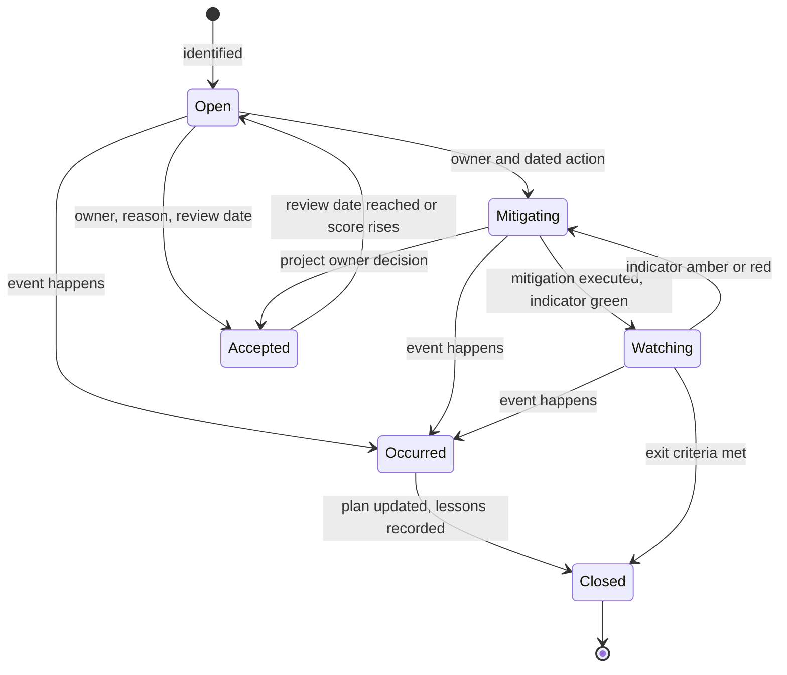
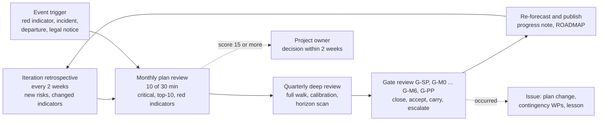

# Risk register

**Status:** Draft v0.7 · **Date:** 2026-10-22 (v0.7: R-050 restated after the LG-2 merge block's removal, decision log ID-480; v0.6: R-014 accepted by the project owner and re-scored 3 × 4 → 2 × 4, decision log ID-452; v0.5: the plan-of-record 1.0 at month 65 after WP-S6.13, decision log ID-342; v0.4: R-018 read in cycles, decision log ID-271; v0.3: R-018 re-assessed at G-SP, outcome Recycle) · **Part of:** ElektraWatt plan

**Purpose.** This is the risk register of ElektraWatt (EW). It consolidates the risks that the design documents, the
research notes and the plan itself name, scores them on one scale, assigns every risk an owner, a mitigation linked
to work packages (WPs), a contingency, an early-warning indicator and a review gate, and defines how the register is
kept alive. It has a heat map (§3), a top-10 summary (§4), the register (§5), views by owner and gate (§6), the risk
review procedure (§7), cross-references to the sources (§8) and the risk actions for the first 90 days (§9). The
schedule effects quoted here come from the [global plan](01-global-plan.md) and the
[work breakdown](02-work-packages.md); this register does not re-simulate them.

---

## Summary for decision makers

**The headline.** The register holds **84 risks** in ten categories: 5 critical (score 15 or more), 32 high,
44 medium and 3 low. No risk has been accepted yet, and every score is the team's judgement at kick-off, not
a measurement (§1.2). The scores are baseline scores: they assume the mitigations are planned, not yet done.
Version 0.2 follows the re-plan of the global plan: the pilot preview M-PP (release 0.0.x, gate G-PP) is part of the
plan of record, which lowers R-067 and R-068 from critical to high (score history, §7.8) and adds R-084.
Version 0.3 re-assesses R-018 at gate G-SP (held 2026-10-20, outcome Recycle): probability 3 → 4, score 16, critical.
Version 0.4 follows the owner's decision that the plan's months are a human-team reference and progress is tracked
in cycles ([global plan](01-global-plan.md) §3.8, decision log ID-271): month figures in this register describe that
reference, and R-018's schedule effect is stated in cycles.

**Schedule risk dominates, and part of it has already happened.** The architecture's indicative 15–18 months for
v1 cannot be met by 2–4 developers; the plan of record is the pilot preview in month 26 (Dec 2028), the MVP in month 41 (Mar 2030) and 1.0 in month 65
(Mar 2032), with a ±20 % band (dates from [milestones.csv](milestones.csv)). R-001 (score 16) is the risk that this fact is not communicated and the old dates stay in
circulation. R-002 and R-003 are the two risks that can still move the plan of record: optimistic estimates
(+10 % effort costs 4 months at the MVP and 6 at 1.0) and capacity below 36 productive pw per developer-year (−20 %
gives MVP month 51 and 1.0 month 81).

**The five critical risks.**

| ID | Risk | Score | Why it is critical |
|---|---|---|---|
| R-001 | Indicative 15–18 months stay in circulation | 16 | Credibility and pilot trust fall when month 18 passes without a product |
| R-018 | Interactive latency at L and XL | 16 | Partly materialised at G-SP (2026-10-20, outcome Recycle): the cold global connectivity misses NFR-PERF-05 by 2.6–97×; the recycle (incremental connectivity) is under way: the engine and the memoised `Q` were delivered in cycle 9 (WP-S1.07 part 1) and the incremental partition in cycle 10 (part 2); the score stands until the re-test on a BM-class runner |
| R-002 | Estimates optimistic | 16 | Every +10 % of effort costs 4 months at the MVP and 7 at 1.0 |
| R-032 | Machine-file formats unavailable or rejected | 16 | SC-7 depends on closed Komax, Rittal WT and Weidmüller formats that are not yet in hand |
| R-003 | Capacity below 36 pw per developer-year | 15 | A −20 % year costs 10 months at the MVP |

Two risks were critical in the first baseline and are now high because of the pilot preview: **R-067** pilot
engagement fades (15, now 10: the pilot has something to draw on at month 26, not at month 41) and **R-068** QET
closes the gap (16, now 12: QET gained 2,253 commits between January and October 2026, but the pilot sees EW's
differentiators 15 months before the MVP, while there is still time to move them forward). Both stay on the standing
agenda; the rationale is in the score history (§7.8).

**What the register asks of the project owner now (M0, November 2026).**
1. Take PD-1 and rewrite the indicative dates in vision §9 and architecture §15.2 (R-001, R-006), and confirm the
   scope of the pilot preview and the Must-row triage with the pilot in the pre-G-M0 workshop (PD-14; R-067, R-068,
   R-084).
2. Get three things in writing from the pilot and the employer: the allocation of the developers (R-005, R-015),
   the pilot's time budget and the delivery of machine specifications, TIA samples and the original `.qet` files
   (R-067, R-032, R-064), and the LG-1 and LG-5 statements (R-045, R-046).
3. Fund the money items that are not pw: counsel, trademark search, WBSO filing by the end of December 2026
   (R-078, R-077).
4. Move the public repository into an organisation with two owners (R-054).

**What the register does not cover.** Product risks that the architecture accepted by design (no CRDT, no native
plugins in v1, no EPLAN binary formats) are listed as non-goals in the
[architecture](../design/04-architecture.md#16-risks-mitigations-and-non-goals) §16; only their adoption effects
appear here (R-075).

---

**Contents**
1. [Scope, sources and method](#1-scope-sources-and-method)
2. [Scales and bands](#2-scales-and-bands)
3. [Heat map](#3-heat-map)
4. [Top-10 summary](#4-top-10-summary)
5. [The register](#5-the-register)
6. [Views of the register](#6-views-of-the-register)
7. [Risk review procedure](#7-risk-review-procedure)
8. [Cross-references](#8-cross-references)
9. [Risk actions for the first 90 days](#9-risk-actions-for-the-first-90-days)
10. [Sources](#sources)
11. [Open questions](#open-questions)

---

## 1. Scope, sources and method

### 1.1 Inputs

The register was built by reading every risk, pitfall and open question of the sources below and merging
duplicates; a risk that several sources name appears once, with the sources in §8.3.

| Source | What it contributed | Risks |
|---|---|---|
| [Architecture](../design/04-architecture.md) §16, §6.1, §15 | The 12 architecture risks, the performance spike and its fallback, the two-lane spine | R-017, R-018, R-019, R-014, R-020, R-038, R-024, R-057, R-021, R-051, R-012, R-025, R-070 |
| Feature documents [05](../design/05-project-format-and-persistence.md) … [17](../design/17-extensibility.md): "edge cases and pitfalls" and "open questions" | File-system, import, output, PLC, layout, manufacturing, UX and extensibility pitfalls | R-022, R-023, R-021, R-070, R-024, R-065, R-061, R-062, R-025, R-026, R-035, R-037, R-033, R-030, R-029, R-028, R-032, R-075, R-036, R-031, R-069, R-042, R-039 |
| [Quality, security and release](../design/18-quality-security-release.md) §13, §16, open questions | CRA dates, signing, packaging, CI and platform pitfalls | R-082, R-083, R-044, R-081, R-058, R-056, R-055, R-053, R-040 |
| [Open-source governance](../design/19-open-source-governance.md) §3.3, §7, open questions | Legal gates LG-1 … LG-6, steward, trademark, repository custody, AI-use policy | R-045, R-046, R-050, R-051, R-074, R-054, R-059, R-047, R-052 |
| [Golden project](../design/20-golden-project.md) §21, §23.2 | Acceptance truth, questions for the pilot | R-063, R-064, R-046 |
| Research notes ([OSS landscape](../research/oss-landscape.md), [Rust ecosystem](../research/rust-ecosystem.md), [interop formats](../research/interop-formats.md), [panel manufacturing](../research/panel-manufacturing.md), [standards](../research/standards.md)) | QET's pace, Data Portal terms, the anti-ML clause, trademark, OCCT, machine formats, unverified constants | R-068, R-049, R-048, R-052, R-041, R-032, R-033, R-066, R-030 |
| [Global plan](01-global-plan.md) §9.3, §10, §13, §16 and [work breakdown](02-work-packages.md) PA-1 … PA-11, §6, §7 | Schedule risks SR-1 … SR-15, staffing, funding, the critical path and the levers | R-001, R-002, R-003, R-004, R-005, R-006, R-007, R-008, R-009, R-010, R-011, R-013, R-015, R-077, R-078 |
| Proposed ADRs 0025, 0027 … 0030 and the validation of ADR-0007 | Decisions with deadlines | R-050, R-011, R-053, R-058, R-025, R-070 |

### 1.2 Assumptions

| ID | Assumption |
|---|---|
| RA-1 | **Scoring date and horizon.** Scores are as of 2026-10-18 (R-018 re-assessed on 2026-10-20 at G-SP) for the whole period to 1.0 (month 65), with the plan of record: three developers, lean scope, pilot preview at month 26, MVP at month 41, 1.0 at month 65 ([milestones.csv](milestones.csv)), Month 0 = November 2026, 36 productive pw per developer-year (±20 %), 20 % reserve, AI assistance assumed to help but not to multiply throughput; the AI-moderate scenario is an internal target and is not scored. |
| RA-2 | **Baseline scores.** A baseline score assumes the listed mitigations are planned and not yet executed; a mitigation that is part of the plan of record, such as the pilot preview M-PP, counts as planned. From G-M0 owners score the *current* state (mitigations done) and keep the baseline for trend (§7.4). |
| RA-3 | **Judgement, not measurement.** Probabilities are the team's estimates; no risk has a measured frequency. They are recalibrated with actuals at G-M0 and G-M1 (open question 1). |
| RA-4 | **Schedule effects** are those simulated in the global plan (§3.5, §9.3, §10.3): 9 pw is about one month with three developers. |
| RA-5 | **One scale for all categories.** A legal or data risk is rated by its effect on dates, scope, releases and trust, so it can be compared with schedule risks. |
| RA-6 | **Public repository.** The register contains no names, customer or project identifiers, vulnerability details or negotiation positions. Such items are held privately (`legal/`, private advisories) and appear here under a neutral title (§7.8). |

### 1.3 Relation to other plan documents

The global plan's schedule risk register (§9.3, SR-1 … SR-15) is the schedule view; this register includes all of
them (mapping in §8.1) and adds the technical, legal, data and adoption risks. The architecture's risk table
(§16) is mapped in §8.2. When the documents differ, this register is the list of record for risk identity, score and
owner; the simulated schedule effects stay in the global plan.

---

## 2. Scales and bands

### 2.1 Probability

| P | Label | Meaning (until 1.0, with the plan of record) |
|---|---|---|
| 1 | Rare | Below 5 %; no known cause is present |
| 2 | Unlikely | 5–20 %; a cause exists but a deliberate step is needed to trigger it |
| 3 | Possible | 20–50 %; plausible within the plan's horizon |
| 4 | Likely | 50–80 %; the cause is present or the event happens in comparable projects most of the time |
| 5 | Almost certain | Above 80 % or already happening |

### 2.2 Impact

| I | Label | Meaning if the event happens |
|---|---|---|
| 1 | Negligible | Under 2 weeks of delay; no gate, success criterion or release affected; a workaround exists |
| 2 | Minor | 2–4 weeks of delay, or one Should or Could feature lost or deferred |
| 3 | Moderate | 1–3 months of delay (about 9–27 pw with three developers), or a Must row narrowed or moved one release, or a gate passed with recorded conditions |
| 4 | Major | 3–6 months of delay, or a binding v1 addition (PLC exchange, manufacturing outputs, 3D layout, QET/EDZ/DXF import) narrowed, or a public release blocked for a quarter, or loss of user data or trust |
| 5 | Severe | More than 6 months of delay, or capacity below two developers, or a legal block on every release, or a security incident, or loss of the pilot as acceptance authority, or a core promise (for example the D-01 class of defect) broken in a release |

### 2.3 Score and bands

Score = P × I (1–25).

| Band | Score | Risks | Share | Treatment |
|---|---|---|---|---|
| Critical | 15–25 | 5 | 6 % | Reported at every monthly review; dated mitigation action; project owner informed within a week; decision at the next gate at the latest |
| High | 10–14 | 31 | 37 % | Owner reviews monthly; every mitigation has an owner and a date; re-scored at the review gate |
| Medium | 5–9 | 45 | 54 % | Reviewed each quarter and at the review gate; mitigation as planned work |
| Low | 1–4 | 3 | 4 % | Reviewed at gates; candidate for closure after two reviews without change |

### 2.4 Categories, owners and review gates

| Code | Category | Covers |
|---|---|---|
| Schedule | Schedule and scope | Dates, estimates, capacity, scope control, decisions, critical chains |
| Staffing | Staffing and bus factor | People, knowledge concentration, employer dependence |
| Technical | Technical | Architecture, performance, persistence, import and output fidelity, physical and manufacturing algorithms, exchange formats |
| Dependencies | Dependencies and platform | UI and GPU stack, OCCT, wasmtime, crates, tooling |
| Legal | Legal and licensing | Copyright, licences, trademark, data terms, steward, custody |
| Compliance | Security and compliance | CRA, supply chain, hostile input, privacy |
| Data | Data and content | Part data, STEP licences, golden truth, corpus, symbols |
| Adoption | Adoption and community | Pilot, QET, EPLAN users, community, documentation |
| Funding | Funding and money | Grants, WBSO, unbudgeted costs |
| Process | Process and quality | Goldens, document drift, CI, release friction |

Owners are the roles of the [work breakdown](02-work-packages.md#24-owner-roles) §2.4: *Project lead*, *Project
owner* (decides the pending decisions PD-n), *Core developer (S1)*, *UI developer (S2)*, *Output and migration
developer (S3, S5)*, *Physical developer (S4)*, *Release engineer (S6)*, *Content maintainer (S7)*, *Docs maintainer*,
*UX researcher*, *Pilot liaison* and *Steward liaison*. Roles are hats, not people. Review gates are the gates G-M0
… G-M6 and G-PP of the global plan (§5.1) and the [gate plan](03-gates.md), the performance-spike decision G-SP, the
usability rounds R0 (held on the G-PP build) and R1, and the event-driven steward review LG-6; "monthly" and
"quarterly" mark risks that are also standing items of those reviews (§7.2).

---

## 3. Heat map

Each cell shows the score, its band and the risks in it. Probability runs left to right and impact bottom to top.

| Impact ↓ / Probability → | 1 Rare | 2 Unlikely | 3 Possible | 4 Likely | 5 Almost certain |
|---|---|---|---|---|---|
| 5 Severe | **5** Medium | **10** High R-009, R-015, R-017, R-045, R-056, R-067 | **15** Critical R-003 | **20** Critical | **25** Critical |
| 4 Major | **4** Low | **8** Medium R-014, R-020, R-046, R-051, R-054 | **12** High R-005, R-010, R-013, R-022, R-025, R-029, R-030, R-033, R-047, R-052, R-053, R-055, R-057, R-064, R-069, R-072 | **16** Critical R-001, R-002, R-018, R-032 | **20** Critical |
| 3 Moderate | **3** Low | **6** Medium R-049, R-058, R-059, R-060 | **9** Medium R-004, R-006, R-011, R-012, R-016, R-019, R-021, R-023, R-026, R-027, R-031, R-034, R-039, R-040, R-041, R-043, R-048, R-050, R-062, R-063, R-066, R-070, R-073, R-075, R-078, R-079, R-083, R-084 | **12** High R-007, R-008, R-024, R-028, R-038, R-061, R-065, R-068, R-071 | **15** Critical |
| 2 Minor | **2** Low | **4** Low R-035 | **6** Medium R-042, R-044, R-074, R-076, R-077, R-081 | **8** Medium R-080, R-082 | **10** High |
| 1 Negligible | **1** Low | **2** Low R-037 | **3** Low R-036 | **4** Low | **5** Medium |

**Reading it.**
- 30 of 84 risks score 12 or more, and 25 of them sit in two cells: probability 3 × impact 4 and
  probability 4 × impact 3. The register has many serious, plausible risks and only a few certain ones.
- No risk sits in the "almost certain" column. R-001 comes closest; it is rated 4 because the plan of record
  already exists and PD-1 can remove it at M0.
- The impact-5 row is the set that ends or redefines the project. At probability 3 it holds capacity; at
  probability 2 it holds pilot engagement (lowered from 3 by the pilot preview), a missing employer statement, an employer that withdraws, a stale memo in a
  release, a supply-chain compromise and a team that works in silos.

### 3.1 Counts

| Category | Risks | Critical | High | Medium | Low | Highest score |
|---|---|---|---|---|---|---|
| Schedule and scope | 12 | 3 | 5 | 4 | 0 | 16 |
| Staffing and bus factor | 4 | 0 | 2 | 2 | 0 | 12 |
| Technical | 21 | 2 | 8 | 8 | 3 | 16 |
| Dependencies and platform | 7 | 0 | 1 | 6 | 0 | 12 |
| Legal and licensing | 10 | 0 | 4 | 6 | 0 | 12 |
| Security and compliance | 6 | 0 | 3 | 3 | 0 | 12 |
| Data and content | 6 | 0 | 3 | 3 | 0 | 12 |
| Adoption and community | 11 | 0 | 5 | 6 | 0 | 12 |
| Funding and money | 2 | 0 | 0 | 2 | 0 | 9 |
| Process and quality | 5 | 0 | 0 | 5 | 0 | 9 |
| **Total** | **84** | **5** | **31** | **45** | **3** | **16** |

---

## 4. Top-10 summary

Ranked by score. Ties are broken by (1) irreversibility, because a leaked name, lost project data or a rename late
in the project cannot be repaired by later effort, (2) the earliest review gate, (3) ID.

| Rank | ID | Risk | Category | Score (P × I) | Owner | Key action and date | Gate |
|---|---|---|---|---|---|---|---|
| 1 | R-001 | Indicative 15–18 months stay in circulation | Schedule | 16 (4 × 4), Critical | Project lead | Take PD-1 in November 2026 and edit vision §9 and architecture §15.2 to cite the plan | G-M0 |
| 2 | R-018 | Interactive latency at L and XL | Technical | 16 (4 × 4), Critical | Core developer (S1) | Recycle plan of cycles 9 and 10: incremental connectivity, push invalidation and the `ew-memo` integration (WP-S1.07, WP-S1.05; part 1 delivered in cycle 9, part 2 in cycle 10); re-test on a BM-class runner (ADR-0002 amendment 4) | G-SP; G-M1 |
| 3 | R-002 | Estimates optimistic | Schedule | 16 (4 × 4), Critical | Project lead | Log actual pw per WP from day one; first velocity report in January 2027; G-M1 re-plan | G-M1; monthly |
| 4 | R-032 | Machine-file formats unavailable or rejected | Technical | 16 (4 × 4), Critical | Output and migration developer (S3, S5) | Ask the pilot for Komax, Rittal WT and Weidmüller specs and samples at the kick-off; name the partner shop at M3 | G-M2; G-M3 |
| 5 | R-003 | Capacity below 36 pw per developer-year | Schedule | 15 (3 × 5), Critical | All developers (project lead) | Support rota from iteration 1; support time logged per WP; check logged capacity against 0.6 pw per week in January 2027 | Monthly; G-M1 |
| 6 | R-052 | Trademark conflict | Legal | 12 (3 × 4), High | Steward liaison | Commission the clearance search in weeks 4–8, before any logo spend (WP-S0.05a) | G-M0 |
| 7 | R-022 | Persistence on real file systems | Technical | 12 (3 × 4), High | Core developer (S1) | Fault-injection tests with WP-S1.09; first share and cloud-sync test on Windows by M1 | G-M1; G-M2 |
| 8 | R-047 | Confidential data reaches the public repository | Legal | 12 (3 × 4), High | Release engineer (S6) | Anonymisation guard and placeholders policy live in the first 90 days; private corpus outside the repository | G-M1 |
| 9 | R-057 | Hostile input files | Compliance | 12 (3 × 4), High | Release engineer (S6) | Fuzz targets for every importer from the MVP; untrusted-content banners; WP-S6.04 before 0.1.0 | G-M2 |
| 10 | R-005 | Team smaller than three or starting late | Schedule | 12 (3 × 4), High | Project owner | Written allocation per developer before M0 (PD-1); decide PD-3 by month 2 (Dec 2026) | G-M0 |

**What the ten have in common.**
- **Four are about time and capacity** (R-001, R-002, R-003, R-005). They are managed by the plan itself: PD-1, the
  velocity log, the G-M1 re-plan and the descoping ladder (global plan §16).
- **One is about the outside world not delivering** (R-032). It cannot be solved by engineering alone: it needs the
  pilot's machine specifications and a named partner shop.
- **Four are about things that cannot be undone** (R-052, R-022, R-047, R-057): a trademark conflict
  after launch, lost project data, confidential content in a public history, and an exploited parser. Their
  mitigations are cheap early and expensive late, which is why the first 90 days (§9) contain most of them.
- **One is the first architectural proof** (R-018): the performance spike decides the shape of every later derivation
  WP. It partly materialised at G-SP (2026-10-20, outcome Recycle), which is why it now scores 16.

**Left the top ten with version 0.2.** R-068 (QET closes the gap, now 12) and R-067 (pilot engagement fades, now 10)
fell from 16 and 15 because the pilot preview M-PP shortens the wait; both remain on the standing agenda (§6.2).

---

## 5. The register

Columns: **P** probability, **I** impact, **Score** = P × I. The risk statement is written as *cause → event →
effect*. Mitigations name the linked WPs ([work breakdown](02-work-packages.md#9-work-packages) §9) and decisions
(PD-n of the global plan §14). The contingency is the response if the event happens. The early-warning indicator is
something a person can read from the board, the pilot log, CI or a calendar. The review gate is where the risk is
decided in depth (§7.7); standing items are also reviewed monthly or quarterly (§7.2).

### 5.1 Schedule and scope (R-001 … R-012)

| ID | Category | Risk statement (cause → event → effect) | P | I | Score | Owner | Mitigation (linked WPs) | Contingency | Early-warning indicator | Review gate |
|---|---|---|---|---|---|---|---|---|---|---|
| R-001 | Schedule | **Indicative 15–18 months stay in circulation.** Vision §9 and architecture §15.2 still state 15–18 months to 1.0 → funders, the pilot and contributors plan around them → the plan of record (MVP month 41, 1.0 month 65, band ±20 %) reads as failure and trust falls when month 18 passes without a product | 4 | 4 | 16 | Project lead | PD-1 at M0; edit vision §9 and architecture §15.2 to cite the plan; publish the forecast and band monthly (WP-S0.08, WP-S0.09); the headless golden PDF at M1 is the first public proof (WP-S3.04) | Re-baseline in public with the descoping ladder (DS-4 … DS-8) and the funded-growth option (PD-3) | Any grant text, README or talk that quotes 15–18 months; the pilot asks why no product exists at month 18 | G-M0 |
| R-002 | Schedule | **Estimates optimistic.** Estimates are judgement, the AI-assistance assumption (GA-5) is unproven and the internal AI-moderate target is a hypothesis (SR-15) → measured velocity is below plan across many WPs → +10 % effort costs 4 months at the MVP and 7 at 1.0, +25 % costs 10 and 16 months | 4 | 4 | 16 | Project lead | Actual pw per WP from day one (board of WP-S0.01); monthly velocity ratio; G-M1 re-plan with the ratio clamped 0.6–1.5 (PD-11); reserve never spent on scope; ladder DS-4 … DS-8 | Apply DS-4, DS-5, then DS-6 in order (PD-12); add developer 4 (PD-3); accept the later date inside the band (DS-8) | Velocity ratio below 0.9 at two monthly reviews; M1 forecast beyond month 17; WPs above 1.5 times their likely value | G-M1; monthly |
| R-003 | Schedule | **Capacity below 36 pw per developer-year.** Pilot questions, community triage, meetings and a developer partly on other employer work eat more than the 10 weeks per developer-year deducted (GA-3) → productive capacity falls below 36 pw → at −20 % the MVP is month 51 and 1.0 month 81 | 3 | 5 | 15 | All developers (project lead) | Support rota, one developer per iteration; protected focus days; support time logged per WP (§11.2); planned pilot work isolated in WP-S0.08 and WP-S0.09 | Cut demo and release cadence temporarily; push community work to the steward; developer 4 (PD-3) | Logged productive time below 0.6 pw per developer-week for two months; triage backlog older than two weeks | Monthly; G-M1 |
| R-004 | Schedule | **Core chain interrupted at its head.** Funding, legal and pilot work interrupts the core chain WP-S1.01 → WP-S1.04 → the head slips and nothing else is ready → each month of slip costs two months at M1 and M2 and one at M6 | 3 | 3 | 9 | Core developer (S1) | Ordering rule 1 (§9.2): the chain starts on day 1 and is not interrupted; S0 work stays with the project lead; the output lane starts WP-S3.01 in parallel; pairing on the first crates | Move S0 items to the other developers; split WP-S1.02 and WP-S1.03 into tasks of at most 1 pw so a second developer can join | WP-S1.01 not done by month 2; WP-S1.03 not done by month 5 | G-M0; G-M1 |
| R-005 | Schedule | **Team smaller than three or starting late.** The third developer is not on board at kick-off, or the team is in fact two (a hire fails, a developer is part-time elsewhere) → capacity is 6 instead of 9 pw per month → joining at month 6 gives MVP 43 and 1.0 66; a permanent team of two gives 60 and 96 | 3 | 4 | 12 | Project owner | Written allocation per developer before M0 (PD-1); PD-3 for developer 4 by month 2; the output lane starts WP-S3.01 by month 3; contractor for a self-contained WP set (WP-S3.09 … WP-S3.13, §10.4) | Re-scope to the MVP plus one binding v1 addition at a time (plan open question 8); grant-funded contractor | Allocation not confirmed at G-M0; a planned start date moves twice | G-M0 |
| R-006 | Schedule | **Scope decision not taken or not propagated.** PD-1 and PD-2 are not taken at M0, or are taken but vision §9 and the catalogues 02a–02c keep the old release labels → gates and requirement rows disagree with the plan (28 Must 1.0 rows move to 1.x) → disputes at gate reviews and a pilot that expects QET migration in 0.1.0 | 3 | 3 | 9 | Project lead | Decide PD-1 and PD-2 at the kick-off (WP-S0.08); catalogue editors apply levers (b) and (c); rule "a new catalogue row needs a WP in the same PR" (WBS §8) | Run the gate on the plan's adjusted AC list (AC-25 … AC-27 move to G-M3; AC-36 and AC-42 to 1.x) | Catalogue rows whose release contradicts the milestone of their WP; PD-1 open after week 4 | G-M0 |
| R-007 | Schedule | **Scope creep.** Pilot requests, Should rows and attractive features are merged without a trade-off → the effort grows without a date change in the plan → every 9 pw moves a milestone by about a month | 4 | 3 | 12 | Project lead | "One in, one out" at gate reviews; quarterly roadmap review (GV-07); every new catalogue row needs a WP; scope changes recorded with their pw | Freeze scope for one milestone; move additions to the 1.x backlog (§6.4) | Catalogue rows without a WP; WP estimate growth above 20 % between plan versions; pilot requests merged without a decision record | Each gate; monthly |
| R-008 | Schedule | **Physical chain has no slack to 1.0.** The chain STEP worker → 3D model → routing → wire lengths → machine profiles → .ewpp → 1.0 hardening runs from month 46 to 64 with about one month of slack → any slip in the physical or manufacturing WPs moves 1.0 one for one | 4 | 3 | 12 | Physical developer (S4) | Use the STEP worker's 37 weeks of float to retire OCCT packaging risk early (WP-S4.03, §9.2 rule 4); routing graph on box macros first (WP-S4.07); developer 4 with the S4 profile (§10.3) | DS-5 (narrow breadth), then DS-6 (3D, routing and lengths to 1.1 with lengths entered or estimated) | WP-S4.05 not started by month 49 (planned start month 48); no routed length equal to the golden value by month 53 | G-M3; G-M4 |
| R-009 | Schedule | **Specialisation instead of generalists.** Developers work only in "their" streams → ready WPs wait while others are idle → with three developers the MVP moves from month 41 to 58 and 1.0 from 64 to 76 | 2 | 5 | 10 | Project lead | Pull rule and owner review (§10.2); pairing across lanes during the spine; two owners for each critical crate by M1; WIP of one WP per developer | Rotate developers between streams for one iteration; stream owners become reviewers only | A ready WP unassigned for more than 3 days while a developer works outside the ready queue; more than 70 % of commits to a crate from one person | Monthly; G-M1 |
| R-010 | Schedule | **Reserve spent on scope.** The 20 % reserve and the stabilisation WPs (WP-S6.08, WP-S6.12) are spent on new scope → no slack for integration before 0.1.0 and 1.0 → gates fail late and the pilot receives defects, which is the failure EW exists to prevent | 3 | 4 | 12 | Project lead | "Never cut" list (§16) and "never waived" gate rules (§5.2); reserve burn tracked per milestone; stabilisation WPs start only when every WP of the release is done | Extend stabilisation and accept the later date (DS-8); never drop a gate criterion | More than half the reserve of a milestone used at its midpoint; open blocker bugs at the week before a gate | G-M2; G-M6 |
| R-011 | Schedule | **Pending decisions miss their deadlines.** Decisions PD-4 (grid), PD-5 (fonts), PD-6 (plugin exception), PD-7 (steward), PD-8 (performance spike), PD-9 (telemetry), PD-10 (autoconnect) and PD-14 (the M-PP scope) fall due early and depend on the pilot or counsel → one of them is unavailable and a deadline passes → WP-S3.01, WP-S3.02, WP-S7.02, external merges or signing block, or are built on a guess and redone | 3 | 3 | 9 | Project lead | Decision calendar (§14); decision workshop at kick-off (WP-S0.08); every Proposed ADR carries a recommended default; proceed on that default marked "provisional" with a rework estimate | Ship on the provisional default; schedule the rework as a WP of at most 2 pw | A decision due within 2 weeks with no meeting booked; a WP blocked on a decision for more than a week | G-M0; G-M1 |
| R-012 | Schedule | **Spine lanes meet late.** The core lane (WP-S1.01 … WP-S1.10) and the output lane (WP-S3.01 … WP-S3.05) are built against ew-schema and the query catalogue and first meet at M1 → query shapes or display-list needs drift → rework of derivation or the report engine in the last spine months and M1 beyond month 17 | 3 | 3 | 9 | Core developer (S1) | ew-schema v0 and the query catalogue as the contract (WP-S1.02); golden data as the shared test (WP-S7.01); acceptance runner early (WP-S6.01); monthly cross-lane integration demo | Two-week freeze of the query catalogue to reconcile; the CSV golden bootstrap (WP-S3.05) as the arbiter | The report engine needs a query that is not in the catalogue; the golden CSV bootstrap fails against the model | G-M1 |

### 5.2 Staffing and bus factor (R-013 … R-016)

| ID | Category | Risk statement (cause → event → effect) | P | I | Score | Owner | Mitigation (linked WPs) | Contingency | Early-warning indicator | Review gate |
|---|---|---|---|---|---|---|---|---|---|---|
| R-013 | Staffing | **Loss of a key developer.** One of three developers leaves, falls ill for months or is reassigned → a third of capacity and the knowledge of a lane is lost → three months out cost about one month; a permanent loss gives the two-developer dates (MVP 60, 1.0 96) | 3 | 4 | 12 | Project lead | Two owners per critical crate (NFR-MAINT-07); a design note per crate; hire developer 4 (PD-3, §10.3); handover checklist in WP-S0.03 | Re-plan with the remaining team at the next monthly review; contractor for a self-contained WP set (§10.4) | A crate with one reviewer; absence above 4 weeks; resignation signals | Monthly; G-M1 |
| R-014 | Staffing | **Bus factor in the core crates.** Knowledge of ew-memo, the Op set, ew-format and ew-derive sits with one person (architecture risk 4) → that person is unavailable → derivation and persistence work stops and bugs in the core cannot be fixed. **Accepted by the project owner on 2026-10-22** (decision log ID-452): a second named code owner is not required; the knowledge is held in the design notes, the decision log and the independently reviewed cycle lanes, which any agent session can pick up; re-scored from 3 × 4 = 12 | 2 | 4 | 8 | Core developer (S1) | Small v1 engine of 1.5–2.5 kLOC; generic crate with design notes; second owner on ew-memo and the Op set by M1 (pairing in WP-S1.05); two reviewers (GV-02) | Freeze new work in the crate until a second person has reviewed the design note and fixed one bug | Commit share above 70 % in these crates; PRs waiting for the single qualified reviewer for more than a week | G-M1 |
| R-015 | Staffing | **Dependence on one employer.** All developers are employed by or funded through the pilot panel builder → its priorities, finances or ownership change → allocation falls or the LG-1 statement and the interim steward role end → capacity drops to 0–2 developers and release signing pauses | 2 | 5 | 10 | Project owner | Allocation in writing; LG-1 with standing consent (WP-S0.04); transfer commitment to a stichting (LG-6, WP-S0.05); funding mix: WBSO, NLnet, sponsors (WP-S0.07); open licences are irrevocable | Found the stichting early; promote external maintainers; pause to maintenance mode | Employer budget review without EW allocation; reorganisation; allocation below the agreed pw | G-M0; every gate |
| R-016 | Staffing | **Fatigue over a 64-month plan.** 64 months with three people, no signed release for 41 months, support load and many unglamorous WPs → fatigue and loss of motivation → attrition or a slow-down that the capacity model does not capture | 3 | 3 | 9 | Project lead | Public monthly progress notes; source tag and demo at M1, the pilot preview at M-PP (month 26) and each gate; leave planned inside the 36 pw; rotation of dull WPs; retrospective on workload every iteration | Slow the cadence and tell the pilot; hire developer 4; shorten the iteration load | Declining velocity at constant staffing; unused leave; retrospectives that skip workload | Monthly |

### 5.3 Technical (R-017 … R-037)

| ID | Category | Risk statement (cause → event → effect) | P | I | Score | Owner | Mitigation (linked WPs) | Contingency | Early-warning indicator | Review gate |
|---|---|---|---|---|---|---|---|---|---|---|
| R-017 | Technical | **Stale memo reaches the user.** A memoised query is promoted without a correct read set (architecture risk 1) → a stale derived value reaches the user → a D-01-class defect (wrong tag, cross-reference or BOM) reappears invisibly and the pilot loses trust in the core promise | 2 | 5 | 10 | Core developer (S1) | Untracked reads do not compile; cold mode is the default; oracle in CI and nightly; command fuzzer (WP-S6.02); verify-derived; every promotion is a one-line policy and oracle-checked (WP-S1.05) | Demote the query to cold with one line; release a patch; add the case to the golden defect tests | Oracle mismatch in the nightly run; a golden output that changes after an unrelated edit | G-SP; G-M1; G-M2 |
| R-018 | Technical | **Interactive latency at L and XL.** Global connectivity and bulk edits on L and XL projects exceed the budgets (architecture risk 2; frame 16 ms, XL open 20 s) → the spike finds the memo engine too slow or too large → recycle to incremental connectivity (ARCH §6.1, ADR-0002 amendment 4), which cost two implementation cycles (9 and 10) instead of one (in the human-team reference up to 1–2 months at M1, M1 at month 16), and editing feels slow on the pilot's biggest projects | 4 | 4 | 16 | Core developer (S1) | Recycle delivered in cycles 9 and 10 (WP-S1.07 parts 1 and 2 with the `ew-memo` integration of WP-S1.05; ADR-0002 amendments 5 and 6; the composite bench family of a move commit is in place for the re-test): incremental connectivity (page-scoped memos of the local nets, a component-scoped potential partition, potential names split out of the partition), push invalidation from the touched keys instead of pull verification, O(1) memo hits, per-potential wire properties so that a profile change invalidates only the affected potentials; re-test on a BM-class runner (doc 18 §4.3); performance spike run right after WP-S1.03 (month 5, PD-8); synthetic L and XL generator ready in the first 90 days; two-level nets and backdating; bulk edits as preview jobs; perf gate (WP-S6.03) | Use the incremental-connectivity design of architecture §6.1; relax L and XL targets by ADR; keep S and M targets for the MVP | Partly materialised at G-SP (2026-10-20, outcome Recycle): the cold global connectivity misses the commit budget of NFR-PERF-05 by 2.6–3× at S, 25–27× at M and 66–97× at L, and an opaque whole-project memo of `potential_partition` is worse than cold; after the recycle, re-test results beyond the architecture §6.1 thresholds; perf gate regressions above 15 % | G-SP (PD-8); G-M1; G-M6 |
| R-019 | Technical | **Memory at XL.** Memos, the SQL projection and undo history grow with project size (architecture risk 3) → XL projects exceed 4 GB peak → crashes or swapping on the pilot's workstations | 3 | 3 | 9 | Core developer (S1) | Granularity rules (architecture §6.3); LRU eviction; memory gate (WP-S6.03); file-backed projection at XL; 256 MB undo cap | Lower memo granularity; document XL limits; ship a reduced-feature XL mode | Peak memory above 3 GB on the XL fixture; allocation growth over a long session | G-M1; G-M6 |
| R-020 | Technical | **Derivation drift changes archived drawings.** A derivation fix or an upgrade changes tags, cross-references or wire numbers (architecture risk 5) → archived drawings no longer reproduce → released revisions and as-built archives differ from what was delivered | 2 | 4 | 8 | Core developer (S1) | Pinned derivation profiles; golden tests per profile; as-built archive with the PDF (WP-S1.18); fixture corpus of every released format | Re-open the old profile; rebuild from the archive tag; communicate the change in release notes | A golden diff on a pinned profile; an archive rebuild that differs from the stored PDF | G-M2 |
| R-021 | Technical | **Semantic merge conflicts.** Two branches or users edit the same project (architecture risk 9) → semantic conflicts that git merges cleanly (duplicate -102F3, overlapping PLC addresses, layout overlaps) → wrong drawings that look valid | 3 | 3 | 9 | Core developer (S1) | Record- and field-level merge driver and post-merge integrity check (WP-S1.17); branch-safe "next free" counters; EW-CORE-013 quick fix | Recommend locks on shared folders; run `ew check --integrity` in CI for team projects | Integrity findings after merges in the pilot log; merge driver missing on colleagues' machines | G-M2 |
| R-022 | Technical | **Persistence on real file systems.** Atomic save and locking meet real file systems (SMB caching, partial cloud sync, antivirus holding files, MAX_PATH, case-insensitive volumes) → a torn or mixed generation, lost edits or lock contention → a corrupted project or lost work and a pilot who stops trusting the format | 3 | 4 | 12 | Core developer (S1) | Intent manifest with roll-forward and fault-injection tests (WP-S1.09); manifest hashes; cloud and share detection; recovery dialog; platform test matrix (WP-S6.06) | Read-only open with a repair assistant; `ew archive rebuild`; advise git or SMB for teams (PQ-26) | Recovery dialogs in the pilot log; integrity findings on shares; failed fault-injection runs | G-M1; G-M2 |
| R-023 | Technical | **Windows file-system performance.** The directory-of-JSONL format writes thousands of small files at XL and many on L → Windows Defender and SMB make open and save slow → SC-5 (XL open 20 s) is missed on the platform the pilot uses | 3 | 3 | 9 | Release engineer (S6) | Windows perf job early (WP-S6.03, WP-S6.06); files read fully and closed; fixed shard count; `.ewz` as the exchange form; Dev Drive advice in the docs | Amend ADR-0010 to pack small shards; tell users to exclude the project folder from scanning | Windows open time above twice the Linux time; Defender rescans visible in traces | G-M1; G-M2 |
| R-024 | Technical | **QET import fidelity and format drift.** QET moves fast (2,253 commits since 0.100 and `.qetz` format changes) and real projects carry D-11/D-12-class defects, custom formulas and company collections → the importer misreads or loses data → SC-4 (at least 22 of 24 examples and all pilot projects) is missed and migration trust is damaged | 4 | 3 | 12 | Output and migration developer (S3, S5) | Record-level importers, lenient mode and migration report (WP-S3.09 … WP-S3.11); corpus and verifier (WP-S3.13); track QET releases each quarter; fuzz the importers (WP-S6.02) | Support the last stable QET format only; manual migration assistants (WP-S3.12); agree a lower SC-4 count with the pilot | Corpus pass rate below 80 % when M3 work starts; a QET release that changes the XML | G-M3 |
| R-025 | Technical | **PDF fidelity to the reference set.** The output must reproduce the reference set (frame ±0.2 mm, exact text, Tahoma not redistributable) through krilla and vello_cpu on three OSes → fonts, metrics, glyphs ("²", "∞", "⇄") or pagination differ → AC-13 and SC-1 fail and the pilot rejects PDFs as "not like ours" | 3 | 4 | 12 | Output and migration developer (S3, S5) | Spine lane 2 from week 0 (WP-S3.01 … WP-S3.04); PD-5 on fonts by week 3; bundled symbol fallback font; PNG tolerance (dify); text-extraction tests; the pilot compares PDFs at M1 | Agree a tolerance band with the pilot (AS-1); bundle a second font; narrow the forms to what the golden needs | A golden folio differs by more than 0.2 mm; EW-CORE-066 glyph findings; pilot comments at the M1 comparison | G-M1 |
| R-026 | Technical | **Cross-platform determinism.** Floating point, libm and SIMD paths differ between platforms (vello_cpu, trig in forms) → byte-identical PDF, SVG, CSV and project files are not reproduced → CI goldens flake and SC-6 (determinism and longevity) is in doubt | 3 | 3 | 9 | Output and migration developer (S3, S5) | Determinism controls of design 09 §4.3; shuffle-order tests (WP-S6.02); byte identity only for text-like formats and a PNG tolerance (ADR-0015); scalar mode if the spike finds one | Narrow byte identity to project files and CSV; use a tolerance for PDF geometry | Cross-platform golden diffs in nightly runs; flaky golden jobs | G-M1; G-M2 |
| R-027 | Technical | **Format churn and migration debt.** Monthly 0.x releases change the format with upgrade-on-read (about 23 releases to 1.0) → the migration chain and fixture corpus grow and a design error is found only after the 1.0 freeze → migration bugs, or a forced format major in March 2033 | 3 | 3 | 9 | Core developer (S1) | Schema-steward rule (GV-04) with migration, fixture and JSON Schema in the same PR; fixtures of every released format stay in the corpus; freeze at rc.1 (month 62); `next-format` behind a flag | Batch format changes into fewer 0.x releases; use the yearly window for a major | A format change without a fixture; migration chain longer than 10 steps; fixture open failures | G-M2; G-M5 |
| R-028 | Technical | **STEP worker robustness.** Vendor STEP files are huge, mis-scaled, mis-oriented or pathological and OCCT is C++ on three OSes → the worker crashes, hangs, exceeds memory or the build fails on one OS → parts without usable 3D and CP3D data, routing on boxes only | 4 | 3 | 12 | Physical developer (S4) | Out-of-process worker with timeouts and restart, content-hash cache, two LODs (WP-S4.03); box-macro fallback so every device is routable (WP-S4.05); spike OCCT packaging on three OSes early | Show the part as a box with a warning; accept user-supplied simplified models; ship without 3D meshes | Worker crash rate above 2 % on a vendor sample set; OCCT build failing on one OS in CI | G-M3; G-M4 |
| R-029 | Technical | **Routing quality and wire lengths.** Routing relies on defaults (wire OD, duct area, Δz, stubs) and a heuristic graph → lengths are too short, fill is too optimistic or results change between runs → wires cut wrong or unstable machine files; SC-7 (row-identical wire list and machine file) fails | 3 | 4 | 12 | Physical developer (S4) | Deterministic routing (integer costs, UUID tie-breaks, shuffle test); `length_source` flag per wire; calibration factor; manual routes and locks keyed by UUID (WP-S4.07, WP-S4.08); trial with the partner shop | Lengths entered or estimated (DS-6); release export refused while lengths are stale (FR-MFG-025) | Routed lengths differ from the golden values by more than the increment; fill disagreements in the shop trial | G-M4 |
| R-030 | Technical | **Unverified standards constants.** Standards-derived tables (PE sizing, colour codes, clamp ranges, thermal curves, PLC and bus limits) are shipped as unverified because the standards are paywalled → checks and calculations give false confidence → a wrong pass or fail in a delivered cabinet | 3 | 4 | 12 | Content maintainer (S7) | `verified = false` flag with a severity cap and EW-MFG-010; verification against a licensed copy before the MVP packs ship (WP-S1.16); no copyrighted figures shipped; sources recorded per table | Keep the rule at info; remove the table from the pre-delivery scheme until verified | Open `verified = false` tables per release; reviewer disagreement on a constant | G-M2; G-M4 |
| R-031 | Technical | **Rule false positives.** Rules produce false positives (big bet B4) → users switch checks off or ignore findings → real defects pass the pre-delivery gate and SC-2 is not met in practice | 3 | 3 | 9 | Core developer (S1) | Rule pages with exceptions; pending display; company locks on safety rules; `--baseline`; pre-delivery scheme tested against the golden defect set (WP-S1.16); false-positive review at R1 | Downgrade or retire noisy rules; add precise exceptions in a patch release | Share of waived findings above 20 %; checks disabled in the pilot's projects | G-M2 |
| R-032 | Technical | **Machine-file formats unavailable or rejected.** Machine-file formats (Komax, Rittal WT, Weidmüller) are closed or dialect-specific and specs, samples or a partner shop are not obtained → the machine software rejects or misreads EW files → SC-7 is not met and the manufacturing outputs are not trusted | 4 | 4 | 16 | Output and migration developer (S3, S5) | Ask the pilot for specs and samples at M0 and M1 (WP-S0.08); generic CSV and XLSX first; profiles as data over `.ewpp` (WP-S5.04, WP-S5.07); pre-flight checks; partner shop named at M3 (WP-S6.11) | DS-5: ship generic CSV and one machine profile, the others in 1.x; record deviations at the gate | No sample file or spec by G-M2; no partner shop by G-M3 | G-M2; G-M3 |
| R-033 | Technical | **PLC exchange rejected by TIA or CODESYS.** AutomationML (CAEX 2.15), TIA tag-table and PLCopen dialects are partly unverified (TIA V21, foreign GUIDs, CODESYS handling of device trees) → TIA Portal or CODESYS rejects or alters EW exports → SC-8 is not met and the PLC round trip loses data | 3 | 4 | 12 | Output and migration developer (S3, S5) | Reference-file tests from M3 (WP-S3.16); sample TIA export from the pilot's installation; IEC-tag fallback matching; parking list instead of guessing; external acceptance (WP-S6.11) | DS-5: AML and TIA first, PLCopen in 1.x; document the supported TIA version | No sample AML or tag table from TIA by M2; round-trip diffs in the reference-file tests | G-M3 |
| R-034 | Technical | **External acceptance partners unavailable.** SC-7 and SC-8 need TIA Portal V21, a CODESYS installation and a partner shop with Komax and Rittal machines → the pilot or partners cannot provide them in months 46–63 → G-M6 cannot be passed or passes with recorded deviations | 3 | 3 | 9 | Pilot liaison | Name partners at M3 (SR-10); reference-file tests from M3; budget for licences and shop time (§13.4); WP-S6.11 planned at 3.5 pw | Record deviations if a machine is unavailable; offer the pilot's own installations; narrow acceptance per DS-5 | No named partner by G-M3; no booked slot by month 55 | G-M3; G-M6 |
| R-035 | Technical | **Default font metrics and glyphs.** The default drawing font (ADR-0028) lacks glyphs or has other metrics than the Tahoma of the reference and of legacy QET projects → imported pages reflow and some characters fall back or render as boxes → cosmetic differences and EW-CORE-066 findings on migrated projects | 2 | 2 | 4 | Output and migration developer (S3, S5) | Decide ADR-0028 by week 3 (PD-5, WP-S0.08); bundled symbol fallback font; font substitution recorded in the migration report; layout cells never clip silently (WP-S3.02) | Let companies install their own fonts; adjust the cell metrics in the basic project | Glyph findings on the golden pages; reflowed legacy pages in the corpus | G-M1 |
| R-036 | Technical | **Spreadsheet round-trip damage.** Spreadsheet round trips damage data (Excel turns -X1031:1 into a formula, 1-2 into a date, merges cells or deletes the id column) → an import changes or loses rows → wrong tables if the user does not read the preview | 3 | 1 | 3 | Output and migration developer (S3, S5) | Strings written as string cells; import preview with per-row refusal; the id column is mandatory and its loss is refused with a hint (WP-S3.08) | Revert the import as one transaction | Import refusals per 100 rows in the pilot log | G-M2 |
| R-037 | Technical | **Large-format printing.** Large-format printing (A0 at 600 dpi) and scaled thin lines exceed memory or spool size on Windows → prints fail or lines thin out → users print through PDF instead | 2 | 1 | 2 | Output and migration developer (S3, S5) | Banded printing; opt-in minimum line width stamped in the margin (WP-S3.07); PDF export remains the exact output | Document the PDF route for large formats | Print failures reported on A1 or A0 | G-M2 |

### 5.4 Dependencies and platform (R-038 … R-044)

| ID | Category | Risk statement (cause → event → effect) | P | I | Score | Owner | Mitigation (linked WPs) | Contingency | Early-warning indicator | Review gate |
|---|---|---|---|---|---|---|---|---|---|---|
| R-038 | Dependencies | **egui, wgpu and winit churn.** egui, wgpu and winit release breaking changes every few months (architecture risk 6) → the quarterly upgrade train exceeds its budget or an old stack falls out of support → a developer-week per quarter lost or a frozen stack that blocks CRA fixes | 4 | 3 | 12 | Release engineer (S6) | ew-ui and ew-viewmodel isolation; quarterly train with an abort rule at 3 developer-days (§11.5); CPU renderer; support-period policy with ADR-0030; lag limits (design 18 §6.3) | Pin one stack for 2–3 quarters; fund an upstream contribution; budget a larger train twice a year | Train above 3 developer-days twice in a row; UI-stack security advisory without an upgrade path | Quarterly; G-M2 |
| R-039 | Dependencies | **egui limits for ECAD use.** egui's immediate-mode model, text editing and IME, 100k-row tables, docking and accessibility may not reach ECAD-grade quality → slow or awkward editing on dense pages and failures against SC-12 → rework of widgets or a poor first impression | 3 | 3 | 9 | UI developer (S2) | Isolation of the toolkit; egui_table, egui_tiles and AccessKit; egui_kittest accessibility checks (WP-S2.11); early spike in WP-S2.01 … WP-S2.03; custom widgets where needed | Write custom widgets for tables and text; accept reduced docking | Frame time above 16 ms with 5,000 visible items; accessibility test failures; IME bug reports | R0; G-M2 |
| R-040 | Dependencies | **GPU and driver variance.** wgpu behaviour differs across Intel integrated GPUs, Mesa versions, VMs and RDP or Citrix sessions → the canvas or the 3D view fails or renders wrongly on shop-floor PCs → unusable editor on some machines | 3 | 3 | 9 | UI developer (S2) | GPU-less fallback (vello_cpu, WP-S2.02); on-demand repaint over RDP; pinned Mesa in CI and WARP or lavapipe tests; real-GPU smoke tests on a dedicated runner | Default to the CPU renderer for the affected environment; document unsupported drivers | Crash or blank-canvas reports tied to a driver; CPU fallback below 30 fps on A4 | G-M2; G-M4 |
| R-041 | Dependencies | **OCCT wrapper stalls.** The OCCT wrapper crates are young (opencascade 0.3.0, cadrum below the adoption threshold) and OCCT 8 moved to C++17 → bindings stall or break → STEP support cannot be updated and the 3D chain stalls | 3 | 3 | 9 | Physical developer (S4) | Worker contract lets OCCT be swapped (ADR-0016); occt-sys 7.8.1 pinned; bindings added inside the worker; separate CI job with cached artefacts | Switch to a system OCCT or cadrum; reduce to tessellated meshes from STEP via a smaller reader | No upstream release for 6 months; build failure after a toolchain upgrade | G-M3 |
| R-042 | Dependencies | **wasmtime churn and macOS JIT.** wasmtime releases breaking changes often and JIT conflicts with the macOS hardened runtime → the plugin host (WP-S1.33, 1.x) needs an entitlement or an interpreter → the extensibility tier slips or weakens the macOS security posture | 3 | 2 | 6 | Core developer (S1) | Plugins are 1.x only; measure the portable interpreter on sample importer and rule plugins before the launch (design 17 OQ19); pin and review each wasmtime bump | Ship plugins without macOS, or add the JIT entitlement by ADR | wasmtime advisory or breaking release before the plugin work starts | G-M6 |
| R-043 | Dependencies | **Core crate abandoned or relicensed.** A core crate (krilla, vello_cpu, parley, rhai, imbl, acadrust, tooling) is abandoned, relicensed or yanked → forced replacement or a fork → unplanned work and, for a licence change, a blocked release | 3 | 3 | 9 | Release engineer (S6) | cargo-deny and licence-boundary check on every lockfile change (WP-S0.02); watch list with adoption thresholds; isolate crates behind our own traits; vendor if needed | Pin the last good version; fork or replace; open an issue for the replacement | No release of a core crate for 12 months; maintainer announcements; cargo-deny failures | Quarterly |
| R-044 | Dependencies | **Packaging tool uncertainty.** cargo-dist and cargo-packager have uncertain maintenance → packaging breaks on a new OS release or tool change → a release is late or needs hand-built installers | 3 | 2 | 6 | Release engineer (S6) | Thin packaging configuration so WiX, NSIS and appimagetool can be driven directly; prove all formats with a CLI-only build early (WP-S6.06) | Drive the installers directly; re-evaluate when maintenance exceeds one day per release | Packaging maintenance above one day per release; tool without a release for a year | G-M2 |

### 5.5 Legal and licensing (R-045 … R-054)

| ID | Category | Risk statement (cause → event → effect) | P | I | Score | Owner | Mitigation (linked WPs) | Contingency | Early-warning indicator | Review gate |
|---|---|---|---|---|---|---|---|---|---|---|
| R-045 | Legal | **Copyright ownership statement missing (LG-1).** The employer statement on copyright (LG-1) is not signed, or does not cover staff contributions since the first commit → the rights in the code are unclear (Auteurswet art. 7) → no signed release, no relicensing to permissive crates and no external contribution can be accepted | 2 | 5 | 10 | Steward liaison | Draft LG-1 with counsel in the first 90 days (WP-S0.04); include standing one-way consent for L1 and L2 to MIT OR Apache-2.0; target signature at M0 | Stop merging staff contributions into the public tree until signed; re-license or rewrite the affected files | LG-1 unsigned at G-M0; a contributor changes employer without a statement | G-M0 |
| R-046 | Legal | **Fixture publication consent missing (LG-5).** The anonymised technical content of the reference project is already public without written consent (LG-5), and the pilot's customer may object → a takedown or a demand to replace the tables → acceptance spec and golden project must be rebuilt on synthetic data and history may need purging | 2 | 4 | 8 | Steward liaison | Obtain LG-5 in writing in week 1 (overdue); keep technical content only; synthetic fallback of the same shape; anonymisation guard (AC-39) | Replace affected tables with synthetic data of the same shape; rewrite history only under legal necessity | LG-5 unsigned after week 4; any contact from the customer or end user | G-M0 |
| R-047 | Legal | **Confidential data reaches the public repository.** A contributor, an AI tool or an issue attachment brings customer names, notice text, drawing numbers or local paths into the public repository → confidential data is exposed → legal exposure for the pilot and loss of its trust | 3 | 4 | 12 | Release engineer (S6) | Anonymisation guard in CI on golden, docs and expected (AC-39, WP-S6.01); placeholders policy; private corpus outside the repository (K-7); PR template and AI-use policy; secret scan | Remove and report immediately; rewrite history for the affected commits; notify the pilot | Guard findings in CI; attachments in issues; contributors asking for real drawings | G-M1 |
| R-048 | Legal | **EPLAN Data Portal terms.** The EPLAN Data Portal terms restrict downloaded data to EPLAN products and manufacturers' terms vary → importing or shipping EDZ content, parts or macros is a breach → a takedown, a reputational conflict or a forced removal of EDZ import | 3 | 3 | 9 | Steward liaison | No bundled EDZ or Data Portal content (NFR-LIC-06); user-side import only (WP-S3.18); read the primary terms and put the question to counsel in the single brief; manufacturer packs by agreement (WP-S7.08) | Disable EDZ import by default; keep CSV, BMEcat and ETIM routes; approach manufacturers for open packs | Terms change; a complaint; counsel advises against user-side import | G-M0; G-M3 |
| R-049 | Legal | **QET element licence and no-ML clause.** QET's element licence (CC-BY 3.0 plus a no-ML-training clause) is breached by AI-assisted work or by bundling elements → a licence violation and a damaged relationship with the QET community → removal of the element converter or conflict | 2 | 3 | 6 | Steward liaison | Elements never bundled; kept in a separate library with QET's licence; AI-use policy forbids QET content in AI tools; on-demand conversion; ask QET for a clarification | Remove the affected library; publish a correction; apologise to QET | QET elements found in the repository or in AI prompts; a QET maintainer objects | G-M0 |
| R-050 | Legal | **Plugin exception wording and SPDX.** The plugin exception (ADR-0025) and the design exception are poorly worded or the SPDX identifier is not accepted by reuse and cargo-deny → the wording is not settled when 1.x plugins arrive → the licence is unclear to plugin authors. *Since 2026-10-22* LG-2 is no longer a gate (decision log ID-454) and the `blocked:LG-2` merge block is removed (FT-315, ID-480), so external contributions are not blocked; the score is re-assessed at the register's next review | 3 | 3 | 9 | Steward liaison | Single counsel brief covering ADR-0025, the design exception and the other legal points; test reuse-tool and cargo-deny with both SPDX forms in M0; use the SPDX-listed KiCad exception verbatim | Fall back to GPL without exception for 1.x plugins | The first plugin author's licence question; tool rejects the identifier | The register's next review; before 1.x plugins |
| R-051 | Legal | **Licence-boundary breach.** GPL code (including ported QET code) or AI output that reproduces third-party code reaches the permissive crates → the MIT OR Apache-2.0 promise is broken → relicensing or rewriting of the format crates and a loss of trust in SC-11 | 2 | 4 | 8 | Core developer (S1) | Closed permissive layer from the first commit; licence-boundary CI check; REUSE headers; DCO; QET-derived code only in `ew-import-qet`; AI-use policy, reviewer duty under LR-05 (WP-S0.02) | Rewrite the affected file from the specification; yank the crate version; publish a notice | Boundary check failures; a large AI-assisted block without the author's statement | G-M0; G-M1 |
| R-052 | Legal | **Trademark conflict.** "ElektraWatt" is close to "Electra"-named ECAD products in Nice classes 9 and 42 → a conflict appears after the name and logo are public → a rename late in the project and loss of the domain and community recognition | 3 | 4 | 12 | Steward liaison | Clearance search (TMview, EUIPO, BOIP) in the first 90 days, before any logo spend (LG-3, WP-S0.05a); domain check; word mark filed before 1.0 | Rename early with an alias period; keep the crate and CLI names neutral where possible | A search hit in classes 9 or 42; a complaint letter | G-M0 |
| R-053 | Legal | **Steward and signing identity late (LG-4).** The steward as a legal person, the D-U-N-S number, Apple organisation enrolment and Windows signing eligibility take calendar time, not pw, and ADR-0030 is decided late → no signing identity when 0.1.0 is ready → the first release waits (SR-6) | 3 | 4 | 12 | Steward liaison | Name the phase-1 identity holder (PD-7a) and submit the enrolments in the first 90 days (WP-S0.05a): the lead time of at least 12 months is a lag of WP-S0.05 in the plan; decide ADR-0030 by M1 (PD-7); SignPath as the documented fallback (WP-S0.05, WP-S6.07) | Use the SignPath fallback for Windows (design 18 open question 4); keep publishing nightlies only; hold 0.1.0 until the identity exists | ADR-0030 undecided at G-M1; enrolment not submitted at G-M0 (G-M0-17) or by month 20 (global plan SR-6) | G-M1; G-M2 |
| R-054 | Legal | **Repository custody on a personal account.** The public repository, its secrets and the release environment sit under one person's account → that person is unavailable or the account is compromised → releases, secrets and admin rights are lost or abused | 2 | 4 | 8 | Project lead | Create an organisation at M0 with two owners and transfer the repository; hand ownership to the steward under LG-4 (NFR-COMP-08); protected `release` environment | Recover through the platform's support; rotate all secrets and keys | Only one organisation owner; secrets stored on a personal account | G-M0 |

### 5.6 Security and compliance (R-055 … R-060)

| ID | Category | Risk statement (cause → event → effect) | P | I | Score | Owner | Mitigation (linked WPs) | Contingency | Early-warning indicator | Review gate |
|---|---|---|---|---|---|---|---|---|---|---|
| R-055 | Compliance | **CRA duties broader than assumed.** CRA duties for the steward are broader than assumed (reporting since 2026-09-11, full application from 2027-12-11, status of nightlies, donations and the pilot-only preview) → counsel's opinion differs from the plan → extra process work before 0.1.0, or a manufacturer role the project cannot carry | 3 | 4 | 12 | Steward liaison | Steward-grade processes before the first public release (WP-S6.04, WP-S0.05); counsel review at M1 and an answer on the pilot preview in the first 90 days (CP-15); reporting runbook (24 h, 72 h, 14 days) operated from the first release; SBOM and provenance (WP-S6.07) | Narrow distribution (source and nightlies only) until the role is clear; take advice on a services entity | Counsel's opinion at M1; any enforcement guidance that changes steward scope | G-M1; G-M2 |
| R-056 | Compliance | **Supply-chain compromise.** A dependency, the build pipeline or the signing key is compromised → a malicious or tampered release reaches users → severe harm to users and to the project | 2 | 5 | 10 | Release engineer (S6) | Pinned lockfile, cargo-deny and vet; reproducible unsigned builds; provenance; release key in a protected environment with second approval and yearly rotation (WP-S6.07, WP-S6.04) | Revoke and rotate keys; withdraw the release; publish an advisory through the steward | Advisory on a dependency; unexpected build diff; CI secret access anomalies | G-M2 |
| R-057 | Compliance | **Hostile input files.** Hostile `.qet`, EDZ, DXF, STEP, AML or project files, SQL blocks or rule packs exploit a parser or the rhai and SQL sandboxes → code execution, a crash or data theft when a project is opened → harm to users and a CRA-relevant vulnerability | 3 | 4 | 12 | Release engineer (S6) | Input limits; fuzzing from the MVP (WP-S6.02, WP-S6.04); untrusted-content banners and trust store; versioned `api_v1` SQL sandbox; worker isolation for STEP | Disable the affected importer by default; patch release and advisory | Fuzzer crashes; sandbox escapes in reviews; dependency advisories in parsers | G-M2 |
| R-058 | Compliance | **Privacy and telemetry policy late.** Telemetry and crash-reporting policy (ADR-0029) is decided late, or minidumps carry project text → an outbound connection without user action or leaked project data → SC-10 fails and the privacy promise is broken | 2 | 3 | 6 | Release engineer (S6) | Decide ADR-0029 before WP-S6.05 (zero by default); CI network sandbox; local-only crash dumps never uploaded raw; `PRIVACY.md` (WP-S6.05) | Remove the feature; patch release; disclose | Unexpected network traffic in the sandbox; ADR-0029 still Proposed at month 37 (CP-07) | G-M2 |
| R-059 | Compliance | **CRA monetisation trap.** Donations exceed costs or the pilot sells EW support or builds → the project becomes a CRA manufacturer by monetisation → full manufacturer duties and a loss of the steward exemption | 2 | 3 | 6 | Steward liaison | Public budgeting (NFR-COMP-07); services only through a separate entity after a budgeted decision; keep sponsor money for infrastructure and contractor hours | Move funds and services to a separate entity; obtain advice | Income above documented costs; a support offer from the employer | G-M2; LG-6 |
| R-060 | Compliance | **Vulnerability response capacity.** A vulnerability report arrives when the two-person response team is away → the 24 h and 72 h notification clocks (if they apply) are missed or the fix is late → regulatory exposure and unpatched users | 2 | 3 | 6 | Release engineer (S6) | Named deputies; private advisories enabled; runbook rehearsed once per year; on-call plan for releases (WP-S6.04) | Escalate to the steward; publish an interim mitigation | Reports unanswered for more than 48 h; runbook not rehearsed | G-M2 |

### 5.7 Data and content (R-061 … R-066)

| ID | Category | Risk statement (cause → event → effect) | P | I | Score | Owner | Mitigation (linked WPs) | Contingency | Early-warning indicator | Review gate |
|---|---|---|---|---|---|---|---|---|---|---|
| R-061 | Data | **Vendor part data restricted.** Vendor part data is under restrictive terms (EDZ, Data Portal) and open packs are slow to appear → the starter parts stay small and the BOM, layout and manufacturing outputs depend on hand-entered data → a poor out-of-the-box experience and EW-MFG data gaps | 4 | 3 | 12 | Content maintainer (S7) | Starter parts and basic project (WP-S7.03); CSV, BMEcat and ETIM import; per-record licence and source; first manufacturer data pack (WP-S7.08); CC0 community library; macro and part editors | Keep manual entry fast; prioritise the parts of the golden project and of the pilot's recent projects | Share of golden parts with complete data; manufacturer responses to partnership requests | G-M2; G-M6 |
| R-062 | Data | **Vendor STEP licences.** Manufacturers' STEP licences forbid redistribution or embedding of meshes → a package or part copy that embeds a mesh is a breach → partner-shop packages and shared libraries cannot carry 3D data | 3 | 3 | 9 | Content maintainer (S7) | Keep only the hash and a re-download hint (FR-LAY-022); licence flag per mesh; boxes in packages otherwise; document in the user guide | Remove the mesh; ship the box | Terms found on a vendor site; a complaint | G-M4 |
| R-063 | Data | **Acceptance truth wrong or moving.** The golden tables are the acceptance truth, are owned by the pilot and rest on one drawing set with open questions (▲U-nn) → a wrong or changing truth → implementation to the wrong expectation and rework | 3 | 3 | 9 | Pilot liaison | Pilot reviews the golden tables monthly; changes need two maintainers and the pilot's acknowledgement; open ▲U items listed and answered (golden §23.2); synthetic Golden B and C | Freeze the golden version per gate; record deviations | Unanswered pilot questions older than two months; golden diffs without acknowledgement | G-M1 |
| R-064 | Data | **Pilot corpus not delivered.** The pilot's original `.qet` files and further projects (AS-4) are not delivered or not shareable → the migration corpus and the performance fixtures lack real data → SC-4 and the L and XL fixtures are synthetic only | 3 | 4 | 12 | Pilot liaison | Request at kick-off under a private-CI agreement (WP-S0.08); corpus kept outside the repository (K-7); the QET example projects as the public baseline (WP-S3.13) | Use the 24 QET examples and synthetic projects; run migrations at the pilot's site | No files by G-M1; projects delivered only as PDFs | G-M1 |
| R-065 | Data | **Symbol library breadth.** Only the starter symbol set ships through 1.0 (full IEC 60617 and ISO 1219 libraries move to 1.x, lever c) and QET elements cannot be bundled → users cannot draw their devices → they blame EW or return to QET | 4 | 3 | 12 | Content maintainer (S7) | Starter set covering the golden project (WP-S7.02); symbol editor (WP-S2.10); QET element reader with on-demand conversion (WP-S3.05); community contributions with symbol lint | Pull the full libraries forward (WP-S7.04, 6 pw) when pilot feedback demands it | Missing-symbol requests in `pilot` issues; R1 task failures from missing symbols | R1; G-M2 |
| R-066 | Data | **Standards content licensing.** Standard texts and databases (IEC 60617, ECLASS, ETIM, colour tables) are copyrighted or restricted → shipped symbol libraries or classification data infringe → removal of content and rework of libraries | 3 | 3 | 9 | Content maintainer (S7) | NFR-LIC-06 list of content never shipped; draw symbols from the geometry, not from copied artwork; classification as user data; counsel check before WP-S7.04 | Remove the content; rely on user import of licensed data | Source of a symbol or table unclear; a rights-holder contact | G-M5 |

### 5.8 Adoption and community (R-067 … R-076, R-084)

| ID | Category | Risk statement (cause → event → effect) | P | I | Score | Owner | Mitigation (linked WPs) | Contingency | Early-warning indicator | Review gate |
|---|---|---|---|---|---|---|---|---|---|---|
| R-067 | Adoption | **Pilot engagement fades.** The pilot is the only acceptance authority and must stay engaged for 26 months before the pilot preview (G-PP) and 41 months before 0.1.0 → pilot reviews are missed or attention moves to other work (SR-8) → golden truth unconfirmed, usability rounds lack participants and SC-3 starts late | 2 | 5 | 10 | Pilot liaison | Pilot preview M-PP at month 26, so that the pilot draws new projects 15 months before the MVP (WP-S2.04; [global plan §5.3](01-global-plan.md#53-pilot-preview-m-pp-and-gate-g-pp); scope confirmed with the pilot, PD-14); engagement plan (§12): monthly demo and review, nightly CLI from M1, R0 on the preview, a named liaison; golden acknowledgement; kick-off agreement on time budget (WP-S0.08, WP-S0.09) | Recruit a second pilot panel builder; use the QET community for usability rounds | Monthly review missed twice; pilot questions open for more than 2 months; G-PP-01 recorded *Not yet* at three monthly reviews in a row | G-M0; G-PP; monthly |
| R-068 | Adoption | **QET closes the gap.** QET progresses quickly (design rules, scripting, an MCP server, deterministic saves) → by month 41 it offers much of what the EW MVP offers → the MVP is not differentiating and the pilot stays on QET | 4 | 3 | 12 | Project lead | Win on engineering semantics: derived data, potentials, defect prevention, PLC and manufacturing outputs; the pilot preview (M-PP, month 26) puts the derived-data editor and the core checks in front of the pilot 15 months before the MVP, so a lack of differentiation shows while checks and reports can still be moved forward; QET importer as the migration path; quarterly review of QET release notes; courtesy contact and shared format facts | Move differentiators earlier (checks, wire lists); reconsider the exporter to QET (FR-EXP-010) or a shared subset | A QET release that adds device models, wire lists or potentials; pilot interest in QET features; R0 findings that name QET features as missing | Quarterly; G-PP; G-M2 |
| R-069 | Adoption | **EPLAN-trained users reject EW.** EPLAN-trained users find EW different or incomplete (keymap, autoconnect, ribbon, forms) → they do not adopt it, SC-9 (80 % of tasks unassisted) is missed → low adoption outside the pilot and negative reviews | 3 | 4 | 12 | UX researcher | Usability rounds R0, R1, R2 with EPLAN users (WP-S2.12, WP-S2.16); EPLAN-like keymap and command palette (WP-S2.08); migration guide; autoconnect as an assistant (ADR-0007) | Fix the top task failures before 0.1.0; extend the beta with EPLAN users | R0 or R1 task success below 80 %; EPLAN users' comments in the pilot log | R0; G-M2; G-M6 |
| R-070 | Adoption | **Autoconnect expectation.** EPLAN users expect autoconnect semantics but EW creates explicit connections (architecture risk 12, ADR-0007) → the assistant is rejected → wiring feels slower than the incumbents and changes to the connection model are late | 3 | 3 | 9 | UI developer (S2) | Assistant with ghost preview; both defaults tested at R0 and R1 with two EPLAN users and one QET user; the move default as a user setting; PD-10 | Add a more automatic mode that still writes explicit connections; keep the core model unchanged | Users disable the assistant; R0 task T2 below 80 % | R0; G-M2 |
| R-071 | Adoption | **Over-fit to one pilot.** One pilot drives the golden project, machine park and PLC family → EW is fitted to one house style → other panel builders find it too specific and SC-13 (external contributors, company packs) is not reached | 4 | 3 | 12 | Project lead | Golden B and C synthetic variants; company-standard wizard (WP-S2.01); numbering and tag schemes as data (ADR-0026); early beta with a second panel builder; roadmap input from outside the pilot | Recruit a second pilot before M2; relax golden dependencies on one machine park | All issues come from the pilot; no external user before M2 | G-M2; G-M5 |
| R-072 | Adoption | **Late validation.** No interactive build exists until the pilot preview at about month 26 and no signed release until month 41 → design misjudgements, UX gaps and missing features are found late → expensive rework close to 0.1.0 | 3 | 4 | 12 | UX researcher | Nightly CLI at M1; the pilot preview M-PP with R0 in December 2028 (G-PP); R1 before M2; CI-generated previews for the pilot; early viewer in WP-S2.03 | Add an R0b round; bring the viewer forward | G-PP slips beyond month 29; findings from R0 above the MVP budget | G-PP; R0; G-M2 |
| R-073 | Adoption | **Community does not materialise.** A small public project depends on external help for symbols, parts and translations → contributors do not arrive or support load grows → SC-13 missed and maintainers overloaded | 3 | 3 | 9 | Project lead | Contribution guide, DCO, good-first-issue labels; Discussions open at M1; Weblate from month 30; library repositories with review rules; community work counted in WP-S0.09 | Reduce scope of community promises; pay a contractor for translations | No external PR in 6 months after 0.1.0; issues answered later than one week | G-M2; G-M6 |
| R-074 | Adoption | **Single-employer neutrality.** While one employer employs most maintainers and acts as interim steward, no board gives an independent check (GV-06) → contributors suspect capture → fewer outside maintainers and an LG-6 trigger | 3 | 2 | 6 | Steward liaison | Phase-1 rules: 14-day public FCP with objection right for non-employed maintainers; transfer commitment; stichting at LG-6 or by 1.0; conduct contact outside the core team | Bring the stichting forward | A blocked RFC; external maintainer departure | G-M2; LG-6 |
| R-075 | Adoption | **Expectation of EPLAN project import.** Customers deliver EPLAN projects and expect import, but EPLAN binary formats are out of scope → prospective users cannot bring their data → adoption beyond QET users stalls | 3 | 3 | 9 | Output and migration developer (S3, S5) | EDZ, EPLAN parts XML, DXF and spreadsheet imports (WP-S3.18, WP-S3.19, WP-S3.08); export to AML (WP-S3.16); document the reasons; explore partner cooperation for `.epj` samples | Offer service-style conversion guides; reconsider scope at 1.x | Requests for EPLAN project import; pilot receiving EPLAN projects | G-M3; G-M5 |
| R-076 | Adoption | **Documentation and translations lag.** Documentation, tutorials and translations (English, Dutch, German) lag behind features → users cannot learn EW and support load rises → slow adoption and SC-13 translation targets missed | 3 | 2 | 6 | Docs maintainer | User docs and tutorials as WPs (WP-S7.05, WP-S7.07); rule pages generated from rule metadata; translation by Weblate; docs in the definition of done | Prioritise task-based help over reference; community translators | Features merged without docs; translation backlog above 20 % of strings | G-M2; G-M6 |
| R-084 | Adoption | **Pilot preview used as a product.** The pilot uses the unsigned 0.0.x preview for small real projects while the format may change with every build and the editor is incomplete (no revisions, no collaboration, narrow libraries) → a build changes or fails to open a real project, or the preview is mistaken for the MVP → lost work, loss of trust in the format, support load before 0.1.0 and an unclear CRA position | 3 | 3 | 9 | Pilot liaison | Preview limited to new, small projects, with QET staying the production tool until 0.1.0 ([global plan §12](01-global-plan.md#12-pilot-user-engagement)); upgrade on read from every 0.0.x build and the fixture corpus from M1 (WP-S1.09, WP-S6.01); journal and recovery (WP-S1.09, WP-S2.09); release notes that name what is missing; counsel's answer on the CRA status of a pilot-only build, and the WP-S6.04 minimum if it counts as made available (CP-15) | Pin a project to one build; rebuild from the generated PDF and CSV and the QET original; stop handing over builds until the cause is fixed | Data-loss or failure-to-open issues in the pilot log; pilot projects that exist only in a 0.0.x format; preview support time above the rota (R-003) | G-PP; G-M2 |

### 5.9 Funding and money (R-077 … R-078)

| ID | Category | Risk statement (cause → event → effect) | P | I | Score | Owner | Mitigation (linked WPs) | Contingency | Early-warning indicator | Review gate |
|---|---|---|---|---|---|---|---|---|---|---|
| R-077 | Funding | **Grants and WBSO not obtained.** NLnet NGI Zero calls after 2025 are uncertain and WBSO deadlines are strict → grants are not obtained or WBSO is missed for 2027 (SR-13) → developer 4 is not affordable and the cost of the plan falls on the employer | 3 | 2 | 6 | Project lead | WBSO application for 2027 filed in November–December 2026; three NLnet proposals mapped to WPs (§13.3); sponsors when the steward exists (WP-S0.07) | Employer funds developer 4 or accepts the plan of record without it | WBSO not filed by the end of December 2026 (deadline to verify with RVO); first NLnet proposal rejected | G-M0; G-M1 |
| R-078 | Funding | **Unbudgeted external costs.** Counsel, notary, trademark fees, signing certificates, test participants and partner-shop time are money and are unbudgeted (GA-12) → legal and release gates wait for funds → LG-1 to LG-4 and SC-7 slip | 3 | 3 | 9 | Project owner | Budget these items at M0 (§13.4); grant lines for legal and signing; employer commitment in the allocation letter | Use free alternatives (SignPath OSS, pilot installations); delay optional items | No budget line at G-M0; invoices without approval | G-M0 |

### 5.10 Process and quality (R-079 … R-083)

| ID | Category | Risk statement (cause → event → effect) | P | I | Score | Owner | Mitigation (linked WPs) | Contingency | Early-warning indicator | Review gate |
|---|---|---|---|---|---|---|---|---|---|---|
| R-079 | Process | **Rubber-stamped goldens.** Golden or snapshot updates are approved without understanding them → a regression becomes the new truth → defects pass CI and reach the pilot | 3 | 3 | 9 | Core developer (S1) | Two reviewers for golden changes and the golden owner for tag, cross-reference and wire-number changes; pilot acknowledgement of acceptance tables; defect regression tests D-01 … D-42 | Revert from the archive; re-run the acceptance report | Golden changes without a second reviewer; golden churn without feature work | Each gate |
| R-080 | Process | **Design documents drift from the code.** The design set (23 documents, a glossary and 30 ADRs) is accepted and the code starts to deviate → documents become wrong and contributors follow them → rework and confusion | 4 | 2 | 8 | Project lead | Document owner per file; ADR amendments for changes; rule that a design-relevant PR updates the doc; yearly doc review; Status line and date in every file | Mark stale documents; schedule a doc review at each gate | PRs touching crates without doc changes; ADRs contradicted by code | Each gate |
| R-081 | Process | **Flaky test infrastructure.** Visual and GUI snapshots, the bare-metal performance runner and hosted runners are flaky or unavailable (Mesa updates, runner changes, self-hosted runner risk) → CI becomes noisy and real regressions are ignored → quality gates lose meaning | 3 | 2 | 6 | Release engineer (S6) | Pinned Mesa in the CI image; snapshots only on Linux and Windows; medians on a dedicated runner for maintainers' PRs; hosted-runner timings informational | Quarantine flaky tests with an owner and a deadline; buy runner time | Flaky-test rate above 2 %; perf runner offline | G-M1; G-M2 |
| R-082 | Process | **Signing and notarisation friction.** Notarisation outages, short-lived signing certificates without timestamps, SmartScreen reputation and antivirus heuristics hit the first releases → delays and scary warnings at 0.1.0 → pilot hesitation and support load | 4 | 2 | 8 | Release engineer (S6) | Retry with backoff; RFC 3161 timestamps; the crash monitor is the signed main binary; pre-release dry runs from M1; documentation of expected warnings (WP-S6.07, WP-S6.08) | Delay the release by days; publish checksum and signature instructions | Dry-run failures; notarisation time above a day | G-M2 |
| R-083 | Process | **Platform packaging surprises.** Platform packaging details (glibc 2.39 versus Ubuntu 22.04, AppImage needing FUSE, Flatpak sandbox with network shares, per-user versus per-machine installers, Windows long paths) are discovered late → installers fail on user machines → release delays or support load | 3 | 3 | 9 | Release engineer (S6) | Release builds in a 22.04 container; `.deb` primary; platform matrix CI (WP-S6.06); installation tests on clean VMs including offline installs; documented limits | Ship fewer formats first; document the workaround | Install failures in the VM matrix; user reports of missing libraries | G-M2 |

---

## 6. Views of the register

### 6.1 By owner

| Owner | Risks | Critical or High | IDs |
|---|---|---|---|
| Project lead | 15 | 8 | R-001, R-002, R-006, R-007, R-009, R-010, R-011, R-013, R-016, R-054, R-068, R-071, R-073, R-077, R-080 |
| Core developer (S1) | 14 | 3 | R-004, R-012, R-014, R-017, R-018, R-019, R-020, R-021, R-022, R-027, R-031, R-042, R-051, R-079 |
| Release engineer (S6) | 12 | 4 | R-023, R-038, R-043, R-044, R-047, R-056, R-057, R-058, R-060, R-081, R-082, R-083 |
| Steward liaison | 10 | 4 | R-045, R-046, R-048, R-049, R-050, R-052, R-053, R-055, R-059, R-074 |
| Output and migration developer (S3, S5) | 9 | 4 | R-024, R-025, R-026, R-032, R-033, R-035, R-036, R-037, R-075 |
| Content maintainer (S7) | 5 | 3 | R-030, R-061, R-062, R-065, R-066 |
| Pilot liaison | 5 | 2 | R-034, R-063, R-064, R-067, R-084 |
| Physical developer (S4) | 4 | 3 | R-008, R-028, R-029, R-041 |
| Project owner | 3 | 2 | R-005, R-015, R-078 |
| UI developer (S2) | 3 | 0 | R-039, R-040, R-070 |
| UX researcher | 2 | 2 | R-069, R-072 |
| All developers (project lead) | 1 | 1 | R-003 |
| Docs maintainer | 1 | 0 | R-076 |

### 6.2 By review gate

Input for the gate reviews of the global plan (§5.2). A risk listed under several gates is reviewed at each.

| Gate | Risks reviewed in depth | Count |
|---|---|---|
| G-SP performance spike decision (month 6, Apr 2027; held 2026-10-20, outcome Recycle) | R-018, R-017 | 2 |
| G-M0 (month 3, Jan 2027) | R-001, R-005, R-052, R-015, R-045, R-067, R-004, R-006, R-011, R-048, R-050, R-078, R-046, R-051, R-054, R-049, R-077 | 17 |
| G-M1 (month 16, Feb 2028) | R-002, R-003, R-013, R-014, R-018, R-022, R-025, R-047, R-053, R-055, R-064, R-009, R-017, R-004, R-011, R-012, R-019, R-023, R-026, R-050, R-063, R-051, R-077, R-081, R-035 | 25 |
| G-PP pilot preview, with the R0 usability round (month 26, Dec 2028) | R-068, R-069, R-072, R-067, R-039, R-070, R-084 | 7 |
| G-M2 (month 41, Mar 2030) including R1 (month 40, Feb 2030) | R-032, R-010, R-022, R-030, R-038, R-053, R-055, R-057, R-061, R-065, R-068, R-069, R-071, R-072, R-017, R-056, R-021, R-023, R-026, R-027, R-031, R-039, R-040, R-070, R-073, R-083, R-084, R-020, R-082, R-044, R-058, R-059, R-060, R-074, R-076, R-081, R-036, R-037 | 38 |
| G-M3 (month 47, Sep 2030) | R-032, R-008, R-024, R-028, R-033, R-034, R-041, R-048, R-075 | 9 |
| G-M4 (month 58, Aug 2031) | R-008, R-028, R-029, R-030, R-040, R-062 | 6 |
| G-M5 (month 59, Sep 2031) | R-071, R-027, R-066, R-075 | 4 |
| G-M6 (month 65, Mar 2032) | R-010, R-018, R-061, R-069, R-019, R-034, R-073, R-042, R-076 | 9 |
| LG-6 steward review (event-driven, at 1.0 at the latest) | R-059, R-074 | 2 |

**Standing items.** 13 risks are also reviewed monthly, quarterly or at every gate: R-002, R-003, R-007, R-009, R-013, R-015, R-016, R-038, R-043, R-067, R-068, R-079, R-080.

---

## 7. Risk review procedure

### 7.1 Roles

| Role | Holder | Duties |
|---|---|---|
| **Register keeper** | Project lead; a rotating release engineer is deputy | Keeps this file current by pull request, runs the monthly review, prepares the gate input, publishes the score changes in the monthly progress note |
| **Risk owner** | The role named in the register | Re-scores the risk, reports the indicator status (green, amber, red), executes and dates the mitigation, proposes closure or acceptance |
| **Gate chair** | Project lead ([global plan](01-global-plan.md#52-gate-reviews) §5.2) | Decides, with the maintainers, close, accept, carry or escalate for every risk assigned to the gate |
| **Project owner** | The decision maker of the PD-n decisions | Decides escalations, acceptance of critical risks, descoping (PD-12) and spending above 2 pw of contingency |
| **Steward liaison** | Counsel contact | Holds legal and compliance risks; keeps sensitive items in the private `legal/` area (§7.8) |
| **Pilot liaison** | Developer 3 day to day | Brings pilot-side risks and indicators to the review and tells the pilot which risks concern them |
| **Anyone** | Developers, pilot, contributors | Can propose a risk or report an indicator through an issue with the label `risk` |

### 7.2 Cadence

| Review | When | Length | Scope | Output |
|---|---|---|---|---|
| **Iteration retrospective** | Every 2 weeks, last Friday | 5 min of the 1.5 h | New risks, indicators that changed, near misses | Issues labelled `risk`; no register edit |
| **Monthly plan review** | Monthly ([global plan](01-global-plan.md#112-tracking-and-re-planning) §11.2) | 10 of the 30 min | All critical risks, the top-10, every amber or red indicator, the standing items of §6.2, new risks | Score changes by pull request; forecast and risk summary in the progress note |
| **Quarterly deep review** | First month of each quarter (January, April, July, October), with the upgrade train | 90 min | Full walk through the register: every owner confirms scores, mitigation dates and indicators; dependency and licence horizon scan; QET release notes; CRA and legal horizon; calibration (§7.4) | Updated register; closed and accepted risks; new risks; calibration note |
| **Gate review** | G-SP, G-M0 … G-M6 and G-PP ([global plan](01-global-plan.md#5-milestones-and-gates) §5, [gate plan](03-gates.md)) | Part of the gate review | The risks assigned to the gate (§6.2), plus every risk of score 15 or more | Gate record with the register snapshot (commit), decisions and the re-forecast |
| **Event-driven review** | Within 5 working days of a trigger (§7.6) | As needed | The risks the trigger touches | Re-score, contingency decision, note in the progress log |

The first full review is at G-M0 (January 2027), where the owners replace the baseline scores of RA-2 with current
scores, and the first quarterly deep review coincides with it.

### 7.3 Monthly agenda (10 minutes)

1. Indicators: read each amber or red indicator aloud with its source (board, pilot log, CI, calendar).
2. Critical risks: owner reports the mitigation action done since last month and the next dated action.
3. Top-10 and standing items: any change of probability or impact? One sentence of reason.
4. New risks and near misses from the retrospectives.
5. Decisions needed from the project owner, with the due date.
6. Register keeper opens one pull request with all changes and posts the one-paragraph risk summary.

### 7.4 Scoring and re-scoring rules

- **Score the state of today.** Probability and impact are re-assessed against the table of §2, assuming only the
  mitigations that are actually executed. Planned mitigations do not lower the score.
- **Keep the baseline.** The baseline score of v0.1 stays in the score history (§7.8), so a trend is visible.
- **Reasons are mandatory.** A change of one point or more carries a one-sentence reason in the history.
- **No averaging.** Two owners who disagree write both scores; the gate chair decides.
- **Impact uses the schedule effect of the plan.** When the velocity ratio changes, the owner recomputes the months
  of delay from the re-run schedule model (Appendix A of the global plan) before rating.
- **Calibration.** Each quarter, the keeper counts risks that occurred and checks whether their last probability
  was at least 3; if more than half the occurred risks were rated 2 or lower, probabilities are raised one point
  for the same cause class.

### 7.5 Lifecycle

| State | Meaning | Rule |
|---|---|---|
| **Open** | Identified, no executed mitigation | Needs an owner and a first dated action within one review cycle |
| **Mitigating** | A dated mitigation is under way | The next action and its date are in the register or the board |
| **Watching** | Mitigations executed, indicator monitored | Reviewed at the review gate and quarterly |
| **Occurred** | The event happened | The risk becomes an issue: the global plan is re-forecast, contingency work becomes WPs with estimates, and a lesson is recorded in the gate record |
| **Accepted** | The project lives with it | Allowed for a score of 9 or below by the gate chair, and for a higher score only by the project owner, with a reason and a review date at most one year ahead |
| **Closed** | The cause is gone or the gate has passed | Exit criteria: the risk's review gate passed with the indicator green and a score of 4 or below, or the cause is eliminated; kept in the history |

### 7.6 Escalation and triggers

| Trigger | Action | Who decides | Within |
|---|---|---|---|
| A risk scores 15 or more (new or re-scored) | Project owner informed; dated mitigation action; item on every monthly agenda | Risk owner informs, project lead records | 1 week |
| An indicator turns red | Owner re-scores and reports | Risk owner | 5 working days |
| A score rises at two consecutive reviews | The risk is put on the next gate agenda regardless of its gate | Register keeper | Next review |
| A contingency of up to 2 pw is needed | Execute, record, update the forecast | Project lead | Immediately |
| A contingency of more than 2 pw, or one that changes scope (DS-4 and later) | Decision with the pilot's view | Project owner (PD-12) | 2 weeks, or the next gate |
| The velocity ratio changes by more than 10 % in a month | Re-run the schedule model; re-score the schedule risks | Project lead | Next monthly review |
| A key person is absent for more than 4 weeks or leaves | Re-plan with the remaining team; owners of their risks are reassigned | Project lead | 1 week |
| A legal notice, a takedown request or a trademark objection arrives | Steward liaison handles privately; register shows a neutral line | Steward liaison, project owner | 5 working days |
| A vulnerability report or a security advisory touches a shipped component | Handle through `SECURITY.md`; no details in the register | Security response team | As the policy requires |
| The pilot raises a concern about a risk that names them | Discuss at the next pilot review | Pilot liaison, project lead | Next pilot review |

### 7.7 Gate review input and outputs

One week before a gate ([global plan](01-global-plan.md#52-gate-reviews) §5.2) the keeper supplies:

1. the register snapshot (commit hash) and the list of risks assigned to the gate (§6.2) with their current score,
   baseline score and indicator status;
2. every risk of score 15 or more, whether assigned or not;
3. the risks that occurred since the last gate, with the effect on the forecast;
4. the proposed closures and acceptances.

For each risk the gate decides: **close**, **accept** (with reason and review date), **carry** (new gate), or
**escalate** (decision of the project owner). Two rules bind the gate:

- A gate cannot pass without conditions while a risk assigned to it scores 15 or more and has no executed
  mitigation. A pass with conditions closes them within four weeks (global plan §5.2).
- A risk is never closed because its gate was passed with a waiver; it is closed when its exit criteria are met.

### 7.8 Recording

| Item | Rule |
|---|---|
| **Where** | This file is the register of record. Changes come by pull request with the label `risk`; the title lists the IDs; the description gives the reason per change |
| **Derived parts** | The heat map, the counts, the top-10 and the views of §6 are derived from the register; they are updated in the same pull request as any score change |
| **Board** | Each critical or high risk has a pinned issue labelled `risk:R-nnn` with the mitigation actions and dates, so the actions appear in the iteration planning |
| **Score history** | Every change is appended to the log below; it is never rewritten |
| **Progress note** | The monthly note carries the risk summary: critical risks, new risks, closed risks, the top-3 changes |
| **Public repository** | No names, no customer or project identifiers, no vulnerability details, no negotiation positions. Legal and security items that cannot be public are held in the steward's private `legal/` area or in private advisories; the register shows an ID with a neutral title and the score |
| **Anonymisation** | The register passes the anonymisation guard (AC-39) like every other file in `docs/` |

**Score history (log).** One row per change; the keeper appends below.

| Date | ID | Change | Reason |
|---|---|---|---|
| 2026-10-18 | all (83 risks) | Baseline assessment, v0.1 | Initial consolidation of the design documents, the research notes and the plan |
| 2026-10-18 | all (84 risks) | Baseline re-assessment, v0.2 | Re-plan of the global plan: pilot preview M-PP with the light gate G-PP, signing enrolment moved into the first 90 days (WP-S0.05a), dates regenerated from `milestones.csv`; gate, trigger and checkpoint IDs renamed (G-M*n*, G-PP, G-SP, KT-n, CP-nn); the changes below follow |
| 2026-10-18 | R-067 | P 3 → 2, score 15 → 10 (Critical → High) | The preview gives the pilot an editor for new projects at month 25 instead of month 40 (global plan §5.3), nightly CLI builds start at M1 and R0 runs on the preview, so the wait with nothing to draw on is 15 months shorter. Impact stays 5: the pilot is still the only acceptance authority. P is not 1: the preview is unproven, the pilot's time budget is not yet in writing and the first 15 months offer only a CLI. The mitigation is part of the plan of record, so RA-2 counts it as planned |
| 2026-10-18 | R-068 | I 4 → 3, score 16 → 12 (Critical → High) | QET's pace is outside the plan, so P stays 4. The preview puts EW's differentiators (derived data, previewed renumbering, core online checks) in front of the pilot at month 25, 15 months before the MVP, so a lack of differentiation shows while the checks and reports can still be moved forward: the damage if the event happens falls from a lost pilot to a re-ordered backlog. Same RA-2 reasoning |
| 2026-10-18 | R-084 | New, P 3 × I 3 = 9 (Medium) | The preview is a new artefact: an unsigned 0.0.x build with a changing format that a pilot may use on real projects. Cause, mitigation and gate G-PP are in §5.8 |
| 2026-10-18 | R-053, R-052 | Text only, scores unchanged | Enrolment and trademark search are submitted in the first 90 days by WP-S0.05a; the 12-month lead time is a lag of WP-S0.05. Probability stays 3 until the receipts are on file (G-M0-17) |
| 2026-10-18 | R-072 | Text only, score unchanged | The first interactive build is the preview at month 25 (G-PP) rather than R0 in December 2028; the risk is about validation arriving late, not about the preview itself |
| 2026-10-20 | R-018 | Re-assessment at G-SP | Outcome Recycle (ADR-0002 amendment 4): probability 3 → 4, score 16 Critical; mitigation the recycle plan; gate months re-forecast (M1 month 16) |
| 2026-10-20 | R-018 | Text only, score unchanged (v0.4) | Read in cycles (decision log ID-271): the recycle is delivered in cycles 9 and 10 (WP-S1.07 parts 1 and 2, ADR-0002 amendment 6) without a soundness defect; its schedule effect was one extra cycle; the score is re-assessed at the G-SP re-test, which measures what the score is about |

### 7.9 The review cycle

### 7.10 Closing and accepting risks

- **Closing** needs the exit criteria of §7.5 and the gate chair's decision. A closed risk can be re-opened by any
  maintainer with a new indicator.
- **Accepting** is a conscious decision, not a default. The acceptance record names the owner, the reason, the cost
  if the event happens, the review date and the person who decided. Critical risks can only be accepted by the
  project owner.
- **Expiry.** An acceptance lapses at its review date and the risk returns to Open.

---

## 8. Cross-references

### 8.1 Global plan schedule risks (§9.3) to this register

| Plan ID | Plan risk | Register ID |
|---|---|---|
| SR-1 | Estimates optimistic | R-002 |
| SR-2 | Capacity below 36 pw per developer-year | R-003 |
| SR-3 | Specialisation | R-009 |
| SR-4 | Loss of a key developer | R-013, R-014 |
| SR-5 | Third developer starts late | R-005 |
| SR-6 | Legal and steward gates late | R-053, R-045, R-050, R-055 |
| SR-7 | Performance spike fails | R-018 |
| SR-8 | Pilot engagement fades | R-067, R-072 |
| SR-9 | UI-stack churn | R-038 |
| SR-10 | External acceptance unavailable | R-034 |
| SR-11 | Third-party format material missing | R-032, R-033, R-064 |
| SR-12 | Scope creep | R-007 |
| SR-13 | Funding not obtained | R-077 |
| SR-14 | CRA duties broader than assumed | R-055, R-084 |
| SR-15 | AI effect smaller than the internal target, or negative | R-002 |

### 8.2 Architecture §16 to this register

| Architecture risk | Register ID |
|---|---|
| 1 Stale memos | R-017 |
| 2 Interactive latency at L and XL | R-018 |
| 3 Memory at XL | R-019 |
| 4 `ew-memo` bus factor | R-014 |
| 5 Derivation drift | R-020 |
| 6 egui and wgpu churn | R-038, R-039 |
| 7 Messy legacy imports | R-024 |
| 8 SQL projection as contract and attack surface | R-057, R-027 |
| 9 Semantic merge conflicts | R-021 |
| 10 Licence-boundary mistakes | R-051 |
| 11 Symbols and forms on the golden critical path | R-012, R-025 |
| 12 EPLAN users expect autoconnect semantics | R-070 |

### 8.3 Source documents to this register

| Source | Register IDs |
|---|---|
| [05 Project format](../design/05-project-format-and-persistence.md) §15 | R-022, R-023, R-021, R-027 |
| [06 Schematic editor](../design/06-schematic-editor.md) §8 | R-070, R-024, R-065 |
| [07 Symbols, parts, macros](../design/07-symbols-parts-macros.md) §8 | R-061, R-065, R-062 |
| [08 Connections](../design/08-connections-terminals-cables.md) §12 | R-024, R-030 |
| [09 Reports and output](../design/09-reports-forms-output.md) §7 | R-025, R-026, R-035, R-037 |
| [10 PLC and bus](../design/10-plc-and-bus.md) §8 | R-033, R-030 |
| [11 Fluid power](../design/11-fluid-power.md) §10 | R-030, R-063 |
| [12 Panel layout](../design/12-panel-layout.md) §15 | R-029, R-028, R-030, R-062 |
| [13 Manufacturing outputs](../design/13-manufacturing-outputs.md) §14 | R-032, R-029, R-062 |
| [14 Interop](../design/14-interop.md) §14 | R-024, R-075, R-036, R-048, R-064 |
| [15 Checks, revisions, collaboration](../design/15-checks-revisions-collaboration.md) §9 | R-031, R-030, R-079, R-020 |
| [16 UX and UI](../design/16-ux-ui.md) §17 | R-069, R-070, R-039, R-072, R-040 |
| [17 Extensibility](../design/17-extensibility.md) §16 | R-042, R-057 |
| [18 Quality, security, release](../design/18-quality-security-release.md) §16, open questions | R-082, R-083, R-044, R-081, R-058, R-056, R-055, R-053, R-040 |
| [19 Open-source governance](../design/19-open-source-governance.md) §3.3, §7, open questions | R-045, R-046, R-050, R-051, R-074, R-054, R-059, R-047, R-015, R-077 |
| [20 Golden project](../design/20-golden-project.md) §23.2 | R-063, R-064 |
| [OSS landscape](../research/oss-landscape.md) §2, §5.4, §7.5, open questions | R-068, R-049, R-048, R-052, R-061, R-077 |
| [Rust ecosystem](../research/rust-ecosystem.md) §5.1, open questions | R-038, R-041, R-028, R-040, R-042, R-043, R-039 |
| [Interop formats](../research/interop-formats.md) open questions | R-048, R-064, R-033, R-032, R-075 |
| [Panel manufacturing](../research/panel-manufacturing.md) §11 | R-029, R-028, R-030, R-032, R-062 |
| [Standards](../research/standards.md) open questions | R-030, R-066 |
| [Global plan](01-global-plan.md) and [work breakdown](02-work-packages.md) | R-001, R-002, R-003, R-004, R-005, R-006, R-007, R-008, R-009, R-010, R-011, R-012, R-013, R-014, R-015, R-016, R-077, R-078 |

---

## 9. Risk actions for the first 90 days

These actions come from the critical and high risks and extend the checklist of the global plan
([§15](01-global-plan.md#15-the-first-90-days)). Weeks count from 2026-11-01.

| # | Action | Risks | Owner | Due |
|---|---|---|---|---|
| 1 | Take PD-1 and PD-2; edit vision §9 and architecture §15.2 so they cite the plan of record and the ±20 % band | R-001, R-006 | Project owner | Weeks 0–3 |
| 1a | Hold the pre-G-M0 scope workshop with the pilot: triage the MVP Must rows, confirm the M-PP scope and the G-PP folios (PD-14), record the result (CP-14) | R-067, R-068, R-084, R-006 | Project lead with the pilot | Weeks 4–8 |
| 2 | Written allocation of the three developers and the employer's budget line for counsel, trademark, signing and test participants | R-005, R-015, R-078, R-003 | Project owner | Weeks 0–4 |
| 3 | Pilot kick-off agreement: time budget, monthly review, corpus under a private-CI agreement, machine specifications and samples, a TIA sample export, answers to the golden §23.2 questions | R-067, R-064, R-032, R-033, R-063 | Pilot liaison | Weeks 0–3 |
| 4 | Sign LG-5; draft LG-1 with counsel; send one counsel brief covering ADR-0025, ADR-0030, CRA scope, the CRA status of a pilot-only preview (CP-15) and the Data Portal terms | R-046, R-045, R-050, R-055, R-048 | Steward liaison | Weeks 0–13 |
| 5 | Move the repository into an organisation with two owners | R-054 | Project lead | Weeks 0–2 |
| 6 | Time logging per WP from day one; first velocity report; support rota | R-002, R-003 | Project lead | Day 1; January 2027 |
| 7 | Decide PD-4 (grid) and PD-5 (fonts) with the pilot, or proceed on the recommended defaults marked provisional | R-011, R-025, R-035 | Project owner | Weeks 2–3 |
| 8 | Commission the trademark clearance search before any logo spend, name the phase-1 identity holder (PD-7a) and submit the signing enrolments (WP-S0.05a, CP-06) | R-052, R-053 | Steward liaison | Weeks 4–8 |
| 9 | Licensing, REUSE, DCO, licence-boundary check and the anonymisation guard live in CI | R-051, R-047, R-043 | Release engineer | Weeks 4–8 |
| 10 | Keep WP-S1.01 … WP-S1.04 uninterrupted; name the second owner of each critical crate in CODEOWNERS (not required since the owner's ruling of 2026-10-22, decision log ID-452) | R-004, R-014, R-013 | Project lead | Weeks 0–8 |
| 11 | File the WBSO application for 2027 (deadline to verify with RVO); draft NLnet proposal 1 | R-077 | Project lead, employer | Before 2026-12-31 |
| 12 | Design the synthetic L and XL fixture generator so the performance spike can run right after WP-S1.03 | R-018, R-019, R-023 | Core developer | January 2027 |
| 13 | First quarterly deep review with the owners confirming scores, mitigation dates and indicators; first QET release-note review | all, R-068 | Register keeper | January 2027, with G-M0 |

---

## Sources

- [Global plan](01-global-plan.md): assumptions GA-1 … GA-13, §3.5 sensitivity, §5 gates and the pilot preview (§5.3), §9.3 schedule risks SR-1 …
  SR-15, §10 staffing, §12 pilot engagement, §13 funding, §14 decisions, §16 descoping ladder.
- [Gate plan](03-gates.md): gate names G-SP, G-M0 … G-M6 and G-PP, checkpoints CP-01 … CP-15, kill triggers KT-1 … KT-8,
  review procedure and evidence.
- Generated dates: [milestones.csv](milestones.csv) and [wp-schedule.csv](wp-schedule.csv), written by
  [tools/schedule.py](tools/schedule.py).
- [Work breakdown](02-work-packages.md): PA-1 … PA-11, §6 critical path, §7 scope levers, WP definitions.
- [Vision and scope](../design/00-vision-and-scope.md) §3.2 (SC-1 … SC-13), §9 (scope by release), §10.
- [Architecture](../design/04-architecture.md) §6.1, §15, §16.
- Feature documents [05](../design/05-project-format-and-persistence.md), [06](../design/06-schematic-editor.md),
  [07](../design/07-symbols-parts-macros.md), [08](../design/08-connections-terminals-cables.md),
  [09](../design/09-reports-forms-output.md), [10](../design/10-plc-and-bus.md), [11](../design/11-fluid-power.md),
  [12](../design/12-panel-layout.md), [13](../design/13-manufacturing-outputs.md), [14](../design/14-interop.md),
  [15](../design/15-checks-revisions-collaboration.md), [16](../design/16-ux-ui.md),
  [17](../design/17-extensibility.md): edge cases, pitfalls and open questions.
- [Quality, security and release](../design/18-quality-security-release.md) §13, §16 and open questions.
- [Open-source governance](../design/19-open-source-governance.md) §3.3, §3.10, §7 and open questions.
- [Golden project](../design/20-golden-project.md) §21, §23.2.
- Research: [OSS landscape](../research/oss-landscape.md), [Rust ecosystem](../research/rust-ecosystem.md),
  [interop formats](../research/interop-formats.md), [panel manufacturing](../research/panel-manufacturing.md),
  [standards](../research/standards.md).
- ADRs with pending decisions: [ADR-0025](../adr/0025-gpl-plugin-exception-wording.md),
  [ADR-0027](../adr/0027-native-symbol-grid-and-qet-grid-policy.md),
  [ADR-0028](../adr/0028-default-drawing-fonts.md),
  [ADR-0029](../adr/0029-network-telemetry-crash-reporting-policy.md),
  [ADR-0030](../adr/0030-legal-steward-cra-role-support-signing.md); validation of
  [ADR-0007](../adr/0007-explicit-connections-and-autoconnect.md); [ADR-0016](../adr/0016-3d-renderer-wgpu-and-out-of-process-step-worker.md)
  for the STEP worker.

---

## Open questions

1. **Calibration.** All probabilities are judgement (RA-3). *Recommendation:* re-calibrate at G-M0 with the first
   velocity report and at G-M1 with the spine actuals; at G-M1 replace the schedule-risk probabilities with a
   simulation of the WP estimate spread (PERT σ plus the ±20 % capacity band) and publish the resulting date
   distribution.
2. **Public legal risks.** The register is public and names legal exposures (copyright statement, trademark, Data
   Portal terms). *Recommendation:* counsel reads §5.5 before the repository is announced; sensitive items move to the
   private `legal/` area with a neutral title if counsel asks.
3. **Replace the plan's SR table.** The global plan's §9.3 duplicates the schedule view. *Recommendation:* at its
   next revision, reduce §9.3 to the simulated effects plus a link to this register, using the mapping of §8.1.
4. **Register keeper load.** The project lead is also on the core chain, which is the most critical WP sequence.
   *Recommendation:* the release engineer on rotation is the deputy and prepares the gate input; the monthly
   10-minute slot is a hard limit.
5. **Pilot visibility.** The pilot reads about its own engagement (R-067) and employer dependence
   (R-015). *Recommendation:* discuss both at kick-off, agree the time budget in writing, and show the pilot the
   register before the repository is announced.
6. **Target scores.** The register has baseline and current scores but no target score per risk.
   *Recommendation:* add a target column at G-M0 for the critical and high risks, so the mitigation effort can be
   judged against it.
7. **Risk R-001 is partly a fact.** The indicative dates are known to be infeasible; the risk is that they stay in
   circulation. *Recommendation:* close it at G-M0 if PD-1 is taken and vision §9 and architecture §15.2 are edited;
   keep the communication of the ±20 % band as a standing item of the monthly progress note.
8. **Risk appetite.** The thresholds of §7.5 and §7.6 (acceptance up to 9, owner escalation at 15) are proposals.
   *Recommendation:* the project owner confirms or changes them at M0.
9. **Machine-readable twin.** The WBS has a CSV twin; the register does not. *Recommendation:* if score changes
   become frequent, add `risk-register.csv` and generate the heat map, counts and top-10 from it as the WBS does for
   its totals.
10. **Missing categories.** The register has no risk for accessibility beyond R-039, for translation quality, or for
    regulated-industry acceptance (for example UL 508A and NFPA 79, which are Later). *Recommendation:* add them if the
    pilot or a second panel builder asks for them; the scope tables already put them outside v1.
