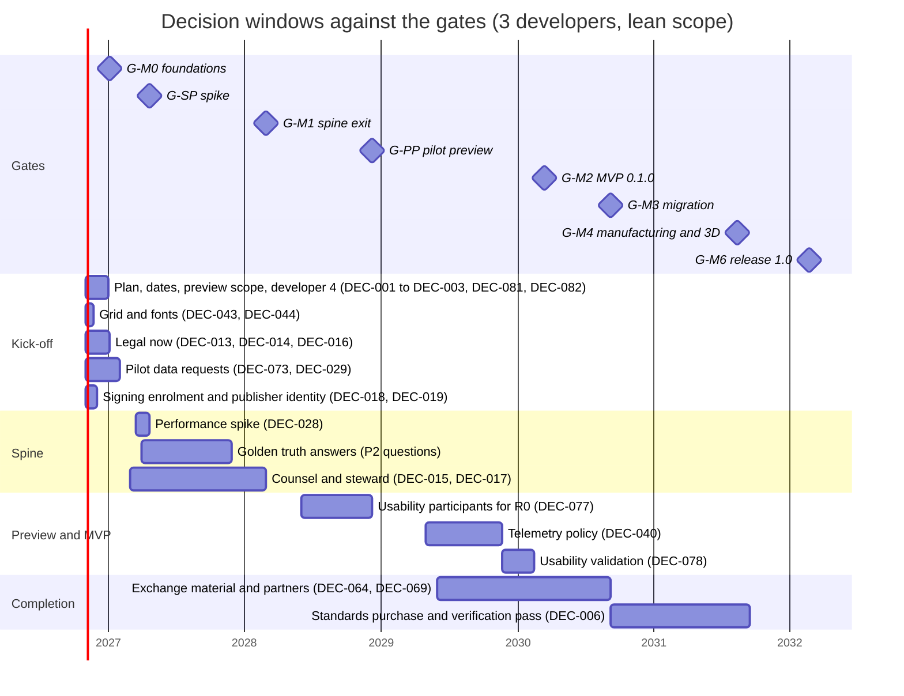

# Decision log

**Status:** Draft v0.22 · **Date:** 2026-10-22 (v0.22: the cycle-17 design pass ID-427 to ID-439: the typed revision as built with the delegated rulings R1 to R4, its format rule and the accepted open failure of old files, ADR-0009 amendment 6, the acceptance changes, the fuzzer's coverage and nightly form with the cargo-fuzz target deferred, the cycle-17 delivery and the plan view; v0.21: the G-M1 readiness run ID-419 to ID-426: the run, the verdict "not ready", the date rule with G-M0 first, D-06 split between G-M1 and G-M2, G-M1-24 restated, the second code owner left to the owner, the new tasks FT-294 to FT-301, FT-87 to FT-92 re-dated and the plan view, with the delegated rulings R1 to R8; v0.20: the cycle-16 decisions ID-392 to ID-418 on the device-tree, PLC, supply and library commands, `fields.set` on the assembly and PLC aspects, normaliser N1, the typed revision as its own package, AC-15 path (b) passing, the user guide with its generated reference and the `docs-book` job, the property-test generator rule, the acceptance tests once per CI job, the nightly performance gate and the CI-time trend, acceptance and the plan view; v0.19: the cycle-15 decisions ID-362 to ID-391 on the export job, the PDF ID and dates, the sealed generic symbols, `ew apply`, the assembly aspect and its BOM, the break marks, the import modes and the first quick fix, the generator contract, the CI budget, the hotfix rule, the CC-BY-SA item, the builder DSL, the page-type ruling, three commands and the fuzzer; v0.18: the cycle-14 decisions ID-340 to ID-361 on the product principle, the blind drafter and its work package, the PDF checks, the SVG export, the flow-distance orientation, the five rules, the anchor override, the exports, `ew verify-derived` and the cover; v0.17: the cycle-13 decisions ID-324 to ID-339 on wire numbering, the SQL projection v0, the PLC record kinds, the DP bus potential, cargo-vet exemptions and the reserved-kind rule; v0.16: the owner's rulings ID-322 and ID-323 on the open items of the cycle-12 design pass; v0.15: the cycle-12 decisions ID-301 to ID-321 on Golden C, the check engine and prevent at apply, `ew check`, the M1 report and page gaps and the profile rulings; v0.14: the cycle-11 decisions ID-273 to ID-300 on the QET project import, the acceptance runner, the command log, the settings command, Golden B, the symbol rulings and the memo retention policy; v0.13: the cycle-10 decisions ID-251 to ID-272 on incremental connectivity, per-item links, platform rules, the cycle-based plan view and the pilot size data; v0.12: the cycle-9 decisions ID-229 to ID-250 on report kinds and tables, the fallback font and the memo engine as built; v0.11: the cycle-8 persistence and G-SP decisions ID-200 to ID-228; v0.10: the cycle-8 cross-reference decisions ID-188 to ID-199; v0.9: the cycle-7 decisions ID-124 to ID-187 and the project owner's rulings; v0.8: the cycle-6 decisions ID-64 to ID-123 and the review rulings; v0.7: the cycle-5 decisions ID-33 to ID-63 and the review rulings; v0.6: ID-26 final limits; v0.5: the cycle-4 decisions ID-22 to ID-32, §2.4 and §5.1) ·
**Part of:** ElektraWatt plan

**Purpose.** This is the decision log of ElektraWatt (EW). **Part A** records what has been decided: the user
decisions of 2026-10-17, every Accepted ADR and the decisions of the first implementation day (2026-10-18), one
line each. **Part B** is the register of what is still open: the
questions that the design documents carry in their "Open questions" sections and the five Proposed ADRs (0025, 0027,
0028, 0029, 0030), consolidated and deduplicated into 85 numbered decisions (DEC-001 to DEC-085), each with its
options, a recommendation, a decision owner, the gate or work package by which it is needed, the impact if it is late
and the source documents. **Part C** is a prioritised questionnaire for the pilot user, merged with the brainstorm's
PQ list, that says for each question which decision, work package and gate it unblocks. The log invents no answers:
where a decision is open, the recommendation is the documented default that the plan uses until someone decides.
All dates are for the plan of record of the [global plan](01-global-plan.md) (three developers, lean scope, month 0 =
November 2026) and move with the scenario. Since 2026-10-20 (ID-271) these months are the reference of a human-team
scenario, not a forecast for the AI-driven cycles; a gate is due when its content is done (global plan §3.8).

---

## Summary for decision makers

**The state in one paragraph.** Eight user decisions, 25 Accepted ADRs, 63 decisions of the first
implementation day (2026-10-18, two of them interim defaults) and 60 of the sixth cycle and 64 of the seventh (both 2026-10-19) and 41 of the eighth, 22 of the ninth and 22 of the tenth (all 2026-10-20) and 28 of the eleventh, 23 of the twelfth, 16 of the thirteenth and 22 of the fourteenth (all 2026-10-21) and 30 of the fifteenth and 27 of the sixteenth (both 2026-10-22) are fixed (Part A); the G-M1 readiness run (2026-10-22) added 8 entries, decided by delegated rulings except the second code owner (ID-424), which awaits the owner, and the seventeenth cycle's design pass (2026-10-22) added 13. 85 decisions are
open (Part B): 37 wait for the pilot user, 24 for the project owner,
21 for the core team and 3 for counsel (several more need counsel's input). DEC-081 to DEC-085 were added with
version 0.2 for the re-planned pilot preview, the external and internal dates, the CRA status of the preview, the
community channels and the version numbering. The
source was 312 open questions in the design documents; at the date of this log 174 of the 344 questions now listed in
the design documents already carry a "Resolved" or "Decided" mark, and the rest are mapped to a decision here, to the
batch of low-impact defaults of §3.3, or to the short list of questions that other documents have settled (§3.4).
Part C asks the pilot user 53 questions in four priorities; **12 are P1 and should be asked at the kick-off**.
Nothing in this log is decided by being written down.

**What is due when** (plan of record; the gate dates are in §1.3):

| Gate | Date (plan of record) | Decisions due | Count |
|---|---|---|---|
| **G-M0** | month 3, Jan 2027 | DEC-001, DEC-002, DEC-003, DEC-005, DEC-007, DEC-013, DEC-014, DEC-016, DEC-018, DEC-019, DEC-021, DEC-022, DEC-029, DEC-043, DEC-044, DEC-073, DEC-074, DEC-080, DEC-081, DEC-082, DEC-083 | 21 |
| **G-SP** | month 6, Apr 2027 | DEC-028, DEC-030 | 2 |
| **G-M1** | month 16, Feb 2028 | DEC-004, DEC-008, DEC-010, DEC-011, DEC-015, DEC-017, DEC-020, DEC-023, DEC-032, DEC-034, DEC-036, DEC-037, DEC-038, DEC-039, DEC-046, DEC-047, DEC-048, DEC-049, DEC-051, DEC-052, DEC-053, DEC-054, DEC-057, DEC-059, DEC-060, DEC-084 | 26 |
| **G-PP** | month 26, Dec 2028 | DEC-077, DEC-085 | 2 |
| **G-M2** | month 41, Mar 2030 | DEC-009, DEC-031, DEC-033, DEC-035, DEC-040, DEC-041, DEC-042, DEC-050, DEC-055, DEC-056, DEC-058, DEC-061, DEC-062, DEC-063, DEC-068, DEC-070, DEC-078, DEC-079 | 18 |
| **G-M3** | month 47, Sep 2030 | DEC-006, DEC-025, DEC-045, DEC-064, DEC-065, DEC-066, DEC-069, DEC-075, DEC-076 | 9 |
| **G-M4** | month 58, Aug 2031 | DEC-024, DEC-067, DEC-072 | 3 |
| **G-M5** | month 59, Sep 2031 | DEC-012, DEC-071 | 2 |
| **1.x** | after 1.0 | DEC-026, DEC-027 | 2 |

**The first 90 days (to G-M0 in Jan 2027).** 21 decisions carry the gate G-M0. The ones that block
work are: the plan of record with its external and internal dates (DEC-001, DEC-081), lever (b) (DEC-002), the
pilot-preview scope and the Must-row triage (DEC-082) and developer 4 (DEC-003); the native grid
(DEC-043, by spine week 2, mid-November 2026) and the default fonts (DEC-044, by week 3, late November 2026), because the
output lane builds the starter symbols and the goldens on them; the signing enrolment path and the employer's public
identity (DEC-018, DEC-019), because the enrolments of WP-S0.05a name the publisher and their 12-month lead time starts
when they are submitted; and the legal items that are already overdue or hard:
the publication consent (DEC-013, "now", the content is public), the employer statement (DEC-014) and the SPDX test
(DEC-016). The pilot's data requests (QET corpus DEC-073, size data DEC-029) have a lead time of
months, so they go out at the kick-off.

**Defaults already in force.** Since 2026-10-18 the 4 mm native grid (DEC-043) and Noto Sans (DEC-044) are the
working basis, so the output lane does not wait; both rows stay open until the pilot confirms them at G-M0, and
DEC-080 items 1 to 4 are confirmed (§2.4).

**What happens if nothing is decided.** The documented defaults apply: 4 mm grid, Noto Sans, classic single letters,
DBU/WH colours, 3 developers, no grants, no signed release, no non-maintainer merge (`blocked:LG-2`), local-only crash
reports. Every default is cheap to change before the gate named in its row and expensive afterwards (goldens
re-baselined, symbols redrawn, format records frozen at M1).

**Two things this log cannot settle.** (1) The answers to the P2 questions (reference-project truth) are the
acceptance specification; until they arrive, goldens carry marked test values (the triangles of the
[golden project](../design/20-golden-project.md)). (2) Counsel's work (ADR-0025, ADR-0030, CRA scope, LG-3 searches)
has lead time and a cost that [global plan §13.4](01-global-plan.md#134-costs-that-are-money-not-pw) lists; it must be commissioned in the first 90 days.

---

**Contents**
1. [Basis and method](#1-basis-and-method)
2. [Part A: decisions taken](#2-part-a-decisions-taken)
3. [Part B: open decisions](#3-part-b-open-decisions)
4. [Part C: questions for the pilot user](#4-part-c-questions-for-the-pilot-user)
5. [Maintaining the log](#5-maintaining-the-log)
6. [Sources](#sources)
7. [Open questions](#open-questions)

---

## 1. Basis and method

### 1.1 Inputs

- The open questions of documents 00 to 20 (snapshot of 312, including 16 ADR follow-ups) and their current state in
  the documents, the five Proposed ADRs and the Accepted ADRs 0001 to 0024 and 0026.
- The [global plan](01-global-plan.md) (milestones including the pilot preview M-PP, decisions PD-1 to PD-15, the
  first 90 days, funding), the [work breakdown](02-work-packages.md) (WPs, levers, planning assumptions PA-1 to PA-11)
  and the [gates](03-gates.md) (gate dates, checkpoints CP-01 to CP-15, legal gates LG-1 to LG-6).
- The pilot questions PQ-01 to PQ-36 of the [brainstorm](../design/01-brainstorm.md#7-questions-for-the-pilot-user).

### 1.2 How the questions were consolidated

1. **Status first.** A question that its document marks "Resolved" or "Decided" is not open. This log does not
   reopen it. Questions that another document settled without updating their own are listed in §3.4.
2. **One decision, many sources.** Questions that ask the same thing in two or three documents (for example the grid,
   the unplaced-device policy, the viewer packaging, the saved date) become one decision. The sources column names
   every document and question number (`doc OQn`) so that the trail is complete.
3. **Decisions, not facts.** A question that only needs a fact from the pilot (a part number, an order code) becomes a
   decision when the answer changes a default, a golden or a work package; otherwise it is a question in Part C only.
4. **Batch the small ones.** Defaults that are low impact and have a recommendation nobody has objected to are listed
   once in §3.3 and confirmed in one review (DEC-080).
5. **Owners.** *Project owner*: scope, money, legal form, naming. *Pilot user*: the acceptance truth, house
   conventions and what the pilot's shop does; this includes the employer where the employer must act. *Core team*:
   architecture, engineering defaults, verification outcomes. *Counsel*: legal wording and legal interpretation. A
   decision with two roles names the one who decides first and the one consulted in brackets.
6. **Status.** Every row is *Open* on 2026-10-18. Closing a row is described in §5. A row whose recommendation is
   already the working basis says "Default in force since *date*" in its recommendation cell and stays open; §2.4
   lists these interim decisions.

### 1.3 Gates, months and dates

Month *n* counts from 2026-11-01 and is labelled with the calendar month in which it ends (global plan §3.4). Gate
months are those of [milestones.csv](milestones.csv), written by [tools/schedule.py](tools/schedule.py); the table is
the same generated block as in the [gates](03-gates.md#22-timing-per-scenario), and `schedule.py --check` fails when it
is stale. The plan-of-record column is the conservative baseline (3 developers, lean scope); the two AI columns are the
internal target and the upside of the global plan (§3.7) and are not external dates (DEC-081). G-SP is the
performance-spike decision, one month after WP-S1.03.

<!-- generated:gate-timing -->
| Gate | 2 developers | **3 developers (baseline)** | 4 developers (fourth from month 4) | 3 + AI-moderate (internal) | 3 + AI-strong |
|---|---|---|---|---|---|
| **G-SP** | 7 (May 2027) | **6 (Apr 2027)** | 6 (Apr 2027) | 5 (Mar 2027) | 5 (Mar 2027) |
| **G-M0** | 3 (Jan 2027) | **3 (Jan 2027)** | 3 (Jan 2027) | 3 (Jan 2027) | 3 (Jan 2027) |
| **G-M1** | 23 (Sep 2028) | **16 (Feb 2028)** | 16 (Feb 2028) | 13 (Nov 2027) | 11 (Sep 2027) |
| **G-PP** | 37 (Nov 2029) | **26 (Dec 2028)** | 24 (Oct 2028) | 21 (Jul 2028) | 18 (Apr 2028) |
| **G-M2** | 60 (Oct 2031) | **41 (Mar 2030)** | 36 (Oct 2029) | 33 (Jul 2029) | 29 (Mar 2029) |
| **G-M3** | 70 (Aug 2032) | **47 (Sep 2030)** | 40 (Feb 2030) | 38 (Dec 2029) | 32 (Jun 2029) |
| **G-M4** | 84 (Oct 2033) | **58 (Aug 2031)** | 52 (Feb 2031) | 47 (Sep 2030) | 40 (Feb 2030) |
| **G-M5** | 88 (Feb 2034) | **59 (Sep 2031)** | 52 (Feb 2031) | 47 (Sep 2030) | 41 (Mar 2030) |
| **G-M6** | 97 (Nov 2034) | **65 (Mar 2032)** | 58 (Aug 2031) | 52 (Feb 2031) | 45 (Jul 2030) |
<!-- /generated:gate-timing -->

A work package (WP) is written "WP-S1.21 (month 25)" when the decision is needed before it starts. The month is the
one in which the WP starts in the schedule model (3 developers, lean scope, base capacity): the start month of
[wp-schedule.csv](wp-schedule.csv), rounded up, so a WP that starts at 24.2 months is in month 25. It is a planning
date, not a promise. "Needed by" always names the earliest of the gate and the WP.

### 1.4 Source keys

A source such as `08 OQ8, OQ9` means open questions 8 and 9 of document 08. `plan 01` is the
[global plan](01-global-plan.md), `gates` the [gates](03-gates.md), `ADR-nnnn` an [ADR](../adr/).

| Key | Document | Key | Document |
|---|---|---|---|
| 00 | [Vision and scope](../design/00-vision-and-scope.md) | 11 | [Fluid power](../design/11-fluid-power.md) |
| 01 | [Brainstorm](../design/01-brainstorm.md) | 12 | [Panel layout](../design/12-panel-layout.md) |
| 02a | [Core requirements](../design/02a-requirements-core.md) | 13 | [Manufacturing outputs](../design/13-manufacturing-outputs.md) |
| 02b | [Extended requirements](../design/02b-requirements-extended.md) | 14 | [Interop](../design/14-interop.md) |
| 02c | [Non-functional requirements](../design/02c-nonfunctional-requirements.md) | 15 | [Checks, revisions, collaboration](../design/15-checks-revisions-collaboration.md) |
| 03 | [Domain model](../design/03-domain-model.md) | 16 | [UX and UI](../design/16-ux-ui.md) |
| 05 | [Project format and persistence](../design/05-project-format-and-persistence.md) | 17 | [Extensibility](../design/17-extensibility.md) |
| 06 | [Schematic editor](../design/06-schematic-editor.md) | 18 | [Quality, security, release](../design/18-quality-security-release.md) |
| 07 | [Symbols, parts, macros](../design/07-symbols-parts-macros.md) | 19 | [Open-source governance](../design/19-open-source-governance.md) |
| 08 | [Connections, terminals, cables](../design/08-connections-terminals-cables.md) | 20 | [Golden project](../design/20-golden-project.md) |
| 09 | [Reports, forms, output](../design/09-reports-forms-output.md) | 04 | [Architecture](../design/04-architecture.md) |
| 10 | [PLC and bus](../design/10-plc-and-bus.md) | | |

---

## 2. Part A: decisions taken

### 2.1 User decisions of 2026-10-17

These are binding and are not re-litigated in any document ([vision](../design/00-vision-and-scope.md#11-user-decisions-taken) §11).

| # | Decision | Content | Recorded in |
|---|---|---|---|
| UD-1 | **Language** | Rust for the core and the application. FFI only where justified, for example the B-rep/STEP kernel (out-of-process OCCT worker). | Vision §11; [ADR-0016](../adr/0016-3d-renderer-wgpu-and-out-of-process-step-worker.md) |
| UD-2 | **Open source** | A public open-source project that accepts community contributions under the DCO, with no CLA. | [ADR-0024](../adr/0024-licence-set-and-permissive-gpl-boundary.md); [19](../design/19-open-source-governance.md) |
| UD-3 | **Team** | 2 to 4 developers plus AI assistance. The plan baseline is 3 developers (2 and 4 as scenarios); AI is assumed to help, not to multiply throughput (§2.3). | Vision §10; [global plan](01-global-plan.md) |
| UD-4 | **Platform** | Cross-platform desktop (Windows, macOS, Linux), offline-first, projects as files on disk. | [ADR-0010](../adr/0010-project-storage-jsonl-directory.md); [ADR-0022](../adr/0022-platform-matrix-and-performance-budgets.md) |
| UD-5 | **v1 extras** | v1 also includes (1) PLC / I/O integration with exchange with TIA Portal and CODESYS (AML, CSV), (2) manufacturing outputs (wire lists with lengths and ferrules, terminal plans, labels, Komax and Rittal machine export), (3) a 3D panel layout with rails, ducts, collision, wire routing and automatic wire lengths, (4) import of EPLAN (EDZ), QElectroTech (.qet) and DXF (DWG). | Vision §9; [work breakdown](02-work-packages.md) |
| UD-6 | **Licence set** | Application GPL-3.0-or-later with a plugin exception (wording by counsel, open as DEC-015); format, parser and SDK crates MIT OR Apache-2.0; symbols and templates CC-BY-SA-4.0 with a KiCad-style design exception; project-authored part data and examples CC0; documentation CC-BY-4.0. Porting QElectroTech code (GPL-2.0-or-later) is allowed with attribution. | [ADR-0024](../adr/0024-licence-set-and-permissive-gpl-boundary.md) |
| UD-7 | **Device-tag letters** | New projects default to the classic single letters (EN 81346-2:2009: F, G, S, T, E, X, W, U, Q, K, M ...), as in the reference drawings. IEC 81346-2:2019 two-letter classes are selectable per project; the IEC 60750 legacy set ships for migrated QET projects. | [ADR-0026](../adr/0026-default-device-tag-identifier-set.md) |
| UD-8 | **Public repository and anonymisation** | The repository is public and the reference project is confidential customer work: its technical content (tags, part numbers, wiring, folio numbers, defects) is the acceptance specification, but customer, end-user, address, project and drawing identifiers, people's names and initials, the panel builder's name, the confidentiality notice and e-mail addresses never enter the repository. The migration path is QET first, because the pilot user works in QET 0.100.0-dev. | [20](../design/20-golden-project.md) §3.5, AC-39; [ADR-0021](../adr/0021-importers-emit-format-level-records.md); LG-5 (DEC-013) |

### 2.2 Accepted ADRs

All 25 are Accepted; those marked *amended* took amendments on 2026-10-18 that are folded into the ADR text. The five Proposed ADRs (0025, 0027, 0028, 0029, 0030) are decisions in Part B.

| ADR | Decision in one line | Note |
|---|---|---|
| [ADR-0001](../adr/0001-core-model-persistent-maps.md) | Core model: typed Rust records in persistent maps (imbl); one `Model` value is the single source of truth and everything printed is derived. | amended (raw reads behind the `raw-read` feature) |
| [ADR-0002](../adr/0002-derived-data-engine-ew-memo.md) | Derived-data engine: cold-first queries plus a cut-down memo layer (`ew-memo`); no salsa. | amended; the performance spike (DEC-028) closes the open part |
| [ADR-0003](../adr/0003-freshness-contract.md) | Freshness contract: classes I to III, frozen-on-purpose identifiers, committed computations, versioned derivation profiles. |  |
| [ADR-0004](../adr/0004-identity-uuidv7-uuidv5.md) | Identity: UUIDv7 for authored records, UUIDv5 for instantiated, imported and generated ones. | amended (import lineage, UUIDv7 method, UUIDv5 name layout and `NS_IMPORT`) |
| [ADR-0005](../adr/0005-value-types-nm-dec3-mltext.md) | Values: `i64` nanometre coordinates, rational grids, `Dec3` quantities, `MlText`. | amended (`Angle2`, its counter-clockwise rotation sense) |
| [ADR-0006](../adr/0006-function-device-representation-model.md) | Function / Device / Representation model with typed device aspects. | amended |
| [ADR-0007](../adr/0007-explicit-connections-and-autoconnect.md) | Explicit connections and junction sequences are the model; autoconnect is an editing aid. | amended; validation with EPLAN and QET users is DEC-078 |
| [ADR-0008](../adr/0008-transactions-undo-preview.md) | Transactions, undo/redo and preview-as-fork; every write is a serialisable command. | amended |
| [ADR-0009](../adr/0009-invariant-catalogue.md) | Invariant catalogue: structural versus configurable prevent rules; lenient import. | amended |
| [ADR-0010](../adr/0010-project-storage-jsonl-directory.md) | Project storage: UUID-named JSONL directory, manifest-last save, external journal, lock file. | amended (intent manifest, lock record) |
| [ADR-0011](../adr/0011-format-versioning-and-migration.md) | Format versioning, per-kind migration and format-change windows. | amended (append-only members; error paths from `ew-schema`, no strict schema variant) |
| [ADR-0012](../adr/0012-git-integration.md) | Git integration: semantic merge driver, textconv, in-file conflict records, post-merge integrity. | amended |
| [ADR-0013](../adr/0013-revisions-and-as-built-archive.md) | Revisions and the as-built archive outside the project directory. | amended |
| [ADR-0014](../adr/0014-gui-toolkit-egui.md) | GUI toolkit: egui/eframe behind `ew-ui`, over a toolkit-agnostic `ew-viewmodel`. | amended |
| [ADR-0015](../adr/0015-display-list-renderers-pdf.md) | One display-list IR; wgpu canvas plus an always-built CPU renderer; krilla PDF/A-2b; PDF as print master. | amended |
| [ADR-0016](../adr/0016-3d-renderer-wgpu-and-out-of-process-step-worker.md) | 3D renderer on wgpu; out-of-process OCCT STEP worker. | amended (the gizmo lives in `ew-ui`) |
| [ADR-0017](../adr/0017-read-only-sql-projection-api-v1.md) | Read-only SQL projection with versioned `api_v1` views. | amended |
| [ADR-0018](../adr/0018-reports-forms-engine-and-machine-profiles.md) | Reports and forms engine; report blocks as derived pages; machine-export profiles as data. | amended |
| [ADR-0019](../adr/0019-rule-engine-and-rule-packs.md) | Rule engine and rule packs. | amended (packs, export mode, rule-ID scheme) |
| [ADR-0020](../adr/0020-extensibility-tiers-and-security-model.md) | Extensibility tiers and security model: CLI, rhai, WASM on the wasmtime LTS line, MCP, Python. | amended (pure formulas run untrusted; JSON at the WIT boundary) |
| [ADR-0021](../adr/0021-importers-emit-format-level-records.md) | Importers emit format-level records; QET first; EDZ as 7-Zip; DWG via acadrust plus ODA. | amended |
| [ADR-0022](../adr/0022-platform-matrix-and-performance-budgets.md) | Platform matrix and performance budgets (S/M/L/XL) as CI-enforced requirements. |  |
| [ADR-0023](../adr/0023-supply-chain-and-release-integrity.md) | Supply chain and release integrity: pinned toolchain, SBOM, signing, provenance. | amended (cargo-vet audits name the GitHub handle, no imported audit sets); the SignPath fallback is DEC-018 |
| [ADR-0024](../adr/0024-licence-set-and-permissive-gpl-boundary.md) | Licence set and the permissive/GPL crate boundary, enforced in CI. | amended (further permissive crates, one allowlist, the Code of Conduct's CC-BY-SA-4.0) |
| [ADR-0026](../adr/0026-default-device-tag-identifier-set.md) | Default device-tag identifier set: EN 81346-2:2009 single letters; IEC 81346-2:2019 and IEC 60750 selectable. | amended; the leniency on S is DEC-046 |

### 2.3 Planning inputs used by the plan

These are inputs given to the planning, not decisions of record. Their formal adoption is DEC-001 and DEC-081. They
are numbered PI-1 … PI-7 here. Where an input is one of the planning assumptions of the work breakdown, the third
column cites it by its work-breakdown ID PA-n and meaning ([WBS §1](02-work-packages.md#1-planning-assumptions)); the global plan's GA-n,
the gates' GB-n and this list's PI-n are different lists.

| # | Planning input | Work-breakdown assumption | Where it is used |
|---|---|---|---|
| PI-1 | Project start (month 0) is November 2026. | PA-1 start | All dates |
| PI-2 | Baseline team of 3 developers; scenarios with 2 and with 4 (the fourth from month 4, the whole team at 90 % efficiency from then). | PA-2 team | [Global plan](01-global-plan.md#22-team-scenarios) §2.2 |
| PI-3 | Productive capacity is about 36 person-weeks per developer per year, after holidays, meetings, support and community work; sensitivity plus or minus 20 %. | PA-3 capacity | [Global plan](01-global-plan.md#2-capacity-model) §2, §3.5 |
| PI-4 | AI assistance is assumed to help (likely estimates 10 to 20 % lower) but not to multiply throughput. The AI-moderate and AI-strong scenarios are an internal target and an upside on top of the estimates, never part of them. | PA-7 AI assistance | [Global plan](01-global-plan.md#37-ai-assisted-scenarios) §3.7; DEC-081 |
| PI-5 | At least 20 % reserve for integration, hardening and bug fixing; documentation, release engineering and community and pilot support are work packages. | PA-8 reserve; PA-6 what an estimate contains; PA-11 background load | [Work breakdown](02-work-packages.md) |
| PI-6 | The architecture's indicative 15 to 18 months to 1.0 is not met; the realistic plan-of-record dates are the pilot preview at month 26 (Dec 2028), the MVP at month 41 (Mar 2030) and 1.0 at month 65 (Mar 2032; month 64 until the blind-drafter work package, ID-342). | none: a result of the schedule model | [Global plan](01-global-plan.md#36-can-v1-fit-1518-months) §3.6; [milestones.csv](milestones.csv) |
| PI-7 | External lead times (the signing enrolment of at least 12 months, counsel, the trademark search) are modelled as lags and as money, not as person-weeks. | PA-9 schedule model; PA-10 external costs | [Global plan](01-global-plan.md#92-ordering-rules) §9.2 rule 5, §13.4 |

### 2.4 Decisions of 2026-10-18 (first implementation day)

On 2026-10-18 the first code landed (WP-S0.01, WP-S0.02 and the first half of WP-S1.01), and the project owner
delegated the product-owner role to that development session. These decisions are recorded with the decider
"project owner (delegated, 2026-10-18)", or the core team for engineering details the code had to fix. They take no
confirmation away from the pilot user: DEC-043 and DEC-044 stay open in Part B until the pilot confirms them at G-M0.
Later the same day `ew-schema` v0 (WP-S1.02) landed; ID-12 to ID-21 record the questions it raised and the dependency
edges of the foundation crates. The fourth implementation cycle (`ew-model`, WP-S1.03; the QET element reader and symbol lowering, WP-S3.05) and its independent review raised ID-22 to ID-32. The fifth cycle (the starter symbols, WP-S7.02; `ew-text` and the frame and title-block forms, WP-S3.02; `ew-commands` and `ew-api`, WP-S1.04) and its independent reviews raised ID-33 to ID-63; the code and content changes they require are follow-up tasks FT-01 to FT-18 of the [work breakdown](02-work-packages.md#appendix-b-follow-up-tasks-from-the-implementation-cycles), Appendix B. On 2026-10-19 the sixth cycle (`ew-memo` v1, the S–XL generator, the benchmark harness and `check-raw-read`, WP-S1.05; the tracked context `Q` and Derivation I, WP-S1.06; the golden tables and the CSV bootstrap, WP-S7.01 and WP-S3.05) and its independent reviews raised ID-64 to ID-116, with the project owner's delegated rulings recorded under "project owner (delegated, 2026-10-19)"; their code changes are FT-19 to FT-42, and FT-01 is closed. The seventh cycle (the report engine, WP-S3.03; page output, WP-S3.04; Derivation II, WP-S1.07) the independent reviews of its report engine, page output and connectivity, and their fix rounds raised ID-124 to ID-187, with the project owner's delegated rulings recorded the same way; their code and content changes are FT-46 to FT-80. The eighth cycle's design pass on cross-references (WP-S1.08: the counts of doc 20 §15, the page index, contact images, strip segments, the unfinished slots, settings and glyph, and the per-slot text style) raised ID-188 to ID-199, with the project owner's delegated rulings of 2026-10-20; their code and content changes are FT-81 to FT-85. The eighth cycle's second design pass raised ID-200 to ID-228: the persistence core as built and reviewed (WP-S1.09; ADR-0010 amendment 3), the outcome Recycle of gate G-SP with incremental connectivity and the plan re-baseline (WP-S1.05; ADR-0002 amendment 4), and two cross-reference leftovers; their code and content changes are FT-86 to FT-99. ID-208 and ID-216 were open items that the lead designer decided. The ninth cycle's design pass raised ID-229 to ID-250: the report tables layer and the connectivity report kinds with the doc 20 alignments and a fixture decision (WP-S3.03, FT-53 closed), the bundled symbol fallback face with the FR-OUT-027 reporting rule (WP-S3.02, FT-85 closed; ADR-0028 amendment 1, ADR-0015 amendment 8), and the memo engine and memoised `Q` as built (WP-S1.07 part 1; ADR-0002 amendment 5), with WP-S1.07 part 2 moved to cycle 10; their code and content changes are FT-100 to FT-116. The tenth cycle's design pass raised ID-251 to ID-272: incremental connectivity as built and reviewed (WP-S1.07 part 2; ADR-0002 amendment 6, ARCH §3, §6.3 and §6.4), the per-slot text style and one link per listed item with the 64-annotation sweep and the 24 V fixture change (FT-84, FT-86 and FT-109 closed; ADR-0015 amendment 9), the cross-platform source rules after the red CI of cycle 9, and the project owner's decision that the plan's calendar is a human-team reference while progress is tracked in cycles (ID-271), and the pilot's size data, which closes G-SP-08 and CP-03 with class S as the pilot's working range (ID-272); their code and content changes are FT-117 to FT-126. The eleventh cycle's design pass (2026-10-21) raised ID-273 to ID-300: the lenient QET project import as a spike pulled forward from lever (b), with its keys, tag, pairing, strip and CLI rules and Golden C made runnable (doc 14 §4.16), the acceptance runner and its M1 gap list, the command log and Golden B as built, `project.settings.set` with its exposure and the frozen-tag rule (ADR-0008 amendment 3), the segment-less strip rule, the starter-set and pole-family rulings for the pilot corpus, the orphan-collection retention policy (ADR-0002 amendment 7), the timing rule and the pilot corpus as private test input; their code and content changes are FT-127 to FT-163. The twelfth cycle's design pass raised ID-301 to ID-321 (Golden C, the check engine and prevent at apply, `ew check`, the M1 report and page gaps; ADR-0009 amendment 5) and the owner's rulings ID-322 and ID-323; their code and content changes are FT-164 to FT-211. The thirteenth cycle's design pass raised ID-324 to ID-339: wire numbering as built with doc 20 §8.2 following the computed numbers, the numbering order and the segment-only terminal anchor (FT-100 and FT-201 closed); the SQL projection v0 as built with its Preview additions, view rulings and sandbox (WP-S1.10; ADR-0017 amendment 2 extended); exemptions per work package (ADR-0023 amendment 4); the PLC record kinds, channel IDs, the interim DP bus model and the aspect write order (FT-111 and FT-105 closed), with the rule that a reserved kind may be implemented within an unreleased format (ADR-0011 amendment 4); acceptance without fails and the plan view; their code and content changes are FT-212 to FT-232. The fourteenth cycle's design pass raised ID-340 to ID-361: the owner's product principle (the pilot's drawings are the content target) and the blind drafter with its work package WP-S6.13, which moves the plan-of-record 1.0 by one month; the PDF checks with an in-repo reader, `par_map` and the SVG writer as built, with the export CLI waiting for FT-59; the flow-distance orientation (FT-101 closed), the junction notation and one CP label rule, EF-15 = 10, D-14 restated, the per-representation anchor override (ADR-0011 amendment 4 applied), part descriptions without ratings, the release gate of scheme content and the five new rules (FT-212 to FT-214 closed); the block-title templates, the cables and BOM exports, `ew verify-derived` with the freshness check and the cover (D-30); the disk rule of agent sessions; acceptance at 81 of 92 with 0 fails and the plan view; their code and content changes are FT-233 to FT-245. The fifteenth cycle's design pass raised ID-362 to ID-391: the export job in `ew-api` with its view parts and layers, the PDF document ID with a content digest, the export dates, the sealed generic symbols, the slot texts (FT-206 resolved), `ew apply`, the edges to `ew-text` and `ew-dl` and the durable output files; the assembly aspect's covers, `bom_basis`, the derived break marks, the assembly BOM table, strict import under EW-IMP-002, the first quick fix through `fields.set`, the two-line folio 3 and the covers cascade; the generator contract of doc 20 §8.2, rustdoc on both platforms, the CI time budget, the hotfix rule and the CC-BY-SA item for counsel; the builder DSL of AC-15 path (b), the page-type ruling that amends ID-55, three new commands, the runner as `cargo xtask acceptance`, the command fuzzer and the "(a) ≠ (b)" gap class; acceptance at 86 of 93 with 1 fail (AC-15 path (b)) and 1 not built, and the plan view; their code and content changes are FT-246 to FT-272. The sixteenth cycle's design pass and its lane-B review rulings raised ID-392 to ID-418: seven commands for the device tree, the PLC records, the supply origin and library copies, with `assembly.attach` without push insert or detach, `valve.add`'s interim parameters, `project.supply.set` limited to the origin, `library.embed`'s hash rule and one copy-hash function, `fields.set` on the assembly and PLC aspects and normaliser N1 that never removes a channel; the typed revision as a D5 package; AC-15 path (b) passing record for record; the user guide as an offline mdBook with the generated reference (GPL pages), `docs-gen --check` and the `docs-book` job; the property-test generator rule after the cycle-15 gate finding; the acceptance tests once per CI job, the nightly performance gate and the CI-time trend; acceptance at 87 of 93 with 0 fails and 1 not built, and the plan view; their code and content changes are FT-273 to FT-293. The G-M1 readiness run at the cycle-16 delivery raised ID-419 to ID-426: the run and where its records live, the verdict "not ready", the proposed date rule with G-M0 first, three proposed owner rulings (D-06's property-grid half to G-M2, G-M1-24 to -26 under the cycle-based plan, a second named code owner), the tasks for the gaps (FT-294 to FT-301) with the proposed re-dating of FT-87 to FT-92, and the plan view; the delegated rulings of the same day decided all but the second code owner (ID-424), which waits for the project owner, and the owner confirms the date rule at G-M0. The seventeenth cycle's design pass raised ID-427 to ID-439: the typed revision as built (FT-165), its format rule and the accepted open failure of old files that break an invariant, the revision fields of doc 03 §18, ADR-0009 amendment 6, no historic release after a real one, what the typed revision leaves for later, the acceptance changes (a second D-05 entry, the folio-911 digests, D-06's grid entry not applicable), the fuzzer's coverage of the 37 commands (FT-279) and its nightly form with the cargo-fuzz target deferred, ASan and macro insertion as tasks, the `fuzz_smoke` time, the cycle-17 delivery at 88 of 94 with no blocking entry, and the plan view; their code and content changes are FT-302 to FT-306.

| # | Decision | Decider | Recorded in |
|---|---|---|---|
| ID-1 | **Native grid default (DEC-043, interim).** The 4 mm native connection grid (`Grid{4_000_000, 1}`), 0.5 mm graphics and 1 mm text grids, and QET-grid pages kept permanently are the working basis now, so the output lane can draw the starter symbols. ADR-0027 stays Proposed; the pilot user and two EPLAN users confirm at G-M0, and a different decision re-baselines the starter symbols and goldens once. | Project owner (delegated, 2026-10-18) | [ADR-0027](../adr/0027-native-symbol-grid-and-qet-grid-policy.md); DEC-043; [03](../design/03-domain-model.md) §3.1 |
| ID-2 | **Default font (DEC-044, interim).** Noto Sans (OFL-1.1) is the default drawing font now; osifont is not bundled until its SPDX expression is verified. ADR-0028 stays Proposed; the pilot user confirms at G-M0. | Project owner (delegated, 2026-10-18) | [ADR-0028](../adr/0028-default-drawing-fonts.md); DEC-044 |
| ID-3 | **Low-impact defaults, DEC-080 items 1 to 4.** Confirmed as written: 256 fixed shards; no macOS package bundle for `.ew` in v1; the manifest stays tracked in git; FR-REV-018/019 are the rows of record and FR-COL-018/019 refer to them, keeping their IDs. Items 5 to 9 stay open for their own gates. | Project owner (delegated, 2026-10-18) | §3.3; [05](../design/05-project-format-and-persistence.md) OQ6, OQ13, OQ14; [15](../design/15-checks-revisions-collaboration.md) OQ11; [02a](../design/02a-requirements-core.md), [02b](../design/02b-requirements-extended.md) |
| ID-4 | **cargo-vet attribution.** The `who` field of an audit is the contributor's GitHub handle; public audit sets are not imported while the public-repository rule (UD-8) stands, because `imports.lock` would record auditors' names and e-mail addresses; revisit when a steward exists. | Project owner (delegated, 2026-10-18) | [ADR-0023](../adr/0023-supply-chain-and-release-integrity.md) amendment 3; [19](../design/19-open-source-governance.md) §3.5, OQ18 |
| ID-5 | **`Angle2` rotation sense.** Positive angles rotate counter-clockwise as seen on the sheet, 0 at 3 o'clock; QET text rotations are negated on import, DXF angles kept. | Project owner (delegated, 2026-10-18) | [ADR-0005](../adr/0005-value-types-nm-dec3-mltext.md) amendment 2; [03](../design/03-domain-model.md) §3.1; [14](../design/14-interop.md) §4.3, §4.13, §6.1 |
| ID-6 | **Code of Conduct licence.** `CODE_OF_CONDUCT.md` keeps the Contributor Covenant 3.0's own licence, CC-BY-SA-4.0, not the documentation licence CC-BY-4.0. | Core team (fact verified against the published text) | [ADR-0024](../adr/0024-licence-set-and-permissive-gpl-boundary.md) amendment 4; [19](../design/19-open-source-governance.md) §2.1, §2.3 |
| ID-7 | **Engineering details fixed by the first code.** The UUIDv5 name layout and the `NS_IMPORT` constant for import-lineage namespaces; the `Rect` JSON encoding; the exact frame-cell lookup `cell_of(point, page)` in `ew-derive`; the 3D gizmo in `ew-ui`; the `ew-testkit` → `ew-import-tables` edge. | Core team | [ADR-0004](../adr/0004-identity-uuidv7-uuidv5.md) amendment 4; [05](../design/05-project-format-and-persistence.md) §3.2, §3.2a; [06](../design/06-schematic-editor.md) §5.1; [ADR-0016](../adr/0016-3d-renderer-wgpu-and-out-of-process-step-worker.md) amendment 1; [04](../design/04-architecture.md) §3 |
| ID-8 | **Natural order without ICU.** `ew-mltext` implements a specified, deterministic natural order (NFD, accents stripped, lower-cased; digit runs by value; white space < punctuation < symbols < digits < letters; accents and leading zeros secondary; upper case first tertiary) instead of ICU collation, because `icu` 2.3.1 needs Rust 1.88 (MSRV 1.85), adds about twenty crates to a format crate and would reorder keys silently on table updates. ICU stays for language-sensitive display sorting in the GPL query layer. | Project owner (delegated, 2026-10-18) | [ADR-0005](../adr/0005-value-types-nm-dec3-mltext.md) amendment 3; [04](../design/04-architecture.md) §3; [02b](../design/02b-requirements-extended.md) FR-I18N-010 |
| ID-9 | **FR-NUM-018 sign order.** One documented root order, no ad-hoc exception: `-` (punctuation) sorts before `+` (symbol), both before digits. | Project owner (delegated, 2026-10-18) | [02a](../design/02a-requirements-core.md) FR-NUM-018 |
| ID-10 | **Aspect order of `#` and `%`, and EW-RDS-009 severity.** In a full designation the order is `==`, `=`, `++`, `+`, `&`, `#`, `%`, `-` (fixed by the first implementation). EW-RDS-009 stays an error for an identifier whose confusable skeleton is pure ASCII while it contains non-ASCII letters (unreachable by search, breaks cross-references); a genuinely non-Latin identifier produces no finding. | Core team (aspect order); project owner (delegated, 2026-10-18) (severity) | [03](../design/03-domain-model.md) §8.1; [15](../design/15-checks-revisions-collaboration.md) EW-RDS-009 |
| ID-11 | **Display-list details fixed by `ew-dl`.** `DashDot` 4:2:1:2, `Dash42` 4:2, `Dot12` 1:2 in pen widths; house pens with butt caps and miter joins, miter limit 4.0 set explicitly by every writer; layer paint order is the table order of 09 §4.1; `ShapedRun` carries a `layout_box` used for PDF link rectangles; `ew-dl` has its own hashable colour type and does not depend on peniko. | Core team | [07](../design/07-symbols-parts-macros.md) §2; [09](../design/09-reports-forms-output.md) §4.1, §4.2; [04](../design/04-architecture.md) §3 |
| ID-12 | **ARCH §4.2 is a summary.** Its rows now match doc 03 and doc 09: `Conductor{colour: ColourSpec?, csa: Csa?}`, the colour and size profiles inside `settings`, `IpSpec{name, direction, star_source, sort?, external?}` with the pairing scope in `ProjectSettings.ip_pairing`, `ReportBlock.source` as `Kind \| SqlQuery`. Where the summary differs, doc 03, doc 09 and `ew-schema` are normative. | Core team | [04](../design/04-architecture.md) §4.2; [03](../design/03-domain-model.md) §1.1 |
| ID-13 | **`Representation.symbol` and `variant` are two members.** `symbol` is the copy ID `Id<SymbolDef>` that every placement shares; `variant: u8` (default 0) is chosen per placement; `SymbolRef{id, variant}` is retired. Copy references are typed by item kind (`Id<Part>`, `Id<SymbolDef>`, `Id<FnDef>`, `Id<FormDef>`). | Core team | [03](../design/03-domain-model.md) §1.1, §6; [06](../design/06-schematic-editor.md) §2.5; [05](../design/05-project-format-and-persistence.md) §3.5 |
| ID-14 | **Library item metadata.** Every item carries a `meta: ItemMeta{key?, licence?, sources, as_of?, confidence, status, foreign_terms}` object, also in the doc 05 part example. `ItemMeta` has no `version`: a document stores its version once, an embedded copy in its copy metadata and a library record in its own top-level `version` member, so the hash rule needs no exception. | Core team | [05](../design/05-project-format-and-persistence.md) §3.4, §3.5, §13.2; [07](../design/07-symbols-parts-macros.md) §2.1, §2.3, §2.5 |
| ID-15 | **Technical-data keys.** One `TechValue{key, value: Quantity \| Ident}` encoding on parts and devices: scheme-qualified keys spelled `"<scheme>:<id>"` (`etim:EF001234`), plain keys for native and project properties; booleans and enumerations as `Ident` values (`true`, `false`, the member) until a typed form is needed. ETIM features arrive with WP-S1.28. | Core team | [05](../design/05-project-format-and-persistence.md) §3.2; [07](../design/07-symbols-parts-macros.md) §2.5 |
| ID-16 | **Field definitions the schema needed.** `DeviceKind` is an open hint enum (v0: `psu`, `terminal`, `blanking_plate`; other strings are kept and matched as catalogue data); `UserPropDef{key, label, value_kind, scope}` and `user_props` are defined minimally (implemented by WP-S1.12); `ReportBlock.params` and `filter` are deferred to WP-S3.03 and `FormDef.form_type` to WP-S3.02, kept in `extra` until then; group header and footer rows come from the form's row templates; `EmbedSpec` is `{page, rect}` without `overflow`; `ReportBlock.first_folio` is optional and ignored for embedded blocks; `MasterData.document_title: MlText` (appended, since 0.1) holds the cover subtitle "Electrical Definition", distinct from `long_description`. | Core team | [03](../design/03-domain-model.md) §5, §6, §7; [09](../design/09-reports-forms-output.md) §2.2, §2.5, §2.6, §3.4 |
| ID-17 | **Settings shapes before M1.** `ProjectSettings` gets fixed shapes, at the level of member names and encodings, for `numbering` (schemes with format, first-match rules, counter scope, `reuse_gaps`, `online`), `wire_numbering`, `xref_format`, `colour_profile`, `size_profile`, `wire_default` and `frames`. Counters stay on `TagSpec`, never in settings. Each member stays in `extra` until its work package (WP-S1.06, WP-S1.07, WP-S1.08, WP-S1.11, WP-S3.02, WP-S3.03) adds the typed struct. | Core team | [03](../design/03-domain-model.md) §5.1; [06](../design/06-schematic-editor.md) §2.8; [08](../design/08-connections-terminals-cables.md) §2.2 |
| ID-18 | **Malformed known variants (EW-CORE-017).** An enum value whose tag names a known variant but whose payload does not parse is kept verbatim and reported by the new integrity finding EW-CORE-017, instead of being treated silently as data from a newer format; it is an error and blocks release. | Core team (finding); project owner (delegated, 2026-10-18) (severity and release block) | [ADR-0011](../adr/0011-format-versioning-and-migration.md) amendment 2; [05](../design/05-project-format-and-persistence.md) §6.3, §10.3; [15](../design/15-checks-revisions-collaboration.md) §4.2; [02a](../design/02a-requirements-core.md) FR-CHK-012 |
| ID-19 | **Value encodings.** ASCII unit spellings (`mm2`, `A`, `V`, `Hz`, `bar`, `degC`, `kg`, `W`, `m`, `piece`, `set`, else unknown); `Csa` as a bare `Dec3` in mm², `{"awg": n}` or `{"kcmil": Dec3}`; `ColourCode` as a string or `{"foreign": code}`, with undeclared company codes caught by EW-CORE-031, not by the parser; `Rgb` as `"#rrggbb"`; `Pen` as `"p026"` or `{"width": nm}`; `Primitive` as one-member objects; `CategoryKey` as a three-element array; `SortKey{key, descending}`. | Core team | [ADR-0005](../adr/0005-value-types-nm-dec3-mltext.md) amendment 4; [05](../design/05-project-format-and-persistence.md) §3.2; [03](../design/03-domain-model.md) §3.2, §3.4 |
| ID-20 | **Format facts fixed by `ew-schema` v0.** Every nested object carries its own `extra`; the `Unknown` catch-alls are omitted from the JSON Schemas; a `$v` other than the registry's is rejected ("migrate first"), and a newer `$v` is kept verbatim (EW-CORE-016); `source_ref?` is the last declared member of every project record kind; the v0 defaults that are not zero values are named; `Side` is persisted as `side1`/`side2`, with Internal and External as the derived facing. | Core team | [ADR-0011](../adr/0011-format-versioning-and-migration.md) amendment 2; [05](../design/05-project-format-and-persistence.md) §3.1, §10.2, §10.4; [03](../design/03-domain-model.md) §1.1, §11 |
| ID-21 | **Foundation dependency edges.** GPL crates may depend directly on `ew-units`, `ew-ids`, `ew-mltext`, `ew-rds`, `ew-schema` and `ew-dl`, and every such edge is drawn: `ew-model` → ids, units, mltext, rds; `ew-interop-api` → ids, units; `ew-import-qet` → schema, units, ids, mltext, dl; `ew-scene` → schema, units, ids, mltext (model access still only through `Q`). The graph is the source, and `ci/dep-rules.toml` follows it in the same pull request. | Core team (decision of the lead session) | [ADR-0024](../adr/0024-licence-set-and-permissive-gpl-boundary.md) amendment 5; [04](../design/04-architecture.md) §3 rule 6 |
| ID-22 | **Interruption-point function lifecycle.** An IP function is owned by its representation's page: deleting the page or the representation cascades the IP function, and the connections at its CP cascade as before. New structural invariant EW-INV-013: a function of kind `Ip` has exactly one representation (checked at transaction end). Doc 05 already files the IP function with its representation's page, so an orphan would have no owning file. | Core team | [ADR-0009](../adr/0009-invariant-catalogue.md) amendment 3; [03](../design/03-domain-model.md) §4.2, §10; [05](../design/05-project-format-and-persistence.md) §2.2 |
| ID-23 | **Raw model reads behind `raw-read`.** The raw read API of `ew-model` (`Model::table`, `lib`, `indexes`, `row`, the `Table` and `BaseIndexes` getters) compiles only with the cargo feature `raw-read`, which only `ew-derive`, `ew-commands` and `ew-store` (and `ew-model`'s own tests) may enable; `cargo xtask check-features` enforces it through a `[[banned_features]]` entry with `allowed_packages`. Every other crate reads through `Q` or `TxBuilder`. Rust cannot restrict visibility per dependent crate, so a policy-checked feature gives ADR-0002's "untracked read does not compile" in practice; crates above `ew-derive` still compile with the API present (features are additive), which `&Q`-only queries, review and oracle mode cover. | Core team | [ADR-0001](../adr/0001-core-model-persistent-maps.md) amendment 1; [ADR-0002](../adr/0002-derived-data-engine-ew-memo.md) amendment 2; [04](../design/04-architecture.md) §3 rule 1 |
| ID-24 | **"QET import" library identity.** The per-project "QET import" library has `library_id` = the project ID and the human key `qet-import`; the importer receives the project ID as `ImportCx.project`, because importers never read the model. The system library's identity, needed for built-in references such as the interruption-point FnDef, stays open: `ew-import-qet` keeps a provisional constant until WP-S1.19a names it. | Project owner (delegated, 2026-10-18) | [05](../design/05-project-format-and-persistence.md) §13.2; [07](../design/07-symbols-parts-macros.md) §3.6, open question 17; [14](../design/14-interop.md) §2.1, §4.3 |
| ID-25 | **Stroke colour in the display list.** `ew-dl`'s `Stroke` carries a `brush` (default black); `Path(BezPath, Stroke, Brush)` keeps the fill brush. Doc 07 primitives carry a stroke colour and wire colours must render. | Core team | [ADR-0015](../adr/0015-display-list-renderers-pdf.md) amendment 4; [04](../design/04-architecture.md) §8.1; [07](../design/07-symbols-parts-macros.md) §2.3 |
| ID-26 | **Importer limits.** `Limits` gains attribute counts (8,192 per element, because roxmltree 0.21.1 checks duplicate attributes quadratically per element and 65,536 would still cost about 4 s; 1,048,576 per document) and an attribute work budget of 2^26 (the sum over elements of the squared attribute count, since a document under both counts can still be slow); `max_xml_nodes` counts nodes (root, elements and comments in the pre-scan; texts and processing instructions by the parser), not attributes, and defaults to 1,000,000 (a project importer may raise it explicitly under its own budget). Report locations use a sparse line index (one checkpoint per 64 KiB of input). The report is capped at 1,000 entries per element definition (the crate constant `MAX_ENTRIES_PER_DEFINITION`), the rest summarised in one EW-IMP-001 entry. They serve the hostile-input rule: reject within 1 s and 256 MB of extra allocation. Final numbers after the second independent review (2026-10-18). The pre-scan also refuses inputs with more than 2 × `max_xml_nodes` + `max_xml_attributes` markup bytes (`<`, `=`), because roxmltree reserves memory per such byte before parsing (second review, N4). It adds a 1 MiB text-node limit and a 16 MiB input preset for element definitions (a long plain-text run passed every other bound: 200 MiB took 2.55 s and 1.6 GB), and the per-definition style-pair caps (64 parsed, 8 kept per primitive, 1,000 kept per definition). The element-definition preset also caps attributes at 131,072 and nodes at 262,144 (N7). | Core team | [14](../design/14-interop.md) §2.1, §11 |
| ID-27 | **QET hotspot.** QET primitive coordinates are already relative to the hotspot; `hotspot_x` and `hotspot_y` only place the bounding box. The hotspot is the definition origin, and the importer uses coordinates as written. | Core team | [14](../design/14-interop.md) §4.2 |
| ID-28 | **Qt font strings.** A `QFont::toString` value is read as Qt 6 only when it has at least 16 fields or a weight above 99; a Qt 5 string may carry an 11th style-name field, so 11 fields do not mean Qt 6. | Core team | [14](../design/14-interop.md) §4.10 |
| ID-29 | **Delete policies by link class; embedded `LibRef`s are links.** Cascade for page-owned rows and `Function.device`; unlink for optional cross-references (`supply.origin.source`, `ip.external`, `bus.cable`, `bond.via`, `connection.kind.core` reverting to Wire, `junction.sequence[]`), with `potential_def.at` and `bond.a`/`b` dropping the record; forbid for master data, structure, library copies, `source_ref.lineage` and a `LibRef` that resolves to a copy embedded in the project, which cannot be deleted while referenced. A `LibRef` into an external library is not a link. | Core team | [03](../design/03-domain-model.md) §4.2; [05](../design/05-project-format-and-persistence.md) §13.2 |
| ID-30 | **Unknown and reserved records.** Records of unknown or reserved kinds are kept and written in the line order of 05 §3.3: by rank where the registry knows the kind, else after the known kinds by the `$k` text; a duplicate `($k, id)` among them is EW-CORE-009. | Core team | [05](../design/05-project-format-and-persistence.md) §3.3, §6.3, §10.3 |
| ID-31 | **Own test fixtures are CC0.** The path `crates/*/tests/fixtures/` joins licence layer L8, so fixture files inside GPL crates carry `CC0-1.0`; the licence-map rule follows in code. | Project owner (delegated, 2026-10-18) | [19](../design/19-open-source-governance.md) §2.1 L8, LR-11; [LICENSE.md](../../LICENSE.md) |
| ID-32 | **Format alignments from the review.** Set elements sort by their compact JSON text in byte order and the keyed lists are named; `product` is never a `StructureNode.aspect`, so the schemas' aspect enum rightly omits it and the reader rejects it there; `ew-schema` reports JSON-Pointer error paths itself, so `serde_path_to_error` is dropped, and format 0.1 publishes no "strict" JSON Schema variant because the typed reader is the strict check; `PageType::Report` is derived-only (EW-INV-012); the structural-invariant IDs `EW-INV-nnn` are not rule IDs. | Core team | [ADR-0011](../adr/0011-format-versioning-and-migration.md) amendment 3; [05](../design/05-project-format-and-persistence.md) §3.2, §10.2, §10.4; [03](../design/03-domain-model.md) §5, §6; [15](../design/15-checks-revisions-collaboration.md) §2.2 |
| ID-33 | **Starter library keys and identity.** The starter content of WP-S7.02 (36 native symbols, 32 FnDefs and the 36 generated `@qet10` symbols, all version 0.1.0, status `draft`, CC-BY-SA-4.0) uses the provisional system-library UUID 7202fd8b-1024-4bf1-9e99-670772eaa589 of `ew-import-qet`, with item ID = v5(library, key); ID-24 stays open, and WP-S1.19a names the final identity for content and importer together. A symbol and a FnDef must never share an item ID, so FnDefs are keyed `ew.fn.<name>`: the interruption point is the symbol `ew.gen.ip` with the FnDef `ew.fn.ip`. The importer's only built-in FnDef is `ew.fn.ip`, referenced by key with `version_req` `^0.1`; the generic black box is a generated FnDef (1.0.0, `^1`), not a built-in. | Core team | [07](../design/07-symbols-parts-macros.md) §2.3, §9.1, open question 17; [14](../design/14-interop.md) §4.3; ID-24 |
| ID-34 | **Starter symbols: schema gaps, the `@qet10` lint and two review items.** Where format 0.1 lacks a value, the content takes the nearest one and invents no field: loads and cylinders are contact kind `pole`, the interruption point and the plug pin `terminal`, graphic and overview symbols `black_box`; the ISO 1219 symbols are discipline `pneumatic`; `port_role` and `valve_model` are omitted; `iec60617_ref` stays empty until the identifiers are verified, and `meta.sources` is `["ew.original"]`. The `@qet10` edition scales by 7 937 500 / 12 000 000 with ties toward zero, so 0.5 mm graphics become 1.25 px: its lint requires every graphic, slot and link coordinate to equal the scaled native value, and every CP to lie on the QET 10 px grid. The review found that the coil (4 × 8 mm) may read as the resistor (3 × 8 mm) and that the changeover contact's NC side lacks the hook of `contact-nc`: items VR-01 and VR-02 of the first PNG approval. | Core team | [07](../design/07-symbols-parts-macros.md) §3.2 rule 2, §9.1; [20](../design/20-golden-project.md) §3.3; [ADR-0027](../adr/0027-native-symbol-grid-and-qet-grid-policy.md) |
| ID-35 | **Mechanical linkages are always derived.** A `SymbolDef` never draws a mechanical linkage: pole to pole, pole to handle, actuator to contacts and actuator to process valve are all derived from the `link_points` of the related functions (FR-SYM-014). The manual switch `ew.iec.switch-2p-manual` therefore declares a third link point `handle` at (11, 6) mm, and the derived chain is pole1 → pole2 → handle. The one documented exception stays: the MCB's internal pole linkage is part of the MCB graphic (0.13 mm, dashed). | Project owner (delegated, 2026-10-18) | [07](../design/07-symbols-parts-macros.md) §3.2 rule 8, §9.1; [content README](../../content/symbols/README.md); [20](../design/20-golden-project.md) §17.4; [02a](../design/02a-requirements-core.md) FR-SYM-014 |
| ID-36 | **Earth symbols corrected.** Protective earth `ew.iec.pe` is the earth sign inside a circle (IEC 60417-5019) and functional earth `ew.iec.fe` the plain earth sign (IEC 60417-5018), as on folio 101 of the reference; the text slots of each symbol follow its graphic (PE at x = 6 mm, clear of the circle; FE at 4 mm), and a content lint guards the assignment. A correction of the starter set. | Core team | [07](../design/07-symbols-parts-macros.md) §9.1; [reference drawing](../research/reference-drawing.md) §1.5; [02a](../design/02a-requirements-core.md) FR-SYM-007 |
| ID-37 | **Text stack, bundled fonts and `NOTICE`.** `ew-text` lays text out at a font size equal to the units per em, at scale 1, without hinting or quantisation, so glyph positions are exact integers in font units, converted to nm in i128 with ties toward zero (never through `Nm::from_mm_f64`); the font set loads no system fonts and no fallbacks and orders its faces by (role, weight, italic, key); there is no cache, because memoisation belongs to `ew-memo` (WP-S1.05). parley 0.12.0 brings skrifa 0.44 and harfrust 0.12, so `ew-text` uses skrifa 0.44 directly instead of a second font stack; ARCH §3 records these versions and the edges `ew-text` → `ew-dl`, `ew-units` (and `serde_json` for `ew-scene`). Noto Sans Regular and Bold 2.003 are the unhinted static instances of a named upstream commit (the repository has no release tags), pinned by SHA-256. The root `NOTICE` is root metadata (L11, CC0-1.0), so its licence-map rule is confirmed as committed. | Core team | [04](../design/04-architecture.md) §3, §8.3; [ADR-0028](../adr/0028-default-drawing-fonts.md) recommendation 6; [19](../design/19-open-source-governance.md) §2.1, §2.4 |
| ID-38 | **Built-in text styles.** `ew-text` ships the 14 golden styles as its built-in table (`cover.title` … `marker`, `section.id` bold) with em = round(px × 793 750 / 3) nm; project styles arrive with WP-S1.12. The printed em of doc 20 §17.5 is that value times 0.986282578, rounded to 0.01 mm, which corrects `cover.subtitle` from 7.04 to 7.05 mm (exact 7.0458) and `cp.small` and `marker` from 1.31 to 1.30 mm (exact 1.3048). | Core team | [20](../design/20-golden-project.md) §17.5; [09](../design/09-reports-forms-output.md) §2.8 |
| ID-39 | **Frame and title-block forms as built.** The QET-compatible frame forms (grid and no grid) name the title block by its copy ID; the title block is authored in its own coordinates and placed below the drawing area at (0, last row edge), or at the sheet's bottom left without a grid. The no-grid variant keeps the outline and title block of the grid variant without bands and labels and is marked `ew.layout.estimated: true`, because doc 20 gives no geometry for it. Layout hints without a schema member live in `extra`: `ew.frame.line_width` (1 QET px), `ew.frame.show_grid` and `ew.cell.max_lines` (4 for the notice). Cell text is inset 2 QET px, middle alignment centres the cap height, and the party cell is "End user:" bound to the end-user role (U-01). | Core team | [09](../design/09-reports-forms-output.md) §2.5, §2.7; [20](../design/20-golden-project.md) §17.1, §17.2 |
| ID-40 | **Placeholders: logo, notice and unresolved values.** `project.logo` (the logo asset reference of the basic project's company data, drawn as an image) and `project.notice` (the notice text of the same data) are valid paths of the `project` scope. An unresolved or unbound placeholder renders as empty text and emits the existing form finding; the raw `{path}` is never printed, so Golden A's "Checked:" stays empty while the checker is unset (U-03). The forms module prints such placeholders verbatim today; the fix follows. v0 implements the filters `date`, `upper`, `default(x)` and `tag(full \| displayed)` and reports the others as unsupported. The rule covers every unresolvable placeholder (unbound, unresolved, unknown scope, computed) and a malformed template draws nothing; the raw placeholder text is never drawn. | Project owner (delegated, 2026-10-18) | [09](../design/09-reports-forms-output.md) §2.6, §2.7; [20](../design/20-golden-project.md) §17.2 |
| ID-41 | **Title-block cell text and the scale cell.** v0 prints label, one space and value in every labelled cell; doc 20's "value tabbed" for "Checked" and "Author" is withdrawn. When `ShrinkToFit` reaches its minimum printed cap height and the text still does not fit, the finding is reported and the text overflows the cell, because clipping is forbidden. The QET-compatible A4 title block has no scale cell, by design, because it reproduces the reference layout; FR-REP-037's scale cell binds `page.scale` in forms that declare one, and the requirement's acceptance text says so. | Project owner (delegated, 2026-10-18) | [09](../design/09-reports-forms-output.md) §2.5, §2.7; [20](../design/20-golden-project.md) §17.2; [02a](../design/02a-requirements-core.md) FR-REP-037 |
| ID-42 | **Command results, the Bulk rule and the v0 `Session`.** `execute` and `commit` return `Receipt {rev, outcome, created, passes}` and undo and redo `Restored {rev, context, label}`, which carry the documented `Rev`; a `Cost::Bulk` command sent to `execute` is refused with `NeedsPreview`; previews run synchronously until the job pool of WP-S1.05. The exposure check runs first, before `run`. `ew-api` v0 is a thin facade over the `ew-commands` `Engine` without persistence or threads; it depends on `ew-commands`, `ew-model` without `raw-read`, and `ew-schema`, and enables `ew-model/raw-read` and `ew-commands/testkit` only as dev-dependencies (`testkit` is a banned feature outside dev edges). `ew-commands` depends on `ew-derive`, `ew-model` (with `raw-read`), `ew-schema`, `ew-ids`, `ew-units`, `ew-mltext` and `ew-rds`; ARCH §3 draws every edge. | Core team | [04](../design/04-architecture.md) §3, §5.1; [17](../design/17-extensibility.md) §2.3, §4; [ADR-0008](../adr/0008-transactions-undo-preview.md) |
| ID-43 | **The undo stack.** 500 entries, marker lines included, or 256 MB; the budget counts only the rows the history alone keeps alive (the `before` rows of each step, and `after` rows no longer live after an undo), by their in-memory size, not their JSON length, and one step larger than the budget is kept alone. Coalescing merges into the top step on a matching key (first context and label kept); every new transaction drops the redo branch; a marker without ops is transparent and one with ops a barrier; an undoable transaction without ops commits nothing. Undo and redo run the structural invariants but not the prevent rules, because linear undo only restores committed states and a refused undo would trap the user. | Core team | [ADR-0008](../adr/0008-transactions-undo-preview.md) amendment 2; [04](../design/04-architecture.md) §5.3; [06](../design/06-schematic-editor.md) §3.9 |
| ID-44 | **Normaliser passes and the v0 subset.** "At most three passes" means three productive passes plus one confirming pass; a fourth productive pass is non-convergence (`CmdError::Internal`) and refuses the command. Each normaliser converges within one run for its own cascades (junction clean-up uses a worklist). v0 runs registry rows 2, 4, 7, 8 and 12 in that order (`ORDER`, asserted by a test): CP instantiation records nothing, because CPs are derived; the connection split uses an exact integer point-on-route test, W′ keeping its ID and number and W″ new and `Unassigned`; junction clean-up dissolves a junction with two connections and removes one with one or none; wire numbering leaves new connections `Unassigned` until WP-S1.11. | Core team | [06](../design/06-schematic-editor.md) §3.2, §5.3; [04](../design/04-architecture.md) §5.2; [ADR-0008](../adr/0008-transactions-undo-preview.md) amendment 2 |
| ID-45 | **The v0 command set.** 23 commands, all exposure `Edit`, stability `Preview` and undoable; `edit.paste` arrives with fragments (WP-S1.13). `fields.set` writes only the paths of an explicit whitelist, a path under a device aspect (strip, terminal, cable) needs the aspect to exist, and `null` resets a member. A junction created by `connection.draw` gets the sequence [W′, W″, new], style Dot and `wiring: None` (the style's default). `ip.place` has no scope parameter, because the pairing scope is the project setting `ip_pairing` (ID-12). | Core team | [06](../design/06-schematic-editor.md) §3.1, §3.5; [17](../design/17-extensibility.md) §2.1, §2.3 |
| ID-46 | **Moves in v0.** A route follows a move: it is translated whole when both ends move; otherwise the end vertex follows and its neighbour keeps the segment orthogonal; `rep.transform` uses each CP's displacement. A cross-page `rep.move` that would leave a connection end behind is rejected, because the IP-pair replacement of FR-CON-043 arrives with WP-S1.07; page-less connections (bridges) stay untouched. | Core team | [06](../design/06-schematic-editor.md) §3.4, §5.4; [02a](../design/02a-requirements-core.md) FR-CON-004, FR-CON-043 |
| ID-47 | **Pages: proposal, renumbering, deletion.** `page.create` proposes folios as doc 06 §5.6 says; a sub-page keeps the number of the page it follows and gets the label `k` or `<label>.k`, printed 101.1. `page.renumber` orders pages by (section number, folio, label in natural order, ID); with `keep_gaps` the new number is start + (old − first) × step, without it the i-th distinct old number becomes start + i × step; a collision with a page outside the scope is rejected. `page.delete` is Bulk, and with `delete_devices` a device whose removal a forbid link refuses (a strip that still has terminals) stays unplaced and is listed in `Outcome.note`. | Core team | [06](../design/06-schematic-editor.md) §3.1, §5.6; [02a](../design/02a-requirements-core.md) FR-PAG-005, FR-PAG-007, FR-PAG-025; ID-29 |
| ID-48 | **Device numbering in v0, checked against Golden B.** Online numbering gives the lowest free counter in the scope (page of the main representation, letter) and renumbers a moved device whose tag collides, never the device that stayed (FR-NUM-007, FR-NUM-029); it skips devices with a terminal aspect (a terminal is named by strip and designation), a frozen tag or a scheme other than the page-based default. `numbering.renumber` orders each (page, letter) group by main-representation position, column first, then ID; with `only_nonconforming` the first holder of a counter keeps it. Renumbering a whole project with the page-based scheme also renumbers the strip -X1031 to -103X1, as Golden B step B1 expects, which closes the lead's open question. | Core team | [06](../design/06-schematic-editor.md) §3.2; [20](../design/20-golden-project.md) §2.2; [02a](../design/02a-requirements-core.md) FR-NUM-007, FR-NUM-008, FR-NUM-029 |
| ID-49 | **Mirrored text.** Glyphs are never mirrored, and a text renders at its readable rotation (doc 06 §2.5), so it stays on the same side of the symbol and readable. For all eight variants: the horizontal alignment flips (left ↔ right) when the readable rotation turns the text by 180°, and the vertical alignment (top ↔ bottom) when exactly one of that turn and the mirror applies. For the plain mirror E this is the left ↔ right flip; under F and G no turn applies, so only the vertical alignment flips. No ADR governs text placement, so none is amended. | Project owner (delegated, 2026-10-18) | [07](../design/07-symbols-parts-macros.md) §3.2 rule 6, §4.1; [06](../design/06-schematic-editor.md) §2.5 |
| ID-50 | **Source guard against raw reads.** The check `cargo xtask check-raw-read` is to be implemented (follow-up task FT-01 in the [work breakdown](02-work-packages.md#appendix-b-follow-up-tasks-from-the-implementation-cycles), Appendix B; implemented in cycle 6 and part of `cargo xtask ci`, ID-77; calls checked by type, ID-94): it fails when non-test source of a package other than `ew-model`, `ew-derive`, `ew-commands` and `ew-store` invokes `raw_read!`, names the `raw-read` feature or calls a raw-read item. It takes the gated names from `ew-model`'s source, and a false positive gets an allowlist entry with a reason in `ci/dep-rules.toml`. It closes the gap that additive features leave (ADR-0001 amendment 1) instead of the per-crate clippy list recommended in v0.5. | Core team | [ADR-0001](../adr/0001-core-model-persistent-maps.md) amendment 2; [04](../design/04-architecture.md) §3 rule 1 |
| ID-51 | **Notices for non-crate components.** `cargo about` lists crates only, so the release pipeline assembles the notices of non-crate material, first the OFL-1.1 Noto Sans fonts, from the root `NOTICE` into each artefact's third-party notices; `NOTICE` gains the fonts' trademark line (name ID 7). The release still fails on an SBOM component without a notice. | Core team | [19](../design/19-open-source-governance.md) §5.3; [18](../design/18-quality-security-release.md) §7.4 CI-R-07; NFR-LIC-08 |
| ID-52 | **`ICU4X_DATA_DIR` stays unset.** The build scripts of the ICU4X data crates read `ICU4X_DATA_DIR`; set at build time it swaps the segmentation data and changes line breaks, which breaks byte-identical output (NFR-REL-07). Every CI and release build asserts that it is unset. | Core team | [18](../design/18-quality-security-release.md) §3.5, §7.4 CI-R-03 |
| ID-53 | **Explicit counter edits are rejected on collision.** A `fields.set` of a tag's letter or counter to a value that collides on the page is rejected in the strict style of ADR-0009, with the next free counter proposed, and is never silently replaced. Automatic renumbering covers only new devices, moves and page changes, and only the collisions the edit itself creates; duplicates that already exist in a lenient project stay findings. | Project owner (delegated, 2026-10-18) | [06](../design/06-schematic-editor.md) §3.2; [ADR-0009](../adr/0009-invariant-catalogue.md); [02a](../design/02a-requirements-core.md) FR-NUM-029 |
| ID-54 | **The grid rule binds every origin.** "CPs never leave the connection grid in any tool" holds for scripts, command logs and MCP as well: commands reject positions off the page's connection grid (`Page.grid`, ADR-0027) and routes with a point off the grid or an end that does not meet its CP; GUI tools snap before issuing the command. | Project owner (delegated, 2026-10-18) | [06](../design/06-schematic-editor.md) §5.7; [ADR-0027](../adr/0027-native-symbol-grid-and-qet-grid-policy.md) |
| ID-55 | **Command admission details.** The Bulk threshold of `edit.delete` counts the affected records (the size of the delete plan), as doc 06 §3.1 says, not the targets. `device.place_from_part` stays unregistered until parts exist (WP-S1.19a); a placement whose representation type the page type does not allow is refused (amended by ID-385: graphic representations on MultiLine and BusTopology pages and multi-line representations on Fluid pages are allowed); an autoconnect hint whose target vanished is dropped and reported in the notices. | Project owner (delegated, 2026-10-18) | [06](../design/06-schematic-editor.md) §3.1, §3.2 row 6, §3.3 |
| ID-56 | **Parameter schemas and document limits.** The command parameter schemas are the client contract (FR-EXT-015) and reject unknown tags of open enums, while records stay open for forward compatibility. A parameter document is limited to 4 MiB, nesting depth 64, 1,048,576 items per array and 1 MiB per string, and a validation error shows at most 256 characters of the instance. | Core team (closed enums); project owner (delegated, 2026-10-18) (limits) | [17](../design/17-extensibility.md) §2.1 |
| ID-57 | **`HumanOnly` admission from the command line.** `Origin::Cli` carries a `confirmed` flag; a `HumanOnly` command is admitted only from `Origin::Gui` or a confirmed CLI origin (FR-EXT-030). The dedicated subcommands with the typed confirmation that set the flag come with the CLI work package (WP-S1.22). | Project owner (delegated, 2026-10-18) | [17](../design/17-extensibility.md) §2.3 |
| ID-58 | **Prevent rules unwired until WP-S1.15.** The prevent hook of the commit pipeline stays the accepting default until the rule engine lands; M1 accepts duplicate terminal designations (D-11, D-12) as a documented known gap. | Project owner (delegated, 2026-10-18) | [04](../design/04-architecture.md) §5.2; [06](../design/06-schematic-editor.md) §3.2; [ADR-0009](../adr/0009-invariant-catalogue.md) |
| ID-59 | **No row-carrying types above the transaction layer.** The normal public surface of `ew-commands` carries no row: diffs, preview ops and history entries are summaries (op kind, record kind, key, changed field paths), and full ops exist only under the dev-only `testkit` feature, so rows cannot reach a front-end as an untracked read by another route. | Core team | [ADR-0001](../adr/0001-core-model-persistent-maps.md) amendment 3; [04](../design/04-architecture.md) §3 rule 1 |
| ID-60 | **Junction dissolve keeps the wire number.** When a junction dissolves, the member that carries an assigned (not `Unassigned`) wire number is kept; when both members carry different assigned numbers, the command is rejected instead of losing one (FR-NUM-023). | Core team | [06](../design/06-schematic-editor.md) §3.2 rows 8 and 11; [02a](../design/02a-requirements-core.md) FR-NUM-023 |
| ID-61 | **Asset format and size.** The asset store sniffs the magic bytes when an asset is imported and records its format (PNG, JPEG, SVG) and intrinsic size (PNG `IHDR`, JPEG `SOF`, SVG `viewBox` or `width`/`height`); the forms layer trusts the resulting `AssetRef {sha256, format, size}` and never sniffs. An asset without a known size fills the cell's inset area instead of being fitted. | Project owner (delegated, 2026-10-18) | [05](../design/05-project-format-and-persistence.md) §13.3; [09](../design/09-reports-forms-output.md) §2.5 |
| ID-62 | **No new overflow finding in v0.** A cell with no room (inset width ≤ 0, or shrinking that reaches size 0) draws nothing and reports the finding kind of its own overflow policy (`ShrinkLimit`, `Truncated` or `Error`); a dedicated kind is deferred. | Core team | [09](../design/09-reports-forms-output.md) §2.5 |
| ID-63 | **Logo cell without room.** A logo cell too small for its insets draws no image and reports an `Error` finding that carries the placeholder text. | Core team | [09](../design/09-reports-forms-output.md) §2.5, §2.7 |
| ID-64 | **The importer ID of the CSV bootstrap is `csv`.** It is the `<importer>` of the golden lineage `csv␟fixed␟golden` (ADR-0004 amendment 4, the `ew-ids` test vectors) and of `ImportLineage.importer`; `golden-csv` is the name of the bootstrap's report format, not an importer ID. Doc 14 §1.2 and §2.1 listed `golden-csv` as the ID and are corrected; ADR-0021 decision 1's comment is explained by its amendment 6. The `ew-interop-api` doc comment of `Importer::id` follows (FT-31). | Project owner (delegated, 2026-10-19) | [ADR-0004](../adr/0004-identity-uuidv7-uuidv5.md) amendment 4; [ADR-0021](../adr/0021-importers-emit-format-level-records.md) amendment 6; [14](../design/14-interop.md) §1.2, §2.1, §2.3 |
| ID-65 | **Input sets and bootstrap importers.** An importer may consume a set of inputs (`&[ImportInput]`: file name, bytes, SHA-256), such as a directory of tables, under the purity, limit and determinism rules applied to the whole set; a repeated name is refused and the input order does not change the batch. A bootstrap importer creates the project record itself and derives its ID (`ImportContext.project` must be nil or equal to it, ID-112) and is applied only into an empty project. The golden bootstrap is `TablesImporter` in `ew-import-tables`; `ew import csv` is wired once `bin/ew` has subcommands (FT-27). | Project owner (delegated, 2026-10-19) | [ADR-0021](../adr/0021-importers-emit-format-level-records.md) amendment 6; [14](../design/14-interop.md) §2.1, §8.4; [04](../design/04-architecture.md) §3 |
| ID-66 | **`BUILTIN_LIBRARY` is duplicated until WP-S1.19a.** The provisional ID of the system library exists in `ew-import-qet` and `ew-import-tables`, because importers may not depend on each other. WP-S1.19a moves it to `ew-interop-api` when it names the system library (ID-24); until then both constants hold the same value (FT-24). | Project owner (delegated, 2026-10-19) | [07](../design/07-symbols-parts-macros.md) §2.1, open question 17; ID-24, ID-33 |
| ID-67 | **A terminal's CP index space comes from its part.** When a terminal's part names a function template, the template's CP pattern defines the terminal function's CP indexes and count: the golden PT 2.5-TWIN has a, b, c and the shaft. The starter `ew.fn.terminal` keeps its two CPs for terminals without a template, so no twin FnDef is added. The review of part C generalises it to every template-origin function (ID-108). | Project owner (delegated, 2026-10-19) | [08](../design/08-connections-terminals-cables.md) §6.1; [07](../design/07-symbols-parts-macros.md) §2.4 |
| ID-68 | **Chain junctions: the shared CP sits in the middle of the sequence.** Chain joins consecutive CPs, and each non-first branch gives one wire with its ID, so the shared CP must stand between its two partners for W20, W21, W24 and W25 to come out as drawn. Doc 20 §8.3 now lists the far-end CPs in order: J3 = -102G1:+#1, -102F1:1, -102G1:+#2; J4 = -102F2:24VDC#1, -102F1:2, -102F2:24VDC#2. The committed tables already follow it. | Project owner (delegated, 2026-10-19) | [03](../design/03-domain-model.md) §9.2; [20](../design/20-golden-project.md) §8.3 |
| ID-69 | **Potential types in the golden tables.** L, N and PE carry their potential type, 0V is typed `pelv`, and every other potential is naming-only. The DP potential arrives with the PLC and bus tables of doc 20 §11, so the bootstrap loads 18 of the 19 potentials until then. Refined by the review of part C: every row that doc 20 §7.3 types carries its type, voltage, AC/DC and class on its `PotentialDef`, and a row is naming-only only where doc 03 §9.1 and §9.4 allow it (FT-40). *Superseded (cycle 13, ID-336, ID-338):* the bootstrap loads all 19 potentials, DP included (FT-105 closed; AC-03 and AC-10 met). | Project owner (delegated, 2026-10-19) | [20](../design/20-golden-project.md) §7.3, §11 |
| ID-70 | **Fixture choices without a doc-20 cell are ▲ test inputs.** The valve cells (row D at c±1 and c±3), the field-device rows F and G, the junction cells, the 1X1 terminal offsets, the external-arrow offsets, 1X1 without a strip segment, folio 901 as `parts_summary`, the manufacturer as `LibRef v5(ns, "manufacturers\|<name>")`, the -3W1 part use of 1 m, the unnamed panel-builder party with the revision author as author, and the end-user address `<address>`/`<country>` are registered as U-38 to U-48 and marked ▲ in the tables' README. | Project owner (delegated, 2026-10-19) | [20](../design/20-golden-project.md) §23.1 |
| ID-71 | **The CSV bootstrap rejects off-grid positions.** A representation, junction, route point or symbol anchor off the page's connection grid is an EW-IMP-002 error and its row is dropped; the importer never snaps. The grid rule binds every origin (ID-54), and a snap would hide an error in the tables. The cycle-6 code snaps with a warning, and the tables' README says so: both change in the fix round (FT-19). | Project owner (delegated, 2026-10-19) | [06](../design/06-schematic-editor.md) §5.7; [14](../design/14-interop.md) §8.4; ID-54 |
| ID-72 | **An unknown pinned derivation profile is never silently replaced.** The pin stays as stored and is reported as the new integrity finding EW-CORE-018 (error, blocks release). The newest shipped profile is used for display only; device and wire numbering, renumbering and every upgrade except the profile upgrade are refused until the opt-in, previewed profile upgrade resolves the pin. `ew-derive` exposes `ProfileStatus::Unknown` and reports it through `DeriveNote` (ID-99, FT-22); the refusal is FT-23. | Project owner (delegated, 2026-10-19) | [ADR-0003](../adr/0003-freshness-contract.md) amendment 1; [05](../design/05-project-format-and-persistence.md) §6.3, §10.1; [15](../design/15-checks-revisions-collaboration.md) §4; [04](../design/04-architecture.md) §6.6; FR-PRJ-011 |
| ID-73 | **The main representation for M1.** `ew-commands` numbering and `ew-derive` take the smallest-ID representation of the smallest-ID main function, so that tags are unique wherever the counters are. Doc 03 §8.2 step 4 (page order, row, column, ID among the counted representation types) is the target of WP-S1.11, where both crates change together (FT-30); `ew-derive`'s agreement tests pin the two rules equal until then. | Project owner (delegated, 2026-10-19) | [03](../design/03-domain-model.md) §8.2 step 4; WP-S1.11 |
| ID-74 | **Configured BOM rows follow the part-use order on the device.** In assembly mode the configured rows of a head are ordered by the order of its part uses, so A1 is the CPX node and A2 the MPA terminal, as doc 20 §14.2 shows. The cycle-6 tie-break by part number is wrong and changes in the fix round (FT-20). | Project owner (delegated, 2026-10-19) | [20](../design/20-golden-project.md) §14.2; [04](../design/04-architecture.md) §6.4 |
| ID-75 | **`ew-memo` dependencies; criterion deferred.** `ew-memo` depends on `smallvec` (the memo's dependency list) and `tracing` (the statistics of ADR-0002 decision 4) besides `imbl`; ARCH §3 lists them. criterion is deferred to the nightly performance gate as a front end (NFR-PERF-20): its samples are batch means while G-SP needs a per-sample p99, and it would add about 28 crates, one of them with a C build script. The `ew-testkit` harness measures p99 over at least 1,000 samples itself. | Project owner (delegated, 2026-10-19) | [04](../design/04-architecture.md) §3, §6.2; [ADR-0002](../adr/0002-derived-data-engine-ew-memo.md) decision 4; NFR-PERF-20 |
| ID-76 | **`ew-testkit` is dev-only everywhere.** No package may take `ew-testkit` as a normal or build dependency. `ci/dep-rules.toml` gets a rule in the style of `banned_crates` for dev edges only; if `check-features` cannot apply `banned_crates` to a workspace package, the fix round adds that rule kind (FT-21). | Project owner (delegated, 2026-10-19) | [04](../design/04-architecture.md) §3; [18](../design/18-quality-security-release.md) §5.2 CI-PR-09 |
| ID-77 | **`check-raw-read` as implemented; FT-01 closed.** The guard runs in `cargo xtask ci` and in CI. It scans only packages whose normal-dependency closure reaches `ew-model`, because a package that cannot reach it cannot name the readers; its allowlist is `[[raw_read.allow]]` (path, item, reason) in the `[raw_read]` section of `ci/dep-rules.toml`, with `exempt_packages = ["xtask"]` for the guard's own source, and a stale or unexplained entry fails. ID-50's "not in `cargo xtask ci` yet" is superseded; call detection moves to clippy (ID-94). | Project owner (delegated, 2026-10-19) | [ADR-0001](../adr/0001-core-model-persistent-maps.md) amendment 2; [04](../design/04-architecture.md) §3 rule 1; ID-50; FT-01 |
| ID-78 | **The `ew-derive` shims are accepted for M1.** `ew-derive` reads four shapes that `ew-schema` does not type yet: `ProjectSettings.extra["numbering"]` and `extra["frames"]`, `Project.extra["ew.company"]` for `project.logo` and `project.notice`, and reserved `revision` records read leniently (author and checker as party roles). `ew-schema` types them in WP-S1.11 (frames with WP-S3.02 if that comes first), and the shims are removed then (FT-25). The crate's README lists them. | Project owner (delegated, 2026-10-19) | [03](../design/03-domain-model.md) §5.1; [07](../design/07-symbols-parts-macros.md) §2.8; WP-S1.11 |
| ID-79 | **Readings of the size classes in the generator.** "Devices" include terminals, strips, cables and PLC modules; PLC channels are channel CPs of module functions until PLC records exist; every generated page is `MultiLine`; no 3D placements are generated. The generated project is already numbered conformingly, so the renumber benchmark scrambles counters first; a generator option for a non-conformant project follows (FT-26). The class bounds stay the assumed ones until CP-03. | Project owner (delegated, 2026-10-19) | [02c](../design/02c-nonfunctional-requirements.md) §2.1; [03](03-gates.md) CP-03; WP-S1.05 |
| ID-80 | **The pilot's acknowledgement of the golden tables is an owner action.** Doc 19 requires the pilot user's acknowledgement for every change under `golden/J-E-2416/tables/`, because the pilot owns the acceptance truth. The project owner obtains it; it is listed as PD-15 of the global plan, and the 23 cycle-6 tables and the identifier-set correction of ID-92 await it. | Project owner (delegated, 2026-10-19) | [19](../design/19-open-source-governance.md) §3.4; [01](01-global-plan.md) §14 PD-15 |
| ID-81 | **The `ew-memo` durability contract.** `advance(rev, d)` records `rev` as the last change of level `d` and of every less durable level; `d` must cover the durability of every changed input both before and after the change. With only the level after the change, an input moved from library to drawing durability let a library-durable memo skip its verification, which the property test `memoised_equals_cold` found. | Core team | [ADR-0002](../adr/0002-derived-data-engine-ew-memo.md) amendment 3; [04](../design/04-architecture.md) §6.2 |
| ID-82 | **`ew-memo` v1 readings of ADR-0002.** Oracle checks run on reads at every depth, sampled deterministically. An evicted memo keeps its dependencies and fingerprint; an evicted `Eq` value recomputed with unchanged dependencies counts as unchanged, by purity. A cut-off of a held `Eq` value keeps the old `Arc`. A cycle error leaves the previous memo in place. `adopt_if_unchanged` is the decision-5 exception. Statistics are `tracing` events (target `ew_memo::stats`) on `advance`; no hash-map iteration, floating point or clock. | Core team | [ADR-0002](../adr/0002-derived-data-engine-ew-memo.md) amendment 3; [04](../design/04-architecture.md) §6.2 |
| ID-83 | **`Q` and the `Query` trait as built.** A family is a type implementing `Query` with `FAMILY`, `POLICY` (`Cold`, `Memo`, `MemoLru`) and `run(&Q, &Key) -> Arc<Value>`; a family name belongs to one type, and a re-entrant key panics ("query cycle"). Every read reaches a `Tracker` as a `DepKey` with its stamp: the no-op `ColdTracker` in phase 1, `RecordingTracker` for tests and `--explain`. All 19 families (7 marked `Memo`) still run cold. No accessor returns the model (a `compile_fail` doctest). | Core team | [ADR-0002](../adr/0002-derived-data-engine-ew-memo.md) decisions 1, 2, amendment 3; [04](../design/04-architecture.md) §6.1, §6.4 |
| ID-84 | **Derivation profiles are data in `ew-derive`.** The shipped profiles are TOML files in `crates/ew-derive/profiles/` (first `2027.1.toml`), compiled in and parsed once: numbering scheme, xref format, title-block binding set, identifier-set key and TOC layout (23 rows per page). They are part of the build, not library items with a copy identity; a project's own settings win over their defaults. Profiles differ in data, not code, as ADR-0003's open point asks. | Core team | [ADR-0003](../adr/0003-freshness-contract.md) amendment 2; [04](../design/04-architecture.md) §6.6; [09](../design/09-reports-forms-output.md) §3.7 |
| ID-85 | **Structure resolution.** A terminal takes its strip's structure (FR-TRM-027) and a `Child`-scheme device its parent's for every slot it leaves `Inherit`; other devices take the page of their main representation, and an unplaced device with a parent the parent's. A page inherits from nothing: an `Inherit`, `None` or unknown slot leaves the aspect empty. Structure boxes (FR-PRJ-020) have no record kind in format 0.x and are not implemented; they apply after the explicit slot when they arrive. | Core team | [03](../design/03-domain-model.md) §8.2 step 5; FR-PRJ-019, FR-PRJ-020, FR-TRM-027 |
| ID-86 | **Tag derivation details.** The rule order is ID-107's. A frozen tag with `TagSign::Hidden` prints without the sign on pages. A token whose value cannot be derived (no counter, an unplaced device) prints `?`, an unknown token prints verbatim, letters print as stored (ADR-0026 decision 4), and the displayed tag omits the aspects it shares with the page. | Core team | [03](../design/03-domain-model.md) §8.2, §8.5 |
| ID-87 | **Page order, TOC and cells.** Pages sort by section rank, folio number, the natural key of the label, origin and page reference. The TOC page count is a fixpoint of at most three rounds inside `page_order`. `cell_of` evaluates exactly in `i128` (the rounding window of ID-100), an overflow giving no cell; `rep_anchor_cell` follows the symbol's anchor policy (origin, named anchor, slot with override, graphic centre). | Core team | [06](../design/06-schematic-editor.md) §5.1; [04](../design/04-architecture.md) §6.2, §6.4 |
| ID-88 | **Title-block and BOM readings.** The supply prints `<phases> x <u_nom> VAC[ + N][ + PE], <f> Hz`, and a frequency of 0 prints VDC. Revision author and checker are party roles. A slot-override position is in symbol coordinates. A BOM quantity sum saturates, the outermost head wins in assembly mode, and the stable row key is `{part, variant}`. `project.control_voltage` and `project.consumption` stay unbound, and render empty, until `Quantity` has a text formatter (FT-28). | Core team | [09](../design/09-reports-forms-output.md) §2.6, §3.7; [20](../design/20-golden-project.md) §14, §17.2 |
| ID-89 | **Golden tables: dialect and identity.** UTF-8, LF, RFC 4180 quoting, rows in `ew_mltext::natural_key` order of `key`. A record's ID is `v5(lineage_namespace("csv", Fixed("golden")), "{table}\|{key}")` and its `source_ref` the key; the lineage record carries the digest of the file manifest. Parts are project-local copies; symbols, FnDefs and forms are resolved by key from a host-supplied `BuiltinLibrary`, and only the referenced documents are embedded, in the `@qet10` edition. | Core team | [14](../design/14-interop.md) §2.3, §8.4; [ADR-0004](../adr/0004-identity-uuidv7-uuidv5.md) amendment 4 |
| ID-90 | **What the CSV bootstrap emits.** Project, import lineage, structure nodes, external references, sections, pages, devices (with strip, terminal and cable aspects), functions (interruption points included), representations, connections, junctions, conductors, potential definitions, bonds, report blocks and the library copies, sorted by (rank, ID). `colour_profile`, `size_profile` and `revisions` are read but not emitted (EW-IMP-004 each). A function's CPs are its part template's pattern if it names one (ID-67), else its FnDef's; the structural invariants are checked before emitting. | Core team | [14](../design/14-interop.md) §8.4; [20](../design/20-golden-project.md) §4–§10 |
| ID-91 | **Limits of the CSV bootstrap.** The whole import is refused (`LimitExceeded`) above 64 files, the context's input-byte limit in total, 16 MiB per file, 1,000,000 rows, 1,024 columns or 32 KiB per cell. A table outside the dialect or without a required column is refused with EW-IMP-002 and the import continues; a malformed or duplicate row is dropped with EW-IMP-002, a row with an unresolved reference with EW-IMP-003. The report holds 1,000 entries plus one EW-IMP-001 summary. | Core team | [14](../design/14-interop.md) §2.1, §8.4; ID-71 |
| ID-92 | **The golden project stores the identifier-set key.** `project.csv` and the generator store `EN 81346-2:2009`, the set's display name; ADR-0026 decision 1 and `ew_rds` name the key `EN81346-2:2009`, which `ProjectSettings.identifier_set` holds. The generator and the table change in the fix round (FT-29), with the pilot's acknowledgement (ID-80). | Core team | [ADR-0026](../adr/0026-default-device-tag-identifier-set.md) decision 1; [20](../design/20-golden-project.md) §4.4 |
| ID-93 | **U-34 as frozen tags, and the interruption-point arrows.** By the review of part C, -XPE, -UC1 and the mounting plate -UC1-plate carry frozen tags as ▲U-34 test inputs, and `settings.numbering` carries the strip rule `{letter}{page}{counter}`; Golden B's `include_frozen: true` renumbers -XPE as doc 20 §2.2 expects (FT-40). U-34 itself stays open for the pilot. The arrows follow the ▷/◁ marks of doc 20 §15, which are independent of the source and target roles (FR-XRF-009): PE-AIR1, PE-AIR2, PE-1.3 and PE-1.4 draw an incoming arrow at their source cell, as the table shows. | Core team | [20](../design/20-golden-project.md) §2.1, §2.2, §4.4, §15, §23.1 U-34 |
| ID-94 | **The raw-read guard checks calls by type.** `cargo xtask check-raw-read` generates the workspace `clippy.toml` `disallowed-methods` list from `ew-model`'s gated items and fails when the committed file is not current; `ew-model`, `ew-derive`, `ew-commands` and `ew-store` opt out with a crate-root `#![allow(clippy::disallowed_methods)]`, and the guard fails on that attribute anywhere else (core team). The lexical check keeps `raw_read!`, the feature name, the manifest rules, the reachability scope and the allowlist. The name heuristics it replaces missed 22 of 40 gated names in method form (FT-32). | Project owner (delegated, 2026-10-19) | [ADR-0001](../adr/0001-core-model-persistent-maps.md) amendment 4; [04](../design/04-architecture.md) §3 rule 1 |
| ID-95 | **`adopt_if_unchanged` is exact.** A fork is adopted only when the store's mutation token still equals the fork's base token and the store's and the fork's revisions both equal the base revision, so a fork that advanced on its own is never adopted (FT-33). | Core team | [ADR-0002](../adr/0002-derived-data-engine-ew-memo.md) decision 5, amendment 3 |
| ID-96 | **A green memo's durability is recomputed.** Every verification that finds a memo green sets its durability to the minimum of its dependencies' current durabilities, so a memo whose input became less durable cannot keep skipping verification on the old level; this closes the stale-memo path the review found (FT-33). | Core team | [ADR-0002](../adr/0002-derived-data-engine-ew-memo.md) amendment 3; ID-81 |
| ID-97 | **What the cycle-6 benchmarks measure.** The commit pipeline does not yet include the global potential update, because the connectivity queries come with WP-S1.07; the bench header says so, and the spike run of cycle 7 adds that family. A single-folio renumber latency benchmark is added for G-SP-03 (FT-34). | Project owner (delegated, 2026-10-19) | [03](03-gates.md) G-SP-03; WP-S1.05, WP-S1.07 |
| ID-98 | **Generator topology for the spike.** The generator pairs signals across functions and devices, builds channel → terminal → load chains, and gives a documented fraction of page-local wires orthogonal routes on the native grid, with an option for no routes, so that the spike measures realistic connectivity and route work (FT-35). | Project owner (delegated, 2026-10-19) | WP-S1.05; ID-79 |
| ID-99 | **Derivation notes.** `ew-derive` gets a request-scoped note channel, `DeriveNote`, which `ew-api`'s `Session` surfaces as findings: an unknown pinned profile (EW-CORE-018, error; display uses the newest shipped profile, and WP-S1.11 refuses the profile-dependent commands), a numbering scheme not applied (ID-103), the built-in default frame used (ID-104) and a malformed `extra` shim (ID-78). It is the mechanism behind ID-72 (FT-22). | Project owner (delegated, 2026-10-19) | [ADR-0003](../adr/0003-freshness-contract.md) amendment 1; [04](../design/04-architecture.md) §6.1 |
| ID-100 | **`cell_of` follows doc 06 §5.1.** A point less than 1 nm from a grid point, the rounding window of a stored coordinate, is evaluated at that grid point on the rational grid; any other point at its exact nm value, never snapped. ARCH §6.4's "snaps first" is corrected (FT-37). | Project owner (delegated, 2026-10-19) | [06](../design/06-schematic-editor.md) §5.1; [04](../design/04-architecture.md) §6.4 |
| ID-101 | **Structure inheritance is acyclic.** The combined graph of terminal → strip, `Child`-scheme device → parent and unplaced device → parent is acyclic: a new structural invariant of `ew-model`, numbered by the fix round with the next free EW-INV number, which its commit names (FT-36). | Core team | [ADR-0009](../adr/0009-invariant-catalogue.md) amendment 4; [03](../design/03-domain-model.md) §8.2 step 5 |
| ID-102 | **A contact image is never the main representation.** Following doc 03's default counted types, a `ContactImage` representation never counts as main, in `ew-commands` and `ew-derive` now; otherwise the smallest-ID rule of ID-73 stays until WP-S1.11 (FT-37). | Project owner (delegated, 2026-10-19) | [03](../design/03-domain-model.md) §8.2 step 4; ID-73 |
| ID-103 | **Only implemented numbering schemes are applied until WP-S1.11.** `ew-derive` applies a project or named scheme only if the command layer's numbering implements it: a scheme with `counter_scope` other than `"page"` or a format without `{page}` is not applied, the profile's default scheme is used, and a derivation note reports it (ID-99, FT-37). | Project owner (delegated, 2026-10-19) | [03](../design/03-domain-model.md) §8.2 step 3 |
| ID-104 | **The built-in default frame.** When no frame is configured (`Page.form`, `FrameDefaults`) and no embedded form applies, the frame is the QET-compatible A4 frame geometry of doc 20 §17.1, and a derivation note reports it (ID-99, FT-37). | Project owner (delegated, 2026-10-19) | [03](../design/03-domain-model.md) §5.1; [20](../design/20-golden-project.md) §17.1 |
| ID-105 | **The current revision of the title block.** The open revision comes before a released one; withdrawn revisions are ignored; among candidates of the same state the newest date wins, a revision without a date counting as the newest (FT-37). | Project owner (delegated, 2026-10-19) | [09](../design/09-reports-forms-output.md) §2.6 |
| ID-106 | **`SlotOverride.pos` is in symbol coordinates.** A text-slot override's position is given in the symbol's coordinates before the orientation is applied, not "relative to the representation" as the `ew-schema` doc comment says; the comment and the generated schemas change (FT-38). | Project owner (delegated, 2026-10-19) | [03](../design/03-domain-model.md) §6 (`Representation`) |
| ID-107 | **Tag rule order: frozen first, then terminal.** Doc 03 §8.2 governs as written: a frozen tag wins, then a terminal is named by its strip and designation, then the child and scheme rules. The cycle-6 code tries the terminal rule first and changes in the fix round (FT-37). | Project owner (delegated, 2026-10-19) | [03](../design/03-domain-model.md) §8.2 step 1; FR-TRM-027 |
| ID-108 | **Template-origin functions.** A function is template-origin when its device carries a part whose function template declares a function with the same FnDef (and role, if given); its CP index space is then the part's CP pattern (doc 03 §7). `ew-derive`'s `function_cps` and the importers apply the rule now (FT-37). A typed template marker on `Function`, tied to the `v5(device, template_index)` ID rule, is a later format decision for WP-S1.11. | Project owner (delegated, 2026-10-19) | [07](../design/07-symbols-parts-macros.md) §2.4; [08](../design/08-connections-terminals-cables.md) §6.1; [ADR-0004](../adr/0004-identity-uuidv7-uuidv5.md) amendment 2; ID-67 |
| ID-109 | **One exact anchor function.** The anchor point of a representation is computed by one function in `ew-schema` over `SymbolDef` geometry, in integer nm with ties toward zero; `ew-derive`, `ew-scene` and the importers use it, so a cell never differs between the derived value, the drawing and an import (FT-41). | Project owner (delegated, 2026-10-19) | [04](../design/04-architecture.md) §6.4; [06](../design/06-schematic-editor.md) §5.1 |
| ID-110 | **Bootstrap input validation.** Besides the off-grid rule of ID-71, which also covers symbol anchors, the CSV bootstrap refuses a key that is not in NFC (EW-IMP-002) and refuses the import when `ImportContext.project` is neither nil nor the project ID it derives (FT-19). | Project owner (delegated, 2026-10-19) | [14](../design/14-interop.md) §2.1, §8.4; [ADR-0021](../adr/0021-importers-emit-format-level-records.md) amendment 6 |
| ID-111 | **Manufacturers by name, as a stopgap.** Until a manufacturer library copy exists, a part's manufacturer is a `LibRef` that carries the name in `extra.key` (▲U-45); the copy and the real reference come with the parts work package (FT-39). | Project owner (delegated, 2026-10-19) | [20](../design/20-golden-project.md) §23.1 U-45; WP-S1.19a |
| ID-112 | **The bootstrap's project ID check.** A bootstrap importer derives the project ID itself; `ImportContext.project` must be nil or equal to it, otherwise the import is refused. This replaces "ignores `ImportContext.project`" of the first ruling (ID-65). | Project owner (delegated, 2026-10-19) | [ADR-0021](../adr/0021-importers-emit-format-level-records.md) amendment 6; [14](../design/14-interop.md) §2.1 |
| ID-113 | **Chain sequences in doc 20 §8.3, and stacked interruption points.** The sequence column reads "W20, -102F1:1, W21" (the shared CP in the middle, the far ends in order beside it). Interruption points drawn on one point (PE-1.1 … PE-1.4 at 103-G6, PE-AIR1 and PE-AIR2 at 103-G1) get distinct ▲ offsets inside their cell, registered as U-49 (FT-40). | Project owner (delegated, 2026-10-19) | [20](../design/20-golden-project.md) §8.3, §15, §23.1 U-49; ID-68 |
| ID-114 | **What the fixture does not cover yet.** Besides doc 20 §11–§13 and §14.2, the golden tables leave out the MICO 4.10 13-14 signal-contact template, FR-DEV-037 "supplied by others" and the -201U1:DP port; the tables' README and doc 14 §8.4 list them. | Project owner (delegated, 2026-10-19) | [14](../design/14-interop.md) §8.4; FR-DEV-037 |
| ID-115 | **Importer work is linear or O(n log n).** Every structural walk of an importer (parent and inheritance walks, junction cascades, clean-ups, reference resolution) is linear or O(n log n) in the rows or nodes, so a hostile input under every limit still meets the 1 s / 256 MB rule (FT-42). | Project owner (delegated, 2026-10-19) | [14](../design/14-interop.md) §11; NFR-SEC-02 |
| ID-116 | **The golden tables are accepted only after the pilot's acknowledgement.** Until PD-15 is done, the cycle-6 tables are test inputs, not accepted acceptance truth, and no gate counts them as evidence (ID-80). | Project owner (delegated, 2026-10-19) | [19](../design/19-open-source-governance.md) §3.4; [01](01-global-plan.md) §14 PD-15 |
| ID-117 | **`page.last_changed_in` is bound for drawn pages from the reserved `revision` records.** The open current revision that lists the page in `page_notes`, else the latest released revision whose `release.changed_pages` or `page_notes` lists it, else the first revision (the no-digest branch of doc 15 §5.6). | Core team | [15](../design/15-checks-revisions-collaboration.md) §5.6 |
| ID-118 | **The generator (version 2) embeds symbols with CPs and routes a class-dependent share of signal wires.** It embeds symbols with their connection points and gives the terminal definition a `Short` link, which CP-exact routes need; it routes S 54 %, M 87 %, L 81 % and XL 32 % of the signal wires and has a no-routes option (FT-35). | Project owner (delegated, 2026-10-19) | WP-S1.05; FT-35 |
| ID-119 | **A store that adopted a fork has no base and cannot itself be adopted.** The rule is conservative and is kept. | Core team | [ADR-0002](../adr/0002-derived-data-engine-ew-memo.md) amendment 3 |
| ID-120 | **`Session::load_findings()` is project-level at open; `derivation_findings()` is a full on-demand pass.** The on-demand pass stays a full derivation until the memo engine exists. | Core team | [ADR-0003](../adr/0003-freshness-contract.md) amendment 1; FT-22 |
| ID-121 | **Raw reads in a non-reader crate's integration tests need an opt-out line at the test root.** This is stricter than "test code is exempt" and consistent with it; it applies to the clippy guard only. | Core team | [ADR-0001](../adr/0001-core-model-persistent-maps.md) amendment 4 |
| ID-122 | **The `clippy.toml` at the workspace root is generated and CC0-1.0.** It is covered by the licence-map rule. | Core team | ID-94; FT-32 |
| ID-123 | **The design pass's wording of doc 20 §4.4 (frozen clause) and §8.3 (chain notation) is parsed and asserted by the golden generator script.** A change to that wording in the document changes or fails the generated tables. | Core team | [20](../design/20-golden-project.md) §4.4, §8.3 |
| ID-124 | **Foundation types through a re-export.** A crate may name a foundation crate's types through the `pub use` re-export of a crate it already depends on, when those types are part of that crate's public API; such a use adds no edge to ARCH §3 or `ci/dep-rules.toml`, while a direct dependency still needs the drawn edge (rule 6). `ew-reports` therefore keeps the edge set `ew-derive`, `ew-sqlview`, `ew-text` and reaches `ew-schema`, `ew-ids`, `ew-mltext` and `ew-units` through `ew-derive`'s re-exports. | Core team | [04](../design/04-architecture.md) §3 rule 7 |
| ID-125 | **`ew-scene` takes derived data through a caller-filled `PageView`.** There is no `ew-scene` → `ew-derive` edge: the caller fills `ew_scene::page::PageView` (records by reference, derived texts such as displayed tags, CP designations and cross-references as `SlotValue`s) and `ew-scene` builds the layers as pure functions of it. `ew-dl` re-exports `ew_units`, so `ew-render-cpu` and `ew-export` name `Nm`, `Pt2` and `Rect` without new foundation edges (ID-124). The memoised `page_display_list(page, layer, lang)` family of ARCH §6.4 is built by the export job over this view (FT-59). | Core team | [04](../design/04-architecture.md) §3 rule 7, §6.4, §8.1; [ADR-0015](../adr/0015-display-list-renderers-pdf.md) amendment 7 |
| ID-126 | **The report engine is a provider on `Q`.** `ew-derive` defines `ReportPagesProvider` (pure in tracked reads, never reads `page_order`, a `toc` block gets exactly `toc_pages` pages, embedded blocks none); `ew-reports`' `ReportEngine` implements it, and `Session::query()` and `query_over()` install it on every `Q` with `Q::with_report_pages`. `ew-derive` never depends on `ew-reports`. The provider is engine-level configuration, never a per-`Q` untracked input: one per `Session` now, one per memo store once `ew-memo` backs `Q`, so two `Q`s with different providers never share a store (FT-60); `Q::new` without a provider is the test configuration and has no generated pages. | Core team | [04](../design/04-architecture.md) §6.4; [09](../design/09-reports-forms-output.md) §3.1 |
| ID-127 | **No `PageOrder` in a row source.** Every query that feeds pagination (the row queries of the report kinds, `bom_rows`, and the connectivity row sources `terminal_rows`, `cable_rows`, `wire_rows`, `plc_rows`) orders by page position through `drawn_page_order()` (drawn pages and dividers only; the same relative order as `page_order`, other positions). `page_order` is read only outside pagination: TOC rows, the outline, Prev/Next, and folio cells (`Cell::Folio(PageRef)`), which are printed from it when the page is drawn. Reading `page_order` inside pagination is a query cycle. | Core team | [04](../design/04-architecture.md) §6.4; [09](../design/09-reports-forms-output.md) §3.1, §3.2 |
| ID-128 | **Row and generated-page identity as built.** `RowId` is an ordered list of `RowKey { Entity(uuid) \| Index(u32) \| Name(text) }`; its total order is the last tie-break of every sort, and its text form is ID-159. A generated page is `PageRef::Generated { block, index }` in the page order and has the ID `v5(block, index)` (`ew_ids::v5::report_page_id`, ADR-0004); equal folios order drawn < divider < generated. | Core team | [09](../design/09-reports-forms-output.md) §2.3, §3.2; [ADR-0004](../adr/0004-identity-uuidv7-uuidv5.md) |
| ID-129 | **`RowSet` and `Cell` as built.** `Cell::Folio` holds a `PageRef` (TOC rows point at dividers and generated pages), `Cell::Number` and `Cell::Folios` are added, `Cell::Address` holds text until `ew-plcaddr` has an address type, `Row.sources` lists the entities a row covers (manual exclusion, back-links) and `RowSet.groups` the group ranges; `as_of` is `None` for Class I sources (a revision inside a memoised value would defeat early cut-off) and `Some(rev)` for Class II sources. A `RowSet` also carries its status, `Derived` or `NotDerived(reason)`. | Core team | [09](../design/09-reports-forms-output.md) §2.3 |
| ID-130 | **A registered kind that is not derivable yet gives one placeholder page.** Its block paginates to one page whose note states the reason (awaits a query, no record shape, unsupported), whatever its `empty` policy, so its folios and TOC entries stay in place; this generalises the rule of ADR-0017 amendment 1 for SQL blocks before their first result. | Core team | [09](../design/09-reports-forms-output.md) §3.2; [ADR-0017](../adr/0017-read-only-sql-projection-api-v1.md) amendment 1 |
| ID-131 | **No persisted filter or params encoding yet.** The engine has typed filters (`Eq`, `Ne`, `Within`, `Present`, `Absent`), but blocks carry none; `parts_summary` reads `extra.params.mode` provisionally. The typed `ReportBlock` `filter` and `params` encoding is a format decision of WP-S3.06 (FT-46). | Project owner (delegated, 2026-10-19) | [09](../design/09-reports-forms-output.md) §2.2 |
| ID-132 | **The house report layout belongs in the derivation profile.** A form without a data area paginates with the house layout of 23 rows × 6.52 mm; it lives in `ew-reports` today and moves into the derivation profile, where report layouts belong (FT-47). | Project owner (delegated, 2026-10-19) | [09](../design/09-reports-forms-output.md) §3.2; [04](../design/04-architecture.md) §6.6 |
| ID-133 | **PART DATA, form chains and manufacturer text as built.** An embedded PART DATA block lists the root ancestors of the devices drawn on its page: their configured lines become "Order Code n" rows, otherwise their own lines plus those of descendants without a representation. A `NewFolio` group break restarts the form chain at the block's form; `NewPage` continues it. The manufacturer text is the `LibRef`'s `extra.key` (the stopgap of ID-111). | Core team | [09](../design/09-reports-forms-output.md) §3.2, §3.4; ID-111 |
| ID-134 | **Terminals without a representation are placed where their strip is.** In `bom_rows`, a terminal device without a representation of its own takes its strip's placement: the folios of the strip's representations (its segments) and the ordering key of the first of them in (page order, row, column, ID); a terminal with its own representation is placed by it. PT 2.5-TWIN therefore lands at positions 13–14 on folio 103 (doc 20 §14.1); the cycle-7 code leaves it unplaced (FT-48). | Core team | [20](../design/20-golden-project.md) §14.1; [08](../design/08-connections-terminals-cables.md) §6.7 |
| ID-135 | **EW-CORE-025 is a derivation note.** When the TOC page-count fixpoint is not reached in three rounds, `page_order` reports a `DeriveNote` (TOC fixpoint not reached, with the page count used), which the `Session` surfaces as the warning EW-CORE-025; today only `fixpoint_reached = false` shows it (FT-49). | Project owner (delegated, 2026-10-19) | [09](../design/09-reports-forms-output.md) §3.1; ID-99 |
| ID-136 | **Layer composition as built.** `page_display_list(view, layer, fonts)` returns the layer's list, its symbol geometry and its findings; each layer reads only its own inputs (the frame layer only `view.frame`), records are taken in ID order, so the output does not depend on input order; a CP's position comes from the representation with the smallest ID that draws it (as `ew-commands`' `rep_cps`); slot visibility is the override, else the arrangement, else the symbol default; a dot junction without a symbol is a filled disc. `page_scene` maps the exported layers (never highlights) onto the sheet. | Core team | [09](../design/09-reports-forms-output.md) §4.1; [04](../design/04-architecture.md) §8.1 |
| ID-137 | **The router in `ew-scene::route` is provisional.** A connection without a stored route is drawn as an orthogonal L or a straight line of 2–3 vertices from the CP directions, clamped to the page; it does not respect every CP exit direction. A stored route is drawn as stored; only provisional routes are cleaned (FT-73). The real router is doc 06 §5.4 with FT-18 and FT-43. Wires draw with the wire pen of ID-165. | Project owner (delegated, 2026-10-19) | [06](../design/06-schematic-editor.md) §5.4 |
| ID-138 | **PNG candidates.** The golden PNGs are rendered at 150 dpi on vello_cpu `Level::baseline()` and are byte-identical per build target (`Level::fallback()` would need an extra fearless_simd feature); across targets they compare within the dify tolerance. They await the first approval (FT-10) and are regenerated once the undrawn wires of folios 102, 103 and 106 are drawn (FT-58). | Project owner (delegated, 2026-10-19) | [ADR-0015](../adr/0015-display-list-renderers-pdf.md) amendment 6; [09](../design/09-reports-forms-output.md) §4.4; [20](../design/20-golden-project.md) §3.3 |
| ID-139 | **PDF as built.** `/PageLabels` come from krilla's own page labels (one range per page, the folio as literal prefix), which settles ADR-0015's pending amendment; glyphs map to text 1:1 per char when the counts agree, else the run is one cluster (clusters in `ShapedRun` follow, FT-51); `.notdef` glyphs are dropped; link annotations use a rectangle; images are skipped until assets reach the scene; links out of a partial export are plain text; a divider's destination is its section's ID and a generated page's its `v5(block, index)` (ID-163). The golden PDF has 0 link annotations until the cross-references of WP-S1.08. | Core team | [ADR-0015](../adr/0015-display-list-renderers-pdf.md) amendment 5; [09](../design/09-reports-forms-output.md) §4.2 |
| ID-140 | **PDF determinism rules as built.** No wall clock and no randomness: the date is the caller's (FR-OUT-026 order), the document ID is krilla's stable hash of the caller's digest of the export input and the instance ID a hash of the document; font subset tags are content hashes; nm → milli-pt in integers, half to even, before `f32`; rotations from `ew-dl`'s `libm` numerics; pages, items, fonts and destinations in input order, every map a `BTreeMap`, the name tree sorted. A named destination is written only when a link of the export points at it, plus one per page; the first target in page order wins. | Core team | [ADR-0015](../adr/0015-display-list-renderers-pdf.md) amendment 5; [09](../design/09-reports-forms-output.md) §4.3 |
| ID-141 | **The MSRV binds the permissive crates only.** The permissive crates keep the declared MSRV 1.85, which the MSRV job builds; GPL application crates follow the pinned toolchain, and `ew-export`, `ew-render-cpu` and their dependents declare 1.92 (krilla needs 1.92, vello_cpu 1.89, parley 1.88). The fix round makes each crate's declaration honest and states the rule in `ci/README` (FT-50). | Project owner (delegated, 2026-10-19) | [02c](../design/02c-nonfunctional-requirements.md) NFR-MAINT-03; [18](../design/18-quality-security-release.md) §6.2; [04](../design/04-architecture.md) §3 |
| ID-142 | **Known page-output gaps are follow-up tasks.** Black boxes have no CP positions because the CSV bootstrap writes `box: None` for -102G1, -102F2, -201U1 and -202U1: the importer emits the box from the part's black-box pattern and `ew-scene` reads `Representation.box` CPs (FT-54); stored symbol variants are not drawn and slot `max_width` is not applied (FT-56); fonts are validated when they are loaded instead of a `catch_unwind` around glifo (FT-57). Together with ID-143 they leave 47 of the 72 page wires undrawn. | Project owner (delegated, 2026-10-19) | [20](../design/20-golden-project.md) §3.3; ID-138 |
| ID-143 | **Strip segments carry derived terminal CPs.** A `StripSegment` representation draws its strip's terminals and gives each drawn terminal one CP on each side, the terminals one connection-grid step apart along the segment axis; wires end at those CPs, so a terminal shown by a segment needs no representation of its own, while a terminal drawn alone (1X1) keeps its own. The exact rule (which terminals a segment shows, the position of the first, how a side's clamps map onto its CP) comes from the fix round and is then recorded in doc 08 §6.7 and doc 07 §9.1 (FT-55). | Project owner (delegated, 2026-10-19) | [08](../design/08-connections-terminals-cables.md) §6.7; [07](../design/07-symbols-parts-macros.md) §9.1 |
| ID-144 | **The export view's glue rules are provisional.** Until a `Session` export job exists, the view of a divider or generated page uses the no-grid frame, the wire-marker text is "csa colour", and the slots filled are the tag, the CP designation, the function text (where an interruption point prints its pairing name, ID-166) and the process tag; other slot kinds stay empty. The export job owns these rules and builds one view per layer (FT-59). | Project owner (delegated, 2026-10-19) | [09](../design/09-reports-forms-output.md) §4.1 |
| ID-145 | **The derived golden page order has 31 of doc 20's 36 pages for now.** 907 and 908 are one placeholder page each until their row sources exist, and 901 has 23 rows (the TBD parts of BOM rows 24–27 are absent from the tables), so there is no 901.1. Doc 20 §16 is unchanged; the plan records it under WP-S3.03. | Project owner (delegated, 2026-10-19) | [20](../design/20-golden-project.md) §16; WP-S3.03 |
| ID-146 | **Derivation II as built.** `page_local_nets(page)` (union-find over the page's `Wire`, `Core`, `Bus` and `Internal` connections and junctions; IP CPs are nodes; a bond's `via` connection is cut), `stitch_graph()` (nodes: local nets and page-less CPs; edges at the levels net, signal, potential and link), `potential_partition()` (one union-find, three snapshots; `PotentialId` the minimum definition, else the minimum CP), `physical_wires_of(potential)`, `potential_flow(potential)` over one `potential_flow_bfs()`, and `wire_props_of(potential)` are Memo by policy and cold in phase 1; `wire_props(connection)` is Cold. Wire properties take the precedence override > conductor > potential definition > colour and size rows > project default > built-in default, each value with its provenance; net definitions (levels 4 and 5) stay out of scope (WP-S1.26). | Core team | [04](../design/04-architecture.md) §6.4; [08](../design/08-connections-terminals-cables.md) §3.3, §3.8, §4.1 |
| ID-147 | **IP groups without a pairing.** An absent `ip_pairing` is a star with project scope; its source is the point with the `star_source` flag, else the single Source point, else the point with the lowest ID. | Core team | [08](../design/08-connections-terminals-cables.md) §3.8 |
| ID-148 | **Signals of terminals and duplicated pins.** A terminal FnDef without pass-through links joins all CPs of one level. Equal pin designations of one function are one signal only for black-box and part-pattern-origin functions, never for terminals and never across levels (narrowed by the review of part A, ID-170). | Core team | [08](../design/08-connections-terminals-cables.md) §3.3, §6.2 |
| ID-149 | **Bonds and bridges in the partition.** Only a bond's `via` connection is cut; the IPs on the `via` path name the bond (doc 08 §3.5). Drawn bridges join at the potential level only (doc 08 §3.3). There is no separate conductor edge: the `Core` connections and the IP pairing suffice. | Core team | [08](../design/08-connections-terminals-cables.md) §3.3, §3.5, §3.7 |
| ID-150 | **Built-in wire defaults without a profile.** Colours follow the EN 60204-1 column and honour the circuit class (L BK, N BU, PE GNYE, FE PK, DC BU, AC control L RD); sizes are Mains 1.5 mm² and Control, Analogue and Bus 0.75 mm²; a potential of unknown voltage or AC/DC never matches a selector that constrains them (refined by ID-177). | Core team | [08](../design/08-connections-terminals-cables.md) §4.3 |
| ID-151 | **Potential types in the partition.** `Partition.ptype` holds the definition's type and the role types; N-55S and N-55T take their type (N switched) from the flow. | Core team | [08](../design/08-connections-terminals-cables.md) §3.6 |
| ID-152 | **Connectivity data gaps are fixture and importer work.** The black-box PSU part pattern declares its `source_output` CPs and the MICO its Out pass-throughs; 24VDC-2 … 4 become "L+, 24 V DC, control" in doc 20 §7.3 together with the §7.3 parser of the golden generator script, so W30–W32 become DBU (FT-63, FT-64; needs PD-15). | Project owner (delegated, 2026-10-19) | [20](../design/20-golden-project.md) §7.3; ID-116 |
| ID-153 | **The bootstrap emits the colour and size profiles.** Until `colour_profile` and `size_profile` are typed (ID-17), the CSV bootstrap writes them into `ProjectSettings.extra` in the shapes of doc 03 §5.1 instead of reporting EW-IMP-004; this updates ID-90 (FT-65). | Project owner (delegated, 2026-10-19) | [14](../design/14-interop.md) §8.4; [03](../design/03-domain-model.md) §5.1; ID-90 |
| ID-154 | **Aliases exclude the canonical name.** Doc 08 §3.5 governs: the IP aliases of a potential are its other IP names, never its canonical name, so the alias cells of L-1, N-1 and DP in doc 20 §7.3 are empty. | Project owner (delegated, 2026-10-19) | [08](../design/08-connections-terminals-cables.md) §3.5; [20](../design/20-golden-project.md) §7.3 |
| ID-155 | **The TOC page count in closed form.** The pages that do not depend on the TOC count, D, give n = ⌈D / (per − 1)⌉ TOC pages directly (the TOC lists its own pages too), and one confirming round checks it; if that round needs more pages, the order is rebuilt with the larger count and EW-CORE-025 is raised, so no page is ever missing and a blank TOC row is acceptable. This replaces "initially 1, at most three rounds"; the cycle-7 code still iterates (FT-66). | Core team | [09](../design/09-reports-forms-output.md) §3.1, §7; [ADR-0018](../adr/0018-reports-forms-engine-and-machine-profiles.md) amendment 4; [04](../design/04-architecture.md) §6.2 |
| ID-156 | **Group texts and group order.** `{group}` and group header texts print a device in its displayed tag form in the structure context of the generated page, falling back to the short tag; groups follow the sort direction of the group column, and a heading row bounds a group (FT-68). | Project owner (delegated, 2026-10-19) | [09](../design/09-reports-forms-output.md) §3.2, §3.3 |
| ID-157 | **Invalid report layouts fall back to the house layout.** A row height ≤ 0 or a capacity below one data row makes a layout invalid; pagination then uses the house layout (ID-132) and reports a form finding (FR-REP-039) (FT-68). | Project owner (delegated, 2026-10-19) | [09](../design/09-reports-forms-output.md) §3.2 |
| ID-158 | **TOC capacity.** The TOC's rows per page are the TOC form's data area when it has one, else the profile's `toc.rows_per_page`; a capacity below 2 rows is an invalid layout (FT-66). | Core team | [09](../design/09-reports-forms-output.md) §3.1 |
| ID-159 | **The text form of a `RowId`.** Components are typed and escaped, `e:<uuid>`, `i:<n>` and `n:<name>` with "%", "/" and ":" percent-escaped in the name, and joined by "/"; this is the hidden `id` column of the XLSX round trip (FR-EXP-004) and parses back without ambiguity (FT-67). | Core team | [09](../design/09-reports-forms-output.md) §2.3 |
| ID-160 | **Schema report kinds without an engine are placeholders.** The kinds the schema names but `ew-reports` does not register yet (`device_list`, `terminal_overview`, `io_list`, `open_items`, `numbering_report`, `enclosure_legend`, `check_report`) paginate to one placeholder page (ID-130) until their work packages register them (FT-69). | Project owner (delegated, 2026-10-19) | [09](../design/09-reports-forms-output.md) §2.4, §3.2 |
| ID-161 | **`parts_list` row identity.** A `parts_list` row is keyed (device, part copy, variant, ordinal among equal parts) (FR-REP-048, FT-67). | Project owner (delegated, 2026-10-19) | [09](../design/09-reports-forms-output.md) §2.3 |
| ID-162 | **Terminal representations print the designation, not the tag.** A terminal's own representation prints its designation or function text (`label_mode`); the strip tag is printed by the strip's segments (`tag_print`), or, on a page without a segment of the strip, once at its first terminal representation in (row, column, ID) order. This removes the overlapping 1X1 tags on folio 101 without moving the ▲U-41 offsets (FT-55). | Core team | [08](../design/08-connections-terminals-cables.md) §6.7; FR-TRM-011 |
| ID-163 | **Golden page output comes from the `Session`'s `Q`.** The golden PNGs, texts and PDF are built from a `Q` with the report engine installed, so Prev/Next, the outline and `/PageLabels` cover the generated pages, which carry their frame and title block until their content is drawn (FT-53). A generated page's PDF destination is its `v5(block, index)`, and a duplicate destination is an export error (FT-52). | Core team | [09](../design/09-reports-forms-output.md) §4.2; [ADR-0015](../adr/0015-display-list-renderers-pdf.md) amendment 5 |
| ID-164 | **PDF golden and dates.** `expected/pdf/structure.json` is a committed golden now; the PDF's SHA-256 is committed once the cross-references exist. `PdfOptions.date` is required, with no default; the export passes the date by FR-OUT-026's order, which ends at the model's edited date (FT-52). | Project owner (delegated, 2026-10-19) | [09](../design/09-reports-forms-output.md) §4.3; [20](../design/20-golden-project.md) §3.1 |
| ID-165 | **Pens on QET-compatible pages.** The `@qet10` symbol edition expresses its pens in QET px (0.26 mm → 1.0 px = 264,583 nm, 0.13 mm → 0.5 px, 0.52 mm → 2.0 px), and wires and junction graphics on QET-grid pages use the 1.0 px pen, so printed widths are 0.261, 0.130 and 0.522 mm as doc 20 §17.4 requires; native-grid pages keep the house pens. This resolves the conflict between doc 07 §2.3 and doc 20 §17.4 (FT-70). | Project owner (delegated, 2026-10-19) | [07](../design/07-symbols-parts-macros.md) §2.3, §3.2 rule 2; [20](../design/20-golden-project.md) §17.4 |
| ID-166 | **Interruption points print their pairing name in the function-text slot** (FT-71). | Core team | [07](../design/07-symbols-parts-macros.md) §9.1 |
| ID-167 | **Hidden tags and process tags on 203–206.** The fixture carries the hidden tags of doc 20 §6.2 on folios 203–206 (`representations.csv` gains an `arrangement` column), and a used valve prints the process tag of the field device it drives through the `DeviceLink { Drives }` fallback (FT-72; needs PD-15). | Project owner (delegated, 2026-10-19) | [20](../design/20-golden-project.md) §6.2; ID-116 |
| ID-168 | **The text anchor of the comparison is the run origin.** Doc 20 §3.3 compares a text's anchor as the run origin (the start of its baseline), the point a PDF text extraction gives. | Project owner (delegated, 2026-10-19) | [20](../design/20-golden-project.md) §3.3 |
| ID-169 | **The carrier of a junction arm is the connection of the arm that touches the end CP**, as doc 08 §3.8 states, also when the arm crosses an IP pair; the Target-IP rule applies only to hub-free paths. This is an identity rule (wire IDs) and is fixed before M1 (FT-75). | Core team | [08](../design/08-connections-terminals-cables.md) §3.8 |
| ID-170 | **The duplicate-pin rule is narrow.** Equal designations are one signal only for black-box and part-pattern-origin functions, never for terminals and never across levels (FT-76). | Project owner (delegated, 2026-10-19) | [08](../design/08-connections-terminals-cables.md) §6.2 |
| ID-171 | **Disconnect and fuse terminals.** A terminal with a declared pass-through still shorts its clamps of the same level and the same side; the pass-through links the two sides (FT-76). | Project owner (delegated, 2026-10-19) | [08](../design/08-connections-terminals-cables.md) §6.2 |
| ID-172 | **What a load is.** A load of a potential (FR-REP-026, `potential_flow`) is a consuming function on it: the upstream feeding function and every function with a pass-through pair touching the potential are excluded; end consumers such as coils, lamps and PLC inputs are loads (FT-77). | Project owner (delegated, 2026-10-19) | [08](../design/08-connections-terminals-cables.md) §3.6; [04](../design/04-architecture.md) §6.4 |
| ID-173 | **Rail bonding joins only rail and PE CPs.** The location PE node joins only CPs with clamp `RailFoot` or role PE or PEN; a rail-bonded terminal without a location is skipped with a derivation note (FT-76). | Project owner (delegated, 2026-10-19) | [08](../design/08-connections-terminals-cables.md) §3.7 |
| ID-174 | **External source points may name a potential.** An external source interruption point names its potential after the definition names and before the fallback name (FT-77). | Project owner (delegated, 2026-10-19) | [08](../design/08-connections-terminals-cables.md) §3.5 |
| ID-175 | **Definition conflicts are EW-POT-001 errors.** Potential definitions that disagree on voltage, environment or class, and a defined type that contradicts a member CP role, are EW-POT-001 errors; the first definition in natural order still gives the value, so nothing merges silently (FT-77). | Core team | [08](../design/08-connections-terminals-cables.md) §3.6 |
| ID-176 | **An override's provenance names its constituent.** `PropSource::Override` names the constituent connection that carries the value, not the wire's carrier (D-08) (FT-78). | Core team | [08](../design/08-connections-terminals-cables.md) §4.1 |
| ID-177 | **Colour rows by circuit class.** Built-in wire colours honour the circuit class (AC control L is RD); two colour rows of equal specificity that disagree are a profile load error (FT-78). | Project owner (delegated, 2026-10-19) | [08](../design/08-connections-terminals-cables.md) §4.3 |
| ID-178 | **Terminals without a representation take their strip's first segment.** In `bom_rows`, such a terminal is placed at its strip's first segment in (page order, row, column) order, not at the strip's smallest-ID main representation, which would put PT 2.5-TWIN-PE before PT 2.5-TWIN; this refines ID-134. The main representation itself moves to "first in page and cell order" with WP-S1.11 (doc 03 §8.2 step 4, ID-73, FT-30). | Core team | [20](../design/20-golden-project.md) §14.1; [03](../design/03-domain-model.md) §8.2 step 4; ID-73 |
| ID-179 | **Report-kind contract and invalid layouts as built.** A kind's row query reads through `Q::try_get` wherever a read may close a cycle, so no model content makes it panic; this is part of the `ReportKindDef` contract. An invalid layout reports a `DeriveNote::MalformedShim` until a dedicated `InvalidForm` note exists (FT-79). One report provider per memo store is enforced when `ew-memo` backs `Q` (FT-60). | Core team | [09](../design/09-reports-forms-output.md) §2.4, §3.2; ID-126, ID-157 |
| ID-180 | **Strip-segment terminal CPs as built.** Segment j of a strip's m segments, ordered by (page position, y, x, ID), draws the terminals ⌊jN/m⌋ … ⌊(j+1)N/m⌋ − 1 of its N terminals in (`seq`, ID) order. Terminal k of a segment has its side-1 point at (g·(k+1), 0), leaving up, and its side-2 point at (g·(k+1), h), leaving down, where g is the segment symbol's grid and h the bottom of its R0 bounds snapped to g; every function CP of a side draws at that side's point, and CPs without a side (shaft, rail foot) are not drawn. This settles the exact rule of ID-143. | Core team | [08](../design/08-connections-terminals-cables.md) §6.7; [07](../design/07-symbols-parts-macros.md) §9.1 |
| ID-181 | **Black-box geometry from the CP pattern.** The CSV bootstrap gives a black box without drawn geometry its outline from the part's CP pattern: the first ⌊n/2⌋ pattern CPs sit on the top edge leaving up, the rest on the bottom edge leaving down, at x = 1 + 2i grid steps; the outline is 2·max(n_top, n_bottom, 5) × 6 grid steps, on exact page-grid points. | Core team | [14](../design/14-interop.md) §8.4; [07](../design/07-symbols-parts-macros.md) §9.1 |
| ID-182 | **The process-tag fallback waits for `DeviceLink`.** Schema v0 has no `DeviceLink` record kind, so a used valve cannot yet print its driven field device's process tag (ID-167); the fallback follows the format change that adds the record (FT-80). Doc 20 §6.2 stays as written; the tables' README lists the gap. | Project owner (delegated, 2026-10-19) | [20](../design/20-golden-project.md) §6.2; [03](../design/03-domain-model.md) §7 |
| ID-183 | **MSRV and pens as applied.** `rust-version = "1.92"` is declared on `ew-export`, `ew-render-cpu`, `ew-api`, `ew-print`, `ew-testkit`, `ew-ui`, `ew-viewmodel` and both binaries (ID-141). In the `@qet10` edition the remaining house pens map to QET px as well: 0.18 mm → 0.7 px, 0.42 mm → 1.6 px, 1.30 mm → 5.0 px (ID-165). | Core team | [04](../design/04-architecture.md) §3; [18](../design/18-quality-security-release.md) §6.2; [07](../design/07-symbols-parts-macros.md) §2.3 |
| ID-184 | **Compatible roles are not definition conflicts.** FE on a PE or PEN potential, and PE or N on a PEN potential, do not raise EW-POT-001 (ID-175). | Core team | [08](../design/08-connections-terminals-cables.md) §3.6, §3.7 |
| ID-185 | **Rail-bonding findings.** A rail-bonded terminal without any PE CP is EW-TERM-005; a rail-bonded terminal without a location cannot join a location PE node and is reported as EW-POT-008 (this replaces the derivation note of ID-173). | Core team | [08](../design/08-connections-terminals-cables.md) §3.7, §8.1; [15](../design/15-checks-revisions-collaboration.md) §4 |
| ID-186 | **A connection to a missing function** still forms one physical wire, which ends at the missing CP; accepted for now. | Core team | [08](../design/08-connections-terminals-cables.md) §3.8 |
| ID-187 | **The golden PDF after the fix rounds has 31 of doc 20 §16's 36 pages.** It is built from the `Session`'s `Q` with the generated pages; 901.1, 907.x and 908.x wait for the connectivity report kinds and the TBD parts (ID-145). | Core team | [20](../design/20-golden-project.md) §16; WP-S3.04 |
| ID-188 | **Cross-reference counts: 63 texts, 64 targets.** Doc 20 §15 enumerates 63 linked texts (44 interruption-point texts and 19 main/aux texts) and 4 external texts without a link. The 63 linked texts carry 64 link targets, because the main-function text of -201U1 lists two auxiliary positions ("∞ 3-B2, 106-G3"). The PDF has 63 link annotations, one per linked text. The earlier "64 texts" and "20 main/aux texts" counted targets; §3.4 row 18, §15, AC-05, AC-13, AC-25, D-07, FR-XRF-024 and FR-OUT-005 now say 63 texts and 64 targets. A text that lists several items links its first item only, as built. Doc fix only. | Project owner (delegated, 2026-10-20) | [20](../design/20-golden-project.md) §3.4 row 18, §15, §21; [02a](../design/02a-requirements-core.md) FR-XRF-024, FR-OUT-005; README of the golden project |
| ID-189 | **`{page_index}` and `%f`.** The token is the 1-based position of the page in page order, counting every page record (drawn page, section divider, the base page of a report block) but not the continuation pages that pagination generates ("2.1", "901.1"). Folio 102 is the sixth page record (1, 2, 3, 100, 101, 102), so the example "6-A1" of FR-XRF-003 stands. | Project owner (delegated, 2026-10-20) | [02a](../design/02a-requirements-core.md) FR-XRF-003; [20](../design/20-golden-project.md) §4.4; [06](../design/06-schematic-editor.md) §2.8 |
| ID-190 | **Contact-image rows come from auxiliary contacts only.** A contact image has one row per auxiliary representation of the main function's device; main contacts never appear in it. | Project owner (delegated, 2026-10-20) | [02a](../design/02a-requirements-core.md) FR-XRF-017; [06](../design/06-schematic-editor.md) §2.8 |
| ID-191 | **Strip segments take no part in cross-references.** A `StripSegment` representation is never a cross-reference target and never the cross-reference main representation of its device, so it neither refers nor is referred to. The tag, numbering and BOM `MainRep` is unchanged, because it skips only contact images; the cross-reference main representation is the private `xref_main_rep` of `ew-derive`. Doc 08 §6.7 stated only the terminal CP rule of ID-180 and now carries this sentence. | Project owner (delegated, 2026-10-20) | [08](../design/08-connections-terminals-cables.md) §6.7; ID-180 |
| ID-192 | **Same-page items as built.** With `same_page = "zone_only"` an item whose target lies on the source's own page prints only its cell: the page, page-index, function and location tokens and the separator next to them are dropped ("H16", "/H16", "(H16)" according to the format's literals); the default `full` prints it like any other item. FR-XRF-025 stands. | Project owner (delegated, 2026-10-20) | [02a](../design/02a-requirements-core.md) FR-XRF-025; [06](../design/06-schematic-editor.md) §2.8 |
| ID-193 | **Main and actuator texts of the -203Q group are derived but not drawn.** `ew-derive` produces their cross-reference texts, but their symbols have no `xref` text slot, so nothing prints. The slots are added when the symbol set is reworked (FT-81). | Project owner (delegated, 2026-10-20) | [07](../design/07-symbols-parts-macros.md) §2.3; [20](../design/20-golden-project.md) §15; FT-81 |
| ID-194 | **FR-XRF-007 is accepted against the pair list.** The acceptance of FR-XRF-007 is the 1:1 pair list of doc 20 §15 (22 pairs, each point showing its partner in both directions); star-mode lists with several partners and chain-mode pairing are test-project cases, not golden ones. Doc fix of the acceptance wording. | Project owner (delegated, 2026-10-20) | [02a](../design/02a-requirements-core.md) FR-XRF-007; [20](../design/20-golden-project.md) §15 |
| ID-195 | **Contact-image settings are parsed, not acted on.** `show_unused`, the glyph, the placement and the `contact_image` table are read with their defaults but do not change the output, so FR-XRF-017 and FR-XRF-018 are marked partial in 02a until FT-82 (cycle 9 or later). | Project owner (delegated, 2026-10-20) | [02a](../design/02a-requirements-core.md) FR-XRF-017, FR-XRF-018; [06](../design/06-schematic-editor.md) §2.8; FT-82 |
| ID-196 | **External texts on folio 101 are clipped by the symbol's slot box.** The three external texts ("+J-E-206 / JE-N1000-03") start left of the frame and overlap the next point's name, and "J-E-206-PE" starts 0.27 mm left of the drawing area. The fix moves the slot in the symbol (FT-83); the golden README lists the gap. | Project owner (delegated, 2026-10-20) | [20](../design/20-golden-project.md) §15; golden project README (gaps for FT-10); FT-83 |
| ID-197 | **An optional `style` member on `TextSlot`.** Xref slots render in the default slot style instead of `xref.device` (5.18 pt), because a `TextSlot` has no style of its own. `TextSlot` gets an optional `style` member that names a text style: absent means the style bound to the slot's kind, which is today's behaviour, and `ew-scene` honours it when present. It is a minor format change that affects symbol library documents only, and the schema bless follows with the code (FT-84). Neither ADR-0021 nor doc 05 lists the `TextSlot` members, so no ADR amendment is written; doc 07 §2.3, which lists them, carries the member. How an unknown style name resolves is left to FT-84. | Project owner (delegated, 2026-10-20) | [06](../design/06-schematic-editor.md) §2.8; [20](../design/20-golden-project.md) §17.5; [07](../design/07-symbols-parts-macros.md) §2.3; FT-84 |
| ID-198 | **A symbol fallback font is bundled, after the owner's approval of the download.** The bundled Noto Sans has no glyph for "∞" (U+221E), so the nine main-function texts ("∞ 3-B2, 106-G3") show `.notdef` in the PNGs and are dropped from the PDF (`dropped_notdef_glyphs` = 9, asserted in the structure golden). The fix follows ADR-0028 recommendation 3 with Noto Sans Math Regular (OFL-1.1, about 0.5 MB, from the notofonts GitHub release) as the candidate. The download is not made until the project owner approves it explicitly (FT-85); ADR-0028 stays Proposed (DEC-044). *Done in cycle 9:* approved, bundled and in the goldens (ID-237). | Project owner (delegated, 2026-10-20) | [ADR-0028](../adr/0028-default-drawing-fonts.md) recommendation 3; DEC-044; FT-85; FT-10 |
| ID-199 | **EW-CORE-053 names the reason for an auxiliary without a cross-reference main.** When an auxiliary function's main function has no cross-reference main representation, the note says why: the main is drawn only as a strip segment, drawn only as contact images, or not placed. An implementation note on the rule, not a new rule. | Project owner (delegated, 2026-10-20) | [15](../design/15-checks-revisions-collaboration.md) §4 (EW-CORE-053); [02a](../design/02a-requirements-core.md) FR-CHK-035; ID-191 |
| ID-200 | **Save sync order as built.** When the writer writes the intent it syncs the temps' directories first and the root (which holds the intent) last, so a durable intent name implies durable temp names. After the renames it syncs the target directories, then renames the intent over `manifest.json`, then syncs the root. The documented "rename the manifest, then sync the directories" let a durable manifest rename precede a durable data-file rename on ext4 and APFS, which after a power loss gave a silent mixed generation or a false EW-CORE-002; the power-loss mode of the fault harness found it. | Project owner (delegated, 2026-10-20) | [ADR-0010](../adr/0010-project-storage-jsonl-directory.md) amendment 3; [05](../design/05-project-format-and-persistence.md) §5.2 steps 5 to 7; [04](../design/04-architecture.md) §7.4 |
| ID-201 | **Removals: roll-forward first, a normal save last.** A roll-forward deletes the old generation's files that the intent no longer lists before it renames the intent, while the old manifest still names them. A normal save keeps the documented order (removals after the manifest rename) and relies on the journal's `save-begin{removes}` after a crash. | Project owner (delegated, 2026-10-20) | [05](../design/05-project-format-and-persistence.md) §5.2 step 8, §5.3 |
| ID-202 | **Base check by raw-byte hash.** The intent carries `base`, the `"sha256:<hex>"` of the raw bytes of the `manifest.json` the save started from (absent for a first generation; public constant `ew_store::BASE_MEMBER`). Because the intent becomes the manifest, every saved manifest carries the hash of the one it replaced; the unchanged-project comparison ignores `base`, and no save copies an earlier one forward. Wherever an intent is applied (roll-forward at open, a read-only opener's in-memory read, the retry of an incomplete save) only a raw-byte comparison decides, never parsed generations: a conflicted or unparseable manifest with unchanged bytes rolls forward, and without a parsed manifest every record file on disk counts as the save's baseline. Differing bytes, or no `base` while a manifest exists, refuse the intent: EW-CORE-002, read-only, intent and temps kept. The merge driver writes no `base`; a hand-resolved conflict may drop it; the next save records the resolved manifest's hash. Verified: generation 2's `base` is the hash of the fixture's manifest, generation 3's that of generation 2's. | Project owner (delegated, 2026-10-20) | [ADR-0010](../adr/0010-project-storage-jsonl-directory.md) amendment 3; [05](../design/05-project-format-and-persistence.md) §4, §5.3, §11.3, §11.4 |
| ID-203 | **Unlisted files: read never, overwrite never.** With a manifest present only the listed files are read; an unlisted file is EW-CORE-004. A save or roll-forward never renames over an unlisted file at a target path: it moves it aside by a rename without replacement to `<stem>.unlisted-<g>[-<n>].<ext>` (path class Stray, never read, written or deleted by EW), records EW-CORE-004 in the save report and continues (owner ruling on review cycle 8, finding 3). Doc 05 §11.4's "any resolution is acceptable" now covers only the `generation` and `base` lines of a conflicted manifest. | Project owner (delegated, 2026-10-20) | [ADR-0010](../adr/0010-project-storage-jsonl-directory.md) amendment 3; [05](../design/05-project-format-and-persistence.md) §2.1, §5.2 step 4, §6.1, §6.2, §11.4; [15](../design/15-checks-revisions-collaboration.md) §4.2 |
| ID-204 | **Read-only opens read an abandoned intent in memory.** A read-only opener behind a stale or live-looking lock waits up to 5 s; an intent above the manifest's generation still present after the wait is read in memory (each file from its target or its temp by the intent's hash, after the base check), so it never waits longer and never fails. `OpenError::SaveInProgress` is no longer produced (the variant stays), and the reading CLI commands no longer exit with code 2 for a save in progress. Only an intent whose generation is above the manifest's counts. | Project owner (delegated, 2026-10-20) | [05](../design/05-project-format-and-persistence.md) §6.1, §6.4; FR-COL-027 |
| ID-205 | **Anchor fallbacks (format level).** A page-less record at a connection point of an interruption-point function follows that function into its page file; an interruption-point function without a representation goes to the shard of its own ID; a dangling anchor goes to the shard of the referenced ID; an endpoint of a newer format to the shard of the record's own ID. Every record of a known kind has exactly one deterministic file. | Project owner (delegated, 2026-10-20) | [05](../design/05-project-format-and-persistence.md) §2.2 |
| ID-206 | **Reserved kinds without EW-CORE-016.** Records of a reserved kind (a rank but no table yet) are kept verbatim and are not reported; EW-CORE-016 is for kinds, members and variants the reader does not know. | Project owner (delegated, 2026-10-20) | [05](../design/05-project-format-and-persistence.md) §3.3, §6.3; [15](../design/15-checks-revisions-collaboration.md) §4.2 |
| ID-207 | **EW-CORE-019 and the read-only findings.** An exceeded hostile-input limit of doc 05 §3.6 (`LimitExceeded`) is EW-CORE-019, the last free number of the integrity block: error, blocks release, forces read-only. EW-CORE-002, -003, -005, -006 (until its conflict records load) and -019 force a read-only session, counted over every finding, also those beyond the cap. | Project owner (delegated, 2026-10-20) | [05](../design/05-project-format-and-persistence.md) §3.6, §6.3; [15](../design/15-checks-revisions-collaboration.md) §2.2, §4.2; [02a](../design/02a-requirements-core.md) FR-CHK-012 |
| ID-208 | **Four reader notices stay without a rule ID** (open item decided by the lead designer). Line endings, foreign edit, non-canonical file and the truncated finding list get no EW-CORE ID. Reason: catalogue rules are checks of project content with a scope and release behaviour; these four classify the open (three resolve themselves at the next save) or describe the report (truncated), none blocks release, forces read-only or is configurable, and the integrity block 001–019 has no number left. They are reported as notices with their kind name. | Core team (lead designer, 2026-10-20) | [05](../design/05-project-format-and-persistence.md) §6.3; [15](../design/15-checks-revisions-collaboration.md) §4.2 |
| ID-209 | **No new edges for `ew-store` and `ew-api`.** `ew-store` reaches `ew-schema` through `ew-format`'s re-export, and `ew-api` and the front-ends name the `ew-format` types of the open and save reports through `ew_store::ew_format`; ARCH §3 rule 7 lists both, the graph and `ci/dep-rules.toml` are unchanged. The ARCH §3 row of `ew-store` now names its v0 dependencies (`ew-model` with `raw-read`, serde_json). | Project owner (delegated, 2026-10-20) | [04](../design/04-architecture.md) §3 rule 7 |
| ID-210 | **Takeover restamps and prunes.** The takeover restamps the renamed stale lock's modification time, so the stale-file age counts from the takeover (otherwise the winner's own open prunes the file and reopens the race); a stale copy whose bytes equal the lock, left by a crashed takeover, is pruned and the rename retried once. | Project owner (delegated, 2026-10-20) | [ADR-0010](../adr/0010-project-storage-jsonl-directory.md) amendment 3; [05](../design/05-project-format-and-persistence.md) §7.4 |
| ID-211 | **Journal leftovers and key.** At the next editing open, leftover segments of other sessions without unsaved transactions are deleted; only segments with unsaved transactions reach the recovery dialog. The journal directory is keyed by the canonical path (links and `.`/`..` resolved, the Windows verbatim prefix stripped); journals of earlier builds under a non-canonical path are not found (pre-release, accepted). | Project owner (delegated, 2026-10-20) | [05](../design/05-project-format-and-persistence.md) §8.1 |
| ID-212 | **The fixture `golden/J-E-2416.ew`.** Generated by the bootstrap and checked in: 164 files, about 0.8 MB, generation 1 (no `base`), no findings on open, nothing written by a full save; no revisions, waivers, layout or manufacturer copies while those kinds are reserved in `ew-schema` v0. Bless mode (`EW_BLESS_GOLDEN_FIXTURE=1`) runs on the single comparing test and only writes; a file no longer produced is removed by hand. `ci/denylist.sha256` is still empty, so the anonymisation guard is inactive (owner action, already listed). | Project owner (delegated, 2026-10-20) | [05](../design/05-project-format-and-persistence.md) §17.1 |
| ID-213 | **Incomplete saves and the unsaved state.** A failed retry of an incomplete save is `SaveError::PendingIncomplete` and writes nothing new. The `Session` clears its unsaved state only on success, or on an incomplete save whose generation is above the one before the call, so a failed retry never marks newer edits as saved (review cycle 8, blocker 1). | Project owner (delegated, 2026-10-20) | [05](../design/05-project-format-and-persistence.md) §5.2; [ADR-0010](../adr/0010-project-storage-jsonl-directory.md) amendment 3 |
| ID-214 | **"Our temps".** The open deletes only the save protocol's own temps: intents and the `.tmp-<g>` files of record files and library documents. No other file in the project directory is deleted at open. | Project owner (delegated, 2026-10-20) | [05](../design/05-project-format-and-persistence.md) §2.1, §5.3 |
| ID-215 | **`serde_json/preserve_order` is banned.** The canonical writer relies on serde_json's sorted `Map`; the feature, which would switch every `Map` in the build to insertion order, is a `[[banned_features]]` entry of `ci/dep-rules.toml`, guarded by a unit test on key order. | Project owner (delegated, 2026-10-20) | [05](../design/05-project-format-and-persistence.md) §3.1; [18](../design/18-quality-security-release.md) CI-PR-09 |
| ID-216 | **PID liveness through a small `unsafe` crate** (open item decided by the lead designer). The Windows and macOS probe of PID and start time (and the start time on Linux) goes into a new crate `ew-sysprobe` (GPL-3.0-or-later) on the `unsafe` allowlist of doc 18 §11.2, over `windows-sys` and `libc`; `ew-store` and `ew-testkit` keep `forbid(unsafe_code)` and call it through the existing `ProcessProbe` seam; the same crate gives the benches the peak resident memory that the spike could not measure in process (NFR-PERF-13). Licence check: `windows-sys` and `libc` are MIT OR Apache-2.0, compatible with GPL-3.0-or-later and the cargo-deny allow list, and already in the lockfile as transitive dependencies, so no new third-party crate enters the build. Rejected: `sysinfo` (MIT, no `unsafe` of ours, but a 0.x crate with frequent breaking releases and a large dependency tree for two system calls per open). Until FT-89 a crashed holder's lock on Windows and macOS is stale only by age (60 minutes). | Core team (lead designer, 2026-10-20) | [04](../design/04-architecture.md) §3; [05](../design/05-project-format-and-persistence.md) §7.4; [18](../design/18-quality-security-release.md) §11.2; FT-89 |
| ID-217 | **WP-S1.09 accepted with declared gaps.** The persistence core is accepted after review cycle 8 and its fix round. The gaps and their tasks: lenient `Model::from_records` for damaged projects, FR-COL-004 (FT-87); journal snapshot slots, group commit and the undo rebuild after recovery, FR-COL-028 (FT-88); the PID probe on Windows and macOS (FT-89); bounded reads of manifest, lock and intent (FT-90); `save-begin{seq}` and the safe deletion of journal-named files (FT-91); the real-file-system crash harness, a milestone task (FT-92); the findings cap keeping the most severe (FT-93); `check-features` over the resolved graph (FT-94); `min_reader` computed and `unstable` written (FT-95); original-line preservation of unknown members (FT-96); generation max + 1 after a conflicted manifest (FT-97); duplicate stray copies on Windows (FT-98). Out of v0 by plan: the writer thread, the watcher and external-change merge, `.ewz`, git files, migrations and the save budgets. | Project owner (delegated, 2026-10-20) | [02](02-work-packages.md) WP-S1.09; [05](../design/05-project-format-and-persistence.md) §5.6, §6.2, §7.4, §8.1, §10.3, §11.3 |
| ID-218 | **G-SP outcome: Recycle; PD-8 closed.** On the S, M and L evidence of the spike report the cold global connectivity misses NFR-PERF-05 by 2.6–3× (S), 25–27× (M) and 66–97× (L), and an opaque whole-project memo of `potential_partition` is worse than cold; the folio renumber, the open-time proxy and the affected-only profile change are within budget. The independent review confirmed the four causes in the code. The XL run (report appendix A.4; medians decide) confirms the direction: move commit 462×, wire commit 308×, folio renumber 1.2× (needs the planned `page_order` and `device_tag` memos), affected-only profile change 2.1× (a lower bound), open-time proxy 2.49 s of 20 s, no oracle mismatch. Criteria: G-SP-01, -02, -03 (every class, with predicted values), -05 and -06 met; G-SP-04 (memory: the peak working set, an upper bound, is 1.83 GiB at L and 5.78 GB at XL, over the 1.5 GB and 4 GB of NFR-PERF-13) and -08 open. **KT-3 is not triggered** (it applies after the fallback prototype and one recycle; the XL open time is far below its 40 s line). DEC-028 records the outcome and stays open until the re-test. | Project owner (delegated, 2026-10-20) | [ADR-0002](../adr/0002-derived-data-engine-ew-memo.md) amendment 4; [03](03-gates.md) §5.1 gate record; [spike report](../research/spike-g-sp-2026-10.md) |
| ID-219 | **Incremental connectivity replaces the coarse fallback.** ADR-0002 decision 7 and the ARCH §6.1 fallback "page-scoped dirty flags with coarse recomputation" fail as worded (the coarse global recompute costs 87 ms at M). Instead: local nets stay one memo per page; the stitch graph and the partition are kept per connected component; an edit that adds connections unions components in near-constant time, one that removes a connection or changes a page's nets recomputes only the affected components from the per-page nets; potential names follow in their own family; the cold families stay the oracle's reference. The algorithm is cycle 9's WP-S1.07 work for the lead programmer. | Project owner (delegated, 2026-10-20) | [ADR-0002](../adr/0002-derived-data-engine-ew-memo.md) amendment 4; [04](../design/04-architecture.md) §6.1 |
| ID-220 | **`ew-memo` v1 gains push invalidation, O(1) hits, nested memos, value bytes and an incremental hook.** `advance` receives the touched inputs; memos reachable through the reverse-dependency index (with page-level keys, required because row-level keys would take about 56 MB at XL against 40 MB) are marked, all others re-stamped in O(1) at their next read (pull verification costs 18.8 ms for the 1,499 untouched page memos at L alone). Hits check `verified_at` before any clone. `Q` gets a memo backend recording one dependency per nested memo. Connectivity values report `Query::bytes`. A re-execution may receive its previous value and the touched inputs, checked against `run` cold by the oracle. The profile change (NFR-PERF-07) is feasible only with push invalidation: the affected-only 56 ms p99 at L is a lower bound without the verification of the about 33,000 unaffected `wire_props_of` memos. | Project owner (delegated, 2026-10-20) | [ADR-0002](../adr/0002-derived-data-engine-ew-memo.md) amendment 4; [04](../design/04-architecture.md) §6.2; FT-44, FT-60 |
| ID-221 | **Query shapes after G-SP.** `potential_names` split out of `potential_partition` (topology only); `profile_row_for(attributes)` new, read by `wire_props_of` so a profile edit re-derives the affected potentials only; one projection memo per settings member (`settings_member`), so a colour-profile edit no longer invalidates the pairing; `potential_flow` Cold; `stitch_graph` reads through indexes; the super-linear chain of `physical_wires_of` fixed before it is memoised; new granularity rule: no whole-table read on an interactive path. | Project owner (delegated, 2026-10-20) | [04](../design/04-architecture.md) §6.3 rule 5, §6.4 |
| ID-222 | **Measurement deviations accepted once.** The clamp rule (100 timed samples when the warm-up median exceeds ten times the budget, rows flagged and decided by their median) and the non-dedicated Windows desktop are accepted as evidence for the Recycle outcome only, because the gaps are an order of magnitude beyond the machine factor of about 1.5–2 to BM; the re-test runs on a BM-class runner by doc 18 §4.3 with 1,000 samples. | Project owner (delegated, 2026-10-20) | [18](../design/18-quality-security-release.md) §4.3; [03](03-gates.md) §5.1 |
| ID-223 | **Dev edges `ew-testkit` → `ew-derive`, `ew-memo`.** The spike benches measure the connectivity families cold and through a prototype `ew_memo::Db` over `ew-derive`'s dependency keys; the dev-only edges are in `[allowed_dev_edges]` of `ci/dep-rules.toml` and now in the ARCH §3 row and graph. *Amended by ID-263 (cycle 10): the `ew-memo` edge is dropped; the bench reaches `ew-memo` through `ew-derive`.* | Project owner (delegated, 2026-10-20) | [04](../design/04-architecture.md) §3; ID-263 |
| ID-224 | **G-SP-08 and the XL results.** The recalibration of the class bounds against the pilot's three largest projects (CP-03) stays open as an owner action due before the G-SP re-test. The XL results (appendix A.4 and the XL rows of every table of the report) were committed on 2026-10-20 and close G-SP-01 (FT-99 closed). | Project owner (delegated, 2026-10-20) | [03](03-gates.md) §5.1; [00](../design/00-vision-and-scope.md) open question 5 |
| ID-225 | **Plan re-baseline after G-SP.** WP-S1.05 +3 pw, WP-S1.07 +4 pw, WP-S1.08 +0.5 pw (likely; PERT 9.3, 10.5 and 4.2); the plan of record moves M1 from month 15 to 16 (Feb 2028), +3 to +5 weeks on the critical chain, and every later milestone by one month (M2 41, Mar 2030; M6 64, Feb 2032); SR-7 / R-018 rises to probability 4 (score 16, Critical) with the recycle as its mitigation; cycle 9 takes WP-S1.07's incremental connectivity with the `ew-memo` integration as its lead item. | Project owner (delegated, 2026-10-20) | [work-packages.csv](work-packages.csv); [01](01-global-plan.md) §9.3, §14; [02](02-work-packages.md) WP-S1.05, WP-S1.07, WP-S1.08; [04](04-risk-register.md) R-018 |
| ID-226 | **ADR-0001 is not amended; page-level keys in the reverse-dependency index are required.** With row-level keys the index would hold about 56 MB at XL (0.87 million dependency entries of the two prototyped families, 28 MB of dependency lists), over its 40 MB budget, so it is keyed by page-level keys (page, device shard, table, settings member). These keys live only in the index: push invalidation works over the existing row, index-key and table stamps, and per-member settings keys are projection memos over the one project-row stamp. Page-scoped stamps in `ew-model` remain the fallback, proposed as an ADR-0001 amendment only if page-level keys do not bring the index within 40 MB at XL. | Project owner (delegated, 2026-10-20) | [ADR-0002](../adr/0002-derived-data-engine-ew-memo.md) amendment 4 |
| ID-227 | **An unknown `TextSlot.style` name.** A slot whose `style` names no text style of the project or its profile renders in the style bound to the slot's kind (today's default) and is reported as a note naming the symbol, the slot and the unknown name; it is never an error. Closes the open point of ID-197 for FT-84. | Project owner (delegated, 2026-10-20) | [07](../design/07-symbols-parts-macros.md) §2.3; FT-84 |
| ID-228 | **One link per listed item.** A cross-reference text that lists several items carries one link per item, so the second target of the -201U1 main text ("∞ 3-B2, 106-G3") gets its own annotation. When FT-86 lands the PDF has 64 xref link annotations (one per target) and the structure golden follows in the same change. The owner approved the doc 20 wording on 2026-10-20: §3.4 row 18 and AC-13 read "63 link annotations until FT-86 lands, 64 afterwards (one per item)"; the text count stays 63 and the target count 64. | Project owner (delegated, 2026-10-20) | [20](../design/20-golden-project.md) AC-13; ID-188; FT-86 |
| ID-229 | **The report tables layer.** `ew-scene` draws the house report table of doc 20 §16 in the page layer `tables` (`table.rs`, `PageView.table`) from a caller-filled view of printed texts: x 16.31 to 277.27 mm, rows of 6.52 mm, header fill #C0C0C0, lines 0.183 mm, text 8.88 pt. Text that does not fit its cell shrinks to a printed cap height of 1.8 mm and is then reported (`PageFinding::Table`), never cut; more rows than the form holds are reported as `TooManyRows` and at most 23 are drawn. The golden pages assert zero table findings. | Project owner (delegated, 2026-10-20) | [09](../design/09-reports-forms-output.md) §4.1; [20](../design/20-golden-project.md) §16; FT-53 |
| ID-230 | **The connectivity report kinds; three placeholders stay.** `wire_list`, `potential_overview`, `terminal_diagram` and `cable_overview_diagrams` derive their rows from the Derivation II queries through `Q`. `plc_overview`, `profile_tables` and `revision_overview` remain placeholder kinds that print their reason, because schema v0 has no PLC channel or revision records. | Project owner (delegated, 2026-10-20) | [09](../design/09-reports-forms-output.md) §2.4; ID-130; FT-111 |
| ID-231 | **Columns and colour cells.** A column carries a printed-width weight (positive; the table divides its width by the weights; not data, so XLSX and CSV ignore it). Colours are `Cell::Colour(ColourSpec)`, printed and sorted by one function, so print and sort cannot disagree; an unknown colour code prints and sorts by its raw value. A kind sets its cells by column key, and an unknown key stops the build loudly, so a column change cannot shift other cells silently. | Project owner (delegated, 2026-10-20) | [09](../design/09-reports-forms-output.md) §2.3 |
| ID-232 | **Row-level goldens; page goldens without profiles.** `golden/J-E-2416/expected/rows/{903…907,909}.csv` hold the printed connectivity rows, read from a `Q` over the golden tables **with** the colour and size profiles of doc 20 §7.1 and §7.2. The page goldens are still built without those profiles (the bootstrap does not write them, FT-65), so their pages print the built-in defaults: Source `cdp/built-in` on the pages where `rows/907.csv` has `cdp/rule`. This is a known state for the FT-10 approver, not a defect of the candidates. *Superseded in part (cycle 12, ID-319):* the page goldens are built with the profiles since FT-65 closed. | Project owner (delegated, 2026-10-20) | golden project README; FT-10; FT-65; ID-90 |
| ID-233 | **The interim engine gate, introduced and removed in cycle 9; FT-53 closed.** While the connectivity queries read `page_order`, the four connectivity kinds derived their rows only in a `Q` without the report engine (an order-independent gate that probed the installed engine through the public `report_pages` hook, both evaluation orders pinned by a test, placeholder text "Not derived yet: awaits the drawn page order"), because inside the pagination they would have formed a cycle. Once they read `drawn_page_order` (ID-249) the gate was removed in the same cycle: the kinds paginate, the golden set has 33 of doc 20 §5's 36 pages (907 paginates into 907, 907.1 and 907.2), and FT-53 is closed (it had been marked closed too early). The remaining pages are 901.1 (FT-110) and 908.1, 908.2 (FT-111). | Project owner (delegated, 2026-10-20) | [02](02-work-packages.md) WP-S3.03, FT-53; golden project README |
| ID-234 | **Doc 20 aligned with the wire list.** §16 counts 907 as 44 wires, 1 heading and 6 bridges = 51 rows (three pages of 23, 23 and 5). §7.4 is the printed text for the bond wire: W27 prints the potential "0V ⇄ PE", and §8.2 now says the same; the bond's name "B1" prints in the potential overview's bond row "B1 (0V ⇄ PE)", so no "B1" label on the wire is needed. §8.1 states the sources as built: "(rule)" and "(profile)" in the wire table are both the source `rule`, and the wire list prints `cdp`, `rule`, `core`, `bond` or `built-in` per property, size first, joined by "/" when they differ. | Project owner (delegated, 2026-10-20) | [20](../design/20-golden-project.md) §7.4, §8.1, §8.2, §16 |
| ID-235 | **The 24 V spare potentials and the switched neutrals (fixture decision).** 24VDC-2, 24VDC-3 and 24VDC-4 get the voltage and class of the 24 V DC control supply in doc 20 §7.3, so the DBU rule of §7.1 colours W30 to W32. The design pass did not make the edit: regenerating the tables from it makes the generator emit an empty test-input row and changes the fixture, two row goldens, a page text, the PDF hash and the data-gap expectations of a test, so it lands as one change with its expectations (FT-109). N-55T and N-55S keep their naming-only definitions (storing their type would persist a derived value); doc 20 §7.3 now states that their type (N switched), voltage (230 V AC) and class (mains) are derived across the pass-through pairs and that the potential overview prints the derived values (FT-108). | Project owner (delegated, 2026-10-20) | [20](../design/20-golden-project.md) §7.3; FT-108, FT-109 |
| ID-236 | **Derivation gaps of the connectivity rows, recorded as tasks.** The row goldens were compared with doc 20 by hand and not adjusted to the output; the differences are: the wire-numbering query and the numbering order (FT-100), the flow-distance step for From and To (FT-101), the `#n` suffix and the `1/b` terminal end (FT-102), `Strip.field_side` and wire numbers in terminal targets (FT-103), the core pin order (FT-104), the DP potential through `Bus` connections (FT-105), cable lengths from the part (FT-106) and core cross-sections from the cable part rather than the size profile (FT-107). | Project owner (delegated, 2026-10-20) | golden project README; [02](02-work-packages.md) Appendix B |
| ID-237 | **The symbol fallback face: Noto Sans Math Regular 3.000.** Downloaded after the owner's approval and bundled as the one symbol fallback face (OFL-1.1), from the notofonts release asset `NotoSansMath-v3.000.zip` (unhinted TTF); `NOTICE` records the source, the release commit, the SHA-256 of the zip and of the file (`b127e846…`) and the copyright line, and the REUSE annotation of the bundled fonts carries "Copyright 2022 Google LLC. All Rights Reserved.". FT-85 is closed and ID-198 is done; ADR-0028 stays Proposed for the default font (DEC-044). | Project owner (delegated, 2026-10-20) | [ADR-0028](../adr/0028-default-drawing-fonts.md) amendment 1; ID-198; FT-85 |
| ID-238 | **Fallback scope and the reporting rule (FR-OUT-027).** The fallback face serves the Latin, Greek and Cyrillic scripts only (`Family::Symbols`); other scripts have no fallback until FR-I18N-016. Export reports only the characters that **no bundled face drew**: a character drawn by the fallback face is not a finding, and the rule is derived from what was drawn, so a symbol inside CJK or Arabic text ("日∞", "ب∞") prints `.notdef` and is reported. FR-OUT-027 and EW-CORE-066 are reworded. | Project owner (delegated, 2026-10-20) | [02a](../design/02a-requirements-core.md) FR-OUT-027; [15](../design/15-checks-revisions-collaboration.md) EW-CORE-066; [09](../design/09-reports-forms-output.md) §2.8, §7; [ADR-0028](../adr/0028-default-drawing-fonts.md) amendment 1 |
| ID-239 | **A text line may be a group of runs, one per font (ratified as built).** `ew-text` records the faces of a shaped line (`Shaped.faces`); `ew-scene` lowers a line drawn by two faces into one group with the origin, angle, entity and the one link of the text, holding one glyph run per face; a line drawn by one face stays one run. `ew-dl`'s `ShapedRun` keeps one font per run and is unchanged. The text CSV goldens list a mixed text as two rows. Per-glyph faces in `ShapedRun` are revisited only if the display list becomes a persisted or plugin-facing format; an optional "logical text" marker on `Group` is FT-112. | Project owner (delegated, 2026-10-20) | [ADR-0015](../adr/0015-display-list-renderers-pdf.md) amendment 8; [09](../design/09-reports-forms-output.md) §4.3 rule 5; FT-112 |
| ID-240 | **The golden PDF after FT-85; FT-10 can proceed.** The PDF embeds two subset fonts (Noto Sans Regular, Noto Sans Math Regular), drops no `.notdef` glyph and keeps 63 link annotations (64 once FT-86 lands, ID-228); the nine "∞" texts and "0V ⇄ PE" print with real glyphs. The first PNG approval (FT-10) can proceed with the caveat of ID-232. `ew-text`, `ew-scene` and `ew-reports` are GPL-3.0-or-later; the licence boundary is untouched and the permissive `ew-dl` unchanged. | Project owner (delegated, 2026-10-20) | [20](../design/20-golden-project.md) §3.4 row 18, AC-13; FT-10 |
| ID-241 | **The re-entrant memo store; `Session` is not `Send`.** Every `ew-memo` read takes `&self` and no internal borrow is held while host code runs, so nested reads through a shared handle are safe and are attributed to the innermost execution. `ew-derive`'s `MemoStore` keeps that state behind shared interior mutability, so `MemoStore` and `Session` are no longer `Send` (pinned by a `compile_fail` doctest); this is the thread model of architecture §2 (the `Session` lives on the UI thread, a job receives a fork), and the job-model work makes the fork it hands out sendable. | Project owner (delegated, 2026-10-20) | [ADR-0002](../adr/0002-derived-data-engine-ew-memo.md) amendment 5; [04](../design/04-architecture.md) §2 |
| ID-242 | **Coarse registration keys, stored per memo; a mark epoch.** A read is registered under `Db::coarse` of its input in the snapshot it observed (page, ID or index-key shard, or the read itself; ID-226). As first built the registration was not kept with the memo, so a row that moved pages left a stale entry (over-marking only); the fix round stores the registrations with each memo (`Memo::reg`) and replaces them on re-execution, so the leak is fixed. The per-commit cost the review found is fixed too: `Changes::via` is collected for incremental families only; a commit does not re-walk a memo whose mark already walked its readers in the current mark epoch, and the epoch is bumped when a mark is cleared without verifying what marked it (a durability skip, or an incremental run that left a `via` memo unread); the reserved records are touched only when they differ. The memory of `Memo::reg` at XL and the marking cost per commit are measured in the re-spike (FT-114). | Project owner (delegated, 2026-10-20) | [ADR-0002](../adr/0002-derived-data-engine-ew-memo.md) amendment 5; FT-113, FT-114 |
| ID-243 | **Part dependencies are the "per connected component" mechanism.** ADR-0002 amendment 4 kept the stitch graph and the partition per connected component without naming the mechanism: a reader takes one part of a producer's value (`get_part`: a potential's topology, an endpoint's potential, a potential's flow entry) and is invalidated only when the producer declares that part changed (`changed_parts`) or changes without declaring parts. Every verification recomputes the producers a reader depends on, which closes the review's latent stale path (a green memo keeping old producers after a cut-off); no family reads parts until WP-S1.07 part 2. | Project owner (delegated, 2026-10-20) | [ADR-0002](../adr/0002-derived-data-engine-ew-memo.md) amendments 4 and 5; [04](../design/04-architecture.md) §6.2 |
| ID-244 | **Volatile executions (ADR-0002 amendment 3 amended).** Amendment 3 said a cycle error "leaves the previous memo in place". As built, a value computed under a caught cycle, or from a volatile value, is volatile: returned, never kept, and its readers are volatile too. A memoised `Q` re-runs it on each read, while a cold `Q` caches it for its lifetime. The statistics count them (`Counters::volatile`). Because the counters will grow again with part 2, `Counters` becomes `#[non_exhaustive]` (lead designer: adding a counter must not be a breaking change of the permissive `ew-memo` API; readers are unaffected, only a struct literal outside the crate is refused), FT-115. | Project owner (delegated, 2026-10-20) | [ADR-0002](../adr/0002-derived-data-engine-ew-memo.md) amendments 3 and 5; [04](../design/04-architecture.md) §6.2 item 5; FT-115 |
| ID-245 | **Notes are part of the memoised value.** A memoised `ew-derive` family stores its value with the derivation notes its execution pushed; a hit replays them, and cut-off and the oracle compare both. The notes form a shared DAG (`NoteSet`): a reader refers to the note sets it read, replays them by reference and counts each once, with the value that owns it. FT-44 is closed. | Project owner (delegated, 2026-10-20) | [ADR-0002](../adr/0002-derived-data-engine-ew-memo.md) amendment 5; ID-120; FT-44 |
| ID-246 | **Memoisation on by default, under a committed oracle test.** `SessionOptions::memo` is `Off`, `On` (default) or `Oracle`; `Session::query` is memoised and every `Memo` and `Memo + LRU` family is memoised, those of `ew-reports` included; a commit advances the store from its change feed; `query_over` stays cold. The default rests on `crates/ew-api/tests/memo_oracle.rs`: 16 edit states of the golden project (moves, wires, a delete, an override, a rename, renumbers, undo and redo, a colour-profile edit), every key of every memoised family read twice memoised and once cold with values and notes compared, and the same states in `Oracle` mode sampled at `OneIn(8)`; a nightly or release run at `Oracle::Every` is FT-113. The report engine is bound to the store at creation, so FT-60 is closed. | Project owner (delegated, 2026-10-20) | [ADR-0002](../adr/0002-derived-data-engine-ew-memo.md) amendment 5; [04](../design/04-architecture.md) §6.2, §6.4; FT-60 |
| ID-247 | **The stamp content rule.** The stamp contract is one-sided: every change of what a read observes changes its stamp, but a changed stamp with equal content need not be avoided or reported. A row put twice in one batch bumps an index bucket's stamp without a content change; that costs a verification, never a wrong value. The rule is written into the `Db` contract. With it: `Query::fingerprint` has no default (a family compared by fingerprint must implement it), and `MemoStore::replace` is removed (a new history needs a new store). | Project owner (delegated, 2026-10-20) | [ADR-0002](../adr/0002-derived-data-engine-ew-memo.md) amendment 5 |
| ID-248 | **Value bytes and `potential_flow` Cold.** The five connectivity families implement `Query::bytes` (ADR-0002 amendment 4 item (d)), so the memory gate counts their values; the test uses a small wired fixture, because `ew-derive`'s golden fixture has no connections (FT-116), and the bytes per family are measured in the re-spike (FT-114). `potential_flow` is Cold as ID-221 requires. | Project owner (delegated, 2026-10-20) | [ADR-0002](../adr/0002-derived-data-engine-ew-memo.md) amendment 5; ID-221 |
| ID-249 | **Connectivity reads `drawn_page_order`.** `physical_wires_of`, the potential queries and the stitch graph read `drawn_page_order`, never `page_order`, so the connectivity report kinds run inside the pagination without a cycle; the cold results are byte-identical before and after the change. The cross-reference token `{page_index}` still reads `page_order` (ID-189). | Project owner (delegated, 2026-10-20) | [04](../design/04-architecture.md) §6.4; ID-127; ID-233 |
| ID-250 | **WP-S1.07 in two parts; no new slip.** Part 1 (the engine, the memoised `Q`, `drawn_page_order`) is delivered in cycle 9; part 2 is the lead item of cycle 10: the profile queries and the three wire-chain causes; the derived-index families with incremental hooks, a `bond_vias` family and the interruption-point pairing split out of the stitch graph; the partition as a producer (topology keyed by `PotentialId`, incidence per component with a fingerprint, cold = the global algorithm, a union-find over the affected components, parts per potential and endpoint, per-potential names and attributes); the benchmark on `MemoStore` with one smoke run. The oracle test moved into part 1. The plan does not slip beyond the cycle-8 re-baseline (ID-225): the split moves work between cycles inside the WP's re-baselined +4 pw, part 1 retired the engine-integration risk that the re-baseline priced, and the G-SP re-test was already planned after the reshaped queries, which are part 2. | Project owner (delegated, 2026-10-20) | [02](02-work-packages.md) WP-S1.07; ID-225; FT-26 |
| ID-251 | **Value parts and the part keys.** `Q::get_value_part` reads a family's whole value as one part (`PartKey::Value`), a cut-off firewall: a commit that marks the family does not mark the reader, only a re-execution that changes the value does; used for settings members, profile rows and `bond_vias`, and a family read this way never declares parts. Every part read also depends on the producer's `PartKey::Notes`, and a producer that declares parts declares `Notes` when its notes change. The part keys are `Potential`, `Endpoint`, `Bonds`, `BondsOf`, `Ip`, `Flow`, `Value` and `Notes`; `ew-memo` is unchanged. | Project owner (delegated, 2026-10-20) | [ADR-0002](../adr/0002-derived-data-engine-ew-memo.md) amendment 6; [04](../design/04-architecture.md) §6.4 |
| ID-252 | **Note-free topology families.** An incremental hook cannot reproduce the notes of what it did not re-read, so the partition, the index families, `ip_pairing`, `ip_info`, `function_links`, `rail_terminal`, `rail_bonds`, `bond_paths`, `potential_flow_bfs` and `potential_attrs` carry no notes: what they report is in their values, and helper queries whose notes belong to their own readers run in `Q::detached`. The notes are pushed by `stitch_graph` (cold reference), `ip_notes`, `flow_notes` and `potential_name`; reading the partition surfaces no notes. ID-245 stands. | Project owner (delegated, 2026-10-20) | [ADR-0002](../adr/0002-derived-data-engine-ew-memo.md) amendment 6; ID-245 |
| ID-253 | **Names and attributes per potential.** ID-221's `potential_names()` is built as `potential_name(p)` (canonical name, aliases, IP names, signal names; pushes EW-POT-001 for attribute conflicts and EW-POT-017) and `potential_attrs(p)` (type, voltage, environment, class and their conflicts; note-free, so a rename reaches neither the wire properties nor the flow), each reading one `Potential` part. `Signal` gains its interruption points; a signal outside a potential has no name. | Project owner (delegated, 2026-10-20) | [ADR-0002](../adr/0002-derived-data-engine-ew-memo.md) amendment 6; [04](../design/04-architecture.md) §6.4; ID-221 |
| ID-254 | **The partition per component; `imbl` in `ew-derive`.** The partition is stored per connected component in persistent maps, with the incidence its maintenance needs; cut-off is structural equality with a 128-bit fingerprint per component as a fast inequality test, and there is no whole-value fingerprint. `imbl` 7.0.2 (MPL-2.0+, already used by `ew-memo` and `ew-model`) becomes a dependency of `ew-derive`; `cargo deny` accepts it. | Project owner (delegated, 2026-10-20) | [ADR-0002](../adr/0002-derived-data-engine-ew-memo.md) amendment 6; [04](../design/04-architecture.md) §3 |
| ID-255 | **`ProfileKey` canonical order.** The key of `profile_row_for` orders and hashes by a canonical tuple (a known variant by its index, an unknown one by the text of its value), because the `ew-schema` enums with an `Unknown` variant are neither `Ord` nor `Hash`; `ew-schema` is unchanged. | Project owner (delegated, 2026-10-20) | [ADR-0002](../adr/0002-derived-data-engine-ew-memo.md) amendment 6; [04](../design/04-architecture.md) §6.4 |
| ID-256 | **Hook caches outside equality.** `IpPairing`, `RailBonds` and `Flow` keep the inputs their hooks compare inside their values; these caches are excluded from equality, so they never defeat a cut-off. `Flow.notes` becomes `conflicts` in the value, reported by `flow_notes`. | Project owner (delegated, 2026-10-20) | [ADR-0002](../adr/0002-derived-data-engine-ew-memo.md) amendment 6 |
| ID-257 | **`MemoStore::fork` and the bench on `MemoStore`.** `MemoStore::fork` is public: an O(1) snapshot that advances only along its own descendants, never touches its parent and returns its memos only through adopt-if-unchanged (its documentation is corrected). The spike bench runs its memo rows on `MemoStore`, its cold sessions with `MemoMode::Off`; its oracle covers a subset of the potentials; the family `memo.wire_props.profile` gets the budget of the profile change. One smoke run, not evidence. | Project owner (delegated, 2026-10-20) | [ADR-0002](../adr/0002-derived-data-engine-ew-memo.md) amendment 6; [02](02-work-packages.md) WP-S1.05 |
| ID-258 | **The incremental partition and its cold fallback.** Cold is the cycle-7 global algorithm (the oracle's reference). The incremental execution seeds the endpoints of the touched pages, functions and index families, removes their components, searches the components through the seeds (an added connection unions) and recomputes those from the per-page nets, declaring the changed potentials and endpoints. When `Changes::via` holds an entry the hook cannot attribute, or exceeds 4,096 entries, it runs the cold algorithm and declares the difference; a bulk device edit at L takes this path (FT-119). Incremental: `page_local_nets`, the six index families, the per-key memos, `ip_pairing` (value kept when no point changed), `rail_bonds` and the partition. Still whole-project: `stitch_graph` (cold reference only), `potential_flow_bfs` (FT-117), the re-pairing after a change (FT-118), `bond_paths`, `bond_vias`, `rail_bonds` (small) and the report kinds. | Project owner (delegated, 2026-10-20) | [ADR-0002](../adr/0002-derived-data-engine-ew-memo.md) amendment 6; [04](../design/04-architecture.md) §6.4 |
| ID-259 | **Value bytes are not recomputed per execution** (review finding 2, fixed in cycle 10). `Query::bytes` walked the whole value on every execution, cut-offs included (about two million partition entries at XL, and the flow, the pairing and the index families likewise). Now `ew-memo` asks for it only when a family with an LRU budget writes (a cut-off keeps the old bytes) and computes every other family's bytes on demand when `Store::memory` reports; the incremental producers keep running estimates updated in their hooks (the index families, the partition per component), and `ip_pairing` and `potential_flow_bfs` count theirs once when built. ID-248 stands: the memory gate counts values. | Project owner (delegated, 2026-10-20) | [ADR-0002](../adr/0002-derived-data-engine-ew-memo.md) amendment 6; ID-248 |
| ID-260 | **Compaction of long sessions** (review finding 3, fixed in cycle 10). Incremental frames carried every old dependency, part stamps were never pruned and the memos of deleted keys never collected: over 300 create and delete cycles the partition's dependencies grew from 110 to 410, those of `page_ids` from 1 to 301, the `page_local_nets` memos from 13 to 313 and the push index from 9,526 to 10,726 entries. As fixed: `ew-memo` gains `Store::forget` and `Store::drop_carried` (a hook drops the carried dependencies it no longer relies on, every one when it rebuilds whole), a declared part gets a stamp only while a memo reads it, and every advance collects orphan memos (no reader left and not read by the host at the closing revision; incremental families excepted; `Counters::collected`); the partition forgets the nets of deleted pages and the links of functions that left the graph. A committed test in `crates/ew-api/tests/memo_oracle.rs` (300 page create and delete cycles on the golden project) shows no growth: partition dependencies 110, `page_ids` 2, `page_local_nets` memos 14, push index 1,065. Collected slots stay interned, so growth is bounded by the distinct keys ever read (slot reuse: FT-126); the memory at XL stays FT-114. | Project owner (delegated, 2026-10-20) | [ADR-0002](../adr/0002-derived-data-engine-ew-memo.md) amendment 6; FT-114, FT-126 |
| ID-261 | **`Q::detached` shares its frame's cache** (review finding 1, fixed in cycle 10). A detached scope had a request cache of its own, so the cold path re-evaluated per interruption point and page (O(IPs × pages) at XL, in `MemoMode::Off`, `query_over` previews and exports, the oracle's cold twin and the bench's cold rows). A scope now shares the request cache of its frame up to the nearest memo frame: earlier values are hits inside it and its misses are cached; the notes pushed inside stay with the cache entry and are replayed to a later reader outside the scope. A cold `Q` evaluates every (family, key) once (`a_cold_q_evaluates_every_query_once`). | Project owner (delegated, 2026-10-20) | [ADR-0002](../adr/0002-derived-data-engine-ew-memo.md) amendment 6 |
| ID-262 | **Function-keyed memos allowed where the value is small** (review finding 4). ARCH §6.3 rule 1 is amended: a function may be a memo key where the per-function value is small and an incremental reader needs it per function, `function_links(f)` (about 150,000 memos at XL-A) and `ip_info(f)` (one per interruption point); both are under the memory gate. | Project owner (delegated, 2026-10-20) | [04](../design/04-architecture.md) §6.3 rule 1 |
| ID-263 | **No dev edge `ew-testkit` → `ew-memo`** (review finding 8; amends ID-223). `ci/dep-rules.toml` lists only `ew-api`, `ew-commands` and `ew-derive` as dev edges of `ew-testkit`: the spike bench reaches `ew-memo` through `ew-derive`'s `MemoStore`, and the prototype `ew_memo::Db` of cycle 8 is gone. The ARCH §3 row and graph now say so. | Project owner (delegated, 2026-10-20) | [04](../design/04-architecture.md) §3; ID-223 |
| ID-264 | **Evidence of part 2.** `crates/ew-api/tests/memo_oracle.rs` covers 20 edit states (join, split, bridge added and removed, a size-profile row edit added); `crates/ew-derive/tests/incremental_partition.rs` compares the incremental with the cold partition over 36 property-test cases; an `ew-memo` engine test pins the mark-epoch rule for an incremental execution that leaves its `via` memo unread, which closes the cycle-9 carry-over (it had no FT number). The review's eight probe groups matched cold without a cold fallback. The fix round added the engine guards `Query::PRODUCER` (only a producer declares parts; a value-part read is never of a producer) and `Query::NOTE_FREE` (default for incremental families) in debug builds, the `Notes`-part test `a_part_reader_follows_the_producers_notes`, the cold-evaluation test and the 300-cycle growth test. Breadth is FT-120; per-key note families (`ip_notes(f)`, `flow_notes(p)`, a decision about which notes one reader shows; fan-out meanwhile bounded by the value-part cut-off) are FT-125. | Project owner (delegated, 2026-10-20) | [ADR-0002](../adr/0002-derived-data-engine-ew-memo.md) amendments 5 and 6; FT-120 |
| ID-265 | **WP-S1.07 part 2 delivered; what the G-SP re-test still needs.** Part 2 is delivered in cycle 10 with the estimate unchanged. Before the re-test on a BM-class runner: the composite bench family of a move commit with names and cross-references, notes in the cold comparison, primed samples and cold rows after ID-261, all delivered by the fix round; still needed: the memory of FT-114 and FT-26 (the pilot's size data arrived, ID-272). Known costs left as tasks: the incremental flow (FT-117), re-pairing (FT-118), bulk edits (FT-119), and the PE wire that reads its end function's classes directly, so another potential's row change re-executes it once (FT-121). FT-101, FT-107, FT-115 and FT-116 were not part of part 2 and are re-dated. | Project owner (delegated, 2026-10-20) | [02](02-work-packages.md) WP-S1.05, WP-S1.07; ID-250 |
| ID-266 | **`TextSlot.style` as built; the xref slot styles.** `TextSlot.style` is an optional identifier, absent by default; an unknown name renders in the slot kind's style and is reported as `PageFinding::UnknownSlotStyle` (ID-227 as built). The xref slots of `ew.ovw.module`, `ew.bus.dp-port`, `ew.gen.blackbox` and of the IEC contact and coil symbols name `xref.device` (5.18 pt): auxiliary texts and main lists. The partner texts of interruption points and external arrows stay `data.small`. The symbol schema is blessed; extending the rule to the contact and coil symbols in the review fix round left the goldens unchanged (owner's ruling). FT-84 is closed. | Project owner (delegated, 2026-10-20) | [07](../design/07-symbols-parts-macros.md) §2.3; [06](../design/06-schematic-editor.md) §2.8; FT-84 |
| ID-267 | **One link per item as an invisible path.** A cross-reference text that lists several items carries one invisible path item (neither stroke nor fill) per item with the text's `EntityRef` and a `Link::Source`, after the text's own items; a slot value sets one link or per-item links, never both. `ew-dl` and `ew-export` are unchanged: a path with neither stroke nor fill is a valid invisible link and pick region, and renderers draw nothing for it; the link box is the axis-aligned box of the control points (QuadPoints for free angles: FT-122). | Project owner (delegated, 2026-10-20) | [ADR-0015](../adr/0015-display-list-renderers-pdf.md) amendment 9; [09](../design/09-reports-forms-output.md) §4.2; FT-86 |
| ID-268 | **A link covers the item's glyph span; 64 annotations.** A per-item link covers the item's glyph span only, not the "∞ " prefix or the parentheses, which FR-XRF-019 and doc 20 §15 accept. The golden PDF has 64 cross-reference link annotations and 96 named destinations; FR-OUT-005, the FR-XRF-019 acceptance, docs 09, 17, 18, doc 20 D-07 and G-M1-02 now say 64 (FT-86 asked for docs 09 and 18 in the same change; they moved in this design pass). Exact item ends from clusters are FT-123. History: the `ew-api` golden tests were red at the two intermediate lane-B commits of FT-84 and FT-86 and were blessed once after both. FT-86 is closed. | Project owner (delegated, 2026-10-20) | [02a](../design/02a-requirements-core.md) FR-OUT-005, FR-XRF-019; [20](../design/20-golden-project.md) D-07; [03](03-gates.md) G-M1-02; FT-86 |
| ID-269 | **FT-109 as built.** Doc 20 §7.3 gives 24VDC-2, 24VDC-3 and 24VDC-4 "L+, 24 V DC, control" with the note that they are the spare outputs of -102F2; the generator's spare branch is removed; tables, fixture, rows 907 and 909, the 909 page text and the expectations moved in one commit, and 34 wires take their colour at level 2 (the profile rule). FT-109 is closed. | Project owner (delegated, 2026-10-20) | [20](../design/20-golden-project.md) §7.3; ID-235; FT-109 |
| ID-270 | **Cross-platform source rules.** After the red CI of cycle 9 (fixed by 22fd484 and e1fcde9): no `#[path]` attribute inside an inline module (Linux and macOS resolve the path against a directory that need not exist, Windows normalises it lexically); no edition-2024 let chains in the permissive crates (MSRV 1.85); the Linux CI steps are run locally (for example in WSL) before `main` moves, the hosted CI remaining the gate of record. A `cargo xtask` lint for the first two is FT-124. | Project owner (delegated, 2026-10-20) | [18](../design/18-quality-security-release.md) §3.16; FT-124 |
| ID-271 | **The plan calendar is a human-team reference; progress is tracked in cycles.** The month and date timeline of the global plan models a human team of 2–4 developers and is not a forecast for this project's AI-driven cycles, in which a work package lands every few hours. The scenario dates of global plan §3.4, the critical-path months of §9 and the "M1 → month 16" re-baseline of cycle 8 (ID-225) stay as the reference of a human-team scenario; the plan of record's progress view is cycle-based: per milestone the work packages and follow-up tasks remaining against the observed throughput of about 2–3 work packages per cycle (cycles 1–10). WBS, estimates, gates and acceptance criteria are unchanged, the generated tables are kept and labelled, and R-018 argues in cycles. DEC-001 and DEC-081 (external dates) stay open. | Project owner (delegated, 2026-10-20) | [01](01-global-plan.md) §3.4, §3.8, §9; [04](04-risk-register.md) R-018; ID-225 |
| ID-272 | **Pilot size data received; class S is the pilot's working range (G-SP-08 and CP-03 closed).** On 2026-10-20 the pilot supplied three of its projects as QElectroTech 0.100.0 files, held in a private corpus outside the repository and never named here. The largest has 34 folios, 1,445 placed elements, 645 conductors, 3,689 terminal points and 28 distinct element types; the reference set behind Golden A has 18 folios, 556 elements and 106 conductors; the third has 36 folios, 1,315 elements, 718 conductors and 55 element types. All three sit inside class S of NFR §2.1 (≤ 50 pages; the terminal points of the largest come close to its 3,750 CPs), so the class bounds stay as they are: class S is confirmed as the pilot's working range, and M to XL remain engineering margins. The NFR-PERF budgets at S are the ones that matter for the pilot preview, and the G-SP re-test must show S within budget first. The pilot's `.qet` of the reference set is received, which unblocks Golden C (PQ-02); the Golden C work stays at M2 (doc 20 §2.3). DEC-029 keeps only its QET baseline timing (SC-3) open. Owner statement: the pilot's drawings carry no proper BOMs and have known layout imprecision owed to QET; ElektraWatt reproduces their content, not that style. | Project owner (delegated, 2026-10-20) | [03](03-gates.md) G-SP-08, CP-03; [02c](../design/02c-nonfunctional-requirements.md) §2.1; [01](01-global-plan.md) §3.8; DEC-029, DEC-073; PQ-01, PQ-02; ID-224 |
| ID-273 | **QET project import delivered as a spike in cycle 11, pulled forward from lever (b).** The lenient importer of whole `.qet` projects (`QetProjectImporter`, `ew import qet`, `ew_api::import::import_qet`) is delivered ahead of WP-S3.10 and WP-S3.11, which keep their milestone (M3 in the plan of record) and their remaining scope; WP-S3.05's status records the spike. The pilot's three projects import, derive and export to PDF with no lost connection: P1 34 folios, 1,004 devices, 645 connections, 22 strips; P2 (the reference set) 18, 110, 106, 6; P3 36, 734, 718, 48. Each import is byte-identical across runs; the private smoke test prints counts only. Lever (b)'s milestone text is unchanged: the work moved earlier, the gate did not. | Project owner (delegated, 2026-10-21) | [14](../design/14-interop.md) §4.16; [00](../design/00-vision-and-scope.md) §9.1; [01](../design/01-brainstorm.md) PQ-40; [02](02-work-packages.md) WP-S3.05, WP-S3.10 |
| ID-274 | **Source keys of the project importer.** Element `qet:el:<uuid>`, its main function `…#fn` and representation `…#rep`; the n-th further copy of a UUID repeated by copy-paste on a folio `qet:el:<uuid>#<folio key>#<n>` (EW-IMP-120); an element without UUID `<folio key>#el#<n>`; `qet:junction:<element key>`; the project `qet:project`; inferred strips `qet:strip:<structure>-<product>`, the folio fallback `qet:strip:folio:<folio key>`; wire ends `<element key>/<terminal index>`, parallel conductors `#<n>`. The folio key is the printed folio label. A repeated-UUID wire end is chosen by the route position of the conductor's end through one terminal-position index per folio and UUID: linear in copies and conductors, at most 16 pair probes per conductor, an ambiguous pair beyond them binds the first copy with EW-IMP-120. The lineage is anchored on the QET 0.200 project UUID where present. | Project owner (delegated, 2026-10-21) | [14](../design/14-interop.md) §2.3, §4.7 |
| ID-275 | **`ImportStats.suppressed` and EW-IMP-122.** `ImportStats` gains `suppressed` (per code, the entries a report cap folded into a summary), an additive change of the permissive `ew-interop-api` checked against its MSRV. EW-IMP-122 "unlabelled element, tag synthesised" (info): an element without label keeps its `prefix` letter (else "A") without counter and prints "?", reported once per folio; EW-IMP-112 is no longer misused for it. Whether such a tag should be hidden is FT-144. | Project owner (delegated, 2026-10-21) | [14](../design/14-interop.md) §2.4, §2.5; [15](../design/15-checks-revisions-collaboration.md) §4.10 |
| ID-276 | **Interim lenient checks in the import front door.** Until imports run through `ApplyImport` with the `migration` scheme (FT-143), `ew_api::import` runs EW-RDS-004 (duplicate designation) and EW-TERM-002 (duplicate terminal designation) on the imported model and adds them to the migration report grouped by condition; no other live rule runs on an import yet. | Project owner (delegated, 2026-10-21) | [14](../design/14-interop.md) §2.5; [15](../design/15-checks-revisions-collaboration.md) §10.2 |
| ID-277 | **Tag rule of the spike.** Only rule R1 on the element's own folio: a label `-{page}{letter}{counter}` with the element's folio as page, upper-case letters and no leading zero becomes a derived `TagSpec`; every other label stays a `FrozenTag` that prints the source text unchanged, so EW-IMP-009 never fires for a tag. EW-IMP-103 lists the frozen labels, strips excepted; a structure prefix stays in `Device.extra` (FT-130). Formulas (FT-128) and R2/R3 with `AdoptRule` (FT-129) follow. | Project owner (delegated, 2026-10-21) | [14](../design/14-interop.md) §4.4.1 |
| ID-278 | **Interruption-point pairs: one name per linked pair.** Source label → target label → source `UserText` → target `UserText` (the reference set stores the names in `UserText`; doc 14 listed neither text); the other end's differing text is an alias, reported in one EW-IMP-115 with both texts; a nameless pair gets one synthesised `IP-<folio>-<n>`; pairs sharing a name get `IpSpec.sort` 2i and 2i+1 and an EW-IMP-115 (chain mode needed, FT-138). P3's potentials go from 214 to 212: two pairs that only shared a name are no longer merged. | Project owner (delegated, 2026-10-21) | [14](../design/14-interop.md) §4.6 |
| ID-279 | **Lifting, dropped members, limits and thumbnails.** A title-block value or folio property is lifted to the project only when equal on all folios, in one linear pass; the rest stays per page with EW-IMP-104. `savedfilepath` (a local path) is dropped with EW-IMP-004; the import runs under the default `Limits`; thumbnails are graphics and, like free graphics, not imported yet (EW-IMP-004, FT-134). | Project owner (delegated, 2026-10-21) | [14](../design/14-interop.md) §4.3, §4.9 |
| ID-280 | **Strip grouping and strip identity.** A terminal element joins a strip by its label prefix, else the strip header heading its line (lines per folio: a column per x for quarter-turned elements, else a row per y), else the folio's fallback `X?<page>` (EW-IMP-005). Strips are identified by their designation including the structure prefix, the fallback by its folio, never by a line number, so re-imports keep strip IDs (FR-IMP-040); one designation over several lines or folios is one strip (EW-IMP-109). The designation is the label suffix, else the first `UserText`, else a non-strip label, else the sequence number (EW-IMP-008), because `Ident` cannot be empty (FT-141). `<terminal_strips>` and its bridges are not read yet (FT-140). | Project owner (delegated, 2026-10-21) | [14](../design/14-interop.md) §4.11, §14 item 5 |
| ID-281 | **The spike opens its batch through `Session::from_records`** (interim): no `ApplyImport`, no lenient validators, no import passes, no proposals, no `ImportRun` record. Definition findings are reported only for used definitions, a font substitution once per family. FT-143 moves imports onto the pipeline of doc 14 §3. | Project owner (delegated, 2026-10-21) | [14](../design/14-interop.md) §4.16 |
| ID-282 | **`ew import qet` CLI and exit codes.** `ew import qet <file.qet> [--content <dir>] [--report md\|csv\|json] [--report-out <file>] [--strict]`. A lenient import that completes exits 0 with its summary, because its findings are the migration report's content; `--strict` exits 1 on a lost connection or an error finding; 2 for an unreadable file or a usage error. With the report on stdout the summary goes to stderr. Doc 14 §13 and doc 17 §3.2 ("an import committed with error findings" exits 1) are amended. | Project owner (delegated, 2026-10-21) | [14](../design/14-interop.md) §13; [17](../design/17-extensibility.md) §3.2, §3.3 |
| ID-283 | **Golden C is runnable; its report and fix script are cycle-12 work.** The reference `.qet` (received, PQ-02, ID-272) imports with no lost connection, and EW-TERM-002 reports exactly the 8 groups MF-09 expects. The migration report against doc 20 §20.1 (MF-01 to MF-27) and `variants/c-fix.ewcmd` toward "C + fixes ≡ A" are cycle-12 work; many MF rows need FT-127 to FT-143 first. Golden C stays gated at G-M3 (lever b). | Project owner (delegated, 2026-10-21) | [20](../design/20-golden-project.md) §2.3, §20; [14](../design/14-interop.md) §4.16 |
| ID-284 | **Cross-section marks that disagree.** A QET cross-section mark whose value equals the wire's derived cross-section is dropped (doc 23 M-03); one that differs is dropped too, the wire keeps its derived property, and the new import code EW-IMP-123 (warning, D-08) carries the mark's value with the quick fix "set the override to the mark's value". Implementation FT-132. | Project owner (delegated, 2026-10-21) | [14](../design/14-interop.md) §2.5, §4.12; [15](../design/15-checks-revisions-collaboration.md) §4.10; [23](../design/23-symbol-coverage-pilot-corpus.md) §7 |
| ID-285 | **Acceptance runner as built.** `cargo xtask acceptance <report.md> [--milestone]` runs the headless M1 subset as the `#[ignore]`d `gate` test of `ew-api` through nextest `--profile ci` (JUnit), oracle on; `--milestone` runs the release profile with `EW_PERF_ASSERT=1` and measures AC-17. Statuses: pass; fail; not_built (blocks the gate like fail); not_applicable (does not block; a reason is required: headless, pilot, external tool or BM runner). Partial passes are split into their own entries. The committed `golden/J-E-2416/expected/acceptance_headless.md` is compared by the ordinary test, which runs the runner once. Counts: 83 entries, 41 pass, 10 fail, 26 not_built, 6 not_applicable, 0 oracle mismatches. WP-S6.01's runner part is delivered; path (b) (builder DSL) and the SQL halves (WP-S1.10) are not built. | Project owner (delegated, 2026-10-21) | [18](../design/18-quality-security-release.md) §3.10; [20](../design/20-golden-project.md) §22; [02](02-work-packages.md) WP-S6.01 |
| ID-286 | **The M1 gap list is the runner's ten fails.** AC-03 (33 of 36 folios: 901.1, FT-110; 908.1 and 908.2, FT-111); AC-04 and D-05 (the revision label, FT-62; the structure cells on the TOC pages, FT-160); AC-07 and D-04 (23 parts-list rows on one page against 27 on two, FT-110); AC-10 (18 of 19 potentials, DP via Bus, FT-105); AC-12 (folio 1 cover tables, FT-159); D-12 (a duplicate terminal designation accepted: no invariant or prevent rule, `ew-checks` a stub, FT-161); D-18 and D-33 (ratings, manufacturer names and the enclosure part text not printed on 101 and 102, FT-162). | Project owner (delegated, 2026-10-21) | [20](../design/20-golden-project.md) §22; [01](01-global-plan.md) §3.8 |
| ID-287 | **D-11 and PDF/A-2b.** A refusal at the parameter layer (an empty designation refused by parameter validation) counts as "rejected" (ADR-0008: nothing is committed); doc 20 §19 D-11 reads "Rejected before commit (parameter validation or invariant)". AC-13's PDF/A-2b passes through krilla's validator (`Conformance::PdfA2b`) in every run; the veraPDF cross-check is not_applicable headless and runs in the CI job that has veraPDF. | Project owner (delegated, 2026-10-21) | [20](../design/20-golden-project.md) §19, §22; [18](../design/18-quality-security-release.md) §3.9, §3.10 |
| ID-288 | **Command log as built.** Header `{"$schema":"ew.cmdlog/1","label":…}`, then one `{"cmd","params"}` object per line; references `section:<n>` and `id:<uuid>` resolved immediately before their line (`tag:` and `folio:` need `find`, FT-156); every line exposure-checked before the first runs; one transaction and one undo step per line with origin `cmdlog:<file>`; a failing line stops the replay with the `committed` count. Exit codes: 2 for a malformed log, an unresolvable reference, a refused command, invalid parameters, a missing record, a bulk command without preview and internal errors; 1 only for a `Prevented` or `Rejected` line. `ew apply`, `--preview` and `--one-step` are FT-156. The doc 17 §3.5 example is corrected (its `{"scope":{"section":1}}` did not validate against `page.renumber`). | Project owner (delegated, 2026-10-21) | [17](../design/17-extensibility.md) §3.2, §3.5 |
| ID-289 | **Golden B as built.** Step B1 is `variants/b1-page-based-tags.ewcmd`: a `project.settings.set` line that leaves one page-based scheme (the strip rule dropped), then `numbering.renumber` with `include_frozen: true` and `only_nonconforming` (under the interim smallest-ID main representation a full renumber would swap -X1031 and -X1032); step B2 is `variants/b2-renumber-pages.ewcmd`. Doc 20's `order` and format-string `scheme` parameters do not exist: the format change is the settings line. All ten ▲ rows of the tag map hold; B2 changes 2 tags and 14 cross-reference texts with identical topology; one undo per line returns to Golden A byte for byte (oracle on). One `b-renumber.ewcmd` is FT-155. | Project owner (delegated, 2026-10-21) | [20](../design/20-golden-project.md) §2.2; [17](../design/17-extensibility.md) §3.5; [05](../design/05-project-format-and-persistence.md) §17.2 |
| ID-290 | **`project.settings.set`, the first command that edits project settings.** One whitelisted member per command (`numbering`, `colour_profile`, `size_profile`, `xref_format`); `null` removes; schema-validated and semantically validated by `ew_derive::check_settings_member` (a numbering scheme the derivation would not apply, ID-99 and ID-103; a default naming no scheme; empty schemes; unknown or unclosed format tokens; colour codes neither IEC 60757 nor declared company codes on an IEC base; cross-sections not positive mm², AWG or kcmil); `Cost::Bulk`, previewed with `Session::derived_diff` (tags and cross-reference texts; FT-152); undoable; journalled as the top-level `settings` member; `params_version` 1, `Preview`; 24 v0 commands. | Project owner (delegated, 2026-10-21) | [ADR-0008](../adr/0008-transactions-undo-preview.md) amendment 3; [17](../design/17-extensibility.md) §2.1; [03](../design/03-domain-model.md) §5.1; [05](../design/05-project-format-and-persistence.md) §8.1 |
| ID-291 | **`project.settings.set` is `Edit`, not `HumanOnly`.** `HumanOnly` guards controls that decide whether a gate passes without changing the drawing (approvals, waivers, severities, packs, strictness, trust); numbering, profiles and the cross-reference format change the drawing's content like `numbering.renumber` (`Edit`), every effect is in the bulk preview, undoable and attributed, and a released document changes only through `revision.release`, which stays `HumanOnly`. A settings member that decides a check outcome never joins the whitelist; extending it needs an ADR-0008 amendment. | Project owner (delegated, 2026-10-21) | [ADR-0008](../adr/0008-transactions-undo-preview.md) amendment 3; [17](../design/17-extensibility.md) §2.3 |
| ID-292 | **Frozen tags change only by an explicit user action.** No derivation changes a frozen tag; `fields.set` on `tag.frozen` (explicit freeze and unfreeze) and `numbering.renumber` with `include_frozen: true` may, both undoable, the renumber previewed. `include_frozen` unfreezes only the frozen devices its scheme numbers (placed, no terminal aspect, default scheme); unplaced, terminal and `Child` or named-scheme devices stay frozen (FT-154). `options.skip_frozen` is removed. Frozen literals do not reserve their counters yet (FT-151). | Project owner (delegated, 2026-10-21) | [03](../design/03-domain-model.md) §8.2, §8.6; [ADR-0008](../adr/0008-transactions-undo-preview.md) amendment 3 |
| ID-293 | **Segment-less strips.** Until WP-S1.11, a strip without a strip segment takes the main representation of its first placed terminal (lowest page by folio order, folio label, page ID; then lowest designation in natural order; then smallest ID), identically in `ew-derive`'s `MainRep` and in the command layer's numbering; online numbering treats a touched terminal as touching its strip. Golden A's 1X1 takes page 101 (-101X1 after B1), -XPE becomes -101X2. | Project owner (delegated, 2026-10-21) | [03](../design/03-domain-model.md) §8.2 step 4; [08](../design/08-connections-terminals-cables.md) §6.7 |
| ID-294 | **New symbols for the pilot corpus.** A symbol joins the starter set (WP-S7.02) when a pilot project uses it at least twice: female connector half, cable screen, temperature sensor, two-pole MCB, single-pole disconnector, four-pole switch-disconnector and socket outlet (FT-148), so the starter set grows from 36 to 43 native symbols; the end-terminal and other variants follow the same rule after the inspection T-01 (FT-150); RCD, emergency stop, level sensor, electronic switch, AC/DC power supply and the Ethernet port go to WP-S7.04. | Project owner (delegated, 2026-10-21) | [07](../design/07-symbols-parts-macros.md) §2.3; [23](../design/23-symbol-coverage-pilot-corpus.md) §5, §7; [02](02-work-packages.md) WP-S7.02, WP-S7.04 |
| ID-295 | **Pole counts as generated families.** A family source `content/families/<family>.json` (pole template, pitch, actuator and linkage, pole counts, key pattern `<base>-<n>p`, FnDef template) is expanded by `cargo xtask symbols-qet10` into ordinary sealed SymbolDef and FnDef documents with their `@qet10` twins, committed and regenerated by the lint; members carry the keyword `family.<base>`; existing hand-drawn keys stay unless reproduced byte for byte. No record kind, no run-time parameter; ADR-0021 is unchanged (importers and `symbol-map.csv` reference concrete keys) and FR-SYM-027 stays at 1.x. Trade-off: one item per pole count against no schema change and unchanged import and placement paths. Generator FT-149. | Project owner (delegated, 2026-10-21) | [07](../design/07-symbols-parts-macros.md) §3.2 rule 10, §6.3 |
| ID-296 | **Doc 23's tickets.** S-01, S-02, S-03, S-04, S-05, S-08, S-12 → FT-148 (T-02 within); the generator → FT-149; S-13, S-14 → FT-150; S-06, S-07, S-09, S-10, S-11, S-15 → WP-S7.04's scope; M-01 → FT-127, M-02 → FT-140, M-03 → FT-132, M-04 → FT-138, M-05 → FT-135, M-06 → WP-S3.12's scope, M-07 and M-09 → FT-145, M-08 → FT-133; T-01 → FT-146, T-03 → FT-147. The repository holds 36 native symbols and 36 `@qet10` twins. | Project owner (delegated, 2026-10-21) | [23](../design/23-symbol-coverage-pilot-corpus.md) §5; [07](../design/07-symbols-parts-macros.md) §2.3 |
| ID-297 | **Orphan collection keeps the memos of live keys.** A memo is collected only when its key is dead (a record deleted in the closing revision, mapped by `ew-derive` from record kinds to families; or a derived identity its producer retires through `Store::forget`) or when its family's LRU budget evicts it; collection no longer cascades by readership. On the golden project one representation move had discarded 96 `device_part_lines` and 73 `device_tag` memos. A grace period was rejected (its value depends on the front-end's read pattern). Code FT-157. | Project owner (delegated, 2026-10-21) | [ADR-0002](../adr/0002-derived-data-engine-ew-memo.md) amendment 7; [04](../design/04-architecture.md) §6.2 |
| ID-298 | **Wall-clock bounds only under `EW_PERF_ASSERT=1`.** Ordinary tests may measure and print but never assert a wall-clock bound; the milestone runs set `EW_PERF_ASSERT=1` (`cargo xtask acceptance --milestone`, the `#[ignore]`d release-profile tests). `crates/ew-import-qet/tests/hostile_input.rs`, which flaked on Linux under load, now follows the rule. A `cargo xtask` lint is FT-158. | Project owner (delegated, 2026-10-21) | [18](../design/18-quality-security-release.md) §3.16, §4.3 |
| ID-299 | **The pilot corpus is private test input.** The pilot's three projects live outside the repository and in the private CI store; agents read only sanitised derived lists (element types and finding codes with counts); documents and this log carry counts only; the corpus tokens are SHA-256 digests in `ci/denylist.sha256`, checked by `cargo xtask check-anonymisation`; the private smoke test prints counts only. | Project owner (delegated, 2026-10-21) | [18](../design/18-quality-security-release.md) §4.1; [20](../design/20-golden-project.md) §3.5; [14](../design/14-interop.md) §12 |
| ID-300 | **Plan view after cycle 11.** Delivered: the QET project import (spike), the acceptance runner, Golden B and `project.settings.set`. The M1 remaining list takes the gap list of ID-286. Cycle-12 candidates: Golden C's migration report and fix script on P2; the M1 gaps (the last three golden pages, the revision label and structure cells, the BOM rows and the 27-row parts list, the DP potential via Bus, the cover tables, the terminal-designation uniqueness rule with the first `ew-checks` pack, part data on 101 and 102); wire numbering (FT-100); the SQL projection (WP-S1.10); the symbol tickets (FT-148, FT-149). | Project owner (delegated, 2026-10-21) | [01](01-global-plan.md) §3.8; [02](02-work-packages.md) Appendix B |
| ID-301 | **Grid-line nudge for elements whose cells cross-references print.** On QET's default border, an interruption point (`next_report`, `previous_report`), a master or a slave lying exactly on an inner column or row line (x = 20 + k × 60, y = 20 + k × 80 px) is moved 2 nm left or up: QET's `convertPosition` puts a line point into the left column or upper row (ceiling), EW's cell rule (floor, unchanged) into the right column or lower row, and 2 nm leave the cell rule's 1 nm snap window, so the printed cells are QET's (Golden C: 102-C15, 103-G6, (202-E1)). Every other element keeps its exact position. This is an exception to FR-IMP-008's "0 nm deviation": a nudged element's connection points lie 2 nm off the 10 px grid (in the reference file three masters and one slave). The first version moved every element on a line, which put terminals and simple elements off the grid, and was narrowed in two review rounds. Trade-off: a 2 nm stored offset on a few elements against a per-page cell convention nobody has designed yet; the proper home is a cell-boundary policy for imported pages, recorded as an open item of ADR-0027 (FT-179), which would remove the nudge. | Project owner (delegated, 2026-10-21) | [14](../design/14-interop.md) §4.2; [ADR-0027](../adr/0027-native-symbol-grid-and-qet-grid-policy.md) open items; `crates/ew-import-qet/README.md` |
| ID-302 | **Golden C as built.** `golden/J-E-2416/expected/c-migration-report.csv` lists per code the MF rows, doc 20's count, the count produced on the reference file and a status (holds, differs, ft, doc, extra); `variants/c-fix.ewcmd` (49 lines, every line commits) does the §20.2 steps that existing commands can do; `crates/ew-api/tests/golden_c.rs` (corpus-gated, the file found by its SHA-256) asserts the counts and compares C fixed with Golden A. Holds: MF-09, MF-10, MF-22. Differs: MF-03 (4 frozen labels; strips are not listed, ID-277, and S56, E56 are not elements of the file), MF-04 (2 EW-IMP-104 entries against "4 formats on 18 folios"). Doc 20 corrected: MF-01 does not fit the file (the stored labels equal their formulas), MF-22's family is "Sans Serif", not Tahoma, and the codes outside the MF table are listed (EW-IMP-004, -005, -008, -116, -119, -122, EW-CORE-051, -052). The file yields 61 of the reference's 63 cross-reference texts (the source of PE-1.1 on folio 101 is not in the file); after the fix script 60 equal Golden A's, the exception being "3-B0" (MF-13, FT-172). Golden A's title-block values are anonymised placeholders and no command sets the imported ones, so C fixed differs from A there by design. Golden C's gate stays G-M3 (plan of record). | Project owner (delegated, 2026-10-21) | [20](../design/20-golden-project.md) §2.3, §20; golden project README |
| ID-303 | **`tag:` and `folio:` references in command logs.** `{"ref":"tag:<tag>"}` resolves to the one device whose derived tag prints `<tag>` (the printed short form or the full designation, sign included) and `{"ref":"folio:<label>"}` to the one drawn page with that folio label; matching is exact against the model as it stands before the line; no match or several matches stop the replay with exit 2 (`CmdLogError::Reference`) and the committed count, so ambiguous targets use `id:<uuid>`. `section:<n>` is listed in doc 17 §3.5; `structure:<code>` is FT-171. The `find` surface is not needed for these references; FT-156 keeps `ew apply`, `--preview` and `--one-step`. | Project owner (delegated, 2026-10-21) | [17](../design/17-extensibility.md) §3.5 |
| ID-304 | **Golden C's missing commands and importer detections become tasks.** The §20.2 steps that no command can do yet: a bond command (MF-16) FT-164, revision creation (MF-04) FT-165, moving a page into a section FT-166, embedding a library copy FT-167, part assignment FT-168, the valve-terminal assembly FT-169, text styles FT-170, a `structure:` reference FT-171 and the anchor policy of MF-13 FT-172; the symbol exchange `rep.exchange_symbol` joins FT-127. Detections the importer lacks: EW-IMP-105 FT-173, EW-IMP-106 FT-174, EW-IMP-110 and EW-IMP-112 FT-175, EW-IMP-111 FT-176, EW-IMP-114 FT-177, EW-IMP-121 FT-178. | Lead designer | [20](../design/20-golden-project.md) §20.1, §20.2; [14](../design/14-interop.md) §4.16 |
| ID-305 | **The check engine as built (WP-S1.15 and WP-S1.16a, first part).** `ew-checks` has the `Rule` trait with static `RuleMeta` copied from doc 15 §4, the registry in ID order, findings with fingerprints (doc 15 §2.5), typed targets and a waived state, the schemes `drafting`, `pre-delivery`, `migration` and `full`, and two modes: online (rules with o) and release (rules with r or p). The memo family `check_findings(rule, scope)` covers the scope kinds project, page, strip, device, cable and potential; effective severity, supersession and waivers apply on top. Reports render as text, Markdown and JSON (`ew.check-result/1`). Shipped rules: EW-TERM-001, -002, -005, EW-RDS-004, EW-POT-001, -008 (the rail-without-location half), -011, -012, -014, EW-CORE-033, -051, -052, -081. Scope deviations accepted: EW-RDS-004 device → project, EW-CORE-051 and -052 potential → project, EW-POT-011 and -012 net → potential. `ew-checks` reads through `Q` only; its unit tests have a dev edge to `ew-model`. `Session::check(&Scheme, CheckMode)` runs a scheme through the session's memo store (memoised equals cold under the oracle on Golden A). Not built: FT-180 to FT-199. | Project owner (delegated, 2026-10-21) | [15](../design/15-checks-revisions-collaboration.md) §2.2, §3, §4; [04](../design/04-architecture.md) §3, §6.4 |
| ID-306 | **Prevent rules at apply.** `PreventHook::check(base, candidate, touched)`: the hook sees the snapshot the batch was applied to, so only violations the batch creates are refused (`CmdError::Prevented` with the duplicate set and the remedy), and a violation the model already held (a lenient import, files on disk) does not block an edit that leaves it alone (FR-CHK-011). The implementer is `ew-api`'s `ShippedPrevent`, installed by every session that names no hook of its own, because `ew-commands` may not depend on `ew-checks`. FR-TRM-002's uniqueness is the prevent rule EW-TERM-002, not a structural invariant (doc 08 §6.8); the new command `terminal.designate` (Interactive, `Edit`, at least one assignment) sets several designations in one transaction, so a swap needs no temporary names (D-12 passes both entries). The hook does not yet read the project's strictness or the import origin (FT-199). FT-15 and FT-161 are closed. | Project owner (delegated, 2026-10-21) | [ADR-0009](../adr/0009-invariant-catalogue.md) amendment 5; [08](../design/08-connections-terminals-cables.md) §6.8; [15](../design/15-checks-revisions-collaboration.md) §3.5; [06](../design/06-schematic-editor.md) §3.1 |
| ID-307 | **EW-CORE-051 and EW-CORE-052 split.** EW-CORE-051 reports only points without a partner (discriminator `unpaired`) or without a CP (`no-cp`), targeted at the point's function, with no name in the fingerprint; EW-CORE-052 reports a star-mode group with more than one flagged source, or none flagged and several source points, once per group (targets every member's function, discriminator `star-source`). The scope-fallback notice is no finding. Both run online and in release at MVP; EW-CORE-052's prevent mode (FT-194) and an odd chain-mode group, which EW-CORE-051 reports today (FT-195), follow. | Project owner (delegated, 2026-10-21) | [15](../design/15-checks-revisions-collaboration.md) §4.2 |
| ID-308 | **EW-TERM-002 skips fallback strips.** A strip whose stored frozen tag contains `?` (the QET importer's fallback strip `X?<page>`, EW-IMP-005) is not checked: its terminals are an import artefact, reported by EW-IMP-005, not a designation conflict. ID-276 stands; real strips still count. | Project owner (delegated, 2026-10-21) | [15](../design/15-checks-revisions-collaboration.md) §4.4; [14](../design/14-interop.md) §2.5 |
| ID-309 | **`ew check` as built.** `ew check [<project-dir>] [--scheme <name>] [--mode release\|online] [--format text\|md\|json] [--out <file>]`, default `pre-delivery` in release mode; it opens the project read-only (`Session::open_read_only`: no lock, no roll-forward, no journal) and exits 0 without unwaived errors, 1 with errors, 2 on usage and open errors. The integrity findings of opening (EW-CORE-001 to 019 with release mode) join the findings, the counts and the exit code; a JSON syntax error is EW-CORE-005 and exits 1; their discriminator includes the line number, which is harmless because integrity findings are not waivable. `--mode online` stands in for the catalogue's `offline` until an offline mode exists. Not built: the reader's retry during a save (FT-200) and `--gate`, `--integrity`, `--pages`, `--structure`, `--packs-as-of`, `--baseline`, JUnit and SARIF (FT-191). | Project owner (delegated, 2026-10-21) | [17](../design/17-extensibility.md) §3.1 to §3.3, §4 |
| ID-310 | **Waiver semantics at MVP.** Waivers match findings by fingerprint against the reserved `waiver` records. EW-CORE-081 (info) reports an unmatched waiver only when its rule ran in the scheme and mode; a waiver whose rule did not run gets an info finding "not evaluated" under the same ID, so a drafting run never calls a pre-delivery waiver stale. Part targets and `expires` (EW-CORE-082) are FT-184. | Project owner (delegated, 2026-10-21) | [15](../design/15-checks-revisions-collaboration.md) §2.5, §4.2 |
| ID-311 | **EW-RDS-004 has no prevent mode at MVP.** The rule runs online and in release. Device tags are derived: a duplicate full designation usually arises from a derivation input (structure, frozen literals that do not reserve their counters, FT-151) rather than from the batch that touches the device, so a prevent rule would refuse unrelated edits. Trade-off: duplicates are visible at once and block release, but are not refused at commit. | Project owner (delegated, 2026-10-21) | [ADR-0009](../adr/0009-invariant-catalogue.md) amendment 5; [15](../design/15-checks-revisions-collaboration.md) §4.3 |
| ID-312 | **The migration scheme runs on imports.** The import front door runs the `migration` scheme (the built `pre-delivery` rules, lenient) on the imported model (`ew_api::import::lenient_findings`); the migration report's lenient groups are the engine's open findings per rule. This replaces the hand-written duplicate checks of ID-276. FT-143 is partly done: `ApplyImport`, lenient validators, passes P1 to P7, proposals and the `ImportRun` record remain. | Project owner (delegated, 2026-10-21) | [15](../design/15-checks-revisions-collaboration.md) §10.2; [14](../design/14-interop.md) §2.5, §4.16 |
| ID-313 | **Pre-delivery on Golden A as built.** The run produces EF-08 (EW-CORE-033 on -3W1) only; the rules of the 17 other EF rows of doc 20 §18.1 are not built and are FT-192 (M2 target), EF-17 on the four TBD parts included. Whether EW-CORE-041 reports the process valves -203Q1 to -203Q8, which have no parts (supplied by others), is decided by ID-322. | Lead designer | [15](../design/15-checks-revisions-collaboration.md) §10.1; [20](../design/20-golden-project.md) §18.1 |
| ID-314 | **Two symbol slots.** `ew.iec.thermostat-nc` gains a part-number slot and `ew.gen.blackbox` a manufacturer slot, appended so existing slot indexes stay, sealed with `cargo xtask symbols-qet10`. Slots belong to the symbol model and the reference prints these texts (D-18, D-33). | Project owner (delegated, 2026-10-21) | [07](../design/07-symbols-parts-macros.md) §9.1 |
| ID-315 | **Technical data at the symbols.** Native plain keys `characteristic`, `rated_current`, `channel_current` and `setpoint` (ID-15). A device's own value wins over its part's; an MCB prints characteristic and rated current as one text, "C10", the reading of doc 20 U-32; other values print with their unit ("40 A", "15 °C"), several joined with ", " in key order. Interim: a device's main part is its first part use (FT-208); the manufacturer name is read from the manufacturer `LibRef`'s `extra["key"]` until typed manufacturer copies exist (FT-39); the slot texts are filled by the `ew-api` test glue until an `ew-derive` product query exists (FT-206). | Project owner (delegated, 2026-10-21) | [07](../design/07-symbols-parts-macros.md) §2.5; [20](../design/20-golden-project.md) §23.1 U-32 |
| ID-316 | **BOM rows 24 to 27 from TBD test parts.** Four test parts (DIN rail, wiring duct, end bracket, plug-in bridge; part number TBD; kinds rail, duct, end bracket, accessory) are generated from doc 20 §13, §8.3 and §14.1. The rail and duct lengths (2.192 m, 3.81 m) are quantities of -UC1's part uses until carriers exist (FT-205); the end brackets and bridges are part uses on the strips; layout-only accessories sort with the layout-legend rows. 901.1 exists, so the page order has 34 of 36 pages. FT-110 is closed. | Project owner (delegated, 2026-10-21) | [20](../design/20-golden-project.md) §13, §14.1; [09](../design/09-reports-forms-output.md) §2.2 |
| ID-317 | **The folio column of the layout rows until layout placements exist.** Rows 22 to 27 print the folios of their devices' representations: none for rows 22 to 25 (-UC1 has no representation), "101, 103" for row 26, "103" for row 27, where doc 20 §14.1 prints 902 for rows 22 to 26. Accepted until the layout placements are modelled (FT-204). Row 26's tags follow the ID-9 sign order ("-X1031, -X1032, 1X1"); §14.1's manual order is an accepted difference. | Project owner (delegated, 2026-10-21) | [20](../design/20-golden-project.md) §14.1 |
| ID-318 | **Revision records and the TOC structure.** The bootstrap emits the reserved `revision` records of `revisions.csv`, so every title block binds `revision.current.*` ("V2.0"); a generated page of a block outside every section (the TOC) prints the structure that all drawn pages share. Folio 911 stays a placeholder until `revision_overview` reads the revision records (FT-207). FT-62 and FT-160 are closed. | Project owner (delegated, 2026-10-21) | [02a](../design/02a-requirements-core.md) FR-PAG-011; [04](../design/04-architecture.md) §6.4; [20](../design/20-golden-project.md) §22 |
| ID-319 | **The cover tables and the profile data.** The report kind `profile_tables` (`ew-reports`, which gains serde_json as a normal dependency) and `ew-scene`'s `embedded` module draw the colour table and the two size tables on folio 1 from the profiles the bootstrap now writes into the project settings (FT-159 and FT-65 closed; ID-232's statement about page goldens without profiles is superseded). The block layout is hard-coded in `ew-scene` and provisional (FT-203); the title, subtitle, logo, project data box and rules are not drawn (FT-202). Rulings: the tables' display order is the profile's explicit `order`; the company profile data (key, name, basis note, `standards` text, DBU code, verified) come from a `profiles.csv` source table, not importer constants; the cover prints the `standards` text "IEC60757 / EN60204-1" (U-35) and the basis note stays metadata (D-37 unchanged); the size note "If size or sign is not indicated in diagram, standard size or sign is to be used." is always printed on the golden cover. `colour_name` in the colour rows is redundant with the code names and interim until the profiles are typed (FT-25). The `order` column, `profiles.csv` and the size note come with lane B's fix round. | Project owner (delegated, 2026-10-21) | [03](../design/03-domain-model.md) §5.1; [20](../design/20-golden-project.md) §7.1, §7.2, §17.3; [09](../design/09-reports-forms-output.md) §2.2 |
| ID-320 | **Acceptance at the cycle-12 tip; the M1 gap list.** 83 entries: 51 pass, 2 fail (AC-03: 908.1 and 908.2, FT-111; AC-10: the DP potential, FT-105), 24 not_built, 6 not_applicable, 0 oracle mismatches; the full run adds the raster comparison of AC-02 as a pass. These two fails and the 24 not-built entries are the M1 gap list. Acceptance criteria compare against doc 20's data (expected files generated from doc 20), never against an importer's own output: AC-07 compares row by row with a committed `expected/parts_list_14_1.csv` and a documented list of accepted differences (lane B's fix round). | Project owner (delegated, 2026-10-21) | [20](../design/20-golden-project.md) §22; [18](../design/18-quality-security-release.md) §3.10 |
| ID-321 | **Plan view after cycle 12.** Delivered: Golden C's migration report and fix script, the first `ew-checks` rule packs with prevent at apply and `ew check`, and the M1 report and page gaps (revision label, TOC structure, the 27-row parts list, the cover tables, part data on 101 and 102). Cycle-13 candidates: the DP potential via Bus connections (AC-10, FT-105); wire numbering (FT-100, AC-09); the SQL projection v0 (WP-S1.10); the symbol tickets (FT-148, FT-149); the orphan-retention code (FT-157); the split of `ip_notes` and `flow_notes` (FT-125); the PLC overview 908.1 and 908.2 (FT-111). | Project owner (delegated, 2026-10-21) | [01](01-global-plan.md) §3.8; [02](02-work-packages.md) Appendix B |
| ID-322 | **"Supplied by others" exempts a device from EW-CORE-041.** EW-CORE-041 reports a device without parts unless the device carries an explicit "supplied by others" marking: the device attribute `supply_scope` (`own` by default, `by_others`) of FR-DEV-037, which the BOM and the check both respect; it is intended and not yet built. The golden process valves -203Q1 to -203Q8 get the marking when the attribute exists (FT-209); until then EW-CORE-041 fires for them and doc 20 §18.1 stays as it is. Decides the question left open in ID-313. | Project owner (delegated, 2026-10-21) | [15](../design/15-checks-revisions-collaboration.md) §4.2; [03](../design/03-domain-model.md) §7; [02a](../design/02a-requirements-core.md) FR-DEV-037 |
| ID-323 | **Prevent semantics at MVP; restore-on-touch as the Strict target.** The base-snapshot rule as built (ID-306) is the MVP rule for every project: a transaction is refused only for violations it creates, and an edit that leaves an existing violation alone is allowed. Doc 15 §3.5's "the next interactive transaction that touches the key must restore the invariant" becomes the target behaviour of `Strict` projects, not the current one; that restore-on-touch mode is FT-210. | Project owner (delegated, 2026-10-21) | [ADR-0009](../adr/0009-invariant-catalogue.md) amendment 5; [15](../design/15-checks-revisions-collaboration.md) §3.5 |
| ID-324 | **Wire numbering as built (FT-100, FT-201).** `ew-derive` has the memo query `wire_numbers` (`numbering.rs`) with the CP geometry of `cp_point.rs` (`cp_point`, `cp_cell`, `orient_wire`); the wire-list kind of folio 907 reads it, so the "No." column prints `{page}.{counter}` (counter scope page) on W1 to W34 and nothing on the ten cable cores (FR-NUM-019), and the rows follow the numbering order of ID-326. Numbers are derived, not stored: `NumberWires` and the stored number belong to the numbering schemes of WP-S1.11 and FR-NUM-020, and FR-CON-026's display on the pages follows with them. `expected/csv/wires.csv` holds the exact counters; where two wires have equal cells the wire ID decides, and the query keeps the counter range of the group (`WireNumber::tie`) for a form that wants to print it. Eight synthetic order tests (`ew-derive/tests/wire_numbers.rs`) and an agreement test of `cp_point` with the page scene's CP points back it. FT-201: the acceptance reasons name the missing rule instead of "no check engine": D-03 EW-NUM-001, D-06 EW-CORE-023, D-14 EW-CORE-053, D-35 EW-CORE-065; D-22's replacement check passes through EW-POT-001 with B1 removed, and its PELV bonding check is a new `not_built` entry (EW-POT-002). FT-100 and FT-201 are closed. | Project owner (delegated, 2026-10-21) | [08](../design/08-connections-terminals-cables.md) §5.2; [20](../design/20-golden-project.md) §8.1, §22; golden project README |
| ID-325 | **Doc 20 §8.2 follows the computed wire numbers.** The review classified the 25 differences between the runner and doc 20's hand numbering: 18 were errors of the hand numbering (W29 is 102.10, not 102.5; W20 and W21 are no tie; W13 is 101.14; W19 is 101.18; W1 to W3 are no three-way tie), and 7 (W1 to W5, W7, W9) follow from the orientation gap of FT-101 (no flow-distance step: W1 to W5 start at the other end than doc 20's From column, and W7 and W9 share the From page and cells with W4 and W5, so their counters follow). Doc 20 §8.2's "No." column and doc 08 §5.2 therefore state the numbers the runner computes, as §8.1 anticipated; the seven FT-101 rows are marked provisional. AC-09 compares `expected/csv/wires.csv` with `expected/wire_numbers_8_2.csv`, written from doc 20 by `tools/tables_from_doc20.py`, with W1 to W5, W7 and W9 as the explicit known-deviation list; FT-101 re-blesses the page-101 numbers and empties the list. Trade-off: the document follows the code for seven rows until FT-101, but every other number is now checked against the document, never against the runner's own output (ID-320). | Project owner (delegated, 2026-10-21) | [20](../design/20-golden-project.md) §8.1, §8.2; [08](../design/08-connections-terminals-cables.md) §5.2; FT-101 |
| ID-326 | **The numbering order.** Wire counters are assigned in the order (page of the From end, From cell (column, row), page of the To end, To cell (column, row), wire ID). The To page comes before the To cell, so a wire to a later page sorts after every same-cell wire that stays on the page. The cell of an end is the cell of the CP's drawn point on the page of the constituent that ends there: a symbol CP, a black-box CP, or the point of a terminal in its strip segment. | Project owner (delegated, 2026-10-21) | [02a](../design/02a-requirements-core.md) FR-NUM-028; [08](../design/08-connections-terminals-cables.md) §5.2; [20](../design/20-golden-project.md) §8.1 |
| ID-327 | **A terminal drawn only by a strip segment; one owner of the CP geometry.** Such a terminal has no anchor of its own: orientation step 3 of doc 08 §3.8 and the numbering order use the cell of its CP in the segment, by the segment rule of doc 08 §6.7 (ID-143, ID-180; `orient_wire`, `cp_cell`). The point of a CP on a page (symbol CP, black-box CP, strip-segment terminal) has one owner, `ew-derive`'s `cp_point`; today `ew-scene` (`cp_points` of `page.rs`) and the `ew-api` page-output test helper restate the rules and an agreement test pins them together, and making both consume `cp_point` is FT-215. Trade-off: one more query in `ew-derive` against three copies of a geometry rule that already drifted once (the worker first reported "no cells" for segment terminals). | Project owner (delegated, 2026-10-21) | [08](../design/08-connections-terminals-cables.md) §3.8, §6.7; FT-215 |
| ID-328 | **The SQL projection v0 as built (WP-S1.10).** `ew-sqlview` (GPL) links rusqlite 0.40.2 with the bundled SQLite and the features `functions`, `collation`, `hooks`, `limits` and `serialize`; `libsqlite3-sys` is on the build-script allowlist (it compiles the vendored amalgamation, no download, no network) and the new crates carry cargo-vet exemptions (ID-332). The projection is built in memory from `ew-derive` queries on a fork; each consumer gets a read-only deserialised copy (`Session::sql_projection`, `Session::open_reader` in `ew-api`); `ew-derive` re-exports `ew_rds` for it (ARCH §3 rule 7). Thirteen views: the eleven of FR-EXT-007 plus `api_v1_meta` and `api_v1_bond`. `ew sql` has a query argument or `--file`, `dump` and `schema`, with CSV (golden dialect, with a header line) or JSON output and exit codes 0 and 2. The six `golden/J-E-2416/acceptance/*.sql` files return `expected/csv/` row by row (the SQL halves of AC-08 to AC-11) and an AC-15 entry compares path (a) with the checked-in fixture (c); path (b), the builder DSL of WP-S6.01, stays `not_built`. The connectivity rules the views need are duplicated from `ew-reports` (FT-221). Not built: the FR-EXT-032 views (FT-216), `ew_regexp` (FT-217), `--format xlsx` (FT-218), file-backed XL projections (FT-219), per-table refresh (FT-220), the CI prepare and EXPLAIN lint of `.sql` files (FT-222), the sandbox fuzz target and hostile-SQL corpus (FT-223); NFR-PERF-14 is not measured (milestone rule). | Project owner (delegated, 2026-10-21) | [17](../design/17-extensibility.md) §3.3, §6; [ARCH](../design/04-architecture.md) §3; WP-S1.10 |
| ID-329 | **Preview additions to `api_v1`.** Columns beyond doc 17 §6.1 (`seq`, the side and interruption-point columns, `csa_source` and `colour_source`, `end_a` and `end_b`, `bridge`, `strip_group`, and `api_v1_potential.bus_cable_ids`, the cables of the potential's bus lines) and the view `api_v1_bond` are additive Preview parts of `api_v1`: like every view they may change until the 1.0 freeze, and they are listed as such in `ew sql schema` and in `api_v1_meta` (`api_status`, `preview_additions`). ADR-0017 amendment 2 is extended by them. Trade-off: the acceptance SQL may use them now, at the price that a later contract review can still rename them. | Project owner (delegated, 2026-10-21) | [ADR-0017](../adr/0017-read-only-sql-projection-api-v1.md) amendment 2; [17](../design/17-extensibility.md) §6.1; FR-EXT-007 |
| ID-330 | **View identity and column rulings.** A section divider page takes its section's UUID as `api_v1_page.id`, a generated page its v5 page ID; the column is `api_v1_page.section_id`, the name the code uses (doc 17 §6.1 follows). `api_v1_potential.ptype` and `voltage` are the potential's own attributes as `potential_attrs` gives them (stored on its definition, or derived by doc 03 §9.4 for a naming-only potential). `api_v1_bom_assembly` has `assembly_tag` (the head of a configured product when there is exactly one, else NULL) and `level` (NULL until configured products exist). | Project owner (delegated, 2026-10-21) | [17](../design/17-extensibility.md) §6.1 |
| ID-331 | **The SQL sandbox as built.** The date and time functions refuse the clock: the modifiers `'now'`, `'localtime'` and `'utc'` are rejected, also when they arrive as BLOB arguments (`date(CAST('now' AS BLOB))`, `unixepoch(x'6e6f77')`). The deadline is capped at `Profile::MAX_DEADLINE` (one day), and `ew sql --timeout` accepts 1 to 86,400 s with checked arithmetic. Own-view rule: a table `t_x` is readable only through its own view `api_v1_x` (the authorizer's innermost view must be that table's accessor). Known limit, accepted and documented: a CTE named after an `api_v1` view reads the table behind it and so sees that table's columns and its rowid, nothing more. An inline query that starts with a `-- comment` is accepted; a lone argument `-word` is refused as an unknown option. CSV output keeps its header line (the doc 17 §3.4 example is corrected). | Project owner (delegated, 2026-10-21) | [17](../design/17-extensibility.md) §3.4, §6.2; NFR-SEC-06 |
| ID-332 | **cargo-vet exemptions per work package.** The exemption list is not frozen at the first commit, as ADR-0023 decision 1 and doc 18 said: the work package that adds or updates a crate adds one `[[exemptions.<crate>]]` entry per crate and exact version, with the criteria the use needs (`safe-to-deploy` for code that ships, `safe-to-run` for build and test only), in the same `build(deps)` commit, whose message lists the exempted crates; the review checks the list, and `cargo vet` in CI fails for any crate with neither an audit nor an exemption. The list is burned down by the project's own audits (ADR-0023 amendment 3), not by imported audit sets: every exemption is audited or replaced before the first signed release, and until then a work package adds exemptions only for the crates it introduces (owner ruling, 2026-10-21). Trade-off: no audit debt blocks a work package, but the debt is visible and grows with every dependency. | Project owner (delegated, 2026-10-21) | [ADR-0023](../adr/0023-supply-chain-and-release-integrity.md) amendment 4; [18](../design/18-quality-security-release.md) §11 (CI-PR-09) |
| ID-333 | **PLC record kinds and queries as built (FT-111).** The permissive crate `ew-plcaddr` holds PLC addresses, the TIA address profile, unit intervals and the part map language. `ew-schema` implements `plc_config_project`, `channel` and `device_link`, the device aspects `plc_station` and `plc_module` and the part section `sections.plc`: the subset of doc 10 §2.2 to §2.6 that the golden project needs; the other members of doc 10 (among them `PlcModule.type_ident`) stay in `extra` until their work packages, and a channel's data type exists only in the part's channel specification, not on the channel record. Delete links (`ew-model`): a channel is deleted with its module and its binding and target unlink; a station's `cpu` unlinks; a configuration project cannot be deleted while a station names it; a device link is deleted with either device. They are wired through the model (delete links), the format, the store, the commands and the memo stamps, and `schemas/0.1` is re-blessed. `ew-derive` implements the doc 10 §2.10 queries the golden project needs and the report kind `plc_overview`; channels come only from import, because the normaliser N1 that creates them from part data (doc 10 §3.3) is not built. Folio 908 prints the doc 10 §5 `plc_overview` column set, a superset of doc 20 §11.3's table, in 908, 908.1 and 908.2 (23, 23 and 10 rows), and every row whose channel is bound to a coil (8 used and 20 spare channels) links with `LinkTarget::Cp` to the coil's position, drawn by `ew-scene`'s table rows: the golden PDF has 92 link annotations, 64 cross-reference links plus 28. The row links of the TOC and the parts list are not drawn yet (FT-231). Folio 908 has no row-level golden yet (`expected/rows/908.csv`, FT-232). Not built: the station address "TBD" (no `BusPort`, FT-225); the per-module cut-off of `module_starts` (FT-224); the `KindName`, `fields.set` and affected-pages support of `ew-commands` for the new kinds (FT-226); the coil addresses on 203 to 206 (FT-227); derivation step 4 of doc 10 §3.2 (FT-228); the orphan-channel check (FT-229). FT-80's `DeviceLink` half is done; its function-text slot fallback half stays open. FT-111 is closed. | Project owner (delegated, 2026-10-21) | [10](../design/10-plc-and-bus.md) §2, §3.3, §5; [03](../design/03-domain-model.md) §7, §13; [20](../design/20-golden-project.md) §11.3 |
| ID-334 | **Implementing a reserved kind is additive within format 0.1.** A record kind that the registry already reserves with a rank and an ownership rule (doc 05 §2.2), and a device aspect or part section that doc 05 already names, may get its typed table within the current, unreleased 0.x format: no format bump, no `$v` bump, `schemas/0.1` re-blessed, under the additive rules of doc 05 §10.3. A build from before the change keeps such records verbatim (a reserved kind, ID-206) and unknown members in `extra`, so nothing is lost, but it does not enforce their links: an older build that deletes a module leaves that module's channels dangling, which the orphan-channel check reports (FT-229, tested by FT-230). After a format release, typing a reserved kind that adds cascade links, or any other semantics an older reader must apply to keep the file consistent, is a minor bump that raises `min_reader`; typing without such semantics stays additive (owner ruling, 2026-10-21). Precedent: `TextSlot.style` (ID-197, FT-84). Trade-off: no format churn during M0 and M1, at the cost of unenforced links in mixed-build use of a development format. | Project owner (delegated, 2026-10-21) | [ADR-0011](../adr/0011-format-versioning-and-migration.md) amendment 4; [05](../design/05-project-format-and-persistence.md) §3.3, §10.3 |
| ID-335 | **Channel IDs.** A channel's ID is `v5(module, "channel", number)` (doc 10 §2.4, ADR-0004 amendment 2), so two branches that add the same module mint the same channel IDs; the golden importer maps every `channels.csv` row to that ID instead of `v5(ns, "channels\|{key}")`, keeps `channels\|{key}` as its `source_ref.key`, and drops a second row with the same module and number (EW-IMP-002). | Project owner (delegated, 2026-10-21) | [10](../design/10-plc-and-bus.md) §2.4; golden project README |
| ID-336 | **The DP bus potential, interim model (FT-105).** Until `BusPort`, `LogicalNet` and `PhysicalNet` exist (FT-225), a bus line is drawn single-line between one representative CP at each end: A1 of the plug's In entry and A of the DP port. `DP.1` (folio 3, cable -3W1) is the whole cable from the external end to -3X1 In; `DP.2` is the plug-on mating, a page-less `Bus` connection (doc 10 §2.7). The DP potential is defined at -201U1:A with circuit class bus and no voltage, and its pages come from its `Bus` connections. Folio 909's DP row lists 3 members where doc 20 §7.3 prints 4, because the cable is an edge, not a member (doc 10 §3.8 A5): a model limit, accepted. Its colour and size cell prints "(cable)" from `BusLine.cable`, and so does the acceptance SQL, through the Preview column `api_v1_potential.bus_cable_ids` (ID-329). FT-105 is closed; ID-69's bootstrap statement (18 of 19 potentials) is superseded. | Project owner (delegated, 2026-10-21) | [10](../design/10-plc-and-bus.md) §2.7, §3.8; [20](../design/20-golden-project.md) §7.3, §11.1 |
| ID-337 | **Write order of the PLC aspects.** The flattened device aspects are written in the order of doc 05 §3.1, so `assembly` comes before `plc_station`; the first implementation wrote them the other way round and was corrected in the review fix round, before the kinds landed on the integration branch. | Project owner (delegated, 2026-10-21) | [05](../design/05-project-format-and-persistence.md) §3.1 |
| ID-338 | **Acceptance at the cycle-13 tip; the M1 gap list is empty.** 85 entries: 61 pass, 0 fail, 18 not_built, 6 not_applicable, 0 oracle mismatches (the integration tip after lane C's `bus_cable_ids` commit). AC-03 (36 of 36 folios) and AC-10 (19 of 19 potentials) pass, so the M1 gap list of ID-320 has no fails left; the `not_built` entries remain the work of M1's later cycles. ID-69 is superseded: every potential of doc 20 §7.3 is loaded, DP included. | Project owner (delegated, 2026-10-21) | [20](../design/20-golden-project.md) §22; [18](../design/18-quality-security-release.md) §3.10 |
| ID-339 | **Plan view after cycle 13.** Delivered: wire numbering (FT-100) and the acceptance reasons (FT-201); the SQL projection v0 (WP-S1.10, delivered as v0: the FR-EXT-032 views, `ew_regexp`, `--format xlsx`, file-backed XL projections and per-table refresh follow); the PLC record kinds and the DP bus potential (FT-111, FT-105; WP-S1.21 partly). Cycle-14 candidates: the symbol tickets (FT-148, FT-149); the orphan-retention code (FT-157); the split of `ip_notes` and `flow_notes` (FT-125); the flow-distance orientation (FT-101); the bus kinds `BusPort`, `LogicalNet`, `PhysicalNet` and `bus_segments` (FT-225); the Golden C commands FT-164 to FT-172 towards G-M3. | Project owner (delegated, 2026-10-21) | [01](01-global-plan.md) §3.8; [02](02-work-packages.md) Appendix B |
| ID-340 | **The pilot's drawings are the content target; the measure is easier, faster and more fun than QET.** The pilot's QElectroTech projects are examples of the current design language, which QET limits (no proper BOMs, imprecise layouts, possible errors). They are the content target (EW must be able to create these drawings), never the style or process target and never a hard comparison. The product's measure is that designing a cabinet becomes easier, faster and more fun than in QET; the success criteria SC-3 (no slower than the pilot's own QET baseline) and SC-9 and the requirements NFR-UX-04 and NFR-UX-05 make it measurable. Recorded as product principle PR-13 and as a brainstorm maxim; ID-272 (content, not style) and ID-299 (private input) stand. | Project owner (2026-10-20, reaffirmed 2026-10-21) | [00](../design/00-vision-and-scope.md) §8 (PR-13); [01](../design/01-brainstorm.md) §2; SC-3, SC-9 |
| ID-341 | **The blind drafter, a gate agent.** Modelled on the blind player of game playtesting: a separate agent draws a cabinet with EW alone. It reads only user-facing material (the user documentation, the UI, the CLI help) and its harness output, never the design documents, the code or the tests; it writes a live note after every action, keeps patience and flow scores with quit rules, marks a step broken after two tries, and works within time and action caps. Its hand-back is fixed: a keep/drop score, where it lost its way, what it thinks the tool is, what is broken, the drawing set compared against the project's design language with a QET-veteran time estimate, a flow chart, and what is good. Personas: the QET veteran (modelled on the pilot's engineers, never named), the switcher from EPLAN or E3, later the apprentice. Harness `cargo xtask blind` (`start`, `do`, `note`, `stop`, `check`) with one folder per run (`drafter.md`, the replayable `.ewcmd`, PDF and PNGs, the check report). Rulings: no headless run; it runs only after large UI changes or large feature implementations, not at every gate and never blocking (G-PP and G-M2 are its natural occasions); the agent chooses its own task; the first possible run is at M-PP, when the editor exists; task sheets and placeholder data only, never customer data; the drafters run on Sonnet and an Opus lead reads the logs; findings become follow-up tasks through the next design pass. Harness, prompt (`tools/blind/BLIND_DRAFTER.md`), personas (`tools/blind/personas/`) and compose script are WP-S6.13. Trade-off: a cheap, repeatable outside view of every large change, at the cost of a model's judgement standing in for a user's until the moderated rounds of WP-S2.12. | Project owner (2026-10-21) | [18](../design/18-quality-security-release.md) §3.17; [gates](03-gates.md) §5.4, §5.5; WP-S6.13 |
| ID-342 | **WP-S6.13 and its effect on the plan.** The blind-drafter harness is a work package of its own (S6, M-PP, UX researcher; O 1, L 1.5, P 2.5 pw, PERT 1.6; after WP-S2.04 and WP-S6.01; NFR-UX-04), so the WBS has 124 WPs and M-PP 15. The regenerated schedule keeps M1 (16), M-PP (26) and M2 (41) of the plan of record and moves M6 from month 64 (Feb 2032) to month 65 (Mar 2032); the internal AI-moderate target (M2 33, M6 52) is unchanged. The prose dates of the vision, ARCH, the glossary, the gates, the risk register, this log's PI-6, DEC-001, DEC-003 and DEC-081, and both READMEs follow. Trade-off: the owner asked for a work package rather than reserve time, so the 1.6 pw is visible and scheduled, and the external 1.0 date moves by one month. The owner accepts month 65 as the plan-of-record 1.0 and funds nothing from the reserve: the months are the human-team reference of ID-271. | Lead designer (2026-10-21); the 1.0 month accepted by the project owner (delegated, 2026-10-21) | [02](02-work-packages.md) §9.7; [01](01-global-plan.md) §5.3; [milestones.csv](milestones.csv) |
| ID-343 | **The headless PDF checks read the written PDF with an in-repo reader.** `crates/ew-api/tests/page_output/pdf_read.rs` (test code, no dependency: indirect objects, Flate streams, the page tree, content streams, ToUnicode maps, stroked segments in mm) replaces hayro, which doc 18 §3.9 named, for AC-01 (489 frame lines within 0.2 mm), AC-06 (tag occurrences in the text layer, counted on token boundaries) and AC-13 (3708 glyph runs in order, spaces kept). A hand-written PDF test and negative cases cover the reader. hayro stays the candidate for the raster-parity row (FT-235). Trade-off: no new dependency or audit for a reader that only has to understand krilla's own output. | Project owner (delegated, 2026-10-21) | [18](../design/18-quality-security-release.md) §3.9 |
| ID-344 | **`par_map` instead of rayon.** `ew_export::par_map` runs the per-page export phase on scoped `std` threads with a strided split and collects the results by page index, so serial and parallel exports share one code path and are byte-identical (AC-14 on 2 and 8 threads); `ew-export` takes no rayon dependency, where doc 09 named rayon. Trade-off: no work stealing, which pages of similar cost do not need, against one dependency less in the GPL output path. | Project owner (delegated, 2026-10-21) | [09](../design/09-reports-forms-output.md) §4.2, §4.4; [ARCH](../design/04-architecture.md) §3 |
| ID-345 | **The SVG writer as built.** `ew_export::svg` writes one `<label>.svg` per page from the sheet display lists of the PDF: lengths in mm from integer nm, IR order, text as `<text>`. Rulings: fonts are named (family, weight, style), not embedded, as an interim, so FR-OUT-013 is partial until `@font-face` subset embedding with a subsetter that keeps the `cmap` (FT-233); an `id` is written for link targets only, once per page on the first drawn item of the target, and a link points at the first page that draws it; links use the SVG 2 bare `href`, so the root carries no `version` attribute. The SVG SHA-256 in the AC-14 entry of the headless report is an SVG golden: a change of the SVG output re-blesses the report in the same commit, with the reason in the commit message, as for the PDF digest. Cross-platform digests are FT-234. | Project owner (delegated, 2026-10-21) | [09](../design/09-reports-forms-output.md) §4.4; [02a](../design/02a-requirements-core.md) FR-OUT-013; [18](../design/18-quality-security-release.md) §3.9 |
| ID-346 | **The export CLI waits for the export job; FT-59 is the first cycle-15 item.** `ew export svg` and `ew export pdf` are not built, because the page views are still test glue of `ew-api`; they come with the `Session` export job (FT-59), which runs `par_map` in the shipped export path, so that AC-14 then tests that path. G-M1-01 requires `ew export pdf golden/J-E-2416.ew`, so FT-59 is a must of cycle 15. | Project owner (delegated, 2026-10-21) | [17](../design/17-extensibility.md) §3.3; [gates](03-gates.md) G-M1-01; FT-59 |
| ID-347 | **The flow-distance step of the orientation as built (FT-101).** `ew-derive`'s memo query `cp_flow_distance(potential)` walks breadth-first from the entry CPs (a root potential's external points and source outputs, otherwise the downstream CP of the upstream pass-through pair) over the potential's physical wires, bridges and the `Short` links of any function; duplicated pins share a distance, and a rail bond is not a hop, so a rail-bonded island that only the rail reaches stays unreached. `orient_wire` applies rule 2 of doc 08 §3.8 before the anchor cell when both ends lie in the wire's potential at different distances; otherwise rule 3 decides. W1 to W5 now start at the supply side, and the numbers of W1 to W5, W7 and W9 are final (W1 to W12: 101.3, .1, .2, .7, .6, .8, .5, .9, .4, .10, .11, .12); AC-09's known-deviation list of ID-325 is empty, and the memo oracle sweeps the new family. FT-101 is closed. | Project owner (delegated, 2026-10-21) | [08](../design/08-connections-terminals-cables.md) §3.8, §5.2; [20](../design/20-golden-project.md) §8.1, §8.2 |
| ID-348 | **The junction notation of the wire list and one CP label rule (D-20).** `wire_join` derives the junction a wire passes (place, style, effective wiring, star centre or chain CPs) and its daisy chains; the Via column prints "101-C11 star at F55:2", "102-C6 chain on -102F1:1" and "chain on -101F1:1", and `api_v1_wire` gains the Preview columns `junction_id`, `junction_style`, `junction_wiring`, `junction_cell`, `junction_cps` and `chain_cps`. A daisy chain is reported at a device CP only; a terminal joins its wires through its levels and clamps. One label rule: `ew-derive`'s `cp_label` prints `tag:designation#n`, with `#n` only where the function's printed designations repeat (`-102G1:−#1`), and a terminal `strip:terminal/clamp`; the Via text and the two `api_v1_wire` columns use it, and the wire list's From and To CP columns (`conn::end_text`) converge on it with FT-102. Doc 20 §8.2 prints the same notation. The drawn dots and bevels are not checked. | Project owner (delegated, 2026-10-21) | [08](../design/08-connections-terminals-cables.md) §3.2, §3.8; [17](../design/17-extensibility.md) §6.1; [20](../design/20-golden-project.md) §8.2 |
| ID-349 | **EF-15 counts 10; EW-NUM-001 and the numbering report.** EW-NUM-001 reports, at info and with the rule-derived value, the 10 frozen tags of Golden A: the seven of doc 20 §18.1 and, listed apart, the three ▲U-34 frozen test inputs; the report kind `numbering_report` lists frozen tags and frozen wire numbers with their rule-derived values (FR-REP-022). The Golden A totals become 42 errors, 32 warnings, 31 infos, 1 waived (the `ew-checks` engine comment was corrected on integration; the module comment of `crates/ew-api/tests/checks.rs` follows with its next change). EW-NUM-001's warning half cannot fire as built, because every tag that is not frozen is derived from the active scheme; it becomes reachable with stored tags. The count stays 10 until per-class numbering exists. | Project owner (delegated, 2026-10-21) | [15](../design/15-checks-revisions-collaboration.md) §4.3, §10.1; [20](../design/20-golden-project.md) §18.1; [09](../design/09-reports-forms-output.md) §2.4; FR-REP-022 |
| ID-350 | **D-14 restated for Golden A.** On Golden A the starter symbol's origin lies inside cell B2, so forcing the origin anchor gives no "3-B0". The criterion becomes: a named anchor policy that leaves the bus port's graphics, set on -201U1's bus representation alone, makes -201U1 print "∞ 3-B0, 106-G3", EW-CORE-053 reports "3-B0: empty cell", no other cross-reference text changes, and the quick fix restores "3-B2". Golden C's MF-13 is the real instance; its fix-script line remains FT-172. | Project owner (delegated, 2026-10-21) | [20](../design/20-golden-project.md) §19 (D-14), §22 |
| ID-351 | **The anchor policy is a per-representation override.** `Representation.anchor: Option<AnchorPolicy>` overrides the symbol copy's policy (FR-SYM-010); absent or null follows the copy, which stays the default; `ew-derive`'s anchor point resolves the override first. `rep.set_anchor_policy` (JSON schema committed) writes the override, null resets it, and it no longer touches the symbol copy, so other representations of the copy keep their policy. An optional member without cascade semantics, so it is additive within format 0.1 under ADR-0011 amendment 4 (ID-334); `schemas/0.1` and the command schema are re-blessed. FT-172's command exists; Golden C's fix script does not use it yet. | Project owner (delegated, 2026-10-21) | [ADR-0011](../adr/0011-format-versioning-and-migration.md) amendment 4; [03](../design/03-domain-model.md) §6; [05](../design/05-project-format-and-persistence.md) §3.5; [06](../design/06-schematic-editor.md) §3.1 |
| ID-352 | **Part descriptions without ratings (D-35).** The five descriptions of doc 20 §14.1 that carried ratings lose them ("Miniature circuit breaker 1P+N", "Main switch, 2-pole", "Power supply 1 AC / DC", "Miniature circuit breaker 1P"); the technical data holds the ratings (FR-DEV-010: description and technical data are separate fields). This is EW's rule, not QET's style. Part 2904602 records its 24 V DC output as the plain technical-data key `output_voltage` beside `rated_current`; the native key list (ID-15, ID-315) has no typed key for it yet (FT-244). Nothing printed changes; the path (c) fixture, AC-07 and D-04 are re-blessed. | Project owner (delegated, 2026-10-21) | [20](../design/20-golden-project.md) §14.1; [07](../design/07-symbols-parts-macros.md) §2.5, §9.1 |
| ID-353 | **The release column gates the content of a scheme.** `RuleMeta` carries the catalogue's release (`Release::Mvp`, `Release::V1_0`); a scheme runs only the rules whose release lies within its `content`, and every shipped scheme runs the MVP content. EW-CORE-065 is in the EW-CORE pack's 1.0 content, so it runs only under `Scheme::with_content(Release::V1_0)`; the acceptance runner enables that content for D-35, where EW-CORE-065 reports none (EF-25). | Project owner (delegated, 2026-10-21) | [15](../design/15-checks-revisions-collaboration.md) §4.1; [20](../design/20-golden-project.md) §18.2 |
| ID-354 | **Five rules as built.** EW-NUM-001 (device, info; the frozen half), EW-CORE-023 (page, info; quick fix "drop override"), EW-CORE-053 (page, warning; one finding per printed cross-reference whose target cell is outside the frame or holds none of the target's graphics; quick fix `rep.set_anchor_policy` to the graphics centre), EW-POT-002 (potential, error: a PELV potential of M type without exactly one 0 V–PE bond, a SELV potential with one) and EW-CORE-065 (project; ratings and unit formatting in part descriptions, "24 VDC" and "230 VAC" accepted). EW-CORE-053 has one fingerprint without a discriminator: an anchor that moves between "outside the frame" and "empty cell", a renumber or a move keeps it (doc 15 §2.5), and its message names the anchor policy. Not built: the reason note of ID-199 (FT-239); EW-CORE-065's manufacturer spelling, which needs the manufacturer master of FR-PRT-002 (FT-238), and its quick fix, a command that edits part descriptions (FT-237); part reads for EW-POT-002 and `potential_targets`, which read whole partitions and so re-run every potential-scope check on any topology change (FT-236). FT-212, FT-213 and FT-214 are closed; FT-192 loses EW-NUM-001 and EW-CORE-065. | Project owner (delegated, 2026-10-21) | [15](../design/15-checks-revisions-collaboration.md) §4; [20](../design/20-golden-project.md) §19 |
| ID-355 | **Block titles are templates.** A report block's page title may name `{strip}` and `{device}` (the short tag of the first strip or device of the block's selection) beside `{n}`, `{count}` and `{group}`; `ew-reports` resolves them at derivation, so a renumbered strip renames its folios and its TOC rows. No title is exempt by its text prefix. The golden blocks read "Terminal Diagram {strip}" and "PLC Overview {device} {n}", and AC-16's renumber of folio 103 to 104 passes with them. | Project owner (delegated, 2026-10-21) | [09](../design/09-reports-forms-output.md) §2.2 |
| ID-356 | **`ew export cables` and `ew export bom` as built.** Both write the rows of the project's page-oriented report block of the kind (`cable_overview_diagrams`, `parts_summary`) through one row source (`ew_reports::export`) and one CSV writer in the golden dialect (`ew_reports::csv`: LF, no BOM, header `row,<column labels>`); `--mode parts\|assembly`, with `component` accepted as the alias of `parts`. Rules: of several blocks of the kind the one with the lowest first folio is exported, and a project without one is refused with exit 2 until `--block` and `ew export report` exist; the column is "Part number" in both modes, and a configured product's order code prints there (doc 20 §14.2 follows); in assembly mode the positions renumber after the replaced rows. AC-07's parts export and AC-11's export pass. Not built: the presets of doc 09 §4.6 and the FR-EXP-005 columns (FT-242); `wires`, `terminals`, `--format xlsx\|pdf` and `--block` (FT-241); `ew apply` (FT-156); the assembly rows A1 and A2, the "Covers" column and the order-code text of folio 3, which wait for D-41's typed assembly aspect (FT-245, cycle 15) together with the AC-07 assembly entry and D-36. | Project owner (delegated, 2026-10-21) | [17](../design/17-extensibility.md) §3.3; [09](../design/09-reports-forms-output.md) §4.6; [20](../design/20-golden-project.md) §14.2 |
| ID-357 | **`ew verify-derived` and the freshness check as built.** `ew verify-derived` compares every memoised family of `ew_derive::FAMILIES` and `ew_reports::FAMILIES` with a cold recomputation (the `SWEPT` list is pinned against both lists, so a new family cannot be skipped) and refuses a session without a memo store (exit 2), which would compare cold with cold. On a fresh open it shows determinism only; staleness across edits needs a long-lived session, which AC-16 provides: `variants/ac16-freshness.ewcmd` applies four edits (rename T55, move -102F2, renumber folio 103 to 104, the 24 V colour), one commit each, with the oracle sampling one memoised read in 8 cold, runs the same sweep after every edit and requires the memoised snapshot to equal the cold one byte for byte; the set of changed folios of each edit is checked exactly. Limit: TOC pages are swept for page counts 1 to 3 (FT-243). A non-ignored CLI test runs on a tiny project; the Golden A test is ignored (about 90 s). | Project owner (delegated, 2026-10-21) | [17](../design/17-extensibility.md) §3.3; [ARCH](../design/04-architecture.md) §6.8; [18](../design/18-quality-security-release.md) §3.10 |
| ID-358 | **The cover as built (D-30).** The frame form `ew.frame.qet-a4-landscape-cover` draws the heavy and light rules, the title and subtitle and the project data box of doc 20 §17.3; the box binds the customer, end user, engineer and project properties through party and project placeholders, and a cell may hold two placeholders ("Postcode / City"). `expected/geometry/frame.json` now lists the stroked lines of a form's own graphics, pinned to §17.3 by `forms_content.rs`, so AC-01 compares 489 lines. Three properties of the reference have no placeholder path and are not printed (FT-240). FT-202 is done but for the logo (no logo asset); the cell layout stays provisional (FT-203). | Project owner (delegated, 2026-10-21) | [20](../design/20-golden-project.md) §17.3; [18](../design/18-quality-security-release.md) §3.9 |
| ID-359 | **Disk and build concurrency of agent sessions.** Agent sessions build with line-tables-only debug information, without incremental caches and with four build jobs; a lane's worktree target directory is deleted at integration and the main one after every gate, and at most two lanes build at the same time. `CLAUDE.md` holds the rule (commit 15016ac). | Project owner (2026-10-21) | `CLAUDE.md`; [18](../design/18-quality-security-release.md) §3.16 |
| ID-360 | **Acceptance at the cycle-14 tip.** 92 entries: 81 pass, 0 fail, 6 not_built, 5 not_applicable, 0 oracle mismatches. New passes: AC-01 (the written PDF's vector content), AC-06 (the PDF text layer), AC-13 (text extraction), AC-14 (SVG, parallel export, record shuffles), AC-07's parts export, AC-11's export, AC-16 (freshness), D-03, D-06's info half, D-14, D-20, D-22's PELV entry, D-30 and D-35. The 6 `not_built` entries are AC-07's assembly export, AC-15's builder DSL path, D-06's property grid, D-17, D-36 and D-41. | Project owner (delegated, 2026-10-21) | [20](../design/20-golden-project.md) §22; [18](../design/18-quality-security-release.md) §3.10 |
| ID-361 | **Plan view after cycle 14.** Delivered: the PDF checks and the SVG export with the parallel page phase (lane C); the flow-distance orientation, the five rules, the junction notation, the numbering report and the anchor override (lane A); the cables and BOM exports, `ew verify-derived` with the freshness script, the title templates and the cover (lane B). Remaining for M1: the 6 `not_built` entries, the `Session` export job with `ew export pdf` (FT-59, G-M1-01) and the remainders of WP-S6.02, WP-S6.03 and WP-S0.06. Cycle-15 candidates: FT-59 with `ew export pdf\|svg` and `ew apply` (FT-156) first; D-17 strict and lenient import with quick fixes; D-41's typed assembly aspect with A1 and A2 (FT-245); the builder DSL of AC-15 (WP-S6.01); the WP-S6.02 fuzzer; the WP-S6.03 performance gate; the WP-S0.06 docs infrastructure. Then the G-M1 readiness run. | Project owner (delegated, 2026-10-21) | [01](01-global-plan.md) §3.8; [02](02-work-packages.md) Appendix B |
| ID-362 | **The export job lives in `ew-api` and is synchronous.** The page-output export job (FT-59) is `ew_api::output` (`Session::export_pages`, `export_pdf`, `export_svg`; `ExportOptions` with pages, parallelism, monochrome and date): phase 1 (page order, selection, the memoised layers of every page) runs on the session's thread, because the `Session` is not `Send`; the page phase runs on `ew_export::par_map`; the writer uses the bundled fonts only. `ew-jobs` stays an empty stub: the job pool, progress and cooperative cancel of ARCH §2 (NFR-PERF-19) need a memo snapshot in the `World` fork and are FT-251. Trade-off: the CLI, the only caller so far, needs neither progress nor cancel, and the job stays one code path that the GUI later wraps in a job. | Project owner (delegated, 2026-10-21) | [ARCH](../design/04-architecture.md) §2, §3, §8.4; [09](../design/09-reports-forms-output.md) §4.1; FT-59 |
| ID-363 | **View parts and layers are query families; layers build serially.** The glue rules that were test glue are query families of `ew-api`: `page_frame`, `page_grid`, `page_bindings`, `page_reps`, `page_slots`, `page_cp_targets` over the project-level `cp_targets_by_page`, `page_table` and `page_embedded` are Memo; `page_connections` and `page_junctions` are Cold, and their row reads are recorded in the layer that reads them. Each layer is one Memo + LRU family (`page_display_list_frame`, `_symbols`, `_wires`, `_labels`, `_tables`; the other layers are empty). The layers are built serially on the session's thread; only the page phase is parallel. `PageTableOf` and `PageBindingsOf` became Memo in the review fix round, so a renumber re-runs no symbols layer and only the frames whose title-block values change, and a wire edit re-runs no frame or symbols layer (tested on the golden project). `ew verify-derived` and AC-16 sweep the families (65 memoised families at the cycle-15 tip). Trade-off: serial layers cost nothing measurable at class S and keep the non-`Send` memo store on its thread. | Project owner (delegated, 2026-10-21) | [ARCH](../design/04-architecture.md) §6.4; [09](../design/09-reports-forms-output.md) §4.1 |
| ID-364 | **The PDF document ID hashes the export input with a content digest.** The ID is krilla's hash of the text `ew-pdf/1 <project id> <derivation profile> <date> <pages>[ mono] ew <EW version> sha256:<digest>`, `<pages>` being `all` or the selected folio labels, and `<digest>` the SHA-256 over every exported page (label, outline title and section, sheet size, destination, display list) and the pinned SHA-256 of the three bundled fonts (doc 09 §4.3 rule 2). A content change changes the ID, and the same content loaded by any path gives the same ID (AC-14, AC-15); `expected/pdf/sha256.txt` was re-blessed once for it. The digest feeds the display lists through the std `Hash` order, which is not promised stable across toolchains; sha2 over canonical bytes is folded into FT-234. Trade-off: an ID that identifies the content, at the cost of hashing every page once per export. | Project owner (delegated review ruling, 2026-10-21) | [09](../design/09-reports-forms-output.md) §4.3; [18](../design/18-quality-security-release.md) §3.9; FT-234 |
| ID-365 | **The date order of an export.** The export job takes the caller's date (`ew export` reads `SOURCE_DATE_EPOCH`; an unparsable value exits 2), else the model's edited date, else its created date, else 1980-01-01, never the wall clock (FR-OUT-026, NFR-REL-07). The release context and the scheme date of doc 09 §4.3 rule 1 do not exist yet; when they come they precede `SOURCE_DATE_EPOCH`. | Project owner (delegated, 2026-10-21) | [09](../design/09-reports-forms-output.md) §4.3; [17](../design/17-extensibility.md) §3.2 |
| ID-366 | **Compiled-in generic symbols are sealed and tied to the profile.** The junction dot, the junction bevel and the wire marker (`ew.gen.*@qet10` of `content/symbols/qet10`) are compiled into `ew-api`, because every project draws them and no project embeds them yet. `GENERIC_SYMBOL_SEALS` pins their `sha256` seals (doc 05 §13.2) and `GENERIC_SYMBOLS_PROFILE` (2027.1) the derivation profile they belong to; a test fails when the content is regenerated or a newer profile ships without re-pinning, so the output of existing projects cannot change silently. An interim until the system library resolves them like any embedded copy. The licence question is ID-383. | Project owner (delegated review ruling, 2026-10-21) | [07](../design/07-symbols-parts-macros.md) §9.1; [19](../design/19-open-source-governance.md) §7 |
| ID-367 | **The symbol slot texts live in `ew-api`; FT-206 is resolved there.** Part number, manufacturer, technical data, type designation and, since D-36, the order code are filled by the export job's view part `page_slots` (`ew_api::output::PageSlotsOf`) over `ew-derive`'s helpers `main_part`, `tech_data_text` and `manufacturer_name`, not by an `ew-derive` product query as FT-206 asked: the page view is the only reader. FT-206 is closed; the texts move into `ew-derive` when a second reader (the property grid, the SQL projection) needs them. | Project owner (delegated, 2026-10-21) | [07](../design/07-symbols-parts-macros.md) §2.5; FT-206 |
| ID-368 | **`ew apply` as built (FT-156).** `ew apply [<project>] <file.ewcmd> [--preview] [--one-step]` opens the project as a writer (exit 2, naming the reason, when it opens read-only), replays with `Session::run_script`, saves once after the replay (the journal covers the lines in between; the lines before a failing line are saved) and exits with `CmdLogError::exit_code`. `--one-step` saves only when every line commits; its composite command with one undo step is not built (FT-247), which changes nothing on disk because the CLI has no undo. `--preview` replays on a read-only session and prints the changed records, the printed tags and the cross-reference texts; BOM and wire rows are FT-248. A project whose crashed session left a journal is refused with exit 2 before any line runs, pointing at `ew recover` (FT-252) or the GUI, so the CLI never replays over unrecovered work (review ruling); a test that the crashed journal survives the refusal is FT-253. Golden B's preview prints 2 tags and 14 cross-reference texts for B2, and for B1 the 10 device-tag changes of doc 20 §2.2 plus the 28 terminal tags that follow their renamed strips (38 printed tag lines); FR-EXT-029's "10 + 2 tag changes" counts device tags (reading confirmed by the project owner, delegated, 2026-10-22; the requirement text is unchanged). `--project` and `--json` are FT-249. | Project owner (delegated, 2026-10-21) | [17](../design/17-extensibility.md) §3.1, §3.2, §3.5; [20](../design/20-golden-project.md) §2.2; FR-EXT-029 |
| ID-369 | **The edges `ew-api` → `ew-text` and `ew-api` → `ew-dl`.** Normal edges since FT-59 (they were dev edges): the export job shapes with and embeds the bundled fonts of `ew-text` (GPL, so the edge stays inside the GPL layer) and builds the layer types of `ew-dl` (permissive). ARCH §3 and `ci/dep-rules.toml` agree; no wgpu crate is reachable from `ew`, and system fonts stay off. | Project owner (delegated, 2026-10-21) | [ARCH](../design/04-architecture.md) §3 |
| ID-370 | **Durable output files.** `ew export pdf` writes `<file>.tmp`, syncs it and renames it. `ew export svg` builds the set in a sibling temporary directory and swaps the `--out` directory as a whole, so neither a stale page of an earlier export nor a partial set remains, and it refuses (exit 2) an `--out` that holds anything but SVG files, so it never deletes a user's other files. Trade-off: a refused directory instead of a merge, against never deleting foreign files. | Project owner (delegated review ruling, 2026-10-21) | [09](../design/09-reports-forms-output.md) §4.4; [17](../design/17-extensibility.md) §3.2, §3.3; [18](../design/18-quality-security-release.md) §3.9 |
| ID-371 | **Covers may name the head, are not transitive, and an out-of-scope cover is a check.** `AssemblyConfig.covers` is a set of devices whose own part lines the order code replaces in the assembly BOM. It may name the assembly device itself (Golden A's order code 1 covers -201U1's 195740 and 550208) and it is not transitive (order code 2 names the 11 children and the 28 valves explicitly). The derivation (`ew-derive`'s `assembly_lines`) ignores covers outside the head's subtree, which keeps it cycle-safe, and skips a head that another configuration covers. A cover outside the subtree is reported by a Chk rule (FT-260), not refused by a model invariant, so an import or a move never fails on it; doc 03 §7's "S: `covers` lists only descendants" is replaced. Trade-off: one explicit list per order code, longer for nested assemblies, against no hidden expansion in the BOM. | Project owner (lane B ruling and review ruling, 2026-10-21) | [03](../design/03-domain-model.md) §7; [20](../design/20-golden-project.md) §14.2 |
| ID-372 | **`bom_basis` and a configuration without a part.** `bom_basis: components` keeps an assembly's component rows in assembly mode (no `A<n>` row); the default `assembly` replaces the covered lines by the order-code rows. A configuration without a configured part prints nothing and covers nothing, so a half-entered configuration never drops rows from the BOM. | Project owner (lane B ruling, 2026-10-21) | [03](../design/03-domain-model.md) §7; [17](../design/17-extensibility.md) §3.3 |
| ID-373 | **Break marks are derived from the members' overview representations.** `ew-derive`'s Memo family `assembly_break_marks()` walks an assembly device and its direct children in `Device.position` order, takes each member whose main representation is an overview representation, groups consecutive members on one page into segments, and puts a right mark after the last representation of every segment but the last and a left mark before the first of every segment but the first (Golden A: after -201U9 on 201, before -202U1 on 202). The symbols layer strokes them with the page grid's pen. The stored `Representation.assembly_view{assembly, children, break_marks}` of docs 03, 06, 11 and the glossary is superseded (project owner, delegated, 2026-10-22): each member draws its own overview representation, and nothing about the marks is stored. A per-page family is FT-257. Trade-off: store intent, derive presentation (D-41): moving a module moves its marks. | Project owner (lane B ruling and review ruling, 2026-10-21); the superseded member by the project owner (delegated, 2026-10-22) | [03](../design/03-domain-model.md) §6, §7; [11](../design/11-fluid-power.md) §5.5; [06](../design/06-schematic-editor.md); [20](../design/20-golden-project.md) §19 (D-41); FR-DEV-023 |
| ID-374 | **The assembly BOM table.** The assembly CSV keeps the Tags and Folios columns of §14.1 and appends "Covers" after them (doc 20 §14.2's table shows only the columns that differ); positions renumber after the replaced rows (rows 1 to 15, A1, A2, then rows 22 to 27 as 16 to 21); the part-number column is "Part number" in both modes (ID-356). Two interims: A2's Folios column prints only the head's page, not the pages of the devices it covers (FT-264); folio 3's manufacturer slot reads the device's main part, not the configured part (FT-265). | Project owner (lane B ruling, 2026-10-21) | [20](../design/20-golden-project.md) §14.2; [17](../design/17-extensibility.md) §3.3 |
| ID-375 | **A strict import refuses only the row, under EW-IMP-002.** `ImportContext.mode` is `Strict` by default (`bootstrap_context()`) or `Lenient` (the QET project import). A strict CSV import that meets a value a prevent rule would refuse (a foreign colour code, EW-CORE-031) drops only that row, and the finding is EW-IMP-002 with the rule in its message; the rest of the table imports. EW-IMP-002's catalogue text widens to "Malformed or refused item skipped" (project owner, delegated, 2026-10-22): no new code, because the row is skipped exactly like a malformed one and the rule ID keeps the cause visible. The subcommand with `--strict` and `--lenient` is FT-27. | Project owner (lane B ruling, 2026-10-21); the wording by the project owner (delegated, 2026-10-22) | [14](../design/14-interop.md) §2.5, §8.4; [17](../design/17-extensibility.md) §3.3; [20](../design/20-golden-project.md) §19 (D-17) |
| ID-376 | **The first declarative quick fix goes through `fields.set`; two proposal types stay.** A lenient import keeps a foreign colour as `ColourCode::Foreign` and reports EW-IMP-008 with the quick fix "use BN" on conductors and connection overrides: a `fields.set` proposal with concrete parameters (the finding's targets and the mapped code, filled in by the importer), which the session runs as a previewed, undoable command; cable cores and the colour profile get the finding without a fix. Parameter templates (`$target`, `$arg.*`) and `scope = AllOfRule` remain the shape of a rule pack's declarative fixes, not built. The fix sits on the import finding because EW-CORE-031, which owns it once it runs live, is not built (FT-261). `ew_interop_api::QuickFixProposal` (permissive import contract) and `ew_checks::QuickFix` (GPL rule engine) have the same shape; the permissive contract cannot depend on the GPL crate, so both stay, with one conversion in `ew-api`, a shape test and a confidence field for the alias table (GR → GY is medium) (FT-267, with FT-186). `fields.set` has no `assembly.*` paths yet (FT-256); "GN/YE" is not yet accepted as an alias (FT-259). | Project owner (lane B ruling, 2026-10-21); the two types by the project owner (delegated, 2026-10-22) | [15](../design/15-checks-revisions-collaboration.md) §2.6; [14](../design/14-interop.md) §4.12, §8.4 |
| ID-377 | **Folio 3 prints the order code on two lines.** The DP port symbol's appended `manufacturer` and `order_code` slots (slots 5 and 6) print "Festo" and order code 1 on two lines; the order-code slot sits 5 mm below the manufacturer slot in symbol units, the nearest whole-millimetre slot pitch above the 3.2 mm text box (3.26 mm printed), because `native_grid` requires whole-millimetre slot positions, so the boxes no longer overlap. The part type "CPX FB13" is not printed because the part data has no type designation (FT-262), and "Node TBD" waits for the station address on a `BusPort` (FT-225). | Project owner (lane B ruling and review ruling, 2026-10-21) | [20](../design/20-golden-project.md) §11.1; [07](../design/07-symbols-parts-macros.md) §9.1 |
| ID-378 | **The covers unlink is a cascade under ID-334.** The typed assembly aspect is additive in format 0.1 (ID-334), but its links have semantics: `configs[].part.copy` forbids removing a configured part and `configs[].covers[]` unlinks a removed device. An older 0.1 build misses the unlink, and a dangling cover makes `Model::from_records` refuse the project (`OpenError::Model`). The current build must instead open such a project, report the dangling cover and then unlink it (FT-266, the analogue of FT-229 and FT-230). Exposure is nil: no earlier build wrote covers. | Project owner (delegated review ruling, 2026-10-21) | [05](../design/05-project-format-and-persistence.md) §10.3; [ADR-0011](../adr/0011-format-versioning-and-migration.md) amendment 4 |
| ID-379 | **The Via column of doc 20 §8.2 is a generator contract.** `golden/J-E-2416/tools/tables_from_doc20.py` reads doc 20's tables; in §8.2's Via column it reads only the junction tokens J1 to J6, "idem", "IP …" and "; 2 wires on …". The printed notation of the wire list ("star at", "chain on"; ID-348) lives in the prose of §8.2 and in the goldens, never in that column. The cycle-14 design pass replaced the tokens by the printed notation and turned CI red; a hotfix restored the table, and the generator's branch that accepted the printed notation was removed, so the table is the single truth. Every design pass runs `python golden/J-E-2416/tools/tables_from_doc20.py --check` before its commit. | Project owner (delegated, 2026-10-21) | [20](../design/20-golden-project.md) §8.2; the golden project README |
| ID-380 | **rustdoc in the gate on both platforms; fully qualified intra-doc links.** A redundant explicit intra-doc link target is a warning only on the Linux toolchain, and with `-D warnings` it needed two fixes in cycle 15 (`ew-reports`, `ew-api`), the second after the hosted docs workflow went red on Linux. The integrating session runs rustdoc with `-D warnings` on Windows and in the local Linux environment before `main` moves, and intra-doc links are fully qualified, without an explicit target that repeats the path. | Project owner (delegated, 2026-10-21) | [18](../design/18-quality-security-release.md) §3.16; [ARCH](../design/04-architecture.md) §13 |
| ID-381 | **The CI time budget, the test-job timeouts and the acceptance suite once per job.** NFR-MAINT-05's 30 minutes per PR stays the budget. Measured by the GitHub jobs API: at d3ecf70 the Linux test job took 23 min 18 s, macOS 26 min 04 s, and Windows ran past 30 min and timed out in its all-features nextest run (GitHub reports a job stopped by its timeout as "cancelled"); at 95149ab, with the guard, Windows took 21 min 14 s, Linux 21 min 13 s and macOS 22 min 37 s. The three test jobs have `timeout-minutes: 50` as a guard, not as the budget. The headless acceptance tests run in both nextest runs of a job (default and all features); they will run once per job (FT-268), and WP-S6.03 adds the CI-time trend to its gate (FT-269). Trade-off: the budget is kept and the suite is trimmed (FT-268), rather than the budget being raised. | Project owner (delegated, 2026-10-21); the budget kept by the project owner (delegated, 2026-10-22) | [18](../design/18-quality-security-release.md) §3.14, §5.1; NFR-MAINT-05 |
| ID-382 | **Hotfixes go on a branch from `main`.** A fix to a red `main` is made on `hotfix/<topic>` from `main`; `main` fast-forwards to that branch only, and the hotfix is then merged into the integration branch. `main` is never fast-forwarded to the integration branch to carry a hotfix, because that would publish unreviewed lane commits. Applied three times in cycle 15 (the §8.2 table, the rustdoc link, the CI timeouts). | Project owner (2026-10-21) | [18](../design/18-quality-security-release.md) §3.16 |
| ID-383 | **CC-BY-SA-4.0 symbols compiled into the GPL binary: an owner and counsel item.** Since cycle 15 the three generic symbols of ID-366 (CC-BY-SA-4.0 by `REUSE.toml`) are compiled into the GPL `ew` binary. Creative Commons declares CC BY-SA 4.0 one-way compatible with GPLv3, so the combination is expected to be permitted; the project owner asks counsel to confirm it with the LG-2 brief, and the attribution of the compiled-in symbols is listed in `NOTICE` and assembled with the other non-crate notices (FT-04). Until counsel answers, doc 19 §7 row 3 keeps its **verify** mark. | Project owner and counsel (open; recorded 2026-10-21) | [19](../design/19-open-source-governance.md) §7 |
| ID-384 | **The golden builder DSL (AC-15 path (b)) as built.** `ew_testkit::golden` holds both golden builders: `bootstrap(repo)` is path (a); `shell(&batch)` makes the project shell (the project row and the embedded library copies, which no command creates yet); `build(&batch, &mut sink) -> Built {script, by_command, unwritten, ids}` issues one command per record of the bootstrap batch, 420 commands for Golden A, through a `CommandSink` (a command name and its JSON parameters, the command-log form of doc 17 §3.5, to the created keys). `dsl::Builder` has one method per record kind. Nothing is injected: what no command writes is listed in `unwritten` (PLC channels, device links, the PLC configuration project, revisions, the valve-terminal assembly, the supply origin; the commands are FT-165, FT-167, FT-169 and FT-270). `ew-testkit` keeps `ew-api` and `ew-commands` as dev-only edges; the runner in `ew-api`'s tests implements the sink over its `Session`, so `ew-api` → `ew-testkit` is a new dev edge (ARCH §3, `ci/dep-rules.toml`). The AC-15 path (b) entry compares the six acceptance SQL files over the built project with path (a) and passes with ID-385. Trade-off: the builder speaks the public command surface and needs no normal edge to the session. | Project owner (delegated, 2026-10-22) | [18](../design/18-quality-security-release.md) §3.10; [ARCH](../design/04-architecture.md) §3; [20](../design/20-golden-project.md) §3.2, §22; WP-S6.01 |
| ID-385 | **The page-type rule admits the reference's mixed representations (amends ID-55).** Graphic representations (cable markers, black boxes) are allowed on MultiLine and BusTopology pages, and multi-line representations on Fluid pages, because the reference drawings contain exactly that (the cable markers on folios 106 and 3, the CPX black boxes drawn multi-line on 203 to 206); retyping the golden tables was refused. ID-55's refusal of a placement whose representation type the page type does not allow stays for every other combination. Before the ruling the rule refused 3 cable markers and 7 CPX black boxes on path (b), the cables printed `-?W1` and 4 of the 6 acceptance SQL files differed; with it AC-15 path (b) passes. Trade-off: a looser page grammar, against drawings the pilot already makes. | Project owner (2026-10-22) | [06](../design/06-schematic-editor.md) §2.2, §3.1; ID-55 |
| ID-386 | **Three new commands: `box.black`, `bond.create`, `external_ref.create`.** All `Edit`, `Preview` and undoable, with committed schemas and tests: `box.black` (`PlaceBlackBox`: page, black-box symbol, position, orientation, representation type, optional `BoxSpec`, the placement target of `device.place`; outline of at least three points, distinct box CP indexes on the grid), `bond.create` (`CreateBond`: two CPs or junctions, kind, optional `via`; the label is derived, the PELV and type rules stay checks) and `external_ref.create` (`CreateExternalRef`: location node, device, optional connection and project). The catalogue grows from 26 to 29 commands. FT-164 (the bond command) is closed. | Project owner (delegated, 2026-10-22) | [06](../design/06-schematic-editor.md) §3.1; FT-164 |
| ID-387 | **The acceptance runner is `cargo xtask acceptance`; no `ew-testkit accept` binary.** WP-S6.01's runner deliverable is fulfilled by `cargo xtask acceptance` (ID-285); an `ew-testkit accept --gate` binary over `ew-api` would need a normal edge `ew-testkit` → `ew-api`, which ARCH §3 forbids (`ew-testkit` is dev-only everywhere), so it is not built. Doc 18 §3.10's command line is read as the xtask form. | Project owner (2026-10-22) | [18](../design/18-quality-security-release.md) §3.10; WP-S6.01 |
| ID-388 | **The command fuzzer as built (WP-S6.02, first part).** `crates/ew-testkit/tests/command_fuzz.rs`, a test rather than a cargo-fuzz target: a seeded SplitMix64 generator picks commands (moves, transforms, `fields.set`, deletes, renumbers, junction edits, terminal designations, connections, potentials) and undo and redo by index into the live records of Golden A (path (a), oracle mode, the shipped prevent rules); after every changing step it runs the full structural integrity check and a sample of memoised reads against cold values, at a cadence the pre-delivery check (no prevent-rule finding slipped through) and `verify_derived`, and at the end undoes every step and compares with the initial model. A failure prints the seed, the step and the command log. `fuzz_smoke` (about 14 s in a debug build) runs in the targeted tests; `fuzz_long` is ignored; a run of 20 seeds × 200 steps (2,324 commits, 426 undo and redo steps) found no defect. Not yet: save and reload round trips, macros and imports in the step set, a cargo-fuzz target (FT-272), and the ordered-collection lint of WP-S6.02 (FT-271); platform digests are FT-234. | Project owner (delegated, 2026-10-22) | [18](../design/18-quality-security-release.md) §3.6; WP-S6.02 |
| ID-389 | **The "(a) ≠ (b)" gap class.** Path (a) bootstraps records directly, path (b) goes through the commands, so a rule that the command surface enforces and the bootstrap bypasses shows up only on path (b). The page-type rule (ID-385) was the first instance. Doc 18 §3.10 records the class: a path (b) difference is triaged as either a bootstrap that bypasses a rule (fix the data or rule on the rule) or a command gap (an FT), never by injecting records into path (b). | Lead designer (2026-10-22) | [18](../design/18-quality-security-release.md) §3.10 |
| ID-390 | **Acceptance at the cycle-15 tip.** 93 entries: 86 pass, 1 fail, 1 not_built, 5 not_applicable, 0 oracle mismatches. The fail is AC-15 path (b): the six acceptance SQL CSVs match over the builder DSL, but `bom_parts.csv` lacks the 28 valves and the mounting plate because no command builds the valve-terminal assembly (FT-169, the first cycle-16 item); the owner keeps the truthful fail rather than excluding the file. New passes in cycle 15: AC-07's assembly export, AC-15's `ew export pdf` entry over the fixture, D-17, D-36 and D-41 (lanes A and B alone: 86 pass, 2 not_built). The one `not_built` entry is D-06's property grid (FR-UI-009), a UI entry that comes with M-PP, so the headless M1 acceptance list is complete apart from it. | Project owner (delegated, 2026-10-22) | [20](../design/20-golden-project.md) §22; [18](../design/18-quality-security-release.md) §3.10 |
| ID-391 | **Plan view after cycle 15.** Delivered: the `Session` export job with `ew export pdf\|svg` (FT-59, G-M1-01) and `ew apply` (FT-156) (lane A); the typed assembly aspect with the assembly BOM, the derived break marks and the folio-3 order code (FT-245), the strict and lenient table import with the first quick fix (lane B); the builder DSL of AC-15 path (b) and the command fuzzer (lane C). WP-S3.04 and WP-S6.01 are delivered, WP-S6.02 in part. Remaining for M1: WP-S6.03 (the performance and memory gate), WP-S0.06 (the docs infrastructure), the rest of WP-S6.02 (FT-271, FT-272), D-06's property grid with M-PP, and the G-M1 readiness run. Cycle-16 candidates: WP-S6.03 with the CI-time trend (FT-269); WP-S0.06; the acceptance suite once per CI job (FT-268); sha2 digests and the platform comparison (FT-234); `ew recover` (FT-252); then the G-M1 readiness run. Process: three lanes built at once in cycle 15 against the two-builder rule of ID-359; the third lane waits for one to finish. | Project owner (delegated, 2026-10-22) | [01](01-global-plan.md) §3.8; [02](02-work-packages.md) Appendix B |
| ID-392 | **Seven commands for the device tree, the PLC records, the supply origin and library copies (29 → 36).** `assembly.attach`, `valve.add`, `device.link`, `plc.config_project.create`, `plc.bind_channel`, `project.supply.set` and `library.embed` are registered, all exposure `Edit`, stability `Preview`, cost Interactive and undoable, with committed parameter schemas and generated reference pages (ID-403). `valve.add` and `device.link` implement doc 11 §4.3 and `plc.bind_channel` doc 10 §3.9; `assembly.attach`, `plc.config_project.create`, `project.supply.set` and `library.embed` had no catalogue row and get one in doc 06 §3.1 with this entry, which also adds the rows of the eleven registered commands the table still lacked. The golden builder of AC-15 path (b) uses all seven (ID-401). FT-169 is closed, FT-270 in part (ID-399), FT-167 in part (ID-397). | Project owner (delegated review ruling, 2026-10-22) | [06](../design/06-schematic-editor.md) §3.1; [10](../design/10-plc-and-bus.md) §3.3; [11](../design/11-fluid-power.md) §4.3; FT-169 |
| ID-393 | **`assembly.attach` as built: attach only, no push insert, the child counter follows its position.** `assembly.attach{parent, children[{device, position?}]}` sets `Device.parent` and `Device.position` of existing devices (positions 1-based; a child without a position keeps none, as a mounting plate under its enclosure). Refused: position 0, two children at one position, a position another child of the parent holds (no push insert in v0: move that child first), a child that is an ancestor of the parent (EW-INV-009); a child that has another parent moves. A child tag of the child scheme, not frozen, whose counter equalled its old position follows the new one (N-FL-2's rule, applied inside the command, review ruling); any other tag is untouched. There is no `assembly.detach` and no push insert yet (FT-273). Trade-off: one explicit move per child instead of a cascade of shifted siblings, which keeps the command's effect visible in its own parameters. | Project owner (delegated review ruling, 2026-10-22) | [06](../design/06-schematic-editor.md) §3.1; [11](../design/11-fluid-power.md) §4.2; FR-DEV-022 |
| ID-394 | **`valve.add` with interim `fndef` and `letter` parameters, and the builder's valve rule.** `valve.add{module, position?, part, letter?, fndef?, structure?}` creates the valve child with the child tag scheme and its counter equal to its position (lowest free position by default; a held position is refused). Doc 11 §4.3 names only `module`, `position` and `part`, because normaliser N-FL-1 is to create the valve and coil functions from the part's `solenoids`; until N-FL-1 is built, `fndef` names the FnDef copy of the main function and `letter` the letter code (default Q). Both parameters are interim: when N-FL-1 lands, `fndef` is ignored for parts that declare solenoids and is removed at the next schema version of the command; `letter` stays as an override. The golden builder issues `valve.add` for every device that has the child scheme, a parent, a position, a counter equal to that position and a part, and `device.create` plus `assembly.attach` for every other child (the modules, the mounting plate). Not in v0: the coil functions (N-FL-1), the slot-count bound of the module's part (EW-FL-003 stays a check), the coil-to-channel binding by the part's map (N2) and `valve.set_occupancy`. | Project owner (delegated review ruling, 2026-10-22) | [11](../design/11-fluid-power.md) §4.2, §4.3; [06](../design/06-schematic-editor.md) §3.1 |
| ID-395 | **`device.link`, `plc.config_project.create` and `plc.bind_channel` as built.** `device.link{from, to, kind}` refuses a self-link and a second link of the same kind between the same devices; deleting either device deletes the link (cascade). `plc.config_project.create{name, profile, cpu?}` refuses a name another configuration project has (exact comparison) and a profile that is not `id@version`; it is the command form of what `ew new` gives a new project, so doc 10 §3.9 needs no row of its own. `plc.bind_channel{channel, endpoint}` binds, rebinds or (with `null`) unbinds a channel; the function must belong to the channel's module or one of its descendants (review ruling: a CP outside that subtree is refused), the index must be a CP of the function's FnDef copy, a junction or a point on a connection is no signal CP, and another channel bound to the same CP is unbound in the same transaction with a notice (FR-PLC-005). An explicit binding wins over the solenoid-position map (N2, not built). | Project owner (delegated review ruling, 2026-10-22) | [10](../design/10-plc-and-bus.md) §3.3, §3.9; [11](../design/11-fluid-power.md) §4.3; FR-PLC-005 |
| ID-396 | **`project.supply.set` is limited to `origin.source` until an ADR-0008 amendment.** The command sets one member of the project's supply by dotted path; v0 accepts only `origin.source` (the external reference the supply comes from) and refuses a project without a supply and an `origin.source` that names no external reference. The electrical members (system, voltages, frequency, earthing) change every potential and wire property downstream: by the rule of ADR-0008 amendment 3 for project settings they must be a Bulk command with a preview and semantic validation, which an amendment of ADR-0008 decides before any of them is settable (FT-280). Trade-off: the builder gets the one member it needs now, without an unpreviewed edit that rewrites the electrical model. | Project owner (delegated review ruling, 2026-10-22) | [06](../design/06-schematic-editor.md) §3.1; [ADR-0008](../adr/0008-transactions-undo-preview.md) amendment 3; [03](../design/03-domain-model.md) §5.1 |
| ID-397 | **`library.embed` takes raw library documents; the hash proves consistency; one copy-hash rule.** `library.embed{copies[]}` inserts library documents in their `lib/` JSON form (kinds part, symbol, fndef, form) in one transaction. Each copy's ID must be the copy identity `v5(NS_LIBCOPY, library_id ‖ item_id)` (ADR-0004 amendment 2), its `library_id` must not be the project's (a project-local item is created, not embedded), and its `sha256` must equal the hash of the item's own members (the rule of EW-CORE-014): the hash shows that the copy is consistent with what it claims, not where it came from. Refused: an item the project has embedded already at any version ("update from library" is its own previewed command, FR-PRT-014) and the same item twice. The caller owns the closure (a part's FnDefs, a symbol's FnDef); a library-reference form that resolves an item and its closure from a library tier is FT-274. `ew-commands` takes `sha2` as a normal dependency (GPL crate, ARCH §3). The hash function exists twice, `ew_commands::commands::library_copy_hash` and `ew_format::library_copy_hash` (the permissive reader cannot depend on the GPL crate); `crates/ew-api/tests/library_hash.rs` checks that both agree on every library file under `content/`. FT-167 is done as a command; the golden builder still takes the non-local copies from the shell (FT-278), and Golden C's step 4 is not wired (with FT-166). | Project owner (delegated review ruling, 2026-10-22) | [06](../design/06-schematic-editor.md) §3.1; [05](../design/05-project-format-and-persistence.md) §13.2; [ARCH](../design/04-architecture.md) §3; FT-167 |
| ID-398 | **`fields.set` reaches the tag scheme and the assembly and PLC aspects; only an added cover outside the subtree is refused.** `fields.set` gains `tag.scheme` and the device aspects `assembly` (`configs`, `bom_basis`), `plc_station` (`config_project`, `role`, `order`) and `plc_module` (`slot`, `start`, `part_use`), each as a whole or member by member. A cover that the edit adds outside the assembly device's subtree is refused; a cover that is already out of scope stays a check (ID-371, FT-260 unchanged), so an edit of an unrelated member never fails on old data (review ruling). Adding a `plc_module` aspect, or changing its parts or `part_use`, runs N1 (ID-399). FT-256 is closed; the channel members are FT-226. | Project owner (delegated review ruling, 2026-10-22) | [06](../design/06-schematic-editor.md) §3.1; [03](../design/03-domain-model.md) §7; FT-256 |
| ID-399 | **Normaliser N1 as built: create, never remove; keyed on module and number; N2 and N3 not built.** Registry row 3 (`channel_instantiation`) runs between rows 2 and 4. A device of the transaction that is new with a `plc_module` aspect, gained one, or changed its parts or `part_use` gets the missing channels 0 … n−1 of its part's channel spec, with the spec's kind and the v5 IDs of ADR-0004 amendment 2; a channel exists when one with the same (module, number) exists, whatever its ID (review ruling), and authored members of an existing channel are kept. Surplus channels are never removed, because FR-PLC-053's confirmation is not built (FT-277); a kind change of an existing channel is not applied (FT-276). N2 (the solenoid-position map is not typed part data yet, FT-228) and N3 are not built (FT-275); the golden builder binds the 28 coils with explicit `plc.bind_channel` commands. Doc 10 §3.3's "channels come only from import" is superseded. | Project owner (delegated review ruling, 2026-10-22) | [06](../design/06-schematic-editor.md) §3.2; [10](../design/10-plc-and-bus.md) §2.4, §3.3; FT-270 |
| ID-400 | **The typed `Revision` is its own D5 work item (FT-165), cycle 17.** The 2 revision records of Golden A are the only records no command writes: `revision` is a reserved kind without a schema type, so a command cannot create it. Typing it touches the file format (a reserved kind implemented within format 0.1, ID-334), the title block (the per-page revision values are removed with it) and the release gate, so it is a D5 package of its own with an Opus lead and the ADR-0011 rules, not a step of the assembly lane. Trade-off: path (b) keeps one honest `unwritten` line for a cycle, against a format change made in passing. | Project owner (delegated, 2026-10-22) | FT-165; [05](../design/05-project-format-and-persistence.md) §10.3; [15](../design/15-checks-revisions-collaboration.md) |
| ID-401 | **AC-15 path (b) passes; path (b) equals path (a) record for record.** The builder issues 606 commands of 23 command names from the project shell: the device tree (`assembly.attach` of the 11 modules under -201U1 and the mounting plate, `valve.add` of the 28 valves), `plc.config_project.create`, the PLC and assembly aspects through `fields.set` (N1 creates the 56 channels), `plc.bind_channel` of the 28 coils, `device.link` of the 8 links and `project.supply.set` of the origin. The six acceptance SQL files and both BOM exports (`bom_parts.csv`, and `bom_assembly.csv`, compared again since the exclusion of cycle 15 is removed) return `expected/csv/`. A new test compares path (b) with path (a) record for record up to the minted IDs, both ways (ignoring IDs, `source_ref`, the import lineage and the project's lineage; `extra` is compared). `Built::unwritten` lists only "revision (FT-165): 2". The shell keeps the project row (no `ew new` command) and the library copies, including the non-local ones (FT-278). | Project owner (delegated, 2026-10-22) | [20](../design/20-golden-project.md) §3.2, §22; [18](../design/18-quality-security-release.md) §3.10; the golden project README |
| ID-402 | **The user guide is an mdBook in `docs/book`, offline, linking the design documents.** `docs/book/` holds `book.toml` (language `en`, HTML into `target/book`, `create-missing = false`, the built-in search), a Diátaxis landing page per section, the first tutorial (`tutorials/headless-workflow.md`: `ew check`, `ew export pdf\|svg\|cables\|bom` and `ew sql` on the golden project, with command lines that were run) and the generated reference (ID-403). The book uses no preprocessor or plugin, so it builds without network access. Design documents are linked by their GitHub address, not copied. Not yet: how-to guides, the F1 anchors of NFR-DOC-01, versioning per release and the bundle in the application (WP-S7.05), translations (FT-281, FT-282). Trade-off: a book with no plugin builds offline and needs nothing pinned but mdBook, at the cost of a stdlib link checker of our own (ID-404). | Project owner (delegated review ruling, 2026-10-22) | [18](../design/18-quality-security-release.md) §5.5; NFR-DOC-01; WP-S0.06 |
| ID-403 | **`cargo xtask docs-gen` and the rule-catalogue snapshot across the licence boundary.** `cargo xtask docs-gen` writes one page per command from the committed parameter schemas of `ew-commands` (36 pages and an index) and one page per rule pack from a committed snapshot of the rule registry, `crates/ew-checks/catalogue/rules.json` (4 pack pages and an index), and regenerates their `SUMMARY.md` entries by line pattern. The permissive `xtask` may not link the GPL `ew-checks`, so it reads the snapshot as a file; an `ew-checks` test compares the snapshot with the registry (`EW_CHECKS_BLESS=1` rewrites it), as the schema test does for the commands. The rule pages carry the catalogue's metadata (ID, code, severity, release, pack) and link doc 15 §4; they gain messages, hints and fixes when the rules have message templates (FT-181), so NFR-DOC-02 is met in part. `docs-gen --check` fails on a stale page (NFR-DOC-06) and runs in `cargo xtask ci` as `docs-gen-check` and in the docs workflow. The generated pages are `GPL-3.0-or-later`, not the `CC-BY-4.0` of the other documentation (layer L9): their text is the doc comments of the GPL crates carried by the schemas and the snapshot (owner ruling of the review fix round; `REUSE.toml`, `ci/licence-map.toml`, doc 19 §2.1). | Project owner (delegated review ruling, 2026-10-22); the pages' licence by the project owner (2026-10-22) | [ARCH](../design/04-architecture.md) §3; [18](../design/18-quality-security-release.md) §5.5; NFR-DOC-02, NFR-DOC-06 |
| ID-404 | **The `docs-book` CI job: pinned mdBook, a build without network, a stdlib link checker.** A separate job of `docs.yml`: `cargo xtask docs-gen --check`; mdBook 0.5.4 from its release archive, pinned by version and SHA-256; `mdbook build docs/book` under `sudo unshare --net --setuid … --setgid …` (an empty network namespace, with mdBook running as the runner user, not as root, after a fail-fast probe for `unshare` and passwordless sudo), so the offline rule is enforced, not assumed; the playground's run button is off, because the bundle is read offline; `ci/check-book-links.py` (Python standard library) over the built pages, checking relative links, anchors and the GitHub links into the repository against the checked-out files; the built book uploaded as the artifact `user-guide`. mdbook-linkcheck is not used: it would be a second pinned binary and fetches external links. The job's first run is the next push to `main`; whether `unshare --net` works on the hosted runner is confirmed there (FT-283), and adding `docs-book` to the required status checks is an owner item (FT-284). | Project owner (delegated review ruling, 2026-10-22) | [18](../design/18-quality-security-release.md) §5.2, §5.5; `ci/README.md` |
| ID-405 | **The cycle-15 gate finding was a property-test generator gap, not a model defect.** The Windows gate's counterexample of `ew-model`'s `incremental_indexes_equal_rebuilt_after_every_batch` came from the generator: since its first version, `AddAuxFunction` could insert a function naming an FnDef copy that an earlier delete plan of the same batch had made unreferenced and a second one had removed; the model rightly refused the insert (EW-INV-001, `function.def` is a forbid link), and the generator's "rejected unexpectedly" assertion fired, not the index comparison. Rule for every generator of model steps (doc 18 §3.3): **a step whose fixture row is gone is a no-op**, as `AddConductor` and `AddConnection` already were. The proptest regression seed is committed (`crates/ew-model/proptest-regressions/tests/props.txt`) with the GPL-3.0-or-later header, which the licence-map check requires of every committed file, and a deterministic replay test pins the case. A committed seed replays first on every run, so a failure found once on one platform is reproduced everywhere rather than retried (NFR-MAINT-13). | Lead designer (2026-10-22) | [18](../design/18-quality-security-release.md) §3.3, §3.14; NFR-MAINT-13 |
| ID-406 | **Acceptance at the cycle-16 tip: the headless M1 list is complete apart from the UI entry.** 93 entries: 87 pass, 0 fail, 1 not_built, 5 not_applicable, 0 oracle mismatches. New pass: AC-15 path (b) (ID-401). The one `not_built` entry is D-06's property grid (FR-UI-009), a UI entry that comes with M-PP; the 5 `not_applicable` entries are AC-02's raster (headless approval), AC-13's veraPDF cross-check (external tool), AC-15 path (a) = (c) (evaluated by the fixture test), AC-17 (BM runner, `--milestone`) and AC-39 (`cargo xtask check-anonymisation`). | Project owner (delegated, 2026-10-22) | [20](../design/20-golden-project.md) §22; [18](../design/18-quality-security-release.md) §3.10 |
| ID-407 | **Plan view after cycle 16.** Delivered: the device tree, the PLC records, the supply origin and library copies through commands, with AC-15 path (b) passing (FT-169 and FT-256 closed, FT-167 and FT-270 in part; lane A); the user guide with the generated reference and the `docs-book` job (WP-S0.06 in part; lane C); the headless acceptance tests once per CI job (FT-268), the nightly performance and memory gate, report-only on the hosted runner (WP-S6.03 in part), and the CI-time trend (FT-269) (lane B; ID-408 to ID-410). Remaining for M1: the owner-side items (WP-S0.04's legal gates, the first PNG approval FT-10, the pilot's P1 and P2 answers, the repository settings including FT-284), the typed revision (FT-165, ID-400) and the G-M1 readiness run (the entry criteria of [gates](03-gates.md) §5.3, the procedure of §3.3). D-06's property grid comes with M-PP. Cycle-17 candidates, in the order the lead recommends: (1) FT-165, the typed `Revision` as a D5 package; (2) the G-M1 readiness run; (3) N2 and N3 (FT-275, with FT-228); (4) the fuzzer's coverage (FT-279) and its nightly form (FT-272); (5) the builder's library copies through `library.embed` (FT-278); then the start of M-PP's UI chain with WP-S2.01. | Project owner (delegated, 2026-10-22) | [01](01-global-plan.md) §3.8; [02](02-work-packages.md) Appendix B |
| ID-408 | **The headless acceptance tests run once per CI test job (FT-268).** The default-features nextest run of each test job, and the first nextest step of `cargo xtask ci`, skip the acceptance binary with the filterset `not (package(ew-api) and binary(acceptance))`; the all-features run, a superset, runs it. `.config/nextest.toml` documents the rule, and an `xtask` test keeps the filter of `ci.yml`, the constant of `cargo xtask ci` and the comment equal. The report-equality test takes about 112 s in a debug build, so a job saves about 2 min (about 9 % of the 21-minute jobs of ID-381). Trade-off: the acceptance tests run only against the all-features (feature-unified) build of `ew-api` (confirmed by the owner, ID-411); the default-features build still compiles them. The guard test reads single-line nextest calls only; a call inside a multi-line `run: |` block escapes it (FT-293). | Project owner (delegated, 2026-10-22) | [18](../design/18-quality-security-release.md) §3.14; `ci/README.md`; FT-268 |
| ID-409 | **The nightly performance and memory gate as built (WP-S6.03, in part).** `.github/workflows/perf.yml` (nightly and on dispatch) runs `cargo xtask perf-gate`: the `spike` and `cold_ops` benches of `ew-testkit` on class S every night (class M on a manual dispatch until its baseline exists, ID-414), compared with a committed baseline (`ci/perf-baseline.toml`, class S, from a developer Windows machine, informational, ID-411) at a 15 % median threshold above the noise floors of ID-413; the same test applies to the benches' memory estimates and to the peak RSS (`VmHWM`, Linux only). The gate compares medians; p99 is parsed and reported (ID-412). It is report-only on the hosted runner (doc 18 §4.3): `EW_PERF_ASSERT` or `--enforce` makes a regression fail, and a baseline from another runner or the quick mode is never enforced. The report (job summary and artifact) carries the verdict, the medians, the memory table, the engine statistics and the CI-time trend (ID-410). Departures from doc 18 §4.4 and §4.6: a committed baseline instead of the median of the last 7 green nights; no counting allocator yet (ID-418), and Windows and macOS have no peak memory until `ew-sysprobe` (FT-89). Not built: the BM-class runner (owner item, DEC-034) and the class M baseline (FT-291), the rolling baseline with p99 gating (FT-287), the budget check (FT-288), the bisect on red (FT-289), the `perf-baseline-reset` rule (FT-290), the counting allocator (FT-292), classes L and XL, and the benchmarks the two benches do not cover. Trade-off: a gate that runs and reports every night now, against a gate that blocks only once the BM runner exists. | Project owner (delegated, 2026-10-22) | [18](../design/18-quality-security-release.md) §4.7; WP-S6.03 |
| ID-410 | **The CI-time trend (FT-269).** `ci/ci-times.py` reads the per-job durations of `ci.yml` on the hosted runners through the GitHub jobs API, with the job's automatic read-only token (ID-417), and appends them, against NFR-MAINT-05's 30-minute budget, to the nightly performance report. | Project owner (delegated, 2026-10-22) | [18](../design/18-quality-security-release.md) §3.14, §4.7; NFR-MAINT-05; FT-269 |
| ID-411 | **Three owner decisions on the performance gate and the acceptance-once rule.** (1) The committed baseline (`ci/perf-baseline.toml`) is class S only, taken on a developer Windows machine (runner `dev-windows-x86_64`, full mode); it is informational until the BM-class runner (DEC-034) re-blesses it (FT-291). (2) The nightly gate is report-only; only `EW_PERF_ASSERT` or `--enforce` makes a regression a failing exit status. (3) The headless acceptance tests run against the all-features (feature-unified) build only, once per test job (FT-268, ID-408). | Project owner (delegated, 2026-10-22) | [18](../design/18-quality-security-release.md) §3.14, §4.7; WP-S6.03; DEC-034 |
| ID-412 | **The gate compares medians; p99 is reported.** WP-S6.03 says "median-based gate", doc 18 §4.4 takes p99 over the samples for latency families. Ruling: the gate compares medians for every family; p99 is parsed and reported, and gating latency families on p99 joins the rolling-baseline follow-up (FT-287), where 7 nights give the p99 a noise estimate. Doc 18 §4.4 keeps p99 as the target and notes the interim. Trade-off: a stable metric against a single committed baseline now, against the tail-latency signal later. | Project owner (delegated, 2026-10-22) | [18](../design/18-quality-security-release.md) §4.4, §4.7; WP-S6.03 |
| ID-413 | **Noise floors and baseline provenance as built.** The floors are 0.05 ms for medians (doc 18 §4.4 said 1 ms latency) and 16 MiB for the peak RSS (`noise_floor_bytes`); the memory estimates (`model_rows`, `memo.*.value_bytes_total`) and the entry counts are deterministic computations from the record counts, without measurement noise, so their floor is 0 (with 16 MiB no class-S estimate, 2.1 MB or 6.1 MB, could ever regress; coordinator's correction of the re-check, 2026-10-22). 2 % stays the floor of the throughput families, which are not built. The baseline file records its provenance: `generator_version` (`ew_testkit::synth::GENERATOR_VERSION`), `commit`, `toolchain` and `date`; a run with another generator version is reported as "not compared", because §4.4 keys the baseline by generator version. | Project owner (delegated, 2026-10-22) | [18](../design/18-quality-security-release.md) §4.4, §4.7; `ci/perf-baseline.toml` |
| ID-414 | **The nightly measures class S only.** Until the class M baseline exists (FT-291) the nightly run measures class S; class M runs on `workflow_dispatch` (input `classes`, for example `S,M`), because M takes over an hour and has nothing to compare with. | Project owner (delegated, 2026-10-22) | [18](../design/18-quality-security-release.md) §4.7; `.github/workflows/perf.yml`; WP-S6.03 |
| ID-415 | **A bench that cannot run is an infrastructure failure, not a performance verdict.** A build failure, a non-zero exit or unparsable output is recorded in the report with the tail of the output; the other benches still run, the report and the candidate baseline are still written, and the exit status is non-zero whether or not enforcement is on. `--bless` refuses to write a baseline that lost a bench. | Project owner (delegated, 2026-10-22) | [18](../design/18-quality-security-release.md) §4.7 |
| ID-416 | **Missing and new baseline keys.** The report lists, per class, the baseline keys the run did not measure and the keys new in the run. A missing key fails the gate only under enforcement (remedy: re-bless); a new key never fails. | Project owner (delegated, 2026-10-22) | [18](../design/18-quality-security-release.md) §4.7 |
| ID-417 | **The CI-time trend uses the job's automatic read-only token.** `ci-times.py` authenticates with `${{ github.token }}` and `permissions: actions: read` on the job, passed to that one step; no secret is configured. The hosted runners share egress addresses, and the unauthenticated limit of 60 calls an hour is often spent. | Project owner (delegated, 2026-10-22) | `.github/workflows/perf.yml`; `ci/README.md`; [18](../design/18-quality-security-release.md) §4.7 |
| ID-418 | **A counting allocator stays an option.** "The workspace forbids `unsafe`" covers workspace code, not dependencies: a vetted, bench-only dependency (dhat or stats_alloc, with a cargo-vet audit) may provide the counting allocator of doc 18 §4.6 (FT-292). It is not built in cycle 16, and nothing rules against it. | Project owner (delegated, 2026-10-22) | [18](../design/18-quality-security-release.md) §4.6, §4.7 |
| ID-419 | **The G-M1 readiness run is held at the cycle-16 delivery (de23b55).** The procedure of [gates](03-gates.md) §3.3 against the entry criteria and the 27 exit criteria of §5.3, on the committed evidence: the headless acceptance report (93 entries: 87 pass, 0 fail, 1 not_built, 5 not_applicable; the gate's acceptance test proves it current), golden §22, the M1 work packages and Appendix B, the workflows, the ADR headers and `CODEOWNERS`; no build in the lane, only `check-anonymisation` and `check-governance-files`. Under the cycle-based plan T is not known, so the run is made when the headless acceptance list closed, not at T − 6 weeks. The report and the pack draft live in `docs/plan/gate-records/` (`G-M1-2026-10-readiness.md`, `G-M1-2026-10-pack-draft.md`), the location open question 3 of the gates recommends: a dated snapshot that will be repeated and superseded by the gate record does not belong in a standing numbered document or in the gate definitions. Ruling R6 (delegated, 2026-10-22) confirms the location, and open question 3 of the gates is resolved. Cycle 17's FT-165 (lane A) and FT-279, FT-272 (lane B) are rows to confirm at their delivery, not done. | Project lead (readiness run, 2026-10-22); the location by the project owner (delegated ruling R6, 2026-10-22) | [G-M1 readiness](gate-records/G-M1-2026-10-readiness.md) §1; [03](03-gates.md) §3.3, §5.3, open question 3 |
| ID-420 | **Readiness verdict: G-M1 is not ready.** H met 4 of 15 (G-M1-03, -04, -06, -07); open: owner side only G-M1-16 (a second code owner), -18 (LG-1), -19 (LG-2), -20 (ADR-0030, counsel's CRA opinion, the enrolments), -24 (PD-11); owner and development G-M1-02 (FT-10 with a veraPDF job), -05 (AC-17), -11 (the G-SP re-test, XL), -12 (BM-class runner, 7 green nights, the in-gate seeded slowdown); development G-M1-01 (the headless container job); ruling G-M1-08 (D-06's property grid). M: 1 met, 2 with conditions, 6 open, 1 not applicable; S: 0 of 2. G-M0 has not been held. Today's outcome would be recycle. The headless engineering is close to done; what is missing is gate evidence (CI jobs that §8.5 requires and that do not exist: CI-PR-05, CI-PR-08, CI-PR-13, CI-N-02, CI-N-03, CI-N-09, and the veraPDF row of AC-13 points at no job), the G-SP re-test and the owner-side items. AC-17, G-M1-11 and G-M1-12 stay on the BM-class runner as written; no interim machine is proposed for a hard criterion (ID-411 keeps hosted numbers informational). After the rulings of the same day G-M1-08 is met once the code side of ID-422 is applied, G-M1-24 is restated (ID-423) and G-M1-25 is not applicable; the H count becomes 5 of 15 met at the cycle-17 delivery. | Project lead (readiness run, 2026-10-22) | [G-M1 readiness](gate-records/G-M1-2026-10-readiness.md) §4, §7 |
| ID-421 | **The date rule for G-M1, and G-M0 first: adopted (delegated ruling 2026-10-22); the project owner confirms or amends at G-M0.** G-M1 is held within two weeks after the later of (a) the cycle delivery at which a repeated readiness run finds no development-side H open and at most three M open, each closable within four weeks, and (b) the day the last owner-side H item is on file, at the earliest seven green nights after the BM-class runner is commissioned. The §3.3 calendar maps onto cycles: the readiness run repeats as a delta at every cycle delivery (replacing T − 6 weeks); the scope freeze is the first re-run at which (a) holds and the rulings are taken; pack at T − 7 days, record within two weeks, conditions within four weeks. G-M0, whose open H items are owner decisions and documents only, is held before G-M1 (combined only if both are ready together, §2.4). External dates stay derived from the open content and the owner-side lead times (DEC-001, DEC-081, ID-271). The rule is written into [gates](03-gates.md) §3.3 for every gate under the cycle-based plan. Trade-off: a content-triggered gate against a calendar that assumes a known milestone date. | Project owner (delegated rulings R2 and R3, 2026-10-22); the project owner confirms or amends at G-M0 | [G-M1 readiness](gate-records/G-M1-2026-10-readiness.md) §3, §9; [03](03-gates.md) §2.4, §3.3 |
| ID-422 | **D-06's property-grid half moves to G-M2 (accepted).** D-06 is gated whole at G-M1 (gates §8.2), a headless gate; three of its four entries pass, and the fourth, the override "shown in the property grid" (FR-UI-009), cannot exist before the UI of M-PP. Ruling: D-06 is split as AC-18 (CLI, GUI) and AC-14 (Linux, all) are split; its headless entries stay at G-M1 and the property-grid entry gates at G-M2 with AC-18 (GUI). Applied: gates §8.2 and the G-M1-08 row of §5.3, `trace.py` regenerated, the remaining-items sentence of doc 20 §22. The runner's own gate for that entry (`crates/ew-api/tests/acceptance` or its catalogue) is code side, applied at the cycle-17 delivery and re-blessed. Trade-off: a UI check leaves a headless gate, against a hard criterion no headless build can meet; nothing is dropped. | Project owner (delegated ruling R1, 2026-10-22) | [03](03-gates.md) §8.2; [20](../design/20-golden-project.md) §19, §22; G-M1-08 |
| ID-423 | **G-M1-24, -25 and -26 under the cycle-based plan (accepted).** G-M1-24 (PD-11) asks for a velocity ratio in person-weeks, which the cycle-based plan of record does not produce (ID-271). Ruling: it is restated in gates §5.3 as "the cycle-based forecast of M-PP and M2 by content, with the owner-side lead times, replaces the AI scenarios, which retire; the human-team reference stays as reference; levers (a) to (c) and PD-14 are re-confirmed". G-M1-25 (a two-developer re-scope) is not applicable (so marked in §5.3); G-M1-26 (funding) stays open until the project owner states whether any funding is pursued. Trade-off: the criterion keeps its intent, a single re-based plan of record, without invented actuals. | Project owner (delegated ruling R4, 2026-10-22); G-M1-26 open for the project owner | [03](03-gates.md) §4.2, §5.3; [01](01-global-plan.md) §3.7, §3.8 |
| ID-424 | **A second named code owner for the core crates: not ruled by delegation.** `CODEOWNERS` names one owner for `ew-memo`, the `Op` set, `ew-format` and `ew-derive`; G-M1-16 (H, NFR-MAINT-07) needs two. The independent review of every cycle lane covers the review half; a named owner is an accountable person, which agents cannot be. G-M1-16 stays as written: a second named owner is the project owner's decision, and a delegated ruling may not relax a governance criterion. Recommendation: the project owner names a second maintainer. An option the project owner may take instead (not a ruling): amend G-M1-16 so that the second named owner becomes a hard criterion of G-M2 (before the first signed release) and re-score R-014. Trade-off: the bus factor of the core is real whoever writes the code. | Project owner (open; not ruled by delegation, 2026-10-22) | `.github/CODEOWNERS`; [03](03-gates.md) §5.3; [04](04-risk-register.md) R-014 |
| ID-425 | **The G-M1 gaps get tasks; FT-87 to FT-92 are re-dated to before G-PP.** New tasks for criteria without one: FT-294 the veraPDF job (CI-N-09; G-M1-02), FT-295 the headless container job (CI-PR-05; G-M1-01), FT-296 coverage (CI-PR-13; G-M1-15), FT-297 the deep nightly and the loader and migration-chain fuzz targets (CI-N-02, CI-PR-08, CI-N-03; G-M1-13), FT-298 the permissive-only sample reader (G-M1-17), FT-299 the labelled nightly CLI artefact and the `m1` release notes (G-M1-22), FT-300 the golden-table change list for the pilot (G-M1-09), FT-301 a status sweep of Appendix B (230 of 293 tasks open, many with a past cycle as due). Rulings R7 and R8: the tasks stand as given, and FT-87, FT-88, FT-89, FT-91 ("before M1") and FT-92 ("G-M1 evidence") are re-dated to "before G-PP" in Appendix B (FT-89 keeps the lane-B extension on the gate's peak RSS): no G-M1 criterion names them, the crash harness is CI-N-07 at G-M2, and the pilot's first interactive use is where recovery and lenient opening matter. | Project lead (the tasks, 2026-10-22); project owner (delegated rulings R7 and R8, 2026-10-22) | [02](02-work-packages.md) Appendix B; [G-M1 readiness](gate-records/G-M1-2026-10-readiness.md) §6 |
| ID-426 | **Plan view at the readiness run.** The M1 remaining list of global plan §3.8 is completed: it had not listed FT-87 to FT-92 (now in its M-PP row after ruling R7), the CI jobs G-M1 names, or G-M0's owner items; the note records the rulings of the same day. Development left for G-M1 after cycle 17: the G-SP re-test with the XL benches and FT-287, FT-288; FT-294 to FT-300; FT-271; the follow-up tasks due before the page approvals; about two cycles at the observed throughput (an estimate, not a commitment). The gate's date is bounded by the owner side: LG-5 and the G-M0 decisions, LG-1, LG-2 with counsel (and ID-383), ADR-0030 with counsel and the enrolment submissions, the second code owner, and the BM-class runner with its seven nights (DEC-034). | Project lead (readiness run, 2026-10-22) | [01](01-global-plan.md) §3.8; [G-M1 readiness](gate-records/G-M1-2026-10-readiness.md) §5, §6 |
| ID-427 | **The typed `Revision` as built (FT-165 closed).** `ew-schema`'s `Revision` (rank 60, `revisions.jsonl`): `label`, `date?`, `author?` and `checker?` as party roles (FR-PRJ-003), `description`, `state` (`open`, `released`, `withdrawn`, with the `Unknown` catch-all), `page_notes[]` (`{page, description}`, in authored order), `withdraws?` (on a withdrawal record, the ID of the revision it withdraws) and `source_ref?`; `purpose`, `sign_off`, `release` and `reason` stay in `extra` until the commands that write them exist (FT-302). `ew-model` holds the revision table with five structural invariants, catalogued in `crates/ew-model/invariants.md`: EW-INV-016 (at most one open revision), EW-INV-017 (labels unique among the revisions not in state `Withdrawn`; a withdrawal record may repeat the label it withdraws), EW-INV-018 (the checker, when set, is not the author), EW-INV-019 (one note per page) and EW-INV-020 (a revision that was released or withdrawn before the batch is not updated; its removal, Open → Released and a new withdrawal record stay possible). `revision.withdraws` is a forbid link; `page_notes[].page` is not a link (ID-429). Commands, 37 registered: `revision.create` (an open revision, or a historic released one without a release record or archive; refused at the parameter path for EW-INV-016 to EW-INV-019, and under ruling R4, ID-431), `fields.set` on the open revision (`label`, `date`, `author`, `checker`, `description`, `page_notes`, not `state`; unknown note members refused) and `edit.delete` of the open revision; both refuse a released or withdrawn revision at the target before the model does (FR-REV-009). No state-transition command exists (FT-302). The title block reads the typed rows: the open revision, else the latest released one by date, natural label order and ID, leaving out a revision that a withdrawal record names. The tables importer writes typed records and drops a row that would break an invariant. The golden builder writes V1.0 (historic, released) and V2.0 (open, with its page notes) with `revision.create`: 608 commands of 24 names, `unwritten` empty, path (b) equal to path (a) record for record. | Project owner (delegated, 2026-10-22) | [03](../design/03-domain-model.md) §4.2, §18; [06](../design/06-schematic-editor.md) §3.1; `crates/ew-model/invariants.md`; FT-165 |
| ID-428 | **Typing the reserved kind `revision` is additive inside the unreleased 0.1; old files that break an invariant fail to open (accepted).** ADR-0011 amendment 4 (ID-334) applied: no format or `$v` bump, `schemas/0.1` re-blessed with `revision.schema.json`. A `revisions.jsonl` written by an earlier build (records of a reserved kind, members in byte-wise key order) opens as typed records with every member kept (those not typed yet in `extra`), is reported not canonical (info) and is rewritten canonically at the next save (`crates/ew-format/tests/read.rs`, `crates/ew-store/tests/migration.rs`). The typed kind adds semantics that an older reader does not apply, the invariants and the forbid link: a pre-FT-165 file whose revisions break EW-INV-016, EW-INV-018 or EW-INV-019 fails `Store::open` with `OpenError::Model`. Accepted for the unreleased 0.1: no released build wrote revisions, and Golden A's two satisfy the rules. After a format release the same change would be a minor bump that raises `min_reader` (ID-334). Trade-off: no format churn before the first release, against a hard open failure for a hand-made revision file that breaks an invariant. | Project owner (delegated, 2026-10-22) | [ADR-0011](../adr/0011-format-versioning-and-migration.md) amendment 4; [05](../design/05-project-format-and-persistence.md) §10.3 |
| ID-429 | **The revision fields as built amend doc 03 §18 (ruling R2).** `date` and `author` are optional: an open revision may have neither yet, and Golden A's historic V1.0 has no author or checker; doc 03 §18 listed both as required. A page note is `{page, description}`, its text member named like the revision's own. A note is not a link to the page: a released revision is immutable, so its notes keep naming a page that a later revision deletes, and a note on a missing page selects nothing. `withdraws` is the withdrawn revision's ID (`RevisionId?`, as doc 03 §18 and doc 15 §5.10 have it), not its label, and is typed now as a **forbid** link: a cascade would delete history together with the withdrawn revision, an unchecked reference could dangle, and linear undo removes the withdrawal record before the revision it names. | Project owner (delegated ruling R2, 2026-10-22) | [03](../design/03-domain-model.md) §4.2, §18; [15](../design/15-checks-revisions-collaboration.md) §5.10 |
| ID-430 | **ADR-0009 amendment 6: the released revision's checker and its immutability (ruling R3).** Decision 2's structural invariant "a released revision has a checker who is not its author" cannot hold for a historic released revision (V1.0, released before the project came to ElektraWatt, has neither). Amended: the structural invariant is "a revision's checker, when set, is not its author" (EW-INV-018); that a revision released **by ElektraWatt** has a checker is the release gate's (EW-REL-001, `revision.release`, FT-302). "Released revisions are immutable" (FR-REV-009) is a structural invariant of the model, EW-INV-020, so it holds for every writer (an import, a merge, a plugin); the earlier reason, that the commands alone refuse such edits, was wrong. Label format and order stay EW-REL-004, a prevent and release-gate rule, not a structural invariant. | Project owner (delegated ruling R3, 2026-10-22) | [ADR-0009](../adr/0009-invariant-catalogue.md) amendment 6; `crates/ew-model/invariants.md` §5 |
| ID-431 | **No historic released revision after a release by ElektraWatt (ruling R4).** `revision.create` refuses `state: released` once any revision has a release record: a historic release precedes ElektraWatt's first release and never bypasses the gate of `revision.release`, whatever the caller's exposure. The check reads `extra["release"]` while the release record is untyped and moves to the typed member with FT-302. | Project owner (delegated ruling R4, 2026-10-22) | [06](../design/06-schematic-editor.md) §3.1; FT-302 |
| ID-432 | **What the typed revision leaves for later (ruling R1 and the review).** (1) `revision.approve`, `revision.release` and `revision.withdraw` with the typed release record, sign-off, purpose and reason need the release gate and the as-built archive (AC-23): FT-302. (2) QET imports keep the per-folio `indexrev` in `Page.extra["qet.titleblock"]`, the only per-page revision value anywhere, which no derivation reads; dropping it belongs to the EW-IMP-104 quick fix with the majority rule (FT-139 extended). (3) The MF-04 lines of `variants/c-fix.ewcmd` (V1.0 `released`, V2.0 `open`) are FT-286's. (4) A note of the open revision on a page that is deleted lingers: a `fields.set` of `page_notes` that keeps it is refused, and folio 911 would list a dead page; deleting a page is to drop the open revision's note on it in the same transaction (released revisions keep theirs, EW-INV-020): FT-303. (5) Folio 911 stays a placeholder; FT-207 (the `revision_overview` rows) is due before the pilot's side-by-side review. | Project owner (delegated ruling R1, 2026-10-22); item (4)'s remedy by the lead designer | [02](02-work-packages.md) Appendix B; [20](../design/20-golden-project.md) §20.2 |
| ID-433 | **Acceptance after FT-165: a second D-05 entry, the folio-911 digests, D-06's grid entry not applicable.** Golden A never had per-page revision values (the page schema has none); a new D-05 entry checks it: no page record holds a revision member or keeps one in `extra`, and the history is the typed V1.0 released and V2.0 open. Folio 911's placeholder note no longer claims there are no revision records and reads "awaits the `revision_rows` query"; that one text run changes `911.csv`, the 911 PNG candidate, the PDF digest (`expected/pdf/sha256.txt`) and the SVG digest in AC-14's reason, while "Revision: V2.0" stays byte-identical on every page. The code side of ruling R1 (ID-422) is the status: D-06's property-grid entry reports `not_applicable` with ID-422 as its reason; the runner has no gate column. | Project owner (delegated, 2026-10-22) | [20](../design/20-golden-project.md) §22; the golden project README; G-M1-08 |
| ID-434 | **The command fuzzer covers every registered command (FT-279 closed).** `crates/ew-testkit/tests/command_fuzz/` (`arms`, `live`, `step`, `roundtrip`, `import`, `rng`, `main`): 37 of 37 commands have a generator arm, and `every_registered_command_has_a_generator_arm` compares the arm table with `CommandRegistry::builtin().names()`, so a new command fails it until its arm exists. Each arm has a validity oracle: well-formed steps must commit, malformed ones must be refused without a change, and post-conditions check the records created and the fields set. An Accept step that commits as a no-op is held to the same post-conditions, so an expected count change on a no-op is a finding. The step set gained the save-and-reload round trip (incremental saves, a reader reopening the directory, the model and the derived families compared, the title block's revision label among them; a reload after the closing undo-all) and the CSV table import (the golden tables intact or damaged, strict and lenient), which uses the import contract of ID-375: lenient differs from strict only in foreign colour codes, and the records both modes share are equal. About 14 seeds found no defect. | Project owner (delegated, 2026-10-22) | [18](../design/18-quality-security-release.md) §3.6; WP-S6.02; FT-279 |
| ID-435 | **The nightly fuzzer is the `fuzz_long` test; the cargo-fuzz target is deferred (FT-272 in part).** `.github/workflows/fuzz.yml` (schedule 03:47 UTC and dispatch; `contents: read`; actions pinned by SHA) runs `fuzz_long` in the release profile with debug assertions and overflow checks on, over a new seed range every night (from the day number). Defaults: 12 seeds × 200 steps, no new seed after 75 min (about 1.4 s a step, so four to five minutes a seed). The test writes its findings file before each seed (`running seed N`) and rewrites it after each; the file is uploaded always. The verdict is red for a finding, a failed build, a seed still in flight when the run step ended (a hang, timeout or abort) and a missing verdict line. In the CI catalogue the job is the command-fuzzer part of CI-N-02 (without ASan, FT-304; the full oracle and the proptest run are FT-297). The cargo-fuzz target over the same generator is deferred, not declined: it is built in the `fuzz/` crate that FT-297 creates for the loader and migration-chain targets, which is CI-N-03's command-sequence target. Trade-off: a nightly that runs now on the stable toolchain, against coverage guidance later. | Project owner (delegated ruling, 2026-10-22); the CI mapping by the lead designer | [18](../design/18-quality-security-release.md) §3.6, §5.2; `ci/README.md`; FT-272 |
| ID-436 | **Macro insertion and ASan are follow-up tasks; G-M1-13's reading.** Macro insertion joins the step set when a macro command exists (no `macro.insert` and no macro record yet, FR-MAC-005): FT-305. AddressSanitizer on the nightly (doc 18 §3.6, CI-N-02's "1 h with ASan") needs the nightly toolchain: FT-304, with FT-297. G-M1-13's seven nights are counted over the complete CI-N-02 (fuzzer with ASan, full oracle, proptest), so `fuzz.yml`'s nights count from its first scheduled run for the fuzzer part only; until FT-272's cargo-fuzz target exists, the seeded `fuzz_smoke` per pull request and the nightly `fuzz_long` stand for G-M1-13's command-sequence run, which the next readiness re-run assesses. | Project owner (delegated rulings, 2026-10-22); G-M1-13's reading by the lead designer | [03](03-gates.md) §5.3 (G-M1-13); [18](../design/18-quality-security-release.md) §3.6 |
| ID-437 | **`fuzz_smoke` and the Windows CI time.** `fuzz_smoke` grew from about 12.5 s to 15 to 19 s in a debug build with the 37 arms and the new steps. It sits on the Windows test job's critical path, which took 30 min 54 s at de23b55, 54 s over NFR-MAINT-05's 30-minute budget and inside the 50-minute guard (ID-381). The budget stays; `fuzz_smoke` runs in both nextest runs of each test job, so running it once per job, in the all-features run, as FT-268 did for the acceptance tests, is FT-306. | Lead designer (2026-10-22) | [18](../design/18-quality-security-release.md) §3.14; NFR-MAINT-05; FT-306 |
| ID-438 | **Cycle-17 delivery: the headless M1 acceptance list has no blocking entry.** Acceptance at the integration tip: 94 entries, 88 pass, 0 fail, 0 not_built, 6 not_applicable, 0 oracle mismatches (cycle 16: 93, 87, 0, 1, 5); the new entry is D-05's, and D-06's property-grid entry moved from `not_built` to `not_applicable` (ID-433). Path (b) writes every record (`unwritten` empty). The readiness report's cycle-17 rows are confirmed: lane A as above; lane B covers the 37 registered commands and the nightly job exists, its nights counting from its first scheduled run (ID-436). With G-M1-08 met (ID-422 applied), G-M1 has 5 of 15 hard criteria met. FT-165 and FT-279 are closed, FT-272 in part. | Project owner (delegated, 2026-10-22) | [G-M1 readiness](gate-records/G-M1-2026-10-readiness.md) §10; [20](../design/20-golden-project.md) §22 |
| ID-439 | **Plan view after cycle 17.** Delivered: the typed revision (lane A), the fuzzer's coverage and nightly form (lane B), the G-M1 readiness run (lane C). The M1 remaining list is the readiness report's §6: on the development side the CI jobs and evidence the gate names (FT-294 to FT-300, FT-304), the G-SP re-test (FT-26, FT-114 to FT-119, FT-121, FT-288; class S hosted and informational, M and XL on the BM-class runner) with FT-287 and FT-291, FT-271, the page tasks before the approvals and FT-207 before the side-by-side review, about two cycles (an estimate, not a commitment); on the owner side the items of the readiness report's §5. Cycle-18 candidates, in the order the lead recommends: (1) FT-294 the veraPDF job and FT-295 the headless container job (G-M1-01 and G-M1-02 evidence); (2) the G-SP re-test; (3) FT-278, the builder's library copies through `library.embed`; (4) the rest of WP-S1.21 (FT-228, then FT-275's N2 and N3, FT-276, FT-277); (5) FT-271, FT-296 and FT-299; (6) WP-S2.01, the application shell, only if the project owner says so (awaiting the owner's answer). | Project owner (delegated, 2026-10-22); WP-S2.01 open for the project owner | [01](01-global-plan.md) §3.8; [02](02-work-packages.md) Appendix B |

---

## 3. Part B: open decisions

### 3.1 Overview

Each row of §3.2 has a gate. The calendar below shows the windows of the main clusters against the plan-of-record
gates; a bar starts when the question can be asked and ends when the decision is needed.

**By owner.**

| Owner | Decisions | Typical content |
|---|---|---|
| **Project owner** | 24 | scope, team, money, steward, naming, platform floor, external dates and channels (DEC-001, DEC-002, DEC-003, DEC-004, DEC-005, DEC-006 ...) |
| **Pilot user** | 37 | house conventions, reference-project truth, shop policies, test material, participants (DEC-007, DEC-013, DEC-014, DEC-019, DEC-029, DEC-032 ...) |
| **Core team** | 21 | engineering defaults, verification outcomes, CI policies, plugin runtime (DEC-010, DEC-011, DEC-012, DEC-016, DEC-022, DEC-027 ...) |
| **Counsel** | 3 | plugin and design exceptions, redistribution of converted QET elements, the CRA status of the preview (DEC-015, DEC-025, DEC-083) |

Decisions with a second role in brackets (for example *Project owner (with counsel)*) are counted under the first role.

### 3.2 The register

Columns: **Question and options**; **Recommendation** (the default the plan uses until the decision is taken);
**Owner**; **Needed by** (the earliest gate or WP; month numbers per §1.3); **Impact if late**; **Sources**.

#### T1 Plan, team, scope and funding

DEC-081 to DEC-085 were added with version 0.2 and sit here by topic, after DEC-012.

| ID | Question and options | Recommendation | Owner | Needed by | Impact if late | Sources |
|---|---|---|---|---|---|---|
| **DEC-001** | **Plan of record.** Which scope, team size and calendar become the plan of record? *Options:* 3 developers, lean scope (pilot preview month 26, Dec 2028; MVP month 41, Mar 2030; 1.0 month 65, Mar 2032); 3 developers, full scope (preview month 26; MVP month 44, Jun 2030; 1.0 month 72, Oct 2032); 4 developers from month 4, lean (preview month 24; MVP month 36, Oct 2029; 1.0 month 58, Aug 2031); 2 developers, lean (preview month 37, Nov 2029; MVP month 60, Oct 2031; 1.0 month 97, Nov 2034). Lean scope means the levers (a), (b) and (c) of the [work breakdown](02-work-packages.md#7-scope-levers) together; PD-2 (lever b) and DEC-004 (lever c, confirmed at G-M1) are the parts that can be decided separately | Adopt 3 developers, lean scope (PD-1, all three levers), with the pilot preview M-PP, as the plan of record and re-plan at G-M1 from measured velocity. The architecture's 15-18 months cannot be met by any team size. Which dates are external and which are the internal target is DEC-081. | Project owner | **G-M0** (month 3, Jan 2027); taken in the first weeks of Nov 2026 (PD-1) | No baseline for the gate reviews, the pilot engagement or the catalogue edits that levers (b) and (c) need; every plan document stays a draft. | plan 01 §14 PD-1; gates §4.3 |
| **DEC-002** | **Lever (b): QET migration after the MVP.** Does QET project migration ship in the 0.x release after the MVP (the pilot switches for new projects first), or inside the MVP? *Options:* After the MVP (lever b); inside the MVP | After the MVP, if the pilot's first EW projects are new projects (PQ-40). Saves about 3 months at the MVP; migration follows at 0.7.0. | Project owner (with the pilot user) | **G-M0**: Pilot kick-off (WP-S0.08, month 1, Nov 2026); latest G-M0 | Order of WP-S3.10 to WP-S3.13 stays open; if migration is pulled into the MVP, 0.1.0 moves from month 41, Mar 2030 to about month 44, Jun 2030. | plan 01 §14 PD-2; plan 02 §7; PQ-40 |
| **DEC-003** | **Developer 4 and funding.** Is a fourth developer added, from when, and who pays? *Options:* No (3 developers); yes from month 4; yes from month 9 or later | Hire as early as funding allows. A start at month 4 brings the MVP to month 36, Oct 2029 and 1.0 to month 58, Aug 2031, and brings the preview forward by only two months (month 24 against 26); a start at month 40 gains at most a month at 1.0 and one at month 46 costs a month ([global plan §10.3](01-global-plan.md#103-when-to-add-developer-4)). A "no" is a decision and keeps the 3-developer dates. | Project owner (with the employer) | **G-M0**: Month 2 (Dec 2026) for a month-4 start; G-M0 | In the first year each month of delay costs about a tenth of a month at G-M2 (start at month 9: G-M2 at 36; month 15: 37). | plan 01 §14 PD-3, §10.3; gates CP-02; PQ-39 |
| **DEC-004** | **G-M1 re-plan, lever (c), descoping ladder.** At the spine exit: how is the plan re-based, is lever (c) (13 WPs to 1.x) confirmed, and which scope goes next when the project is behind? *Options:* Scale all estimates by the measured ratio (clamped 0.6-1.5) or keep them; confirm or restore the lever (c) WPs; follow the descoping ladder DS-4 onwards or hold the date | Scale by the measured ratio, confirm lever (c), retire the AI scenarios (the measured ratio replaces both the baseline and the AI-moderate target), and follow the descoping ladder in order; never spend the 20 % reserve as scope buffer. | Project owner | **G-M1** (month 16, Feb 2028) for the re-plan; any gate review for the ladder (PD-11, PD-12) | The 1.0 date stays a guess made before any velocity was measured; a late ladder decision turns a slip into a missed release. | plan 01 §14 PD-11, PD-12, §16; gates §3.4 |
| **DEC-005** | **WBSO and NLnet.** Which funding sources are pursued and when: WBSO, NLnet NGI Zero proposals 1-3, sponsors? *Options:* None (the plan assumes no grants); WBSO only; WBSO plus NLnet; add sponsors once a steward exists | The employer files WBSO for 2027 in Dec 2026 and then every Q4; check NLnet calls first (availability after 2025 is unverified) and submit proposal 1 at the first suitable call after LG-1 is signed (target month 3, Jan–Feb 2027), proposal 2 at G-M1 and proposal 3 at G-M2, following [global plan §13.2](01-global-plan.md#132-sources-and-timing); this replaces the single first proposal scoped to M1 in governance §3.9 (DEC-084). Grants change dates only if they pay for developer 4. | Project owner (WBSO: employer) | **G-M0**: WBSO filing Dec 2026 (month 2, Dec 2026); NLnet call check at G-M0 | A missed WBSO year raises the employer's cost; no date impact in the plan of record (SR-13). | plan 01 §13, OQ7; 19 OQ14, §3.9; gates CP-13 |
| **DEC-006** | **Licensed standards and verification pass.** Are licensed copies of the standards bought and one verification pass run over the constants that ship unverified? *Options:* Buy and verify before 1.0; ship everything verified=false (warnings only); drop the affected rules | Buy IEC 81346-1:2022, EN 60204-1, IEC 60445, IEC 61439, ISO 1219-1/-2 and IEC TR 60890 as the budget allows (ask the pilot first, PQ-44) and run one pass before G-M5. Until then every such rule runs with verified=false and the PE-sizing table (EF-06) is a warning. | Project owner (budget) | **G-M3**: Purchase by G-M3 (month 47, Sep 2030); pass finished before G-M5 (month 59, Sep 2031) | 1.0 ships with visibly unverified constants: bus ranges, ferrule colours, PE sizing, TR 60890 coefficients, ISO 1219-2 code format, line styles, the 81346-1 type sign. | 02a OQ8; 02b OQ7; 03 OQ12; 08 OQ8, OQ9; 10 OQ17; 11 OQ12, OQ14; 12 OQ10; 14 OQ11; PQ-44 |
| **DEC-007** | **Native EPLAN delivery, UL 508A / NFPA 79.** Must the pilot ever deliver native EPLAN projects, and do they have UL 508A / NFPA 79 work? *Options:* Assume no (AS-1) and keep EPLAN XML export and North American rule packs at Later; or schedule them | Assume no on both, collect evidence during the pilot, and re-ask at G-M3. If the pilot does have such work, treat EPLAN export as a 1.x item with its own estimate. | Pilot user | **G-M0**: Pilot kick-off (month 1, Nov 2026); re-check at G-M3 | Wasted effort on exports nobody uses, or a missed customer requirement discovered after 1.0. | 00 OQ2, OQ11; 08 OQ13; PQ-04, PQ-41 |
| **DEC-008** | **Relationship with the QET maintainers.** Compete with QElectroTech or coordinate, and when is the QET maintainers' contact made? *Options:* Coordinate (publish the format spec, EW to QET exporter in 1.x on demand); stay independent; contact before or after the first ported file | Coordinate. Send a short courtesy note when the first ported QET file is merged (about WP-S3.05, month 9, Jul 2027) and start coordination proper after the MVP, subject to PQ-34. | Project owner | **G-M1**: Courtesy note at the first ported file (month 9, Jul 2027); coordination after G-M2 | Ported GPL-2.0-or-later code becomes public without notice to its authors; avoidable friction with the closest community. | 00 OQ3; 19 OQ13; PQ-34 |
| **DEC-009** | **UI languages.** Which UI languages ship at the MVP and at 1.0, and are EPLAN German terms used? *Options:* English only; English plus Dutch at the MVP and German by 1.0 via Weblate; more | English and Dutch at the MVP, German by 1.0 via Weblate, EPLAN German terms where they match IEC 81346 vocabulary, reviewed by two German EPLAN users before 1.0 (16 OQ10). | Project owner | **G-M2**: Before WP-S2.08 (UI localisation, month 31, May 2029); German review before G-M6 | String freeze is rebuilt around the wrong set; German translation and review land inside the hardening phase. | 00 OQ8; 16 OQ10; PQ-45 |
| **DEC-010** | **MCP and automation surface.** What does the automation surface ship: read-only `ew mcp`, ask-first writes, the GUI live bridge, and what about releases from a pipeline? *Options:* Read-only MCP at MVP Could, writes at 1.0 Should, live bridge decided after the beta; promote read-only MCP to Should; refuse releases from CI or allow them with signed sign-off | Keep read-only MCP as MVP Could (under lever a it moves to 1.0 with WP-S1.23), ask-first writes at 1.0 Should, decide the GUI bridge after measuring beta use, keep the terminal rule that refuses `revision release` from a pipeline for 1.0, document the elicitation residual risk. | Core team | **G-M1** (lever a confirmed with the re-plan); live bridge after G-M5 | Either parity with QET's MCP server is promised and not funded, or agent use grows without an approval channel the team trusts. | 00 OQ10; 01 OQ6; 02b OQ15; 17 OQ6, OQ14, OQ18 |
| **DEC-011** | **Thermal scope and data.** How deep is thermal calculation in 1.0 and where do the coefficient data come from? *Options:* Single compartment with user-supplied coefficients; multi-compartment and vendor curves; leave to 1.x | Single compartment with user- or vendor-supplied coefficient sets (verified flag), a synthetic CI set only, and an enclosure-vendor data request. Under lever (c) the whole WP-S4.10 is 1.x. | Core team (data licences: Project owner) | **G-M1** (lever c); before WP-S4.10 starts if it stays in 1.0 | TR 60890 curves are copyrighted; shipping them is not possible, and an empty feature is a 1.0 claim without content. | 01 OQ7; 12 OQ10; PQ-43 |
| **DEC-012** | **Depth of 1.0 generators.** How far do generators go in 1.0: I/O-list rules, labour estimate, re-scored ideas, brainstorm-to-requirement trace? *Options:* Flat value sets only vs conditional Cogineer-like rules; labour estimate as a user SQL report vs built-in; CI check that each starred idea maps to a Must requirement | Flat value sets in 1.0, conditional rules in 1.x after collecting typicals; labour estimate first as an example SQL report; re-score the ideas after the spike and the answers to PQ-01, PQ-21, PQ-23, PQ-26; add the traceability check. | Core team | **G-M5**: WP-S1.29 and WP-S3.15 planning (about month 56, Jun 2031); re-score at G-SP | Scope creep in the 1.0 generators or, the other way, rework once the pilot's typicals arrive. | 01 OQ1, OQ3, OQ8, OQ9; PQ-52 |
| **DEC-081** | **External plan of record versus internal AI target.** Which dates are promised outside the team, and which are the team's own target? *Options:* Conservative baseline outside, AI-moderate inside as the iteration target (re-baselined at G-M1); baseline only, no internal target; AI-moderate as the external plan | Conservative baseline (3 developers, lean scope; pilot preview month 26, MVP month 41, 1.0 month 65, ±20 % band) is the only date in external documents: pilot, funders, community, `ROADMAP.md`. Iterations and the monthly forecast are planned against AI-moderate (preview month 21, Jul 2028; MVP month 33, Jul 2029; 1.0 month 52, Feb 2031); a gap between target and baseline is not a slip. The AI factors 1.4 and 1.8 stay out of external documents until G-M1; at G-M1 the measured ratio (clamped 0.6-1.5) replaces both and the AI scenarios retire. AI-moderate with capacity -20 % lands on the baseline. | Project owner | **G-M0** (taken with PD-1 and DEC-001) | External documents quote an acceleration nobody has measured, or the team plans against dates it cannot justify and reads a normal gap as failure. | plan 01 §3.7, §14 PD-1, OQ10; gates GB-9, §4.2 |
| **DEC-082** | **Pilot-preview scope and the Must-row triage.** What does the pilot preview (M-PP) contain, which folios decide its gate, and which of the 538 MVP Must rows do the pilot's first three new projects need? *Options:* Confirm the scope of global plan §5.3 and the G-PP folios 101-103 and 901; widen or narrow it; triage the rows into "needed for our first three projects", "needed later" and "never" in the workshop, or skip the triage | Hold the pre-G-M0 workshop with the pilot (half a day, WP-S0.08, December 2026): confirm the M-PP scope and the G-PP criterion, triage the 538 MVP Must rows by area, and record the result as a decision record (PD-14). The "later" and "never" rows are the input of DS-7; each 9 pw is about one month. | Project owner (with the pilot user) | **G-M0**: Pre-G-M0 workshop, weeks 4-8, December 2026 (CP-14, G-M0-16) | The preview misses what the pilot needs, G-PP-01 tests the wrong folios, and the MVP cannot be narrowed with the pilot's evidence (R-067, R-068). | plan 01 §5.3, §14 PD-14, §15; gates G-M0-16, CP-14; PQ-53 |
| **DEC-083** | **CRA status of a pilot-only preview.** Does handing an unsigned 0.0.x build to one pilot company count as making the product available on the market under the CRA? *Options:* Not made available (one named recipient, no public download), so no extra duty; made available, so the WP-S6.04 minimum (security contact, vulnerability handling) is in place before the first handover; no preview until the MVP | Ask counsel in the first 90 days with the single counsel brief. Until the answer arrives, plan as if the preview counts as made available and put the WP-S6.04 minimum in place before the first handover; it costs little. | Counsel (with the project owner) | **G-M0**: Question asked; answer before G-PP (CP-15, G-PP entry criterion) | The preview is handed over under an unclear CRA position, or the handover is blocked at month 26. | plan 01 OQ9, SR-14; gates CP-15; R-055, R-084 |
| **DEC-084** | **Community channels and donations before the first binary.** When do GitHub Discussions, chat and donations open? *Options:* At the first binary release, which is now the MVP at month 41 (governance §3.7, §3.9 as written); Discussions at M1 and donations when the steward holds the organisation; later | Open GitHub Discussions at M1, after the trademark clearance (LG-3), because the headless golden PDF is a good first public moment; open donations when the steward holds the GitHub organisation (WP-S0.05). Amend governance §3.7 and §3.9 accordingly; NLnet timing is DEC-005. | Project owner | **G-M1** (month 16, Feb 2028) | Governance and plan disagree; the project is silent for three years, or channels open before the name is cleared. | plan 01 OQ3, OQ7; 19 §3.7, §3.9; gates G-M1-21 |
| **DEC-085** | **Version numbering of the preview, the MVP and the betas.** How are the pilot preview, the MVP, the monthly 0.x releases and the betas numbered? *Options:* 0.0.x for the preview, 0.1.0 for the MVP, monthly 0.x numbered by months since the MVP, 1.0.0-beta.N and 1.0.0-rc.N from M5; or continue the 0.x series through the betas (0.19 … 0.23) | Adopt the first scheme ([global plan §6](01-global-plan.md#6-release-train)): the feature-complete point stays visible and the preview cannot be mistaken for a release. | Project owner | **G-PP**: Before the first 0.0.x build is handed over (month 26, Dec 2028) | Tags and release notes are renumbered after the first handover; the preview reads as a release. | plan 01 OQ4, §6; gates §5.4 |

#### T2 Legal gates, licensing and governance

| ID | Question and options | Recommendation | Owner | Needed by | Impact if late | Sources |
|---|---|---|---|---|---|---|
| **DEC-013** | **LG-5 publication consent.** May the anonymised technical content of the reference project stay in the public repository as CC0 (LG-5)? *Options:* Written consent (and the customer's, if the contract requires it); or replace the affected tables with synthetic data of the same shape | Obtain written consent now. The content is already public in docs/. | Pilot user (employer) | **G-M0**: Overdue; G-M0 hard | Publication without consent; if refused, the golden tables must be rewritten with synthetic data before any further publication, and AC-39 stops being a pure guard. | 19 OQ4; gates §4.3; PQ-37 |
| **DEC-014** | **LG-1 employer statement.** Does the employer sign the copyright statement (LG-1), including standing one-way consent for later permissive splits? *Options:* Statement without standing consent; with one-way consent L1/L2 to MIT OR Apache-2.0 for its staff's contributions; no statement | Sign with the standing one-way consent (no CLA for anyone else). It also clears ownership for WBSO. | Pilot user (employer), with counsel | **G-M0** target; G-M1 hard; re-verified at G-M2 | No external contribution can be merged and no tagged release is possible; the permissive splits (ew-plcaddr and others) get harder later. | 19 OQ6; gates §4.3; PQ-31, PQ-38 |
| **DEC-015** | **ADR-0025 plugin and design exceptions (LG-2).** What is the wording of the GPL plugin exception and of the symbol design exception (ADR-0025, LG-2)? *Options:* WIT-only exception; extended to programs using only the documented Python API; interpreted inputs and outputs stated as not covered; SPDX-listed KiCad-libraries-exception verbatim or a custom design exception | Section 7 additional permission built on the WIT package, with the exclusions and clarifying statements of ADR-0025; ask counsel to extend it to Python and to use the SPDX-listed design exception if it fits control-cabinet files; canonical text only in LICENSES/. Counsel drafts, the project owner accepts the ADR. | Counsel (with the project owner) | **G-M1** (month 16, Feb 2028); before the first non-maintainer merge | Pull requests from non-maintainers stay labelled blocked:LG-2 and unmerged; no plugin host and no published starter symbols without the design exception. | ADR-0025; ADR-0025 index wording; 17 OQ4, OQ5; 19 OQ2 |
| **DEC-016** | **SPDX form of the custom exception.** Which SPDX form identifies the custom exception: LicenseRef or the SPDX 3.0 AdditionRef form? *Options:* GPL-3.0-or-later WITH LicenseRef-...; SPDX 3.0 AdditionRef; keep the canonical text only in LICENSES/ (no COPYING.EXCEPTION) | Test reuse and cargo-deny with both forms in M0, adopt the one both accept, and keep the single canonical text. | Core team | **G-M0**: WP-S0.02 (month 2, Dec 2026); G-M0 | Headers written twice; the licence-boundary check fails on valid files. | 19 OQ1; ADR-0025 |
| **DEC-017** | **ADR-0030 steward, CRA role, support.** Who is the steward and signing-identity holder, what is the support policy, and what exactly does the CRA require of the steward (ADR-0030)? *Options:* Phase 1 the pilot panel builder, phase 2 a Dutch stichting at LG-6; or a stichting from the start; umbrella foundation. Art. 14 reporting duty for stewards from 2026-09-11 (counsel to confirm); LTS yes or no | Phase 1 the pilot panel builder with a signed transfer commitment and no commercial EW offering, phase 2 a stichting at LG-6 (use the phase-1 neutrality rule of GV-06); found the stichting first if the employer wants to stay anonymous; latest minor plus six months for the previous one, no LTS; run the 24 h / 72 h / 14-day runbook from the first public release whatever counsel says about Art. 24. | Project owner (with counsel) | **G-M1** (month 16, Feb 2028) for the decision in full; part 1, the phase-1 identity holder (PD-7a), in the first 90 days so that the enrolments can be submitted | No signed release (LG-4, NFR-SEC-12); nothing may be sold under the name; without a named identity holder no enrolment is submitted and the 12-month lead time does not start; G-M2 cannot be passed however ready the code is. | ADR-0030; 18 OQ4, OQ7; 19 OQ7, OQ16; PQ-31 |
| **DEC-018** | **Signing enrolment path.** Which signing path is enrolled: Windows Artifact Signing, Apple organisation (D-U-N-S), or the SignPath Foundation OSS fallback? *Options:* Artifact Signing for an EU organisation; SignPath Foundation OSS; Apple Developer ID as organisation (needs a D-U-N-S number) | Verify eligibility and certificate identity at M0 alongside ADR-0030, submit the enrolments in the first 90 days (WP-S0.05a; the lead time of at least 12 months is modelled as a lag of WP-S0.05), keep SignPath as the documented fallback. | Project owner (steward liaison) | **G-M0**: Enrolments submitted in the first 90 days (CP-06, G-M0-17); identities usable when WP-S0.05 finishes (month 33, Jul 2029) | Enrolment takes months; the first signed release (0.1.0) waits for a legal person and a certificate. | ADR-0023 (SignPath); 18 OQ4; 19 LG-4; gates CP-06 |
| **DEC-019** | **Employer's public identity.** Does the employer want to be named publicly (credit, sponsor, About dialog), and does the signing certificate show its name? *Options:* Collective copyright notice and no credit; public credit; stichting early so the certificate names the foundation | Collective notice by default; ask the employer. If it stays anonymous, found the stichting before the first signed release. | Pilot user (employer) | **G-M0**: Before the first public announcement and before the enrolments of WP-S0.05a name a publisher (first 90 days) | The anonymity of the pilot panel builder breaks through certificates and the About dialog, and an enrolment submitted under the wrong name restarts the 12-month lead time. | 19 OQ3; ADR-0030; PQ-31 |
| **DEC-020** | **Trademark clearance and filing (LG-3).** Is the name ElektraWatt cleared, filed, and may anything be sold under it (LG-3)? *Options:* Keep the name; rename early; nothing sold under the name until manufacturer duties are budgeted | Commission the TMview, EUIPO and BOIP search in the first 90 days (WP-S0.05a), before any logo or domain spend; report at G-M1, close at G-M2, file the word mark by G-M6; nothing paid under the name (NFR-COMP-02). | Project owner (with counsel) | **G-M1**: Search report at G-M1; closed at G-M2; filing by G-M6 | A conflict found after logo, domain and announcement means a costly rename. | 19 LG-3; ADR-0030; gates §4.3; PQ-31 |
| **DEC-021** | **Repository custody, conduct contact.** Who owns the repository and who is the conduct contact outside the core team? *Options:* Personal account vs GitHub organisation with two owners from the core team; conduct contact: external trusted person, future independent board member, or the steward's representative | Create the organisation at M0 with two owners and transfer the repository; recruit one external conduct contact before community channels open (G-M1) and in any case before the first binary release. | Project owner | **G-M0**: Organisation at G-M0; conduct contact at G-M1, latest G-M2 | Admin rights, secrets and the release environment hang on one person; reports about a maintainer have nowhere to go. | 19 OQ15, OQ17 |
| **DEC-022** | **DCO identity rule, Weblate.** What does the DCO identity rule accept, and how do Weblate translations carry a sign-off? *Options:* Commonly known name vs legal name; anonymous refused; Weblate with contributor-agreement setting vs bot account signing under DCO clause (b) | Accept a name the contributor is commonly known by, refuse anonymous contributions (verify the kernel's wording); verify in M1 that hosted Weblate can show an agreement and add sign-offs, else use the bot account. | Core team | **G-M0**: DCO rule WP-S0.02 (month 2, Dec 2026); Weblate check in M1 | The DCO check blocks translators or admits unattributable commits. | 19 OQ9, OQ10 |
| **DEC-023** | **Starter part data licensing.** How is the starter part data licensed and sourced: about 25 vendor-part fact records as CC0, and what do new library items default to? *Options:* Facts only, own descriptions, datasheet reference per record, no vendor assets; invite manufacturers to review; user and company items default to NOASSERTION | Author descriptions ourselves, record a datasheet reference per record, ship no vendor images, 3D or copied text; invite the manufacturers of the reference set to review (PQ-32). | Project owner | **G-M1**: Golden part records (WP-S7.01, month 13, Nov 2027); G-M1 | Third-party text in a CC0 repository; takedown risk after publication. | 07 OQ10; PQ-32 |
| **DEC-024** | **ETIM bundle, vendor meshes.** May ETIM be bundled and vendor 3D meshes embedded? *Options:* ETIM as a separately versioned, self-replacing data pack, confirmed with ETIM International; vendor meshes embedded only for an allowlist of vendors, else hash plus re-download hint | ETIM as a self-replacing system pack, confirmed with ETIM International before 1.0; meshes by hash and re-download hint by default with an allowlist for vendors whose terms permit embedding. | Project owner | **G-M4**: Before WP-S1.28 (month 47, Sep 2030); G-M4 | Classification data and offline 3D parts cannot ship; shared projects open without their 3D parts. | 02b OQ10; 07 OQ6 |
| **DEC-025** | **Sharing converted QET elements.** Does sharing converted QET elements inside a company count as redistribution, and what may EW allow? *Options:* Allow company-library export only with QET's licence file and a warning; never community packs; ask the QET maintainers | Allow the company-library export only with QET's licence file and a warning, never publish converted elements in community packs, and ask counsel and the QET maintainers (PQ-34). | Counsel | **G-M3**: Before the converted-element export ships (WP-S3.10 to S3.12, month 40, Feb 2030); G-M3 | The conversion feature ships without export, or ships with an unclear licence position. | 07 OQ11; PQ-34, PQ-46 |
| **DEC-026** | **Plugin signing and registry.** How are plugins signed and who runs the registry? *Options:* Ed25519 with trust on first use; Sigstore countersignatures; steward-run registry with two reviewers and revocation lists | Ed25519 at 1.x; the steward runs the registry with two reviewers and revocation lists shipped with updates; decide Sigstore when the registry launches. | Project owner (steward) | **1.x**: Plugin launch (WP-S1.33, 1.x) | No plugin host can ship; community plugins have no trust path. | 17 OQ11; 19 OQ11 |
| **DEC-027** | **Plugin runtime rules.** Which runtime rules apply to plugins: hardened-runtime macOS, online rules, plugin-defined record kinds? *Options:* Portable interpreter vs JIT entitlement on macOS; allow online plugin rules with budgets; defer namespaced record kinds | Measure wasmtime's portable interpreter on the sample importer and rule plugins first and add the JIT entitlement only if a rule scope misses the online budget; allow online plugin rules with fuel and epoch budgets and demotion, default plugin packs to offline and release; defer plugin record kinds behind an ADR. | Core team | **1.x**: Start of WP-S1.33 (1.x) | A weaker hardened runtime for every macOS user, or plugins that stall the editor. | 17 OQ9, OQ10, OQ19; 18 OQ13 |

#### T3 Architecture, platform and release engineering

| ID | Question and options | Recommendation | Owner | Needed by | Impact if late | Sources |
|---|---|---|---|---|---|---|
| **DEC-028** | **Performance spike outcome.** Is `ew-memo` memoisation selective (cold-first) or does a named query family need the fallback (performance spike)? *Options:* Cold-first with selective ew-memo; fallback per query family (ADR-0002) | Run the spike directly after WP-S1.03 on synthetic S/M/L/XL fixtures, decide per query family, record the outcome as an ADR-0002 amendment. **First review held on 2026-10-20: outcome Recycle** (§2.4 ID-218; ADR-0002 amendment 4); the row stays open until the re-test confirms the policy per family. | Core team | **G-SP** (month 6, Apr 2027), right after WP-S1.03 | Derivation work (WP-S1.05 to S1.08) is built on an unproven performance assumption; the WBS deadline "spine week 5" cannot hold. | plan 01 §14 PD-8; gates §5.1; ADR-0002 |
| **DEC-029** | **Size classes and QET baseline.** Are the size classes right (S to XL, 40k versus 50k devices at XL), and what is the pilot's QET baseline for SC-3? *Options:* G-M6 classes; larger of ARCH and G-M6 (5,000 pages, 50,000 devices, 250,000 connections); recalibrated from the pilot's three largest projects; QET baseline from timing two reference-size projects in M0-M1 | Gate on the class bound, keep XL-A for comparison, recalibrate L and XL from the pilot's largest projects before the spike, lower bounds rather than relax budgets. Time two reference-size projects in QET during M0-M1 as the SC-3 baseline. | Pilot user (data); Core team (bounds) | **G-M0**: month 3, Jan 2027 (CP-03), before the spike | The performance gate tests the wrong fixtures; budgets are tuned to sizes the pilot never reaches or exceeds. | 00 OQ4, OQ5; 02c OQ1; PQ-01, PQ-42 |
| **DEC-030** | **'New target' NFR rows.** Which targets still marked "new target" are confirmed: L commit p99, bulk preview, full save, cancel, soak, fuzz durations, advisory waivers, disclosure times, coverage, CI wall time, SUS, task times? *Options:* Confirm as written; adjust at the spike, at the M2 study or with the steward | Confirm the performance rows at the spike, the usability rows at R1, the security rows with the steward (ADR-0030); then remove the marks. | Core team | **G-SP**: Performance rows G-SP; security rows G-M1; usability rows G-M2 | Gates test numbers nobody owns. | 02c OQ7 |
| **DEC-031** | **Platform support floor.** Which platform support floor is promised through 1.0? *Options:* Windows 10 22H2 and LTSC 2021 supported through 1.0 or dropped; macOS: three most recent majors; Intel macOS and Windows ARM64 as best-effort signed artefacts that never gate a release | Keep Windows 10 22H2 and LTSC 2021 supported through 1.0 and review then; macOS three most recent majors at each release; Intel macOS and Windows ARM64 best effort. | Project owner (pilot fleet: Pilot user) | **G-M2**: Before WP-S6.06 (packaging, month 29, Mar 2029); G-M2 | The CI matrix and installers are built for a floor that shop-floor PCs do not meet, or for more than the team can support. | 02c OQ3, OQ4; 18 OQ10; PQ-25 |
| **DEC-032** | **GPU-less hosts, VDI and 3D.** Is 2D through the CPU renderer the guaranteed path on GPU-less and remote machines, and is 3D best effort there? *Options:* Guarantee 2D on the CPU renderer, 3D best effort on software Vulkan with a lavapipe CI job; or promise 3D on RDP/VDI | 2D guaranteed, 3D best effort, lavapipe 3D smoke job at M4, degraded mode kept; ask the pilot whether RDP or VDI users need 3D at all. | Pilot user (with the core team) | **G-M1**: Before WP-S2.02 (month 16, Feb 2028); lavapipe job at M4 | The CPU renderer is prioritised wrongly; 3D claims are made for machines that cannot run it. | 02c OQ5; 12 OQ9; PQ-25 |
| **DEC-033** | **Packaging tool and installers.** Which packaging tool and installer formats ship? *Options:* cargo-packager driven by EW's own workflow vs cargo-dist; Windows NSIS vs MSI vs MSIX; Linux .deb and AppImage at MVP, Flathub at 1.0 with --filesystem=home | cargo-packager with thin configuration so WiX, NSIS and appimagetool can be driven directly; NSIS per-user installer at MVP, MSIX only on enterprise demand; .deb and AppImage at MVP, Flathub at 1.0. | Core team | **G-M2**: WP-S6.06 starts (month 29, Mar 2029); proven by G-M2 | The first signed release is built on an unmaintained tool, or enterprise installs are missing. | 18 OQ1, OQ3, OQ11 |
| **DEC-034** | **Performance runner.** Who provides and owns the dedicated performance runner? *Options:* Steward-owned bare-metal machine isolated from secrets, running only main and maintainer PRs labelled perf; hosted-runner timings informational | Steward-owned BM-class machine, isolated, gate on medians. | Project owner (steward) | **G-M1**: WP-S6.03 (month 14, Dec 2027); G-M1 | Performance gates (NFR-PERF) are informational only and regressions are found late. | 18 OQ2 |
| **DEC-035** | **Release-key custody.** Where does the release key live? *Options:* Protected CI environment with second-maintainer approval and yearly rotation with an embedded next key; offline signing by a maintainer; hardware-backed signer later | Protected release environment with second-maintainer approval, yearly rotation, hardware-backed signer when available to the steward. | Project owner (steward) | **G-M2**: WP-S6.07 (month 34, Aug 2029); G-M2 | The release pipeline cannot be finished and the key sits with one person. | 18 OQ6; ADR-0030 |
| **DEC-036** | **CI test policies.** Which CI test policies apply: fuzzing infrastructure, GUI snapshots, per-PR counts versus nightly timings, PDF/UA tooling? *Options:* ClusterFuzzLite-style batches from MVP and an OSS-Fuzz application after the first public release; kittest image snapshots only on Linux lavapipe and Windows WARP with pinned Mesa; per-PR exact counts and nightly timings; veraPDF for PDF/UA with PAC fallback | Adopt as listed; verify veraPDF PDF/UA-1 validation during the spine and OSS-Fuzz eligibility after the first public release. | Core team | **G-M1**: WP-S6.01 to S6.03 (month 12, Oct 2027 to month 15, Jan 2028); G-M1 | Flaky snapshots, noisy per-PR gates, or no way to check the accessibility claim. | 02c OQ6, OQ9; 18 OQ8, OQ12 |
| **DEC-037** | **Output verification spikes.** What do the spine's verification spikes decide for output: PDF page labels, PNG identity, text measurement, Windows print path, CSV guard? *Options:* krilla /PageLabels with literal prefixes or a pdf-writer post-step; scalar vello_cpu path in deterministic mode or a PNG tolerance; banded raster print (300 dpi colour, 600 dpi mono) or XPS vector in 1.0; excel-* CSV presets apply the formula guard | Verify in WP-S3.04 and decide with the fall-backs listed; byte identity for PDF, SVG, CSV, XLSX, JSONL and .ewpp, PNG via dify tolerance across platforms; verify Excel's behaviour for the CSV guard in WP-S3.08. | Core team | **G-M1**: WP-S3.04 (month 12, Oct 2027 to month 15, Jan 2028); CSV guard WP-S3.08 (month 37, Nov 2029) | Sparse folio numbers (1, 2, 2.1, 100 ...) print wrongly in PDF viewers, or golden PNGs differ per CPU. | 09 OQ10, OQ11; plan 03 §8 |
| **DEC-038** | **PDF profile.** Which PDF profile do customers need: PDF/A level, embedded native project, accessibility reports? *Options:* PDF/A-2b without attachments as default; A-3b per scheme after the confidentiality confirmation; EN 301 549 report at 1.0 Should or only on demand | PDF/A-2b default, A-3b per scheme only after the confidentiality confirmation, EN 301 549 report 1.0 Should and promoted to Must only if a public-sector user appears. | Pilot user | **G-M1**: WP-S3.04 (month 12, Oct 2027); G-M1 | Release PDFs are produced in a profile the customer's archive rejects. | 02c OQ10; 09 OQ13; PQ-29 |
| **DEC-039** | **Font pinning in the derivation profile.** Do bundled font versions belong to the derivation profile (ADR-0028 rec. 6) or to the export-input definition? *Options:* Pin fonts in the derivation profile; pin them in the export-input definition of 09 | Confirm the profile extension so reopened projects keep their line breaks (NFR-REL-17), amend ARCH §6.6. | Core team | **G-M1**: Before WP-S3.02 (month 7, May 2027) | Fonts are updated silently and line breaks shift in reopened projects. | ADR-0028 rec. 6 |
| **DEC-040** | **ADR-0029 network, telemetry, crash reports.** What is the network, telemetry and crash-reporting policy (ADR-0029), and who runs a crash endpoint? *Options:* Zero network traffic by default (opt-in update check, local crash reports, opt-in per-report upload to a project endpoint); self-hosted GlitchTip at 1.0 only if a maintainer owns operation and the GDPR record; no endpoint at all; library pack downloads need a later ADR | Offline-first, zero by default as in ADR-0029; local-only crash reports at MVP; at 1.0 an endpoint only with a named operator, otherwise the upload button stays absent. | Project owner | **G-M2**: Before WP-S6.05 starts (month 37, Nov 2029, CP-07); G-M2 at the latest; endpoint at G-M5 | First-run prompt, PRIVACY.md and 0.1.0 are blocked. | ADR-0029; 02c OQ8; 07 OQ7; 18 OQ5; PQ-33 |
| **DEC-041** | **Personal and confidential data.** How is personal and confidential data handled in project artefacts? *Options:* Display name asked at the first waiver or revision, kept in user settings; pseudonymous technician codes in status logs; a confidential marker next to the personal-data marker; usability recordings kept 90 days | Ask for a display name at first use and never derive it from the OS account; pseudonymous codes with the mapping outside packages and no "by" in customer as-built exports; add a confidential marker defaulting to the reference project's anonymisation list; recordings local to the moderator, deleted 90 days after the report, consent template in 19. | Core team (with the project owner) | **G-M2**: WP-S1.18 (month 25, Nov 2028); consent template before R0 (month 26, Dec 2028); G-M2 | Personal data lands in versioned files and published reports; GDPR duties without a record. | 13 OQ13; 16 OQ9, OQ14; 17 OQ7; PQ-48 |
| **DEC-042** | **Collaboration model and auto-save.** Which collaboration model is the default: locks or merges, SMB, SharePoint or git, simultaneous editors, auto-save? *Options:* Lock with 60-minute stale age and manual save with idle(30 s) option; work-copy merge back without git; EW commits at release (ask, project directory only, never push) | Keep the lock defaults, journal always on, manual save with an optional idle(30 s) auto-save, commit-at-release only by asking and never pushing; revisit after the pilot's first months on SMB (AS-3) and validate in R1. | Pilot user (with the core team) | **G-M2**: WP-S1.17 (month 30, Apr 2029); G-M2 | Data-loss scares on shared drives or a merge flow nobody uses. | 05 OQ7, OQ9; PQ-26, PQ-09 |

#### T4 Pilot conventions and reference-project truth

| ID | Question and options | Recommendation | Owner | Needed by | Impact if late | Sources |
|---|---|---|---|---|---|---|
| **DEC-043** | **ADR-0027 native grid.** Which native connection grid do new symbols use (ADR-0027), and does the frame keep its 0-based 17 x 8 form? *Options:* 4 mm (recommended); 2.5 mm (QET-like density on A4); frame 0-based 17 x 8 or EPLAN-style 1-based | 4 mm native grid, QET-grid pages kept permanently, 0.5 mm graphics and 1 mm text grids, confirmed with two EPLAN users from the NFR-UX-01 test group before the starter set is drawn. 2.5 mm applies unchanged if the pilot prefers density. **Default in force since 2026-10-18** (§2.4 ID-1; project owner (delegated, 2026-10-18)): work proceeds on this recommendation; the pilot user and two EPLAN users still confirm it. | Pilot user (with the project owner and two EPLAN users) | **G-M0**: Spine week 2 (mid-Nov 2026, PD-4, CP-01); G-M0 | With the default in force the output lane no longer waits; a different pilot decision re-baselines the starter symbols and goldens once (WP-S3.01, WP-S7.02, FR-SYM-009, FR-PAG-021). | ADR-0027; 02a OQ14; 06 OQ6; 07 OQ9; 00 OQ9; PQ-06 |
| **DEC-044** | **ADR-0028 default fonts.** Which fonts are the default (ADR-0028): Noto Sans, osifont as an option, Tahoma never bundled? *Options:* Noto Sans default with optional osifont; keep the Tahoma look via a user-installed system font; osifont bundled or not (licence expression to verify) | Noto Sans (OFL-1.1), optional osifont per style or project once its SPDX expression is verified, an OFL symbol fallback, Tahoma and the other QET UI families mapped to the default and reported in the migration report. **Default in force since 2026-10-18** (§2.4 ID-2; project owner (delegated, 2026-10-18)): Noto Sans now, osifont not bundled until its SPDX expression is verified; the pilot user still confirms it. | Pilot user (with the project owner) | **G-M0**: Spine week 3 (late Nov 2026, PD-5, CP-01); G-M0 | Frame forms and PNG/PDF goldens (WP-S3.02) are built on Noto Sans in the interim and re-baselined once if the decision differs. | ADR-0028; 00 OQ9; PQ-07 |
| **DEC-045** | **QET-grid page conversion priority.** Is converting QET-grid pages to the native grid raised from Could/1.x (FR-PAG-022) to Should/1.0, and what is the "grid for new pages" default in the pilot basic project? *Options:* Keep Could/1.x; raise to Should/1.0 if the pilot mostly extends migrated projects; new-page grid native (default) or QET 10 px | Raise FR-PAG-022 only if the pilot mostly extends migrated projects; ship the basic-project setting "grid for new pages", default native, pilot decides. | Pilot user | **G-M3**: Before WP-S3.10 (month 40, Feb 2030); with the lever (b) decision | Neither 4 mm nor 2.5 mm is commensurable with QET's 127/48 mm, so native symbols cannot be placed on migrated pages until conversion exists. | ADR-0027 (QET-grid consequence); 06 OQ6; PQ-06 |
| **DEC-046** | **Tag conventions and letter-code leniency.** Which tag conventions hold for the pilot basic project: page-based numbering as a house rule, fixed tags for template devices, canonical location spelling, and the letter-code leniency? *Options:* Page-based -101F1 versus fixed S51/T55; "+J-E-2416" (atomic node code) versus "+JE2416"; ADR-0026 mapping accepting S for S51 and S56 (strict 2009 letters would be Q and B); severity of EW-RDS-003 | Keep "+J-E-2416" with an info finding in the drafting scheme, accept S as the shipped leniency (only T55 reported, golden U-37) recorded in the ew-rds mapping with verified=false, warning for frozen and new tags with a frozen_severity parameter. | Pilot user | **G-M1**: Before the goldens freeze (WP-S7.01, month 13, Nov 2027); G-M1 | Goldens for numbering, check findings and letter-code conformance are frozen on assumptions and re-baselined later. | 02a OQ2; ADR-0026 (leniency note); PQ-08 |
| **DEC-047** | **Strip and terminal conventions.** How are -X1031 and -X1032 modelled: one PT 2.5-TWIN or one level per drawn terminal, "1+" as designation or as printed function text, and which per-class numbering rule applies? *Options:* Sequential 1-20 with "1+" as function text and 20+5 TWIN; designations "1+", "1-", "PE"; 10+5 TWIN; numbering rule per device class in the pilot basic project | Adopt the golden proposal (sequential designations, function text, 20+5) and per-class numbering rules for strips, and confirm with the pilot before the terminal-diagram goldens freeze. | Pilot user | **G-M1**: Before the terminal-diagram goldens freeze (WP-S7.01, month 13, Nov 2027; WP-S3.03, month 10, Aug 2027); G-M1 | Terminal diagrams (903 to 905) and the strip BOM are frozen on a guess. | 02a OQ5; 03 OQ8; PQ-10 |
| **DEC-048** | **Text height, technical data, -XPE / -UC1.** Which minimum text height, technical-data notation and main-PE tagging (-XPE, -UC1) apply? *Options:* Text-height scheme parameter 1.2 mm or 1.8 mm; "C10" versus "10A C"; per-class numbering and waiver W-1 for -XPE's missing part | Scheme parameter 1.2 mm in the golden scheme, per-device-class numbering rules and waiver W-1 until the pilot answers. | Pilot user | **G-M1**: Before WP-S7.01 (month 13, Nov 2027) and FR-CHK-023 (WP-S1.16, month 27, Jan 2029); G-M1 | The house style's 6.66 pt texts are flagged, or frozen tags change. | 20 OQ5; PQ-36 |
| **DEC-049** | **Wire numbering and marking default.** What are the default wire-numbering and marking schemes of the pilot basic project? *Options:* Potential-oriented for control circuits and connection-oriented for mains; off until the pilot chooses; DIN versus destination marking | Ship potential-oriented numbering for control circuits and connection-oriented for mains, off by default until the pilot chooses, decided together with the manufacturing marking scheme (see shop policies). | Pilot user | **G-M1**: Golden numbers WP-S7.01 (month 13, Nov 2027); pilot basic project WP-S7.03 (month 36, Oct 2029) | The reference set has no wire numbers (D-09), so the goldens carry invented ones and the basic project ships without a default. | 02a OQ10; 08 (golden wire numbers, U-33); PQ-22 |
| **DEC-050** | **Cross-reference and contact-image style.** Which cross-reference and contact-image style do native projects and the pilot basic project use? *Options:* "/101.H16" EPLAN grid style on native frames; QET style (%F-%l%c) kept for the pilot basic project; contact images "in path" with "13-14 /105.A3"; interruption-point direction from the edge or from the potential's source | EPLAN style on native frames, QET style in the pilot basic project and migrated projects, contact images in path for native projects, edge heuristic for IP direction with a source-based option, revisited after the QET corpus import. | Pilot user | **G-M2**: WP-S7.03 (month 36, Oct 2029); first look at R0 (month 26, Dec 2028) | The pilot's drawings look different from their QET output, or the wrong default is learned in R1. | 02a OQ11; 06 OQ9, OQ10; PQ-51 |
| **DEC-051** | **Colour profile and PE practice.** Which conductor colour profile and PE practice are the defaults? *Options:* Keep DBU/WH for 24 V DC or offer EN 60204-1 BU / IEC 60445 RD/WH; exact DBU print colour; PE wire size and colour; 0 V to PE bond; earthing system TN-S, TN-C-S or TT; incoming supply cable; whether L+ counts as associated line conductor | Keep the pilot's DBU/WH profile, ship the unverified entries with verified=false, default line_types L, L1-L3; set SupplySpec.earthing from the pilot's answer. | Pilot user | **G-M1**: Before the goldens freeze (WP-S7.01, month 13, Nov 2027); G-M1 | D-19, D-37 and D-38 tests assert wrong values; PE sizing results differ on DC devices. | 08 OQ8, OQ9; PQ-05, PQ-17 |
| **DEC-052** | **D-13 real wiring.** Are T55 and S56 really in the neutral (D-13), or is the F55 pole labelling wrong? *Options:* Golden A as drawn with EW-POT-013 reported (resolved), and the corrected wiring in Golden A-R once the pilot confirms | Keep the resolved approach; ask the pilot now because the answer is safety-relevant and fixes the A-R test variant. | Pilot user | **G-M1**: G-M1; Golden A-R fixtures WP-S7.06 (month 53, Mar 2031) at the latest | The safety-defect test case rests on a wiring that may not exist. | 00 (resolved OQ7); PQ-13 |
| **DEC-053** | **Title-block Customer binding.** Does the title-block "Customer" show the contracting party or the end user? *Options:* Contracting party; end user; configurable binding per scheme | Bind to a Party role chosen in the basic project; default to the contracting party unless the pilot says otherwise. | Pilot user | **G-M1**: Before the goldens freeze (WP-S3.02, month 7, May 2027; WP-S7.01, month 13, Nov 2027) | Defect D-30 test and title-block goldens change after freeze. | PQ-11 |
| **DEC-054** | **Report folio layout.** Are reports folios 903-911 in section 9 or separate documents, one terminal-diagram block per strip or one grouped block, and is folio 901 in component or assembly mode? *Options:* Folios in section 9 versus separate documents; separate blocks (Golden A 903/904/905) versus grouped block with NewFolio; component mode versus assembly mode (purchasing export) | Folios in section 9; separate blocks in the pilot basic project with a grouped NewFolio option and coverage check EW-CORE-026; component mode for folio 901, assembly mode as purchasing export. | Pilot user | **G-M1**: WP-S3.03 (month 10, Aug 2027); G-M1 | The report engine defaults (WP-S3.03, S3.06) are reworked after the golden PDFs exist. | 09 OQ3; 20 OQ9; PQ-12 |
| **DEC-055** | **Revision workflow and checker.** What is the pilot's revision cycle, and who can check when an engineer draws alone? *Options:* Approval and as-built steps; index format; what changed in V2.0 on folios 101 and 106; hard four-eyes rule versus a bypass; DRAFT status mark auto or off; git commit at release | Keep the hard rule (unchecked deliveries go out as exports of the open revision, DRAFT mark from 1.0); status mark auto in the shipped basic project and off in the pilot basic project; ask who can act as checker. | Pilot user | **G-M2**: Before WP-S1.18 (month 25, Nov 2028); G-M2 | The revision model and release gate are built for a process that is not the pilot's; solo engineers cannot release. | 15 OQ8, OQ9; 05 OQ7; PQ-09 |
| **DEC-056** | **Default check scheme.** Which check scheme is the default of the pilot basic project: electrical equipment of machines (EN 60204-1), assemblies (IEC 61439-1/-2), or both? *Options:* machinery-en60204; assembly-iec61439; both, with the verification checklists of the chosen standard | Ship both schemes; make the pilot's answer the default of the pilot basic project and of the verification checklists. | Pilot user | **G-M2**: Before WP-S1.16 (MVP rule packs, month 27, Jan 2029) and WP-S7.03 (month 36, Oct 2029); G-M2 | The pre-delivery check runs the wrong rule set by default; the release dialog shows irrelevant findings. | 15 (scheme catalogue, §4.7); PQ-35 |
| **DEC-057** | **Reference part facts.** Which part numbers and core facts fill the golden BOM: S56, E56, MICO 4.10, S51 (Eaton 533356?), NEBU core per pin, PE or FE on pin 3? *Options:* Pilot's purchasing records versus test placeholders marked as such (EF-17) | Use placeholders marked as test data until the pilot supplies the records; FE versus PE roles follow the answer. | Pilot user | **G-M1**: Golden BOM freeze (WP-S7.01, month 13, Nov 2027); G-M1 | Folio 901 and defects D-16 and D-17 are tested on placeholders. | PQ-16 |
| **DEC-058** | **Project languages and bilingual output.** Which project languages, bilingual output, and company dictionary does the pilot need? *Options:* NL, EN, DE, FR; one PDF per language (default) versus stacked bilingual pages | Support both from 1.0 with one PDF per language as the default; stacked text is a form filter, not a code path; company dictionary in the basic project. | Pilot user | **G-M2**: WP-S7.03 (month 36, Oct 2029); bilingual output before WP-S3.15 (month 56, Jun 2031) | MlText defaults in the basic project and the translation workflow are guessed. | 09 OQ14; PQ-28 |
| **DEC-059** | **Visual oracle review session.** Will the pilot do a one-time private review of the golden PNGs against the confidential PDF? *Options:* One private session, only EW-rendered PNGs committed; repeat only when the review rules change; no review (goldens approved by inspection only) | One private session with the pilot, commit only EW-rendered PNGs. | Pilot user | **G-M1**: WP-S3.04 (month 12, Oct 2027); G-M1 (AC-14) | No visual oracle for the frame tolerance (+/-0.2 mm); the first approval is unverifiable. | 20 OQ11; PQ-47 |

#### T5 PLC, bus and fluid power

| ID | Question and options | Recommendation | Owner | Needed by | Impact if late | Sources |
|---|---|---|---|---|---|---|
| **DEC-060** | **Festo order codes and assemblies.** How are the Festo order codes decoded and the valve terminals assembled? *Options:* Pilot decodes or shares configurator exports; is -202U1 the 550208 module; is 533354 a supply or end plate; 4 or 5 valves on -202U2; blanking plate or spare valve; order-code split stored as AssemblyConfig.covers | Store the split as data and keep the test split as input; ship 533354 without separator until the order code is decoded. | Pilot user | **G-M1**: Golden BOM freeze (WP-S7.01, month 13, Nov 2027) and WP-S1.13 (assemblies, month 15, Jan 2028); G-M1 | The assembly-mode BOM, manifold galleries (FR-FLU-009) and the 28-versus-0 PLC findings depend on guesses. | 20 OQ12; PQ-14 |
| **DEC-061** | **D-26 bit order, PROFIBUS parameters.** Does the VMPA1-FB-EMG-8 put coil 14 on the even or the odd bit (D-26), and what are the PROFIBUS parameters? *Options:* Keep hypothesis H1 as golden test input (confidence test) until the vendor manual or the pilot's PLC program confirms; station address, master, baud rate, termination | Keep H1 with confidence "test", part data unverified, golden criterion 8 expecting the EW-PLC-012 finding; set verified with the source once confirmed. | Pilot user (with the vendor manual) | **G-M2**: WP-S1.21 (month 26, Dec 2028); confirmed before 1.0; G-M2 | FR-PLC-045 reports 28 findings or none; the PLC overview and exports are wrong on every odd bit. | 02b OQ2; 10 OQ7; 03 OQ9; PQ-15 |
| **DEC-062** | **Process tags and tubes.** What are the process-tag structure, instrument lists, tube sizes and colours, and tube labelling? *Options:* Structure of TA05-V-15; end-user instrument lists; tube line-tag scheme none or {page}.{counter}; pilot-essentials pneumatic symbol set as MVP Should | No line tags for imports, {page}.{counter} in the pilot basic project only if tubes are labelled; pilot-essentials symbol set as MVP Should confirmed against the pilot's QET usage; voltage source for EW-FL-009 is the channel group's valve-supply pin. | Pilot user | **G-M2**: WP-S1.20 (month 28, Feb 2029); G-M2 | Fluid symbols and tube rules are built for the golden only. | 11 OQ6, OQ7, OQ11; PQ-18 |
| **DEC-063** | **Address ownership and allocation.** Who owns PLC addresses by default, and do the pilot's PLC programmers accept first-fit automatic allocation? *Options:* ECAD-first until the first TIA import, PLC-owned and protected afterwards; ownership per field group (Shared for symbols and comments); first-fit with stable cursor versus next free byte | Adopt the table of 10 §2.2 and first-fit with a stable cursor, show the setting in the PLC navigator, confirm with the pilot's PLC programmers. | Core team (with the pilot's PLC programmers) | **G-M2**: WP-S1.21 (month 26, Dec 2028); G-M2 | Re-allocation of addresses the PLC program already uses. | 02b OQ11; 10 OQ8, OQ24; PQ-19 |
| **DEC-064** | **Exchange test material and partners.** Which exchange test material and partners are available: TIA V21 DP export with a CPX-FB13, TIA V17, CODESYS 3.5, tag table without CPU, CAEX XSD licence? *Options:* Pilot supplies exports and installations; partner shop and PLC programmers named; validate structurally in CI if the XSD cannot be vendored | Require a real TIA V21 DP export before accepting the DP part of FR-PLC-031 (AC-30); write the CPU-less tag table under the AutomationProject and test whether TIA accepts it; name partners by G-M3 (CP-09). | Pilot user | **G-M3**: Partners named by G-M3 (month 47, Sep 2030); material before WP-S3.16 (month 43, May 2030) | SC-8 cannot be shown; PROFIBUS attributes and slot numbering stay guesses. | 02b OQ12; 10 OQ9, OQ16, OQ18; PQ-19 |
| **DEC-065** | **Safety PLC data.** Which F-PLCs or safety relays are used and which safety data must drawings carry? *Options:* Safety-data scope for IDEA-068 in WP-S1.24; none | Ask; build only what the pilot's drawings carry. | Pilot user | **G-M3**: WP-S1.24 (month 38, Dec 2029); G-M3 | Safety symbols and I/O markings are built without a user. | PQ-20 |
| **DEC-066** | **Parser crates and permissive splits.** Which parser crates are vendored or written, and which are split into permissive crates? *Options:* Vendor gsd-parser and taktora-ethercat-esi under a named owner or write own parsers; plcopen and l5x in tests only; permissive ew-caex and ew-gsdml only if a contributor owns them | Never take low-adoption crates as unreviewed runtime dependencies; name an owner or write the parsers; keep CAEX and GSDML in ew-plc unless a contributor owns a permissive split. | Core team | **G-M3**: Before WP-S3.16 and WP-S3.17 (month 43, May 2030) | Unreviewed dependencies in the supply chain, or an unowned permissive crate. | 02b OQ13; 10 OQ14 |
| **DEC-067** | **PE bonding model.** When does rail bonding move from the virtual location-PE node to traced carriers? *Options:* Virtual "location PE" node at MVP; carriers wherever a layout space exists from 1.0, reporting each terminal whose PE membership differs | As stated; confirm the shop's rail-bonding practice with the pilot. | Core team (with the pilot user) | **G-M4**: Confirm before WP-S4.05 (month 48, Oct 2030); G-M4 | PE continuity results differ between the schematic model and the layout. | 03 OQ10; 08 OQ14; PQ-24 |

#### T6 Panel layout and manufacturing

| ID | Question and options | Recommendation | Owner | Needed by | Impact if late | Sources |
|---|---|---|---|---|---|---|
| **DEC-068** | **Layout truth values.** What are the real enclosure, plate and device dimensions and mounting facts behind folio 902? *Options:* NSYPLA1074G / NSYPMM107 dimensions and device widths; where F55, E55, E56, S56 and -201U9 sit; valve terminal rail-mounted or screwed; door-frame placement versus Side surface strip; true-scale layouts, drilling plans, manual or CNC | Use the test values proposed for 20 §13 (for example a 650 x 900 mm usable plate), a Side surface strip near the door for S56/E56, and replace them with the pilot's data. | Pilot user | **G-M2**: Before WP-S4.01 (month 27, Jan 2029); G-M2 | The 2D panel slice and drilling features are specified on test values. | 12 OQ3, OQ8; PQ-24 |
| **DEC-069** | **Machines and vendor templates.** Which wire-processing and marking machines does the pilot use, and under what terms do EW and vendors exchange templates and specification sheets? *Options:* Komax, Rittal WT, Weidmueller WPC, printers; templates and feedback samples under an agreement that permits an open implementation; vendor profiles as preview until partner validation; named partner shop for SC-7 | Ship the generic profile as validated and vendor profiles as status=preview until a partner shop confirms; obtain samples under a suitable agreement. | Pilot user (agreement: Project owner) | **G-M3**: Partners named by G-M3 (month 47, Sep 2030); WP-S5.04 (month 55, May 2031) | SC-7 cannot be shown; machine files are released without acceptance. | 02b OQ8; PQ-21 |
| **DEC-070** | **Shop policy defaults.** Which shop policies become the defaults: marking scheme, wire-number format, reserve length, duct fill, ferrule colours, bundle size, bend and hinge allowances, two wires in one clamp, field wires, legend positions, production-ready part criteria? *Options:* 60 % warning / 80 % error fill, 100 mm reserve, 300 mm hinge loop, 2 x OD bend, 10 mm increment, 300 mm fixing pitch, DIN ferrule colours, destination marking; PreferTwin versus two single ferrules; field wires flagged and excluded; derived legend positions versus frozen at release; quality profile per part category | Adopt the listed defaults (all configurable in the basic project), ask the pilot about two single ferrules, field wires and frozen legends, calibrate on the first built panel (B8 proof at M4). | Pilot user | **G-M2**: Defaults in the basic project WP-S7.03 (month 36, Oct 2029); calibrated at G-M4 | Manufacturing outputs (WP-S5.02, S5.03, S4.08) ship with defaults no shop agreed to. | 02b OQ9; 07 OQ13; 12 OQ12, OQ14; 13 OQ6, OQ10; PQ-22, PQ-49, PQ-50 |
| **DEC-071** | **Shop-floor devices and viewer.** What runs on the shop floor: printed lists, Windows tablets, iPads or phones, network? *Options:* Read-only ew-wiring-viewer for shop PCs only; add a WebAssembly build in 1.x; QR payload default stays an opaque offline short code | Native viewer for shop PCs; wasm build in 1.x only if the answer shows iPads or phones. | Pilot user | **G-M5**: Before the 1.0 beta (G-M5); the viewer WP-S5.09 is a lever (c) item | A viewer for the wrong device class. | 01 OQ2 (viewer packaging resolved); PQ-23 |
| **DEC-072** | **STEP embedding.** Are STEP files embedded in projects? *Options:* Off by default with a project option copying STEP files into assets/ and a git LFS hint; on by default | Off by default; decide on the pilot's cabinets at M4. | Core team | **G-M4**: M4 (WP-S4.03, month 46, Aug 2030); G-M4 | 3D is incomplete on clones without the STEP files, or history bloats. | 05 OQ8 |

#### T7 Import and migration

| ID | Question and options | Recommendation | Owner | Needed by | Impact if late | Sources |
|---|---|---|---|---|---|---|
| **DEC-073** | **QET corpus and private CI.** Under which terms does the pilot provide the original .qet files and further projects for the corpus? *Options:* Private-CI agreement with no copies in the public repository; the reference project's .qet only; 5-10 further projects with custom title blocks and company collections | Request at kick-off (AS-4) under a private-CI agreement; the importer acceptance and the "3-B0" counts depend on the file. | Pilot user | **G-M0**: Request at kick-off (month 1, Nov 2026); needed at WP-S3.05 (month 9, Jul 2027) | QET importer work (WP-S3.05, S3.10 to S3.13) proceeds on public examples only; SC-4 cannot be measured on pilot projects. | 00 AS-4; 20 (Golden C counts); PQ-02 |
| **DEC-074** | **QET 0.200 / QETZ and re-import.** Does the pilot move to QET 0.200 / .qetz before migrating, and do they keep editing in QET after the first import? *Options:* .qetz at MVP versus 1.x; lineage re-import (FR-IMP-040) Should MVP versus 1.0 | Keep .qetz at 1.x and lineage re-import at Should MVP; move .qetz to the MVP if the answer is yes; drop re-import to 1.0 if the pilot migrates project by project without returning to QET. | Pilot user | **G-M0**: With the lever (b) decision (month 1, Nov 2026); latest G-M2 | QETZ files cannot be opened, or lineage work is built for a transition that never happens. | 02b OQ4; 14 OQ13; PQ-03 |
| **DEC-075** | **DXF, DWG, EPLAN spreadsheet scope.** How are DXF, DWG and EPLAN spreadsheet imports scoped? *Options:* DWG through the user-installed ODA converter at 1.0 Should and native acadrust at 1.x; EPLAN spreadsheet presets only after real exports; amend vision §9 | ODA route at 1.0 Should; amend VIS §9 (DWG at 1.x); the mapper starts empty until real EPLAN exports arrive. | Project owner (evidence from the pilot user) | **G-M3**: Before WP-S3.19 (month 41, Mar 2030); G-M3 | The user decision lists DXF(DWG) in v1 while the vision tables put DWG at 1.x. | 02b OQ3; 14 OQ9; PQ-04 |
| **DEC-076** | **Importer defaults and verification.** Which importer defaults and verification outcomes apply: proposal modes, QET mirror and rotation order, SHX widths, EDZ function-definition and origin mapping, GPL layer and CI examples? *Options:* CLI --proposals pending, GUI pre-ticks high-confidence, --proposals safe for batch; mirror order fixed by rendering corpus pages in QET and EW at M2; SHX table with a verified flag; EDZ mapping as data with generic fallback; ew-import-qet stays GPL; QET examples fetched at a pinned commit and never committed | Adopt as listed; keep QET examples out of any AI data set; publish only format facts for the QET mapping. | Core team | **G-M3**: WP-S3.10 to S3.18 (month 40, Feb 2030 to month 47, Sep 2030); mirror check at M2 | Migration reports are irreproducible, mirrored elements import wrongly, or GPL examples enter the repository. | 07 OQ12; 12 OQ13; 11 OQ9; 14 OQ6, OQ7, OQ8, OQ11, OQ12 |

#### T8 User interface and usability

| ID | Question and options | Recommendation | Owner | Needed by | Impact if late | Sources |
|---|---|---|---|---|---|---|
| **DEC-077** | **Usability participants and keymap.** Who takes part in the usability rounds, and who confirms the EPLAN-like keymap? *Options:* Pilot user and a colleague for R0; two EPLAN users and one QET user for R1 (PQ-27); at least five including a PLC programmer and a wireman for R2; keymap preview preset in the usability build only | Name participants early; collect keymap bindings in R0 and R1, ship FR-UI-014 at 1.0 after two EPLAN users confirm at R2. | Pilot user | **G-PP**: R0 on the preview (month 26, Dec 2028, CP-05); recruit R1 by month 39, Jan 2030; R2 month 60, Oct 2031 | G-M2 cannot be held (NFR-UX-01); the keymap ships unverified. | 02b OQ14; 16 OQ5; PQ-27 |
| **DEC-078** | **ADR-0007 and EPLAN-semantics validation.** Which EPLAN-semantics defaults are accepted or adjusted after R1 (ADR-0007 validation)? *Options:* Autoconnect on placement only versus also on move; default junction sequence by flow distance; signal boundary (bridges separate signals from potentials) versus EPLAN; variant letters A-H order; defaults as user settings | Keep the defaults as settings, validate each with two EPLAN users and one QET user in R1, document the signal-boundary difference in the glossary. | Core team (maintainers) | **G-M2**: R1 (month 40, Feb 2030); G-M2 (PD-10) | Wiring-tool defaults are learned the wrong way round before the first release. | 03 OQ2; 06 OQ4, OQ5; ADR-0007; plan 01 PD-10; PQ-27 |
| **DEC-079** | **UX defaults measured in R0 and R1.** Which UX defaults are measured in R0/R1 rather than decided now? *Options:* Pending-findings display; dark sheet; table-preview threshold (500 entities); help viewer; company workspace presets; icon set licence | Pending findings as "+n pending" with muted canvas icons; print-true sheet with a dark option at 1.0; measure the preview threshold at the spike; system browser for help; exportable workspace files at MVP; a permissively licensed general icon set plus ECAD icons under CC-BY-SA-4.0 recorded in third-party notices before the M2 toolbar. | Core team | **G-M2**: Icon set before the toolbar (WP-S2.01, month 16, Feb 2028); the rest at R1 (month 40, Feb 2030) | Rework of UI defaults after R1. | 06 OQ7; 16 OQ4, OQ7, OQ8, OQ11, OQ12, OQ13 |

#### T9 Standing defaults to confirm as a batch

| ID | Question and options | Recommendation | Owner | Needed by | Impact if late | Sources |
|---|---|---|---|---|---|---|
| **DEC-080** | **Low-impact defaults (batch).** Confirm the low-impact defaults of §3.3 as one batch. *Options:* Accept all; strike or change single rows | Accept as written in one core-team review at G-M0 and re-check the later rows at the gate named in each row. **Items 1 to 4 confirmed on 2026-10-18** (§2.4 ID-3; project owner (delegated, 2026-10-18)); items 5 to 9 stay open for their gates. | Core team | **G-M0** for the spine rows; later rows at the gate in §3.3 | Single rows reopen during the build; small, but each costs a review. | §3.3; 05 OQ6, OQ13, OQ14; 08 OQ11; 12 OQ11; 15 OQ6, OQ11, OQ17, OQ19; 20 OQ4, OQ6 |

### 3.3 Low-impact defaults to confirm as one batch

DEC-080 confirms these in a single core-team review. Each row has a default that the documents already
use; a row is struck or changed only if someone objects. Items 1 to 4 were confirmed early, on 2026-10-18 (§2.4
ID-3).

| # | Default | Confirm by | Sources |
|---|---|---|---|
| 1 | Keep 256 fixed shards even though small projects then have about 80 shard files. | **Confirmed 2026-10-18** (project owner (delegated, 2026-10-18)); was due at G-M0, before the format spec is written (WP-S1.09, month 4, Feb 2027) | 05 OQ13 |
| 2 | No macOS package bundle for `.ew` in v1; reconsider at 1.x if macOS pilot users ask. | **Confirmed 2026-10-18** (project owner (delegated, 2026-10-18)) | 05 OQ14 |
| 3 | The manifest stays tracked in git; the trivial `generation` conflict of merges made without the driver is tolerated. | **Confirmed 2026-10-18** (project owner (delegated, 2026-10-18)) | 05 OQ6 |
| 4 | Duplicate requirement rows FR-REV-018/FR-COL-018 and FR-REV-019/FR-COL-019: keep the REV rows, the COL rows refer to them and keep their IDs. | **Confirmed 2026-10-18** (project owner (delegated, 2026-10-18)); catalogue edit applied: FR-REV-018/019 absorb the COL rows' detail, FR-COL-018/019 refer to them | 15 OQ11 |
| 5 | Golden B keeps letters (`TagSpec.letter`); letter changes are tested only by B-prime (identifier-set switch). | G-M1 (WP-S7.01, month 13, Nov 2027) | 20 OQ4 |
| 6 | BU cores of vendor cables on 0 V (EF-11): keep the warning, no exemption, part-scoped waiver from 1.0. | G-M1 (WP-S1.16 rule text, month 27, Jan 2029) | 08 OQ11; 15 OQ6; 20 OQ6 |
| 7 | Released-number tombstones are read from the `FreezeNumbers` committed computation, not from the archive; confirm with the numbering design of 06. | WP-S1.11 (month 20, Jun 2028); G-M2 | 15 OQ17 |
| 8 | Router: benchmark sequential PathFinder on the L fixture at M4 and switch to the iteration-parallel variant only if NFR-PERF-16 is missed. | G-M4 (WP-S4.07, month 51, Jan 2031) | 12 OQ11 |
| 9 | SARIF placement: emit the record's project file and line as `physicalLocation` plus page and entity as logical locations; verify the rendering on a sample repository before 1.0. | G-M5 | 15 OQ19 |

### 3.4 Questions settled elsewhere

These questions still read as open in their own document, but another document or the plan has settled them. They
need no decision; the documents should be corrected when next edited.

| Question | Settled in |
|---|---|
| 02a OQ1 Page title versus title-block description | [03](../design/03-domain-model.md) OQ1: `Page { title, description_override }` is the schema |
| 02a OQ4 Potential-type propagation (pass-through pairs) | [03](../design/03-domain-model.md) (§9, `PotentialDef`: `switched` derived from opening pass-through pairs) and [07](../design/07-symbols-parts-macros.md) §2 |
| 02a OQ9 Exceptions to EW-POT-013 | [07](../design/07-symbols-parts-macros.md) §2: flags `switches_n_with_l` and `n_isolation` |
| 02a OQ13 MVP size | The levers of the [work breakdown](02-work-packages.md#7-scope-levers) and the [global plan](01-global-plan.md#16-descoping-options-if-behind-schedule): MVP Should WPs slip first |
| 02b OQ1 Configuration-project record | [10](../design/10-plc-and-bus.md) §2: `PlcConfigProject` |
| 02b OQ6 Home of the viewer and of thermal code | [00](../design/00-vision-and-scope.md) OQ6 and [13](../design/13-manufacturing-outputs.md): `ew-viewer` crate and `ew-wiring-viewer` binary; thermal as queries in `ew-panel` |
| 02c OQ2 Pure formulas in untrusted projects | [ADR-0020](../adr/0020-extensibility-tiers-and-security-model.md) amendment 3 |

### 3.5 Coverage: which decisions carry which documents

| Source | Decisions |
|---|---|
| 00 | DEC-007, DEC-008, DEC-009, DEC-010, DEC-029, DEC-043, DEC-044 |
| 01 | DEC-010, DEC-011, DEC-012, DEC-071 |
| 02a | DEC-006, DEC-043, DEC-046, DEC-047, DEC-049, DEC-050 |
| 02b | DEC-006, DEC-010, DEC-024, DEC-061, DEC-063, DEC-064, DEC-066, DEC-069, DEC-070, DEC-074, DEC-075, DEC-077 |
| 02c | DEC-029, DEC-030, DEC-031, DEC-032, DEC-036, DEC-038, DEC-040 |
| 03 | DEC-006, DEC-047, DEC-061, DEC-067, DEC-078 |
| 05 | DEC-042, DEC-055, DEC-072, DEC-080 |
| 06 | DEC-043, DEC-045, DEC-050, DEC-078, DEC-079 |
| 07 | DEC-023, DEC-024, DEC-025, DEC-040, DEC-043, DEC-070, DEC-076 |
| 08 | DEC-006, DEC-007, DEC-051, DEC-067, DEC-080 |
| 09 | DEC-037, DEC-038, DEC-054, DEC-058 |
| 10 | DEC-006, DEC-061, DEC-063, DEC-064, DEC-066 |
| 11 | DEC-006, DEC-062, DEC-076 |
| 12 | DEC-006, DEC-011, DEC-032, DEC-068, DEC-070, DEC-076, DEC-080 |
| 13 | DEC-041, DEC-070 |
| 14 | DEC-006, DEC-074, DEC-075, DEC-076 |
| 15 | DEC-055, DEC-080 |
| 16 | DEC-009, DEC-041, DEC-077, DEC-079 |
| 17 | DEC-010, DEC-015, DEC-026, DEC-027, DEC-041 |
| 18 | DEC-017, DEC-018, DEC-027, DEC-031, DEC-033, DEC-034, DEC-035, DEC-036, DEC-040 |
| 19 | DEC-005, DEC-008, DEC-013, DEC-014, DEC-015, DEC-016, DEC-017, DEC-019, DEC-021, DEC-022, DEC-026, DEC-084 |
| 20 | DEC-048, DEC-054, DEC-059, DEC-060, DEC-080 |
| ADR-0023 | DEC-018 |
| ADR-0025 | DEC-015, DEC-016 |
| ADR-0026 | DEC-046 |
| ADR-0027 | DEC-043, DEC-045 |
| ADR-0028 | DEC-039, DEC-044 |
| ADR-0029 | DEC-040 |
| ADR-0030 | DEC-017, DEC-019, DEC-020, DEC-035 |
| plan 01 | DEC-001, DEC-002, DEC-003, DEC-004, DEC-005, DEC-028, DEC-078, DEC-081, DEC-082, DEC-083, DEC-084, DEC-085 |
| gates | DEC-001, DEC-003, DEC-004, DEC-005, DEC-013, DEC-014, DEC-018, DEC-020, DEC-028, DEC-081, DEC-082, DEC-083, DEC-085 |

---

## 4. Part C: questions for the pilot user

### 4.1 How to read it

The list merges PQ-01 to PQ-36 of the [brainstorm](../design/01-brainstorm.md#7-questions-for-the-pilot-user) with
17 questions that the consolidation added (PQ-37 to PQ-53, marked *new*). The brainstorm should adopt the new IDs
(open question 1). Priority is the moment by which the question must be **asked**, because the answer is needed
later, and some answers need weeks:

| Priority | Ask by | Why |
|---|---|---|
| **P1** | The kick-off (WP-S0.08, Nov 2026) | Needed by G-M0 (month 3, Jan 2027), overdue (LG-5), or a long lead time (data, legal) |
| **P2** | Month 6 (Apr 2027) | The answer freezes a golden, a default or the spine (WP-S7.01, WP-S3.03, WP-S3.04 around month 10, Aug 2027 to month 15, Jan 2028) |
| **P3** | Month 16 (Feb 2028, G-M1) | Needed for MVP design and the basic project (WP-S1.17 to WP-S1.21, WP-S4.01, WP-S7.03) |
| **P4** | Month 37 (Nov 2029) | Needed for the 1.0 features (PLC exchange, manufacturing, 3D) |

Until a question is answered, the documented default in the third column applies; the golden project marks such
values with a triangle. Some questions (the first topic) go to the employer through the pilot user.

### 4.2 The kick-off agenda: all P1 questions

| ID | Question | Unblocks |
|---|---|---|
| **PQ-31** | Will anything be sold under the ElektraWatt name? Who should be steward and hold the signing identity (your company as interim steward with a signed transfer commitment, or a foundation from the start)? Does the employer want public credit, knowing that a signing certificate shows the publisher's name? | DEC-017, DEC-018, DEC-019, DEC-020; G-M0, G-M1; WP-S0.04, WP-S0.05 |
| **PQ-37** *(new)* | May the anonymised technical content of the reference project (tags, part numbers, wiring, order codes) stay in the public repository as CC0? Does the end customer's contract require its consent too? | DEC-013; G-M0 (LG-5, overdue) |
| **PQ-38** *(new)* | Will the employer sign the copyright statement (LG-1), including one-way consent that its staff's contributions may later move from GPL to MIT OR Apache-2.0 where the permissive layer needs them? | DEC-014; G-M0 target, G-M1 hard (LG-1); WP-S0.04 |
| **PQ-39** *(new)* | Can the employer fund a fourth developer from month 4 (or later), and will it file the WBSO application for 2027 in December 2026? | DEC-003, DEC-005; G-M0; PD-3 by month 2; WP-S0.07 |
| **PQ-40** *(new)* | Are your first EW projects new projects, or do you need to continue existing QET projects immediately (which would pull QET project migration into the MVP)? | DEC-002; G-M0; WP-S3.10 to WP-S3.13 |
| **PQ-41** *(new)* | Do you ever have to deliver native EPLAN projects, or do you have UL 508A / NFPA 79 work? | DEC-007; G-M0, re-check G-M3 |
| **PQ-53** *(new)* | The pilot preview: which of the MVP Must rows do your first three new projects really need, and are you willing to draw golden folios 101 to 103 and the parts list 901 in a new project on an unsigned preview build, without developer help, around month 26 (Dec 2028)? | DEC-082, DEC-085; G-M0 (workshop), G-PP; PD-14, WP-S0.08 |
| **PQ-01** | Page, device and wire counts of your three largest projects of the last three years? Do customers send EPLAN projects that large? | DEC-029; G-M0 (month 3), G-SP; WP-S1.05, WP-S6.03 |
| **PQ-42** *(new)* | Can you time two reference-size projects in QET (hours per task) during the first months as the baseline for SC-3? | DEC-029; G-M0 to G-M1; SC-3 at G-M3 |
| **PQ-02** | Can you share the .qet of the reference project and 5 to 10 other QET projects (custom title blocks, company collections), under a private-CI agreement that keeps copies out of the public repository? Are J-E-206-L/N/PE QET reports or plain elements, and how are the wire-marker texts split? | DEC-073; G-M1, G-M3; WP-S3.05, WP-S3.10 to WP-S3.13 |
| **PQ-06** | Connection grid for new symbols: 4 mm or 2.5 mm? Keep the 0-based 17 x 8 frame for new projects? | DEC-043, DEC-045; G-M0; WP-S3.01, WP-S7.02 |
| **PQ-07** | Keep the Tahoma look (a self-installed font), or switch to Noto Sans or osifont? | DEC-044; G-M0; WP-S3.02 |

### 4.3 The questionnaire by topic

Columns: **Pri.** (priority); **Question**; **Default until answered**; **Unblocks** (decisions, then gates and
work packages).

#### Q1 Employer, funding and legal

| ID | Pri. | Question | Default until answered | Unblocks |
|---|---|---|---|---|
| **PQ-31** | P1 | Will anything be sold under the ElektraWatt name? Who should be steward and hold the signing identity (your company as interim steward with a signed transfer commitment, or a foundation from the start)? Does the employer want public credit, knowing that a signing certificate shows the publisher's name? | Nothing sold; employer as phase-1 steward; collective copyright notice, no credit. | DEC-017, DEC-018, DEC-019, DEC-020; G-M0, G-M1; WP-S0.04, WP-S0.05 |
| **PQ-37** *(new)* | P1 | May the anonymised technical content of the reference project (tags, part numbers, wiring, order codes) stay in the public repository as CC0? Does the end customer's contract require its consent too? | Content stays; if refused, the tables are replaced with synthetic data of the same shape. | DEC-013; G-M0 (LG-5, overdue) |
| **PQ-38** *(new)* | P1 | Will the employer sign the copyright statement (LG-1), including one-way consent that its staff's contributions may later move from GPL to MIT OR Apache-2.0 where the permissive layer needs them? | No standing consent; every permissive split needs a new statement. | DEC-014; G-M0 target, G-M1 hard (LG-1); WP-S0.04 |
| **PQ-39** *(new)* | P1 | Can the employer fund a fourth developer from month 4 (or later), and will it file the WBSO application for 2027 in December 2026? | Three developers, no grants (plan of record). | DEC-003, DEC-005; G-M0; PD-3 by month 2; WP-S0.07 |
| **PQ-40** *(new)* | P1 | Are your first EW projects new projects, or do you need to continue existing QET projects immediately (which would pull QET project migration into the MVP)? | New projects first; migration in the 0.x release after the MVP (lever b). | DEC-002; G-M0; WP-S3.10 to WP-S3.13 |
| **PQ-41** *(new)* | P1 | Do you ever have to deliver native EPLAN projects, or do you have UL 508A / NFPA 79 work? | No on both (AS-1); EPLAN export and North American packs stay Later. | DEC-007; G-M0, re-check G-M3 |
| **PQ-53** *(new)* | P1 | The pilot preview: which of the MVP Must rows do your first three new projects really need, and are you willing to draw golden folios 101 to 103 and the parts list 901 in a new project on an unsigned preview build, without developer help, around month 26 (Dec 2028)? | The scope of global plan §5.3; all 538 MVP Must rows stay in the MVP until the triage. | DEC-082, DEC-085; G-M0 (workshop), G-PP; PD-14, WP-S0.08 |

#### Q2 Projects, files and migration

| ID | Pri. | Question | Default until answered | Unblocks |
|---|---|---|---|---|
| **PQ-01** | P1 | Page, device and wire counts of your three largest projects of the last three years? Do customers send EPLAN projects that large? | G-M6 size classes; the reference project is class S. | DEC-029; G-M0 (month 3), G-SP; WP-S1.05, WP-S6.03 |
| **PQ-02** | P1 | Can you share the .qet of the reference project and 5 to 10 other QET projects (custom title blocks, company collections), under a private-CI agreement that keeps copies out of the public repository? Are J-E-206-L/N/PE QET reports or plain elements, and how are the wire-marker texts split? | Public QET example projects only; the Golden C counts that depend on the file stay unconfirmed. | DEC-073; G-M1, G-M3; WP-S3.05, WP-S3.10 to WP-S3.13 |
| **PQ-42** *(new)* | P1 | Can you time two reference-size projects in QET (hours per task) during the first months as the baseline for SC-3? | No baseline; SC-3 cannot be judged. | DEC-029; G-M0 to G-M1; SC-3 at G-M3 |
| **PQ-03** | P2 | Will you move to QET 0.200 / .qetz before migrating, and will you keep editing in QET after the first import? | .qetz at 1.x; lineage re-import Should MVP. | DEC-074; G-M0 to G-M2; WP-S3.09, WP-S3.10 |
| **PQ-04** | P2 | How often do customers send EPLAN projects, DWG or DXF? Can you share real EPLAN spreadsheet exports (any UI language)? | DXF import at 1.0, DWG via the ODA converter at 1.0 Should; the spreadsheet mapper starts empty. | DEC-007, DEC-075; G-M3; WP-S3.18, WP-S3.19 |

#### Q3 Conventions and house style

| ID | Pri. | Question | Default until answered | Unblocks |
|---|---|---|---|---|
| **PQ-06** | P1 | Connection grid for new symbols: 4 mm or 2.5 mm? Keep the 0-based 17 x 8 frame for new projects? | 4 mm and the reference frame (ADR-0027). | DEC-043, DEC-045; G-M0; WP-S3.01, WP-S7.02 |
| **PQ-07** | P1 | Keep the Tahoma look (a self-installed font), or switch to Noto Sans or osifont? | Noto Sans (ADR-0028). | DEC-044; G-M0; WP-S3.02 |
| **PQ-05** | P2 | Keep DBU/WH for 24 V DC, or offer EN 60204-1 BU / IEC 60445 RD/WH? What is the exact DBU print colour? | DBU/WH; unverified colour entries marked verified=false. | DEC-051; G-M1; WP-S7.01, WP-S1.14 (D-37) |
| **PQ-08** | P2 | Is page-based numbering (-101F1) a house rule? Keep fixed tags for template devices (S51 ...)? Is "+J-E-2416" the canonical spelling? Is it acceptable that the 2009 letter mapping accepts S for S51 and S56 (strict letters would be Q and B)? | Page-based numbering in the basic project; "+J-E-2416"; S accepted, only T55 reported. | DEC-046; G-M1; WP-S7.01, WP-S1.06 |
| **PQ-10** | P2 | On X1031/X1032, is each drawn terminal one PT 2.5-TWIN or one level? "1+" designations, or numbers with function text? | Sequential 1 to 20 with function text, 20 + 5 TWIN. | DEC-047; G-M1; WP-S7.01, WP-S3.03 |
| **PQ-11** | P2 | Should the title-block "Customer" show the contracting party or the end user? | Contracting party. | DEC-053; G-M1; WP-S3.02, WP-S7.01 (D-30) |
| **PQ-12** | P2 | Reports as folios 903 to 911 in section 9, or as separate documents? One terminal-diagram block per strip or one grouped block? | Section 9, separate blocks, folio 901 in component mode. | DEC-054; G-M1; WP-S3.03, WP-S3.06 |
| **PQ-36** | P2 | Minimum printed text height? Technical-data notation ("C10" or "10A C")? How are the main PE point and the enclosure tagged (-XPE, -UC1)? | 1.2 mm in the golden scheme; per-class numbering rules; waiver W-1. | DEC-048; G-M1; WP-S7.01, WP-S1.16 |
| **PQ-28** | P3 | Project languages (NL, EN, DE, FR)? Bilingual pages or one PDF per language? Is there a company dictionary? | One PDF per language; stacked text as a form filter. | DEC-058; G-M2; WP-S7.03, WP-S3.15 |
| **PQ-45** *(new)* | P3 | Which UI languages do you and your colleagues need (Dutch at the MVP, German by 1.0)? | English and Dutch at MVP, German by 1.0. | DEC-009; G-M2; WP-S2.08, WP-S7.07 |
| **PQ-51** *(new)* | P3 | Which cross-reference style do you want on native pages ("/101.H16" EPLAN style or the QET style you use today), and how should contact images and interruption-point directions look in your house style? | EPLAN style on native frames; QET style in the pilot basic project. | DEC-050; G-M2; WP-S7.03, R0 |

#### Q4 Reference-project truth

| ID | Pri. | Question | Default until answered | Unblocks |
|---|---|---|---|---|
| **PQ-13** | P2 | Are T55 and S56 really in the neutral, or is the F55 pole labelling wrong (D-13, safety-relevant)? | Golden A as drawn with EW-POT-013 reported; corrected wiring only in Golden A-R. | DEC-052; G-M1; WP-S7.01, WP-S7.06 |
| **PQ-14** | P2 | Can you decode the Festo order codes or share configurator exports? Is -202U1 the 550208? Is 533354 a supply or an end plate? Four or five valves on -202U2? Blanking plate or spare valve? | Order-code split kept as test data; 533354 without separator. | DEC-060; G-M1; WP-S7.01, WP-S1.13 |
| **PQ-15** | P2 | Are the odd bits Q0.1, Q0.3 ... correct for the VMPA1-FB-EMG-8 coils? PROFIBUS station address, master, baud rate, termination? | Hypothesis H1 (odd bit) as test input, part data unverified. | DEC-061; G-M2; WP-S1.21, WP-S3.16 |
| **PQ-16** | P2 | Part numbers of S56, E56 and the MICO 4.10? Is S51 the Eaton 533356? NEBU core per pin; is pin 3 PE or FE? Are the CPX earth screws FE or PE? | Test placeholders marked as such. | DEC-057; G-M1; WP-S7.01 (D-16, D-17) |
| **PQ-17** | P2 | Size and colour of the PE wires and of the 0 V to PE bond? The incoming supply cable? The earthing system of the supply (TN-S, TN-C-S, TT)? | Assumptions marked with a triangle in the golden project. | DEC-051; G-M1; WP-S7.01 (D-19, D-38) |
| **PQ-47** *(new)* | P2 | Will you take part in a one-time private review session in which the first golden PNGs are compared with the confidential PDF? | No review; goldens approved by inspection only. | DEC-059; G-M1; WP-S3.04 (AC-14) |
| **PQ-18** | P3 | Structure of TA05-V-15? Does the end user supply instrument lists? Tube sizes and colours, and are tubes labelled? Which pneumatic symbols do you really use? | No tube tags; a pilot-essentials symbol set. | DEC-062; G-M2; WP-S1.20, WP-S7.02 |

#### Q5 PLC and bus

| ID | Pri. | Question | Default until answered | Unblocks |
|---|---|---|---|---|
| **PQ-19** | P3 | Which PLC platforms and versions (TIA V18 to V21, CODESYS 3.5, TwinCAT, Rockwell)? Who owns the addresses? Can you provide sample AML exports and a TIA V21 export of a PROFIBUS DP master system with a CPX-FB13 slave? Do your PLC programmers accept first-fit automatic allocation of module addresses around manually fixed ranges? | TIA V21 and CODESYS; ECAD owns addresses until the first import; first-fit. | DEC-063, DEC-064; G-M2, G-M3; WP-S1.21, WP-S3.16, WP-S6.11 |
| **PQ-20** | P4 | Do you use F-PLCs or safety relays, and which safety data must the drawings carry? | Nothing beyond the generic PLC model. | DEC-065; G-M3; WP-S1.24 |

#### Q6 Panel, shop floor and manufacturing

| ID | Pri. | Question | Default until answered | Unblocks |
|---|---|---|---|---|
| **PQ-22** | P2 | Shop policies: marking scheme, wire-number format, reserve length, duct-fill limit, ferrule colours (DIN or French), bundle size? Two single ferrules in a two-conductor clamp allowed? Which data make a part "production-ready" in your shop? | 60 % / 80 % duct fill, 100 mm reserve, destination marking, DIN colours, PreferTwin. | DEC-049, DEC-070; G-M1 (wire numbers), G-M2 (basic project), G-M4; WP-S7.03, WP-S5.02, WP-S5.03 |
| **PQ-24** | P3 | Do you need true-scale layouts and drilling plans, made manually or on CNC? The real NSYPLA1074G and NSYPMM107 dimensions and device widths? Where are F55, E55, E56, S56 and -201U9? Is the valve terminal rail-mounted or screwed to the plate? How do you bond the rails to PE? | Test values (for example a 650 x 900 mm plate); virtual location-PE node. | DEC-067, DEC-068; G-M2; WP-S4.01, WP-S4.05 |
| **PQ-21** | P4 | Which wire-processing and marking machines do you use (Komax, Rittal WT, Weidmueller WPC, printers)? Can you provide templates and feedback samples, and can a partner shop test the files? | Generic profile validated; vendor profiles marked preview. | DEC-069; G-M3 (partner), G-M6; WP-S5.04, WP-S6.11 |
| **PQ-23** | P4 | Printed lists, Windows tablets, iPads or phones on the shop floor? Is there a network there? | Native read-only viewer for shop PCs; wasm build only if needed. | DEC-071; G-M5; WP-S5.09 |
| **PQ-43** *(new)* | P4 | Do you size cabinet climate and heat today? With which method (IEC TR 60890, a vendor tool) and which enclosure data? | Thermal calculation is a 1.x item (lever c). | DEC-011; G-M1 (lever c); WP-S4.10 |
| **PQ-49** *(new)* | P4 | Are the field wires W1 to W3 and the cable -101W1 made in the shop or on site? | Flagged "field" and excluded from machine files by default. | DEC-070; G-M4; WP-S5.01 |
| **PQ-50** *(new)* | P4 | Do you need the legend position numbers of a layout frozen at release, so revised drawings keep their numbers? | Derived legend positions that renumber when devices change. | DEC-070; G-M4; WP-S4.01 |

#### Q7 IT, collaboration, revisions and usability

| ID | Pri. | Question | Default until answered | Unblocks |
|---|---|---|---|---|
| **PQ-25** | P2 | Local PCs, RDP/Citrix or GPU-less VDI? Which Windows and macOS versions? Do remote users need the 3D view at all? | 2D guaranteed on the CPU renderer; 3D best effort; Windows 10 22H2 supported through 1.0. | DEC-031, DEC-032; G-M1, G-M2; WP-S2.02, WP-S6.06 |
| **PQ-09** | P3 | What does a revision cycle look like (approval, as-built)? Index format? What changed in V2.0 on folios 101 and 106? Who may act as checker when an engineer draws alone? Should exports of an open revision carry a DRAFT mark? May EW commit and tag at release? | Hard four-eyes rule; DRAFT mark off in the pilot basic project; commit only after asking. | DEC-042, DEC-055; G-M2; WP-S1.18 |
| **PQ-26** | P3 | Are projects on SMB, SharePoint/OneDrive or git? Do two people edit one project at once? Would work copies with a merge back (without git) be enough? | SMB with locks, one editor; manual save with journal. | DEC-042; G-M2; WP-S1.17 |
| **PQ-27** | P3 | Do your EPLAN-trained colleagues expect autoconnect? Can you name a colleague for the formative round (R0, month 26) and two EPLAN users and one QET user for the M2 test (R1, month 40)? | Autoconnect on placement only; participants recruited from the community. | DEC-077, DEC-078; G-M2; WP-S2.12 |
| **PQ-35** | P3 | Are your cabinets delivered as electrical equipment of machines under EN 60204-1, as assemblies under IEC 61439-1/-2, or both? | Both schemes shipped; no default chosen. | DEC-056; G-M2; WP-S1.16, WP-S7.03 |

#### Q8 Customers, documents and data

| ID | Pri. | Question | Default until answered | Unblocks |
|---|---|---|---|---|
| **PQ-29** | P2 | Which PDF/A level is required? May the native project be embedded in the PDF? Are DCC/ICC codes or EN 301 549 reports required? | PDF/A-2b without attachments. | DEC-038; G-M1; WP-S3.04 |
| **PQ-32** | P2 | Which manufacturers would you ask, as their customer, to publish open data or review the CC0 fact records? | The manufacturers of the reference set, in order of use. | DEC-023; G-M1, G-M6; WP-S7.01, WP-S7.08 |
| **PQ-34** | P2 | Should we contact the QET maintainers about coordination, and when? | Courtesy note at the first ported file, coordination after the MVP. | DEC-008; G-M1; WP-S3.05 |
| **PQ-30** | P3 | Does purchasing use ETIM data or an ERP classification? | ETIM as an optional, self-replacing data pack at 1.0. | DEC-024; G-M4; WP-S1.28 |
| **PQ-33** | P3 | Is "zero network traffic by default" acceptable? Should a crash endpoint exist, and who would run it? | Zero by default; local crash reports; no endpoint. | DEC-040; G-M2 (ADR-0029 by month 37, CP-07); WP-S6.05 |
| **PQ-46** *(new)* | P3 | Do you share your own or converted QET element collections with partners or customers? | Company-library export with QET's licence file and a warning; never community packs. | DEC-025; G-M3; WP-S3.10 to WP-S3.12 |
| **PQ-44** *(new)* | P4 | Which licensed standards do you own (IEC 81346-1:2022, EN 60204-1, IEC 60445, IEC 61439, ISO 1219-1/-2, IEC TR 60890) and could you help verify the constants that ship unverified? | All such rules run with verified=false (warnings only). | DEC-006; G-M3, G-M5 |
| **PQ-48** *(new)* | P4 | Do customers require technician names in as-built records, or are pseudonymous codes acceptable? | Pseudonymous codes; no names in customer exports. | DEC-041; G-M4; WP-S5.08 |
| **PQ-52** *(new)* | P4 | Do you estimate labour from the wire list? Which I/O-list typicals (per card or per device) could you share? | Labour estimate as an example SQL report; flat I/O-list value sets. | DEC-012; G-M5; WP-S3.15, WP-S1.29 |

### 4.4 Recording the answers

An answer is recorded in the decision record (§5) as "Answered *date* by pilot user" with the value; a person's name
never goes into the repository. If the answer changes a golden or a default, the change is a reviewed edit of the
golden project or the basic project, and the P-number of the question is quoted in the commit message. Confidential
material the pilot supplies (the `.qet` files, part lists, the reference PDF) stays outside the repository and is used
only in private CI and in private review sessions (DEC-073, DEC-059).

---

## 5. Maintaining the log

- **Closing a decision.** The owner decides; the decision is written into the gate record (template in
  [gates §7](03-gates.md#7-gate-review-template)), or into an ADR if it is architectural or legal (Proposed to
  Accepted). Then the affected requirement rows, work packages and documents are edited, and the row moves from
  Part B to Part A with the date and the reference. The row is not deleted from history: the commit that moves it
  carries the reasoning.
- **Opening a decision.** A question that no document can answer gets a DEC row with the next free number, the same
  columns, and a gate. A new Proposed ADR gets a row at the same time.
- **Rhythm.** The project lead reviews the rows due at the next gate in the monthly plan review
  ([global plan §11.2](01-global-plan.md#112-tracking-and-re-planning)); the gate pack lists the decisions "taken or
  due" (gates §7, section 6).
- **After G-M2** no ADR remains Proposed (gates §4.3). A decision that is still open after its gate becomes a risk
  item in the next gate pack.
- **Never recorded here:** names of people, customers or the panel builder, project or drawing identifiers, the
  confidentiality notice, e-mail addresses and local paths ([20](../design/20-golden-project.md) §3.5).
- **Interim defaults.** When work must proceed before the owner of a row decides, the project owner may put the
  row's recommendation in force as the working basis. The row stays open, its recommendation cell says "Default in
  force since *date*", and §2.4 lists it, so this log remains the single register.

### 5.1 Change history

| Version | Date | Change |
|---|---|---|
| 0.1 | 2026-10-18 | First register: Part A, 80 open decisions, the pilot questionnaire. |
| 0.2 | 2026-10-18 | DEC-081 to DEC-085 for the re-planned pilot preview, the dates, the CRA status of the preview, the community channels and the version numbering. |
| 0.3 | 2026-10-18 | First implementation day (WP-S0.01, WP-S0.02, half of WP-S1.01). **Recorded** (§2.4): the 4 mm grid and Noto Sans defaults in force (DEC-043, DEC-044, both still open); DEC-080 items 1 to 4 confirmed; cargo-vet attribution by GitHub handle with no imported audit sets (ADR-0023 amendment 3); the `Angle2` rotation sense (ADR-0005 amendment 2); the Code of Conduct's CC-BY-SA-4.0 (ADR-0024 amendment 4); the UUIDv5 name layout and `NS_IMPORT` (ADR-0004 amendment 4); the `Rect` encoding; `cell_of` in `ew-derive`; the gizmo in `ew-ui` (ADR-0016 amendment 1); the `ew-testkit` → `ew-import-tables` edge; later the same day (ID-8 to ID-11): the specified natural order of `ew-mltext` instead of ICU (ADR-0005 amendment 3), the FR-NUM-018 sign order, the `#`/`%` aspect order with EW-RDS-009 staying an error, and the display-list details fixed by `ew-dl`. **Open, not decided:** the identifier-set category keys (37, all `verified = false`) must be aligned with the FnDef taxonomy (WP-S1.19a, WP-S7.02), and the IEC 60750 and several 2009/2019 rows await verification (PQ-08) before the pilot preview (07 open question 12, ADR-0026 amendment 3). **Still open for the pilot user:** confirmation of DEC-043 and DEC-044 at G-M0 (with two EPLAN users for the grid), and every other pilot row. **Still open for the project owner in person:** the legal gates (LG-1 to LG-6, with DEC-013, DEC-014, DEC-016 and counsel's rows), the GitHub organisation and repository settings (governance OQ17, NFR-COMP-08, branch protection), and funding (DEC-005 and the NLnet proposals). |
| 0.4 | 2026-10-18 | `ew-schema` v0 (WP-S1.02). **Recorded** (§2.4, ID-12 to ID-21): ARCH §4.2 aligned with doc 03 and doc 09 and declared a summary; `Representation.symbol` plus `variant`; the `meta` object and one version per library document; `"<scheme>:<id>"` tech-data keys; the open `DeviceKind`, a minimal `UserPropDef`, `MasterData.document_title`, the optional `first_folio`, `EmbedSpec` without overflow; the settings shapes before M1; EW-CORE-017 (ADR-0011 amendment 2); the value encodings (ADR-0005 amendment 4); nested `extra`, schemas without catch-alls and the `$v` check; the foundation dependency edges (ADR-0024 amendment 5, ARCH §3 rule 6). **Deliberately left open:** `ReportBlock.params` and `filter` (WP-S3.03); `FormDef.form_type` (WP-S3.02); the settings members `checks` (WP-S1.15), `fluid`, `mfg`, text styles and export schemes (WP-S3.02, WP-S3.04), the contact-image display (WP-S1.08), wire-numbering format groups and net extension (1.0); `UserPropDef` defaults, categories, `personal_data` and the part scope (WP-S1.12, 1.0); `DeviceKind` variants beyond the v0 three (for example `external_partner` with the bus work); EW-CORE-031 for every stored `ColourSpec`, not only cores (WP-S1.16). **Code follow-ups for `ew-schema`:** `first_folio` optional, `MasterData.document_title`, the `Overflow::Error` variant of 09 §2.5, a helper that finds malformed known variants for EW-CORE-017, and the part fixture of `tests/records.rs` in the `meta` form; the `OrderUnit` spelling `metre` against the `Unit` spelling `m` is to be settled before format 0.1 is released (recommendation: `m`). |
| 0.5 | 2026-10-18 | Fourth implementation cycle (`ew-model`, WP-S1.03; the QET element reader and symbol lowering, WP-S3.05) and its review. **Recorded** (§2.4, ID-22 to ID-32): the interruption-point function owned by its page and EW-INV-013 (ADR-0009 amendment 3); raw model reads behind the `raw-read` feature (ADR-0001 amendment 1, ADR-0002 amendment 2); the "QET import" library identity; the stroke brush of `ew-dl` (ADR-0015 amendment 4); the importer attribute and report-entry limits; the QET hotspot and Qt font-string rules; delete policies by link class with embedded `LibRef`s as forbid links; the order of unknown and reserved records; CC0 for the crates' own test fixtures; the set sort key, `product` outside the structure aspects, error paths from `ew-schema` without a strict schema variant (ADR-0011 amendment 3) and the derived-only `PageType::Report`. **Aligned:** the ARCH §3 graph with `ci/dep-rules.toml` (no `ew-interop-api` → `ew-units`, no `ew-import-qet` → `ew-dl` or `ew-plcaddr`). **Still open:** the system library's identity (the provisional `BUILTIN_LIBRARY` of `ew-import-qet` until WP-S1.19a; 07 open question 17); how mirrored texts flip their alignment in `ew-text`; a source-level guard against raw reads in crates that depend on `ew-derive` (ADR-0001 amendment 1). |
| 0.6 | 2026-10-18 | Second independent review of the importer limits. **Changed** (ID-26): `max_xml_nodes` from 10,000,000 to 1,000,000; new attribute work budget 2^26; limits renamed `max_xml_attributes_per_element` and `max_xml_attributes`; report locations by a sparse line index; the report-entry cap is the crate constant `MAX_ENTRIES_PER_DEFINITION`, the markup-character bound and the style-pair cap; text-node limit and element-definition preset. ADR-0001 amendment 1 gains `Model::delete_plan` among the gated readers. |
| 0.7 | 2026-10-18 | Fifth implementation cycle (the starter symbols, WP-S7.02; `ew-text` and the frame and title-block forms, WP-S3.02; `ew-commands` and `ew-api`, WP-S1.04) and its independent reviews. **Recorded** (§2.4, ID-33 to ID-63): the starter keys `ew.fn.<name>` with the importer's one built-in FnDef `ew.fn.ip` (`^0.1`); the schema gaps and the `@qet10` lint; linkages always derived (the switch's `handle`) and the earth symbols corrected; the text stack and the `NOTICE` rule; the built-in styles; the forms as built; `project.logo`, `project.notice` and empty unresolved placeholders; label plus one space and no scale cell in the QET title block (FR-REP-037 acceptance text adjusted by that decision); the command results and the v0 `Session`; the undo stack (ADR-0008 amendment 2); three productive normaliser passes plus a confirming one; the v0 commands, moves, pages and numbering, the strip -X1031 checked against Golden B; mirrored text; `check-raw-read` (ADR-0001 amendment 2); notices for non-crate components; `ICU4X_DATA_DIR` unset; and the review rulings on explicit counter edits, the grid rule for every origin, command admission, parameter schemas and limits, `Origin::Cli { confirmed }`, the unwired prevent hook, no row-carrying public types (ADR-0001 amendment 3) and the junction dissolve; from the forms fix round, asset format and size sniffed once by the asset store, no new overflow finding kind, and the logo cell without room. **Aligned:** ARCH §3 with the code (the `ew-text`, `ew-scene`, `ew-commands` and `ew-api` edges, parley 0.12.0, fontique 0.12.0, skrifa 0.44.0, harfrust 0.12.0); doc 14 §2.1 with `Limits::element_definition()` and `Limits::stricter`; doc 20 §17.5's printed ems. **Follow-up tasks:** FT-01 to FT-17 in the [work breakdown](02-work-packages.md#appendix-b-follow-up-tasks-from-the-implementation-cycles), Appendix B. FR-NUM-029 now states that an explicit colliding counter edit is rejected (ID-53). **Still open:** the system library's identity (ID-24) until WP-S1.19a. |
| 0.8 | 2026-10-19 | Sixth implementation cycle (`ew-memo` v1, the generator, the benchmark harness and `check-raw-read`, WP-S1.05; `Q` and Derivation I, WP-S1.06; the golden tables and the CSV bootstrap, WP-S7.01 and WP-S3.05) and the independent reviews of its parts A and B. **Recorded** (§2.4, ID-64 to ID-116): the importer ID `csv`, input sets and bootstrap importers (ADR-0021 amendment 6), the duplicated `BUILTIN_LIBRARY`, the terminal CP index space, the chain-junction order, potential types and ▲U-38 … U-48 in the golden tables, off-grid rows rejected, the unknown pinned profile as EW-CORE-018 with display-only fallback (ADR-0003 amendment 1), the M1 main representation, the configured BOM order, the `ew-memo` dependencies and criterion deferred, `ew-testkit` dev-only, `check-raw-read` as implemented and by type (ADR-0001 amendments 2 and 4), the `ew-derive` shims, the generator readings and topology, the pilot's acknowledgement as PD-15; the `ew-memo` contract (ADR-0002 amendment 3), `Q` and profiles as data (ADR-0003 amendment 2), structure, tag, page-order, cell, title-block and BOM readings, the tables' dialect, records and limits, the identifier-set key; from the reviews, exact adoption, recomputed durability, the benchmark scope, derivation notes, the `cell_of` rounding window, acyclic inheritance (ADR-0009 amendment 4), contact images never main, implemented schemes only, the default frame, the current revision, `SlotOverride.pos` and frozen-before-terminal; from part C, template-origin functions, one exact anchor function, bootstrap validation and the project-ID check, the manufacturer stopgap, the stacked interruption points (▲U-49), linear importer work and acceptance only after PD-15. **Aligned:** ARCH §3 with `ci/dep-rules.toml` and the manifests (the `ew-memo`, `ew-derive`, `ew-import-tables`, `ew-testkit` and `ew-commands` rows, the derive, import-tables and testkit edges and the dotted dev edges), §6.1, §6.2, §6.4 and §6.6 with the code; doc 14 §1.2, §2.1, §8.4; doc 20 §8.3. **Follow-up tasks:** FT-19 to FT-42; FT-01 closed. **Still open:** a typed template marker on `Function` (ID-108, WP-S1.11); U-34 for the pilot; ID-24. |
| 0.9 | 2026-10-19 | Seventh implementation cycle (the report engine and the spine report folios, WP-S3.03; page output with `ew-scene` page layers, `ew-render-cpu`, the `ew-export` PDF and the golden PNG, text and geometry candidates, WP-S3.04; Derivation II, WP-S1.07) and the project owner's delegated rulings. **Recorded** (§2.4, ID-124 to ID-187): foundation types through re-exports (ARCH §3 rule 7) and the caller-filled `PageView`; the report engine as a provider on `Q` bound to one memo store; no `PageOrder` in a row source (`drawn_page_order`); row and generated-page identity; `RowSet` and `Cell` as built; placeholder pages for kinds not derivable yet; filter and params deferred to WP-S3.06; the house layout into the profile; PART DATA, form chains and manufacturer text; terminal part lines placed by their strip; EW-CORE-025 as a derivation note; the layer composition; the provisional router; PNG candidates per build target; the PDF as built and its determinism rules (ADR-0015 amendments 5 to 7, settling the pending page-label amendment); the MSRV of the permissive crates only; the page-output gaps; derived terminal CPs of strip segments; the provisional export glue; the 31-page golden order; Derivation II as built, IP groups without a pairing, terminal and duplicated-pin signals, bonds, bridges and no conductor edge, built-in wire defaults, potential types; connectivity data gaps, the bootstrap's colour and size profiles (updates ID-90) and aliases without the canonical name (doc 20 §7.3); from the review of the report engine, the TOC count in closed form (ADR-0018 amendment 4) with the TOC capacity from its form, group texts, invalid layouts, the `RowId` text form, placeholders for kinds without an engine and the `parts_list` row identity; from the review of page output, golden output from the `Session`'s `Q` with `v5` destinations, the PDF golden and required dates, pens in QET px on QET-grid pages, interruption points' pairing names, hidden tags and process tags on 203–206, the run origin as text anchor, and terminal representations that print the designation; from the review of connectivity, the junction-arm carrier as an identity rule, the narrow duplicate-pin rule, disconnect terminals, loads, rail bonding, external source names, definition conflicts, override provenance and colour rows by class; from the fix rounds, terminals placed at their strip's first segment, the report-kind contract, the strip-segment CP rule and the black-box geometry as built, the `DeviceLink` gap, the applied MSRV and pens, compatible roles, rail-bonding findings, wires to missing functions and the 31-page golden PDF. **Aligned:** ARCH §3 with `ci/dep-rules.toml` and the manifests (`ew-reports`, `ew-scene`, `ew-render-cpu` with vello_cpu 0.3.0 and png 0.18.1, `ew-export` with krilla 0.8.2, `ew-api` → `ew-reports`, the dev edges), §6.4 (the report, page-order and connectivity families, and the cycle-6 families it lacked), §8.1; doc 08 §6.7; doc 09 §2.2, §2.3, §3.1, §3.2, §4.1 to §4.4; doc 18 §6.2 and NFR-MAINT-03. **Follow-up tasks:** FT-46 to FT-80; closed by the fix rounds: FT-48, FT-50, FT-52 (but the SHA-256), FT-54, FT-55, FT-57, FT-58, FT-66 to FT-68, FT-70, FT-71, FT-72 (but the `DeviceLink` fallback), FT-73 and FT-75 to FT-78. **Still open:** ID-24; U-34 for the pilot; the typed template marker (ID-108). |
| 0.10 | 2026-10-20 | Eighth implementation cycle, design pass on cross-references (WP-S1.08). **Recorded** (§2.4, ID-188 to ID-199): the counts of doc 20 §15 as 63 linked texts with 64 targets; `{page_index}` counting every page record but not continuation pages; contact-image rows from auxiliary contacts only; strip segments outside cross-references; the same-page form as built; the -203Q texts without a slot; FR-XRF-007 accepted against the pair list; the contact-image settings parsed but not acted on (FR-XRF-017 and FR-XRF-018 partial); the external texts on folio 101; the optional `TextSlot.style` member; the symbol fallback font for "∞" pending the owner's approval of the download; the reason in the EW-CORE-053 note. **Aligned:** doc 20 §3.4, §4.4, §15, §21 and D-07; 02a FR-XRF-003, FR-XRF-007, FR-XRF-017, FR-XRF-018, FR-XRF-024, FR-OUT-005; doc 06 §2.8; doc 07 §2.3; doc 08 §6.7; doc 15 EW-CORE-053. **Follow-up tasks:** FT-81 to FT-85; closed: FT-52 (its PDF SHA-256 remainder); FT-10 stays open with the glyph gap noted. |
| 0.11 | 2026-10-20 | Eighth implementation cycle, design pass on persistence (WP-S1.09) and the performance spike (WP-S1.05, gate G-SP). **Recorded** (§2.4, ID-200 to ID-228): the save sync order, removals in a roll-forward, the raw-byte `base` check, unlisted files moved aside and never read, read-only opens reading an abandoned intent, anchor fallbacks, reserved kinds without EW-CORE-016, EW-CORE-019 and the read-only findings, four notices without a rule ID (lead designer), no new crate edges, the takeover restamp, journal leftovers and key, the fixture, incomplete saves, "our temps", the `preserve_order` ban, the `ew-sysprobe` crate for the PID probe (lead designer), WP-S1.09 accepted with declared gaps; the G-SP outcome Recycle (PD-8 closed, KT-3 not triggered), incremental connectivity replacing the coarse fallback, the `ew-memo` additions, the query shapes, the measurement deviations accepted once, the `ew-testkit` dev edges, G-SP-08 and the XL results, the plan re-baseline (M1 month 16), ADR-0001 unchanged; an unknown `TextSlot.style` name; one link per listed item. **Amended:** ADR-0010 amendment 3, ADR-0002 amendment 4. **Aligned:** doc 05 v0.2 (§2.1, §2.2, §3.1, §3.3, §3.6, §4, §5.2, §5.3, §5.6, §6.1 to §6.4, §7.4, §8.1, §10.3, §11.3, §11.4, §17.1, §19, open questions 20 and 21); doc 15 §4.2 (EW-CORE-004, -016, -019); 02a FR-CHK-012; 02b FR-IMP-009; ARCH §3 (rows, dev edges, rule 7), §6.1 to §6.4, §6.7, §7.4, §16; doc 07 §2.3; doc 18 §4.3, §11.2, CI-PR-09; the "63 texts, 64 targets" wording in docs 09, 14, 17, 18, 19 and the gates; the plan dates regenerated (`schedule.py`, `totals.py`) and the prose aligned in 01, 02, 03, 04, the plan README, the repository README, doc 00 and the glossary; R-018 rescored; doc 20 §3.4 row 18 and AC-13 with the owner-approved annotation wording (ID-228); the XL results folded into ADR-0002 amendment 4, the gate record and ARCH §6. **Follow-up tasks:** FT-86 to FT-99; closed: FT-99 (the XL results, committed with the report); FT-26, FT-44 and FT-60 re-dated to cycle 9. |
| 0.12 | 2026-10-20 | Ninth implementation cycle, design pass (WP-S3.03 connectivity report kinds and tables, FT-53; WP-S3.02 and WP-S3.04 fallback font, FT-85; WP-S1.07 part 1, the memo engine and memoised `Q`). **Recorded** (§2.4, ID-229 to ID-250): the report tables layer; the connectivity kinds with three placeholders; column weights and colour cells; row-level goldens and page goldens without profiles; the interim engine gate introduced and removed within the cycle (FT-53 closed, 33 of 36 pages); doc 20 aligned with the wire list; the 24 V spare potentials and the switched neutrals (fixture decision, FT-109 carries the edit); the derivation gaps; the Noto Sans Math Regular fallback face (FT-85 closed, ID-198 done); its scope and the FR-OUT-027 reporting rule; a text line as a group of runs per font; the golden PDF after FT-85; the re-entrant store and a non-`Send` `Session`; coarse keys not stored per memo; part dependencies as the component mechanism; volatile executions; notes in the memoised value (FT-44 closed); memoisation on by default under the oracle test (FT-60 closed); the stamp content rule; value bytes and `potential_flow` Cold; `drawn_page_order` in connectivity; WP-S1.07 in two parts without a new slip. **Amended:** ADR-0002 amendment 5 (amending amendment 3's cycle rule), ADR-0028 amendment 1, ADR-0015 amendment 8. **Aligned:** 02a FR-OUT-027; doc 15 EW-CORE-066; doc 09 §2.8, §4.2, §4.3 rule 5, §7 pitfall 8; doc 20 §7.3 (note), §7.4, §8.1, §8.2 (W27), §16 (907 = 51 rows); ARCH §2, §6.2, §6.4; the golden project README's gap list; the WP-S1.07, WP-S1.08, WP-S3.03 and WP-S3.04 statuses. **Follow-up tasks:** FT-100 to FT-116; closed: FT-44, FT-53, FT-60, FT-85; FT-26 re-dated to cycle 10; FT-10 can proceed. |
| 0.13 | 2026-10-20 | Tenth implementation cycle, design pass (WP-S1.07 part 2, incremental connectivity, and its review fix round; FT-84, FT-86, FT-109; the cycle-9 CI repair; the plan calendar). **Recorded** (§2.4, ID-251 to ID-272): value parts and the part keys; note-free topology families; names and attributes per potential; the partition per component with `imbl` in `ew-derive`; the canonical `ProfileKey`; hook caches outside equality; `MemoStore::fork` and the bench on `MemoStore`; the incremental partition and its cold fallback; value bytes, compaction and `Q::detached` as fixed in cycle 10; function-keyed memos; no dev edge `ew-testkit` → `ew-memo` (amends ID-223); the evidence of part 2 (the cycle-9 epoch-test carry-over closed); WP-S1.07 part 2 delivered and what the G-SP re-test needs; `TextSlot.style` and the xref slot styles (FT-84 closed); one link per item as an invisible path (FT-86 closed); 64 annotations over the item's glyph span; FT-109 as built (closed); the cross-platform source rules; the plan calendar as a human-team reference with a cycle-based progress view; the pilot size data (G-SP-08 and CP-03 closed, class S confirmed, the reference `.qet` received for Golden C). **Amended:** ADR-0002 amendment 6, ADR-0015 amendment 9, ID-223. **Aligned:** ARCH §3, §6.3 rule 1, §6.4; 02a FR-OUT-005, FR-XRF-019; doc 06 §2.8; doc 07 §2.3; doc 09 §4.2, §8.1; doc 17 §3.4 example; doc 18 §3.9, §3.16 (new), the golden checks; doc 20 D-07; doc 00 open question 5; gates G-M1-02, G-SP-08, CP-03; global plan §3.4, §3.8 (new), §9; risk register R-018; the WP-S1.05, WP-S1.07 and WP-S3.04 statuses. **Follow-up tasks:** FT-117 to FT-126; closed: FT-84, FT-86, FT-109; FT-101, FT-115 and FT-116 re-dated; FT-114 extended. |
| 0.14 | 2026-10-21 | Eleventh implementation cycle, design pass (the QET project import spike, lane A; the acceptance runner, the command log and Golden B, lanes B and B2; the symbol coverage note, lane C; carried items). **Recorded** (§2.4, ID-273 to ID-300): the QET project import pulled forward as a spike with the private-corpus counts; its source keys, `ImportStats.suppressed` and EW-IMP-122, the interim front-door checks, the tag rule, the pair naming, lifting, strip identity, the `Session::from_records` route and the CLI exit codes; Golden C runnable (report and fix script in cycle 12); EW-IMP-123 for disagreeing cross-section marks; the acceptance runner with four statuses and its ten fails as the M1 gap list; D-11 and PDF/A-2b; the command log and Golden B as built; `project.settings.set`, its `Edit` exposure and the frozen-tag rule; the segment-less strip rule; the starter-set ruling, generated pole-count families and the disposition of doc 23's tickets; the orphan-collection retention policy; the timing rule; the pilot corpus as private test input; the plan view. **Amended:** ADR-0008 amendment 3, ADR-0002 amendment 7. **Aligned:** ARCH §6.2; doc 00 §9.1; doc 01 PQ-40; doc 03 §5.1, §8.2, §8.6; doc 05 §8.1, §17.2; doc 07 §2.3, §3.2 rule 10, §6.3, §9.1; doc 08 §6.7; doc 14 §2.3, §2.4, §2.5, §4.3, §4.4.1, §4.6, §4.7, §4.9, §4.11, §4.12, §4.16 (new), §12, §13, §14, §16; doc 15 §4.1, §4.10, §10.2; doc 17 §2.1, §2.3, §3.2 to §3.5, §17; doc 18 §3.1, §3.9, §3.10, §3.16, §4.1, §4.3; doc 20 §2, §2.2, §2.3, §3.1, §3.5, §19 (D-11), §20, §22; doc 23 §5 to §8; global plan §3.8; the WP-S1.11, WP-S3.05, WP-S3.10, WP-S3.12, WP-S6.01, WP-S7.01, WP-S7.02 and WP-S7.04 statuses. **Follow-up tasks:** FT-127 to FT-163; FT-62 re-dated. |
| 0.15 | 2026-10-21 | Twelfth implementation cycle, design pass (Golden C, lane A; the M1 report and page gaps, lane B; the first `ew-checks` rule packs, lane C; the independent reviews and fix rounds). **Recorded** (§2.4, ID-301 to ID-321): the grid-line nudge for interruption points, masters and slaves with its FR-IMP-008 exception; Golden C as built and its doc 20 corrections; the `tag:` and `folio:` references; the missing fix-script commands and importer detections; the check engine, prevent at apply with the base snapshot and `terminal.designate`; the EW-CORE-051/052 split; the fallback-strip skip of EW-TERM-002; `ew check` with integrity findings in its exit code; waiver semantics and EW-CORE-081 for rules that ran; EW-RDS-004 without prevent at MVP; the migration scheme on imports; pre-delivery on Golden A; the two symbol slots; technical data and the "C10" composition; BOM rows 24 to 27 and the folio-column interim; revision records and the TOC structure; the cover tables and the profile rulings; acceptance at 51 pass and 2 fail; the plan view. **Amended:** ADR-0009 amendment 5; ADR-0027 gains an open item (cell-boundary policy, not decided); ID-232 superseded in part. **Aligned:** ARCH §3, §5, §6.4; 02a FR-PAG-011; doc 03 §5.1; doc 06 §3.1; doc 07 §2.5, §9.1; doc 08 §4.2, §6.8; doc 09 §2.2; doc 14 §2.5, §4.2, §4.16; doc 15 §2.2, §2.5, §3.1, §3.3, §3.5, §4, §10.1, §10.2; doc 17 §2.3, §3.1 to §3.3, §3.5, §4; doc 18 §3.10; doc 20 §2.3, §3.1, §7, §13, §14.1, §17.3, §19 (D-12), §20, §22, §23.1; `crates/ew-model/invariants.md`; the golden project README; global plan §3.8; the WP-S1.15, WP-S1.16a, WP-S3.03, WP-S3.11, WP-S6.01 and WP-S7.01 statuses. **Follow-up tasks:** FT-164 to FT-208; closed: FT-15, FT-62, FT-65, FT-110, FT-159, FT-160, FT-161, FT-162; FT-25, FT-127, FT-141, FT-143 (partly done) and FT-156 updated. |
| 0.16 | 2026-10-21 | The owner's rulings on the open items of the cycle-12 design pass. **Recorded** (§2.4): ID-322 ("supplied by others" exempts a device from EW-CORE-041; ID-313 decided) and ID-323 (the base-snapshot prevent rule for every project at MVP, restore-on-touch as the `Strict` target). **Aligned:** doc 03 §7 (the intended `supply_scope`); doc 15 §3.5 and the EW-CORE-041 row; ADR-0009 amendment 5. **Follow-up tasks:** FT-209, FT-210. The cell-boundary policy (ADR-0027, FT-179) stays open; EW-CORE-052's "o p r" with prevent deferred (FT-194) is confirmed. |
| 0.17 | 2026-10-21 | Thirteenth implementation cycle, design pass (wire numbering and the acceptance reasons, lane B; the SQL projection v0, lane C; the PLC record kinds and the DP bus potential, lane A; the independent reviews and fix rounds). **Recorded** (§2.4, ID-324 to ID-339): wire numbering as built; doc 20 §8.2 following the computed numbers with the FT-101 rows provisional and AC-09's known-deviation list; the numbering order with the To page; the anchor of a terminal drawn only by a strip segment and one owner of the CP geometry; the SQL projection v0 as built; the Preview additions and `api_v1_bond`; the page, potential and BOM column rulings; the sandbox as built; cargo-vet exemptions per work package; the PLC record kinds and queries as built; implementing a reserved kind within format 0.1; channel IDs; the interim DP bus model; the aspect write order; acceptance without fails (ID-69 superseded); the plan view. **Amended:** ADR-0011 amendment 4; ADR-0017 amendment 2 extended; ADR-0023 amendment 4; ID-69 superseded. **Aligned:** ARCH §3 (`ew-plcaddr`, `ew-sqlview`); 02a FR-NUM-028 (verified); doc 03 §7, §13, §14; doc 05 §3.1, §10.3; doc 08 §3.8, §5.2, §6.7; doc 10 §2.2 to §2.4, §2.6, §2.10, §3.2, §3.3, §3.8, §5, §9.1; doc 17 §3.4, §6.1, §6.2; doc 18 §3.10, §11; doc 20 §7.3, §8.1, §8.2, §11.3, §22; the golden project README; global plan §3.8; the WP-S1.10, WP-S1.21, WP-S3.03, WP-S6.01 and WP-S7.01 statuses. **Follow-up tasks:** FT-212 to FT-232; closed: FT-100, FT-105, FT-111, FT-201; FT-80 partly closed; FT-101 and FT-103 updated. |
| 0.18 | 2026-10-21 | Fourteenth implementation cycle, design pass (the PDF checks and the SVG export with the parallel page phase, lane C; the flow-distance orientation and five rules, lane A; the exports, the freshness check and the cover, lane B; the independent reviews and fix rounds; the owner's product principle and the blind drafter). **Recorded** (§2.4, ID-340 to ID-361): the content target and the QET measure (PR-13); the blind drafter and WP-S6.13 with the plan-of-record 1.0 at month 65; the in-repo PDF reader; `par_map`; the SVG writer and its golden; the export CLI after FT-59; the flow-distance orientation; the junction notation and `cp_label`; EF-15 = 10 and 31 infos; D-14 restated; `Representation.anchor`; descriptions without ratings and `output_voltage`; the release gate; the five rules; block-title templates; `ew export cables\|bom`; `ew verify-derived` and AC-16; the cover; the disk rule; acceptance at 92 entries, 81 pass, 0 fail, 6 not_built, 5 not_applicable; the plan view. **Amended:** ADR-0011 amendment 4 (applied to `Representation.anchor`). **Aligned:** doc 00 §8, §9; doc 01 §2; 02a FR-OUT-013, FR-REP-022; doc 03 §6; ARCH §3, §6.8 and the milestone table; doc 05 §3.5; doc 06 §3.1; doc 07 §2.5, §9.1; doc 08 §3.2, §3.8, §5.2; doc 09 §2.2, §2.4, §4.2, §4.4, §4.6; doc 15 §4, §4.1 to §4.4, §10.1; doc 16 and doc 17 (the Golden A totals); doc 17 §3.3; doc 18 §3.9, §3.10, §3.16, §3.17 (new); doc 20 §8, §14, §17.3, §18, §19, §21, §22; ADR-0019; the glossary; the golden project README; the WBS (WP-S6.13, the cycle-14 statuses), the global plan §3.8 and §5.3, the gates, the risk register and both READMEs. **Follow-up tasks:** FT-233 to FT-245; closed: FT-101, FT-212, FT-213, FT-214; FT-59, FT-61, FT-102, FT-156, FT-172, FT-192 and FT-202 updated. |
| 0.19 | 2026-10-22 | Fifteenth implementation cycle, design pass (the `Session` export job, `ew export pdf\|svg` and `ew apply`, lane A; the typed assembly aspect, the assembly BOM and the strict and lenient import, lane B; the builder DSL of AC-15 path (b) and the command fuzzer, lane C; the independent reviews and fix rounds; three hotfixes). **Recorded** (§2.4, ID-362 to ID-391): the export job in `ew-api`, synchronous, with `ew-jobs` a stub; view parts and layers as query families built serially; the PDF document ID with a content digest; the export date order; the sealed generic symbols; the slot texts in `ew-api` (FT-206 resolved); `ew apply` as built; the `ew-api` → `ew-text`, `ew-dl` edges; durable output files; covers, `bom_basis`, derived break marks (the stored `assembly_view` superseded), the assembly BOM table; strict import under EW-IMP-002; the first quick fix and the two proposal types; the two-line folio 3; the covers cascade under ID-334; the generator contract of doc 20 §8.2; rustdoc on both platforms; the CI time budget and the 50-minute timeouts; the hotfix rule; the CC-BY-SA-4.0 symbols in the GPL binary for counsel; the builder DSL; the page-type ruling; `box.black`, `bond.create`, `external_ref.create`; the runner as `cargo xtask acceptance`; the command fuzzer; the "(a) ≠ (b)" gap class; acceptance at 93 entries, 86 pass, 1 fail (AC-15 path (b), FT-169), 1 not_built, 5 not_applicable; the plan view. **Amended:** ID-55 (by ID-385). **Aligned:** doc 03 §1, §6, §7; ARCH §2, §3, §6.4, §8.4, §13; doc 05 §10.3; doc 06 §2.2, §3.1; doc 09 §4.3, §4.4; doc 11 §5.5; doc 14 §2.5, §8.4; doc 15 §2.6; doc 17 §3.1 to §3.3, §3.5; doc 18 §3.9, §3.10, §3.14, §3.16, §5.1; doc 19 §7; doc 20 §2.2, §8.2, §11.1, §14.2, §22; the glossary; the golden project README; the WBS (the cycle-15 statuses), the global plan §3.8. **Follow-up tasks:** FT-246 to FT-272; closed: FT-59, FT-156, FT-164, FT-206, FT-245; FT-27, FT-225 and FT-234 updated. |
| 0.20 | 2026-10-22 | Sixteenth implementation cycle, design pass (the device-tree, PLC, supply and library commands with AC-15 path (b) passing, lane A; the acceptance tests once per CI job, the nightly performance and memory gate and the CI-time trend, lane B; the user guide, the generated reference and the `docs-book` job, lane C; the independent reviews and fix rounds; the cycle-15 gate finding). **Recorded** (§2.4, ID-392 to ID-418): seven commands (29 → 36) and their catalogue rows; `assembly.attach` without push insert or detach; `valve.add` with the interim `fndef` and `letter` and the builder's valve rule; `device.link`, `plc.config_project.create` and `plc.bind_channel` within the module's subtree; `project.supply.set` limited to `origin.source` until an ADR-0008 amendment; `library.embed` on raw documents with the hash rule, `sha2` in `ew-commands` and the agreement test of the two copy-hash functions; `fields.set` on the tag scheme and the assembly and PLC aspects with the refusal only of added out-of-scope covers (ID-371 kept); N1 keyed on module and number, never removing a channel, N2 and N3 not built; the typed revision as its own D5 package; AC-15 path (b) passing record for record; the user guide as an offline mdBook; `cargo xtask docs-gen` with the rule-catalogue snapshot across the licence boundary, GPL generated pages, rule pages metadata-only; the `docs-book` job with `unshare --net` and the stdlib link checker; the generator rule "a step whose fixture row is gone is a no-op" and committed proptest seeds; the acceptance tests once per job; the nightly gate, report-only, with a committed baseline and no counting allocator; the CI-time trend; the lane-B review rulings (the S-only informational baseline, the report-only nightly, all-features acceptance, medians gated with p99 reported, the noise floors and provenance, S nightly with M on dispatch, bench failures as infrastructure failures, missing and new keys, the read-only token, the counting allocator as an option); acceptance at 93 entries, 87 pass, 0 fail, 1 not_built (D-06), 5 not_applicable; the plan view. **Aligned:** doc 03 §7, §13; ARCH §3; doc 06 §3.1, §3.2; doc 10 §2.4, §3.3; doc 11 §4.3; doc 17 §2.3; doc 18 §3.3, §3.6, §3.10, §3.14, §4.7, §5.2, §5.5; doc 19 §2.1; doc 20 §14.2, §20.2, §22; the `ew-model` invariant catalogue (§4 link table, §5); the golden project README; `docs/README.md` (the book); the WBS (the cycle-16 statuses) and the global plan §3.8 (v0.10). **Follow-up tasks:** FT-273 to FT-293 (FT-89 updated); closed: FT-169, FT-256, FT-268, FT-269; in part: FT-167, FT-270; FT-27, FT-165, FT-181, FT-226 and FT-258 updated. |
| 0.21 | 2026-10-22 | The G-M1 readiness run at the cycle-16 delivery (cycle 17, lane C). **Recorded** (§2.4, ID-419 to ID-426): the run and the location of gate records (`docs/plan/gate-records/`); the verdict "not ready" (H 4 of 15 met); the delegated rulings R1 to R8: the content-triggered date rule with G-M0 first, adopted, the owner confirming at G-M0 (ID-421); D-06's property-grid entry at G-M2 (ID-422); G-M1-24 restated, G-M1-25 not applicable, G-M1-26 open (ID-423); the second named code owner not ruled (ID-424); FT-87 to FT-92 re-dated to before G-PP (ID-425); the plan view (ID-426). **Aligned:** gates §3.3, §5.3 (G-M1-08, -24, -25), §8.2, open question 3; doc 20 §22; `05-traceability.md` regenerated. **Written:** the [readiness report](gate-records/G-M1-2026-10-readiness.md) and the [pack draft](gate-records/G-M1-2026-10-pack-draft.md); the global plan §3.8 readiness note; WP-S0.04's status. **Follow-up tasks:** FT-294 to FT-301. |
| 0.22 | 2026-10-22 | Seventeenth implementation cycle, design pass (the typed revision, lane A; the fuzzer's coverage and nightly form, lane B; the G-M1 readiness run, lane C, recorded in v0.21; the independent reviews and fix rounds). **Recorded** (§2.4, ID-427 to ID-439): the typed `Revision` as built with EW-INV-016 to EW-INV-020, `revision.create` and `fields.set`/`edit.delete` on the open revision (37 commands); typing a reserved kind additive inside the unreleased 0.1, with the open failure of old files that break an invariant accepted; the revision fields (ruling R2) and `withdraws` as a forbid link; ADR-0009 amendment 6 (ruling R3); no historic release after a real one (ruling R4); what is left for later (ruling R1: FT-139, FT-286; FT-207 before the side-by-side review; FT-302, FT-303); the second D-05 entry, the folio-911 digests and D-06's grid entry `not_applicable` (ID-422's code side); the fuzzer's 37 arms, the Accept-no-op rule and the import contract; the nightly `fuzz_long` with its red rules and defaults, the cargo-fuzz target deferred (FT-272 in part); ASan and macro insertion as tasks and G-M1-13's reading; the `fuzz_smoke` time; the cycle-17 delivery (94 entries: 88 pass, 0 fail, 0 not_built, 6 not_applicable); the plan view. **Amended:** ADR-0009 amendment 6. **Aligned:** doc 03 §4.2, §18; doc 05 §10.3; doc 06 §3.1; doc 18 §3.6, §3.14, §5.2; doc 20 §22; the golden project README; global plan §3.8; the readiness report §10 (addendum); the WP-S1.18 and WP-S6.02 statuses. **Follow-up tasks:** FT-302 to FT-306; FT-165 and FT-279 closed, FT-272 in part; FT-139, FT-207 and FT-286 extended. |

---

## Sources

- [Global plan](01-global-plan.md): §3.4 milestone dates, §10.3 developer 4, §11.2 tracking, §12 pilot engagement,
  §13 funding, §14 decisions PD-1 to PD-14, §15 the first 90 days, §16 descoping, §5.3 the pilot preview,
  §3.7 the AI scenarios; Appendix A (the planning tools).
- [Work breakdown](02-work-packages.md) and [work-packages.csv](work-packages.csv): WPs, levers (a), (b), (c),
  planning assumptions PA-1 to PA-11.
- Generated dates: [milestones.csv](milestones.csv) (gate months) and [wp-schedule.csv](wp-schedule.csv) (WP start and
  finish months), written by [tools/schedule.py](tools/schedule.py).
- [Gates](03-gates.md): gate timing (§2.2), checkpoints CP-01 to CP-15 (§2.5), decisions and legal gates by gate (§4.3).
- [Vision and scope](../design/00-vision-and-scope.md) §9, §10, §11; [brainstorm](../design/01-brainstorm.md) §7
  (PQ-01 to PQ-52).
- The open-questions sections of documents [00](../design/00-vision-and-scope.md) to
  [20](../design/20-golden-project.md) and the consolidated list of the design review.
- ADRs [0001](../adr/0001-core-model-persistent-maps.md) to
  [0030](../adr/0030-legal-steward-cra-role-support-signing.md); the Proposed ones are
  [0025](../adr/0025-gpl-plugin-exception-wording.md), [0027](../adr/0027-native-symbol-grid-and-qet-grid-policy.md),
  [0028](../adr/0028-default-drawing-fonts.md), [0029](../adr/0029-network-telemetry-crash-reporting-policy.md) and
  [0030](../adr/0030-legal-steward-cra-role-support-signing.md).
- [Open-source governance](../design/19-open-source-governance.md) §3.3 (LG-1 to LG-6); [OSS landscape](../research/oss-landscape.md) (WBSO, NLnet NGI Zero).

---

## Open questions

1. **New pilot questions in the brainstorm.** PQ-37 to PQ-52 are now in the brainstorm's §7 table (resolved).
   PQ-53 (the preview scope and the Must-row triage) is new in version 0.2 and exists only in this log.
   *Recommendation:* the brainstorm editor appends it to its §7 table with this ID.
2. **Gate of the PLC bit order.** DEC-061 is gated G-M2 (WP-S1.21), although the golden test input H1 is already
   used at G-M1. *Recommendation:* ask at the kick-off anyway; the plan does not wait for the answer.
3. **Employer questions through the pilot user.** PQ-31, PQ-37, PQ-38 and PQ-39 need the employer, not the engineer.
   *Recommendation:* the project owner asks the employer directly and the pilot user is informed.
4. **Month labels.** The gate months of §1.3 are a generated block; the WP months in the register are copied from
   [wp-schedule.csv](wp-schedule.csv) (start month, rounded up), which `schedule.py` rewrites, but no script rewrites
   the text of this log. *Recommendation:* regenerate the WP months by hand from the CSV when the plan is re-based at
   G-M1 (PD-11); until then the gate, not the month, is binding.
5. **Counsel capacity.** Five rows (DEC-015, DEC-017, DEC-020, DEC-025, DEC-083) depend on
   counsel and are listed with the gates by which the answer is needed, but the engagement itself is not yet
   scheduled. *Recommendation:* commission counsel in the first 90 days (global plan §15).
6. **Governance timing for channels, donations and NLnet.** Governance §3.7 and §3.9 still open Discussions, chat and
   donations at the first binary release (now the MVP at month 41) and scope a single first NLnet proposal to the
   format crates, importers and `ew check` at M1. The global plan (§13.2, §13.3, OQ3, OQ7) opens Discussions at M1 and
   donations when the steward holds the organisation, and splits the funding into three proposals: the first at the
   first call after LG-1 is signed (target month 3), the second at G-M1, the third at G-M2. *Recommendation:* take
   DEC-084 and DEC-005 as written and let the governance editor amend §3.7 and §3.9.
7. **Which dates may leave the team.** DEC-081 keeps the AI-moderate dates internal. *Recommendation:* the project
   lead checks the monthly progress note and `ROADMAP.md` for internal dates before each publication until G-M1.
8. **Left open by the fourth implementation cycle** (v0.5). (a) The system library's identity: `ew-import-qet`
   keeps the provisional constant `BUILTIN_LIBRARY` until WP-S1.19a names it ([07](../design/07-symbols-parts-macros.md)
   open question 17). (b) How mirrored texts flip their alignment in `ew-text`. (c) Raw model reads in crates that
   depend on `ew-derive`: cargo features are additive, so those crates compile with the `raw-read` API present
   (ADR-0001 amendment 1). *Recommendation:* (a) with WP-S1.19a before format 0.1; (b) with the text work of
   `ew-text`; (c) a per-crate clippy `disallowed-methods` list for the raw API, decided with the code lead.
   *Status (v0.7):* (a) still open, and the starter content now uses the same provisional UUID (ID-33); (b) closed:
   the project owner decided the rule for all eight variants (ID-49, [07](../design/07-symbols-parts-macros.md)
   §4.1); (c) decided as `cargo xtask check-raw-read`, implementation tracked as FT-01 (ID-50). *Status (v0.8):* (c) implemented in cycle 6 (ID-77), with call detection moving to a generated clippy list (ID-94, FT-32).
