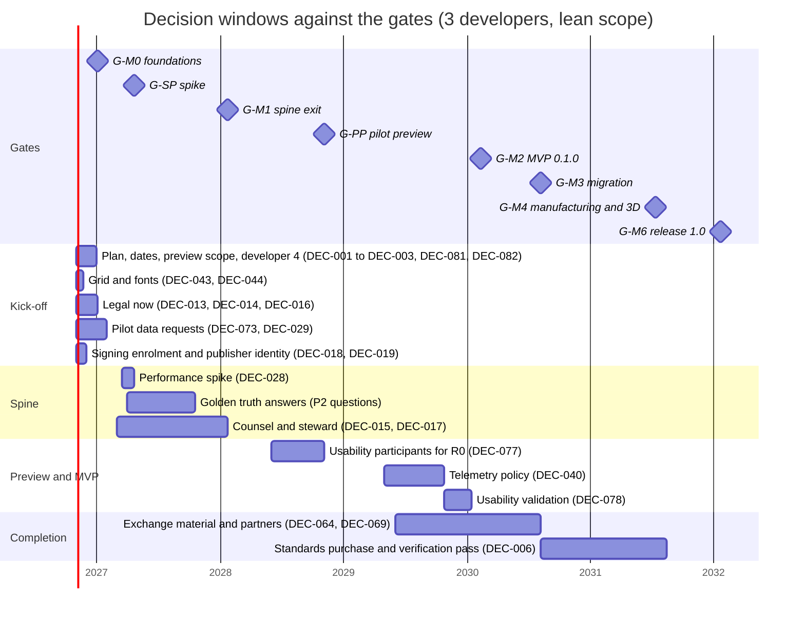

# Decision log

**Status:** Draft v0.9 · **Date:** 2026-10-19 (v0.9: the cycle-7 decisions ID-124 to ID-177 and the project owner's rulings; v0.8: the cycle-6 decisions ID-64 to ID-123 and the review rulings; v0.7: the cycle-5 decisions ID-33 to ID-63 and the review rulings; v0.6: ID-26 final limits; v0.5: the cycle-4 decisions ID-22 to ID-32, §2.4 and §5.1) ·
**Part of:** ElektraWatt plan

**Purpose.** This is the decision log of ElektraWatt (EW). **Part A** records what has been decided: the user
decisions of 2026-10-17, every Accepted ADR and the decisions of the first implementation day (2026-10-18), one
line each. **Part B** is the register of what is still open: the
questions that the design documents carry in their "Open questions" sections and the five Proposed ADRs (0025, 0027,
0028, 0029, 0030), consolidated and deduplicated into 85 numbered decisions (DEC-001 to DEC-085), each with its
options, a recommendation, a decision owner, the gate or work package by which it is needed, the impact if it is late
and the source documents. **Part C** is a prioritised questionnaire for the pilot user, merged with the brainstorm's
PQ list, that says for each question which decision, work package and gate it unblocks. The log invents no answers:
where a decision is open, the recommendation is the documented default that the plan uses until someone decides.
All dates are for the plan of record of the [global plan](01-global-plan.md) (three developers, lean scope, month 0 =
November 2026) and move with the scenario.

---

## Summary for decision makers

**The state in one paragraph.** Eight user decisions, 25 Accepted ADRs, 63 decisions of the first
implementation day (2026-10-18, two of them interim defaults) and 60 of the sixth cycle and 54 of the seventh (both 2026-10-19) are fixed (Part A). 85 decisions are
open (Part B): 37 wait for the pilot user, 24 for the project owner,
21 for the core team and 3 for counsel (several more need counsel's input). DEC-081 to DEC-085 were added with
version 0.2 for the re-planned pilot preview, the external and internal dates, the CRA status of the preview, the
community channels and the version numbering. The
source was 312 open questions in the design documents; at the date of this log 174 of the 344 questions now listed in
the design documents already carry a "Resolved" or "Decided" mark, and the rest are mapped to a decision here, to the
batch of low-impact defaults of §3.3, or to the short list of questions that other documents have settled (§3.4).
Part C asks the pilot user 53 questions in four priorities; **12 are P1 and should be asked at the kick-off**.
Nothing in this log is decided by being written down.

**What is due when** (plan of record; the gate dates are in §1.3):

| Gate | Date (plan of record) | Decisions due | Count |
|---|---|---|---|
| **G-M0** | month 3, Jan 2027 | DEC-001, DEC-002, DEC-003, DEC-005, DEC-007, DEC-013, DEC-014, DEC-016, DEC-018, DEC-019, DEC-021, DEC-022, DEC-029, DEC-043, DEC-044, DEC-073, DEC-074, DEC-080, DEC-081, DEC-082, DEC-083 | 21 |
| **G-SP** | month 6, Apr 2027 | DEC-028, DEC-030 | 2 |
| **G-M1** | month 15, Jan 2028 | DEC-004, DEC-008, DEC-010, DEC-011, DEC-015, DEC-017, DEC-020, DEC-023, DEC-032, DEC-034, DEC-036, DEC-037, DEC-038, DEC-039, DEC-046, DEC-047, DEC-048, DEC-049, DEC-051, DEC-052, DEC-053, DEC-054, DEC-057, DEC-059, DEC-060, DEC-084 | 26 |
| **G-PP** | month 25, Nov 2028 | DEC-077, DEC-085 | 2 |
| **G-M2** | month 40, Feb 2030 | DEC-009, DEC-031, DEC-033, DEC-035, DEC-040, DEC-041, DEC-042, DEC-050, DEC-055, DEC-056, DEC-058, DEC-061, DEC-062, DEC-063, DEC-068, DEC-070, DEC-078, DEC-079 | 18 |
| **G-M3** | month 46, Aug 2030 | DEC-006, DEC-025, DEC-045, DEC-064, DEC-065, DEC-066, DEC-069, DEC-075, DEC-076 | 9 |
| **G-M4** | month 57, Jul 2031 | DEC-024, DEC-067, DEC-072 | 3 |
| **G-M5** | month 58, Aug 2031 | DEC-012, DEC-071 | 2 |
| **1.x** | after 1.0 | DEC-026, DEC-027 | 2 |

**The first 90 days (to G-M0 in Jan 2027).** 21 decisions carry the gate G-M0. The ones that block
work are: the plan of record with its external and internal dates (DEC-001, DEC-081), lever (b) (DEC-002), the
pilot-preview scope and the Must-row triage (DEC-082) and developer 4 (DEC-003); the native grid
(DEC-043, by spine week 2, mid-November 2026) and the default fonts (DEC-044, by week 3, late November 2026), because the
output lane builds the starter symbols and the goldens on them; the signing enrolment path and the employer's public
identity (DEC-018, DEC-019), because the enrolments of WP-S0.05a name the publisher and their 12-month lead time starts
when they are submitted; and the legal items that are already overdue or hard:
the publication consent (DEC-013, "now", the content is public), the employer statement (DEC-014) and the SPDX test
(DEC-016). The pilot's data requests (QET corpus DEC-073, size data DEC-029) have a lead time of
months, so they go out at the kick-off.

**Defaults already in force.** Since 2026-10-18 the 4 mm native grid (DEC-043) and Noto Sans (DEC-044) are the
working basis, so the output lane does not wait; both rows stay open until the pilot confirms them at G-M0, and
DEC-080 items 1 to 4 are confirmed (§2.4).

**What happens if nothing is decided.** The documented defaults apply: 4 mm grid, Noto Sans, classic single letters,
DBU/WH colours, 3 developers, no grants, no signed release, no non-maintainer merge (`blocked:LG-2`), local-only crash
reports. Every default is cheap to change before the gate named in its row and expensive afterwards (goldens
re-baselined, symbols redrawn, format records frozen at M1).

**Two things this log cannot settle.** (1) The answers to the P2 questions (reference-project truth) are the
acceptance specification; until they arrive, goldens carry marked test values (the triangles of the
[golden project](../design/20-golden-project.md)). (2) Counsel's work (ADR-0025, ADR-0030, CRA scope, LG-3 searches)
has lead time and a cost that [global plan §13.4](01-global-plan.md#134-costs-that-are-money-not-pw) lists; it must be commissioned in the first 90 days.

---

**Contents**
1. [Basis and method](#1-basis-and-method)
2. [Part A: decisions taken](#2-part-a-decisions-taken)
3. [Part B: open decisions](#3-part-b-open-decisions)
4. [Part C: questions for the pilot user](#4-part-c-questions-for-the-pilot-user)
5. [Maintaining the log](#5-maintaining-the-log)
6. [Sources](#sources)
7. [Open questions](#open-questions)

---

## 1. Basis and method

### 1.1 Inputs

- The open questions of documents 00 to 20 (snapshot of 312, including 16 ADR follow-ups) and their current state in
  the documents, the five Proposed ADRs and the Accepted ADRs 0001 to 0024 and 0026.
- The [global plan](01-global-plan.md) (milestones including the pilot preview M-PP, decisions PD-1 to PD-15, the
  first 90 days, funding), the [work breakdown](02-work-packages.md) (WPs, levers, planning assumptions PA-1 to PA-11)
  and the [gates](03-gates.md) (gate dates, checkpoints CP-01 to CP-15, legal gates LG-1 to LG-6).
- The pilot questions PQ-01 to PQ-36 of the [brainstorm](../design/01-brainstorm.md#7-questions-for-the-pilot-user).

### 1.2 How the questions were consolidated

1. **Status first.** A question that its document marks "Resolved" or "Decided" is not open. This log does not
   reopen it. Questions that another document settled without updating their own are listed in §3.4.
2. **One decision, many sources.** Questions that ask the same thing in two or three documents (for example the grid,
   the unplaced-device policy, the viewer packaging, the saved date) become one decision. The sources column names
   every document and question number (`doc OQn`) so that the trail is complete.
3. **Decisions, not facts.** A question that only needs a fact from the pilot (a part number, an order code) becomes a
   decision when the answer changes a default, a golden or a work package; otherwise it is a question in Part C only.
4. **Batch the small ones.** Defaults that are low impact and have a recommendation nobody has objected to are listed
   once in §3.3 and confirmed in one review (DEC-080).
5. **Owners.** *Project owner*: scope, money, legal form, naming. *Pilot user*: the acceptance truth, house
   conventions and what the pilot's shop does; this includes the employer where the employer must act. *Core team*:
   architecture, engineering defaults, verification outcomes. *Counsel*: legal wording and legal interpretation. A
   decision with two roles names the one who decides first and the one consulted in brackets.
6. **Status.** Every row is *Open* on 2026-10-18. Closing a row is described in §5. A row whose recommendation is
   already the working basis says "Default in force since *date*" in its recommendation cell and stays open; §2.4
   lists these interim decisions.

### 1.3 Gates, months and dates

Month *n* counts from 2026-11-01 and is labelled with the calendar month in which it ends (global plan §3.4). Gate
months are those of [milestones.csv](milestones.csv), written by [tools/schedule.py](tools/schedule.py); the table is
the same generated block as in the [gates](03-gates.md#22-timing-per-scenario), and `schedule.py --check` fails when it
is stale. The plan-of-record column is the conservative baseline (3 developers, lean scope); the two AI columns are the
internal target and the upside of the global plan (§3.7) and are not external dates (DEC-081). G-SP is the
performance-spike decision, one month after WP-S1.03.

<!-- generated:gate-timing -->
| Gate | 2 developers | **3 developers (baseline)** | 4 developers (fourth from month 4) | 3 + AI-moderate (internal) | 3 + AI-strong |
|---|---|---|---|---|---|
| **G-SP** | 7 (May 2027) | **6 (Apr 2027)** | 6 (Apr 2027) | 5 (Mar 2027) | 5 (Mar 2027) |
| **G-M0** | 3 (Jan 2027) | **3 (Jan 2027)** | 3 (Jan 2027) | 3 (Jan 2027) | 3 (Jan 2027) |
| **G-M1** | 22 (Aug 2028) | **15 (Jan 2028)** | 14 (Dec 2027) | 12 (Oct 2027) | 11 (Sep 2027) |
| **G-PP** | 36 (Oct 2029) | **25 (Nov 2028)** | 25 (Nov 2028) | 20 (Jun 2028) | 17 (Mar 2028) |
| **G-M2** | 58 (Aug 2031) | **40 (Feb 2030)** | 35 (Sep 2029) | 32 (Jun 2029) | 28 (Feb 2029) |
| **G-M3** | 68 (Jun 2032) | **46 (Aug 2030)** | 40 (Feb 2030) | 36 (Oct 2029) | 31 (May 2029) |
| **G-M4** | 82 (Aug 2033) | **57 (Jul 2031)** | 51 (Jan 2031) | 46 (Aug 2030) | 39 (Jan 2030) |
| **G-M5** | 86 (Dec 2033) | **58 (Aug 2031)** | 51 (Jan 2031) | 46 (Aug 2030) | 40 (Feb 2030) |
| **G-M6** | 95 (Sep 2034) | **63 (Jan 2032)** | 57 (Jul 2031) | 51 (Jan 2031) | 44 (Jun 2030) |
<!-- /generated:gate-timing -->

A work package (WP) is written "WP-S1.21 (month 25)" when the decision is needed before it starts. The month is the
one in which the WP starts in the schedule model (3 developers, lean scope, base capacity): the start month of
[wp-schedule.csv](wp-schedule.csv), rounded up, so a WP that starts at 24.2 months is in month 25. It is a planning
date, not a promise. "Needed by" always names the earliest of the gate and the WP.

### 1.4 Source keys

A source such as `08 OQ8, OQ9` means open questions 8 and 9 of document 08. `plan 01` is the
[global plan](01-global-plan.md), `gates` the [gates](03-gates.md), `ADR-nnnn` an [ADR](../adr/).

| Key | Document | Key | Document |
|---|---|---|---|
| 00 | [Vision and scope](../design/00-vision-and-scope.md) | 11 | [Fluid power](../design/11-fluid-power.md) |
| 01 | [Brainstorm](../design/01-brainstorm.md) | 12 | [Panel layout](../design/12-panel-layout.md) |
| 02a | [Core requirements](../design/02a-requirements-core.md) | 13 | [Manufacturing outputs](../design/13-manufacturing-outputs.md) |
| 02b | [Extended requirements](../design/02b-requirements-extended.md) | 14 | [Interop](../design/14-interop.md) |
| 02c | [Non-functional requirements](../design/02c-nonfunctional-requirements.md) | 15 | [Checks, revisions, collaboration](../design/15-checks-revisions-collaboration.md) |
| 03 | [Domain model](../design/03-domain-model.md) | 16 | [UX and UI](../design/16-ux-ui.md) |
| 05 | [Project format and persistence](../design/05-project-format-and-persistence.md) | 17 | [Extensibility](../design/17-extensibility.md) |
| 06 | [Schematic editor](../design/06-schematic-editor.md) | 18 | [Quality, security, release](../design/18-quality-security-release.md) |
| 07 | [Symbols, parts, macros](../design/07-symbols-parts-macros.md) | 19 | [Open-source governance](../design/19-open-source-governance.md) |
| 08 | [Connections, terminals, cables](../design/08-connections-terminals-cables.md) | 20 | [Golden project](../design/20-golden-project.md) |
| 09 | [Reports, forms, output](../design/09-reports-forms-output.md) | 04 | [Architecture](../design/04-architecture.md) |
| 10 | [PLC and bus](../design/10-plc-and-bus.md) | | |

---

## 2. Part A: decisions taken

### 2.1 User decisions of 2026-10-17

These are binding and are not re-litigated in any document ([vision](../design/00-vision-and-scope.md#11-user-decisions-taken) §11).

| # | Decision | Content | Recorded in |
|---|---|---|---|
| UD-1 | **Language** | Rust for the core and the application. FFI only where justified, for example the B-rep/STEP kernel (out-of-process OCCT worker). | Vision §11; [ADR-0016](../adr/0016-3d-renderer-wgpu-and-out-of-process-step-worker.md) |
| UD-2 | **Open source** | A public open-source project that accepts community contributions under the DCO, with no CLA. | [ADR-0024](../adr/0024-licence-set-and-permissive-gpl-boundary.md); [19](../design/19-open-source-governance.md) |
| UD-3 | **Team** | 2 to 4 developers plus AI assistance. The plan baseline is 3 developers (2 and 4 as scenarios); AI is assumed to help, not to multiply throughput (§2.3). | Vision §10; [global plan](01-global-plan.md) |
| UD-4 | **Platform** | Cross-platform desktop (Windows, macOS, Linux), offline-first, projects as files on disk. | [ADR-0010](../adr/0010-project-storage-jsonl-directory.md); [ADR-0022](../adr/0022-platform-matrix-and-performance-budgets.md) |
| UD-5 | **v1 extras** | v1 also includes (1) PLC / I/O integration with exchange with TIA Portal and CODESYS (AML, CSV), (2) manufacturing outputs (wire lists with lengths and ferrules, terminal plans, labels, Komax and Rittal machine export), (3) a 3D panel layout with rails, ducts, collision, wire routing and automatic wire lengths, (4) import of EPLAN (EDZ), QElectroTech (.qet) and DXF (DWG). | Vision §9; [work breakdown](02-work-packages.md) |
| UD-6 | **Licence set** | Application GPL-3.0-or-later with a plugin exception (wording by counsel, open as DEC-015); format, parser and SDK crates MIT OR Apache-2.0; symbols and templates CC-BY-SA-4.0 with a KiCad-style design exception; project-authored part data and examples CC0; documentation CC-BY-4.0. Porting QElectroTech code (GPL-2.0-or-later) is allowed with attribution. | [ADR-0024](../adr/0024-licence-set-and-permissive-gpl-boundary.md) |
| UD-7 | **Device-tag letters** | New projects default to the classic single letters (EN 81346-2:2009: F, G, S, T, E, X, W, U, Q, K, M ...), as in the reference drawings. IEC 81346-2:2019 two-letter classes are selectable per project; the IEC 60750 legacy set ships for migrated QET projects. | [ADR-0026](../adr/0026-default-device-tag-identifier-set.md) |
| UD-8 | **Public repository and anonymisation** | The repository is public and the reference project is confidential customer work: its technical content (tags, part numbers, wiring, folio numbers, defects) is the acceptance specification, but customer, end-user, address, project and drawing identifiers, people's names and initials, the panel builder's name, the confidentiality notice and e-mail addresses never enter the repository. The migration path is QET first, because the pilot user works in QET 0.100.0-dev. | [20](../design/20-golden-project.md) §3.5, AC-39; [ADR-0021](../adr/0021-importers-emit-format-level-records.md); LG-5 (DEC-013) |

### 2.2 Accepted ADRs

All 25 are Accepted; those marked *amended* took amendments on 2026-10-18 that are folded into the ADR text. The five Proposed ADRs (0025, 0027, 0028, 0029, 0030) are decisions in Part B.

| ADR | Decision in one line | Note |
|---|---|---|
| [ADR-0001](../adr/0001-core-model-persistent-maps.md) | Core model: typed Rust records in persistent maps (imbl); one `Model` value is the single source of truth and everything printed is derived. | amended (raw reads behind the `raw-read` feature) |
| [ADR-0002](../adr/0002-derived-data-engine-ew-memo.md) | Derived-data engine: cold-first queries plus a cut-down memo layer (`ew-memo`); no salsa. | amended; the performance spike (DEC-028) closes the open part |
| [ADR-0003](../adr/0003-freshness-contract.md) | Freshness contract: classes I to III, frozen-on-purpose identifiers, committed computations, versioned derivation profiles. |  |
| [ADR-0004](../adr/0004-identity-uuidv7-uuidv5.md) | Identity: UUIDv7 for authored records, UUIDv5 for instantiated, imported and generated ones. | amended (import lineage, UUIDv7 method, UUIDv5 name layout and `NS_IMPORT`) |
| [ADR-0005](../adr/0005-value-types-nm-dec3-mltext.md) | Values: `i64` nanometre coordinates, rational grids, `Dec3` quantities, `MlText`. | amended (`Angle2`, its counter-clockwise rotation sense) |
| [ADR-0006](../adr/0006-function-device-representation-model.md) | Function / Device / Representation model with typed device aspects. | amended |
| [ADR-0007](../adr/0007-explicit-connections-and-autoconnect.md) | Explicit connections and junction sequences are the model; autoconnect is an editing aid. | amended; validation with EPLAN and QET users is DEC-078 |
| [ADR-0008](../adr/0008-transactions-undo-preview.md) | Transactions, undo/redo and preview-as-fork; every write is a serialisable command. | amended |
| [ADR-0009](../adr/0009-invariant-catalogue.md) | Invariant catalogue: structural versus configurable prevent rules; lenient import. | amended |
| [ADR-0010](../adr/0010-project-storage-jsonl-directory.md) | Project storage: UUID-named JSONL directory, manifest-last save, external journal, lock file. | amended (intent manifest, lock record) |
| [ADR-0011](../adr/0011-format-versioning-and-migration.md) | Format versioning, per-kind migration and format-change windows. | amended (append-only members; error paths from `ew-schema`, no strict schema variant) |
| [ADR-0012](../adr/0012-git-integration.md) | Git integration: semantic merge driver, textconv, in-file conflict records, post-merge integrity. | amended |
| [ADR-0013](../adr/0013-revisions-and-as-built-archive.md) | Revisions and the as-built archive outside the project directory. | amended |
| [ADR-0014](../adr/0014-gui-toolkit-egui.md) | GUI toolkit: egui/eframe behind `ew-ui`, over a toolkit-agnostic `ew-viewmodel`. | amended |
| [ADR-0015](../adr/0015-display-list-renderers-pdf.md) | One display-list IR; wgpu canvas plus an always-built CPU renderer; krilla PDF/A-2b; PDF as print master. | amended |
| [ADR-0016](../adr/0016-3d-renderer-wgpu-and-out-of-process-step-worker.md) | 3D renderer on wgpu; out-of-process OCCT STEP worker. | amended (the gizmo lives in `ew-ui`) |
| [ADR-0017](../adr/0017-read-only-sql-projection-api-v1.md) | Read-only SQL projection with versioned `api_v1` views. | amended |
| [ADR-0018](../adr/0018-reports-forms-engine-and-machine-profiles.md) | Reports and forms engine; report blocks as derived pages; machine-export profiles as data. | amended |
| [ADR-0019](../adr/0019-rule-engine-and-rule-packs.md) | Rule engine and rule packs. | amended (packs, export mode, rule-ID scheme) |
| [ADR-0020](../adr/0020-extensibility-tiers-and-security-model.md) | Extensibility tiers and security model: CLI, rhai, WASM on the wasmtime LTS line, MCP, Python. | amended (pure formulas run untrusted; JSON at the WIT boundary) |
| [ADR-0021](../adr/0021-importers-emit-format-level-records.md) | Importers emit format-level records; QET first; EDZ as 7-Zip; DWG via acadrust plus ODA. | amended |
| [ADR-0022](../adr/0022-platform-matrix-and-performance-budgets.md) | Platform matrix and performance budgets (S/M/L/XL) as CI-enforced requirements. |  |
| [ADR-0023](../adr/0023-supply-chain-and-release-integrity.md) | Supply chain and release integrity: pinned toolchain, SBOM, signing, provenance. | amended (cargo-vet audits name the GitHub handle, no imported audit sets); the SignPath fallback is DEC-018 |
| [ADR-0024](../adr/0024-licence-set-and-permissive-gpl-boundary.md) | Licence set and the permissive/GPL crate boundary, enforced in CI. | amended (further permissive crates, one allowlist, the Code of Conduct's CC-BY-SA-4.0) |
| [ADR-0026](../adr/0026-default-device-tag-identifier-set.md) | Default device-tag identifier set: EN 81346-2:2009 single letters; IEC 81346-2:2019 and IEC 60750 selectable. | amended; the leniency on S is DEC-046 |

### 2.3 Planning inputs used by the plan

These are inputs given to the planning, not decisions of record. Their formal adoption is DEC-001 and DEC-081. They
are numbered PI-1 … PI-7 here. Where an input is one of the planning assumptions of the work breakdown, the third
column cites it by its work-breakdown ID PA-n and meaning ([WBS §1](02-work-packages.md#1-planning-assumptions)); the global plan's GA-n,
the gates' GB-n and this list's PI-n are different lists.

| # | Planning input | Work-breakdown assumption | Where it is used |
|---|---|---|---|
| PI-1 | Project start (month 0) is November 2026. | PA-1 start | All dates |
| PI-2 | Baseline team of 3 developers; scenarios with 2 and with 4 (the fourth from month 4, the whole team at 90 % efficiency from then). | PA-2 team | [Global plan](01-global-plan.md#22-team-scenarios) §2.2 |
| PI-3 | Productive capacity is about 36 person-weeks per developer per year, after holidays, meetings, support and community work; sensitivity plus or minus 20 %. | PA-3 capacity | [Global plan](01-global-plan.md#2-capacity-model) §2, §3.5 |
| PI-4 | AI assistance is assumed to help (likely estimates 10 to 20 % lower) but not to multiply throughput. The AI-moderate and AI-strong scenarios are an internal target and an upside on top of the estimates, never part of them. | PA-7 AI assistance | [Global plan](01-global-plan.md#37-ai-assisted-scenarios) §3.7; DEC-081 |
| PI-5 | At least 20 % reserve for integration, hardening and bug fixing; documentation, release engineering and community and pilot support are work packages. | PA-8 reserve; PA-6 what an estimate contains; PA-11 background load | [Work breakdown](02-work-packages.md) |
| PI-6 | The architecture's indicative 15 to 18 months to 1.0 is not met; the realistic plan-of-record dates are the pilot preview at month 25 (Nov 2028), the MVP at month 40 (Feb 2030) and 1.0 at month 63 (Jan 2032). | none: a result of the schedule model | [Global plan](01-global-plan.md#36-can-v1-fit-1518-months) §3.6; [milestones.csv](milestones.csv) |
| PI-7 | External lead times (the signing enrolment of at least 12 months, counsel, the trademark search) are modelled as lags and as money, not as person-weeks. | PA-9 schedule model; PA-10 external costs | [Global plan](01-global-plan.md#92-ordering-rules) §9.2 rule 5, §13.4 |

### 2.4 Decisions of 2026-10-18 (first implementation day)

On 2026-10-18 the first code landed (WP-S0.01, WP-S0.02 and the first half of WP-S1.01), and the project owner
delegated the product-owner role to that development session. These decisions are recorded with the decider
"project owner (delegated, 2026-10-18)", or the core team for engineering details the code had to fix. They take no
confirmation away from the pilot user: DEC-043 and DEC-044 stay open in Part B until the pilot confirms them at G-M0.
Later the same day `ew-schema` v0 (WP-S1.02) landed; ID-12 to ID-21 record the questions it raised and the dependency
edges of the foundation crates. The fourth implementation cycle (`ew-model`, WP-S1.03; the QET element reader and symbol lowering, WP-S3.05) and its independent review raised ID-22 to ID-32. The fifth cycle (the starter symbols, WP-S7.02; `ew-text` and the frame and title-block forms, WP-S3.02; `ew-commands` and `ew-api`, WP-S1.04) and its independent reviews raised ID-33 to ID-63; the code and content changes they require are follow-up tasks FT-01 to FT-18 of the [work breakdown](02-work-packages.md#appendix-b-follow-up-tasks-from-the-implementation-cycles), Appendix B. On 2026-10-19 the sixth cycle (`ew-memo` v1, the S–XL generator, the benchmark harness and `check-raw-read`, WP-S1.05; the tracked context `Q` and Derivation I, WP-S1.06; the golden tables and the CSV bootstrap, WP-S7.01 and WP-S3.05) and its independent reviews raised ID-64 to ID-116, with the project owner's delegated rulings recorded under "project owner (delegated, 2026-10-19)"; their code changes are FT-19 to FT-42, and FT-01 is closed. The seventh cycle (the report engine, WP-S3.03; page output, WP-S3.04; Derivation II, WP-S1.07) and the independent reviews of its report engine, page output and connectivity raised ID-124 to ID-177, with the project owner's delegated rulings recorded the same way; their code and content changes are FT-46 to FT-78.

| # | Decision | Decider | Recorded in |
|---|---|---|---|
| ID-1 | **Native grid default (DEC-043, interim).** The 4 mm native connection grid (`Grid{4_000_000, 1}`), 0.5 mm graphics and 1 mm text grids, and QET-grid pages kept permanently are the working basis now, so the output lane can draw the starter symbols. ADR-0027 stays Proposed; the pilot user and two EPLAN users confirm at G-M0, and a different decision re-baselines the starter symbols and goldens once. | Project owner (delegated, 2026-10-18) | [ADR-0027](../adr/0027-native-symbol-grid-and-qet-grid-policy.md); DEC-043; [03](../design/03-domain-model.md) §3.1 |
| ID-2 | **Default font (DEC-044, interim).** Noto Sans (OFL-1.1) is the default drawing font now; osifont is not bundled until its SPDX expression is verified. ADR-0028 stays Proposed; the pilot user confirms at G-M0. | Project owner (delegated, 2026-10-18) | [ADR-0028](../adr/0028-default-drawing-fonts.md); DEC-044 |
| ID-3 | **Low-impact defaults, DEC-080 items 1 to 4.** Confirmed as written: 256 fixed shards; no macOS package bundle for `.ew` in v1; the manifest stays tracked in git; FR-REV-018/019 are the rows of record and FR-COL-018/019 refer to them, keeping their IDs. Items 5 to 9 stay open for their own gates. | Project owner (delegated, 2026-10-18) | §3.3; [05](../design/05-project-format-and-persistence.md) OQ6, OQ13, OQ14; [15](../design/15-checks-revisions-collaboration.md) OQ11; [02a](../design/02a-requirements-core.md), [02b](../design/02b-requirements-extended.md) |
| ID-4 | **cargo-vet attribution.** The `who` field of an audit is the contributor's GitHub handle; public audit sets are not imported while the public-repository rule (UD-8) stands, because `imports.lock` would record auditors' names and e-mail addresses; revisit when a steward exists. | Project owner (delegated, 2026-10-18) | [ADR-0023](../adr/0023-supply-chain-and-release-integrity.md) amendment 3; [19](../design/19-open-source-governance.md) §3.5, OQ18 |
| ID-5 | **`Angle2` rotation sense.** Positive angles rotate counter-clockwise as seen on the sheet, 0 at 3 o'clock; QET text rotations are negated on import, DXF angles kept. | Project owner (delegated, 2026-10-18) | [ADR-0005](../adr/0005-value-types-nm-dec3-mltext.md) amendment 2; [03](../design/03-domain-model.md) §3.1; [14](../design/14-interop.md) §4.3, §4.13, §6.1 |
| ID-6 | **Code of Conduct licence.** `CODE_OF_CONDUCT.md` keeps the Contributor Covenant 3.0's own licence, CC-BY-SA-4.0, not the documentation licence CC-BY-4.0. | Core team (fact verified against the published text) | [ADR-0024](../adr/0024-licence-set-and-permissive-gpl-boundary.md) amendment 4; [19](../design/19-open-source-governance.md) §2.1, §2.3 |
| ID-7 | **Engineering details fixed by the first code.** The UUIDv5 name layout and the `NS_IMPORT` constant for import-lineage namespaces; the `Rect` JSON encoding; the exact frame-cell lookup `cell_of(point, page)` in `ew-derive`; the 3D gizmo in `ew-ui`; the `ew-testkit` → `ew-import-tables` edge. | Core team | [ADR-0004](../adr/0004-identity-uuidv7-uuidv5.md) amendment 4; [05](../design/05-project-format-and-persistence.md) §3.2, §3.2a; [06](../design/06-schematic-editor.md) §5.1; [ADR-0016](../adr/0016-3d-renderer-wgpu-and-out-of-process-step-worker.md) amendment 1; [04](../design/04-architecture.md) §3 |
| ID-8 | **Natural order without ICU.** `ew-mltext` implements a specified, deterministic natural order (NFD, accents stripped, lower-cased; digit runs by value; white space < punctuation < symbols < digits < letters; accents and leading zeros secondary; upper case first tertiary) instead of ICU collation, because `icu` 2.3.1 needs Rust 1.88 (MSRV 1.85), adds about twenty crates to a format crate and would reorder keys silently on table updates. ICU stays for language-sensitive display sorting in the GPL query layer. | Project owner (delegated, 2026-10-18) | [ADR-0005](../adr/0005-value-types-nm-dec3-mltext.md) amendment 3; [04](../design/04-architecture.md) §3; [02b](../design/02b-requirements-extended.md) FR-I18N-010 |
| ID-9 | **FR-NUM-018 sign order.** One documented root order, no ad-hoc exception: `-` (punctuation) sorts before `+` (symbol), both before digits. | Project owner (delegated, 2026-10-18) | [02a](../design/02a-requirements-core.md) FR-NUM-018 |
| ID-10 | **Aspect order of `#` and `%`, and EW-RDS-009 severity.** In a full designation the order is `==`, `=`, `++`, `+`, `&`, `#`, `%`, `-` (fixed by the first implementation). EW-RDS-009 stays an error for an identifier whose confusable skeleton is pure ASCII while it contains non-ASCII letters (unreachable by search, breaks cross-references); a genuinely non-Latin identifier produces no finding. | Core team (aspect order); project owner (delegated, 2026-10-18) (severity) | [03](../design/03-domain-model.md) §8.1; [15](../design/15-checks-revisions-collaboration.md) EW-RDS-009 |
| ID-11 | **Display-list details fixed by `ew-dl`.** `DashDot` 4:2:1:2, `Dash42` 4:2, `Dot12` 1:2 in pen widths; house pens with butt caps and miter joins, miter limit 4.0 set explicitly by every writer; layer paint order is the table order of 09 §4.1; `ShapedRun` carries a `layout_box` used for PDF link rectangles; `ew-dl` has its own hashable colour type and does not depend on peniko. | Core team | [07](../design/07-symbols-parts-macros.md) §2; [09](../design/09-reports-forms-output.md) §4.1, §4.2; [04](../design/04-architecture.md) §3 |
| ID-12 | **ARCH §4.2 is a summary.** Its rows now match doc 03 and doc 09: `Conductor{colour: ColourSpec?, csa: Csa?}`, the colour and size profiles inside `settings`, `IpSpec{name, direction, star_source, sort?, external?}` with the pairing scope in `ProjectSettings.ip_pairing`, `ReportBlock.source` as `Kind \| SqlQuery`. Where the summary differs, doc 03, doc 09 and `ew-schema` are normative. | Core team | [04](../design/04-architecture.md) §4.2; [03](../design/03-domain-model.md) §1.1 |
| ID-13 | **`Representation.symbol` and `variant` are two members.** `symbol` is the copy ID `Id<SymbolDef>` that every placement shares; `variant: u8` (default 0) is chosen per placement; `SymbolRef{id, variant}` is retired. Copy references are typed by item kind (`Id<Part>`, `Id<SymbolDef>`, `Id<FnDef>`, `Id<FormDef>`). | Core team | [03](../design/03-domain-model.md) §1.1, §6; [06](../design/06-schematic-editor.md) §2.5; [05](../design/05-project-format-and-persistence.md) §3.5 |
| ID-14 | **Library item metadata.** Every item carries a `meta: ItemMeta{key?, licence?, sources, as_of?, confidence, status, foreign_terms}` object, also in the doc 05 part example. `ItemMeta` has no `version`: a document stores its version once, an embedded copy in its copy metadata and a library record in its own top-level `version` member, so the hash rule needs no exception. | Core team | [05](../design/05-project-format-and-persistence.md) §3.4, §3.5, §13.2; [07](../design/07-symbols-parts-macros.md) §2.1, §2.3, §2.5 |
| ID-15 | **Technical-data keys.** One `TechValue{key, value: Quantity \| Ident}` encoding on parts and devices: scheme-qualified keys spelled `"<scheme>:<id>"` (`etim:EF001234`), plain keys for native and project properties; booleans and enumerations as `Ident` values (`true`, `false`, the member) until a typed form is needed. ETIM features arrive with WP-S1.28. | Core team | [05](../design/05-project-format-and-persistence.md) §3.2; [07](../design/07-symbols-parts-macros.md) §2.5 |
| ID-16 | **Field definitions the schema needed.** `DeviceKind` is an open hint enum (v0: `psu`, `terminal`, `blanking_plate`; other strings are kept and matched as catalogue data); `UserPropDef{key, label, value_kind, scope}` and `user_props` are defined minimally (implemented by WP-S1.12); `ReportBlock.params` and `filter` are deferred to WP-S3.03 and `FormDef.form_type` to WP-S3.02, kept in `extra` until then; group header and footer rows come from the form's row templates; `EmbedSpec` is `{page, rect}` without `overflow`; `ReportBlock.first_folio` is optional and ignored for embedded blocks; `MasterData.document_title: MlText` (appended, since 0.1) holds the cover subtitle "Electrical Definition", distinct from `long_description`. | Core team | [03](../design/03-domain-model.md) §5, §6, §7; [09](../design/09-reports-forms-output.md) §2.2, §2.5, §2.6, §3.4 |
| ID-17 | **Settings shapes before M1.** `ProjectSettings` gets fixed shapes, at the level of member names and encodings, for `numbering` (schemes with format, first-match rules, counter scope, `reuse_gaps`, `online`), `wire_numbering`, `xref_format`, `colour_profile`, `size_profile`, `wire_default` and `frames`. Counters stay on `TagSpec`, never in settings. Each member stays in `extra` until its work package (WP-S1.06, WP-S1.07, WP-S1.08, WP-S1.11, WP-S3.02, WP-S3.03) adds the typed struct. | Core team | [03](../design/03-domain-model.md) §5.1; [06](../design/06-schematic-editor.md) §2.8; [08](../design/08-connections-terminals-cables.md) §2.2 |
| ID-18 | **Malformed known variants (EW-CORE-017).** An enum value whose tag names a known variant but whose payload does not parse is kept verbatim and reported by the new integrity finding EW-CORE-017, instead of being treated silently as data from a newer format; it is an error and blocks release. | Core team (finding); project owner (delegated, 2026-10-18) (severity and release block) | [ADR-0011](../adr/0011-format-versioning-and-migration.md) amendment 2; [05](../design/05-project-format-and-persistence.md) §6.3, §10.3; [15](../design/15-checks-revisions-collaboration.md) §4.2; [02a](../design/02a-requirements-core.md) FR-CHK-012 |
| ID-19 | **Value encodings.** ASCII unit spellings (`mm2`, `A`, `V`, `Hz`, `bar`, `degC`, `kg`, `W`, `m`, `piece`, `set`, else unknown); `Csa` as a bare `Dec3` in mm², `{"awg": n}` or `{"kcmil": Dec3}`; `ColourCode` as a string or `{"foreign": code}`, with undeclared company codes caught by EW-CORE-031, not by the parser; `Rgb` as `"#rrggbb"`; `Pen` as `"p026"` or `{"width": nm}`; `Primitive` as one-member objects; `CategoryKey` as a three-element array; `SortKey{key, descending}`. | Core team | [ADR-0005](../adr/0005-value-types-nm-dec3-mltext.md) amendment 4; [05](../design/05-project-format-and-persistence.md) §3.2; [03](../design/03-domain-model.md) §3.2, §3.4 |
| ID-20 | **Format facts fixed by `ew-schema` v0.** Every nested object carries its own `extra`; the `Unknown` catch-alls are omitted from the JSON Schemas; a `$v` other than the registry's is rejected ("migrate first"), and a newer `$v` is kept verbatim (EW-CORE-016); `source_ref?` is the last declared member of every project record kind; the v0 defaults that are not zero values are named; `Side` is persisted as `side1`/`side2`, with Internal and External as the derived facing. | Core team | [ADR-0011](../adr/0011-format-versioning-and-migration.md) amendment 2; [05](../design/05-project-format-and-persistence.md) §3.1, §10.2, §10.4; [03](../design/03-domain-model.md) §1.1, §11 |
| ID-21 | **Foundation dependency edges.** GPL crates may depend directly on `ew-units`, `ew-ids`, `ew-mltext`, `ew-rds`, `ew-schema` and `ew-dl`, and every such edge is drawn: `ew-model` → ids, units, mltext, rds; `ew-interop-api` → ids, units; `ew-import-qet` → schema, units, ids, mltext, dl; `ew-scene` → schema, units, ids, mltext (model access still only through `Q`). The graph is the source, and `ci/dep-rules.toml` follows it in the same pull request. | Core team (decision of the lead session) | [ADR-0024](../adr/0024-licence-set-and-permissive-gpl-boundary.md) amendment 5; [04](../design/04-architecture.md) §3 rule 6 |
| ID-22 | **Interruption-point function lifecycle.** An IP function is owned by its representation's page: deleting the page or the representation cascades the IP function, and the connections at its CP cascade as before. New structural invariant EW-INV-013: a function of kind `Ip` has exactly one representation (checked at transaction end). Doc 05 already files the IP function with its representation's page, so an orphan would have no owning file. | Core team | [ADR-0009](../adr/0009-invariant-catalogue.md) amendment 3; [03](../design/03-domain-model.md) §4.2, §10; [05](../design/05-project-format-and-persistence.md) §2.2 |
| ID-23 | **Raw model reads behind `raw-read`.** The raw read API of `ew-model` (`Model::table`, `lib`, `indexes`, `row`, the `Table` and `BaseIndexes` getters) compiles only with the cargo feature `raw-read`, which only `ew-derive`, `ew-commands` and `ew-store` (and `ew-model`'s own tests) may enable; `cargo xtask check-features` enforces it through a `[[banned_features]]` entry with `allowed_packages`. Every other crate reads through `Q` or `TxBuilder`. Rust cannot restrict visibility per dependent crate, so a policy-checked feature gives ADR-0002's "untracked read does not compile" in practice; crates above `ew-derive` still compile with the API present (features are additive), which `&Q`-only queries, review and oracle mode cover. | Core team | [ADR-0001](../adr/0001-core-model-persistent-maps.md) amendment 1; [ADR-0002](../adr/0002-derived-data-engine-ew-memo.md) amendment 2; [04](../design/04-architecture.md) §3 rule 1 |
| ID-24 | **"QET import" library identity.** The per-project "QET import" library has `library_id` = the project ID and the human key `qet-import`; the importer receives the project ID as `ImportCx.project`, because importers never read the model. The system library's identity, needed for built-in references such as the interruption-point FnDef, stays open: `ew-import-qet` keeps a provisional constant until WP-S1.19a names it. | Project owner (delegated, 2026-10-18) | [05](../design/05-project-format-and-persistence.md) §13.2; [07](../design/07-symbols-parts-macros.md) §3.6, open question 17; [14](../design/14-interop.md) §2.1, §4.3 |
| ID-25 | **Stroke colour in the display list.** `ew-dl`'s `Stroke` carries a `brush` (default black); `Path(BezPath, Stroke, Brush)` keeps the fill brush. Doc 07 primitives carry a stroke colour and wire colours must render. | Core team | [ADR-0015](../adr/0015-display-list-renderers-pdf.md) amendment 4; [04](../design/04-architecture.md) §8.1; [07](../design/07-symbols-parts-macros.md) §2.3 |
| ID-26 | **Importer limits.** `Limits` gains attribute counts (8,192 per element, because roxmltree 0.21.1 checks duplicate attributes quadratically per element and 65,536 would still cost about 4 s; 1,048,576 per document) and an attribute work budget of 2^26 (the sum over elements of the squared attribute count, since a document under both counts can still be slow); `max_xml_nodes` counts nodes (root, elements and comments in the pre-scan; texts and processing instructions by the parser), not attributes, and defaults to 1,000,000 (a project importer may raise it explicitly under its own budget). Report locations use a sparse line index (one checkpoint per 64 KiB of input). The report is capped at 1,000 entries per element definition (the crate constant `MAX_ENTRIES_PER_DEFINITION`), the rest summarised in one EW-IMP-001 entry. They serve the hostile-input rule: reject within 1 s and 256 MB of extra allocation. Final numbers after the second independent review (2026-10-18). The pre-scan also refuses inputs with more than 2 × `max_xml_nodes` + `max_xml_attributes` markup bytes (`<`, `=`), because roxmltree reserves memory per such byte before parsing (second review, N4). It adds a 1 MiB text-node limit and a 16 MiB input preset for element definitions (a long plain-text run passed every other bound: 200 MiB took 2.55 s and 1.6 GB), and the per-definition style-pair caps (64 parsed, 8 kept per primitive, 1,000 kept per definition). The element-definition preset also caps attributes at 131,072 and nodes at 262,144 (N7). | Core team | [14](../design/14-interop.md) §2.1, §11 |
| ID-27 | **QET hotspot.** QET primitive coordinates are already relative to the hotspot; `hotspot_x` and `hotspot_y` only place the bounding box. The hotspot is the definition origin, and the importer uses coordinates as written. | Core team | [14](../design/14-interop.md) §4.2 |
| ID-28 | **Qt font strings.** A `QFont::toString` value is read as Qt 6 only when it has at least 16 fields or a weight above 99; a Qt 5 string may carry an 11th style-name field, so 11 fields do not mean Qt 6. | Core team | [14](../design/14-interop.md) §4.10 |
| ID-29 | **Delete policies by link class; embedded `LibRef`s are links.** Cascade for page-owned rows and `Function.device`; unlink for optional cross-references (`supply.origin.source`, `ip.external`, `bus.cable`, `bond.via`, `connection.kind.core` reverting to Wire, `junction.sequence[]`), with `potential_def.at` and `bond.a`/`b` dropping the record; forbid for master data, structure, library copies, `source_ref.lineage` and a `LibRef` that resolves to a copy embedded in the project, which cannot be deleted while referenced. A `LibRef` into an external library is not a link. | Core team | [03](../design/03-domain-model.md) §4.2; [05](../design/05-project-format-and-persistence.md) §13.2 |
| ID-30 | **Unknown and reserved records.** Records of unknown or reserved kinds are kept and written in the line order of 05 §3.3: by rank where the registry knows the kind, else after the known kinds by the `$k` text; a duplicate `($k, id)` among them is EW-CORE-009. | Core team | [05](../design/05-project-format-and-persistence.md) §3.3, §6.3, §10.3 |
| ID-31 | **Own test fixtures are CC0.** The path `crates/*/tests/fixtures/` joins licence layer L8, so fixture files inside GPL crates carry `CC0-1.0`; the licence-map rule follows in code. | Project owner (delegated, 2026-10-18) | [19](../design/19-open-source-governance.md) §2.1 L8, LR-11; [LICENSE.md](../../LICENSE.md) |
| ID-32 | **Format alignments from the review.** Set elements sort by their compact JSON text in byte order and the keyed lists are named; `product` is never a `StructureNode.aspect`, so the schemas' aspect enum rightly omits it and the reader rejects it there; `ew-schema` reports JSON-Pointer error paths itself, so `serde_path_to_error` is dropped, and format 0.1 publishes no "strict" JSON Schema variant because the typed reader is the strict check; `PageType::Report` is derived-only (EW-INV-012); the structural-invariant IDs `EW-INV-nnn` are not rule IDs. | Core team | [ADR-0011](../adr/0011-format-versioning-and-migration.md) amendment 3; [05](../design/05-project-format-and-persistence.md) §3.2, §10.2, §10.4; [03](../design/03-domain-model.md) §5, §6; [15](../design/15-checks-revisions-collaboration.md) §2.2 |
| ID-33 | **Starter library keys and identity.** The starter content of WP-S7.02 (36 native symbols, 32 FnDefs and the 36 generated `@qet10` symbols, all version 0.1.0, status `draft`, CC-BY-SA-4.0) uses the provisional system-library UUID 7202fd8b-1024-4bf1-9e99-670772eaa589 of `ew-import-qet`, with item ID = v5(library, key); ID-24 stays open, and WP-S1.19a names the final identity for content and importer together. A symbol and a FnDef must never share an item ID, so FnDefs are keyed `ew.fn.<name>`: the interruption point is the symbol `ew.gen.ip` with the FnDef `ew.fn.ip`. The importer's only built-in FnDef is `ew.fn.ip`, referenced by key with `version_req` `^0.1`; the generic black box is a generated FnDef (1.0.0, `^1`), not a built-in. | Core team | [07](../design/07-symbols-parts-macros.md) §2.3, §9.1, open question 17; [14](../design/14-interop.md) §4.3; ID-24 |
| ID-34 | **Starter symbols: schema gaps, the `@qet10` lint and two review items.** Where format 0.1 lacks a value, the content takes the nearest one and invents no field: loads and cylinders are contact kind `pole`, the interruption point and the plug pin `terminal`, graphic and overview symbols `black_box`; the ISO 1219 symbols are discipline `pneumatic`; `port_role` and `valve_model` are omitted; `iec60617_ref` stays empty until the identifiers are verified, and `meta.sources` is `["ew.original"]`. The `@qet10` edition scales by 7 937 500 / 12 000 000 with ties toward zero, so 0.5 mm graphics become 1.25 px: its lint requires every graphic, slot and link coordinate to equal the scaled native value, and every CP to lie on the QET 10 px grid. The review found that the coil (4 × 8 mm) may read as the resistor (3 × 8 mm) and that the changeover contact's NC side lacks the hook of `contact-nc`: items VR-01 and VR-02 of the first PNG approval. | Core team | [07](../design/07-symbols-parts-macros.md) §3.2 rule 2, §9.1; [20](../design/20-golden-project.md) §3.3; [ADR-0027](../adr/0027-native-symbol-grid-and-qet-grid-policy.md) |
| ID-35 | **Mechanical linkages are always derived.** A `SymbolDef` never draws a mechanical linkage: pole to pole, pole to handle, actuator to contacts and actuator to process valve are all derived from the `link_points` of the related functions (FR-SYM-014). The manual switch `ew.iec.switch-2p-manual` therefore declares a third link point `handle` at (11, 6) mm, and the derived chain is pole1 → pole2 → handle. The one documented exception stays: the MCB's internal pole linkage is part of the MCB graphic (0.13 mm, dashed). | Project owner (delegated, 2026-10-18) | [07](../design/07-symbols-parts-macros.md) §3.2 rule 8, §9.1; [content README](../../content/symbols/README.md); [20](../design/20-golden-project.md) §17.4; [02a](../design/02a-requirements-core.md) FR-SYM-014 |
| ID-36 | **Earth symbols corrected.** Protective earth `ew.iec.pe` is the earth sign inside a circle (IEC 60417-5019) and functional earth `ew.iec.fe` the plain earth sign (IEC 60417-5018), as on folio 101 of the reference; the text slots of each symbol follow its graphic (PE at x = 6 mm, clear of the circle; FE at 4 mm), and a content lint guards the assignment. A correction of the starter set. | Core team | [07](../design/07-symbols-parts-macros.md) §9.1; [reference drawing](../research/reference-drawing.md) §1.5; [02a](../design/02a-requirements-core.md) FR-SYM-007 |
| ID-37 | **Text stack, bundled fonts and `NOTICE`.** `ew-text` lays text out at a font size equal to the units per em, at scale 1, without hinting or quantisation, so glyph positions are exact integers in font units, converted to nm in i128 with ties toward zero (never through `Nm::from_mm_f64`); the font set loads no system fonts and no fallbacks and orders its faces by (role, weight, italic, key); there is no cache, because memoisation belongs to `ew-memo` (WP-S1.05). parley 0.12.0 brings skrifa 0.44 and harfrust 0.12, so `ew-text` uses skrifa 0.44 directly instead of a second font stack; ARCH §3 records these versions and the edges `ew-text` → `ew-dl`, `ew-units` (and `serde_json` for `ew-scene`). Noto Sans Regular and Bold 2.003 are the unhinted static instances of a named upstream commit (the repository has no release tags), pinned by SHA-256. The root `NOTICE` is root metadata (L11, CC0-1.0), so its licence-map rule is confirmed as committed. | Core team | [04](../design/04-architecture.md) §3, §8.3; [ADR-0028](../adr/0028-default-drawing-fonts.md) recommendation 6; [19](../design/19-open-source-governance.md) §2.1, §2.4 |
| ID-38 | **Built-in text styles.** `ew-text` ships the 14 golden styles as its built-in table (`cover.title` … `marker`, `section.id` bold) with em = round(px × 793 750 / 3) nm; project styles arrive with WP-S1.12. The printed em of doc 20 §17.5 is that value times 0.986282578, rounded to 0.01 mm, which corrects `cover.subtitle` from 7.04 to 7.05 mm (exact 7.0458) and `cp.small` and `marker` from 1.31 to 1.30 mm (exact 1.3048). | Core team | [20](../design/20-golden-project.md) §17.5; [09](../design/09-reports-forms-output.md) §2.8 |
| ID-39 | **Frame and title-block forms as built.** The QET-compatible frame forms (grid and no grid) name the title block by its copy ID; the title block is authored in its own coordinates and placed below the drawing area at (0, last row edge), or at the sheet's bottom left without a grid. The no-grid variant keeps the outline and title block of the grid variant without bands and labels and is marked `ew.layout.estimated: true`, because doc 20 gives no geometry for it. Layout hints without a schema member live in `extra`: `ew.frame.line_width` (1 QET px), `ew.frame.show_grid` and `ew.cell.max_lines` (4 for the notice). Cell text is inset 2 QET px, middle alignment centres the cap height, and the party cell is "End user:" bound to the end-user role (U-01). | Core team | [09](../design/09-reports-forms-output.md) §2.5, §2.7; [20](../design/20-golden-project.md) §17.1, §17.2 |
| ID-40 | **Placeholders: logo, notice and unresolved values.** `project.logo` (the logo asset reference of the basic project's company data, drawn as an image) and `project.notice` (the notice text of the same data) are valid paths of the `project` scope. An unresolved or unbound placeholder renders as empty text and emits the existing form finding; the raw `{path}` is never printed, so Golden A's "Checked:" stays empty while the checker is unset (U-03). The forms module prints such placeholders verbatim today; the fix follows. v0 implements the filters `date`, `upper`, `default(x)` and `tag(full \| displayed)` and reports the others as unsupported. The rule covers every unresolvable placeholder (unbound, unresolved, unknown scope, computed) and a malformed template draws nothing; the raw placeholder text is never drawn. | Project owner (delegated, 2026-10-18) | [09](../design/09-reports-forms-output.md) §2.6, §2.7; [20](../design/20-golden-project.md) §17.2 |
| ID-41 | **Title-block cell text and the scale cell.** v0 prints label, one space and value in every labelled cell; doc 20's "value tabbed" for "Checked" and "Author" is withdrawn. When `ShrinkToFit` reaches its minimum printed cap height and the text still does not fit, the finding is reported and the text overflows the cell, because clipping is forbidden. The QET-compatible A4 title block has no scale cell, by design, because it reproduces the reference layout; FR-REP-037's scale cell binds `page.scale` in forms that declare one, and the requirement's acceptance text says so. | Project owner (delegated, 2026-10-18) | [09](../design/09-reports-forms-output.md) §2.5, §2.7; [20](../design/20-golden-project.md) §17.2; [02a](../design/02a-requirements-core.md) FR-REP-037 |
| ID-42 | **Command results, the Bulk rule and the v0 `Session`.** `execute` and `commit` return `Receipt {rev, outcome, created, passes}` and undo and redo `Restored {rev, context, label}`, which carry the documented `Rev`; a `Cost::Bulk` command sent to `execute` is refused with `NeedsPreview`; previews run synchronously until the job pool of WP-S1.05. The exposure check runs first, before `run`. `ew-api` v0 is a thin facade over the `ew-commands` `Engine` without persistence or threads; it depends on `ew-commands`, `ew-model` without `raw-read`, and `ew-schema`, and enables `ew-model/raw-read` and `ew-commands/testkit` only as dev-dependencies (`testkit` is a banned feature outside dev edges). `ew-commands` depends on `ew-derive`, `ew-model` (with `raw-read`), `ew-schema`, `ew-ids`, `ew-units`, `ew-mltext` and `ew-rds`; ARCH §3 draws every edge. | Core team | [04](../design/04-architecture.md) §3, §5.1; [17](../design/17-extensibility.md) §2.3, §4; [ADR-0008](../adr/0008-transactions-undo-preview.md) |
| ID-43 | **The undo stack.** 500 entries, marker lines included, or 256 MB; the budget counts only the rows the history alone keeps alive (the `before` rows of each step, and `after` rows no longer live after an undo), by their in-memory size, not their JSON length, and one step larger than the budget is kept alone. Coalescing merges into the top step on a matching key (first context and label kept); every new transaction drops the redo branch; a marker without ops is transparent and one with ops a barrier; an undoable transaction without ops commits nothing. Undo and redo run the structural invariants but not the prevent rules, because linear undo only restores committed states and a refused undo would trap the user. | Core team | [ADR-0008](../adr/0008-transactions-undo-preview.md) amendment 2; [04](../design/04-architecture.md) §5.3; [06](../design/06-schematic-editor.md) §3.9 |
| ID-44 | **Normaliser passes and the v0 subset.** "At most three passes" means three productive passes plus one confirming pass; a fourth productive pass is non-convergence (`CmdError::Internal`) and refuses the command. Each normaliser converges within one run for its own cascades (junction clean-up uses a worklist). v0 runs registry rows 2, 4, 7, 8 and 12 in that order (`ORDER`, asserted by a test): CP instantiation records nothing, because CPs are derived; the connection split uses an exact integer point-on-route test, W′ keeping its ID and number and W″ new and `Unassigned`; junction clean-up dissolves a junction with two connections and removes one with one or none; wire numbering leaves new connections `Unassigned` until WP-S1.11. | Core team | [06](../design/06-schematic-editor.md) §3.2, §5.3; [04](../design/04-architecture.md) §5.2; [ADR-0008](../adr/0008-transactions-undo-preview.md) amendment 2 |
| ID-45 | **The v0 command set.** 23 commands, all exposure `Edit`, stability `Preview` and undoable; `edit.paste` arrives with fragments (WP-S1.13). `fields.set` writes only the paths of an explicit whitelist, a path under a device aspect (strip, terminal, cable) needs the aspect to exist, and `null` resets a member. A junction created by `connection.draw` gets the sequence [W′, W″, new], style Dot and `wiring: None` (the style's default). `ip.place` has no scope parameter, because the pairing scope is the project setting `ip_pairing` (ID-12). | Core team | [06](../design/06-schematic-editor.md) §3.1, §3.5; [17](../design/17-extensibility.md) §2.1, §2.3 |
| ID-46 | **Moves in v0.** A route follows a move: it is translated whole when both ends move; otherwise the end vertex follows and its neighbour keeps the segment orthogonal; `rep.transform` uses each CP's displacement. A cross-page `rep.move` that would leave a connection end behind is rejected, because the IP-pair replacement of FR-CON-043 arrives with WP-S1.07; page-less connections (bridges) stay untouched. | Core team | [06](../design/06-schematic-editor.md) §3.4, §5.4; [02a](../design/02a-requirements-core.md) FR-CON-004, FR-CON-043 |
| ID-47 | **Pages: proposal, renumbering, deletion.** `page.create` proposes folios as doc 06 §5.6 says; a sub-page keeps the number of the page it follows and gets the label `k` or `<label>.k`, printed 101.1. `page.renumber` orders pages by (section number, folio, label in natural order, ID); with `keep_gaps` the new number is start + (old − first) × step, without it the i-th distinct old number becomes start + i × step; a collision with a page outside the scope is rejected. `page.delete` is Bulk, and with `delete_devices` a device whose removal a forbid link refuses (a strip that still has terminals) stays unplaced and is listed in `Outcome.note`. | Core team | [06](../design/06-schematic-editor.md) §3.1, §5.6; [02a](../design/02a-requirements-core.md) FR-PAG-005, FR-PAG-007, FR-PAG-025; ID-29 |
| ID-48 | **Device numbering in v0, checked against Golden B.** Online numbering gives the lowest free counter in the scope (page of the main representation, letter) and renumbers a moved device whose tag collides, never the device that stayed (FR-NUM-007, FR-NUM-029); it skips devices with a terminal aspect (a terminal is named by strip and designation), a frozen tag or a scheme other than the page-based default. `numbering.renumber` orders each (page, letter) group by main-representation position, column first, then ID; with `only_nonconforming` the first holder of a counter keeps it. Renumbering a whole project with the page-based scheme also renumbers the strip -X1031 to -103X1, as Golden B step B1 expects, which closes the lead's open question. | Core team | [06](../design/06-schematic-editor.md) §3.2; [20](../design/20-golden-project.md) §2.2; [02a](../design/02a-requirements-core.md) FR-NUM-007, FR-NUM-008, FR-NUM-029 |
| ID-49 | **Mirrored text.** Glyphs are never mirrored, and a text renders at its readable rotation (doc 06 §2.5), so it stays on the same side of the symbol and readable. For all eight variants: the horizontal alignment flips (left ↔ right) when the readable rotation turns the text by 180°, and the vertical alignment (top ↔ bottom) when exactly one of that turn and the mirror applies. For the plain mirror E this is the left ↔ right flip; under F and G no turn applies, so only the vertical alignment flips. No ADR governs text placement, so none is amended. | Project owner (delegated, 2026-10-18) | [07](../design/07-symbols-parts-macros.md) §3.2 rule 6, §4.1; [06](../design/06-schematic-editor.md) §2.5 |
| ID-50 | **Source guard against raw reads.** The check `cargo xtask check-raw-read` is to be implemented (follow-up task FT-01 in the [work breakdown](02-work-packages.md#appendix-b-follow-up-tasks-from-the-implementation-cycles), Appendix B; implemented in cycle 6 and part of `cargo xtask ci`, ID-77; calls checked by type, ID-94): it fails when non-test source of a package other than `ew-model`, `ew-derive`, `ew-commands` and `ew-store` invokes `raw_read!`, names the `raw-read` feature or calls a raw-read item. It takes the gated names from `ew-model`'s source, and a false positive gets an allowlist entry with a reason in `ci/dep-rules.toml`. It closes the gap that additive features leave (ADR-0001 amendment 1) instead of the per-crate clippy list recommended in v0.5. | Core team | [ADR-0001](../adr/0001-core-model-persistent-maps.md) amendment 2; [04](../design/04-architecture.md) §3 rule 1 |
| ID-51 | **Notices for non-crate components.** `cargo about` lists crates only, so the release pipeline assembles the notices of non-crate material, first the OFL-1.1 Noto Sans fonts, from the root `NOTICE` into each artefact's third-party notices; `NOTICE` gains the fonts' trademark line (name ID 7). The release still fails on an SBOM component without a notice. | Core team | [19](../design/19-open-source-governance.md) §5.3; [18](../design/18-quality-security-release.md) §7.4 CI-R-07; NFR-LIC-08 |
| ID-52 | **`ICU4X_DATA_DIR` stays unset.** The build scripts of the ICU4X data crates read `ICU4X_DATA_DIR`; set at build time it swaps the segmentation data and changes line breaks, which breaks byte-identical output (NFR-REL-07). Every CI and release build asserts that it is unset. | Core team | [18](../design/18-quality-security-release.md) §3.5, §7.4 CI-R-03 |
| ID-53 | **Explicit counter edits are rejected on collision.** A `fields.set` of a tag's letter or counter to a value that collides on the page is rejected in the strict style of ADR-0009, with the next free counter proposed, and is never silently replaced. Automatic renumbering covers only new devices, moves and page changes, and only the collisions the edit itself creates; duplicates that already exist in a lenient project stay findings. | Project owner (delegated, 2026-10-18) | [06](../design/06-schematic-editor.md) §3.2; [ADR-0009](../adr/0009-invariant-catalogue.md); [02a](../design/02a-requirements-core.md) FR-NUM-029 |
| ID-54 | **The grid rule binds every origin.** "CPs never leave the connection grid in any tool" holds for scripts, command logs and MCP as well: commands reject positions off the page's connection grid (`Page.grid`, ADR-0027) and routes with a point off the grid or an end that does not meet its CP; GUI tools snap before issuing the command. | Project owner (delegated, 2026-10-18) | [06](../design/06-schematic-editor.md) §5.7; [ADR-0027](../adr/0027-native-symbol-grid-and-qet-grid-policy.md) |
| ID-55 | **Command admission details.** The Bulk threshold of `edit.delete` counts the affected records (the size of the delete plan), as doc 06 §3.1 says, not the targets. `device.place_from_part` stays unregistered until parts exist (WP-S1.19a); a placement whose representation type the page type does not allow is refused; an autoconnect hint whose target vanished is dropped and reported in the notices. | Project owner (delegated, 2026-10-18) | [06](../design/06-schematic-editor.md) §3.1, §3.2 row 6, §3.3 |
| ID-56 | **Parameter schemas and document limits.** The command parameter schemas are the client contract (FR-EXT-015) and reject unknown tags of open enums, while records stay open for forward compatibility. A parameter document is limited to 4 MiB, nesting depth 64, 1,048,576 items per array and 1 MiB per string, and a validation error shows at most 256 characters of the instance. | Core team (closed enums); project owner (delegated, 2026-10-18) (limits) | [17](../design/17-extensibility.md) §2.1 |
| ID-57 | **`HumanOnly` admission from the command line.** `Origin::Cli` carries a `confirmed` flag; a `HumanOnly` command is admitted only from `Origin::Gui` or a confirmed CLI origin (FR-EXT-030). The dedicated subcommands with the typed confirmation that set the flag come with the CLI work package (WP-S1.22). | Project owner (delegated, 2026-10-18) | [17](../design/17-extensibility.md) §2.3 |
| ID-58 | **Prevent rules unwired until WP-S1.15.** The prevent hook of the commit pipeline stays the accepting default until the rule engine lands; M1 accepts duplicate terminal designations (D-11, D-12) as a documented known gap. | Project owner (delegated, 2026-10-18) | [04](../design/04-architecture.md) §5.2; [06](../design/06-schematic-editor.md) §3.2; [ADR-0009](../adr/0009-invariant-catalogue.md) |
| ID-59 | **No row-carrying types above the transaction layer.** The normal public surface of `ew-commands` carries no row: diffs, preview ops and history entries are summaries (op kind, record kind, key, changed field paths), and full ops exist only under the dev-only `testkit` feature, so rows cannot reach a front-end as an untracked read by another route. | Core team | [ADR-0001](../adr/0001-core-model-persistent-maps.md) amendment 3; [04](../design/04-architecture.md) §3 rule 1 |
| ID-60 | **Junction dissolve keeps the wire number.** When a junction dissolves, the member that carries an assigned (not `Unassigned`) wire number is kept; when both members carry different assigned numbers, the command is rejected instead of losing one (FR-NUM-023). | Core team | [06](../design/06-schematic-editor.md) §3.2 rows 8 and 11; [02a](../design/02a-requirements-core.md) FR-NUM-023 |
| ID-61 | **Asset format and size.** The asset store sniffs the magic bytes when an asset is imported and records its format (PNG, JPEG, SVG) and intrinsic size (PNG `IHDR`, JPEG `SOF`, SVG `viewBox` or `width`/`height`); the forms layer trusts the resulting `AssetRef {sha256, format, size}` and never sniffs. An asset without a known size fills the cell's inset area instead of being fitted. | Project owner (delegated, 2026-10-18) | [05](../design/05-project-format-and-persistence.md) §13.3; [09](../design/09-reports-forms-output.md) §2.5 |
| ID-62 | **No new overflow finding in v0.** A cell with no room (inset width ≤ 0, or shrinking that reaches size 0) draws nothing and reports the finding kind of its own overflow policy (`ShrinkLimit`, `Truncated` or `Error`); a dedicated kind is deferred. | Core team | [09](../design/09-reports-forms-output.md) §2.5 |
| ID-63 | **Logo cell without room.** A logo cell too small for its insets draws no image and reports an `Error` finding that carries the placeholder text. | Core team | [09](../design/09-reports-forms-output.md) §2.5, §2.7 |
| ID-64 | **The importer ID of the CSV bootstrap is `csv`.** It is the `<importer>` of the golden lineage `csv␟fixed␟golden` (ADR-0004 amendment 4, the `ew-ids` test vectors) and of `ImportLineage.importer`; `golden-csv` is the name of the bootstrap's report format, not an importer ID. Doc 14 §1.2 and §2.1 listed `golden-csv` as the ID and are corrected; ADR-0021 decision 1's comment is explained by its amendment 6. The `ew-interop-api` doc comment of `Importer::id` follows (FT-31). | Project owner (delegated, 2026-10-19) | [ADR-0004](../adr/0004-identity-uuidv7-uuidv5.md) amendment 4; [ADR-0021](../adr/0021-importers-emit-format-level-records.md) amendment 6; [14](../design/14-interop.md) §1.2, §2.1, §2.3 |
| ID-65 | **Input sets and bootstrap importers.** An importer may consume a set of inputs (`&[ImportInput]`: file name, bytes, SHA-256), such as a directory of tables, under the purity, limit and determinism rules applied to the whole set; a repeated name is refused and the input order does not change the batch. A bootstrap importer creates the project record itself and derives its ID (`ImportContext.project` must be nil or equal to it, ID-112) and is applied only into an empty project. The golden bootstrap is `TablesImporter` in `ew-import-tables`; `ew import csv` is wired once `bin/ew` has subcommands (FT-27). | Project owner (delegated, 2026-10-19) | [ADR-0021](../adr/0021-importers-emit-format-level-records.md) amendment 6; [14](../design/14-interop.md) §2.1, §8.4; [04](../design/04-architecture.md) §3 |
| ID-66 | **`BUILTIN_LIBRARY` is duplicated until WP-S1.19a.** The provisional ID of the system library exists in `ew-import-qet` and `ew-import-tables`, because importers may not depend on each other. WP-S1.19a moves it to `ew-interop-api` when it names the system library (ID-24); until then both constants hold the same value (FT-24). | Project owner (delegated, 2026-10-19) | [07](../design/07-symbols-parts-macros.md) §2.1, open question 17; ID-24, ID-33 |
| ID-67 | **A terminal's CP index space comes from its part.** When a terminal's part names a function template, the template's CP pattern defines the terminal function's CP indexes and count: the golden PT 2.5-TWIN has a, b, c and the shaft. The starter `ew.fn.terminal` keeps its two CPs for terminals without a template, so no twin FnDef is added. The review of part C generalises it to every template-origin function (ID-108). | Project owner (delegated, 2026-10-19) | [08](../design/08-connections-terminals-cables.md) §6.1; [07](../design/07-symbols-parts-macros.md) §2.4 |
| ID-68 | **Chain junctions: the shared CP sits in the middle of the sequence.** Chain joins consecutive CPs, and each non-first branch gives one wire with its ID, so the shared CP must stand between its two partners for W20, W21, W24 and W25 to come out as drawn. Doc 20 §8.3 now lists the far-end CPs in order: J3 = -102G1:+#1, -102F1:1, -102G1:+#2; J4 = -102F2:24VDC#1, -102F1:2, -102F2:24VDC#2. The committed tables already follow it. | Project owner (delegated, 2026-10-19) | [03](../design/03-domain-model.md) §9.2; [20](../design/20-golden-project.md) §8.3 |
| ID-69 | **Potential types in the golden tables.** L, N and PE carry their potential type, 0V is typed `pelv`, and every other potential is naming-only. The DP potential arrives with the PLC and bus tables of doc 20 §11, so the bootstrap loads 18 of the 19 potentials until then. Refined by the review of part C: every row that doc 20 §7.3 types carries its type, voltage, AC/DC and class on its `PotentialDef`, and a row is naming-only only where doc 03 §9.1 and §9.4 allow it (FT-40). | Project owner (delegated, 2026-10-19) | [20](../design/20-golden-project.md) §7.3, §11 |
| ID-70 | **Fixture choices without a doc-20 cell are ▲ test inputs.** The valve cells (row D at c±1 and c±3), the field-device rows F and G, the junction cells, the 1X1 terminal offsets, the external-arrow offsets, 1X1 without a strip segment, folio 901 as `parts_summary`, the manufacturer as `LibRef v5(ns, "manufacturers\|<name>")`, the -3W1 part use of 1 m, the unnamed panel-builder party with the revision author as author, and the end-user address `<address>`/`<country>` are registered as U-38 to U-48 and marked ▲ in the tables' README. | Project owner (delegated, 2026-10-19) | [20](../design/20-golden-project.md) §23.1 |
| ID-71 | **The CSV bootstrap rejects off-grid positions.** A representation, junction, route point or symbol anchor off the page's connection grid is an EW-IMP-002 error and its row is dropped; the importer never snaps. The grid rule binds every origin (ID-54), and a snap would hide an error in the tables. The cycle-6 code snaps with a warning, and the tables' README says so: both change in the fix round (FT-19). | Project owner (delegated, 2026-10-19) | [06](../design/06-schematic-editor.md) §5.7; [14](../design/14-interop.md) §8.4; ID-54 |
| ID-72 | **An unknown pinned derivation profile is never silently replaced.** The pin stays as stored and is reported as the new integrity finding EW-CORE-018 (error, blocks release). The newest shipped profile is used for display only; device and wire numbering, renumbering and every upgrade except the profile upgrade are refused until the opt-in, previewed profile upgrade resolves the pin. `ew-derive` exposes `ProfileStatus::Unknown` and reports it through `DeriveNote` (ID-99, FT-22); the refusal is FT-23. | Project owner (delegated, 2026-10-19) | [ADR-0003](../adr/0003-freshness-contract.md) amendment 1; [05](../design/05-project-format-and-persistence.md) §6.3, §10.1; [15](../design/15-checks-revisions-collaboration.md) §4; [04](../design/04-architecture.md) §6.6; FR-PRJ-011 |
| ID-73 | **The main representation for M1.** `ew-commands` numbering and `ew-derive` take the smallest-ID representation of the smallest-ID main function, so that tags are unique wherever the counters are. Doc 03 §8.2 step 4 (page order, row, column, ID among the counted representation types) is the target of WP-S1.11, where both crates change together (FT-30); `ew-derive`'s agreement tests pin the two rules equal until then. | Project owner (delegated, 2026-10-19) | [03](../design/03-domain-model.md) §8.2 step 4; WP-S1.11 |
| ID-74 | **Configured BOM rows follow the part-use order on the device.** In assembly mode the configured rows of a head are ordered by the order of its part uses, so A1 is the CPX node and A2 the MPA terminal, as doc 20 §14.2 shows. The cycle-6 tie-break by part number is wrong and changes in the fix round (FT-20). | Project owner (delegated, 2026-10-19) | [20](../design/20-golden-project.md) §14.2; [04](../design/04-architecture.md) §6.4 |
| ID-75 | **`ew-memo` dependencies; criterion deferred.** `ew-memo` depends on `smallvec` (the memo's dependency list) and `tracing` (the statistics of ADR-0002 decision 4) besides `imbl`; ARCH §3 lists them. criterion is deferred to the nightly performance gate as a front end (NFR-PERF-20): its samples are batch means while G-SP needs a per-sample p99, and it would add about 28 crates, one of them with a C build script. The `ew-testkit` harness measures p99 over at least 1,000 samples itself. | Project owner (delegated, 2026-10-19) | [04](../design/04-architecture.md) §3, §6.2; [ADR-0002](../adr/0002-derived-data-engine-ew-memo.md) decision 4; NFR-PERF-20 |
| ID-76 | **`ew-testkit` is dev-only everywhere.** No package may take `ew-testkit` as a normal or build dependency. `ci/dep-rules.toml` gets a rule in the style of `banned_crates` for dev edges only; if `check-features` cannot apply `banned_crates` to a workspace package, the fix round adds that rule kind (FT-21). | Project owner (delegated, 2026-10-19) | [04](../design/04-architecture.md) §3; [18](../design/18-quality-security-release.md) §5.2 CI-PR-09 |
| ID-77 | **`check-raw-read` as implemented; FT-01 closed.** The guard runs in `cargo xtask ci` and in CI. It scans only packages whose normal-dependency closure reaches `ew-model`, because a package that cannot reach it cannot name the readers; its allowlist is `[[raw_read.allow]]` (path, item, reason) in the `[raw_read]` section of `ci/dep-rules.toml`, with `exempt_packages = ["xtask"]` for the guard's own source, and a stale or unexplained entry fails. ID-50's "not in `cargo xtask ci` yet" is superseded; call detection moves to clippy (ID-94). | Project owner (delegated, 2026-10-19) | [ADR-0001](../adr/0001-core-model-persistent-maps.md) amendment 2; [04](../design/04-architecture.md) §3 rule 1; ID-50; FT-01 |
| ID-78 | **The `ew-derive` shims are accepted for M1.** `ew-derive` reads four shapes that `ew-schema` does not type yet: `ProjectSettings.extra["numbering"]` and `extra["frames"]`, `Project.extra["ew.company"]` for `project.logo` and `project.notice`, and reserved `revision` records read leniently (author and checker as party roles). `ew-schema` types them in WP-S1.11 (frames with WP-S3.02 if that comes first), and the shims are removed then (FT-25). The crate's README lists them. | Project owner (delegated, 2026-10-19) | [03](../design/03-domain-model.md) §5.1; [07](../design/07-symbols-parts-macros.md) §2.8; WP-S1.11 |
| ID-79 | **Readings of the size classes in the generator.** "Devices" include terminals, strips, cables and PLC modules; PLC channels are channel CPs of module functions until PLC records exist; every generated page is `MultiLine`; no 3D placements are generated. The generated project is already numbered conformingly, so the renumber benchmark scrambles counters first; a generator option for a non-conformant project follows (FT-26). The class bounds stay the assumed ones until CP-03. | Project owner (delegated, 2026-10-19) | [02c](../design/02c-nonfunctional-requirements.md) §2.1; [03](03-gates.md) CP-03; WP-S1.05 |
| ID-80 | **The pilot's acknowledgement of the golden tables is an owner action.** Doc 19 requires the pilot user's acknowledgement for every change under `golden/J-E-2416/tables/`, because the pilot owns the acceptance truth. The project owner obtains it; it is listed as PD-15 of the global plan, and the 23 cycle-6 tables and the identifier-set correction of ID-92 await it. | Project owner (delegated, 2026-10-19) | [19](../design/19-open-source-governance.md) §3.4; [01](01-global-plan.md) §14 PD-15 |
| ID-81 | **The `ew-memo` durability contract.** `advance(rev, d)` records `rev` as the last change of level `d` and of every less durable level; `d` must cover the durability of every changed input both before and after the change. With only the level after the change, an input moved from library to drawing durability let a library-durable memo skip its verification, which the property test `memoised_equals_cold` found. | Core team | [ADR-0002](../adr/0002-derived-data-engine-ew-memo.md) amendment 3; [04](../design/04-architecture.md) §6.2 |
| ID-82 | **`ew-memo` v1 readings of ADR-0002.** Oracle checks run on reads at every depth, sampled deterministically. An evicted memo keeps its dependencies and fingerprint; an evicted `Eq` value recomputed with unchanged dependencies counts as unchanged, by purity. A cut-off of a held `Eq` value keeps the old `Arc`. A cycle error leaves the previous memo in place. `adopt_if_unchanged` is the decision-5 exception. Statistics are `tracing` events (target `ew_memo::stats`) on `advance`; no hash-map iteration, floating point or clock. | Core team | [ADR-0002](../adr/0002-derived-data-engine-ew-memo.md) amendment 3; [04](../design/04-architecture.md) §6.2 |
| ID-83 | **`Q` and the `Query` trait as built.** A family is a type implementing `Query` with `FAMILY`, `POLICY` (`Cold`, `Memo`, `MemoLru`) and `run(&Q, &Key) -> Arc<Value>`; a family name belongs to one type, and a re-entrant key panics ("query cycle"). Every read reaches a `Tracker` as a `DepKey` with its stamp: the no-op `ColdTracker` in phase 1, `RecordingTracker` for tests and `--explain`. All 19 families (7 marked `Memo`) still run cold. No accessor returns the model (a `compile_fail` doctest). | Core team | [ADR-0002](../adr/0002-derived-data-engine-ew-memo.md) decisions 1, 2, amendment 3; [04](../design/04-architecture.md) §6.1, §6.4 |
| ID-84 | **Derivation profiles are data in `ew-derive`.** The shipped profiles are TOML files in `crates/ew-derive/profiles/` (first `2027.1.toml`), compiled in and parsed once: numbering scheme, xref format, title-block binding set, identifier-set key and TOC layout (23 rows per page). They are part of the build, not library items with a copy identity; a project's own settings win over their defaults. Profiles differ in data, not code, as ADR-0003's open point asks. | Core team | [ADR-0003](../adr/0003-freshness-contract.md) amendment 2; [04](../design/04-architecture.md) §6.6; [09](../design/09-reports-forms-output.md) §3.7 |
| ID-85 | **Structure resolution.** A terminal takes its strip's structure (FR-TRM-027) and a `Child`-scheme device its parent's for every slot it leaves `Inherit`; other devices take the page of their main representation, and an unplaced device with a parent the parent's. A page inherits from nothing: an `Inherit`, `None` or unknown slot leaves the aspect empty. Structure boxes (FR-PRJ-020) have no record kind in format 0.x and are not implemented; they apply after the explicit slot when they arrive. | Core team | [03](../design/03-domain-model.md) §8.2 step 5; FR-PRJ-019, FR-PRJ-020, FR-TRM-027 |
| ID-86 | **Tag derivation details.** The rule order is ID-107's. A frozen tag with `TagSign::Hidden` prints without the sign on pages. A token whose value cannot be derived (no counter, an unplaced device) prints `?`, an unknown token prints verbatim, letters print as stored (ADR-0026 decision 4), and the displayed tag omits the aspects it shares with the page. | Core team | [03](../design/03-domain-model.md) §8.2, §8.5 |
| ID-87 | **Page order, TOC and cells.** Pages sort by section rank, folio number, the natural key of the label, origin and page reference. The TOC page count is a fixpoint of at most three rounds inside `page_order`. `cell_of` evaluates exactly in `i128` (the rounding window of ID-100), an overflow giving no cell; `rep_anchor_cell` follows the symbol's anchor policy (origin, named anchor, slot with override, graphic centre). | Core team | [06](../design/06-schematic-editor.md) §5.1; [04](../design/04-architecture.md) §6.2, §6.4 |
| ID-88 | **Title-block and BOM readings.** The supply prints `<phases> x <u_nom> VAC[ + N][ + PE], <f> Hz`, and a frequency of 0 prints VDC. Revision author and checker are party roles. A slot-override position is in symbol coordinates. A BOM quantity sum saturates, the outermost head wins in assembly mode, and the stable row key is `{part, variant}`. `project.control_voltage` and `project.consumption` stay unbound, and render empty, until `Quantity` has a text formatter (FT-28). | Core team | [09](../design/09-reports-forms-output.md) §2.6, §3.7; [20](../design/20-golden-project.md) §14, §17.2 |
| ID-89 | **Golden tables: dialect and identity.** UTF-8, LF, RFC 4180 quoting, rows in `ew_mltext::natural_key` order of `key`. A record's ID is `v5(lineage_namespace("csv", Fixed("golden")), "{table}\|{key}")` and its `source_ref` the key; the lineage record carries the digest of the file manifest. Parts are project-local copies; symbols, FnDefs and forms are resolved by key from a host-supplied `BuiltinLibrary`, and only the referenced documents are embedded, in the `@qet10` edition. | Core team | [14](../design/14-interop.md) §2.3, §8.4; [ADR-0004](../adr/0004-identity-uuidv7-uuidv5.md) amendment 4 |
| ID-90 | **What the CSV bootstrap emits.** Project, import lineage, structure nodes, external references, sections, pages, devices (with strip, terminal and cable aspects), functions (interruption points included), representations, connections, junctions, conductors, potential definitions, bonds, report blocks and the library copies, sorted by (rank, ID). `colour_profile`, `size_profile` and `revisions` are read but not emitted (EW-IMP-004 each). A function's CPs are its part template's pattern if it names one (ID-67), else its FnDef's; the structural invariants are checked before emitting. | Core team | [14](../design/14-interop.md) §8.4; [20](../design/20-golden-project.md) §4–§10 |
| ID-91 | **Limits of the CSV bootstrap.** The whole import is refused (`LimitExceeded`) above 64 files, the context's input-byte limit in total, 16 MiB per file, 1,000,000 rows, 1,024 columns or 32 KiB per cell. A table outside the dialect or without a required column is refused with EW-IMP-002 and the import continues; a malformed or duplicate row is dropped with EW-IMP-002, a row with an unresolved reference with EW-IMP-003. The report holds 1,000 entries plus one EW-IMP-001 summary. | Core team | [14](../design/14-interop.md) §2.1, §8.4; ID-71 |
| ID-92 | **The golden project stores the identifier-set key.** `project.csv` and the generator store `EN 81346-2:2009`, the set's display name; ADR-0026 decision 1 and `ew_rds` name the key `EN81346-2:2009`, which `ProjectSettings.identifier_set` holds. The generator and the table change in the fix round (FT-29), with the pilot's acknowledgement (ID-80). | Core team | [ADR-0026](../adr/0026-default-device-tag-identifier-set.md) decision 1; [20](../design/20-golden-project.md) §4.4 |
| ID-93 | **U-34 as frozen tags, and the interruption-point arrows.** By the review of part C, -XPE, -UC1 and the mounting plate -UC1-plate carry frozen tags as ▲U-34 test inputs, and `settings.numbering` carries the strip rule `{letter}{page}{counter}`; Golden B's `include_frozen: true` renumbers -XPE as doc 20 §2.2 expects (FT-40). U-34 itself stays open for the pilot. The arrows follow the ▷/◁ marks of doc 20 §15, which are independent of the source and target roles (FR-XRF-009): PE-AIR1, PE-AIR2, PE-1.3 and PE-1.4 draw an incoming arrow at their source cell, as the table shows. | Core team | [20](../design/20-golden-project.md) §2.1, §2.2, §4.4, §15, §23.1 U-34 |
| ID-94 | **The raw-read guard checks calls by type.** `cargo xtask check-raw-read` generates the workspace `clippy.toml` `disallowed-methods` list from `ew-model`'s gated items and fails when the committed file is not current; `ew-model`, `ew-derive`, `ew-commands` and `ew-store` opt out with a crate-root `#![allow(clippy::disallowed_methods)]`, and the guard fails on that attribute anywhere else (core team). The lexical check keeps `raw_read!`, the feature name, the manifest rules, the reachability scope and the allowlist. The name heuristics it replaces missed 22 of 40 gated names in method form (FT-32). | Project owner (delegated, 2026-10-19) | [ADR-0001](../adr/0001-core-model-persistent-maps.md) amendment 4; [04](../design/04-architecture.md) §3 rule 1 |
| ID-95 | **`adopt_if_unchanged` is exact.** A fork is adopted only when the store's mutation token still equals the fork's base token and the store's and the fork's revisions both equal the base revision, so a fork that advanced on its own is never adopted (FT-33). | Core team | [ADR-0002](../adr/0002-derived-data-engine-ew-memo.md) decision 5, amendment 3 |
| ID-96 | **A green memo's durability is recomputed.** Every verification that finds a memo green sets its durability to the minimum of its dependencies' current durabilities, so a memo whose input became less durable cannot keep skipping verification on the old level; this closes the stale-memo path the review found (FT-33). | Core team | [ADR-0002](../adr/0002-derived-data-engine-ew-memo.md) amendment 3; ID-81 |
| ID-97 | **What the cycle-6 benchmarks measure.** The commit pipeline does not yet include the global potential update, because the connectivity queries come with WP-S1.07; the bench header says so, and the spike run of cycle 7 adds that family. A single-folio renumber latency benchmark is added for G-SP-03 (FT-34). | Project owner (delegated, 2026-10-19) | [03](03-gates.md) G-SP-03; WP-S1.05, WP-S1.07 |
| ID-98 | **Generator topology for the spike.** The generator pairs signals across functions and devices, builds channel → terminal → load chains, and gives a documented fraction of page-local wires orthogonal routes on the native grid, with an option for no routes, so that the spike measures realistic connectivity and route work (FT-35). | Project owner (delegated, 2026-10-19) | WP-S1.05; ID-79 |
| ID-99 | **Derivation notes.** `ew-derive` gets a request-scoped note channel, `DeriveNote`, which `ew-api`'s `Session` surfaces as findings: an unknown pinned profile (EW-CORE-018, error; display uses the newest shipped profile, and WP-S1.11 refuses the profile-dependent commands), a numbering scheme not applied (ID-103), the built-in default frame used (ID-104) and a malformed `extra` shim (ID-78). It is the mechanism behind ID-72 (FT-22). | Project owner (delegated, 2026-10-19) | [ADR-0003](../adr/0003-freshness-contract.md) amendment 1; [04](../design/04-architecture.md) §6.1 |
| ID-100 | **`cell_of` follows doc 06 §5.1.** A point less than 1 nm from a grid point, the rounding window of a stored coordinate, is evaluated at that grid point on the rational grid; any other point at its exact nm value, never snapped. ARCH §6.4's "snaps first" is corrected (FT-37). | Project owner (delegated, 2026-10-19) | [06](../design/06-schematic-editor.md) §5.1; [04](../design/04-architecture.md) §6.4 |
| ID-101 | **Structure inheritance is acyclic.** The combined graph of terminal → strip, `Child`-scheme device → parent and unplaced device → parent is acyclic: a new structural invariant of `ew-model`, numbered by the fix round with the next free EW-INV number, which its commit names (FT-36). | Core team | [ADR-0009](../adr/0009-invariant-catalogue.md) amendment 4; [03](../design/03-domain-model.md) §8.2 step 5 |
| ID-102 | **A contact image is never the main representation.** Following doc 03's default counted types, a `ContactImage` representation never counts as main, in `ew-commands` and `ew-derive` now; otherwise the smallest-ID rule of ID-73 stays until WP-S1.11 (FT-37). | Project owner (delegated, 2026-10-19) | [03](../design/03-domain-model.md) §8.2 step 4; ID-73 |
| ID-103 | **Only implemented numbering schemes are applied until WP-S1.11.** `ew-derive` applies a project or named scheme only if the command layer's numbering implements it: a scheme with `counter_scope` other than `"page"` or a format without `{page}` is not applied, the profile's default scheme is used, and a derivation note reports it (ID-99, FT-37). | Project owner (delegated, 2026-10-19) | [03](../design/03-domain-model.md) §8.2 step 3 |
| ID-104 | **The built-in default frame.** When no frame is configured (`Page.form`, `FrameDefaults`) and no embedded form applies, the frame is the QET-compatible A4 frame geometry of doc 20 §17.1, and a derivation note reports it (ID-99, FT-37). | Project owner (delegated, 2026-10-19) | [03](../design/03-domain-model.md) §5.1; [20](../design/20-golden-project.md) §17.1 |
| ID-105 | **The current revision of the title block.** The open revision comes before a released one; withdrawn revisions are ignored; among candidates of the same state the newest date wins, a revision without a date counting as the newest (FT-37). | Project owner (delegated, 2026-10-19) | [09](../design/09-reports-forms-output.md) §2.6 |
| ID-106 | **`SlotOverride.pos` is in symbol coordinates.** A text-slot override's position is given in the symbol's coordinates before the orientation is applied, not "relative to the representation" as the `ew-schema` doc comment says; the comment and the generated schemas change (FT-38). | Project owner (delegated, 2026-10-19) | [03](../design/03-domain-model.md) §6 (`Representation`) |
| ID-107 | **Tag rule order: frozen first, then terminal.** Doc 03 §8.2 governs as written: a frozen tag wins, then a terminal is named by its strip and designation, then the child and scheme rules. The cycle-6 code tries the terminal rule first and changes in the fix round (FT-37). | Project owner (delegated, 2026-10-19) | [03](../design/03-domain-model.md) §8.2 step 1; FR-TRM-027 |
| ID-108 | **Template-origin functions.** A function is template-origin when its device carries a part whose function template declares a function with the same FnDef (and role, if given); its CP index space is then the part's CP pattern (doc 03 §7). `ew-derive`'s `function_cps` and the importers apply the rule now (FT-37). A typed template marker on `Function`, tied to the `v5(device, template_index)` ID rule, is a later format decision for WP-S1.11. | Project owner (delegated, 2026-10-19) | [07](../design/07-symbols-parts-macros.md) §2.4; [08](../design/08-connections-terminals-cables.md) §6.1; [ADR-0004](../adr/0004-identity-uuidv7-uuidv5.md) amendment 2; ID-67 |
| ID-109 | **One exact anchor function.** The anchor point of a representation is computed by one function in `ew-schema` over `SymbolDef` geometry, in integer nm with ties toward zero; `ew-derive`, `ew-scene` and the importers use it, so a cell never differs between the derived value, the drawing and an import (FT-41). | Project owner (delegated, 2026-10-19) | [04](../design/04-architecture.md) §6.4; [06](../design/06-schematic-editor.md) §5.1 |
| ID-110 | **Bootstrap input validation.** Besides the off-grid rule of ID-71, which also covers symbol anchors, the CSV bootstrap refuses a key that is not in NFC (EW-IMP-002) and refuses the import when `ImportContext.project` is neither nil nor the project ID it derives (FT-19). | Project owner (delegated, 2026-10-19) | [14](../design/14-interop.md) §2.1, §8.4; [ADR-0021](../adr/0021-importers-emit-format-level-records.md) amendment 6 |
| ID-111 | **Manufacturers by name, as a stopgap.** Until a manufacturer library copy exists, a part's manufacturer is a `LibRef` that carries the name in `extra.key` (▲U-45); the copy and the real reference come with the parts work package (FT-39). | Project owner (delegated, 2026-10-19) | [20](../design/20-golden-project.md) §23.1 U-45; WP-S1.19a |
| ID-112 | **The bootstrap's project ID check.** A bootstrap importer derives the project ID itself; `ImportContext.project` must be nil or equal to it, otherwise the import is refused. This replaces "ignores `ImportContext.project`" of the first ruling (ID-65). | Project owner (delegated, 2026-10-19) | [ADR-0021](../adr/0021-importers-emit-format-level-records.md) amendment 6; [14](../design/14-interop.md) §2.1 |
| ID-113 | **Chain sequences in doc 20 §8.3, and stacked interruption points.** The sequence column reads "W20, -102F1:1, W21" (the shared CP in the middle, the far ends in order beside it). Interruption points drawn on one point (PE-1.1 … PE-1.4 at 103-G6, PE-AIR1 and PE-AIR2 at 103-G1) get distinct ▲ offsets inside their cell, registered as U-49 (FT-40). | Project owner (delegated, 2026-10-19) | [20](../design/20-golden-project.md) §8.3, §15, §23.1 U-49; ID-68 |
| ID-114 | **What the fixture does not cover yet.** Besides doc 20 §11–§13 and §14.2, the golden tables leave out the MICO 4.10 13-14 signal-contact template, FR-DEV-037 "supplied by others" and the -201U1:DP port; the tables' README and doc 14 §8.4 list them. | Project owner (delegated, 2026-10-19) | [14](../design/14-interop.md) §8.4; FR-DEV-037 |
| ID-115 | **Importer work is linear or O(n log n).** Every structural walk of an importer (parent and inheritance walks, junction cascades, clean-ups, reference resolution) is linear or O(n log n) in the rows or nodes, so a hostile input under every limit still meets the 1 s / 256 MB rule (FT-42). | Project owner (delegated, 2026-10-19) | [14](../design/14-interop.md) §11; NFR-SEC-02 |
| ID-116 | **The golden tables are accepted only after the pilot's acknowledgement.** Until PD-15 is done, the cycle-6 tables are test inputs, not accepted acceptance truth, and no gate counts them as evidence (ID-80). | Project owner (delegated, 2026-10-19) | [19](../design/19-open-source-governance.md) §3.4; [01](01-global-plan.md) §14 PD-15 |
| ID-117 | **`page.last_changed_in` is bound for drawn pages from the reserved `revision` records.** The open current revision that lists the page in `page_notes`, else the latest released revision whose `release.changed_pages` or `page_notes` lists it, else the first revision (the no-digest branch of doc 15 §5.6). | Core team | [15](../design/15-checks-revisions-collaboration.md) §5.6 |
| ID-118 | **The generator (version 2) embeds symbols with CPs and routes a class-dependent share of signal wires.** It embeds symbols with their connection points and gives the terminal definition a `Short` link, which CP-exact routes need; it routes S 54 %, M 87 %, L 81 % and XL 32 % of the signal wires and has a no-routes option (FT-35). | Project owner (delegated, 2026-10-19) | WP-S1.05; FT-35 |
| ID-119 | **A store that adopted a fork has no base and cannot itself be adopted.** The rule is conservative and is kept. | Core team | [ADR-0002](../adr/0002-derived-data-engine-ew-memo.md) amendment 3 |
| ID-120 | **`Session::load_findings()` is project-level at open; `derivation_findings()` is a full on-demand pass.** The on-demand pass stays a full derivation until the memo engine exists. | Core team | [ADR-0003](../adr/0003-freshness-contract.md) amendment 1; FT-22 |
| ID-121 | **Raw reads in a non-reader crate's integration tests need an opt-out line at the test root.** This is stricter than "test code is exempt" and consistent with it; it applies to the clippy guard only. | Core team | [ADR-0001](../adr/0001-core-model-persistent-maps.md) amendment 4 |
| ID-122 | **The `clippy.toml` at the workspace root is generated and CC0-1.0.** It is covered by the licence-map rule. | Core team | ID-94; FT-32 |
| ID-123 | **The design pass's wording of doc 20 §4.4 (frozen clause) and §8.3 (chain notation) is parsed and asserted by the golden generator script.** A change to that wording in the document changes or fails the generated tables. | Core team | [20](../design/20-golden-project.md) §4.4, §8.3 |
| ID-124 | **Foundation types through a re-export.** A crate may name a foundation crate's types through the `pub use` re-export of a crate it already depends on, when those types are part of that crate's public API; such a use adds no edge to ARCH §3 or `ci/dep-rules.toml`, while a direct dependency still needs the drawn edge (rule 6). `ew-reports` therefore keeps the edge set `ew-derive`, `ew-sqlview`, `ew-text` and reaches `ew-schema`, `ew-ids`, `ew-mltext` and `ew-units` through `ew-derive`'s re-exports. | Core team | [04](../design/04-architecture.md) §3 rule 7 |
| ID-125 | **`ew-scene` takes derived data through a caller-filled `PageView`.** There is no `ew-scene` → `ew-derive` edge: the caller fills `ew_scene::page::PageView` (records by reference, derived texts such as displayed tags, CP designations and cross-references as `SlotValue`s) and `ew-scene` builds the layers as pure functions of it. `ew-dl` re-exports `ew_units`, so `ew-render-cpu` and `ew-export` name `Nm`, `Pt2` and `Rect` without new foundation edges (ID-124). The memoised `page_display_list(page, layer, lang)` family of ARCH §6.4 is built by the export job over this view (FT-59). | Core team | [04](../design/04-architecture.md) §3 rule 7, §6.4, §8.1; [ADR-0015](../adr/0015-display-list-renderers-pdf.md) amendment 7 |
| ID-126 | **The report engine is a provider on `Q`.** `ew-derive` defines `ReportPagesProvider` (pure in tracked reads, never reads `page_order`, a `toc` block gets exactly `toc_pages` pages, embedded blocks none); `ew-reports`' `ReportEngine` implements it, and `Session::query()` and `query_over()` install it on every `Q` with `Q::with_report_pages`. `ew-derive` never depends on `ew-reports`. The provider is engine-level configuration, never a per-`Q` untracked input: one per `Session` now, one per memo store once `ew-memo` backs `Q`, so two `Q`s with different providers never share a store (FT-60); `Q::new` without a provider is the test configuration and has no generated pages. | Core team | [04](../design/04-architecture.md) §6.4; [09](../design/09-reports-forms-output.md) §3.1 |
| ID-127 | **No `PageOrder` in a row source.** Every query that feeds pagination (the row queries of the report kinds, `bom_rows`, and the connectivity row sources `terminal_rows`, `cable_rows`, `wire_rows`, `plc_rows`) orders by page position through `drawn_page_order()` (drawn pages and dividers only; the same relative order as `page_order`, other positions). `page_order` is read only outside pagination: TOC rows, the outline, Prev/Next, and folio cells (`Cell::Folio(PageRef)`), which are printed from it when the page is drawn. Reading `page_order` inside pagination is a query cycle. | Core team | [04](../design/04-architecture.md) §6.4; [09](../design/09-reports-forms-output.md) §3.1, §3.2 |
| ID-128 | **Row and generated-page identity as built.** `RowId` is an ordered list of `RowKey { Entity(uuid) \| Index(u32) \| Name(text) }`; its total order is the last tie-break of every sort, and its text form is ID-159. A generated page is `PageRef::Generated { block, index }` in the page order and has the ID `v5(block, index)` (`ew_ids::v5::report_page_id`, ADR-0004); equal folios order drawn < divider < generated. | Core team | [09](../design/09-reports-forms-output.md) §2.3, §3.2; [ADR-0004](../adr/0004-identity-uuidv7-uuidv5.md) |
| ID-129 | **`RowSet` and `Cell` as built.** `Cell::Folio` holds a `PageRef` (TOC rows point at dividers and generated pages), `Cell::Number` and `Cell::Folios` are added, `Cell::Address` holds text until `ew-plcaddr` has an address type, `Row.sources` lists the entities a row covers (manual exclusion, back-links) and `RowSet.groups` the group ranges; `as_of` is `None` for Class I sources (a revision inside a memoised value would defeat early cut-off) and `Some(rev)` for Class II sources. A `RowSet` also carries its status, `Derived` or `NotDerived(reason)`. | Core team | [09](../design/09-reports-forms-output.md) §2.3 |
| ID-130 | **A registered kind that is not derivable yet gives one placeholder page.** Its block paginates to one page whose note states the reason (awaits a query, no record shape, unsupported), whatever its `empty` policy, so its folios and TOC entries stay in place; this generalises the rule of ADR-0017 amendment 1 for SQL blocks before their first result. | Core team | [09](../design/09-reports-forms-output.md) §3.2; [ADR-0017](../adr/0017-read-only-sql-projection-api-v1.md) amendment 1 |
| ID-131 | **No persisted filter or params encoding yet.** The engine has typed filters (`Eq`, `Ne`, `Within`, `Present`, `Absent`), but blocks carry none; `parts_summary` reads `extra.params.mode` provisionally. The typed `ReportBlock` `filter` and `params` encoding is a format decision of WP-S3.06 (FT-46). | Project owner (delegated, 2026-10-19) | [09](../design/09-reports-forms-output.md) §2.2 |
| ID-132 | **The house report layout belongs in the derivation profile.** A form without a data area paginates with the house layout of 23 rows × 6.52 mm; it lives in `ew-reports` today and moves into the derivation profile, where report layouts belong (FT-47). | Project owner (delegated, 2026-10-19) | [09](../design/09-reports-forms-output.md) §3.2; [04](../design/04-architecture.md) §6.6 |
| ID-133 | **PART DATA, form chains and manufacturer text as built.** An embedded PART DATA block lists the root ancestors of the devices drawn on its page: their configured lines become "Order Code n" rows, otherwise their own lines plus those of descendants without a representation. A `NewFolio` group break restarts the form chain at the block's form; `NewPage` continues it. The manufacturer text is the `LibRef`'s `extra.key` (the stopgap of ID-111). | Core team | [09](../design/09-reports-forms-output.md) §3.2, §3.4; ID-111 |
| ID-134 | **Terminals without a representation are placed where their strip is.** In `bom_rows`, a terminal device without a representation of its own takes its strip's placement: the folios of the strip's representations (its segments) and the ordering key of the first of them in (page order, row, column, ID); a terminal with its own representation is placed by it. PT 2.5-TWIN therefore lands at positions 13–14 on folio 103 (doc 20 §14.1); the cycle-7 code leaves it unplaced (FT-48). | Core team | [20](../design/20-golden-project.md) §14.1; [08](../design/08-connections-terminals-cables.md) §6.7 |
| ID-135 | **EW-CORE-025 is a derivation note.** When the TOC page-count fixpoint is not reached in three rounds, `page_order` reports a `DeriveNote` (TOC fixpoint not reached, with the page count used), which the `Session` surfaces as the warning EW-CORE-025; today only `fixpoint_reached = false` shows it (FT-49). | Project owner (delegated, 2026-10-19) | [09](../design/09-reports-forms-output.md) §3.1; ID-99 |
| ID-136 | **Layer composition as built.** `page_display_list(view, layer, fonts)` returns the layer's list, its symbol geometry and its findings; each layer reads only its own inputs (the frame layer only `view.frame`), records are taken in ID order, so the output does not depend on input order; a CP's position comes from the representation with the smallest ID that draws it (as `ew-commands`' `rep_cps`); slot visibility is the override, else the arrangement, else the symbol default; a dot junction without a symbol is a filled disc. `page_scene` maps the exported layers (never highlights) onto the sheet. | Core team | [09](../design/09-reports-forms-output.md) §4.1; [04](../design/04-architecture.md) §8.1 |
| ID-137 | **The router in `ew-scene::route` is provisional.** A connection without a stored route is drawn as an orthogonal L or a straight line of 2–3 vertices from the CP directions, clamped to the page; it does not respect every CP exit direction. A stored route is drawn as stored; only provisional routes are cleaned (FT-73). The real router is doc 06 §5.4 with FT-18 and FT-43. Wires draw with the wire pen of ID-165. | Project owner (delegated, 2026-10-19) | [06](../design/06-schematic-editor.md) §5.4 |
| ID-138 | **PNG candidates.** The golden PNGs are rendered at 150 dpi on vello_cpu `Level::baseline()` and are byte-identical per build target (`Level::fallback()` would need an extra fearless_simd feature); across targets they compare within the dify tolerance. They await the first approval (FT-10) and are regenerated once the undrawn wires of folios 102, 103 and 106 are drawn (FT-58). | Project owner (delegated, 2026-10-19) | [ADR-0015](../adr/0015-display-list-renderers-pdf.md) amendment 6; [09](../design/09-reports-forms-output.md) §4.4; [20](../design/20-golden-project.md) §3.3 |
| ID-139 | **PDF as built.** `/PageLabels` come from krilla's own page labels (one range per page, the folio as literal prefix), which settles ADR-0015's pending amendment; glyphs map to text 1:1 per char when the counts agree, else the run is one cluster (clusters in `ShapedRun` follow, FT-51); `.notdef` glyphs are dropped; link annotations use a rectangle; images are skipped until assets reach the scene; links out of a partial export are plain text; a divider's destination is its section's ID and a generated page's its `v5(block, index)` (ID-163). The golden PDF has 0 link annotations until the cross-references of WP-S1.08. | Core team | [ADR-0015](../adr/0015-display-list-renderers-pdf.md) amendment 5; [09](../design/09-reports-forms-output.md) §4.2 |
| ID-140 | **PDF determinism rules as built.** No wall clock and no randomness: the date is the caller's (FR-OUT-026 order), the document ID is krilla's stable hash of the caller's digest of the export input and the instance ID a hash of the document; font subset tags are content hashes; nm → milli-pt in integers, half to even, before `f32`; rotations from `ew-dl`'s `libm` numerics; pages, items, fonts and destinations in input order, every map a `BTreeMap`, the name tree sorted. A named destination is written only when a link of the export points at it, plus one per page; the first target in page order wins. | Core team | [ADR-0015](../adr/0015-display-list-renderers-pdf.md) amendment 5; [09](../design/09-reports-forms-output.md) §4.3 |
| ID-141 | **The MSRV binds the permissive crates only.** The permissive crates keep the declared MSRV 1.85, which the MSRV job builds; GPL application crates follow the pinned toolchain, and `ew-export`, `ew-render-cpu` and their dependents declare 1.92 (krilla needs 1.92, vello_cpu 1.89, parley 1.88). The fix round makes each crate's declaration honest and states the rule in `ci/README` (FT-50). | Project owner (delegated, 2026-10-19) | [02c](../design/02c-nonfunctional-requirements.md) NFR-MAINT-03; [18](../design/18-quality-security-release.md) §6.2; [04](../design/04-architecture.md) §3 |
| ID-142 | **Known page-output gaps are follow-up tasks.** Black boxes have no CP positions because the CSV bootstrap writes `box: None` for -102G1, -102F2, -201U1 and -202U1: the importer emits the box from the part's black-box pattern and `ew-scene` reads `Representation.box` CPs (FT-54); stored symbol variants are not drawn and slot `max_width` is not applied (FT-56); fonts are validated when they are loaded instead of a `catch_unwind` around glifo (FT-57). Together with ID-143 they leave 47 of the 72 page wires undrawn. | Project owner (delegated, 2026-10-19) | [20](../design/20-golden-project.md) §3.3; ID-138 |
| ID-143 | **Strip segments carry derived terminal CPs.** A `StripSegment` representation draws its strip's terminals and gives each drawn terminal one CP on each side, the terminals one connection-grid step apart along the segment axis; wires end at those CPs, so a terminal shown by a segment needs no representation of its own, while a terminal drawn alone (1X1) keeps its own. The exact rule (which terminals a segment shows, the position of the first, how a side's clamps map onto its CP) comes from the fix round and is then recorded in doc 08 §6.7 and doc 07 §9.1 (FT-55). | Project owner (delegated, 2026-10-19) | [08](../design/08-connections-terminals-cables.md) §6.7; [07](../design/07-symbols-parts-macros.md) §9.1 |
| ID-144 | **The export view's glue rules are provisional.** Until a `Session` export job exists, the view of a divider or generated page uses the no-grid frame, the wire-marker text is "csa colour", and the slots filled are the tag, the CP designation, the function text (where an interruption point prints its pairing name, ID-166) and the process tag; other slot kinds stay empty. The export job owns these rules and builds one view per layer (FT-59). | Project owner (delegated, 2026-10-19) | [09](../design/09-reports-forms-output.md) §4.1 |
| ID-145 | **The derived golden page order has 31 of doc 20's 36 pages for now.** 907 and 908 are one placeholder page each until their row sources exist, and 901 has 23 rows (the TBD parts of BOM rows 24–27 are absent from the tables), so there is no 901.1. Doc 20 §16 is unchanged; the plan records it under WP-S3.03. | Project owner (delegated, 2026-10-19) | [20](../design/20-golden-project.md) §16; WP-S3.03 |
| ID-146 | **Derivation II as built.** `page_local_nets(page)` (union-find over the page's `Wire`, `Core`, `Bus` and `Internal` connections and junctions; IP CPs are nodes; a bond's `via` connection is cut), `stitch_graph()` (nodes: local nets and page-less CPs; edges at the levels net, signal, potential and link), `potential_partition()` (one union-find, three snapshots; `PotentialId` the minimum definition, else the minimum CP), `physical_wires_of(potential)`, `potential_flow(potential)` over one `potential_flow_bfs()`, and `wire_props_of(potential)` are Memo by policy and cold in phase 1; `wire_props(connection)` is Cold. Wire properties take the precedence override > conductor > potential definition > colour and size rows > project default > built-in default, each value with its provenance; net definitions (levels 4 and 5) stay out of scope (WP-S1.26). | Core team | [04](../design/04-architecture.md) §6.4; [08](../design/08-connections-terminals-cables.md) §3.3, §3.8, §4.1 |
| ID-147 | **IP groups without a pairing.** An absent `ip_pairing` is a star with project scope; its source is the point with the `star_source` flag, else the single Source point, else the point with the lowest ID. | Core team | [08](../design/08-connections-terminals-cables.md) §3.8 |
| ID-148 | **Signals of terminals and duplicated pins.** A terminal FnDef without pass-through links joins all CPs of one level. Equal pin designations of one function are one signal only for black-box and part-pattern-origin functions, never for terminals and never across levels (narrowed by the review of part A, ID-170). | Core team | [08](../design/08-connections-terminals-cables.md) §3.3, §6.2 |
| ID-149 | **Bonds and bridges in the partition.** Only a bond's `via` connection is cut; the IPs on the `via` path name the bond (doc 08 §3.5). Drawn bridges join at the potential level only (doc 08 §3.3). There is no separate conductor edge: the `Core` connections and the IP pairing suffice. | Core team | [08](../design/08-connections-terminals-cables.md) §3.3, §3.5, §3.7 |
| ID-150 | **Built-in wire defaults without a profile.** Colours follow the EN 60204-1 column and honour the circuit class (L BK, N BU, PE GNYE, FE PK, DC BU, AC control L RD); sizes are Mains 1.5 mm² and Control, Analogue and Bus 0.75 mm²; a potential of unknown voltage or AC/DC never matches a selector that constrains them (refined by ID-177). | Core team | [08](../design/08-connections-terminals-cables.md) §4.3 |
| ID-151 | **Potential types in the partition.** `Partition.ptype` holds the definition's type and the role types; N-55S and N-55T take their type (N switched) from the flow. | Core team | [08](../design/08-connections-terminals-cables.md) §3.6 |
| ID-152 | **Connectivity data gaps are fixture and importer work.** The black-box PSU part pattern declares its `source_output` CPs and the MICO its Out pass-throughs; 24VDC-2 … 4 become "L+, 24 V DC, control" in doc 20 §7.3 together with the §7.3 parser of the golden generator script, so W30–W32 become DBU (FT-63, FT-64; needs PD-15). | Project owner (delegated, 2026-10-19) | [20](../design/20-golden-project.md) §7.3; ID-116 |
| ID-153 | **The bootstrap emits the colour and size profiles.** Until `colour_profile` and `size_profile` are typed (ID-17), the CSV bootstrap writes them into `ProjectSettings.extra` in the shapes of doc 03 §5.1 instead of reporting EW-IMP-004; this updates ID-90 (FT-65). | Project owner (delegated, 2026-10-19) | [14](../design/14-interop.md) §8.4; [03](../design/03-domain-model.md) §5.1; ID-90 |
| ID-154 | **Aliases exclude the canonical name.** Doc 08 §3.5 governs: the IP aliases of a potential are its other IP names, never its canonical name, so the alias cells of L-1, N-1 and DP in doc 20 §7.3 are empty. | Project owner (delegated, 2026-10-19) | [08](../design/08-connections-terminals-cables.md) §3.5; [20](../design/20-golden-project.md) §7.3 |
| ID-155 | **The TOC page count in closed form.** The pages that do not depend on the TOC count, D, give n = ⌈D / (per − 1)⌉ TOC pages directly (the TOC lists its own pages too), and one confirming round checks it; if that round needs more pages, the order is rebuilt with the larger count and EW-CORE-025 is raised, so no page is ever missing and a blank TOC row is acceptable. This replaces "initially 1, at most three rounds"; the cycle-7 code still iterates (FT-66). | Core team | [09](../design/09-reports-forms-output.md) §3.1, §7; [ADR-0018](../adr/0018-reports-forms-engine-and-machine-profiles.md) amendment 4; [04](../design/04-architecture.md) §6.2 |
| ID-156 | **Group texts and group order.** `{group}` and group header texts print a device in its displayed tag form in the structure context of the generated page, falling back to the short tag; groups follow the sort direction of the group column, and a heading row bounds a group (FT-68). | Project owner (delegated, 2026-10-19) | [09](../design/09-reports-forms-output.md) §3.2, §3.3 |
| ID-157 | **Invalid report layouts fall back to the house layout.** A row height ≤ 0 or a capacity below one data row makes a layout invalid; pagination then uses the house layout (ID-132) and reports a form finding (FR-REP-039) (FT-68). | Project owner (delegated, 2026-10-19) | [09](../design/09-reports-forms-output.md) §3.2 |
| ID-158 | **TOC capacity.** The TOC's rows per page are the TOC form's data area when it has one, else the profile's `toc.rows_per_page`; a capacity below 2 rows is an invalid layout (FT-66). | Core team | [09](../design/09-reports-forms-output.md) §3.1 |
| ID-159 | **The text form of a `RowId`.** Components are typed and escaped, `e:<uuid>`, `i:<n>` and `n:<name>` with "%", "/" and ":" percent-escaped in the name, and joined by "/"; this is the hidden `id` column of the XLSX round trip (FR-EXP-004) and parses back without ambiguity (FT-67). | Core team | [09](../design/09-reports-forms-output.md) §2.3 |
| ID-160 | **Schema report kinds without an engine are placeholders.** The kinds the schema names but `ew-reports` does not register yet (`device_list`, `terminal_overview`, `io_list`, `open_items`, `numbering_report`, `enclosure_legend`, `check_report`) paginate to one placeholder page (ID-130) until their work packages register them (FT-69). | Project owner (delegated, 2026-10-19) | [09](../design/09-reports-forms-output.md) §2.4, §3.2 |
| ID-161 | **`parts_list` row identity.** A `parts_list` row is keyed (device, part copy, variant, ordinal among equal parts) (FR-REP-048, FT-67). | Project owner (delegated, 2026-10-19) | [09](../design/09-reports-forms-output.md) §2.3 |
| ID-162 | **Terminal representations print the designation, not the tag.** A terminal's own representation prints its designation or function text (`label_mode`); the strip tag is printed by the strip's segments (`tag_print`), or, on a page without a segment of the strip, once at its first terminal representation in (row, column, ID) order. This removes the overlapping 1X1 tags on folio 101 without moving the ▲U-41 offsets (FT-55). | Core team | [08](../design/08-connections-terminals-cables.md) §6.7; FR-TRM-011 |
| ID-163 | **Golden page output comes from the `Session`'s `Q`.** The golden PNGs, texts and PDF are built from a `Q` with the report engine installed, so Prev/Next, the outline and `/PageLabels` cover the generated pages, which carry their frame and title block until their content is drawn (FT-53). A generated page's PDF destination is its `v5(block, index)`, and a duplicate destination is an export error (FT-52). | Core team | [09](../design/09-reports-forms-output.md) §4.2; [ADR-0015](../adr/0015-display-list-renderers-pdf.md) amendment 5 |
| ID-164 | **PDF golden and dates.** `expected/pdf/structure.json` is a committed golden now; the PDF's SHA-256 is committed once the cross-references exist. `PdfOptions.date` is required, with no default; the export passes the date by FR-OUT-026's order, which ends at the model's edited date (FT-52). | Project owner (delegated, 2026-10-19) | [09](../design/09-reports-forms-output.md) §4.3; [20](../design/20-golden-project.md) §3.1 |
| ID-165 | **Pens on QET-compatible pages.** The `@qet10` symbol edition expresses its pens in QET px (0.26 mm → 1.0 px = 264,583 nm, 0.13 mm → 0.5 px, 0.52 mm → 2.0 px), and wires and junction graphics on QET-grid pages use the 1.0 px pen, so printed widths are 0.261, 0.130 and 0.522 mm as doc 20 §17.4 requires; native-grid pages keep the house pens. This resolves the conflict between doc 07 §2.3 and doc 20 §17.4 (FT-70). | Project owner (delegated, 2026-10-19) | [07](../design/07-symbols-parts-macros.md) §2.3, §3.2 rule 2; [20](../design/20-golden-project.md) §17.4 |
| ID-166 | **Interruption points print their pairing name in the function-text slot** (FT-71). | Core team | [07](../design/07-symbols-parts-macros.md) §9.1 |
| ID-167 | **Hidden tags and process tags on 203–206.** The fixture carries the hidden tags of doc 20 §6.2 on folios 203–206 (`representations.csv` gains an `arrangement` column), and a used valve prints the process tag of the field device it drives through the `DeviceLink { Drives }` fallback (FT-72; needs PD-15). | Project owner (delegated, 2026-10-19) | [20](../design/20-golden-project.md) §6.2; ID-116 |
| ID-168 | **The text anchor of the comparison is the run origin.** Doc 20 §3.3 compares a text's anchor as the run origin (the start of its baseline), the point a PDF text extraction gives. | Project owner (delegated, 2026-10-19) | [20](../design/20-golden-project.md) §3.3 |
| ID-169 | **The carrier of a junction arm is the connection of the arm that touches the end CP**, as doc 08 §3.8 states, also when the arm crosses an IP pair; the Target-IP rule applies only to hub-free paths. This is an identity rule (wire IDs) and is fixed before M1 (FT-75). | Core team | [08](../design/08-connections-terminals-cables.md) §3.8 |
| ID-170 | **The duplicate-pin rule is narrow.** Equal designations are one signal only for black-box and part-pattern-origin functions, never for terminals and never across levels (FT-76). | Project owner (delegated, 2026-10-19) | [08](../design/08-connections-terminals-cables.md) §6.2 |
| ID-171 | **Disconnect and fuse terminals.** A terminal with a declared pass-through still shorts its clamps of the same level and the same side; the pass-through links the two sides (FT-76). | Project owner (delegated, 2026-10-19) | [08](../design/08-connections-terminals-cables.md) §6.2 |
| ID-172 | **What a load is.** A load of a potential (FR-REP-026, `potential_flow`) is a consuming function on it: the upstream feeding function and every function with a pass-through pair touching the potential are excluded; end consumers such as coils, lamps and PLC inputs are loads (FT-77). | Project owner (delegated, 2026-10-19) | [08](../design/08-connections-terminals-cables.md) §3.6; [04](../design/04-architecture.md) §6.4 |
| ID-173 | **Rail bonding joins only rail and PE CPs.** The location PE node joins only CPs with clamp `RailFoot` or role PE or PEN; a rail-bonded terminal without a location is skipped with a derivation note (FT-76). | Project owner (delegated, 2026-10-19) | [08](../design/08-connections-terminals-cables.md) §3.7 |
| ID-174 | **External source points may name a potential.** An external source interruption point names its potential after the definition names and before the fallback name (FT-77). | Project owner (delegated, 2026-10-19) | [08](../design/08-connections-terminals-cables.md) §3.5 |
| ID-175 | **Definition conflicts are EW-POT-001 errors.** Potential definitions that disagree on voltage, environment or class, and a defined type that contradicts a member CP role, are EW-POT-001 errors; the first definition in natural order still gives the value, so nothing merges silently (FT-77). | Core team | [08](../design/08-connections-terminals-cables.md) §3.6 |
| ID-176 | **An override's provenance names its constituent.** `PropSource::Override` names the constituent connection that carries the value, not the wire's carrier (D-08) (FT-78). | Core team | [08](../design/08-connections-terminals-cables.md) §4.1 |
| ID-177 | **Colour rows by circuit class.** Built-in wire colours honour the circuit class (AC control L is RD); two colour rows of equal specificity that disagree are a profile load error (FT-78). | Project owner (delegated, 2026-10-19) | [08](../design/08-connections-terminals-cables.md) §4.3 |

---

## 3. Part B: open decisions

### 3.1 Overview

Each row of §3.2 has a gate. The calendar below shows the windows of the main clusters against the plan-of-record
gates; a bar starts when the question can be asked and ends when the decision is needed.

**By owner.**

| Owner | Decisions | Typical content |
|---|---|---|
| **Project owner** | 24 | scope, team, money, steward, naming, platform floor, external dates and channels (DEC-001, DEC-002, DEC-003, DEC-004, DEC-005, DEC-006 ...) |
| **Pilot user** | 37 | house conventions, reference-project truth, shop policies, test material, participants (DEC-007, DEC-013, DEC-014, DEC-019, DEC-029, DEC-032 ...) |
| **Core team** | 21 | engineering defaults, verification outcomes, CI policies, plugin runtime (DEC-010, DEC-011, DEC-012, DEC-016, DEC-022, DEC-027 ...) |
| **Counsel** | 3 | plugin and design exceptions, redistribution of converted QET elements, the CRA status of the preview (DEC-015, DEC-025, DEC-083) |

Decisions with a second role in brackets (for example *Project owner (with counsel)*) are counted under the first role.

### 3.2 The register

Columns: **Question and options**; **Recommendation** (the default the plan uses until the decision is taken);
**Owner**; **Needed by** (the earliest gate or WP; month numbers per §1.3); **Impact if late**; **Sources**.

#### T1 Plan, team, scope and funding

DEC-081 to DEC-085 were added with version 0.2 and sit here by topic, after DEC-012.

| ID | Question and options | Recommendation | Owner | Needed by | Impact if late | Sources |
|---|---|---|---|---|---|---|
| **DEC-001** | **Plan of record.** Which scope, team size and calendar become the plan of record? *Options:* 3 developers, lean scope (pilot preview month 25, Nov 2028; MVP month 40, Feb 2030; 1.0 month 63, Jan 2032); 3 developers, full scope (preview month 25; MVP month 43, May 2030; 1.0 month 71, Sep 2032); 4 developers from month 4, lean (preview month 25; MVP month 35, Sep 2029; 1.0 month 57, Jul 2031); 2 developers, lean (preview month 36, Oct 2029; MVP month 58, Aug 2031; 1.0 month 95, Sep 2034). Lean scope means the levers (a), (b) and (c) of the [work breakdown](02-work-packages.md#7-scope-levers) together; PD-2 (lever b) and DEC-004 (lever c, confirmed at G-M1) are the parts that can be decided separately | Adopt 3 developers, lean scope (PD-1, all three levers), with the pilot preview M-PP, as the plan of record and re-plan at G-M1 from measured velocity. The architecture's 15-18 months cannot be met by any team size. Which dates are external and which are the internal target is DEC-081. | Project owner | **G-M0** (month 3, Jan 2027); taken in the first weeks of Nov 2026 (PD-1) | No baseline for the gate reviews, the pilot engagement or the catalogue edits that levers (b) and (c) need; every plan document stays a draft. | plan 01 §14 PD-1; gates §4.3 |
| **DEC-002** | **Lever (b): QET migration after the MVP.** Does QET project migration ship in the 0.x release after the MVP (the pilot switches for new projects first), or inside the MVP? *Options:* After the MVP (lever b); inside the MVP | After the MVP, if the pilot's first EW projects are new projects (PQ-40). Saves about 3 months at the MVP; migration follows at 0.7.0. | Project owner (with the pilot user) | **G-M0**: Pilot kick-off (WP-S0.08, month 1, Nov 2026); latest G-M0 | Order of WP-S3.10 to WP-S3.13 stays open; if migration is pulled into the MVP, 0.1.0 moves from month 40, Feb 2030 to about month 43, May 2030. | plan 01 §14 PD-2; plan 02 §7; PQ-40 |
| **DEC-003** | **Developer 4 and funding.** Is a fourth developer added, from when, and who pays? *Options:* No (3 developers); yes from month 4; yes from month 9 or later | Hire as early as funding allows. A start at month 4 brings the MVP to month 35, Sep 2029 and 1.0 to month 57, Jul 2031, and does not bring the preview forward (month 25 either way); a start at month 40 gains at most a month at 1.0 and one at month 46 costs a month ([global plan §10.3](01-global-plan.md#103-when-to-add-developer-4)). A "no" is a decision and keeps the 3-developer dates. | Project owner (with the employer) | **G-M0**: Month 2 (Dec 2026) for a month-4 start; G-M0 | In the first year each month of delay costs about a fifth of a month at G-M2 (start at month 9: G-M2 at 36; month 15: 37). | plan 01 §14 PD-3, §10.3; gates CP-02; PQ-39 |
| **DEC-004** | **G-M1 re-plan, lever (c), descoping ladder.** At the spine exit: how is the plan re-based, is lever (c) (13 WPs to 1.x) confirmed, and which scope goes next when the project is behind? *Options:* Scale all estimates by the measured ratio (clamped 0.6-1.5) or keep them; confirm or restore the lever (c) WPs; follow the descoping ladder DS-4 onwards or hold the date | Scale by the measured ratio, confirm lever (c), retire the AI scenarios (the measured ratio replaces both the baseline and the AI-moderate target), and follow the descoping ladder in order; never spend the 20 % reserve as scope buffer. | Project owner | **G-M1** (month 15, Jan 2028) for the re-plan; any gate review for the ladder (PD-11, PD-12) | The 1.0 date stays a guess made before any velocity was measured; a late ladder decision turns a slip into a missed release. | plan 01 §14 PD-11, PD-12, §16; gates §3.4 |
| **DEC-005** | **WBSO and NLnet.** Which funding sources are pursued and when: WBSO, NLnet NGI Zero proposals 1-3, sponsors? *Options:* None (the plan assumes no grants); WBSO only; WBSO plus NLnet; add sponsors once a steward exists | The employer files WBSO for 2027 in Dec 2026 and then every Q4; check NLnet calls first (availability after 2025 is unverified) and submit proposal 1 at the first suitable call after LG-1 is signed (target month 3, Jan–Feb 2027), proposal 2 at G-M1 and proposal 3 at G-M2, following [global plan §13.2](01-global-plan.md#132-sources-and-timing); this replaces the single first proposal scoped to M1 in governance §3.9 (DEC-084). Grants change dates only if they pay for developer 4. | Project owner (WBSO: employer) | **G-M0**: WBSO filing Dec 2026 (month 2, Dec 2026); NLnet call check at G-M0 | A missed WBSO year raises the employer's cost; no date impact in the plan of record (SR-13). | plan 01 §13, OQ7; 19 OQ14, §3.9; gates CP-13 |
| **DEC-006** | **Licensed standards and verification pass.** Are licensed copies of the standards bought and one verification pass run over the constants that ship unverified? *Options:* Buy and verify before 1.0; ship everything verified=false (warnings only); drop the affected rules | Buy IEC 81346-1:2022, EN 60204-1, IEC 60445, IEC 61439, ISO 1219-1/-2 and IEC TR 60890 as the budget allows (ask the pilot first, PQ-44) and run one pass before G-M5. Until then every such rule runs with verified=false and the PE-sizing table (EF-06) is a warning. | Project owner (budget) | **G-M3**: Purchase by G-M3 (month 46, Aug 2030); pass finished before G-M5 (month 58, Aug 2031) | 1.0 ships with visibly unverified constants: bus ranges, ferrule colours, PE sizing, TR 60890 coefficients, ISO 1219-2 code format, line styles, the 81346-1 type sign. | 02a OQ8; 02b OQ7; 03 OQ12; 08 OQ8, OQ9; 10 OQ17; 11 OQ12, OQ14; 12 OQ10; 14 OQ11; PQ-44 |
| **DEC-007** | **Native EPLAN delivery, UL 508A / NFPA 79.** Must the pilot ever deliver native EPLAN projects, and do they have UL 508A / NFPA 79 work? *Options:* Assume no (AS-1) and keep EPLAN XML export and North American rule packs at Later; or schedule them | Assume no on both, collect evidence during the pilot, and re-ask at G-M3. If the pilot does have such work, treat EPLAN export as a 1.x item with its own estimate. | Pilot user | **G-M0**: Pilot kick-off (month 1, Nov 2026); re-check at G-M3 | Wasted effort on exports nobody uses, or a missed customer requirement discovered after 1.0. | 00 OQ2, OQ11; 08 OQ13; PQ-04, PQ-41 |
| **DEC-008** | **Relationship with the QET maintainers.** Compete with QElectroTech or coordinate, and when is the QET maintainers' contact made? *Options:* Coordinate (publish the format spec, EW to QET exporter in 1.x on demand); stay independent; contact before or after the first ported file | Coordinate. Send a short courtesy note when the first ported QET file is merged (about WP-S3.05, month 10, Aug 2027) and start coordination proper after the MVP, subject to PQ-34. | Project owner | **G-M1**: Courtesy note at the first ported file (month 9, Jul 2027); coordination after G-M2 | Ported GPL-2.0-or-later code becomes public without notice to its authors; avoidable friction with the closest community. | 00 OQ3; 19 OQ13; PQ-34 |
| **DEC-009** | **UI languages.** Which UI languages ship at the MVP and at 1.0, and are EPLAN German terms used? *Options:* English only; English plus Dutch at the MVP and German by 1.0 via Weblate; more | English and Dutch at the MVP, German by 1.0 via Weblate, EPLAN German terms where they match IEC 81346 vocabulary, reviewed by two German EPLAN users before 1.0 (16 OQ10). | Project owner | **G-M2**: Before WP-S2.08 (UI localisation, month 30, Apr 2029); German review before G-M6 | String freeze is rebuilt around the wrong set; German translation and review land inside the hardening phase. | 00 OQ8; 16 OQ10; PQ-45 |
| **DEC-010** | **MCP and automation surface.** What does the automation surface ship: read-only `ew mcp`, ask-first writes, the GUI live bridge, and what about releases from a pipeline? *Options:* Read-only MCP at MVP Could, writes at 1.0 Should, live bridge decided after the beta; promote read-only MCP to Should; refuse releases from CI or allow them with signed sign-off | Keep read-only MCP as MVP Could (under lever a it moves to 1.0 with WP-S1.23), ask-first writes at 1.0 Should, decide the GUI bridge after measuring beta use, keep the terminal rule that refuses `revision release` from a pipeline for 1.0, document the elicitation residual risk. | Core team | **G-M1** (lever a confirmed with the re-plan); live bridge after G-M5 | Either parity with QET's MCP server is promised and not funded, or agent use grows without an approval channel the team trusts. | 00 OQ10; 01 OQ6; 02b OQ15; 17 OQ6, OQ14, OQ18 |
| **DEC-011** | **Thermal scope and data.** How deep is thermal calculation in 1.0 and where do the coefficient data come from? *Options:* Single compartment with user-supplied coefficients; multi-compartment and vendor curves; leave to 1.x | Single compartment with user- or vendor-supplied coefficient sets (verified flag), a synthetic CI set only, and an enclosure-vendor data request. Under lever (c) the whole WP-S4.10 is 1.x. | Core team (data licences: Project owner) | **G-M1** (lever c); before WP-S4.10 starts if it stays in 1.0 | TR 60890 curves are copyrighted; shipping them is not possible, and an empty feature is a 1.0 claim without content. | 01 OQ7; 12 OQ10; PQ-43 |
| **DEC-012** | **Depth of 1.0 generators.** How far do generators go in 1.0: I/O-list rules, labour estimate, re-scored ideas, brainstorm-to-requirement trace? *Options:* Flat value sets only vs conditional Cogineer-like rules; labour estimate as a user SQL report vs built-in; CI check that each starred idea maps to a Must requirement | Flat value sets in 1.0, conditional rules in 1.x after collecting typicals; labour estimate first as an example SQL report; re-score the ideas after the spike and the answers to PQ-01, PQ-21, PQ-23, PQ-26; add the traceability check. | Core team | **G-M5**: WP-S1.29 and WP-S3.15 planning (about month 55, May 2031); re-score at G-SP | Scope creep in the 1.0 generators or, the other way, rework once the pilot's typicals arrive. | 01 OQ1, OQ3, OQ8, OQ9; PQ-52 |
| **DEC-081** | **External plan of record versus internal AI target.** Which dates are promised outside the team, and which are the team's own target? *Options:* Conservative baseline outside, AI-moderate inside as the iteration target (re-baselined at G-M1); baseline only, no internal target; AI-moderate as the external plan | Conservative baseline (3 developers, lean scope; pilot preview month 25, MVP month 40, 1.0 month 63, ±20 % band) is the only date in external documents: pilot, funders, community, `ROADMAP.md`. Iterations and the monthly forecast are planned against AI-moderate (preview month 20, Jun 2028; MVP month 32, Jun 2029; 1.0 month 51, Jan 2031); a gap between target and baseline is not a slip. The AI factors 1.4 and 1.8 stay out of external documents until G-M1; at G-M1 the measured ratio (clamped 0.6-1.5) replaces both and the AI scenarios retire. AI-moderate with capacity -20 % lands on the baseline. | Project owner | **G-M0** (taken with PD-1 and DEC-001) | External documents quote an acceleration nobody has measured, or the team plans against dates it cannot justify and reads a normal gap as failure. | plan 01 §3.7, §14 PD-1, OQ10; gates GB-9, §4.2 |
| **DEC-082** | **Pilot-preview scope and the Must-row triage.** What does the pilot preview (M-PP) contain, which folios decide its gate, and which of the 538 MVP Must rows do the pilot's first three new projects need? *Options:* Confirm the scope of global plan §5.3 and the G-PP folios 101-103 and 901; widen or narrow it; triage the rows into "needed for our first three projects", "needed later" and "never" in the workshop, or skip the triage | Hold the pre-G-M0 workshop with the pilot (half a day, WP-S0.08, December 2026): confirm the M-PP scope and the G-PP criterion, triage the 538 MVP Must rows by area, and record the result as a decision record (PD-14). The "later" and "never" rows are the input of DS-7; each 9 pw is about one month. | Project owner (with the pilot user) | **G-M0**: Pre-G-M0 workshop, weeks 4-8, December 2026 (CP-14, G-M0-16) | The preview misses what the pilot needs, G-PP-01 tests the wrong folios, and the MVP cannot be narrowed with the pilot's evidence (R-067, R-068). | plan 01 §5.3, §14 PD-14, §15; gates G-M0-16, CP-14; PQ-53 |
| **DEC-083** | **CRA status of a pilot-only preview.** Does handing an unsigned 0.0.x build to one pilot company count as making the product available on the market under the CRA? *Options:* Not made available (one named recipient, no public download), so no extra duty; made available, so the WP-S6.04 minimum (security contact, vulnerability handling) is in place before the first handover; no preview until the MVP | Ask counsel in the first 90 days with the single counsel brief. Until the answer arrives, plan as if the preview counts as made available and put the WP-S6.04 minimum in place before the first handover; it costs little. | Counsel (with the project owner) | **G-M0**: Question asked; answer before G-PP (CP-15, G-PP entry criterion) | The preview is handed over under an unclear CRA position, or the handover is blocked at month 25. | plan 01 OQ9, SR-14; gates CP-15; R-055, R-084 |
| **DEC-084** | **Community channels and donations before the first binary.** When do GitHub Discussions, chat and donations open? *Options:* At the first binary release, which is now the MVP at month 40 (governance §3.7, §3.9 as written); Discussions at M1 and donations when the steward holds the organisation; later | Open GitHub Discussions at M1, after the trademark clearance (LG-3), because the headless golden PDF is a good first public moment; open donations when the steward holds the GitHub organisation (WP-S0.05). Amend governance §3.7 and §3.9 accordingly; NLnet timing is DEC-005. | Project owner | **G-M1** (month 15, Jan 2028) | Governance and plan disagree; the project is silent for three years, or channels open before the name is cleared. | plan 01 OQ3, OQ7; 19 §3.7, §3.9; gates G-M1-21 |
| **DEC-085** | **Version numbering of the preview, the MVP and the betas.** How are the pilot preview, the MVP, the monthly 0.x releases and the betas numbered? *Options:* 0.0.x for the preview, 0.1.0 for the MVP, monthly 0.x numbered by months since the MVP, 1.0.0-beta.N and 1.0.0-rc.N from M5; or continue the 0.x series through the betas (0.19 … 0.23) | Adopt the first scheme ([global plan §6](01-global-plan.md#6-release-train)): the feature-complete point stays visible and the preview cannot be mistaken for a release. | Project owner | **G-PP**: Before the first 0.0.x build is handed over (month 25, Nov 2028) | Tags and release notes are renumbered after the first handover; the preview reads as a release. | plan 01 OQ4, §6; gates §5.4 |

#### T2 Legal gates, licensing and governance

| ID | Question and options | Recommendation | Owner | Needed by | Impact if late | Sources |
|---|---|---|---|---|---|---|
| **DEC-013** | **LG-5 publication consent.** May the anonymised technical content of the reference project stay in the public repository as CC0 (LG-5)? *Options:* Written consent (and the customer's, if the contract requires it); or replace the affected tables with synthetic data of the same shape | Obtain written consent now. The content is already public in docs/. | Pilot user (employer) | **G-M0**: Overdue; G-M0 hard | Publication without consent; if refused, the golden tables must be rewritten with synthetic data before any further publication, and AC-39 stops being a pure guard. | 19 OQ4; gates §4.3; PQ-37 |
| **DEC-014** | **LG-1 employer statement.** Does the employer sign the copyright statement (LG-1), including standing one-way consent for later permissive splits? *Options:* Statement without standing consent; with one-way consent L1/L2 to MIT OR Apache-2.0 for its staff's contributions; no statement | Sign with the standing one-way consent (no CLA for anyone else). It also clears ownership for WBSO. | Pilot user (employer), with counsel | **G-M0** target; G-M1 hard; re-verified at G-M2 | No external contribution can be merged and no tagged release is possible; the permissive splits (ew-plcaddr and others) get harder later. | 19 OQ6; gates §4.3; PQ-31, PQ-38 |
| **DEC-015** | **ADR-0025 plugin and design exceptions (LG-2).** What is the wording of the GPL plugin exception and of the symbol design exception (ADR-0025, LG-2)? *Options:* WIT-only exception; extended to programs using only the documented Python API; interpreted inputs and outputs stated as not covered; SPDX-listed KiCad-libraries-exception verbatim or a custom design exception | Section 7 additional permission built on the WIT package, with the exclusions and clarifying statements of ADR-0025; ask counsel to extend it to Python and to use the SPDX-listed design exception if it fits control-cabinet files; canonical text only in LICENSES/. Counsel drafts, the project owner accepts the ADR. | Counsel (with the project owner) | **G-M1** (month 15, Jan 2028); before the first non-maintainer merge | Pull requests from non-maintainers stay labelled blocked:LG-2 and unmerged; no plugin host and no published starter symbols without the design exception. | ADR-0025; ADR-0025 index wording; 17 OQ4, OQ5; 19 OQ2 |
| **DEC-016** | **SPDX form of the custom exception.** Which SPDX form identifies the custom exception: LicenseRef or the SPDX 3.0 AdditionRef form? *Options:* GPL-3.0-or-later WITH LicenseRef-...; SPDX 3.0 AdditionRef; keep the canonical text only in LICENSES/ (no COPYING.EXCEPTION) | Test reuse and cargo-deny with both forms in M0, adopt the one both accept, and keep the single canonical text. | Core team | **G-M0**: WP-S0.02 (month 2, Dec 2026); G-M0 | Headers written twice; the licence-boundary check fails on valid files. | 19 OQ1; ADR-0025 |
| **DEC-017** | **ADR-0030 steward, CRA role, support.** Who is the steward and signing-identity holder, what is the support policy, and what exactly does the CRA require of the steward (ADR-0030)? *Options:* Phase 1 the pilot panel builder, phase 2 a Dutch stichting at LG-6; or a stichting from the start; umbrella foundation. Art. 14 reporting duty for stewards from 2026-09-11 (counsel to confirm); LTS yes or no | Phase 1 the pilot panel builder with a signed transfer commitment and no commercial EW offering, phase 2 a stichting at LG-6 (use the phase-1 neutrality rule of GV-06); found the stichting first if the employer wants to stay anonymous; latest minor plus six months for the previous one, no LTS; run the 24 h / 72 h / 14-day runbook from the first public release whatever counsel says about Art. 24. | Project owner (with counsel) | **G-M1** (month 15, Jan 2028) for the decision in full; part 1, the phase-1 identity holder (PD-7a), in the first 90 days so that the enrolments can be submitted | No signed release (LG-4, NFR-SEC-12); nothing may be sold under the name; without a named identity holder no enrolment is submitted and the 12-month lead time does not start; G-M2 cannot be passed however ready the code is. | ADR-0030; 18 OQ4, OQ7; 19 OQ7, OQ16; PQ-31 |
| **DEC-018** | **Signing enrolment path.** Which signing path is enrolled: Windows Artifact Signing, Apple organisation (D-U-N-S), or the SignPath Foundation OSS fallback? *Options:* Artifact Signing for an EU organisation; SignPath Foundation OSS; Apple Developer ID as organisation (needs a D-U-N-S number) | Verify eligibility and certificate identity at M0 alongside ADR-0030, submit the enrolments in the first 90 days (WP-S0.05a; the lead time of at least 12 months is modelled as a lag of WP-S0.05), keep SignPath as the documented fallback. | Project owner (steward liaison) | **G-M0**: Enrolments submitted in the first 90 days (CP-06, G-M0-17); identities usable when WP-S0.05 finishes (month 32, Jun 2029) | Enrolment takes months; the first signed release (0.1.0) waits for a legal person and a certificate. | ADR-0023 (SignPath); 18 OQ4; 19 LG-4; gates CP-06 |
| **DEC-019** | **Employer's public identity.** Does the employer want to be named publicly (credit, sponsor, About dialog), and does the signing certificate show its name? *Options:* Collective copyright notice and no credit; public credit; stichting early so the certificate names the foundation | Collective notice by default; ask the employer. If it stays anonymous, found the stichting before the first signed release. | Pilot user (employer) | **G-M0**: Before the first public announcement and before the enrolments of WP-S0.05a name a publisher (first 90 days) | The anonymity of the pilot panel builder breaks through certificates and the About dialog, and an enrolment submitted under the wrong name restarts the 12-month lead time. | 19 OQ3; ADR-0030; PQ-31 |
| **DEC-020** | **Trademark clearance and filing (LG-3).** Is the name ElektraWatt cleared, filed, and may anything be sold under it (LG-3)? *Options:* Keep the name; rename early; nothing sold under the name until manufacturer duties are budgeted | Commission the TMview, EUIPO and BOIP search in the first 90 days (WP-S0.05a), before any logo or domain spend; report at G-M1, close at G-M2, file the word mark by G-M6; nothing paid under the name (NFR-COMP-02). | Project owner (with counsel) | **G-M1**: Search report at G-M1; closed at G-M2; filing by G-M6 | A conflict found after logo, domain and announcement means a costly rename. | 19 LG-3; ADR-0030; gates §4.3; PQ-31 |
| **DEC-021** | **Repository custody, conduct contact.** Who owns the repository and who is the conduct contact outside the core team? *Options:* Personal account vs GitHub organisation with two owners from the core team; conduct contact: external trusted person, future independent board member, or the steward's representative | Create the organisation at M0 with two owners and transfer the repository; recruit one external conduct contact before community channels open (G-M1) and in any case before the first binary release. | Project owner | **G-M0**: Organisation at G-M0; conduct contact at G-M1, latest G-M2 | Admin rights, secrets and the release environment hang on one person; reports about a maintainer have nowhere to go. | 19 OQ15, OQ17 |
| **DEC-022** | **DCO identity rule, Weblate.** What does the DCO identity rule accept, and how do Weblate translations carry a sign-off? *Options:* Commonly known name vs legal name; anonymous refused; Weblate with contributor-agreement setting vs bot account signing under DCO clause (b) | Accept a name the contributor is commonly known by, refuse anonymous contributions (verify the kernel's wording); verify in M1 that hosted Weblate can show an agreement and add sign-offs, else use the bot account. | Core team | **G-M0**: DCO rule WP-S0.02 (month 2, Dec 2026); Weblate check in M1 | The DCO check blocks translators or admits unattributable commits. | 19 OQ9, OQ10 |
| **DEC-023** | **Starter part data licensing.** How is the starter part data licensed and sourced: about 25 vendor-part fact records as CC0, and what do new library items default to? *Options:* Facts only, own descriptions, datasheet reference per record, no vendor assets; invite manufacturers to review; user and company items default to NOASSERTION | Author descriptions ourselves, record a datasheet reference per record, ship no vendor images, 3D or copied text; invite the manufacturers of the reference set to review (PQ-32). | Project owner | **G-M1**: Golden part records (WP-S7.01, month 12, Oct 2027); G-M1 | Third-party text in a CC0 repository; takedown risk after publication. | 07 OQ10; PQ-32 |
| **DEC-024** | **ETIM bundle, vendor meshes.** May ETIM be bundled and vendor 3D meshes embedded? *Options:* ETIM as a separately versioned, self-replacing data pack, confirmed with ETIM International; vendor meshes embedded only for an allowlist of vendors, else hash plus re-download hint | ETIM as a self-replacing system pack, confirmed with ETIM International before 1.0; meshes by hash and re-download hint by default with an allowlist for vendors whose terms permit embedding. | Project owner | **G-M4**: Before WP-S1.28 (month 46, Aug 2030); G-M4 | Classification data and offline 3D parts cannot ship; shared projects open without their 3D parts. | 02b OQ10; 07 OQ6 |
| **DEC-025** | **Sharing converted QET elements.** Does sharing converted QET elements inside a company count as redistribution, and what may EW allow? *Options:* Allow company-library export only with QET's licence file and a warning; never community packs; ask the QET maintainers | Allow the company-library export only with QET's licence file and a warning, never publish converted elements in community packs, and ask counsel and the QET maintainers (PQ-34). | Counsel | **G-M3**: Before the converted-element export ships (WP-S3.10 to S3.12, month 39, Jan 2030); G-M3 | The conversion feature ships without export, or ships with an unclear licence position. | 07 OQ11; PQ-34, PQ-46 |
| **DEC-026** | **Plugin signing and registry.** How are plugins signed and who runs the registry? *Options:* Ed25519 with trust on first use; Sigstore countersignatures; steward-run registry with two reviewers and revocation lists | Ed25519 at 1.x; the steward runs the registry with two reviewers and revocation lists shipped with updates; decide Sigstore when the registry launches. | Project owner (steward) | **1.x**: Plugin launch (WP-S1.33, 1.x) | No plugin host can ship; community plugins have no trust path. | 17 OQ11; 19 OQ11 |
| **DEC-027** | **Plugin runtime rules.** Which runtime rules apply to plugins: hardened-runtime macOS, online rules, plugin-defined record kinds? *Options:* Portable interpreter vs JIT entitlement on macOS; allow online plugin rules with budgets; defer namespaced record kinds | Measure wasmtime's portable interpreter on the sample importer and rule plugins first and add the JIT entitlement only if a rule scope misses the online budget; allow online plugin rules with fuel and epoch budgets and demotion, default plugin packs to offline and release; defer plugin record kinds behind an ADR. | Core team | **1.x**: Start of WP-S1.33 (1.x) | A weaker hardened runtime for every macOS user, or plugins that stall the editor. | 17 OQ9, OQ10, OQ19; 18 OQ13 |

#### T3 Architecture, platform and release engineering

| ID | Question and options | Recommendation | Owner | Needed by | Impact if late | Sources |
|---|---|---|---|---|---|---|
| **DEC-028** | **Performance spike outcome.** Is `ew-memo` memoisation selective (cold-first) or does a named query family need the fallback (performance spike)? *Options:* Cold-first with selective ew-memo; fallback per query family (ADR-0002) | Run the spike directly after WP-S1.03 on synthetic S/M/L/XL fixtures, decide per query family, record the outcome as an ADR-0002 amendment. | Core team | **G-SP** (month 6, Apr 2027), right after WP-S1.03 | Derivation work (WP-S1.05 to S1.08) is built on an unproven performance assumption; the WBS deadline "spine week 5" cannot hold. | plan 01 §14 PD-8; gates §5.1; ADR-0002 |
| **DEC-029** | **Size classes and QET baseline.** Are the size classes right (S to XL, 40k versus 50k devices at XL), and what is the pilot's QET baseline for SC-3? *Options:* G-M6 classes; larger of ARCH and G-M6 (5,000 pages, 50,000 devices, 250,000 connections); recalibrated from the pilot's three largest projects; QET baseline from timing two reference-size projects in M0-M1 | Gate on the class bound, keep XL-A for comparison, recalibrate L and XL from the pilot's largest projects before the spike, lower bounds rather than relax budgets. Time two reference-size projects in QET during M0-M1 as the SC-3 baseline. | Pilot user (data); Core team (bounds) | **G-M0**: month 3, Jan 2027 (CP-03), before the spike | The performance gate tests the wrong fixtures; budgets are tuned to sizes the pilot never reaches or exceeds. | 00 OQ4, OQ5; 02c OQ1; PQ-01, PQ-42 |
| **DEC-030** | **'New target' NFR rows.** Which targets still marked "new target" are confirmed: L commit p99, bulk preview, full save, cancel, soak, fuzz durations, advisory waivers, disclosure times, coverage, CI wall time, SUS, task times? *Options:* Confirm as written; adjust at the spike, at the M2 study or with the steward | Confirm the performance rows at the spike, the usability rows at R1, the security rows with the steward (ADR-0030); then remove the marks. | Core team | **G-SP**: Performance rows G-SP; security rows G-M1; usability rows G-M2 | Gates test numbers nobody owns. | 02c OQ7 |
| **DEC-031** | **Platform support floor.** Which platform support floor is promised through 1.0? *Options:* Windows 10 22H2 and LTSC 2021 supported through 1.0 or dropped; macOS: three most recent majors; Intel macOS and Windows ARM64 as best-effort signed artefacts that never gate a release | Keep Windows 10 22H2 and LTSC 2021 supported through 1.0 and review then; macOS three most recent majors at each release; Intel macOS and Windows ARM64 best effort. | Project owner (pilot fleet: Pilot user) | **G-M2**: Before WP-S6.06 (packaging, month 28, Feb 2029); G-M2 | The CI matrix and installers are built for a floor that shop-floor PCs do not meet, or for more than the team can support. | 02c OQ3, OQ4; 18 OQ10; PQ-25 |
| **DEC-032** | **GPU-less hosts, VDI and 3D.** Is 2D through the CPU renderer the guaranteed path on GPU-less and remote machines, and is 3D best effort there? *Options:* Guarantee 2D on the CPU renderer, 3D best effort on software Vulkan with a lavapipe CI job; or promise 3D on RDP/VDI | 2D guaranteed, 3D best effort, lavapipe 3D smoke job at M4, degraded mode kept; ask the pilot whether RDP or VDI users need 3D at all. | Pilot user (with the core team) | **G-M1**: Before WP-S2.02 (month 15, Jan 2028); lavapipe job at M4 | The CPU renderer is prioritised wrongly; 3D claims are made for machines that cannot run it. | 02c OQ5; 12 OQ9; PQ-25 |
| **DEC-033** | **Packaging tool and installers.** Which packaging tool and installer formats ship? *Options:* cargo-packager driven by EW's own workflow vs cargo-dist; Windows NSIS vs MSI vs MSIX; Linux .deb and AppImage at MVP, Flathub at 1.0 with --filesystem=home | cargo-packager with thin configuration so WiX, NSIS and appimagetool can be driven directly; NSIS per-user installer at MVP, MSIX only on enterprise demand; .deb and AppImage at MVP, Flathub at 1.0. | Core team | **G-M2**: WP-S6.06 starts (month 28, Feb 2029); proven by G-M2 | The first signed release is built on an unmaintained tool, or enterprise installs are missing. | 18 OQ1, OQ3, OQ11 |
| **DEC-034** | **Performance runner.** Who provides and owns the dedicated performance runner? *Options:* Steward-owned bare-metal machine isolated from secrets, running only main and maintainer PRs labelled perf; hosted-runner timings informational | Steward-owned BM-class machine, isolated, gate on medians. | Project owner (steward) | **G-M1**: WP-S6.03 (month 13, Nov 2027); G-M1 | Performance gates (NFR-PERF) are informational only and regressions are found late. | 18 OQ2 |
| **DEC-035** | **Release-key custody.** Where does the release key live? *Options:* Protected CI environment with second-maintainer approval and yearly rotation with an embedded next key; offline signing by a maintainer; hardware-backed signer later | Protected release environment with second-maintainer approval, yearly rotation, hardware-backed signer when available to the steward. | Project owner (steward) | **G-M2**: WP-S6.07 (month 32, Jun 2029); G-M2 | The release pipeline cannot be finished and the key sits with one person. | 18 OQ6; ADR-0030 |
| **DEC-036** | **CI test policies.** Which CI test policies apply: fuzzing infrastructure, GUI snapshots, per-PR counts versus nightly timings, PDF/UA tooling? *Options:* ClusterFuzzLite-style batches from MVP and an OSS-Fuzz application after the first public release; kittest image snapshots only on Linux lavapipe and Windows WARP with pinned Mesa; per-PR exact counts and nightly timings; veraPDF for PDF/UA with PAC fallback | Adopt as listed; verify veraPDF PDF/UA-1 validation during the spine and OSS-Fuzz eligibility after the first public release. | Core team | **G-M1**: WP-S6.01 to S6.03 (month 11, Sep 2027 to month 14, Dec 2027); G-M1 | Flaky snapshots, noisy per-PR gates, or no way to check the accessibility claim. | 02c OQ6, OQ9; 18 OQ8, OQ12 |
| **DEC-037** | **Output verification spikes.** What do the spine's verification spikes decide for output: PDF page labels, PNG identity, text measurement, Windows print path, CSV guard? *Options:* krilla /PageLabels with literal prefixes or a pdf-writer post-step; scalar vello_cpu path in deterministic mode or a PNG tolerance; banded raster print (300 dpi colour, 600 dpi mono) or XPS vector in 1.0; excel-* CSV presets apply the formula guard | Verify in WP-S3.04 and decide with the fall-backs listed; byte identity for PDF, SVG, CSV, XLSX, JSONL and .ewpp, PNG via dify tolerance across platforms; verify Excel's behaviour for the CSV guard in WP-S3.08. | Core team | **G-M1**: WP-S3.04 (month 11, Sep 2027 to month 14, Dec 2027); CSV guard WP-S3.08 (month 36, Oct 2029) | Sparse folio numbers (1, 2, 2.1, 100 ...) print wrongly in PDF viewers, or golden PNGs differ per CPU. | 09 OQ10, OQ11; plan 03 §8 |
| **DEC-038** | **PDF profile.** Which PDF profile do customers need: PDF/A level, embedded native project, accessibility reports? *Options:* PDF/A-2b without attachments as default; A-3b per scheme after the confidentiality confirmation; EN 301 549 report at 1.0 Should or only on demand | PDF/A-2b default, A-3b per scheme only after the confidentiality confirmation, EN 301 549 report 1.0 Should and promoted to Must only if a public-sector user appears. | Pilot user | **G-M1**: WP-S3.04 (month 11, Sep 2027); G-M1 | Release PDFs are produced in a profile the customer's archive rejects. | 02c OQ10; 09 OQ13; PQ-29 |
| **DEC-039** | **Font pinning in the derivation profile.** Do bundled font versions belong to the derivation profile (ADR-0028 rec. 6) or to the export-input definition? *Options:* Pin fonts in the derivation profile; pin them in the export-input definition of 09 | Confirm the profile extension so reopened projects keep their line breaks (NFR-REL-17), amend ARCH §6.6. | Core team | **G-M1**: Before WP-S3.02 (month 7, May 2027) | Fonts are updated silently and line breaks shift in reopened projects. | ADR-0028 rec. 6 |
| **DEC-040** | **ADR-0029 network, telemetry, crash reports.** What is the network, telemetry and crash-reporting policy (ADR-0029), and who runs a crash endpoint? *Options:* Zero network traffic by default (opt-in update check, local crash reports, opt-in per-report upload to a project endpoint); self-hosted GlitchTip at 1.0 only if a maintainer owns operation and the GDPR record; no endpoint at all; library pack downloads need a later ADR | Offline-first, zero by default as in ADR-0029; local-only crash reports at MVP; at 1.0 an endpoint only with a named operator, otherwise the upload button stays absent. | Project owner | **G-M2**: Before WP-S6.05 starts (month 36, Oct 2029, CP-07); G-M2 at the latest; endpoint at G-M5 | First-run prompt, PRIVACY.md and 0.1.0 are blocked. | ADR-0029; 02c OQ8; 07 OQ7; 18 OQ5; PQ-33 |
| **DEC-041** | **Personal and confidential data.** How is personal and confidential data handled in project artefacts? *Options:* Display name asked at the first waiver or revision, kept in user settings; pseudonymous technician codes in status logs; a confidential marker next to the personal-data marker; usability recordings kept 90 days | Ask for a display name at first use and never derive it from the OS account; pseudonymous codes with the mapping outside packages and no "by" in customer as-built exports; add a confidential marker defaulting to the reference project's anonymisation list; recordings local to the moderator, deleted 90 days after the report, consent template in 19. | Core team (with the project owner) | **G-M2**: WP-S1.18 (month 24, Oct 2028); consent template before R0 (month 25, Nov 2028); G-M2 | Personal data lands in versioned files and published reports; GDPR duties without a record. | 13 OQ13; 16 OQ9, OQ14; 17 OQ7; PQ-48 |
| **DEC-042** | **Collaboration model and auto-save.** Which collaboration model is the default: locks or merges, SMB, SharePoint or git, simultaneous editors, auto-save? *Options:* Lock with 60-minute stale age and manual save with idle(30 s) option; work-copy merge back without git; EW commits at release (ask, project directory only, never push) | Keep the lock defaults, journal always on, manual save with an optional idle(30 s) auto-save, commit-at-release only by asking and never pushing; revisit after the pilot's first months on SMB (AS-3) and validate in R1. | Pilot user (with the core team) | **G-M2**: WP-S1.17 (month 29, Mar 2029); G-M2 | Data-loss scares on shared drives or a merge flow nobody uses. | 05 OQ7, OQ9; PQ-26, PQ-09 |

#### T4 Pilot conventions and reference-project truth

| ID | Question and options | Recommendation | Owner | Needed by | Impact if late | Sources |
|---|---|---|---|---|---|---|
| **DEC-043** | **ADR-0027 native grid.** Which native connection grid do new symbols use (ADR-0027), and does the frame keep its 0-based 17 x 8 form? *Options:* 4 mm (recommended); 2.5 mm (QET-like density on A4); frame 0-based 17 x 8 or EPLAN-style 1-based | 4 mm native grid, QET-grid pages kept permanently, 0.5 mm graphics and 1 mm text grids, confirmed with two EPLAN users from the NFR-UX-01 test group before the starter set is drawn. 2.5 mm applies unchanged if the pilot prefers density. **Default in force since 2026-10-18** (§2.4 ID-1; project owner (delegated, 2026-10-18)): work proceeds on this recommendation; the pilot user and two EPLAN users still confirm it. | Pilot user (with the project owner and two EPLAN users) | **G-M0**: Spine week 2 (mid-Nov 2026, PD-4, CP-01); G-M0 | With the default in force the output lane no longer waits; a different pilot decision re-baselines the starter symbols and goldens once (WP-S3.01, WP-S7.02, FR-SYM-009, FR-PAG-021). | ADR-0027; 02a OQ14; 06 OQ6; 07 OQ9; 00 OQ9; PQ-06 |
| **DEC-044** | **ADR-0028 default fonts.** Which fonts are the default (ADR-0028): Noto Sans, osifont as an option, Tahoma never bundled? *Options:* Noto Sans default with optional osifont; keep the Tahoma look via a user-installed system font; osifont bundled or not (licence expression to verify) | Noto Sans (OFL-1.1), optional osifont per style or project once its SPDX expression is verified, an OFL symbol fallback, Tahoma and the other QET UI families mapped to the default and reported in the migration report. **Default in force since 2026-10-18** (§2.4 ID-2; project owner (delegated, 2026-10-18)): Noto Sans now, osifont not bundled until its SPDX expression is verified; the pilot user still confirms it. | Pilot user (with the project owner) | **G-M0**: Spine week 3 (late Nov 2026, PD-5, CP-01); G-M0 | Frame forms and PNG/PDF goldens (WP-S3.02) are built on Noto Sans in the interim and re-baselined once if the decision differs. | ADR-0028; 00 OQ9; PQ-07 |
| **DEC-045** | **QET-grid page conversion priority.** Is converting QET-grid pages to the native grid raised from Could/1.x (FR-PAG-022) to Should/1.0, and what is the "grid for new pages" default in the pilot basic project? *Options:* Keep Could/1.x; raise to Should/1.0 if the pilot mostly extends migrated projects; new-page grid native (default) or QET 10 px | Raise FR-PAG-022 only if the pilot mostly extends migrated projects; ship the basic-project setting "grid for new pages", default native, pilot decides. | Pilot user | **G-M3**: Before WP-S3.10 (month 39, Jan 2030); with the lever (b) decision | Neither 4 mm nor 2.5 mm is commensurable with QET's 127/48 mm, so native symbols cannot be placed on migrated pages until conversion exists. | ADR-0027 (QET-grid consequence); 06 OQ6; PQ-06 |
| **DEC-046** | **Tag conventions and letter-code leniency.** Which tag conventions hold for the pilot basic project: page-based numbering as a house rule, fixed tags for template devices, canonical location spelling, and the letter-code leniency? *Options:* Page-based -101F1 versus fixed S51/T55; "+J-E-2416" (atomic node code) versus "+JE2416"; ADR-0026 mapping accepting S for S51 and S56 (strict 2009 letters would be Q and B); severity of EW-RDS-003 | Keep "+J-E-2416" with an info finding in the drafting scheme, accept S as the shipped leniency (only T55 reported, golden U-37) recorded in the ew-rds mapping with verified=false, warning for frozen and new tags with a frozen_severity parameter. | Pilot user | **G-M1**: Before the goldens freeze (WP-S7.01, month 12, Oct 2027); G-M1 | Goldens for numbering, check findings and letter-code conformance are frozen on assumptions and re-baselined later. | 02a OQ2; ADR-0026 (leniency note); PQ-08 |
| **DEC-047** | **Strip and terminal conventions.** How are -X1031 and -X1032 modelled: one PT 2.5-TWIN or one level per drawn terminal, "1+" as designation or as printed function text, and which per-class numbering rule applies? *Options:* Sequential 1-20 with "1+" as function text and 20+5 TWIN; designations "1+", "1-", "PE"; 10+5 TWIN; numbering rule per device class in the pilot basic project | Adopt the golden proposal (sequential designations, function text, 20+5) and per-class numbering rules for strips, and confirm with the pilot before the terminal-diagram goldens freeze. | Pilot user | **G-M1**: Before the terminal-diagram goldens freeze (WP-S7.01, month 12, Oct 2027; WP-S3.03, month 9, Jul 2027); G-M1 | Terminal diagrams (903 to 905) and the strip BOM are frozen on a guess. | 02a OQ5; 03 OQ8; PQ-10 |
| **DEC-048** | **Text height, technical data, -XPE / -UC1.** Which minimum text height, technical-data notation and main-PE tagging (-XPE, -UC1) apply? *Options:* Text-height scheme parameter 1.2 mm or 1.8 mm; "C10" versus "10A C"; per-class numbering and waiver W-1 for -XPE's missing part | Scheme parameter 1.2 mm in the golden scheme, per-device-class numbering rules and waiver W-1 until the pilot answers. | Pilot user | **G-M1**: Before WP-S7.01 (month 12, Oct 2027) and FR-CHK-023 (WP-S1.16, month 25, Nov 2028); G-M1 | The house style's 6.66 pt texts are flagged, or frozen tags change. | 20 OQ5; PQ-36 |
| **DEC-049** | **Wire numbering and marking default.** What are the default wire-numbering and marking schemes of the pilot basic project? *Options:* Potential-oriented for control circuits and connection-oriented for mains; off until the pilot chooses; DIN versus destination marking | Ship potential-oriented numbering for control circuits and connection-oriented for mains, off by default until the pilot chooses, decided together with the manufacturing marking scheme (see shop policies). | Pilot user | **G-M1**: Golden numbers WP-S7.01 (month 12, Oct 2027); pilot basic project WP-S7.03 (month 35, Sep 2029) | The reference set has no wire numbers (D-09), so the goldens carry invented ones and the basic project ships without a default. | 02a OQ10; 08 (golden wire numbers, U-33); PQ-22 |
| **DEC-050** | **Cross-reference and contact-image style.** Which cross-reference and contact-image style do native projects and the pilot basic project use? *Options:* "/101.H16" EPLAN grid style on native frames; QET style (%F-%l%c) kept for the pilot basic project; contact images "in path" with "13-14 /105.A3"; interruption-point direction from the edge or from the potential's source | EPLAN style on native frames, QET style in the pilot basic project and migrated projects, contact images in path for native projects, edge heuristic for IP direction with a source-based option, revisited after the QET corpus import. | Pilot user | **G-M2**: WP-S7.03 (month 35, Sep 2029); first look at R0 (month 25, Nov 2028) | The pilot's drawings look different from their QET output, or the wrong default is learned in R1. | 02a OQ11; 06 OQ9, OQ10; PQ-51 |
| **DEC-051** | **Colour profile and PE practice.** Which conductor colour profile and PE practice are the defaults? *Options:* Keep DBU/WH for 24 V DC or offer EN 60204-1 BU / IEC 60445 RD/WH; exact DBU print colour; PE wire size and colour; 0 V to PE bond; earthing system TN-S, TN-C-S or TT; incoming supply cable; whether L+ counts as associated line conductor | Keep the pilot's DBU/WH profile, ship the unverified entries with verified=false, default line_types L, L1-L3; set SupplySpec.earthing from the pilot's answer. | Pilot user | **G-M1**: Before the goldens freeze (WP-S7.01, month 12, Oct 2027); G-M1 | D-19, D-37 and D-38 tests assert wrong values; PE sizing results differ on DC devices. | 08 OQ8, OQ9; PQ-05, PQ-17 |
| **DEC-052** | **D-13 real wiring.** Are T55 and S56 really in the neutral (D-13), or is the F55 pole labelling wrong? *Options:* Golden A as drawn with EW-POT-013 reported (resolved), and the corrected wiring in Golden A-R once the pilot confirms | Keep the resolved approach; ask the pilot now because the answer is safety-relevant and fixes the A-R test variant. | Pilot user | **G-M1**: G-M1; Golden A-R fixtures WP-S7.06 (month 52, Feb 2031) at the latest | The safety-defect test case rests on a wiring that may not exist. | 00 (resolved OQ7); PQ-13 |
| **DEC-053** | **Title-block Customer binding.** Does the title-block "Customer" show the contracting party or the end user? *Options:* Contracting party; end user; configurable binding per scheme | Bind to a Party role chosen in the basic project; default to the contracting party unless the pilot says otherwise. | Pilot user | **G-M1**: Before the goldens freeze (WP-S3.02, month 7, May 2027; WP-S7.01, month 12, Oct 2027) | Defect D-30 test and title-block goldens change after freeze. | PQ-11 |
| **DEC-054** | **Report folio layout.** Are reports folios 903-911 in section 9 or separate documents, one terminal-diagram block per strip or one grouped block, and is folio 901 in component or assembly mode? *Options:* Folios in section 9 versus separate documents; separate blocks (Golden A 903/904/905) versus grouped block with NewFolio; component mode versus assembly mode (purchasing export) | Folios in section 9; separate blocks in the pilot basic project with a grouped NewFolio option and coverage check EW-CORE-026; component mode for folio 901, assembly mode as purchasing export. | Pilot user | **G-M1**: WP-S3.03 (month 9, Jul 2027); G-M1 | The report engine defaults (WP-S3.03, S3.06) are reworked after the golden PDFs exist. | 09 OQ3; 20 OQ9; PQ-12 |
| **DEC-055** | **Revision workflow and checker.** What is the pilot's revision cycle, and who can check when an engineer draws alone? *Options:* Approval and as-built steps; index format; what changed in V2.0 on folios 101 and 106; hard four-eyes rule versus a bypass; DRAFT status mark auto or off; git commit at release | Keep the hard rule (unchecked deliveries go out as exports of the open revision, DRAFT mark from 1.0); status mark auto in the shipped basic project and off in the pilot basic project; ask who can act as checker. | Pilot user | **G-M2**: Before WP-S1.18 (month 24, Oct 2028); G-M2 | The revision model and release gate are built for a process that is not the pilot's; solo engineers cannot release. | 15 OQ8, OQ9; 05 OQ7; PQ-09 |
| **DEC-056** | **Default check scheme.** Which check scheme is the default of the pilot basic project: electrical equipment of machines (EN 60204-1), assemblies (IEC 61439-1/-2), or both? *Options:* machinery-en60204; assembly-iec61439; both, with the verification checklists of the chosen standard | Ship both schemes; make the pilot's answer the default of the pilot basic project and of the verification checklists. | Pilot user | **G-M2**: Before WP-S1.16 (MVP rule packs, month 25, Nov 2028) and WP-S7.03 (month 35, Sep 2029); G-M2 | The pre-delivery check runs the wrong rule set by default; the release dialog shows irrelevant findings. | 15 (scheme catalogue, §4.7); PQ-35 |
| **DEC-057** | **Reference part facts.** Which part numbers and core facts fill the golden BOM: S56, E56, MICO 4.10, S51 (Eaton 533356?), NEBU core per pin, PE or FE on pin 3? *Options:* Pilot's purchasing records versus test placeholders marked as such (EF-17) | Use placeholders marked as test data until the pilot supplies the records; FE versus PE roles follow the answer. | Pilot user | **G-M1**: Golden BOM freeze (WP-S7.01, month 12, Oct 2027); G-M1 | Folio 901 and defects D-16 and D-17 are tested on placeholders. | PQ-16 |
| **DEC-058** | **Project languages and bilingual output.** Which project languages, bilingual output, and company dictionary does the pilot need? *Options:* NL, EN, DE, FR; one PDF per language (default) versus stacked bilingual pages | Support both from 1.0 with one PDF per language as the default; stacked text is a form filter, not a code path; company dictionary in the basic project. | Pilot user | **G-M2**: WP-S7.03 (month 35, Sep 2029); bilingual output before WP-S3.15 (month 55, May 2031) | MlText defaults in the basic project and the translation workflow are guessed. | 09 OQ14; PQ-28 |
| **DEC-059** | **Visual oracle review session.** Will the pilot do a one-time private review of the golden PNGs against the confidential PDF? *Options:* One private session, only EW-rendered PNGs committed; repeat only when the review rules change; no review (goldens approved by inspection only) | One private session with the pilot, commit only EW-rendered PNGs. | Pilot user | **G-M1**: WP-S3.04 (month 11, Sep 2027); G-M1 (AC-14) | No visual oracle for the frame tolerance (+/-0.2 mm); the first approval is unverifiable. | 20 OQ11; PQ-47 |

#### T5 PLC, bus and fluid power

| ID | Question and options | Recommendation | Owner | Needed by | Impact if late | Sources |
|---|---|---|---|---|---|---|
| **DEC-060** | **Festo order codes and assemblies.** How are the Festo order codes decoded and the valve terminals assembled? *Options:* Pilot decodes or shares configurator exports; is -202U1 the 550208 module; is 533354 a supply or end plate; 4 or 5 valves on -202U2; blanking plate or spare valve; order-code split stored as AssemblyConfig.covers | Store the split as data and keep the test split as input; ship 533354 without separator until the order code is decoded. | Pilot user | **G-M1**: Golden BOM freeze (WP-S7.01, month 12, Oct 2027) and WP-S1.13 (assemblies, month 14, Dec 2027); G-M1 | The assembly-mode BOM, manifold galleries (FR-FLU-009) and the 28-versus-0 PLC findings depend on guesses. | 20 OQ12; PQ-14 |
| **DEC-061** | **D-26 bit order, PROFIBUS parameters.** Does the VMPA1-FB-EMG-8 put coil 14 on the even or the odd bit (D-26), and what are the PROFIBUS parameters? *Options:* Keep hypothesis H1 as golden test input (confidence test) until the vendor manual or the pilot's PLC program confirms; station address, master, baud rate, termination | Keep H1 with confidence "test", part data unverified, golden criterion 8 expecting the EW-PLC-012 finding; set verified with the source once confirmed. | Pilot user (with the vendor manual) | **G-M2**: WP-S1.21 (month 25, Nov 2028); confirmed before 1.0; G-M2 | FR-PLC-045 reports 28 findings or none; the PLC overview and exports are wrong on every odd bit. | 02b OQ2; 10 OQ7; 03 OQ9; PQ-15 |
| **DEC-062** | **Process tags and tubes.** What are the process-tag structure, instrument lists, tube sizes and colours, and tube labelling? *Options:* Structure of TA05-V-15; end-user instrument lists; tube line-tag scheme none or {page}.{counter}; pilot-essentials pneumatic symbol set as MVP Should | No line tags for imports, {page}.{counter} in the pilot basic project only if tubes are labelled; pilot-essentials symbol set as MVP Should confirmed against the pilot's QET usage; voltage source for EW-FL-009 is the channel group's valve-supply pin. | Pilot user | **G-M2**: WP-S1.20 (month 27, Jan 2029); G-M2 | Fluid symbols and tube rules are built for the golden only. | 11 OQ6, OQ7, OQ11; PQ-18 |
| **DEC-063** | **Address ownership and allocation.** Who owns PLC addresses by default, and do the pilot's PLC programmers accept first-fit automatic allocation? *Options:* ECAD-first until the first TIA import, PLC-owned and protected afterwards; ownership per field group (Shared for symbols and comments); first-fit with stable cursor versus next free byte | Adopt the table of 10 §2.2 and first-fit with a stable cursor, show the setting in the PLC navigator, confirm with the pilot's PLC programmers. | Core team (with the pilot's PLC programmers) | **G-M2**: WP-S1.21 (month 25, Nov 2028); G-M2 | Re-allocation of addresses the PLC program already uses. | 02b OQ11; 10 OQ8, OQ24; PQ-19 |
| **DEC-064** | **Exchange test material and partners.** Which exchange test material and partners are available: TIA V21 DP export with a CPX-FB13, TIA V17, CODESYS 3.5, tag table without CPU, CAEX XSD licence? *Options:* Pilot supplies exports and installations; partner shop and PLC programmers named; validate structurally in CI if the XSD cannot be vendored | Require a real TIA V21 DP export before accepting the DP part of FR-PLC-031 (AC-30); write the CPU-less tag table under the AutomationProject and test whether TIA accepts it; name partners by G-M3 (CP-09). | Pilot user | **G-M3**: Partners named by G-M3 (month 46, Aug 2030); material before WP-S3.16 (month 42, Apr 2030) | SC-8 cannot be shown; PROFIBUS attributes and slot numbering stay guesses. | 02b OQ12; 10 OQ9, OQ16, OQ18; PQ-19 |
| **DEC-065** | **Safety PLC data.** Which F-PLCs or safety relays are used and which safety data must drawings carry? *Options:* Safety-data scope for IDEA-068 in WP-S1.24; none | Ask; build only what the pilot's drawings carry. | Pilot user | **G-M3**: WP-S1.24 (month 37, Nov 2029); G-M3 | Safety symbols and I/O markings are built without a user. | PQ-20 |
| **DEC-066** | **Parser crates and permissive splits.** Which parser crates are vendored or written, and which are split into permissive crates? *Options:* Vendor gsd-parser and taktora-ethercat-esi under a named owner or write own parsers; plcopen and l5x in tests only; permissive ew-caex and ew-gsdml only if a contributor owns them | Never take low-adoption crates as unreviewed runtime dependencies; name an owner or write the parsers; keep CAEX and GSDML in ew-plc unless a contributor owns a permissive split. | Core team | **G-M3**: Before WP-S3.16 and WP-S3.17 (month 42, Apr 2030) | Unreviewed dependencies in the supply chain, or an unowned permissive crate. | 02b OQ13; 10 OQ14 |
| **DEC-067** | **PE bonding model.** When does rail bonding move from the virtual location-PE node to traced carriers? *Options:* Virtual "location PE" node at MVP; carriers wherever a layout space exists from 1.0, reporting each terminal whose PE membership differs | As stated; confirm the shop's rail-bonding practice with the pilot. | Core team (with the pilot user) | **G-M4**: Confirm before WP-S4.05 (month 47, Sep 2030); G-M4 | PE continuity results differ between the schematic model and the layout. | 03 OQ10; 08 OQ14; PQ-24 |

#### T6 Panel layout and manufacturing

| ID | Question and options | Recommendation | Owner | Needed by | Impact if late | Sources |
|---|---|---|---|---|---|---|
| **DEC-068** | **Layout truth values.** What are the real enclosure, plate and device dimensions and mounting facts behind folio 902? *Options:* NSYPLA1074G / NSYPMM107 dimensions and device widths; where F55, E55, E56, S56 and -201U9 sit; valve terminal rail-mounted or screwed; door-frame placement versus Side surface strip; true-scale layouts, drilling plans, manual or CNC | Use the test values proposed for 20 §13 (for example a 650 x 900 mm usable plate), a Side surface strip near the door for S56/E56, and replace them with the pilot's data. | Pilot user | **G-M2**: Before WP-S4.01 (month 26, Dec 2028); G-M2 | The 2D panel slice and drilling features are specified on test values. | 12 OQ3, OQ8; PQ-24 |
| **DEC-069** | **Machines and vendor templates.** Which wire-processing and marking machines does the pilot use, and under what terms do EW and vendors exchange templates and specification sheets? *Options:* Komax, Rittal WT, Weidmueller WPC, printers; templates and feedback samples under an agreement that permits an open implementation; vendor profiles as preview until partner validation; named partner shop for SC-7 | Ship the generic profile as validated and vendor profiles as status=preview until a partner shop confirms; obtain samples under a suitable agreement. | Pilot user (agreement: Project owner) | **G-M3**: Partners named by G-M3 (month 46, Aug 2030); WP-S5.04 (month 54, Apr 2031) | SC-7 cannot be shown; machine files are released without acceptance. | 02b OQ8; PQ-21 |
| **DEC-070** | **Shop policy defaults.** Which shop policies become the defaults: marking scheme, wire-number format, reserve length, duct fill, ferrule colours, bundle size, bend and hinge allowances, two wires in one clamp, field wires, legend positions, production-ready part criteria? *Options:* 60 % warning / 80 % error fill, 100 mm reserve, 300 mm hinge loop, 2 x OD bend, 10 mm increment, 300 mm fixing pitch, DIN ferrule colours, destination marking; PreferTwin versus two single ferrules; field wires flagged and excluded; derived legend positions versus frozen at release; quality profile per part category | Adopt the listed defaults (all configurable in the basic project), ask the pilot about two single ferrules, field wires and frozen legends, calibrate on the first built panel (B8 proof at M4). | Pilot user | **G-M2**: Defaults in the basic project WP-S7.03 (month 35, Sep 2029); calibrated at G-M4 | Manufacturing outputs (WP-S5.02, S5.03, S4.08) ship with defaults no shop agreed to. | 02b OQ9; 07 OQ13; 12 OQ12, OQ14; 13 OQ6, OQ10; PQ-22, PQ-49, PQ-50 |
| **DEC-071** | **Shop-floor devices and viewer.** What runs on the shop floor: printed lists, Windows tablets, iPads or phones, network? *Options:* Read-only ew-wiring-viewer for shop PCs only; add a WebAssembly build in 1.x; QR payload default stays an opaque offline short code | Native viewer for shop PCs; wasm build in 1.x only if the answer shows iPads or phones. | Pilot user | **G-M5**: Before the 1.0 beta (G-M5); the viewer WP-S5.09 is a lever (c) item | A viewer for the wrong device class. | 01 OQ2 (viewer packaging resolved); PQ-23 |
| **DEC-072** | **STEP embedding.** Are STEP files embedded in projects? *Options:* Off by default with a project option copying STEP files into assets/ and a git LFS hint; on by default | Off by default; decide on the pilot's cabinets at M4. | Core team | **G-M4**: M4 (WP-S4.03, month 45, Jul 2030); G-M4 | 3D is incomplete on clones without the STEP files, or history bloats. | 05 OQ8 |

#### T7 Import and migration

| ID | Question and options | Recommendation | Owner | Needed by | Impact if late | Sources |
|---|---|---|---|---|---|---|
| **DEC-073** | **QET corpus and private CI.** Under which terms does the pilot provide the original .qet files and further projects for the corpus? *Options:* Private-CI agreement with no copies in the public repository; the reference project's .qet only; 5-10 further projects with custom title blocks and company collections | Request at kick-off (AS-4) under a private-CI agreement; the importer acceptance and the "3-B0" counts depend on the file. | Pilot user | **G-M0**: Request at kick-off (month 1, Nov 2026); needed at WP-S3.05 (month 10, Aug 2027) | QET importer work (WP-S3.05, S3.10 to S3.13) proceeds on public examples only; SC-4 cannot be measured on pilot projects. | 00 AS-4; 20 (Golden C counts); PQ-02 |
| **DEC-074** | **QET 0.200 / QETZ and re-import.** Does the pilot move to QET 0.200 / .qetz before migrating, and do they keep editing in QET after the first import? *Options:* .qetz at MVP versus 1.x; lineage re-import (FR-IMP-040) Should MVP versus 1.0 | Keep .qetz at 1.x and lineage re-import at Should MVP; move .qetz to the MVP if the answer is yes; drop re-import to 1.0 if the pilot migrates project by project without returning to QET. | Pilot user | **G-M0**: With the lever (b) decision (month 1, Nov 2026); latest G-M2 | QETZ files cannot be opened, or lineage work is built for a transition that never happens. | 02b OQ4; 14 OQ13; PQ-03 |
| **DEC-075** | **DXF, DWG, EPLAN spreadsheet scope.** How are DXF, DWG and EPLAN spreadsheet imports scoped? *Options:* DWG through the user-installed ODA converter at 1.0 Should and native acadrust at 1.x; EPLAN spreadsheet presets only after real exports; amend vision §9 | ODA route at 1.0 Should; amend VIS §9 (DWG at 1.x); the mapper starts empty until real EPLAN exports arrive. | Project owner (evidence from the pilot user) | **G-M3**: Before WP-S3.19 (month 40, Feb 2030); G-M3 | The user decision lists DXF(DWG) in v1 while the vision tables put DWG at 1.x. | 02b OQ3; 14 OQ9; PQ-04 |
| **DEC-076** | **Importer defaults and verification.** Which importer defaults and verification outcomes apply: proposal modes, QET mirror and rotation order, SHX widths, EDZ function-definition and origin mapping, GPL layer and CI examples? *Options:* CLI --proposals pending, GUI pre-ticks high-confidence, --proposals safe for batch; mirror order fixed by rendering corpus pages in QET and EW at M2; SHX table with a verified flag; EDZ mapping as data with generic fallback; ew-import-qet stays GPL; QET examples fetched at a pinned commit and never committed | Adopt as listed; keep QET examples out of any AI data set; publish only format facts for the QET mapping. | Core team | **G-M3**: WP-S3.10 to S3.18 (month 39, Jan 2030 to month 46, Aug 2030); mirror check at M2 | Migration reports are irreproducible, mirrored elements import wrongly, or GPL examples enter the repository. | 07 OQ12; 12 OQ13; 11 OQ9; 14 OQ6, OQ7, OQ8, OQ11, OQ12 |

#### T8 User interface and usability

| ID | Question and options | Recommendation | Owner | Needed by | Impact if late | Sources |
|---|---|---|---|---|---|---|
| **DEC-077** | **Usability participants and keymap.** Who takes part in the usability rounds, and who confirms the EPLAN-like keymap? *Options:* Pilot user and a colleague for R0; two EPLAN users and one QET user for R1 (PQ-27); at least five including a PLC programmer and a wireman for R2; keymap preview preset in the usability build only | Name participants early; collect keymap bindings in R0 and R1, ship FR-UI-014 at 1.0 after two EPLAN users confirm at R2. | Pilot user | **G-PP**: R0 on the preview (month 25, Nov 2028, CP-05); recruit R1 by month 38, Dec 2029; R2 month 59, Sep 2031 | G-M2 cannot be held (NFR-UX-01); the keymap ships unverified. | 02b OQ14; 16 OQ5; PQ-27 |
| **DEC-078** | **ADR-0007 and EPLAN-semantics validation.** Which EPLAN-semantics defaults are accepted or adjusted after R1 (ADR-0007 validation)? *Options:* Autoconnect on placement only versus also on move; default junction sequence by flow distance; signal boundary (bridges separate signals from potentials) versus EPLAN; variant letters A-H order; defaults as user settings | Keep the defaults as settings, validate each with two EPLAN users and one QET user in R1, document the signal-boundary difference in the glossary. | Core team (maintainers) | **G-M2**: R1 (month 39, Jan 2030); G-M2 (PD-10) | Wiring-tool defaults are learned the wrong way round before the first release. | 03 OQ2; 06 OQ4, OQ5; ADR-0007; plan 01 PD-10; PQ-27 |
| **DEC-079** | **UX defaults measured in R0 and R1.** Which UX defaults are measured in R0/R1 rather than decided now? *Options:* Pending-findings display; dark sheet; table-preview threshold (500 entities); help viewer; company workspace presets; icon set licence | Pending findings as "+n pending" with muted canvas icons; print-true sheet with a dark option at 1.0; measure the preview threshold at the spike; system browser for help; exportable workspace files at MVP; a permissively licensed general icon set plus ECAD icons under CC-BY-SA-4.0 recorded in third-party notices before the M2 toolbar. | Core team | **G-M2**: Icon set before the toolbar (WP-S2.01, month 15, Jan 2028); the rest at R1 (month 39, Jan 2030) | Rework of UI defaults after R1. | 06 OQ7; 16 OQ4, OQ7, OQ8, OQ11, OQ12, OQ13 |

#### T9 Standing defaults to confirm as a batch

| ID | Question and options | Recommendation | Owner | Needed by | Impact if late | Sources |
|---|---|---|---|---|---|---|
| **DEC-080** | **Low-impact defaults (batch).** Confirm the low-impact defaults of §3.3 as one batch. *Options:* Accept all; strike or change single rows | Accept as written in one core-team review at G-M0 and re-check the later rows at the gate named in each row. **Items 1 to 4 confirmed on 2026-10-18** (§2.4 ID-3; project owner (delegated, 2026-10-18)); items 5 to 9 stay open for their gates. | Core team | **G-M0** for the spine rows; later rows at the gate in §3.3 | Single rows reopen during the build; small, but each costs a review. | §3.3; 05 OQ6, OQ13, OQ14; 08 OQ11; 12 OQ11; 15 OQ6, OQ11, OQ17, OQ19; 20 OQ4, OQ6 |

### 3.3 Low-impact defaults to confirm as one batch

DEC-080 confirms these in a single core-team review. Each row has a default that the documents already
use; a row is struck or changed only if someone objects. Items 1 to 4 were confirmed early, on 2026-10-18 (§2.4
ID-3).

| # | Default | Confirm by | Sources |
|---|---|---|---|
| 1 | Keep 256 fixed shards even though small projects then have about 80 shard files. | **Confirmed 2026-10-18** (project owner (delegated, 2026-10-18)); was due at G-M0, before the format spec is written (WP-S1.09, month 4, Feb 2027) | 05 OQ13 |
| 2 | No macOS package bundle for `.ew` in v1; reconsider at 1.x if macOS pilot users ask. | **Confirmed 2026-10-18** (project owner (delegated, 2026-10-18)) | 05 OQ14 |
| 3 | The manifest stays tracked in git; the trivial `generation` conflict of merges made without the driver is tolerated. | **Confirmed 2026-10-18** (project owner (delegated, 2026-10-18)) | 05 OQ6 |
| 4 | Duplicate requirement rows FR-REV-018/FR-COL-018 and FR-REV-019/FR-COL-019: keep the REV rows, the COL rows refer to them and keep their IDs. | **Confirmed 2026-10-18** (project owner (delegated, 2026-10-18)); catalogue edit applied: FR-REV-018/019 absorb the COL rows' detail, FR-COL-018/019 refer to them | 15 OQ11 |
| 5 | Golden B keeps letters (`TagSpec.letter`); letter changes are tested only by B-prime (identifier-set switch). | G-M1 (WP-S7.01, month 12, Oct 2027) | 20 OQ4 |
| 6 | BU cores of vendor cables on 0 V (EF-11): keep the warning, no exemption, part-scoped waiver from 1.0. | G-M1 (WP-S1.16 rule text, month 25, Nov 2028) | 08 OQ11; 15 OQ6; 20 OQ6 |
| 7 | Released-number tombstones are read from the `FreezeNumbers` committed computation, not from the archive; confirm with the numbering design of 06. | WP-S1.11 (month 19, May 2028); G-M2 | 15 OQ17 |
| 8 | Router: benchmark sequential PathFinder on the L fixture at M4 and switch to the iteration-parallel variant only if NFR-PERF-16 is missed. | G-M4 (WP-S4.07, month 50, Dec 2030) | 12 OQ11 |
| 9 | SARIF placement: emit the record's project file and line as `physicalLocation` plus page and entity as logical locations; verify the rendering on a sample repository before 1.0. | G-M5 | 15 OQ19 |

### 3.4 Questions settled elsewhere

These questions still read as open in their own document, but another document or the plan has settled them. They
need no decision; the documents should be corrected when next edited.

| Question | Settled in |
|---|---|
| 02a OQ1 Page title versus title-block description | [03](../design/03-domain-model.md) OQ1: `Page { title, description_override }` is the schema |
| 02a OQ4 Potential-type propagation (pass-through pairs) | [03](../design/03-domain-model.md) (§9, `PotentialDef`: `switched` derived from opening pass-through pairs) and [07](../design/07-symbols-parts-macros.md) §2 |
| 02a OQ9 Exceptions to EW-POT-013 | [07](../design/07-symbols-parts-macros.md) §2: flags `switches_n_with_l` and `n_isolation` |
| 02a OQ13 MVP size | The levers of the [work breakdown](02-work-packages.md#7-scope-levers) and the [global plan](01-global-plan.md#16-descoping-options-if-behind-schedule): MVP Should WPs slip first |
| 02b OQ1 Configuration-project record | [10](../design/10-plc-and-bus.md) §2: `PlcConfigProject` |
| 02b OQ6 Home of the viewer and of thermal code | [00](../design/00-vision-and-scope.md) OQ6 and [13](../design/13-manufacturing-outputs.md): `ew-viewer` crate and `ew-wiring-viewer` binary; thermal as queries in `ew-panel` |
| 02c OQ2 Pure formulas in untrusted projects | [ADR-0020](../adr/0020-extensibility-tiers-and-security-model.md) amendment 3 |

### 3.5 Coverage: which decisions carry which documents

| Source | Decisions |
|---|---|
| 00 | DEC-007, DEC-008, DEC-009, DEC-010, DEC-029, DEC-043, DEC-044 |
| 01 | DEC-010, DEC-011, DEC-012, DEC-071 |
| 02a | DEC-006, DEC-043, DEC-046, DEC-047, DEC-049, DEC-050 |
| 02b | DEC-006, DEC-010, DEC-024, DEC-061, DEC-063, DEC-064, DEC-066, DEC-069, DEC-070, DEC-074, DEC-075, DEC-077 |
| 02c | DEC-029, DEC-030, DEC-031, DEC-032, DEC-036, DEC-038, DEC-040 |
| 03 | DEC-006, DEC-047, DEC-061, DEC-067, DEC-078 |
| 05 | DEC-042, DEC-055, DEC-072, DEC-080 |
| 06 | DEC-043, DEC-045, DEC-050, DEC-078, DEC-079 |
| 07 | DEC-023, DEC-024, DEC-025, DEC-040, DEC-043, DEC-070, DEC-076 |
| 08 | DEC-006, DEC-007, DEC-051, DEC-067, DEC-080 |
| 09 | DEC-037, DEC-038, DEC-054, DEC-058 |
| 10 | DEC-006, DEC-061, DEC-063, DEC-064, DEC-066 |
| 11 | DEC-006, DEC-062, DEC-076 |
| 12 | DEC-006, DEC-011, DEC-032, DEC-068, DEC-070, DEC-076, DEC-080 |
| 13 | DEC-041, DEC-070 |
| 14 | DEC-006, DEC-074, DEC-075, DEC-076 |
| 15 | DEC-055, DEC-080 |
| 16 | DEC-009, DEC-041, DEC-077, DEC-079 |
| 17 | DEC-010, DEC-015, DEC-026, DEC-027, DEC-041 |
| 18 | DEC-017, DEC-018, DEC-027, DEC-031, DEC-033, DEC-034, DEC-035, DEC-036, DEC-040 |
| 19 | DEC-005, DEC-008, DEC-013, DEC-014, DEC-015, DEC-016, DEC-017, DEC-019, DEC-021, DEC-022, DEC-026, DEC-084 |
| 20 | DEC-048, DEC-054, DEC-059, DEC-060, DEC-080 |
| ADR-0023 | DEC-018 |
| ADR-0025 | DEC-015, DEC-016 |
| ADR-0026 | DEC-046 |
| ADR-0027 | DEC-043, DEC-045 |
| ADR-0028 | DEC-039, DEC-044 |
| ADR-0029 | DEC-040 |
| ADR-0030 | DEC-017, DEC-019, DEC-020, DEC-035 |
| plan 01 | DEC-001, DEC-002, DEC-003, DEC-004, DEC-005, DEC-028, DEC-078, DEC-081, DEC-082, DEC-083, DEC-084, DEC-085 |
| gates | DEC-001, DEC-003, DEC-004, DEC-005, DEC-013, DEC-014, DEC-018, DEC-020, DEC-028, DEC-081, DEC-082, DEC-083, DEC-085 |

---

## 4. Part C: questions for the pilot user

### 4.1 How to read it

The list merges PQ-01 to PQ-36 of the [brainstorm](../design/01-brainstorm.md#7-questions-for-the-pilot-user) with
17 questions that the consolidation added (PQ-37 to PQ-53, marked *new*). The brainstorm should adopt the new IDs
(open question 1). Priority is the moment by which the question must be **asked**, because the answer is needed
later, and some answers need weeks:

| Priority | Ask by | Why |
|---|---|---|
| **P1** | The kick-off (WP-S0.08, Nov 2026) | Needed by G-M0 (month 3, Jan 2027), overdue (LG-5), or a long lead time (data, legal) |
| **P2** | Month 6 (Apr 2027) | The answer freezes a golden, a default or the spine (WP-S7.01, WP-S3.03, WP-S3.04 around month 9, Jul 2027 to month 14, Dec 2027) |
| **P3** | Month 15 (Jan 2028, G-M1) | Needed for MVP design and the basic project (WP-S1.17 to WP-S1.21, WP-S4.01, WP-S7.03) |
| **P4** | Month 36 (Oct 2029) | Needed for the 1.0 features (PLC exchange, manufacturing, 3D) |

Until a question is answered, the documented default in the third column applies; the golden project marks such
values with a triangle. Some questions (the first topic) go to the employer through the pilot user.

### 4.2 The kick-off agenda: all P1 questions

| ID | Question | Unblocks |
|---|---|---|
| **PQ-31** | Will anything be sold under the ElektraWatt name? Who should be steward and hold the signing identity (your company as interim steward with a signed transfer commitment, or a foundation from the start)? Does the employer want public credit, knowing that a signing certificate shows the publisher's name? | DEC-017, DEC-018, DEC-019, DEC-020; G-M0, G-M1; WP-S0.04, WP-S0.05 |
| **PQ-37** *(new)* | May the anonymised technical content of the reference project (tags, part numbers, wiring, order codes) stay in the public repository as CC0? Does the end customer's contract require its consent too? | DEC-013; G-M0 (LG-5, overdue) |
| **PQ-38** *(new)* | Will the employer sign the copyright statement (LG-1), including one-way consent that its staff's contributions may later move from GPL to MIT OR Apache-2.0 where the permissive layer needs them? | DEC-014; G-M0 target, G-M1 hard (LG-1); WP-S0.04 |
| **PQ-39** *(new)* | Can the employer fund a fourth developer from month 4 (or later), and will it file the WBSO application for 2027 in December 2026? | DEC-003, DEC-005; G-M0; PD-3 by month 2; WP-S0.07 |
| **PQ-40** *(new)* | Are your first EW projects new projects, or do you need to continue existing QET projects immediately (which would pull QET project migration into the MVP)? | DEC-002; G-M0; WP-S3.10 to WP-S3.13 |
| **PQ-41** *(new)* | Do you ever have to deliver native EPLAN projects, or do you have UL 508A / NFPA 79 work? | DEC-007; G-M0, re-check G-M3 |
| **PQ-53** *(new)* | The pilot preview: which of the MVP Must rows do your first three new projects really need, and are you willing to draw golden folios 101 to 103 and the parts list 901 in a new project on an unsigned preview build, without developer help, around month 25 (Nov 2028)? | DEC-082, DEC-085; G-M0 (workshop), G-PP; PD-14, WP-S0.08 |
| **PQ-01** | Page, device and wire counts of your three largest projects of the last three years? Do customers send EPLAN projects that large? | DEC-029; G-M0 (month 3), G-SP; WP-S1.05, WP-S6.03 |
| **PQ-42** *(new)* | Can you time two reference-size projects in QET (hours per task) during the first months as the baseline for SC-3? | DEC-029; G-M0 to G-M1; SC-3 at G-M3 |
| **PQ-02** | Can you share the .qet of the reference project and 5 to 10 other QET projects (custom title blocks, company collections), under a private-CI agreement that keeps copies out of the public repository? Are J-E-206-L/N/PE QET reports or plain elements, and how are the wire-marker texts split? | DEC-073; G-M1, G-M3; WP-S3.05, WP-S3.10 to WP-S3.13 |
| **PQ-06** | Connection grid for new symbols: 4 mm or 2.5 mm? Keep the 0-based 17 x 8 frame for new projects? | DEC-043, DEC-045; G-M0; WP-S3.01, WP-S7.02 |
| **PQ-07** | Keep the Tahoma look (a self-installed font), or switch to Noto Sans or osifont? | DEC-044; G-M0; WP-S3.02 |

### 4.3 The questionnaire by topic

Columns: **Pri.** (priority); **Question**; **Default until answered**; **Unblocks** (decisions, then gates and
work packages).

#### Q1 Employer, funding and legal

| ID | Pri. | Question | Default until answered | Unblocks |
|---|---|---|---|---|
| **PQ-31** | P1 | Will anything be sold under the ElektraWatt name? Who should be steward and hold the signing identity (your company as interim steward with a signed transfer commitment, or a foundation from the start)? Does the employer want public credit, knowing that a signing certificate shows the publisher's name? | Nothing sold; employer as phase-1 steward; collective copyright notice, no credit. | DEC-017, DEC-018, DEC-019, DEC-020; G-M0, G-M1; WP-S0.04, WP-S0.05 |
| **PQ-37** *(new)* | P1 | May the anonymised technical content of the reference project (tags, part numbers, wiring, order codes) stay in the public repository as CC0? Does the end customer's contract require its consent too? | Content stays; if refused, the tables are replaced with synthetic data of the same shape. | DEC-013; G-M0 (LG-5, overdue) |
| **PQ-38** *(new)* | P1 | Will the employer sign the copyright statement (LG-1), including one-way consent that its staff's contributions may later move from GPL to MIT OR Apache-2.0 where the permissive layer needs them? | No standing consent; every permissive split needs a new statement. | DEC-014; G-M0 target, G-M1 hard (LG-1); WP-S0.04 |
| **PQ-39** *(new)* | P1 | Can the employer fund a fourth developer from month 4 (or later), and will it file the WBSO application for 2027 in December 2026? | Three developers, no grants (plan of record). | DEC-003, DEC-005; G-M0; PD-3 by month 2; WP-S0.07 |
| **PQ-40** *(new)* | P1 | Are your first EW projects new projects, or do you need to continue existing QET projects immediately (which would pull QET project migration into the MVP)? | New projects first; migration in the 0.x release after the MVP (lever b). | DEC-002; G-M0; WP-S3.10 to WP-S3.13 |
| **PQ-41** *(new)* | P1 | Do you ever have to deliver native EPLAN projects, or do you have UL 508A / NFPA 79 work? | No on both (AS-1); EPLAN export and North American packs stay Later. | DEC-007; G-M0, re-check G-M3 |
| **PQ-53** *(new)* | P1 | The pilot preview: which of the MVP Must rows do your first three new projects really need, and are you willing to draw golden folios 101 to 103 and the parts list 901 in a new project on an unsigned preview build, without developer help, around month 25 (Nov 2028)? | The scope of global plan §5.3; all 538 MVP Must rows stay in the MVP until the triage. | DEC-082, DEC-085; G-M0 (workshop), G-PP; PD-14, WP-S0.08 |

#### Q2 Projects, files and migration

| ID | Pri. | Question | Default until answered | Unblocks |
|---|---|---|---|---|
| **PQ-01** | P1 | Page, device and wire counts of your three largest projects of the last three years? Do customers send EPLAN projects that large? | G-M6 size classes; the reference project is class S. | DEC-029; G-M0 (month 3), G-SP; WP-S1.05, WP-S6.03 |
| **PQ-02** | P1 | Can you share the .qet of the reference project and 5 to 10 other QET projects (custom title blocks, company collections), under a private-CI agreement that keeps copies out of the public repository? Are J-E-206-L/N/PE QET reports or plain elements, and how are the wire-marker texts split? | Public QET example projects only; the Golden C counts that depend on the file stay unconfirmed. | DEC-073; G-M1, G-M3; WP-S3.05, WP-S3.10 to WP-S3.13 |
| **PQ-42** *(new)* | P1 | Can you time two reference-size projects in QET (hours per task) during the first months as the baseline for SC-3? | No baseline; SC-3 cannot be judged. | DEC-029; G-M0 to G-M1; SC-3 at G-M3 |
| **PQ-03** | P2 | Will you move to QET 0.200 / .qetz before migrating, and will you keep editing in QET after the first import? | .qetz at 1.x; lineage re-import Should MVP. | DEC-074; G-M0 to G-M2; WP-S3.09, WP-S3.10 |
| **PQ-04** | P2 | How often do customers send EPLAN projects, DWG or DXF? Can you share real EPLAN spreadsheet exports (any UI language)? | DXF import at 1.0, DWG via the ODA converter at 1.0 Should; the spreadsheet mapper starts empty. | DEC-007, DEC-075; G-M3; WP-S3.18, WP-S3.19 |

#### Q3 Conventions and house style

| ID | Pri. | Question | Default until answered | Unblocks |
|---|---|---|---|---|
| **PQ-06** | P1 | Connection grid for new symbols: 4 mm or 2.5 mm? Keep the 0-based 17 x 8 frame for new projects? | 4 mm and the reference frame (ADR-0027). | DEC-043, DEC-045; G-M0; WP-S3.01, WP-S7.02 |
| **PQ-07** | P1 | Keep the Tahoma look (a self-installed font), or switch to Noto Sans or osifont? | Noto Sans (ADR-0028). | DEC-044; G-M0; WP-S3.02 |
| **PQ-05** | P2 | Keep DBU/WH for 24 V DC, or offer EN 60204-1 BU / IEC 60445 RD/WH? What is the exact DBU print colour? | DBU/WH; unverified colour entries marked verified=false. | DEC-051; G-M1; WP-S7.01, WP-S1.14 (D-37) |
| **PQ-08** | P2 | Is page-based numbering (-101F1) a house rule? Keep fixed tags for template devices (S51 ...)? Is "+J-E-2416" the canonical spelling? Is it acceptable that the 2009 letter mapping accepts S for S51 and S56 (strict letters would be Q and B)? | Page-based numbering in the basic project; "+J-E-2416"; S accepted, only T55 reported. | DEC-046; G-M1; WP-S7.01, WP-S1.06 |
| **PQ-10** | P2 | On X1031/X1032, is each drawn terminal one PT 2.5-TWIN or one level? "1+" designations, or numbers with function text? | Sequential 1 to 20 with function text, 20 + 5 TWIN. | DEC-047; G-M1; WP-S7.01, WP-S3.03 |
| **PQ-11** | P2 | Should the title-block "Customer" show the contracting party or the end user? | Contracting party. | DEC-053; G-M1; WP-S3.02, WP-S7.01 (D-30) |
| **PQ-12** | P2 | Reports as folios 903 to 911 in section 9, or as separate documents? One terminal-diagram block per strip or one grouped block? | Section 9, separate blocks, folio 901 in component mode. | DEC-054; G-M1; WP-S3.03, WP-S3.06 |
| **PQ-36** | P2 | Minimum printed text height? Technical-data notation ("C10" or "10A C")? How are the main PE point and the enclosure tagged (-XPE, -UC1)? | 1.2 mm in the golden scheme; per-class numbering rules; waiver W-1. | DEC-048; G-M1; WP-S7.01, WP-S1.16 |
| **PQ-28** | P3 | Project languages (NL, EN, DE, FR)? Bilingual pages or one PDF per language? Is there a company dictionary? | One PDF per language; stacked text as a form filter. | DEC-058; G-M2; WP-S7.03, WP-S3.15 |
| **PQ-45** *(new)* | P3 | Which UI languages do you and your colleagues need (Dutch at the MVP, German by 1.0)? | English and Dutch at MVP, German by 1.0. | DEC-009; G-M2; WP-S2.08, WP-S7.07 |
| **PQ-51** *(new)* | P3 | Which cross-reference style do you want on native pages ("/101.H16" EPLAN style or the QET style you use today), and how should contact images and interruption-point directions look in your house style? | EPLAN style on native frames; QET style in the pilot basic project. | DEC-050; G-M2; WP-S7.03, R0 |

#### Q4 Reference-project truth

| ID | Pri. | Question | Default until answered | Unblocks |
|---|---|---|---|---|
| **PQ-13** | P2 | Are T55 and S56 really in the neutral, or is the F55 pole labelling wrong (D-13, safety-relevant)? | Golden A as drawn with EW-POT-013 reported; corrected wiring only in Golden A-R. | DEC-052; G-M1; WP-S7.01, WP-S7.06 |
| **PQ-14** | P2 | Can you decode the Festo order codes or share configurator exports? Is -202U1 the 550208? Is 533354 a supply or an end plate? Four or five valves on -202U2? Blanking plate or spare valve? | Order-code split kept as test data; 533354 without separator. | DEC-060; G-M1; WP-S7.01, WP-S1.13 |
| **PQ-15** | P2 | Are the odd bits Q0.1, Q0.3 ... correct for the VMPA1-FB-EMG-8 coils? PROFIBUS station address, master, baud rate, termination? | Hypothesis H1 (odd bit) as test input, part data unverified. | DEC-061; G-M2; WP-S1.21, WP-S3.16 |
| **PQ-16** | P2 | Part numbers of S56, E56 and the MICO 4.10? Is S51 the Eaton 533356? NEBU core per pin; is pin 3 PE or FE? Are the CPX earth screws FE or PE? | Test placeholders marked as such. | DEC-057; G-M1; WP-S7.01 (D-16, D-17) |
| **PQ-17** | P2 | Size and colour of the PE wires and of the 0 V to PE bond? The incoming supply cable? The earthing system of the supply (TN-S, TN-C-S, TT)? | Assumptions marked with a triangle in the golden project. | DEC-051; G-M1; WP-S7.01 (D-19, D-38) |
| **PQ-47** *(new)* | P2 | Will you take part in a one-time private review session in which the first golden PNGs are compared with the confidential PDF? | No review; goldens approved by inspection only. | DEC-059; G-M1; WP-S3.04 (AC-14) |
| **PQ-18** | P3 | Structure of TA05-V-15? Does the end user supply instrument lists? Tube sizes and colours, and are tubes labelled? Which pneumatic symbols do you really use? | No tube tags; a pilot-essentials symbol set. | DEC-062; G-M2; WP-S1.20, WP-S7.02 |

#### Q5 PLC and bus

| ID | Pri. | Question | Default until answered | Unblocks |
|---|---|---|---|---|
| **PQ-19** | P3 | Which PLC platforms and versions (TIA V18 to V21, CODESYS 3.5, TwinCAT, Rockwell)? Who owns the addresses? Can you provide sample AML exports and a TIA V21 export of a PROFIBUS DP master system with a CPX-FB13 slave? Do your PLC programmers accept first-fit automatic allocation of module addresses around manually fixed ranges? | TIA V21 and CODESYS; ECAD owns addresses until the first import; first-fit. | DEC-063, DEC-064; G-M2, G-M3; WP-S1.21, WP-S3.16, WP-S6.11 |
| **PQ-20** | P4 | Do you use F-PLCs or safety relays, and which safety data must the drawings carry? | Nothing beyond the generic PLC model. | DEC-065; G-M3; WP-S1.24 |

#### Q6 Panel, shop floor and manufacturing

| ID | Pri. | Question | Default until answered | Unblocks |
|---|---|---|---|---|
| **PQ-22** | P2 | Shop policies: marking scheme, wire-number format, reserve length, duct-fill limit, ferrule colours (DIN or French), bundle size? Two single ferrules in a two-conductor clamp allowed? Which data make a part "production-ready" in your shop? | 60 % / 80 % duct fill, 100 mm reserve, destination marking, DIN colours, PreferTwin. | DEC-049, DEC-070; G-M1 (wire numbers), G-M2 (basic project), G-M4; WP-S7.03, WP-S5.02, WP-S5.03 |
| **PQ-24** | P3 | Do you need true-scale layouts and drilling plans, made manually or on CNC? The real NSYPLA1074G and NSYPMM107 dimensions and device widths? Where are F55, E55, E56, S56 and -201U9? Is the valve terminal rail-mounted or screwed to the plate? How do you bond the rails to PE? | Test values (for example a 650 x 900 mm plate); virtual location-PE node. | DEC-067, DEC-068; G-M2; WP-S4.01, WP-S4.05 |
| **PQ-21** | P4 | Which wire-processing and marking machines do you use (Komax, Rittal WT, Weidmueller WPC, printers)? Can you provide templates and feedback samples, and can a partner shop test the files? | Generic profile validated; vendor profiles marked preview. | DEC-069; G-M3 (partner), G-M6; WP-S5.04, WP-S6.11 |
| **PQ-23** | P4 | Printed lists, Windows tablets, iPads or phones on the shop floor? Is there a network there? | Native read-only viewer for shop PCs; wasm build only if needed. | DEC-071; G-M5; WP-S5.09 |
| **PQ-43** *(new)* | P4 | Do you size cabinet climate and heat today? With which method (IEC TR 60890, a vendor tool) and which enclosure data? | Thermal calculation is a 1.x item (lever c). | DEC-011; G-M1 (lever c); WP-S4.10 |
| **PQ-49** *(new)* | P4 | Are the field wires W1 to W3 and the cable -101W1 made in the shop or on site? | Flagged "field" and excluded from machine files by default. | DEC-070; G-M4; WP-S5.01 |
| **PQ-50** *(new)* | P4 | Do you need the legend position numbers of a layout frozen at release, so revised drawings keep their numbers? | Derived legend positions that renumber when devices change. | DEC-070; G-M4; WP-S4.01 |

#### Q7 IT, collaboration, revisions and usability

| ID | Pri. | Question | Default until answered | Unblocks |
|---|---|---|---|---|
| **PQ-25** | P2 | Local PCs, RDP/Citrix or GPU-less VDI? Which Windows and macOS versions? Do remote users need the 3D view at all? | 2D guaranteed on the CPU renderer; 3D best effort; Windows 10 22H2 supported through 1.0. | DEC-031, DEC-032; G-M1, G-M2; WP-S2.02, WP-S6.06 |
| **PQ-09** | P3 | What does a revision cycle look like (approval, as-built)? Index format? What changed in V2.0 on folios 101 and 106? Who may act as checker when an engineer draws alone? Should exports of an open revision carry a DRAFT mark? May EW commit and tag at release? | Hard four-eyes rule; DRAFT mark off in the pilot basic project; commit only after asking. | DEC-042, DEC-055; G-M2; WP-S1.18 |
| **PQ-26** | P3 | Are projects on SMB, SharePoint/OneDrive or git? Do two people edit one project at once? Would work copies with a merge back (without git) be enough? | SMB with locks, one editor; manual save with journal. | DEC-042; G-M2; WP-S1.17 |
| **PQ-27** | P3 | Do your EPLAN-trained colleagues expect autoconnect? Can you name a colleague for the formative round (R0, month 25) and two EPLAN users and one QET user for the M2 test (R1, month 39)? | Autoconnect on placement only; participants recruited from the community. | DEC-077, DEC-078; G-M2; WP-S2.12 |
| **PQ-35** | P3 | Are your cabinets delivered as electrical equipment of machines under EN 60204-1, as assemblies under IEC 61439-1/-2, or both? | Both schemes shipped; no default chosen. | DEC-056; G-M2; WP-S1.16, WP-S7.03 |

#### Q8 Customers, documents and data

| ID | Pri. | Question | Default until answered | Unblocks |
|---|---|---|---|---|
| **PQ-29** | P2 | Which PDF/A level is required? May the native project be embedded in the PDF? Are DCC/ICC codes or EN 301 549 reports required? | PDF/A-2b without attachments. | DEC-038; G-M1; WP-S3.04 |
| **PQ-32** | P2 | Which manufacturers would you ask, as their customer, to publish open data or review the CC0 fact records? | The manufacturers of the reference set, in order of use. | DEC-023; G-M1, G-M6; WP-S7.01, WP-S7.08 |
| **PQ-34** | P2 | Should we contact the QET maintainers about coordination, and when? | Courtesy note at the first ported file, coordination after the MVP. | DEC-008; G-M1; WP-S3.05 |
| **PQ-30** | P3 | Does purchasing use ETIM data or an ERP classification? | ETIM as an optional, self-replacing data pack at 1.0. | DEC-024; G-M4; WP-S1.28 |
| **PQ-33** | P3 | Is "zero network traffic by default" acceptable? Should a crash endpoint exist, and who would run it? | Zero by default; local crash reports; no endpoint. | DEC-040; G-M2 (ADR-0029 by month 36, CP-07); WP-S6.05 |
| **PQ-46** *(new)* | P3 | Do you share your own or converted QET element collections with partners or customers? | Company-library export with QET's licence file and a warning; never community packs. | DEC-025; G-M3; WP-S3.10 to WP-S3.12 |
| **PQ-44** *(new)* | P4 | Which licensed standards do you own (IEC 81346-1:2022, EN 60204-1, IEC 60445, IEC 61439, ISO 1219-1/-2, IEC TR 60890) and could you help verify the constants that ship unverified? | All such rules run with verified=false (warnings only). | DEC-006; G-M3, G-M5 |
| **PQ-48** *(new)* | P4 | Do customers require technician names in as-built records, or are pseudonymous codes acceptable? | Pseudonymous codes; no names in customer exports. | DEC-041; G-M4; WP-S5.08 |
| **PQ-52** *(new)* | P4 | Do you estimate labour from the wire list? Which I/O-list typicals (per card or per device) could you share? | Labour estimate as an example SQL report; flat I/O-list value sets. | DEC-012; G-M5; WP-S3.15, WP-S1.29 |

### 4.4 Recording the answers

An answer is recorded in the decision record (§5) as "Answered *date* by pilot user" with the value; a person's name
never goes into the repository. If the answer changes a golden or a default, the change is a reviewed edit of the
golden project or the basic project, and the P-number of the question is quoted in the commit message. Confidential
material the pilot supplies (the `.qet` files, part lists, the reference PDF) stays outside the repository and is used
only in private CI and in private review sessions (DEC-073, DEC-059).

---

## 5. Maintaining the log

- **Closing a decision.** The owner decides; the decision is written into the gate record (template in
  [gates §7](03-gates.md#7-gate-review-template)), or into an ADR if it is architectural or legal (Proposed to
  Accepted). Then the affected requirement rows, work packages and documents are edited, and the row moves from
  Part B to Part A with the date and the reference. The row is not deleted from history: the commit that moves it
  carries the reasoning.
- **Opening a decision.** A question that no document can answer gets a DEC row with the next free number, the same
  columns, and a gate. A new Proposed ADR gets a row at the same time.
- **Rhythm.** The project lead reviews the rows due at the next gate in the monthly plan review
  ([global plan §11.2](01-global-plan.md#112-tracking-and-re-planning)); the gate pack lists the decisions "taken or
  due" (gates §7, section 6).
- **After G-M2** no ADR remains Proposed (gates §4.3). A decision that is still open after its gate becomes a risk
  item in the next gate pack.
- **Never recorded here:** names of people, customers or the panel builder, project or drawing identifiers, the
  confidentiality notice, e-mail addresses and local paths ([20](../design/20-golden-project.md) §3.5).
- **Interim defaults.** When work must proceed before the owner of a row decides, the project owner may put the
  row's recommendation in force as the working basis. The row stays open, its recommendation cell says "Default in
  force since *date*", and §2.4 lists it, so this log remains the single register.

### 5.1 Change history

| Version | Date | Change |
|---|---|---|
| 0.1 | 2026-10-18 | First register: Part A, 80 open decisions, the pilot questionnaire. |
| 0.2 | 2026-10-18 | DEC-081 to DEC-085 for the re-planned pilot preview, the dates, the CRA status of the preview, the community channels and the version numbering. |
| 0.3 | 2026-10-18 | First implementation day (WP-S0.01, WP-S0.02, half of WP-S1.01). **Recorded** (§2.4): the 4 mm grid and Noto Sans defaults in force (DEC-043, DEC-044, both still open); DEC-080 items 1 to 4 confirmed; cargo-vet attribution by GitHub handle with no imported audit sets (ADR-0023 amendment 3); the `Angle2` rotation sense (ADR-0005 amendment 2); the Code of Conduct's CC-BY-SA-4.0 (ADR-0024 amendment 4); the UUIDv5 name layout and `NS_IMPORT` (ADR-0004 amendment 4); the `Rect` encoding; `cell_of` in `ew-derive`; the gizmo in `ew-ui` (ADR-0016 amendment 1); the `ew-testkit` → `ew-import-tables` edge; later the same day (ID-8 to ID-11): the specified natural order of `ew-mltext` instead of ICU (ADR-0005 amendment 3), the FR-NUM-018 sign order, the `#`/`%` aspect order with EW-RDS-009 staying an error, and the display-list details fixed by `ew-dl`. **Open, not decided:** the identifier-set category keys (37, all `verified = false`) must be aligned with the FnDef taxonomy (WP-S1.19a, WP-S7.02), and the IEC 60750 and several 2009/2019 rows await verification (PQ-08) before the pilot preview (07 open question 12, ADR-0026 amendment 3). **Still open for the pilot user:** confirmation of DEC-043 and DEC-044 at G-M0 (with two EPLAN users for the grid), and every other pilot row. **Still open for the project owner in person:** the legal gates (LG-1 to LG-6, with DEC-013, DEC-014, DEC-016 and counsel's rows), the GitHub organisation and repository settings (governance OQ17, NFR-COMP-08, branch protection), and funding (DEC-005 and the NLnet proposals). |
| 0.4 | 2026-10-18 | `ew-schema` v0 (WP-S1.02). **Recorded** (§2.4, ID-12 to ID-21): ARCH §4.2 aligned with doc 03 and doc 09 and declared a summary; `Representation.symbol` plus `variant`; the `meta` object and one version per library document; `"<scheme>:<id>"` tech-data keys; the open `DeviceKind`, a minimal `UserPropDef`, `MasterData.document_title`, the optional `first_folio`, `EmbedSpec` without overflow; the settings shapes before M1; EW-CORE-017 (ADR-0011 amendment 2); the value encodings (ADR-0005 amendment 4); nested `extra`, schemas without catch-alls and the `$v` check; the foundation dependency edges (ADR-0024 amendment 5, ARCH §3 rule 6). **Deliberately left open:** `ReportBlock.params` and `filter` (WP-S3.03); `FormDef.form_type` (WP-S3.02); the settings members `checks` (WP-S1.15), `fluid`, `mfg`, text styles and export schemes (WP-S3.02, WP-S3.04), the contact-image display (WP-S1.08), wire-numbering format groups and net extension (1.0); `UserPropDef` defaults, categories, `personal_data` and the part scope (WP-S1.12, 1.0); `DeviceKind` variants beyond the v0 three (for example `external_partner` with the bus work); EW-CORE-031 for every stored `ColourSpec`, not only cores (WP-S1.16). **Code follow-ups for `ew-schema`:** `first_folio` optional, `MasterData.document_title`, the `Overflow::Error` variant of 09 §2.5, a helper that finds malformed known variants for EW-CORE-017, and the part fixture of `tests/records.rs` in the `meta` form; the `OrderUnit` spelling `metre` against the `Unit` spelling `m` is to be settled before format 0.1 is released (recommendation: `m`). |
| 0.5 | 2026-10-18 | Fourth implementation cycle (`ew-model`, WP-S1.03; the QET element reader and symbol lowering, WP-S3.05) and its review. **Recorded** (§2.4, ID-22 to ID-32): the interruption-point function owned by its page and EW-INV-013 (ADR-0009 amendment 3); raw model reads behind the `raw-read` feature (ADR-0001 amendment 1, ADR-0002 amendment 2); the "QET import" library identity; the stroke brush of `ew-dl` (ADR-0015 amendment 4); the importer attribute and report-entry limits; the QET hotspot and Qt font-string rules; delete policies by link class with embedded `LibRef`s as forbid links; the order of unknown and reserved records; CC0 for the crates' own test fixtures; the set sort key, `product` outside the structure aspects, error paths from `ew-schema` without a strict schema variant (ADR-0011 amendment 3) and the derived-only `PageType::Report`. **Aligned:** the ARCH §3 graph with `ci/dep-rules.toml` (no `ew-interop-api` → `ew-units`, no `ew-import-qet` → `ew-dl` or `ew-plcaddr`). **Still open:** the system library's identity (the provisional `BUILTIN_LIBRARY` of `ew-import-qet` until WP-S1.19a; 07 open question 17); how mirrored texts flip their alignment in `ew-text`; a source-level guard against raw reads in crates that depend on `ew-derive` (ADR-0001 amendment 1). |
| 0.6 | 2026-10-18 | Second independent review of the importer limits. **Changed** (ID-26): `max_xml_nodes` from 10,000,000 to 1,000,000; new attribute work budget 2^26; limits renamed `max_xml_attributes_per_element` and `max_xml_attributes`; report locations by a sparse line index; the report-entry cap is the crate constant `MAX_ENTRIES_PER_DEFINITION`, the markup-character bound and the style-pair cap; text-node limit and element-definition preset. ADR-0001 amendment 1 gains `Model::delete_plan` among the gated readers. |
| 0.7 | 2026-10-18 | Fifth implementation cycle (the starter symbols, WP-S7.02; `ew-text` and the frame and title-block forms, WP-S3.02; `ew-commands` and `ew-api`, WP-S1.04) and its independent reviews. **Recorded** (§2.4, ID-33 to ID-63): the starter keys `ew.fn.<name>` with the importer's one built-in FnDef `ew.fn.ip` (`^0.1`); the schema gaps and the `@qet10` lint; linkages always derived (the switch's `handle`) and the earth symbols corrected; the text stack and the `NOTICE` rule; the built-in styles; the forms as built; `project.logo`, `project.notice` and empty unresolved placeholders; label plus one space and no scale cell in the QET title block (FR-REP-037 acceptance text adjusted by that decision); the command results and the v0 `Session`; the undo stack (ADR-0008 amendment 2); three productive normaliser passes plus a confirming one; the v0 commands, moves, pages and numbering, the strip -X1031 checked against Golden B; mirrored text; `check-raw-read` (ADR-0001 amendment 2); notices for non-crate components; `ICU4X_DATA_DIR` unset; and the review rulings on explicit counter edits, the grid rule for every origin, command admission, parameter schemas and limits, `Origin::Cli { confirmed }`, the unwired prevent hook, no row-carrying public types (ADR-0001 amendment 3) and the junction dissolve; from the forms fix round, asset format and size sniffed once by the asset store, no new overflow finding kind, and the logo cell without room. **Aligned:** ARCH §3 with the code (the `ew-text`, `ew-scene`, `ew-commands` and `ew-api` edges, parley 0.12.0, fontique 0.12.0, skrifa 0.44.0, harfrust 0.12.0); doc 14 §2.1 with `Limits::element_definition()` and `Limits::stricter`; doc 20 §17.5's printed ems. **Follow-up tasks:** FT-01 to FT-17 in the [work breakdown](02-work-packages.md#appendix-b-follow-up-tasks-from-the-implementation-cycles), Appendix B. FR-NUM-029 now states that an explicit colliding counter edit is rejected (ID-53). **Still open:** the system library's identity (ID-24) until WP-S1.19a. |
| 0.8 | 2026-10-19 | Sixth implementation cycle (`ew-memo` v1, the generator, the benchmark harness and `check-raw-read`, WP-S1.05; `Q` and Derivation I, WP-S1.06; the golden tables and the CSV bootstrap, WP-S7.01 and WP-S3.05) and the independent reviews of its parts A and B. **Recorded** (§2.4, ID-64 to ID-116): the importer ID `csv`, input sets and bootstrap importers (ADR-0021 amendment 6), the duplicated `BUILTIN_LIBRARY`, the terminal CP index space, the chain-junction order, potential types and ▲U-38 … U-48 in the golden tables, off-grid rows rejected, the unknown pinned profile as EW-CORE-018 with display-only fallback (ADR-0003 amendment 1), the M1 main representation, the configured BOM order, the `ew-memo` dependencies and criterion deferred, `ew-testkit` dev-only, `check-raw-read` as implemented and by type (ADR-0001 amendments 2 and 4), the `ew-derive` shims, the generator readings and topology, the pilot's acknowledgement as PD-15; the `ew-memo` contract (ADR-0002 amendment 3), `Q` and profiles as data (ADR-0003 amendment 2), structure, tag, page-order, cell, title-block and BOM readings, the tables' dialect, records and limits, the identifier-set key; from the reviews, exact adoption, recomputed durability, the benchmark scope, derivation notes, the `cell_of` rounding window, acyclic inheritance (ADR-0009 amendment 4), contact images never main, implemented schemes only, the default frame, the current revision, `SlotOverride.pos` and frozen-before-terminal; from part C, template-origin functions, one exact anchor function, bootstrap validation and the project-ID check, the manufacturer stopgap, the stacked interruption points (▲U-49), linear importer work and acceptance only after PD-15. **Aligned:** ARCH §3 with `ci/dep-rules.toml` and the manifests (the `ew-memo`, `ew-derive`, `ew-import-tables`, `ew-testkit` and `ew-commands` rows, the derive, import-tables and testkit edges and the dotted dev edges), §6.1, §6.2, §6.4 and §6.6 with the code; doc 14 §1.2, §2.1, §8.4; doc 20 §8.3. **Follow-up tasks:** FT-19 to FT-42; FT-01 closed. **Still open:** a typed template marker on `Function` (ID-108, WP-S1.11); U-34 for the pilot; ID-24. |
| 0.9 | 2026-10-19 | Seventh implementation cycle (the report engine and the spine report folios, WP-S3.03; page output with `ew-scene` page layers, `ew-render-cpu`, the `ew-export` PDF and the golden PNG, text and geometry candidates, WP-S3.04; Derivation II, WP-S1.07) and the project owner's delegated rulings. **Recorded** (§2.4, ID-124 to ID-177): foundation types through re-exports (ARCH §3 rule 7) and the caller-filled `PageView`; the report engine as a provider on `Q` bound to one memo store; no `PageOrder` in a row source (`drawn_page_order`); row and generated-page identity; `RowSet` and `Cell` as built; placeholder pages for kinds not derivable yet; filter and params deferred to WP-S3.06; the house layout into the profile; PART DATA, form chains and manufacturer text; terminal part lines placed by their strip; EW-CORE-025 as a derivation note; the layer composition; the provisional router; PNG candidates per build target; the PDF as built and its determinism rules (ADR-0015 amendments 5 to 7, settling the pending page-label amendment); the MSRV of the permissive crates only; the page-output gaps; derived terminal CPs of strip segments; the provisional export glue; the 31-page golden order; Derivation II as built, IP groups without a pairing, terminal and duplicated-pin signals, bonds, bridges and no conductor edge, built-in wire defaults, potential types; connectivity data gaps, the bootstrap's colour and size profiles (updates ID-90) and aliases without the canonical name (doc 20 §7.3); from the review of the report engine, the TOC count in closed form (ADR-0018 amendment 4) with the TOC capacity from its form, group texts, invalid layouts, the `RowId` text form, placeholders for kinds without an engine and the `parts_list` row identity; from the review of page output, golden output from the `Session`'s `Q` with `v5` destinations, the PDF golden and required dates, pens in QET px on QET-grid pages, interruption points' pairing names, hidden tags and process tags on 203–206, the run origin as text anchor, and terminal representations that print the designation; from the review of connectivity, the junction-arm carrier as an identity rule, the narrow duplicate-pin rule, disconnect terminals, loads, rail bonding, external source names, definition conflicts, override provenance and colour rows by class. **Aligned:** ARCH §3 with `ci/dep-rules.toml` and the manifests (`ew-reports`, `ew-scene`, `ew-render-cpu` with vello_cpu 0.3.0 and png 0.18.1, `ew-export` with krilla 0.8.2, `ew-api` → `ew-reports`, the dev edges), §6.4 (the report, page-order and connectivity families, and the cycle-6 families it lacked), §8.1; doc 08 §6.7; doc 09 §2.2, §2.3, §3.1, §3.2, §4.1 to §4.4; doc 18 §6.2 and NFR-MAINT-03. **Follow-up tasks:** FT-46 to FT-78. **Still open:** ID-24; U-34 for the pilot; the typed template marker (ID-108). |

---

## Sources

- [Global plan](01-global-plan.md): §3.4 milestone dates, §10.3 developer 4, §11.2 tracking, §12 pilot engagement,
  §13 funding, §14 decisions PD-1 to PD-14, §15 the first 90 days, §16 descoping, §5.3 the pilot preview,
  §3.7 the AI scenarios; Appendix A (the planning tools).
- [Work breakdown](02-work-packages.md) and [work-packages.csv](work-packages.csv): WPs, levers (a), (b), (c),
  planning assumptions PA-1 to PA-11.
- Generated dates: [milestones.csv](milestones.csv) (gate months) and [wp-schedule.csv](wp-schedule.csv) (WP start and
  finish months), written by [tools/schedule.py](tools/schedule.py).
- [Gates](03-gates.md): gate timing (§2.2), checkpoints CP-01 to CP-15 (§2.5), decisions and legal gates by gate (§4.3).
- [Vision and scope](../design/00-vision-and-scope.md) §9, §10, §11; [brainstorm](../design/01-brainstorm.md) §7
  (PQ-01 to PQ-52).
- The open-questions sections of documents [00](../design/00-vision-and-scope.md) to
  [20](../design/20-golden-project.md) and the consolidated list of the design review.
- ADRs [0001](../adr/0001-core-model-persistent-maps.md) to
  [0030](../adr/0030-legal-steward-cra-role-support-signing.md); the Proposed ones are
  [0025](../adr/0025-gpl-plugin-exception-wording.md), [0027](../adr/0027-native-symbol-grid-and-qet-grid-policy.md),
  [0028](../adr/0028-default-drawing-fonts.md), [0029](../adr/0029-network-telemetry-crash-reporting-policy.md) and
  [0030](../adr/0030-legal-steward-cra-role-support-signing.md).
- [Open-source governance](../design/19-open-source-governance.md) §3.3 (LG-1 to LG-6); [OSS landscape](../research/oss-landscape.md) (WBSO, NLnet NGI Zero).

---

## Open questions

1. **New pilot questions in the brainstorm.** PQ-37 to PQ-52 are now in the brainstorm's §7 table (resolved).
   PQ-53 (the preview scope and the Must-row triage) is new in version 0.2 and exists only in this log.
   *Recommendation:* the brainstorm editor appends it to its §7 table with this ID.
2. **Gate of the PLC bit order.** DEC-061 is gated G-M2 (WP-S1.21), although the golden test input H1 is already
   used at G-M1. *Recommendation:* ask at the kick-off anyway; the plan does not wait for the answer.
3. **Employer questions through the pilot user.** PQ-31, PQ-37, PQ-38 and PQ-39 need the employer, not the engineer.
   *Recommendation:* the project owner asks the employer directly and the pilot user is informed.
4. **Month labels.** The gate months of §1.3 are a generated block; the WP months in the register are copied from
   [wp-schedule.csv](wp-schedule.csv) (start month, rounded up), which `schedule.py` rewrites, but no script rewrites
   the text of this log. *Recommendation:* regenerate the WP months by hand from the CSV when the plan is re-based at
   G-M1 (PD-11); until then the gate, not the month, is binding.
5. **Counsel capacity.** Five rows (DEC-015, DEC-017, DEC-020, DEC-025, DEC-083) depend on
   counsel and are listed with the gates by which the answer is needed, but the engagement itself is not yet
   scheduled. *Recommendation:* commission counsel in the first 90 days (global plan §15).
6. **Governance timing for channels, donations and NLnet.** Governance §3.7 and §3.9 still open Discussions, chat and
   donations at the first binary release (now the MVP at month 40) and scope a single first NLnet proposal to the
   format crates, importers and `ew check` at M1. The global plan (§13.2, §13.3, OQ3, OQ7) opens Discussions at M1 and
   donations when the steward holds the organisation, and splits the funding into three proposals: the first at the
   first call after LG-1 is signed (target month 3), the second at G-M1, the third at G-M2. *Recommendation:* take
   DEC-084 and DEC-005 as written and let the governance editor amend §3.7 and §3.9.
7. **Which dates may leave the team.** DEC-081 keeps the AI-moderate dates internal. *Recommendation:* the project
   lead checks the monthly progress note and `ROADMAP.md` for internal dates before each publication until G-M1.
8. **Left open by the fourth implementation cycle** (v0.5). (a) The system library's identity: `ew-import-qet`
   keeps the provisional constant `BUILTIN_LIBRARY` until WP-S1.19a names it ([07](../design/07-symbols-parts-macros.md)
   open question 17). (b) How mirrored texts flip their alignment in `ew-text`. (c) Raw model reads in crates that
   depend on `ew-derive`: cargo features are additive, so those crates compile with the `raw-read` API present
   (ADR-0001 amendment 1). *Recommendation:* (a) with WP-S1.19a before format 0.1; (b) with the text work of
   `ew-text`; (c) a per-crate clippy `disallowed-methods` list for the raw API, decided with the code lead.
   *Status (v0.7):* (a) still open, and the starter content now uses the same provisional UUID (ID-33); (b) closed:
   the project owner decided the rule for all eight variants (ID-49, [07](../design/07-symbols-parts-macros.md)
   §4.1); (c) decided as `cargo xtask check-raw-read`, implementation tracked as FT-01 (ID-50). *Status (v0.8):* (c) implemented in cycle 6 (ID-77), with call detection moving to a generated clippy list (ID-94, FT-32).
