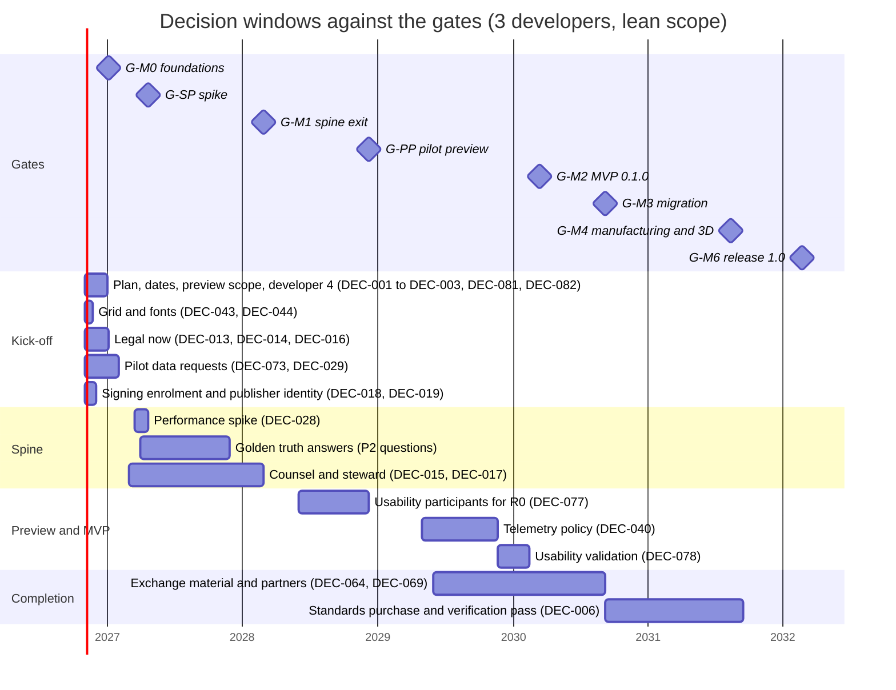

# Decision log

**Status:** Draft v0.43 · Amended 2026-10-28, v0.43 cycle 30 design pass: ID-700 to ID-718; Sonnet excluded (ID-700); FT-480, FT-485, FT-475, FT-476, FT-478, FT-483, FT-484, FT-438, FT-481 (environmental), FT-470, FT-471, FT-437, FT-424, FT-392, FT-389, FT-362, FT-461, FT-251 (except the memo snapshot), FT-313 and FT-464 closed; FT-479 open until measured; WP-S2.06 parts 1 and 2 and WP-S2.09 part 1 delivered; the starter terminal FnDefs' side-2 clamp a cycle-31 golden change (ID-711); the integration counts (55 commands, 225 actions, 309 words); the cycle-31 candidates and owner items; the window checks (ID-718); FT-499 to FT-512. · Amended 2026-10-28, v0.42 cycle 30: ID-690 to ID-699 (WP-S2.09 specified). · Amended 2026-10-28, v0.41 cycle 30: ID-681 to ID-689 (WP-S2.06 specified). · Amended 2026-10-27, v0.40 cycle 29: ID-667 to ID-680; the owner's process rules of 2026-10-27 (Claude subagents only, one independent review per cycle); WP-S2.04 part 5 (images, so WP-S2.04 is complete) and WP-S6.13 part 2 delivered; FT-442, FT-447, FT-451, FT-456, FT-459, FT-460 and FT-465 closed; FT-438 taken and open until measured; FT-440 closed after the owner accepted the golden renumbering of nine wires (ID-675); the integration counts (54 commands, 201 actions, 267 words); the cycle-30 candidates and the owner items; FT-467 closed (every native file dialog runs on a thread of its own, ID-676); blind replay made deterministic (ties go to what is printed, ID-677); BD16 done, pass-with-gaps and unblessed (ID-678); the GPU/CPU routing of raster images and the fix of the asset-save data loss (ID-679); the window check and the integration facts at the tip (ID-680); FT-475 to FT-485. · Amended 2026-10-26, v0.39 cycle 28: ID-659 to ID-666; accepted implementation; final local validation and publication status in ID-665; hosted CI pending at publication; hold after delivery, corrected eight-file raster corpus and partial FT-436, FT-470 to FT-474 (FT-474 closed); merged references/raster validation and accepted window corrections recorded; scoped Windows window checks passed. · **Date:** 2026-10-25 (v0.38: the cycle-27 design pass, ID-643 to ID-657: FT-439 delivered (no UUID-keyed order in shell output); the Windows partitions re-balanced as two binary lists and their complement; WP-S6.13 part 1 delivered as the blind-drafter harness with its rulings, ID-621's token amended, FT-314 and FT-415 closed; WP-S2.04 part 3 (interruption points and black boxes) and part 4a (the page-item and structure-box record kinds, AC-16 at 2527 keys of 72 families) delivered; WP-S2.05 part 3, the clipboard, delivered, so WP-S2.05 is complete; FT-404 and FT-405, FT-408 and FT-409, and FT-410 delivered; the integration of cycle 27 (54 commands, 188 actions, 252 words); the owner's process rulings (two lane builds, the DeepSeek coder); the cycle-27 delivery and the plan view with the cycle-28 candidates; the owner items; where the as-built text lives; FT-440 to FT-468 (FT-467 added after the window re-check, FT-468 with the `fuzz-smoke` finding of the cycle-27 delivery, ID-657); v0.37: the cycle-26 design pass, ID-633 to ID-642: FT-387 closed with the Windows chain measured at 20:24 and `test-macos` at 30:04; WP-S2.05 part 2 delivered as find and replace with `fields.set_many` (46 commands), its rulings, the `run_script` Bulk rule and the regex edge; WP-S2.04 part 2 delivered as wiring with its rulings, the fix round and the window-check rules, the `junction.open` coordinate form withdrawn; FT-406 delivered with four new packages and the guard; the raster rulings (a JPEG needs its EOI); the integration counts (227 words, 167 actions) and shortcut contexts; the window checks and their fixed defects; FT-422's alias `@n` delivered; the cycle-26 delivery and the plan view with the cycle-27 candidates; where the as-built text lives; FT-430 to FT-439; v0.36: the cycle-25 design pass, ID-625 to ID-632: WP-S2.04 part 1 delivered as place and arrange with its thirteen rulings and the exchange design item; WP-S2.05 part 1 delivered as the field catalogue, the property sheet and the grid with its twelve rulings; FT-387 taken in part with a third Windows run job; the integration rules (shortcuts unique per shell context, one text per reason key, PG5 through `select.set`); the window check; one grammar for record IDs in machine text, the alias `@n`; the cycle-25 delivery and the plan view with the cycle-26 candidates; where the as-built text lives, with two word counts corrected; FT-421 to FT-429; v0.35: WP-S6.13's fix round, ID-621 to ID-624: the agent isolated from the oracle and the repository, the keeper as the copied `xtask`, typed arguments, the corrected word count, the agent's own export and save as hard checks, the amended rulings Q1 to Q4, the pilot's prerequisites due before G-PP with their hosts, the estimate restated without a schedule change; ID-341, ID-611, ID-612, ID-614, ID-615, ID-617 and ID-618 annotated; v0.34: the cycle-24 design pass's last addendum, ID-620: lane C's review and fix round, `project.assets.purge` made `HumanOnly` by the owner's ruling, the purge's data-safety rules, the SVG rejecter hardened, the export's image findings, FT-417 to FT-419; ID-605 amended; v0.33: the cycle-25 design pass of lane E, ID-610 to ID-619: WP-S6.13 specified in three parts, the harness's home, the run kinds, the agent's senses, the protocol and keeper, three product additions, prompts and personas, prelude and scoring, the replay artefact with ID-341 amended, and the vocabulary gaps FT-408 to FT-416; v0.32: the cycle-24 design pass ID-586 to ID-609: WP-S2.03 part 2 delivered as the tool framework with Select and Measure, its rulings, the fix round with the widget hit test, the lead's rulings on hover, read-only previews and the overlay-mark scale, and the window check, so WP-S2.03 is complete; WP-S2.05 specified in three parts with its delegated rulings, the stale-card rule, one project-fragment format, the `LINKS` basis of paste, revision author and checker read-only, the requirement texts AC-28, FR-UI-010, FR-UI-020, FR-DEV-032 and FR-CON-017 amended to the golden project, PG9 as D-06's G-M2 evidence and the `ew-api` edges made normal in `ci/dep-rules.toml`; FT-370 and FT-366 closed with the scheme and separator rulings, the unshipped-scheme notice and the undo/redo `HumanOnly` gap as an ADR-0008 note; the navigator cache and the pins; the cycle-23 CI result with G-M0-04's wall-time clause met in that run; lane C's asset follow-ups (the purge as a marker line, the mechanical asset-presence guard, the SVG hazard checks, usvg admitted, SVG logos drawn, the raster remainder ruled); the cycle-24 delivery and the plan view with WP-S2.04 part 1 and WP-S2.05 part 1 next; v0.31: the cycle-23 design pass ID-556 to ID-585: WP-S2.03 part 1 delivered as the read-only viewer with its rulings, fix round and design items (FT-345 closed); WP-S2.04 specified in six parts with its rulings, the `page_item` and `structure_box` shapes written into docs 03 and 05 and two invariants specified; FT-341 and FT-337 closed with the asset store, the never-remove rule, the logo bound, the asset-read ruling, the usvg ruling and the wizard's colour default, completing the wizard and closing FT-336; FT-342 closed with `PRIVACY.md`; the two CI hotfixes, the split CI-proven and NFR-MAINT-05 read as wall time; the cycle-23 delivery and the plan view with WP-S2.03 part 2 next; v0.30: the cycle-22 design pass ID-531 to ID-555: WP-S2.03 specified in two parts with its delegated rulings, the canvas area, the navigation semantics, six public items, the tool framework, the vocabulary and the requirement moves with FR-PAG-024's new acceptance text; WP-S2.02 part 2 as built with the lane's rulings, the translucency rule and B2's bounds, the review's fix round, the lyon exemptions and the design items, so WP-S2.02 is complete; FT-336 in part with the `HumanOnly` path amending ID-443 and ID-491, its CLI subcommand brought to FR-EXT-030 in the cycle (FT-369 closed); FT-353 and FT-300 closed with the eight change-list commits mapped; the cycle-21 CI result, the first `fuzz-smoke` finding closed (a library-copy BOM and a harness bug), the cycle-22 delivery and the plan view with WP-S2.03 part 1 next; v0.29: the cycle-21 design pass ID-512 to ID-530: the owner's rulings that no performance measurement runs during development (performance criteria assumed pass until the release phase) and that the shell is a viewer until WP-S2.03 and the editing packages; the open items of WP-S2.02's specification ruled; the wgpu 30.0.1 audit and FT-333's `release-check`; WP-S2.02 part 1 as built with the lane's rulings, the review's fix round and notes, the UI-scale ruling and A15; FT-318 with the `{n-1}` grammar ruling, FT-319, the transaction-read rule (ADR-0008 amendment 4), FT-335, FT-343 and FT-344; the test-job split; the cycle-21 delivery and the plan view with WP-S2.02 part 2 next; v0.28: the cycle-21 specification of WP-S2.02 ID-505 to ID-511: the canvas renderer in two parts, the GPU path as lyon tessellation into an offscreen texture after the CPU tiles, the backend switch rule, the determinism rule, the frame-time instrumentation, the crate boundaries with four public items and the mapped-buffer rule, the canvas in the headless mode and `ui.describe`; v0.27: the cycle-20 design pass ID-486 to ID-504: WP-S2.01 part 2, the shell's second half, as built with `Session::new_project` and the `SaveError` re-export as the two `ew-api` additions, the remap's ordered-array bug and its fix, the empty-directory rule, the toolkit-neutral workspace file, egui_tiles 0.18.0, the wizard that writes only existing commands, the lead's rulings R1 to R8 and the complete `ui.describe` vocabulary; the cargo-fuzz crate and the deep nightly as built, the ODR false positive, the fuzz dependencies outside deny and vet with the NCSA exception, the proptest budget; the UI dependency audit with ADR-0023 amendment 5 confirmed, the attestation rule, the unbuilt-unsoundness rule and the `PKG_CONFIG=false` release rule; FT-330 applied; the G-SP class-S re-test; the cycle-20 delivery and the plan view with WP-S2.02 next; v0.26: the cycle-19 design pass ID-472 to ID-485: the owner's standing download permission; WP-S2.01 part 1, the application shell, as built with its headless mode `ew.uiscript/1` and `ew.uitranscript/1`, the journal kept on a dirty exit, the UI dependency set with its exemptions and the audit before distribution, `rust-version` 1.95 for the UI crates; FT-316 closed with EW-INV-021 and the replay collision rule; FT-315, FT-299 and FT-317 closed with the reader-crate source scan; the CI time and the Windows cut; the cycle-19 delivery and the plan view; v0.25: the cycle-18 design pass ID-456 to ID-471: the veraPDF and headless evidence jobs, the image-digest and pull-failure rules, coverage report-only and the required checks left to the owner; the builder's library copies with the known undo defect FT-316 and the ordered-collection lint; the typed solenoid-position map, the pin-designation map as a format decision, N1 to N3, the accepted FR-PLC-051 deviation, `plc.set_module_part` and the interim valve-declaration rule; the cycle-18 delivery and the plan view; v0.24: the owner rulings of 2026-10-22 ID-450 to ID-455: PD-1 and PD-3 adopted, the G-M1 date rule adopted by the owner, no second named code owner, no funding pursued, the legal and licensing items no longer gate items with ID-383 owner-accepted, and the readiness recount; v0.23: the M-PP kick-off ID-440 to ID-449: the owner's go for the UI chain in cycle 19, the specification folder, WP-S2.01 in two parts, the headless testability rule, the registry and shell model in `ew-viewmodel`, the CPU page view, egui menus first, the UI dependency set, the CI time of the GUI crates and the kick-off plan; v0.22: the cycle-17 design pass ID-427 to ID-439: the typed revision as built with the delegated rulings R1 to R4, its format rule and the accepted open failure of old files, ADR-0009 amendment 6, the acceptance changes, the fuzzer's coverage and nightly form with the cargo-fuzz target deferred, the cycle-17 delivery and the plan view; v0.21: the G-M1 readiness run ID-419 to ID-426: the run, the verdict "not ready", the date rule with G-M0 first, D-06 split between G-M1 and G-M2, G-M1-24 restated, the second code owner left to the owner, the new tasks FT-294 to FT-301, FT-87 to FT-92 re-dated and the plan view, with the delegated rulings R1 to R8; v0.20: the cycle-16 decisions ID-392 to ID-418 on the device-tree, PLC, supply and library commands, `fields.set` on the assembly and PLC aspects, normaliser N1, the typed revision as its own package, AC-15 path (b) passing, the user guide with its generated reference and the `docs-book` job, the property-test generator rule, the acceptance tests once per CI job, the nightly performance gate and the CI-time trend, acceptance and the plan view; v0.19: the cycle-15 decisions ID-362 to ID-391 on the export job, the PDF ID and dates, the sealed generic symbols, `ew apply`, the assembly aspect and its BOM, the break marks, the import modes and the first quick fix, the generator contract, the CI budget, the hotfix rule, the CC-BY-SA item, the builder DSL, the page-type ruling, three commands and the fuzzer; v0.18: the cycle-14 decisions ID-340 to ID-361 on the product principle, the blind drafter and its work package, the PDF checks, the SVG export, the flow-distance orientation, the five rules, the anchor override, the exports, `ew verify-derived` and the cover; v0.17: the cycle-13 decisions ID-324 to ID-339 on wire numbering, the SQL projection v0, the PLC record kinds, the DP bus potential, cargo-vet exemptions and the reserved-kind rule; v0.16: the owner's rulings ID-322 and ID-323 on the open items of the cycle-12 design pass; v0.15: the cycle-12 decisions ID-301 to ID-321 on Golden C, the check engine and prevent at apply, `ew check`, the M1 report and page gaps and the profile rulings; v0.14: the cycle-11 decisions ID-273 to ID-300 on the QET project import, the acceptance runner, the command log, the settings command, Golden B, the symbol rulings and the memo retention policy; v0.13: the cycle-10 decisions ID-251 to ID-272 on incremental connectivity, per-item links, platform rules, the cycle-based plan view and the pilot size data; v0.12: the cycle-9 decisions ID-229 to ID-250 on report kinds and tables, the fallback font and the memo engine as built; v0.11: the cycle-8 persistence and G-SP decisions ID-200 to ID-228; v0.10: the cycle-8 cross-reference decisions ID-188 to ID-199; v0.9: the cycle-7 decisions ID-124 to ID-187 and the project owner's rulings; v0.8: the cycle-6 decisions ID-64 to ID-123 and the review rulings; v0.7: the cycle-5 decisions ID-33 to ID-63 and the review rulings; v0.6: ID-26 final limits; v0.5: the cycle-4 decisions ID-22 to ID-32, §2.4 and §5.1) ·
**Part of:** ElektraWatt plan

**Purpose.** This is the decision log of ElektraWatt (EW). **Part A** records what has been decided: the user
decisions of 2026-10-17, every Accepted ADR and the decisions of the first implementation day (2026-10-18), one
line each. **Part B** is the register of what is still open: the
questions that the design documents carry in their "Open questions" sections and the five Proposed ADRs (0025, 0027,
0028, 0029, 0030), consolidated and deduplicated into 85 numbered decisions (DEC-001 to DEC-085), each with its
options, a recommendation, a decision owner, the gate or work package by which it is needed, the impact if it is late
and the source documents. **Part C** is a prioritised questionnaire for the pilot user, merged with the brainstorm's
PQ list, that says for each question which decision, work package and gate it unblocks. The log invents no answers:
where a decision is open, the recommendation is the documented default that the plan uses until someone decides.
All dates are for the plan of record of the [global plan](01-global-plan.md) (three developers, lean scope, month 0 =
November 2026) and move with the scenario. Since 2026-10-20 (ID-271) these months are the reference of a human-team
scenario, not a forecast for the AI-driven cycles; a gate is due when its content is done (global plan §3.8).

---

## Summary for decision makers

**The state in one paragraph.** Eight user decisions, 25 Accepted ADRs, 63 decisions of the first
implementation day (2026-10-18, two of them interim defaults) and 60 of the sixth cycle and 64 of the seventh (both 2026-10-19) and 41 of the eighth, 22 of the ninth and 22 of the tenth (all 2026-10-20) and 28 of the eleventh, 23 of the twelfth, 16 of the thirteenth and 22 of the fourteenth (all 2026-10-21) and 30 of the fifteenth and 27 of the sixteenth (both 2026-10-22) are fixed (Part A); the G-M1 readiness run (2026-10-22) added 8 entries, decided by delegated rulings except the second code owner (ID-424), which awaits the owner, and the seventeenth cycle's design pass (2026-10-22) added 13. 85 decisions are
open (Part B): 37 wait for the pilot user, 24 for the project owner,
21 for the core team and 3 for counsel (several more need counsel's input). DEC-081 to DEC-085 were added with
version 0.2 for the re-planned pilot preview, the external and internal dates, the CRA status of the preview, the
community channels and the version numbering. The
source was 312 open questions in the design documents; at the date of this log 174 of the 344 questions now listed in
the design documents already carry a "Resolved" or "Decided" mark, and the rest are mapped to a decision here, to the
batch of low-impact defaults of §3.3, or to the short list of questions that other documents have settled (§3.4).
Part C asks the pilot user 53 questions in four priorities; **12 are P1 and should be asked at the kick-off**.
Nothing in this log is decided by being written down.

**What is due when** (plan of record; the gate dates are in §1.3):

| Gate | Date (plan of record) | Decisions due | Count |
|---|---|---|---|
| **G-M0** | month 3, Jan 2027 | DEC-001, DEC-002, DEC-003, DEC-005, DEC-007, DEC-013, DEC-014, DEC-016, DEC-018, DEC-019, DEC-021, DEC-022, DEC-029, DEC-043, DEC-044, DEC-073, DEC-074, DEC-080, DEC-081, DEC-082, DEC-083 | 21 |
| **G-SP** | month 6, Apr 2027 | DEC-028, DEC-030 | 2 |
| **G-M1** | month 16, Feb 2028 | DEC-004, DEC-008, DEC-010, DEC-011, DEC-015, DEC-017, DEC-020, DEC-023, DEC-032, DEC-034, DEC-036, DEC-037, DEC-038, DEC-039, DEC-046, DEC-047, DEC-048, DEC-049, DEC-051, DEC-052, DEC-053, DEC-054, DEC-057, DEC-059, DEC-060, DEC-084 | 26 |
| **G-PP** | month 26, Dec 2028 | DEC-077, DEC-085 | 2 |
| **G-M2** | month 41, Mar 2030 | DEC-009, DEC-031, DEC-033, DEC-035, DEC-040, DEC-041, DEC-042, DEC-050, DEC-055, DEC-056, DEC-058, DEC-061, DEC-062, DEC-063, DEC-068, DEC-070, DEC-078, DEC-079 | 18 |
| **G-M3** | month 47, Sep 2030 | DEC-006, DEC-025, DEC-045, DEC-064, DEC-065, DEC-066, DEC-069, DEC-075, DEC-076 | 9 |
| **G-M4** | month 58, Aug 2031 | DEC-024, DEC-067, DEC-072 | 3 |
| **G-M5** | month 59, Sep 2031 | DEC-012, DEC-071 | 2 |
| **1.x** | after 1.0 | DEC-026, DEC-027 | 2 |

**The first 90 days (to G-M0 in Jan 2027).** 21 decisions carry the gate G-M0. The ones that block
work are: the plan of record with its external and internal dates (DEC-001, DEC-081), lever (b) (DEC-002), the
pilot-preview scope and the Must-row triage (DEC-082) and developer 4 (DEC-003); the native grid
(DEC-043, by spine week 2, mid-November 2026) and the default fonts (DEC-044, by week 3, late November 2026), because the
output lane builds the starter symbols and the goldens on them; the signing enrolment path and the employer's public
identity (DEC-018, DEC-019), because the enrolments of WP-S0.05a name the publisher and their 12-month lead time starts
when they are submitted; and the legal items that are already overdue or hard:
the publication consent (DEC-013, "now", the content is public), the employer statement (DEC-014) and the SPDX test
(DEC-016). The pilot's data requests (QET corpus DEC-073, size data DEC-029) have a lead time of
months, so they go out at the kick-off.

**Defaults already in force.** Since 2026-10-18 the 4 mm native grid (DEC-043) and Noto Sans (DEC-044) are the
working basis, so the output lane does not wait; both rows stay open until the pilot confirms them at G-M0, and
DEC-080 items 1 to 4 are confirmed (§2.4).

**What happens if nothing is decided.** The documented defaults apply: 4 mm grid, Noto Sans, classic single letters,
DBU/WH colours, 3 developers, no grants, no signed release, no non-maintainer merge (`blocked:LG-2`), local-only crash
reports. Every default is cheap to change before the gate named in its row and expensive afterwards (goldens
re-baselined, symbols redrawn, format records frozen at M1).

**Two things this log cannot settle.** (1) The answers to the P2 questions (reference-project truth) are the
acceptance specification; until they arrive, goldens carry marked test values (the triangles of the
[golden project](../design/20-golden-project.md)). (2) Counsel's work (ADR-0025, ADR-0030, CRA scope, LG-3 searches)
has lead time and a cost that [global plan §13.4](01-global-plan.md#134-costs-that-are-money-not-pw) lists; it must be commissioned in the first 90 days.

---

**Contents**
1. [Basis and method](#1-basis-and-method)
2. [Part A: decisions taken](#2-part-a-decisions-taken)
3. [Part B: open decisions](#3-part-b-open-decisions)
4. [Part C: questions for the pilot user](#4-part-c-questions-for-the-pilot-user)
5. [Maintaining the log](#5-maintaining-the-log)
6. [Sources](#sources)
7. [Open questions](#open-questions)

---

## 1. Basis and method

### 1.1 Inputs

- The open questions of documents 00 to 20 (snapshot of 312, including 16 ADR follow-ups) and their current state in
  the documents, the five Proposed ADRs and the Accepted ADRs 0001 to 0024 and 0026.
- The [global plan](01-global-plan.md) (milestones including the pilot preview M-PP, decisions PD-1 to PD-15, the
  first 90 days, funding), the [work breakdown](02-work-packages.md) (WPs, levers, planning assumptions PA-1 to PA-11)
  and the [gates](03-gates.md) (gate dates, checkpoints CP-01 to CP-15, legal gates LG-1 to LG-6).
- The pilot questions PQ-01 to PQ-36 of the [brainstorm](../design/01-brainstorm.md#7-questions-for-the-pilot-user).

### 1.2 How the questions were consolidated

1. **Status first.** A question that its document marks "Resolved" or "Decided" is not open. This log does not
   reopen it. Questions that another document settled without updating their own are listed in §3.4.
2. **One decision, many sources.** Questions that ask the same thing in two or three documents (for example the grid,
   the unplaced-device policy, the viewer packaging, the saved date) become one decision. The sources column names
   every document and question number (`doc OQn`) so that the trail is complete.
3. **Decisions, not facts.** A question that only needs a fact from the pilot (a part number, an order code) becomes a
   decision when the answer changes a default, a golden or a work package; otherwise it is a question in Part C only.
4. **Batch the small ones.** Defaults that are low impact and have a recommendation nobody has objected to are listed
   once in §3.3 and confirmed in one review (DEC-080).
5. **Owners.** *Project owner*: scope, money, legal form, naming. *Pilot user*: the acceptance truth, house
   conventions and what the pilot's shop does; this includes the employer where the employer must act. *Core team*:
   architecture, engineering defaults, verification outcomes. *Counsel*: legal wording and legal interpretation. A
   decision with two roles names the one who decides first and the one consulted in brackets.
6. **Status.** Every row is *Open* on 2026-10-18. Closing a row is described in §5. A row whose recommendation is
   already the working basis says "Default in force since *date*" in its recommendation cell and stays open; §2.4
   lists these interim decisions.

### 1.3 Gates, months and dates

Month *n* counts from 2026-11-01 and is labelled with the calendar month in which it ends (global plan §3.4). Gate
months are those of [milestones.csv](milestones.csv), written by [tools/schedule.py](tools/schedule.py); the table is
the same generated block as in the [gates](03-gates.md#22-timing-per-scenario), and `schedule.py --check` fails when it
is stale. The plan-of-record column is the conservative baseline (3 developers, lean scope); the two AI columns are the
internal target and the upside of the global plan (§3.7) and are not external dates (DEC-081). G-SP is the
performance-spike decision, one month after WP-S1.03.

<!-- generated:gate-timing -->
| Gate | 2 developers | **3 developers (baseline)** | 4 developers (fourth from month 4) | 3 + AI-moderate (internal) | 3 + AI-strong |
|---|---|---|---|---|---|
| **G-SP** | 7 (May 2027) | **6 (Apr 2027)** | 6 (Apr 2027) | 5 (Mar 2027) | 5 (Mar 2027) |
| **G-M0** | 3 (Jan 2027) | **3 (Jan 2027)** | 3 (Jan 2027) | 3 (Jan 2027) | 3 (Jan 2027) |
| **G-M1** | 23 (Sep 2028) | **16 (Feb 2028)** | 16 (Feb 2028) | 13 (Nov 2027) | 11 (Sep 2027) |
| **G-PP** | 37 (Nov 2029) | **26 (Dec 2028)** | 24 (Oct 2028) | 21 (Jul 2028) | 18 (Apr 2028) |
| **G-M2** | 60 (Oct 2031) | **41 (Mar 2030)** | 36 (Oct 2029) | 33 (Jul 2029) | 29 (Mar 2029) |
| **G-M3** | 70 (Aug 2032) | **47 (Sep 2030)** | 40 (Feb 2030) | 38 (Dec 2029) | 32 (Jun 2029) |
| **G-M4** | 84 (Oct 2033) | **58 (Aug 2031)** | 52 (Feb 2031) | 47 (Sep 2030) | 40 (Feb 2030) |
| **G-M5** | 88 (Feb 2034) | **59 (Sep 2031)** | 52 (Feb 2031) | 47 (Sep 2030) | 41 (Mar 2030) |
| **G-M6** | 97 (Nov 2034) | **65 (Mar 2032)** | 58 (Aug 2031) | 52 (Feb 2031) | 45 (Jul 2030) |
<!-- /generated:gate-timing -->

A work package (WP) is written "WP-S1.21 (month 25)" when the decision is needed before it starts. The month is the
one in which the WP starts in the schedule model (3 developers, lean scope, base capacity): the start month of
[wp-schedule.csv](wp-schedule.csv), rounded up, so a WP that starts at 24.2 months is in month 25. It is a planning
date, not a promise. "Needed by" always names the earliest of the gate and the WP.

### 1.4 Source keys

A source such as `08 OQ8, OQ9` means open questions 8 and 9 of document 08. `plan 01` is the
[global plan](01-global-plan.md), `gates` the [gates](03-gates.md), `ADR-nnnn` an [ADR](../adr/).

| Key | Document | Key | Document |
|---|---|---|---|
| 00 | [Vision and scope](../design/00-vision-and-scope.md) | 11 | [Fluid power](../design/11-fluid-power.md) |
| 01 | [Brainstorm](../design/01-brainstorm.md) | 12 | [Panel layout](../design/12-panel-layout.md) |
| 02a | [Core requirements](../design/02a-requirements-core.md) | 13 | [Manufacturing outputs](../design/13-manufacturing-outputs.md) |
| 02b | [Extended requirements](../design/02b-requirements-extended.md) | 14 | [Interop](../design/14-interop.md) |
| 02c | [Non-functional requirements](../design/02c-nonfunctional-requirements.md) | 15 | [Checks, revisions, collaboration](../design/15-checks-revisions-collaboration.md) |
| 03 | [Domain model](../design/03-domain-model.md) | 16 | [UX and UI](../design/16-ux-ui.md) |
| 05 | [Project format and persistence](../design/05-project-format-and-persistence.md) | 17 | [Extensibility](../design/17-extensibility.md) |
| 06 | [Schematic editor](../design/06-schematic-editor.md) | 18 | [Quality, security, release](../design/18-quality-security-release.md) |
| 07 | [Symbols, parts, macros](../design/07-symbols-parts-macros.md) | 19 | [Open-source governance](../design/19-open-source-governance.md) |
| 08 | [Connections, terminals, cables](../design/08-connections-terminals-cables.md) | 20 | [Golden project](../design/20-golden-project.md) |
| 09 | [Reports, forms, output](../design/09-reports-forms-output.md) | 04 | [Architecture](../design/04-architecture.md) |
| 10 | [PLC and bus](../design/10-plc-and-bus.md) | | |

---

## 2. Part A: decisions taken

### 2.1 User decisions of 2026-10-17

These are binding and are not re-litigated in any document ([vision](../design/00-vision-and-scope.md#11-user-decisions-taken) §11).

| # | Decision | Content | Recorded in |
|---|---|---|---|
| UD-1 | **Language** | Rust for the core and the application. FFI only where justified, for example the B-rep/STEP kernel (out-of-process OCCT worker). | Vision §11; [ADR-0016](../adr/0016-3d-renderer-wgpu-and-out-of-process-step-worker.md) |
| UD-2 | **Open source** | A public open-source project that accepts community contributions under the DCO, with no CLA. | [ADR-0024](../adr/0024-licence-set-and-permissive-gpl-boundary.md); [19](../design/19-open-source-governance.md) |
| UD-3 | **Team** | 2 to 4 developers plus AI assistance. The plan baseline is 3 developers (2 and 4 as scenarios); AI is assumed to help, not to multiply throughput (§2.3). | Vision §10; [global plan](01-global-plan.md) |
| UD-4 | **Platform** | Cross-platform desktop (Windows, macOS, Linux), offline-first, projects as files on disk. | [ADR-0010](../adr/0010-project-storage-jsonl-directory.md); [ADR-0022](../adr/0022-platform-matrix-and-performance-budgets.md) |
| UD-5 | **v1 extras** | v1 also includes (1) PLC / I/O integration with exchange with TIA Portal and CODESYS (AML, CSV), (2) manufacturing outputs (wire lists with lengths and ferrules, terminal plans, labels, Komax and Rittal machine export), (3) a 3D panel layout with rails, ducts, collision, wire routing and automatic wire lengths, (4) import of EPLAN (EDZ), QElectroTech (.qet) and DXF (DWG). | Vision §9; [work breakdown](02-work-packages.md) |
| UD-6 | **Licence set** | Application GPL-3.0-or-later with a plugin exception (wording by counsel, open as DEC-015); format, parser and SDK crates MIT OR Apache-2.0; symbols and templates CC-BY-SA-4.0 with a KiCad-style design exception; project-authored part data and examples CC0; documentation CC-BY-4.0. Porting QElectroTech code (GPL-2.0-or-later) is allowed with attribution. | [ADR-0024](../adr/0024-licence-set-and-permissive-gpl-boundary.md) |
| UD-7 | **Device-tag letters** | New projects default to the classic single letters (EN 81346-2:2009: F, G, S, T, E, X, W, U, Q, K, M ...), as in the reference drawings. IEC 81346-2:2019 two-letter classes are selectable per project; the IEC 60750 legacy set ships for migrated QET projects. | [ADR-0026](../adr/0026-default-device-tag-identifier-set.md) |
| UD-8 | **Public repository and anonymisation** | The repository is public and the reference project is confidential customer work: its technical content (tags, part numbers, wiring, folio numbers, defects) is the acceptance specification, but customer, end-user, address, project and drawing identifiers, people's names and initials, the panel builder's name, the confidentiality notice and e-mail addresses never enter the repository. The migration path is QET first, because the pilot user works in QET 0.100.0-dev. | [20](../design/20-golden-project.md) §3.5, AC-39; [ADR-0021](../adr/0021-importers-emit-format-level-records.md); LG-5 (DEC-013) |

### 2.2 Accepted ADRs

All 25 are Accepted; those marked *amended* took amendments on 2026-10-18 that are folded into the ADR text. The five Proposed ADRs (0025, 0027, 0028, 0029, 0030) are decisions in Part B.

| ADR | Decision in one line | Note |
|---|---|---|
| [ADR-0001](../adr/0001-core-model-persistent-maps.md) | Core model: typed Rust records in persistent maps (imbl); one `Model` value is the single source of truth and everything printed is derived. | amended (raw reads behind the `raw-read` feature) |
| [ADR-0002](../adr/0002-derived-data-engine-ew-memo.md) | Derived-data engine: cold-first queries plus a cut-down memo layer (`ew-memo`); no salsa. | amended; the performance spike (DEC-028) closes the open part |
| [ADR-0003](../adr/0003-freshness-contract.md) | Freshness contract: classes I to III, frozen-on-purpose identifiers, committed computations, versioned derivation profiles. |  |
| [ADR-0004](../adr/0004-identity-uuidv7-uuidv5.md) | Identity: UUIDv7 for authored records, UUIDv5 for instantiated, imported and generated ones. | amended (import lineage, UUIDv7 method, UUIDv5 name layout and `NS_IMPORT`) |
| [ADR-0005](../adr/0005-value-types-nm-dec3-mltext.md) | Values: `i64` nanometre coordinates, rational grids, `Dec3` quantities, `MlText`. | amended (`Angle2`, its counter-clockwise rotation sense) |
| [ADR-0006](../adr/0006-function-device-representation-model.md) | Function / Device / Representation model with typed device aspects. | amended |
| [ADR-0007](../adr/0007-explicit-connections-and-autoconnect.md) | Explicit connections and junction sequences are the model; autoconnect is an editing aid. | amended; validation with EPLAN and QET users is DEC-078 |
| [ADR-0008](../adr/0008-transactions-undo-preview.md) | Transactions, undo/redo and preview-as-fork; every write is a serialisable command. | amended |
| [ADR-0009](../adr/0009-invariant-catalogue.md) | Invariant catalogue: structural versus configurable prevent rules; lenient import. | amended |
| [ADR-0010](../adr/0010-project-storage-jsonl-directory.md) | Project storage: UUID-named JSONL directory, manifest-last save, external journal, lock file. | amended (intent manifest, lock record) |
| [ADR-0011](../adr/0011-format-versioning-and-migration.md) | Format versioning, per-kind migration and format-change windows. | amended (append-only members; error paths from `ew-schema`, no strict schema variant) |
| [ADR-0012](../adr/0012-git-integration.md) | Git integration: semantic merge driver, textconv, in-file conflict records, post-merge integrity. | amended |
| [ADR-0013](../adr/0013-revisions-and-as-built-archive.md) | Revisions and the as-built archive outside the project directory. | amended |
| [ADR-0014](../adr/0014-gui-toolkit-egui.md) | GUI toolkit: egui/eframe behind `ew-ui`, over a toolkit-agnostic `ew-viewmodel`. | amended |
| [ADR-0015](../adr/0015-display-list-renderers-pdf.md) | One display-list IR; wgpu canvas plus an always-built CPU renderer; krilla PDF/A-2b; PDF as print master. | amended |
| [ADR-0016](../adr/0016-3d-renderer-wgpu-and-out-of-process-step-worker.md) | 3D renderer on wgpu; out-of-process OCCT STEP worker. | amended (the gizmo lives in `ew-ui`) |
| [ADR-0017](../adr/0017-read-only-sql-projection-api-v1.md) | Read-only SQL projection with versioned `api_v1` views. | amended |
| [ADR-0018](../adr/0018-reports-forms-engine-and-machine-profiles.md) | Reports and forms engine; report blocks as derived pages; machine-export profiles as data. | amended |
| [ADR-0019](../adr/0019-rule-engine-and-rule-packs.md) | Rule engine and rule packs. | amended (packs, export mode, rule-ID scheme) |
| [ADR-0020](../adr/0020-extensibility-tiers-and-security-model.md) | Extensibility tiers and security model: CLI, rhai, WASM on the wasmtime LTS line, MCP, Python. | amended (pure formulas run untrusted; JSON at the WIT boundary) |
| [ADR-0021](../adr/0021-importers-emit-format-level-records.md) | Importers emit format-level records; QET first; EDZ as 7-Zip; DWG via acadrust plus ODA. | amended |
| [ADR-0022](../adr/0022-platform-matrix-and-performance-budgets.md) | Platform matrix and performance budgets (S/M/L/XL) as CI-enforced requirements. |  |
| [ADR-0023](../adr/0023-supply-chain-and-release-integrity.md) | Supply chain and release integrity: pinned toolchain, SBOM, signing, provenance. | amended (cargo-vet audits name the GitHub handle, no imported audit sets); the SignPath fallback is DEC-018 |
| [ADR-0024](../adr/0024-licence-set-and-permissive-gpl-boundary.md) | Licence set and the permissive/GPL crate boundary, enforced in CI. | amended (further permissive crates, one allowlist, the Code of Conduct's CC-BY-SA-4.0) |
| [ADR-0026](../adr/0026-default-device-tag-identifier-set.md) | Default device-tag identifier set: EN 81346-2:2009 single letters; IEC 81346-2:2019 and IEC 60750 selectable. | amended; the leniency on S is DEC-046 |

### 2.3 Planning inputs used by the plan

These are inputs given to the planning, not decisions of record. Their formal adoption is DEC-001 and DEC-081. They
are numbered PI-1 … PI-7 here. Where an input is one of the planning assumptions of the work breakdown, the third
column cites it by its work-breakdown ID PA-n and meaning ([WBS §1](02-work-packages.md#1-planning-assumptions)); the global plan's GA-n,
the gates' GB-n and this list's PI-n are different lists.

| # | Planning input | Work-breakdown assumption | Where it is used |
|---|---|---|---|
| PI-1 | Project start (month 0) is November 2026. | PA-1 start | All dates |
| PI-2 | Baseline team of 3 developers; scenarios with 2 and with 4 (the fourth from month 4, the whole team at 90 % efficiency from then). | PA-2 team | [Global plan](01-global-plan.md#22-team-scenarios) §2.2 |
| PI-3 | Productive capacity is about 36 person-weeks per developer per year, after holidays, meetings, support and community work; sensitivity plus or minus 20 %. | PA-3 capacity | [Global plan](01-global-plan.md#2-capacity-model) §2, §3.5 |
| PI-4 | AI assistance is assumed to help (likely estimates 10 to 20 % lower) but not to multiply throughput. The AI-moderate and AI-strong scenarios are an internal target and an upside on top of the estimates, never part of them. | PA-7 AI assistance | [Global plan](01-global-plan.md#37-ai-assisted-scenarios) §3.7; DEC-081 |
| PI-5 | At least 20 % reserve for integration, hardening and bug fixing; documentation, release engineering and community and pilot support are work packages. | PA-8 reserve; PA-6 what an estimate contains; PA-11 background load | [Work breakdown](02-work-packages.md) |
| PI-6 | The architecture's indicative 15 to 18 months to 1.0 is not met; the realistic plan-of-record dates are the pilot preview at month 26 (Dec 2028), the MVP at month 41 (Mar 2030) and 1.0 at month 65 (Mar 2032; month 64 until the blind-drafter work package, ID-342). | none: a result of the schedule model | [Global plan](01-global-plan.md#36-can-v1-fit-1518-months) §3.6; [milestones.csv](milestones.csv) |
| PI-7 | External lead times (the signing enrolment of at least 12 months, counsel, the trademark search) are modelled as lags and as money, not as person-weeks. | PA-9 schedule model; PA-10 external costs | [Global plan](01-global-plan.md#92-ordering-rules) §9.2 rule 5, §13.4 |

### 2.4 Decisions of 2026-10-18 (first implementation day)

On 2026-10-18 the first code landed (WP-S0.01, WP-S0.02 and the first half of WP-S1.01), and the project owner
delegated the product-owner role to that development session. These decisions are recorded with the decider
"project owner (delegated, 2026-10-18)", or the core team for engineering details the code had to fix. They take no
confirmation away from the pilot user: DEC-043 and DEC-044 stay open in Part B until the pilot confirms them at G-M0.
Later the same day `ew-schema` v0 (WP-S1.02) landed; ID-12 to ID-21 record the questions it raised and the dependency
edges of the foundation crates. The fourth implementation cycle (`ew-model`, WP-S1.03; the QET element reader and symbol lowering, WP-S3.05) and its independent review raised ID-22 to ID-32. The fifth cycle (the starter symbols, WP-S7.02; `ew-text` and the frame and title-block forms, WP-S3.02; `ew-commands` and `ew-api`, WP-S1.04) and its independent reviews raised ID-33 to ID-63; the code and content changes they require are follow-up tasks FT-01 to FT-18 of the [work breakdown](02-work-packages.md#appendix-b-follow-up-tasks-from-the-implementation-cycles), Appendix B. On 2026-10-19 the sixth cycle (`ew-memo` v1, the S–XL generator, the benchmark harness and `check-raw-read`, WP-S1.05; the tracked context `Q` and Derivation I, WP-S1.06; the golden tables and the CSV bootstrap, WP-S7.01 and WP-S3.05) and its independent reviews raised ID-64 to ID-116, with the project owner's delegated rulings recorded under "project owner (delegated, 2026-10-19)"; their code changes are FT-19 to FT-42, and FT-01 is closed. The seventh cycle (the report engine, WP-S3.03; page output, WP-S3.04; Derivation II, WP-S1.07) the independent reviews of its report engine, page output and connectivity, and their fix rounds raised ID-124 to ID-187, with the project owner's delegated rulings recorded the same way; their code and content changes are FT-46 to FT-80. The eighth cycle's design pass on cross-references (WP-S1.08: the counts of doc 20 §15, the page index, contact images, strip segments, the unfinished slots, settings and glyph, and the per-slot text style) raised ID-188 to ID-199, with the project owner's delegated rulings of 2026-10-20; their code and content changes are FT-81 to FT-85. The eighth cycle's second design pass raised ID-200 to ID-228: the persistence core as built and reviewed (WP-S1.09; ADR-0010 amendment 3), the outcome Recycle of gate G-SP with incremental connectivity and the plan re-baseline (WP-S1.05; ADR-0002 amendment 4), and two cross-reference leftovers; their code and content changes are FT-86 to FT-99. ID-208 and ID-216 were open items that the lead designer decided. The ninth cycle's design pass raised ID-229 to ID-250: the report tables layer and the connectivity report kinds with the doc 20 alignments and a fixture decision (WP-S3.03, FT-53 closed), the bundled symbol fallback face with the FR-OUT-027 reporting rule (WP-S3.02, FT-85 closed; ADR-0028 amendment 1, ADR-0015 amendment 8), and the memo engine and memoised `Q` as built (WP-S1.07 part 1; ADR-0002 amendment 5), with WP-S1.07 part 2 moved to cycle 10; their code and content changes are FT-100 to FT-116. The tenth cycle's design pass raised ID-251 to ID-272: incremental connectivity as built and reviewed (WP-S1.07 part 2; ADR-0002 amendment 6, ARCH §3, §6.3 and §6.4), the per-slot text style and one link per listed item with the 64-annotation sweep and the 24 V fixture change (FT-84, FT-86 and FT-109 closed; ADR-0015 amendment 9), the cross-platform source rules after the red CI of cycle 9, and the project owner's decision that the plan's calendar is a human-team reference while progress is tracked in cycles (ID-271), and the pilot's size data, which closes G-SP-08 and CP-03 with class S as the pilot's working range (ID-272); their code and content changes are FT-117 to FT-126. The eleventh cycle's design pass (2026-10-21) raised ID-273 to ID-300: the lenient QET project import as a spike pulled forward from lever (b), with its keys, tag, pairing, strip and CLI rules and Golden C made runnable (doc 14 §4.16), the acceptance runner and its M1 gap list, the command log and Golden B as built, `project.settings.set` with its exposure and the frozen-tag rule (ADR-0008 amendment 3), the segment-less strip rule, the starter-set and pole-family rulings for the pilot corpus, the orphan-collection retention policy (ADR-0002 amendment 7), the timing rule and the pilot corpus as private test input; their code and content changes are FT-127 to FT-163. The twelfth cycle's design pass raised ID-301 to ID-321 (Golden C, the check engine and prevent at apply, `ew check`, the M1 report and page gaps; ADR-0009 amendment 5) and the owner's rulings ID-322 and ID-323; their code and content changes are FT-164 to FT-211. The thirteenth cycle's design pass raised ID-324 to ID-339: wire numbering as built with doc 20 §8.2 following the computed numbers, the numbering order and the segment-only terminal anchor (FT-100 and FT-201 closed); the SQL projection v0 as built with its Preview additions, view rulings and sandbox (WP-S1.10; ADR-0017 amendment 2 extended); exemptions per work package (ADR-0023 amendment 4); the PLC record kinds, channel IDs, the interim DP bus model and the aspect write order (FT-111 and FT-105 closed), with the rule that a reserved kind may be implemented within an unreleased format (ADR-0011 amendment 4); acceptance without fails and the plan view; their code and content changes are FT-212 to FT-232. The fourteenth cycle's design pass raised ID-340 to ID-361: the owner's product principle (the pilot's drawings are the content target) and the blind drafter with its work package WP-S6.13, which moves the plan-of-record 1.0 by one month; the PDF checks with an in-repo reader, `par_map` and the SVG writer as built, with the export CLI waiting for FT-59; the flow-distance orientation (FT-101 closed), the junction notation and one CP label rule, EF-15 = 10, D-14 restated, the per-representation anchor override (ADR-0011 amendment 4 applied), part descriptions without ratings, the release gate of scheme content and the five new rules (FT-212 to FT-214 closed); the block-title templates, the cables and BOM exports, `ew verify-derived` with the freshness check and the cover (D-30); the disk rule of agent sessions; acceptance at 81 of 92 with 0 fails and the plan view; their code and content changes are FT-233 to FT-245. The fifteenth cycle's design pass raised ID-362 to ID-391: the export job in `ew-api` with its view parts and layers, the PDF document ID with a content digest, the export dates, the sealed generic symbols, the slot texts (FT-206 resolved), `ew apply`, the edges to `ew-text` and `ew-dl` and the durable output files; the assembly aspect's covers, `bom_basis`, the derived break marks, the assembly BOM table, strict import under EW-IMP-002, the first quick fix through `fields.set`, the two-line folio 3 and the covers cascade; the generator contract of doc 20 §8.2, rustdoc on both platforms, the CI time budget, the hotfix rule and the CC-BY-SA item for counsel; the builder DSL of AC-15 path (b), the page-type ruling that amends ID-55, three new commands, the runner as `cargo xtask acceptance`, the command fuzzer and the "(a) ≠ (b)" gap class; acceptance at 86 of 93 with 1 fail (AC-15 path (b)) and 1 not built, and the plan view; their code and content changes are FT-246 to FT-272. The sixteenth cycle's design pass and its lane-B review rulings raised ID-392 to ID-418: seven commands for the device tree, the PLC records, the supply origin and library copies, with `assembly.attach` without push insert or detach, `valve.add`'s interim parameters, `project.supply.set` limited to the origin, `library.embed`'s hash rule and one copy-hash function, `fields.set` on the assembly and PLC aspects and normaliser N1 that never removes a channel; the typed revision as a D5 package; AC-15 path (b) passing record for record; the user guide as an offline mdBook with the generated reference (GPL pages), `docs-gen --check` and the `docs-book` job; the property-test generator rule after the cycle-15 gate finding; the acceptance tests once per CI job, the nightly performance gate and the CI-time trend; acceptance at 87 of 93 with 0 fails and 1 not built, and the plan view; their code and content changes are FT-273 to FT-293. The G-M1 readiness run at the cycle-16 delivery raised ID-419 to ID-426: the run and where its records live, the verdict "not ready", the proposed date rule with G-M0 first, three proposed owner rulings (D-06's property-grid half to G-M2, G-M1-24 to -26 under the cycle-based plan, a second named code owner), the tasks for the gaps (FT-294 to FT-301) with the proposed re-dating of FT-87 to FT-92, and the plan view; the delegated rulings of the same day decided all but the second code owner (ID-424), which waits for the project owner, and the owner confirms the date rule at G-M0. The seventeenth cycle's design pass raised ID-427 to ID-439: the typed revision as built (FT-165), its format rule and the accepted open failure of old files that break an invariant, the revision fields of doc 03 §18, ADR-0009 amendment 6, no historic release after a real one, what the typed revision leaves for later, the acceptance changes (a second D-05 entry, the folio-911 digests, D-06's grid entry not applicable), the fuzzer's coverage of the 37 commands (FT-279) and its nightly form with the cargo-fuzz target deferred, ASan and macro insertion as tasks, the `fuzz_smoke` time, the cycle-17 delivery at 88 of 94 with no blocking entry, and the plan view; their code and content changes are FT-302 to FT-306.

| # | Decision | Decider | Recorded in |
|---|---|---|---|
| ID-1 | **Native grid default (DEC-043, interim).** The 4 mm native connection grid (`Grid{4_000_000, 1}`), 0.5 mm graphics and 1 mm text grids, and QET-grid pages kept permanently are the working basis now, so the output lane can draw the starter symbols. ADR-0027 stays Proposed; the pilot user and two EPLAN users confirm at G-M0, and a different decision re-baselines the starter symbols and goldens once. | Project owner (delegated, 2026-10-18) | [ADR-0027](../adr/0027-native-symbol-grid-and-qet-grid-policy.md); DEC-043; [03](../design/03-domain-model.md) §3.1 |
| ID-2 | **Default font (DEC-044, interim).** Noto Sans (OFL-1.1) is the default drawing font now; osifont is not bundled until its SPDX expression is verified. ADR-0028 stays Proposed; the pilot user confirms at G-M0. | Project owner (delegated, 2026-10-18) | [ADR-0028](../adr/0028-default-drawing-fonts.md); DEC-044 |
| ID-3 | **Low-impact defaults, DEC-080 items 1 to 4.** Confirmed as written: 256 fixed shards; no macOS package bundle for `.ew` in v1; the manifest stays tracked in git; FR-REV-018/019 are the rows of record and FR-COL-018/019 refer to them, keeping their IDs. Items 5 to 9 stay open for their own gates. | Project owner (delegated, 2026-10-18) | §3.3; [05](../design/05-project-format-and-persistence.md) OQ6, OQ13, OQ14; [15](../design/15-checks-revisions-collaboration.md) OQ11; [02a](../design/02a-requirements-core.md), [02b](../design/02b-requirements-extended.md) |
| ID-4 | **cargo-vet attribution.** The `who` field of an audit is the contributor's GitHub handle; public audit sets are not imported while the public-repository rule (UD-8) stands, because `imports.lock` would record auditors' names and e-mail addresses; revisit when a steward exists. | Project owner (delegated, 2026-10-18) | [ADR-0023](../adr/0023-supply-chain-and-release-integrity.md) amendment 3; [19](../design/19-open-source-governance.md) §3.5, OQ18 |
| ID-5 | **`Angle2` rotation sense.** Positive angles rotate counter-clockwise as seen on the sheet, 0 at 3 o'clock; QET text rotations are negated on import, DXF angles kept. | Project owner (delegated, 2026-10-18) | [ADR-0005](../adr/0005-value-types-nm-dec3-mltext.md) amendment 2; [03](../design/03-domain-model.md) §3.1; [14](../design/14-interop.md) §4.3, §4.13, §6.1 |
| ID-6 | **Code of Conduct licence.** `CODE_OF_CONDUCT.md` keeps the Contributor Covenant 3.0's own licence, CC-BY-SA-4.0, not the documentation licence CC-BY-4.0. | Core team (fact verified against the published text) | [ADR-0024](../adr/0024-licence-set-and-permissive-gpl-boundary.md) amendment 4; [19](../design/19-open-source-governance.md) §2.1, §2.3 |
| ID-7 | **Engineering details fixed by the first code.** The UUIDv5 name layout and the `NS_IMPORT` constant for import-lineage namespaces; the `Rect` JSON encoding; the exact frame-cell lookup `cell_of(point, page)` in `ew-derive`; the 3D gizmo in `ew-ui`; the `ew-testkit` → `ew-import-tables` edge. | Core team | [ADR-0004](../adr/0004-identity-uuidv7-uuidv5.md) amendment 4; [05](../design/05-project-format-and-persistence.md) §3.2, §3.2a; [06](../design/06-schematic-editor.md) §5.1; [ADR-0016](../adr/0016-3d-renderer-wgpu-and-out-of-process-step-worker.md) amendment 1; [04](../design/04-architecture.md) §3 |
| ID-8 | **Natural order without ICU.** `ew-mltext` implements a specified, deterministic natural order (NFD, accents stripped, lower-cased; digit runs by value; white space < punctuation < symbols < digits < letters; accents and leading zeros secondary; upper case first tertiary) instead of ICU collation, because `icu` 2.3.1 needs Rust 1.88 (MSRV 1.85), adds about twenty crates to a format crate and would reorder keys silently on table updates. ICU stays for language-sensitive display sorting in the GPL query layer. | Project owner (delegated, 2026-10-18) | [ADR-0005](../adr/0005-value-types-nm-dec3-mltext.md) amendment 3; [04](../design/04-architecture.md) §3; [02b](../design/02b-requirements-extended.md) FR-I18N-010 |
| ID-9 | **FR-NUM-018 sign order.** One documented root order, no ad-hoc exception: `-` (punctuation) sorts before `+` (symbol), both before digits. | Project owner (delegated, 2026-10-18) | [02a](../design/02a-requirements-core.md) FR-NUM-018 |
| ID-10 | **Aspect order of `#` and `%`, and EW-RDS-009 severity.** In a full designation the order is `==`, `=`, `++`, `+`, `&`, `#`, `%`, `-` (fixed by the first implementation). EW-RDS-009 stays an error for an identifier whose confusable skeleton is pure ASCII while it contains non-ASCII letters (unreachable by search, breaks cross-references); a genuinely non-Latin identifier produces no finding. | Core team (aspect order); project owner (delegated, 2026-10-18) (severity) | [03](../design/03-domain-model.md) §8.1; [15](../design/15-checks-revisions-collaboration.md) EW-RDS-009 |
| ID-11 | **Display-list details fixed by `ew-dl`.** `DashDot` 4:2:1:2, `Dash42` 4:2, `Dot12` 1:2 in pen widths; house pens with butt caps and miter joins, miter limit 4.0 set explicitly by every writer; layer paint order is the table order of 09 §4.1; `ShapedRun` carries a `layout_box` used for PDF link rectangles; `ew-dl` has its own hashable colour type and does not depend on peniko. | Core team | [07](../design/07-symbols-parts-macros.md) §2; [09](../design/09-reports-forms-output.md) §4.1, §4.2; [04](../design/04-architecture.md) §3 |
| ID-12 | **ARCH §4.2 is a summary.** Its rows now match doc 03 and doc 09: `Conductor{colour: ColourSpec?, csa: Csa?}`, the colour and size profiles inside `settings`, `IpSpec{name, direction, star_source, sort?, external?}` with the pairing scope in `ProjectSettings.ip_pairing`, `ReportBlock.source` as `Kind \| SqlQuery`. Where the summary differs, doc 03, doc 09 and `ew-schema` are normative. | Core team | [04](../design/04-architecture.md) §4.2; [03](../design/03-domain-model.md) §1.1 |
| ID-13 | **`Representation.symbol` and `variant` are two members.** `symbol` is the copy ID `Id<SymbolDef>` that every placement shares; `variant: u8` (default 0) is chosen per placement; `SymbolRef{id, variant}` is retired. Copy references are typed by item kind (`Id<Part>`, `Id<SymbolDef>`, `Id<FnDef>`, `Id<FormDef>`). | Core team | [03](../design/03-domain-model.md) §1.1, §6; [06](../design/06-schematic-editor.md) §2.5; [05](../design/05-project-format-and-persistence.md) §3.5 |
| ID-14 | **Library item metadata.** Every item carries a `meta: ItemMeta{key?, licence?, sources, as_of?, confidence, status, foreign_terms}` object, also in the doc 05 part example. `ItemMeta` has no `version`: a document stores its version once, an embedded copy in its copy metadata and a library record in its own top-level `version` member, so the hash rule needs no exception. | Core team | [05](../design/05-project-format-and-persistence.md) §3.4, §3.5, §13.2; [07](../design/07-symbols-parts-macros.md) §2.1, §2.3, §2.5 |
| ID-15 | **Technical-data keys.** One `TechValue{key, value: Quantity \| Ident}` encoding on parts and devices: scheme-qualified keys spelled `"<scheme>:<id>"` (`etim:EF001234`), plain keys for native and project properties; booleans and enumerations as `Ident` values (`true`, `false`, the member) until a typed form is needed. ETIM features arrive with WP-S1.28. | Core team | [05](../design/05-project-format-and-persistence.md) §3.2; [07](../design/07-symbols-parts-macros.md) §2.5 |
| ID-16 | **Field definitions the schema needed.** `DeviceKind` is an open hint enum (v0: `psu`, `terminal`, `blanking_plate`; other strings are kept and matched as catalogue data); `UserPropDef{key, label, value_kind, scope}` and `user_props` are defined minimally (implemented by WP-S1.12); `ReportBlock.params` and `filter` are deferred to WP-S3.03 and `FormDef.form_type` to WP-S3.02, kept in `extra` until then; group header and footer rows come from the form's row templates; `EmbedSpec` is `{page, rect}` without `overflow`; `ReportBlock.first_folio` is optional and ignored for embedded blocks; `MasterData.document_title: MlText` (appended, since 0.1) holds the cover subtitle "Electrical Definition", distinct from `long_description`. | Core team | [03](../design/03-domain-model.md) §5, §6, §7; [09](../design/09-reports-forms-output.md) §2.2, §2.5, §2.6, §3.4 |
| ID-17 | **Settings shapes before M1.** `ProjectSettings` gets fixed shapes, at the level of member names and encodings, for `numbering` (schemes with format, first-match rules, counter scope, `reuse_gaps`, `online`), `wire_numbering`, `xref_format`, `colour_profile`, `size_profile`, `wire_default` and `frames`. Counters stay on `TagSpec`, never in settings. Each member stays in `extra` until its work package (WP-S1.06, WP-S1.07, WP-S1.08, WP-S1.11, WP-S3.02, WP-S3.03) adds the typed struct. | Core team | [03](../design/03-domain-model.md) §5.1; [06](../design/06-schematic-editor.md) §2.8; [08](../design/08-connections-terminals-cables.md) §2.2 |
| ID-18 | **Malformed known variants (EW-CORE-017).** An enum value whose tag names a known variant but whose payload does not parse is kept verbatim and reported by the new integrity finding EW-CORE-017, instead of being treated silently as data from a newer format; it is an error and blocks release. | Core team (finding); project owner (delegated, 2026-10-18) (severity and release block) | [ADR-0011](../adr/0011-format-versioning-and-migration.md) amendment 2; [05](../design/05-project-format-and-persistence.md) §6.3, §10.3; [15](../design/15-checks-revisions-collaboration.md) §4.2; [02a](../design/02a-requirements-core.md) FR-CHK-012 |
| ID-19 | **Value encodings.** ASCII unit spellings (`mm2`, `A`, `V`, `Hz`, `bar`, `degC`, `kg`, `W`, `m`, `piece`, `set`, else unknown); `Csa` as a bare `Dec3` in mm², `{"awg": n}` or `{"kcmil": Dec3}`; `ColourCode` as a string or `{"foreign": code}`, with undeclared company codes caught by EW-CORE-031, not by the parser; `Rgb` as `"#rrggbb"`; `Pen` as `"p026"` or `{"width": nm}`; `Primitive` as one-member objects; `CategoryKey` as a three-element array; `SortKey{key, descending}`. | Core team | [ADR-0005](../adr/0005-value-types-nm-dec3-mltext.md) amendment 4; [05](../design/05-project-format-and-persistence.md) §3.2; [03](../design/03-domain-model.md) §3.2, §3.4 |
| ID-20 | **Format facts fixed by `ew-schema` v0.** Every nested object carries its own `extra`; the `Unknown` catch-alls are omitted from the JSON Schemas; a `$v` other than the registry's is rejected ("migrate first"), and a newer `$v` is kept verbatim (EW-CORE-016); `source_ref?` is the last declared member of every project record kind; the v0 defaults that are not zero values are named; `Side` is persisted as `side1`/`side2`, with Internal and External as the derived facing. | Core team | [ADR-0011](../adr/0011-format-versioning-and-migration.md) amendment 2; [05](../design/05-project-format-and-persistence.md) §3.1, §10.2, §10.4; [03](../design/03-domain-model.md) §1.1, §11 |
| ID-21 | **Foundation dependency edges.** GPL crates may depend directly on `ew-units`, `ew-ids`, `ew-mltext`, `ew-rds`, `ew-schema` and `ew-dl`, and every such edge is drawn: `ew-model` → ids, units, mltext, rds; `ew-interop-api` → ids, units; `ew-import-qet` → schema, units, ids, mltext, dl; `ew-scene` → schema, units, ids, mltext (model access still only through `Q`). The graph is the source, and `ci/dep-rules.toml` follows it in the same pull request. | Core team (decision of the lead session) | [ADR-0024](../adr/0024-licence-set-and-permissive-gpl-boundary.md) amendment 5; [04](../design/04-architecture.md) §3 rule 6 |
| ID-22 | **Interruption-point function lifecycle.** An IP function is owned by its representation's page: deleting the page or the representation cascades the IP function, and the connections at its CP cascade as before. New structural invariant EW-INV-013: a function of kind `Ip` has exactly one representation (checked at transaction end). Doc 05 already files the IP function with its representation's page, so an orphan would have no owning file. | Core team | [ADR-0009](../adr/0009-invariant-catalogue.md) amendment 3; [03](../design/03-domain-model.md) §4.2, §10; [05](../design/05-project-format-and-persistence.md) §2.2 |
| ID-23 | **Raw model reads behind `raw-read`.** The raw read API of `ew-model` (`Model::table`, `lib`, `indexes`, `row`, the `Table` and `BaseIndexes` getters) compiles only with the cargo feature `raw-read`, which only `ew-derive`, `ew-commands` and `ew-store` (and `ew-model`'s own tests) may enable; `cargo xtask check-features` enforces it through a `[[banned_features]]` entry with `allowed_packages`. Every other crate reads through `Q` or `TxBuilder`. Rust cannot restrict visibility per dependent crate, so a policy-checked feature gives ADR-0002's "untracked read does not compile" in practice; crates above `ew-derive` still compile with the API present (features are additive), which `&Q`-only queries, review and oracle mode cover. | Core team | [ADR-0001](../adr/0001-core-model-persistent-maps.md) amendment 1; [ADR-0002](../adr/0002-derived-data-engine-ew-memo.md) amendment 2; [04](../design/04-architecture.md) §3 rule 1 |
| ID-24 | **"QET import" library identity.** The per-project "QET import" library has `library_id` = the project ID and the human key `qet-import`; the importer receives the project ID as `ImportCx.project`, because importers never read the model. The system library's identity, needed for built-in references such as the interruption-point FnDef, stays open: `ew-import-qet` keeps a provisional constant until WP-S1.19a names it. | Project owner (delegated, 2026-10-18) | [05](../design/05-project-format-and-persistence.md) §13.2; [07](../design/07-symbols-parts-macros.md) §3.6, open question 17; [14](../design/14-interop.md) §2.1, §4.3 |
| ID-25 | **Stroke colour in the display list.** `ew-dl`'s `Stroke` carries a `brush` (default black); `Path(BezPath, Stroke, Brush)` keeps the fill brush. Doc 07 primitives carry a stroke colour and wire colours must render. | Core team | [ADR-0015](../adr/0015-display-list-renderers-pdf.md) amendment 4; [04](../design/04-architecture.md) §8.1; [07](../design/07-symbols-parts-macros.md) §2.3 |
| ID-26 | **Importer limits.** `Limits` gains attribute counts (8,192 per element, because roxmltree 0.21.1 checks duplicate attributes quadratically per element and 65,536 would still cost about 4 s; 1,048,576 per document) and an attribute work budget of 2^26 (the sum over elements of the squared attribute count, since a document under both counts can still be slow); `max_xml_nodes` counts nodes (root, elements and comments in the pre-scan; texts and processing instructions by the parser), not attributes, and defaults to 1,000,000 (a project importer may raise it explicitly under its own budget). Report locations use a sparse line index (one checkpoint per 64 KiB of input). The report is capped at 1,000 entries per element definition (the crate constant `MAX_ENTRIES_PER_DEFINITION`), the rest summarised in one EW-IMP-001 entry. They serve the hostile-input rule: reject within 1 s and 256 MB of extra allocation. Final numbers after the second independent review (2026-10-18). The pre-scan also refuses inputs with more than 2 × `max_xml_nodes` + `max_xml_attributes` markup bytes (`<`, `=`), because roxmltree reserves memory per such byte before parsing (second review, N4). It adds a 1 MiB text-node limit and a 16 MiB input preset for element definitions (a long plain-text run passed every other bound: 200 MiB took 2.55 s and 1.6 GB), and the per-definition style-pair caps (64 parsed, 8 kept per primitive, 1,000 kept per definition). The element-definition preset also caps attributes at 131,072 and nodes at 262,144 (N7). | Core team | [14](../design/14-interop.md) §2.1, §11 |
| ID-27 | **QET hotspot.** QET primitive coordinates are already relative to the hotspot; `hotspot_x` and `hotspot_y` only place the bounding box. The hotspot is the definition origin, and the importer uses coordinates as written. | Core team | [14](../design/14-interop.md) §4.2 |
| ID-28 | **Qt font strings.** A `QFont::toString` value is read as Qt 6 only when it has at least 16 fields or a weight above 99; a Qt 5 string may carry an 11th style-name field, so 11 fields do not mean Qt 6. | Core team | [14](../design/14-interop.md) §4.10 |
| ID-29 | **Delete policies by link class; embedded `LibRef`s are links.** Cascade for page-owned rows and `Function.device`; unlink for optional cross-references (`supply.origin.source`, `ip.external`, `bus.cable`, `bond.via`, `connection.kind.core` reverting to Wire, `junction.sequence[]`), with `potential_def.at` and `bond.a`/`b` dropping the record; forbid for master data, structure, library copies, `source_ref.lineage` and a `LibRef` that resolves to a copy embedded in the project, which cannot be deleted while referenced. A `LibRef` into an external library is not a link. | Core team | [03](../design/03-domain-model.md) §4.2; [05](../design/05-project-format-and-persistence.md) §13.2 |
| ID-30 | **Unknown and reserved records.** Records of unknown or reserved kinds are kept and written in the line order of 05 §3.3: by rank where the registry knows the kind, else after the known kinds by the `$k` text; a duplicate `($k, id)` among them is EW-CORE-009. | Core team | [05](../design/05-project-format-and-persistence.md) §3.3, §6.3, §10.3 |
| ID-31 | **Own test fixtures are CC0.** The path `crates/*/tests/fixtures/` joins licence layer L8, so fixture files inside GPL crates carry `CC0-1.0`; the licence-map rule follows in code. | Project owner (delegated, 2026-10-18) | [19](../design/19-open-source-governance.md) §2.1 L8, LR-11; [LICENSE.md](../../LICENSE.md) |
| ID-32 | **Format alignments from the review.** Set elements sort by their compact JSON text in byte order and the keyed lists are named; `product` is never a `StructureNode.aspect`, so the schemas' aspect enum rightly omits it and the reader rejects it there; `ew-schema` reports JSON-Pointer error paths itself, so `serde_path_to_error` is dropped, and format 0.1 publishes no "strict" JSON Schema variant because the typed reader is the strict check; `PageType::Report` is derived-only (EW-INV-012); the structural-invariant IDs `EW-INV-nnn` are not rule IDs. | Core team | [ADR-0011](../adr/0011-format-versioning-and-migration.md) amendment 3; [05](../design/05-project-format-and-persistence.md) §3.2, §10.2, §10.4; [03](../design/03-domain-model.md) §5, §6; [15](../design/15-checks-revisions-collaboration.md) §2.2 |
| ID-33 | **Starter library keys and identity.** The starter content of WP-S7.02 (36 native symbols, 32 FnDefs and the 36 generated `@qet10` symbols, all version 0.1.0, status `draft`, CC-BY-SA-4.0) uses the provisional system-library UUID 7202fd8b-1024-4bf1-9e99-670772eaa589 of `ew-import-qet`, with item ID = v5(library, key); ID-24 stays open, and WP-S1.19a names the final identity for content and importer together. A symbol and a FnDef must never share an item ID, so FnDefs are keyed `ew.fn.<name>`: the interruption point is the symbol `ew.gen.ip` with the FnDef `ew.fn.ip`. The importer's only built-in FnDef is `ew.fn.ip`, referenced by key with `version_req` `^0.1`; the generic black box is a generated FnDef (1.0.0, `^1`), not a built-in. | Core team | [07](../design/07-symbols-parts-macros.md) §2.3, §9.1, open question 17; [14](../design/14-interop.md) §4.3; ID-24 |
| ID-34 | **Starter symbols: schema gaps, the `@qet10` lint and two review items.** Where format 0.1 lacks a value, the content takes the nearest one and invents no field: loads and cylinders are contact kind `pole`, the interruption point and the plug pin `terminal`, graphic and overview symbols `black_box`; the ISO 1219 symbols are discipline `pneumatic`; `port_role` and `valve_model` are omitted; `iec60617_ref` stays empty until the identifiers are verified, and `meta.sources` is `["ew.original"]`. The `@qet10` edition scales by 7 937 500 / 12 000 000 with ties toward zero, so 0.5 mm graphics become 1.25 px: its lint requires every graphic, slot and link coordinate to equal the scaled native value, and every CP to lie on the QET 10 px grid. The review found that the coil (4 × 8 mm) may read as the resistor (3 × 8 mm) and that the changeover contact's NC side lacks the hook of `contact-nc`: items VR-01 and VR-02 of the first PNG approval. | Core team | [07](../design/07-symbols-parts-macros.md) §3.2 rule 2, §9.1; [20](../design/20-golden-project.md) §3.3; [ADR-0027](../adr/0027-native-symbol-grid-and-qet-grid-policy.md) |
| ID-35 | **Mechanical linkages are always derived.** A `SymbolDef` never draws a mechanical linkage: pole to pole, pole to handle, actuator to contacts and actuator to process valve are all derived from the `link_points` of the related functions (FR-SYM-014). The manual switch `ew.iec.switch-2p-manual` therefore declares a third link point `handle` at (11, 6) mm, and the derived chain is pole1 → pole2 → handle. The one documented exception stays: the MCB's internal pole linkage is part of the MCB graphic (0.13 mm, dashed). | Project owner (delegated, 2026-10-18) | [07](../design/07-symbols-parts-macros.md) §3.2 rule 8, §9.1; [content README](../../content/symbols/README.md); [20](../design/20-golden-project.md) §17.4; [02a](../design/02a-requirements-core.md) FR-SYM-014 |
| ID-36 | **Earth symbols corrected.** Protective earth `ew.iec.pe` is the earth sign inside a circle (IEC 60417-5019) and functional earth `ew.iec.fe` the plain earth sign (IEC 60417-5018), as on folio 101 of the reference; the text slots of each symbol follow its graphic (PE at x = 6 mm, clear of the circle; FE at 4 mm), and a content lint guards the assignment. A correction of the starter set. | Core team | [07](../design/07-symbols-parts-macros.md) §9.1; [reference drawing](../research/reference-drawing.md) §1.5; [02a](../design/02a-requirements-core.md) FR-SYM-007 |
| ID-37 | **Text stack, bundled fonts and `NOTICE`.** `ew-text` lays text out at a font size equal to the units per em, at scale 1, without hinting or quantisation, so glyph positions are exact integers in font units, converted to nm in i128 with ties toward zero (never through `Nm::from_mm_f64`); the font set loads no system fonts and no fallbacks and orders its faces by (role, weight, italic, key); there is no cache, because memoisation belongs to `ew-memo` (WP-S1.05). parley 0.12.0 brings skrifa 0.44 and harfrust 0.12, so `ew-text` uses skrifa 0.44 directly instead of a second font stack; ARCH §3 records these versions and the edges `ew-text` → `ew-dl`, `ew-units` (and `serde_json` for `ew-scene`). Noto Sans Regular and Bold 2.003 are the unhinted static instances of a named upstream commit (the repository has no release tags), pinned by SHA-256. The root `NOTICE` is root metadata (L11, CC0-1.0), so its licence-map rule is confirmed as committed. | Core team | [04](../design/04-architecture.md) §3, §8.3; [ADR-0028](../adr/0028-default-drawing-fonts.md) recommendation 6; [19](../design/19-open-source-governance.md) §2.1, §2.4 |
| ID-38 | **Built-in text styles.** `ew-text` ships the 14 golden styles as its built-in table (`cover.title` … `marker`, `section.id` bold) with em = round(px × 793 750 / 3) nm; project styles arrive with WP-S1.12. The printed em of doc 20 §17.5 is that value times 0.986282578, rounded to 0.01 mm, which corrects `cover.subtitle` from 7.04 to 7.05 mm (exact 7.0458) and `cp.small` and `marker` from 1.31 to 1.30 mm (exact 1.3048). | Core team | [20](../design/20-golden-project.md) §17.5; [09](../design/09-reports-forms-output.md) §2.8 |
| ID-39 | **Frame and title-block forms as built.** The QET-compatible frame forms (grid and no grid) name the title block by its copy ID; the title block is authored in its own coordinates and placed below the drawing area at (0, last row edge), or at the sheet's bottom left without a grid. The no-grid variant keeps the outline and title block of the grid variant without bands and labels and is marked `ew.layout.estimated: true`, because doc 20 gives no geometry for it. Layout hints without a schema member live in `extra`: `ew.frame.line_width` (1 QET px), `ew.frame.show_grid` and `ew.cell.max_lines` (4 for the notice). Cell text is inset 2 QET px, middle alignment centres the cap height, and the party cell is "End user:" bound to the end-user role (U-01). | Core team | [09](../design/09-reports-forms-output.md) §2.5, §2.7; [20](../design/20-golden-project.md) §17.1, §17.2 |
| ID-40 | **Placeholders: logo, notice and unresolved values.** `project.logo` (the logo asset reference of the basic project's company data, drawn as an image) and `project.notice` (the notice text of the same data) are valid paths of the `project` scope. An unresolved or unbound placeholder renders as empty text and emits the existing form finding; the raw `{path}` is never printed, so Golden A's "Checked:" stays empty while the checker is unset (U-03). The forms module prints such placeholders verbatim today; the fix follows. v0 implements the filters `date`, `upper`, `default(x)` and `tag(full \| displayed)` and reports the others as unsupported. The rule covers every unresolvable placeholder (unbound, unresolved, unknown scope, computed) and a malformed template draws nothing; the raw placeholder text is never drawn. | Project owner (delegated, 2026-10-18) | [09](../design/09-reports-forms-output.md) §2.6, §2.7; [20](../design/20-golden-project.md) §17.2 |
| ID-41 | **Title-block cell text and the scale cell.** v0 prints label, one space and value in every labelled cell; doc 20's "value tabbed" for "Checked" and "Author" is withdrawn. When `ShrinkToFit` reaches its minimum printed cap height and the text still does not fit, the finding is reported and the text overflows the cell, because clipping is forbidden. The QET-compatible A4 title block has no scale cell, by design, because it reproduces the reference layout; FR-REP-037's scale cell binds `page.scale` in forms that declare one, and the requirement's acceptance text says so. | Project owner (delegated, 2026-10-18) | [09](../design/09-reports-forms-output.md) §2.5, §2.7; [20](../design/20-golden-project.md) §17.2; [02a](../design/02a-requirements-core.md) FR-REP-037 |
| ID-42 | **Command results, the Bulk rule and the v0 `Session`.** `execute` and `commit` return `Receipt {rev, outcome, created, passes}` and undo and redo `Restored {rev, context, label}`, which carry the documented `Rev`; a `Cost::Bulk` command sent to `execute` is refused with `NeedsPreview`; previews run synchronously until the job pool of WP-S1.05. The exposure check runs first, before `run`. `ew-api` v0 is a thin facade over the `ew-commands` `Engine` without persistence or threads; it depends on `ew-commands`, `ew-model` without `raw-read`, and `ew-schema`, and enables `ew-model/raw-read` and `ew-commands/testkit` only as dev-dependencies (`testkit` is a banned feature outside dev edges). `ew-commands` depends on `ew-derive`, `ew-model` (with `raw-read`), `ew-schema`, `ew-ids`, `ew-units`, `ew-mltext` and `ew-rds`; ARCH §3 draws every edge. | Core team | [04](../design/04-architecture.md) §3, §5.1; [17](../design/17-extensibility.md) §2.3, §4; [ADR-0008](../adr/0008-transactions-undo-preview.md) |
| ID-43 | **The undo stack.** 500 entries, marker lines included, or 256 MB; the budget counts only the rows the history alone keeps alive (the `before` rows of each step, and `after` rows no longer live after an undo), by their in-memory size, not their JSON length, and one step larger than the budget is kept alone. Coalescing merges into the top step on a matching key (first context and label kept); every new transaction drops the redo branch; a marker without ops is transparent and one with ops a barrier; an undoable transaction without ops commits nothing. Undo and redo run the structural invariants but not the prevent rules, because linear undo only restores committed states and a refused undo would trap the user. | Core team | [ADR-0008](../adr/0008-transactions-undo-preview.md) amendment 2; [04](../design/04-architecture.md) §5.3; [06](../design/06-schematic-editor.md) §3.9 |
| ID-44 | **Normaliser passes and the v0 subset.** "At most three passes" means three productive passes plus one confirming pass; a fourth productive pass is non-convergence (`CmdError::Internal`) and refuses the command. Each normaliser converges within one run for its own cascades (junction clean-up uses a worklist). v0 runs registry rows 2, 4, 7, 8 and 12 in that order (`ORDER`, asserted by a test): CP instantiation records nothing, because CPs are derived; the connection split uses an exact integer point-on-route test, W′ keeping its ID and number and W″ new and `Unassigned`; junction clean-up dissolves a junction with two connections and removes one with one or none; wire numbering leaves new connections `Unassigned` until WP-S1.11. | Core team | [06](../design/06-schematic-editor.md) §3.2, §5.3; [04](../design/04-architecture.md) §5.2; [ADR-0008](../adr/0008-transactions-undo-preview.md) amendment 2 |
| ID-45 | **The v0 command set.** 23 commands, all exposure `Edit`, stability `Preview` and undoable; `edit.paste` arrives with fragments (WP-S1.13). `fields.set` writes only the paths of an explicit whitelist, a path under a device aspect (strip, terminal, cable) needs the aspect to exist, and `null` resets a member. A junction created by `connection.draw` gets the sequence [W′, W″, new], style Dot and `wiring: None` (the style's default). `ip.place` has no scope parameter, because the pairing scope is the project setting `ip_pairing` (ID-12). | Core team | [06](../design/06-schematic-editor.md) §3.1, §3.5; [17](../design/17-extensibility.md) §2.1, §2.3 |
| ID-46 | **Moves in v0.** A route follows a move: it is translated whole when both ends move; otherwise the end vertex follows and its neighbour keeps the segment orthogonal; `rep.transform` uses each CP's displacement. A cross-page `rep.move` that would leave a connection end behind is rejected, because the IP-pair replacement of FR-CON-043 arrives with WP-S1.07; page-less connections (bridges) stay untouched. | Core team | [06](../design/06-schematic-editor.md) §3.4, §5.4; [02a](../design/02a-requirements-core.md) FR-CON-004, FR-CON-043 |
| ID-47 | **Pages: proposal, renumbering, deletion.** `page.create` proposes folios as doc 06 §5.6 says; a sub-page keeps the number of the page it follows and gets the label `k` or `<label>.k`, printed 101.1. `page.renumber` orders pages by (section number, folio, label in natural order, ID); with `keep_gaps` the new number is start + (old − first) × step, without it the i-th distinct old number becomes start + i × step; a collision with a page outside the scope is rejected. `page.delete` is Bulk, and with `delete_devices` a device whose removal a forbid link refuses (a strip that still has terminals) stays unplaced and is listed in `Outcome.note`. | Core team | [06](../design/06-schematic-editor.md) §3.1, §5.6; [02a](../design/02a-requirements-core.md) FR-PAG-005, FR-PAG-007, FR-PAG-025; ID-29 |
| ID-48 | **Device numbering in v0, checked against Golden B.** Online numbering gives the lowest free counter in the scope (page of the main representation, letter) and renumbers a moved device whose tag collides, never the device that stayed (FR-NUM-007, FR-NUM-029); it skips devices with a terminal aspect (a terminal is named by strip and designation), a frozen tag or a scheme other than the page-based default. `numbering.renumber` orders each (page, letter) group by main-representation position, column first, then ID; with `only_nonconforming` the first holder of a counter keeps it. Renumbering a whole project with the page-based scheme also renumbers the strip -X1031 to -103X1, as Golden B step B1 expects, which closes the lead's open question. | Core team | [06](../design/06-schematic-editor.md) §3.2; [20](../design/20-golden-project.md) §2.2; [02a](../design/02a-requirements-core.md) FR-NUM-007, FR-NUM-008, FR-NUM-029 |
| ID-49 | **Mirrored text.** Glyphs are never mirrored, and a text renders at its readable rotation (doc 06 §2.5), so it stays on the same side of the symbol and readable. For all eight variants: the horizontal alignment flips (left ↔ right) when the readable rotation turns the text by 180°, and the vertical alignment (top ↔ bottom) when exactly one of that turn and the mirror applies. For the plain mirror E this is the left ↔ right flip; under F and G no turn applies, so only the vertical alignment flips. No ADR governs text placement, so none is amended. | Project owner (delegated, 2026-10-18) | [07](../design/07-symbols-parts-macros.md) §3.2 rule 6, §4.1; [06](../design/06-schematic-editor.md) §2.5 |
| ID-50 | **Source guard against raw reads.** The check `cargo xtask check-raw-read` is to be implemented (follow-up task FT-01 in the [work breakdown](02-work-packages.md#appendix-b-follow-up-tasks-from-the-implementation-cycles), Appendix B; implemented in cycle 6 and part of `cargo xtask ci`, ID-77; calls checked by type, ID-94): it fails when non-test source of a package other than `ew-model`, `ew-derive`, `ew-commands` and `ew-store` invokes `raw_read!`, names the `raw-read` feature or calls a raw-read item. It takes the gated names from `ew-model`'s source, and a false positive gets an allowlist entry with a reason in `ci/dep-rules.toml`. It closes the gap that additive features leave (ADR-0001 amendment 1) instead of the per-crate clippy list recommended in v0.5. | Core team | [ADR-0001](../adr/0001-core-model-persistent-maps.md) amendment 2; [04](../design/04-architecture.md) §3 rule 1 |
| ID-51 | **Notices for non-crate components.** `cargo about` lists crates only, so the release pipeline assembles the notices of non-crate material, first the OFL-1.1 Noto Sans fonts, from the root `NOTICE` into each artefact's third-party notices; `NOTICE` gains the fonts' trademark line (name ID 7). The release still fails on an SBOM component without a notice. | Core team | [19](../design/19-open-source-governance.md) §5.3; [18](../design/18-quality-security-release.md) §7.4 CI-R-07; NFR-LIC-08 |
| ID-52 | **`ICU4X_DATA_DIR` stays unset.** The build scripts of the ICU4X data crates read `ICU4X_DATA_DIR`; set at build time it swaps the segmentation data and changes line breaks, which breaks byte-identical output (NFR-REL-07). Every CI and release build asserts that it is unset. | Core team | [18](../design/18-quality-security-release.md) §3.5, §7.4 CI-R-03 |
| ID-53 | **Explicit counter edits are rejected on collision.** A `fields.set` of a tag's letter or counter to a value that collides on the page is rejected in the strict style of ADR-0009, with the next free counter proposed, and is never silently replaced. Automatic renumbering covers only new devices, moves and page changes, and only the collisions the edit itself creates; duplicates that already exist in a lenient project stay findings. | Project owner (delegated, 2026-10-18) | [06](../design/06-schematic-editor.md) §3.2; [ADR-0009](../adr/0009-invariant-catalogue.md); [02a](../design/02a-requirements-core.md) FR-NUM-029 |
| ID-54 | **The grid rule binds every origin.** "CPs never leave the connection grid in any tool" holds for scripts, command logs and MCP as well: commands reject positions off the page's connection grid (`Page.grid`, ADR-0027) and routes with a point off the grid or an end that does not meet its CP; GUI tools snap before issuing the command. | Project owner (delegated, 2026-10-18) | [06](../design/06-schematic-editor.md) §5.7; [ADR-0027](../adr/0027-native-symbol-grid-and-qet-grid-policy.md) |
| ID-55 | **Command admission details.** The Bulk threshold of `edit.delete` counts the affected records (the size of the delete plan), as doc 06 §3.1 says, not the targets. `device.place_from_part` stays unregistered until parts exist (WP-S1.19a); a placement whose representation type the page type does not allow is refused (amended by ID-385: graphic representations on MultiLine and BusTopology pages and multi-line representations on Fluid pages are allowed); an autoconnect hint whose target vanished is dropped and reported in the notices. | Project owner (delegated, 2026-10-18) | [06](../design/06-schematic-editor.md) §3.1, §3.2 row 6, §3.3 |
| ID-56 | **Parameter schemas and document limits.** The command parameter schemas are the client contract (FR-EXT-015) and reject unknown tags of open enums, while records stay open for forward compatibility. A parameter document is limited to 4 MiB, nesting depth 64, 1,048,576 items per array and 1 MiB per string, and a validation error shows at most 256 characters of the instance. | Core team (closed enums); project owner (delegated, 2026-10-18) (limits) | [17](../design/17-extensibility.md) §2.1 |
| ID-57 | **`HumanOnly` admission from the command line.** `Origin::Cli` carries a `confirmed` flag; a `HumanOnly` command is admitted only from `Origin::Gui` or a confirmed CLI origin (FR-EXT-030). The dedicated subcommands with the typed confirmation that set the flag come with the CLI work package (WP-S1.22). | Project owner (delegated, 2026-10-18) | [17](../design/17-extensibility.md) §2.3 |
| ID-58 | **Prevent rules unwired until WP-S1.15.** The prevent hook of the commit pipeline stays the accepting default until the rule engine lands; M1 accepts duplicate terminal designations (D-11, D-12) as a documented known gap. | Project owner (delegated, 2026-10-18) | [04](../design/04-architecture.md) §5.2; [06](../design/06-schematic-editor.md) §3.2; [ADR-0009](../adr/0009-invariant-catalogue.md) |
| ID-59 | **No row-carrying types above the transaction layer.** The normal public surface of `ew-commands` carries no row: diffs, preview ops and history entries are summaries (op kind, record kind, key, changed field paths), and full ops exist only under the dev-only `testkit` feature, so rows cannot reach a front-end as an untracked read by another route. | Core team | [ADR-0001](../adr/0001-core-model-persistent-maps.md) amendment 3; [04](../design/04-architecture.md) §3 rule 1 |
| ID-60 | **Junction dissolve keeps the wire number.** When a junction dissolves, the member that carries an assigned (not `Unassigned`) wire number is kept; when both members carry different assigned numbers, the command is rejected instead of losing one (FR-NUM-023). | Core team | [06](../design/06-schematic-editor.md) §3.2 rows 8 and 11; [02a](../design/02a-requirements-core.md) FR-NUM-023 |
| ID-61 | **Asset format and size.** The asset store sniffs the magic bytes when an asset is imported and records its format (PNG, JPEG, SVG) and intrinsic size (PNG `IHDR`, JPEG `SOF`, SVG `viewBox` or `width`/`height`); the forms layer trusts the resulting `AssetRef {sha256, format, size}` and never sniffs. An asset without a known size fills the cell's inset area instead of being fitted. | Project owner (delegated, 2026-10-18) | [05](../design/05-project-format-and-persistence.md) §13.3; [09](../design/09-reports-forms-output.md) §2.5 |
| ID-62 | **No new overflow finding in v0.** A cell with no room (inset width ≤ 0, or shrinking that reaches size 0) draws nothing and reports the finding kind of its own overflow policy (`ShrinkLimit`, `Truncated` or `Error`); a dedicated kind is deferred. | Core team | [09](../design/09-reports-forms-output.md) §2.5 |
| ID-63 | **Logo cell without room.** A logo cell too small for its insets draws no image and reports an `Error` finding that carries the placeholder text. | Core team | [09](../design/09-reports-forms-output.md) §2.5, §2.7 |
| ID-64 | **The importer ID of the CSV bootstrap is `csv`.** It is the `<importer>` of the golden lineage `csv␟fixed␟golden` (ADR-0004 amendment 4, the `ew-ids` test vectors) and of `ImportLineage.importer`; `golden-csv` is the name of the bootstrap's report format, not an importer ID. Doc 14 §1.2 and §2.1 listed `golden-csv` as the ID and are corrected; ADR-0021 decision 1's comment is explained by its amendment 6. The `ew-interop-api` doc comment of `Importer::id` follows (FT-31). | Project owner (delegated, 2026-10-19) | [ADR-0004](../adr/0004-identity-uuidv7-uuidv5.md) amendment 4; [ADR-0021](../adr/0021-importers-emit-format-level-records.md) amendment 6; [14](../design/14-interop.md) §1.2, §2.1, §2.3 |
| ID-65 | **Input sets and bootstrap importers.** An importer may consume a set of inputs (`&[ImportInput]`: file name, bytes, SHA-256), such as a directory of tables, under the purity, limit and determinism rules applied to the whole set; a repeated name is refused and the input order does not change the batch. A bootstrap importer creates the project record itself and derives its ID (`ImportContext.project` must be nil or equal to it, ID-112) and is applied only into an empty project. The golden bootstrap is `TablesImporter` in `ew-import-tables`; `ew import csv` is wired once `bin/ew` has subcommands (FT-27). | Project owner (delegated, 2026-10-19) | [ADR-0021](../adr/0021-importers-emit-format-level-records.md) amendment 6; [14](../design/14-interop.md) §2.1, §8.4; [04](../design/04-architecture.md) §3 |
| ID-66 | **`BUILTIN_LIBRARY` is duplicated until WP-S1.19a.** The provisional ID of the system library exists in `ew-import-qet` and `ew-import-tables`, because importers may not depend on each other. WP-S1.19a moves it to `ew-interop-api` when it names the system library (ID-24); until then both constants hold the same value (FT-24). | Project owner (delegated, 2026-10-19) | [07](../design/07-symbols-parts-macros.md) §2.1, open question 17; ID-24, ID-33 |
| ID-67 | **A terminal's CP index space comes from its part.** When a terminal's part names a function template, the template's CP pattern defines the terminal function's CP indexes and count: the golden PT 2.5-TWIN has a, b, c and the shaft. The starter `ew.fn.terminal` keeps its two CPs for terminals without a template, so no twin FnDef is added. The review of part C generalises it to every template-origin function (ID-108). | Project owner (delegated, 2026-10-19) | [08](../design/08-connections-terminals-cables.md) §6.1; [07](../design/07-symbols-parts-macros.md) §2.4 |
| ID-68 | **Chain junctions: the shared CP sits in the middle of the sequence.** Chain joins consecutive CPs, and each non-first branch gives one wire with its ID, so the shared CP must stand between its two partners for W20, W21, W24 and W25 to come out as drawn. Doc 20 §8.3 now lists the far-end CPs in order: J3 = -102G1:+#1, -102F1:1, -102G1:+#2; J4 = -102F2:24VDC#1, -102F1:2, -102F2:24VDC#2. The committed tables already follow it. | Project owner (delegated, 2026-10-19) | [03](../design/03-domain-model.md) §9.2; [20](../design/20-golden-project.md) §8.3 |
| ID-69 | **Potential types in the golden tables.** L, N and PE carry their potential type, 0V is typed `pelv`, and every other potential is naming-only. The DP potential arrives with the PLC and bus tables of doc 20 §11, so the bootstrap loads 18 of the 19 potentials until then. Refined by the review of part C: every row that doc 20 §7.3 types carries its type, voltage, AC/DC and class on its `PotentialDef`, and a row is naming-only only where doc 03 §9.1 and §9.4 allow it (FT-40). *Superseded (cycle 13, ID-336, ID-338):* the bootstrap loads all 19 potentials, DP included (FT-105 closed; AC-03 and AC-10 met). | Project owner (delegated, 2026-10-19) | [20](../design/20-golden-project.md) §7.3, §11 |
| ID-70 | **Fixture choices without a doc-20 cell are ▲ test inputs.** The valve cells (row D at c±1 and c±3), the field-device rows F and G, the junction cells, the 1X1 terminal offsets, the external-arrow offsets, 1X1 without a strip segment, folio 901 as `parts_summary`, the manufacturer as `LibRef v5(ns, "manufacturers\|<name>")`, the -3W1 part use of 1 m, the unnamed panel-builder party with the revision author as author, and the end-user address `<address>`/`<country>` are registered as U-38 to U-48 and marked ▲ in the tables' README. | Project owner (delegated, 2026-10-19) | [20](../design/20-golden-project.md) §23.1 |
| ID-71 | **The CSV bootstrap rejects off-grid positions.** A representation, junction, route point or symbol anchor off the page's connection grid is an EW-IMP-002 error and its row is dropped; the importer never snaps. The grid rule binds every origin (ID-54), and a snap would hide an error in the tables. The cycle-6 code snaps with a warning, and the tables' README says so: both change in the fix round (FT-19). | Project owner (delegated, 2026-10-19) | [06](../design/06-schematic-editor.md) §5.7; [14](../design/14-interop.md) §8.4; ID-54 |
| ID-72 | **An unknown pinned derivation profile is never silently replaced.** The pin stays as stored and is reported as the new integrity finding EW-CORE-018 (error, blocks release). The newest shipped profile is used for display only; device and wire numbering, renumbering and every upgrade except the profile upgrade are refused until the opt-in, previewed profile upgrade resolves the pin. `ew-derive` exposes `ProfileStatus::Unknown` and reports it through `DeriveNote` (ID-99, FT-22); the refusal is FT-23. | Project owner (delegated, 2026-10-19) | [ADR-0003](../adr/0003-freshness-contract.md) amendment 1; [05](../design/05-project-format-and-persistence.md) §6.3, §10.1; [15](../design/15-checks-revisions-collaboration.md) §4; [04](../design/04-architecture.md) §6.6; FR-PRJ-011 |
| ID-73 | **The main representation for M1.** `ew-commands` numbering and `ew-derive` take the smallest-ID representation of the smallest-ID main function, so that tags are unique wherever the counters are. Doc 03 §8.2 step 4 (page order, row, column, ID among the counted representation types) is the target of WP-S1.11, where both crates change together (FT-30); `ew-derive`'s agreement tests pin the two rules equal until then. | Project owner (delegated, 2026-10-19) | [03](../design/03-domain-model.md) §8.2 step 4; WP-S1.11 |
| ID-74 | **Configured BOM rows follow the part-use order on the device.** In assembly mode the configured rows of a head are ordered by the order of its part uses, so A1 is the CPX node and A2 the MPA terminal, as doc 20 §14.2 shows. The cycle-6 tie-break by part number is wrong and changes in the fix round (FT-20). | Project owner (delegated, 2026-10-19) | [20](../design/20-golden-project.md) §14.2; [04](../design/04-architecture.md) §6.4 |
| ID-75 | **`ew-memo` dependencies; criterion deferred.** `ew-memo` depends on `smallvec` (the memo's dependency list) and `tracing` (the statistics of ADR-0002 decision 4) besides `imbl`; ARCH §3 lists them. criterion is deferred to the nightly performance gate as a front end (NFR-PERF-20): its samples are batch means while G-SP needs a per-sample p99, and it would add about 28 crates, one of them with a C build script. The `ew-testkit` harness measures p99 over at least 1,000 samples itself. | Project owner (delegated, 2026-10-19) | [04](../design/04-architecture.md) §3, §6.2; [ADR-0002](../adr/0002-derived-data-engine-ew-memo.md) decision 4; NFR-PERF-20 |
| ID-76 | **`ew-testkit` is dev-only everywhere.** No package may take `ew-testkit` as a normal or build dependency. `ci/dep-rules.toml` gets a rule in the style of `banned_crates` for dev edges only; if `check-features` cannot apply `banned_crates` to a workspace package, the fix round adds that rule kind (FT-21). | Project owner (delegated, 2026-10-19) | [04](../design/04-architecture.md) §3; [18](../design/18-quality-security-release.md) §5.2 CI-PR-09 |
| ID-77 | **`check-raw-read` as implemented; FT-01 closed.** The guard runs in `cargo xtask ci` and in CI. It scans only packages whose normal-dependency closure reaches `ew-model`, because a package that cannot reach it cannot name the readers; its allowlist is `[[raw_read.allow]]` (path, item, reason) in the `[raw_read]` section of `ci/dep-rules.toml`, with `exempt_packages = ["xtask"]` for the guard's own source, and a stale or unexplained entry fails. ID-50's "not in `cargo xtask ci` yet" is superseded; call detection moves to clippy (ID-94). | Project owner (delegated, 2026-10-19) | [ADR-0001](../adr/0001-core-model-persistent-maps.md) amendment 2; [04](../design/04-architecture.md) §3 rule 1; ID-50; FT-01 |
| ID-78 | **The `ew-derive` shims are accepted for M1.** `ew-derive` reads four shapes that `ew-schema` does not type yet: `ProjectSettings.extra["numbering"]` and `extra["frames"]`, `Project.extra["ew.company"]` for `project.logo` and `project.notice`, and reserved `revision` records read leniently (author and checker as party roles). `ew-schema` types them in WP-S1.11 (frames with WP-S3.02 if that comes first), and the shims are removed then (FT-25). The crate's README lists them. | Project owner (delegated, 2026-10-19) | [03](../design/03-domain-model.md) §5.1; [07](../design/07-symbols-parts-macros.md) §2.8; WP-S1.11 |
| ID-79 | **Readings of the size classes in the generator.** "Devices" include terminals, strips, cables and PLC modules; PLC channels are channel CPs of module functions until PLC records exist; every generated page is `MultiLine`; no 3D placements are generated. The generated project is already numbered conformingly, so the renumber benchmark scrambles counters first; a generator option for a non-conformant project follows (FT-26). The class bounds stay the assumed ones until CP-03. | Project owner (delegated, 2026-10-19) | [02c](../design/02c-nonfunctional-requirements.md) §2.1; [03](03-gates.md) CP-03; WP-S1.05 |
| ID-80 | **The pilot's acknowledgement of the golden tables is an owner action.** Doc 19 requires the pilot user's acknowledgement for every change under `golden/J-E-2416/tables/`, because the pilot owns the acceptance truth. The project owner obtains it; it is listed as PD-15 of the global plan, and the 23 cycle-6 tables and the identifier-set correction of ID-92 await it. | Project owner (delegated, 2026-10-19) | [19](../design/19-open-source-governance.md) §3.4; [01](01-global-plan.md) §14 PD-15 |
| ID-81 | **The `ew-memo` durability contract.** `advance(rev, d)` records `rev` as the last change of level `d` and of every less durable level; `d` must cover the durability of every changed input both before and after the change. With only the level after the change, an input moved from library to drawing durability let a library-durable memo skip its verification, which the property test `memoised_equals_cold` found. | Core team | [ADR-0002](../adr/0002-derived-data-engine-ew-memo.md) amendment 3; [04](../design/04-architecture.md) §6.2 |
| ID-82 | **`ew-memo` v1 readings of ADR-0002.** Oracle checks run on reads at every depth, sampled deterministically. An evicted memo keeps its dependencies and fingerprint; an evicted `Eq` value recomputed with unchanged dependencies counts as unchanged, by purity. A cut-off of a held `Eq` value keeps the old `Arc`. A cycle error leaves the previous memo in place. `adopt_if_unchanged` is the decision-5 exception. Statistics are `tracing` events (target `ew_memo::stats`) on `advance`; no hash-map iteration, floating point or clock. | Core team | [ADR-0002](../adr/0002-derived-data-engine-ew-memo.md) amendment 3; [04](../design/04-architecture.md) §6.2 |
| ID-83 | **`Q` and the `Query` trait as built.** A family is a type implementing `Query` with `FAMILY`, `POLICY` (`Cold`, `Memo`, `MemoLru`) and `run(&Q, &Key) -> Arc<Value>`; a family name belongs to one type, and a re-entrant key panics ("query cycle"). Every read reaches a `Tracker` as a `DepKey` with its stamp: the no-op `ColdTracker` in phase 1, `RecordingTracker` for tests and `--explain`. All 19 families (7 marked `Memo`) still run cold. No accessor returns the model (a `compile_fail` doctest). | Core team | [ADR-0002](../adr/0002-derived-data-engine-ew-memo.md) decisions 1, 2, amendment 3; [04](../design/04-architecture.md) §6.1, §6.4 |
| ID-84 | **Derivation profiles are data in `ew-derive`.** The shipped profiles are TOML files in `crates/ew-derive/profiles/` (first `2027.1.toml`), compiled in and parsed once: numbering scheme, xref format, title-block binding set, identifier-set key and TOC layout (23 rows per page). They are part of the build, not library items with a copy identity; a project's own settings win over their defaults. Profiles differ in data, not code, as ADR-0003's open point asks. | Core team | [ADR-0003](../adr/0003-freshness-contract.md) amendment 2; [04](../design/04-architecture.md) §6.6; [09](../design/09-reports-forms-output.md) §3.7 |
| ID-85 | **Structure resolution.** A terminal takes its strip's structure (FR-TRM-027) and a `Child`-scheme device its parent's for every slot it leaves `Inherit`; other devices take the page of their main representation, and an unplaced device with a parent the parent's. A page inherits from nothing: an `Inherit`, `None` or unknown slot leaves the aspect empty. Structure boxes (FR-PRJ-020) have no record kind in format 0.x and are not implemented; they apply after the explicit slot when they arrive. | Core team | [03](../design/03-domain-model.md) §8.2 step 5; FR-PRJ-019, FR-PRJ-020, FR-TRM-027 |
| ID-86 | **Tag derivation details.** The rule order is ID-107's. A frozen tag with `TagSign::Hidden` prints without the sign on pages. A token whose value cannot be derived (no counter, an unplaced device) prints `?`, an unknown token prints verbatim, letters print as stored (ADR-0026 decision 4), and the displayed tag omits the aspects it shares with the page. | Core team | [03](../design/03-domain-model.md) §8.2, §8.5 |
| ID-87 | **Page order, TOC and cells.** Pages sort by section rank, folio number, the natural key of the label, origin and page reference. The TOC page count is a fixpoint of at most three rounds inside `page_order`. `cell_of` evaluates exactly in `i128` (the rounding window of ID-100), an overflow giving no cell; `rep_anchor_cell` follows the symbol's anchor policy (origin, named anchor, slot with override, graphic centre). | Core team | [06](../design/06-schematic-editor.md) §5.1; [04](../design/04-architecture.md) §6.2, §6.4 |
| ID-88 | **Title-block and BOM readings.** The supply prints `<phases> x <u_nom> VAC[ + N][ + PE], <f> Hz`, and a frequency of 0 prints VDC. Revision author and checker are party roles. A slot-override position is in symbol coordinates. A BOM quantity sum saturates, the outermost head wins in assembly mode, and the stable row key is `{part, variant}`. `project.control_voltage` and `project.consumption` stay unbound, and render empty, until `Quantity` has a text formatter (FT-28). | Core team | [09](../design/09-reports-forms-output.md) §2.6, §3.7; [20](../design/20-golden-project.md) §14, §17.2 |
| ID-89 | **Golden tables: dialect and identity.** UTF-8, LF, RFC 4180 quoting, rows in `ew_mltext::natural_key` order of `key`. A record's ID is `v5(lineage_namespace("csv", Fixed("golden")), "{table}\|{key}")` and its `source_ref` the key; the lineage record carries the digest of the file manifest. Parts are project-local copies; symbols, FnDefs and forms are resolved by key from a host-supplied `BuiltinLibrary`, and only the referenced documents are embedded, in the `@qet10` edition. | Core team | [14](../design/14-interop.md) §2.3, §8.4; [ADR-0004](../adr/0004-identity-uuidv7-uuidv5.md) amendment 4 |
| ID-90 | **What the CSV bootstrap emits.** Project, import lineage, structure nodes, external references, sections, pages, devices (with strip, terminal and cable aspects), functions (interruption points included), representations, connections, junctions, conductors, potential definitions, bonds, report blocks and the library copies, sorted by (rank, ID). `colour_profile`, `size_profile` and `revisions` are read but not emitted (EW-IMP-004 each). A function's CPs are its part template's pattern if it names one (ID-67), else its FnDef's; the structural invariants are checked before emitting. | Core team | [14](../design/14-interop.md) §8.4; [20](../design/20-golden-project.md) §4–§10 |
| ID-91 | **Limits of the CSV bootstrap.** The whole import is refused (`LimitExceeded`) above 64 files, the context's input-byte limit in total, 16 MiB per file, 1,000,000 rows, 1,024 columns or 32 KiB per cell. A table outside the dialect or without a required column is refused with EW-IMP-002 and the import continues; a malformed or duplicate row is dropped with EW-IMP-002, a row with an unresolved reference with EW-IMP-003. The report holds 1,000 entries plus one EW-IMP-001 summary. | Core team | [14](../design/14-interop.md) §2.1, §8.4; ID-71 |
| ID-92 | **The golden project stores the identifier-set key.** `project.csv` and the generator store `EN 81346-2:2009`, the set's display name; ADR-0026 decision 1 and `ew_rds` name the key `EN81346-2:2009`, which `ProjectSettings.identifier_set` holds. The generator and the table change in the fix round (FT-29), with the pilot's acknowledgement (ID-80). | Core team | [ADR-0026](../adr/0026-default-device-tag-identifier-set.md) decision 1; [20](../design/20-golden-project.md) §4.4 |
| ID-93 | **U-34 as frozen tags, and the interruption-point arrows.** By the review of part C, -XPE, -UC1 and the mounting plate -UC1-plate carry frozen tags as ▲U-34 test inputs, and `settings.numbering` carries the strip rule `{letter}{page}{counter}`; Golden B's `include_frozen: true` renumbers -XPE as doc 20 §2.2 expects (FT-40). U-34 itself stays open for the pilot. The arrows follow the ▷/◁ marks of doc 20 §15, which are independent of the source and target roles (FR-XRF-009): PE-AIR1, PE-AIR2, PE-1.3 and PE-1.4 draw an incoming arrow at their source cell, as the table shows. | Core team | [20](../design/20-golden-project.md) §2.1, §2.2, §4.4, §15, §23.1 U-34 |
| ID-94 | **The raw-read guard checks calls by type.** `cargo xtask check-raw-read` generates the workspace `clippy.toml` `disallowed-methods` list from `ew-model`'s gated items and fails when the committed file is not current; `ew-model`, `ew-derive`, `ew-commands` and `ew-store` opt out with a crate-root `#![allow(clippy::disallowed_methods)]`, and the guard fails on that attribute anywhere else (core team). The lexical check keeps `raw_read!`, the feature name, the manifest rules, the reachability scope and the allowlist. The name heuristics it replaces missed 22 of 40 gated names in method form (FT-32). | Project owner (delegated, 2026-10-19) | [ADR-0001](../adr/0001-core-model-persistent-maps.md) amendment 4; [04](../design/04-architecture.md) §3 rule 1 |
| ID-95 | **`adopt_if_unchanged` is exact.** A fork is adopted only when the store's mutation token still equals the fork's base token and the store's and the fork's revisions both equal the base revision, so a fork that advanced on its own is never adopted (FT-33). | Core team | [ADR-0002](../adr/0002-derived-data-engine-ew-memo.md) decision 5, amendment 3 |
| ID-96 | **A green memo's durability is recomputed.** Every verification that finds a memo green sets its durability to the minimum of its dependencies' current durabilities, so a memo whose input became less durable cannot keep skipping verification on the old level; this closes the stale-memo path the review found (FT-33). | Core team | [ADR-0002](../adr/0002-derived-data-engine-ew-memo.md) amendment 3; ID-81 |
| ID-97 | **What the cycle-6 benchmarks measure.** The commit pipeline does not yet include the global potential update, because the connectivity queries come with WP-S1.07; the bench header says so, and the spike run of cycle 7 adds that family. A single-folio renumber latency benchmark is added for G-SP-03 (FT-34). | Project owner (delegated, 2026-10-19) | [03](03-gates.md) G-SP-03; WP-S1.05, WP-S1.07 |
| ID-98 | **Generator topology for the spike.** The generator pairs signals across functions and devices, builds channel → terminal → load chains, and gives a documented fraction of page-local wires orthogonal routes on the native grid, with an option for no routes, so that the spike measures realistic connectivity and route work (FT-35). | Project owner (delegated, 2026-10-19) | WP-S1.05; ID-79 |
| ID-99 | **Derivation notes.** `ew-derive` gets a request-scoped note channel, `DeriveNote`, which `ew-api`'s `Session` surfaces as findings: an unknown pinned profile (EW-CORE-018, error; display uses the newest shipped profile, and WP-S1.11 refuses the profile-dependent commands), a numbering scheme not applied (ID-103), the built-in default frame used (ID-104) and a malformed `extra` shim (ID-78). It is the mechanism behind ID-72 (FT-22). | Project owner (delegated, 2026-10-19) | [ADR-0003](../adr/0003-freshness-contract.md) amendment 1; [04](../design/04-architecture.md) §6.1 |
| ID-100 | **`cell_of` follows doc 06 §5.1.** A point less than 1 nm from a grid point, the rounding window of a stored coordinate, is evaluated at that grid point on the rational grid; any other point at its exact nm value, never snapped. ARCH §6.4's "snaps first" is corrected (FT-37). | Project owner (delegated, 2026-10-19) | [06](../design/06-schematic-editor.md) §5.1; [04](../design/04-architecture.md) §6.4 |
| ID-101 | **Structure inheritance is acyclic.** The combined graph of terminal → strip, `Child`-scheme device → parent and unplaced device → parent is acyclic: a new structural invariant of `ew-model`, numbered by the fix round with the next free EW-INV number, which its commit names (FT-36). | Core team | [ADR-0009](../adr/0009-invariant-catalogue.md) amendment 4; [03](../design/03-domain-model.md) §8.2 step 5 |
| ID-102 | **A contact image is never the main representation.** Following doc 03's default counted types, a `ContactImage` representation never counts as main, in `ew-commands` and `ew-derive` now; otherwise the smallest-ID rule of ID-73 stays until WP-S1.11 (FT-37). | Project owner (delegated, 2026-10-19) | [03](../design/03-domain-model.md) §8.2 step 4; ID-73 |
| ID-103 | **Only implemented numbering schemes are applied until WP-S1.11.** `ew-derive` applies a project or named scheme only if the command layer's numbering implements it: a scheme with `counter_scope` other than `"page"` or a format without `{page}` is not applied, the profile's default scheme is used, and a derivation note reports it (ID-99, FT-37). | Project owner (delegated, 2026-10-19) | [03](../design/03-domain-model.md) §8.2 step 3 |
| ID-104 | **The built-in default frame.** When no frame is configured (`Page.form`, `FrameDefaults`) and no embedded form applies, the frame is the QET-compatible A4 frame geometry of doc 20 §17.1, and a derivation note reports it (ID-99, FT-37). | Project owner (delegated, 2026-10-19) | [03](../design/03-domain-model.md) §5.1; [20](../design/20-golden-project.md) §17.1 |
| ID-105 | **The current revision of the title block.** The open revision comes before a released one; withdrawn revisions are ignored; among candidates of the same state the newest date wins, a revision without a date counting as the newest (FT-37). | Project owner (delegated, 2026-10-19) | [09](../design/09-reports-forms-output.md) §2.6 |
| ID-106 | **`SlotOverride.pos` is in symbol coordinates.** A text-slot override's position is given in the symbol's coordinates before the orientation is applied, not "relative to the representation" as the `ew-schema` doc comment says; the comment and the generated schemas change (FT-38). | Project owner (delegated, 2026-10-19) | [03](../design/03-domain-model.md) §6 (`Representation`) |
| ID-107 | **Tag rule order: frozen first, then terminal.** Doc 03 §8.2 governs as written: a frozen tag wins, then a terminal is named by its strip and designation, then the child and scheme rules. The cycle-6 code tries the terminal rule first and changes in the fix round (FT-37). | Project owner (delegated, 2026-10-19) | [03](../design/03-domain-model.md) §8.2 step 1; FR-TRM-027 |
| ID-108 | **Template-origin functions.** A function is template-origin when its device carries a part whose function template declares a function with the same FnDef (and role, if given); its CP index space is then the part's CP pattern (doc 03 §7). `ew-derive`'s `function_cps` and the importers apply the rule now (FT-37). A typed template marker on `Function`, tied to the `v5(device, template_index)` ID rule, is a later format decision for WP-S1.11. | Project owner (delegated, 2026-10-19) | [07](../design/07-symbols-parts-macros.md) §2.4; [08](../design/08-connections-terminals-cables.md) §6.1; [ADR-0004](../adr/0004-identity-uuidv7-uuidv5.md) amendment 2; ID-67 |
| ID-109 | **One exact anchor function.** The anchor point of a representation is computed by one function in `ew-schema` over `SymbolDef` geometry, in integer nm with ties toward zero; `ew-derive`, `ew-scene` and the importers use it, so a cell never differs between the derived value, the drawing and an import (FT-41). | Project owner (delegated, 2026-10-19) | [04](../design/04-architecture.md) §6.4; [06](../design/06-schematic-editor.md) §5.1 |
| ID-110 | **Bootstrap input validation.** Besides the off-grid rule of ID-71, which also covers symbol anchors, the CSV bootstrap refuses a key that is not in NFC (EW-IMP-002) and refuses the import when `ImportContext.project` is neither nil nor the project ID it derives (FT-19). | Project owner (delegated, 2026-10-19) | [14](../design/14-interop.md) §2.1, §8.4; [ADR-0021](../adr/0021-importers-emit-format-level-records.md) amendment 6 |
| ID-111 | **Manufacturers by name, as a stopgap.** Until a manufacturer library copy exists, a part's manufacturer is a `LibRef` that carries the name in `extra.key` (▲U-45); the copy and the real reference come with the parts work package (FT-39). | Project owner (delegated, 2026-10-19) | [20](../design/20-golden-project.md) §23.1 U-45; WP-S1.19a |
| ID-112 | **The bootstrap's project ID check.** A bootstrap importer derives the project ID itself; `ImportContext.project` must be nil or equal to it, otherwise the import is refused. This replaces "ignores `ImportContext.project`" of the first ruling (ID-65). | Project owner (delegated, 2026-10-19) | [ADR-0021](../adr/0021-importers-emit-format-level-records.md) amendment 6; [14](../design/14-interop.md) §2.1 |
| ID-113 | **Chain sequences in doc 20 §8.3, and stacked interruption points.** The sequence column reads "W20, -102F1:1, W21" (the shared CP in the middle, the far ends in order beside it). Interruption points drawn on one point (PE-1.1 … PE-1.4 at 103-G6, PE-AIR1 and PE-AIR2 at 103-G1) get distinct ▲ offsets inside their cell, registered as U-49 (FT-40). | Project owner (delegated, 2026-10-19) | [20](../design/20-golden-project.md) §8.3, §15, §23.1 U-49; ID-68 |
| ID-114 | **What the fixture does not cover yet.** Besides doc 20 §11–§13 and §14.2, the golden tables leave out the MICO 4.10 13-14 signal-contact template, FR-DEV-037 "supplied by others" and the -201U1:DP port; the tables' README and doc 14 §8.4 list them. | Project owner (delegated, 2026-10-19) | [14](../design/14-interop.md) §8.4; FR-DEV-037 |
| ID-115 | **Importer work is linear or O(n log n).** Every structural walk of an importer (parent and inheritance walks, junction cascades, clean-ups, reference resolution) is linear or O(n log n) in the rows or nodes, so a hostile input under every limit still meets the 1 s / 256 MB rule (FT-42). | Project owner (delegated, 2026-10-19) | [14](../design/14-interop.md) §11; NFR-SEC-02 |
| ID-116 | **The golden tables are accepted only after the pilot's acknowledgement.** Until PD-15 is done, the cycle-6 tables are test inputs, not accepted acceptance truth, and no gate counts them as evidence (ID-80). | Project owner (delegated, 2026-10-19) | [19](../design/19-open-source-governance.md) §3.4; [01](01-global-plan.md) §14 PD-15 |
| ID-117 | **`page.last_changed_in` is bound for drawn pages from the reserved `revision` records.** The open current revision that lists the page in `page_notes`, else the latest released revision whose `release.changed_pages` or `page_notes` lists it, else the first revision (the no-digest branch of doc 15 §5.6). | Core team | [15](../design/15-checks-revisions-collaboration.md) §5.6 |
| ID-118 | **The generator (version 2) embeds symbols with CPs and routes a class-dependent share of signal wires.** It embeds symbols with their connection points and gives the terminal definition a `Short` link, which CP-exact routes need; it routes S 54 %, M 87 %, L 81 % and XL 32 % of the signal wires and has a no-routes option (FT-35). | Project owner (delegated, 2026-10-19) | WP-S1.05; FT-35 |
| ID-119 | **A store that adopted a fork has no base and cannot itself be adopted.** The rule is conservative and is kept. | Core team | [ADR-0002](../adr/0002-derived-data-engine-ew-memo.md) amendment 3 |
| ID-120 | **`Session::load_findings()` is project-level at open; `derivation_findings()` is a full on-demand pass.** The on-demand pass stays a full derivation until the memo engine exists. | Core team | [ADR-0003](../adr/0003-freshness-contract.md) amendment 1; FT-22 |
| ID-121 | **Raw reads in a non-reader crate's integration tests need an opt-out line at the test root.** This is stricter than "test code is exempt" and consistent with it; it applies to the clippy guard only. | Core team | [ADR-0001](../adr/0001-core-model-persistent-maps.md) amendment 4 |
| ID-122 | **The `clippy.toml` at the workspace root is generated and CC0-1.0.** It is covered by the licence-map rule. | Core team | ID-94; FT-32 |
| ID-123 | **The design pass's wording of doc 20 §4.4 (frozen clause) and §8.3 (chain notation) is parsed and asserted by the golden generator script.** A change to that wording in the document changes or fails the generated tables. | Core team | [20](../design/20-golden-project.md) §4.4, §8.3 |
| ID-124 | **Foundation types through a re-export.** A crate may name a foundation crate's types through the `pub use` re-export of a crate it already depends on, when those types are part of that crate's public API; such a use adds no edge to ARCH §3 or `ci/dep-rules.toml`, while a direct dependency still needs the drawn edge (rule 6). `ew-reports` therefore keeps the edge set `ew-derive`, `ew-sqlview`, `ew-text` and reaches `ew-schema`, `ew-ids`, `ew-mltext` and `ew-units` through `ew-derive`'s re-exports. | Core team | [04](../design/04-architecture.md) §3 rule 7 |
| ID-125 | **`ew-scene` takes derived data through a caller-filled `PageView`.** There is no `ew-scene` → `ew-derive` edge: the caller fills `ew_scene::page::PageView` (records by reference, derived texts such as displayed tags, CP designations and cross-references as `SlotValue`s) and `ew-scene` builds the layers as pure functions of it. `ew-dl` re-exports `ew_units`, so `ew-render-cpu` and `ew-export` name `Nm`, `Pt2` and `Rect` without new foundation edges (ID-124). The memoised `page_display_list(page, layer, lang)` family of ARCH §6.4 is built by the export job over this view (FT-59). | Core team | [04](../design/04-architecture.md) §3 rule 7, §6.4, §8.1; [ADR-0015](../adr/0015-display-list-renderers-pdf.md) amendment 7 |
| ID-126 | **The report engine is a provider on `Q`.** `ew-derive` defines `ReportPagesProvider` (pure in tracked reads, never reads `page_order`, a `toc` block gets exactly `toc_pages` pages, embedded blocks none); `ew-reports`' `ReportEngine` implements it, and `Session::query()` and `query_over()` install it on every `Q` with `Q::with_report_pages`. `ew-derive` never depends on `ew-reports`. The provider is engine-level configuration, never a per-`Q` untracked input: one per `Session` now, one per memo store once `ew-memo` backs `Q`, so two `Q`s with different providers never share a store (FT-60); `Q::new` without a provider is the test configuration and has no generated pages. | Core team | [04](../design/04-architecture.md) §6.4; [09](../design/09-reports-forms-output.md) §3.1 |
| ID-127 | **No `PageOrder` in a row source.** Every query that feeds pagination (the row queries of the report kinds, `bom_rows`, and the connectivity row sources `terminal_rows`, `cable_rows`, `wire_rows`, `plc_rows`) orders by page position through `drawn_page_order()` (drawn pages and dividers only; the same relative order as `page_order`, other positions). `page_order` is read only outside pagination: TOC rows, the outline, Prev/Next, and folio cells (`Cell::Folio(PageRef)`), which are printed from it when the page is drawn. Reading `page_order` inside pagination is a query cycle. | Core team | [04](../design/04-architecture.md) §6.4; [09](../design/09-reports-forms-output.md) §3.1, §3.2 |
| ID-128 | **Row and generated-page identity as built.** `RowId` is an ordered list of `RowKey { Entity(uuid) \| Index(u32) \| Name(text) }`; its total order is the last tie-break of every sort, and its text form is ID-159. A generated page is `PageRef::Generated { block, index }` in the page order and has the ID `v5(block, index)` (`ew_ids::v5::report_page_id`, ADR-0004); equal folios order drawn < divider < generated. | Core team | [09](../design/09-reports-forms-output.md) §2.3, §3.2; [ADR-0004](../adr/0004-identity-uuidv7-uuidv5.md) |
| ID-129 | **`RowSet` and `Cell` as built.** `Cell::Folio` holds a `PageRef` (TOC rows point at dividers and generated pages), `Cell::Number` and `Cell::Folios` are added, `Cell::Address` holds text until `ew-plcaddr` has an address type, `Row.sources` lists the entities a row covers (manual exclusion, back-links) and `RowSet.groups` the group ranges; `as_of` is `None` for Class I sources (a revision inside a memoised value would defeat early cut-off) and `Some(rev)` for Class II sources. A `RowSet` also carries its status, `Derived` or `NotDerived(reason)`. | Core team | [09](../design/09-reports-forms-output.md) §2.3 |
| ID-130 | **A registered kind that is not derivable yet gives one placeholder page.** Its block paginates to one page whose note states the reason (awaits a query, no record shape, unsupported), whatever its `empty` policy, so its folios and TOC entries stay in place; this generalises the rule of ADR-0017 amendment 1 for SQL blocks before their first result. | Core team | [09](../design/09-reports-forms-output.md) §3.2; [ADR-0017](../adr/0017-read-only-sql-projection-api-v1.md) amendment 1 |
| ID-131 | **No persisted filter or params encoding yet.** The engine has typed filters (`Eq`, `Ne`, `Within`, `Present`, `Absent`), but blocks carry none; `parts_summary` reads `extra.params.mode` provisionally. The typed `ReportBlock` `filter` and `params` encoding is a format decision of WP-S3.06 (FT-46). | Project owner (delegated, 2026-10-19) | [09](../design/09-reports-forms-output.md) §2.2 |
| ID-132 | **The house report layout belongs in the derivation profile.** A form without a data area paginates with the house layout of 23 rows × 6.52 mm; it lives in `ew-reports` today and moves into the derivation profile, where report layouts belong (FT-47). | Project owner (delegated, 2026-10-19) | [09](../design/09-reports-forms-output.md) §3.2; [04](../design/04-architecture.md) §6.6 |
| ID-133 | **PART DATA, form chains and manufacturer text as built.** An embedded PART DATA block lists the root ancestors of the devices drawn on its page: their configured lines become "Order Code n" rows, otherwise their own lines plus those of descendants without a representation. A `NewFolio` group break restarts the form chain at the block's form; `NewPage` continues it. The manufacturer text is the `LibRef`'s `extra.key` (the stopgap of ID-111). | Core team | [09](../design/09-reports-forms-output.md) §3.2, §3.4; ID-111 |
| ID-134 | **Terminals without a representation are placed where their strip is.** In `bom_rows`, a terminal device without a representation of its own takes its strip's placement: the folios of the strip's representations (its segments) and the ordering key of the first of them in (page order, row, column, ID); a terminal with its own representation is placed by it. PT 2.5-TWIN therefore lands at positions 13–14 on folio 103 (doc 20 §14.1); the cycle-7 code leaves it unplaced (FT-48). | Core team | [20](../design/20-golden-project.md) §14.1; [08](../design/08-connections-terminals-cables.md) §6.7 |
| ID-135 | **EW-CORE-025 is a derivation note.** When the TOC page-count fixpoint is not reached in three rounds, `page_order` reports a `DeriveNote` (TOC fixpoint not reached, with the page count used), which the `Session` surfaces as the warning EW-CORE-025; today only `fixpoint_reached = false` shows it (FT-49). | Project owner (delegated, 2026-10-19) | [09](../design/09-reports-forms-output.md) §3.1; ID-99 |
| ID-136 | **Layer composition as built.** `page_display_list(view, layer, fonts)` returns the layer's list, its symbol geometry and its findings; each layer reads only its own inputs (the frame layer only `view.frame`), records are taken in ID order, so the output does not depend on input order; a CP's position comes from the representation with the smallest ID that draws it (as `ew-commands`' `rep_cps`); slot visibility is the override, else the arrangement, else the symbol default; a dot junction without a symbol is a filled disc. `page_scene` maps the exported layers (never highlights) onto the sheet. | Core team | [09](../design/09-reports-forms-output.md) §4.1; [04](../design/04-architecture.md) §8.1 |
| ID-137 | **The router in `ew-scene::route` is provisional.** A connection without a stored route is drawn as an orthogonal L or a straight line of 2–3 vertices from the CP directions, clamped to the page; it does not respect every CP exit direction. A stored route is drawn as stored; only provisional routes are cleaned (FT-73). The real router is doc 06 §5.4 with FT-18 and FT-43. Wires draw with the wire pen of ID-165. | Project owner (delegated, 2026-10-19) | [06](../design/06-schematic-editor.md) §5.4 |
| ID-138 | **PNG candidates.** The golden PNGs are rendered at 150 dpi on vello_cpu `Level::baseline()` and are byte-identical per build target (`Level::fallback()` would need an extra fearless_simd feature); across targets they compare within the dify tolerance. They await the first approval (FT-10) and are regenerated once the undrawn wires of folios 102, 103 and 106 are drawn (FT-58). | Project owner (delegated, 2026-10-19) | [ADR-0015](../adr/0015-display-list-renderers-pdf.md) amendment 6; [09](../design/09-reports-forms-output.md) §4.4; [20](../design/20-golden-project.md) §3.3 |
| ID-139 | **PDF as built.** `/PageLabels` come from krilla's own page labels (one range per page, the folio as literal prefix), which settles ADR-0015's pending amendment; glyphs map to text 1:1 per char when the counts agree, else the run is one cluster (clusters in `ShapedRun` follow, FT-51); `.notdef` glyphs are dropped; link annotations use a rectangle; images are skipped until assets reach the scene; links out of a partial export are plain text; a divider's destination is its section's ID and a generated page's its `v5(block, index)` (ID-163). The golden PDF has 0 link annotations until the cross-references of WP-S1.08. | Core team | [ADR-0015](../adr/0015-display-list-renderers-pdf.md) amendment 5; [09](../design/09-reports-forms-output.md) §4.2 |
| ID-140 | **PDF determinism rules as built.** No wall clock and no randomness: the date is the caller's (FR-OUT-026 order), the document ID is krilla's stable hash of the caller's digest of the export input and the instance ID a hash of the document; font subset tags are content hashes; nm → milli-pt in integers, half to even, before `f32`; rotations from `ew-dl`'s `libm` numerics; pages, items, fonts and destinations in input order, every map a `BTreeMap`, the name tree sorted. A named destination is written only when a link of the export points at it, plus one per page; the first target in page order wins. | Core team | [ADR-0015](../adr/0015-display-list-renderers-pdf.md) amendment 5; [09](../design/09-reports-forms-output.md) §4.3 |
| ID-141 | **The MSRV binds the permissive crates only.** The permissive crates keep the declared MSRV 1.85, which the MSRV job builds; GPL application crates follow the pinned toolchain, and `ew-export`, `ew-render-cpu` and their dependents declare 1.92 (krilla needs 1.92, vello_cpu 1.89, parley 1.88). The fix round makes each crate's declaration honest and states the rule in `ci/README` (FT-50). | Project owner (delegated, 2026-10-19) | [02c](../design/02c-nonfunctional-requirements.md) NFR-MAINT-03; [18](../design/18-quality-security-release.md) §6.2; [04](../design/04-architecture.md) §3 |
| ID-142 | **Known page-output gaps are follow-up tasks.** Black boxes have no CP positions because the CSV bootstrap writes `box: None` for -102G1, -102F2, -201U1 and -202U1: the importer emits the box from the part's black-box pattern and `ew-scene` reads `Representation.box` CPs (FT-54); stored symbol variants are not drawn and slot `max_width` is not applied (FT-56); fonts are validated when they are loaded instead of a `catch_unwind` around glifo (FT-57). Together with ID-143 they leave 47 of the 72 page wires undrawn. | Project owner (delegated, 2026-10-19) | [20](../design/20-golden-project.md) §3.3; ID-138 |
| ID-143 | **Strip segments carry derived terminal CPs.** A `StripSegment` representation draws its strip's terminals and gives each drawn terminal one CP on each side, the terminals one connection-grid step apart along the segment axis; wires end at those CPs, so a terminal shown by a segment needs no representation of its own, while a terminal drawn alone (1X1) keeps its own. The exact rule (which terminals a segment shows, the position of the first, how a side's clamps map onto its CP) comes from the fix round and is then recorded in doc 08 §6.7 and doc 07 §9.1 (FT-55). | Project owner (delegated, 2026-10-19) | [08](../design/08-connections-terminals-cables.md) §6.7; [07](../design/07-symbols-parts-macros.md) §9.1 |
| ID-144 | **The export view's glue rules are provisional.** Until a `Session` export job exists, the view of a divider or generated page uses the no-grid frame, the wire-marker text is "csa colour", and the slots filled are the tag, the CP designation, the function text (where an interruption point prints its pairing name, ID-166) and the process tag; other slot kinds stay empty. The export job owns these rules and builds one view per layer (FT-59). | Project owner (delegated, 2026-10-19) | [09](../design/09-reports-forms-output.md) §4.1 |
| ID-145 | **The derived golden page order has 31 of doc 20's 36 pages for now.** 907 and 908 are one placeholder page each until their row sources exist, and 901 has 23 rows (the TBD parts of BOM rows 24–27 are absent from the tables), so there is no 901.1. Doc 20 §16 is unchanged; the plan records it under WP-S3.03. | Project owner (delegated, 2026-10-19) | [20](../design/20-golden-project.md) §16; WP-S3.03 |
| ID-146 | **Derivation II as built.** `page_local_nets(page)` (union-find over the page's `Wire`, `Core`, `Bus` and `Internal` connections and junctions; IP CPs are nodes; a bond's `via` connection is cut), `stitch_graph()` (nodes: local nets and page-less CPs; edges at the levels net, signal, potential and link), `potential_partition()` (one union-find, three snapshots; `PotentialId` the minimum definition, else the minimum CP), `physical_wires_of(potential)`, `potential_flow(potential)` over one `potential_flow_bfs()`, and `wire_props_of(potential)` are Memo by policy and cold in phase 1; `wire_props(connection)` is Cold. Wire properties take the precedence override > conductor > potential definition > colour and size rows > project default > built-in default, each value with its provenance; net definitions (levels 4 and 5) stay out of scope (WP-S1.26). | Core team | [04](../design/04-architecture.md) §6.4; [08](../design/08-connections-terminals-cables.md) §3.3, §3.8, §4.1 |
| ID-147 | **IP groups without a pairing.** An absent `ip_pairing` is a star with project scope; its source is the point with the `star_source` flag, else the single Source point, else the point with the lowest ID. | Core team | [08](../design/08-connections-terminals-cables.md) §3.8 |
| ID-148 | **Signals of terminals and duplicated pins.** A terminal FnDef without pass-through links joins all CPs of one level. Equal pin designations of one function are one signal only for black-box and part-pattern-origin functions, never for terminals and never across levels (narrowed by the review of part A, ID-170). | Core team | [08](../design/08-connections-terminals-cables.md) §3.3, §6.2 |
| ID-149 | **Bonds and bridges in the partition.** Only a bond's `via` connection is cut; the IPs on the `via` path name the bond (doc 08 §3.5). Drawn bridges join at the potential level only (doc 08 §3.3). There is no separate conductor edge: the `Core` connections and the IP pairing suffice. | Core team | [08](../design/08-connections-terminals-cables.md) §3.3, §3.5, §3.7 |
| ID-150 | **Built-in wire defaults without a profile.** Colours follow the EN 60204-1 column and honour the circuit class (L BK, N BU, PE GNYE, FE PK, DC BU, AC control L RD); sizes are Mains 1.5 mm² and Control, Analogue and Bus 0.75 mm²; a potential of unknown voltage or AC/DC never matches a selector that constrains them (refined by ID-177). | Core team | [08](../design/08-connections-terminals-cables.md) §4.3 |
| ID-151 | **Potential types in the partition.** `Partition.ptype` holds the definition's type and the role types; N-55S and N-55T take their type (N switched) from the flow. | Core team | [08](../design/08-connections-terminals-cables.md) §3.6 |
| ID-152 | **Connectivity data gaps are fixture and importer work.** The black-box PSU part pattern declares its `source_output` CPs and the MICO its Out pass-throughs; 24VDC-2 … 4 become "L+, 24 V DC, control" in doc 20 §7.3 together with the §7.3 parser of the golden generator script, so W30–W32 become DBU (FT-63, FT-64; needs PD-15). | Project owner (delegated, 2026-10-19) | [20](../design/20-golden-project.md) §7.3; ID-116 |
| ID-153 | **The bootstrap emits the colour and size profiles.** Until `colour_profile` and `size_profile` are typed (ID-17), the CSV bootstrap writes them into `ProjectSettings.extra` in the shapes of doc 03 §5.1 instead of reporting EW-IMP-004; this updates ID-90 (FT-65). | Project owner (delegated, 2026-10-19) | [14](../design/14-interop.md) §8.4; [03](../design/03-domain-model.md) §5.1; ID-90 |
| ID-154 | **Aliases exclude the canonical name.** Doc 08 §3.5 governs: the IP aliases of a potential are its other IP names, never its canonical name, so the alias cells of L-1, N-1 and DP in doc 20 §7.3 are empty. | Project owner (delegated, 2026-10-19) | [08](../design/08-connections-terminals-cables.md) §3.5; [20](../design/20-golden-project.md) §7.3 |
| ID-155 | **The TOC page count in closed form.** The pages that do not depend on the TOC count, D, give n = ⌈D / (per − 1)⌉ TOC pages directly (the TOC lists its own pages too), and one confirming round checks it; if that round needs more pages, the order is rebuilt with the larger count and EW-CORE-025 is raised, so no page is ever missing and a blank TOC row is acceptable. This replaces "initially 1, at most three rounds"; the cycle-7 code still iterates (FT-66). | Core team | [09](../design/09-reports-forms-output.md) §3.1, §7; [ADR-0018](../adr/0018-reports-forms-engine-and-machine-profiles.md) amendment 4; [04](../design/04-architecture.md) §6.2 |
| ID-156 | **Group texts and group order.** `{group}` and group header texts print a device in its displayed tag form in the structure context of the generated page, falling back to the short tag; groups follow the sort direction of the group column, and a heading row bounds a group (FT-68). | Project owner (delegated, 2026-10-19) | [09](../design/09-reports-forms-output.md) §3.2, §3.3 |
| ID-157 | **Invalid report layouts fall back to the house layout.** A row height ≤ 0 or a capacity below one data row makes a layout invalid; pagination then uses the house layout (ID-132) and reports a form finding (FR-REP-039) (FT-68). | Project owner (delegated, 2026-10-19) | [09](../design/09-reports-forms-output.md) §3.2 |
| ID-158 | **TOC capacity.** The TOC's rows per page are the TOC form's data area when it has one, else the profile's `toc.rows_per_page`; a capacity below 2 rows is an invalid layout (FT-66). | Core team | [09](../design/09-reports-forms-output.md) §3.1 |
| ID-159 | **The text form of a `RowId`.** Components are typed and escaped, `e:<uuid>`, `i:<n>` and `n:<name>` with "%", "/" and ":" percent-escaped in the name, and joined by "/"; this is the hidden `id` column of the XLSX round trip (FR-EXP-004) and parses back without ambiguity (FT-67). | Core team | [09](../design/09-reports-forms-output.md) §2.3 |
| ID-160 | **Schema report kinds without an engine are placeholders.** The kinds the schema names but `ew-reports` does not register yet (`device_list`, `terminal_overview`, `io_list`, `open_items`, `numbering_report`, `enclosure_legend`, `check_report`) paginate to one placeholder page (ID-130) until their work packages register them (FT-69). | Project owner (delegated, 2026-10-19) | [09](../design/09-reports-forms-output.md) §2.4, §3.2 |
| ID-161 | **`parts_list` row identity.** A `parts_list` row is keyed (device, part copy, variant, ordinal among equal parts) (FR-REP-048, FT-67). | Project owner (delegated, 2026-10-19) | [09](../design/09-reports-forms-output.md) §2.3 |
| ID-162 | **Terminal representations print the designation, not the tag.** A terminal's own representation prints its designation or function text (`label_mode`); the strip tag is printed by the strip's segments (`tag_print`), or, on a page without a segment of the strip, once at its first terminal representation in (row, column, ID) order. This removes the overlapping 1X1 tags on folio 101 without moving the ▲U-41 offsets (FT-55). | Core team | [08](../design/08-connections-terminals-cables.md) §6.7; FR-TRM-011 |
| ID-163 | **Golden page output comes from the `Session`'s `Q`.** The golden PNGs, texts and PDF are built from a `Q` with the report engine installed, so Prev/Next, the outline and `/PageLabels` cover the generated pages, which carry their frame and title block until their content is drawn (FT-53). A generated page's PDF destination is its `v5(block, index)`, and a duplicate destination is an export error (FT-52). | Core team | [09](../design/09-reports-forms-output.md) §4.2; [ADR-0015](../adr/0015-display-list-renderers-pdf.md) amendment 5 |
| ID-164 | **PDF golden and dates.** `expected/pdf/structure.json` is a committed golden now; the PDF's SHA-256 is committed once the cross-references exist. `PdfOptions.date` is required, with no default; the export passes the date by FR-OUT-026's order, which ends at the model's edited date (FT-52). | Project owner (delegated, 2026-10-19) | [09](../design/09-reports-forms-output.md) §4.3; [20](../design/20-golden-project.md) §3.1 |
| ID-165 | **Pens on QET-compatible pages.** The `@qet10` symbol edition expresses its pens in QET px (0.26 mm → 1.0 px = 264,583 nm, 0.13 mm → 0.5 px, 0.52 mm → 2.0 px), and wires and junction graphics on QET-grid pages use the 1.0 px pen, so printed widths are 0.261, 0.130 and 0.522 mm as doc 20 §17.4 requires; native-grid pages keep the house pens. This resolves the conflict between doc 07 §2.3 and doc 20 §17.4 (FT-70). | Project owner (delegated, 2026-10-19) | [07](../design/07-symbols-parts-macros.md) §2.3, §3.2 rule 2; [20](../design/20-golden-project.md) §17.4 |
| ID-166 | **Interruption points print their pairing name in the function-text slot** (FT-71). | Core team | [07](../design/07-symbols-parts-macros.md) §9.1 |
| ID-167 | **Hidden tags and process tags on 203–206.** The fixture carries the hidden tags of doc 20 §6.2 on folios 203–206 (`representations.csv` gains an `arrangement` column), and a used valve prints the process tag of the field device it drives through the `DeviceLink { Drives }` fallback (FT-72; needs PD-15). *Golden-table commit (mapped 2026-10-22, ID-550):* `d9f0993`. | Project owner (delegated, 2026-10-19) | [20](../design/20-golden-project.md) §6.2; ID-116 |
| ID-168 | **The text anchor of the comparison is the run origin.** Doc 20 §3.3 compares a text's anchor as the run origin (the start of its baseline), the point a PDF text extraction gives. | Project owner (delegated, 2026-10-19) | [20](../design/20-golden-project.md) §3.3 |
| ID-169 | **The carrier of a junction arm is the connection of the arm that touches the end CP**, as doc 08 §3.8 states, also when the arm crosses an IP pair; the Target-IP rule applies only to hub-free paths. This is an identity rule (wire IDs) and is fixed before M1 (FT-75). | Core team | [08](../design/08-connections-terminals-cables.md) §3.8 |
| ID-170 | **The duplicate-pin rule is narrow.** Equal designations are one signal only for black-box and part-pattern-origin functions, never for terminals and never across levels (FT-76). | Project owner (delegated, 2026-10-19) | [08](../design/08-connections-terminals-cables.md) §6.2 |
| ID-171 | **Disconnect and fuse terminals.** A terminal with a declared pass-through still shorts its clamps of the same level and the same side; the pass-through links the two sides (FT-76). | Project owner (delegated, 2026-10-19) | [08](../design/08-connections-terminals-cables.md) §6.2 |
| ID-172 | **What a load is.** A load of a potential (FR-REP-026, `potential_flow`) is a consuming function on it: the upstream feeding function and every function with a pass-through pair touching the potential are excluded; end consumers such as coils, lamps and PLC inputs are loads (FT-77). | Project owner (delegated, 2026-10-19) | [08](../design/08-connections-terminals-cables.md) §3.6; [04](../design/04-architecture.md) §6.4 |
| ID-173 | **Rail bonding joins only rail and PE CPs.** The location PE node joins only CPs with clamp `RailFoot` or role PE or PEN; a rail-bonded terminal without a location is skipped with a derivation note (FT-76). | Project owner (delegated, 2026-10-19) | [08](../design/08-connections-terminals-cables.md) §3.7 |
| ID-174 | **External source points may name a potential.** An external source interruption point names its potential after the definition names and before the fallback name (FT-77). | Project owner (delegated, 2026-10-19) | [08](../design/08-connections-terminals-cables.md) §3.5 |
| ID-175 | **Definition conflicts are EW-POT-001 errors.** Potential definitions that disagree on voltage, environment or class, and a defined type that contradicts a member CP role, are EW-POT-001 errors; the first definition in natural order still gives the value, so nothing merges silently (FT-77). | Core team | [08](../design/08-connections-terminals-cables.md) §3.6 |
| ID-176 | **An override's provenance names its constituent.** `PropSource::Override` names the constituent connection that carries the value, not the wire's carrier (D-08) (FT-78). | Core team | [08](../design/08-connections-terminals-cables.md) §4.1 |
| ID-177 | **Colour rows by circuit class.** Built-in wire colours honour the circuit class (AC control L is RD); two colour rows of equal specificity that disagree are a profile load error (FT-78). | Project owner (delegated, 2026-10-19) | [08](../design/08-connections-terminals-cables.md) §4.3 |
| ID-178 | **Terminals without a representation take their strip's first segment.** In `bom_rows`, such a terminal is placed at its strip's first segment in (page order, row, column) order, not at the strip's smallest-ID main representation, which would put PT 2.5-TWIN-PE before PT 2.5-TWIN; this refines ID-134. The main representation itself moves to "first in page and cell order" with WP-S1.11 (doc 03 §8.2 step 4, ID-73, FT-30). | Core team | [20](../design/20-golden-project.md) §14.1; [03](../design/03-domain-model.md) §8.2 step 4; ID-73 |
| ID-179 | **Report-kind contract and invalid layouts as built.** A kind's row query reads through `Q::try_get` wherever a read may close a cycle, so no model content makes it panic; this is part of the `ReportKindDef` contract. An invalid layout reports a `DeriveNote::MalformedShim` until a dedicated `InvalidForm` note exists (FT-79). One report provider per memo store is enforced when `ew-memo` backs `Q` (FT-60). | Core team | [09](../design/09-reports-forms-output.md) §2.4, §3.2; ID-126, ID-157 |
| ID-180 | **Strip-segment terminal CPs as built.** Segment j of a strip's m segments, ordered by (page position, y, x, ID), draws the terminals ⌊jN/m⌋ … ⌊(j+1)N/m⌋ − 1 of its N terminals in (`seq`, ID) order. Terminal k of a segment has its side-1 point at (g·(k+1), 0), leaving up, and its side-2 point at (g·(k+1), h), leaving down, where g is the segment symbol's grid and h the bottom of its R0 bounds snapped to g; every function CP of a side draws at that side's point, and CPs without a side (shaft, rail foot) are not drawn. This settles the exact rule of ID-143. | Core team | [08](../design/08-connections-terminals-cables.md) §6.7; [07](../design/07-symbols-parts-macros.md) §9.1 |
| ID-181 | **Black-box geometry from the CP pattern.** The CSV bootstrap gives a black box without drawn geometry its outline from the part's CP pattern: the first ⌊n/2⌋ pattern CPs sit on the top edge leaving up, the rest on the bottom edge leaving down, at x = 1 + 2i grid steps; the outline is 2·max(n_top, n_bottom, 5) × 6 grid steps, on exact page-grid points. *Golden-table commit (mapped 2026-10-22, ID-550):* `d9f0993`. | Core team | [14](../design/14-interop.md) §8.4; [07](../design/07-symbols-parts-macros.md) §9.1 |
| ID-182 | **The process-tag fallback waits for `DeviceLink`.** Schema v0 has no `DeviceLink` record kind, so a used valve cannot yet print its driven field device's process tag (ID-167); the fallback follows the format change that adds the record (FT-80). Doc 20 §6.2 stays as written; the tables' README lists the gap. | Project owner (delegated, 2026-10-19) | [20](../design/20-golden-project.md) §6.2; [03](../design/03-domain-model.md) §7 |
| ID-183 | **MSRV and pens as applied.** `rust-version = "1.92"` is declared on `ew-export`, `ew-render-cpu`, `ew-api`, `ew-print`, `ew-testkit`, `ew-ui`, `ew-viewmodel` and both binaries (ID-141). In the `@qet10` edition the remaining house pens map to QET px as well: 0.18 mm → 0.7 px, 0.42 mm → 1.6 px, 1.30 mm → 5.0 px (ID-165). | Core team | [04](../design/04-architecture.md) §3; [18](../design/18-quality-security-release.md) §6.2; [07](../design/07-symbols-parts-macros.md) §2.3 |
| ID-184 | **Compatible roles are not definition conflicts.** FE on a PE or PEN potential, and PE or N on a PEN potential, do not raise EW-POT-001 (ID-175). | Core team | [08](../design/08-connections-terminals-cables.md) §3.6, §3.7 |
| ID-185 | **Rail-bonding findings.** A rail-bonded terminal without any PE CP is EW-TERM-005; a rail-bonded terminal without a location cannot join a location PE node and is reported as EW-POT-008 (this replaces the derivation note of ID-173). | Core team | [08](../design/08-connections-terminals-cables.md) §3.7, §8.1; [15](../design/15-checks-revisions-collaboration.md) §4 |
| ID-186 | **A connection to a missing function** still forms one physical wire, which ends at the missing CP; accepted for now. | Core team | [08](../design/08-connections-terminals-cables.md) §3.8 |
| ID-187 | **The golden PDF after the fix rounds has 31 of doc 20 §16's 36 pages.** It is built from the `Session`'s `Q` with the generated pages; 901.1, 907.x and 908.x wait for the connectivity report kinds and the TBD parts (ID-145). | Core team | [20](../design/20-golden-project.md) §16; WP-S3.04 |
| ID-188 | **Cross-reference counts: 63 texts, 64 targets.** Doc 20 §15 enumerates 63 linked texts (44 interruption-point texts and 19 main/aux texts) and 4 external texts without a link. The 63 linked texts carry 64 link targets, because the main-function text of -201U1 lists two auxiliary positions ("∞ 3-B2, 106-G3"). The PDF has 63 link annotations, one per linked text. The earlier "64 texts" and "20 main/aux texts" counted targets; §3.4 row 18, §15, AC-05, AC-13, AC-25, D-07, FR-XRF-024 and FR-OUT-005 now say 63 texts and 64 targets. A text that lists several items links its first item only, as built. Doc fix only. | Project owner (delegated, 2026-10-20) | [20](../design/20-golden-project.md) §3.4 row 18, §15, §21; [02a](../design/02a-requirements-core.md) FR-XRF-024, FR-OUT-005; README of the golden project |
| ID-189 | **`{page_index}` and `%f`.** The token is the 1-based position of the page in page order, counting every page record (drawn page, section divider, the base page of a report block) but not the continuation pages that pagination generates ("2.1", "901.1"). Folio 102 is the sixth page record (1, 2, 3, 100, 101, 102), so the example "6-A1" of FR-XRF-003 stands. | Project owner (delegated, 2026-10-20) | [02a](../design/02a-requirements-core.md) FR-XRF-003; [20](../design/20-golden-project.md) §4.4; [06](../design/06-schematic-editor.md) §2.8 |
| ID-190 | **Contact-image rows come from auxiliary contacts only.** A contact image has one row per auxiliary representation of the main function's device; main contacts never appear in it. | Project owner (delegated, 2026-10-20) | [02a](../design/02a-requirements-core.md) FR-XRF-017; [06](../design/06-schematic-editor.md) §2.8 |
| ID-191 | **Strip segments take no part in cross-references.** A `StripSegment` representation is never a cross-reference target and never the cross-reference main representation of its device, so it neither refers nor is referred to. The tag, numbering and BOM `MainRep` is unchanged, because it skips only contact images; the cross-reference main representation is the private `xref_main_rep` of `ew-derive`. Doc 08 §6.7 stated only the terminal CP rule of ID-180 and now carries this sentence. | Project owner (delegated, 2026-10-20) | [08](../design/08-connections-terminals-cables.md) §6.7; ID-180 |
| ID-192 | **Same-page items as built.** With `same_page = "zone_only"` an item whose target lies on the source's own page prints only its cell: the page, page-index, function and location tokens and the separator next to them are dropped ("H16", "/H16", "(H16)" according to the format's literals); the default `full` prints it like any other item. FR-XRF-025 stands. | Project owner (delegated, 2026-10-20) | [02a](../design/02a-requirements-core.md) FR-XRF-025; [06](../design/06-schematic-editor.md) §2.8 |
| ID-193 | **Main and actuator texts of the -203Q group are derived but not drawn.** `ew-derive` produces their cross-reference texts, but their symbols have no `xref` text slot, so nothing prints. The slots are added when the symbol set is reworked (FT-81). | Project owner (delegated, 2026-10-20) | [07](../design/07-symbols-parts-macros.md) §2.3; [20](../design/20-golden-project.md) §15; FT-81 |
| ID-194 | **FR-XRF-007 is accepted against the pair list.** The acceptance of FR-XRF-007 is the 1:1 pair list of doc 20 §15 (22 pairs, each point showing its partner in both directions); star-mode lists with several partners and chain-mode pairing are test-project cases, not golden ones. Doc fix of the acceptance wording. | Project owner (delegated, 2026-10-20) | [02a](../design/02a-requirements-core.md) FR-XRF-007; [20](../design/20-golden-project.md) §15 |
| ID-195 | **Contact-image settings are parsed, not acted on.** `show_unused`, the glyph, the placement and the `contact_image` table are read with their defaults but do not change the output, so FR-XRF-017 and FR-XRF-018 are marked partial in 02a until FT-82 (cycle 9 or later). | Project owner (delegated, 2026-10-20) | [02a](../design/02a-requirements-core.md) FR-XRF-017, FR-XRF-018; [06](../design/06-schematic-editor.md) §2.8; FT-82 |
| ID-196 | **External texts on folio 101 are clipped by the symbol's slot box.** The three external texts ("+J-E-206 / JE-N1000-03") start left of the frame and overlap the next point's name, and "J-E-206-PE" starts 0.27 mm left of the drawing area. The fix moves the slot in the symbol (FT-83); the golden README lists the gap. | Project owner (delegated, 2026-10-20) | [20](../design/20-golden-project.md) §15; golden project README (gaps for FT-10); FT-83 |
| ID-197 | **An optional `style` member on `TextSlot`.** Xref slots render in the default slot style instead of `xref.device` (5.18 pt), because a `TextSlot` has no style of its own. `TextSlot` gets an optional `style` member that names a text style: absent means the style bound to the slot's kind, which is today's behaviour, and `ew-scene` honours it when present. It is a minor format change that affects symbol library documents only, and the schema bless follows with the code (FT-84). Neither ADR-0021 nor doc 05 lists the `TextSlot` members, so no ADR amendment is written; doc 07 §2.3, which lists them, carries the member. How an unknown style name resolves is left to FT-84. | Project owner (delegated, 2026-10-20) | [06](../design/06-schematic-editor.md) §2.8; [20](../design/20-golden-project.md) §17.5; [07](../design/07-symbols-parts-macros.md) §2.3; FT-84 |
| ID-198 | **A symbol fallback font is bundled, after the owner's approval of the download.** The bundled Noto Sans has no glyph for "∞" (U+221E), so the nine main-function texts ("∞ 3-B2, 106-G3") show `.notdef` in the PNGs and are dropped from the PDF (`dropped_notdef_glyphs` = 9, asserted in the structure golden). The fix follows ADR-0028 recommendation 3 with Noto Sans Math Regular (OFL-1.1, about 0.5 MB, from the notofonts GitHub release) as the candidate. The download is not made until the project owner approves it explicitly (FT-85); ADR-0028 stays Proposed (DEC-044). *Done in cycle 9:* approved, bundled and in the goldens (ID-237). | Project owner (delegated, 2026-10-20) | [ADR-0028](../adr/0028-default-drawing-fonts.md) recommendation 3; DEC-044; FT-85; FT-10 |
| ID-199 | **EW-CORE-053 names the reason for an auxiliary without a cross-reference main.** When an auxiliary function's main function has no cross-reference main representation, the note says why: the main is drawn only as a strip segment, drawn only as contact images, or not placed. An implementation note on the rule, not a new rule. | Project owner (delegated, 2026-10-20) | [15](../design/15-checks-revisions-collaboration.md) §4 (EW-CORE-053); [02a](../design/02a-requirements-core.md) FR-CHK-035; ID-191 |
| ID-200 | **Save sync order as built.** When the writer writes the intent it syncs the temps' directories first and the root (which holds the intent) last, so a durable intent name implies durable temp names. After the renames it syncs the target directories, then renames the intent over `manifest.json`, then syncs the root. The documented "rename the manifest, then sync the directories" let a durable manifest rename precede a durable data-file rename on ext4 and APFS, which after a power loss gave a silent mixed generation or a false EW-CORE-002; the power-loss mode of the fault harness found it. | Project owner (delegated, 2026-10-20) | [ADR-0010](../adr/0010-project-storage-jsonl-directory.md) amendment 3; [05](../design/05-project-format-and-persistence.md) §5.2 steps 5 to 7; [04](../design/04-architecture.md) §7.4 |
| ID-201 | **Removals: roll-forward first, a normal save last.** A roll-forward deletes the old generation's files that the intent no longer lists before it renames the intent, while the old manifest still names them. A normal save keeps the documented order (removals after the manifest rename) and relies on the journal's `save-begin{removes}` after a crash. | Project owner (delegated, 2026-10-20) | [05](../design/05-project-format-and-persistence.md) §5.2 step 8, §5.3 |
| ID-202 | **Base check by raw-byte hash.** The intent carries `base`, the `"sha256:<hex>"` of the raw bytes of the `manifest.json` the save started from (absent for a first generation; public constant `ew_store::BASE_MEMBER`). Because the intent becomes the manifest, every saved manifest carries the hash of the one it replaced; the unchanged-project comparison ignores `base`, and no save copies an earlier one forward. Wherever an intent is applied (roll-forward at open, a read-only opener's in-memory read, the retry of an incomplete save) only a raw-byte comparison decides, never parsed generations: a conflicted or unparseable manifest with unchanged bytes rolls forward, and without a parsed manifest every record file on disk counts as the save's baseline. Differing bytes, or no `base` while a manifest exists, refuse the intent: EW-CORE-002, read-only, intent and temps kept. The merge driver writes no `base`; a hand-resolved conflict may drop it; the next save records the resolved manifest's hash. Verified: generation 2's `base` is the hash of the fixture's manifest, generation 3's that of generation 2's. | Project owner (delegated, 2026-10-20) | [ADR-0010](../adr/0010-project-storage-jsonl-directory.md) amendment 3; [05](../design/05-project-format-and-persistence.md) §4, §5.3, §11.3, §11.4 |
| ID-203 | **Unlisted files: read never, overwrite never.** With a manifest present only the listed files are read; an unlisted file is EW-CORE-004. A save or roll-forward never renames over an unlisted file at a target path: it moves it aside by a rename without replacement to `<stem>.unlisted-<g>[-<n>].<ext>` (path class Stray, never read, written or deleted by EW), records EW-CORE-004 in the save report and continues (owner ruling on review cycle 8, finding 3). Doc 05 §11.4's "any resolution is acceptable" now covers only the `generation` and `base` lines of a conflicted manifest. | Project owner (delegated, 2026-10-20) | [ADR-0010](../adr/0010-project-storage-jsonl-directory.md) amendment 3; [05](../design/05-project-format-and-persistence.md) §2.1, §5.2 step 4, §6.1, §6.2, §11.4; [15](../design/15-checks-revisions-collaboration.md) §4.2 |
| ID-204 | **Read-only opens read an abandoned intent in memory.** A read-only opener behind a stale or live-looking lock waits up to 5 s; an intent above the manifest's generation still present after the wait is read in memory (each file from its target or its temp by the intent's hash, after the base check), so it never waits longer and never fails. `OpenError::SaveInProgress` is no longer produced (the variant stays), and the reading CLI commands no longer exit with code 2 for a save in progress. Only an intent whose generation is above the manifest's counts. | Project owner (delegated, 2026-10-20) | [05](../design/05-project-format-and-persistence.md) §6.1, §6.4; FR-COL-027 |
| ID-205 | **Anchor fallbacks (format level).** A page-less record at a connection point of an interruption-point function follows that function into its page file; an interruption-point function without a representation goes to the shard of its own ID; a dangling anchor goes to the shard of the referenced ID; an endpoint of a newer format to the shard of the record's own ID. Every record of a known kind has exactly one deterministic file. | Project owner (delegated, 2026-10-20) | [05](../design/05-project-format-and-persistence.md) §2.2 |
| ID-206 | **Reserved kinds without EW-CORE-016.** Records of a reserved kind (a rank but no table yet) are kept verbatim and are not reported; EW-CORE-016 is for kinds, members and variants the reader does not know. | Project owner (delegated, 2026-10-20) | [05](../design/05-project-format-and-persistence.md) §3.3, §6.3; [15](../design/15-checks-revisions-collaboration.md) §4.2 |
| ID-207 | **EW-CORE-019 and the read-only findings.** An exceeded hostile-input limit of doc 05 §3.6 (`LimitExceeded`) is EW-CORE-019, the last free number of the integrity block: error, blocks release, forces read-only. EW-CORE-002, -003, -005, -006 (until its conflict records load) and -019 force a read-only session, counted over every finding, also those beyond the cap. | Project owner (delegated, 2026-10-20) | [05](../design/05-project-format-and-persistence.md) §3.6, §6.3; [15](../design/15-checks-revisions-collaboration.md) §2.2, §4.2; [02a](../design/02a-requirements-core.md) FR-CHK-012 |
| ID-208 | **Four reader notices stay without a rule ID** (open item decided by the lead designer). Line endings, foreign edit, non-canonical file and the truncated finding list get no EW-CORE ID. Reason: catalogue rules are checks of project content with a scope and release behaviour; these four classify the open (three resolve themselves at the next save) or describe the report (truncated), none blocks release, forces read-only or is configurable, and the integrity block 001–019 has no number left. They are reported as notices with their kind name. | Core team (lead designer, 2026-10-20) | [05](../design/05-project-format-and-persistence.md) §6.3; [15](../design/15-checks-revisions-collaboration.md) §4.2 |
| ID-209 | **No new edges for `ew-store` and `ew-api`.** `ew-store` reaches `ew-schema` through `ew-format`'s re-export, and `ew-api` and the front-ends name the `ew-format` types of the open and save reports through `ew_store::ew_format`; ARCH §3 rule 7 lists both, the graph and `ci/dep-rules.toml` are unchanged. The ARCH §3 row of `ew-store` now names its v0 dependencies (`ew-model` with `raw-read`, serde_json). | Project owner (delegated, 2026-10-20) | [04](../design/04-architecture.md) §3 rule 7 |
| ID-210 | **Takeover restamps and prunes.** The takeover restamps the renamed stale lock's modification time, so the stale-file age counts from the takeover (otherwise the winner's own open prunes the file and reopens the race); a stale copy whose bytes equal the lock, left by a crashed takeover, is pruned and the rename retried once. | Project owner (delegated, 2026-10-20) | [ADR-0010](../adr/0010-project-storage-jsonl-directory.md) amendment 3; [05](../design/05-project-format-and-persistence.md) §7.4 |
| ID-211 | **Journal leftovers and key.** At the next editing open, leftover segments of other sessions without unsaved transactions are deleted; only segments with unsaved transactions reach the recovery dialog. The journal directory is keyed by the canonical path (links and `.`/`..` resolved, the Windows verbatim prefix stripped); journals of earlier builds under a non-canonical path are not found (pre-release, accepted). | Project owner (delegated, 2026-10-20) | [05](../design/05-project-format-and-persistence.md) §8.1 |
| ID-212 | **The fixture `golden/J-E-2416.ew`.** Generated by the bootstrap and checked in: 164 files, about 0.8 MB, generation 1 (no `base`), no findings on open, nothing written by a full save; no revisions, waivers, layout or manufacturer copies while those kinds are reserved in `ew-schema` v0. Bless mode (`EW_BLESS_GOLDEN_FIXTURE=1`) runs on the single comparing test and only writes; a file no longer produced is removed by hand. `ci/denylist.sha256` is still empty, so the anonymisation guard is inactive (owner action, already listed). | Project owner (delegated, 2026-10-20) | [05](../design/05-project-format-and-persistence.md) §17.1 |
| ID-213 | **Incomplete saves and the unsaved state.** A failed retry of an incomplete save is `SaveError::PendingIncomplete` and writes nothing new. The `Session` clears its unsaved state only on success, or on an incomplete save whose generation is above the one before the call, so a failed retry never marks newer edits as saved (review cycle 8, blocker 1). | Project owner (delegated, 2026-10-20) | [05](../design/05-project-format-and-persistence.md) §5.2; [ADR-0010](../adr/0010-project-storage-jsonl-directory.md) amendment 3 |
| ID-214 | **"Our temps".** The open deletes only the save protocol's own temps: intents and the `.tmp-<g>` files of record files and library documents. No other file in the project directory is deleted at open. | Project owner (delegated, 2026-10-20) | [05](../design/05-project-format-and-persistence.md) §2.1, §5.3 |
| ID-215 | **`serde_json/preserve_order` is banned.** The canonical writer relies on serde_json's sorted `Map`; the feature, which would switch every `Map` in the build to insertion order, is a `[[banned_features]]` entry of `ci/dep-rules.toml`, guarded by a unit test on key order. | Project owner (delegated, 2026-10-20) | [05](../design/05-project-format-and-persistence.md) §3.1; [18](../design/18-quality-security-release.md) CI-PR-09 |
| ID-216 | **PID liveness through a small `unsafe` crate** (open item decided by the lead designer). The Windows and macOS probe of PID and start time (and the start time on Linux) goes into a new crate `ew-sysprobe` (GPL-3.0-or-later) on the `unsafe` allowlist of doc 18 §11.2, over `windows-sys` and `libc`; `ew-store` and `ew-testkit` keep `forbid(unsafe_code)` and call it through the existing `ProcessProbe` seam; the same crate gives the benches the peak resident memory that the spike could not measure in process (NFR-PERF-13). Licence check: `windows-sys` and `libc` are MIT OR Apache-2.0, compatible with GPL-3.0-or-later and the cargo-deny allow list, and already in the lockfile as transitive dependencies, so no new third-party crate enters the build. Rejected: `sysinfo` (MIT, no `unsafe` of ours, but a 0.x crate with frequent breaking releases and a large dependency tree for two system calls per open). Until FT-89 a crashed holder's lock on Windows and macOS is stale only by age (60 minutes). | Core team (lead designer, 2026-10-20) | [04](../design/04-architecture.md) §3; [05](../design/05-project-format-and-persistence.md) §7.4; [18](../design/18-quality-security-release.md) §11.2; FT-89 |
| ID-217 | **WP-S1.09 accepted with declared gaps.** The persistence core is accepted after review cycle 8 and its fix round. The gaps and their tasks: lenient `Model::from_records` for damaged projects, FR-COL-004 (FT-87); journal snapshot slots, group commit and the undo rebuild after recovery, FR-COL-028 (FT-88); the PID probe on Windows and macOS (FT-89); bounded reads of manifest, lock and intent (FT-90); `save-begin{seq}` and the safe deletion of journal-named files (FT-91); the real-file-system crash harness, a milestone task (FT-92); the findings cap keeping the most severe (FT-93); `check-features` over the resolved graph (FT-94); `min_reader` computed and `unstable` written (FT-95); original-line preservation of unknown members (FT-96); generation max + 1 after a conflicted manifest (FT-97); duplicate stray copies on Windows (FT-98). Out of v0 by plan: the writer thread, the watcher and external-change merge, `.ewz`, git files, migrations and the save budgets. | Project owner (delegated, 2026-10-20) | [02](02-work-packages.md) WP-S1.09; [05](../design/05-project-format-and-persistence.md) §5.6, §6.2, §7.4, §8.1, §10.3, §11.3 |
| ID-218 | **G-SP outcome: Recycle; PD-8 closed.** On the S, M and L evidence of the spike report the cold global connectivity misses NFR-PERF-05 by 2.6–3× (S), 25–27× (M) and 66–97× (L), and an opaque whole-project memo of `potential_partition` is worse than cold; the folio renumber, the open-time proxy and the affected-only profile change are within budget. The independent review confirmed the four causes in the code. The XL run (report appendix A.4; medians decide) confirms the direction: move commit 462×, wire commit 308×, folio renumber 1.2× (needs the planned `page_order` and `device_tag` memos), affected-only profile change 2.1× (a lower bound), open-time proxy 2.49 s of 20 s, no oracle mismatch. Criteria: G-SP-01, -02, -03 (every class, with predicted values), -05 and -06 met; G-SP-04 (memory: the peak working set, an upper bound, is 1.83 GiB at L and 5.78 GB at XL, over the 1.5 GB and 4 GB of NFR-PERF-13) and -08 open. **KT-3 is not triggered** (it applies after the fallback prototype and one recycle; the XL open time is far below its 40 s line). DEC-028 records the outcome and stays open until the re-test. | Project owner (delegated, 2026-10-20) | [ADR-0002](../adr/0002-derived-data-engine-ew-memo.md) amendment 4; [03](03-gates.md) §5.1 gate record; [spike report](../research/spike-g-sp-2026-10.md) |
| ID-219 | **Incremental connectivity replaces the coarse fallback.** ADR-0002 decision 7 and the ARCH §6.1 fallback "page-scoped dirty flags with coarse recomputation" fail as worded (the coarse global recompute costs 87 ms at M). Instead: local nets stay one memo per page; the stitch graph and the partition are kept per connected component; an edit that adds connections unions components in near-constant time, one that removes a connection or changes a page's nets recomputes only the affected components from the per-page nets; potential names follow in their own family; the cold families stay the oracle's reference. The algorithm is cycle 9's WP-S1.07 work for the lead programmer. | Project owner (delegated, 2026-10-20) | [ADR-0002](../adr/0002-derived-data-engine-ew-memo.md) amendment 4; [04](../design/04-architecture.md) §6.1 |
| ID-220 | **`ew-memo` v1 gains push invalidation, O(1) hits, nested memos, value bytes and an incremental hook.** `advance` receives the touched inputs; memos reachable through the reverse-dependency index (with page-level keys, required because row-level keys would take about 56 MB at XL against 40 MB) are marked, all others re-stamped in O(1) at their next read (pull verification costs 18.8 ms for the 1,499 untouched page memos at L alone). Hits check `verified_at` before any clone. `Q` gets a memo backend recording one dependency per nested memo. Connectivity values report `Query::bytes`. A re-execution may receive its previous value and the touched inputs, checked against `run` cold by the oracle. The profile change (NFR-PERF-07) is feasible only with push invalidation: the affected-only 56 ms p99 at L is a lower bound without the verification of the about 33,000 unaffected `wire_props_of` memos. | Project owner (delegated, 2026-10-20) | [ADR-0002](../adr/0002-derived-data-engine-ew-memo.md) amendment 4; [04](../design/04-architecture.md) §6.2; FT-44, FT-60 |
| ID-221 | **Query shapes after G-SP.** `potential_names` split out of `potential_partition` (topology only); `profile_row_for(attributes)` new, read by `wire_props_of` so a profile edit re-derives the affected potentials only; one projection memo per settings member (`settings_member`), so a colour-profile edit no longer invalidates the pairing; `potential_flow` Cold; `stitch_graph` reads through indexes; the super-linear chain of `physical_wires_of` fixed before it is memoised; new granularity rule: no whole-table read on an interactive path. | Project owner (delegated, 2026-10-20) | [04](../design/04-architecture.md) §6.3 rule 5, §6.4 |
| ID-222 | **Measurement deviations accepted once.** The clamp rule (100 timed samples when the warm-up median exceeds ten times the budget, rows flagged and decided by their median) and the non-dedicated Windows desktop are accepted as evidence for the Recycle outcome only, because the gaps are an order of magnitude beyond the machine factor of about 1.5–2 to BM; the re-test runs on a BM-class runner by doc 18 §4.3 with 1,000 samples. | Project owner (delegated, 2026-10-20) | [18](../design/18-quality-security-release.md) §4.3; [03](03-gates.md) §5.1 |
| ID-223 | **Dev edges `ew-testkit` → `ew-derive`, `ew-memo`.** The spike benches measure the connectivity families cold and through a prototype `ew_memo::Db` over `ew-derive`'s dependency keys; the dev-only edges are in `[allowed_dev_edges]` of `ci/dep-rules.toml` and now in the ARCH §3 row and graph. *Amended by ID-263 (cycle 10): the `ew-memo` edge is dropped; the bench reaches `ew-memo` through `ew-derive`.* | Project owner (delegated, 2026-10-20) | [04](../design/04-architecture.md) §3; ID-263 |
| ID-224 | **G-SP-08 and the XL results.** The recalibration of the class bounds against the pilot's three largest projects (CP-03) stays open as an owner action due before the G-SP re-test. The XL results (appendix A.4 and the XL rows of every table of the report) were committed on 2026-10-20 and close G-SP-01 (FT-99 closed). | Project owner (delegated, 2026-10-20) | [03](03-gates.md) §5.1; [00](../design/00-vision-and-scope.md) open question 5 |
| ID-225 | **Plan re-baseline after G-SP.** WP-S1.05 +3 pw, WP-S1.07 +4 pw, WP-S1.08 +0.5 pw (likely; PERT 9.3, 10.5 and 4.2); the plan of record moves M1 from month 15 to 16 (Feb 2028), +3 to +5 weeks on the critical chain, and every later milestone by one month (M2 41, Mar 2030; M6 64, Feb 2032); SR-7 / R-018 rises to probability 4 (score 16, Critical) with the recycle as its mitigation; cycle 9 takes WP-S1.07's incremental connectivity with the `ew-memo` integration as its lead item. | Project owner (delegated, 2026-10-20) | [work-packages.csv](work-packages.csv); [01](01-global-plan.md) §9.3, §14; [02](02-work-packages.md) WP-S1.05, WP-S1.07, WP-S1.08; [04](04-risk-register.md) R-018 |
| ID-226 | **ADR-0001 is not amended; page-level keys in the reverse-dependency index are required.** With row-level keys the index would hold about 56 MB at XL (0.87 million dependency entries of the two prototyped families, 28 MB of dependency lists), over its 40 MB budget, so it is keyed by page-level keys (page, device shard, table, settings member). These keys live only in the index: push invalidation works over the existing row, index-key and table stamps, and per-member settings keys are projection memos over the one project-row stamp. Page-scoped stamps in `ew-model` remain the fallback, proposed as an ADR-0001 amendment only if page-level keys do not bring the index within 40 MB at XL. | Project owner (delegated, 2026-10-20) | [ADR-0002](../adr/0002-derived-data-engine-ew-memo.md) amendment 4 |
| ID-227 | **An unknown `TextSlot.style` name.** A slot whose `style` names no text style of the project or its profile renders in the style bound to the slot's kind (today's default) and is reported as a note naming the symbol, the slot and the unknown name; it is never an error. Closes the open point of ID-197 for FT-84. | Project owner (delegated, 2026-10-20) | [07](../design/07-symbols-parts-macros.md) §2.3; FT-84 |
| ID-228 | **One link per listed item.** A cross-reference text that lists several items carries one link per item, so the second target of the -201U1 main text ("∞ 3-B2, 106-G3") gets its own annotation. When FT-86 lands the PDF has 64 xref link annotations (one per target) and the structure golden follows in the same change. The owner approved the doc 20 wording on 2026-10-20: §3.4 row 18 and AC-13 read "63 link annotations until FT-86 lands, 64 afterwards (one per item)"; the text count stays 63 and the target count 64. | Project owner (delegated, 2026-10-20) | [20](../design/20-golden-project.md) AC-13; ID-188; FT-86 |
| ID-229 | **The report tables layer.** `ew-scene` draws the house report table of doc 20 §16 in the page layer `tables` (`table.rs`, `PageView.table`) from a caller-filled view of printed texts: x 16.31 to 277.27 mm, rows of 6.52 mm, header fill #C0C0C0, lines 0.183 mm, text 8.88 pt. Text that does not fit its cell shrinks to a printed cap height of 1.8 mm and is then reported (`PageFinding::Table`), never cut; more rows than the form holds are reported as `TooManyRows` and at most 23 are drawn. The golden pages assert zero table findings. | Project owner (delegated, 2026-10-20) | [09](../design/09-reports-forms-output.md) §4.1; [20](../design/20-golden-project.md) §16; FT-53 |
| ID-230 | **The connectivity report kinds; three placeholders stay.** `wire_list`, `potential_overview`, `terminal_diagram` and `cable_overview_diagrams` derive their rows from the Derivation II queries through `Q`. `plc_overview`, `profile_tables` and `revision_overview` remain placeholder kinds that print their reason, because schema v0 has no PLC channel or revision records. | Project owner (delegated, 2026-10-20) | [09](../design/09-reports-forms-output.md) §2.4; ID-130; FT-111 |
| ID-231 | **Columns and colour cells.** A column carries a printed-width weight (positive; the table divides its width by the weights; not data, so XLSX and CSV ignore it). Colours are `Cell::Colour(ColourSpec)`, printed and sorted by one function, so print and sort cannot disagree; an unknown colour code prints and sorts by its raw value. A kind sets its cells by column key, and an unknown key stops the build loudly, so a column change cannot shift other cells silently. | Project owner (delegated, 2026-10-20) | [09](../design/09-reports-forms-output.md) §2.3 |
| ID-232 | **Row-level goldens; page goldens without profiles.** `golden/J-E-2416/expected/rows/{903…907,909}.csv` hold the printed connectivity rows, read from a `Q` over the golden tables **with** the colour and size profiles of doc 20 §7.1 and §7.2. The page goldens are still built without those profiles (the bootstrap does not write them, FT-65), so their pages print the built-in defaults: Source `cdp/built-in` on the pages where `rows/907.csv` has `cdp/rule`. This is a known state for the FT-10 approver, not a defect of the candidates. *Superseded in part (cycle 12, ID-319):* the page goldens are built with the profiles since FT-65 closed. | Project owner (delegated, 2026-10-20) | golden project README; FT-10; FT-65; ID-90 |
| ID-233 | **The interim engine gate, introduced and removed in cycle 9; FT-53 closed.** While the connectivity queries read `page_order`, the four connectivity kinds derived their rows only in a `Q` without the report engine (an order-independent gate that probed the installed engine through the public `report_pages` hook, both evaluation orders pinned by a test, placeholder text "Not derived yet: awaits the drawn page order"), because inside the pagination they would have formed a cycle. Once they read `drawn_page_order` (ID-249) the gate was removed in the same cycle: the kinds paginate, the golden set has 33 of doc 20 §5's 36 pages (907 paginates into 907, 907.1 and 907.2), and FT-53 is closed (it had been marked closed too early). The remaining pages are 901.1 (FT-110) and 908.1, 908.2 (FT-111). | Project owner (delegated, 2026-10-20) | [02](02-work-packages.md) WP-S3.03, FT-53; golden project README |
| ID-234 | **Doc 20 aligned with the wire list.** §16 counts 907 as 44 wires, 1 heading and 6 bridges = 51 rows (three pages of 23, 23 and 5). §7.4 is the printed text for the bond wire: W27 prints the potential "0V ⇄ PE", and §8.2 now says the same; the bond's name "B1" prints in the potential overview's bond row "B1 (0V ⇄ PE)", so no "B1" label on the wire is needed. §8.1 states the sources as built: "(rule)" and "(profile)" in the wire table are both the source `rule`, and the wire list prints `cdp`, `rule`, `core`, `bond` or `built-in` per property, size first, joined by "/" when they differ. | Project owner (delegated, 2026-10-20) | [20](../design/20-golden-project.md) §7.4, §8.1, §8.2, §16 |
| ID-235 | **The 24 V spare potentials and the switched neutrals (fixture decision).** 24VDC-2, 24VDC-3 and 24VDC-4 get the voltage and class of the 24 V DC control supply in doc 20 §7.3, so the DBU rule of §7.1 colours W30 to W32. The design pass did not make the edit: regenerating the tables from it makes the generator emit an empty test-input row and changes the fixture, two row goldens, a page text, the PDF hash and the data-gap expectations of a test, so it lands as one change with its expectations (FT-109). N-55T and N-55S keep their naming-only definitions (storing their type would persist a derived value); doc 20 §7.3 now states that their type (N switched), voltage (230 V AC) and class (mains) are derived across the pass-through pairs and that the potential overview prints the derived values (FT-108). | Project owner (delegated, 2026-10-20) | [20](../design/20-golden-project.md) §7.3; FT-108, FT-109 |
| ID-236 | **Derivation gaps of the connectivity rows, recorded as tasks.** The row goldens were compared with doc 20 by hand and not adjusted to the output; the differences are: the wire-numbering query and the numbering order (FT-100), the flow-distance step for From and To (FT-101), the `#n` suffix and the `1/b` terminal end (FT-102), `Strip.field_side` and wire numbers in terminal targets (FT-103), the core pin order (FT-104), the DP potential through `Bus` connections (FT-105), cable lengths from the part (FT-106) and core cross-sections from the cable part rather than the size profile (FT-107). | Project owner (delegated, 2026-10-20) | golden project README; [02](02-work-packages.md) Appendix B |
| ID-237 | **The symbol fallback face: Noto Sans Math Regular 3.000.** Downloaded after the owner's approval and bundled as the one symbol fallback face (OFL-1.1), from the notofonts release asset `NotoSansMath-v3.000.zip` (unhinted TTF); `NOTICE` records the source, the release commit, the SHA-256 of the zip and of the file (`b127e846…`) and the copyright line, and the REUSE annotation of the bundled fonts carries "Copyright 2022 Google LLC. All Rights Reserved.". FT-85 is closed and ID-198 is done; ADR-0028 stays Proposed for the default font (DEC-044). | Project owner (delegated, 2026-10-20) | [ADR-0028](../adr/0028-default-drawing-fonts.md) amendment 1; ID-198; FT-85 |
| ID-238 | **Fallback scope and the reporting rule (FR-OUT-027).** The fallback face serves the Latin, Greek and Cyrillic scripts only (`Family::Symbols`); other scripts have no fallback until FR-I18N-016. Export reports only the characters that **no bundled face drew**: a character drawn by the fallback face is not a finding, and the rule is derived from what was drawn, so a symbol inside CJK or Arabic text ("日∞", "ب∞") prints `.notdef` and is reported. FR-OUT-027 and EW-CORE-066 are reworded. | Project owner (delegated, 2026-10-20) | [02a](../design/02a-requirements-core.md) FR-OUT-027; [15](../design/15-checks-revisions-collaboration.md) EW-CORE-066; [09](../design/09-reports-forms-output.md) §2.8, §7; [ADR-0028](../adr/0028-default-drawing-fonts.md) amendment 1 |
| ID-239 | **A text line may be a group of runs, one per font (ratified as built).** `ew-text` records the faces of a shaped line (`Shaped.faces`); `ew-scene` lowers a line drawn by two faces into one group with the origin, angle, entity and the one link of the text, holding one glyph run per face; a line drawn by one face stays one run. `ew-dl`'s `ShapedRun` keeps one font per run and is unchanged. The text CSV goldens list a mixed text as two rows. Per-glyph faces in `ShapedRun` are revisited only if the display list becomes a persisted or plugin-facing format; an optional "logical text" marker on `Group` is FT-112. | Project owner (delegated, 2026-10-20) | [ADR-0015](../adr/0015-display-list-renderers-pdf.md) amendment 8; [09](../design/09-reports-forms-output.md) §4.3 rule 5; FT-112 |
| ID-240 | **The golden PDF after FT-85; FT-10 can proceed.** The PDF embeds two subset fonts (Noto Sans Regular, Noto Sans Math Regular), drops no `.notdef` glyph and keeps 63 link annotations (64 once FT-86 lands, ID-228); the nine "∞" texts and "0V ⇄ PE" print with real glyphs. The first PNG approval (FT-10) can proceed with the caveat of ID-232. `ew-text`, `ew-scene` and `ew-reports` are GPL-3.0-or-later; the licence boundary is untouched and the permissive `ew-dl` unchanged. | Project owner (delegated, 2026-10-20) | [20](../design/20-golden-project.md) §3.4 row 18, AC-13; FT-10 |
| ID-241 | **The re-entrant memo store; `Session` is not `Send`.** Every `ew-memo` read takes `&self` and no internal borrow is held while host code runs, so nested reads through a shared handle are safe and are attributed to the innermost execution. `ew-derive`'s `MemoStore` keeps that state behind shared interior mutability, so `MemoStore` and `Session` are no longer `Send` (pinned by a `compile_fail` doctest); this is the thread model of architecture §2 (the `Session` lives on the UI thread, a job receives a fork), and the job-model work makes the fork it hands out sendable. | Project owner (delegated, 2026-10-20) | [ADR-0002](../adr/0002-derived-data-engine-ew-memo.md) amendment 5; [04](../design/04-architecture.md) §2 |
| ID-242 | **Coarse registration keys, stored per memo; a mark epoch.** A read is registered under `Db::coarse` of its input in the snapshot it observed (page, ID or index-key shard, or the read itself; ID-226). As first built the registration was not kept with the memo, so a row that moved pages left a stale entry (over-marking only); the fix round stores the registrations with each memo (`Memo::reg`) and replaces them on re-execution, so the leak is fixed. The per-commit cost the review found is fixed too: `Changes::via` is collected for incremental families only; a commit does not re-walk a memo whose mark already walked its readers in the current mark epoch, and the epoch is bumped when a mark is cleared without verifying what marked it (a durability skip, or an incremental run that left a `via` memo unread); the reserved records are touched only when they differ. The memory of `Memo::reg` at XL and the marking cost per commit are measured in the re-spike (FT-114). | Project owner (delegated, 2026-10-20) | [ADR-0002](../adr/0002-derived-data-engine-ew-memo.md) amendment 5; FT-113, FT-114 |
| ID-243 | **Part dependencies are the "per connected component" mechanism.** ADR-0002 amendment 4 kept the stitch graph and the partition per connected component without naming the mechanism: a reader takes one part of a producer's value (`get_part`: a potential's topology, an endpoint's potential, a potential's flow entry) and is invalidated only when the producer declares that part changed (`changed_parts`) or changes without declaring parts. Every verification recomputes the producers a reader depends on, which closes the review's latent stale path (a green memo keeping old producers after a cut-off); no family reads parts until WP-S1.07 part 2. | Project owner (delegated, 2026-10-20) | [ADR-0002](../adr/0002-derived-data-engine-ew-memo.md) amendments 4 and 5; [04](../design/04-architecture.md) §6.2 |
| ID-244 | **Volatile executions (ADR-0002 amendment 3 amended).** Amendment 3 said a cycle error "leaves the previous memo in place". As built, a value computed under a caught cycle, or from a volatile value, is volatile: returned, never kept, and its readers are volatile too. A memoised `Q` re-runs it on each read, while a cold `Q` caches it for its lifetime. The statistics count them (`Counters::volatile`). Because the counters will grow again with part 2, `Counters` becomes `#[non_exhaustive]` (lead designer: adding a counter must not be a breaking change of the permissive `ew-memo` API; readers are unaffected, only a struct literal outside the crate is refused), FT-115. | Project owner (delegated, 2026-10-20) | [ADR-0002](../adr/0002-derived-data-engine-ew-memo.md) amendments 3 and 5; [04](../design/04-architecture.md) §6.2 item 5; FT-115 |
| ID-245 | **Notes are part of the memoised value.** A memoised `ew-derive` family stores its value with the derivation notes its execution pushed; a hit replays them, and cut-off and the oracle compare both. The notes form a shared DAG (`NoteSet`): a reader refers to the note sets it read, replays them by reference and counts each once, with the value that owns it. FT-44 is closed. | Project owner (delegated, 2026-10-20) | [ADR-0002](../adr/0002-derived-data-engine-ew-memo.md) amendment 5; ID-120; FT-44 |
| ID-246 | **Memoisation on by default, under a committed oracle test.** `SessionOptions::memo` is `Off`, `On` (default) or `Oracle`; `Session::query` is memoised and every `Memo` and `Memo + LRU` family is memoised, those of `ew-reports` included; a commit advances the store from its change feed; `query_over` stays cold. The default rests on `crates/ew-api/tests/memo_oracle.rs`: 16 edit states of the golden project (moves, wires, a delete, an override, a rename, renumbers, undo and redo, a colour-profile edit), every key of every memoised family read twice memoised and once cold with values and notes compared, and the same states in `Oracle` mode sampled at `OneIn(8)`; a nightly or release run at `Oracle::Every` is FT-113. The report engine is bound to the store at creation, so FT-60 is closed. | Project owner (delegated, 2026-10-20) | [ADR-0002](../adr/0002-derived-data-engine-ew-memo.md) amendment 5; [04](../design/04-architecture.md) §6.2, §6.4; FT-60 |
| ID-247 | **The stamp content rule.** The stamp contract is one-sided: every change of what a read observes changes its stamp, but a changed stamp with equal content need not be avoided or reported. A row put twice in one batch bumps an index bucket's stamp without a content change; that costs a verification, never a wrong value. The rule is written into the `Db` contract. With it: `Query::fingerprint` has no default (a family compared by fingerprint must implement it), and `MemoStore::replace` is removed (a new history needs a new store). | Project owner (delegated, 2026-10-20) | [ADR-0002](../adr/0002-derived-data-engine-ew-memo.md) amendment 5 |
| ID-248 | **Value bytes and `potential_flow` Cold.** The five connectivity families implement `Query::bytes` (ADR-0002 amendment 4 item (d)), so the memory gate counts their values; the test uses a small wired fixture, because `ew-derive`'s golden fixture has no connections (FT-116), and the bytes per family are measured in the re-spike (FT-114). `potential_flow` is Cold as ID-221 requires. | Project owner (delegated, 2026-10-20) | [ADR-0002](../adr/0002-derived-data-engine-ew-memo.md) amendment 5; ID-221 |
| ID-249 | **Connectivity reads `drawn_page_order`.** `physical_wires_of`, the potential queries and the stitch graph read `drawn_page_order`, never `page_order`, so the connectivity report kinds run inside the pagination without a cycle; the cold results are byte-identical before and after the change. The cross-reference token `{page_index}` still reads `page_order` (ID-189). | Project owner (delegated, 2026-10-20) | [04](../design/04-architecture.md) §6.4; ID-127; ID-233 |
| ID-250 | **WP-S1.07 in two parts; no new slip.** Part 1 (the engine, the memoised `Q`, `drawn_page_order`) is delivered in cycle 9; part 2 is the lead item of cycle 10: the profile queries and the three wire-chain causes; the derived-index families with incremental hooks, a `bond_vias` family and the interruption-point pairing split out of the stitch graph; the partition as a producer (topology keyed by `PotentialId`, incidence per component with a fingerprint, cold = the global algorithm, a union-find over the affected components, parts per potential and endpoint, per-potential names and attributes); the benchmark on `MemoStore` with one smoke run. The oracle test moved into part 1. The plan does not slip beyond the cycle-8 re-baseline (ID-225): the split moves work between cycles inside the WP's re-baselined +4 pw, part 1 retired the engine-integration risk that the re-baseline priced, and the G-SP re-test was already planned after the reshaped queries, which are part 2. | Project owner (delegated, 2026-10-20) | [02](02-work-packages.md) WP-S1.07; ID-225; FT-26 |
| ID-251 | **Value parts and the part keys.** `Q::get_value_part` reads a family's whole value as one part (`PartKey::Value`), a cut-off firewall: a commit that marks the family does not mark the reader, only a re-execution that changes the value does; used for settings members, profile rows and `bond_vias`, and a family read this way never declares parts. Every part read also depends on the producer's `PartKey::Notes`, and a producer that declares parts declares `Notes` when its notes change. The part keys are `Potential`, `Endpoint`, `Bonds`, `BondsOf`, `Ip`, `Flow`, `Value` and `Notes`; `ew-memo` is unchanged. | Project owner (delegated, 2026-10-20) | [ADR-0002](../adr/0002-derived-data-engine-ew-memo.md) amendment 6; [04](../design/04-architecture.md) §6.4 |
| ID-252 | **Note-free topology families.** An incremental hook cannot reproduce the notes of what it did not re-read, so the partition, the index families, `ip_pairing`, `ip_info`, `function_links`, `rail_terminal`, `rail_bonds`, `bond_paths`, `potential_flow_bfs` and `potential_attrs` carry no notes: what they report is in their values, and helper queries whose notes belong to their own readers run in `Q::detached`. The notes are pushed by `stitch_graph` (cold reference), `ip_notes`, `flow_notes` and `potential_name`; reading the partition surfaces no notes. ID-245 stands. | Project owner (delegated, 2026-10-20) | [ADR-0002](../adr/0002-derived-data-engine-ew-memo.md) amendment 6; ID-245 |
| ID-253 | **Names and attributes per potential.** ID-221's `potential_names()` is built as `potential_name(p)` (canonical name, aliases, IP names, signal names; pushes EW-POT-001 for attribute conflicts and EW-POT-017) and `potential_attrs(p)` (type, voltage, environment, class and their conflicts; note-free, so a rename reaches neither the wire properties nor the flow), each reading one `Potential` part. `Signal` gains its interruption points; a signal outside a potential has no name. | Project owner (delegated, 2026-10-20) | [ADR-0002](../adr/0002-derived-data-engine-ew-memo.md) amendment 6; [04](../design/04-architecture.md) §6.4; ID-221 |
| ID-254 | **The partition per component; `imbl` in `ew-derive`.** The partition is stored per connected component in persistent maps, with the incidence its maintenance needs; cut-off is structural equality with a 128-bit fingerprint per component as a fast inequality test, and there is no whole-value fingerprint. `imbl` 7.0.2 (MPL-2.0+, already used by `ew-memo` and `ew-model`) becomes a dependency of `ew-derive`; `cargo deny` accepts it. | Project owner (delegated, 2026-10-20) | [ADR-0002](../adr/0002-derived-data-engine-ew-memo.md) amendment 6; [04](../design/04-architecture.md) §3 |
| ID-255 | **`ProfileKey` canonical order.** The key of `profile_row_for` orders and hashes by a canonical tuple (a known variant by its index, an unknown one by the text of its value), because the `ew-schema` enums with an `Unknown` variant are neither `Ord` nor `Hash`; `ew-schema` is unchanged. | Project owner (delegated, 2026-10-20) | [ADR-0002](../adr/0002-derived-data-engine-ew-memo.md) amendment 6; [04](../design/04-architecture.md) §6.4 |
| ID-256 | **Hook caches outside equality.** `IpPairing`, `RailBonds` and `Flow` keep the inputs their hooks compare inside their values; these caches are excluded from equality, so they never defeat a cut-off. `Flow.notes` becomes `conflicts` in the value, reported by `flow_notes`. | Project owner (delegated, 2026-10-20) | [ADR-0002](../adr/0002-derived-data-engine-ew-memo.md) amendment 6 |
| ID-257 | **`MemoStore::fork` and the bench on `MemoStore`.** `MemoStore::fork` is public: an O(1) snapshot that advances only along its own descendants, never touches its parent and returns its memos only through adopt-if-unchanged (its documentation is corrected). The spike bench runs its memo rows on `MemoStore`, its cold sessions with `MemoMode::Off`; its oracle covers a subset of the potentials; the family `memo.wire_props.profile` gets the budget of the profile change. One smoke run, not evidence. | Project owner (delegated, 2026-10-20) | [ADR-0002](../adr/0002-derived-data-engine-ew-memo.md) amendment 6; [02](02-work-packages.md) WP-S1.05 |
| ID-258 | **The incremental partition and its cold fallback.** Cold is the cycle-7 global algorithm (the oracle's reference). The incremental execution seeds the endpoints of the touched pages, functions and index families, removes their components, searches the components through the seeds (an added connection unions) and recomputes those from the per-page nets, declaring the changed potentials and endpoints. When `Changes::via` holds an entry the hook cannot attribute, or exceeds 4,096 entries, it runs the cold algorithm and declares the difference; a bulk device edit at L takes this path (FT-119). Incremental: `page_local_nets`, the six index families, the per-key memos, `ip_pairing` (value kept when no point changed), `rail_bonds` and the partition. Still whole-project: `stitch_graph` (cold reference only), `potential_flow_bfs` (FT-117), the re-pairing after a change (FT-118), `bond_paths`, `bond_vias`, `rail_bonds` (small) and the report kinds. | Project owner (delegated, 2026-10-20) | [ADR-0002](../adr/0002-derived-data-engine-ew-memo.md) amendment 6; [04](../design/04-architecture.md) §6.4 |
| ID-259 | **Value bytes are not recomputed per execution** (review finding 2, fixed in cycle 10). `Query::bytes` walked the whole value on every execution, cut-offs included (about two million partition entries at XL, and the flow, the pairing and the index families likewise). Now `ew-memo` asks for it only when a family with an LRU budget writes (a cut-off keeps the old bytes) and computes every other family's bytes on demand when `Store::memory` reports; the incremental producers keep running estimates updated in their hooks (the index families, the partition per component), and `ip_pairing` and `potential_flow_bfs` count theirs once when built. ID-248 stands: the memory gate counts values. | Project owner (delegated, 2026-10-20) | [ADR-0002](../adr/0002-derived-data-engine-ew-memo.md) amendment 6; ID-248 |
| ID-260 | **Compaction of long sessions** (review finding 3, fixed in cycle 10). Incremental frames carried every old dependency, part stamps were never pruned and the memos of deleted keys never collected: over 300 create and delete cycles the partition's dependencies grew from 110 to 410, those of `page_ids` from 1 to 301, the `page_local_nets` memos from 13 to 313 and the push index from 9,526 to 10,726 entries. As fixed: `ew-memo` gains `Store::forget` and `Store::drop_carried` (a hook drops the carried dependencies it no longer relies on, every one when it rebuilds whole), a declared part gets a stamp only while a memo reads it, and every advance collects orphan memos (no reader left and not read by the host at the closing revision; incremental families excepted; `Counters::collected`); the partition forgets the nets of deleted pages and the links of functions that left the graph. A committed test in `crates/ew-api/tests/memo_oracle.rs` (300 page create and delete cycles on the golden project) shows no growth: partition dependencies 110, `page_ids` 2, `page_local_nets` memos 14, push index 1,065. Collected slots stay interned, so growth is bounded by the distinct keys ever read (slot reuse: FT-126); the memory at XL stays FT-114. | Project owner (delegated, 2026-10-20) | [ADR-0002](../adr/0002-derived-data-engine-ew-memo.md) amendment 6; FT-114, FT-126 |
| ID-261 | **`Q::detached` shares its frame's cache** (review finding 1, fixed in cycle 10). A detached scope had a request cache of its own, so the cold path re-evaluated per interruption point and page (O(IPs × pages) at XL, in `MemoMode::Off`, `query_over` previews and exports, the oracle's cold twin and the bench's cold rows). A scope now shares the request cache of its frame up to the nearest memo frame: earlier values are hits inside it and its misses are cached; the notes pushed inside stay with the cache entry and are replayed to a later reader outside the scope. A cold `Q` evaluates every (family, key) once (`a_cold_q_evaluates_every_query_once`). | Project owner (delegated, 2026-10-20) | [ADR-0002](../adr/0002-derived-data-engine-ew-memo.md) amendment 6 |
| ID-262 | **Function-keyed memos allowed where the value is small** (review finding 4). ARCH §6.3 rule 1 is amended: a function may be a memo key where the per-function value is small and an incremental reader needs it per function, `function_links(f)` (about 150,000 memos at XL-A) and `ip_info(f)` (one per interruption point); both are under the memory gate. | Project owner (delegated, 2026-10-20) | [04](../design/04-architecture.md) §6.3 rule 1 |
| ID-263 | **No dev edge `ew-testkit` → `ew-memo`** (review finding 8; amends ID-223). `ci/dep-rules.toml` lists only `ew-api`, `ew-commands` and `ew-derive` as dev edges of `ew-testkit`: the spike bench reaches `ew-memo` through `ew-derive`'s `MemoStore`, and the prototype `ew_memo::Db` of cycle 8 is gone. The ARCH §3 row and graph now say so. | Project owner (delegated, 2026-10-20) | [04](../design/04-architecture.md) §3; ID-223 |
| ID-264 | **Evidence of part 2.** `crates/ew-api/tests/memo_oracle.rs` covers 20 edit states (join, split, bridge added and removed, a size-profile row edit added); `crates/ew-derive/tests/incremental_partition.rs` compares the incremental with the cold partition over 36 property-test cases; an `ew-memo` engine test pins the mark-epoch rule for an incremental execution that leaves its `via` memo unread, which closes the cycle-9 carry-over (it had no FT number). The review's eight probe groups matched cold without a cold fallback. The fix round added the engine guards `Query::PRODUCER` (only a producer declares parts; a value-part read is never of a producer) and `Query::NOTE_FREE` (default for incremental families) in debug builds, the `Notes`-part test `a_part_reader_follows_the_producers_notes`, the cold-evaluation test and the 300-cycle growth test. Breadth is FT-120; per-key note families (`ip_notes(f)`, `flow_notes(p)`, a decision about which notes one reader shows; fan-out meanwhile bounded by the value-part cut-off) are FT-125. | Project owner (delegated, 2026-10-20) | [ADR-0002](../adr/0002-derived-data-engine-ew-memo.md) amendments 5 and 6; FT-120 |
| ID-265 | **WP-S1.07 part 2 delivered; what the G-SP re-test still needs.** Part 2 is delivered in cycle 10 with the estimate unchanged. Before the re-test on a BM-class runner: the composite bench family of a move commit with names and cross-references, notes in the cold comparison, primed samples and cold rows after ID-261, all delivered by the fix round; still needed: the memory of FT-114 and FT-26 (the pilot's size data arrived, ID-272). Known costs left as tasks: the incremental flow (FT-117), re-pairing (FT-118), bulk edits (FT-119), and the PE wire that reads its end function's classes directly, so another potential's row change re-executes it once (FT-121). FT-101, FT-107, FT-115 and FT-116 were not part of part 2 and are re-dated. | Project owner (delegated, 2026-10-20) | [02](02-work-packages.md) WP-S1.05, WP-S1.07; ID-250 |
| ID-266 | **`TextSlot.style` as built; the xref slot styles.** `TextSlot.style` is an optional identifier, absent by default; an unknown name renders in the slot kind's style and is reported as `PageFinding::UnknownSlotStyle` (ID-227 as built). The xref slots of `ew.ovw.module`, `ew.bus.dp-port`, `ew.gen.blackbox` and of the IEC contact and coil symbols name `xref.device` (5.18 pt): auxiliary texts and main lists. The partner texts of interruption points and external arrows stay `data.small`. The symbol schema is blessed; extending the rule to the contact and coil symbols in the review fix round left the goldens unchanged (owner's ruling). FT-84 is closed. | Project owner (delegated, 2026-10-20) | [07](../design/07-symbols-parts-macros.md) §2.3; [06](../design/06-schematic-editor.md) §2.8; FT-84 |
| ID-267 | **One link per item as an invisible path.** A cross-reference text that lists several items carries one invisible path item (neither stroke nor fill) per item with the text's `EntityRef` and a `Link::Source`, after the text's own items; a slot value sets one link or per-item links, never both. `ew-dl` and `ew-export` are unchanged: a path with neither stroke nor fill is a valid invisible link and pick region, and renderers draw nothing for it; the link box is the axis-aligned box of the control points (QuadPoints for free angles: FT-122). | Project owner (delegated, 2026-10-20) | [ADR-0015](../adr/0015-display-list-renderers-pdf.md) amendment 9; [09](../design/09-reports-forms-output.md) §4.2; FT-86 |
| ID-268 | **A link covers the item's glyph span; 64 annotations.** A per-item link covers the item's glyph span only, not the "∞ " prefix or the parentheses, which FR-XRF-019 and doc 20 §15 accept. The golden PDF has 64 cross-reference link annotations and 96 named destinations; FR-OUT-005, the FR-XRF-019 acceptance, docs 09, 17, 18, doc 20 D-07 and G-M1-02 now say 64 (FT-86 asked for docs 09 and 18 in the same change; they moved in this design pass). Exact item ends from clusters are FT-123. History: the `ew-api` golden tests were red at the two intermediate lane-B commits of FT-84 and FT-86 and were blessed once after both. FT-86 is closed. | Project owner (delegated, 2026-10-20) | [02a](../design/02a-requirements-core.md) FR-OUT-005, FR-XRF-019; [20](../design/20-golden-project.md) D-07; [03](03-gates.md) G-M1-02; FT-86 |
| ID-269 | **FT-109 as built.** Doc 20 §7.3 gives 24VDC-2, 24VDC-3 and 24VDC-4 "L+, 24 V DC, control" with the note that they are the spare outputs of -102F2; the generator's spare branch is removed; tables, fixture, rows 907 and 909, the 909 page text and the expectations moved in one commit, and 34 wires take their colour at level 2 (the profile rule). FT-109 is closed. | Project owner (delegated, 2026-10-20) | [20](../design/20-golden-project.md) §7.3; ID-235; FT-109 |
| ID-270 | **Cross-platform source rules.** After the red CI of cycle 9 (fixed by 22fd484 and e1fcde9): no `#[path]` attribute inside an inline module (Linux and macOS resolve the path against a directory that need not exist, Windows normalises it lexically); no edition-2024 let chains in the permissive crates (MSRV 1.85); the Linux CI steps are run locally (for example in WSL) before `main` moves, the hosted CI remaining the gate of record. A `cargo xtask` lint for the first two is FT-124. | Project owner (delegated, 2026-10-20) | [18](../design/18-quality-security-release.md) §3.16; FT-124 |
| ID-271 | **The plan calendar is a human-team reference; progress is tracked in cycles.** The month and date timeline of the global plan models a human team of 2–4 developers and is not a forecast for this project's AI-driven cycles, in which a work package lands every few hours. The scenario dates of global plan §3.4, the critical-path months of §9 and the "M1 → month 16" re-baseline of cycle 8 (ID-225) stay as the reference of a human-team scenario; the plan of record's progress view is cycle-based: per milestone the work packages and follow-up tasks remaining against the observed throughput of about 2–3 work packages per cycle (cycles 1–10). WBS, estimates, gates and acceptance criteria are unchanged, the generated tables are kept and labelled, and R-018 argues in cycles. DEC-001 and DEC-081 (external dates) stay open. | Project owner (delegated, 2026-10-20) | [01](01-global-plan.md) §3.4, §3.8, §9; [04](04-risk-register.md) R-018; ID-225 |
| ID-272 | **Pilot size data received; class S is the pilot's working range (G-SP-08 and CP-03 closed).** On 2026-10-20 the pilot supplied three of its projects as QElectroTech 0.100.0 files, held in a private corpus outside the repository and never named here. The largest has 34 folios, 1,445 placed elements, 645 conductors, 3,689 terminal points and 28 distinct element types; the reference set behind Golden A has 18 folios, 556 elements and 106 conductors; the third has 36 folios, 1,315 elements, 718 conductors and 55 element types. All three sit inside class S of NFR §2.1 (≤ 50 pages; the terminal points of the largest come close to its 3,750 CPs), so the class bounds stay as they are: class S is confirmed as the pilot's working range, and M to XL remain engineering margins. The NFR-PERF budgets at S are the ones that matter for the pilot preview, and the G-SP re-test must show S within budget first. The pilot's `.qet` of the reference set is received, which unblocks Golden C (PQ-02); the Golden C work stays at M2 (doc 20 §2.3). DEC-029 keeps only its QET baseline timing (SC-3) open. Owner statement: the pilot's drawings carry no proper BOMs and have known layout imprecision owed to QET; ElektraWatt reproduces their content, not that style. | Project owner (delegated, 2026-10-20) | [03](03-gates.md) G-SP-08, CP-03; [02c](../design/02c-nonfunctional-requirements.md) §2.1; [01](01-global-plan.md) §3.8; DEC-029, DEC-073; PQ-01, PQ-02; ID-224 |
| ID-273 | **QET project import delivered as a spike in cycle 11, pulled forward from lever (b).** The lenient importer of whole `.qet` projects (`QetProjectImporter`, `ew import qet`, `ew_api::import::import_qet`) is delivered ahead of WP-S3.10 and WP-S3.11, which keep their milestone (M3 in the plan of record) and their remaining scope; WP-S3.05's status records the spike. The pilot's three projects import, derive and export to PDF with no lost connection: P1 34 folios, 1,004 devices, 645 connections, 22 strips; P2 (the reference set) 18, 110, 106, 6; P3 36, 734, 718, 48. Each import is byte-identical across runs; the private smoke test prints counts only. Lever (b)'s milestone text is unchanged: the work moved earlier, the gate did not. | Project owner (delegated, 2026-10-21) | [14](../design/14-interop.md) §4.16; [00](../design/00-vision-and-scope.md) §9.1; [01](../design/01-brainstorm.md) PQ-40; [02](02-work-packages.md) WP-S3.05, WP-S3.10 |
| ID-274 | **Source keys of the project importer.** Element `qet:el:<uuid>`, its main function `…#fn` and representation `…#rep`; the n-th further copy of a UUID repeated by copy-paste on a folio `qet:el:<uuid>#<folio key>#<n>` (EW-IMP-120); an element without UUID `<folio key>#el#<n>`; `qet:junction:<element key>`; the project `qet:project`; inferred strips `qet:strip:<structure>-<product>`, the folio fallback `qet:strip:folio:<folio key>`; wire ends `<element key>/<terminal index>`, parallel conductors `#<n>`. The folio key is the printed folio label. A repeated-UUID wire end is chosen by the route position of the conductor's end through one terminal-position index per folio and UUID: linear in copies and conductors, at most 16 pair probes per conductor, an ambiguous pair beyond them binds the first copy with EW-IMP-120. The lineage is anchored on the QET 0.200 project UUID where present. | Project owner (delegated, 2026-10-21) | [14](../design/14-interop.md) §2.3, §4.7 |
| ID-275 | **`ImportStats.suppressed` and EW-IMP-122.** `ImportStats` gains `suppressed` (per code, the entries a report cap folded into a summary), an additive change of the permissive `ew-interop-api` checked against its MSRV. EW-IMP-122 "unlabelled element, tag synthesised" (info): an element without label keeps its `prefix` letter (else "A") without counter and prints "?", reported once per folio; EW-IMP-112 is no longer misused for it. Whether such a tag should be hidden is FT-144. | Project owner (delegated, 2026-10-21) | [14](../design/14-interop.md) §2.4, §2.5; [15](../design/15-checks-revisions-collaboration.md) §4.10 |
| ID-276 | **Interim lenient checks in the import front door.** Until imports run through `ApplyImport` with the `migration` scheme (FT-143), `ew_api::import` runs EW-RDS-004 (duplicate designation) and EW-TERM-002 (duplicate terminal designation) on the imported model and adds them to the migration report grouped by condition; no other live rule runs on an import yet. | Project owner (delegated, 2026-10-21) | [14](../design/14-interop.md) §2.5; [15](../design/15-checks-revisions-collaboration.md) §10.2 |
| ID-277 | **Tag rule of the spike.** Only rule R1 on the element's own folio: a label `-{page}{letter}{counter}` with the element's folio as page, upper-case letters and no leading zero becomes a derived `TagSpec`; every other label stays a `FrozenTag` that prints the source text unchanged, so EW-IMP-009 never fires for a tag. EW-IMP-103 lists the frozen labels, strips excepted; a structure prefix stays in `Device.extra` (FT-130). Formulas (FT-128) and R2/R3 with `AdoptRule` (FT-129) follow. | Project owner (delegated, 2026-10-21) | [14](../design/14-interop.md) §4.4.1 |
| ID-278 | **Interruption-point pairs: one name per linked pair.** Source label → target label → source `UserText` → target `UserText` (the reference set stores the names in `UserText`; doc 14 listed neither text); the other end's differing text is an alias, reported in one EW-IMP-115 with both texts; a nameless pair gets one synthesised `IP-<folio>-<n>`; pairs sharing a name get `IpSpec.sort` 2i and 2i+1 and an EW-IMP-115 (chain mode needed, FT-138). P3's potentials go from 214 to 212: two pairs that only shared a name are no longer merged. | Project owner (delegated, 2026-10-21) | [14](../design/14-interop.md) §4.6 |
| ID-279 | **Lifting, dropped members, limits and thumbnails.** A title-block value or folio property is lifted to the project only when equal on all folios, in one linear pass; the rest stays per page with EW-IMP-104. `savedfilepath` (a local path) is dropped with EW-IMP-004; the import runs under the default `Limits`; thumbnails are graphics and, like free graphics, not imported yet (EW-IMP-004, FT-134). | Project owner (delegated, 2026-10-21) | [14](../design/14-interop.md) §4.3, §4.9 |
| ID-280 | **Strip grouping and strip identity.** A terminal element joins a strip by its label prefix, else the strip header heading its line (lines per folio: a column per x for quarter-turned elements, else a row per y), else the folio's fallback `X?<page>` (EW-IMP-005). Strips are identified by their designation including the structure prefix, the fallback by its folio, never by a line number, so re-imports keep strip IDs (FR-IMP-040); one designation over several lines or folios is one strip (EW-IMP-109). The designation is the label suffix, else the first `UserText`, else a non-strip label, else the sequence number (EW-IMP-008), because `Ident` cannot be empty (FT-141). `<terminal_strips>` and its bridges are not read yet (FT-140). | Project owner (delegated, 2026-10-21) | [14](../design/14-interop.md) §4.11, §14 item 5 |
| ID-281 | **The spike opens its batch through `Session::from_records`** (interim): no `ApplyImport`, no lenient validators, no import passes, no proposals, no `ImportRun` record. Definition findings are reported only for used definitions, a font substitution once per family. FT-143 moves imports onto the pipeline of doc 14 §3. | Project owner (delegated, 2026-10-21) | [14](../design/14-interop.md) §4.16 |
| ID-282 | **`ew import qet` CLI and exit codes.** `ew import qet <file.qet> [--content <dir>] [--report md\|csv\|json] [--report-out <file>] [--strict]`. A lenient import that completes exits 0 with its summary, because its findings are the migration report's content; `--strict` exits 1 on a lost connection or an error finding; 2 for an unreadable file or a usage error. With the report on stdout the summary goes to stderr. Doc 14 §13 and doc 17 §3.2 ("an import committed with error findings" exits 1) are amended. | Project owner (delegated, 2026-10-21) | [14](../design/14-interop.md) §13; [17](../design/17-extensibility.md) §3.2, §3.3 |
| ID-283 | **Golden C is runnable; its report and fix script are cycle-12 work.** The reference `.qet` (received, PQ-02, ID-272) imports with no lost connection, and EW-TERM-002 reports exactly the 8 groups MF-09 expects. The migration report against doc 20 §20.1 (MF-01 to MF-27) and `variants/c-fix.ewcmd` toward "C + fixes ≡ A" are cycle-12 work; many MF rows need FT-127 to FT-143 first. Golden C stays gated at G-M3 (lever b). | Project owner (delegated, 2026-10-21) | [20](../design/20-golden-project.md) §2.3, §20; [14](../design/14-interop.md) §4.16 |
| ID-284 | **Cross-section marks that disagree.** A QET cross-section mark whose value equals the wire's derived cross-section is dropped (doc 23 M-03); one that differs is dropped too, the wire keeps its derived property, and the new import code EW-IMP-123 (warning, D-08) carries the mark's value with the quick fix "set the override to the mark's value". Implementation FT-132. | Project owner (delegated, 2026-10-21) | [14](../design/14-interop.md) §2.5, §4.12; [15](../design/15-checks-revisions-collaboration.md) §4.10; [23](../design/23-symbol-coverage-pilot-corpus.md) §7 |
| ID-285 | **Acceptance runner as built.** `cargo xtask acceptance <report.md> [--milestone]` runs the headless M1 subset as the `#[ignore]`d `gate` test of `ew-api` through nextest `--profile ci` (JUnit), oracle on; `--milestone` runs the release profile with `EW_PERF_ASSERT=1` and measures AC-17. Statuses: pass; fail; not_built (blocks the gate like fail); not_applicable (does not block; a reason is required: headless, pilot, external tool or BM runner). Partial passes are split into their own entries. The committed `golden/J-E-2416/expected/acceptance_headless.md` is compared by the ordinary test, which runs the runner once. Counts: 83 entries, 41 pass, 10 fail, 26 not_built, 6 not_applicable, 0 oracle mismatches. WP-S6.01's runner part is delivered; path (b) (builder DSL) and the SQL halves (WP-S1.10) are not built. | Project owner (delegated, 2026-10-21) | [18](../design/18-quality-security-release.md) §3.10; [20](../design/20-golden-project.md) §22; [02](02-work-packages.md) WP-S6.01 |
| ID-286 | **The M1 gap list is the runner's ten fails.** AC-03 (33 of 36 folios: 901.1, FT-110; 908.1 and 908.2, FT-111); AC-04 and D-05 (the revision label, FT-62; the structure cells on the TOC pages, FT-160); AC-07 and D-04 (23 parts-list rows on one page against 27 on two, FT-110); AC-10 (18 of 19 potentials, DP via Bus, FT-105); AC-12 (folio 1 cover tables, FT-159); D-12 (a duplicate terminal designation accepted: no invariant or prevent rule, `ew-checks` a stub, FT-161); D-18 and D-33 (ratings, manufacturer names and the enclosure part text not printed on 101 and 102, FT-162). | Project owner (delegated, 2026-10-21) | [20](../design/20-golden-project.md) §22; [01](01-global-plan.md) §3.8 |
| ID-287 | **D-11 and PDF/A-2b.** A refusal at the parameter layer (an empty designation refused by parameter validation) counts as "rejected" (ADR-0008: nothing is committed); doc 20 §19 D-11 reads "Rejected before commit (parameter validation or invariant)". AC-13's PDF/A-2b passes through krilla's validator (`Conformance::PdfA2b`) in every run; the veraPDF cross-check is not_applicable headless and runs in the CI job that has veraPDF. | Project owner (delegated, 2026-10-21) | [20](../design/20-golden-project.md) §19, §22; [18](../design/18-quality-security-release.md) §3.9, §3.10 |
| ID-288 | **Command log as built.** Header `{"$schema":"ew.cmdlog/1","label":…}`, then one `{"cmd","params"}` object per line; references `section:<n>` and `id:<uuid>` resolved immediately before their line (`tag:` and `folio:` need `find`, FT-156); every line exposure-checked before the first runs; one transaction and one undo step per line with origin `cmdlog:<file>`; a failing line stops the replay with the `committed` count. Exit codes: 2 for a malformed log, an unresolvable reference, a refused command, invalid parameters, a missing record, a bulk command without preview and internal errors; 1 only for a `Prevented` or `Rejected` line. `ew apply`, `--preview` and `--one-step` are FT-156. The doc 17 §3.5 example is corrected (its `{"scope":{"section":1}}` did not validate against `page.renumber`). | Project owner (delegated, 2026-10-21) | [17](../design/17-extensibility.md) §3.2, §3.5 |
| ID-289 | **Golden B as built.** Step B1 is `variants/b1-page-based-tags.ewcmd`: a `project.settings.set` line that leaves one page-based scheme (the strip rule dropped), then `numbering.renumber` with `include_frozen: true` and `only_nonconforming` (under the interim smallest-ID main representation a full renumber would swap -X1031 and -X1032); step B2 is `variants/b2-renumber-pages.ewcmd`. Doc 20's `order` and format-string `scheme` parameters do not exist: the format change is the settings line. All ten ▲ rows of the tag map hold; B2 changes 2 tags and 14 cross-reference texts with identical topology; one undo per line returns to Golden A byte for byte (oracle on). One `b-renumber.ewcmd` is FT-155. | Project owner (delegated, 2026-10-21) | [20](../design/20-golden-project.md) §2.2; [17](../design/17-extensibility.md) §3.5; [05](../design/05-project-format-and-persistence.md) §17.2 |
| ID-290 | **`project.settings.set`, the first command that edits project settings.** One whitelisted member per command (`numbering`, `colour_profile`, `size_profile`, `xref_format`); `null` removes; schema-validated and semantically validated by `ew_derive::check_settings_member` (a numbering scheme the derivation would not apply, ID-99 and ID-103; a default naming no scheme; empty schemes; unknown or unclosed format tokens; colour codes neither IEC 60757 nor declared company codes on an IEC base; cross-sections not positive mm², AWG or kcmil); `Cost::Bulk`, previewed with `Session::derived_diff` (tags and cross-reference texts; FT-152); undoable; journalled as the top-level `settings` member; `params_version` 1, `Preview`; 24 v0 commands. | Project owner (delegated, 2026-10-21) | [ADR-0008](../adr/0008-transactions-undo-preview.md) amendment 3; [17](../design/17-extensibility.md) §2.1; [03](../design/03-domain-model.md) §5.1; [05](../design/05-project-format-and-persistence.md) §8.1 |
| ID-291 | **`project.settings.set` is `Edit`, not `HumanOnly`.** `HumanOnly` guards controls that decide whether a gate passes without changing the drawing (approvals, waivers, severities, packs, strictness, trust); numbering, profiles and the cross-reference format change the drawing's content like `numbering.renumber` (`Edit`), every effect is in the bulk preview, undoable and attributed, and a released document changes only through `revision.release`, which stays `HumanOnly`. A settings member that decides a check outcome never joins the whitelist; extending it needs an ADR-0008 amendment. | Project owner (delegated, 2026-10-21) | [ADR-0008](../adr/0008-transactions-undo-preview.md) amendment 3; [17](../design/17-extensibility.md) §2.3 |
| ID-292 | **Frozen tags change only by an explicit user action.** No derivation changes a frozen tag; `fields.set` on `tag.frozen` (explicit freeze and unfreeze) and `numbering.renumber` with `include_frozen: true` may, both undoable, the renumber previewed. `include_frozen` unfreezes only the frozen devices its scheme numbers (placed, no terminal aspect, default scheme); unplaced, terminal and `Child` or named-scheme devices stay frozen (FT-154). `options.skip_frozen` is removed. Frozen literals do not reserve their counters yet (FT-151). | Project owner (delegated, 2026-10-21) | [03](../design/03-domain-model.md) §8.2, §8.6; [ADR-0008](../adr/0008-transactions-undo-preview.md) amendment 3 |
| ID-293 | **Segment-less strips.** Until WP-S1.11, a strip without a strip segment takes the main representation of its first placed terminal (lowest page by folio order, folio label, page ID; then lowest designation in natural order; then smallest ID), identically in `ew-derive`'s `MainRep` and in the command layer's numbering; online numbering treats a touched terminal as touching its strip. Golden A's 1X1 takes page 101 (-101X1 after B1), -XPE becomes -101X2. | Project owner (delegated, 2026-10-21) | [03](../design/03-domain-model.md) §8.2 step 4; [08](../design/08-connections-terminals-cables.md) §6.7 |
| ID-294 | **New symbols for the pilot corpus.** A symbol joins the starter set (WP-S7.02) when a pilot project uses it at least twice: female connector half, cable screen, temperature sensor, two-pole MCB, single-pole disconnector, four-pole switch-disconnector and socket outlet (FT-148), so the starter set grows from 36 to 43 native symbols; the end-terminal and other variants follow the same rule after the inspection T-01 (FT-150); RCD, emergency stop, level sensor, electronic switch, AC/DC power supply and the Ethernet port go to WP-S7.04. | Project owner (delegated, 2026-10-21) | [07](../design/07-symbols-parts-macros.md) §2.3; [23](../design/23-symbol-coverage-pilot-corpus.md) §5, §7; [02](02-work-packages.md) WP-S7.02, WP-S7.04 |
| ID-295 | **Pole counts as generated families.** A family source `content/families/<family>.json` (pole template, pitch, actuator and linkage, pole counts, key pattern `<base>-<n>p`, FnDef template) is expanded by `cargo xtask symbols-qet10` into ordinary sealed SymbolDef and FnDef documents with their `@qet10` twins, committed and regenerated by the lint; members carry the keyword `family.<base>`; existing hand-drawn keys stay unless reproduced byte for byte. No record kind, no run-time parameter; ADR-0021 is unchanged (importers and `symbol-map.csv` reference concrete keys) and FR-SYM-027 stays at 1.x. Trade-off: one item per pole count against no schema change and unchanged import and placement paths. Generator FT-149. | Project owner (delegated, 2026-10-21) | [07](../design/07-symbols-parts-macros.md) §3.2 rule 10, §6.3 |
| ID-296 | **Doc 23's tickets.** S-01, S-02, S-03, S-04, S-05, S-08, S-12 → FT-148 (T-02 within); the generator → FT-149; S-13, S-14 → FT-150; S-06, S-07, S-09, S-10, S-11, S-15 → WP-S7.04's scope; M-01 → FT-127, M-02 → FT-140, M-03 → FT-132, M-04 → FT-138, M-05 → FT-135, M-06 → WP-S3.12's scope, M-07 and M-09 → FT-145, M-08 → FT-133; T-01 → FT-146, T-03 → FT-147. The repository holds 36 native symbols and 36 `@qet10` twins. | Project owner (delegated, 2026-10-21) | [23](../design/23-symbol-coverage-pilot-corpus.md) §5; [07](../design/07-symbols-parts-macros.md) §2.3 |
| ID-297 | **Orphan collection keeps the memos of live keys.** A memo is collected only when its key is dead (a record deleted in the closing revision, mapped by `ew-derive` from record kinds to families; or a derived identity its producer retires through `Store::forget`) or when its family's LRU budget evicts it; collection no longer cascades by readership. On the golden project one representation move had discarded 96 `device_part_lines` and 73 `device_tag` memos. A grace period was rejected (its value depends on the front-end's read pattern). Code FT-157. | Project owner (delegated, 2026-10-21) | [ADR-0002](../adr/0002-derived-data-engine-ew-memo.md) amendment 7; [04](../design/04-architecture.md) §6.2 |
| ID-298 | **Wall-clock bounds only under `EW_PERF_ASSERT=1`.** Ordinary tests may measure and print but never assert a wall-clock bound; the milestone runs set `EW_PERF_ASSERT=1` (`cargo xtask acceptance --milestone`, the `#[ignore]`d release-profile tests). `crates/ew-import-qet/tests/hostile_input.rs`, which flaked on Linux under load, now follows the rule. A `cargo xtask` lint is FT-158. | Project owner (delegated, 2026-10-21) | [18](../design/18-quality-security-release.md) §3.16, §4.3 |
| ID-299 | **The pilot corpus is private test input.** The pilot's three projects live outside the repository and in the private CI store; agents read only sanitised derived lists (element types and finding codes with counts); documents and this log carry counts only; the corpus tokens are SHA-256 digests in `ci/denylist.sha256`, checked by `cargo xtask check-anonymisation`; the private smoke test prints counts only. | Project owner (delegated, 2026-10-21) | [18](../design/18-quality-security-release.md) §4.1; [20](../design/20-golden-project.md) §3.5; [14](../design/14-interop.md) §12 |
| ID-300 | **Plan view after cycle 11.** Delivered: the QET project import (spike), the acceptance runner, Golden B and `project.settings.set`. The M1 remaining list takes the gap list of ID-286. Cycle-12 candidates: Golden C's migration report and fix script on P2; the M1 gaps (the last three golden pages, the revision label and structure cells, the BOM rows and the 27-row parts list, the DP potential via Bus, the cover tables, the terminal-designation uniqueness rule with the first `ew-checks` pack, part data on 101 and 102); wire numbering (FT-100); the SQL projection (WP-S1.10); the symbol tickets (FT-148, FT-149). | Project owner (delegated, 2026-10-21) | [01](01-global-plan.md) §3.8; [02](02-work-packages.md) Appendix B |
| ID-301 | **Grid-line nudge for elements whose cells cross-references print.** On QET's default border, an interruption point (`next_report`, `previous_report`), a master or a slave lying exactly on an inner column or row line (x = 20 + k × 60, y = 20 + k × 80 px) is moved 2 nm left or up: QET's `convertPosition` puts a line point into the left column or upper row (ceiling), EW's cell rule (floor, unchanged) into the right column or lower row, and 2 nm leave the cell rule's 1 nm snap window, so the printed cells are QET's (Golden C: 102-C15, 103-G6, (202-E1)). Every other element keeps its exact position. This is an exception to FR-IMP-008's "0 nm deviation": a nudged element's connection points lie 2 nm off the 10 px grid (in the reference file three masters and one slave). The first version moved every element on a line, which put terminals and simple elements off the grid, and was narrowed in two review rounds. Trade-off: a 2 nm stored offset on a few elements against a per-page cell convention nobody has designed yet; the proper home is a cell-boundary policy for imported pages, recorded as an open item of ADR-0027 (FT-179), which would remove the nudge. | Project owner (delegated, 2026-10-21) | [14](../design/14-interop.md) §4.2; [ADR-0027](../adr/0027-native-symbol-grid-and-qet-grid-policy.md) open items; `crates/ew-import-qet/README.md` |
| ID-302 | **Golden C as built.** `golden/J-E-2416/expected/c-migration-report.csv` lists per code the MF rows, doc 20's count, the count produced on the reference file and a status (holds, differs, ft, doc, extra); `variants/c-fix.ewcmd` (49 lines, every line commits) does the §20.2 steps that existing commands can do; `crates/ew-api/tests/golden_c.rs` (corpus-gated, the file found by its SHA-256) asserts the counts and compares C fixed with Golden A. Holds: MF-09, MF-10, MF-22. Differs: MF-03 (4 frozen labels; strips are not listed, ID-277, and S56, E56 are not elements of the file), MF-04 (2 EW-IMP-104 entries against "4 formats on 18 folios"). Doc 20 corrected: MF-01 does not fit the file (the stored labels equal their formulas), MF-22's family is "Sans Serif", not Tahoma, and the codes outside the MF table are listed (EW-IMP-004, -005, -008, -116, -119, -122, EW-CORE-051, -052). The file yields 61 of the reference's 63 cross-reference texts (the source of PE-1.1 on folio 101 is not in the file); after the fix script 60 equal Golden A's, the exception being "3-B0" (MF-13, FT-172). Golden A's title-block values are anonymised placeholders and no command sets the imported ones, so C fixed differs from A there by design. Golden C's gate stays G-M3 (plan of record). | Project owner (delegated, 2026-10-21) | [20](../design/20-golden-project.md) §2.3, §20; golden project README |
| ID-303 | **`tag:` and `folio:` references in command logs.** `{"ref":"tag:<tag>"}` resolves to the one device whose derived tag prints `<tag>` (the printed short form or the full designation, sign included) and `{"ref":"folio:<label>"}` to the one drawn page with that folio label; matching is exact against the model as it stands before the line; no match or several matches stop the replay with exit 2 (`CmdLogError::Reference`) and the committed count, so ambiguous targets use `id:<uuid>`. `section:<n>` is listed in doc 17 §3.5; `structure:<code>` is FT-171. The `find` surface is not needed for these references; FT-156 keeps `ew apply`, `--preview` and `--one-step`. | Project owner (delegated, 2026-10-21) | [17](../design/17-extensibility.md) §3.5 |
| ID-304 | **Golden C's missing commands and importer detections become tasks.** The §20.2 steps that no command can do yet: a bond command (MF-16) FT-164, revision creation (MF-04) FT-165, moving a page into a section FT-166, embedding a library copy FT-167, part assignment FT-168, the valve-terminal assembly FT-169, text styles FT-170, a `structure:` reference FT-171 and the anchor policy of MF-13 FT-172; the symbol exchange `rep.exchange_symbol` joins FT-127. Detections the importer lacks: EW-IMP-105 FT-173, EW-IMP-106 FT-174, EW-IMP-110 and EW-IMP-112 FT-175, EW-IMP-111 FT-176, EW-IMP-114 FT-177, EW-IMP-121 FT-178. | Lead designer | [20](../design/20-golden-project.md) §20.1, §20.2; [14](../design/14-interop.md) §4.16 |
| ID-305 | **The check engine as built (WP-S1.15 and WP-S1.16a, first part).** `ew-checks` has the `Rule` trait with static `RuleMeta` copied from doc 15 §4, the registry in ID order, findings with fingerprints (doc 15 §2.5), typed targets and a waived state, the schemes `drafting`, `pre-delivery`, `migration` and `full`, and two modes: online (rules with o) and release (rules with r or p). The memo family `check_findings(rule, scope)` covers the scope kinds project, page, strip, device, cable and potential; effective severity, supersession and waivers apply on top. Reports render as text, Markdown and JSON (`ew.check-result/1`). Shipped rules: EW-TERM-001, -002, -005, EW-RDS-004, EW-POT-001, -008 (the rail-without-location half), -011, -012, -014, EW-CORE-033, -051, -052, -081. Scope deviations accepted: EW-RDS-004 device → project, EW-CORE-051 and -052 potential → project, EW-POT-011 and -012 net → potential. `ew-checks` reads through `Q` only; its unit tests have a dev edge to `ew-model`. `Session::check(&Scheme, CheckMode)` runs a scheme through the session's memo store (memoised equals cold under the oracle on Golden A). Not built: FT-180 to FT-199. | Project owner (delegated, 2026-10-21) | [15](../design/15-checks-revisions-collaboration.md) §2.2, §3, §4; [04](../design/04-architecture.md) §3, §6.4 |
| ID-306 | **Prevent rules at apply.** `PreventHook::check(base, candidate, touched)`: the hook sees the snapshot the batch was applied to, so only violations the batch creates are refused (`CmdError::Prevented` with the duplicate set and the remedy), and a violation the model already held (a lenient import, files on disk) does not block an edit that leaves it alone (FR-CHK-011). The implementer is `ew-api`'s `ShippedPrevent`, installed by every session that names no hook of its own, because `ew-commands` may not depend on `ew-checks`. FR-TRM-002's uniqueness is the prevent rule EW-TERM-002, not a structural invariant (doc 08 §6.8); the new command `terminal.designate` (Interactive, `Edit`, at least one assignment) sets several designations in one transaction, so a swap needs no temporary names (D-12 passes both entries). The hook does not yet read the project's strictness or the import origin (FT-199). FT-15 and FT-161 are closed. | Project owner (delegated, 2026-10-21) | [ADR-0009](../adr/0009-invariant-catalogue.md) amendment 5; [08](../design/08-connections-terminals-cables.md) §6.8; [15](../design/15-checks-revisions-collaboration.md) §3.5; [06](../design/06-schematic-editor.md) §3.1 |
| ID-307 | **EW-CORE-051 and EW-CORE-052 split.** EW-CORE-051 reports only points without a partner (discriminator `unpaired`) or without a CP (`no-cp`), targeted at the point's function, with no name in the fingerprint; EW-CORE-052 reports a star-mode group with more than one flagged source, or none flagged and several source points, once per group (targets every member's function, discriminator `star-source`). The scope-fallback notice is no finding. Both run online and in release at MVP; EW-CORE-052's prevent mode (FT-194) and an odd chain-mode group, which EW-CORE-051 reports today (FT-195), follow. | Project owner (delegated, 2026-10-21) | [15](../design/15-checks-revisions-collaboration.md) §4.2 |
| ID-308 | **EW-TERM-002 skips fallback strips.** A strip whose stored frozen tag contains `?` (the QET importer's fallback strip `X?<page>`, EW-IMP-005) is not checked: its terminals are an import artefact, reported by EW-IMP-005, not a designation conflict. ID-276 stands; real strips still count. | Project owner (delegated, 2026-10-21) | [15](../design/15-checks-revisions-collaboration.md) §4.4; [14](../design/14-interop.md) §2.5 |
| ID-309 | **`ew check` as built.** `ew check [<project-dir>] [--scheme <name>] [--mode release\|online] [--format text\|md\|json] [--out <file>]`, default `pre-delivery` in release mode; it opens the project read-only (`Session::open_read_only`: no lock, no roll-forward, no journal) and exits 0 without unwaived errors, 1 with errors, 2 on usage and open errors. The integrity findings of opening (EW-CORE-001 to 019 with release mode) join the findings, the counts and the exit code; a JSON syntax error is EW-CORE-005 and exits 1; their discriminator includes the line number, which is harmless because integrity findings are not waivable. `--mode online` stands in for the catalogue's `offline` until an offline mode exists. Not built: the reader's retry during a save (FT-200) and `--gate`, `--integrity`, `--pages`, `--structure`, `--packs-as-of`, `--baseline`, JUnit and SARIF (FT-191). | Project owner (delegated, 2026-10-21) | [17](../design/17-extensibility.md) §3.1 to §3.3, §4 |
| ID-310 | **Waiver semantics at MVP.** Waivers match findings by fingerprint against the reserved `waiver` records. EW-CORE-081 (info) reports an unmatched waiver only when its rule ran in the scheme and mode; a waiver whose rule did not run gets an info finding "not evaluated" under the same ID, so a drafting run never calls a pre-delivery waiver stale. Part targets and `expires` (EW-CORE-082) are FT-184. | Project owner (delegated, 2026-10-21) | [15](../design/15-checks-revisions-collaboration.md) §2.5, §4.2 |
| ID-311 | **EW-RDS-004 has no prevent mode at MVP.** The rule runs online and in release. Device tags are derived: a duplicate full designation usually arises from a derivation input (structure, frozen literals that do not reserve their counters, FT-151) rather than from the batch that touches the device, so a prevent rule would refuse unrelated edits. Trade-off: duplicates are visible at once and block release, but are not refused at commit. | Project owner (delegated, 2026-10-21) | [ADR-0009](../adr/0009-invariant-catalogue.md) amendment 5; [15](../design/15-checks-revisions-collaboration.md) §4.3 |
| ID-312 | **The migration scheme runs on imports.** The import front door runs the `migration` scheme (the built `pre-delivery` rules, lenient) on the imported model (`ew_api::import::lenient_findings`); the migration report's lenient groups are the engine's open findings per rule. This replaces the hand-written duplicate checks of ID-276. FT-143 is partly done: `ApplyImport`, lenient validators, passes P1 to P7, proposals and the `ImportRun` record remain. | Project owner (delegated, 2026-10-21) | [15](../design/15-checks-revisions-collaboration.md) §10.2; [14](../design/14-interop.md) §2.5, §4.16 |
| ID-313 | **Pre-delivery on Golden A as built.** The run produces EF-08 (EW-CORE-033 on -3W1) only; the rules of the 17 other EF rows of doc 20 §18.1 are not built and are FT-192 (M2 target), EF-17 on the four TBD parts included. Whether EW-CORE-041 reports the process valves -203Q1 to -203Q8, which have no parts (supplied by others), is decided by ID-322. | Lead designer | [15](../design/15-checks-revisions-collaboration.md) §10.1; [20](../design/20-golden-project.md) §18.1 |
| ID-314 | **Two symbol slots.** `ew.iec.thermostat-nc` gains a part-number slot and `ew.gen.blackbox` a manufacturer slot, appended so existing slot indexes stay, sealed with `cargo xtask symbols-qet10`. Slots belong to the symbol model and the reference prints these texts (D-18, D-33). | Project owner (delegated, 2026-10-21) | [07](../design/07-symbols-parts-macros.md) §9.1 |
| ID-315 | **Technical data at the symbols.** Native plain keys `characteristic`, `rated_current`, `channel_current` and `setpoint` (ID-15). A device's own value wins over its part's; an MCB prints characteristic and rated current as one text, "C10", the reading of doc 20 U-32; other values print with their unit ("40 A", "15 °C"), several joined with ", " in key order. Interim: a device's main part is its first part use (FT-208); the manufacturer name is read from the manufacturer `LibRef`'s `extra["key"]` until typed manufacturer copies exist (FT-39); the slot texts are filled by the `ew-api` test glue until an `ew-derive` product query exists (FT-206). | Project owner (delegated, 2026-10-21) | [07](../design/07-symbols-parts-macros.md) §2.5; [20](../design/20-golden-project.md) §23.1 U-32 |
| ID-316 | **BOM rows 24 to 27 from TBD test parts.** Four test parts (DIN rail, wiring duct, end bracket, plug-in bridge; part number TBD; kinds rail, duct, end bracket, accessory) are generated from doc 20 §13, §8.3 and §14.1. The rail and duct lengths (2.192 m, 3.81 m) are quantities of -UC1's part uses until carriers exist (FT-205); the end brackets and bridges are part uses on the strips; layout-only accessories sort with the layout-legend rows. 901.1 exists, so the page order has 34 of 36 pages. FT-110 is closed. | Project owner (delegated, 2026-10-21) | [20](../design/20-golden-project.md) §13, §14.1; [09](../design/09-reports-forms-output.md) §2.2 |
| ID-317 | **The folio column of the layout rows until layout placements exist.** Rows 22 to 27 print the folios of their devices' representations: none for rows 22 to 25 (-UC1 has no representation), "101, 103" for row 26, "103" for row 27, where doc 20 §14.1 prints 902 for rows 22 to 26. Accepted until the layout placements are modelled (FT-204). Row 26's tags follow the ID-9 sign order ("-X1031, -X1032, 1X1"); §14.1's manual order is an accepted difference. | Project owner (delegated, 2026-10-21) | [20](../design/20-golden-project.md) §14.1 |
| ID-318 | **Revision records and the TOC structure.** The bootstrap emits the reserved `revision` records of `revisions.csv`, so every title block binds `revision.current.*` ("V2.0"); a generated page of a block outside every section (the TOC) prints the structure that all drawn pages share. Folio 911 stays a placeholder until `revision_overview` reads the revision records (FT-207). FT-62 and FT-160 are closed. | Project owner (delegated, 2026-10-21) | [02a](../design/02a-requirements-core.md) FR-PAG-011; [04](../design/04-architecture.md) §6.4; [20](../design/20-golden-project.md) §22 |
| ID-319 | **The cover tables and the profile data.** The report kind `profile_tables` (`ew-reports`, which gains serde_json as a normal dependency) and `ew-scene`'s `embedded` module draw the colour table and the two size tables on folio 1 from the profiles the bootstrap now writes into the project settings (FT-159 and FT-65 closed; ID-232's statement about page goldens without profiles is superseded). The block layout is hard-coded in `ew-scene` and provisional (FT-203); the title, subtitle, logo, project data box and rules are not drawn (FT-202). Rulings: the tables' display order is the profile's explicit `order`; the company profile data (key, name, basis note, `standards` text, DBU code, verified) come from a `profiles.csv` source table, not importer constants; the cover prints the `standards` text "IEC60757 / EN60204-1" (U-35) and the basis note stays metadata (D-37 unchanged); the size note "If size or sign is not indicated in diagram, standard size or sign is to be used." is always printed on the golden cover. `colour_name` in the colour rows is redundant with the code names and interim until the profiles are typed (FT-25). The `order` column, `profiles.csv` and the size note come with lane B's fix round. *Golden-table commit (mapped 2026-10-22, ID-550):* `acf4a2d`. | Project owner (delegated, 2026-10-21) | [03](../design/03-domain-model.md) §5.1; [20](../design/20-golden-project.md) §7.1, §7.2, §17.3; [09](../design/09-reports-forms-output.md) §2.2 |
| ID-320 | **Acceptance at the cycle-12 tip; the M1 gap list.** 83 entries: 51 pass, 2 fail (AC-03: 908.1 and 908.2, FT-111; AC-10: the DP potential, FT-105), 24 not_built, 6 not_applicable, 0 oracle mismatches; the full run adds the raster comparison of AC-02 as a pass. These two fails and the 24 not-built entries are the M1 gap list. Acceptance criteria compare against doc 20's data (expected files generated from doc 20), never against an importer's own output: AC-07 compares row by row with a committed `expected/parts_list_14_1.csv` and a documented list of accepted differences (lane B's fix round). | Project owner (delegated, 2026-10-21) | [20](../design/20-golden-project.md) §22; [18](../design/18-quality-security-release.md) §3.10 |
| ID-321 | **Plan view after cycle 12.** Delivered: Golden C's migration report and fix script, the first `ew-checks` rule packs with prevent at apply and `ew check`, and the M1 report and page gaps (revision label, TOC structure, the 27-row parts list, the cover tables, part data on 101 and 102). Cycle-13 candidates: the DP potential via Bus connections (AC-10, FT-105); wire numbering (FT-100, AC-09); the SQL projection v0 (WP-S1.10); the symbol tickets (FT-148, FT-149); the orphan-retention code (FT-157); the split of `ip_notes` and `flow_notes` (FT-125); the PLC overview 908.1 and 908.2 (FT-111). | Project owner (delegated, 2026-10-21) | [01](01-global-plan.md) §3.8; [02](02-work-packages.md) Appendix B |
| ID-322 | **"Supplied by others" exempts a device from EW-CORE-041.** EW-CORE-041 reports a device without parts unless the device carries an explicit "supplied by others" marking: the device attribute `supply_scope` (`own` by default, `by_others`) of FR-DEV-037, which the BOM and the check both respect; it is intended and not yet built. The golden process valves -203Q1 to -203Q8 get the marking when the attribute exists (FT-209); until then EW-CORE-041 fires for them and doc 20 §18.1 stays as it is. Decides the question left open in ID-313. | Project owner (delegated, 2026-10-21) | [15](../design/15-checks-revisions-collaboration.md) §4.2; [03](../design/03-domain-model.md) §7; [02a](../design/02a-requirements-core.md) FR-DEV-037 |
| ID-323 | **Prevent semantics at MVP; restore-on-touch as the Strict target.** The base-snapshot rule as built (ID-306) is the MVP rule for every project: a transaction is refused only for violations it creates, and an edit that leaves an existing violation alone is allowed. Doc 15 §3.5's "the next interactive transaction that touches the key must restore the invariant" becomes the target behaviour of `Strict` projects, not the current one; that restore-on-touch mode is FT-210. | Project owner (delegated, 2026-10-21) | [ADR-0009](../adr/0009-invariant-catalogue.md) amendment 5; [15](../design/15-checks-revisions-collaboration.md) §3.5 |
| ID-324 | **Wire numbering as built (FT-100, FT-201).** `ew-derive` has the memo query `wire_numbers` (`numbering.rs`) with the CP geometry of `cp_point.rs` (`cp_point`, `cp_cell`, `orient_wire`); the wire-list kind of folio 907 reads it, so the "No." column prints `{page}.{counter}` (counter scope page) on W1 to W34 and nothing on the ten cable cores (FR-NUM-019), and the rows follow the numbering order of ID-326. Numbers are derived, not stored: `NumberWires` and the stored number belong to the numbering schemes of WP-S1.11 and FR-NUM-020, and FR-CON-026's display on the pages follows with them. `expected/csv/wires.csv` holds the exact counters; where two wires have equal cells the wire ID decides, and the query keeps the counter range of the group (`WireNumber::tie`) for a form that wants to print it. Eight synthetic order tests (`ew-derive/tests/wire_numbers.rs`) and an agreement test of `cp_point` with the page scene's CP points back it. FT-201: the acceptance reasons name the missing rule instead of "no check engine": D-03 EW-NUM-001, D-06 EW-CORE-023, D-14 EW-CORE-053, D-35 EW-CORE-065; D-22's replacement check passes through EW-POT-001 with B1 removed, and its PELV bonding check is a new `not_built` entry (EW-POT-002). FT-100 and FT-201 are closed. | Project owner (delegated, 2026-10-21) | [08](../design/08-connections-terminals-cables.md) §5.2; [20](../design/20-golden-project.md) §8.1, §22; golden project README |
| ID-325 | **Doc 20 §8.2 follows the computed wire numbers.** The review classified the 25 differences between the runner and doc 20's hand numbering: 18 were errors of the hand numbering (W29 is 102.10, not 102.5; W20 and W21 are no tie; W13 is 101.14; W19 is 101.18; W1 to W3 are no three-way tie), and 7 (W1 to W5, W7, W9) follow from the orientation gap of FT-101 (no flow-distance step: W1 to W5 start at the other end than doc 20's From column, and W7 and W9 share the From page and cells with W4 and W5, so their counters follow). Doc 20 §8.2's "No." column and doc 08 §5.2 therefore state the numbers the runner computes, as §8.1 anticipated; the seven FT-101 rows are marked provisional. AC-09 compares `expected/csv/wires.csv` with `expected/wire_numbers_8_2.csv`, written from doc 20 by `tools/tables_from_doc20.py`, with W1 to W5, W7 and W9 as the explicit known-deviation list; FT-101 re-blesses the page-101 numbers and empties the list. Trade-off: the document follows the code for seven rows until FT-101, but every other number is now checked against the document, never against the runner's own output (ID-320). | Project owner (delegated, 2026-10-21) | [20](../design/20-golden-project.md) §8.1, §8.2; [08](../design/08-connections-terminals-cables.md) §5.2; FT-101 |
| ID-326 | **The numbering order.** Wire counters are assigned in the order (page of the From end, From cell (column, row), page of the To end, To cell (column, row), wire ID). The To page comes before the To cell, so a wire to a later page sorts after every same-cell wire that stays on the page. The cell of an end is the cell of the CP's drawn point on the page of the constituent that ends there: a symbol CP, a black-box CP, or the point of a terminal in its strip segment. | Project owner (delegated, 2026-10-21) | [02a](../design/02a-requirements-core.md) FR-NUM-028; [08](../design/08-connections-terminals-cables.md) §5.2; [20](../design/20-golden-project.md) §8.1 |
| ID-327 | **A terminal drawn only by a strip segment; one owner of the CP geometry.** Such a terminal has no anchor of its own: orientation step 3 of doc 08 §3.8 and the numbering order use the cell of its CP in the segment, by the segment rule of doc 08 §6.7 (ID-143, ID-180; `orient_wire`, `cp_cell`). The point of a CP on a page (symbol CP, black-box CP, strip-segment terminal) has one owner, `ew-derive`'s `cp_point`; today `ew-scene` (`cp_points` of `page.rs`) and the `ew-api` page-output test helper restate the rules and an agreement test pins them together, and making both consume `cp_point` is FT-215. Trade-off: one more query in `ew-derive` against three copies of a geometry rule that already drifted once (the worker first reported "no cells" for segment terminals). | Project owner (delegated, 2026-10-21) | [08](../design/08-connections-terminals-cables.md) §3.8, §6.7; FT-215 |
| ID-328 | **The SQL projection v0 as built (WP-S1.10).** `ew-sqlview` (GPL) links rusqlite 0.40.2 with the bundled SQLite and the features `functions`, `collation`, `hooks`, `limits` and `serialize`; `libsqlite3-sys` is on the build-script allowlist (it compiles the vendored amalgamation, no download, no network) and the new crates carry cargo-vet exemptions (ID-332). The projection is built in memory from `ew-derive` queries on a fork; each consumer gets a read-only deserialised copy (`Session::sql_projection`, `Session::open_reader` in `ew-api`); `ew-derive` re-exports `ew_rds` for it (ARCH §3 rule 7). Thirteen views: the eleven of FR-EXT-007 plus `api_v1_meta` and `api_v1_bond`. `ew sql` has a query argument or `--file`, `dump` and `schema`, with CSV (golden dialect, with a header line) or JSON output and exit codes 0 and 2. The six `golden/J-E-2416/acceptance/*.sql` files return `expected/csv/` row by row (the SQL halves of AC-08 to AC-11) and an AC-15 entry compares path (a) with the checked-in fixture (c); path (b), the builder DSL of WP-S6.01, stays `not_built`. The connectivity rules the views need are duplicated from `ew-reports` (FT-221). Not built: the FR-EXT-032 views (FT-216), `ew_regexp` (FT-217), `--format xlsx` (FT-218), file-backed XL projections (FT-219), per-table refresh (FT-220), the CI prepare and EXPLAIN lint of `.sql` files (FT-222), the sandbox fuzz target and hostile-SQL corpus (FT-223); NFR-PERF-14 is not measured (milestone rule). | Project owner (delegated, 2026-10-21) | [17](../design/17-extensibility.md) §3.3, §6; [ARCH](../design/04-architecture.md) §3; WP-S1.10 |
| ID-329 | **Preview additions to `api_v1`.** Columns beyond doc 17 §6.1 (`seq`, the side and interruption-point columns, `csa_source` and `colour_source`, `end_a` and `end_b`, `bridge`, `strip_group`, and `api_v1_potential.bus_cable_ids`, the cables of the potential's bus lines) and the view `api_v1_bond` are additive Preview parts of `api_v1`: like every view they may change until the 1.0 freeze, and they are listed as such in `ew sql schema` and in `api_v1_meta` (`api_status`, `preview_additions`). ADR-0017 amendment 2 is extended by them. Trade-off: the acceptance SQL may use them now, at the price that a later contract review can still rename them. | Project owner (delegated, 2026-10-21) | [ADR-0017](../adr/0017-read-only-sql-projection-api-v1.md) amendment 2; [17](../design/17-extensibility.md) §6.1; FR-EXT-007 |
| ID-330 | **View identity and column rulings.** A section divider page takes its section's UUID as `api_v1_page.id`, a generated page its v5 page ID; the column is `api_v1_page.section_id`, the name the code uses (doc 17 §6.1 follows). `api_v1_potential.ptype` and `voltage` are the potential's own attributes as `potential_attrs` gives them (stored on its definition, or derived by doc 03 §9.4 for a naming-only potential). `api_v1_bom_assembly` has `assembly_tag` (the head of a configured product when there is exactly one, else NULL) and `level` (NULL until configured products exist). | Project owner (delegated, 2026-10-21) | [17](../design/17-extensibility.md) §6.1 |
| ID-331 | **The SQL sandbox as built.** The date and time functions refuse the clock: the modifiers `'now'`, `'localtime'` and `'utc'` are rejected, also when they arrive as BLOB arguments (`date(CAST('now' AS BLOB))`, `unixepoch(x'6e6f77')`). The deadline is capped at `Profile::MAX_DEADLINE` (one day), and `ew sql --timeout` accepts 1 to 86,400 s with checked arithmetic. Own-view rule: a table `t_x` is readable only through its own view `api_v1_x` (the authorizer's innermost view must be that table's accessor). Known limit, accepted and documented: a CTE named after an `api_v1` view reads the table behind it and so sees that table's columns and its rowid, nothing more. An inline query that starts with a `-- comment` is accepted; a lone argument `-word` is refused as an unknown option. CSV output keeps its header line (the doc 17 §3.4 example is corrected). | Project owner (delegated, 2026-10-21) | [17](../design/17-extensibility.md) §3.4, §6.2; NFR-SEC-06 |
| ID-332 | **cargo-vet exemptions per work package.** The exemption list is not frozen at the first commit, as ADR-0023 decision 1 and doc 18 said: the work package that adds or updates a crate adds one `[[exemptions.<crate>]]` entry per crate and exact version, with the criteria the use needs (`safe-to-deploy` for code that ships, `safe-to-run` for build and test only), in the same `build(deps)` commit, whose message lists the exempted crates; the review checks the list, and `cargo vet` in CI fails for any crate with neither an audit nor an exemption. The list is burned down by the project's own audits (ADR-0023 amendment 3), not by imported audit sets: every exemption is audited or replaced before the first signed release, and until then a work package adds exemptions only for the crates it introduces (owner ruling, 2026-10-21). Trade-off: no audit debt blocks a work package, but the debt is visible and grows with every dependency. | Project owner (delegated, 2026-10-21) | [ADR-0023](../adr/0023-supply-chain-and-release-integrity.md) amendment 4; [18](../design/18-quality-security-release.md) §11 (CI-PR-09) |
| ID-333 | **PLC record kinds and queries as built (FT-111).** The permissive crate `ew-plcaddr` holds PLC addresses, the TIA address profile, unit intervals and the part map language. `ew-schema` implements `plc_config_project`, `channel` and `device_link`, the device aspects `plc_station` and `plc_module` and the part section `sections.plc`: the subset of doc 10 §2.2 to §2.6 that the golden project needs; the other members of doc 10 (among them `PlcModule.type_ident`) stay in `extra` until their work packages, and a channel's data type exists only in the part's channel specification, not on the channel record. Delete links (`ew-model`): a channel is deleted with its module and its binding and target unlink; a station's `cpu` unlinks; a configuration project cannot be deleted while a station names it; a device link is deleted with either device. They are wired through the model (delete links), the format, the store, the commands and the memo stamps, and `schemas/0.1` is re-blessed. `ew-derive` implements the doc 10 §2.10 queries the golden project needs and the report kind `plc_overview`; channels come only from import, because the normaliser N1 that creates them from part data (doc 10 §3.3) is not built. Folio 908 prints the doc 10 §5 `plc_overview` column set, a superset of doc 20 §11.3's table, in 908, 908.1 and 908.2 (23, 23 and 10 rows), and every row whose channel is bound to a coil (8 used and 20 spare channels) links with `LinkTarget::Cp` to the coil's position, drawn by `ew-scene`'s table rows: the golden PDF has 92 link annotations, 64 cross-reference links plus 28. The row links of the TOC and the parts list are not drawn yet (FT-231). Folio 908 has no row-level golden yet (`expected/rows/908.csv`, FT-232). Not built: the station address "TBD" (no `BusPort`, FT-225); the per-module cut-off of `module_starts` (FT-224); the `KindName`, `fields.set` and affected-pages support of `ew-commands` for the new kinds (FT-226); the coil addresses on 203 to 206 (FT-227); derivation step 4 of doc 10 §3.2 (FT-228); the orphan-channel check (FT-229). FT-80's `DeviceLink` half is done; its function-text slot fallback half stays open. FT-111 is closed. | Project owner (delegated, 2026-10-21) | [10](../design/10-plc-and-bus.md) §2, §3.3, §5; [03](../design/03-domain-model.md) §7, §13; [20](../design/20-golden-project.md) §11.3 |
| ID-334 | **Implementing a reserved kind is additive within format 0.1.** A record kind that the registry already reserves with a rank and an ownership rule (doc 05 §2.2), and a device aspect or part section that doc 05 already names, may get its typed table within the current, unreleased 0.x format: no format bump, no `$v` bump, `schemas/0.1` re-blessed, under the additive rules of doc 05 §10.3. A build from before the change keeps such records verbatim (a reserved kind, ID-206) and unknown members in `extra`, so nothing is lost, but it does not enforce their links: an older build that deletes a module leaves that module's channels dangling, which the orphan-channel check reports (FT-229, tested by FT-230). After a format release, typing a reserved kind that adds cascade links, or any other semantics an older reader must apply to keep the file consistent, is a minor bump that raises `min_reader`; typing without such semantics stays additive (owner ruling, 2026-10-21). Precedent: `TextSlot.style` (ID-197, FT-84). Trade-off: no format churn during M0 and M1, at the cost of unenforced links in mixed-build use of a development format. | Project owner (delegated, 2026-10-21) | [ADR-0011](../adr/0011-format-versioning-and-migration.md) amendment 4; [05](../design/05-project-format-and-persistence.md) §3.3, §10.3 |
| ID-335 | **Channel IDs.** A channel's ID is `v5(module, "channel", number)` (doc 10 §2.4, ADR-0004 amendment 2), so two branches that add the same module mint the same channel IDs; the golden importer maps every `channels.csv` row to that ID instead of `v5(ns, "channels\|{key}")`, keeps `channels\|{key}` as its `source_ref.key`, and drops a second row with the same module and number (EW-IMP-002). *Golden-table commit (mapped 2026-10-22, ID-550):* `4f9a224`. | Project owner (delegated, 2026-10-21) | [10](../design/10-plc-and-bus.md) §2.4; golden project README |
| ID-336 | **The DP bus potential, interim model (FT-105).** Until `BusPort`, `LogicalNet` and `PhysicalNet` exist (FT-225), a bus line is drawn single-line between one representative CP at each end: A1 of the plug's In entry and A of the DP port. `DP.1` (folio 3, cable -3W1) is the whole cable from the external end to -3X1 In; `DP.2` is the plug-on mating, a page-less `Bus` connection (doc 10 §2.7). The DP potential is defined at -201U1:A with circuit class bus and no voltage, and its pages come from its `Bus` connections. Folio 909's DP row lists 3 members where doc 20 §7.3 prints 4, because the cable is an edge, not a member (doc 10 §3.8 A5): a model limit, accepted. Its colour and size cell prints "(cable)" from `BusLine.cable`, and so does the acceptance SQL, through the Preview column `api_v1_potential.bus_cable_ids` (ID-329). FT-105 is closed; ID-69's bootstrap statement (18 of 19 potentials) is superseded. *Golden-table commit (mapped 2026-10-22, ID-550):* `4f9a224`. | Project owner (delegated, 2026-10-21) | [10](../design/10-plc-and-bus.md) §2.7, §3.8; [20](../design/20-golden-project.md) §7.3, §11.1 |
| ID-337 | **Write order of the PLC aspects.** The flattened device aspects are written in the order of doc 05 §3.1, so `assembly` comes before `plc_station`; the first implementation wrote them the other way round and was corrected in the review fix round, before the kinds landed on the integration branch. | Project owner (delegated, 2026-10-21) | [05](../design/05-project-format-and-persistence.md) §3.1 |
| ID-338 | **Acceptance at the cycle-13 tip; the M1 gap list is empty.** 85 entries: 61 pass, 0 fail, 18 not_built, 6 not_applicable, 0 oracle mismatches (the integration tip after lane C's `bus_cable_ids` commit). AC-03 (36 of 36 folios) and AC-10 (19 of 19 potentials) pass, so the M1 gap list of ID-320 has no fails left; the `not_built` entries remain the work of M1's later cycles. ID-69 is superseded: every potential of doc 20 §7.3 is loaded, DP included. | Project owner (delegated, 2026-10-21) | [20](../design/20-golden-project.md) §22; [18](../design/18-quality-security-release.md) §3.10 |
| ID-339 | **Plan view after cycle 13.** Delivered: wire numbering (FT-100) and the acceptance reasons (FT-201); the SQL projection v0 (WP-S1.10, delivered as v0: the FR-EXT-032 views, `ew_regexp`, `--format xlsx`, file-backed XL projections and per-table refresh follow); the PLC record kinds and the DP bus potential (FT-111, FT-105; WP-S1.21 partly). Cycle-14 candidates: the symbol tickets (FT-148, FT-149); the orphan-retention code (FT-157); the split of `ip_notes` and `flow_notes` (FT-125); the flow-distance orientation (FT-101); the bus kinds `BusPort`, `LogicalNet`, `PhysicalNet` and `bus_segments` (FT-225); the Golden C commands FT-164 to FT-172 towards G-M3. | Project owner (delegated, 2026-10-21) | [01](01-global-plan.md) §3.8; [02](02-work-packages.md) Appendix B |
| ID-340 | **The pilot's drawings are the content target; the measure is easier, faster and more fun than QET.** The pilot's QElectroTech projects are examples of the current design language, which QET limits (no proper BOMs, imprecise layouts, possible errors). They are the content target (EW must be able to create these drawings), never the style or process target and never a hard comparison. The product's measure is that designing a cabinet becomes easier, faster and more fun than in QET; the success criteria SC-3 (no slower than the pilot's own QET baseline) and SC-9 and the requirements NFR-UX-04 and NFR-UX-05 make it measurable. Recorded as product principle PR-13 and as a brainstorm maxim; ID-272 (content, not style) and ID-299 (private input) stand. | Project owner (2026-10-20, reaffirmed 2026-10-21) | [00](../design/00-vision-and-scope.md) §8 (PR-13); [01](../design/01-brainstorm.md) §2; SC-3, SC-9 |
| ID-341 | **The blind drafter, a gate agent.** Modelled on the blind player of game playtesting: a separate agent draws a cabinet with EW alone. It reads only user-facing material (the user documentation, the UI, the CLI help) and its harness output, never the design documents, the code or the tests; it writes a live note after every action, keeps patience and flow scores with quit rules, marks a step broken after two tries, and works within time and action caps. Its hand-back is fixed: a keep/drop score, where it lost its way, what it thinks the tool is, what is broken, the drawing set compared against the project's design language with a QET-veteran time estimate, a flow chart, and what is good. Personas: the QET veteran (modelled on the pilot's engineers, never named), the switcher from EPLAN or E3, later the apprentice. Harness `cargo xtask blind` (`start`, `do`, `note`, `stop`, `check`) with one folder per run (`drafter.md`, the replayable `.ewcmd`, PDF and PNGs, the check report). Rulings: no headless run; it runs only after large UI changes or large feature implementations, not at every gate and never blocking (G-PP and G-M2 are its natural occasions); the agent chooses its own task; the first possible run is at M-PP, when the editor exists; task sheets and placeholder data only, never customer data; the drafters run on Sonnet and an Opus lead reads the logs; findings become follow-up tasks through the next design pass. Harness, prompt (`tools/blind/BLIND_DRAFTER.md`), personas (`tools/blind/personas/`) and compose script are WP-S6.13. Trade-off: a cheap, repeatable outside view of every large change, at the cost of a model's judgement standing in for a user's until the moderated rounds of WP-S2.12. *Amended by ID-618 (cycle 25):* the replayable artefact of a run is its UI script and the `.ewcmd` is evidence; the reader reads the exported PDF instead of PNGs; the harness command `check` is `start --kind check` (`start`, `do`, `note` and `stop` keep their names). | Project owner (2026-10-21) | [18](../design/18-quality-security-release.md) §3.17; [gates](03-gates.md) §5.4, §5.5; WP-S6.13 |
| ID-342 | **WP-S6.13 and its effect on the plan.** The blind-drafter harness is a work package of its own (S6, M-PP, UX researcher; O 1, L 1.5, P 2.5 pw, PERT 1.6; after WP-S2.04 and WP-S6.01; NFR-UX-04), so the WBS has 124 WPs and M-PP 15. The regenerated schedule keeps M1 (16), M-PP (26) and M2 (41) of the plan of record and moves M6 from month 64 (Feb 2032) to month 65 (Mar 2032); the internal AI-moderate target (M2 33, M6 52) is unchanged. The prose dates of the vision, ARCH, the glossary, the gates, the risk register, this log's PI-6, DEC-001, DEC-003 and DEC-081, and both READMEs follow. Trade-off: the owner asked for a work package rather than reserve time, so the 1.6 pw is visible and scheduled, and the external 1.0 date moves by one month. The owner accepts month 65 as the plan-of-record 1.0 and funds nothing from the reserve: the months are the human-team reference of ID-271. | Lead designer (2026-10-21); the 1.0 month accepted by the project owner (delegated, 2026-10-21) | [02](02-work-packages.md) §9.7; [01](01-global-plan.md) §5.3; [milestones.csv](milestones.csv) |
| ID-343 | **The headless PDF checks read the written PDF with an in-repo reader.** `crates/ew-api/tests/page_output/pdf_read.rs` (test code, no dependency: indirect objects, Flate streams, the page tree, content streams, ToUnicode maps, stroked segments in mm) replaces hayro, which doc 18 §3.9 named, for AC-01 (489 frame lines within 0.2 mm), AC-06 (tag occurrences in the text layer, counted on token boundaries) and AC-13 (3708 glyph runs in order, spaces kept). A hand-written PDF test and negative cases cover the reader. hayro stays the candidate for the raster-parity row (FT-235). Trade-off: no new dependency or audit for a reader that only has to understand krilla's own output. | Project owner (delegated, 2026-10-21) | [18](../design/18-quality-security-release.md) §3.9 |
| ID-344 | **`par_map` instead of rayon.** `ew_export::par_map` runs the per-page export phase on scoped `std` threads with a strided split and collects the results by page index, so serial and parallel exports share one code path and are byte-identical (AC-14 on 2 and 8 threads); `ew-export` takes no rayon dependency, where doc 09 named rayon. Trade-off: no work stealing, which pages of similar cost do not need, against one dependency less in the GPL output path. | Project owner (delegated, 2026-10-21) | [09](../design/09-reports-forms-output.md) §4.2, §4.4; [ARCH](../design/04-architecture.md) §3 |
| ID-345 | **The SVG writer as built.** `ew_export::svg` writes one `<label>.svg` per page from the sheet display lists of the PDF: lengths in mm from integer nm, IR order, text as `<text>`. Rulings: fonts are named (family, weight, style), not embedded, as an interim, so FR-OUT-013 is partial until `@font-face` subset embedding with a subsetter that keeps the `cmap` (FT-233); an `id` is written for link targets only, once per page on the first drawn item of the target, and a link points at the first page that draws it; links use the SVG 2 bare `href`, so the root carries no `version` attribute. The SVG SHA-256 in the AC-14 entry of the headless report is an SVG golden: a change of the SVG output re-blesses the report in the same commit, with the reason in the commit message, as for the PDF digest. Cross-platform digests are FT-234. | Project owner (delegated, 2026-10-21) | [09](../design/09-reports-forms-output.md) §4.4; [02a](../design/02a-requirements-core.md) FR-OUT-013; [18](../design/18-quality-security-release.md) §3.9 |
| ID-346 | **The export CLI waits for the export job; FT-59 is the first cycle-15 item.** `ew export svg` and `ew export pdf` are not built, because the page views are still test glue of `ew-api`; they come with the `Session` export job (FT-59), which runs `par_map` in the shipped export path, so that AC-14 then tests that path. G-M1-01 requires `ew export pdf golden/J-E-2416.ew`, so FT-59 is a must of cycle 15. | Project owner (delegated, 2026-10-21) | [17](../design/17-extensibility.md) §3.3; [gates](03-gates.md) G-M1-01; FT-59 |
| ID-347 | **The flow-distance step of the orientation as built (FT-101).** `ew-derive`'s memo query `cp_flow_distance(potential)` walks breadth-first from the entry CPs (a root potential's external points and source outputs, otherwise the downstream CP of the upstream pass-through pair) over the potential's physical wires, bridges and the `Short` links of any function; duplicated pins share a distance, and a rail bond is not a hop, so a rail-bonded island that only the rail reaches stays unreached. `orient_wire` applies rule 2 of doc 08 §3.8 before the anchor cell when both ends lie in the wire's potential at different distances; otherwise rule 3 decides. W1 to W5 now start at the supply side, and the numbers of W1 to W5, W7 and W9 are final (W1 to W12: 101.3, .1, .2, .7, .6, .8, .5, .9, .4, .10, .11, .12); AC-09's known-deviation list of ID-325 is empty, and the memo oracle sweeps the new family. FT-101 is closed. | Project owner (delegated, 2026-10-21) | [08](../design/08-connections-terminals-cables.md) §3.8, §5.2; [20](../design/20-golden-project.md) §8.1, §8.2 |
| ID-348 | **The junction notation of the wire list and one CP label rule (D-20).** `wire_join` derives the junction a wire passes (place, style, effective wiring, star centre or chain CPs) and its daisy chains; the Via column prints "101-C11 star at F55:2", "102-C6 chain on -102F1:1" and "chain on -101F1:1", and `api_v1_wire` gains the Preview columns `junction_id`, `junction_style`, `junction_wiring`, `junction_cell`, `junction_cps` and `chain_cps`. A daisy chain is reported at a device CP only; a terminal joins its wires through its levels and clamps. One label rule: `ew-derive`'s `cp_label` prints `tag:designation#n`, with `#n` only where the function's printed designations repeat (`-102G1:−#1`), and a terminal `strip:terminal/clamp`; the Via text and the two `api_v1_wire` columns use it, and the wire list's From and To CP columns (`conn::end_text`) converge on it with FT-102. Doc 20 §8.2 prints the same notation. The drawn dots and bevels are not checked. *Golden-table commit (mapped 2026-10-22, ID-550):* `b0e890d`. | Project owner (delegated, 2026-10-21) | [08](../design/08-connections-terminals-cables.md) §3.2, §3.8; [17](../design/17-extensibility.md) §6.1; [20](../design/20-golden-project.md) §8.2 |
| ID-349 | **EF-15 counts 10; EW-NUM-001 and the numbering report.** EW-NUM-001 reports, at info and with the rule-derived value, the 10 frozen tags of Golden A: the seven of doc 20 §18.1 and, listed apart, the three ▲U-34 frozen test inputs; the report kind `numbering_report` lists frozen tags and frozen wire numbers with their rule-derived values (FR-REP-022). The Golden A totals become 42 errors, 32 warnings, 31 infos, 1 waived (the `ew-checks` engine comment was corrected on integration; the module comment of `crates/ew-api/tests/checks.rs` follows with its next change). EW-NUM-001's warning half cannot fire as built, because every tag that is not frozen is derived from the active scheme; it becomes reachable with stored tags. The count stays 10 until per-class numbering exists. | Project owner (delegated, 2026-10-21) | [15](../design/15-checks-revisions-collaboration.md) §4.3, §10.1; [20](../design/20-golden-project.md) §18.1; [09](../design/09-reports-forms-output.md) §2.4; FR-REP-022 |
| ID-350 | **D-14 restated for Golden A.** On Golden A the starter symbol's origin lies inside cell B2, so forcing the origin anchor gives no "3-B0". The criterion becomes: a named anchor policy that leaves the bus port's graphics, set on -201U1's bus representation alone, makes -201U1 print "∞ 3-B0, 106-G3", EW-CORE-053 reports "3-B0: empty cell", no other cross-reference text changes, and the quick fix restores "3-B2". Golden C's MF-13 is the real instance; its fix-script line remains FT-172. | Project owner (delegated, 2026-10-21) | [20](../design/20-golden-project.md) §19 (D-14), §22 |
| ID-351 | **The anchor policy is a per-representation override.** `Representation.anchor: Option<AnchorPolicy>` overrides the symbol copy's policy (FR-SYM-010); absent or null follows the copy, which stays the default; `ew-derive`'s anchor point resolves the override first. `rep.set_anchor_policy` (JSON schema committed) writes the override, null resets it, and it no longer touches the symbol copy, so other representations of the copy keep their policy. An optional member without cascade semantics, so it is additive within format 0.1 under ADR-0011 amendment 4 (ID-334); `schemas/0.1` and the command schema are re-blessed. FT-172's command exists; Golden C's fix script does not use it yet. | Project owner (delegated, 2026-10-21) | [ADR-0011](../adr/0011-format-versioning-and-migration.md) amendment 4; [03](../design/03-domain-model.md) §6; [05](../design/05-project-format-and-persistence.md) §3.5; [06](../design/06-schematic-editor.md) §3.1 |
| ID-352 | **Part descriptions without ratings (D-35).** The five descriptions of doc 20 §14.1 that carried ratings lose them ("Miniature circuit breaker 1P+N", "Main switch, 2-pole", "Power supply 1 AC / DC", "Miniature circuit breaker 1P"); the technical data holds the ratings (FR-DEV-010: description and technical data are separate fields). This is EW's rule, not QET's style. Part 2904602 records its 24 V DC output as the plain technical-data key `output_voltage` beside `rated_current`; the native key list (ID-15, ID-315) has no typed key for it yet (FT-244). Nothing printed changes; the path (c) fixture, AC-07 and D-04 are re-blessed. *Golden-table commit (mapped 2026-10-22, ID-550):* `b0e890d`. | Project owner (delegated, 2026-10-21) | [20](../design/20-golden-project.md) §14.1; [07](../design/07-symbols-parts-macros.md) §2.5, §9.1 |
| ID-353 | **The release column gates the content of a scheme.** `RuleMeta` carries the catalogue's release (`Release::Mvp`, `Release::V1_0`); a scheme runs only the rules whose release lies within its `content`, and every shipped scheme runs the MVP content. EW-CORE-065 is in the EW-CORE pack's 1.0 content, so it runs only under `Scheme::with_content(Release::V1_0)`; the acceptance runner enables that content for D-35, where EW-CORE-065 reports none (EF-25). | Project owner (delegated, 2026-10-21) | [15](../design/15-checks-revisions-collaboration.md) §4.1; [20](../design/20-golden-project.md) §18.2 |
| ID-354 | **Five rules as built.** EW-NUM-001 (device, info; the frozen half), EW-CORE-023 (page, info; quick fix "drop override"), EW-CORE-053 (page, warning; one finding per printed cross-reference whose target cell is outside the frame or holds none of the target's graphics; quick fix `rep.set_anchor_policy` to the graphics centre), EW-POT-002 (potential, error: a PELV potential of M type without exactly one 0 V–PE bond, a SELV potential with one) and EW-CORE-065 (project; ratings and unit formatting in part descriptions, "24 VDC" and "230 VAC" accepted). EW-CORE-053 has one fingerprint without a discriminator: an anchor that moves between "outside the frame" and "empty cell", a renumber or a move keeps it (doc 15 §2.5), and its message names the anchor policy. Not built: the reason note of ID-199 (FT-239); EW-CORE-065's manufacturer spelling, which needs the manufacturer master of FR-PRT-002 (FT-238), and its quick fix, a command that edits part descriptions (FT-237); part reads for EW-POT-002 and `potential_targets`, which read whole partitions and so re-run every potential-scope check on any topology change (FT-236). FT-212, FT-213 and FT-214 are closed; FT-192 loses EW-NUM-001 and EW-CORE-065. | Project owner (delegated, 2026-10-21) | [15](../design/15-checks-revisions-collaboration.md) §4; [20](../design/20-golden-project.md) §19 |
| ID-355 | **Block titles are templates.** A report block's page title may name `{strip}` and `{device}` (the short tag of the first strip or device of the block's selection) beside `{n}`, `{count}` and `{group}`; `ew-reports` resolves them at derivation, so a renumbered strip renames its folios and its TOC rows. No title is exempt by its text prefix. The golden blocks read "Terminal Diagram {strip}" and "PLC Overview {device} {n}", and AC-16's renumber of folio 103 to 104 passes with them. *Golden-table commit (mapped 2026-10-22, ID-550):* `18752fa`. | Project owner (delegated, 2026-10-21) | [09](../design/09-reports-forms-output.md) §2.2 |
| ID-356 | **`ew export cables` and `ew export bom` as built.** Both write the rows of the project's page-oriented report block of the kind (`cable_overview_diagrams`, `parts_summary`) through one row source (`ew_reports::export`) and one CSV writer in the golden dialect (`ew_reports::csv`: LF, no BOM, header `row,<column labels>`); `--mode parts\|assembly`, with `component` accepted as the alias of `parts`. Rules: of several blocks of the kind the one with the lowest first folio is exported, and a project without one is refused with exit 2 until `--block` and `ew export report` exist; the column is "Part number" in both modes, and a configured product's order code prints there (doc 20 §14.2 follows); in assembly mode the positions renumber after the replaced rows. AC-07's parts export and AC-11's export pass. Not built: the presets of doc 09 §4.6 and the FR-EXP-005 columns (FT-242); `wires`, `terminals`, `--format xlsx\|pdf` and `--block` (FT-241); `ew apply` (FT-156); the assembly rows A1 and A2, the "Covers" column and the order-code text of folio 3, which wait for D-41's typed assembly aspect (FT-245, cycle 15) together with the AC-07 assembly entry and D-36. | Project owner (delegated, 2026-10-21) | [17](../design/17-extensibility.md) §3.3; [09](../design/09-reports-forms-output.md) §4.6; [20](../design/20-golden-project.md) §14.2 |
| ID-357 | **`ew verify-derived` and the freshness check as built.** `ew verify-derived` compares every memoised family of `ew_derive::FAMILIES` and `ew_reports::FAMILIES` with a cold recomputation (the `SWEPT` list is pinned against both lists, so a new family cannot be skipped) and refuses a session without a memo store (exit 2), which would compare cold with cold. On a fresh open it shows determinism only; staleness across edits needs a long-lived session, which AC-16 provides: `variants/ac16-freshness.ewcmd` applies four edits (rename T55, move -102F2, renumber folio 103 to 104, the 24 V colour), one commit each, with the oracle sampling one memoised read in 8 cold, runs the same sweep after every edit and requires the memoised snapshot to equal the cold one byte for byte; the set of changed folios of each edit is checked exactly. Limit: TOC pages are swept for page counts 1 to 3 (FT-243). A non-ignored CLI test runs on a tiny project; the Golden A test is ignored (about 90 s). | Project owner (delegated, 2026-10-21) | [17](../design/17-extensibility.md) §3.3; [ARCH](../design/04-architecture.md) §6.8; [18](../design/18-quality-security-release.md) §3.10 |
| ID-358 | **The cover as built (D-30).** The frame form `ew.frame.qet-a4-landscape-cover` draws the heavy and light rules, the title and subtitle and the project data box of doc 20 §17.3; the box binds the customer, end user, engineer and project properties through party and project placeholders, and a cell may hold two placeholders ("Postcode / City"). `expected/geometry/frame.json` now lists the stroked lines of a form's own graphics, pinned to §17.3 by `forms_content.rs`, so AC-01 compares 489 lines. Three properties of the reference have no placeholder path and are not printed (FT-240). FT-202 is done but for the logo (no logo asset); the cell layout stays provisional (FT-203). *Golden-table commit (mapped 2026-10-22, ID-550):* `18752fa`. | Project owner (delegated, 2026-10-21) | [20](../design/20-golden-project.md) §17.3; [18](../design/18-quality-security-release.md) §3.9 |
| ID-359 | **Disk and build concurrency of agent sessions.** Agent sessions build with line-tables-only debug information, without incremental caches and with four build jobs; a lane's worktree target directory is deleted at integration and the main one after every gate, and at most two lanes build at the same time. `CLAUDE.md` holds the rule (commit 15016ac). | Project owner (2026-10-21) | `CLAUDE.md`; [18](../design/18-quality-security-release.md) §3.16 |
| ID-360 | **Acceptance at the cycle-14 tip.** 92 entries: 81 pass, 0 fail, 6 not_built, 5 not_applicable, 0 oracle mismatches. New passes: AC-01 (the written PDF's vector content), AC-06 (the PDF text layer), AC-13 (text extraction), AC-14 (SVG, parallel export, record shuffles), AC-07's parts export, AC-11's export, AC-16 (freshness), D-03, D-06's info half, D-14, D-20, D-22's PELV entry, D-30 and D-35. The 6 `not_built` entries are AC-07's assembly export, AC-15's builder DSL path, D-06's property grid, D-17, D-36 and D-41. | Project owner (delegated, 2026-10-21) | [20](../design/20-golden-project.md) §22; [18](../design/18-quality-security-release.md) §3.10 |
| ID-361 | **Plan view after cycle 14.** Delivered: the PDF checks and the SVG export with the parallel page phase (lane C); the flow-distance orientation, the five rules, the junction notation, the numbering report and the anchor override (lane A); the cables and BOM exports, `ew verify-derived` with the freshness script, the title templates and the cover (lane B). Remaining for M1: the 6 `not_built` entries, the `Session` export job with `ew export pdf` (FT-59, G-M1-01) and the remainders of WP-S6.02, WP-S6.03 and WP-S0.06. Cycle-15 candidates: FT-59 with `ew export pdf\|svg` and `ew apply` (FT-156) first; D-17 strict and lenient import with quick fixes; D-41's typed assembly aspect with A1 and A2 (FT-245); the builder DSL of AC-15 (WP-S6.01); the WP-S6.02 fuzzer; the WP-S6.03 performance gate; the WP-S0.06 docs infrastructure. Then the G-M1 readiness run. | Project owner (delegated, 2026-10-21) | [01](01-global-plan.md) §3.8; [02](02-work-packages.md) Appendix B |
| ID-362 | **The export job lives in `ew-api` and is synchronous.** The page-output export job (FT-59) is `ew_api::output` (`Session::export_pages`, `export_pdf`, `export_svg`; `ExportOptions` with pages, parallelism, monochrome and date): phase 1 (page order, selection, the memoised layers of every page) runs on the session's thread, because the `Session` is not `Send`; the page phase runs on `ew_export::par_map`; the writer uses the bundled fonts only. `ew-jobs` stays an empty stub: the job pool, progress and cooperative cancel of ARCH §2 (NFR-PERF-19) need a memo snapshot in the `World` fork and are FT-251. Trade-off: the CLI, the only caller so far, needs neither progress nor cancel, and the job stays one code path that the GUI later wraps in a job. | Project owner (delegated, 2026-10-21) | [ARCH](../design/04-architecture.md) §2, §3, §8.4; [09](../design/09-reports-forms-output.md) §4.1; FT-59 |
| ID-363 | **View parts and layers are query families; layers build serially.** The glue rules that were test glue are query families of `ew-api`: `page_frame`, `page_grid`, `page_bindings`, `page_reps`, `page_slots`, `page_cp_targets` over the project-level `cp_targets_by_page`, `page_table` and `page_embedded` are Memo; `page_connections` and `page_junctions` are Cold, and their row reads are recorded in the layer that reads them. Each layer is one Memo + LRU family (`page_display_list_frame`, `_symbols`, `_wires`, `_labels`, `_tables`; the other layers are empty). The layers are built serially on the session's thread; only the page phase is parallel. `PageTableOf` and `PageBindingsOf` became Memo in the review fix round, so a renumber re-runs no symbols layer and only the frames whose title-block values change, and a wire edit re-runs no frame or symbols layer (tested on the golden project). `ew verify-derived` and AC-16 sweep the families (65 memoised families at the cycle-15 tip). Trade-off: serial layers cost nothing measurable at class S and keep the non-`Send` memo store on its thread. | Project owner (delegated, 2026-10-21) | [ARCH](../design/04-architecture.md) §6.4; [09](../design/09-reports-forms-output.md) §4.1 |
| ID-364 | **The PDF document ID hashes the export input with a content digest.** The ID is krilla's hash of the text `ew-pdf/1 <project id> <derivation profile> <date> <pages>[ mono] ew <EW version> sha256:<digest>`, `<pages>` being `all` or the selected folio labels, and `<digest>` the SHA-256 over every exported page (label, outline title and section, sheet size, destination, display list) and the pinned SHA-256 of the three bundled fonts (doc 09 §4.3 rule 2). A content change changes the ID, and the same content loaded by any path gives the same ID (AC-14, AC-15); `expected/pdf/sha256.txt` was re-blessed once for it. The digest feeds the display lists through the std `Hash` order, which is not promised stable across toolchains; sha2 over canonical bytes is folded into FT-234. Trade-off: an ID that identifies the content, at the cost of hashing every page once per export. | Project owner (delegated review ruling, 2026-10-21) | [09](../design/09-reports-forms-output.md) §4.3; [18](../design/18-quality-security-release.md) §3.9; FT-234 |
| ID-365 | **The date order of an export.** The export job takes the caller's date (`ew export` reads `SOURCE_DATE_EPOCH`; an unparsable value exits 2), else the model's edited date, else its created date, else 1980-01-01, never the wall clock (FR-OUT-026, NFR-REL-07). The release context and the scheme date of doc 09 §4.3 rule 1 do not exist yet; when they come they precede `SOURCE_DATE_EPOCH`. | Project owner (delegated, 2026-10-21) | [09](../design/09-reports-forms-output.md) §4.3; [17](../design/17-extensibility.md) §3.2 |
| ID-366 | **Compiled-in generic symbols are sealed and tied to the profile.** The junction dot, the junction bevel and the wire marker (`ew.gen.*@qet10` of `content/symbols/qet10`) are compiled into `ew-api`, because every project draws them and no project embeds them yet. `GENERIC_SYMBOL_SEALS` pins their `sha256` seals (doc 05 §13.2) and `GENERIC_SYMBOLS_PROFILE` (2027.1) the derivation profile they belong to; a test fails when the content is regenerated or a newer profile ships without re-pinning, so the output of existing projects cannot change silently. An interim until the system library resolves them like any embedded copy. The licence question is ID-383. | Project owner (delegated review ruling, 2026-10-21) | [07](../design/07-symbols-parts-macros.md) §9.1; [19](../design/19-open-source-governance.md) §7 |
| ID-367 | **The symbol slot texts live in `ew-api`; FT-206 is resolved there.** Part number, manufacturer, technical data, type designation and, since D-36, the order code are filled by the export job's view part `page_slots` (`ew_api::output::PageSlotsOf`) over `ew-derive`'s helpers `main_part`, `tech_data_text` and `manufacturer_name`, not by an `ew-derive` product query as FT-206 asked: the page view is the only reader. FT-206 is closed; the texts move into `ew-derive` when a second reader (the property grid, the SQL projection) needs them. | Project owner (delegated, 2026-10-21) | [07](../design/07-symbols-parts-macros.md) §2.5; FT-206 |
| ID-368 | **`ew apply` as built (FT-156).** `ew apply [<project>] <file.ewcmd> [--preview] [--one-step]` opens the project as a writer (exit 2, naming the reason, when it opens read-only), replays with `Session::run_script`, saves once after the replay (the journal covers the lines in between; the lines before a failing line are saved) and exits with `CmdLogError::exit_code`. `--one-step` saves only when every line commits; its composite command with one undo step is not built (FT-247), which changes nothing on disk because the CLI has no undo. `--preview` replays on a read-only session and prints the changed records, the printed tags and the cross-reference texts; BOM and wire rows are FT-248. A project whose crashed session left a journal is refused with exit 2 before any line runs, pointing at `ew recover` (FT-252) or the GUI, so the CLI never replays over unrecovered work (review ruling); a test that the crashed journal survives the refusal is FT-253. Golden B's preview prints 2 tags and 14 cross-reference texts for B2, and for B1 the 10 device-tag changes of doc 20 §2.2 plus the 28 terminal tags that follow their renamed strips (38 printed tag lines); FR-EXT-029's "10 + 2 tag changes" counts device tags (reading confirmed by the project owner, delegated, 2026-10-22; the requirement text is unchanged). `--project` and `--json` are FT-249. | Project owner (delegated, 2026-10-21) | [17](../design/17-extensibility.md) §3.1, §3.2, §3.5; [20](../design/20-golden-project.md) §2.2; FR-EXT-029 |
| ID-369 | **The edges `ew-api` → `ew-text` and `ew-api` → `ew-dl`.** Normal edges since FT-59 (they were dev edges): the export job shapes with and embeds the bundled fonts of `ew-text` (GPL, so the edge stays inside the GPL layer) and builds the layer types of `ew-dl` (permissive). ARCH §3 and `ci/dep-rules.toml` agree; no wgpu crate is reachable from `ew`, and system fonts stay off. | Project owner (delegated, 2026-10-21) | [ARCH](../design/04-architecture.md) §3 |
| ID-370 | **Durable output files.** `ew export pdf` writes `<file>.tmp`, syncs it and renames it. `ew export svg` builds the set in a sibling temporary directory and swaps the `--out` directory as a whole, so neither a stale page of an earlier export nor a partial set remains, and it refuses (exit 2) an `--out` that holds anything but SVG files, so it never deletes a user's other files. Trade-off: a refused directory instead of a merge, against never deleting foreign files. | Project owner (delegated review ruling, 2026-10-21) | [09](../design/09-reports-forms-output.md) §4.4; [17](../design/17-extensibility.md) §3.2, §3.3; [18](../design/18-quality-security-release.md) §3.9 |
| ID-371 | **Covers may name the head, are not transitive, and an out-of-scope cover is a check.** `AssemblyConfig.covers` is a set of devices whose own part lines the order code replaces in the assembly BOM. It may name the assembly device itself (Golden A's order code 1 covers -201U1's 195740 and 550208) and it is not transitive (order code 2 names the 11 children and the 28 valves explicitly). The derivation (`ew-derive`'s `assembly_lines`) ignores covers outside the head's subtree, which keeps it cycle-safe, and skips a head that another configuration covers. A cover outside the subtree is reported by a Chk rule (FT-260), not refused by a model invariant, so an import or a move never fails on it; doc 03 §7's "S: `covers` lists only descendants" is replaced. Trade-off: one explicit list per order code, longer for nested assemblies, against no hidden expansion in the BOM. | Project owner (lane B ruling and review ruling, 2026-10-21) | [03](../design/03-domain-model.md) §7; [20](../design/20-golden-project.md) §14.2 |
| ID-372 | **`bom_basis` and a configuration without a part.** `bom_basis: components` keeps an assembly's component rows in assembly mode (no `A<n>` row); the default `assembly` replaces the covered lines by the order-code rows. A configuration without a configured part prints nothing and covers nothing, so a half-entered configuration never drops rows from the BOM. | Project owner (lane B ruling, 2026-10-21) | [03](../design/03-domain-model.md) §7; [17](../design/17-extensibility.md) §3.3 |
| ID-373 | **Break marks are derived from the members' overview representations.** `ew-derive`'s Memo family `assembly_break_marks()` walks an assembly device and its direct children in `Device.position` order, takes each member whose main representation is an overview representation, groups consecutive members on one page into segments, and puts a right mark after the last representation of every segment but the last and a left mark before the first of every segment but the first (Golden A: after -201U9 on 201, before -202U1 on 202). The symbols layer strokes them with the page grid's pen. The stored `Representation.assembly_view{assembly, children, break_marks}` of docs 03, 06, 11 and the glossary is superseded (project owner, delegated, 2026-10-22): each member draws its own overview representation, and nothing about the marks is stored. A per-page family is FT-257. Trade-off: store intent, derive presentation (D-41): moving a module moves its marks. | Project owner (lane B ruling and review ruling, 2026-10-21); the superseded member by the project owner (delegated, 2026-10-22) | [03](../design/03-domain-model.md) §6, §7; [11](../design/11-fluid-power.md) §5.5; [06](../design/06-schematic-editor.md); [20](../design/20-golden-project.md) §19 (D-41); FR-DEV-023 |
| ID-374 | **The assembly BOM table.** The assembly CSV keeps the Tags and Folios columns of §14.1 and appends "Covers" after them (doc 20 §14.2's table shows only the columns that differ); positions renumber after the replaced rows (rows 1 to 15, A1, A2, then rows 22 to 27 as 16 to 21); the part-number column is "Part number" in both modes (ID-356). Two interims: A2's Folios column prints only the head's page, not the pages of the devices it covers (FT-264); folio 3's manufacturer slot reads the device's main part, not the configured part (FT-265). | Project owner (lane B ruling, 2026-10-21) | [20](../design/20-golden-project.md) §14.2; [17](../design/17-extensibility.md) §3.3 |
| ID-375 | **A strict import refuses only the row, under EW-IMP-002.** `ImportContext.mode` is `Strict` by default (`bootstrap_context()`) or `Lenient` (the QET project import). A strict CSV import that meets a value a prevent rule would refuse (a foreign colour code, EW-CORE-031) drops only that row, and the finding is EW-IMP-002 with the rule in its message; the rest of the table imports. EW-IMP-002's catalogue text widens to "Malformed or refused item skipped" (project owner, delegated, 2026-10-22): no new code, because the row is skipped exactly like a malformed one and the rule ID keeps the cause visible. The subcommand with `--strict` and `--lenient` is FT-27. | Project owner (lane B ruling, 2026-10-21); the wording by the project owner (delegated, 2026-10-22) | [14](../design/14-interop.md) §2.5, §8.4; [17](../design/17-extensibility.md) §3.3; [20](../design/20-golden-project.md) §19 (D-17) |
| ID-376 | **The first declarative quick fix goes through `fields.set`; two proposal types stay.** A lenient import keeps a foreign colour as `ColourCode::Foreign` and reports EW-IMP-008 with the quick fix "use BN" on conductors and connection overrides: a `fields.set` proposal with concrete parameters (the finding's targets and the mapped code, filled in by the importer), which the session runs as a previewed, undoable command; cable cores and the colour profile get the finding without a fix. Parameter templates (`$target`, `$arg.*`) and `scope = AllOfRule` remain the shape of a rule pack's declarative fixes, not built. The fix sits on the import finding because EW-CORE-031, which owns it once it runs live, is not built (FT-261). `ew_interop_api::QuickFixProposal` (permissive import contract) and `ew_checks::QuickFix` (GPL rule engine) have the same shape; the permissive contract cannot depend on the GPL crate, so both stay, with one conversion in `ew-api`, a shape test and a confidence field for the alias table (GR → GY is medium) (FT-267, with FT-186). `fields.set` has no `assembly.*` paths yet (FT-256); "GN/YE" is not yet accepted as an alias (FT-259). | Project owner (lane B ruling, 2026-10-21); the two types by the project owner (delegated, 2026-10-22) | [15](../design/15-checks-revisions-collaboration.md) §2.6; [14](../design/14-interop.md) §4.12, §8.4 |
| ID-377 | **Folio 3 prints the order code on two lines.** The DP port symbol's appended `manufacturer` and `order_code` slots (slots 5 and 6) print "Festo" and order code 1 on two lines; the order-code slot sits 5 mm below the manufacturer slot in symbol units, the nearest whole-millimetre slot pitch above the 3.2 mm text box (3.26 mm printed), because `native_grid` requires whole-millimetre slot positions, so the boxes no longer overlap. The part type "CPX FB13" is not printed because the part data has no type designation (FT-262), and "Node TBD" waits for the station address on a `BusPort` (FT-225). | Project owner (lane B ruling and review ruling, 2026-10-21) | [20](../design/20-golden-project.md) §11.1; [07](../design/07-symbols-parts-macros.md) §9.1 |
| ID-378 | **The covers unlink is a cascade under ID-334.** The typed assembly aspect is additive in format 0.1 (ID-334), but its links have semantics: `configs[].part.copy` forbids removing a configured part and `configs[].covers[]` unlinks a removed device. An older 0.1 build misses the unlink, and a dangling cover makes `Model::from_records` refuse the project (`OpenError::Model`). The current build must instead open such a project, report the dangling cover and then unlink it (FT-266, the analogue of FT-229 and FT-230). Exposure is nil: no earlier build wrote covers. | Project owner (delegated review ruling, 2026-10-21) | [05](../design/05-project-format-and-persistence.md) §10.3; [ADR-0011](../adr/0011-format-versioning-and-migration.md) amendment 4 |
| ID-379 | **The Via column of doc 20 §8.2 is a generator contract.** `golden/J-E-2416/tools/tables_from_doc20.py` reads doc 20's tables; in §8.2's Via column it reads only the junction tokens J1 to J6, "idem", "IP …" and "; 2 wires on …". The printed notation of the wire list ("star at", "chain on"; ID-348) lives in the prose of §8.2 and in the goldens, never in that column. The cycle-14 design pass replaced the tokens by the printed notation and turned CI red; a hotfix restored the table, and the generator's branch that accepted the printed notation was removed, so the table is the single truth. Every design pass runs `python golden/J-E-2416/tools/tables_from_doc20.py --check` before its commit. *Golden-table commit (mapped 2026-10-22, ID-550):* `99d4686`. | Project owner (delegated, 2026-10-21) | [20](../design/20-golden-project.md) §8.2; the golden project README |
| ID-380 | **rustdoc in the gate on both platforms; fully qualified intra-doc links.** A redundant explicit intra-doc link target is a warning only on the Linux toolchain, and with `-D warnings` it needed two fixes in cycle 15 (`ew-reports`, `ew-api`), the second after the hosted docs workflow went red on Linux. The integrating session runs rustdoc with `-D warnings` on Windows and in the local Linux environment before `main` moves, and intra-doc links are fully qualified, without an explicit target that repeats the path. | Project owner (delegated, 2026-10-21) | [18](../design/18-quality-security-release.md) §3.16; [ARCH](../design/04-architecture.md) §13 |
| ID-381 | **The CI time budget, the test-job timeouts and the acceptance suite once per job.** NFR-MAINT-05's 30 minutes per PR stays the budget. Measured by the GitHub jobs API: at d3ecf70 the Linux test job took 23 min 18 s, macOS 26 min 04 s, and Windows ran past 30 min and timed out in its all-features nextest run (GitHub reports a job stopped by its timeout as "cancelled"); at 95149ab, with the guard, Windows took 21 min 14 s, Linux 21 min 13 s and macOS 22 min 37 s. The three test jobs have `timeout-minutes: 50` as a guard, not as the budget. The headless acceptance tests run in both nextest runs of a job (default and all features); they will run once per job (FT-268), and WP-S6.03 adds the CI-time trend to its gate (FT-269). Trade-off: the budget is kept and the suite is trimmed (FT-268), rather than the budget being raised. | Project owner (delegated, 2026-10-21); the budget kept by the project owner (delegated, 2026-10-22) | [18](../design/18-quality-security-release.md) §3.14, §5.1; NFR-MAINT-05 |
| ID-382 | **Hotfixes go on a branch from `main`.** A fix to a red `main` is made on `hotfix/<topic>` from `main`; `main` fast-forwards to that branch only, and the hotfix is then merged into the integration branch. `main` is never fast-forwarded to the integration branch to carry a hotfix, because that would publish unreviewed lane commits. Applied three times in cycle 15 (the §8.2 table, the rustdoc link, the CI timeouts). | Project owner (2026-10-21) | [18](../design/18-quality-security-release.md) §3.16 |
| ID-383 | **CC-BY-SA-4.0 symbols compiled into the GPL binary: an owner and counsel item.** Since cycle 15 the three generic symbols of ID-366 (CC-BY-SA-4.0 by `REUSE.toml`) are compiled into the GPL `ew` binary. Creative Commons declares CC BY-SA 4.0 one-way compatible with GPLv3, so the combination is expected to be permitted; the project owner asks counsel to confirm it with the LG-2 brief, and the attribution of the compiled-in symbols is listed in `NOTICE` and assembled with the other non-crate notices (FT-04). Until counsel answers, doc 19 §7 row 3 keeps its **verify** mark. | Project owner and counsel (open; recorded 2026-10-21); owner-accepted as a distribution fact on 2026-10-22, no counsel brief (ID-454) | [19](../design/19-open-source-governance.md) §7 |
| ID-384 | **The golden builder DSL (AC-15 path (b)) as built.** `ew_testkit::golden` holds both golden builders: `bootstrap(repo)` is path (a); `shell(&batch)` makes the project shell (the project row and the embedded library copies, which no command creates yet); `build(&batch, &mut sink) -> Built {script, by_command, unwritten, ids}` issues one command per record of the bootstrap batch, 420 commands for Golden A, through a `CommandSink` (a command name and its JSON parameters, the command-log form of doc 17 §3.5, to the created keys). `dsl::Builder` has one method per record kind. Nothing is injected: what no command writes is listed in `unwritten` (PLC channels, device links, the PLC configuration project, revisions, the valve-terminal assembly, the supply origin; the commands are FT-165, FT-167, FT-169 and FT-270). `ew-testkit` keeps `ew-api` and `ew-commands` as dev-only edges; the runner in `ew-api`'s tests implements the sink over its `Session`, so `ew-api` → `ew-testkit` is a new dev edge (ARCH §3, `ci/dep-rules.toml`). The AC-15 path (b) entry compares the six acceptance SQL files over the built project with path (a) and passes with ID-385. Trade-off: the builder speaks the public command surface and needs no normal edge to the session. | Project owner (delegated, 2026-10-22) | [18](../design/18-quality-security-release.md) §3.10; [ARCH](../design/04-architecture.md) §3; [20](../design/20-golden-project.md) §3.2, §22; WP-S6.01 |
| ID-385 | **The page-type rule admits the reference's mixed representations (amends ID-55).** Graphic representations (cable markers, black boxes) are allowed on MultiLine and BusTopology pages, and multi-line representations on Fluid pages, because the reference drawings contain exactly that (the cable markers on folios 106 and 3, the CPX black boxes drawn multi-line on 203 to 206); retyping the golden tables was refused. ID-55's refusal of a placement whose representation type the page type does not allow stays for every other combination. Before the ruling the rule refused 3 cable markers and 7 CPX black boxes on path (b), the cables printed `-?W1` and 4 of the 6 acceptance SQL files differed; with it AC-15 path (b) passes. Trade-off: a looser page grammar, against drawings the pilot already makes. | Project owner (2026-10-22) | [06](../design/06-schematic-editor.md) §2.2, §3.1; ID-55 |
| ID-386 | **Three new commands: `box.black`, `bond.create`, `external_ref.create`.** All `Edit`, `Preview` and undoable, with committed schemas and tests: `box.black` (`PlaceBlackBox`: page, black-box symbol, position, orientation, representation type, optional `BoxSpec`, the placement target of `device.place`; outline of at least three points, distinct box CP indexes on the grid), `bond.create` (`CreateBond`: two CPs or junctions, kind, optional `via`; the label is derived, the PELV and type rules stay checks) and `external_ref.create` (`CreateExternalRef`: location node, device, optional connection and project). The catalogue grows from 26 to 29 commands. FT-164 (the bond command) is closed. | Project owner (delegated, 2026-10-22) | [06](../design/06-schematic-editor.md) §3.1; FT-164 |
| ID-387 | **The acceptance runner is `cargo xtask acceptance`; no `ew-testkit accept` binary.** WP-S6.01's runner deliverable is fulfilled by `cargo xtask acceptance` (ID-285); an `ew-testkit accept --gate` binary over `ew-api` would need a normal edge `ew-testkit` → `ew-api`, which ARCH §3 forbids (`ew-testkit` is dev-only everywhere), so it is not built. Doc 18 §3.10's command line is read as the xtask form. | Project owner (2026-10-22) | [18](../design/18-quality-security-release.md) §3.10; WP-S6.01 |
| ID-388 | **The command fuzzer as built (WP-S6.02, first part).** `crates/ew-testkit/tests/command_fuzz.rs`, a test rather than a cargo-fuzz target: a seeded SplitMix64 generator picks commands (moves, transforms, `fields.set`, deletes, renumbers, junction edits, terminal designations, connections, potentials) and undo and redo by index into the live records of Golden A (path (a), oracle mode, the shipped prevent rules); after every changing step it runs the full structural integrity check and a sample of memoised reads against cold values, at a cadence the pre-delivery check (no prevent-rule finding slipped through) and `verify_derived`, and at the end undoes every step and compares with the initial model. A failure prints the seed, the step and the command log. `fuzz_smoke` (about 14 s in a debug build) runs in the targeted tests; `fuzz_long` is ignored; a run of 20 seeds × 200 steps (2,324 commits, 426 undo and redo steps) found no defect. Not yet: save and reload round trips, macros and imports in the step set, a cargo-fuzz target (FT-272), and the ordered-collection lint of WP-S6.02 (FT-271); platform digests are FT-234. | Project owner (delegated, 2026-10-22) | [18](../design/18-quality-security-release.md) §3.6; WP-S6.02 |
| ID-389 | **The "(a) ≠ (b)" gap class.** Path (a) bootstraps records directly, path (b) goes through the commands, so a rule that the command surface enforces and the bootstrap bypasses shows up only on path (b). The page-type rule (ID-385) was the first instance. Doc 18 §3.10 records the class: a path (b) difference is triaged as either a bootstrap that bypasses a rule (fix the data or rule on the rule) or a command gap (an FT), never by injecting records into path (b). | Lead designer (2026-10-22) | [18](../design/18-quality-security-release.md) §3.10 |
| ID-390 | **Acceptance at the cycle-15 tip.** 93 entries: 86 pass, 1 fail, 1 not_built, 5 not_applicable, 0 oracle mismatches. The fail is AC-15 path (b): the six acceptance SQL CSVs match over the builder DSL, but `bom_parts.csv` lacks the 28 valves and the mounting plate because no command builds the valve-terminal assembly (FT-169, the first cycle-16 item); the owner keeps the truthful fail rather than excluding the file. New passes in cycle 15: AC-07's assembly export, AC-15's `ew export pdf` entry over the fixture, D-17, D-36 and D-41 (lanes A and B alone: 86 pass, 2 not_built). The one `not_built` entry is D-06's property grid (FR-UI-009), a UI entry that comes with M-PP, so the headless M1 acceptance list is complete apart from it. | Project owner (delegated, 2026-10-22) | [20](../design/20-golden-project.md) §22; [18](../design/18-quality-security-release.md) §3.10 |
| ID-391 | **Plan view after cycle 15.** Delivered: the `Session` export job with `ew export pdf\|svg` (FT-59, G-M1-01) and `ew apply` (FT-156) (lane A); the typed assembly aspect with the assembly BOM, the derived break marks and the folio-3 order code (FT-245), the strict and lenient table import with the first quick fix (lane B); the builder DSL of AC-15 path (b) and the command fuzzer (lane C). WP-S3.04 and WP-S6.01 are delivered, WP-S6.02 in part. Remaining for M1: WP-S6.03 (the performance and memory gate), WP-S0.06 (the docs infrastructure), the rest of WP-S6.02 (FT-271, FT-272), D-06's property grid with M-PP, and the G-M1 readiness run. Cycle-16 candidates: WP-S6.03 with the CI-time trend (FT-269); WP-S0.06; the acceptance suite once per CI job (FT-268); sha2 digests and the platform comparison (FT-234); `ew recover` (FT-252); then the G-M1 readiness run. Process: three lanes built at once in cycle 15 against the two-builder rule of ID-359; the third lane waits for one to finish. | Project owner (delegated, 2026-10-22) | [01](01-global-plan.md) §3.8; [02](02-work-packages.md) Appendix B |
| ID-392 | **Seven commands for the device tree, the PLC records, the supply origin and library copies (29 → 36).** `assembly.attach`, `valve.add`, `device.link`, `plc.config_project.create`, `plc.bind_channel`, `project.supply.set` and `library.embed` are registered, all exposure `Edit`, stability `Preview`, cost Interactive and undoable, with committed parameter schemas and generated reference pages (ID-403). `valve.add` and `device.link` implement doc 11 §4.3 and `plc.bind_channel` doc 10 §3.9; `assembly.attach`, `plc.config_project.create`, `project.supply.set` and `library.embed` had no catalogue row and get one in doc 06 §3.1 with this entry, which also adds the rows of the eleven registered commands the table still lacked. The golden builder of AC-15 path (b) uses all seven (ID-401). FT-169 is closed, FT-270 in part (ID-399), FT-167 in part (ID-397). | Project owner (delegated review ruling, 2026-10-22) | [06](../design/06-schematic-editor.md) §3.1; [10](../design/10-plc-and-bus.md) §3.3; [11](../design/11-fluid-power.md) §4.3; FT-169 |
| ID-393 | **`assembly.attach` as built: attach only, no push insert, the child counter follows its position.** `assembly.attach{parent, children[{device, position?}]}` sets `Device.parent` and `Device.position` of existing devices (positions 1-based; a child without a position keeps none, as a mounting plate under its enclosure). Refused: position 0, two children at one position, a position another child of the parent holds (no push insert in v0: move that child first), a child that is an ancestor of the parent (EW-INV-009); a child that has another parent moves. A child tag of the child scheme, not frozen, whose counter equalled its old position follows the new one (N-FL-2's rule, applied inside the command, review ruling); any other tag is untouched. There is no `assembly.detach` and no push insert yet (FT-273). Trade-off: one explicit move per child instead of a cascade of shifted siblings, which keeps the command's effect visible in its own parameters. | Project owner (delegated review ruling, 2026-10-22) | [06](../design/06-schematic-editor.md) §3.1; [11](../design/11-fluid-power.md) §4.2; FR-DEV-022 |
| ID-394 | **`valve.add` with interim `fndef` and `letter` parameters, and the builder's valve rule.** `valve.add{module, position?, part, letter?, fndef?, structure?}` creates the valve child with the child tag scheme and its counter equal to its position (lowest free position by default; a held position is refused). Doc 11 §4.3 names only `module`, `position` and `part`, because normaliser N-FL-1 is to create the valve and coil functions from the part's `solenoids`; until N-FL-1 is built, `fndef` names the FnDef copy of the main function and `letter` the letter code (default Q). Both parameters are interim: when N-FL-1 lands, `fndef` is ignored for parts that declare solenoids and is removed at the next schema version of the command; `letter` stays as an override. The golden builder issues `valve.add` for every device that has the child scheme, a parent, a position, a counter equal to that position and a part, and `device.create` plus `assembly.attach` for every other child (the modules, the mounting plate). Not in v0: the coil functions (N-FL-1), the slot-count bound of the module's part (EW-FL-003 stays a check), the coil-to-channel binding by the part's map (N2) and `valve.set_occupancy`. | Project owner (delegated review ruling, 2026-10-22) | [11](../design/11-fluid-power.md) §4.2, §4.3; [06](../design/06-schematic-editor.md) §3.1 |
| ID-395 | **`device.link`, `plc.config_project.create` and `plc.bind_channel` as built.** `device.link{from, to, kind}` refuses a self-link and a second link of the same kind between the same devices; deleting either device deletes the link (cascade). `plc.config_project.create{name, profile, cpu?}` refuses a name another configuration project has (exact comparison) and a profile that is not `id@version`; it is the command form of what `ew new` gives a new project, so doc 10 §3.9 needs no row of its own. `plc.bind_channel{channel, endpoint}` binds, rebinds or (with `null`) unbinds a channel; the function must belong to the channel's module or one of its descendants (review ruling: a CP outside that subtree is refused), the index must be a CP of the function's FnDef copy, a junction or a point on a connection is no signal CP, and another channel bound to the same CP is unbound in the same transaction with a notice (FR-PLC-005). An explicit binding wins over the solenoid-position map (N2, not built). | Project owner (delegated review ruling, 2026-10-22) | [10](../design/10-plc-and-bus.md) §3.3, §3.9; [11](../design/11-fluid-power.md) §4.3; FR-PLC-005 |
| ID-396 | **`project.supply.set` is limited to `origin.source` until an ADR-0008 amendment.** The command sets one member of the project's supply by dotted path; v0 accepts only `origin.source` (the external reference the supply comes from) and refuses a project without a supply and an `origin.source` that names no external reference. The electrical members (system, voltages, frequency, earthing) change every potential and wire property downstream: by the rule of ADR-0008 amendment 3 for project settings they must be a Bulk command with a preview and semantic validation, which an amendment of ADR-0008 decides before any of them is settable (FT-280). Trade-off: the builder gets the one member it needs now, without an unpreviewed edit that rewrites the electrical model. | Project owner (delegated review ruling, 2026-10-22) | [06](../design/06-schematic-editor.md) §3.1; [ADR-0008](../adr/0008-transactions-undo-preview.md) amendment 3; [03](../design/03-domain-model.md) §5.1 |
| ID-397 | **`library.embed` takes raw library documents; the hash proves consistency; one copy-hash rule.** `library.embed{copies[]}` inserts library documents in their `lib/` JSON form (kinds part, symbol, fndef, form) in one transaction. Each copy's ID must be the copy identity `v5(NS_LIBCOPY, library_id ‖ item_id)` (ADR-0004 amendment 2), its `library_id` must not be the project's (a project-local item is created, not embedded), and its `sha256` must equal the hash of the item's own members (the rule of EW-CORE-014): the hash shows that the copy is consistent with what it claims, not where it came from. Refused: an item the project has embedded already at any version ("update from library" is its own previewed command, FR-PRT-014) and the same item twice. The caller owns the closure (a part's FnDefs, a symbol's FnDef); a library-reference form that resolves an item and its closure from a library tier is FT-274. `ew-commands` takes `sha2` as a normal dependency (GPL crate, ARCH §3). The hash function exists twice, `ew_commands::commands::library_copy_hash` and `ew_format::library_copy_hash` (the permissive reader cannot depend on the GPL crate); `crates/ew-api/tests/library_hash.rs` checks that both agree on every library file under `content/`. FT-167 is done as a command; the golden builder still takes the non-local copies from the shell (FT-278), and Golden C's step 4 is not wired (with FT-166). | Project owner (delegated review ruling, 2026-10-22) | [06](../design/06-schematic-editor.md) §3.1; [05](../design/05-project-format-and-persistence.md) §13.2; [ARCH](../design/04-architecture.md) §3; FT-167 |
| ID-398 | **`fields.set` reaches the tag scheme and the assembly and PLC aspects; only an added cover outside the subtree is refused.** `fields.set` gains `tag.scheme` and the device aspects `assembly` (`configs`, `bom_basis`), `plc_station` (`config_project`, `role`, `order`) and `plc_module` (`slot`, `start`, `part_use`), each as a whole or member by member. A cover that the edit adds outside the assembly device's subtree is refused; a cover that is already out of scope stays a check (ID-371, FT-260 unchanged), so an edit of an unrelated member never fails on old data (review ruling). Adding a `plc_module` aspect, or changing its parts or `part_use`, runs N1 (ID-399). FT-256 is closed; the channel members are FT-226. | Project owner (delegated review ruling, 2026-10-22) | [06](../design/06-schematic-editor.md) §3.1; [03](../design/03-domain-model.md) §7; FT-256 |
| ID-399 | **Normaliser N1 as built: create, never remove; keyed on module and number; N2 and N3 not built.** Registry row 3 (`channel_instantiation`) runs between rows 2 and 4. A device of the transaction that is new with a `plc_module` aspect, gained one, or changed its parts or `part_use` gets the missing channels 0 … n−1 of its part's channel spec, with the spec's kind and the v5 IDs of ADR-0004 amendment 2; a channel exists when one with the same (module, number) exists, whatever its ID (review ruling), and authored members of an existing channel are kept. Surplus channels are never removed, because FR-PLC-053's confirmation is not built (FT-277); a kind change of an existing channel is not applied (FT-276). N2 (the solenoid-position map is not typed part data yet, FT-228) and N3 are not built (FT-275); the golden builder binds the 28 coils with explicit `plc.bind_channel` commands. Doc 10 §3.3's "channels come only from import" is superseded. | Project owner (delegated review ruling, 2026-10-22) | [06](../design/06-schematic-editor.md) §3.2; [10](../design/10-plc-and-bus.md) §2.4, §3.3; FT-270 |
| ID-400 | **The typed `Revision` is its own D5 work item (FT-165), cycle 17.** The 2 revision records of Golden A are the only records no command writes: `revision` is a reserved kind without a schema type, so a command cannot create it. Typing it touches the file format (a reserved kind implemented within format 0.1, ID-334), the title block (the per-page revision values are removed with it) and the release gate, so it is a D5 package of its own with an Opus lead and the ADR-0011 rules, not a step of the assembly lane. Trade-off: path (b) keeps one honest `unwritten` line for a cycle, against a format change made in passing. | Project owner (delegated, 2026-10-22) | FT-165; [05](../design/05-project-format-and-persistence.md) §10.3; [15](../design/15-checks-revisions-collaboration.md) |
| ID-401 | **AC-15 path (b) passes; path (b) equals path (a) record for record.** The builder issues 606 commands of 23 command names from the project shell: the device tree (`assembly.attach` of the 11 modules under -201U1 and the mounting plate, `valve.add` of the 28 valves), `plc.config_project.create`, the PLC and assembly aspects through `fields.set` (N1 creates the 56 channels), `plc.bind_channel` of the 28 coils, `device.link` of the 8 links and `project.supply.set` of the origin. The six acceptance SQL files and both BOM exports (`bom_parts.csv`, and `bom_assembly.csv`, compared again since the exclusion of cycle 15 is removed) return `expected/csv/`. A new test compares path (b) with path (a) record for record up to the minted IDs, both ways (ignoring IDs, `source_ref`, the import lineage and the project's lineage; `extra` is compared). `Built::unwritten` lists only "revision (FT-165): 2". The shell keeps the project row (no `ew new` command) and the library copies, including the non-local ones (FT-278). | Project owner (delegated, 2026-10-22) | [20](../design/20-golden-project.md) §3.2, §22; [18](../design/18-quality-security-release.md) §3.10; the golden project README |
| ID-402 | **The user guide is an mdBook in `docs/book`, offline, linking the design documents.** `docs/book/` holds `book.toml` (language `en`, HTML into `target/book`, `create-missing = false`, the built-in search), a Diátaxis landing page per section, the first tutorial (`tutorials/headless-workflow.md`: `ew check`, `ew export pdf\|svg\|cables\|bom` and `ew sql` on the golden project, with command lines that were run) and the generated reference (ID-403). The book uses no preprocessor or plugin, so it builds without network access. Design documents are linked by their GitHub address, not copied. Not yet: how-to guides, the F1 anchors of NFR-DOC-01, versioning per release and the bundle in the application (WP-S7.05), translations (FT-281, FT-282). Trade-off: a book with no plugin builds offline and needs nothing pinned but mdBook, at the cost of a stdlib link checker of our own (ID-404). | Project owner (delegated review ruling, 2026-10-22) | [18](../design/18-quality-security-release.md) §5.5; NFR-DOC-01; WP-S0.06 |
| ID-403 | **`cargo xtask docs-gen` and the rule-catalogue snapshot across the licence boundary.** `cargo xtask docs-gen` writes one page per command from the committed parameter schemas of `ew-commands` (36 pages and an index) and one page per rule pack from a committed snapshot of the rule registry, `crates/ew-checks/catalogue/rules.json` (4 pack pages and an index), and regenerates their `SUMMARY.md` entries by line pattern. The permissive `xtask` may not link the GPL `ew-checks`, so it reads the snapshot as a file; an `ew-checks` test compares the snapshot with the registry (`EW_CHECKS_BLESS=1` rewrites it), as the schema test does for the commands. The rule pages carry the catalogue's metadata (ID, code, severity, release, pack) and link doc 15 §4; they gain messages, hints and fixes when the rules have message templates (FT-181), so NFR-DOC-02 is met in part. `docs-gen --check` fails on a stale page (NFR-DOC-06) and runs in `cargo xtask ci` as `docs-gen-check` and in the docs workflow. The generated pages are `GPL-3.0-or-later`, not the `CC-BY-4.0` of the other documentation (layer L9): their text is the doc comments of the GPL crates carried by the schemas and the snapshot (owner ruling of the review fix round; `REUSE.toml`, `ci/licence-map.toml`, doc 19 §2.1). | Project owner (delegated review ruling, 2026-10-22); the pages' licence by the project owner (2026-10-22) | [ARCH](../design/04-architecture.md) §3; [18](../design/18-quality-security-release.md) §5.5; NFR-DOC-02, NFR-DOC-06 |
| ID-404 | **The `docs-book` CI job: pinned mdBook, a build without network, a stdlib link checker.** A separate job of `docs.yml`: `cargo xtask docs-gen --check`; mdBook 0.5.4 from its release archive, pinned by version and SHA-256; `mdbook build docs/book` under `sudo unshare --net --setuid … --setgid …` (an empty network namespace, with mdBook running as the runner user, not as root, after a fail-fast probe for `unshare` and passwordless sudo), so the offline rule is enforced, not assumed; the playground's run button is off, because the bundle is read offline; `ci/check-book-links.py` (Python standard library) over the built pages, checking relative links, anchors and the GitHub links into the repository against the checked-out files; the built book uploaded as the artifact `user-guide`. mdbook-linkcheck is not used: it would be a second pinned binary and fetches external links. The job's first run is the next push to `main`; whether `unshare --net` works on the hosted runner is confirmed there (FT-283), and adding `docs-book` to the required status checks is an owner item (FT-284). | Project owner (delegated review ruling, 2026-10-22) | [18](../design/18-quality-security-release.md) §5.2, §5.5; `ci/README.md` |
| ID-405 | **The cycle-15 gate finding was a property-test generator gap, not a model defect.** The Windows gate's counterexample of `ew-model`'s `incremental_indexes_equal_rebuilt_after_every_batch` came from the generator: since its first version, `AddAuxFunction` could insert a function naming an FnDef copy that an earlier delete plan of the same batch had made unreferenced and a second one had removed; the model rightly refused the insert (EW-INV-001, `function.def` is a forbid link), and the generator's "rejected unexpectedly" assertion fired, not the index comparison. Rule for every generator of model steps (doc 18 §3.3): **a step whose fixture row is gone is a no-op**, as `AddConductor` and `AddConnection` already were. The proptest regression seed is committed (`crates/ew-model/proptest-regressions/tests/props.txt`) with the GPL-3.0-or-later header, which the licence-map check requires of every committed file, and a deterministic replay test pins the case. A committed seed replays first on every run, so a failure found once on one platform is reproduced everywhere rather than retried (NFR-MAINT-13). | Lead designer (2026-10-22) | [18](../design/18-quality-security-release.md) §3.3, §3.14; NFR-MAINT-13 |
| ID-406 | **Acceptance at the cycle-16 tip: the headless M1 list is complete apart from the UI entry.** 93 entries: 87 pass, 0 fail, 1 not_built, 5 not_applicable, 0 oracle mismatches. New pass: AC-15 path (b) (ID-401). The one `not_built` entry is D-06's property grid (FR-UI-009), a UI entry that comes with M-PP; the 5 `not_applicable` entries are AC-02's raster (headless approval), AC-13's veraPDF cross-check (external tool), AC-15 path (a) = (c) (evaluated by the fixture test), AC-17 (BM runner, `--milestone`) and AC-39 (`cargo xtask check-anonymisation`). | Project owner (delegated, 2026-10-22) | [20](../design/20-golden-project.md) §22; [18](../design/18-quality-security-release.md) §3.10 |
| ID-407 | **Plan view after cycle 16.** Delivered: the device tree, the PLC records, the supply origin and library copies through commands, with AC-15 path (b) passing (FT-169 and FT-256 closed, FT-167 and FT-270 in part; lane A); the user guide with the generated reference and the `docs-book` job (WP-S0.06 in part; lane C); the headless acceptance tests once per CI job (FT-268), the nightly performance and memory gate, report-only on the hosted runner (WP-S6.03 in part), and the CI-time trend (FT-269) (lane B; ID-408 to ID-410). Remaining for M1: the owner-side items (WP-S0.04's legal gates, the first PNG approval FT-10, the pilot's P1 and P2 answers, the repository settings including FT-284), the typed revision (FT-165, ID-400) and the G-M1 readiness run (the entry criteria of [gates](03-gates.md) §5.3, the procedure of §3.3). D-06's property grid comes with M-PP. Cycle-17 candidates, in the order the lead recommends: (1) FT-165, the typed `Revision` as a D5 package; (2) the G-M1 readiness run; (3) N2 and N3 (FT-275, with FT-228); (4) the fuzzer's coverage (FT-279) and its nightly form (FT-272); (5) the builder's library copies through `library.embed` (FT-278); then the start of M-PP's UI chain with WP-S2.01. | Project owner (delegated, 2026-10-22) | [01](01-global-plan.md) §3.8; [02](02-work-packages.md) Appendix B |
| ID-408 | **The headless acceptance tests run once per CI test job (FT-268).** The default-features nextest run of each test job, and the first nextest step of `cargo xtask ci`, skip the acceptance binary with the filterset `not (package(ew-api) and binary(acceptance))`; the all-features run, a superset, runs it. `.config/nextest.toml` documents the rule, and an `xtask` test keeps the filter of `ci.yml`, the constant of `cargo xtask ci` and the comment equal. The report-equality test takes about 112 s in a debug build, so a job saves about 2 min (about 9 % of the 21-minute jobs of ID-381). Trade-off: the acceptance tests run only against the all-features (feature-unified) build of `ew-api` (confirmed by the owner, ID-411); the default-features build still compiles them. The guard test reads single-line nextest calls only; a call inside a multi-line `run: |` block escapes it (FT-293). | Project owner (delegated, 2026-10-22) | [18](../design/18-quality-security-release.md) §3.14; `ci/README.md`; FT-268 |
| ID-409 | **The nightly performance and memory gate as built (WP-S6.03, in part).** `.github/workflows/perf.yml` (nightly and on dispatch) runs `cargo xtask perf-gate`: the `spike` and `cold_ops` benches of `ew-testkit` on class S every night (class M on a manual dispatch until its baseline exists, ID-414), compared with a committed baseline (`ci/perf-baseline.toml`, class S, from a developer Windows machine, informational, ID-411) at a 15 % median threshold above the noise floors of ID-413; the same test applies to the benches' memory estimates and to the peak RSS (`VmHWM`, Linux only). The gate compares medians; p99 is parsed and reported (ID-412). It is report-only on the hosted runner (doc 18 §4.3): `EW_PERF_ASSERT` or `--enforce` makes a regression fail, and a baseline from another runner or the quick mode is never enforced. The report (job summary and artifact) carries the verdict, the medians, the memory table, the engine statistics and the CI-time trend (ID-410). Departures from doc 18 §4.4 and §4.6: a committed baseline instead of the median of the last 7 green nights; no counting allocator yet (ID-418), and Windows and macOS have no peak memory until `ew-sysprobe` (FT-89). Not built: the BM-class runner (owner item, DEC-034) and the class M baseline (FT-291), the rolling baseline with p99 gating (FT-287), the budget check (FT-288), the bisect on red (FT-289), the `perf-baseline-reset` rule (FT-290), the counting allocator (FT-292), classes L and XL, and the benchmarks the two benches do not cover. Trade-off: a gate that runs and reports every night now, against a gate that blocks only once the BM runner exists. | Project owner (delegated, 2026-10-22) | [18](../design/18-quality-security-release.md) §4.7; WP-S6.03 |
| ID-410 | **The CI-time trend (FT-269).** `ci/ci-times.py` reads the per-job durations of `ci.yml` on the hosted runners through the GitHub jobs API, with the job's automatic read-only token (ID-417), and appends them, against NFR-MAINT-05's 30-minute budget, to the nightly performance report. | Project owner (delegated, 2026-10-22) | [18](../design/18-quality-security-release.md) §3.14, §4.7; NFR-MAINT-05; FT-269 |
| ID-411 | **Three owner decisions on the performance gate and the acceptance-once rule.** (1) The committed baseline (`ci/perf-baseline.toml`) is class S only, taken on a developer Windows machine (runner `dev-windows-x86_64`, full mode); it is informational until the BM-class runner (DEC-034) re-blesses it (FT-291). (2) The nightly gate is report-only; only `EW_PERF_ASSERT` or `--enforce` makes a regression a failing exit status. (3) The headless acceptance tests run against the all-features (feature-unified) build only, once per test job (FT-268, ID-408). | Project owner (delegated, 2026-10-22) | [18](../design/18-quality-security-release.md) §3.14, §4.7; WP-S6.03; DEC-034 |
| ID-412 | **The gate compares medians; p99 is reported.** WP-S6.03 says "median-based gate", doc 18 §4.4 takes p99 over the samples for latency families. Ruling: the gate compares medians for every family; p99 is parsed and reported, and gating latency families on p99 joins the rolling-baseline follow-up (FT-287), where 7 nights give the p99 a noise estimate. Doc 18 §4.4 keeps p99 as the target and notes the interim. Trade-off: a stable metric against a single committed baseline now, against the tail-latency signal later. | Project owner (delegated, 2026-10-22) | [18](../design/18-quality-security-release.md) §4.4, §4.7; WP-S6.03 |
| ID-413 | **Noise floors and baseline provenance as built.** The floors are 0.05 ms for medians (doc 18 §4.4 said 1 ms latency) and 16 MiB for the peak RSS (`noise_floor_bytes`); the memory estimates (`model_rows`, `memo.*.value_bytes_total`) and the entry counts are deterministic computations from the record counts, without measurement noise, so their floor is 0 (with 16 MiB no class-S estimate, 2.1 MB or 6.1 MB, could ever regress; coordinator's correction of the re-check, 2026-10-22). 2 % stays the floor of the throughput families, which are not built. The baseline file records its provenance: `generator_version` (`ew_testkit::synth::GENERATOR_VERSION`), `commit`, `toolchain` and `date`; a run with another generator version is reported as "not compared", because §4.4 keys the baseline by generator version. | Project owner (delegated, 2026-10-22) | [18](../design/18-quality-security-release.md) §4.4, §4.7; `ci/perf-baseline.toml` |
| ID-414 | **The nightly measures class S only.** Until the class M baseline exists (FT-291) the nightly run measures class S; class M runs on `workflow_dispatch` (input `classes`, for example `S,M`), because M takes over an hour and has nothing to compare with. | Project owner (delegated, 2026-10-22) | [18](../design/18-quality-security-release.md) §4.7; `.github/workflows/perf.yml`; WP-S6.03 |
| ID-415 | **A bench that cannot run is an infrastructure failure, not a performance verdict.** A build failure, a non-zero exit or unparsable output is recorded in the report with the tail of the output; the other benches still run, the report and the candidate baseline are still written, and the exit status is non-zero whether or not enforcement is on. `--bless` refuses to write a baseline that lost a bench. | Project owner (delegated, 2026-10-22) | [18](../design/18-quality-security-release.md) §4.7 |
| ID-416 | **Missing and new baseline keys.** The report lists, per class, the baseline keys the run did not measure and the keys new in the run. A missing key fails the gate only under enforcement (remedy: re-bless); a new key never fails. | Project owner (delegated, 2026-10-22) | [18](../design/18-quality-security-release.md) §4.7 |
| ID-417 | **The CI-time trend uses the job's automatic read-only token.** `ci-times.py` authenticates with `${{ github.token }}` and `permissions: actions: read` on the job, passed to that one step; no secret is configured. The hosted runners share egress addresses, and the unauthenticated limit of 60 calls an hour is often spent. | Project owner (delegated, 2026-10-22) | `.github/workflows/perf.yml`; `ci/README.md`; [18](../design/18-quality-security-release.md) §4.7 |
| ID-418 | **A counting allocator stays an option.** "The workspace forbids `unsafe`" covers workspace code, not dependencies: a vetted, bench-only dependency (dhat or stats_alloc, with a cargo-vet audit) may provide the counting allocator of doc 18 §4.6 (FT-292). It is not built in cycle 16, and nothing rules against it. | Project owner (delegated, 2026-10-22) | [18](../design/18-quality-security-release.md) §4.6, §4.7 |
| ID-419 | **The G-M1 readiness run is held at the cycle-16 delivery (de23b55).** The procedure of [gates](03-gates.md) §3.3 against the entry criteria and the 27 exit criteria of §5.3, on the committed evidence: the headless acceptance report (93 entries: 87 pass, 0 fail, 1 not_built, 5 not_applicable; the gate's acceptance test proves it current), golden §22, the M1 work packages and Appendix B, the workflows, the ADR headers and `CODEOWNERS`; no build in the lane, only `check-anonymisation` and `check-governance-files`. Under the cycle-based plan T is not known, so the run is made when the headless acceptance list closed, not at T − 6 weeks. The report and the pack draft live in `docs/plan/gate-records/` (`G-M1-2026-10-readiness.md`, `G-M1-2026-10-pack-draft.md`), the location open question 3 of the gates recommends: a dated snapshot that will be repeated and superseded by the gate record does not belong in a standing numbered document or in the gate definitions. Ruling R6 (delegated, 2026-10-22) confirms the location, and open question 3 of the gates is resolved. Cycle 17's FT-165 (lane A) and FT-279, FT-272 (lane B) are rows to confirm at their delivery, not done. | Project lead (readiness run, 2026-10-22); the location by the project owner (delegated ruling R6, 2026-10-22) | [G-M1 readiness](gate-records/G-M1-2026-10-readiness.md) §1; [03](03-gates.md) §3.3, §5.3, open question 3 |
| ID-420 | **Readiness verdict: G-M1 is not ready.** H met 4 of 15 (G-M1-03, -04, -06, -07); open: owner side only G-M1-16 (a second code owner), -18 (LG-1), -19 (LG-2), -20 (ADR-0030, counsel's CRA opinion, the enrolments), -24 (PD-11); owner and development G-M1-02 (FT-10 with a veraPDF job), -05 (AC-17), -11 (the G-SP re-test, XL), -12 (BM-class runner, 7 green nights, the in-gate seeded slowdown); development G-M1-01 (the headless container job); ruling G-M1-08 (D-06's property grid). M: 1 met, 2 with conditions, 6 open, 1 not applicable; S: 0 of 2. G-M0 has not been held. Today's outcome would be recycle. The headless engineering is close to done; what is missing is gate evidence (CI jobs that §8.5 requires and that do not exist: CI-PR-05, CI-PR-08, CI-PR-13, CI-N-02, CI-N-03, CI-N-09, and the veraPDF row of AC-13 points at no job), the G-SP re-test and the owner-side items. AC-17, G-M1-11 and G-M1-12 stay on the BM-class runner as written; no interim machine is proposed for a hard criterion (ID-411 keeps hosted numbers informational). After the rulings of the same day G-M1-08 is met once the code side of ID-422 is applied, G-M1-24 is restated (ID-423) and G-M1-25 is not applicable; the H count becomes 5 of 15 met at the cycle-17 delivery. | Project lead (readiness run, 2026-10-22) | [G-M1 readiness](gate-records/G-M1-2026-10-readiness.md) §4, §7 |
| ID-421 | **The date rule for G-M1, and G-M0 first: adopted (delegated ruling 2026-10-22); adopted by the project owner on 2026-10-22 (ID-451).** G-M1 is held within two weeks after the later of (a) the cycle delivery at which a repeated readiness run finds no development-side H open and at most three M open, each closable within four weeks, and (b) the day the last owner-side H item is on file, at the earliest seven green nights after the BM-class runner is commissioned. The §3.3 calendar maps onto cycles: the readiness run repeats as a delta at every cycle delivery (replacing T − 6 weeks); the scope freeze is the first re-run at which (a) holds and the rulings are taken; pack at T − 7 days, record within two weeks, conditions within four weeks. G-M0, whose open H items are owner decisions and documents only, is held before G-M1 (combined only if both are ready together, §2.4). External dates stay derived from the open content and the owner-side lead times (DEC-001, DEC-081, ID-271). The rule is written into [gates](03-gates.md) §3.3 for every gate under the cycle-based plan. Trade-off: a content-triggered gate against a calendar that assumes a known milestone date. | Project owner (delegated rulings R2 and R3, 2026-10-22); adopted by the project owner, 2026-10-22 (ID-451) | [G-M1 readiness](gate-records/G-M1-2026-10-readiness.md) §3, §9; [03](03-gates.md) §2.4, §3.3 |
| ID-422 | **D-06's property-grid half moves to G-M2 (accepted).** D-06 is gated whole at G-M1 (gates §8.2), a headless gate; three of its four entries pass, and the fourth, the override "shown in the property grid" (FR-UI-009), cannot exist before the UI of M-PP. Ruling: D-06 is split as AC-18 (CLI, GUI) and AC-14 (Linux, all) are split; its headless entries stay at G-M1 and the property-grid entry gates at G-M2 with AC-18 (GUI). Applied: gates §8.2 and the G-M1-08 row of §5.3, `trace.py` regenerated, the remaining-items sentence of doc 20 §22. The runner's own gate for that entry (`crates/ew-api/tests/acceptance` or its catalogue) is code side, applied at the cycle-17 delivery and re-blessed. Trade-off: a UI check leaves a headless gate, against a hard criterion no headless build can meet; nothing is dropped. | Project owner (delegated ruling R1, 2026-10-22) | [03](03-gates.md) §8.2; [20](../design/20-golden-project.md) §19, §22; G-M1-08 |
| ID-423 | **G-M1-24, -25 and -26 under the cycle-based plan (accepted).** G-M1-24 (PD-11) asks for a velocity ratio in person-weeks, which the cycle-based plan of record does not produce (ID-271). Ruling: it is restated in gates §5.3 as "the cycle-based forecast of M-PP and M2 by content, with the owner-side lead times, replaces the AI scenarios, which retire; the human-team reference stays as reference; levers (a) to (c) and PD-14 are re-confirmed". G-M1-25 (a two-developer re-scope) is not applicable (so marked in §5.3); G-M1-26 (funding) stays open until the project owner states whether any funding is pursued. Trade-off: the criterion keeps its intent, a single re-based plan of record, without invented actuals. | Project owner (delegated ruling R4, 2026-10-22); G-M1-26 not applicable by the owner's ruling of 2026-10-22 (ID-453) | [03](03-gates.md) §4.2, §5.3; [01](01-global-plan.md) §3.7, §3.8 |
| ID-424 | **A second named code owner for the core crates: not ruled by delegation.** `CODEOWNERS` names one owner for `ew-memo`, the `Op` set, `ew-format` and `ew-derive`; G-M1-16 (H, NFR-MAINT-07) needs two. The independent review of every cycle lane covers the review half; a named owner is an accountable person, which agents cannot be. G-M1-16 stays as written: a second named owner is the project owner's decision, and a delegated ruling may not relax a governance criterion. Recommendation: the project owner names a second maintainer. An option the project owner may take instead (not a ruling): amend G-M1-16 so that the second named owner becomes a hard criterion of G-M2 (before the first signed release) and re-score R-014. Trade-off: the bus factor of the core is real whoever writes the code. | Project owner (open; not ruled by delegation, 2026-10-22); closed by the owner on 2026-10-22: not required (ID-452) | `.github/CODEOWNERS`; [03](03-gates.md) §5.3; [04](04-risk-register.md) R-014 |
| ID-425 | **The G-M1 gaps get tasks; FT-87 to FT-92 are re-dated to before G-PP.** New tasks for criteria without one: FT-294 the veraPDF job (CI-N-09; G-M1-02), FT-295 the headless container job (CI-PR-05; G-M1-01), FT-296 coverage (CI-PR-13; G-M1-15), FT-297 the deep nightly and the loader and migration-chain fuzz targets (CI-N-02, CI-PR-08, CI-N-03; G-M1-13), FT-298 the permissive-only sample reader (G-M1-17), FT-299 the labelled nightly CLI artefact and the `m1` release notes (G-M1-22), FT-300 the golden-table change list for the pilot (G-M1-09), FT-301 a status sweep of Appendix B (230 of 293 tasks open, many with a past cycle as due). Rulings R7 and R8: the tasks stand as given, and FT-87, FT-88, FT-89, FT-91 ("before M1") and FT-92 ("G-M1 evidence") are re-dated to "before G-PP" in Appendix B (FT-89 keeps the lane-B extension on the gate's peak RSS): no G-M1 criterion names them, the crash harness is CI-N-07 at G-M2, and the pilot's first interactive use is where recovery and lenient opening matter. | Project lead (the tasks, 2026-10-22); project owner (delegated rulings R7 and R8, 2026-10-22) | [02](02-work-packages.md) Appendix B; [G-M1 readiness](gate-records/G-M1-2026-10-readiness.md) §6 |
| ID-426 | **Plan view at the readiness run.** The M1 remaining list of global plan §3.8 is completed: it had not listed FT-87 to FT-92 (now in its M-PP row after ruling R7), the CI jobs G-M1 names, or G-M0's owner items; the note records the rulings of the same day. Development left for G-M1 after cycle 17: the G-SP re-test with the XL benches and FT-287, FT-288; FT-294 to FT-300; FT-271; the follow-up tasks due before the page approvals; about two cycles at the observed throughput (an estimate, not a commitment). The gate's date is bounded by the owner side: LG-5 and the G-M0 decisions, LG-1, LG-2 with counsel (and ID-383), ADR-0030 with counsel and the enrolment submissions, the second code owner, and the BM-class runner with its seven nights (DEC-034). | Project lead (readiness run, 2026-10-22) | [01](01-global-plan.md) §3.8; [G-M1 readiness](gate-records/G-M1-2026-10-readiness.md) §5, §6 |
| ID-427 | **The typed `Revision` as built (FT-165 closed).** `ew-schema`'s `Revision` (rank 60, `revisions.jsonl`): `label`, `date?`, `author?` and `checker?` as party roles (FR-PRJ-003), `description`, `state` (`open`, `released`, `withdrawn`, with the `Unknown` catch-all), `page_notes[]` (`{page, description}`, in authored order), `withdraws?` (on a withdrawal record, the ID of the revision it withdraws) and `source_ref?`; `purpose`, `sign_off`, `release` and `reason` stay in `extra` until the commands that write them exist (FT-302). `ew-model` holds the revision table with five structural invariants, catalogued in `crates/ew-model/invariants.md`: EW-INV-016 (at most one open revision), EW-INV-017 (labels unique among the revisions not in state `Withdrawn`; a withdrawal record may repeat the label it withdraws), EW-INV-018 (the checker, when set, is not the author), EW-INV-019 (one note per page) and EW-INV-020 (a revision that was released or withdrawn before the batch is not updated; its removal, Open → Released and a new withdrawal record stay possible). `revision.withdraws` is a forbid link; `page_notes[].page` is not a link (ID-429). Commands, 37 registered: `revision.create` (an open revision, or a historic released one without a release record or archive; refused at the parameter path for EW-INV-016 to EW-INV-019, and under ruling R4, ID-431), `fields.set` on the open revision (`label`, `date`, `author`, `checker`, `description`, `page_notes`, not `state`; unknown note members refused) and `edit.delete` of the open revision; both refuse a released or withdrawn revision at the target before the model does (FR-REV-009). No state-transition command exists (FT-302). The title block reads the typed rows: the open revision, else the latest released one by date, natural label order and ID, leaving out a revision that a withdrawal record names. The tables importer writes typed records and drops a row that would break an invariant. The golden builder writes V1.0 (historic, released) and V2.0 (open, with its page notes) with `revision.create`: 608 commands of 24 names, `unwritten` empty, path (b) equal to path (a) record for record. | Project owner (delegated, 2026-10-22) | [03](../design/03-domain-model.md) §4.2, §18; [06](../design/06-schematic-editor.md) §3.1; `crates/ew-model/invariants.md`; FT-165 |
| ID-428 | **Typing the reserved kind `revision` is additive inside the unreleased 0.1; old files that break an invariant fail to open (accepted).** ADR-0011 amendment 4 (ID-334) applied: no format or `$v` bump, `schemas/0.1` re-blessed with `revision.schema.json`. A `revisions.jsonl` written by an earlier build (records of a reserved kind, members in byte-wise key order) opens as typed records with every member kept (those not typed yet in `extra`), is reported not canonical (info) and is rewritten canonically at the next save (`crates/ew-format/tests/read.rs`, `crates/ew-store/tests/migration.rs`). The typed kind adds semantics that an older reader does not apply, the invariants and the forbid link: a pre-FT-165 file whose revisions break EW-INV-016, EW-INV-018 or EW-INV-019 fails `Store::open` with `OpenError::Model`. Accepted for the unreleased 0.1: no released build wrote revisions, and Golden A's two satisfy the rules. After a format release the same change would be a minor bump that raises `min_reader` (ID-334). Trade-off: no format churn before the first release, against a hard open failure for a hand-made revision file that breaks an invariant. | Project owner (delegated, 2026-10-22) | [ADR-0011](../adr/0011-format-versioning-and-migration.md) amendment 4; [05](../design/05-project-format-and-persistence.md) §10.3 |
| ID-429 | **The revision fields as built amend doc 03 §18 (ruling R2).** `date` and `author` are optional: an open revision may have neither yet, and Golden A's historic V1.0 has no author or checker; doc 03 §18 listed both as required. A page note is `{page, description}`, its text member named like the revision's own. A note is not a link to the page: a released revision is immutable, so its notes keep naming a page that a later revision deletes, and a note on a missing page selects nothing. `withdraws` is the withdrawn revision's ID (`RevisionId?`, as doc 03 §18 and doc 15 §5.10 have it), not its label, and is typed now as a **forbid** link: a cascade would delete history together with the withdrawn revision, an unchecked reference could dangle, and linear undo removes the withdrawal record before the revision it names. | Project owner (delegated ruling R2, 2026-10-22) | [03](../design/03-domain-model.md) §4.2, §18; [15](../design/15-checks-revisions-collaboration.md) §5.10 |
| ID-430 | **ADR-0009 amendment 6: the released revision's checker and its immutability (ruling R3).** Decision 2's structural invariant "a released revision has a checker who is not its author" cannot hold for a historic released revision (V1.0, released before the project came to ElektraWatt, has neither). Amended: the structural invariant is "a revision's checker, when set, is not its author" (EW-INV-018); that a revision released **by ElektraWatt** has a checker is the release gate's (EW-REL-001, `revision.release`, FT-302). "Released revisions are immutable" (FR-REV-009) is a structural invariant of the model, EW-INV-020, so it holds for every writer (an import, a merge, a plugin); the earlier reason, that the commands alone refuse such edits, was wrong. Label format and order stay EW-REL-004, a prevent and release-gate rule, not a structural invariant. | Project owner (delegated ruling R3, 2026-10-22) | [ADR-0009](../adr/0009-invariant-catalogue.md) amendment 6; `crates/ew-model/invariants.md` §5 |
| ID-431 | **No historic released revision after a release by ElektraWatt (ruling R4).** `revision.create` refuses `state: released` once any revision has a release record: a historic release precedes ElektraWatt's first release and never bypasses the gate of `revision.release`, whatever the caller's exposure. The check reads `extra["release"]` while the release record is untyped and moves to the typed member with FT-302. | Project owner (delegated ruling R4, 2026-10-22) | [06](../design/06-schematic-editor.md) §3.1; FT-302 |
| ID-432 | **What the typed revision leaves for later (ruling R1 and the review).** (1) `revision.approve`, `revision.release` and `revision.withdraw` with the typed release record, sign-off, purpose and reason need the release gate and the as-built archive (AC-23): FT-302. (2) QET imports keep the per-folio `indexrev` in `Page.extra["qet.titleblock"]`, the only per-page revision value anywhere, which no derivation reads; dropping it belongs to the EW-IMP-104 quick fix with the majority rule (FT-139 extended). (3) The MF-04 lines of `variants/c-fix.ewcmd` (V1.0 `released`, V2.0 `open`) are FT-286's. (4) A note of the open revision on a page that is deleted lingers: a `fields.set` of `page_notes` that keeps it is refused, and folio 911 would list a dead page; deleting a page is to drop the open revision's note on it in the same transaction (released revisions keep theirs, EW-INV-020): FT-303. (5) Folio 911 stays a placeholder; FT-207 (the `revision_overview` rows) is due before the pilot's side-by-side review. | Project owner (delegated ruling R1, 2026-10-22); item (4)'s remedy by the lead designer | [02](02-work-packages.md) Appendix B; [20](../design/20-golden-project.md) §20.2 |
| ID-433 | **Acceptance after FT-165: a second D-05 entry, the folio-911 digests, D-06's grid entry not applicable.** Golden A never had per-page revision values (the page schema has none); a new D-05 entry checks it: no page record holds a revision member or keeps one in `extra`, and the history is the typed V1.0 released and V2.0 open. Folio 911's placeholder note no longer claims there are no revision records and reads "awaits the `revision_rows` query"; that one text run changes `911.csv`, the 911 PNG candidate, the PDF digest (`expected/pdf/sha256.txt`) and the SVG digest in AC-14's reason, while "Revision: V2.0" stays byte-identical on every page. The code side of ruling R1 (ID-422) is the status: D-06's property-grid entry reports `not_applicable` with ID-422 as its reason; the runner has no gate column. | Project owner (delegated, 2026-10-22) | [20](../design/20-golden-project.md) §22; the golden project README; G-M1-08 |
| ID-434 | **The command fuzzer covers every registered command (FT-279 closed).** `crates/ew-testkit/tests/command_fuzz/` (`arms`, `live`, `step`, `roundtrip`, `import`, `rng`, `main`): 37 of 37 commands have a generator arm, and `every_registered_command_has_a_generator_arm` compares the arm table with `CommandRegistry::builtin().names()`, so a new command fails it until its arm exists. Each arm has a validity oracle: well-formed steps must commit, malformed ones must be refused without a change, and post-conditions check the records created and the fields set. An Accept step that commits as a no-op is held to the same post-conditions, so an expected count change on a no-op is a finding. The step set gained the save-and-reload round trip (incremental saves, a reader reopening the directory, the model and the derived families compared, the title block's revision label among them; a reload after the closing undo-all) and the CSV table import (the golden tables intact or damaged, strict and lenient), which uses the import contract of ID-375: lenient differs from strict only in foreign colour codes, and the records both modes share are equal. About 14 seeds found no defect. | Project owner (delegated, 2026-10-22) | [18](../design/18-quality-security-release.md) §3.6; WP-S6.02; FT-279 |
| ID-435 | **The nightly fuzzer is the `fuzz_long` test; the cargo-fuzz target is deferred (FT-272 in part).** `.github/workflows/fuzz.yml` (schedule 03:47 UTC and dispatch; `contents: read`; actions pinned by SHA) runs `fuzz_long` in the release profile with debug assertions and overflow checks on, over a new seed range every night (from the day number). Defaults: 12 seeds × 200 steps, no new seed after 75 min (about 1.4 s a step, so four to five minutes a seed). The test writes its findings file before each seed (`running seed N`) and rewrites it after each; the file is uploaded always. The verdict is red for a finding, a failed build, a seed still in flight when the run step ended (a hang, timeout or abort) and a missing verdict line. In the CI catalogue the job is the command-fuzzer part of CI-N-02 (without ASan, FT-304; the full oracle and the proptest run are FT-297). The cargo-fuzz target over the same generator is deferred, not declined: it is built in the `fuzz/` crate that FT-297 creates for the loader and migration-chain targets, which is CI-N-03's command-sequence target. Trade-off: a nightly that runs now on the stable toolchain, against coverage guidance later. | Project owner (delegated ruling, 2026-10-22); the CI mapping by the lead designer | [18](../design/18-quality-security-release.md) §3.6, §5.2; `ci/README.md`; FT-272 |
| ID-436 | **Macro insertion and ASan are follow-up tasks; G-M1-13's reading.** Macro insertion joins the step set when a macro command exists (no `macro.insert` and no macro record yet, FR-MAC-005): FT-305. AddressSanitizer on the nightly (doc 18 §3.6, CI-N-02's "1 h with ASan") needs the nightly toolchain: FT-304, with FT-297. G-M1-13's seven nights are counted over the complete CI-N-02 (fuzzer with ASan, full oracle, proptest), so `fuzz.yml`'s nights count from its first scheduled run for the fuzzer part only; until FT-272's cargo-fuzz target exists, the seeded `fuzz_smoke` per pull request and the nightly `fuzz_long` stand for G-M1-13's command-sequence run, which the next readiness re-run assesses. | Project owner (delegated rulings, 2026-10-22); G-M1-13's reading by the lead designer | [03](03-gates.md) §5.3 (G-M1-13); [18](../design/18-quality-security-release.md) §3.6 |
| ID-437 | **`fuzz_smoke` and the Windows CI time.** `fuzz_smoke` grew from about 12.5 s to 15 to 19 s in a debug build with the 37 arms and the new steps. It sits on the Windows test job's critical path, which took 30 min 54 s at de23b55, 54 s over NFR-MAINT-05's 30-minute budget and inside the 50-minute guard (ID-381). The budget stays; `fuzz_smoke` runs in both nextest runs of each test job, so running it once per job, in the all-features run, as FT-268 did for the acceptance tests, is FT-306. | Lead designer (2026-10-22) | [18](../design/18-quality-security-release.md) §3.14; NFR-MAINT-05; FT-306 |
| ID-438 | **Cycle-17 delivery: the headless M1 acceptance list has no blocking entry.** Acceptance at the integration tip: 94 entries, 88 pass, 0 fail, 0 not_built, 6 not_applicable, 0 oracle mismatches (cycle 16: 93, 87, 0, 1, 5); the new entry is D-05's, and D-06's property-grid entry moved from `not_built` to `not_applicable` (ID-433). Path (b) writes every record (`unwritten` empty). The readiness report's cycle-17 rows are confirmed: lane A as above; lane B covers the 37 registered commands and the nightly job exists, its nights counting from its first scheduled run (ID-436). With G-M1-08 met (ID-422 applied), G-M1 has 5 of 15 hard criteria met. FT-165 and FT-279 are closed, FT-272 in part. | Project owner (delegated, 2026-10-22) | [G-M1 readiness](gate-records/G-M1-2026-10-readiness.md) §10; [20](../design/20-golden-project.md) §22 |
| ID-439 | **Plan view after cycle 17.** Delivered: the typed revision (lane A), the fuzzer's coverage and nightly form (lane B), the G-M1 readiness run (lane C). The M1 remaining list is the readiness report's §6: on the development side the CI jobs and evidence the gate names (FT-294 to FT-300, FT-304), the G-SP re-test (FT-26, FT-114 to FT-119, FT-121, FT-288; class S hosted and informational, M and XL on the BM-class runner) with FT-287 and FT-291, FT-271, the page tasks before the approvals and FT-207 before the side-by-side review, about two cycles (an estimate, not a commitment); on the owner side the items of the readiness report's §5. Cycle-18 candidates, in the order the lead recommends: (1) FT-294 the veraPDF job and FT-295 the headless container job (G-M1-01 and G-M1-02 evidence); (2) the G-SP re-test; (3) FT-278, the builder's library copies through `library.embed`; (4) the rest of WP-S1.21 (FT-228, then FT-275's N2 and N3, FT-276, FT-277); (5) FT-271, FT-296 and FT-299; (6) WP-S2.01, the application shell, only if the project owner says so (awaiting the owner's answer). | Project owner (delegated, 2026-10-22); WP-S2.01 open for the project owner | [01](01-global-plan.md) §3.8; [02](02-work-packages.md) Appendix B |
| ID-440 | **M-PP starts in cycle 19, before G-M1 (owner's go).** The project owner ruled in chat on 2026-10-22 that development may proceed with further milestones; the UI chain starts in cycle 19. Reason: the engine is ahead of the gates (the headless M1 acceptance list has no blocking entry, ID-438), and what bounds G-M1 is the owner side, not development (the readiness report's §5); holding the UI chain back would idle the lanes without bringing G-M1 forward. G-M1 stays content-triggered (ID-421) and its development items keep running in parallel (the readiness report's §6, the G-SP re-test). The orchestrator dispatches WP-S2.01 as a programmer lane in cycle 19 because cycle 18 already has two building lanes (ID-359). The owner received the readiness report's O1 to O16 list. Trade-off: two milestones in flight at once, against a gate whose remaining items development cannot close. | Project owner (2026-10-22) | [01](01-global-plan.md) §3.8; [G-M1 readiness](gate-records/G-M1-2026-10-readiness.md) §5, §6 |
| ID-441 | **Closed specifications live in `docs/plan/specs/`.** One file per work package or part, named `<WP-ID>-<slug>.md`; the first is [WP-S2.01-application-shell.md](specs/WP-S2.01-application-shell.md). A specification is handed down once to one lane and then superseded by the code and the work package's status line, so it is a dated document beside the standing ones, like the gate records (ID-419), not a section of the WBS. The plan README lists the folder. Trade-off: one more folder, against WBS tables that would carry lane-level detail. | Lead designer (2026-10-22); the project owner may reverse | [README](README.md) §1; [specs/WP-S2.01-application-shell.md](specs/WP-S2.01-application-shell.md) |
| ID-442 | **WP-S2.01 in two parts; part 1 is the shell (cycle 19).** Part 1 (about 2.4 pw of the 5.8 pw PERT): the toolkit-neutral action registry and shell model, open, read-only page view, page switching, undo and redo, save, save as, PDF export, close and quit through `ew-api` only; an egui menu bar, a basic palette, the status bar, the start page subset, the settings file; the headless mode. Part 2 (about 3.4 pw): new project from a basic project, first run and the company-standard wizard, docking and named workspaces, native menus, F1 and the complete About, the rest of the start page (FT-307 to FT-312). The CSV and every total are unchanged. Part 1 adds no public item to `ew-api`: creating a project needs an entry point that is lead-programmer work (FT-307). Trade-off: the wizard waits one more step, against a first UI lane that changes no core crate. | Lead designer (2026-10-22); the project owner may reverse | [02](02-work-packages.md) WP-S2.01; [spec](specs/WP-S2.01-application-shell.md) §1, §11 |
| ID-443 | **The headless testability rule for the UI.** Every UI action is an action of one registry, dispatched on a toolkit-free shell model; every model change is a `Session` command or an undo or redo step; the GUI and the headless mode share the dispatch. `elektrawatt --headless --script <file>` (or `-` for stdin, one transcript line per step) runs a JSON Lines UI script (`ew.uiscript/1`) with no window, wgpu instance, event loop or display, and writes a deterministic transcript (`ew.uitranscript/1`: no time, absolute path or process ID); `ui.describe` gives the visible UI as text for agents, `view.snapshot` a page PNG; `--record` writes the committed model commands as an `ew.cmdlog/1` log for `ew apply`; `--smoke` is the smoke flag of architecture §10.1. A script's model commands enter only through `Session::run_script` (origin `CmdLog`), so `HumanOnly` commands are refused as for every scripted origin (doc 18 §3.15). This is the interface CI, the acceptance runner and the blind drafter (WP-S6.13, FT-314) drive. Trade-off: a second front end of the shell to keep equal, against a UI no agent or CI job could exercise without a display. | Lead designer (2026-10-22) | [spec](specs/WP-S2.01-application-shell.md) §6; [18](../design/18-quality-security-release.md) §3.11, §3.17 |
| ID-444 | **The toolkit-neutral half of the action registry and the shell model live in `ew-viewmodel`.** [UX/UI](../design/16-ux-ui.md) §1 gives `ew-viewmodel` "the action registry view" and [architecture](../design/04-architecture.md) §3 gives `ew-ui` "the action registry behind every menu"; as built from WP-S2.01, the action definitions (ID, kind, label key, category, default chords as text, enabled predicate with a reason key) and `ShellModel` (all application state, one `dispatch`) are in `ew-viewmodel`, and `ew-ui` owns the widgets, the key binding and the painting. `ew-viewmodel` re-exports `ew_api` (architecture §3 rule 7), so no workspace edge changes; user-facing English texts sit in one `strings` module until Fluent (WP-S2.08). The two design documents are aligned in this pass. Trade-off: the registry is split over two crates, against a headless mode that would otherwise need egui. | Lead designer (2026-10-22) | [04](../design/04-architecture.md) §3; [16](../design/16-ux-ui.md) §2.4 |
| ID-445 | **The first page view is the CPU renderer's read-only image.** Until the GPU canvas (WP-S2.02), the shell shows one page at a time as the image of `ew-render-cpu` (the always-built fallback of architecture §8.2), fitted to the pane at a dpi quantised in steps of 12 between 36 and 200; the display list comes from `Session::export_pages` on the UI thread (the `Session` is not `Send`), the raster runs on a worker thread, and stale results are dropped by revision, page and dpi. A placeholder would leave R0, the blind drafter and the smoke test nothing to look at; the path costs little because both halves exist. Trade-off: no zoom or pan until WP-S2.03, against a visible page from the first UI step. | Lead designer (2026-10-22) | [spec](specs/WP-S2.01-application-shell.md) §5.3; [16](../design/16-ux-ui.md) §1 rule 3 |
| ID-446 | **Menus are drawn with egui on all three operating systems in WP-S2.01 part 1; native menus follow (lead ruling, the owner may reverse).** ADR-0014 amendment 1 and FR-UI-001 ask for muda menus on macOS and Windows. Attaching a muda menu to the eframe window on Windows needs an `unsafe` call with the raw window handle, and the workspace forbids `unsafe` outside the allowlist of doc 18 §11.2, which lists the app shell's platform glue only for print adapters and the crash handler. FT-310 brings muda with that allowlist decision, taken by a lead before the lane. The egui menu bar is the Linux design of the amendment, generated from the same registry, so nothing is thrown away. Trade-off: a non-native menu bar on two OSes for a few cycles, against an `unsafe` exception in the first UI commit. | Lead designer (2026-10-22); the project owner may reverse | [ADR-0014](../adr/0014-gui-toolkit-egui.md) amendment 1; [18](../design/18-quality-security-release.md) §11.2 |
| ID-447 | **The UI dependency set and its supply-chain entries.** `ew-ui`: egui 0.37.0 with `accesskit` and without `default_fonts` (egui's default fonts include a face under a licence `deny.toml` does not allow; the UI uses the bundled Noto Sans), egui_kittest 0.37.0 as a dev-dependency without its snapshot features; `ew-viewmodel`: the already locked serde_json and toml; `elektrawatt`: eframe 0.37.0 on the wgpu renderer (ADR-0014's shared device) without glow, persistence or default fonts, and rfd 0.17.2 on the XDG portal without GTK. Not yet: egui_tiles, egui_table, egui_ltreeview, muda, arboard, fluent-bundle. The lane adds the cargo-vet exemptions of its new crates (ID-332: `safe-to-deploy` for the shipped graph, `safe-to-run` for test-only crates), the build-script allowlist lines after reading each script, and `BSL-1.0` to the licence allow list only if cargo-deny names it (pre-approved: OSI-approved and GPL-compatible); any other new licence or a `-sys` crate needing a system package stops the lane. The lane writes no cargo-vet audit: audits are the lead's (ID-4), and the Opus reviewer checks the exemption list. The lane runs `cargo deny` and `cargo vet` itself because its change is the dependency set. Trade-off: a large exemption batch (the winit and wgpu graph), against blocking the UI on audits that are due before the first signed release. | Lead designer (2026-10-22) | [spec](specs/WP-S2.01-application-shell.md) §4; [ADR-0023](../adr/0023-supply-chain-and-release-integrity.md) amendment 4 |
| ID-448 | **The CI time of the GUI crates.** Building eframe, wgpu and winit adds compile time to each of the three test jobs, of which the Windows job already ran 54 s over NFR-MAINT-05's 30 minutes at de23b55 (ID-437). The budget stays and the 50-minute guard stays (ID-381). FT-306 (`fuzz_smoke` once per job) is dispatched in the same cycle as WP-S2.01 part 1; the lane reports its clean build time, and the integrating session records the per-job times of the first CI run after integration from the CI-time trend. If a job then exceeds 30 minutes, the next design pass decides between building the GUI crates in one test job only and other cuts; no measure is taken before the numbers exist. Trade-off: one cycle with a possibly slow job, against a speculative restructuring of CI. | Lead designer (2026-10-22) | [18](../design/18-quality-security-release.md) §3.14, §5.1; NFR-MAINT-05 |
| ID-449 | **The M-PP kick-off plan.** The UI chain, in order: WP-S2.01 part 1 (cycle 19) → WP-S2.02, the GPU canvas, beside WP-S2.01 part 2 → WP-S2.03, the viewer, view models and tool framework (R0's viewer) → WP-S2.04, placement, wiring and drawing tools → WP-S2.05, the property grid (D-06's grid entry, gated at G-M2 by ID-422), with WP-S2.06 and WP-S2.09 beside it → WP-S6.13, the blind-drafter harness (1.6 pw, ID-341), right after WP-S2.04, its first run on the M-PP editor before the G-PP review (an occasion, never blocking) → G-PP. The M-PP engine work packages (WP-S1.11 to WP-S1.16a, WP-S1.19a; several delivered in part ahead of plan) run where the tools need them (WP-S2.04 needs the rest of WP-S1.13). In parallel for M1: the readiness report's §6 items not finished in cycle 18 and the G-SP re-test. Cycle-19 candidates, in the order the lead recommends: (1) WP-S2.01 part 1 as a programmer lane on [its specification](specs/WP-S2.01-application-shell.md); (2) FT-306 with it; (3) the M1 evidence items cycle 18 leaves (FT-294 to FT-300, FT-271, the G-SP re-test); (4) the closed specification of FT-307 (the project-creation entry point of `ew-api`, lead-programmer). An estimate, not a commitment. | Lead designer (2026-10-22) | [01](01-global-plan.md) §3.8; [02](02-work-packages.md) Appendix B |
| ID-450 | **PD-1 and PD-3 adopted by the project owner (G-M0-01 and G-M0-02 met).** The project owner ruled in chat on 2026-10-22: the cycle-based plan of record (ID-271) is the plan of record; the human-team months of the global plan stay a reference only; there is no fourth developer. PD-1 and PD-3 are therefore recorded, which meets G-M0-01 and G-M0-02 (DEC-001, DEC-003, DEC-081 are answered by it for the plan of record). PD-2, PD-14 and the acceptance of ADR-0027 and ADR-0028 remain for G-M0. | Project owner (2026-10-22) | [03](03-gates.md) §4.3, §5.2; [01](01-global-plan.md) §3.8; [G-M1 readiness](gate-records/G-M1-2026-10-readiness.md) §3, O2 |
| ID-451 | **The G-M1 date rule is adopted by the project owner.** ID-421's content-triggered rule (G-M1 within two weeks after the later of a clean repeated readiness run and the last owner-side hard item on file; G-M0 first) was adopted by delegated ruling and awaited the owner's confirmation at G-M0; the owner adopted it on 2026-10-22. ID-421, the gates §3.3 and the readiness report §9 are reworded. | Project owner (2026-10-22) | [03](03-gates.md) §3.3; [G-M1 readiness](gate-records/G-M1-2026-10-readiness.md) §8 R2, §9 |
| ID-452 | **A second named code owner is not required (G-M1-16 amended).** The project owner decided on 2026-10-22 that a second named owner of `ew-memo`, the `Op` set, `ew-format` and `ew-derive` is not required for M1. G-M1-16 is amended: the independent review of every cycle lane covers the review half, and the second-named-owner condition is removed, so the criterion is not applicable at G-M1; G-M0-13's second-owner part likewise. NFR-MAINT-07's second owner and risk R-014 are accepted by the owner, and R-014 is re-scored from 3 × 4 to 2 × 4 (the knowledge is in the design notes, the decision log and the reviewed lanes). `.github/CODEOWNERS` states the decision. Supersedes ID-424's open item. Trade-off, accepted by the owner: the accountable-person bus factor stays one. | Project owner (2026-10-22) | [03](03-gates.md) §5.2, §5.3; [04](04-risk-register.md) R-014; `.github/CODEOWNERS`; [G-M1 readiness](gate-records/G-M1-2026-10-readiness.md) §4, O7, R5 |
| ID-453 | **No funding is pursued.** The project owner ruled on 2026-10-22 that no funding is pursued: G-M1-26 (NLnet proposal 2, the NL-1 to NL-4 evidence, the WBSO renewal) is not applicable, and the funding plan of global plan §13, with its WBSO and NLnet steps in the summary and §15, is reference text for the human-team scenario only. Closes the part of ID-423 that left G-M1-26 open. | Project owner (2026-10-22) | [03](03-gates.md) §5.3; [01](01-global-plan.md) §13, §15; [G-M1 readiness](gate-records/G-M1-2026-10-readiness.md) §4, O14 |
| ID-454 | **Legal and licensing items are no longer gate items.** The project owner ruled in chat on 2026-10-22: "Regarding all the licensing, and legal items, this is no longer relevant." Retired as gate criteria and owner-side items: LG-1 (employer copyright statement), LG-2 (the exceptions of ADR-0025 and the counsel brief), LG-3 (trademark search), LG-4 as a legal gate, LG-5 (publication consent), LG-6 (steward review), ADR-0030 with counsel's CRA opinion, and the enrolments of WP-S0.05a as a gate item. Criteria now not applicable: G-M0-08, G-M0-09, G-M0-10, G-M0-17, G-M1-18, G-M1-19, G-M1-20, G-M1-21, G-M2-18, G-M2-19's legal part, G-M5-11's LG-6 part, G-M6-12, G-M6-13; kill trigger KT-2 is retired and KT-6's steward part; the gates' §4.3 rows and §8.4 table are kept as a record. WP-S0.04 and the legal parts of WP-S0.05a and WP-S0.05 are not pursued; the signing enrolments and signing identities stay, as a later release item of WP-S6.07, because binaries are distributed signed. ID-383 (the CC-BY-SA-4.0 symbols compiled into the GPL binary) is owner-accepted as a distribution fact on 2026-10-22, with no counsel brief. The readiness report's O1, O3, O4, O5 and O13 are dropped. Not retired, because they are repository rules or engineering, not legal gates: REUSE headers, the licence map, `check-deps` and the permissive/GPL split, the DCO check, cargo-deny's licence list, the security process of G-M2-16 and the release checklist of G-M2-17 (the owner may extend the ruling). The `blocked:LG-2` merge block of the `legal-docs` job is removed by FT-315. ADR-0025 and ADR-0030 stay Proposed and are no longer gated; the "Legal and licensing" risks of the register are re-assessed at its next review. | Project owner (2026-10-22) | [03](03-gates.md) §4.3, §5, §6.1, §8.4; [19](../design/19-open-source-governance.md) §3.3; [02](02-work-packages.md) WP-S0.04, WP-S0.05a, WP-S0.05, WP-S6.07, FT-315; [G-M1 readiness](gate-records/G-M1-2026-10-readiness.md) |
| ID-455 | **The readiness verdict after the owner rulings.** Recounted in the readiness report's second addendum, without rewriting the run: G-M1 has 11 applicable hard criteria (G-M1-16 and G-M1-18 to -20 not applicable), 5 met and 6 open (G-M1-01, -02, -05, -11, -12, -24); 7 applicable must criteria (G-M1-21, -25, -26 not applicable), 1 met, 2 met with conditions, 4 open. G-M0 has 7 applicable hard criteria (G-M0-08 not applicable), 4 met (G-M0-01, -02, -04, -06) and 3 open (G-M0-03, -05, -07). The verdict stays not ready; the owner side that bounds G-M1 is now the BM-class runner, the pilot's approvals and answers, PD-2 and PD-14, and the re-plan at T. | Lead designer (2026-10-22) | [G-M1 readiness](gate-records/G-M1-2026-10-readiness.md) addendum; [01](01-global-plan.md) §3.8 |
| ID-456 | **The veraPDF job runs on every push in `ci.yml` (CI-N-09 per push; FT-294 closed).** The job `verapdf` of `.github/workflows/ci.yml` builds `ew`, exports three variants of the golden PDF (the whole folio set with the model's date, the same set dated by `SOURCE_DATE_EPOCH`, and the selection `--pages 101-106,901`), checks that the full export is the committed digest of `expected/pdf/sha256.txt`, and validates the three files against PDF/A-2b with veraPDF 1.30.3 from the `verapdf/cli` image of the veraPDF project, pinned by digest and run with no network and no capability. The project publishes no checksum for its installer, so the image digest is the pin; the cycle's reviewer verified both image digests of the cycle against the registry API. The verdict is `ci/verapdf-check.py` over the XML report (it reads `<rule>` and `<ruleSummary>`, fails on a non-compliant file, a file that did not parse, a job count other than three and an unreadable report; `--selftest` runs first), not veraPDF's exit status; the report is the artifact `verapdf-report`. The doc 18 catalogue lists CI-N-09 as a nightly; it runs per push instead, so that a PDF/A regression is caught where it is made and the job enters the CI-time trend that reads `ci.yml` (in `docs.yml` it would be cancelled and rebuilt on every label event). AC-13's veraPDF entry reads a report only through `Options.verapdf` in the gate path (`EW_VERAPDF_REPORT=<report.xml> cargo xtask acceptance --milestone`); the committed headless run never reads the environment and keeps the entry `not_applicable`, naming the job. PDF/UA-1 is not built. | Project owner (delegated, 2026-10-22) | [18](../design/18-quality-security-release.md) §5.2 CI-N-09; [20](../design/20-golden-project.md) §21 AC-13; `ci/README.md`; FT-294 |
| ID-457 | **The headless job runs `ew export pdf` in a bare container (CI-PR-05 in part; FT-295 closed).** The job `headless` of `ci.yml` builds `ew` and runs `ew export pdf golden/J-E-2416.ew` on one and on four threads inside `ubuntu:24.04`, pinned by the digest of its image index, with `--network none`, a read-only root, no device, `no-new-privileges` and only the capabilities `DAC_READ_SEARCH`, `SETUID` and `SETGID`. `ci/headless-export.sh` first proves, as root, that the container is bare (no `DISPLAY` or `WAYLAND_DISPLAY`, no GPU device node, no font file or font directory on the image, empty user and library directories; the font search fails on any `find` error, so an unreadable directory cannot hide a font), then drops to the runner's uid and gid with `setpriv` and exports with a cleared environment; both PDFs must equal the committed digest. A container was chosen over the `unshare` pattern because the hosted runner has system fonts that a namespace does not hide. `ew render --page 103 --png` (FT-254) and the equality with the GUI export of CI-PR-07 wait for their commands. | Project owner (delegated, 2026-10-22) | [18](../design/18-quality-security-release.md) §5.2 CI-PR-05; NFR-PLAT-04; NFR-REL-11; FT-295 |
| ID-458 | **Two CI hardening rules: every container image is pinned by digest, and an evidence job whose pull fails stays failed.** (1) `cargo xtask check-workflows` requires `@sha256:<64 hex>` on every container image reference of the workflows: the value of an `image:` key, of a `*_IMAGE` variable and of `docker run`, `docker pull` and `docker create` (doc 18 §5.4, NFR-SEC-19). (2) The image pulls of `headless` and `verapdf` are named infrastructure steps and are retried three times with a back-off (doc 18 §3.14 allows retries only there); when the third try fails the job fails, with an error that says the job has no evidence without the image. An evidence job never passes, skips or turns neutral without its evidence. Also: `Swatinem/rust-cache` saves only on `main`, and `headless` and `verapdf` share one cache key. | Project owner (delegated, 2026-10-22) | [18](../design/18-quality-security-release.md) §3.14, §5.4; `ci/README.md` |
| ID-459 | **Coverage is report-only until the owner's dated plan (FT-296 delivered report-only); `fuzz_smoke` once per job (FT-306 closed).** The weekly `.github/workflows/coverage.yml` (CI-PR-13; Sundays 03:43 UTC and dispatch) runs the workspace tests under cargo-llvm-cov 0.9.1 (installed by install-action, which verifies the checksums) and `ci/coverage-summary.py` reports the line coverage of `ew-model`, `ew-commands`, `ew-memo`, `ew-derive`, `ew-format` and `ew-store` against NFR-MAINT-06's 80 %. It is red only when the measurement fails; a crate below the threshold is reported, not failed, and the job is not a required check until the project owner sets the dated plan that G-M1-15 asks for (an owner item). FT-306: the default-features nextest run of each test job and of `cargo xtask ci` skips the `command_fuzz` binary of `ew-testkit` beside the acceptance binary (`ONCE_PER_JOB_FILTER`), so all seven `command_fuzz` tests run once per job, in the all-features run; the saving on the Windows job is not measured yet. | Project owner (delegated, 2026-10-22); the dated plan is the project owner's | [18](../design/18-quality-security-release.md) §3.14, §5.2 CI-PR-13; FT-296; FT-306 |
| ID-460 | **`headless` and `verapdf` become required checks after three green runs on `main` (owner item, with FT-284).** Both jobs pull public Docker Hub images anonymously, so a pull limit or an outage would block every merge once they are required; the owner decides when, after three green runs on `main`, together with `docs-book` (FT-284): FT-325. What only CI can settle, at the first runs after the fast-forward of `main`: the veraPDF entrypoint arguments and the compliance of the three variants, the anonymous pull limit, the read-only project mount (no lock or journal is written), the shared libraries of the `ew` binary inside `ubuntu:24.04` (glibc 2.39 on both sides), the shape of the veraPDF report and the run times (about five minutes each, expected, not measured) and the duration and disk use of the coverage run. | Project owner (delegated, 2026-10-22); the required checks are the project owner's | [18](../design/18-quality-security-release.md) §5.2; `ci/README.md`; FT-284; FT-325 |
| ID-461 | **The golden builder embeds the non-local library copies through `library.embed` (FT-278 closed).** The builder's first command is one `library.embed` of the 46 non-local copies (symbols, function definitions and forms of `content/`, as the raw documents of the bootstrap batch); the project shell keeps the project row and the 26 project-local parts. Path (b) issues 609 commands of 25 names and equals path (a) record for record; the fixture bytes are unchanged and the acceptance counts too (94 entries, 88 pass, 0 fail, 0 not_built, 6 not_applicable; the AC-15 path (b) reason names the embedding). Undoing the whole build stops at `library.embed`: a known model defect (ID-462), pinned as such. | Project owner (delegated, 2026-10-22) | [20](../design/20-golden-project.md) §22; ID-397; FT-278 |
| ID-462 | **Known defect: undoing `library.embed` is refused, which breaks the undo law (FT-316, cycle 19, D5 lead).** The project-local parts name embedded function definitions through `LibRef` links. `Policy::Forbid` on `LibRef` links is enforced structurally in `Model::apply` (EW-INV-001), and undo applies its inverse ops through it, so the undo that removes the copies is refused although the state before the embedding is valid: a `LibRef` to an item the project does not embed names nothing and is not dangling (`links.rs`, `crates/ew-model/invariants.md`, NFR-REL-11). This breaks `undo(all) ∘ apply(cmds) = id` ([ARCH](../design/04-architecture.md) §13). The fix is FT-316: the `LibRef` keep-alive becomes a delete-time prevent check in `edit.delete` and the purge instead of part of EW-INV-001's structural rule (undo and redo skip prevent rules, ARCH §5.3), with an `invariants.md` change and an ADR-0009 amendment. Until then the replay test pins the refusal as a known-defect pin that flips to a full undo when FT-316 lands; ARCH §13 carries a note. | Lead designer (2026-10-22), on the cycle-18 review | [ARCH](../design/04-architecture.md) §5.3, §13; ADR-0009; FT-316 |
| ID-463 | **The ordered-collection lint as built (FT-271 closed); what it misses; the `disallowed-methods` half follows (FT-317).** The generated root `clippy.toml` (`cargo xtask check-raw-read --bless`) lists `std::collections::HashMap` and `HashSet` and `imbl::HashMap` and `HashSet` as `disallowed-types`, workspace-wide rather than for the output crates only. A site whose iteration order never reaches a persisted, exported or printed sequence carries `#[allow(clippy::disallowed_types)]` and a justification; `cargo xtask check-ordered-collections [--bless]` (in the `lint` job and `cargo xtask ci`) compares the sites, keyed by crate and item path so that a moved line keeps its key, with `ci/ordered-collections-allow.toml`. Group lints (`clippy::all`, `clippy::style`, `warnings`) and manifest lint keys, in either spelling, count as allow sites. Nine sites in four crates (`ew-import-tables` 2, `ew-schema` 2, `ew-store` 3 in `MemVfs`, `xtask` 2) are all lookup-only; no map whose order reached output was found, so no determinism bug. Not caught: hash maps returned by third-party APIs, the crates `hashbrown`, `ahash`, `rustc-hash` and `dashmap` (none is used; a listed path that no crate loads is ignored by clippy), and type aliases, which bypass `disallowed-types` (the one alias, xtask's `Denylist`, is private and listed). The `disallowed-methods` half of doc 18 §3.5 (wall clock, random numbers, environment) is FT-317, before G-M1. | Project owner (delegated, 2026-10-22) | [18](../design/18-quality-security-release.md) §3.5; NFR-MAINT-12; `ci/README.md`; FT-271; FT-317 |
| ID-464 | **The solenoid-position map is typed part data; derivation step 4 reads every channel's binding (FT-228 closed).** `PlcSection.positions: Option<PositionMap{count, map: [SolenoidChannel{solenoid, channel}]}>` holds doc 10 §2.6's `[plc.positions]`; the position index is 0-based (the valve child at `Device.position` q sits at p = q − 1), and `channel` is a map-language expression in `p` or a list indexed by p. It is an optional member appended to the part section `plc`, additive within the unreleased format 0.1 (ADR-0011 amendments 1 and 4), `schemas/0.1` re-blessed. The memoised family `solenoid_positions(module)` applies the module part's map to the valve children (one slot per position and map entry: channel, valve, coil CP; of two children at one position the lower ID); its evaluators `solenoid_channel` and `coil_cp_idx` are the ones normaliser N2 uses, so the derivation and the normaliser agree. `channel_states` applies step 4: an unbound channel that the map assigns to a declared coil that no channel binds is `Reserved`; a coil counts as bound when any channel of any module binds it, whatever that channel's ID (review ruling), so a valve moved to another module and duplicate channels never make a channel `Reserved`. Golden A's `part_plc.csv` carries test input H1 (`positions = 4`, `14:2p;12:2p+1`); under H1 no channel is claimed, so the states stay 8 used, 20 spare, 28 deactivated and no page changes; AC-16 sweeps the new family. EW-PLC-012 and EW-FL-002 over the map are not built: FT-192, which now names EW-FL-002 too. | Lead programmer (cycle 18, lane C), confirmed by the review | [10](../design/10-plc-and-bus.md) §2.6, §3.2; [20](../design/20-golden-project.md) §11.2; FT-228 |
| ID-465 | **`pin_of` is a channel → pin-designation map with a small pattern language (a format decision, D5).** The lane first built the channel → pin map as CP indexes; the project owner (delegated) changed that ruling: `PlcSection.pin_of: Option<PinMap>` maps a channel number to a pin **designation** (doc 10 §2.8 names the channel → pin map as part data a device description lacks), because a designation survives a reordering of a FnDef's CPs and an index does not. The persisted forms are: a string, a *pattern* in which each `{<expression>}` is a map-language expression in `n` (`{n}`, `{n+1}`, `{2n+1}`; doc 10 §2.6) and every other character is literal (`"X2:{n+1}"` gives `X2:1` for channel 0); a list of designations indexed by the channel number; and a one-member object, the form of a newer format, kept verbatim (`PinMap::Unknown`, ADR-0011 amendment 1). A pattern with an unclosed `{`, a stray `}`, an expression in `p` or one that does not parse, an overflow, a list index out of range or an empty result gives no pin; there is no escape for a literal brace. N3 resolves the designation by name on the module's main function: in the part's CP pattern when it has one, else in the main function's FnDef copy, the lowest CP index with that designation. `pin_of` is appended after `positions` (amendments 1 and 4; `schemas/0.1` re-blessed), and the golden importer accepts `part_plc.csv` without the column. The reviewer's re-check accepted the forms; the follow-up is one shared expander for this language and the channel designation pattern (FT-318). ADR-0011 amendment 4 records the application and the rule for the language: its forms are part of the format contract, so a later minor may add a form only as a new variant (a one-member object, kept verbatim by older readers), never by giving an existing string a new meaning. | Project owner (delegated, 2026-10-22), on the lead programmer's build; re-checked by the review | ADR-0011 amendments 1 and 4; [10](../design/10-plc-and-bus.md) §2.6, §2.8, §3.3; FT-318 |
| ID-466 | **N2 and N3 as built, with the lead rulings of lane C (FT-275 closed).** N2, `solenoid_binding` (registry row 13): for a valve child that is new in the transaction, moved (parent or position), re-parted or gained a function, and for a channel new in the transaction, the channel the map assigns takes `binding = Cp(coil)` when the channel is unbound and no channel binds the coil; ties break by ID, modules run in ID order, and an unresolvable entry of a triggered valve gets a notice. N3, `module_pin_binding` (row 14): a channel new in the transaction, unbound, on a module whose part carries `pin_of`, is bound to the pin that `pin_of` names (ID-465) when the pin resolves and no other channel binds it (FR-PLC-005); otherwise it stays unbound with a notice. Normaliser notices are merged once into the command's outcome. The lead programmer's rulings, as the reviewer judged them (the owner may reverse any of them): (1) the map is typed part data (ID-464), OK; (2) until N-FL-1, a valve declares solenoid s when one of its functions has a non-physical CP named s (ID-469), OK; (3) the pin map: changed by the owner to designations (ID-465); (4) N2 considers only the pairs the transaction touches: accepted as a deviation from FR-PLC-051 (ID-467); (5) to (8), OK: an existing binding wins and a held channel leaves the coil unbound with a notice (EW-FL-002 then reports the unbound solenoid), and a moved valve whose coil stays bound elsewhere gets a notice; a channel kind of a newer format is kept with a notice; N1 picks the module's part by the derivation's rule (`plc_module.part_use`, else the first part use with a PLC section); the golden builder keeps its 28 explicit `plc.bind_channel` commands, because under H1 the map assigns coil 14 to channel 2p while the drawing binds it to 2p + 1. Follow-ups: FT-319 (indexes), FT-320 (a valve moved out of its module), FT-321 (N3 after a part change). | Lead programmer (cycle 18, lane C); reviewed; rulings 3 and 4 by the project owner (delegated, 2026-10-22) | [06](../design/06-schematic-editor.md) §3.2 rows 13, 14; [10](../design/10-plc-and-bus.md) §3.3; FT-275 |
| ID-467 | **FR-PLC-051 deviation accepted: a move keeps an earlier binding, untouched pairs are never re-examined.** FR-PLC-051 (Must) read as binding each declared solenoid of a valve added to or moved within a module to the channel the map assigns. As built, N2 binds only when both the channel and the coil are free: a moved valve whose coil is still bound to the channel of its old position keeps that binding (with a notice; EW-PLC-012 reports a binding that differs from the map), and a pair whose valve and channel the transaction did not touch is never re-examined, so an explicit unbinding stays unbound. A rebinding is the explicit `plc.bind_channel`. Reason: a normaliser that silently moves bindings would undo the user's and the import's explicit choices ("as drawn", A7), which FR-PLC-051 itself lets win. FR-PLC-051 and doc 10 §3.3 are reworded to the built behaviour; the requirement stays Must. The project owner may reverse this. | Project owner (delegated, 2026-10-22) | [02b](../design/02b-requirements-extended.md) FR-PLC-051; [10](../design/10-plc-and-bus.md) §3.3; [11](../design/11-fluid-power.md) §4.2 |
| ID-468 | **N1 applies a part's channel kind; `plc.set_module_part` is the Bulk command whose preview is FR-PLC-053's confirmation (FT-276, FT-277 closed).** N1 (row 3) gives an existing channel 0 … count − 1 the kind of the part's channel spec, keeping its binding, with a notice (the kind is instantiated part data, not an authored member); a kind of a newer format is kept with a notice. N1 never removes a channel and names the surplus in a notice; the derivation reads only channels below the count, so a surplus channel prints nowhere (not an invariant by design, `invariants.md`). The new command `plc.set_module_part{module, parts?}` (Bulk, so it always runs as a preview first, ADR-0008; no amendment needed) sets the module's part uses and deletes the channels at or above the new count with their bindings, symbols and comments; the preview's diff lists every deleted channel and the outcome has one notice per channel, so committing the preview is the confirmation; undo restores all in one step. It refuses a device without `plc_module` and new `parts` in which `plc_module.part_use` names no entry (the count would fall to 0); the same parts give an empty transaction. 38 commands are registered; the fuzzer has an arm that checks that the surviving channels keep their bindings. A part change of a module in the UI goes through `plc.set_module_part`, so FR-PLC-053 is met through the Bulk path; `fields.set` on `parts` stays the scripting form that never removes a channel. Exchange records, which the confirmation is also to list, do not exist yet (FT-324). | Lead programmer (cycle 18, lane C); confirmed by the review and the project owner (delegated, 2026-10-22) | [06](../design/06-schematic-editor.md) §3.1, §3.2; [10](../design/10-plc-and-bus.md) §3.3; FR-PLC-053; ADR-0008; FT-276; FT-277 |
| ID-469 | **Interim valve-declaration rule until N-FL-1.** Until normaliser N-FL-1 and the typed `fluid.solenoids` of the valve part exist (FT-322), a valve declares solenoid s exactly when one of its functions (in ID order) has a CP named s with `physical = false` (the internal coil CP of a valve on a valve terminal, doc 11 §3.1); `solenoid_positions`, step 4 and N2 share this rule (`ew_derive::coil_cp_idx`). Golden A's valve 571334 declares solenoid 14 this way. When N-FL-1 lands, the part's `solenoids` decide and the CP rule goes, like `valve.add`'s interim `fndef` (ID-394). | Lead programmer (cycle 18, lane C), confirmed by the review | [11](../design/11-fluid-power.md) §3.1, §4.2; ID-394; FT-322 |
| ID-470 | **Cycle-18 delivery.** Lane A: the CI evidence jobs `verapdf` and `headless`, the weekly coverage report and `fuzz_smoke` once per job (ID-456 to ID-460); lane B: the builder's library copies and the ordered-collection lint (ID-461 to ID-463); lane C: the rest of WP-S1.21's part-data binding, the position map, step 4, N1's kind change, N2, N3 and `plc.set_module_part` (ID-464 to ID-469); lane D: the M-PP kick-off and the owner rulings (ID-440 to ID-455). Acceptance at the integration tip: 94 entries, 88 pass, 0 fail, 0 not_built, 6 not_applicable, 0 oracle mismatches (unchanged); AC-16 sweeps 2133 keys of 66 memoised families (cycle 17: 2037 of 65); 38 commands are registered; the golden builder issues 609 commands of 25 names; the PDF digest is unchanged. The first gate run at the integration tip failed one test, a CLI test of `ew` that hard-coded 65 memoised families (lane C's new family makes 66; neither the lane nor the integration ran `-p ew`), fixed in the test alone and re-run under the one permitted re-run; a lane whose change adds a memoised family or changes a count the CLI prints runs `-p ew` too. The readiness report's rows for FT-294, FT-295 and FT-296 change from "new task" to "built, awaiting the first green runs on `main`" (an addendum); G-M1's hard criteria G-M1-01 and G-M1-02 stay open until those runs. FT-228, FT-271, FT-275 to FT-278, FT-294, FT-295 and FT-306 are closed, FT-296 delivered report-only; FT-317 to FT-325 are new. | Project owner (delegated, 2026-10-22) | [G-M1 readiness](gate-records/G-M1-2026-10-readiness.md) §6, §10; [20](../design/20-golden-project.md) §22; [02](02-work-packages.md) Appendix B |
| ID-471 | **Plan view after cycle 18.** The M1 remaining list is the readiness report's §6 minus what landed: the first green runs of `headless` and `verapdf` on `main` (G-M1-01, G-M1-02) and the owner's dated coverage plan (G-M1-15); the G-SP re-test (FT-26, FT-114 to FT-119, FT-121, FT-288) with FT-287 and FT-291; FT-297 and FT-304 (G-M1-13); FT-298, FT-299, FT-300; FT-317 (G-M1-14's second half); the page tasks before the approvals and FT-207 before the side-by-side review; on the owner side the items of the readiness report's second addendum. Cycle-19 candidates, in the order the lead recommends: (1) WP-S2.01 part 1, the application shell, on its [closed specification](specs/WP-S2.01-application-shell.md), first, per the owner's go (ID-440): a Sonnet programmer lane, with the cargo-vet exemptions of the UI dependency set reviewed by the lead (ID-447); (2) FT-316, the undo of `library.embed` (D5, lead); (3) FT-299, the nightly CLI artefact, and the `m1` release notes; (4) FT-297, the deep nightly and the parser fuzz targets in a `fuzz/` crate, with FT-304's ASan; (5) FT-315, the removal of the LG-2 merge block, with FT-317, the `disallowed-methods` lint; (6) the G-SP re-test by the orchestrator on a quiet machine (FT-26, FT-114 to FT-119, FT-121, FT-288). The first reports of the nightlies `perf.yml` and `fuzz.yml` are read at the cycle-19 delivery. An estimate, not a commitment. | Project owner (delegated, 2026-10-22) | [01](01-global-plan.md) §3.8; [02](02-work-packages.md) Appendix B |
| ID-472 | **Standing download permission: dependencies and tools may be fetched without asking.** The project owner ruled in chat on 2026-10-22: "Fetch whatever you need, always." Crates from crates.io, the tools a lane or the integrating session needs (cargo subcommands, a nightly toolchain for a fuzz or sanitizer job, CI tool versions) and their transitive downloads no longer wait for a per-download approval, and download approvals leave the list of owner-side items (global plan §3.8). Unchanged: exact pinning (`rust-toolchain.toml`, the `=` versions of ARCH §3, `Cargo.lock` with `--locked` builds, CI tools by version and checksum, container images by digest, ID-458), `cargo deny` and `cargo vet` with reviewed exemptions and the lead's audits (ID-4, ID-332), the licence allow list and the permissive/GPL boundary (ADR-0024; ID-454 retired the legal gates, not these rules), the build-script allowlist and the rule that a build script that reaches the network stops the lane. Downloaded files stay untrusted data. | Project owner (2026-10-22) | [18](../design/18-quality-security-release.md) §10; ADR-0023; `ci/build-scripts.allowlist` |
| ID-473 | **WP-S2.01 part 1 delivered: the application shell as built (cycle 19, lane A).** `elektrawatt [<project-dir>]` opens an eframe 0.37.0 window on the wgpu renderer. Every user action is an action of the toolkit-neutral registry of `ew-viewmodel` dispatched on `ShellModel::dispatch`, the one mutation path, which reaches the model only through `ew_api::Session`: no new crate, no new workspace edge, no new `ew-api` item (ID-444). The window: an egui menu bar on every OS (File, Edit, View, Page, Tools, Help) generated from the registry, with accelerator texts and disabled entries showing their reason as a tooltip (muda deferred, ID-446, FT-310); the start page (Open..., the recent projects, "Update check: off"); with a project open the page list of printed folio labels, the read-only page view (the CPU renderer's raster of the current page fitted to the pane, rendered by one long-lived worker thread on which the latest request wins, so a held Page Down does not stack renders; ID-445), the status bar (hint, page, save state, `CPU`, `EN`, "Exporting PDF..."), a banner (read-only reason, integrity findings, a leftover journal, a missing file-dialog portal on Linux), the Ctrl+K palette over the registry actions and the 38 registered commands (model commands disabled in the GUI until parameter forms, WP-S2.08), the About, shortcuts, go-to-page and unsaved-changes dialogs, Open, Save As and Export PDF through rfd, the UI scale through egui's zoom factor, Escape closing the topmost popup or dialog through the registry action `ui.dismiss` and otherwise doing nothing; the bundled faces of `ew-text` (Noto Sans, with Noto Sans Math as the last fallback) are the only UI fonts, egui's own fonts being off. The PDF export is synchronous and equals `ew export pdf` byte for byte (the job form is FT-313). Lead and worker rulings, as the review judged them: `file.open` takes an optional `read_only` and `tools.palette` an optional `query`; Open over a dirty project asks or fails like Close, and a step discarded there leaves the `--record` list; `app.quit` exits 0; a recent entry is dropped only when its path no longer exists; acceptance A9 (no scripted bypass) is thin because every registered command has the `Edit` exposure, and FT-302 binds it when `revision.withdraw` lands; the save error's message key is read from the error's Debug text (FT-327). Tests: 71 in the three crates (`ew-viewmodel` 37, `ew-ui` 22 with the kittest flows and the accessible-name walker, `elektrawatt` 12); the headless snapshot of folio 103 matches `expected/png/103.png` within doc 20's tolerance, the exported PDF has the committed digest, two runs give byte-identical transcripts and `--record` replays through `ew apply`. Checked by hand on Windows only; the macOS build, kittest and smoke test run first on CI, and a manual GUI check on Linux (Wayland and X11) and macOS is an owner or blind-drafter item. The release binary is 47.7 MiB (FT-328); a clean build takes 103 s (debug) and 408 s (release) on four jobs; NFR-PERF-02's 1.5 s is not measured (milestone rule). | Project owner (delegated, 2026-10-22), on the lane's delivery and the review | [spec](specs/WP-S2.01-application-shell.md); [16](../design/16-ux-ui.md) §3.9; [ARCH](../design/04-architecture.md) §9; WP-S2.01 |
| ID-474 | **The headless mode as built: `ew.uiscript/1` in, `ew.uitranscript/1` out.** `elektrawatt --headless --script <file\|-> [--record <file.ewcmd>] [--config-dir <dir>]` runs a UI script on the same `dispatch`, with no window, no wgpu instance, no event loop and no display (ID-443). The script is JSON Lines: a header `{"$schema":"ew.uiscript/1","label":…}`, then one `{"action":…,"params":{…}}` per line; an unknown member, a foreign header or an unknown action ID is rejected before the first step runs. The transcript on stdout is JSON Lines: a header with the application version, then per step `step`, `action`, `outcome` (`done`, `refused`, `failed`), `reason`, `message` and `state` with `title`, `project` (the directory name, never a path), `access`, `dirty`, `page`, `page_index`, `page_count`, `can_undo`, `can_redo`, `banner` and `status`; `ui.describe` adds `describe`, the visible UI as text in paint order, and `view.snapshot` writes a PNG through the page-view path. No time stamps, paths or process IDs: equal inputs give equal bytes. Exit 0 when every step is done; 1 when a step is refused or failed (the run stops there) or the script ends with unsaved changes (ID-475); 2 for a usage error or a malformed script. With `-` the script is read from stdin line by line and each transcript line is flushed, so a driver can hold a live session (FT-314). `--record` writes the committed `command.run` steps as an `ew.cmdlog/1` log. `elektrawatt --smoke <dir>` opens read-only, draws page 1 at 36 dpi through the page-view path, writes no settings and exits 0 or 1 (ARCH §10.1). **Configuration isolation** (review ruling): a headless run neither reads nor writes user settings unless `EW_CONFIG_DIR` or `--config-dir` names a directory, so a script never edits the user's recent projects. **The `ui.describe` vocabulary is machine text** (lead ruling): its structural words (`title:`, `menu`, `item`, `submenu`, `button`, `label`, `recent`, `page list`, `page view:`, `status bar:`, `palette`, `dialog`, `enabled`, `disabled:`) are fixed English, partly literals of `describe.rs` and partly the `strings` keys `describe-menu` and `describe-item`; only the quoted labels are user text. WP-S2.08's localisation keeps the vocabulary untranslated, and a change to it is a reviewed transcript change, because the blind drafter's harness parses it (FT-314). *Updated in cycle 20 (ID-493):* the complete word list is `VOCABULARY` in `describe.rs`, with `FREE_TEXT_MARKERS`, checked by a test; quoted text is user text, and that includes the option lists of a choice, every dialog-text line (titles and buttons) and an unavailable preview's reason; the review step's lines end in `written` or `kept`. | Project owner (delegated, 2026-10-22), on the lane's delivery and the review | [spec](specs/WP-S2.01-application-shell.md) §6; [16](../design/16-ux-ui.md) §3.9; [18](../design/18-quality-security-release.md) §3.17; FT-314 |
| ID-475 | **Data-loss rule: the journal survives any exit while dirty; a dirty headless script exits 1 (review ruling).** The shell's shutdown (window close, log-off, the end of a headless run) closes a clean session (journal deleted, lock released) but drops a dirty one without closing it, so its journal stays in the state directory; only a clean close or an explicit Discard (the unsaved-changes dialog, or `file.close` or `app.quit` with `discard: true`) deletes it. A headless script that ends with unsaved changes did not say what to do with them: it exits 1 with "unsaved changes" and the journal is kept. The next editing open of the project finds the leftover journal and opens the project read-only with the recovery banner, as doc 05 §8 and the specification (§5.1) require. Since every dirty exit now leaves such a journal, and neither the shell nor the CLI can yet recover or discard it (`ew apply` refuses the project; `ew recover` is FT-252), FT-313 gains "discard a leftover journal in the application", due with WP-S2.01 part 2 rather than with WP-S2.09. Trade-off: one more task in part 2, against a pilot whose project stays read-only after a crash until the recovery dialog exists. | Project owner (delegated, 2026-10-22) on the review; the due date of the discard by the lead designer | [05](../design/05-project-format-and-persistence.md) §8.1, §8.3; FT-313; FT-252 |
| ID-476 | **The UI dependency set as built; exemptions only, and the audit before any distribution (FT-326).** As ID-447 specified, with two adjustments: AccessKit is a hard dependency of egui 0.37, not a feature, so it is always on (eframe's `accesskit` feature stays named), and rfd 0.17.2 runs on `xdg-portal` alone with pollster as its executor (no tokio or async-std feature). Versions: egui, eframe and egui_kittest `=0.37.0` (eframe with `accesskit`, `wgpu`, `wayland`, `x11`; no glow, persistence, clipboard or default fonts), rfd `=0.17.2`, skrifa 0.44.0 (already locked); wgpu 30.0.1, winit 0.30.13. `Cargo.lock` gains 296 registry packages (the lane's commit message says 295) and no existing package changes version. `zbus_xml` is held at 5.2.1 because 5.1.0 pulls quick-xml 0.38.4 with RUSTSEC-2026-0194 and -0195; the hold lives only in `Cargo.lock`. `deny.toml` is unchanged: BSL-1.0 was not needed, because the crates under it sit behind features that are not built. 46 build scripts join `ci/build-scripts.allowlist`, each read and commented; none reaches the network; x11-dl asks pkg-config for the library directories of 16 X libraries and writes them into the binary (a reproducibility point), wayland-sys would probe pkg-config without `dlopen`, and the `windows_*` crates link their bundled import libraries. **The `required_features` guard:** `ci/dep-rules.toml` gains `[[required_features]]`, and `check-features` fails when `wgpu-hal/gles` or `wayland-sys/dlopen` leaves the resolved graph while its crate is in it, because wgpu-hal's `gles` turns on wayland-sys's `dlopen`, without which its build script probes pkg-config and the binary links libwayland, a system package the CI images do not have (spec §4 item 5). cargo-vet: 296 new exemptions, `safe-to-deploy` except egui_kittest 0.37.0 and kittest 0.5.0 (`safe-to-run`, dev only), and 7 existing exemptions raised from `safe-to-run` to `safe-to-deploy` because the application binary now links them (errno, fastrand, linux-raw-sys, rustix, tempfile, windows-link, windows-sys); no audit was written and no audit set is imported (`supply-chain/audits.toml` holds none). The review checked the exemption list and the licences. **Ruling:** no binary that links the UI graph is distributed before the lead's audit (FT-326, WP-S6.07); the nightly artefact CI-N-12 ships `ew`, which links none of it. | Project owner (delegated, 2026-10-22), on the lane's delivery and the review | [spec](specs/WP-S2.01-application-shell.md) §4; ID-447; [18](../design/18-quality-security-release.md) §10; FT-326 |
| ID-477 | **`rust-version = "1.95"` for the three UI crates; the 1.85 MSRV stays the permissive crates' only.** egui 0.37 needs Rust 1.95 (ADR-0014 decision 5), so `ew-viewmodel`, `ew-ui` and `elektrawatt` declare 1.95 instead of the specification's 1.92. This applies ID-141: a GPL application crate declares the `rust-version` its dependencies need and makes no MSRV promise; the workspace value 1.85 is the MSRV of the published permissive crates (doc 18 §6.2, NFR-SEC-10), which CI-PR-09's MSRV build checks and which the UI crates do not touch. The pinned toolchain is 1.99.0. | Lead designer (2026-10-22), on the cycle-19 review | [18](../design/18-quality-security-release.md) §6.2; ID-141; ADR-0014 |
| ID-478 | **FT-316 closed: the `LibRef` keep-alive is the delete-time rule EW-INV-021 (ADR-0009 amendment 7).** Diagnosis (ID-462): the forbid policy of the two `LibRef` links was part of EW-INV-001's structural check, through which undo applies its inverse ops, so undoing `library.embed` was refused although the state before it is valid. As built: `Model::apply_with`, the edit path of every command, evaluates the structural invariants, then EW-INV-021 (an edit that removes an embedded library copy that a record still names through a `LibRef` is refused with `ModelError::Referenced`, with the old message), then the prevent hook; `Model::apply_history`, the history path of undo, redo and the journal replay, evaluates the structural invariants only (renamed from `Model::apply` at the review, so that its name says what it skips); `Model::delete_plan` refuses the same removal first; EW-INV-001 no longer covers `LibRef` links. **Per-class rulings** (`crates/ew-model/invariants.md` §4): every other forbid link (lineage, structure nodes, sections, `Device.parent`, `Terminal.strip`, the station's configuration project, `PartRef.copy`, `Function.def`, `Representation.symbol`, the forms, `Revision.withdraws`) stores its target's ID, so a missing target is dangling in any state and the link stays structural; only `symbol.fndef` and `part.function_template[].fndef` are delete-time. **ADR-0009 amendment 7** records the rule and says that it goes beyond ID-462's placement (a check in `edit.delete` and the purge): EW-INV-021 is the model's own rule and binds every writer on the edit path, a plugin and a command that bypasses the delete plan included; the delete-time class holds this one rule, and a second needs an amendment. No format change. Evidence: the golden build undoes all 607 undo steps of its 609 commands (two are no-ops) back to the shell, and a save after the full undo reloads clean; the fuzzer has a two-step arm (embed, then undo) and a deterministic test; the undo-law property test covers part templates and redo; crash-recovery tests replay a journal with an undone embedding and an undo journalled after a saved embedding; six tests fail with the fix reverted. The purge (`library.purge_unused`) is not built and inherits the rule through the delete plan. ARCH §4.6 (a row of its own), §5.3 and §13 (the breach note closed), doc 03 §4.2, doc 15 §2.2 and the ADR index follow. | Lead programmer (cycle 19, lane B); the review rulings by the project owner (delegated, 2026-10-22) | ADR-0009 amendment 7; [ARCH](../design/04-architecture.md) §4.6, §5.3, §13; ID-462; FT-316 |
| ID-479 | **The journal replay on a moved base reports a removed copy that a `LibRef` still names as a collision (review ruling).** Crash recovery replays journalled transactions on the history path. When the base moved (another writer saved), `ew_store::journal::replay` in check mode first compares every before-value; when no field collision exists, it judges the replay's net removals against the moved base as an edit on it would be (EW-INV-021): a library copy of the moved base that the replayed result no longer holds while a record of the result names it through a `LibRef` is a `Collision` whose member is the link (`kind.field`), and nothing is applied. The judgement is net, so a journal that embeds a copy and undoes the embedding is no collision. A collision of this class appears only when no field collision exists; either way nothing is applied, so the order costs nothing. | Lead programmer (cycle 19, lane B), on the review ruling | [05](../design/05-project-format-and-persistence.md) §8.2 step 4; ADR-0009 amendment 7 |
| ID-480 | **FT-315 and FT-299 closed: the LG-2 merge block is gone; the nightly unsigned CLI artefact (CI-N-12).** FT-315 (ID-454 applied): the step "LG-2 merge block" and its header comment are removed from the `legal-docs` job of `docs.yml`; the RFC-label reference, DCO, `reuse lint`, the licence map and the anonymisation guard stay; lane C aligned `ci/README.md` (CI-PR-10), doc 18 §5.2 and doc 19's pseudocode, and this pass fixes the rest of the stale text (WP-S0.04's status and decision-deadline row, the board labels of global plan §11.1, PD-6, risk R-050, FT-299's row). FT-299: `.github/workflows/cli-artefact.yml` runs nightly at 04:37 UTC and on dispatch, on ubuntu-24.04, windows-2025 and macos-15; it asserts `ICU4X_DATA_DIR` unset, builds `ew` in the release profile, runs `ew --version` and `ew --help` as a smoke test and uploads `ew-<os>-<arch>-unsigned-dev-<short sha>` (90-day retention) with the executable, the licence texts (GPL-3.0-or-later, CC-BY-SA-4.0, OFL-1.1), `NOTICE`, `THIRD-PARTY-NOTICES.txt` generated by cargo-about 0.9.2 (installed by install-action) and `ci/cli-artefact-README.md` ("unsigned development build, not a release"); no signing, no release, no secret (G-M1-22's nightly part). Shipping the licence texts and notices was a review ruling (distribution hygiene, not a gate item). `docs/release-notes/m1-draft.md` is the skeleton of the `m1` tag's notes, filled by the lead before the tag; signing the tag is the owner's (G-M1-22). What only CI shows: the first scheduled run, cargo-about on windows-2025 and macos-15, and the artefact names. | Project owner (delegated, 2026-10-22), on lane C's delivery and the review | [18](../design/18-quality-security-release.md) §5.2 CI-PR-10, CI-N-12; [19](../design/19-open-source-governance.md) §3.3; ID-454; FT-315; FT-299 |
| ID-481 | **FT-317 closed: the `disallowed-methods` lint as built, the reader-crate source scan, and what it misses.** The generated root `clippy.toml` (`cargo xtask check-raw-read --bless`) lists after the raw readers `SystemTime::now`, `Instant::now`, `std::env::var`, `var_os`, `vars`, `vars_os`, `RandomState::new` and `getrandom::fill`, `fill_uninit`, `u32`, `u64`; `Uuid::new_v4`, `Uuid::now_v7`, `rand::random`, `rand::rng` and `rand::random_range` carry `allow-invalid = true`, because their paths do not resolve under today's features (`uuid` has `v5` only) and bite once a crate enables a generator, which `check-features` bans outside dev edges (`uuid/v4`, `uuid/v7`, `uuid/fast-rng`, `rand/thread_rng`); `std::hash::RandomState` is also a `disallowed-types` entry. A use is allowed with `#[allow(clippy::disallowed_methods)]` and a one-line justification, in production code on a one-line helper that wraps the one call (an allow on a whole body would also switch off the raw-read guard there), and `cargo xtask check-disallowed-methods` compares the sites, keyed by crate and item path with a count, with `ci/disallowed-methods-allow.toml`. **Design decision (lane C, accepted by the review):** the four reader crates (`ew-model`, `ew-derive`, `ew-commands`, `ew-store`) allow `disallowed_methods` at their roots for the raw readers, which would switch the new rule off there, so the check scans their source for the calls and lists each as a site. At the integration tip 45 sites in 20 crates (lane C's 43 in 18 plus lane A's two program-boundary helpers, `env_path` in `ew-viewmodel` and `dbus_env_path` in `elektrawatt`); no call reaches project data or an export except the sanctioned `SOURCE_DATE_EPOCH`, and the lock record and the journal are persisted by design. **What the scan misses** in the reader crates: a call through an alias, a re-export or a fully qualified `<SystemTime>::now`, a call made inside a macro, and a second call under one counted `use` import; and in every crate `RandomState::default`, `std::env::temp_dir`, `current_dir` and `home_dir` and `std::process::id`, which are not listed. Review covers these until FT-329: per-reader-crate `clippy.toml` files (ADR-0001 amendment 2's mechanism) let the reader crates drop the root opt-out, so clippy enforces the rule there by path resolution, which closes the alias, qualified-path and macro gaps; the same task lists `temp_dir`, `current_dir`, `home_dir` and `process::id` and reviews their sites (`RandomState::default` stays covered by the `disallowed-types` entry). | Project owner (delegated, 2026-10-22), on lane C's delivery and the review; FT-329's scope by the lead designer | [18](../design/18-quality-security-release.md) §3.5; ADR-0001 amendment 2; NFR-MAINT-12; FT-317; FT-329 |
| ID-482 | **The CI time after cycle 18, and the cut that ID-448 left to this pass (FT-330).** CI for the cycle-18 delivery f316d4d was green (CI run 39731089818; docs run 39731089788), including the first runs of `verapdf` (2 min 14 s) and `headless` (1 min 28 s), against about five minutes expected (ID-460). The test jobs took 17 min 09 s (Linux), 20 min 50 s (macOS) and **37 min 53 s (Windows)**, the Windows job 7 min 53 s over NFR-MAINT-05's 30 minutes and inside the 50-minute guard (ID-381); at de23b55 it took 30 min 54 s (ID-437). The growth is Windows-only (Linux and macOS are below their times at 95149ab, ID-381), so it is attributed to the Windows all-features build and test of the cycle-18 additions, with `fuzz_smoke`'s saving of 15 to 19 s (FT-306) too small to show; the session's record has no step times, so the split between build and test is not known. From cycle 19 the UI crates add about 100 s of debug build to each test job (lane A's clean build; not yet measured on CI). **Decision (ID-448's trigger has fired):** the Windows test job runs only the all-features nextest run, a superset of the default-features tests; the default-features build and run stay in the Linux and macOS jobs and in `cargo xtask ci`. Trade-off: code compiled only without features and only on Windows is no longer tested on Windows (none is known; `check-features` and the Linux run still cover the feature sets), against a job that would stay near 40 minutes with the UI crates. FT-330 implements it and records the Windows job's step times before and after from the jobs API; if the job still exceeds 30 minutes, the next design pass splits it into two parallel jobs. *Note (2026-10-23):* the split (FT-353, ID-548) is built and CI-proven, so this condition is closed; NFR-MAINT-05's wall-time reading and the next levers are ID-582 and FT-387. | Lead designer (2026-10-22), under ID-448 | [18](../design/18-quality-security-release.md) §3.14; NFR-MAINT-05; ID-381; ID-448; FT-330 |
| ID-483 | **Cycle-19 delivery: the first UI.** Lane A: WP-S2.01 part 1, the application shell with its headless mode (ID-473 to ID-477); lane B: FT-316, the undo of `library.embed` (ID-478, ID-479); lane C: FT-315, FT-299 and FT-317 (ID-480, ID-481). Acceptance at the integration tip: 94 entries, 88 pass, 0 fail, 0 not_built, 6 not_applicable (unchanged; no lane changed the headless acceptance); 38 commands are registered. CI for the cycle-18 delivery was green with the first runs of `headless` and `verapdf` (ID-482), so the readiness report's addendum (§6) records: **G-M1-01 met** (the container export on `main`), G-M1-02's development part done (the veraPDF evidence; FT-10, the pilot's PNG approval, remains), **G-M1-14 met** (both determinism lints built, FT-271 and FT-317) and G-M1-22's nightly part built (the first scheduled run, the filled `m1` notes and the owner's signed tag remain). Recount: G-M1 has 6 of 11 applicable hard criteria met (G-M1-01, -03, -04, -06, -07, -08) and 5 open (G-M1-02 on the owner side, -05, -11, -12, -24); of 7 applicable must criteria 2 are met (G-M1-10, -14), 1 met with conditions (G-M1-09) and 4 open (G-M1-13, -17, -22, -23). The verdict stays not ready. The first reports of the nightlies `perf.yml` and `fuzz.yml` were not read in this pass. WP-S2.01 is "part 1 delivered (cycle 19), part 2 cycle 20". FT-299, FT-315, FT-316 and FT-317 are closed; FT-326 to FT-330 are new; FT-302, FT-313 and FT-314 are extended. | Project owner (delegated, 2026-10-22) | [G-M1 readiness](gate-records/G-M1-2026-10-readiness.md) §6; [01](01-global-plan.md) §3.8; [02](02-work-packages.md) Appendix B |
| ID-484 | **Plan view after cycle 19.** The M1 remaining list is the readiness report's §6 minus what landed (the first green runs of `headless` and `verapdf`, FT-271, FT-278, FT-294, FT-295, FT-299, FT-306, FT-315, FT-316, FT-317). Development: the G-SP re-test by the orchestrator on a quiet machine (FT-26, FT-114 to FT-119, FT-121, FT-288; stopped in cycle 19 to free the machine, not re-run), FT-297 and FT-304 (G-M1-13), FT-298 (G-M1-17), FT-300 (G-M1-09), the page tasks before the approvals and FT-207 before the side-by-side review, FT-301, and the first scheduled run of CI-N-12 with the `m1` notes (G-M1-22); FT-287 and FT-291 wait for the BM-class runner. Owner side: the dated coverage plan (FT-296, G-M1-15), the required checks (FT-284, FT-325) and the items of the readiness report's second addendum. M-PP: WP-S2.01 part 1 delivered; the chain of ID-449 continues with part 2 and WP-S2.02. **Cycle-20 candidates**, in the order the lead recommends: (1) WP-S2.01 part 2 per the specification's part-2 list: FT-307 (the project-creation entry point of `ew-api`, lead-programmer first), FT-308, FT-309, FT-310 (after the lead's `unsafe` decision), FT-311, FT-312, with FT-313's journal discard (ID-475); the rest of FT-313 belongs to WP-S2.09 and FT-314 to WP-S6.13, not to part 2; (2) FT-297, the deep nightly and the parser fuzz targets in a `fuzz/` crate on the nightly toolchain (fetching it needs no approval, ID-472), with FT-304's ASan; (3) FT-326, the lead's audit of the UI dependency tree, before any distribution; (4) the index tasks FT-319 with the shared designation expander FT-318; (5) the G-SP re-test numbers, if the orchestrator runs it before the dispatch. WP-S2.02, which ID-449 puts beside part 2, is not a candidate while two heavy lanes (part 2 and FT-297 or FT-319) build (ID-359). An estimate, not a commitment. | Lead designer (2026-10-22) | [01](01-global-plan.md) §3.8; [02](02-work-packages.md) Appendix B |
| ID-485 | **Doc 09 gets the export note, doc 16 the shell as built.** The shell as built (window, menus, start page, page view, palette, dialogs, status bar, the headless mode) is recorded in [UX/UI](../design/16-ux-ui.md) §3.9, the document that owns the shell (doc 16's purpose paragraph); [reports, forms and page output](../design/09-reports-forms-output.md) §4.3 gets only the fact that the shell's PDF export is the CLI's exporter, byte-identical, synchronous until FT-313. Doc 16's design text (§3.2, §3.7) stays the target of the whole work package; §3.9 lists what part 1 left out. | Lead designer (2026-10-22) | [16](../design/16-ux-ui.md) §3.9; [09](../design/09-reports-forms-output.md) §4.3 |
| ID-486 | **WP-S2.01 part 2 delivered: the shell's second half as built (cycle 20, lane A).** File ▸ New project (`file.new`, Ctrl+N) creates a project through `Session::new_project` (ID-487) in an empty or absent directory (ID-488), from the default basic project of the user settings or else the built-in one. The start page is complete (doc 16 §3.7): New project, Open, the recent projects, **Open sample project** (Golden A, read-only), **Import QET project**, **Create company standard** (Edit company standard once a default basic project is set), **Tutorials** (a fresh copy of the sample project in an empty directory), the language and keymap quick switches and "Update check: off". **First run** (doc 16 §9.1): five skippable steps (language, what the user comes from, privacy with the update check off, appearance, where to start), stored as settings, the keymap preset following step 2, offline, and rerun from Help ▸ First-run setup. **The company-standard wizard** (doc 16 §9.2): ten steps (§9.2's 1 to 9 and 11; step 10 is 1.0), a draft `ew.wizard-draft/1` in the configuration directory until it finishes, a live preview of the cover and folio 102 of the sample project rendered on a fork, defaults equal to the sample project's conventions; it writes only existing commands (ID-491). **Docking**: egui_tiles 0.18.0 (ID-490) with the Schematic workspace (the page list and the page view, the panes that exist) and named workspaces in `workspaces/<name>.json` (View ▸ Workspace: save, load, reset), saved one second after the last layout change and at shutdown, in the toolkit-neutral format `ew.workspace/1` (ID-489). **F1 and About** (FT-311): F1 resolves its context in doc 16 §13's order as far as the shell has contexts (wizard, first run, palette, dialog, project view, start page, else the guide's home), a tooltip with a topic ends in "F1: learn more", and the anchors are tested against the book; About shows the version, the renderer, the privacy line, the licence, the repository, the engineering-verification disclaimer, the support status computed offline and the third-party notices. **FT-313's first part**: File ▸ Discard leftover journal, with a confirmation, then the editing open; `ew apply`'s refusal names that path (ID-475). New registry actions: `file.new`, `file.open_sample`, `file.import_qet`, `file.discard_journal`, `help.documentation`, `help.notices`, `help.first_run`, `help.tutorials`, `view.workspace_save`, `view.workspace_load`, `view.workspace_reset`, `tools.company_standard`, `view.snapshot` and the hidden `settings.set`, `first_run.*` and `wizard.*` that the dialogs and the headless mode drive. Not built: muda (FT-310, deferred under ID-446), the export job and the recovery dialog (the rest of FT-313, WP-S2.09) and the blind-drafter harness (FT-314, WP-S6.13); the PDF export stays synchronous. New dependency: egui_tiles `=0.18.0` only (default features off, no build script, one cargo-vet exemption). Tests after the fix round (the lane's counts): `ew-api` 195, `ew-viewmodel` 90, `ew-ui` 40, `elektrawatt` 23, `ew` 56; the wizard preview matches the golden PNGs within doc 20's tolerance; `--smoke` took 0.62 s on the lane's machine (not a milestone measurement). Checked by hand on Windows only; a manual GUI check on Linux and macOS stays an owner or blind-drafter item. | Project owner (delegated, 2026-10-22), on the lane's delivery and the review | [spec](specs/WP-S2.01-application-shell.md); [16](../design/16-ux-ui.md) §3.9, §9; FT-307 to FT-313 |
| ID-487 | **`Session::new_project` is the one approved `ew-api` addition of part 2, `pub use ew_store::SaveError` the second (FT-307, FT-327 closed); the remap's data bug and its fix.** `Session::new_project(ProjectTemplate, NewProjectKind, options)` starts a session over a project without a directory: `ProjectTemplate::Builtin` (the shipped defaults and one empty folio 1 on the built-in frame) or `ProjectTemplate::Directory` (a company basic project, whose records are copied with new identities `v5(new project ID, source ID)` per record, doc 07 §2.8; library copies keep their IDs; the project record keeps its schemes, profiles and settings under a new UUIDv7 and the requested kind; PLC channel IDs are re-derived from their module); `NewProjectKind` is `Schematic` or `Basic`; the front end writes the session with `Session::create`. No new workspace edge. FT-327: the shell matches the re-exported `SaveError` by variant instead of parsing its Debug text, approved by the review as the second addition. **Data bug found by the review (data corruption, fixed before integration):** the remap re-sorted every ID array it rewrote, which reordered ordered lists (a junction's arm sequence, `Representation.functions`) whose order is data. Fix: only the sets that the strict typed reader rejects as `UnsortedList` are sorted, at the reader's JSON pointer, and ordered arrays keep their order; a record, the project record or a template whose files are not read in full is an error instead of a partial or stale copy; a PLC channel is matched by type. Tests: ordered lists under the ID map, PLC channel IDs, byte equality for the same seed, page texts of copy and original. **Not recorded yet:** `Project.basic_project = {id, version}` (doc 07 §2.8) has no member in the schema (FT-339, a format change); the function and route templates of a basic project are not records today, so their IDs need re-derivation only when they become records (FT-340). The sorting branch of `read_back` has no unit test of its own (FT-344). | Project owner (delegated, 2026-10-22), on the review; lead programmer's approval of the two additions | [05](../design/05-project-format-and-persistence.md) §5.5; [07](../design/07-symbols-parts-macros.md) §2.8; FR-PRJ-009; FR-PRJ-010; FT-307; FT-327 |
| ID-488 | **The empty-directory rule (review ruling).** A new project, the tutorials copy, a QET import and `wizard.finish` write only into an empty or absent directory (doc 16 §3.7: "a new, empty directory"), and the shell checks the directory **before** it closes the open project, so a refused target never costs the user the project that was open. A non-empty directory is refused with its own message; nothing is merged into existing files. | Project owner (delegated, 2026-10-22), on the review | [16](../design/16-ux-ui.md) §3.7, §3.9 |
| ID-489 | **The workspace file is toolkit-neutral: `ew.workspace/1` (doc 16 §2.5 amended).** `workspaces/<name>.json` holds `{"$schema":"ew.workspace/1","name":…,"root":<node>}`, a node being a pane (`{"pane":"pages"}`, `{"pane":"page-view"}`), a tab group (`{"tabs":[…],"active":n}`) or a split (`{"split":"horizontal"\|"vertical","children":[{"share":n,"node":…}]}`), shares as positive integers whose ratios count; members sorted, no floating point, so a layout saved twice is the same bytes. `ew-viewmodel` owns the tree and `ew-ui` converts it to and from egui_tiles. Doc 16 §2.5 had named "the serialised egui_tiles tree": that tree keeps its tiles in a hash map whose order would reach the file, and it would tie a user file to one toolkit's private format (ADR-0014 rule 3 keeps egui behind `ew-ui`). Workspace names reject Windows device names and names that differ only in case. An unknown pane name is a load error of that file. Trade-off: one conversion layer to maintain, against deterministic files that survive an egui_tiles upgrade or a toolkit change. | Lead designer (2026-10-22), on the lane's ruling request | [16](../design/16-ux-ui.md) §2.5, §2.6; ADR-0014; FT-309 |
| ID-490 | **egui_tiles 0.18.0, not ADR-0014's 0.17.1 (as-built note).** egui_tiles 0.17.1 needs egui 0.36; 0.18.0 is the release for egui 0.37 (ADR-0014 decision 1's version), so the dock takes `=0.18.0` with default features off (no serde: the workspace file is the toolkit-neutral format of ID-489). ADR-0014's decision is unchanged and gets an as-built note; no amendment. The splitter handles of the dock have no accessible name in egui_tiles 0.18.0, so the accessible-name walker (ADR-0014 amendment 2) skips exactly as many unnamed handles as the dock has splitters (`splitter_count()`) and fails on any other unnamed focusable node; naming them is FT-338 (NFR-A11Y-02). | Lead designer (2026-10-22) | ADR-0014; [16](../design/16-ux-ui.md) §10.1; FT-309; FT-338 |
| ID-491 | **The wizard writes only existing commands; the rest stays in its draft.** `wizard.finish` builds a basic project (`NewProjectKind::Basic`) from the built-in one and writes it only through registered commands in one script (`Session::run_script`): `project.settings.set` (the colour profile, the size profile, the numbering schemes and the cross-reference format), `structure.create_node`, `section.create` and `revision.create`. The fields that have no command yet (the company name and the notice text of step 1, the frame and title block of step 2, the languages and formats of step 8, the check scheme of step 9) are validated, kept in the draft and listed on the review step as "kept in the draft", and are written when their commands exist (FT-336); step 9's report blocks are not offered until a `report_block.create` that embeds the block definition from the library exists (FT-341). A test checks that the defaults' settings commands leave the sample project unchanged. Trade-off: a wizard that cannot yet produce a complete company standard, against a basic project that no command could reproduce or undo (ID-443: what the headless mode cannot do, the shell does not do). | Lead designer (2026-10-22), on the lane's ruling request | [16](../design/16-ux-ui.md) §9.2; ID-443; FT-308; FT-336; FT-341 |
| ID-492 | **The lead's rulings on part 2 (R1 to R8).** **R1** Profiles: the wizard's colour and size profiles start from the sample project's convention ("DBU/WH 24 V", "0.75/1.5"); the shipped "EN 60204-1 machine" and "IEC 60445 installation" profiles of doc 16 §9.2 step 3 and the content-addressed logo asset of step 1 are data and storage that do not exist yet (FT-337). **R2** Numbering: a numbering format must contain `{page}`, `{letter}` and `{counter}` (balanced tokens), because until WP-S1.11 the command layer's counters keep only those schemes unique. **R3** muda stays deferred (FT-310, ID-446): no `unsafe` entry in this package. **R4** `PRIVACY.md` does not exist; the About dialog says so instead of linking it, and writing it from doc 18 §12.1 is FT-342 (NFR-PRIV-07). **R5** Support status: a pre-1.0 build has no planned support end, so About shows "pre-release build; only the latest 0.x release is supported" and there is no support-end banner before 1.0 (doc 18 §7.5). **R6** Resources: the sample project, the content packs and the built guide are found next to the executable, in `share/elektrawatt` one level up, or in the source tree of a development build (`golden/J-E-2416.ew`, `content`, `target/book`), and `EW_SAMPLE_DIR`, `EW_CONTENT_DIR` and `EW_DOCS_DIR` override them; a missing one disables only the feature that needs it. The guide's how-to page that F1 targets exists in the book, but no build bundles the built book yet, so F1 without one shows a banner. **R7** The unnamed splitter handles are skipped by count (ID-490). **R8** The guide and the repository open in the system browser through `rundll32 url.dll,FileProtocolHandler` on Windows (no shell, no `cmd /c start`) with percent-encoded file URLs, through `open` on macOS and `xdg-open` on Linux. | Lead designer (2026-10-22); R8 and the narrowed walker skip on the review | [16](../design/16-ux-ui.md) §3.9, §9, §13; [18](../design/18-quality-security-release.md) §7.5, §12.1; FT-337; FT-338; FT-342 |
| ID-493 | **The `ui.describe` vocabulary is complete and tested (ID-474 and FT-314 updated).** `ew-viewmodel`'s `describe.rs` lists every structural word in `VOCABULARY` (53 words: the part-1 words plus those of the dock layout, the start page, the first-run flow, the wizard, the review step, the palette and the notices) and the markers after which the rest of a line is user text in `FREE_TEXT_MARKERS` (`title:`, `banner:`, `error:`, `help:`, `view:`, `bar:`, `disabled:`, `menu`); a test checks every token that the describer writes against the two lists. **Quoting:** user text is quoted, and that now includes the option lists of a choice (`"a" \| "b"`), the texts of every dialog line (titles and buttons), and the reason of an unavailable wizard preview; the review step's lines end in `written` or `kept`. ID-474's rule stands (the structural words are fixed, untranslated machine text; a change is a reviewed transcript change); its word list is now `VOCABULARY`, and FT-314's harness parses quoted dialog-text lines as user text. | Lead designer (2026-10-22), on the review | ID-474; FT-314; [16](../design/16-ux-ui.md) §3.9 |
| ID-494 | **FT-297 and FT-304 closed, FT-272 closed in full, FT-113 closed: the cargo-fuzz crate and the deep nightly as built (cycle 20, lane B).** `fuzz/` is its own cargo workspace (the root manifest lists it under `exclude`), GPL-3.0-or-later, `publish = false`, `forbid(unsafe_code)` (the only `unsafe` is libfuzzer-sys's macro), on `nightly-2026-10-08` pinned in `fuzz/rust-toolchain.toml` (an `xtask` test keeps it equal to the workflow's pin), cargo-fuzz 0.13.2. Three targets: `jsonl_loader` (the `ew-format` manifest, plan and load; a valid input round-trips and its canonical rendering is a fixpoint), `migration_chain` (the golden project with records in older shapes, opened by `Store::open`, saved twice and reopened; an input that changes only the files' shape opens with a model `content_eq` to the golden one, so the open is lossless; the format's upgrade chain, WP-S1.17, does not exist, so the target covers the open path and joins the chain later) and `command_sequence` (the testkit generator, now includable from the fuzz crate as a top-level `#[path]` module, driven by a byte tape XORed into its SplitMix64 draws, FT-272's cargo-fuzz form). 33 committed seeds; local AddressSanitizer runs were clean (65,544, 637 and 151 runs). `.github/workflows/deep-nightly.yml` (CI-N-02 and CI-N-03; 06:07 UTC and on dispatch; the workflow under two hours) runs in parallel `full-oracle` (Golden A with the oracle on every read, the new ignored test `oracle_finds_no_mismatch_over_every_state_on_every_read`, which closes FT-113, and Golden B), `proptest` (ID-497), `fuzz` (three targets, 30 minutes each, under ASan), `asan-command-fuzz` (FT-304: `fuzz_long` built with `-Zsanitizer=address`, 100 steps per seed, a 55-minute budget, about four seeds a night because ASan makes a seed 7.7 times slower) and `fuzz-deny` (ID-496). Verdicts as `fuzz.yml`: red only for a finding, a failed build or a hang. libFuzzer stops at the first panic; `tests/replay.rs` replays `fuzz/regressions/` with the seed and step context (`fuzz/README.md`). What the first scheduled run must show: the proptest duration at 20,000 cases, the ASan job's cold build against its 115-minute limit, LeakSanitizer at `fuzz_long`'s exit, cargo-fuzz's build on the pin and its cache. CI-PR-08, the per-pull-request fuzz run, is not built (FT-335). | Project owner (delegated, 2026-10-22), on the lane's delivery and the review | [18](../design/18-quality-security-release.md) §3.6, §3.12, §5.2; FT-113; FT-272; FT-297; FT-304; FT-335 |
| ID-495 | **The ODR suppression is kept: a proven false positive of SQLite's C code.** AddressSanitizer reports an ODR violation for the global `aiOff` at the start of every sanitized binary that links the bundled SQLite. The fix round proved it false: `sqlite3.c` has two function-local tables `static const unsigned short aiOff[]` with identical contents (the FTS3 and FTS5 case folders), the linker merges the two read-only symbols (`aiOff.4`, `aiOff.13`) into one address (`nm`), both lock files hold one `libsqlite3-sys` 0.38.2, and the binary has one `sqlite3_open`. A real second SQLite copy would have been a data-integrity defect (two copies with separate state over one database file), so the suppression was allowed only with this proof. `ASAN_OPTIONS=detect_odr_violation=0` stays in the deep nightly with the justification in the workflow and `fuzz/README.md`. Level 1 reports only size mismatches, so the equal-size tables would stay silent while a real second copy of a different version would still be caught; trying it in the `asan-command-fuzz` job on a dispatch run is FT-343. | Lead designer (2026-10-22), on the review | [18](../design/18-quality-security-release.md) §3.6; FT-304; FT-343 |
| ID-496 | **The fuzz crate's dependencies stay outside the workspace's cargo-deny and cargo-vet; a report-only `fuzz-deny` job and a per-crate NCSA exception; the stable PR check of `fuzz/`.** `fuzz/` is a development tool that is never built into a distributed artefact, so its graph (libfuzzer-sys with `arbitrary` and `cc`, plus the workspace's path crates) is not part of doc 18 §5.4's per-PR supply-chain gate and needs no cargo-vet exemptions. Mitigation: the deep nightly's `fuzz-deny` job runs `cargo deny check licenses advisories` over `fuzz/Cargo.lock` with `fuzz/deny.toml`, report-only. `fuzz/deny.toml` is the workspace policy (an `xtask` test keeps the licence allowlists equal) plus one exception: libfuzzer-sys is `(MIT OR Apache-2.0) AND NCSA` because it carries LLVM's libFuzzer runtime; NCSA is OSI-approved and permissive but not on the allowlist of NFR-LIC-04, which governs the application's dependencies (doc 19 §3.1), so the exception is **per crate, in `fuzz/deny.toml` only**, and the allowlist is unchanged. Recorded against doc 18 §5.4 and doc 19's licence policy. **PR coverage on stable:** the `lint` job (CI-PR-01) and `cargo xtask ci` run `cargo fmt --check`, `cargo check` and `cargo clippy -D warnings` on `fuzz/Cargo.toml` from the repository root, where rustup takes the stable toolchain (libfuzzer-sys's build script needs a C++ compiler, not a nightly), so a workspace change that breaks the fuzz crate fails the pull request, not the next night. Trade-off: no audit of a crate that is never shipped, against one more exception to keep. | Project owner (delegated, 2026-10-22), on the review | [18](../design/18-quality-security-release.md) §5.2, §5.4; [19](../design/19-open-source-governance.md) §3.1; NFR-LIC-04 |
| ID-497 | **The deep proptest run's budget.** The `proptest` job runs every test of the seven core crates (`ew-model`, `ew-commands`, `ew-store`, `ew-format`, `ew-memo`, `ew-derive`, `ew-schema`) in the release profile with `PROPTEST_CASES=20000`. The two hand-built runners in `ew-derive` (`memo_keys.rs`, `incremental_partition.rs`) now pass their `Config` through proptest's `contextualize_config`, so the variable reaches them too (review ruling; before, their case count was fixed). The long pole is the partition oracle, about 33 minutes at 20,000 cases; the job's nextest run is bounded at 95 minutes inside a 110-minute job limit. If the first runs exceed the bound, the job splits by crate rather than lowering the case count. | Lead designer (2026-10-22) | [18](../design/18-quality-security-release.md) §3.3, §5.2 CI-N-02; FT-297 |
| ID-498 | **FT-326 delivered in part: the UI dependency audit as built (cycle 20, lane C); ADR-0023 amendment 5 confirmed.** The six published cargo-vet audit sets (mozilla, google, bytecode-alliance, embark-studios, zcash, isrg) are imported; `supply-chain/imports.lock` keeps no auditor names, e-mail addresses or notes: `cargo xtask check-vet-imports` fails CI on any such datum and `--bless` scrubs them (a plain `cargo vet` writes 384 e-mail addresses back; the round trip scrubs to a zero diff; `cargo vet --locked` never re-checks imports, so stripping weakens nothing). **ADR-0023 amendment 5 is confirmed:** it keeps amendment 3's reason (no personal data in the public repository) and changes the method (import, then strip in the repository). Recorded costs: the imported scope caveats are hidden (readable at each record's `aggregated-from` URL), third-party crates.io logins (handles) remain, the imported records sit as factual data under the CC0 label of `supply-chain/`, and a plain `cargo vet` writes names into the working tree before CI sees them (FT-334). Lead audits (20 entries): winit, zbus, zvariant, x11rb, x11rb-protocol, x11-dl, accesskit_windows, accesskit_unix, rfd 0.17.2 (its XDG-portal backend `dlopen`s `libdbus-1.so.3` itself; caveats: the unbuilt gtk3 backend's format-string UB and the wasm `innerHTML`), delta audits of the wgpu 30.0.0 to 30.0.1 family and naga, and libloading's reverse delta 0.9.0 to 0.8.9; gpu-allocator is covered by mozilla's set; the wgpu 30.0.1 front-end crate keeps its exemption with a dated note. Exemptions 485 to 384 (374 `safe-to-deploy`, 10 `safe-to-run`) at the audit; lane A's egui_tiles 0.18.0 adds one, so the integration tip has 385 (375 and 10). `ci/build-scripts.allowlist` is keyed `name@version` (a version bump fails `check-build-scripts` until the build script is re-read and blessed; thiserror 1.0.69, getrandom 0.3.4 and rustix 0.38.44 were re-read). `zbus_xml = "=5.2.1"` is a Unix-target dependency of `elektrawatt`: 5.2.1 needs Rust 1.87, above the workspace MSRV 1.85, so resolver 3 would downgrade to 5.1.0 with quick-xml 0.38.4 (RUSTSEC-2026-0194, -0195); the manifest comment says so, and `cargo deny` is clean against a fresh database. Findings: FT-331 to FT-334. **ID-476's distribution hold stays** until the wgpu 30.0.1 audit, FT-333 and FT-331 are done. | Project owner (delegated, 2026-10-22), on the lead programmer's audit and the review | ADR-0023 amendment 5; [18](../design/18-quality-security-release.md) §5.4, §10; ID-476; FT-326; FT-331 to FT-334 |
| ID-499 | **Audit rulings: the attestation, unsoundness in unbuilt code, and the `PKG_CONFIG=false` release rule.** **Attestation:** an audit an agent performed is recorded under the owner's handle with the note "AI-performed, owner-delegated (date)" (doc 19 §3.5, ADR-0023 amendment 5, CONTRIBUTING); it is the project's by delegation, and **the owner may confirm and own the 20 cycle-20 audits later (an owner item)**. **One rule for unsoundness in unbuilt backends or targets:** unsoundness in code that is not compiled for ElektraWatt's targets and features does not block a `safe-to-deploy` audit and is recorded as a caveat in the audit note (doc 18 §5.4); so rfd passes like winit (its i686 drag-and-drop ABI) and x11-dl. **x11-dl and reproducible builds:** winit's `x11` feature needs x11-dl, which cannot be dropped, and its build script writes the build machine's `pkg-config` library directories into the binary; a distributed Linux build of `elektrawatt` therefore runs with `PKG_CONFIG=false` and no target-specific `PKG_CONFIG_*` variable, which CI-R-03 asserts with WP-S6.07 (FT-333; NFR-REL-07, NFR-SEC-20). | Project owner (delegated, 2026-10-22), on the review | [18](../design/18-quality-security-release.md) §3.5, §5.4, §7.4 CI-R-03; [19](../design/19-open-source-governance.md) §3.5; FT-333 |
| ID-500 | **FT-330 applied (cycle 20, lane D).** `test-windows` (CI-PR-03) runs the ICU4X assertion, the all-features nextest run (with the acceptance tests and `fuzz_smoke`), the annotations step and the all-features doctests only; Linux and macOS keep both runs. The `xtask` guard test expects the filtered nextest line in two jobs and the unfiltered one in three; `ci/README.md` (CI-PR-03), `.config/nextest.toml` and doc 18 §5.2 and §3.14 follow. The job took 45 min 29 s at the cycle-19 delivery (c91154e, run 39771243693); the expected saving is the default run's build and tests. The first measurement comes with the cycle-20 CI run; if the job still exceeds 30 minutes, ID-482's split into two parallel jobs follows. | Project owner (delegated, 2026-10-22), on the orchestrator's review | ID-482; [18](../design/18-quality-security-release.md) §3.14, §5.2; FT-330 |
| ID-501 | **G-SP re-test, class S (2026-10-22, the developer Windows machine, informational under ID-411).** Every median is within noise of the 6f24f75 baseline, and the memory estimates are identical. Against the budgets at S: the incremental commit path `memo.partition.move` 1.12 ms median (1.61 ms p99), `move.commit` 0.039 ms (0.097), `wire.commit` 0.027 ms (0.057): NFR-PERF-05's 5 ms is met at S on the incremental path. The cold path with the global potential update, `move.commit_potentials`, takes 7.8 ms (9.9 ms p99) and `connectivity.cold` 8.9 ms: ID-218's cold-connectivity issue remains on the cold path, and the incremental engine is the designed answer. Class M was not run (it needs a quiet window of more than an hour); the M budgets and G-M1-11 wait for it. The run was labelled `hosted:windows-x86_64` because `EW_PERF_RUNNER` was unset, so the report says "not compared"; a comparable run sets `EW_PERF_RUNNER=dev-windows-x86_64`. The report is kept privately. FT-26 and FT-114 to FT-119 are addressed for class S only; FT-288, the budget check in the gate, stays open. | Project owner (delegated, 2026-10-22), on the orchestrator's run | [18](../design/18-quality-security-release.md) §4.7; ID-218; ID-411; FT-288; WP-S6.03 |
| ID-502 | **Cycle-20 delivery.** Lane A: WP-S2.01 part 2 (ID-486 to ID-493); lane B: the cargo-fuzz crate and the deep nightly (ID-494 to ID-497); lane C: the UI dependency audit (ID-498, ID-499); lane D: FT-330 (ID-500); the orchestrator: the G-SP class-S re-test (ID-501). Acceptance at the integration tip: 94 entries, 88 pass, 0 fail, 0 not_built, 6 not_applicable (unchanged). CI for the cycle-19 delivery c91154e was green: ci run 39771243693 with the first macOS build of the UI and its smoke test (macOS 24 min 49 s, Linux 23 min 52 s, Windows 45 min 29 s, hence FT-330; `headless` 1 min 44 s, `verapdf` 2 min 31 s) and docs run 39771243690. Disk: WSL's sparse mode is enabled and a trim freed about 25 GB; compacting the virtual disk is an owner item. The readiness report's §6 gets an addendum: G-M1-13's CI-N-02 and CI-N-03 are built and its seven nights count from the deep nightly's first scheduled run; CI-PR-08 (FT-335) and "no open crash" remain, so G-M1-13 stays open and the recount is unchanged (6 of 11 applicable hard criteria met; 2 of 7 applicable must criteria met, 1 with conditions). FT-113, FT-272, FT-297, FT-304, FT-307, FT-308, FT-309, FT-311, FT-312, FT-327 and FT-330 are closed; FT-313 and FT-326 in part; FT-335 to FT-344 are new. | Project owner (delegated, 2026-10-22) | [G-M1 readiness](gate-records/G-M1-2026-10-readiness.md) §6; [01](01-global-plan.md) §3.8; [02](02-work-packages.md) Appendix B |
| ID-503 | **Plan view after cycle 20; the next UI package is WP-S2.02.** The M1 remaining list is the readiness report's §6 minus what landed (cycle 19's list minus FT-297 and FT-304, and minus the class-S part of the G-SP re-test). M-PP: WP-S2.01 is delivered (parts 1 and 2; FT-310 deferred under ID-446), so the chain of ID-449 continues with **WP-S2.02, the 2D canvas renderer `ew-render2d` with its GPU-less fallback** (PERT 4.7 pw; the GPU page view that replaces the CPU raster of ID-445 and that WP-S2.03's viewer and tool framework, WP-S2.04's editing gestures and WP-S2.05's property grid, D-06's grid entry, build on). It starts with a closed specification by the lead designer, as WP-S2.01 did, then a programmer lane. **Cycle-21 candidates**, in the order the lead recommends: (1) WP-S2.02's specification and first part; (2) the class-M performance run and FT-288's budget check (orchestrator); (3) FT-331 (zbus descriptors at the STEP worker spawn, when WP-S4.03 starts) and the wgpu 30.0.1 audit, which with FT-333 lift ID-476's hold; (4) the module and connection-point index tasks (FT-319) with the shared designation expander (FT-318); (5) FT-296's dated plan (owner) and FT-300's golden change list. Owner items: compact the WSL virtual disk; confirm and own the AI-performed audits (ID-499); PD-2 and PD-14 with the acceptance of ADR-0027 and ADR-0028; DEC-034's BM-class runner; FT-10; the golden acknowledgement; the pilot's P1 and P2 answers; the side-by-side review; FT-284 and the required checks after three green runs; a manual GUI check of the shell. An estimate, not a commitment. | Lead designer (2026-10-22) | [01](01-global-plan.md) §3.8; [02](02-work-packages.md) Appendix B; ID-449 |
| ID-504 | **Doc 16 gets the part-2 shell as built; doc 09's export note and ADR-0014's as-built note follow.** [UX/UI](../design/16-ux-ui.md) §3.9 records part 2 (ID-485's rule: doc 16 owns the shell), §2.5 the toolkit-neutral workspace file (ID-489) and §9 the first run and the wizard as built with what the wizard writes (ID-491); [reports, forms and page output](../design/09-reports-forms-output.md) §4.3 records that the export is still synchronous after part 2 (FT-313's job remains, WP-S2.09); ADR-0014 gets egui_tiles 0.18.0 in its as-built note (ID-490); [quality, security and release](../design/18-quality-security-release.md) §3.6, §3.12, §3.14, §5.2 and §5.4 get the lanes' text cross-checked with the ODR justification, the fuzz PR check, the proptest budget, the NCSA exception and the exemption count at the tip; [open-source governance](../design/19-open-source-governance.md) §3.1 gets the development-only-crate note (ID-496). | Lead designer (2026-10-22) | ID-485; [16](../design/16-ux-ui.md); [09](../design/09-reports-forms-output.md) §4.3; ADR-0014; [18](../design/18-quality-security-release.md) |
| ID-505 | **WP-S2.02 specified for cycle 21, in two parts (lead ruling; the owner may reverse).** The closed specification is [specs/WP-S2.02-canvas-renderer.md](specs/WP-S2.02-canvas-renderer.md). Part 1 (about 2.4 pw of the 4.7 pw PERT): the canvas in the project view on the CPU tile path, which is also the GPU-less fallback: the toolkit-neutral canvas model in `ew-viewmodel` (zoom 5 % to 5000 % in √2 steps around the cursor, fit page, pan, pointer, a hover pick over display-list bounding boxes, grid state), the new View actions and pointer mapping, the tile pyramid, worker pool and cache in `ew-render2d` over `ew-render-cpu`, the overlays (page bounds, the page's connection grid, the hover outline; a selection style the API offers but nothing feeds), the cursor, zoom, grid and backend fields of the status bar, the canvas's AccessKit node, the headless `canvas.snapshot`, the frame statistics and the `canvas` bench. Part 2 (about 2.3 pw): the wgpu renderer, the switch rule and FT-328. Each part goes to one lead-programmer lane at D4 (performance-critical rendering across crates with public items) and an Opus review; part 2 starts after part 1's delivery. The WBS's dependency of WP-S2.02 is WP-S3.01, which is in place; WP-S2.01 and WP-S1.08 are WP-S2.03's. Non-goals: editing gestures, selection semantics, printing, tabs and per-page viewports, go to cell (WP-S2.03, WP-S2.04, WP-S3.07). Trade-off: the GPU path one part later, against a zoomable viewer and its whole frame (input, overlays, status, headless, instrumentation) built once and shared by both backends. | Lead designer (2026-10-22) | [spec](specs/WP-S2.02-canvas-renderer.md) §1, §3, §14; WP-S2.02; ID-503 |
| ID-506 | **The GPU path's form: lyon tessellation into an offscreen texture; the CPU tiles are the first step and the loading state (lead ruling; the owner may reverse).** Part 1's canvas shows a pyramid of 256-pixel `ew-render-cpu` tiles (levels 6 × 2^k dpi, scaled down by at most 2, an exact-resolution set once the view has been still for 150 ms) as egui textures, so it already draws through egui's wgpu renderer. Part 2's `ew-render2d` tessellates on a worker with lyon, once per symbol instance (a 128-bit content key of a transformed group) and once per glyph (its skrifa outline), keeps paint order with a depth buffer (translucent items last, in order), widens strokes to at least one physical pixel in the vertex shader, draws glyph runs under 2 pixels as bars, and renders into its own 4× MSAA target, which `ew-ui` registers as an egui native texture. This changes ADR-0015 decision 2 in two points, recorded there as a pending amendment: an offscreen texture instead of an `egui_wgpu` paint callback (the canvas chooses its own MSAA, both backends end in one egui image under one overlay path, and the headless render-to-texture test runs the live code), and glyph meshes instead of a glyph atlas (one instanced pipeline, no atlas management at any zoom, the same unhinted outlines as the CPU renderer). A textured quad of the CPU raster alone was rejected as the GPU path: re-rastering cannot pan and zoom a dense A3 page at 60 fps. Budget: render ≤ 5 ms p99 per frame (NFR-PERF-04) on BM; 2.3 pw. Trade-off: two renderers to keep in parity (ADR-0015's accepted cost), against a fallback that is a full canvas rather than a degraded one. | Lead designer (2026-10-22) | [spec](specs/WP-S2.02-canvas-renderer.md) §3 D2, §6.3, §7.1; ADR-0015 (pending amendment); [ARCH](../design/04-architecture.md) §8.2 |
| ID-507 | **The canvas backend's switch rule (lead ruling; the owner may reverse).** In order: `--no-gpu` (eframe's adapter selector then prefers a software adapter) → CPU canvas; the setting `canvas_backend = "cpu"` (View ▸ Use the CPU renderer for the canvas) → CPU; no wgpu render state (headless, kittest) → CPU; a hardware, virtual or other adapter → GPU, labelled `GPU <backend>`; a software adapter on DX12 (WARP) → GPU, labelled `WARP`, following NFR-PLAT-03's order; another software adapter (llvmpipe, lavapipe) → CPU; a failed initialisation, a lost device or an uncaptured error → CPU for the session with one banner. The rule is one table-tested pure function. A host with no adapter at all cannot open the window, because egui's chrome needs one: `elektrawatt` exits with code 3 and a message naming `--headless`, `ew` and, on Linux, Mesa's software drivers. Open for the owner: whether WARP should use the CPU canvas instead if the milestone run measures it faster there (*ruled 2026-10-22, ID-514: WARP stays on the GPU path until a release-phase measurement says otherwise*). Trade-off: no window on an adapter-less host, against a second UI backend (glow) that would need the same software drivers. | Lead designer (2026-10-22) | [spec](specs/WP-S2.02-canvas-renderer.md) §7.2; FR-UI-028; NFR-PLAT-03; ADR-0022 |
| ID-508 | **The canvas's determinism rule (lead ruling; the owner may reverse).** The CPU path stays the golden reference: `render` and every golden byte are unchanged, the new `render_region` of the full rectangle equals `render` byte for byte, stitched tiles match `render` within doc 20's tolerance, and the headless `canvas.snapshot` is always a CPU image, byte-identical per build target, whose sheet area matches the 150 dpi golden crop within that tolerance. The GPU path is excluded from golden comparisons and checked by a render-to-texture parity test against the CPU canvas: every clearly inked pixel (a channel at least 128 from white) must find, within its 3 × 3 neighbourhood in the other image, a pixel with every channel within 128, with at most 1 % unmatched in either direction, on folio 103 and a dense A3 page; Windows (WARP) must run it, other runners skip without an adapter. Trade-off: GPU pixels are never pinned, against a test that MSAA and the one-pixel hairline clamp would fail by design. | Lead designer (2026-10-22) | [spec](specs/WP-S2.02-canvas-renderer.md) §8; ADR-0015 amendment 6; [18](../design/18-quality-security-release.md) §3.5 |
| ID-509 | **Frame-time instrumentation of the canvas (lead ruling).** Phases `input`, `scene`, `render` and `paint` inside `App::update`, plus the frame interval, as `tracing` spans and in a 1,024-frame ring buffer with nearest-rank p50, p99 and maximum (View ▸ Frame statistics shows them), read through one allow-listed clock function; per-frame memo counter deltas from the session's statistics, with an exact-count PR test that pan, zoom, pointer and resize re-execute no query and fetch no display list after a page's first frame (NFR-PERF-20). A headless `canvas` bench in `ew-ui` drives the same planner, pool and GPU renderer on folio 103 and a dense A3 page through 1,000 scripted frames and prints `frame.gesture.pan`, `frame.gesture.zoom` (with per-phase families), `render.pan.cpu`, `render.zoom.cpu` and, in part 2, `render.pan.gpu`, `render.zoom.gpu`; `cargo xtask perf-gate` runs it once per gate run, report-only: the CPU families enter the baseline only by a bless at a milestone run on the BM runner (*since ID-512 a release-phase run, FT-355*), the GPU families never enter a hosted runner's baseline. Lanes do not run it (testing policy). Trade-off: no timing gate before the milestone, against timings from runners whose noise exceeds 15 %. | Lead designer (2026-10-22) | [spec](specs/WP-S2.02-canvas-renderer.md) §9; NFR-PERF-04; NFR-PERF-06; [18](../design/18-quality-security-release.md) §4.2, §4.3 |
| ID-510 | **The canvas's crate boundaries and the four public items below the shell (lead ruling).** `ew-render2d` becomes the canvas renderer owning both backends: one new workspace edge `ew-render2d → ew-render-cpu`, no egui inside, `pub use wgpu;` in part 2; `ew-ui` hosts it and adds `egui-wgpu` 0.37.0 as a direct dependency in part 2. Added below the shell, each in its own commit with tests: `ew_render_cpu::render_region` with `RegionOptions` and `ItemBounds` (a pixel window of the full-sheet raster, culled without changing a pixel); `ew_dl::DisplayList::entity_bounds` (the hover pick's input); `ew_api::output::PageGrid` with `Session::page_grid(folio)` (the page's connection grid); and `pub use ew_dl;` in `ew_api::output`, a re-export of the crate whose types `PdfPage` already carries (architecture §3 rule 7). Part 2's new packages are the lyon crates only (expected `lyon_tessellation`, `lyon_path`, `lyon_geom`, `float_next_after`; exemptions `safe-to-deploy`, no audit by the lane; they join FT-326's audit list); wgpu 30.0.1, kurbo, skrifa and pollster are already locked. No `bytemuck` derive: vertex bytes come from `to_le_bytes`, so `forbid(unsafe_code)` stays. From the cycle-21 audit of wgpu 30.0.1: no mapped buffer view may outlive `unmap`, `destroy` or device loss (wgpu-core 30.0.1 frees the buffer without checking for live views); mapped ranges live only inside their mapping scope, readback buffers included, and the review checks it. Architecture §3 and §8.2 are updated at the design pass after each part. Trade-off: a wider `ew-render2d` and four small API additions, against duplicating the tile and overlay logic in `ew-ui` and the headless runner. | Lead designer (2026-10-22) | [spec](specs/WP-S2.02-canvas-renderer.md) §4, §5, §7.1, §13; [ARCH](../design/04-architecture.md) §3; ID-476 |
| ID-511 | **The canvas in the headless mode and in `ui.describe` (ID-474 extended).** New registry actions: `view.zoom_in` (Ctrl+Plus, Ctrl+Equals), `view.zoom_out` (Ctrl+Minus), `view.zoom_actual` (Ctrl+0), `view.fit_page` (Home, now real), `view.pan_left`, `_right`, `_up`, `_down` (Ctrl+arrows), `view.grid`, `view.frame_stats`, and the hidden `view.zoom_to`, `view.pan`, `view.canvas_resize`, `canvas.pointer` and the headless-only `canvas.snapshot`; egui's keyboard zoom is off, so these keys never change the UI scale. The wheel zooms one step per line around the pointer, trackpad scroll pans, a pinch zooms, middle-drag and Space-drag pan, a click does nothing; the keymap presets of WP-S2.08 may change this mapping. The transcript's `state` gains a last member `canvas` (`folio`, `zoom`, `view_nm`, `grid`, `pointer_nm`, `hover`, `backend`, `statistics`; `null` without a page), a reviewed transcript change. `ui.describe` gains `canvas` lines for the zoom and visible sheet rectangle, the grid, the pointer, the hover entity with its box and the backend, and `VOCABULARY` gains eleven words (`canvas`, `zoom`, `view`, `grid`, `pointer`, `hover`, `box`, `mm`, `none`, `backend`, `statistics`); grid and backend labels are quoted user text. The status bar gains the cursor in sheet millimetres (the cell is FT-345), the zoom (a field doc 16 §3.6 does not yet list) and the grid label. So the blind drafter can zoom, pan, point and read back what the canvas shows without a screenshot (FT-314's harness help lists the words). | Lead designer (2026-10-22) | [spec](specs/WP-S2.02-canvas-renderer.md) §6.2, §6.5, §6.6; ID-443; ID-474; ID-493; FT-314 |
| ID-512 | **No performance measurement runs during development; performance criteria are assumed to pass until the release phase (owner ruling, not delegated).** Asked why the class-M run was needed, the project owner ruled in chat: "Why do we need that? Let's skip it. Also for the future. Assume it passed. If we have perf issues we can solve it during release." **Effect:** no performance measurement runs in a cycle, a fix round, a cycle gate or a milestone delivery: not the G-SP re-test (class M or XL), not the class-M or class-XL benches, not a local `cargo xtask perf-gate`, not the `#[ignore]`d release-profile timing tests (`EW_PERF_ASSERT=1`, `cargo xtask acceptance --milestone` for AC-17) and not the hostile-input timings. Every performance criterion of a gate that is not a release gate is **assumed pass (owner ruling 2026-10-22); measured in the release phase**, that is, in the work before a binary release gate (G-M2 for MVP 0.1.0, then each later release gate), where the BM-class runner (DEC-034), the class-M baseline (FT-291) and the budget check (FT-288) are due as well. G-M1-05, G-M1-11 and G-M1-12 take that status (readiness report, fourth addendum); FT-26, FT-114 to FT-119, FT-121, FT-288 and FT-291 are re-dated to the release phase. **Unchanged:** doc 18 §3.16's timing rule (no wall-clock assertion outside `EW_PERF_ASSERT`), the exact engine-statistics counts per pull request (counts, not timings), the nightly `perf.yml` on the hosted runner (report-only, at no cost to a developer machine) and the bench code, which keeps compiling, with its output parsing tested. The class-M run of 2026-10-22 was stopped without a report; the class-S run of the same day stands as recorded in ID-501. Reports mark performance claims "not measured (owner's rule)"; `CLAUDE.md`'s testing policy carries the rule since d0b2500. Trade-off: no cycle time or developer machine spent on measurements whose authoritative form needs a runner that does not exist, against performance defects found later, in the release phase, when they cost more to fix (R-018). | Project owner (2026-10-22) | [18](../design/18-quality-security-release.md) §3.16, §4.3; [gates](03-gates.md) §5; [G-M1 readiness](gate-records/G-M1-2026-10-readiness.md); ID-411; ID-501; DEC-034; R-018 |
| ID-513 | **The shell is a viewer until WP-S2.03 and the editing packages land; the visual pass is not a package (owner ruling, not delegated).** The project owner looked at the shell (the golden project's cover page in the window) and said: "It's fine. Let's continue normally. This is more a viewer, right?" Recorded: until WP-S2.03 (navigation and the tool framework), WP-S2.04 (placement, wiring and drawing gestures) and WP-S2.05 (the property grid) land, `elektrawatt` is a read-only viewer with project creation and the company-standard wizard, and the M-PP chain continues unchanged (ID-449). A visual-design pass (theme, icons, a toolbar, window size and position memory, fit and view refinements, page thumbnails) is not a work package: FT-348 holds it for the owner to schedule, and he declined it for now. Trade-off: egui's default look until the owner asks, against no cycle spent on styling before the editing gestures exist. *Note (2026-10-23, ID-556):* with WP-S2.03 part 1 the shell is a viewer **with navigation** (the page navigator, tabs, side by side, link follow, Back and Forward, Go to); it stays read-only until WP-S2.04's first part. | Project owner (2026-10-22) | ID-449; [16](../design/16-ux-ui.md) §3.9; WP-S2.03; WP-S2.08; FT-348 |
| ID-514 | **The open items of WP-S2.02's specification ruled (delegated; ID-505 to ID-511 cross-checked).** (1) WARP stays on the GPU path (switch-rule row 5) until a release-phase measurement shows the CPU canvas faster there (ID-507's open item; ID-512); (2) a host with no adapter at all exits with code 3, and no second, glow-based UI backend is built; (3) the four public items below the shell and the edge `ew-render2d → ew-render-cpu` are accepted as specified (ID-510), with `PageGrid`'s sheet map of ID-518; (4) the mapped-view rule from the wgpu audit stays in the specification (§7.1, review item 6; ID-515); (5) WP-S2.02 depends on WP-S3.01 only (ID-505's dependency correction). The decision log, the WBS row, the specification and ADR-0015's pending amendment agree. | Project owner (delegated, 2026-10-22), on the orchestrator's review | [spec](specs/WP-S2.02-canvas-renderer.md) §4.2, §7; ID-505 to ID-511 |
| ID-515 | **FT-326, cycle-21 part: the wgpu 30.0.1 audit (lane B, lead).** The wgpu 30.0.1 front-end crate is audited `safe-to-deploy` and recorded "AI-performed, owner-delegated (2026-10-22)" (ID-499). Scope: the `wgpu_core` backend as eframe builds it; the build script sets cfg aliases only; no file-system, network or process access; `WGPU_ADAPTER_NAME` is the only environment variable read. **Caveat in the audit note:** the safe `Buffer::destroy`, and device loss in wgpu-core, release a buffer without checking for live mapped views, so a view held across `destroy` touches freed memory (upstream gfx-rs/wgpu#10256, closed; fixed on trunk by #10307 for v31; the v30 backport #10593 open, so 30.0.1 has the bug); egui-wgpu 0.37 never calls `Buffer::destroy` and keeps its one mapped view inside the map callback; ElektraWatt's own rule is §7.1 of the WP-S2.02 specification (ID-510, ID-514). Exemptions 385 → 384 (374 `safe-to-deploy`, 10 `safe-to-run`). FT-326 stays in part: the lyon crates of WP-S2.02 part 2 join its list. **ID-476's hold** lifts when FT-331 lands and `release-check` (ID-516) is green on `main`; the design pass that sees both records the lift. ADR-0014's cycle-20 note ("wgpu exempt, 385 exemptions") is corrected. | Project owner (delegated, 2026-10-22), on the lane's audit and its review | [18](../design/18-quality-security-release.md) §5.4; ADR-0014; ADR-0023 amendment 5; ID-476; ID-499; FT-326; FT-331 |
| ID-516 | **FT-333 closed: `release-check`, CI-R-03's assertions before the release pipeline (lane B, lead).** A report-only job `release-check` in `cli-artefact.yml` (nightly beside CI-N-12, and on dispatch; doc 18 §5.2, "CI-R-03 (pre-release assertion)") builds `elektrawatt` in release on ubuntu-24.04. `ci/release-check.sh env` first asserts `PKG_CONFIG=false`, no `PKG_CONFIG_*`, `HOST_PKG_CONFIG*` or `TARGET_PKG_CONFIG*` variable, `ICU4X_DATA_DIR` unset, no `[env]` table in `.cargo/config.toml` and no `CARGO_ENCODED_RUSTFLAGS`; the build passes `--remap-path-prefix` for the cargo home, the rustup home and the checkout (Cargo's `trim-paths` is not stable on 1.99.0), and WP-S6.07's CI-R-03 must adopt the same flags; the scan then fails on a build-host path in the binary outside the exception list `ALLOWED_STRINGS` (empty), on a `NEEDED` entry of the deny-list (libwayland, libxkbcommon, libX11, libxcb, libEGL, libGL, libvulkan, all loaded at run time) and on a `Some` library directory in x11-dl's configuration. The job uploads its report, never the binary. It was tested on Windows with stand-in tools; **the first Linux run settles** the runner's `PKG_CONFIG_*` variables, any surviving strings, the `NEEDED` list and the cold build time against the job's 90-minute limit. The orchestrator reads that run after the fast-forward; a red first run is a fix for the next cycle, not a reopening of FT-333. | Project owner (delegated, 2026-10-22), on the lane's work and its review | [18](../design/18-quality-security-release.md) §5.2, §5.4; ID-499; ID-515; FT-333; WP-S6.07 |
| ID-517 | **WP-S2.02 part 1 delivered: the canvas on the CPU tile path, as built (cycle 21, lane A).** Six commits by a lead-programmer lane (the bench commit written by a Sonnet worker): the four public items below the shell (`DisplayList::entity_bounds`; `render_region` with `RegionOptions` and `ItemBounds`; `Session::page_grid` with `PageGrid`; `pub use ew_dl` in `ew_api::output`); the new crate `ew-render2d` (`view`, `tiles`, `pool`, `overlay`, `stats`) with the one new edge to `ew-render-cpu`; the canvas model in `ew-viewmodel` (actions, status fields, the transcript member `canvas`, the describe lines); and the `ew-ui` canvas host, which **replaces the page view** in the project view: the page as 256-pixel tiles shown as egui textures, exact once the view has been still for 150 ms; zoom from 5 % to 5000 % in √2 steps (wheel, pinch, keys) and pan (middle drag, Space and drag, trackpad scroll, Ctrl+Arrow); the grid, the page bounds and the dashed hover outline; the status bar's cursor, zoom, grid and `CPU` fields; the registry actions `view.zoom_in`, `view.zoom_out`, `view.zoom_actual`, `view.fit_page` (now a real fit), the four View ▸ Pan actions, `view.grid` and `view.frame_stats`, the hidden `view.zoom_to`, `view.pan`, `view.canvas_resize` and `canvas.pointer`, and the headless-only `canvas.snapshot`; eleven describe words under ID-474. No new dependency (535 packages; `ew-ui` adds `tracing`, already in the graph). The `canvas` bench and its report-only place in `perf-gate` are built and not run (ID-512). Evidence: 493 targeted tests (294 with default features); `page_output` and the acceptance tests pass with the goldens unchanged; the stitched tiles of folio 103 at 150 and 192 dpi differ from the whole-page raster by at most one channel step; A6's sheet crop matches the 150-dpi golden PNG with no differing pixel at the report's precision. The frame statistics of a debug kittest run are not a measurement and are not recorded (not measured, owner's rule). Part 2 (the GPU path, the switch rule, FT-328) is the next package. | Lead programmer (cycle 21); accepted by the project owner (delegated, 2026-10-22) | [spec](specs/WP-S2.02-canvas-renderer.md) §6, §9, §10; ID-505 to ID-511; WP-S2.02 |
| ID-518 | **The part-1 lane's rulings (delegated; agreed by the review and the orchestrator).** (1) `PageGrid` carries `sheet_scale_ppb` and `sheet_offset_nm` besides the pitch: a QET frame scales and shifts the page onto the sheet, and without that map the grid dots drift off the connection points (spec §4.2 amended). (2) A fitted view refits on every resize until the first zoom or pan (spec §6.1 amended). (3) Dispatching a canvas view action (zoom, pan, fit, grid, statistics, pointer, resize) leaves the banner standing, where other actions clear it: moving the pointer or resizing the window must not dismiss what the banner says (spec §6.2 amended). (4) `ItemBounds` reaches further than §4.2's contract: per top-level item, half the widest stroke times the miter limit and twice the em size of a glyph run, plus 2 device pixels in `render_region`, so culling never changes a pixel (spec §4.2 amended). (5) The dense-A3 bench families carry the suffix `.dense_a3`, and pointer frames count into their own family `frame.gesture.point` (spec §9 and doc 18 §4.2 amended). (6) A `canvas.snapshot` pane larger than 4096 pixels on a side is rendered in parts of at most 4096 pixels and stitched (`render_region`'s limit; spec §6.6 amended). (7) The switch rule (`--no-gpu`, WARP, exit code 3) stays in part 2; every part-1 canvas is the CPU canvas, labelled `CPU`. | Lead programmer (cycle 21); accepted by the project owner (delegated, 2026-10-22) | [spec](specs/WP-S2.02-canvas-renderer.md) §4.2, §6.1, §6.2, §6.6, §9; [18](../design/18-quality-security-release.md) §4.2 |
| ID-519 | **The review of part 1 and its fix round (Opus review: accept after fixes; rulings 1 to 7 agreed).** Landed on the lane's branch before the gate, as built: (1) the counter `requested_while_cached` is counted before the cache filter (after it, it was always 0 and A9 proved nothing); the fix also closed a real race in `TilePool`: a tile finishing between the host's receive and its next submission could be queued again, so the pool now marks a tile delivered before sending it and a submission skips delivered tiles under the same lock (a unit test pins it); the host keeps three counters, `skipped_cached`, `requested_while_cached` and `rastered_while_cached`, and A9 asserts the first above 0 and the other two 0; (2) a previous-revision fallback tile no longer leaves the frame complete: such a tile on the last layer sets the canvas not ready (`is_ready()` and `page_view_ready()` false until the new revision's tiles are in) and counts a fallback frame, a new frame statistic; (3) `view.canvas_resize` is bounded by `MAX_PANE_POINTS` (16,384 points per side), `MAX_PPP` (8) and `MAX_PANE_PIXELS` (8,192 physical pixels per side; 16,384 points at 8 pixels per point would still mean a 68 GB snapshot, so with the pixel bound a snapshot is at most 256 MiB), else `error-bad-param`, so a script, the blind drafter's included, cannot make the snapshot allocate without bound; the window host clamps its own request with a `bounded_pane` helper, so an oversized window never makes a failing resize every frame; the stitching above 4096 pixels stays; (4) the `ew-ui` A9 test has a `view.canvas_resize` step; (5) `view.fit_page` joins the view actions that leave the banner standing (ruling 3); (6) with no canvas on screen (no project open, the wizard) the host submits an empty plan and drops the cached scenes, so the pool does no work and no tile textures (up to 256 MiB) are held; a side effect is that a page pane hidden behind another tab releases its tiles too and rasters them again when the tab returns, which a budgeted retention for hidden open panes addresses later (FT-356). Also landed: `TilePool::recv_timeout` (50 ms), which replaces the bench's `yield_now` loop. | Reviewer (Opus) and lead programmer (cycle 21); recorded by the lead designer (2026-10-22) | [spec](specs/WP-S2.02-canvas-renderer.md) §6.3, §6.6, §10 (A9); ID-518; FT-356 |
| ID-520 | **The review's notes for the design pass: a bench that cannot run fails the nightly; scene keys; mipmaps (delegated).** (1) A crash of the `canvas` bench, or its 120-second wait for a frame's tiles running out, fails the nightly `perf.yml` as an infrastructure failure, like any bench that does not run (doc 18 §4.7), although its values are report-only and never enter a hosted baseline: a bench that cannot run is a defect, not a performance number. Intended; doc 18 §4.3 and §4.7, `ci/README.md`, the `perf.yml` header and the `perf-gate` help say so. (2) A commit on another page makes a new scene (the scene key is the revision and folio), so every visible tile is rastered again; keying the scene by a digest of the page's content keeps them, which FT-347 now includes. (3) Mipmaps for the level tiles that are scaled down by up to 2 while the view moves are optional: FT-354, decided in part 2 on what the window shows. (4) The note that `TilePool` had no blocking receive, so the bench waited with `yield_now`, is closed by the fix round's `TilePool::recv_timeout` (ID-519); no follow-up task. | Project owner (delegated, 2026-10-22), on the review | [18](../design/18-quality-security-release.md) §4.3, §4.7; ID-509; ID-519; FT-347; FT-354 |
| ID-521 | **What 100 % means on screen: paper millimetres at the operating system's scale, without the UI scale (lead ruling).** Doc 16 §17 item 7 keeps canvas zoom "in paper units, so the page keeps its physical size", and §10.4 makes the UI scale (100 % to 300 %) a preference of its own; the specification's §6.1 defined 100 % as 96/25.4 logical points per paper millimetre. egui's points include the UI scale, so part 1 computes the display resolution `D = zoom × 96 × ppp` with egui's pixels per point, the operating system's scale factor times the UI scale: at UI scale 150 % the page at 100 % shows 1.5 times its paper size. **Ruling:** 100 % is one paper millimetre as 96/25.4 physical pixels times the operating system's scale factor (egui's native pixels per point), so the UI scale enlarges the chrome and never the page: `D = zoom × 96 × ppp / ui_scale`. Doc 16 does not allow the combined factor, so part 1 has a gap, closed in part 2 (FT-349): the canvas model takes the UI scale from the settings (1.0 headless, so no transcript, snapshot or golden changes), and the zoom field keeps showing paper zoom. The scale factor matches the monitor's real density only as far as the system is configured (96 dpi per 100 %); no calibration is offered. Trade-off: a user who wants a larger page zooms, against chrome and page tied together and a "100 %" that is not paper size. | Lead designer (2026-10-22) | [16](../design/16-ux-ui.md) §3.9, §10.4, §17; [spec](specs/WP-S2.02-canvas-renderer.md) §6.1; FT-349 |
| ID-522 | **A15 passed: the manual check of part 1 in the window.** The lane did not run A15; the orchestrator ran it after integration, on Windows in a debug build, on a **copy** of the golden fixture (never the committed fixture in a locking mode): the cover page as tiles at the 84 % fit, sharp once still; Ctrl+Plus, Ctrl+Minus, Home, Ctrl+Arrow and the View menu work; the grid toggles ("Grid off" in the status bar); the frame-statistics overlay shows the frame rate, the p99 of the frame and of each phase, the pending tiles and the backend `CPU`; the status bar reads `Read-only view`, `1 (1 of 36)`, `84 %`, `QET 10 px`, `saved`, `CPU`, `EN`; no defect seen. The overlay's numbers are not recorded (ID-512; a debug build). The screenshots are kept privately. | Orchestrator (2026-10-22); recorded by the lead designer | [spec](specs/WP-S2.02-canvas-renderer.md) §10 (A15); ID-512 |
| ID-523 | **FT-318 closed: one expander for the designation pattern language, and `{n-1}` is invalid (lane C; a format ruling).** `ew_derive::expand_pattern` with `PatternError` is the one function behind the channel designation (`ChannelTexts`), `channel_pin` and the resolution of `pin_of`: each `{<expression>}` is a map-language expression in `n`, every other character is literal. A pattern that does not expand gives no designation and the new derivation note `DeriveNote::DesignationPattern` (one per module), and no pin with N3's notice naming the reason; an empty expansion is `None` (no consumer today). **Ruling:** the map language has no subtraction and no other operator: an expression is `[k]x[+c]`, with `x` the variable `n` or `p`, `k` a decimal factor of at least 1 and `c` a decimal constant, without signs, spaces or leading zeros, evaluated in unsigned 32-bit arithmetic with overflow an error; `{n-1}` is therefore invalid, and a part whose pins count from below its channel numbers uses an explicit list. Doc 10 §2.6 states the grammar as normative text; the part linter's rejection of an invalid pattern is FT-351. Trade-off: a part author writes a list where a negative offset would do, against a map language of two integers and one variable that every reader evaluates identically and totally. | Project owner (delegated, 2026-10-22), on the lane's ruling and its review | [10](../design/10-plc-and-bus.md) §2.4, §2.6; ADR-0011 amendment 4; ID-465; FT-318; FT-351 |
| ID-524 | **FT-319 closed: the channel indexes (lane C).** Three memoised families, 66 → 69 (`ew verify-derived` and AC-16, whose sweep is re-blessed at 2231 keys of 69 families, the only change of the acceptance report): `channels_by_module` (incremental over the channel table), `module_channel_ids(module)` (one module's slice and the cut-off point, so a channel edit re-runs its own module's readers only) and `channels_by_cp`. `module_channels` keys on (module, number) as N1 does; of two channels with one number the lowest ID wins, as in N1 and doc 10 §3.3, so the `foreign_binding` test fixture moved its channel to number 9 (a consequence of the rule, not a regression). **Correction of the lane's first claim** that a binding edit changes no index entry: step 4 reads `channels_by_cp` whole, so a binding edit re-runs `channel_states` of every module whose position map claims a channel, and of no other; a test pins the counts (a symbol edit re-runs none, a binding edit one). Open: a check finding for a duplicate (module, number), today silently shadowed, with the question whether a v5 ID should outrank a foreign one (FT-350); N2's scan of the device table for a module's children (FT-352). | Project owner (delegated, 2026-10-22), on the lane's work and its review | [10](../design/10-plc-and-bus.md) §2.4, §2.10, §3.2; ID-464; ID-466; FT-319; FT-350; FT-352 |
| ID-525 | **The transaction-read rule (ADR-0008 amendment 4; architecture §5.2).** A command or normaliser running in a transaction never reads the memoised queries `Q`: they are computed over committed snapshots, a transaction's pending state has none, and a `Q` read would see the base without the transaction's own writes. Where a handler needs an index answer, it asks `TxBuilder` for a structural-index lookup over `ew-model`'s referrer index of a link, with read-your-writes, recorded in the transaction's read set (so `ReadSet::unchanged_since` and the optimistic rebase of amendment 2 stay sound; a rebase test pins it), and recomputes any derived key from the rows it read. The first two are `TxBuilder::channels_of_module` and `channels_at_cp` (the links `Channel.module` and `Channel.binding`), used by N1, N2, N3, `plc.bind_channel` and `plc.set_module_part`. Cost characteristic: the lookup scans the transaction's fresh rows, so a transaction that creates many referrers and looks them up (a bulk import) is O(fresh²) within that transaction; recorded, not measured (ID-512). Trade-off: a second, transaction-local way to ask an index question, against memo reads that would be stale inside every transaction that writes. | Lead designer (2026-10-22), on lane C's design and its review | ADR-0008 amendment 4; [ARCH](../design/04-architecture.md) §5.2; [10](../design/10-plc-and-bus.md) §2.10; ID-524 |
| ID-526 | **FT-335, FT-343 and FT-344 closed (lane C).** **FT-335:** CI-PR-08, the `fuzz-smoke` job of `ci.yml` as doc 18 §5.2 records it: always present, so it can become a required check; 60 s per affected cargo-fuzz target on the pinned nightly under AddressSanitizer; the path filter `ci/fuzz-smoke-targets.py` with `ci/fuzz-smoke-targets.toml` (each target's path-dependency closure, recomputed by an offline drift test of `xtask`); red for a finding, a build failure, a run without a verdict and the run's own bound (exit code 124); crash inputs uploaded; `ci.yml` itself is not a filter input, so a CI edit costs no fuzz build. Its first hosted run comes with a pull request that reaches a target, or a dispatch; G-M1-13's CI-PR-08 part is built. **FT-343:** the dispatch input `asan_odr_level1` of `deep-nightly.yml` is built; the trial is a dispatch run (an orchestrator item), and adopting level 1 for the nightly is a one-line change once a dispatch is clean (doc 18 §3.6). **FT-344:** unit tests of `read_back`'s sorting branch in `new_project.rs`. FT-272 stays closed. | Project owner (delegated, 2026-10-22), on the lane's work and its review | [18](../design/18-quality-security-release.md) §3.6, §3.12, §5.2; ID-487; ID-494; ID-495 |
| ID-527 | **The test jobs after FT-330: still over 30 minutes, so ID-482's split is specified (FT-353).** CI for the cycle-20 delivery c8c1922 was green (ci run 39797238020, docs run 39797237949): Windows 33 min 20 s (45 min 29 s before FT-330), Linux 30 min 23 s, macOS 18 min 40 s, `lint` 3 min 35 s with the fuzz-crate checks. Windows is still over NFR-MAINT-05's 30 minutes and Linux has reached it, so ID-482's condition holds; the trend is down. **Ruling (FT-353):** (1) read and record the step times of that run from the jobs API, which ID-482 asked for; (2) drop the all-features doctest step from the Windows job (doctests are platform-neutral text and run on Linux, macOS and in `cargo xtask ci`); (3) a test job whose recorded time without that step still exceeds 30 minutes is split into a build job that writes a `cargo nextest archive` and two run jobs on the archive with `--partition count:1/2` and `count:2/2`. The budget stays (ID-381). Trade-off: more runner minutes for a split job, against a budget line that is red in every report. | Lead designer (2026-10-22), under ID-482 | [18](../design/18-quality-security-release.md) §3.14; NFR-MAINT-05; ID-381; ID-482; FT-353 |
| ID-528 | **Cycle-21 delivery.** Lane D: WP-S2.02's specification (ID-505 to ID-511, its open items ruled in ID-514); lane B: the wgpu audit and `release-check` (ID-515, ID-516); lane A: WP-S2.02 part 1 with its rulings, the review's fix round and the design-pass notes (ID-517 to ID-521), A15 by the orchestrator (ID-522); lane C: FT-318, FT-319, FT-335, FT-343 and FT-344 with the transaction-read rule (ID-523 to ID-526); the owner's rulings on performance runs and on the viewer (ID-512, ID-513). Acceptance at the integration tip: 94 entries, 88 pass, 0 fail, 0 not_built, 6 not_applicable (unchanged); AC-16 sweeps 2231 keys of 69 families. The readiness report gets a fourth addendum for ID-512 (G-M1-05, -11 and -12 assumed pass) and a cycle-21 addendum to §6 (CI-PR-08 built; G-M1-13 still open for its seven nights and "no open crash"). **Recount:** of 11 applicable hard criteria 6 are met, 3 assumed pass and 2 open (G-M1-02 on the owner side, G-M1-24); of 7 applicable must criteria 2 are met, 1 met with conditions and 4 open (G-M1-13, -17, -22, -23); the verdict stays **not ready**. FT-318, FT-319, FT-333, FT-335, FT-343 and FT-344 are closed; FT-326 stays in part; FT-26, FT-114 to FT-119, FT-121, FT-288 and FT-291 are re-dated to the release phase; FT-347 is extended; FT-348 to FT-356 are new. | Project owner (delegated, 2026-10-22) | [G-M1 readiness](gate-records/G-M1-2026-10-readiness.md); [01](01-global-plan.md) §3.8; [02](02-work-packages.md) Appendix B |
| ID-529 | **Plan view after cycle 21; WP-S2.02 part 2 next.** The M1 remaining list is the readiness report's §6 minus what landed and minus the performance work (ID-512): FT-335 and the index and expander tasks landed; left are G-M1-13's seven nights of the deep nightly and "no open crash", FT-298, FT-300 (with FT-296's dated plan on the owner side), the page tasks before the approvals and FT-207 before the side-by-side review, FT-301, and the first scheduled run of CI-N-12 with the filled `m1` notes; FT-331 comes with WP-S4.03 and lifts ID-476's hold with `release-check`, a distribution item rather than an M1 one. M-PP: WP-S2.02 part 1 delivered, part 2 next, then WP-S2.03. **Cycle-22 candidates**, in the order the lead recommends: (1) WP-S2.02 part 2, the GPU path (lyon tessellation into the offscreen MSAA texture, the switch rule, the parity test, FT-328, with FT-349 and FT-354), a lead-programmer lane on the specification's part-2 list; (2) WP-S2.03's closed specification by the lead designer (the viewer's navigation and the tool framework that the editing gestures of WP-S2.04 build on), documents only, so cycle 23 can build it; (3) FT-336, the commands for the wizard fields that stay in its draft; (4) the visual pass (FT-348) if the owner schedules it; (5) FT-300's golden change list with FT-296's dated plan (owner); beside them FT-353, the CI split, as a small CI lane. Owner items: compact the WSL virtual disk; confirm and own the AI-performed audits (ID-499, ID-515); PD-2 and PD-14 with the acceptance of ADR-0027 and ADR-0028; DEC-034's BM-class runner (a release-phase item since ID-512); FT-10; the golden acknowledgement; the pilot's P1 and P2 answers; the side-by-side review; FT-284 and the required checks after three green runs; a look at the shell on Linux and macOS (Windows seen by the owner). An estimate, not a commitment. | Lead designer (2026-10-22) | [01](01-global-plan.md) §3.8; [02](02-work-packages.md) Appendix B; ID-449; ID-503 |
| ID-530 | **Where cycle 21's as-built text lives.** [UX/UI](../design/16-ux-ui.md) §3.6 (the zoom field) and §3.9 (the canvas as built, the viewer note of ID-513, the UI-scale gap of ID-521) and §17 item 7; [architecture](../design/04-architecture.md) §3 (the `ew-render2d` row and its edge), §5.2 (ID-525), §8.2 (the tile path as built) and §9; [PLC and bus](../design/10-plc-and-bus.md) §2.6 (the grammar of ID-523); [quality, security and release](../design/18-quality-security-release.md) §3.17 (what the drafter reads back), §4.2 (the bench families), §4.3 (ID-512, ID-520) and §4.7; ADR-0008 amendment 4 (ID-525); ADR-0014's cycle-20 note corrected (ID-515); ADR-0015's pending amendment annotated (part 1 built, part 2 applies it); the WP-S2.02 specification (§4.2, §6.1, §6.2, §6.6, §9, the acceptance table and its status); the gates' §5 note and the risk register's R-018 (ID-512); `ci/README.md`, the `perf.yml` header and the `perf-gate` help (the `canvas` bench once per gate run, class GP, report-only). Lane C's own text in doc 10 §2.4, §2.10, §3.2, doc 18 §3.6, §3.12, §5.2, `ci/README.md` and `fuzz/README.md` was cross-checked and needs nothing more. | Lead designer (2026-10-22) | [16](../design/16-ux-ui.md); [ARCH](../design/04-architecture.md); [18](../design/18-quality-security-release.md); [spec](specs/WP-S2.02-canvas-renderer.md) |
| ID-531 | **WP-S2.03 specified for cycle 22, in two parts, with the reserve inside the package (lead ruling D1; review ruling 3; the owner may reverse).** The closed specification is [specs/WP-S2.03-viewer-and-tool-framework.md](specs/WP-S2.03-viewer-and-tool-framework.md), written by lane B and accepted by an independent Opus review after one fix round. **Part 1** (2.5 pw), the read-only viewer: the page navigator (flat, section and structure views, sort, filter; path node keys `f:…/l:…/s:n`), at most 32 tabs in one or two groups side by side, cross-reference follow with Back and Forward, Go to page or cell with the cell in the status bar, the keyboard grid cursor and the page-content cache keyed by revision and folio (every tab's page plus 8 most recently used, cleared on a revision change). **Part 2** (2.4 pw), the tool framework: tool state machines with a transient overlay, previews through `Session::preview`, snapping with indicators, keyboard tool input, and the Select and Measure tools, none of which commits. Each part is a lead-programmer lane at D4 with an Opus review; part 2 starts after part 1's delivery. The package keeps its 6.8 pw PERT (the CSV is unchanged); the 1.9 pw between the parts' 4.9 pw and the PERT stays a **reserve inside WP-S2.03**, drawn on for part 1 first, which is broader than WP-S2.02 part 1 was, so the orchestrator plans part 1 as one lane-cycle plus a fix round. Trade-off: two reviewable lanes and an explicit reserve, against one large lane whose overrun would show only at its end. | Lead designer (2026-10-22); review rulings by the project owner (delegated, 2026-10-22) | [spec](specs/WP-S2.03-viewer-and-tool-framework.md) §3, §14; WP-S2.03; ID-449; ID-513 |
| ID-532 | **The five delegated rulings of WP-S2.03 (D2 to D5; delegated by the owner to the lead for this specification).** (1) Part 1 adds no action of kind `Command`, and (2) the viewer stays read-only until WP-S2.04: part 2's shipped tools commit nothing and the commit path is exercised by a test-only tool (ID-513's reading of the shell holds). (3) Side by side is two canvases over one `Session`, never a second `World`: one revision, one memo store, one undo stack, one selection; two tabs on one page share its page content and tiles. (4) Back and Forward walk a history **per tab** (at most 50 entries; a jump clears the forward list; closing a tab drops it), **not persisted**: doc 16 §2.5 and §3.5 said "per window" and listed the history in `view.json`; they are amended (FT-357 keeps tabs and viewports in `view.json` as the target). (5) The grid cursor is a concept of the tab's canvas model with no focus of its own, moved by registry actions and announced through the canvas's AccessKit node and a polite live region. Trade-off: a browser-like history users know and no new format, against a history lost on closing a tab. | Project owner (delegated to the lead, 2026-10-22) | [spec](specs/WP-S2.03-viewer-and-tool-framework.md) §3 (D2 to D5); [16](../design/16-ux-ui.md) §2.5, §3.5; ID-513; FT-357 |
| ID-533 | **The canvas area: per-project state in its own nested egui_tiles tree (D6; review ruling 4).** The workspace's `page-view` pane is the canvas area; inside it `ew-ui` draws a nested `egui_tiles::Tree` built from `ew-viewmodel`'s toolkit-neutral `CanvasArea` (one or two tab groups side by side, at most 32 tabs), so `ew.workspace/1` is unchanged and stays deterministic: tabs are project view state (doc 16 §2.5), the workspace file is user state (ID-489). egui_tiles 0.18.0 cannot refuse a drop, so **rebuilding the tree from the model after every structural change is the design**, not a fallback; `cycle_tabs_with_keyboard` is false (the registry owns Ctrl+Tab), and a splitter reaches the model only through `view.canvas_resize` per group. Trade-off: a tree rebuilt every structural change, against a second source of truth in the toolkit. | Lead designer (2026-10-22); review ruling by the project owner (delegated) | [spec](specs/WP-S2.03-viewer-and-tool-framework.md) §3 (D6), §6.2; ADR-0014; [16](../design/16-ux-ui.md) §3.4; ID-489; ID-490 |
| ID-534 | **Navigation semantics (D7; review ruling 1).** Walks (Page Up, Page Down, first, last) move a tab without a history entry; jumps (follow a link, Go to, the navigator's Open, Back, Forward) record one. Each tab keeps a viewport per page (at most 64), and a page seen for the first time in a tab is fitted. A jump to a point centres it at `max(current zoom, 2 × the target page's fit zoom)`. `Session::resolve_goto` tries the folios in page order, matches labels exactly and accepts only a unique full parse, else `NotFound`; `{page_index}` is 1-based. **Ruling 1:** the 2×-fit jump, the Shift+Arrow cell steps and a click on a link following it (rather than selecting) stand until the R0 usability round (WP-S2.12) says otherwise. Trade-off: page-relative rules that need no cell size, against factors a user test may change. | Lead designer (2026-10-22); review ruling by the project owner (delegated) | [spec](specs/WP-S2.03-viewer-and-tool-framework.md) §3 (D7), §6.4 to §6.6; FR-UI-019; FR-UI-039; WP-S2.12 |
| ID-535 | **Six public items below the shell; V1 stops the lane on a mismatch; FT-345 and FT-356 (D8, D13; review ruling 5).** Part 1: `DisplayList::link_sources` (`ew-dl`, the PDF writer's link rectangles), `Session::page_rows`, `Session::page_cells` with the opaque `PageCells` and `CellLabel` (row and column labels with 0-based indices, so ordering never compares labels), `Session::resolve_goto` and `Session::link_targets` (the first target in page order wins, as in the PDF; `cell` printed as the xref text prints it; memoised, at most one display list per distinct target page); part 2: `Session::page_cps` (in reading order, sharing `CellLabel`'s indices). No new workspace edge and no new package. The specification's D8 heading said "five"; it lists six and is corrected. **Ruling 5:** V1's check that every link target's `at_nm` equals the anchor of its `Link::Target` item stops the lane on a failure, for a lead ruling. **D13 corrected:** FT-345 (the cell in the status bar) closes with part 1; FT-356 was delivered by WP-S2.02 part 2 (ID-539) for a page pane hidden behind another dock tab, and part 1 extends the same budget (a quarter of the 256 MiB cache, least recently shown first) to its canvas tabs instead of building it (spec §3 D13 and §6.8 amended, with the scene key (session, revision, folio) of ID-542). Trade-off: each item a read query over data the export path derives, against six more items to keep stable. | Lead designer (2026-10-22) | [spec](specs/WP-S2.03-viewer-and-tool-framework.md) §3, §4.2, §6.8, §10 (V1, V11); FT-345; FT-356; ID-539; ID-542 |
| ID-536 | **The tool framework: previews on a fork through `Session`, the tool host in `ew-viewmodel`, time as an input (D9 to D11).** A tool's `Preview(cmd)` runs `Session::preview` (a `TxBuilder` dry run on a fork) on the UI thread after the pointer rests 80 ms; the semantic ghost is `Session::derived_diff` of that preview; `Commit(cmd)` commits a fresh, equal preview, else executes; headless, commits go through `run_script`, so the transaction-read rule (ID-525) and the `HumanOnly` refusal hold. A slow preview moves to a fork job later (FT-358). The tool host and the tools are toolkit-neutral and live in `ew-viewmodel`; `ew-ui` paints; tools get the prepared page tables (display list, entity rectangles, links, cells, grid, connection points) and **no `World`**, and never call the `Session`. One tool is active **per window**, not per canvas (doc 16 §4.5 and doc 06 §4.1 amended; ADR-0014 decision 4's "state machines in `ew-ui`" reads as the host in `ew-viewmodel`, painted by `ew-ui`). Pointer rest is the action `canvas.dwell` with its duration (80 ms ghost, 300 ms link preview), sent by the window host or a script, so no time reaches the model or a transcript. The probe tool that exercises the commit path exists only behind `ew-viewmodel`'s dev-only `testkit` feature with a mandatory `[[banned_features]]` entry in `ci/dep-rules.toml`. Trade-off: previews that are the real command (ADR-0008), against a UI-thread preview whose cost is not measured (owner's rule). | Lead designer (2026-10-22) | [spec](specs/WP-S2.03-viewer-and-tool-framework.md) §3 (D9 to D11), §7; ADR-0008; ADR-0014; [ARCH](../design/04-architecture.md) §5.4, §9; [16](../design/16-ux-ui.md) §4.5; [06](../design/06-schematic-editor.md) §4.1; ID-525; FT-358 |
| ID-537 | **The headless mode, `ui.describe` and accessibility of WP-S2.03 (D12; ID-474 extended).** The transcript members of spec §6.10 and §7.9 and **44 new describe words** (27 in part 1, 17 in part 2), a reviewed transcript change as ID-511 was; FT-314's harness help gains them. Accessibility: tabs have role `Tab` and close buttons "Close <folio>"; a `TabList` node where egui_tiles exposes one, else it joins FT-338 with the canvas area's splitter names; navigator rows carry AccessKit's level, position in set, size of set and expanded state (properties, not words); each canvas is one focusable node whose description and live region carry the grid cursor (ID-532). Trade-off: a larger vocabulary to keep in step, against a viewer the blind drafter could not drive. | Lead designer (2026-10-22) | [spec](specs/WP-S2.03-viewer-and-tool-framework.md) §6.9, §6.10, §7.9; [18](../design/18-quality-security-release.md) §3.17; ID-474; ID-493; FT-314; FT-338 |
| ID-538 | **Two acceptance texts move out of WP-S2.03, and FR-PAG-024's is rewritten (review rulings 2 and 6; lead ruling on the wording).** FR-UI-015's acceptance (a kittest flow wires -102F1 to -102F2 on folio 102 by keyboard only) needs the Wire tool: it moves to WP-S2.04, while WP-S2.03 delivers the grid cursor, the connection-point jumps and Enter as a click. FR-UI-018's rest moves: the inline dimension readout and rubber-band connections while dragging to WP-S2.04, potential and net highlighting (the acceptance, 24VDC-1 hatched on 102 and 103) to WP-S2.06 (FT-362); WP-S2.03 delivers the snap indicators, the per-page grid with its QET marker and the Measure readout. Both requirements stay mapped to WP-S2.03 and are added to WP-S2.04 (both) and WP-S2.06 (FR-UI-018) in the CSV, plan 02 and the traceability; doc 02b's rows name where each acceptance is tested. **FR-PAG-024's acceptance** counted "18 folios plus 903–911", which the golden project's derived page order no longer is: it now reads "On Golden A the navigator lists the 36 entries of the derived page order in that order (the flat view's rows equal `Session::page_labels`); dragging 106 before 103 opens the renumber preview", with the drag half going to FT-360 (WP-S2.06, WP-S2.09). Trade-off: an acceptance text tied to the derived page order rather than to a count, against a test that follows the golden project when pages are added. | Project owner (delegated, 2026-10-22); wording by the lead designer | [02a](../design/02a-requirements-core.md) FR-PAG-024; [02b](../design/02b-requirements-extended.md) FR-UI-015, FR-UI-018; [spec](specs/WP-S2.03-viewer-and-tool-framework.md) §14; WP-S2.04; WP-S2.06; FT-360; FT-362 |
| ID-539 | **WP-S2.02 part 2 delivered: the GPU canvas, as built; WP-S2.02 is complete (cycle 22, lane A).** Five commits by a lead-programmer lane: `ew_render2d::gpu` per spec §7.1, with scene preparation on a worker, meshes keyed by content key and by (font, glyph), lyon fills and strokes (ew-dl caps, joins and miter, kurbo dashes), depth-ordered paint, the LOD bar, per-instance clips, one WGSL file and 4× MSAA offscreen (1× when the adapter cannot) resolved into a pane-sized `Rgba8Unorm` texture that egui-wgpu samples as gamma-space colour, so authored sRGB bytes blend as in the CPU u8 pipeline (#0072B2 reads back within ±1; nearest filtering, one texel per physical pixel); uploads by `write_buffer` and `write_texture`, the only mapped view in `GpuCanvas::read_back`. The switch rule §7.2 is `gpu::choose` (table-tested) with the status labels `GPU DX12|Vulkan|Metal|GL`, `WARP` and `CPU`; View ▸ Use the CPU renderer for the canvas is the setting `canvas_backend` (`auto` default, `cpu`; `settings.set` accepts it); an initialisation failure shows one banner "The GPU canvas could not start (…)"; a device loss or uncaptured error switches to CPU for the rest of the session with one banner; `--no-gpu` gives the CPU canvas and a software adapter for the window; no adapter at all gives one stderr message (naming `elektrawatt --headless`, `ew` and, on Linux, Mesa's llvmpipe and lavapipe) and exit code 3. **Closed:** FT-328 (backends per OS through eframe's `wgpu_no_default_features`: DX12 and WARP on Windows, Metal on macOS, Vulkan and GL on Linux with the ID-476 guard; the Windows release binary 53,900,288 B before part 2, 54,407,168 B with the GPU path untrimmed, 52,502,528 B after the trim, −1.8 MiB; build time not measured, owner's rule); FT-349 (the UI scale enlarges the chrome only, `D = zoom × 96 × ppp / ui_scale`; 1.0 headless, so no transcript or golden change; ID-521's gap closed); FT-356 (a page pane hidden behind another dock tab keeps its tiles within a quarter of the cache and frees its GPU targets). **In part:** FT-347 (content-keyed meshes: re-preparing after a commit elsewhere tessellates nothing; the tile-scene digest and per-layer buffers go to WP-S2.04, because part 1's fallback test relies on a commit elsewhere making a new scene). **Deferred:** FT-354 (egui-wgpu 0.37 makes one mip level and ignores `mipmap_mode`, so mipmaps would need a CPU half level; the GPU draws motion wherever an adapter is usable and the stills show no defect): re-dated to "if a visual defect is reported". Evidence: 248 tests in the four crates with and without all features after the fix round; `page_output` and the acceptance tests (36) pass with `golden/` untouched; B1 to B6 and B9 pass, B2 as ID-541 records; A15 (manual, Windows, by the lane): `GPU DX12` and `--no-gpu` `CPU` identical at fit, at 283 % and after a pan. Performance not measured (owner's rule). | Lead programmer (cycle 22); accepted by the project owner (delegated, 2026-10-22) on the Opus review | [spec](specs/WP-S2.02-canvas-renderer.md) §7, §10; ADR-0014; ADR-0015 amendment 10; ID-505 to ID-511; ID-514; ID-521; FT-328; FT-347; FT-349; FT-354; FT-356 |
| ID-540 | **The part-2 lane's rulings (delegated; every one accepted by the review).** (1) The transcript member `renderer` (`auto` or `cpu`) comes **last** in `canvas`, and the describe line `canvas renderer auto|cpu` adds the words `renderer`, `auto` and `cpu` under ID-474 (spec §6.6 and ID-511's member list extended). (2) **Every group with a transform or a clip is a mesh context** (spec §7.1's wording amended from "transform"). (3) The glyph tessellation tolerance is em/2000. (4) `ew-render2d` keeps `rust-version` 1.95 (wgpu 30 needs 1.87). (5) The GPU scene is keyed like the CPU scene, and the previous revision of the same folio stands in while the new one prepares, with the canvas not ready meanwhile (part 1's readiness rule, ID-519); the fix round added the session to the key (ID-542). (6) The `termcolor` exemption is pruned. | Lead programmer (cycle 22); accepted by the project owner (delegated, 2026-10-22) | [spec](specs/WP-S2.02-canvas-renderer.md) §6.6, §7.1; [18](../design/18-quality-security-release.md) §3.17; ID-474; ID-511; ID-519 |
| ID-541 | **Translucency on the GPU path, and what B2's bounds mean (review ruling; lead note).** Translucent primitives are **exact in paint order between instances and approximate inside one mesh**: a mesh draws its triangles in one pass, so two overlapping translucent parts of one symbol blend in tessellation order, not in display-list order. The CPU path stays the golden reference (ID-508). B2 as built after the fix round: spec §8's neighbourhood rule (0 unmatched clearly-ink pixels on the hardware DX12 adapter and on WARP), plus a mean-channel-difference bound (folio 103: measured 0.60 against a bound of 0.75; the dense A3 page: measured 6.36 against 8.0) and an edge-position check (an edge at 60.2/40.3 px lands on column 60 and row 40 as in the CPU raster, ±0), with #0072B2 sampled at the first fully covered pixel inside each edge. **The dense-A3 explanation:** that page is overlapping copies of folio 103, so its larger mean difference is the overlap of many anti-aliased edges plus the approximate order of translucent items inside one mesh, not a defect; **the folio-103 bound is the sensitive check**, and a change that moves it is investigated. Trade-off: one draw per mesh, against exact blending of a symbol's own translucent parts, which no shipped symbol relies on. | Reviewer (Opus) and lead programmer (cycle 22); recorded by the lead designer (2026-10-22) | [spec](specs/WP-S2.02-canvas-renderer.md) §7.1, §8, §10 (B2); ADR-0015 amendment 10; ID-508 |
| ID-542 | **The review of part 2 and its fix round, as built (Opus review: accept after fixes; re-check accepted).** Integrated as c607e1e, with the follow-up 24c70c6 that holds the preparation worker in the scene-key test instead of timing it. (1) The GPU scene key (revision, folio) was not unique across projects, because the revision counter restarts per session, and `CanvasHost::release` kept the request, the shown scene and the scene, so a project switch could show the previous project's page as ready: the key is now (session, revision, folio) with a per-shell **session epoch** bumped wherever a `Project` is created (a reload is a new session), carried in `CanvasPage::session` and used by the canvas and error keys, the keep-the-view rule, the CPU tile scene and its stand-in, and the GPU request, stand-in and accept; `release()` clears the frame, the request, the shown scene and the canvas's scene; a seam test pins it. (2) Exit code 3 follows an adapter-request or `--no-gpu` selector failure, or any other wgpu error when a fresh enumeration counts no adapter (else 1; non-wgpu errors 1); the fresh instance skips backends it cannot start. Recorded gap: the count honours `WGPU_BACKEND` while eframe's instance does not (FT-364). (3) The device-lost and uncaptured-error handlers on eframe's shared device outlive the canvas and swallowed egui-wgpu's own errors: they now log through `tracing`. (4) `EW_REQUIRE_GPU_ADAPTER=1` makes a missing adapter **fail** the GPU tests (a reviewed allow site of the environment lint); the CI test jobs with an adapter set it: Linux installs Mesa's lavapipe (`mesa-vulkan-drivers`; d229734, 3012b0e), Windows uses WARP and macOS Metal, and the headless container keeps `skipped: no adapter`. (5) B2 strengthened (ID-541). | Reviewer (Opus) and lead programmer (cycle 22); accepted by the project owner (delegated, 2026-10-22) | [spec](specs/WP-S2.02-canvas-renderer.md) §7.2, §8, §10; [18](../design/18-quality-security-release.md) §3.5, §4.2, §5.2; ID-540; FT-364 |
| ID-543 | **The lyon family stays under dated exemptions until FT-326 audits it before distribution (lead ruling, on the review).** Part 2 added lyon_tessellation 1.0.22, lyon_path 1.0.19 and lyon_geom 1.0.20 (MIT OR Apache-2.0) and float_next_after 1.0.0 (MIT), with no build script and the allowlist unchanged, as four dated `safe-to-deploy` exemptions, and removed termcolor and wgpu-core-deps-wasm from the graph: **exemptions 384 → 387** (377 `safe-to-deploy`, 10 `safe-to-run`; the brief's "385 → 388" was off by the wgpu audit of ID-515). **Ruling:** the exemptions are the right form under doc 18 §5.4 and ID-332, and no separate audit lane is dispatched now: the four crates join FT-326's list, whose AI-performed, owner-delegated audits (ID-499, ID-515) burn exemptions down **before any binary that links them is distributed**, which ID-476's hold already forbids until FT-331 and a green `release-check`. Trade-off: a cycle not spent auditing crates that nothing distributes yet, against four more exemptions standing for a while. | Lead designer (2026-10-22), on the review | [18](../design/18-quality-security-release.md) §5.4; ADR-0014; ADR-0023 amendment 5; ID-332; ID-476; ID-499; ID-515; FT-326 |
| ID-544 | **The review's design items of part 2 (delegated).** (1) With one shared device (ADR-0014), a real device loss also ends egui's window, so switch-rule row 8's "CPU for the rest of the session" helps for uncaptured errors only; recovery from a device loss belongs to FT-310's crash path and WP-S2.11 (recorded against row 8). (2) `GpuError::Limits` (a pane larger than the device allows) ends the GPU path for the session with the banner; a per-frame CPU fallback (`GpuHost::render` returns none without recording a fault, so the CPU draws only that frame) is better: FT-363. (3) lyon panics caught with `catch_unwind` will trigger FT-310's panic hook once it exists, so that hook must tell a caught panic from a crash (note on FT-310). (4) The manual-only checks (a real device loss, exit code 3 on a host without a GPU, the MSAA resolve on GL hardware, `--no-gpu` picking llvmpipe) join the owner's look at the canvas on Linux and macOS. | Project owner (delegated, 2026-10-22), on the review | [spec](specs/WP-S2.02-canvas-renderer.md) §7.2; ADR-0014; FT-310; FT-363; WP-S2.11 |
| ID-545 | **FT-336 closed in part: the commands behind the wizard's draft fields, as built (cycle 22, lane C).** Four commands: `project.company.set` {name?, notice?, personal_data?} (Bulk, `Edit`: sets the first `Party{role: panel_builder}` or adds one; `personal_data` true by default per NFR-PRIV-06; the notice in `Project.extra["ew.company"].notice`, which the provisional `title_block` member already reads; the logo kept); `project.frames.set` {default?, per_page_type: [{page_type, form}]} (Bulk, `Edit`: doc 03 §5.1's shape in `settings.extra.frames`, sorted by page type; forms must be embedded copies of kind frame, cover or divider; `report` and duplicate page types refused); `project.languages.set` {source?, translations?, date?, decimal_separator?} (Bulk, `Edit`: the typed `Project.languages` and `settings.formatting`, sent whole; `tag_case` untouched); `project.checks.set` {active_scheme?, release_scheme?} (Interactive, **`HumanOnly`**: `settings.extra.checks`; shipped schemes only, the list pinned against `ew_checks::SCHEMES` by an `ew-api` test). Commands 38 → 42 (catalogue rows, schemas, DSL verbs, fuzzer arms; the generated command reference regenerated). **Rulings (lane, agreed by the review):** no new record kind and no schema change, since `frames`, `checks` and `ew.company` are existing members kept in `extra`; a page without its own form takes the frame defaults in the page output (`PageFrameOf`), as the cell grid already did; the golden project and the AC-16 families are unchanged. The wizard embeds the four shipped forms, runs company, frames, settings and languages, then structure, sections and revision; the preview applies the same commands to the sample; the review rows read `written` except the check scheme (ID-546); no new describe words. The builder stays at 609 commands and 607 undo steps (ID-547). Tests: 894 in `ew-commands`, `ew-model`, `ew-testkit`, `ew-viewmodel` and `ew-api`, 133 in `ew`, `ew-ui` and `elektrawatt`; acceptance 88 pass, 0 fail. Open: report blocks (FT-341) and the profiles and logo (FT-337) complete the wizard; FT-365 to FT-368. | Lead programmer (cycle 22); accepted by the project owner (delegated, 2026-10-22) on the Opus review | [16](../design/16-ux-ui.md) §9.2; [03](../design/03-domain-model.md) §5.1; [05](../design/05-project-format-and-persistence.md) §10.3; [09](../design/09-reports-forms-output.md) §2.6; [17](../design/17-extensibility.md) §2.3; ADR-0008 amendment 3; ID-491; FT-336 |
| ID-546 | **How a `HumanOnly` command reaches the headless side (amends ID-443 and ID-491; lead ruling on the CLI form, met in cycle 22).** ADR-0008 amendment 3 and ID-443 stand: `HumanOnly` commands are the designed exception to "every UI action is scriptable". The wizard keeps the check scheme in its draft at `wizard.finish` ("kept: apply after finishing"); the review step's confirmed action **`wizard.apply_check_scheme`** ("Apply the check scheme", the confirmation names the scheme) runs `project.checks.set` from the GUI and saves, after which the row reads `written`; a UI script that dispatches it is refused with `reason-human-only`, recorded in the transcript (tests pin both). **Amendment:** `HumanOnly` commands reach the headless side through a **dedicated CLI subcommand, never through a UI script**; the first is `ew project checks set [<project-dir>] [--active <scheme>] [--release <scheme>]`, and `project.checks.set` is the first registered `HumanOnly` command (doc 17). **Lead ruling, and its closure in the same cycle:** the lane's first form took a `--confirm` flag, which does not meet FR-EXT-030 and doc 17 §2.3 (a confirmation typed on a controlling terminal, no `--yes`-style flag, exit 2 without a terminal), because a pipeline or an agent can pass a flag; it was ruled interim and FT-369 opened. Lane C brought the subcommand into line in cycle 22 (commit 4e210eb; **FT-369 closed**). As built: the scheme check comes first (a scheme that does not ship exits 1 without asking); off a terminal (stdin or stdout not a terminal, `std::io::IsTerminal`) it exits 2 with "HumanOnly: needs an interactive terminal" before the project is opened (no lock, no journal); on a terminal it prints the active and release schemes (or "back to the default") and that they decide check outcomes, then asks for the active scheme's name (the release scheme's if only `--release` was given); an exact match, surrounding white space aside, writes and saves with exit 0, anything else exits 1 and changes nothing; usage errors (no scheme, `--confirm`, `--yes`) exit 2. Tests run the binary through `bin_exe()` (exit 2 with empty and with piped stdin, the project unchanged) and unit tests drive the prompt with an injected reader and writer; the command value is built directly (the reviewer's nit), and `serde_json` moved from a dev-dependency to a normal dependency of `ew` (same version, lock unchanged). `undo` refusing a `HumanOnly` step from a scripted origin is doc 17 §2.3's rule for the first shipped `HumanOnly` command; the lane did not report it verified, so that check moves from FT-369 to FT-366. Trade-off: a person types the scheme name at a terminal, against a flag that a pipeline could pass. | Lead designer (2026-10-22), on the lane's ruling, the review's recommendation and the orchestrator's acceptance | ADR-0008 amendment 3; [17](../design/17-extensibility.md) §2.3, §3.3; [16](../design/16-ux-ui.md) §9.2; [18](../design/18-quality-security-release.md) §3.17; FR-EXT-030; ID-57; ID-443; ID-491; FT-366; FT-369 |
| ID-547 | **FT-336's review and its fix round, as built; notes and an owner item (Opus review: accept after fixes).** (1) `project.frames.set` replaced the whole `settings.extra.frames` object, losing unknown members (doc 05 §10.3, ADR-0010), and accepted a non-object: it now merges with the existing object and rejects a non-object. (2) **Ruling:** `per_page_type` is always written, `[]` when empty (doc 03 §5.1 requires it; doc 03 unchanged). (3) The wizard sent `name: ""` when only a notice was typed, erasing the sample's panel-builder name in the preview: only non-empty members are sent. (4) **Ruling:** when a page's form, or its page-type entry, names a copy the project does not hold, the page output and the cell grid both fall through to the next rule, identically, through one resolver `ew_derive::frame_form_of`; a check finding for such a reference is FT-368. (5) A Debug-based test accessor became a structured one. **Notes:** `personal_data` defaults to true (it matches the golden panel builder) and nothing reads it yet, since no "omit personal data" export exists (NFR-PRIV-06's package); commands now write the provisional `ew.company` member, so the package that types it must read old files that carry it in `extra` (doc 05); no shipped form prints `party.panel_builder.name`, so the company name is checked in `project.jsonl` only (a note for FT-337's profiles). **Owner item:** moving formatting and the company into AC-15's build path (b) through `project.languages.set` and `project.company.set` would change the committed `golden/J-E-2416/expected/acceptance_headless.md` (AC-15 "609 commands"); it is backed out and waits for the owner's acceptance of that report change (FT-367). | Reviewer (Opus) and lead programmer (cycle 22); accepted by the project owner (delegated, 2026-10-22) | [03](../design/03-domain-model.md) §5.1; [05](../design/05-project-format-and-persistence.md) §10.3; [09](../design/09-reports-forms-output.md) §2.6; ADR-0010; NFR-PRIV-06; FT-337; FT-365; FT-367; FT-368 |
| ID-548 | **FT-353 closed: the test jobs split (cycle 22, lane E); CI-proven with the cycle-22 delivery run.** As built: the step times of ci run 39797238020 are recorded in `ci/README.md` (Windows 33:20 = setup 1:11, all-features nextest 24:43, all-features doctests 2:26, cache save 4:55; Linux 30:23; macOS 18:40); the Windows all-features doctest step is dropped (Linux, macOS and `cargo xtask ci` keep it). **Windows** is an archive split: `test-windows-build` (`cargo nextest archive --all-features`, uploaded with `compression-level: 0`, rust-cache saved only on `main`) feeds `test-windows-1` and `test-windows-2` (`cargo nextest run --archive-file … --workspace-remap . --partition count:1/2|2/2 --profile ci`, no rust-cache, `cargo fetch --locked` for xtask's `cargo metadata`); partitioning is by test, so the acceptance tests and the fuzzer run once in total. **Linux** is split by feature set without an archive (the feature sets compile separately): `test-linux` runs the all-features nextest and both doctest runs, `test-linux-default` the default-features run with the once-per-job filter; macOS is unchanged. **Rulings (delegated):** `actions/download-artifact` is allowed, pinned by SHA (v7.0.0, the same publisher and major family as upload-artifact v7.0.1; the pin verified against the tag). The review's fix: tests that start the CLI binaries read `NEXTEST_BIN_EXE_<name>` at run time through a `bin_exe()` helper per test crate (fallback `env!("CARGO_BIN_EXE_…")` marked `// bin-exe-fallback`; an xtask guard test forbids the bare form), and the helpers are reviewed allow sites of the environment lint (`ew` 1, `elektrawatt` 3), so doc 18 §3.5's sanctioned sources gain "a test's program boundary". **Only CI proves** the archive remap on Windows paths (the golden files rely on the build and run jobs checking out to the same workspace path), `junit.xml` after the remap, the partition balance and the real times: the orchestrator records the first run's job times in the cycle-22 delivery reading (ID-553). The required-check list changes with the new job names (owner item, FT-325 with FT-284). ID-482's split condition is closed. *CI-proven (2026-10-23, ID-580 to ID-582):* two CI-only hotfixes (7c295c4, the archive outside the checkout; 8b19a12, `$RUNNER_TEMP` in the bash steps), then run 39857566843 green: `test-windows-build` 21:53, `test-windows-1` 7:51, `test-windows-2` 10:58, `test-linux` 28:53, `test-linux-default` 23:11, `test-macos` 24:25; the first split run 39846775852 gave `test-windows-build` 24:06, `test-windows-2` 11:12, `test-linux` 31:26, `test-linux-default` 16:40, `test-macos` 26:52. The Windows chain (32:51) and `test-linux` go to FT-387. | Project owner (delegated, 2026-10-22), on the lane's work and its review | [18](../design/18-quality-security-release.md) §3.5, §3.14, §5.2; `ci/README.md`; NFR-MAINT-05; ID-381; ID-482; ID-527; FT-325; FT-353 |
| ID-549 | **FT-300 closed: the golden-table change list (cycle 22, lane D).** `docs/plan/tools/golden_changes.py` (standard library, `--write`, `--check`, `--test`, run with `python -I`) generates [gate-records/golden-change-list.md](gate-records/golden-change-list.md) from the history of `golden/J-E-2416/tables/` and of doc 20's tables: every table-touching commit, newest first, with hash, date and subject only (no author; trailers stripped; the privacy test `test_render_is_clean`), the decision IDs it cites (from its message or the touched doc 20 cells; a cited FT pulls the log entries citing that FT and a golden table; a cited ID range pulls the in-range entries citing doc 20 or a golden table that name a touched table) and the rows touched; a PD-15 section lists the FT-29, FT-40 and FT-63 commits (FT-63 only through 425d8ac and ID-152); the stamp is the newest listed commit. Doc 20 prose-only commits are not listed. **Rulings (delegated):** `--check` is **not** in `docs.yml` (a shallow checkout lacks the history, and the list embeds hashes); it runs at every delivery gate in the orchestrator's gate script (doc 18 §5.2 and the plan README say so); the decision log is read at HEAD on purpose, so a later ID recorded for a listed commit makes `--check` stale until `--write` runs: the list follows the log. **G-M1-09** now needs only the owner's acknowledgement (readiness O9). | Project owner (delegated, 2026-10-22), on the lane's work and its review | [G-M1 readiness](gate-records/G-M1-2026-10-readiness.md) §4, §5 (O9); [plan README](README.md) §2; [18](../design/18-quality-security-release.md) §5.2; PD-15; FT-300 |
| ID-550 | **The eight change-list commits without a decision ID are mapped (lead).** The tool gains a fourth rule: a decision-log entry that names a listed commit's short hash as inline code cites it (a bare mention does not; with a unit test; the rule is in the script's header), so a design pass maps a commit whose message cites nothing by a dated note in the entry that decided it. Mapped by such notes: 99d4686 (doc 20 §8.2's Via column restored to the generator's junction tokens) to ID-379, the hotfix rule, rather than ID-348, whose printed notation it moved to the prose; 18752fa (the cover form of page 1, the block-title templates) to ID-355 and ID-358; b0e890d (part descriptions without ratings, "chain on") to ID-352 and ID-348; 4f9a224 (the bus connections, the DP potential, the PLC tables) to ID-335 and ID-336; acf4a2d (the profile tables and their order) to ID-319; d9f0993 (black-box geometry, the `arrangement` column) to ID-181 and ID-167. Mapped to this entry, because no decision preceded them: `9cdf8e7`, the first table commit (WP-S7.01: the tables generated from doc 20; the baseline the acknowledgement covers whole), and `b3e8336`, which renamed doc 20 §22's gate column to the plan's gate IDs (editorial, no golden content). The list is regenerated with no commit left at "no ID - review". | Lead designer (2026-10-22) | [golden change list](gate-records/golden-change-list.md); ID-549; FT-300 |
| ID-551 | **CI of the cycle-21 delivery e28eb08: green except the first hosted `fuzz-smoke` run.** ci run 39824718577: every test job green, Windows 35 min 38 s (33 min 20 s before; FT-353's split, ID-548, answers it), Linux 25 min 16 s, macOS 30 min 22 s (18 min 40 s before: the canvas tests and kittest on macOS; to watch, under NFR-MAINT-05's budget), `headless` 1 min 45 s, `verapdf` 2 min 17 s, `lint` 3 min 19 s, `supply-chain` 3 min 36 s; docs run 39824718589 green. **Red:** `fuzz-smoke` (CI-PR-08), on its first hosted run, where the `migration_chain` target reported a finding within its 60 s; the job's verdict rule worked as designed (a finding is red, ID-526). Lane F reproduces and fixes it (ID-552). CI durations are not performance measurements of the product (ID-512 is untouched). | Orchestrator (2026-10-22); recorded by the lead designer | [18](../design/18-quality-security-release.md) §3.14, §5.2; ID-526; ID-527; ID-548; ID-552 |
| ID-552 | **The first `fuzz-smoke` finding closed: a reader defect for a BOM before a library copy, and a harness bug (cycle 22, lane F).** Reproduced in WSL with the job's flags under AddressSanitizer on nightly-2026-10-08: 10 workers found 12 `crash-` inputs of 5 to 9 bytes, every one an assertion of the **lossless-open oracle** of the harness (`open_path.rs`); no out-of-memory, timeout or leak, and no panic in the loader or the store. **Class (a), a reader defect:** a BOM before a library copy (`lib/**.json`) made `Store::open` return the typed `OpenError::Model` (EW-INV-001: a function's `def` naming a missing fndef), because `lib_document` did not strip the BOM that the JSONL reader strips, so the copy became opaque and the whole project failed to open. Fixed in `ew-format`'s reader: one leading BOM is stripped and the copy is marked non-canonical, so the next save rewrites it; a second BOM stays a syntax error and the copy stays opaque. **Rulings:** the JSONL reader's tolerance extended to library copies is a reader tolerance, not a format change, inside the decided design (doc 05 §3.1 and §3.4; no ADR change); a copy with a BOM whose content is malformed is a kept document, preserved byte for byte with its BOM and never rewritten, which is correct; the copy's `sha256` (EW-CORE-014) is over the item's compact JSON, so a BOM never changes it, while the manifest hash stays over the file's bytes. **Class (b), a harness bug:** a line swap inside a pretty-printed library copy (`sha256` moved into `meta`, EW-CORE-014) changes the model, so it is no shape-only edit; the harness's `shape_only()` now treats a line swap as a shape only in JSONL files, and CRLF, a missing final LF and the BOM are file-level flags applied when the file is written (before, a later line operation could move the BOM into the middle of a file or stack a second one, so "shape-only" depended on the order of the operations; doc 18 §3.12). Seeds `lib-document-bom`, `lib-document-bom-read-only` and `lib-document-line-swap` (raw crash bytes, no personal data) are committed in `fuzz/corpus/migration_chain/` and written by `seed_corpus.rs`, and `fuzz/tests/replay.rs` checks their outcomes; tests in `ew-format` (`tests/read.rs`) and `ew-store` (`tests/migration.rs`: a golden fndef with a BOM opens for editing with the golden model, the save rewrites it and the reopen is clean; a read-only variant after a foreign edit). Re-run after the fix: 12 workers for 15 minutes, about 16,000 runs, no finding (a smoke result, not coverage); the job's exact 60-second command exits 0 with no artefact (performance not measured, owner's rule). Commits a64376f (ew-format) and 5ee4c74 (fuzz), accepted by the Opus review without fixes. Note: a seed picks its file by index into the harness's `paths()`, so new golden files re-target the seeds; the replay test's `shape_only` assertions catch part of that drift. The job's verdict step worked as designed and is unchanged; its `::error::` annotation does not name the class, and the log and the artefact need repository admin rights, so FT-370 puts the artefact's prefix (`crash`, `oom`, `timeout`, `leak`) into the annotation. G-M1-13's "no open crash" counts from this fix. Trade-off: a reader that forgives one more BOM and rewrites it, against a project that one stray byte in a library copy made unopenable. | Lead programmer (lane F, cycle 22); recorded by the lead designer (2026-10-22) | [05](../design/05-project-format-and-persistence.md) §3.1, §3.4; [18](../design/18-quality-security-release.md) §3.12, §5.2; ID-496; ID-526; ID-551; G-M1-13; FT-370 |
| ID-553 | **Cycle-22 delivery.** Lane E: FT-353, the test-job split (ID-548); lane D: FT-300, the golden change list (ID-549, mapped in ID-550); lane B: WP-S2.03's closed specification (ID-531 to ID-538); lane A: WP-S2.02 part 2, the GPU canvas, so **WP-S2.02 is complete** (ID-539 to ID-544); lane C: FT-336 in part with the confirmed GUI step and the CLI subcommand with the typed terminal confirmation, closing FT-369 (ID-545 to ID-547); lane F: the first hosted `fuzz-smoke` finding, a reader defect for a BOM before a library copy and a harness bug, fixed (ID-552); the cycle-21 CI result (ID-551). Acceptance at the integration tip: 94 entries, 88 pass, 0 fail, 0 not_built, 6 not_applicable (unchanged); 42 commands; the builder at 609 commands and 607 undo steps; `golden/` untouched by every lane. The cycle-22 delivery run is the first CI proof of FT-353's split: the orchestrator records its job times. **Readiness (cycle-22 addendum):** G-M1-09's development part is done (the list exists, FT-300); it stays "met with conditions" for the owner's acknowledgement (O9); G-M1-13 stays open (seven nights; "no open crash" counts from lane F's fix, ID-552). **Recount:** unchanged, 6 of 11 applicable hard criteria met, 3 assumed pass, 2 open; of 7 applicable must criteria 2 met, 1 met with conditions, 4 open; the verdict stays **not ready**. **Closed:** FT-300, FT-328, FT-349, FT-353, FT-356, FT-369; **in part:** FT-336, FT-347; **deferred:** FT-354; **extended:** FT-310, FT-314, FT-326, FT-338; **new:** FT-357 to FT-370 (FT-369 opened and closed in the cycle). | Project owner (delegated, 2026-10-22) | [G-M1 readiness](gate-records/G-M1-2026-10-readiness.md); [01](01-global-plan.md) §3.8; [02](02-work-packages.md) Appendix B |
| ID-554 | **Plan view after cycle 22; WP-S2.03 part 1 next.** M1 remaining: G-M1-13's seven nights of the deep nightly and "no open crash", counted from lane F's `migration_chain` fix (ID-552); FT-298 (G-M1-17); the page tasks before the approvals and FT-207 before the side-by-side review; FT-301; the first scheduled run of CI-N-12 and the filled `m1` notes (G-M1-22); FT-300 is done, so G-M1-09 waits on the owner only. Not M1 items: FT-331 (with WP-S4.03), FT-296's dated plan (owner), FT-336's rest and FT-337 to FT-342 (before G-PP). **M-PP:** WP-S2.01 and **WP-S2.02 delivered**; **WP-S2.03 specified**, part 1 next; then WP-S2.04, WP-S2.05 with WP-S2.06 and WP-S2.09, WP-S6.13, G-PP. **Cycle-23 candidates**, in the order the lead recommends: (1) WP-S2.03 part 1, the viewer, a lead-programmer lane planned as one lane-cycle plus a fix round (ID-531); (2) the closed specification of WP-S2.04, the first editing package, by the lead designer, or WP-S2.03 part 2 if part 1 lands early; (3) FT-341 (report blocks) and FT-337 (profiles and logo), which complete the wizard, with FT-366 (the readers of the scheme) beside them; (4) FT-342, `PRIVACY.md`; (5) the orchestrator's readings: the ODR level-1 dispatch trial (FT-343), the first `release-check` run and the next `fuzz-smoke` runs after lane F's fix, with FT-370. **Owner items:** compact the WSL virtual disk; confirm and own the AI-performed audits (ID-499, ID-515); PD-2 and PD-14 with ADR-0027 and ADR-0028; DEC-034's BM-class runner (release phase); FT-10; the golden acknowledgement, now with the generated list (O9); the pilot's P1 and P2 answers; the side-by-side review; FT-284 and FT-325 after three green runs, **with FT-353's new job names** in the required-check list; the visual pass FT-348 if scheduled; a GUI look at the canvas on Linux and macOS with ID-544's manual checks; AC-15's report change for path (b) (FT-367). An estimate, not a commitment. | Lead designer (2026-10-22) | [01](01-global-plan.md) §3.8; [02](02-work-packages.md) Appendix B; ID-449; ID-529 |
| ID-555 | **Where cycle 22's as-built text lives.** ADR-0015 amendment 10 (the GPU path as built; no amendment pending); ADR-0014's cycle-22 note (egui-wgpu as a direct dependency, the backends per OS, the shared device and row 8, exemptions 387, the canvas-area tree specified); [architecture](../design/04-architecture.md) §3, §5.4, §8.2 and §9; [UX/UI](../design/16-ux-ui.md) §2.5, §3.4, §3.5 and §4.5 (WP-S2.03's decided changes), §3.6, §3.9 and §17 item 7 (part 2), §9.2 (the wizard's fields and the Apply step); [schematic editor](../design/06-schematic-editor.md) §4.1; [quality](../design/18-quality-security-release.md) §3.5, §3.14, §3.17, §4.2, §5.2 and §5.4; [domain model](../design/03-domain-model.md) §5.1 and §19, [format](../design/05-project-format-and-persistence.md) §10.3, [reports](../design/09-reports-forms-output.md) §2.6 and [extensibility](../design/17-extensibility.md) §2.1, §2.3 and §3.3 (FT-336); [02a](../design/02a-requirements-core.md) FR-PAG-024 and [02b](../design/02b-requirements-extended.md) FR-UI-015 and FR-UI-018 (ID-538); the WP-S2.02 specification (status, §7, §10 with results) and the WP-S2.03 specification (D8, D13, §6.8); `golden_changes.py`'s hash rule (ID-550). Lane F's finding: doc 05 §3.4 (the BOM tolerance of library copies) and doc 18 §3.12 (the finding, the shape-only rule, the annotation limit; ID-552). `ci/README.md` (lane E) was cross-checked and needs nothing more. | Lead designer (2026-10-22) | ADR-0014; ADR-0015; [16](../design/16-ux-ui.md); [18](../design/18-quality-security-release.md); [specs](specs/WP-S2.03-viewer-and-tool-framework.md) |
| ID-556 | **WP-S2.03 part 1 delivered: the read-only viewer, as built (cycle 23, lane A); FT-345 closed.** Six commits by a lead-programmer lane plus the review's fix round (9453fd8 `ew-api` navigation, 62b92c1 `ew-dl` link sources, 9904793 `ew-render2d`, c53b48a the viewer in `ew-viewmodel` and `ew-ui`, af52dff the kittest flows and headless scripts, 23cca2e and aa32fa3 the fixes) and a test follow-up (ID-559). **Below the shell:** `DisplayList::link_sources`, `PageRow`/`page_rows`, `CellLabel`/`PageCells`/`page_cells` (row and column indices), `GotoTarget`/`GotoError`/`resolve_goto` and `LinkTarget`/`link_targets` in `crates/ew-api/src/output/navigation.rs`; `ew_derive::cell_in_grid` public. **V1 passed:** the link sources equal the PDF writer's `/Annots` rectangles on folios 101 to 103 to 0.01 pt, every `link_targets.at_nm` equals the PDF's named destination (`/XYZ`), and `cell` prints exactly as the cross-reference item for IP and main-to-aux links (an aux-to-main item only contains it: `aux_to_main` wraps the cell as "(…)"). **The viewer:** the Pages pane is a navigator (flat, by section or by structure; sorted by folio or type; a filter; keyboard keys; AccessKit tree items with level, position and expanded state; path node keys), and on Golden A it lists the 36 entries of the derived page order (FR-PAG-024's viewing part); canvas tabs, at most 32 in one or two groups (the Window menu: New tab Ctrl+T, Close tab Ctrl+W, Next and Previous tab Ctrl+Tab and Ctrl+Shift+Tab, Other tab group Ctrl+F6, the tab list; View ▸ Side by side; View ▸ Page navigator ▸); a click or F on a cross-reference follows it; Alt+Left and Alt+Right walk a per-tab history that restores the exact view; Ctrl+G goes to a folio or a cell; the status bar shows `102-H15 · x … mm` (**FT-345 closed**); the arrow keys move a grid cursor (Shift+Arrow by one cell, auto-pan) announced by the canvas node's description and a polite live region. The page-content cache is keyed (epoch, revision) and holds the tabs' pages plus eight most recently used, cleared on a revision change; the 32-tab limit is enforced in the model; `cycle_tabs_with_keyboard` is off; no timers. No new dependency. **Evidence:** 886 tests by the lane; 889 (twice) and 447 at the pick in `ew-dl`, `ew-api`, `ew-derive`, `ew-render2d`, `ew-viewmodel`, `ew-ui` and `elektrawatt`; six V1 tests, eleven for V2 to V5, V9 and V10, three kittest flows (V10 to V12) and four headless scripts (V6, V7, V8, V12) with byte-identical transcripts and snapshots; `golden/` untouched. **V15** (manual, by the orchestrator on a Windows debug build with a copy of the fixture): passed for the navigator, Go to, the grid cursor and the cell field, Back, side by side on (the second group on the GPU, DX12) and off (merged, no blank), and the link follow at twice the fit; not checked by stills: the splitter persistence, tab drags and Narrator, which join the owner's manual look (Linux and macOS too). Performance not measured (owner's rule). **ID-513's note:** the shell is now a viewer with navigation (tabs, links, Go to) and stays read-only until WP-S2.04. Part 2, the tool framework, is next. | Lead programmer (cycle 23); accepted by the project owner (delegated, 2026-10-23) on the Opus review | [spec](specs/WP-S2.03-viewer-and-tool-framework.md) §6, §6.11; [16](../design/16-ux-ui.md) §3.2 to §3.6, §5.1, §5.2, §10.1; [04](../design/04-architecture.md) §9; ADR-0014; FR-PAG-024; FR-UI-019; FR-UI-035; FR-UI-039; ID-513; ID-531; FT-345 |
| ID-557 | **Part 1's lane rulings 1 to 6, accepted by the review (delegated).** (1) Tabs hold `PageId` (`Destination::Page(uuid)`), not `Uuid`, so `ew-viewmodel` takes no `uuid` dependency; the field is private (a design note). (2) File ▸ Close project moves to **Ctrl+Shift+W**, because Ctrl+W closes a tab (doc 16's keymap); **lead ruling on the macOS column:** Next and Previous tab and Other tab group stay Control-based on macOS (Control+Tab, Control+Shift+Tab, Control+F6), as macOS browsers do, because ⌘Tab belongs to the system. (3) `{page_index}` is the cross-reference engine's page count (page records, not continuation pages); continuation pages get `page_index: None` (fix round). (4) The transcript's `navigator.row` is `null` while the row cursor follows the current page, because fresh projects' random page UUIDs would otherwise differ between runs (doc 18 §3.17). (5) The new members of the transcript's `canvas` come after `renderer`, which ID-540 put last (the specification said after `statistics`). (6) `list` is dropped from the describe vocabulary: **+27/−1 under ID-474** (doc 18 §3.17). | Lead programmer (cycle 23); accepted by the project owner (delegated, 2026-10-23) on the review; the macOS keys by the lead designer | [spec](specs/WP-S2.03-viewer-and-tool-framework.md) §6.11; [16](../design/16-ux-ui.md) §4.4; [18](../design/18-quality-security-release.md) §3.17; ID-474; ID-540 |
| ID-558 | **Part 1's lane rulings 7 to 11 (delegated), with the lead's ruling on "103-A".** (7) `NoSuchCell` needs a non-empty row part and column part, so `103-A` gives `NotFound`. **Lead ruling: keep `NotFound`.** A target that does not split into both parts is read as a page name, and an unknown page is `NotFound`; folio names may carry hyphenated suffixes, so `NoSuchCell` would misreport such a name. Trade-off: a less specific message for a half-typed cell; no follow-up. (8) The ambiguous-parse check is a unit test with synthetic frames, because Golden A's letter rows and digit columns split one way only. (9) `ew-render2d/src/pool.rs`, a file outside the specification's §11, gained `submit_many` for the merged multi-scene plan; `submit` delegates to it under the same lock and delivered filter, so latest-request-wins holds (recorded as an accepted departure). (10) The second group gets its own GPU canvas on the leader's device, made only while two groups show, shared through the render-state clone and released on collapse; no test runs it without a device (ADR-0014's cycle-23 note). (11) Only tabs are draggable in the canvas area, because a tab bar's unnamed drag node would otherwise fail the accessible-name walker. | Lead programmer (cycle 23); accepted by the project owner (delegated, 2026-10-23); ruling 7 by the lead designer | [spec](specs/WP-S2.03-viewer-and-tool-framework.md) §6.5, §6.8, §6.11; ADR-0014; ID-535 |
| ID-559 | **Part 1's review fix round and test follow-up, as built (Opus review: accept after fixes).** The splitter shares are carried across a tree rebuild when the group count is unchanged (host state, §6.2); continuation pages `page_index: None`; a mojibake and a doc line fixed; AccessKit parenting through `UiBuilder::accessibility_parent`, asserted in kittest; V10 with exact counts, counters above zero and navigation steps, V7 "arrives fitted"; a tab moved across groups is resized to its group's pane; a string key for the no-cell status. **Test follow-up** (the lane's commit 65e0a55, accepted on re-check): V11 asserts that the returned-to hidden tab draws complete in its first frame instead of a delivery-timed tile count, V10 runs `nav.next_link` then follow, back and forward and asserts that each succeeded at least once, and `scope_builder` is re-indented. **Rule:** lane D saw the load-dependent tile tests (V11 before its fix, and `ft_356_…`) fail under a full parallel run, so **a tile-count assertion must not depend on delivery timing**; lane A makes `ft_356_…` deterministic too (doc 18 §3.14). | Reviewer (Opus) and lead programmer (cycle 23); accepted by the project owner (delegated, 2026-10-23) | [spec](specs/WP-S2.03-viewer-and-tool-framework.md) §6.11, §10; [18](../design/18-quality-security-release.md) §3.11, §3.14; FT-356 |
| ID-560 | **Part 1's design items (delegated), to FT-371 and FT-338.** The navigator's row cursor stays pinned after jumps made elsewhere, and its rows are rebuilt on every call (a cache per revision and state): FT-371. The mouse back and forward buttons act on the focused group, not the hovered one: FT-371. The live region is kept present and empty while no cursor shows (as built in the fix round; no item). `requested_while_cached` is a known tautology; `kind_rank` is hard-coded and `page_index_of` copies the cross-reference engine's private function, both pinned by tests (notes). `TabList` joins FT-338 (egui_tiles 0.18 exposes no tab-bar node; the canvas area's splitter is counted by the walker). The `canvas link external` describe line is unreachable on Golden A (the vocabulary test allows it). Doc 16 §3.6's "265.6 mm" was 15.01 + 16 × 15.66 rounded; the exact edge between columns 15 and 16 is 265.525 mm (doc 16 corrected; doc 20 §17.1's prose still rounds, a note for its next edit). | Project owner (delegated, 2026-10-23), on the review | [16](../design/16-ux-ui.md) §3.6, §5.2, §10.1; [20](../design/20-golden-project.md) §17.1; FT-338; FT-371 |
| ID-561 | **WP-S2.04 specified in six parts (cycle 23, lane B; review: accept after fixes, all 15 items applied).** The closed specification is [specs/WP-S2.04-placement-wiring-drawing-tools.md](specs/WP-S2.04-placement-wiring-drawing-tools.md) (a1f61ef and the fix round 06d5466, already on `main`). Parts after WP-S2.03 part 2, in the order 1 → 2 → {3 ∥ 4a} → 4b → 5: (1) place and arrange, 2.4 pw, D4 (the symbol picker, the Place tool, moves in grid steps, rotate, mirror, delete, change symbol); (2) wiring, 2.4 pw, D4 (a pure-function router with a whole-sequence lexicographic tie-break, the Wire tool with keyboard wiring, autoconnect and split on insert, route edit, the junction sequence editor, hops); (3) interruption points and black boxes, 1.9 pw, D4 (the IP tool with `external` and the external-arrow symbol, action `ip.external`; `CatalogueTemplateFn` carries the template's CP list); (4a) the record kinds `page_item` and `structure_box` with derivation, scene and commands, **D5**, 1.6 pw; (4b) their four tools and the G-PP rehearsal, D4, 0.9 pw; (5) images, 0.5 pw, after FT-337's asset store. The parts sum to 9.7 of the 10.3 pw PERT; the 0.6 pw reserve is drawn on for part 4a first, and a part more than 20 % over its size triggers a re-estimate. The review split part 4 so the D5 lane stays small. NFR-UX-01 is not proven by these lanes. | Lead designer (cycle 23); review rulings by the project owner (delegated, 2026-10-23) | [spec](specs/WP-S2.04-placement-wiring-drawing-tools.md) §3 (D1), §17.1, §17.2; [02](02-work-packages.md) WP-S2.04 |
| ID-562 | **The four delegated rulings of WP-S2.04.** Every tool commits through registered commands only, existing or new (D2, ID-443); previews only through `Session::preview`, with no second preview model (D3, WP-S2.03 D9); the autoconnect ghosts are overlay-only until commit, reaching the model only as the `connect` hints of the committed `device.place` (D4, ADR-0007); no layout (panel) tools, and the property grid stays WP-S2.05 (D5). | Project owner (delegated, 2026-10-23) | [spec](specs/WP-S2.04-placement-wiring-drawing-tools.md) §3; [04](../design/04-architecture.md) §5.4; ADR-0007; ID-443 |
| ID-563 | **WP-S2.04's framework additions and public items, and typed selection.** The tool context grows by the page tables and the symbol shape, prepared by the host through `Session::page_tables` and `Session::symbol_shape` and cached per (revision, folio) and per symbol copy; tools still never call the `Session` (D6). Part 1 adds two `CanvasEvent` variants (`Key`, `Text`), the overlay item `Paths`, the fine-grid snap, the picker and text popups in the host, and the readouts of FR-UI-018's rest (§6). A selected `EntityRef` is resolved to its kind through the page tables; picking stays on WP-S2.02's entity rectangles plus an exact integer segment distance (D14), so **FT-359 is narrowed** to the spatial index, kurbo picking and the rich announcement. | Lead designer (cycle 23) | [spec](specs/WP-S2.04-placement-wiring-drawing-tools.md) §3, §4.3, §6; FT-359 |
| ID-564 | **Routing: one pure router; `connection.draw` unchanged (D7).** The A* of doc 06 §5.4 is the pure function `ew_commands::route::auto_route`, re-exported as `ew_api::routing::auto_route`, with a whole-sequence lexicographic tie-break; the Wire tool calls it for the ghost and passes the result as `connection.draw`'s `route`. `connection.draw` keeps its as-built semantics (an empty route stays route-less and is drawn provisionally), so Golden A's output does not change; split on insert (normaliser 7) works on routed connections, which every Wire-tool connection is; the route editor's first edit of a route-less connection stores its drawn polyline. Doc 06 §3.2 and §5.4 carry the decided notes. Trade-off: a router outside the command, against changing every golden connection. | Lead designer (cycle 23) | [spec](specs/WP-S2.04-placement-wiring-drawing-tools.md) §3, §8.1; [06](../design/06-schematic-editor.md) §3.2, §5.4; FT-18; FT-43 |
| ID-565 | **The starter library and the two placement targets (D8, D9).** The starter library is the shipped `content/symbols` and `content/fndefs`, compiled into `ew_library::starter`; choosing a starter symbol that the project does not hold commits `library.embed` as its own undo step, then floats it, so a first placement costs two undo steps. `PlaceTarget` gains `from_part` (the device, its part use and every template function, the chosen one placed) and `new_terminal` (one terminal of an existing strip created and placed in one transaction); a new strip is its own step. | Lead designer (cycle 23) | [spec](specs/WP-S2.04-placement-wiring-drawing-tools.md) §3, §7; FR-UI-017; FR-DEV-017; AC-28 |
| ID-566 | **The record kinds `page_item` and `structure_box`, specified (D10); their shapes written now.** Part 4a implements the reserved kinds `page_item` (rank 43; variants `graphic`, `free_text`, `wire_marker`, then `image` in part 5; every other variant kept verbatim as `Unknown(Value)`) and `structure_box` (rank 44), both owned by their page's file, under **ADR-0011 amendment 4 applying again** (ID-334): additive within the unreleased format 0.1, `schemas/0.1` re-blessed, no format or `$v` bump, an older build keeping the records verbatim. **This pass wrote the shapes** of the specification's §10.1 into [03](../design/03-domain-model.md) §5 and §6 and [05](../design/05-project-format-and-persistence.md) §2.2, so part 4a's precondition is met; departures from doc 03's earlier text: `Graphic` has no `angle`; `FreeText` gains `bind` (six bindable names); `WireMarker` gains `at` and `angle`; `Image` has `rect`. **Lead rulings on what the specification left open:** the angles of `free_text` and `wire_marker` are `Angle2` (10⁻³ degree, default 0 omitted, doc 05 §3.2) restricted to 0, 90000, 180000, 270000 (resp. 0, 90000), one angle encoding across the format; an absent `dash` is `solid` and an absent `fill` is `false`; `StructureBox.external` is an unlink link. **Two structural invariants** (ADR-0009 amendment 8): **EW-INV-022**, a page item's or structure box's page exists (cascade on page delete, FR-PAG-025); **EW-INV-023**, every connection a wire marker lists exists and lies on its page (unlink; an empty marker is deleted in the same plan). A file from an older build whose marker lists a deleted connection is **reported on load, not refused**. The derivation adds `rep_structure_box` and `ip_structure` (new memoised families) and the `structure_of` step `SlotSource::StructureBox`; the fields are edited with `fields.set`. **WP-S1.12's "structure boxes" scope item** is closed by part 4a. | Lead designer (cycle 23) | [spec](specs/WP-S2.04-placement-wiring-drawing-tools.md) §10.1, §10.2; [03](../design/03-domain-model.md) §4.2, §5, §6; [05](../design/05-project-format-and-persistence.md) §2.2, §10.3; ADR-0009 amendment 8; ADR-0011 amendment 4; ID-334; FR-PRJ-020; FR-SYM-023; FR-SYM-024 |
| ID-567 | **The command catalogue 42 → 50, five amendments, the grid-step move (D12, D13).** New commands when the parts land: `rep.exchange_symbol`, `project.drawing.set` (the ID-545 pattern; `settings.extra.drawing`), `connection.draw_to_ip`, `ip.arrange`, `box.reshape`, `box.structure`, `item.place`, `marker.place`; additive amendments to `device.place` and `box.black` (`from_part`, `new_terminal`), `rep.move` (`steps`, `items`; `steps` with `page` rejected; an off-grid route coordinate that is not a CP moves by the rounded step), `edit.delete` and `fields.set` (the two kinds; the settable page-item paths listed). Every new optional member is `skip_serializing_if`, so AC-15's 609-command log and the golden bytes stay unchanged; `connection.draw` is unchanged and every golden connection has no stored route, so Golden A is byte-equal. Commands that need derived data take it from the tool (`ip.arrange` takes the new order; ID-525); moves are in grid steps, exactly. Each new command has its schema, catalogue row, DSL verb and fuzzer arm. | Lead designer (cycle 23) | [spec](specs/WP-S2.04-placement-wiring-drawing-tools.md) §5; [17](../design/17-extensibility.md) §2.1; [04](../design/04-architecture.md) §5.2; ID-525; ID-545 |
| ID-568 | **No undo coalescing in WP-S2.04 (D11); marker modes as a project setting (D16).** Each nudge, rotate press and junction reorder is one undo step, in the window and headless alike, because `run_script` carries no coalescing key (FT-372 restores coalescing for both). Marker modes live in `settings.extra.drawing.marker_mode` (`all`, `deviations`, `explicit`, `none`); absent means the as-built rule (`WireOverrides.show_marker`), so Golden A's output stays byte-equal; the per-page mode of FR-CON-024 is FT-375. | Lead designer (cycle 23) | [spec](specs/WP-S2.04-placement-wiring-drawing-tools.md) §3, §10.2; [06](../design/06-schematic-editor.md) §3.9; [08](../design/08-connections-terminals-cables.md) §4.5; FT-372; FT-375 |
| ID-569 | **WP-S2.04's headless mode and 74 describe words (D15; ID-474 extended).** The transcript and `ui.describe` grow by the members and words of the specification's §7.7, §8.7, §9.6, §10.7 and §11: 74 words (28, 22, 10, 13 and 1 per part; `row` and `filter` arrive with WP-S2.03 part 1, ID-537, and are listed as used); keyboard paths include an anticlockwise arc with D and defined `box.grip` indices; each part's transcript change is reviewed, as ID-511 and ID-537 were. | Lead designer (cycle 23) | [spec](specs/WP-S2.04-placement-wiring-drawing-tools.md) §7.7, §8.7, §9.6, §10.7, §11, §12; [18](../design/18-quality-security-release.md) §3.17; ID-474; ID-537 |
| ID-570 | **The AC-16 re-bless rule.** A lane that adds a memoised family (`drawing_settings`; `rep_structure_box`, `ip_structure`) re-blesses **only AC-16's memo-sweep line** of `golden/J-E-2416/expected/acceptance_headless.md`, as a reviewed change, and runs the `ew` package's tests (FT-319's precedent, ID-524; ID-470). It is the one change under `golden/` that WP-S2.04 may make; every other golden byte stays. | Lead designer (cycle 23) | [spec](specs/WP-S2.04-placement-wiring-drawing-tools.md) §4.1 rule 5; ID-470; ID-524; AC-16 |
| ID-571 | **WP-S2.04's open questions, ruled (delegated), with their owner items.** (1) At G-PP the pilot draws folio 103 with terminals placed one by one (`new_terminal`), the strip editor staying WP-S2.07; the specification's §13.6 demo variant proves it (35 representations, 20 connections, 15 terminals; the 901 parts-list oracle). **Owner item:** confirm with the pilot that G-PP-01 accepts this drawing. (2) New wizard pages take the golden QET grid by default (`page.create`'s as-built default); the rehearsal sets `qet10` explicitly; **PD-2 and ADR-0027 stay owner items.** (3) **The structure-box IP rule stands:** `ip_structure` applies; Golden A has no `ip_pairing` setting and no structure box, and the external points in cells F0 to H5 have no partner, so no golden derived output changes; FR-PRJ-020's text stays, with a note that its "external points" are IP functions resolved by `ip_structure` (doc 02a). (4) The black-box default CP layout (half on top, half on the bottom) goes to the R0 round (WP-S2.12). The golden part copy MICO 4.10 has a one-function template, which doc 06 §9.2 steps 7 and 8 and FR-UI-017's acceptance contradict: FT-379, an owner item on the golden data. | Project owner (delegated, 2026-10-23) | [spec](specs/WP-S2.04-placement-wiring-drawing-tools.md) §17.5; [02a](../design/02a-requirements-core.md) FR-PRJ-020; ADR-0027; PD-2; G-PP-01; FT-379 |
| ID-572 | **FT-341 closed: report blocks from the library, as built (cycle 23, lane C).** No new command (42). `report_block.create` gains `form_copies: [libdoc]`: the form and the title block the form names (without the title block the copy breaks EW-INV-001), checked by `library.embed`'s rules through a shared `check_copy` and embedded in the same transaction through transaction lookups only (ID-525 kept); a held copy of the same version is reused, another version refused ("update from library"); one undo step removes the block and its new copies, while a reused held copy stays. The wizard's step 9 writes the golden layout: the table of contents on 2, 901, **one** terminal-diagram block at 903 (904 and 905 are absent because a basic project has no strips and one block covers all), 906 to 911; titles that named a strip or device use `{n}`. Not built: `report_block.delete` and `report_block.set` and an editable block list in the wizard (FT-385). Commits f4b9737, 34e66d4 and the fix 488f835. | Lead programmer (cycle 23); accepted by the project owner (delegated, 2026-10-23) on the Opus review | [09](../design/09-reports-forms-output.md) §2.2; [16](../design/16-ux-ui.md) §9.2; [17](../design/17-extensibility.md) §2.1; ID-525; FT-341; FT-385 |
| ID-573 | **FT-337 closed: the asset store, the logo and the shipped profiles, as built (a D5 change); FT-336 closed.** The model keeps image bytes by hash, not as ops; `TxBuilder::put_asset` sniffs the format and size from the headers (no decoding, no new dependency) and applies the limits; undo keeps assets; open loads them; a save writes the assets that records name through the full save protocol (temp and fsync, intent manifest, renames, directory syncs; roll-forward completes asset renames) and lists them in the manifest as `FileHash::Sha256` in a sorted map; the journal carries each transaction's new assets in base64; asset temps are our temps; new projects from a basic project carry its assets; Save As writes every held asset (ADR-0008 amendment 5; doc 05 §2.1, §8.1, §13.3; ADR-0021 amendment 1's host side). `project.company.set` gains `logo` (base64 of an SVG, PNG or JPEG; empty removes) and writes `ew.company.logo = {sha256, format, size}`; the old bare-hash form is still read and kept on re-save; a raster logo gets a notice that it prints rasterised. `content/profiles/colour/` ships "EN 60204-1 machine" and "IEC 60445 installation" (ID-577). The wizard now writes everything except the check scheme, which the confirmed step applies (ID-546): step 1 the logo, step 3 the chosen profile through `project.settings.set`, step 9 the golden layout (ID-572); the preview shows the logo on the sample's cover; the review rows read `written`. **FT-336 is closed**: its last open field was the logo, and the check scheme's confirmed step is the designed path, not a gap. Tests: 907, 156 and 512 by the lane; 1,495, 156 and 615 at the pick; AC-15 609/607 and AC-16 unchanged; `golden/` untouched. Commits 57b29cd, 43dab86, f4b9737, 34e66d4 and the fix 488f835. | Lead programmer (cycle 23); accepted by the project owner (delegated, 2026-10-23) on the Opus review | [05](../design/05-project-format-and-persistence.md) §2.1, §8.1, §10.3, §13.3; [03](../design/03-domain-model.md) §5.1; [16](../design/16-ux-ui.md) §9.2; ADR-0008 amendment 5; ADR-0021; ID-546; FT-336; FT-337 |
| ID-574 | **Lane C's rulings 1 to 3 (delegated): assets are never removed by a save; the logo bound; the journal's form.** (1) **A save never removes an asset file**, accepted for v0: EW cannot know every reference (kept unknown members and lines, future kinds such as `glb` meshes and images in forms), so deleting on save could destroy a file that a newer writer's record still uses; doc 05 §13.3's lifetime rule is amended. Cleanup is an explicit, previewed **purge** command, FT-380 (deletes only asset files whose hash appears in no project file, kept lines included, and in no undo entry; refused in read-only sessions and while lines are quarantined; through the save protocol's removal list). (2) **`MAX_LOGO_BYTES` = 512 KiB**, because the base64 JSON string must stay under `MAX_PARAM_STRING` (1 MiB); checked from the file size before reading and again in the command; the documentation, schema and error text say so. (3) The journal's base64 is acceptable at that bound; larger rasters and `glb` later use side files `journal/<segment>.assets/<sha>` synced before the transaction line, FT-381 (doc 05 §8.1). Trade-off: asset files that accumulate until a purge, against a save that could delete what it cannot see. | Project owner (delegated, 2026-10-23), on the lane's rulings and the review | [05](../design/05-project-format-and-persistence.md) §8.1, §13.3; FT-380; FT-381 |
| ID-575 | **Asset reads and the read gate (lead ruling); lane C's ruling 5.** `Model::put_asset` and `Model::asset` stay **outside** the raw-read gate: bytes under a hash never change, so reading the bytes of a known hash is no freshness hazard. Asset **presence** can change without a revision, so **no memoised query may read it**. The fix round's `Q::logo_asset` (a bare-hash logo's format and size) is the one named exception, safe today only because an asset becomes present only at open or through `project.company.set`, which also changes the project row; a future op-less `put_asset` path would break it. **Ruling: the restriction is made mechanical** (FT-382: a `check-raw-read` rule that fails when non-test `ew-derive` source reaches the asset accessors outside an allowlisted site, `Q::logo_asset` the only entry), and until it exists the exception is recorded in ARCH §3 rule 1; if a second memoised reader is ever needed, asset presence becomes a tracked input of the memo engine (ADR-0002) instead of a second exception. Trade-off: one named exception until a guard exists, against gating bytes that cannot go stale. **Ruling 5 (delegated, fix round):** a damaged asset on replay is a recovery finding (EW-CORE-015), and an asset in a transaction without ops marks the session unsaved and is journalled. | Lead designer (2026-10-23); ruling 5 by the project owner (delegated) | [04](../design/04-architecture.md) §3 rule 1; [05](../design/05-project-format-and-persistence.md) §8.1, §13.3; ADR-0002; ADR-0008 amendment 5; FT-382 |
| ID-576 | **SVG: sniffing is not sanitising; images in every renderer; usvg yes, resvg no (lead ruling).** The asset sniffer reads the root element only; a DOCTYPE internal subset is refused today only because `svg_root` stops at the first `>`. Before any renderer draws SVG (none does today), it is rejected or normalised through usvg: DOCTYPE internal subsets, `<script>`, `on*` attributes, `foreignObject` and external hrefs (FT-383, with threat-model row TM-18 of doc 18 §11). No renderer draws images yet (CPU, PDF and SVG skip them; the logo is placed in the display lists and not drawn): FT-384, image items drawn by every renderer, with the title-block logo. **Dependency ruling:** SVG assets are parsed and normalised with **usvg** (default features off: no text shaping, no system fonts) inside `ew-scene`, which turns the tree into `ew-dl` paths that every renderer already draws; **resvg and tiny-skia are not needed**. usvg is admitted at FT-384's lane with the usual cargo-deny and cargo-vet audit, its licence verified as MIT OR Apache-2.0 for the exact version (another licence is not admitted) and its byte size recorded. Raster images use `png` (already in the graph through `ew-render-cpu`) and a JPEG decoder from the permissive set chosen by the lane; the PDF writer may embed JPEG bytes unchanged. Trade-off: one parser for sanitising and drawing, against a second rasteriser in the graph. | Lead designer (2026-10-23), on the lane's open items | [05](../design/05-project-format-and-persistence.md) §13.3; [18](../design/18-quality-security-release.md) §11; [14](../design/14-interop.md) §11; ADR-0015; ADR-0024; FT-383; FT-384 |
| ID-577 | **The shipped colour profiles' provenance and limits; the wizard's colour default (lead ruling).** `content/profiles/colour/` holds "EN 60204-1 machine" and "IEC 60445 installation", our own tables from doc 08 §4.3 citing only standard and clause, with no copied text, shipped with `verified: false`. **Limitation** (recorded in doc 08 §4.3, not only the profiles' README): a profile cannot select by circuit class, so an AC control line typed `L` stays black instead of red, and excepted circuits in orange are left out; FT-388 adds a circuit-class selector and verifies the shipped tables. **Ruling:** the wizard's step-3 default stays the sample project's convention ("DBU/WH 24 V", as built), not doc 16's "EN 60204-1 machine", until the shipped profiles are verified and a profile can select by circuit class; doc 16 §9.2 is amended. Trade-off: a company default over a standard whose shipped table would print an AC control line in the wrong colour. **No shipped size profile:** doc 16 §9.2 step 4 has a default, not a choice of shipped profiles, and FT-337 named colour profiles only; no follow-up. | Lead designer (2026-10-23) | [08](../design/08-connections-terminals-cables.md) §4.3; [16](../design/16-ux-ui.md) §9.2; D-37; FT-337; FT-388 |
| ID-578 | **Lane C's fix round as built (488f835, re-check accepted) and the open notes.** The journal carries every asset that the model after a transaction names unless it is on disk with that hash or already in the segment (a per-segment set, reset in `start`; a hash added only after its line is appended; after a commit point `opaque` treats an asset as on disk, safe because roll-forward restores it from its temp file), which fixes the crash sequence set X, set Y, save, undo, crash (tested in the store and the session); `ew_schema::MAX_LOGO_BYTES` = 512 KiB, re-exported by `ew-api`, checked on the base64 length before decoding and on the bytes, the wizard checking the file size before and after reading (`wizard-error-logo`, `wizard-error-logo-size`); an op-less asset marks the project dirty (`is_dirty`, cleared by `mark_saved` once on disk) and is journalled; a damaged journal asset is counted per line and reported as EW-CORE-015 in `Recovered.findings` and the next save's report, with no forced read-only open; a bare-hash logo takes the format and size of the held asset through `Q::logo_asset` (ID-575); Save As writes every held asset, its flag reset even when the save fails; `wizard-notice-logo-gone` for a saved draft whose logo file is gone (so `Draft::from_json` no longer drops a moved logo silently). Tests: the X/Y/save/undo/crash sequence, a kill at every call of a save that writes an asset in both directory-sync modes, the limit refusals, the lost-logo notice and the bare-hash SVG case: 1,289 with the fault-injection suite. **Notes:** the logo is chosen by a typed path (a file picker with FT-348 or WP-S2.06); `ew-viewmodel` reads the logo file itself, acceptable for the wizard until the file picker moves it behind the platform service. | Reviewer (Opus) and lead programmer (cycle 23); accepted by the project owner (delegated, 2026-10-23) | [05](../design/05-project-format-and-persistence.md) §8.1, §13.3; [16](../design/16-ux-ui.md) §9.2; FT-348 |
| ID-579 | **FT-342 closed: `PRIVACY.md` (cycle 23, lane D), and its gaps ruled (delegated).** `PRIVACY.md` at the repository root (a CC-BY-4.0 header like `SECURITY.md`) holds the data-flow inventory: stored on the computer (the settings with the recent-projects list, the workspace layouts, the crash journal, which can hold project content and logo bytes and is pruned after 30 days, `.~ew.lock`, the project directory with its `assets/`), each with purpose, location per OS, retention and how to delete; the network flows (update check, crash upload, help and community links, plugin network, `ew mcp`, the ODA converter), each marked **not implemented** in this version (the update-check setting is stored but sends nothing); the no-telemetry stance; the network sandbox described as the design, not as proven (doc 18 §12.2); contact through the issue tracker; changes require an ADR. The About dialog and the first-run privacy step get a "Privacy (PRIVACY.md)" button that emits `Event::OpenPrivacy` and opens the repository's `blob/main/PRIVACY.md` (a banner shows the URL when opening fails); `ui.describe` lists the button; `PRIVACY.md` joins `REQUIRED_FILES` of `cargo xtask check-governance-files`. Commit d0b3951. **Rulings:** (a) `.~ew.lock` writes the OS user name and host name into the project directory: **kept** (a colleague sees who holds the project) and listed in doc 18 §12.1; a project directory committed to a public repository should not carry a live lock (a note, no scrubbing task). (b) The privacy link opens a web URL while doc 16 describes the opener as `file://` only: the web link is the **documented exception** until FT-386 bundles `PRIVACY.md` and the user guide with the build. (c) **NFR-PRIV-07** is met for this version's flows (the document exists, is linked and lists every flow, all unbuilt), and is re-checked whenever a flow is built. | Project owner (delegated, 2026-10-23), on the lane's work | [18](../design/18-quality-security-release.md) §12, §12.1; [16](../design/16-ux-ui.md) §3.9, §9.1; NFR-PRIV-07; FT-342; FT-386 |
| ID-580 | **CI hotfix 1 after the cycle-22 delivery: the nextest archive outside the checkout (7c295c4; the ID-379 hotfix pattern).** The first run of FT-353's split (ci run 39846775852, on a2a2f7b) went red in `test-windows-1`: the run jobs downloaded `nextest-archive.tar.zst` into the workspace root, where the xtask test `licence::tests::real_repository_passes` (the licence-map walk of the working tree) flagged it as an unmapped path. The archive now lives in the runner's temp directory (the build job writes it there, the upload takes it there, the run jobs download to `<temp>/nextest-archive` and point `--archive-file` at it). CI-only (`ci.yml`), verified by `check-workflows`, the xtask guard tests and a YAML parse; `main` was fast-forwarded to it. | Orchestrator (2026-10-23); recorded by the lead designer | [18](../design/18-quality-security-release.md) §5.2; `ci/README.md`; ID-379; ID-548 |
| ID-581 | **CI hotfix 2: archive paths through `$RUNNER_TEMP` in the bash steps (8b19a12), and the two lessons.** The next run (39853048475) went red in `test-windows-build` at `cargo nextest archive` with exit code 103: every `run:` step of `ci.yml` is bash, and the `${{ runner.temp }}` expression expands to a backslash path that bash mangles; the three bash steps now use the `$RUNNER_TEMP` environment variable, while the action inputs keep the expression (the runner expands it without a shell). Verified as hotfix 1; the integration branch was rebased onto 8b19a12. **Lessons** (doc 18 §5.2): (a) the tree walkers (licence map, anonymisation, raw-read) see anything downloaded into the checkout, so artefacts go to `$RUNNER_TEMP`; (b) `${{ }}` expressions in bash `run:` steps must not carry Windows paths: use the `RUNNER_*` and `GITHUB_*` environment variables. `ci/README.md`'s CI-PR-03 row still names the archive in the workspace root (a note for the next CI lane). | Orchestrator (2026-10-23); recorded by the lead designer | [18](../design/18-quality-security-release.md) §5.2; `ci/README.md`; ID-548; ID-580 |
| ID-582 | **FT-353's split CI-proven; ID-482's condition closed; NFR-MAINT-05 read as wall time (lead ruling); the first Linux B2 proof.** CI run 39857566843 of `main` 8b19a12 was green in every job: `test-windows-build` 21:53 (archive and upload), `test-windows-1` 7:51, `test-windows-2` 10:58, `test-linux` 28:53, `test-linux-default` 23:11, `test-macos` 24:25, `lint` 3:04, `supply-chain` 2:11, `headless` 1:19, `verapdf` 1:36, `fuzz-smoke` 0:09 (no changed targets); docs run 39857566882 green. The first split run (39846775852) had `test-windows-build` 24:06, `test-windows-2` 11:12, `test-linux` 31:26, `test-linux-default` 16:40, `test-macos` 26:52 and `fuzz-smoke` 17:12 green (lane F's fix holds, ID-552); the hotfix-1 run gave `test-linux` 27:40, `test-linux-default` 19:50, `test-macos` 26:34. Every job is under 30 minutes and **ID-482's split condition is closed**. **Ruling:** NFR-MAINT-05 says "within 30 min wall time", so the budget is the wall time of the pull request's checks, its longest chain of jobs; the Windows chain (build 21:53 plus the longer partition 10:58 = 32:51) is still 2:51 over and `test-linux` is at its edge, so **FT-387** takes the next levers (the build job's step times first, then the cheapest cut they show; dropping `test-linux`'s default-features doctest step; a second split only if needed). The same clause is G-M0-04's "wall time ≤ 30 min", so that criterion is not met today; G-M0 is not held, and FT-387 is due before it. Trade-off: a budget that the pull request's author actually waits for, against a per-job reading that every job already meets. **Linux B2:** the Linux test jobs set `EW_REQUIRE_GPU_ADAPTER=1`, under which a missing adapter fails the GPU tests instead of skipping them, and both were green in runs 39846775852 and 39853048475, so the GPU parity tests ran on Mesa's lavapipe (the job log itself needs admin rights); macOS (Metal) and the Windows partitions (WARP) carry the same flag. CI job times are not performance measurements of the product (ID-512). The required-check list under the new job names stays an owner item (FT-284, FT-325). | Orchestrator (2026-10-23); ruling by the lead designer | [18](../design/18-quality-security-release.md) §3.14, §4.2, §5.2; [gates](03-gates.md) G-M0-04; NFR-MAINT-05; ID-381; ID-482; ID-548; FT-284; FT-325; FT-353; FT-387 |
| ID-583 | **Cycle-23 delivery.** Lane A: WP-S2.03 part 1, the read-only viewer, with FT-345 (ID-556 to ID-560); lane B: WP-S2.04's closed specification (ID-561 to ID-571); lane C: FT-341 and FT-337, which complete the wizard and close FT-336 (ID-572 to ID-578); lane D: FT-342, `PRIVACY.md` (ID-579); lane E: the two CI hotfixes and the split's proof (ID-580 to ID-582). Acceptance at the integration tip: unchanged (94 entries, 88 pass, 0 fail, 0 not_built, 6 not_applicable); 42 commands; the builder at 609 commands and 607 undo steps; AC-16 unchanged; `golden/` untouched by every lane. **Readiness (cycle-23 addendum):** no M1 criterion changes; G-M1-09 waits on the owner's acknowledgement (O9); G-M1-13 stays open (seven nights counted from lane F's fix, ID-552); the CI time is read as wall time (ID-582). **Recount:** unchanged, 6 of 11 applicable hard criteria met, 3 assumed pass, 2 open; of 7 applicable must criteria 2 met, 1 met with conditions, 4 open; the verdict stays **not ready**. **Closed:** FT-336, FT-337, FT-341, FT-342, FT-345; **narrowed:** FT-359; **extended:** FT-338; **new:** FT-371 to FT-388. | Project owner (delegated, 2026-10-23) | [G-M1 readiness](gate-records/G-M1-2026-10-readiness.md); [01](01-global-plan.md) §3.8; [02](02-work-packages.md) Appendix B |
| ID-584 | **Plan view after cycle 23; WP-S2.03 part 2 next.** M1 remaining: G-M1-13's seven nights of the deep nightly and "no open crash" from lane F's fix (ID-552); FT-298 (G-M1-17); FT-301; the first scheduled run of CI-N-12 and the filled `m1` notes (G-M1-22); G-M1-09 is the owner's acknowledgement. **M-PP:** WP-S2.01 and WP-S2.02 delivered; **WP-S2.03 part 1 delivered, part 2 next**; **WP-S2.04 specified**, its part 1 after WP-S2.03 part 2; then WP-S2.05 with WP-S2.06 and WP-S2.09, WP-S6.13, G-PP. The shell is a viewer with navigation; editing starts with WP-S2.04 (ID-513's note). **Cycle-24 candidates**, in the order the lead recommends: (1) WP-S2.03 part 2, the tool framework, a lead-programmer lane at D4 with FT-371 beside it; (2) WP-S2.04 part 1 if part 2 lands early, else the closed specification of WP-S2.05 (the property grid; D-06's grid entry is gated at G-M2); (3) FT-370, FT-366 and the ODR level-1 dispatch reading (FT-343), with FT-387's step-time reading; (4) the lyon audit (FT-326) if the owner wants ID-543's hold lifted early. **Owner items:** compact the WSL virtual disk; confirm and own the AI-performed audits (ID-499, ID-515); PD-2 and PD-14 with ADR-0027 and ADR-0028; DEC-034's BM-class runner (release phase); FT-10; the golden acknowledgement with the generated list (O9) and FT-379's golden-data question; the pilot's P1 and P2 answers and the folio-103 drawing at G-PP (ID-571); the side-by-side review; FT-284 and FT-325 with FT-353's job names; the visual pass FT-348 if scheduled; a GUI look at the canvas (CPU and GPU) and the viewer on Linux and macOS, with V15's unchecked items (splitter persistence, tab drags, Narrator) and ID-544's manual checks; AC-15's report change for path (b) (FT-367). An estimate, not a commitment. | Lead designer (2026-10-23) | [01](01-global-plan.md) §3.8; [02](02-work-packages.md) Appendix B; ID-449; ID-513; ID-554 |
| ID-585 | **Where cycle 23's as-built text lives.** ADR-0008 amendment 5 (a transaction carries assets); ADR-0009 amendment 8 (EW-INV-022 and EW-INV-023, specified); ADR-0011 amendment 4 annotated as applied again; ADR-0014's cycle-23 note; ADR-0021 amendment 1's host side; [architecture](../design/04-architecture.md) §3 rule 1 (asset reads), §5.2, §5.4 and §9; [domain model](../design/03-domain-model.md) §4.2, §5, §5.1, §6 and §8.2 (the shapes, the drawing settings, the logo reference); [format](../design/05-project-format-and-persistence.md) §2.1, §2.2, §8.1, §10.3, §13.3 and §17.2; [UX/UI](../design/16-ux-ui.md) §2.5, §3.2 to §3.6, §3.9, §4.2, §4.4, §4.5, §5.1, §5.2, §9.1, §9.2, §10.1 and §13; [schematic editor](../design/06-schematic-editor.md) §3.2, §3.9, §4.1, §4.3, §5.2, §5.4, §5.7 and §6; [connections](../design/08-connections-terminals-cables.md) §4.3 and §4.5; [reports](../design/09-reports-forms-output.md) §2.2 and §2.6; [extensibility](../design/17-extensibility.md) §2.1 and §2.3; [quality](../design/18-quality-security-release.md) §3.11, §3.14, §3.17, §5.2, §11.1 (TM-18) and §12.1; [02a](../design/02a-requirements-core.md) FR-PRJ-020's note; the [glossary](../design/glossary.md) (asset store, page item, starter library, structure box, wire marker); the WP-S2.03 specification (status and §6.11) and the WP-S2.04 specification (status). `ci/README.md` was cross-checked: the split's job names are present; the CI-PR-03 row's archive path and lane E's two lessons are not (ID-581, a note for the next CI lane). | Lead designer (2026-10-23) | ADR-0008; ADR-0009; ADR-0011; ADR-0014; ADR-0021; [specs](specs/WP-S2.03-viewer-and-tool-framework.md) |
| ID-586 | **WP-S2.03 part 2 delivered: the tool framework, as built (cycle 24, lane A); WP-S2.03 complete.** Five commits by a lead-programmer lane plus the review's fix round and a re-check fix (ebd1bf4 `Session::page_cps`, 14e2022 the overlay primitives in `ew-render2d`, 2434ed4 the framework with Select and Measure in `ew-viewmodel`, 0b82296 the window's overlay, pointer mapping, dwell timer and link preview popup in `ew-ui`, d0ddd7c the headless tests through the built binary; 22a6da7 and 54b4ff8 the fixes, ID-588). **The contract exactly as WP-S2.04 §2.1 lists it:** `CanvasEvent`, `Mods`, `Button`; `ToolOutput` with `Select` and `Follow`; `trait Tool` (`name`, `state`, `on_event`, `status_hint`, `wants_hover`); `ToolCx { page, points_per_nm, pane, snapper, selection }` with no `World`; the overlay items `Line`, `Polyline`, `Rect`, `Ghost`, `Marker`, `Label`; `Snapper::snap` → `{at_nm, page_nm, grid_index, kind, label}`; `Selection { items, primary, generation }`; `CanvasPage.cps` and its snapper fetched once per (revision, folio). The host keeps `PreviewState` and the commit paths of spec §7.3 over `Session::preview_with`, `commit`, `execute_with` and `run_script`, each counted in `SessionCalls` with `page_cps`. **What a user sees:** Select is the default tool (a click selects, Shift adds, Ctrl toggles; a left-to-right drag draws a solid band selecting what it encloses, right-to-left a dashed band selecting what it touches; a click on a link follows it; selected items carry a 2-pixel blue outline); Tools ▸ Measure snaps to a connection point within 8 points (to the grid with Alt) with ring and cross markers, a line and the readout `dx … dy … mm, d mm`; `]`, `[` and N step through connection points (physical keys), Enter clicks at the cursor, Backspace steps back, Escape goes popup → tool → Select → clear selection; resting 300 ms on a link (`canvas.dwell`, driven by the window's frames) opens a 320 × 200 point preview of the target page from the same tile pool; the status hint is the tool's. The probe tool sits behind the dev-only `ew-viewmodel` feature `testkit` with its `[[banned_features]]` entry (T12: `check-features` fails when `ew-ui` requests it). **Evidence:** T1 to T12 pass (T7's ghost proven in `ew-render2d` unit tests only, since the probe cannot reach the binary); 474 tests without features and 481 with all features in the changed crates (the 7 probe tests), page output and acceptance included; `golden/` untouched; `Cargo.lock` unchanged; no new edge or package. Neither shipped tool previews or commits, so the shell stays read-only until WP-S2.04 (ID-513). Performance not measured (owner's rule). **WP-S2.03 is complete** (parts 1 and 2); FR-UI-016, FR-UI-019's hover part and FR-UI-015's and FR-UI-018's parts of this package are met (their remaining acceptance moved to WP-S2.04 and WP-S2.06, ID-538). | Lead programmer (cycle 24); accepted by the project owner (delegated, 2026-10-24) on the Opus review | [spec](specs/WP-S2.03-viewer-and-tool-framework.md) §7, §7.10; [16](../design/16-ux-ui.md) §3.6, §4.2, §4.4 to §4.6, §10.1; [06](../design/06-schematic-editor.md) §4.1, §4.3, §4.5, §5.7; [04](../design/04-architecture.md) §5.4, §9; FR-UI-015; FR-UI-016; FR-UI-018; FR-UI-019; NFR-A11Y-01; ID-513; ID-536; ID-538 |
| ID-587 | **Part 2's lane rulings 1 to 9, accepted by the review (delegated); ruling 1 with the Measure announcement fix, ruling 6 as an interim.** (1) The status hint is announced only when its text changes; "n selected" wins in the same step and stays until the cursor moves (with the fix round's Measure readout announcement, ID-588). (2) A busy tool is escaped (overlay, preview and link preview cleared) on any change of focused group, tab or page. (3) `canvas.activate` is refused without a grid cursor; the host sends `CursorMove` before `Activate` and on tool activation. (4) An entity with several rectangles is enclosed only if all are inside the band and touched if any is; a click on empty canvas clears the selection, Shift keeps it. (5) The transcript's `snap` is read from the overlay's last marker; the `Marker` type is unchanged. (6) **Interim:** the preview chips (the semantic ghost) sit in the canvas's top-left corner because the derived diff carries no positions; placing them by tag position is FT-389. (7) A commit is refused on a read-only project (`reason-read-only`); tool commits join the `--record` steps. (8) `canvas.preview_snapshot` is headless-only like `canvas.snapshot`. (9) The headless tests live in `bin/elektrawatt/tests/canvas.rs`, because a new test file would have needed an allow-list change the lane does not own. | Lead programmer (cycle 24); accepted by the project owner (delegated, 2026-10-24) on the review | [spec](specs/WP-S2.03-viewer-and-tool-framework.md) §7.10; [16](../design/16-ux-ui.md) §4.2, §4.5; FT-389 |
| ID-588 | **Part 2's fix round (22a6da7) and the re-check fix (54b4ff8); the vocabulary count.** (1) A press and its release in one frame (a touchpad tap, a slow frame) lost the click: the canvas now takes the primary button's presses and releases from egui's pointer-button events in order, each with its own position and modifiers (kittest: a tap selects and follows a link). **Re-check:** a press counts as the tool's only when the canvas's widget response got the primary button (egui's widget hit test), because egui_tiles' splitter grab area reaches about 5 points into each pane and turned a splitter drag into a band and a selection change (kittest: a press and drag in the grab zone starts no band). (2) Measure's readout reaches a screen reader through the canvas node's live region on Press and Activate (NFR-A11Y-01; the keyboard flow asserts it). (3) T11 asserts non-vacuously in both crates (every step kind succeeds at least once, the selection changes, Measure reaches measuring; the tautology removed: the ID-559 precedent). (4) The physical-key route of `[` and `]` is tested with a QWERTZ event. (5) t8 asserts exactly one page-content call for the preview's page and the primary-button test the solid band and the enclosed selection. **Vocabulary:** `junction` (a marker kind) joins, so part 2 adds **18** describe words, not the 17 of spec §7.9, and WP-S2.03 adds **45** under ID-474; the vocabulary test covers every marker, snap and preview word; the unused `status-hint-view` string is removed. | Lead programmer (cycle 24); review by the lead designer (Opus) | [spec](specs/WP-S2.03-viewer-and-tool-framework.md) §7.10; [18](../design/18-quality-security-release.md) §3.17; ID-474; ID-559; NFR-A11Y-01 |
| ID-589 | **The review's rulings on part 2 and the lead's rulings on its open points.** **Hover under Measure (ruling):** the entity hover outline and the link hover and preview are hidden while the active tool does not want hover, but the transcript's `hover` member and describe's `canvas hover` line still report the entity under the pointer: the transcript is the model's truth and the tool only decides what is drawn (trade-off: one hover state for every reader against a transcript that mirrors pixels). **Announce on change only:** an identical "1 selected" is not re-announced (ruling 1). **Previews on read-only projects (ruling):** a tool's preview runs on a read-only project and shows as ready, since a preview is a read, while the commit is refused; no badge is added, because the read-only state is already shown and WP-S2.05's card needs the preview's derived diff to explain a refused edit. **Overlay mark scale (lead ruling, FT-391):** markers are fixed at 7 and 9 pixels while lines double at ppp ≥ 2; the rule is one integer overlay factor `s = max(1, ⌊ppp⌋)` for every tool mark: lines `s` pixels wide, dashes 4s on 4s off, the grid cross and the junction square 6s + 1 pixels, the connection-point ring 8s + 1 pixels, the selection outline 2s; marks keep a centre pixel and their proportions and snapshots stay pixel-exact (trade-off: slightly small marks at 150 % against fractional strokes that blur and break byte-identical snapshots); the as-built sizes hold until FT-391. **The preview popup's AccessKit node** is FT-390 (the status hint already names the target). **A group hidden while a press is held** (side by side turned off, the group's last tab closed by keyboard) is FT-392: the tool is escaped as under ruling 2 and the following release is dropped. **Note:** `selected_rects` and the band selection are O(n·m) over entities and rectangles; not measured (owner's rule). | Lead designer (2026-10-24), on the Opus review | [16](../design/16-ux-ui.md) §4.5, §10.1; [06](../design/06-schematic-editor.md) §5.7; FT-389; FT-390; FT-391; FT-392; ID-512 |
| ID-590 | **Part 2's window check passed (T-level, orchestrator).** On a Windows debug build at d0ddd7c with a copy of the fixture: the Tools menu (Select, Measure, Command palette Ctrl+K); a click selects a device with 2-pixel outlines; a leftward band selects what it touches and a rightward band only what it encloses (a tight band around a device with connection stubs selects nothing: ruling 4 as designed); the dashed hover outline on a connection; Measure snaps two clicks to connection points with ring and cross markers, the line and the readout chip; in Select, resting on a cross-reference opens the "103" preview popup with the target region from the tile pool under the GPU backend (DX12) and the hint "Click or F: go to 103-G6", closing on a move; under Measure the link hover is suppressed. Not checked by stills: a touchpad tap (fix 1, covered by kittest), the 300 ms timing, Narrator, and `]`/`[` on German and French layouts, which stay owner items. | Orchestrator (2026-10-24) | [spec](specs/WP-S2.03-viewer-and-tool-framework.md) §10 (T-level); ID-588 |
| ID-591 | **WP-S2.05 specified in three parts (cycle 24, lane B; review: accept after fixes, all eight items applied, ruled as the reviewer wrote them).** The closed specification is [specs/WP-S2.05-property-grid-find-replace-clipboard.md](specs/WP-S2.05-property-grid-find-replace-clipboard.md) (d766c33 and the fix round 8f8a25b). Part 1, 2.3 pw, D4: the field catalogue, the property sheet and the grid (needs only WP-S2.03 part 2); part 2, 0.8 pw, D4: find and replace with the new command `fields.set_many`; part 3, 1.5 pw, D5: the clipboard through the text fragment `#ew-fragment v1` with the new command `edit.paste`, duplicate and cut (needs part 1 and WP-S2.04 part 1). The parts sum to the 4.6 pw PERT exactly: **no reserve** (owner-confirmed). **De-scope rule** (instead of a reserve): when a part is projected at its lane's midpoint or found at its review more than 20 % over its size, "Copy tag list", then duplicate, then the freeze on several devices leave the package as follow-ups without a further ruling, and the lane reports which. Parts 2 and 3 may run in parallel; part 1 may run beside WP-S2.04's parts. Each part has an Opus review. | Lead designer (cycle 24); review rulings by the project owner (delegated, 2026-10-24) | [spec](specs/WP-S2.05-property-grid-find-replace-clipboard.md) §3 (D1), §15.1, §15.2; [02](02-work-packages.md) WP-S2.05 |
| ID-592 | **WP-S2.05's four delegated rulings.** (D2) The grid is schema-driven: one walker turns `ew_schema::kind_schema(kind)` into the field tree of every implemented kind and one generic panel draws it; no per-kind panels; categories, label words, the derived-row table and the other-command table are data pinned by committed expected files. (D3) The grid edits only what commands expose: a field is editable when `fields.set`'s `SETTABLE` lists it or an ancestor, or it is one of the four members of `project.settings.set`; per-target values go through `fields.set_many`; no command gains a settable path in this package. (D4) Fields only a `HumanOnly` command can change (today `settings.checks`) are read-only with the reason and the place of the confirmed step (`wizard.apply_check_scheme`); the view model refuses to build any command whose exposure is not `Edit` (`reason-human-only`, tested). (D5) WP-S2.06 and WP-S2.09 stay out; an inline preview card and a toast stand in until WP-S2.09. | Project owner (delegated, 2026-10-24) | [spec](specs/WP-S2.05-property-grid-find-replace-clipboard.md) §3 (D2 to D5); ADR-0008 amendment 3; FR-EXT-030; ID-546 |
| ID-593 | **The field catalogue and the property sheet as public items of `ew-api` (WP-S2.05 §4.2, §6.1 to §6.4).** `field_catalogue`, `field_catalogue_for(registry, kind)` (the `HumanOnly` rule reads the registry's `CommandMeta`), `Session::property_sheet`, `parse_field_input`, `field_choices`, `format_field_value`, `resolve_reference` (the command-log resolver factored out), `Session::command_meta` and the `CommandMeta`/`Cost`/`Exposure` re-exports; `ew_derive::settings::company_codes`; `COLOUR_ALIASES` made `pub` in `ew-import-tables` (visibility only; its natural home is beside `IecColour` in `ew-schema`, where a later change may move it: a note). The walker's type table, the categories, the edit routes; the five project-settings rows show even when the member is absent; `supply.origin.source` routes to `project.supply.set` and a representation's `anchor` to `rep.set_anchor_policy`; the closed derived-row table (D9) and the mixed-kind rule (D8: sections by record kind, a mixed selection shows only the sections every selected entity reaches, targets deduplicated; doc 16 §17 item 5 made precise). **Ruling (delegated): revision `author` and `checker` are read-only in the grid**, because they decide FR-REV-007's author ≠ checker block (D-34); the closed narrowing table may narrow what is editable, never widen it; a `HumanOnly` sign-off command for them is FT-402. | Project owner (delegated, 2026-10-24) | [spec](specs/WP-S2.05-property-grid-find-replace-clipboard.md) §4.2, §6.1 to §6.4, §6.8; [16](../design/16-ux-ui.md) §17; [15](../design/15-checks-revisions-collaboration.md) §5.4; FR-REV-007; FT-402 |
| ID-594 | **WP-S2.05's commit path (D6, D7, D10) and the stale-card rule.** Every grid, find and replace edit is previewed first through the WP-S2.03 host path; FR-UI-044's edit policy is evaluated on the preview: a direct edit commits the kept preview, any other shows the inline card and commits on Apply. One commit per field edit and no coalescing (keystrokes change only the edit buffer; FT-372 unchanged). Multi-selection: canonical-JSON comparison, `‹varies›` with its count, one `fields.set` for every target of a section, a leaf below a settable member editable only when that member is equal on every target. **Stale card (review ruling):** a card whose preview's base revision is no longer current rebuilds its command from the current revision; when the edited member itself changed meanwhile it is refused with `reason-changed-meanwhile`, and a find card runs its search again; a stale preview is never committed. | Project owner (delegated, 2026-10-24) | [spec](specs/WP-S2.05-property-grid-find-replace-clipboard.md) §3 (D6, D7, D10), §6.6; FR-UI-044; NFR-REL-08 |
| ID-595 | **`fields.set_many` and find and replace (D11).** `fields.set_many` (`edits: [{kind, targets, path, value}]`, 1 to 10,000 entries, each applied exactly as `fields.set`, one transaction, `Bulk` above 500 targets) commits values the caller computed; `Session::find` runs outside any transaction (the transaction-read rule, ID-525) and `FindResults::replace_command` builds the command, always previewed. Library-copy fields and derived tags are found but not replaced, with their reasons. The `regex` crate is a new direct dependency of `ew-api` at the version `ew-schema` uses (`default-features = false`, `std`, `unicode-case`, `unicode-perl`); it is already vetted and needs no owner rule; **note:** feature unification turns on `unicode-case` and `unicode-perl` in `ew-schema`'s `regex` too, which is harmless (more Unicode tables, no behaviour change for its patterns). | Project owner (delegated, 2026-10-24) | [spec](specs/WP-S2.05-property-grid-find-replace-clipboard.md) §3 (D11), §5.1, §7; FR-DEV-032; FR-UI-020; ID-525 |
| ID-596 | **The fragment v1 format and `edit.paste` (D12); one project-fragment format (ruling, delegated).** **`#ew-fragment v1` is the project-fragment format of architecture §5.5, which WP-S1.19's window and page macros extend**: one format, not a clipboard format beside a macro format. Within v1 unknown header members are ignored; another `format` or a record `$v` is refused until WP-S1.17's migration chain exists (FT-403). `edit.paste` takes the whole fragment as its parameters (replayable from the command log). **References (review ruling):** remapped and judged mandatory or optional by `ew_model::LINKS` and their delete policy, with the hand list as the test oracle: a reference that resolves to nothing is cleared with a notice when its policy is `Unlink` (optional) and refuses the paste at the record's pointer when it is `Forbid` or `Cascade` (mandatory); a child device whose parent is cleared loses its `position`, and a `child` tag scheme is cleared so the target's default scheme numbers it (with a notice); device links (`device_link`) are not copied and listed as skipped. Also: refusal of another connection grid and of another version of a held library copy; structure nodes rebound, never created; frozen tags, counters and wire numbers cleared so the normalisers number the copies; IDs minted in (kind rank, source ID) order; translation in grid steps. Trade-off: one format to keep stable across versions and instances, against a macro format free to diverge. | Project owner (delegated, 2026-10-24); the format ruling by the lead designer | [spec](specs/WP-S2.05-property-grid-find-replace-clipboard.md) §3 (D12), §8; [04](../design/04-architecture.md) §5.5; FR-DEV-029; FR-UI-036; FR-UI-040; FT-403 |
| ID-597 | **WP-S2.05's headless mode (D13).** `select.set` (records by ID or by `tag:`, `folio:`, `id:` or `section:` reference, through `resolve_reference`), the headless clipboard, and the transcript and describe members of spec §6.11, §7.6 and §8.8; the describe vocabulary grows by **72 words** under ID-474 (53 in part 1, every implemented kind named; 13 in part 2; 6 in part 3), a reviewed transcript change as ID-511 and ID-537 were; the find example fixed in the fix round. No new memoised family, no format change, no golden change (D14). | Project owner (delegated, 2026-10-24) | [spec](specs/WP-S2.05-property-grid-find-replace-clipboard.md) §3 (D13, D14), §6.11, §7.6, §8.8, §9; ID-474 |
| ID-598 | **Requirement texts amended to the golden project (D15, D16; orchestrator ruling: the golden project is the reference).** **AC-28** (doc 20 §21), **FR-UI-010** (doc 02b), **FR-CON-017** (doc 02a), doc 16 §6.2 and §18.1 and architecture §9: the chip names the profile that supplied the value; W29's cross-section reads `0.75 mm² · potential 24VDC-1 · size profile '0.75/1.5' · class control` and its colour `DBU · colour profile 'DBU/WH 24 V'` (`PropSource::SizeRow` and `ColourRow`), not "via profile 'DBU/WH 24 V'" on the cross-section. **FR-UI-020** (doc 02b): Golden A has 20 "Spare" function texts on folios 204–206 (-201U5 to -201U8 and -202U2, Q1 to Q4 each) and 16 on 204–205; the acceptance text now states both and previews 20 changes. **FR-DEV-032** (doc 02a): its "Murr Elektronik" example replaced a manufacturer, a field of a library part copy (every part is one), which this package finds but does not replace; the example becomes an **authored device field** (the regular expression `(Spare)` → `$1 (unused)` in the function texts of 204–206), and library-copy edits go to the part editor (FT-394). | Project owner (delegated, 2026-10-24); texts by the lead designer | [spec](specs/WP-S2.05-property-grid-find-replace-clipboard.md) §3 (D15, D16), §10.2; [20](../design/20-golden-project.md) §21 (AC-28); [02a](../design/02a-requirements-core.md); [02b](../design/02b-requirements-extended.md); [16](../design/16-ux-ui.md) §6.2, §18.1; AC-28; FR-UI-010; FR-UI-020; FR-DEV-032; FR-CON-017; FT-394 |
| ID-599 | **D-06's property-grid entry: PG9 is the G-M2 evidence.** WP-S2.05 part 1 builds what the entry needs and proves it with PG9 (on page 101 an override of the description shows as Overridden with EW-CORE-023 at info in the header; Reset removes both; each one undo step; kittest and a headless script). The acceptance runner's entry stays `not_applicable` with its ID-433 reason (the runner is a headless `ew-api` test and its catalogue change would alter `golden/J-E-2416/expected/acceptance_headless.md`); G-M2's evidence for the entry is PG9's test report, now pointed to from [gates](03-gates.md) §8.2 and doc 20 §19. AC-28's W29 step (PG5) is likewise M-PP evidence for a G-M2 criterion; "every frame ≤ 16 ms" is not measured (owner's rule). Whether the runner's reason text names PG9 is decided at the design pass after part 1. | Lead designer (2026-10-24) | [gates](03-gates.md) §8.2; [20](../design/20-golden-project.md) §19; [spec](specs/WP-S2.05-property-grid-find-replace-clipboard.md) §11; D-06; ID-422; ID-433 |
| ID-600 | **The `ew-api` edges to `ew-units` and `ew-mltext` made normal edges, before WP-S2.05 part 1 (done in this pass).** `ci/dep-rules.toml`'s `[allowed_edges]."ew-api"` gains `ew-units` and `ew-mltext` (they were allowed as dev edges only, so the dev entry drops them), and architecture §3's `ew-api` row and crate graph show them as normal edges (rule 6: the graph and the file change together); `cargo xtask check-deps` green. The field parser and formatter of part 1 name the integer value types and the multi-language text directly. The `regex` edge of part 2 is an external crate and needs no rule change. A lane that finds the edges unamended stops (spec §4.1 rule 2); this precondition is now met. | Lead designer (2026-10-24), on the review's item 1 | [04](../design/04-architecture.md) §3; `ci/dep-rules.toml`; [spec](specs/WP-S2.05-property-grid-find-replace-clipboard.md) §4.1 |
| ID-601 | **FT-370 closed; FT-387's README part closed (cycle 24, lane D).** FT-370 (41388c7, with the review's wording nit 9d08f45): the `fuzz-smoke` `::error::` annotation reads "found an input of class crash, oom, timeout or leak" with the target, the class taken from the artefact file name's prefix; `ci/README.md` CI-PR-08 updated; only a real finding in CI exercises it. FT-387's README part (dec30a8): the two lessons of the cycle-22 hotfixes sit beside CI-PR-03 (artefacts go to `$RUNNER_TEMP`, because tree-walking checks see the checkout; no Windows paths in `${{ }}` expressions inside bash `run:` steps), which also closes ID-585's note for the next CI lane; FT-387's job changes stay open. | Orchestrator (2026-10-24); accepted on the review | `ci/README.md` CI-PR-03, CI-PR-08; FT-370; FT-387; ID-552; ID-581; ID-585 |
| ID-602 | **FT-366 (a) and (b) closed (de6edcb) with the two confirmed rulings; the unshipped-scheme notice (lead ruling).** (a) `ew check` without `--scheme` runs the project's `release_scheme` in mode `release` and its `active_scheme` in mode `online`, else `pre-delivery` (`Session::project_check_scheme`; `project.checks.set` documents `release_scheme` as the scheme of `ew check`); written into doc 15 §2.4, doc 17 §3.3 and doc 16 §9.2. (b) `ew_reports::render`: an output language keeps its own decimal separator; with no language the project's `settings.formatting.decimal_separator` applies, default `.`; the golden project (nl-NL, `point`) is unchanged; the lane updated the three "nothing reads it yet" sentences in docs 03 and 16 (cross-checked). **Lead ruling on a project naming a scheme this build does not ship** (written by a newer version or by hand; `project.checks.set` accepts shipped schemes only): `ew check` keeps the `pre-delivery` fallback but prints a notice on stderr naming the scheme and the fallback, exit status unchanged (FT-405); the release gate, once it reads the slot, refuses an unshipped `release_scheme` instead of falling back. Trade-off: a visible, non-breaking warning for a check run, against a refusal that would make `ew check` unusable on a newer project. | Orchestrator (rulings a, b, confirmed); lead designer (the notice), 2026-10-24 | [15](../design/15-checks-revisions-collaboration.md) §2.4; [17](../design/17-extensibility.md) §3.3; [16](../design/16-ux-ui.md) §9.2; [03](../design/03-domain-model.md) §5.1; FT-366; FT-405; ID-545; ID-546 |
| ID-603 | **FT-366 (c): undo and redo bypass `HumanOnly` (finding, not fixed); the rule and its fix route (lead ruling).** `Engine::undo()` and `Session::undo()` take no origin and the exposure check lives only in `meta.rs`'s dispatch, so a script, command log, MCP, plugin or Python origin can undo or redo a `project.checks.set` step. **Ruling:** ADR-0008 amendment 3's `HumanOnly` rule covers undo and redo (a dated note in the ADR; doc 17 §2.3 and §4 say it is open). **Fix route (FT-404, D4, `ew-commands`):** the history step records the strictest exposure of the commands it holds at commit (a coalesced step takes the strictest of its parts), and `undo(&Origin)` and `redo(&Origin)` refuse a `HumanOnly` step from any origin but the GUI and a confirmed CLI subcommand. Recording at commit is chosen over a registry lookup at undo time because the registry may no longer hold the command (a plugin unloaded). | Lead designer (2026-10-24), on lane D's finding and the review | ADR-0008 amendment 3; [17](../design/17-extensibility.md) §2.3, §4; FR-EXT-030; FT-366; FT-404; ID-443 |
| ID-604 | **The navigator cache (FT-371 narrowed), the two pins and the raw type name (cycle 24, lane D).** 416c12d: the page navigator's rows are built once per (page-rows fetch count, revision, navigator state), no double build per frame; a kittest asserts that five idle frames rebuild nothing and a toggled node rebuilds once (`App::navigator_rebuilds()`); a filter-change case is a note for FT-371's rest. c7beab3: `kind_rank` is pinned against the `oneOf` order of `PageType` in `schemas/0.1/page.schema.json` — **recorded: the schema's declaration order is the navigator's type sort order**, an intended coupling; `page_index_of` is pinned against the cross-reference engine's `{page_index}` on Golden A (the engine's function stays private, so the copy stays: a note). **Ruling on `kind_name`:** a page type from a newer format version shows its raw string, not `unknown` — by design, because the raw name tells the user more and the type sorts after every known type; the documentation was corrected and the behaviour pinned. FT-371's other two items (the row cursor following jumps made elsewhere; the mouse back and forward buttons on the hovered group) stay open. | Orchestrator (2026-10-24); the rulings by the lead designer | [16](../design/16-ux-ui.md) §4.2, §5.2; FT-371; ID-560 |
| ID-605 | **Lane C, the asset follow-ups (cycle 24): FT-380, FT-382 and FT-383 closed, FT-384 closed in part; the purge as a marker line, the data-URI ruling and the raster remainder (lead rulings).** **FT-380:** `project.assets.purge`, the 43rd command. An asset file goes only if its bytes match its name, no file in the project directory mentions its hash (any 64 hex digits in any case: record files with kept and quarantined lines, stray and foreign files, the manifest apart from its file list) and no undo or redo entry does; the deletion goes through the save protocol's removal list, and roll-forward and the journal's removals finish it after a crash. It is refused when the session is read-only, has quarantined lines, unsaved journal steps or edits, a crashed session's pending journal, an incomplete save or a manifest changed on disk; if a hash the preview listed is no longer purgeable, nothing is removed. **Ruling (design, amended by ID-620):** a `Bulk`, **non-undoable marker line** (ADR-0008 amendment 1; an ADR-0008 amendment-5 note) with exposure **`HumanOnly`** (the owner's ruling of ID-620 replaced the first design's `Edit` with a `Destructive` confirmation); the file side runs in the `Session` (`purge_preview`, `purge_assets`), which checks its origin first; the CLI `ew project assets purge [<dir>]` confirms with the typed word `purge` on a terminal, `--preview` lists without one; the GUI step is FT-417. **Data safety (lane C's fix round, ID-620):** the hashes named by the model's records as the next save writes them join the raw text scan (a `\u00XX`-escaped hash would have escaped it), each candidate is re-hashed at purge time, the scan streams 1 MiB chunks with a 63-byte overlap (`Vfs::read_at`; `ew-store` gains a direct `sha2` dependency already in the graph), and an incomplete save's marker records the planned hashes. **FT-382:** `check-raw-read`'s `[raw_read.asset_presence]` flags `.asset(`, `.assets(`, `.has_asset(` and their `::` paths in non-test `ew-derive` source, `Q::logo_asset` the only allowed site; a planted violation fails, so ID-575's exception is mechanical (ARCH §3 rule 1). **FT-383:** `ew_schema::svg_hazard` runs inside `sniff`: it refuses DOCTYPE internal subsets, entities, scripts, `on*` attributes, `foreignObject` and any `href` that is not `#…`, and, after the usvg audit's crash and hang findings, nesting deeper than 64, reference cycles, expansion past 200,000 elements, markers inside markers, numbers above 1e9, overly complex CSS, `transform-origin` and `feConvolveMatrix`; the parse runs inside `catch_unwind` (TM-18); lane C's fix round hardened it (character references decoded, reference chains capped at 32, the href cycles of gradients, patterns and filters; ID-620). **Ruling:** embedded `data:` images stay refused in v0; accepting raster data URIs that pass the raster sniff is FT-407. **FT-384 in part:** usvg 0.48.1 pinned `=0.48.1`, default features off, in `ew-scene`; its licence for this version is **Apache-2.0 OR MIT**, as ID-576 required; it brings svgtypes 0.16.1, simplecss 0.2.2, data-url 0.3.2, imagesize 0.15.0 and pico-args 0.5.0 (MIT and/or Apache-2.0), about 279 KB, no build scripts; six "AI-performed, owner-delegated" `safe-to-deploy` audits keep the exemptions at 387 (**owner item:** confirm and own them, as the earlier audits). What renders: SVG logos as vector paths in the CPU renderer, the PDF writer, the SVG writer and the viewer (the export job resolves them before any writer runs); PNG on the CPU path; the SVG writer embeds PNG and JPEG; the golden PDF bytes are unchanged. The drawn SVG subset: gradients in their mean colour, even-odd fills as non-zero; text, embedded images, clip paths, masks and filters not drawn. **The remainder, ruled (FT-406, before G-PP, because the pilot's own logo at R0 may be a raster):** rasters in the PDF writer enable krilla's `raster-images` feature, admitting its `gif` and `image-webp` crates with the cargo-deny and cargo-vet audit and the licence check of ADR-0024, rather than a hand-written image path beside krilla (trade-off: two decoders in the graph, against PDF image code the team would own); JPEG on the CPU path uses `zune-jpeg` at the version already in `Cargo.lock` (0.5.15, there through `tiff` and `image`) as a direct dependency of `ew-render-cpu`, which adds an edge but no package, its licence verified at admission. **Evidence:** 1,555 and 620 tests by the lane; a kill-at-every-call test of the purge's save; the planted raw-read violation; synthetic hostile SVGs; the wizard's logo pixels on the cover. The Opus review and its fix round are ID-620. | Lead programmer (cycle 24); rulings by the lead designer and the orchestrator (2026-10-24) | [05](../design/05-project-format-and-persistence.md) §13.3; [04](../design/04-architecture.md) §3 rule 1, §3 (`ew-scene`); [17](../design/17-extensibility.md) §2.1, §2.3, §3.3; [18](../design/18-quality-security-release.md) §5.4, §11.1 (TM-18); [09](../design/09-reports-forms-output.md) §2.6; ADR-0008 amendments 1 and 5; ADR-0024; FR-EXT-030; ID-574; ID-575; ID-576; FT-380; FT-382; FT-383; FT-384; FT-406; FT-407 |
| ID-606 | **The cycle-23 delivery's CI result; G-M0-04's wall-time clause met in that run.** CI run 39866735085 of the cycle-23 delivery 2d1b8ff was green in every job: `test-windows-build` 17:34, `test-windows-1` 8:47, `test-windows-2` 9:46, `test-linux` 22:06, `test-linux-default` 22:26, `test-macos` 23:01, `fuzz-smoke` 9:36 (changed targets fuzzed, no finding), `lint` 1:39, `supply-chain` 2:17, `headless` 1:16, `verapdf` 1:49; docs run 39866734956 green. Under ID-582's reading the longest chain is the Windows one, 17:34 + 9:46 = **27:20, under the 30-minute budget**, so **G-M0-04's wall-time clause is met in this run**. The chain varies with the cache (32:51 in run 39857566843) and the margin is small, so FT-387's levers stay listed and are taken if a delivery run shows the chain over budget again. CI job times are not product performance measurements (ID-512). | Orchestrator (2026-10-24); reading by the lead designer | [gates](03-gates.md) G-M0-04; [18](../design/18-quality-security-release.md) §3.14; NFR-MAINT-05; ID-582; FT-387 |
| ID-607 | **Cycle-24 delivery.** Lane A: WP-S2.03 part 2, the tool framework, completing WP-S2.03 (ID-586 to ID-590); lane B: WP-S2.05's closed specification (ID-591 to ID-600, the dep-rules edge change made in this pass); lane C: the asset follow-ups, the purge command, the asset-presence guard, the SVG hazard checks and usvg's admission with SVG logos drawn (ID-605); lane D: five follow-ups (ID-601 to ID-604). Acceptance at the integration tip: unchanged (94 entries, 88 pass, 0 fail, 0 not_built, 6 not_applicable); 43 commands (`project.assets.purge`); AC-16 unchanged; the golden PDF bytes unchanged; `golden/` untouched by every lane. **Readiness (cycle-24 addendum):** no M1 criterion changes; G-M0-04's wall-time clause is met in the cycle-23 delivery run (ID-606); the recount and the verdict (**not ready**) are unchanged. **Closed:** FT-366, FT-370, FT-380, FT-382, FT-383; **closed in part:** FT-384 (the rest in FT-406), FT-387 (README part); **narrowed:** FT-371; **new:** FT-389 to FT-407. | Project owner (delegated, 2026-10-24) | [G-M1 readiness](gate-records/G-M1-2026-10-readiness.md); [01](01-global-plan.md) §3.8; [02](02-work-packages.md) Appendix B |
| ID-608 | **Plan view after cycle 24; WP-S2.04 part 1 next, WP-S2.05 part 1 beside it.** M1 remaining: unchanged from ID-584 (G-M1-13's seven nights and "no open crash" from ID-552; FT-298; FT-301; CI-N-12's first scheduled run with the `m1` notes; G-M1-09 is the owner's acknowledgement). **M-PP:** WP-S2.01, WP-S2.02 and **WP-S2.03 delivered**; WP-S2.04 specified, its part 1 next; **WP-S2.05 specified**, its part 1 needing only WP-S2.03 part 2, so it may run beside WP-S2.04 part 1; then WP-S2.04's later parts and WP-S2.05's parts 2 and 3, WP-S2.06 and WP-S2.09, WP-S6.13, G-PP. **Cycle-25 candidates**, in the order the lead recommends: (1) WP-S2.04 part 1, place and arrange (lead-programmer, D4), with FT-392 and FT-389's groundwork where they touch it; (2) WP-S2.05 part 1, the property grid (lead-programmer, D4), beside it — its dep-rules precondition is met (ID-600); (3) FT-406, rasters in the PDF writer and JPEG on the CPU path (ID-605), with lane C's review items; (4) FT-404 (undo and redo under `HumanOnly`, D4) and FT-405 as a small worker task; (5) FT-387's job changes if a delivery run shows the chain over budget again. WP-S2.04 part 2 (wiring) or the WP-S6.13 harness specification follow. **Owner items:** the default branch (`main`); the pilot confirmation of folio 103's terminals at G-PP (ID-571); PD-2 and ADR-0027; FT-379 (MICO 4.10 golden data); the required checks under FT-353's job names; FT-367; FT-348; the golden acknowledgement (O9) and doc 20 §17.1's 265.6 mm against the exact 265.525 mm (ID-560: left noted until the acknowledgement allows a text change); Narrator and `]`/`[` on German and French layouts (ID-590). An estimate, not a commitment. | Lead designer (2026-10-24) | [01](01-global-plan.md) §3.8; [02](02-work-packages.md) Appendix B; ID-513; ID-584 |
| ID-609 | **Where cycle 24's as-built text lives.** ADR-0008 amendment 3's note (undo and redo under `HumanOnly`) and amendment 5's note (the purge as a marker line); [architecture](../design/04-architecture.md) §3 (the `ew-api` row and graph; rule 1's guard as built; usvg in `ew-scene`), §5.4, §5.5 (`#ew-fragment v1`) and §9 (the property-grid chip, the tool framework as built); `ci/dep-rules.toml` (`[allowed_edges]."ew-api"`); [UX/UI](../design/16-ux-ui.md) §3.6, §3.9, §4.2, §4.4, §4.5, §4.6, §6.2, §9.2, §10.1, §17 item 5 and §18.1; [schematic editor](../design/06-schematic-editor.md) §4.1, §4.3, §4.5, §5.7 and §6; [quality](../design/18-quality-security-release.md) §3.14, §3.17, §5.4 (usvg's audits) and §11.1 (TM-18); [project format](../design/05-project-format-and-persistence.md) §13.3 (the purge, the hazard checks, what renders); [reports](../design/09-reports-forms-output.md) §2.6; the [glossary](../design/glossary.md) (asset store); [checks](../design/15-checks-revisions-collaboration.md) §2.4 and §5.4; [extensibility](../design/17-extensibility.md) §2.1, §2.3, §3.3 and §4 (43 commands, the purge's CLI row); [02a](../design/02a-requirements-core.md) FR-DEV-032 and FR-CON-017; [02b](../design/02b-requirements-extended.md) FR-UI-010 and FR-UI-020; [golden project](../design/20-golden-project.md) AC-28 and D-06's row; [gates](03-gates.md) G-M0-04 and §8.2; the WP-S2.03 specification (status, §7.10) and the WP-S2.05 specification (status, decision IDs). `ci/README.md` was cross-checked: CI-PR-08's class annotation and CI-PR-03's lessons are present (ID-601). Doc 03's FT-366 sentences were cross-checked as the lane wrote them. WP-S2.05's as-built documents (doc 16 §2.1, §2.2, §6.1 to §6.3, §7.5; doc 06 §3.1, §3.6; doc 17 §2.1; the glossary) wait for its parts. | Lead designer (2026-10-24) | ADR-0008; [specs](specs/WP-S2.03-viewer-and-tool-framework.md) |
| ID-610 | **WP-S6.13 specified in three parts (cycle 25, lane E).** The closed specification is [specs/WP-S6.13-blind-drafter-harness.md](specs/WP-S6.13-blind-drafter-harness.md). Part 1, 0.9 pw, D3 (programmer lane, Opus review): the harness `cargo xtask blind` with the run folder, the protocol, the filter, the loopback keeper, scoring, bless and replay, the three product additions of ID-615 and the replay in CI; part 2, 0.4 pw, D3 (designer, then an orchestrator run read by an Opus lead): the prompts, the personas, the G-PP task sheet `gpp-101-103` with its prelude and oracle, and a dry run on folio 101 after WP-S2.04 part 1; part 3, 0.3 pw, D4 (orchestrator run, Opus reading): the full G-PP run with the checker, the committed recording and the triage. Order 1 → 2 → 3; part 1 after WP-S2.04 part 1 (it needs `Session::page_tables`), part 3 after WP-S2.04 part 4b and WP-S2.05 part 1 and before the G-PP review. The parts fill the PERT of 1.6 pw with **no reserve**; on a projected or found overrun above 20 % the de-scope order is `resume`, `look --diff`, the checker run, the `switcher` persona. Trade-off: the harness absorbs three product gaps the PERT did not foresee (keep-going, parameter metadata, page content), so nothing is left for slack. | Lead designer (2026-10-24) | [spec](specs/WP-S6.13-blind-drafter-harness.md) §3 (D1), §12.1, §12.2 |
| ID-611 | **The harness's home and language: Rust in `xtask`, files under `tools/blind/` (D2).** `cargo xtask blind` (the owner's command, ID-341) lives in `xtask/src/blind/` and drives the built `elektrawatt` and `ew` binaries as child processes: no new workspace edge (`xtask` keeps `"xtask" = []`), no crate, no package in `Cargo.lock`, no runtime dependency of the application; std covers processes and loopback TCP on the three CI OSes. The prompts, personas, tasks, generated references and recordings live under `tools/blind/` (ID-341's paths). Python under `docs/plan/tools/` is rejected: the repository's precedent is Python for plan tooling and Rust for whatever runs the product, and the replay must also be an ordinary nextest test. **Precondition P1** (FT-415): before part 1 the design pass adds `tools/**` to `ci/licence-map.toml` (code L12, prose L9, data L8) with `REUSE.toml`, doc 19 §2.1 and `LICENSE.md`, by doc 19 §3.4's licence route (owner question Q2). Trade-off: a harness in the policy-tool crate, against a second language for anything that touches the product. *Amended by ID-622:* the licence rows are part-1 work, not a design-pass precondition; `tools/blind/**` is CC-BY-4.0 and the generated references GPL-3.0-or-later. | Lead designer (2026-10-24) | [spec](specs/WP-S6.13-blind-drafter-harness.md) §3 (D2), §12.2; ID-341 |
| ID-612 | **Two run kinds; the gate run is G-PP's recorded rehearsal, never a criterion (D3, D12).** `free`: the agent chooses its own task, as ID-341 rules, and is read only; `gate`: a fixed task sheet with an oracle, first `gpp-101-103` (golden folios 101 to 103 and the parts list 901 in a new project, folio 103 with terminals placed one by one, ID-571), scored. G-PP-01 stays the pilot's criterion; the drafter's gate run is recorded evidence read with the preview issue list (gates §5.4), never a condition and never blocking (ID-341). Owner question Q1: confirm the gate kind beside the free run. Trade-off: a fixed task makes the oracle meaningful and the runs comparable, at the cost of a task the agent did not choose. *Ruled (ID-622):* both kinds. | Lead designer (2026-10-24); the gate kind awaits the project owner | [spec](specs/WP-S6.13-blind-drafter-harness.md) §1, §3 (D3, D12), §8; ID-341 |
| ID-613 | **The agent's senses and limits (D4).** The drafter sees only `ui.describe` (through `look`) and `page.describe` and acts only through registered UI actions; the harness refuses `command.run`, `view.snapshot`, `canvas.snapshot` and `canvas.preview_snapshot`, any path parameter that is not a bare relative name, any parameter holding a UUID, and in a check run every `Command` action but `file.open` and `app.quit`. It reads only the composed prompt, `cargo xtask blind help`, `elektrawatt --help`, `ew help` and the user guide. **Doc 20 reaches the agent only through the task sheet**, a hand-written extract carrying doc 20's J-E-2416 placeholders and nothing else (checked by `check-task`), so ID-341's "never the design documents" holds. Trade-off: the run measures the text interface, not a back door; the task sheet stands in for the drawing the pilot gets on paper. | Lead designer (2026-10-24) | [spec](specs/WP-S6.13-blind-drafter-harness.md) §3 (D4), §5.3, §5.7; ID-341 |
| ID-614 | **The protocol and the loopback keeper (D5, D6).** A turn is one `do` call of 1 to 20 steps followed by exactly one note (`patience <0-10> flow <0-10>` and free text); the harness stops a batch at the first step that is not done; a step that fails twice in a row with the same outcome and reason is marked broken and refused thereafter; three notes with patience ≤ 2 or five with flow ≤ 2 end the run; caps are counts (gate: 900 turns, 3,000 steps, 1,500 looks), never wall time; at most 3 looks between two turns. `start` spawns `cargo xtask blind serve`, which holds `elektrawatt --headless --script - --keep-going` and serves `do` and `look` over TCP on 127.0.0.1 with a per-run token; `resume` replays a lost session's accepted steps and continues only when the outcomes repeat (else `diverged`); the idle timer sits behind a clock trait so no test waits on time (ID-559). Trade-off: a small daemon and a socket, against an agent whose every shell call would otherwise lose the session. *Amended by ID-621:* the keeper is the run's copied `xtask` binary, never `cargo xtask` (the product opens no socket); its token is a UUID v4 through `uuid`'s `v4` feature; `--stateless` replays on every call. | Lead designer (2026-10-24) | [spec](specs/WP-S6.13-blind-drafter-harness.md) §3 (D5, D6), §5.2, §5.4 |
| ID-615 | **Three product additions for the drafter, in WP-S6.13 part 1 (D7 to D9; ID-474 extended).** (1) `elektrawatt --headless … --keep-going`: a refused or failed step is written as now and the run goes on; exit 1 when any step was not done or the project ends dirty, else 0; usage errors unchanged; without the flag every transcript and exit code is byte-identical. (2) `ActionMeta.params`, a parameter signature in a fixed grammar for every action that reads parameters, and an `ew-viewmodel` test that writes and compares `tools/blind/reference/actions.txt` and `vocabulary.txt` under `EW_BLESS=1`: the harness help can no longer drift from the registry, and **FT-314 is closed by part 1**. (3) `page.describe`, a headless-only `View` action, **FR-UI-046's text list pulled forward as a v0**: the page's representations with tag, cell, symbol, variant, position and connection points, the drawn connections by end labels, the junctions by reading-order number, later the items and boxes, with the exact counts of WP-S2.04 §13.6 in its header and no UUID; **7 new describe words** (`reps`, `junctions`, `wires`, `stored`, `provisional`; `boxes`, `unknown` with the items), a reviewed transcript change. Trade-off: three small product changes in a tooling package, against a drafter that cannot survive a refusal, learn a parameter or see what it drew. *Corrected by ID-621:* part 1 runs after WP-S2.04 part 1 only, so `page.describe` on Golden A adds **22 words** (its 5 and 17 of WP-S2.04's parts 2, 3 and 4b), and 2 more with the items; WP-S2.04's counts drop accordingly when part 1 integrates first. | Lead designer (2026-10-24) | [spec](specs/WP-S6.13-blind-drafter-harness.md) §3 (D7 to D9), §5.5; ID-474; FT-314; FR-UI-046 |
| ID-616 | **Prompts, personas and the checker as versioned files (D10).** `tools/blind/BLIND_DRAFTER.md`, `CHECKER.md` and `HELP.md`, and `tools/blind/personas/qet-veteran.md` and `switcher.md`, each with front matter (`prompt`, `version`); `compose` concatenates them with the task sheet byte-deterministically and the run manifest records each file's SHA-256. The drafter's hand-back keeps ID-341's seven headings in order; the **blind checker** (a fictional reviewing engineer, Sonnet) audits a stopped gate run through `look`, `page.describe`, view-only actions and the CLI reports, never reading the drafter's notes, and writes five headings. No third persona: the reader is ID-341's Opus lead; the apprentice comes later. Personas are fictional roles, never people. Trade-off: one more agent run per gate run, against a score that only the drafter itself interprets. | Lead designer (2026-10-24) | [spec](specs/WP-S6.13-blind-drafter-harness.md) §3 (D10), §4.1, §5.6; ID-341 |
| ID-617 | **The prelude and the scoring (D11, D12).** A gate task's `prelude.uiscript` runs before the first turn; only it may use `command.run`; each line is `setup` (the first-run flow, the wizard's defaults, part and symbol copies) or `drawing` (anything drawn on 101 to 103, pages included), and a `drawing` line is allowed only while its gap is open. **Hard checks:** the exact counts per folio (101 17/21/2, 102 12/19/4, 103 as the demo variant 35/20/0 with 15 terminals in 2 strips), the parts list equal to doc 20 §14.1 restricted to the devices on 101 to 103 (AC-07's rule), the PDF byte-identical on 1 and 4 threads (AC-14's rule), `ew check` run, no `drawing` prelude line. **Soft checks:** anchor cells (AC-02), endpoint labels, junction sequences, cross-reference texts (AC-05), tags (AC-06), page titles, marker texts, findings (AC-21), each restricted to 101 to 103. Statuses `ok`, `miss`, `gap` (an open follow-up, an undelivered part, or a folio left out); outcomes `pass`, `pass-with-gaps`, `fail`, `incomplete`. Trade-off: a check blocked by a known product gap is not counted against the agent, at the cost of a gap list the design pass must keep current. *Amended by ID-621:* H5 and H6 are the agent's own `file.export_pdf` and `file.save` (the project clean before the epilogue); the 1-versus-4-thread comparison and the harness's `ew check` are protocol observations; S1 reads every representation's cell from `page.describe`. | Lead designer (2026-10-24) | [spec](specs/WP-S6.13-blind-drafter-harness.md) §3 (D11, D12), §5.7, §5.9 |
| ID-618 | **The model outside CI; the UI script as the replay artefact; golden only through copies (D13 to D16; ID-341 amended).** The harness never calls a model, has no network code beyond loopback and reads or writes no key; the orchestrator composes the prompt, starts the agents (drafter and checker on Sonnet), stops the run and has an Opus lead read it. A run's `steps.uiscript` replayed through the built binary must repeat every step's outcome and the `page.describe` epilogue (R1, R2); every UUID is normalised to `«n»` before any comparison. **ID-341 amended:** the run's replayable artefact is the UI script, because a new project mints random IDs and its recorded `.ewcmd` references them, so `ew apply` cannot replay it on a fresh project (FT-416); the `.ewcmd` is kept as evidence, and the reader reads the exported PDF instead of PNGs. **CI:** `bin/elektrawatt/tests/blind_replay.rs` replays the `ci = "pr"` recordings (the self-test, at most 100 steps) in the existing jobs; the G-PP recording is `ci = "nightly"` (FT-414); a lane whose intended change breaks a replay marks the recording `stale` with a one-line reason. `bless-oracle` opens only a temporary copy of Golden A, and a digest check of `golden/` before and after proves it. Trade-off: replays prove what the agent could do, not the describe text byte for byte, which reviewed vocabulary changes alter by design. *Amended by ID-621 and ID-622:* the run folder lies outside the repository; paths are normalised to `«run»`; the self-test recording is never stale and replays twice in fresh folders; the full transcript is not committed (a nightly artefact and a release attachment, FT-420). | Lead designer (2026-10-24) | [spec](specs/WP-S6.13-blind-drafter-harness.md) §3 (D13 to D16), §5.10, §5.11; ID-341 |
| ID-619 | **What the vocabulary still lacks for the pilot's task; plan view.** Against G-PP-01 and WP-S2.04 §13.6's remaining `command.run` steps: no `page.new` (FT-408), no creation of a structure node or an external reference (FT-409), no UI path for part copies into a new project (FT-410), no strip bridge before WP-S2.07 (FT-411, **a G-PP-01 gap for the pilot too**, owner question Q3), UUID-only parameters and UUID-only hover and selection lines (FT-412); FT-399 and FT-400 stay as scheduled. The first free run with the `switcher` persona (FT-413), the nightly replay (FT-414), precondition P1 (FT-415) and a replayable new-project command log (FT-416, a lead decision for M2) complete the follow-ups. A gap still open when part 3 runs is scored `gap`, never `miss`. **Plan view:** the M-PP chain reads "WP-S6.13 specified" (plan 01 §3.8); WP-S6.13 part 1 follows WP-S2.04 part 1's delivery. | Lead designer (2026-10-24) | [spec](specs/WP-S6.13-blind-drafter-harness.md) §2.3, §12.4, §12.5; [01](01-global-plan.md) §3.8 |
| ID-620 | **Lane C's review (Opus; accept after fixes) and its fix round; the purge made `HumanOnly` (owner ruling); the SVG rejecter hardened.** Lane C's fix round is four commits (0143960, ea35499, 5aa76fb, c83fe51; the integration hashes follow in the change list); 1,266 tests across the touched crates; the MSRV 1.85 check passed for the permissive crates. **Ruling (project owner, delegated, 2026-10-23): `project.assets.purge` is `HumanOnly`** (ADR-0008 amendment 3), not `Edit` with a `Destructive` confirmation: the review showed that `Confirmation::Destructive` is metadata only, so `ew apply`, MCP and plugins could have purged unattended, against doc 05 §13.3's "explicit, previewed purge". As built: the `Session` checks its own origin before touching any file (`PurgeError::HumanOnly`); the CLI `ew project assets purge [<dir>]` checks for a terminal first (exit 2 without opening the project), prints the file list and asks for the typed word `purge`, with no yes-flag, and a wrong word exits 1 and deletes nothing; `--preview` needs no terminal; the builder DSL verb is removed; the fuzzer arm stays (the registry test demands one arm per command, and the fuzz session submits as the GUI, which `HumanOnly` admits, as for `project.checks.set`); the schema entry, the book page and the `Bulk` non-undoable marker line stay. 43 commands: 41 `Edit`, two `HumanOnly`. The GUI's confirmed purge step does not exist yet: FT-417. **Data safety:** the hashes named by the model's records (`referenced_assets`, every record as the next save writes it, kept lines once JSON-decoded) join the raw text scan, because a JSON `\u00XX`-escaped hash would have escaped it; each candidate is re-hashed at purge time, so a file rewritten from outside is never deleted by its old hash; the scan streams files in 1 MiB chunks with a 63-byte overlap (a new `Vfs::read_at`; `ew-store` gains a direct `sha2` dependency already in the graph); when a save is incomplete the marker records the planned hashes. **SVG rejecter:** numeric character references and the five predefined entities are decoded in attribute values and character data before the checks (an `&#48;`-spelled huge number and an `&#45;`-spelled `transform-origin` were bypasses), any other reference refused; a letter directly before a number no longer hides it (`A1e30`); `id`, `class` and `href` are not read as numbers; the `href` chains of gradients, patterns and filters join the cycle check, with a test proving that usvg 0.48.1 never returns on g1 → g2 → g3 → g2 without stops (a hang `catch_unwind` cannot catch: the audits' finding made concrete); reference chains capped at `MAX_SVG_REF_DEPTH` = 32 (usvg recurses to 1024, and the viewer parses on the model's thread). **Exports:** an image that cannot be drawn surfaces as `PageFinding::Image` (missing or refused) in the export findings; no silent loss. **Follow-ups (lead rulings on their due dates):** FT-418, calibrate the rejecter against real exporters' output (Illustrator writes CSS rules with more than 32 selector groups; "preserve editing" exports carry entity subsets and `foreignObject`), with refusal messages that say how to re-export, **before G-PP**, because the pilot's own logo at R0 is likely such an export and a refused logo with no advice blocks the wizard; FT-419, an SVG parse cache by hash in the viewer, M2 (not measured, owner's rule). | Project owner (delegated, 2026-10-23) for the exposure; lead programmer (fix round); lead designer (2026-10-24) for the due dates | ADR-0008 amendments 1, 3 and 5; [05](../design/05-project-format-and-persistence.md) §13.3, §16; [17](../design/17-extensibility.md) §2.1, §2.3, §3.3; [18](../design/18-quality-security-release.md) §11.1 (TM-18); [09](../design/09-reports-forms-output.md) §2.6; FR-EXT-030; ID-605; FT-380; FT-383; FT-417; FT-418; FT-419 |
| ID-621 | **WP-S6.13's fix round (the independent Opus review: accept after fixes; ten items applied).** (1) **The oracle is out of the agent's reach:** a development build finds the sample at `golden/J-E-2416.ew`, so `file.open_sample`, `help.tutorials`, `first_run.finish` with `start` `sample` and `settings.set` with `basic_project` are refused, every parameter whose signature type is `path` (`file.new`'s `template` included) must be a bare name in the run's work folder, and the keeper points `EW_SAMPLE_DIR` at an empty folder. (2) **The agent's shell reaches nothing else:** `start` copies the `xtask`, `elektrawatt` and `ew` binaries and the built user guide into a run folder **outside the repository**; the agent runs only the copied harness, `ew` only through `report`; the orchestrator's permission rules allow nothing else and the reader checks the agents' tool logs; `golden/` is hashed at every `start` and `stop`. (3) **The keeper:** `xtask` listens, never the product (`PRIVACY.md` and doc 18 §12.2 untouched); it runs from the copy, because a running `xtask` from `target/` locks rebuilds on Windows; the token is a UUID v4 (std has no random source; `Cargo.lock` unchanged); `--stateless` replays on every call for shells that block loopback or kill detached processes. (4) `key=value` arguments typed by the action's signature (`folio=101` is a string). (5) `look --page`, not a `page` argument that clashes with the `page` section. (6) `page.describe`'s count corrected to 22 words at part 1 (5 + 17), WP-S2.04 §8.7, §9.6 and §10.7 lowered to 11, 5 and 12 when part 1 integrates first. (7) H5 and H6 test the agent: its own PDF export and its own save with a clean project before the epilogue; the 1-versus-4-thread comparison moves to the protocol section. (8) The rulings of ID-622. (9) The self-test recording is never stale (the lane re-blesses it); the CI replay and `replay --twice` run twice in fresh folders to catch names derived from random IDs. (10) ID-341 marked as amended by ID-618 (`check` becomes `start --kind check`); doc 18 §3.17's Harness bullet marked; the normaliser also replaces the run folder's path. S1 reads every representation's cell from `page.describe`, because `api_v1_function` holds only the first representation's. *Amended by ID-645 (cycle 27):* the keeper's token is 122 random bits from the operating system (the seed of `std`'s `RandomState`) in the shape of a UUID v4, not `uuid`'s `v4` feature, which `ci/dep-rules.toml` bans outside dev edges (CI-PR-09); `Cargo.lock` unchanged. | Reviewer (Opus), accepted by the orchestrator (2026-10-24); applied by the lead designer | [spec](specs/WP-S6.13-blind-drafter-harness.md) §2.1, §3, §5.1 to §5.11, §7; [WP-S2.04 spec](specs/WP-S2.04-placement-wiring-drawing-tools.md) §8.7, §9.6, §10.7; [18](../design/18-quality-security-release.md) §3.17 |
| ID-622 | **WP-S6.13's open questions, ruled as the review amended them (accepted by the orchestrator).** **Q1:** both run kinds; the owner's free run stays the default after large UI changes (ID-341). **Q2:** the prompts, personas, task sheets, oracle data and recordings under `tools/blind/` are CC-BY-4.0 like `docs/`; the harness code carries `xtask`'s licence (MIT OR Apache-2.0); the generated `tools/blind/reference/*.txt` are GPL-3.0-or-later, generated from `ew-viewmodel`'s registry and strings (the `docs-gen` precedent); the rows in `ci/licence-map.toml` and `REUSE.toml` are part-1 work; the ADR-0024 boundary does not change. **Q3:** the strip-bridge gesture (FT-411) comes before G-PP, hosted by WP-S2.04 part 4b: the bridge is the existing page-less `connection.draw`, only the UI action `strip.bridge` is new; WP-S2.07's strip editor stays M2. **Q4:** the full agent transcript (3 to 10 MB) is not committed; it is a nightly artefact and a release attachment (FT-420); git keeps the replay inputs (the prelude, `steps.uiscript`, outcomes, epilogue), the notes and the score, because CI artefacts expire and the nightly replays from git. | Reviewer (Opus), accepted by the orchestrator (2026-10-24) | [spec](specs/WP-S6.13-blind-drafter-harness.md) §12.5; FT-411, FT-415, FT-420 |
| ID-623 | **The pilot's prerequisites are due before G-PP, with hosts and sizes (design-pass ruling).** `page.new` (FT-408), structure and external-reference creation (FT-409) and the parts import's UI action (FT-410) block G-PP-01 for the pilot too, not only the blind drafter: no page could be created from the UI before G-PP. **Hosts:** FT-408 (0.15 pw) and FT-409 (0.3 pw) are named scope items of **WP-S2.06**, whose pages and structure navigators they belong to; FT-410 (0.4 pw) is a named scope item of **WP-S2.09**, whose bulk preview covers imports; FT-411 (0.2 pw) is WP-S2.04 part 4b's, from WP-S2.04's 0.6 pw reserve (ID-622). WP-S2.06 and WP-S2.09 are M-PP packages (`milestone_lean` = `M-PP`) and every M-PP package is a G-PP entry criterion, so no package is pulled forward and no new row is needed; the three items fit their hosts' scope and PERT (no CSV change). Until each lands, the G-PP task's prelude does the step and the score counts it as a `gap`. The M-PP chain text names them. Trade-off: the items stay with the packages that own those screens, against a separate prerequisites row that would duplicate WP-S2.06's navigators; the risk that WP-S2.06 lands late is the chain's existing order, now visible in the plan view. | Lead designer (2026-10-24) | [02](02-work-packages.md) WP-S2.06, WP-S2.09, Appendix B; [01](01-global-plan.md) §3.8 |
| ID-624 | **WP-S6.13's estimate restated without a schedule change.** The work is 1.9 pw: part 1 1.1 pw (the review's 1.2 less the scoring and `bless-oracle`, which move to part 2 beside the oracle, plus the fix round's isolation, stateless mode and typed arguments), part 2 0.5 pw, part 3 0.3 pw. Parts 1 and 2 fill the unchanged PERT of 1.6 pw (O 1 · L 1.5 · P 2.5); part 3 is the G-PP run, which the WBS's scope-out row already funds from the 20 % reserve. **Not done:** raising the PERT to 1.9 pw, which `schedule.py` shows would move the plan-of-record G-PP from month 26 (Dec 2028) to month 27 (Jan 2029) and some 40 prose dates with it, an owner-level change (ID-342's precedent) that the package's real cost does not need. Trade-off: one run on the reserve, as the WBS already planned for runs, against a plan-of-record date change for 0.3 pw. | Lead designer (2026-10-24) | [spec](specs/WP-S6.13-blind-drafter-harness.md) §3 (D1), §12.1; [02](02-work-packages.md) WP-S6.13 |
| ID-625 | **WP-S2.04 part 1, place and arrange, delivered (cycle 25, lane A; the Opus review accepted after fixes, the re-check closed every item).** Commits 7aa981f, fb0b8bc, 910aed5, 385f863 and afbb964; fix round 77c6a5a, a26c4a0, 5c431cc and 8c69e03. **As built:** Insert ▸ Symbol (I) and Insert ▸ Device from part (Shift+I) open the picker (the page's grid family only, embedded and starter badges, disabled rows with their reasons, a filter, Up, Down, Home, End and Enter); a starter symbol is embedded first as its own undo step. The Place tool shows a dashed outline with connection-point marks and a label (variant letter, target and, after the 80 ms preview, the predicted tag), takes R, Shift+R, X, Y and V, stays armed after a placement, and a drop inside a black box joins its device. Select drags representations in grid steps with a ghost, rubber bands and the readout `dx … dy … mm`; M moves the selection with the arrow keys; R, X, Y, V and Delete act on the selection; Edit ▸ Change symbol exchanges one representation's symbol. A tool strip sits above the canvas; a double click finishes a tool (`tool.finish`); the Insert menu stands between View and Page, in doc 16 §3.2's order. **Commands:** `device.place` and `box.black` gain `from_part`, `device.place` gains `new_terminal` (terminal creation factored out of `terminal.add`, identical records); `rep.move` gains `steps`; `rep.exchange_symbol` and `project.drawing.set` are new, so **45 commands** are registered (43 `Edit`, two `HumanOnly`). Every new optional member (`steps`, `seq`, `pin_map`, `crossings`) is `skip_serializing_if`, with a serde byte-equality test; AC-15's 609-command log, acceptance and the golden bytes are unchanged; no memoised family, no `Cargo.toml` change. ID-474's vocabulary gains the 28 words of WP-S2.04 §7.7 (`PLACE_WORDS`), and the vocabulary test now checks every token of real canvas output. The folio-101 script places all 17 representations, its transcripts are byte-identical on two runs and its `--record` log replayed with `ew apply` gives equal records (devices and functions compared without their IDs); six `command.run` steps (`ip.place`) remain, and wires, junctions and tags are part 2's. **Rulings (delegated by the owner, accepted by the orchestrator):** (1) `project.drawing.set` is built in part 1 at the orchestrator's request (specification §14 placed it in part 2): complete per §5.1 with `crossings`; the derivation that reads it is part 2's. (2) `ew-api` re-exports `allowed_rep_types` (a GPL crate; a note in §4.3). (3) `from_part` refuses a part template without exactly one main entry, naming the part (EW-INV-002). (4) In a `rep.move` with `steps` that moves both ends of a route, a coordinate equal to an end connection point moves with that point before the on-grid rule applies; when two end points on one coordinate have grid indices that differ in k mod 3, the segment keeps its axis with a jog at the grid point nearest its middle (known minor case: a segment shorter than one grid step can double back). (5) A symbol connection point that the derived map leaves unmatched and whose index names a function connection point is refused (pass `pin_map`); an explicit `pin_map` gets the same check. (6) The exchange tool learns unmapped points only from the command's structured notices, a stopgap; **design item:** `ShapeCp` gains `designation`, and the command's map derivation becomes a public pure function that the tool calls with both shapes (FT-424). (7) `place.pick` makes a terminal when the symbol is a terminal symbol or `strip` or `designation` is given (PE as `TerminalEarth`). (8) The Insert menu as above. (9) The folio script places with the grid cursor and Enter (interim, until a pointer path is scripted). (10) The second press of a double click becomes `tool.finish`, its release dropped; the interval is measured on egui's input clock (0.5 s, which a test harness steps), a recorded departure from §6.1's `stats::now`: a window clock either way, never the model's (the platform interval is FT-426). (11) Page types that take no symbols (title page, panel layout, model view, external document, generated pages) refuse with "This page type takes no symbols or wires" (`reason-page-type-no-symbols`); doc 06 §2.2 gave no wording, so this is the text. (12) A pending drag or keyboard move is cancelled when the selection, the revision or one of its representations changes; Delete cancels a pending move first (§7.4; nothing is committed). (13) A new strip's label reads "(new strip)" until the first terminal's connection-point label prints the tag, because §4.3's contract gives no strip tag (FT-421). **Follow-ups:** FT-421 (`PlaceCatalogue.strips`, a specification defect: §7.1 requires a strip chooser whose source §4.3 does not give and §4.1 rule 1 forbids adding; due before part 2's delivery, because the G-PP demo variant of §13.6 needs it), FT-422 (the ID alias, ruled in ID-630), FT-423 (the gated `follow_end` dog-leg, before part 2 integrates), FT-424 to FT-426. **Notes:** the next-designation proposal is a heuristic until FT-421 reads it from the model; Golden A stores no routes, so part 2's route tests first give the wires a route; FT-389, FT-391 and FT-392 were not taken and move to part 2. | Lead programmer (lane A); rulings delegated by the owner, accepted by the orchestrator (2026-10-24); recorded by the lead designer | [spec](specs/WP-S2.04-placement-wiring-drawing-tools.md) §4.3, §5, §7, §13.1, §14; [06](../design/06-schematic-editor.md) §2.2, §3.1; [16](../design/16-ux-ui.md) §3.2, §4.4, §4.5; FT-421 to FT-426 |
| ID-626 | **WP-S2.05 part 1, the field catalogue, the property sheet and the grid, delivered (cycle 25, lane B; the Opus review accepted after fixes, the re-check closed all 12 items).** Commits a1c2de2, 2841482, df0e075, 3804ac2 and 0cc44d8; fix round 2ac1ad7, 29754a2, c3c4474 and db94522. **As built:** a Properties pane in the Schematic workspace (View ▸ Properties) shows the selection, or the page on show when nothing is selected: a header with finding chips, collapsible categories, rows with the value, a provenance chip (glyph and words, never colour alone) and action buttons; editing in place. A plain edit commits at once; an identifier change on several records, a `Bulk` command or more than 500 targets shows the inline preview card first; a commit on several records shows a toast with Undo. The pane works from the keyboard alone (E or Alt+Enter, F6, the arrows, Enter or F2, Shift+F10, Shift+Enter, Escape; Space toggles a checkbox; Up, Down and Enter in an option list), and rows are named AccessKit groups. **Typed editors (fix round):** enums, colours, part references and structure slots list their options from `Session::field_choices`, filtered by what is typed, in a list box under the field; a boolean row is a named checkbox; `props.choose` gained `step`. **Catalogue:** 19 kinds, 406 nodes, 167 editable, from one schema-driven walker over `ew_schema::kind_schema`; the editable `Json` fallbacks as built are section `folio_range`, page `scale`, device `cable.length`, `plc_module.slot`, `plc_module.start.input` and `.output`, `tag.scheme`, `tech_data[].value`, representation `text_slots[].pos`, connection `kind` and `number`, report block `empty` and the four project settings members (the specification's list was a prediction; `crates/ew-api/tests/expected/field_catalogue.txt` is the record, FT-429). **Public items:** in `ew_api::output` `FieldType`, `FieldNode`, `Category`, `EditRoute`, `ReadOnlyReason`, `FieldSpec`, `field_catalogue_for`, `field_catalogue`, `format_field_value`, `ParsedInput`, `InputError`, `FieldChoice` and the sheet types; `Session::property_sheet`, `parse_field_input`, `field_choices`, `command_meta` and `resolve_reference`; the `CommandMeta`, `Cost` and `Exposure` re-exports; `ew_derive::company_codes`; `COLOUR_ALIASES` public in `ew-import-tables`. **The commit path** builds only `fields.set` and the four `project.settings.set` members, checks exposure through `command_meta` (a `HumanOnly` member is never committed from the grid, tested), previews once through `preview_with`, and a stale card refuses with `reason-changed-meanwhile`. Read-only rules per §6.8 (`settings.checks` `HumanOnly`; revision `author` and `checker` narrowed, built as ID-593 decided); D15's chips match. PG1 to PG11 pass, among them PG1's new-project case, PG7's 501-target card through `Session`, §6.12 in full (the counter collision as its own failing script, the IP function read-only), and PG10 through `ew apply` (the `--record` log equals `tests/grid/pilot_log.rs`, and `bin/ew/tests/cli.rs` applies it to the same records); PG9 is D-06's G-M2 evidence (gates §8.2). ID-474's vocabulary gains 53 words (`function` is lane A's). No UUID reaches the transcript or describe text: refusals name pages by folio, the describe text masks other IDs as `‹id›` (to be replaced by the alias grammar, ID-630), `"` becomes `'`, the library chip shows only the version, and `buffer` and `error.message` are masked. **Rulings (delegated, accepted by the orchestrator):** (1) the field types live in `ew_api::output`, beside the root's `ew_api::ReadOnlyReason` from `ew-store` (read-only project), so two types share a name until FT-427 renames one; (2) the `COLOUR_ALIASES` and `company_codes` re-exports (both GPL crates); (3) PG1's `HumanOnly` case is a unit test with an exposure closure, and the fix round's `run_edit` guard test uses `project.checks.set`; (4) `props.project` sits in the Edit menu, because the shell has no Project menu yet; (5) the pane handles the keys that need parameters itself and the registry binds F2 to `props.edit`; Enter on a derived row is Override; (6) the derived tag row's value is the product designation, which is what Freeze writes; (7) "Set all" on a `‹varies›` list makes one extra sheet call for the first target (§9's counts allow it); (8) the `‹id›` masking (superseded by ID-630 once FT-422 lands); (9) the headless grid tests are a module of `tests/headless.rs` reusing `bin_exe` (no new allow site); (10) a multi-language value stored as a language object opens in the source language (the project's first language, else the object's first; with no project languages that is the alphabetically first key); committing writes that language inside the object and keeps the others, an emptied text removes only that language, and Enter without a change writes nothing; (11) the pilot-log fixture is a Rust file because REUSE cannot read a licence header from a JSON log; (12) PG5 selects W29 through `select.set` (ID-628), so §10.1's wording is amended. **Notes:** egui has no Menu key, so Shift+F10 alone opens the row menu (FT-428); group headers show `read-only:no-command` in the catalogue; the `overrides.flags.*` special case in the row typing is dead code (FT-427); the toast's 8 s timeout is measured on the window's clock (`stats::now`); the window's first pane is empty until a run settles. **The review's two minor notes, settled by lane B's last fix (integrated after db94522):** (a) a pointer click on an option did fail: the field's focus loss committed the typed prefix ("B"), refused as no colour code; now the focus loss commits nothing while the pointer is on the option list, a kittest clicks "BU" in W29's colour editor, and the keyboard path is unchanged; (b) `SessionCalls::field_choices` counts the option lookups (moving the highlight makes no call), so §9 item 4's counts cover them; (c) the highlighted option is in the transcript as `properties.highlight` (an index or `null`) and in the describe text as `choices … selected <i>`, with no new word (`selected` exists). | Lead programmer (lane B); rulings delegated by the owner, accepted by the orchestrator (2026-10-24); recorded by the lead designer | [spec](specs/WP-S2.05-property-grid-find-replace-clipboard.md) §4.2, §6, §9, §10.1; [16](../design/16-ux-ui.md) §2.1, §2.2, §6.1 to §6.3, §7.5; [03](../design/03-domain-model.md) §18; [15](../design/15-checks-revisions-collaboration.md) §5.4; FT-427 to FT-429 |
| ID-627 | **FT-387 taken in part: a third Windows run job (cycle 25, lane F; 3194fbd).** The cycle-24 delivery run (39892594457, on `main`, so the build job also saved the rust-cache) had the Windows chain at 20:01 + 10:00 = **30:01**, one second over NFR-MAINT-05's 30 minutes under ID-582's reading; the run before had 21:53 + 10:58 = 32:51, and the cycle-23 delivery run 27:20 (ID-606). The lever taken: the all-features archive runs in three nextest partitions, `test-windows-1` to `test-windows-3` with `--partition count:1/3` to `count:3/3`, a complete and disjoint cover by construction; nothing is skipped, filtered or run in release mode. The projection, about 27:00 on `main` (about 2 min of fixed set-up per run job assumed; the step times are not recorded), is **not measured**: FT-387 stays open until the cycle-25 delivery run records the chain. Doc 18 §3.14, §5.2 and CI-PR-03 name three partitions; `ci/README.md` carries the chain arithmetic and the required-check list with `test-windows-3`, which the owner sets (FT-284, FT-325). **G-M0-04:** the wall-time clause is read on each delivery run; it was met in the cycle-23 run and missed by one second in the cycle-24 run, and the cycle-25 run decides again. The next levers, if over again: a fourth part, then the cache save moved off the build job's critical path. These are CI job times, not product performance measurements (ID-512). | Programmer (lane F); recorded by the lead designer (2026-10-24) | [18](../design/18-quality-security-release.md) §3.14, §5.2; `ci/README.md`; [gates](03-gates.md) G-M0-04; ID-582; ID-606 |
| ID-628 | **The integration of WP-S2.04 part 1 and WP-S2.05 part 1 (orchestrator, 7fbe6e8 and 83ede4c): shortcuts are unique per shell context; one reason key, one text.** **The shortcut rule as the tests enforce it:** a chord is unique within one shell context (WP-S2.01 A1), and the same chord may be bound in two contexts, a context binding shadowing a global one (WP-S2.03 §6.6). Both lanes bound Shift+Enter, `tool.finish` in the canvas (WP-S2.04 §7.6) and `props.mltext` in the property grid (WP-S2.05 §6.10); both stay, and the two registry tests (`ew-viewmodel` `actions.rs` `shortcuts_are_unique_and_never_ctrl_alt_letter` and `ew-ui` `tests/canvas.rs` A2) now check uniqueness per context, with the Ctrl+Alt+letter ban unchanged. The keymap editor's conflict and shadowing check (doc 16 §15.5) uses this rule. **Reason keys:** both lanes had defined `reason-no-row` with different texts; the picker's key is now `reason-no-picker-row` ("The picker shows no row") and the grid keeps `reason-no-row` ("No property row"); a reason key has exactly one text, and a lane that needs a new text adds a new key. **Counts at the integration tip:** the describe vocabulary is **192 words** (111 at 3b9e9dc, plus lane A's 28 and lane B's 53, `function` once) and the action registry **145 actions** (107, plus lane A's 18 and lane B's 20), as the registry and `VOCABULARY` read on db94522. **PG5** selects W29 through `select.set`, not a canvas click at the centre of the wire's rectangle: since part 1 the canvas picks by geometry, and the centre of a wire's rectangle need not lie on the wire. The fuzz crate's lockfile follows `ew-api`'s new normal edges (ID-600). | Orchestrator (2026-10-24); recorded by the lead designer | WP-S2.01 spec A1; WP-S2.03 spec §6.6; [16](../design/16-ux-ui.md) §4.4, §15.5; [17](../design/17-extensibility.md) §3.5; WP-S2.05 spec §10.1 |
| ID-629 | **The window check of WP-S2.04 part 1 passed on Windows (orchestrator, with the merged binary).** The manual look in the window, which the orchestrator's brief labels PL10 (the specification's PL10 is the policy and targeted checks; this check is the manual look that WP-S2.03 ran as V15 and as part 2's window check), was run by the orchestrator with the merged binary of both parts. **Passed;** its one finding, a pending keyboard move left standing after Delete or undo, is lane A's fix item 11, applied in a26c4a0 (ID-625 ruling 12). The captures are kept privately, outside the repository. A manual check on Linux (Wayland and X11) and macOS stays an owner or blind-drafter item; the property grid's pointer path on a choice option, which its review had flagged, did fail and is fixed by lane B's last fix (ID-626). | Orchestrator (2026-10-24); recorded by the lead designer | [spec](specs/WP-S2.04-placement-wiring-drawing-tools.md) §13.1; ID-625 |
| ID-630 | **One grammar for record IDs in machine text: the alias `@n` (lead ruling on FT-422; lane B's `‹id›` and WP-S6.13's `«n»` give way to it).** Three spellings had appeared: lane A's proposed alias `@n`, lane B's mask `‹id›` (built) and the WP-S6.13 normaliser's `«n»` (specified). **Ruled: `@n`.** (a) *Form:* `@` and a decimal number from 1 without a leading zero, as a whole token (in JSON the string `"@3"`); `@` inside a longer word is never an alias (`ew.iec.mcb-1pn@qet10`, a profile's `id@version`). (b) *Scope:* every UUID that the shell writes into transcript members (`state`, `buffer`, `error`) and into the describe text, minted or stable alike (the printer cannot tell which), is printed as its alias. The alias table belongs to the shell model and lives for one session (in the headless mode, the script run), numbered in order of first appearance in that output; it is stored nowhere. The model, the window's widgets and the `--record` log keep real UUIDs. (c) *Input:* wherever an action parameter takes a UUID or a reference (`select.set` `ids` and `refs`, the `ref` signature type of FT-412), `@n` resolves through the same table before `resolve_reference`, an unknown alias is refused naming it, and `--record` writes the resolved UUID. (d) *WP-S6.13:* once FT-422 lands, the normaliser does not rewrite UUIDs: a raw UUID in headless output is a product defect and fails the replay comparison, naming the line; before that, the normaliser writes the same `@n` form. `«run»` and `«version»` stay, because they are paths and versions, not IDs; the harness keeps refusing UUID parameters and admits `@n`, while labels stay the preferred reference (FT-412). (e) *Vocabulary:* an alias is a value token like a number, not a word of ID-474. Until FT-422 lands, `‹id›` stays as built: either way no UUID reaches the text. **Why `@n`:** `‹id›` erases identity (two records print alike and nothing can refer back to one), and its brackets read as the grid's `‹varies›` marker; `@n` keeps identity, replays deterministically because the output order is deterministic (ID-474's byte equality), is plain ASCII an agent can type in a `key=value` argument, and needs no seeded ID source, which stays rejected (ADR-0004's uniqueness; FT-416 keeps the command-log question). Trade-off: a session-scoped table in the shell model, and aliases that mean nothing across sessions, against lost identity in every transcript. | Lead designer (2026-10-24) | FT-412; FT-416; FT-422; [WP-S2.05 spec](specs/WP-S2.05-property-grid-find-replace-clipboard.md) §9 item 5; [WP-S6.13 spec](specs/WP-S6.13-blind-drafter-harness.md) D14, §5.10; [18](../design/18-quality-security-release.md) §3.17; ADR-0004 |
| ID-631 | **Cycle-25 delivery and the plan view after it; WP-S2.04 part 2 next, WP-S2.05 part 2 beside it.** Lane A: WP-S2.04 part 1 (ID-625); lane B: WP-S2.05 part 1 (ID-626); lane E: WP-S6.13's specification, recorded in cycle 24's branch (ID-610 to ID-624; cross-checked: FT-408 to FT-410 stand in the WP-S2.06 and WP-S2.09 rows and FT-411 in WP-S2.04's, ID-623); lane F: FT-387 in part (ID-627); the orchestrator's integration (ID-628) and window check (ID-629). Lane D (FT-406, FT-404, FT-405) does not land in cycle 25: the owner asked to hold after this delivery (quota), so its commits stay on its branch, unreviewed, and move to cycle 26. At the integration tip: 45 commands; AC-15, acceptance and the golden bytes unchanged by both lanes; `golden/` untouched; the full suite runs at the delivery (testing policy). **Closed in part:** FT-387 (the third partition, unmeasured); **re-dated:** FT-389, FT-391 and FT-392 to WP-S2.04 part 2; **amended:** FT-412 (the alias, ID-630); **new:** FT-421 to FT-429. **M1 remaining:** unchanged from ID-608. **M-PP:** WP-S2.01 to WP-S2.03 delivered; WP-S2.04 part 1 and WP-S2.05 part 1 delivered; WP-S6.13 specified. **Cycle-26 candidates**, in the order the lead recommends: (1) WP-S2.04 part 2, wiring (lead-programmer, D4), with FT-423 (the `follow_end` dog-leg and its property test) and FT-421 (`PlaceCatalogue.strips`) first in the lane, because part 2's routes rest on `follow_end` and the G-PP demo variant needs the strip chooser, and FT-389, FT-391, FT-392 and FT-424 where they touch it: part 2 heads the chain 2 → {3 ∥ 4a} → 4b → 5 that bounds G-PP; (2) WP-S2.05 part 2, find and replace with `fields.set_many` (lead-programmer, D4), beside it, with FT-427: it needs only part 1, and part 3 waits for it; (3) FT-422, the ID alias (D4, `ew-viewmodel`), then WP-S6.13 part 1, the harness, with FT-415's licence rows in its own lane (ID-622), because the harness's normaliser and filter read that grammar; as a third building lane only when the two-builder rule allows (ID-359); (4) the pilot's prerequisites FT-408 and FT-409 as WP-S2.06's first slice and FT-410 as WP-S2.09's (D3 lanes), because they block G-PP-01 for the pilot and each replaces a prelude step of the G-PP task (FT-411 stays with WP-S2.04 part 4b); (5) FT-418, the SVG rejecter calibrated against real exporters (before G-PP, because the pilot's logo is likely such an export); (6) FT-406, FT-404 and FT-405, whose commits exist on lane D's branch and need their review and fix round. Cycle 26 starts when the owner lifts the hold after the cycle-25 delivery. **Owner items:** the default branch; the folio-103 confirmation at G-PP (ID-571); PD-2 and ADR-0027; FT-379; the required checks with `test-windows-3` (FT-284, FT-325); FT-367; FT-348; the golden acknowledgement (O9); Narrator and `]`/`[` on German and French layouts (ID-590); from WP-S6.13: the gate run kind beside the free run (ID-341, ID-622 Q1), the licence rows and the transcript policy as ruled (Q2, Q4), and whether G-PP moves to month 27 instead of part 3 running on the reserve (ID-624). An estimate, not a commitment. | Lead designer (2026-10-24) | [01](01-global-plan.md) §3.8; [02](02-work-packages.md) Appendix B; ID-359; ID-608; ID-622; ID-623 |
| ID-632 | **Where cycle 25's as-built text lives; two counts corrected.** [Schematic editor](../design/06-schematic-editor.md) §2.2 (the refusal text), §3.1 (45 commands, the amended rows), §3.9 and §6 (the keys as built); [UX/UI](../design/16-ux-ui.md) §2.1, §2.2, §3.2 (the Insert menu), §4.4, §4.5, §6.1 to §6.3, §7.5 and §17 item 5; [extensibility](../design/17-extensibility.md) §2.1, §2.3 (45 commands) and §3.5 (the references `select.set` shares); [quality](../design/18-quality-security-release.md) §3.14, §3.17 and §5.2 (CI-PR-03); [architecture](../design/04-architecture.md) §9 (the property-grid and canvas-tools rows as built); [gates](03-gates.md) G-M0-04 and §8.2 and [golden project](../design/20-golden-project.md) §19's D-06 row (PG9 built); [domain model](../design/03-domain-model.md) §5.1 and §18 and [checks](../design/15-checks-revisions-collaboration.md) §5.4 (revision author and checker read-only as built); the WP-S2.04 specification (status, §4.3, §8.7, §14), the WP-S2.05 specification (status, §6.1.3, §9, §10.1) and the WP-S6.13 specification (D14, §5.5.3, §5.10); the [glossary](../design/glossary.md) (edit route, field catalogue, ID alias, property sheet). **Counts corrected:** `junction` has been a word of ID-474 since WP-S2.03 part 2, so WP-S2.04 part 2 adds **21** words alone and **10** after WP-S6.13 part 1, not 22 and 11 (§8.7, and WP-S6.13 §5.5.3's figure); lane B's 53 words leave §9.6's 5 and §10.7's 12 unchanged. Not written yet: doc 18 §5.4 and architecture §3's dependency table, which follow lane D's delivery in cycle 26. Lane B's last fix is recorded in ID-626, doc 16 §6.3 and the WP-S2.05 specification §6.11 and §9. | Lead designer (2026-10-24) | ID-621; ID-625 to ID-630 |
| ID-633 | **FT-387 closed: the Windows chain measured at 20:24 (lane F; 69f072e, on `main` before cycle 26).** The cycle-25 delivery run (39914507884) had `test-windows-build` 16:20 and the three `count:N/3` parts 12:22, 14:54 and 7:46, a chain of **31:14**: `count` balances the number of tests, not their time, and the few binaries that hold most of it fell into one part. **The second lever, partition by time:** part 1 runs the six slowest test binaries named by `binary_id` (`ew-api::acceptance`, `ew-api::page_output`, `ew-store::fault_injection`, `ew-testkit::command_fuzz`, `ew-testkit::golden_dsl`, `ew-viewmodel::part2`), parts 2 and 3 run `not (` those six `)` split `count:1/2` and `count:2/2`, a complete and disjoint cover; the `xtask` guard test builds the three filters from `WINDOWS_SLOW_BINARIES`, checks that they are complementary and that every named binary exists, and keeps the acceptance tests and the fuzzer in part 1; `--partition hash:N/3` was weighed and rejected (its parts cannot be predicted and change with every new test). The cycle-25 hotfix abf6e96/edcdac8 (after `test-linux`'s doctest build ran out of disk) sets `CARGO_PROFILE_DEV_DEBUG=line-tables-only` in `ci.yml`'s env, as every local build has since 2026-10-21. **Measured:** CI run 39985050322 on 69f072e, all green: `test-windows-build` 10:49, parts 8:13, 5:37 and 9:35, so the chain is 10:49 + 9:35 = **20:24** (31:14 before) against NFR-MAINT-05's 30:00 under ID-582's reading; `test-linux` 26:25, `test-linux-default` 18:03. **But `test-macos` took 30:04**, a chain of one job four seconds over the same budget, so G-M0-04's wall-time clause is **not** met in this run; that job's levers are FT-438 (it builds and runs its own way, so FT-387's split does not apply). The six-binary list is kept by hand: when the build job grows or the parts drift apart, the per-binary sums are read again from a fresh full run (`ci/README.md`, "partition by time, not by count"). These are CI job times, not product performance measurements (ID-512). | Programmer (lane F); measured by the orchestrator; recorded by the lead designer (2026-10-24) | [18](../design/18-quality-security-release.md) §3.14, §5.2 (CI-PR-03); `ci/README.md`; [gates](03-gates.md) G-M0-04; ID-582; ID-627; FT-438 |
| ID-634 | **WP-S2.05 part 2, find and replace, delivered (cycle 26, lane B; the Opus review accepted after fixes, the re-check closed every item after a second round).** Commits c4f77ea, 38dbb61, 8c0ac17, 3eae374, 3873eed and 6154439; fix round 96bb521, 6fe654e and be961c1; round 2 ee7de9d; the window check's focus fix 7019087 and c4b60ce. **As built:** Edit ▸ Find… (Ctrl+F) and Edit ▸ Find and replace… (Ctrl+H) open the Find pane below the page view: the search text, "Replace with", Regular expression, Match case, Whole word and In selection, the field checkboxes Function text, Tag, Property, Text and Part number (none checked = all five), a folios filter, and Find, Replace all and Close; Enter searches (typing alone does not); the results read "folio-cell · tag · field · text" with the matches bold and underlined (and `[[…]]` in the accessible names, never colour alone), Up, Down, Home and End move the result cursor and Enter or a double click selects the record and shows its page and cell; Ctrl+Enter (`find.replace_all`, find context) builds the one replace command and **always** opens the preview card inside the pane, and Apply (a second Ctrl+Enter, or the button) commits one transaction, one undo step. Freeze on a device section with several targets is one `fields.set_many`. **Below the shell:** `Session::find(&FindQuery) -> FindResults` (function texts in every language, the displayed tag, technical data as `key=value`, the process tag, part copies as `<part number> (<manufacturer>)`, page title and description override; plain text with simple case folding, NFC on both sides, or `regex` with 1 MiB size and DFA limits, nest limit 64 and at most 1,000 characters; ordered by page order, cell, subject, row path and ID; at most 10,000 hits, beyond `truncated`), `FindResults::changes()` and `FindResults::replace_command()`; the new command **`fields.set_many`** (`{edits: [SetFields…]}`, each entry as `fields.set` with the pointer `/edits/<i>`, `Bulk` above 500 targets, no optional member), so **46 commands** are registered (44 `Edit`, two `HumanOnly`); ID-474's vocabulary +14 (`FIND_WORDS`: the 13 words of §7.6 and `text`, which no earlier part had added); 12 new actions. **FT-427 closed** (c4f77ea): the grid's read-only reason is `FieldReadOnly`, the dead `overrides.flags.*` case is gone and group headers print `-` in the expected catalogue (a reviewed regeneration); the two cycle-25 nits fixed. FR1 to FR6 pass (FR3: "Spare" on 204 to 206 gives 20 results, on 204 and 205 16); the headless scripts are byte-identical on two runs and their `--record` log of three `fields.set_many` lines replays through `ew apply`; AC-15, acceptance and the golden bytes unchanged; the transcript snapshots gain `"find": null`. **Rulings (delegated, accepted by the orchestrator and the review):** (1) one `fields.set_many` per replace, the members merged per record and grouped per (kind, path, value), no-ops dropped; (2) a row path is `<member>.<lang>`, ordered naturally (`tech_data[2]` before `[10]`); (3) only frozen tags are replaced (the product part); derived tags, quantities and library-copy part numbers are found and named not replaceable with their reasons; (4) the replaced text is NFC-normalised, and a replacement that would recompose with its neighbours (`=` followed by a combining slash becoming `≠`) is refused; (5) the card counts only the hits that change (after ≠ before); (6) Ctrl+Enter in a focused find field applies the open card (`preview.apply`) and otherwise replaces; (7) no toast after a replace, because doc 16's toast follows direct commits only (WP-S2.05 §6.6): the pane notes "Replaced <n>; run again to refresh" and marks the results `[stale]`; (8) a replace card belongs to the find pane: it survives a selection change (6154439) and is dropped whenever the pane is not shown (close, workspace reset, workspace load, a dock layout change; ee7de9d); (9) a refusal names the entry "on <subject> (<path>): …"; "In selection" without a selection is refused; a search error ends the step done, with the error in the pane and the transcript; `find.close` is hidden; the card and toast describe lines follow the find lines; (10) **the `run_script` Bulk rule:** a command-log line whose cost for its parameters is `Bulk` (`edit.delete`, `fields.set_many` above 500 targets) runs as preview then commit, one undo step, since `execute` refuses it with `NeedsPreview`; a log confirms nothing, and every `Destructive` command is `HumanOnly` or guards itself (doc 17 §3.5; not a widening: bulk-by-metadata lines already ran so, ADR-0008 amendment 2); (11) **the regex runtime edge:** `ew-api → regex` 1.13.1 (default features off; `std`, `unicode-case`, `unicode-perl`) adds no package to `Cargo.lock` but three to the shipped graph (`regex`, `regex-automata`, `regex-syntax`; `cargo tree -p elektrawatt` 288 → 291 packages), accepted; WP-S2.05 §4.1 rule 2's premise "no new package" is amended; supply chain (be961c1): `regex-syntax` 0.8.11 delta-audited from google's imported audit of 0.8.5 ("AI-performed, owner-delegated"), `aho-corasick`, `regex` and `regex-automata` raised to `safe-to-deploy` **exemptions with an "owner must confirm" note**, exemptions 387 → **386** (FT-435); (12) the pane sits under the page view in the Schematic workspace, not across doc 16's full-width bottom dock; Find and replace is Ctrl+H on every OS until the per-platform keymap (⌘H hides an app on macOS; FT-431). **The window check's defect** (ID-639): Tab in the search field did not reach "Replace with", because a find field that took the egui focus never reported the shell focus, so Tab matched the canvas chord `tool.next_proposal`; **fixed** in 7019087 (a find field that gains the focus makes the pane the shell's focus; two kittests, Tab and Shift+Tab, and Tab after a click into the field) and c4b60ce (the focus-report helper in `ew-ui`'s `focus.rs`, also called by the property grid's editor field as a safety net; no real gap there). **Follow-ups:** FT-431 to FT-433, FT-435. | Lead programmer (lane B; the fix rounds by a programmer); rulings delegated by the owner, accepted by the orchestrator (2026-10-24); recorded by the lead designer | [spec](specs/WP-S2.05-property-grid-find-replace-clipboard.md) §4.1, §5.1, §7, §10.2; [06](../design/06-schematic-editor.md) §3.1, §3.9, §6; [16](../design/16-ux-ui.md) §3.4, §4.4, §7.6; [17](../design/17-extensibility.md) §2.3, §3.5; [18](../design/18-quality-security-release.md) §3.17, §5.4; [04](../design/04-architecture.md) §3; FT-427 |
| ID-635 | **WP-S2.04 part 2, wiring, delivered (cycle 26, lane A; the Opus review accepted after fixes, the re-check accepted).** Commits 9219eb9 (FT-423), b515031 (FT-421), 17b74fd, 7f01960, 5f582d0, c924075, 253cfe8, 6883ac7 and 4e06b07; fix round c43a659, 7e91523 and a35e97b; the window check's fixes 553951d; ab0703a withdraws the coordinate form of `junction.open` (ruling 3); the window re-check's repaint fix 32a8830 (the window repaints after an action that changes the revision or the overlay without pointer motion) and a3e02f0, which keeps WP-S2.03 §7.7's grid cursor after a tool ends and after undo (the "orange cross" the window check saw is that cursor, not a stale mark). **As built:** the router `ew_commands::route::auto_route` (wrapped as `ew_api::routing`): grid nodes inside the search area, 4-neighbourhood, cost 1 per step and 4 per bend, an exact backward Dijkstra over (node, heading) and a forward walk that takes the lowest-ranked move staying on a least path, so the result is the least by (bends, length, move sequence) and independent of the obstacle order; ends exact, interior corners on the grid, the L route of `ew-scene` as the fallback; the area is capped at `MAX_NODES` = 262,144 nodes (2^18; an A0 sheet at a 2.5 mm grid is 160,412), a larger area falls back to the L route, the backward search stops once its distance passes the start's, and the stub uses `checked_add`. The **Wire tool** (Insert ▸ Connection, W): snaps a connection point, a junction, a point on a wire segment or the grid (Alt suppresses object snaps), a dashed routed ghost with the length readout, clicks fix bends, Backspace removes the last one, the commit stores exactly the ghost's route, and an end on a wire makes a junction and splits it (the wire keeping its ID); **keyboard wiring** with the grid cursor, `]`, `[`, Enter and Escape (FR-UI-015). **Autoconnect proposals** on the Place ghost (dashed stubs, Tab cycles, the hints of `device.place`; Alt, or Ctrl+Enter from the keyboard, places without them) and shown during a move, never committed there (C refused). **Route edit** (Select drags a middle segment of a selected connection; Edit ▸ Edit route by keyboard). The **junction sequence editor** (Edit ▸ Junction sequence…, Enter on a selected junction; Alt+Up and Alt+Down reorder, R cycles a bevel; one `junction.edit` each). **Crossings as hops** (Tools ▸ Show crossings as hops, `project.drawing.set`), read through the new memoised family `drawing_settings` (70 families; AC-16's golden line "2232 keys of 70 memoised families", a reviewed golden change that needs the owner's acknowledgement). `Session::junction_wires`; `ShapeCp.designation` (FT-424's first half). **FT-423 closed** (9219eb9): the far end of a moved route never moves; a segment that keeps its axis stays; an interior neighbour whose other segment is perpendicular follows on the moved axis; else a dog-leg at the grid coordinate nearest the middle; `follow_ends` follows both ends in one call and every caller uses it; a property test over `rep.move` (`delta`, `steps`), `rep.transform` and `rep.exchange_symbol`. **FT-421 closed** (b515031): `PlaceCatalogue.strips` (every strip by its displayed tag, the next decimal designation and sequence number), the picker's strip chooser, the "(new strip)" label and the heuristic gone. No command added (lane B's `fields.set_many` makes 46); ID-474's vocabulary +21 (`WIRE_WORDS`; 227 words at the integration tip); 10 new actions. Folio 101 wired by a generated keyboard script: 17 representations, 21 connections, 2 junctions and the typed tags, every end label and junction sequence as on Golden A, byte-identical on two runs, the `--record` log replayed with equal wiring after mapping the minted IDs by place (FT-416). **Rulings (delegated, accepted by the orchestrator and the review):** (1) WR4's Golden A example (folio 101's S51 over 1X1 without W4 and W5) does not give facing free connection points under doc 06 §5.2, which is the authority, so FR-CON-003 is proven on a constructed pair of facing free CPs (WP-S2.04 §13.2 amended); (2) a junction is named by its frame cell (`C11`), and junctions sharing a cell by `#n` (`C11#1`, `C11#2`) numbered by position (y, then x), ties by ID, because the IDs one transaction mints are not in creation order (ID-630 replaces §8.7's `"<uuid>"`); (3) the headless coordinate form `junction.open {x_mm, y_mm}` is **withdrawn**: 553951d gates the action on exactly one selected junction, so a script selects the junction first (`select.set`, or its alias `@n`, ID-640) and the form is removed; (4) Enter on a route-less wire in the route editor stores its drawn polyline (an undoable `connection.route`); (5) `canvas.activate {alt}` is a click with Alt held at the grid cursor, and in the window Ctrl+Enter in the canvas context is its twin, the new action `canvas.activate_alt` (Alt+Enter stays `props.show`); (6) the segment target's tie goes to the wire drawn last, which is the larger ID (one wire per command; the two halves of a split meet only at their junction); (7) the router is not A* but returns the least path that §8.1 defines (the specification names the definition); (8) autoconnect proposals on multi-line and single-line pages only, a narrowing (a table CP carries no discipline; FT-434); (9) crossings off removes the setting (`null` removes, absent is plain, §5.1). **Fix round:** the Wire tool draws the page type's kind: a wire on multi-line pages, `overview` on single-line, overview and assembly-overview pages, and `tool.wire` is refused elsewhere with "The Wire tool does not draw this page type's connections yet" (`reason-no-wire-kind`) until the `Bus` and `Fluid` kinds exist (FT-434); Backspace after a straight bend restores the earlier bend; WR5 asserts the copied overrides on both halves, W13's number kept on its side and the new half unassigned, which on Golden A prints the next derived number (101.18), `?` only with rule numbering off (WP-S2.04 §13.2 amended); a moved segment is tidied of duplicate and collinear vertices; the route cache key includes the revision; a strip that prints nothing on the page shows its short tag, and `05` is followed by `06`. **Window-check rulings** (553951d, ID-639): a page or tab change ends Wire, Edit route, Place and Change symbol and Select takes over, the selection kept (WP-S2.03 §7.6); the tool strip's row is always reserved (Select shows a hint there at rest), so the canvas is one row shorter at rest and never shifts at a gesture's start; an undo or redo drops the tool's overlay and preview; a ready preview that changes no tag and no cross-reference text paints no chip (a route edit, a move, a Wire draw that changes only potentials or wire numbers): the readout and the strip carry it; C writes its FT-373 refusal in the status bar; Edit ▸ Junction sequence… and Edit ▸ Edit route are disabled until exactly one junction or connection is selected ("Select exactly one junction", "Select exactly one connection"); an L-shaped wire's first and last segments never move (§8.4), so a press there is a rubber band, and Golden A's L-shaped wires have no movable segment until bend insertion (FT-374, amended). **Not taken:** FT-389, FT-391 and FT-392 (re-dated, ID-641), FT-424's second half, the folio-102 script. **Follow-ups:** FT-434, FT-437; FT-374 and FT-416 amended. | Lead programmer (lane A); rulings delegated by the owner, accepted by the orchestrator (2026-10-24); recorded by the lead designer | [spec](specs/WP-S2.04-placement-wiring-drawing-tools.md) §7.6, §8, §13.2, §13.6; [06](../design/06-schematic-editor.md) §2.2, §3.9, §5.4, §6; [16](../design/16-ux-ui.md) §4.4, §4.5; [20](../design/20-golden-project.md) AC-16; FT-421; FT-423; FT-424 |
| ID-636 | **FT-406 delivered: PNG and JPEG image items in the PDF writer, JPEG on the CPU path (cycle 26, lane D; the Opus review accepted after fixes, the re-check closed after a second round).** Commits 719d849, 21571f8, fb6642d, aed3f09 and 4af19a6, and b3711b2 (a private rustdoc link, by the orchestrator). **Dependencies:** krilla's `raster-images` feature brings **four new packages**, gif 0.14.2 and image-webp 0.2.4 (MIT OR Apache-2.0), imagesize 0.14.0 (MIT OR Apache-2.0; a duplicate beside usvg's 0.15.0, which krilla ^0.14 forces: a cargo-deny warning only) and color_quant 1.1.0 (MIT, with the 1994 NeuQuant permission notice, added to the third-party notices through an `about.toml` clarify entry by checksum); none has a build script; each carries an "AI-performed, owner-delegated" `safe-to-deploy` audit that records what hostile input could trigger. zune-jpeg 0.5.15 (MIT OR Apache-2.0 OR Zlib), already in the graph, becomes a direct dependency of `ew-render-cpu` (an edge, no package). No phantom pins: the unused direct dependencies that only pinned gif and image-webp were removed (ID-637). **The guard:** krilla's `Image::from_gif` and `Image::from_webp` are disallowed methods (`check-disallowed-methods`, generator and lexical table), so the audits' "never called" holds mechanically. **As built:** `ew-render-cpu`'s `decode_image` decodes PNG and JPEG (zune-jpeg in strict mode) bounded by `MAX_IMAGE_PIXELS` (16 Mi pixels) before allocation and inside `catch_unwind`, once per asset; the PDF writer draws an image only when that decode succeeds and then hands krilla the original bytes (a JPEG unchanged as DCT; a CMYK JPEG or bytes krilla refuses as decoded RGBA), interpolation off, placed as on the CPU path, cached per hash and counted in `PdfReport::images`; the SVG writer applies the same rule; a PNG or JPEG the project holds but that does not decode is the page finding `ImageProblem::Undecodable` (once per asset; the export job withdraws its bytes, so no export embeds what the finding calls not drawn). zune-jpeg 0.5.15 writes CMYK three bytes per pixel into an RGBA buffer, so every JPEG is decoded to RGB and expanded by `ew-render-cpu`. **Tests:** JPEG fixtures from fixed coefficients (grey, 4:4:4, 4:2:0, CMYK, progressive), PNG variants in the PDF (palette with tRNS, 16-bit, grey), hostile inputs (truncated, huge declared sizes, GIF and WebP bytes) refused without a panic, a cut of each layout by 1 to 59 bytes, and a pinned hash of a decoded 4:2:0 JPEG with AC data on every CI platform (zune picks AVX2 or NEON at run time); the golden cover prints a PNG and a JPEG logo in a test copy; the golden PDF bytes are unchanged. **Not started:** FT-404 and FT-405 (cycle 27). | Lead programmer (lane D); recorded by the lead designer (2026-10-24) | [18](../design/18-quality-security-release.md) §5.4, §11.1 (TM-19); [04](../design/04-architecture.md) §3; [09](../design/09-reports-forms-output.md); FT-384; FT-406; ID-605 |
| ID-637 | **The raster rulings of FT-406 (lead, delegated by the owner; the review's items).** (1) **A JPEG without its EOI marker after the last scan is undecodable:** zune-jpeg 0.5.15 checks for a premature end of the entropy-coded data only at the start of an MCU row, even in strict mode, so a file cut inside its last row decodes with zero bits; `decode_image` therefore requires the EOI marker after the last scan header (bytes after EOI are allowed). Trade-off: truncation is detected at the price of refusing a real-world file that omits EOI; such files are checked in FT-436, and the rule is relaxed only if they appear. (2) **ICC profiles:** krilla embeds a JPEG's profile after its header checks, the CPU path ignores it; a recorded difference in v0, no action, an FT only if a pilot logo shows it. (3) **EXIF orientation** is ignored on both paths deliberately, a recorded limitation (`decode_image`'s doc). (4) Decoders run inside `catch_unwind`, bounded by `MAX_IMAGE_PIXELS` = 16 Mi pixels before allocation. (5) The finding text: "the image sha256:… is not drawn: its JPEG bytes do not decode (corrupt, truncated, unsupported or larger than 16 Mi pixels); export it again as a plain PNG or baseline JPEG" (PNG likewise). (6) **No phantom pins:** a transitive version is governed by the committed lockfile with `--locked`, cargo-deny and cargo-vet, not by an unused direct dependency (no precedent for pinning usvg's transitive crates either). (7) **The threat row:** a hostile raster in the asset store is TM-19 of doc 18 §11.1 with these controls and the guard of ID-636. (8) zune-jpeg 0.5.15 and png 0.18.1 are `safe-to-deploy` **exemptions that now decode user bytes**: an audit before any distributed binary (FT-435, with the regex family of ID-634). | Lead designer, on the review's items (2026-10-24) | [18](../design/18-quality-security-release.md) §5.4, §11.1; ID-636; FT-435; FT-436 |
| ID-638 | **The integration of cycle 26 (orchestrator): shortcut contexts, reason keys and the counts at c4b60ce.** **Shortcuts per shell context** (ID-628's rule, WP-S2.01 A1 and WP-S2.03 §6.6): Shift+Enter is `tool.finish` in the canvas and `props.mltext` in the property grid; Ctrl+Enter is `canvas.activate_alt` in the canvas, `preview.apply` in the property grid and `find.replace_all` in the find pane (`preview.apply` when a card is open there); the registry tests check uniqueness per context. **One text per reason key** holds (`reason-one-junction`, `reason-one-connection`, `reason-no-wire-kind` and `reason-connect-on-place` are new keys). **Counts at the integration tip:** **46 commands** (the generated reference lists 46); the describe vocabulary **227 words** (192 + lane B's 14 + lane A's 21; the `VOCABULARY` literal of `ew-viewmodel` read at c4b60ce); the action registry **167 actions** (145 + lane B's 12 + lane A's 10). Integration tests at ee7de9d: 1,869 with all features and 1,136 without; lane D's verify 583 and 583. Lane picks, in order: lane B's six commits and its first fix round, lane A's nine (the describe vocabulary, the session calls and the test exemptions merged), lane B's second round (ee7de9d), lane D's five with the orchestrator's rustdoc fix, and then lane A's fix round and window fixes with lane B's focus fix in one verify. **Golden:** the golden bytes are unchanged; one reviewed golden line, AC-16's "2232 keys of 70 memoised families" (ID-635), waits for the owner's acknowledgement with the generated change list (`golden_changes.py`). The full suite runs at the delivery gate (testing policy). | Orchestrator (2026-10-24); recorded by the lead designer | ID-628; ID-634 to ID-636; WP-S2.01 spec A1; WP-S2.03 spec §6.6 |
| ID-639 | **The window checks of cycle 26 (Windows, build ee7de9d; run by a delegated worker and the lead, the owner having asked that window checks be delegated from now on).** **Passed:** PL10, place and arrange; the find pane (Ctrl+H, "Spare" and Enter: 20 results, a jump to folio 204 at cell D5 with the Properties pane on the hit); the replace path (the card inside the find pane, "Preview: replace 20 results on 20 records · 0 tags, 0 cross-reference texts"; a second Ctrl+Enter applies; the results read "[stale] · Replaced 20; run again to refresh"; Ctrl+Z from the canvas reverts; Ctrl+Enter on stale results runs the search again); keyboard wiring (W, `]`, Enter, Enter, Escape, Ctrl+Z); Tools ▸ hops. No toast after a card's Apply is WP-S2.05 §6.6 (the toast follows direct commits), not a defect. **Defects found and fixed in this cycle:** Tab in the find pane's search field did not reach "Replace with" (lane B, 7019087 and c4b60ce; ID-634); a route mode surviving a page change, the tool strip moving the canvas 25 px at a gesture's start (a spurious vertical move in a horizontal drag), stale marks and status after an undo, a preview chip left standing, the Junction sequence… entry opening nothing silently and C giving no visible reason (lane A, 553951d; ID-635's window-check rulings). Two findings were the rules working: a pointer drag on Golden A's L-shaped wires gives a rubber band (§8.4; FT-374), and no junction dot shows on folio 103. **Not yet re-checked in the window:** the fixed build (553951d, 7019087, c4b60ce); the delegated worker re-checks it after this pass (the cycle-27 gate). The Properties pane's Form row shows the symbol form's UUID (FT-430). Captures are kept privately, outside the repository. | Orchestrator (2026-10-24); recorded by the lead designer | ID-629; ID-634; ID-635; FT-374; FT-430 |
| ID-640 | **FT-422 delivered: the ID alias `@n` as ID-630 ruled (cycle 26, lane C, D4; commits 2e32d1b, 20716fb and 36a58b3; the review's fix round 0063b99 and 2ee9b9b).** **As built:** every UUID the shell writes into a transcript line (`state`, a message, the describe text, the property grid's `buffer` and `error`, a failed card's or preview's text) or into the describe text is printed as `@n`, numbered in order of first appearance in the output, once per whole transcript line in output order (`script::state_json` stays raw underneath). The table is a `RefCell` in `ShellModel`, lives for one session (headless: the script run), is reset only at the start of a script run (`script::run`, `run_stream`), never at a project install, so a script that creates or reopens a project mid-run keeps its numbering (the review amended the lane's first reset at every install; ID-630 (b): one session is the script run), and is stored nowhere; the model, the window's widgets and the `--record` log keep real UUIDs. `mask_uuids` and `‹id›` are gone from the code (no fixture held `‹id›`). **Input:** `select.set` `ids` (an alias resolves to the bare UUID) and `refs` (`id:<uuid>`), `place.pick` `symbol`, `part`, `function` and `strip`, `rep.exchange` `symbol`, the navigator keys of `pages.toggle`, `pages.row` and `pages.open` (inside a key such as `s:1/p:@3`, a token when both neighbours are not word characters), and `command.run` reference parameters `{"ref": "@n"}`, which resolve to `{"ref": "id:<uuid>"}`, the form `--record` writes. With the `id:` prefix, `id:@n` resolves as a whole value in the grid's `props.input` and `props.set`, in `select.set` `refs` items and in a command's `{"ref": "id:@n"}`, so a link field's buffer that prints `id:@4` can be typed back; bare text never resolves (a bare `"@n"` elsewhere in command parameters stays text, because an ID position cannot be told from a text field). `alias_text` matches UUIDs without a word-boundary check on purpose, so no UUID can escape the printer. An unknown alias **fails** the step with `error-unknown-alias` "No record has the alias `@9` in this session." (failed, not refused: a refusal carries no parameter). Describe lines print aliases unquoted as value tokens (`canvas hover @4 box …`, `canvas selection 2 @1 @2`); the vocabulary is unchanged (227 words; the token tests skip aliases). `resolve` returns the lower-case UUID text; `replace_uuids` (pages named by folio in refusals) stays. **Tests:** four unit and four integration tests (`ids ["@2"]` selects the second-aliased record; `@9` fails naming it; a new run starts an empty table; a navigator key and a selection alias resolve back; a command `{"ref": "@n"}` is recorded as `id:<uuid>`; two runs byte-identical with aliases); PG10's second run uses aliases for W29 and 24VDC-1 and its `--record` log still equals the committed pilot log; the folio-101 place and wiring scripts scan for UUIDs, and the `elektrawatt` test support scans independently. **Rulings (lane C, accepted by the lead and its review):** the unknown alias as a failure with its own key; printing per whole line in output order; the table reset at a script run's start only (amended by the review); `refs` aliases as `id:<uuid>`, `ids` aliases as bare UUIDs; in command parameters only the `{"ref": "@n"}` and `{"ref": "id:@n"}` forms resolve; `id:@n` resolves as a whole grid value, bare text never; hover and selection lines unquoted. **The review's finding (FT-439, before WP-S6.13 part 1):** shell output still has orders keyed by UUID (the property sheet's `targets` is a `BTreeSet<Uuid>`, and `ew-api`'s editing output sorts ID lists by UUID); v7 IDs minted in one transaction are not monotonic, so two such records can swap places between runs and an alias then names a different record in a replay; those orders go by label, position or first appearance instead. Lane C softens doc 18 §3.17's determinism sentence to "a record it created by a label or by a single alias" until then. **Consequences:** WP-S6.13 part 1 may start (cycle 27); its normaliser no longer rewrites UUIDs and only guards against a raw UUID, which fails the replay comparison naming the line (ID-630 (d)); FT-412's `ref` signature type finds the alias grammar in place. Lane C's own document changes (doc 18 §3.17's "ID alias as built", doc 17 §3.5's references, WP-S2.05 §9 item 5, the as-built notes under the describe blocks of the WP-S2.02 and WP-S2.03 specifications) are its commits, not this pass's. | Lead programmer (lane C); rulings accepted by the lead; recorded by the lead designer (2026-10-24) | ID-630; FT-412; FT-422; [WP-S6.13 spec](specs/WP-S6.13-blind-drafter-harness.md) D14, §5.10; [18](../design/18-quality-security-release.md) §3.17; [17](../design/17-extensibility.md) §3.5 |
| ID-641 | **Cycle-26 delivery and the plan view after it; WP-S6.13 part 1 next, WP-S2.04 parts 3 and 4a beside it.** Lane A: WP-S2.04 part 2, wiring (ID-635); lane B: WP-S2.05 part 2, find and replace (ID-634); lane C: FT-422, the ID alias (ID-640); lane D: FT-406 (ID-636, ID-637); lane F: FT-387 closed (ID-633); the orchestrator's integration (ID-638) and the window checks (ID-639). At the integration tip: **46 commands**, 227 describe words, 167 actions; AC-15, acceptance and the golden bytes unchanged, one reviewed golden line (AC-16) for the owner. **Closed:** FT-387, FT-406, FT-421, FT-422, FT-423, FT-427; **in part:** FT-424 (`ShapeCp.designation`; the public pin-map function stays open); **re-dated:** FT-389 and FT-392 to WP-S2.04 part 3 (they were moved to part 2 and not taken; both still apply: chips that change tags appear with part 3's tools, and a canvas group hidden while a press is held is untouched by the page-change rule), FT-391 to WP-S2.08 (M2; the overlay mark scale is HiDPI polish, not a G-PP need), FT-404 and FT-405 to cycle 27 (due before G-PP, unchanged); **amended:** FT-374 (bend insertion is the only pointer edit of an L-shaped wire), FT-412 (the alias grammar is in place), FT-416 (hop order and junction ordinals tie by IDs one transaction mints); **new:** FT-430 to FT-439. **M1 remaining:** unchanged from ID-631. **M-PP:** WP-S2.01 to WP-S2.03 delivered; WP-S2.04 parts 1 and 2 delivered, parts 3 ∥ 4a next; WP-S2.05 parts 1 and 2 delivered, part 3 next; WP-S6.13 specified, part 1 next. **Cycle-27 candidates**, in the order the lead recommends: (1) FT-439 (the UUID-keyed orders out of shell output; D4, `ew-api` and `ew-viewmodel`, a lead-programmer task), then WP-S6.13 part 1, the harness, with FT-415's licence rows, a programmer lane at D3 on its specification's §12.2 (Sonnet), because FT-422 has landed, its normaliser only guards against raw UUIDs, and an alias must name the same record in every replay; (2) WP-S2.04 parts 3 (interruption points and black boxes, D4) ∥ 4a (the page-item and structure-box record kinds, D5), lead-programmer lanes, the chain that bounds G-PP; (3) WP-S2.05 part 3, the clipboard (D5), after part 2; (4) the pilot's prerequisites FT-408 and FT-409 as WP-S2.06's first slice and FT-410 as WP-S2.09's (D3); (5) FT-418, the SVG rejecter against real exporters, before G-PP; (6) FT-404 and FT-405 (lane D's queue); (7) FT-438, `test-macos`'s wall time. At most three lanes build at once (owner, 2026-10-24). **Owner items:** the folio-103 confirmation at G-PP (ID-571); PD-2 and ADR-0027; FT-379; the required checks with `test-windows-3` (FT-284, FT-325); FT-367; FT-348; the golden acknowledgement (O9) with AC-16's line; the "AI-performed, owner-delegated" audits of cycles 24 and 26 and the three regex exemptions (FT-435); Narrator and `]`/`[` on German and French layouts (ID-590); from WP-S6.13 the gate run kind, the licence rows and the transcript policy as ruled, and whether G-PP moves to month 27 (ID-624). The default branch is `main` since 2026-10-24, so that item is done. An estimate, not a commitment. | Lead designer (2026-10-24) | [01](01-global-plan.md) §3.8; [02](02-work-packages.md) Appendix B; ID-631; ID-633 to ID-640 |
| ID-642 | **Where cycle 26's as-built text lives.** [Schematic editor](../design/06-schematic-editor.md) §2.2 (the wire kind per page type), §3.1 (46 commands, `fields.set_many`), §3.9 (undo granularity of wiring and replace), §5.4 (the router as built) and §6 (the keys as built); [UX/UI](../design/16-ux-ui.md) §3.4 (the find pane's place), §4.4 (the keys per context), §4.5 (the wiring tools and the page-change and strip rules) and §7.6 (the replace card); [extensibility](../design/17-extensibility.md) §2.1 and §2.3 (46 commands) and §3.5 (the `run_script` Bulk rule); [quality](../design/18-quality-security-release.md) §3.14 and §5.2 (FT-387 closed, the measured chain, `test-macos`), §3.17 (the words), §5.4 (the regex family, the raster crates, 386 exemptions) and §11.1 (TM-19); [architecture](../design/04-architecture.md) §3 (the `ew-api`, `ew-render-cpu` and `ew-export` rows) and §9 (the wiring tools and the find pane as built); [gates](03-gates.md) G-M0-04; [golden project](../design/20-golden-project.md) §22's AC-16 count; `ci/README.md` (the measured chain); the WP-S2.04 specification (status, §6.4, §8.1, §8.2, §8.4, §8.5, §8.7, §13.2's WR4 and WR5), the WP-S2.05 specification (status, §4.1, §7 as built) and the WP-S6.13 specification (status: part 1 in cycle 27); the [glossary](../design/glossary.md) (hop, junction ordinal, wire kind per page type; the ID alias as built). | Lead designer (2026-10-24) | ID-633 to ID-641 |
| ID-643 | **FT-439 delivered: no UUID-keyed order in shell output (cycle 27, lane A, D4; the Opus review accepted after fixes, the re-check closed all six items).** Commits 1d78dbf, 68ef210 and 7d9d377; fix round e584e2d. **The rule:** wherever the shell's output lists records it orders them by what a person sees and a replay reproduces, the printed label, else the place (page order, then y, then x; a record drawn nowhere after the drawn ones), the ID only as the last key, because UUIDv7 IDs minted in one transaction are not monotonic and the alias `@n` (ID-640) would otherwise name another record in a replay; doc 18 §3.17 states it. **As built:** a property-sheet section's `targets` in label order (`order_records`: a device's tag, a function's or representation's first connection point label, a connection's wire number, a page's folio and title, else the name), then the place, then the ID, so "Set all", Freeze on several devices and `fields.set` list their targets so; `‹varies›` texts in natural order of the text, then its bytes, then the JSON; a connection's "first wire" is the one with the smallest printed wire number, unnumbered wires last (`number_order`); `Session::page_tables` lists representations, junctions and connections by place (a connection by its first, then its last vertex), connection points by label and a CP's connections in the table's order; `Session::junction_wires` by printed wire number (natural, then bytes), then the first end's label, then the second's, the wire ID last; the rubber band selects in reading order of each entity's centre (y, then x); the Wire tool's distance tie keeps the first CP in the page tables' order; the Place catalogue lists parts by part number, then manufacturer, then copy ID. Two fixtures changed in order only (the Freeze `fields.set_many` of `find_log.rs` in tag order, the multi-target `fields.set` of `pilot_log.rs` in label order); both still replay through `ew apply`. **The guard:** `ShellModel::set_id_source_for_tests` (feature `testkit`) gives the shell's sessions an ID source, and `tests/replay_order.rs` runs one creating script under ascending and under descending new IDs and requires byte-identical transcripts with aliases (reverting any of the orders makes it fail); the product keeps UUIDv7 from the system (ADR-0004). **Rulings (lane, eight, accepted by the review):** (1) the label, place, ID rule above; (2) `order_records`' label per kind; (3) `wires_of` puts the smallest printed number first and unnumbered wires last; (4) a function and a representation are labelled by their first CP's label; (5) natural order for `‹varies›` texts; (6) the page tables' orders by place and label; (7) the band and the Wire tool's tie by position and table order; (8) orders left keyed by ID on purpose: membership sets, `replace_params` (which carry real UUIDs), lookup maps and the scene's rules, whose ties of coincident geometry touch the golden bytes (folded into FT-416). **Follow-ups:** FT-440 (the wire-number tie by wire ID in `ew-derive`), FT-441 (`junction_wires` sorts the `?` of an unnumbered wire first, `wires_of` last); FT-416 amended. **FT-439 closed.** | Lead programmer (lane A); rulings accepted by the review and the orchestrator; recorded by the lead designer (2026-10-25) | [18](../design/18-quality-security-release.md) §3.17; [WP-S2.03 spec](specs/WP-S2.03-viewer-and-tool-framework.md) §7.6; [WP-S2.04 spec](specs/WP-S2.04-placement-wiring-drawing-tools.md) §4.3, §8.3; [WP-S2.05 spec](specs/WP-S2.05-property-grid-find-replace-clipboard.md) §4.2, §6.2, §6.3, §6.4; ID-640; FT-416; FT-439 |
| ID-644 | **FT-387's follow-up: the Windows partitions re-balanced as two explicit binary lists and their complement (cycle 27, lane F, D2; the Sonnet review accepted after fixes).** Commits 542acc2 and 9b55d4f. The cycle-26 delivery run 40041990698 had `test-windows-build` 14:33 and the longest part, `test-windows-1`, 15:01, a chain of **29:34** (20:24 in run 39985050322), because the binaries of part 1 had grown; `test-macos` took 23:12 in that run, so G-M0-04's wall-time clause is met in it, narrowly. **The change:** parts 1 and 2 each run an explicit list of nine test binaries named by `binary_id`, and part 3 runs the complement of both (no `--partition`); the `xtask` guard test builds the three filters from `WINDOWS_PART1_BINARIES` and `WINDOWS_PART2_BINARIES`, checks that they are disjoint and complementary and that every named binary exists, and keeps the acceptance tests and the fuzzer in part 1. The lists come from that run's per-binary times: the parts are projected at 13:36, 13:12 and 14:37 against the measured 15:01, 7:52 and 13:35, a chain of about 29:10 against 29:34. **The projection is balance only:** the build job (14:33) is the other half of the chain and is unchanged, so the first CI run after gate 27 is the test, and the next lever is the build job (the cache save off its critical path, a slimmer archive). `ci/README.md` and doc 18 §3.14 and §5.2 (CI-PR-03) carry the rule. These are CI job times, not product performance measurements (ID-512). FT-387 stays closed; this is its note. | Programmer (lane F); reviewed by a worker; recorded by the lead designer (2026-10-25) | [18](../design/18-quality-security-release.md) §3.14, §5.2 (CI-PR-03); `ci/README.md`; [gates](03-gates.md) G-M0-04; ID-633; FT-387; FT-438 |
| ID-645 | **WP-S6.13 part 1 delivered: the blind-drafter harness (cycle 27, lane B, D3, a programmer lane on the specification's §12.2; the Opus review accepted after fixes, the re-check closed every item after a second round).** Commits a22199d, 3360033, 360ae89, 9994641, b79e4d5 and d865a94; fix rounds ec26e50, de48d73, 51e458c and ab0d7c5; at integration 74b7bf1 and c21a376. Nothing was de-scoped (`resume` and `look --diff` are built). **As built:** `cargo xtask blind` in `xtask/src/blind/`, std only: run folders outside the repository with copied binaries, guide and starter content; the filter with typed `key=value` arguments; the protocol (notes, broken steps, quit rules, caps, looks and `look --diff`); the loopback keeper, which is the run's copied `xtask`, with its token and idle end; `resume` and `--stateless`; `compose`; `stop` with its epilogue; `bless`, `replay` (R1, R2) and `selftest`; the procedure in `tools/blind/README.md`, the first `tools/blind/HELP.md`, and the self-test task with its recording (48 steps), which `bin/elektrawatt/tests/blind_replay.rs` replays twice in CI. The product additions: `elektrawatt --headless --keep-going` (a refused or failed step is written and the run goes on; exit 1 when any step was not done; without the flag every byte and exit code as before), a parameter signature on every action (`ActionMeta.params`, `parse_signature`), the headless-only `View` action `page.describe` (`folio?:text`) with **11** new words, and the generated `tools/blind/reference/actions.txt` and `vocabulary.txt`, compared by the `blind_reference` test, which **closes FT-314**; 168 actions and 238 words at the lane's tip. **FT-415's licence rows** are written (3360033): `tools/blind/**` CC-BY-4.0 like `docs/`, the generated `tools/blind/reference/**` GPL-3.0-or-later (made of `ew-viewmodel`'s strings, the `docs-gen` precedent), `REUSE.toml` annotating both; `xtask` keeps its licence and the ADR-0024 boundary does not move; **FT-415 closed**, the owner's confirmation of the rows stays an owner item (ID-655). **Lane rulings (nine, accepted by the review):** (1) the keeper's token is 122 random bits from the seed of `std`'s `RandomState` in the shape of a UUID v4, because `ci/dep-rules.toml` bans `uuid`'s `v4` feature outside dev edges (CI-PR-09); `Cargo.lock` unchanged (**amends ID-621** and the specification's D2, D6, §4.2, §5.4 and BD8); (2) the reviewed allow sites (`RandomState` in the token, the `EW_BLESS` switch of `ew-viewmodel`'s test helper, a fourth `bin_exe`) are blessed into the allow lists; (3) the run folder holds a copy of the starter content as `.harness/content/`, and the keeper sets `EW_CONTENT_DIR`; (4) `nav.goto` takes `text?:text`, its as-built parameter; (5) an unknown folio fails with the existing `error-no-folio` (one text per reason key); (6) the self-test prelude is `file.new`, `page.create` 101 and `page.goto`, so no wizard runs; (7) a check run files its audit with `handback` (`checker.md`); (8) `selftest` builds `elektrawatt` and `ew` but not the running `xtask`; (9) `record.ewcmd.txt` is the one file where the harness rewrites UUIDs (to `@n`), evidence only. **The review's rulings:** the run's copy of the harness runs only `help`, `do`, `look`, `note`, `handback`, `report`, `resume` and `serve` and never falls back to a repository path (isolation, ID-621); from a copy, `serve` serves its own run only; every replayed transcript line is scanned for a raw UUID (ID-630 (d)); a stale recording is skipped with its reason; `stop` records `golden_changed` and `bless` refuses such a run; a check run's copy of the project is put back whenever `work/` is deleted; `picker.choose` has the signature `letter?:text, strip?:text, designation?:text`; the self-test recording leaves out `out/project-t1.pdf.sha256`, because a new project mints random IDs that reach the PDF (folded into FT-416), and gate runs keep it as evidence (FT-420). **Word counts amended:** `page.describe` adds 11 words, not 22, because WP-S2.04 part 2 delivered the other 11 first; so WP-S2.04 §9.6 (part 3) adds 5 words, not 10, and §10.7 (part 4b) 12, not 13. **Open:** FT-442 (a check run's canvas actions), FT-465 (`ew export bom` exits 2 on the self-test's project). | Programmer (lane B); rulings accepted by the review and the orchestrator; recorded by the lead designer (2026-10-25) | [spec](specs/WP-S6.13-blind-drafter-harness.md) D2, D6, §4.2, §5.4, §7 (BD8), §12.7; [18](../design/18-quality-security-release.md) §3.17; [19](../design/19-open-source-governance.md) §2.1; `LICENSE.md`; ID-621; FT-314; FT-415; FT-416; FT-420 |
| ID-646 | **WP-S2.04 part 3 delivered: interruption points and black boxes (cycle 27, lane C, D4; the Opus review accepted after fixes, the re-check closed all ten items).** Commits 6b6faf4, 03e8a41, 213bb8f, 307b306 and 0c97aee; fix round f3f850d, 5e7e7b7, 87b69d6, 8cadca7 and a2e6cf1. **As built:** three commands (exposure `Edit`, `Preview`, undoable): `connection.draw_to_ip` (`DrawToIp`, a wire ending in a new interruption point, one transaction and one undo step), `ip.arrange` (`ArrangeIps`, the IPs of one page exchanged into a given order, routes follow, an optional chain order) and `box.reshape` (`ReshapeBox`, a black box's outline replaced, its CPs given or re-projected, routes follow). The **IP tool** (Insert ▸ Interruption point, P): a floating IP symbol of the page's grid family, embedded first when it is a starter symbol, the name proposal of §9.1, the direction default by the drawing area's quarter, D and the star toggle, and the tool strip's name and external-reference fields; P while the Wire tool routes ends the wire in an IP; Edit ▸ Continue on page… and Edit ▸ Arrange interruption points. The **black box tool** (Insert ▸ Black box, B) with a part's default CPs, the picker's black-box rows (enabled, §9.5) and the grips of a selected black box (Select drags grips and box CPs; `box.grip` and `box.add_cp` from the keyboard). Ten actions and 5 words (243); IB1 to IB7 pass; folio 101's six IPs are placed with the IP tool (no `command.run` step is left in its placement script), and a new folio-102 script places its nine IPs and the black boxes -102G1 and -102F2 from their parts, twice byte-identical, without a raw UUID, replayed equal through `--record`. **Rulings (lane, fourteen, accepted by the review):** among them ruling 7, Edit ▸ Continue on page… commits at once at the default position without a page chooser (headless, `ip.continue_on` takes the `folio`), an interim until a page chooser (FT-443), and ruling 13, a box CP that draws no FnDef connection point has no designation, an interim (FT-444). **The review's rulings:** `ew-scene` draws a representation's box outline when it differs from the black-box symbol's rectangle, under its own geometry key (an outline equal to the rectangle keeps the symbol's instance, so Golden A's four boxes and every golden byte are unchanged); `box.reshape` re-projects a CP from the endpoint of its edge whose coordinate along the edge did not change, so the bottom CPs stay put on a right-edge widening; a typed IP name is never changed by the series rule; Arrange ties by position (y, then x), then ID (FT-439); a grip drag that would turn a box inside out is refused; `ip.external` by printed text refuses a text two external references share (`reason-external-ambiguous`), and `""` clears it; the box ghost reports no outline for an empty rectangle; the JSON ghost carries `external`; IB4 asserts the partner's cross-reference text and IB6 the exact seven connections. **Recorded:** the first P of a project whose IP symbol is not embedded yet takes two undo steps (the embed, then the wire with its IP), as Place does for a starter symbol; `ip.external` takes the external reference's printed text or its ID, not a UUID or `null` as the specification's §9.6 said (amended there); the catalogue grew from 46 to 49 on the lane's base and is 54 at the integration tip, against §5.1's planned 50 (the specification counted from 42 and did not foresee `project.assets.purge`, `fields.set_many`, `edit.paste` and `parts.import`); text slots do not follow a wider box (FT-445). **Not taken:** FT-389, FT-392, FT-424's second half and FT-437, re-dated to part 4b. **Follow-ups:** FT-443 to FT-446. | Lead programmer (lane C); rulings accepted by the review and the orchestrator; recorded by the lead designer (2026-10-25) | [spec](specs/WP-S2.04-placement-wiring-drawing-tools.md) §5.1, §9, §13.3; [06](../design/06-schematic-editor.md) §2.7, §3.1, §3.5; ID-561 to ID-571; FT-389; FT-392; FT-424; FT-437 |
| ID-647 | **WP-S2.04 part 4a delivered: the page-item and structure-box record kinds (cycle 27, lane D, D5; the Opus review accepted after fixes, the re-check closed all three items).** Commits a1d0860, 9139539, 714f5b2, d178801, ba6beb1, 7004e9f and 18b9b9a; fix round 2fd8444, d09dcde and 8d6b6de. **As built:** the reserved kinds `page_item` (rank 43) and `structure_box` (rank 44) are `Implemented` under ADR-0011 amendment 4 (ID-334): additive within format 0.1, `schemas/0.1` re-blessed, no format or `$v` bump; `PageItemKind` types `graphic`, `free_text` and `wire_marker`, and every other variant (`image` until part 5, `macro_box`, …) is kept verbatim as `Unknown` and round-trips byte for byte; `ew-model` gains the two tables, the named page indexes `page_items_by_page` and `structure_boxes_by_page`, the links and the invariants EW-INV-022 and EW-INV-023. **Derivation:** `rep_structure_box(rep)` (the innermost box containing the representation's anchor point: an exact even-odd test in `i128`, the boundary inside, innermost by area, ties by box ID), `structure_of` taking the box's slot (`SlotSource::StructureBox`), `ip_structure(function)` for interruption points, bound free texts printing the title block's value, the marker modes and the group text of FR-CON-039, and captions with the external reference printed as the external cross-reference texts print it (`External Connection (+J-E-206 / JE-N1000-03)`, the location with its `+` sign). **Drawing:** `ew-scene::items` draws graphics and box outlines in `Layer::Symbols` and free texts, wire-marker groups and captions in `Layer::Labels` (no new layer; a page without items draws byte-equal to before). **Commands:** `box.structure` (`CreateStructureBox`), `item.place` (`PlaceItem`) and `marker.place` (`PlaceMarker`), 49 on the lane's base, and the additive amendments of the specification's §5.2 (`rep.move` `items`, `edit.delete` and `fields.set` on both kinds, `project.drawing.set` `marker_mode`); the page tables list `items` and `structure_boxes` by position (FT-439's rule). PI1 to PI6 and PI8 pass on a copy of Golden A, PI3 with `page.title` (the project description has no command, FT-447); a `jsonl_loader` fuzz seed with page items and a structure box. **AC-16 re-blessed** to "2527 keys of 72 memoised families" (`rep_structure_box` over the representations, `ip_structure` over the functions; the FT-319 precedent, ID-524), the one reviewed golden line, for the owner's acknowledgement (ID-655); every other golden byte unchanged. **Rulings (lane, thirteen, accepted by the review):** among them the refusal of collinear polygons and zero-area box outlines (optional, taken), the explicit marker mode's texts recorded, the as-built print of colours, and ruling 10's finding that `fields.set` on `overrides.colour` lacks the colour-code check that `marker.place` applies (FT-451). **The review's unlink ruling:** a cross-page `rep.move` takes the moved connections out of the old page's wire markers in the same transaction (`TxBuilder::unlink_markers`; a marker left empty is deleted), because a marker that lists a connection on another page is a raw EW-INV-023 refusal otherwise; when the junction clean-up dissolves a junction, the kept member takes the removed one's place in the marker lists (the specification's §5.2 `rep.move` row and doc 03 §6). **Format notes** (doc 03 §6, doc 05 §2.2 and §10.3): `free_text.text` is optional (omitted when empty; an empty text needs `bind`), `arc.start` defaults to 0 and is omitted then, `$v` is omitted when 1 (an explicit `"$v": 1` is not canonical), and a page file whose items an older build wrote (reserved kinds, members in byte-wise order) loads typed with a `NonCanonical` finding and is rewritten canonically. **Deviation:** Select's move and Delete of page items and structure boxes move to part 4b (§10.4's last sentence; PI7). **Follow-ups:** FT-447 to FT-452 (FT-452 with lane E's integration notes); FT-432 amended (find's Text field does not list free texts yet). | Lead programmer (lane D); rulings accepted by the review and the orchestrator; recorded by the lead designer (2026-10-25) | [spec](specs/WP-S2.04-placement-wiring-drawing-tools.md) §5.2, §10, §13.4; [03](../design/03-domain-model.md) §6; [05](../design/05-project-format-and-persistence.md) §2.2, §10.3; [20](../design/20-golden-project.md) AC-16; [ADR-0009](../adr/0009-invariant-catalogue.md); ID-334; ID-524; ID-566; FT-432 |
| ID-648 | **WP-S2.05 part 3 delivered: the clipboard (cycle 27, lane E, D5; the Opus review accepted after fixes, the re-check closed all seven items); WP-S2.05 is complete.** Commits 041667d, 3e11072, 5cbeeb8, 81cad31, a39b183, 11a8d59 and c69a02b; fix round a529919 and 3810ffd. **As built:** the command `edit.paste` (`PasteFragment`: the project fragment as its parameters, `Bulk` above 500 records; 47 on the lane's base), `Session::copy_fragment`, `parse_fragment` (the limits of §8.3: 4 MiB, 10,000 records, 1 MiB lines, nesting 64) and `tag_list` in `ew-api`, the paste tool with its ghost and predicted tags, Duplicate (Ctrl+D), Cut (Ctrl+X), Copy (Ctrl+C), Paste (Ctrl+V) and Edit ▸ Copy tag list, the headless clipboard `clipboard.text`, and the clipboard glue in `ew-ui` (egui-winit's Copy, Cut and Paste events on the canvas; a focused text field keeps egui's own copy and paste); Edit ▸ Paste sends `ViewportCommand::RequestPaste` (egui 0.37), and eframe answers with a paste event. Six actions and 6 words; CB1 to CB8 pass (T55, E55 and E56 of folio 101 pasted into a new project, twice byte-identical, replayed through `--record`; two shell models as two instances). **Rulings (lane, eleven, accepted by the review):** (1) **the fragment keeps raw UUIDs as data** (a decision): it is clipboard content, never the shell's machine text, so the transcript's `clipboard` member carries kinds and counts only and the alias rule (ID-640) does not apply to it; (2) records are ordered by (kind rank, position, ID), not by (kind rank, ID) (FT-439's rule), and `edit.paste` mints in (kind rank, fragment order); (3) the pasted devices are numbered in fragment order by online numbering's own loop `numbering::number_devices`, shared with normaliser 4, because that normaliser numbers new devices in ID order and minted UUIDv7s are not monotonic; FR-NUM-028's anchor-cell order is WP-S1.11's (FT-456), and the paste's own call goes away with it; (4) the `$fragment` header is open within v1, a `$node` line's members are closed, a leading byte-order mark is skipped; (5) **a record's import lineage (`source_ref`) is dropped**, by the copy and by `edit.paste` for a fragment written elsewhere, not refused (the specification's §8.1 and §8.4 amended); (6) a device or function selected by tag is copied, and cut, as its representations on the page shown; (7) **cut leaves the device unplaced**: Cut is Copy and then `edit.delete_selection`'s path, which deletes the representations and keeps the device and its functions (FR-DEV-003), so a cut and paste gives a new device and leaves the old one unplaced for the navigator (doc 06 §3.6; the identity-keeping move across pages is `rep.move`); cut replaces the selection only after a successful copy, and a refused copy leaves the selection as it was; (8) a paste of the same text keeps the copy's kind and dropped count; (9) Edit ▸ Paste through `RequestPaste`; (10) a fragment representation off the page grid is refused at paste (the translation is in grid steps, as `rep.move`'s `steps`); (11) on Windows egui-winit turns Shift+Delete into the Cut event, so Shift+Delete cuts there (doc 06 §6, doc 16 §4.4). **Integration notes:** fragment v1 does not carry the part-4a kinds yet (FT-452). **Follow-ups:** FT-452 to FT-456. The fragment format is recorded in doc 05 §12 and ARCH §5.5. | Lead programmer (lane E); rulings accepted by the review and the orchestrator; recorded by the lead designer (2026-10-25) | [spec](specs/WP-S2.05-property-grid-find-replace-clipboard.md) §8, §10.3; [06](../design/06-schematic-editor.md) §3.6, §6; [16](../design/16-ux-ui.md) §4.4; [05](../design/05-project-format-and-persistence.md) §12; [04](../design/04-architecture.md) §5.5; ID-596; ID-640; FT-403 |
| ID-649 | **FT-404 and FT-405 delivered: undo and redo under `HumanOnly`, and the `ew check` notice (cycle 27, lane I, D4 and D2; the Opus review accepted, its five small items applied).** Commits 8f79c36 (FT-404) and 3129095 (FT-405); review items 349937b. **FT-404 as built:** a history step records the strictest exposure class of its commands at commit (`Transaction.exposure`; a coalesced step takes the strictest of its parts); `Engine::undo` and `redo` and `Session::undo` and `redo` take the caller's `&Origin` and refuse a `HumanOnly` step from every origin but the GUI and a confirmed CLI subcommand with `CmdError::Exposure`; the shell's `edit.undo` and `edit.redo` pass the GUI origin in the window and the script's command-log origin headless, refused there with `reason-human-only-history`; 157 call sites updated; in memory only, no file-format change. **FT-405 as built:** without `--scheme`, a `release_scheme` (mode `release`) or `active_scheme` (mode `online`) naming a scheme this build does not ship falls back to `pre-delivery` as before and prints `notice: project scheme '<name>' is not shipped by this build; using pre-delivery` on stderr, the exit status the check's; `Session::project_check_scheme_name` exposes the named text. **Rulings (six, accepted by the review):** (1) the strictness order is Edit < Import < `HumanOnly` < Internal, a function of its own, not `Exposure`'s derived order; (2) the step keeps the class at commit, so the check does not depend on what the registry holds at undo time (ADR-0008 amendment 3's note); (3) a transparent `HumanOnly` marker step (the purge's marker, ADR-0008 amendment 5) does not block a scripted undo or redo; (4) one shell helper (`mode_origin`) gives the origin of commands, undo and redo; (5) only the slot of the run's mode is read, and the scheme's name is printed with `escape_debug`; (6) the notice carries the prefix `notice: ` on stderr and leaves the exit status unchanged. ADR-0008's note becomes as built; doc 17 §2.3 and §4 carry `undo(&Origin)` and `redo(&Origin)`. **FT-404 and FT-405 closed.** **Optional follow-up:** FT-457 (the journal records the undo origin). | Lead programmer (lane I); recorded by the lead designer (2026-10-25) | [ADR-0008](../adr/0008-transactions-undo-preview.md) amendment 3; [17](../design/17-extensibility.md) §2.3, §3.3, §4; [15](../design/15-checks-revisions-collaboration.md) §2.4; [16](../design/16-ux-ui.md) §9.2; [18](../design/18-quality-security-release.md) §3.6; ID-602; ID-603; FT-404; FT-405 |
| ID-650 | **FT-408 and FT-409 delivered: pages, structure nodes and external references created from the UI (cycle 27, lane G, D3, WP-S2.06's first slice; the Opus review accepted after fixes, the re-check closed items 1 to 4; item 5 is FT-416's amendment).** Commits 25cf86a, c27ea10 and 2367fe6; review fixes fa17e77 and b871e75. **As built:** three actions, each one previewed command committed through the host (`Session::preview_with` once, kept as a tool's preview is, then the host's commit: in the window `Session::commit`, headless one command-log line, so `--record` and the exposure rules apply): `page.new` (`page.create`; Page ▸ New page and the page navigator's New page button beside its filter), `structure.new` (`structure.create_node`) and `external_ref.new` (`external_ref.create`), on the Page and Insert menus and disabled with a reason without a project. Parameters name records by designation (the node's code) or by alias; when a required parameter is missing the window opens a creation form (`Dialog::Form`, the pattern of Go to page: a labelled field per parameter, a list for the page type and the structure kind, the refusal under the fields, Enter creates, Escape cancels, Tab moves on) and headless fails the step; a new page is shown, and a page change ends a modal tool. Folios 101 to 103 of a new project are created by `page.new` twice byte-identically with the `--record` replay, and the location `J-E-206` and the external reference `JE-N1000-03` of folio 101's external points by the two structure actions. Three actions; no word. **Rulings (eight, accepted by the review):** (Q1) `page.new` keeps the grid `page.create` defaults to (the QET 10 px grid) until it reads FR-PAG-031's setting (FT-458); (Q2) a `--record` log carries the minted UUID of a parent node created in the same session, which falls under FT-416 (amended); (Q3) the navigator's New page button stays undescribed in the specifications for now; (Q4) whether the G-PP prelude uses these actions is WP-S6.13 part 2's decision; (5) the aspect's own prefix sign is taken off a designation, parent or location (`+J-E-206`), and another aspect's sign is refused naming both; (6) a code several nodes share is refused, listing them as aliases with their parent's code, ordered by their codes from the root (FT-439); (7) the form's text fields are labelled by their label (`labelled_by`), like the lists; (8) the dialog, its Escape and a created node leave an armed tool and its restored (stale) preview alone, `structure.new` keeps the tool, and `ui.dismiss` closes only the dialog. **FT-408 and FT-409 closed.** **Follow-ups (`ew-commands`, D4):** FT-459 (`page.create` does not check an explicit folio against the section's range, a divider or the report folios, FR-PAG-012) and FT-460 (`propose_folio` proposes the sub-page label `1` instead of `101.1`); and FT-458, FT-461. | Programmer (lane G); rulings accepted by the review and the orchestrator; recorded by the lead designer (2026-10-25) | [16](../design/16-ux-ui.md) §3.2; [06](../design/06-schematic-editor.md) §5.6, §9.2; [WP-S6.13 spec](specs/WP-S6.13-blind-drafter-harness.md) §2.3; ID-619; ID-623; FT-408; FT-409; FT-416 |
| ID-651 | **FT-410 delivered: the parts import into an existing project, from the UI and the CLI (cycle 27, lane H, D4; the first lane, a programmer lane, stopped correctly because no parts import existed below the shell, and the lead's rulings re-dispatched it as a lead-programmer lane; the Opus review accepted after fixes).** Commits 1afc2a1, 2f34717, 2723095, 088f508, 2406848 and 42e7791; review fix d40ea6e. **The finding:** WP-S1.19a's CSV parts import did not exist (no `parts.import`, no `ew import parts`, no mapping; `ew-import-tables` was the golden bootstrap only; `library.embed` refuses project-local copies), so FT-410's "drive WP-S1.19a's import" had nothing to drive. **Lead rulings (six):** (1) the parsing lives in `ew-import-tables`, path-free (it reads the bytes it is given), and the command `parts.import` (`ImportParts`) in `ew-commands` takes the parsed copies and is pure; (2) the copies are project-local exactly as the golden emitter mints them (`library_id` = the project, `item_id` = v5 of `"parts\|{key}"`), `source` the file's base name, **no import date** (the copy must equal what the emitter mints; the date lives in the command log and the history, FR-PRT-017's reading in 02a), an absent licence `NOASSERTION`; (3) the golden tables' dialect, the sibling tables read automatically from the same folder, exact header names; free column mapping is WP-S2.09's (FT-463); (4) a key the project already holds is skipped and counted, an update is FR-PRT-014's later command; (5) the shell and the CLI read the bytes (a reviewed raw-read allow site); headless `parts.import` takes `path:path`; File ▸ Import ▸ Parts table… with an import card, and `ew import parts <parts.csv> [--project <dir>]`; (6) the usual shell rules (a previewed `Bulk` command, one undo step, Apply or Ctrl+Enter). **As built:** `parse_parts_tables` (the first finding refuses the whole import with file, line, row key and column); `parts.import` checks lineage, hash, key and that `library_id` is the project's, is `Bulk` with exposure `Edit` (so `ew apply` replays it) and notes "created n, skipped m"; `ew_api::import::read_parts_tables` with the starter FnDefs; the CLI subcommand (preview, commit, save, the counts; exit 2 on a refusal with its line and column); the menu entry, the card (created, skipped, errors) and a fuzzer arm; `library.embed` still refuses project-local items. One action and 3 words. **Lane rulings (four, accepted by the review),** among them exposure `Edit`, since no scripted exposure class exists. **Review items (applied):** a key that is not an identifier is reported at its column; the file size is capped before the read; "Imported 1 part" in the singular; "errors 0" stays in the card. The review's nit on the order of `library.embed`'s refusals is left as built. **FT-410 closed.** **Follow-ups:** FT-462 (before G-PP: the part-first Place embeds only the placed entry's FnDef, so a part whose template has two FnDefs cannot be placed today), FT-463, FT-464 (a table saved as "CSV UTF-8" by a spreadsheet program starts with a byte-order mark, which the dialect refuses), FT-466. | Lead programmer (lane H); lead rulings by the orchestrator; recorded by the lead designer (2026-10-25) | [02a](../design/02a-requirements-core.md) FR-PRT-017; [05](../design/05-project-format-and-persistence.md) §13.2; [17](../design/17-extensibility.md) §2.1, §2.3, §3.3; ID-619; ID-623; FT-410 |
| ID-652 | **The integration and the window checks of cycle 27 (orchestrator): one pick chain, the merged-tip regeneration rule, the counts at bb8362e and the window checks on the merged build.** Lanes A and F were picked first (9b55d4f), lane B next (ab0d7c5), with 74b7bf1 (lane B gave `script::run` a `keep_going` argument that lane A's replay guard did not pass, a semantic conflict that clippy found) and c21a376 (two rustdoc links that `-D warnings` refuses). The other six lanes (C, D, E, G, H and I) were picked in **one pick chain**, to save a verify per lane. **Integration rulings:** (1) **the merged-tip regeneration rule:** generated files (the schema index, the book's command pages and `SUMMARY.md`, `tools/blind/reference/actions.txt` and `vocabulary.txt`, the self-test recording) are never resolved by hand in a merge; they are regenerated once on the merged tip (2397ecf, 9fdf8c0), and the counts that depend on them follow (789752f, bb8362e); (2) **byte-compared fixtures live under the `REUSE.toml` annotation**, never a `.license` sidecar, because `check-licence-map` reads headers and `REUSE.toml` only (6fc5126); (3) the regex family's `cargo vet` exemptions (FT-435; 386 exemptions) stay an owner confirmation item. **Lessons for lane briefs:** the allow-list counts of reviewed test sites are updated once on the merged tip (fb48931); after a both-added merge of blocks that share a closing line, `cargo fmt --all --check` runs at once (036cec2, ed53171 and 0ceb536 repaired three such merges); a signature change of a shared function is searched across the integration branch before the chain (FT-404's `undo(&Origin)` needed the GUI origin in the other lanes' tests, 6232f02); lanes that touch public documentation run rustdoc with `-D warnings`. **Two test fixes:** 3a895a6 (FT-409's external arrows are rewritten on the IP tool's `ip.external` steps, a merge of lanes G and C) and 05872da (the fuzzer's `edit.paste` arm carries the symbol's `rep_type`, a merge of lane E with the wider fuzzer). **Counts at bb8362e:** 54 commands (52 `Edit`, two `HumanOnly`), 188 actions, 252 describe words, AC-16 "2527 keys of 72 memoised families"; the golden bytes otherwise unchanged; the verify on the merged tip green with all features and without, rustdoc and the build. The full suite runs at the delivery gate (testing policy). **The window checks** (Windows, the merged build bb8362e; run by a delegated worker): **passed** in their main paths: FT-410's parts import (the file picker, the card "n created / m skipped / 0 errors", the banner, duplicates skipped on a second import); the IP tool (P places an IP, the tool strip's text field takes P, D and B as letters), the black box tool (B draws a box, a grip reshape draws the outline and undoes), Edit ▸ Arrange interruption points (by name); FT-408 and FT-409 (New page creates and shows the page, the structure-node form takes `+K1` as `K1` and refuses a duplicate sibling, the external-reference form refuses an unknown node, Escape closes only the dialog); the clipboard (the paste tool with its ghost and readout, Ctrl+D's ghost as the WP-S2.05 specification's §8.5 says, Ctrl+X and Shift+Delete cut with undo, Edit ▸ Paste, Ctrl+V in a text field stays in the field). **Not defects:** Edit ▸ Continue on page… commits at once without a page chooser (part 3's interim ruling 7, FT-443); Ctrl+Z after a paste drops the selection, because the pasted records are gone. **Defects found by the window check, fixed in the cycle-27 window fix round, commits 10f7d6f (rounds 1 and 2) and b7adb91 (rounds 3 to 6), six of them verified in the window; of (4) the stale File menu is fixed, while the parts-import card painted only after pointer input once the native file dialog has returned stays open as FT-467** (a coder round on the integration tip, reviewed and re-checked in the window): (1) an inside-out grip drag on a black box was refused silently (`reason-box-inside-out` not shown); (2) `+K1+K2` in the structure-node form was accepted (the second aspect sign not refused, against ID-650's ruling 5); (3) Ctrl+V and Edit ▸ Paste on the title page did nothing instead of refusing with a reason; (4) the window did not repaint after a native file dialog returned (a stale File menu, a late import card); (5) a stale rubber-band rectangle stayed after a page load and after drags; (6) the Properties pane's header kept "12 items" after a page change; (7) a new page with folio `102.9` landed in a section-less group of the page navigator (under investigation: if the folio lies outside every section's range the grouping is right and this becomes a note). The fix round's last cause was a dwell fired for a stale state when a slow frame carried queued input, which under CI load started a link preview and fetched another page; the rest clock now resets on queued input and the view is part of the rest key. **Note:** the application does not exit cleanly while a native file dialog is open (a shell observation of the window driver, no follow-up task). The New page form's empty Folio field (a placeholder only) joins FT-461. The dashed outline seen after a hover, also on a page reached by Ctrl+G with the pointer at rest, is the hover feedback of the entity under the pointer, not a defect. Ruling: the selection survives page switches (doc 16 §4.6), so the Properties pane shows the page on show while the selection was made on another page and the selection again on returning to it; doc 16 §6.1's as-built line amended. | Orchestrator (2026-10-25); recorded by the lead designer | ID-643 to ID-651; FT-404; FT-435; FT-443; FT-461; FT-467 |
| ID-653 | **Process: two lane builds, then three builders at once, and the DeepSeek coder (the owner's rulings of 2026-10-24 and 2026-10-25).** (1) **Two lane builds, then three:** two lane builds from 2026-10-25 until the evening of 2026-10-24's DeepSeek ruling, then THREE builders at once ("We can add another lane", owner, 2026-10-24; a builder is a lane's building dsh round or its own cargo run, a gate or a verify chain; one building round per lane) (`CLAUDE.md`, f13aa7e). (2) **The DeepSeek coder** (owner, 2026-10-24): the Claude leads design and review; every task with a closed specification (code at every D-level, document text to an outline, mechanical edits and research) goes to the DeepSeek coder (Flash at maximum reasoning effort; DeepSeek Pro is not used — the owner's ruling later on 2026-10-24: "the current flash performs better than pro on the benchmarks" — a round that fails on Flash is re-run once on Flash with a sharpened brief, then handed to the Claude tiers; the bridge refuses `--model pro`) through the bridge in `.claude/deepseek/`, in a worktree of its own; the lead reviews each round (the report, the diff, the acceptance checks re-run) and integrates it with a `Coded by DeepSeek … via dsh` line in the commit; a lead writes code or document text itself only when a task failed on Flash twice; the Sonnet and Haiku tiers are the fallback (Sonnet keeps the window checks); the lead reviews every DeepSeek round itself and writes the fix feedback itself, accurate and well scoped — numbered findings with file and line, the evidence, the exact required change and the proving test (the owner's rule later on 2026-10-24: "let the lead review the flash rounds, and give accurate, well scoped feedback for the fixes"; CLAUDE.md rules 7 and 9) (`CLAUDE.md`, rules 1, 7 and 8 and the section "DeepSeek coder (dsh)"). It replaces the Sonnet and Haiku delegation rule. Trade-off: the coding work leaves the Claude quota, at the price of a review per round and of specifications that leave no choice open (rule 8). (3) Lesson (2026-10-24): dsh's workspace sandbox labels its worktree Low Mandatory Level with inheritance, so anything built there runs low-integrity outside the sandbox (read-only app, failing tests, Windows publisher prompts); reviews, acceptance checks, window checks and gates run on a normal worktree that received the round's diff (`CLAUDE.md` 'Low integrity'). The global plan's lane rule follows ([01](01-global-plan.md) §3.8: at most three builders run at once since the evening of 2026-10-24; two from 2026-10-25 until then). | Project owner (2026-10-24, 2026-10-25); recorded by the lead designer | `CLAUDE.md`; ID-359; [01](01-global-plan.md) §3.8 |
| ID-654 | **Cycle-27 delivery and the plan view after it; WP-S2.04 part 4b next.** Nine lanes: lane A, FT-439 (ID-643); lane F, the Windows partitions (ID-644); lane B, WP-S6.13 part 1 (ID-645); lane C, WP-S2.04 part 3 (ID-646); lane D, WP-S2.04 part 4a (ID-647); lane E, WP-S2.05 part 3 (ID-648); lane I, FT-404 and FT-405 (ID-649); lane G, FT-408 and FT-409 (ID-650); lane H, FT-410 (ID-651); the orchestrator's integration (ID-652). At the integration tip bb8362e: **54 commands**, 188 actions, 252 describe words; AC-15, acceptance and the golden bytes unchanged, one reviewed golden line (AC-16, 2527 keys of 72 families) for the owner. **Closed:** FT-314, FT-404, FT-405, FT-408, FT-409, FT-410, FT-415, FT-439; **amended:** FT-416 (the scene's remaining ID ties, the self-test's PDF digest, the recorder's reference forms), FT-420, FT-432; FT-387 noted; **re-dated** to WP-S2.04 part 4b: FT-389, FT-392, FT-424's second half and FT-437; **new:** FT-440 to FT-466. **M-PP:** WP-S2.01 to WP-S2.03 and WP-S2.05 delivered; WP-S2.04 parts 1 to 3 and 4a delivered, parts 4b and 5 open; WP-S6.13 part 1 delivered, parts 2 and 3 open; the first slices of WP-S2.06 (FT-408, FT-409) and WP-S2.09 (FT-410) delivered. **The window checks of cycle 27** passed on the merged build in their main paths, and their seven defects are fixed in the cycle-27 window fix round before gate 27 (ID-652). **Cycle-28 candidates**, in the order the lead recommends: (1) WP-S2.04 part 4b (the text, graphic, marker and structure-box tools, the marker-mode action and the G-PP rehearsal of §13.6, D4) with FT-411 (`strip.bridge`), FT-462 (the part-first Place embeds every FnDef of the template), part 4a's deviation (Select's move and Delete of page items and structure boxes, PI7), and FT-389, FT-392, FT-424's second half, FT-437, FT-441, FT-446, FT-450 and FT-452 where they touch it: it bounds G-PP; (2) FT-418 and FT-436, the SVG rejecter and the raster corpus against real exporters (D3), before G-PP; (3) WP-S6.13 part 2, the prompts, personas, checker and G-PP task sheet with its dry run on folio 101 (D3), with FT-442 and FT-465; (4) a small `ew-commands` lane (D4): FT-459 (`page.create`'s folio checks), FT-460 (`propose_folio`'s sub-page label), FT-447 (the project-description command) and FT-451 (the colour-code check of `fields.set`), and FT-440 and FT-456 (numbering without minted-ID ties) if it has room; (5) FT-438, `test-macos`'s wall time (D2), and the first CI run after gate 27, which measures lane F's re-balance (ID-644). Two lanes build at once (ID-653); every closed task goes to the DeepSeek coder. **Owner items:** ID-655. An estimate, not a commitment. | Lead designer (2026-10-25) | [01](01-global-plan.md) §3.8; [02](02-work-packages.md) Appendix B; ID-641; ID-643 to ID-653 |
| ID-655 | **The owner items after cycle 27.** (1) **The golden acknowledgement** (O9) with AC-16's line, now "2527 keys of 72 memoised families" (ID-647; it replaces cycle 26's "2232 keys of 70"), with the generated change list (`golden_changes.py`); (2) **the AI-performed audits:** usvg and its five crates (cycle 24), gif, image-webp, imagesize and color_quant (cycle 26, ID-636), and the regex family's three exemptions raised without a line-by-line read (FT-435; 386 exemptions), confirmed or replaced by an audit before any distributed binary; (3) **the compaction of the WSL virtual disk** of the build machine, an owner action outside the repository; (4) **PD-2 and PD-14** with the pilot, and ADR-0027 and ADR-0028; (5) **FT-379**; (6) **the required checks** with the Windows job names `test-windows-build` and `test-windows-1` to `test-windows-3` (FT-284, FT-325); (7) **FT-367**; (8) **FT-348**, the visual pass, if the owner schedules it; (9) **the folio-103 confirmation** at G-PP (ID-571); (10) **the look of the GUI on Linux (Wayland and X11) and macOS**, which the owner has not seen yet, with FT-455's clipboard check; (11) **Narrator**, and `]` and `[` on German and French layouts (ID-590), with the macOS keymap's ⌘H (FT-431); (12) **FT-415's licence rows** as written (ID-645): `tools/blind/**` CC-BY-4.0, `tools/blind/reference/**` GPL-3.0-or-later; (13) from WP-S6.13, the gate run kind, the transcript policy as ruled and whether G-PP moves to month 27 (ID-624). | Lead designer (2026-10-25), for the project owner | ID-571; ID-590; ID-624; ID-636; ID-645; ID-647; FT-284; FT-325; FT-348; FT-367; FT-379; FT-415; FT-431; FT-435 |
| ID-656 | **Where cycle 27's as-built text lives.** [Domain model](../design/03-domain-model.md) §6 (the `PageItem` notes: `free_text.text` optional, `arc.start`'s default, `$v`; the wire markers' unlink on a cross-page `rep.move`); [format](../design/05-project-format-and-persistence.md) §2.2 (the page-item records as written), §10.3 (an older build's item lines rewritten canonically), §12 (the project fragment `#ew-fragment v1`) and §13.2 (the parts import's copies); [architecture](../design/04-architecture.md) §5.5 (the fragment format as built) and §9 (the shell as built in cycle 27); [schematic editor](../design/06-schematic-editor.md) §3.1 (54 commands), §3.6 (the clipboard as built; cut leaves the device unplaced) and §6 (Shift+Delete on Windows); [checks](../design/15-checks-revisions-collaboration.md) §2.4, [UX/UI](../design/16-ux-ui.md) §4.4 and §9.2, and [extensibility](../design/17-extensibility.md) §2.1, §2.3, §3.3 and §4 (FT-404 and FT-405 as built, `parts.import`, `ew import parts`, 54 commands); [quality](../design/18-quality-security-release.md) §3.6 (the fuzzer's undo origin), §3.14 and §5.2 (the cycle-26 delivery run and the re-balanced partitions) and §3.17 (252 words, 188 actions); [governance](../design/19-open-source-governance.md) §2.1 and `LICENSE.md` (the `tools/blind/` rows); [ADR-0008](../adr/0008-transactions-undo-preview.md) amendment 3's note as built; [02a](../design/02a-requirements-core.md) FR-PRT-017's reading; [golden project](../design/20-golden-project.md) §22's AC-16 count; [gates](03-gates.md) G-M0-04; the WP-S2.04 specification (status, §5.1, §5.2, §9.6, §10.2, §10.4, §10.7, §13.4, the as-built notes of parts 3 and 4a), the WP-S2.05 specification (status, §8.1, §8.4, §8.5, §8.9) and the WP-S6.13 specification (status, D2, D6, §4.2, §5.4, BD8, §9, §12.3); the [glossary](../design/glossary.md) (blind drafter, bound text, marker mode, project fragment; the exposure class entry). | Lead designer (2026-10-25) | ID-643 to ID-655 |
| ID-657 | **The `fuzz-smoke` finding of CI run 40115388450: the store neither writes nor lists page items and structure boxes (data loss since cycle 27; FT-468).** CI on `main` 31c92ce (cycle 27's delivery) is red in `fuzz-smoke` (CI-PR-08), where de345ea (cycle 26) was green: the `command_sequence` target found a crash input of 227 bytes (seed 7, eight steps). Reproduced in WSL on nightly-2026-10-08 with cargo-fuzz 0.13.2; the replay test (`fuzz/tests/replay.rs`) recovers the generator's log: `device.link` (a `linkage` between two devices of Golden A), `box.structure` (a dotted structure box on a page, with an `assigns.location` and an `external` reference), then `#save-reload`, where the round-trip oracle (`same_model` of the harness's `roundtrip.rs`) failed with "save and reload failed: the models differ (not in a row: an unknown record or an index entry)". **Cause:** two hand-written lists of the table kinds stop at the library copies and omit the two kinds of WP-S2.04 part 4a (ID-647), `page_item` and `structure_box`: `all_keys` in `crates/ew-store/src/rows.rs`, the store's list of the keys it maps to files and writes, and `model_lines` in `crates/ew-commands/src/rows.rs`, the row lines that the oracle and the acceptance tests compare. So `Store::create` and a full save write no page item and no structure box; after an open, the store's map of files to keys holds none, so a save that rewrites a page's file drops the items and boxes of that page that the save did not touch; `render_all` (the oracle of NFR-REL-16 and `ew fmt --check`) omits them. Every project with wire markers, free texts, graphics or structure boxes made since cycle 27 can lose them at a save. The golden projects hold none, so the acceptance tests stayed green, and the row-line comparisons were blind to both kinds; `Model::content_eq`, which compares the model's own tables (the `entities!` list of `ew-model`, which has both kinds) and the indexes, caught the missing box, and the oracle, finding every row line equal, fell back to the text above. **Record:** the input is committed as `fuzz/regressions/command_sequence/structure-box-dropped-by-save` (raw bytes, no personal data); the fuzz target was the detector, and lane A28's G-PP rehearsal found the same loss independently. **Follow-up:** FT-468: both lists take the two kinds, with a test that every kind of the model is in both (lane A28, commit b72fb53); the oracle names the differing row, unknown record or index entry from the model's own lists (lane C28); the input becomes a plain integration test of the fixed crate. | Lead programmer (lane C28, cycle 28) | ID-647; ID-552; ID-526; FT-468; [05](../design/05-project-format-and-persistence.md) §5.2; [18](../design/18-quality-security-release.md) §3.6, §5.2 |
| ID-658 | **The second cycle-28 fuzz-smoke finding is a generator false positive (FT-469).** CI run 40131448239 on 25a4c1d found a 66-byte `command_sequence` input (seed 18446744073709486082, eight steps), reproduced with cargo-fuzz in WSL. At step index 7, `conductor.add` accepts fresh core C1 on a cable and advances the revision, while the validity oracle expects refusal. The generator selected that cable from `plain_devices`, which excludes terminals and strips but intentionally includes cables. The production command is correct. Preserve the input as `fuzz/regressions/command_sequence/non-cable-refusal-picked-a-cable` before the separate fix. Keep `plain_devices` semantics for its other consumers; restrict only this refusal branch to IDs absent from `live.cables`, return no step when no such target exists, and retain refusal for actual non-cables. Guard both candidate selection and exact replay with plain tests. | Lead programmer (cycle 28, 2026-10-25) | FT-469; ID-657; [18](../design/18-quality-security-release.md) §3.6 |
| ID-659 | **WP-S2.04 part 4b implemented in cycle 28; final local validation and publication status are recorded in ID-665.** Text, Text edit, Graphic, Wire marker and Structure box use the existing tool host; Select moves and deletes page items and structure boxes together with representations, completing part 4a's PI7 deviation. A bound Text commits on the placement press; unbound Text opens the popup, previews the changed text on the 80 ms dwell and commits explicitly with Enter. Text edit uses F2/double click on a free text and refuses a read-only page. Graphic polylines/polygons and a Structure box outline finish with Shift+Enter (`tool.finish`) or a double click; two distinct box corners in both axes make a rectangle, after which its fields and Enter place it. D changes an arc's direction. Wire marker collects connections in crossing order, its ghost text comes from the submitted fields, and its angle is 90 degrees only when every crossed segment is horizontal. Rearming a drawing tool, including the same tool and after page/project reset, clears the displayed marker/structure drafts to the new tool's defaults; ordinary frames and outline transitions preserve editable drafts. All five tools obey the page-change cancellation rule. `project.marker_mode` is under Tools ▸ Wire markers. `TableItem` exposes text and binding; `page.describe` adds items/boxes only for a page that has them. The merged, unblessed blind-reference tests passed 3/3: 198 actions and 266 structural words, with 54 commands (ten actions/fourteen words added). Text and connections already exist; anticlockwise, boxes and unknown are among the added words. PI7/PI9/PI10 and both folio-103 rehearsal variants have automated lane evidence; they do not establish G-PP usability, a normal-window pass or cycle delivery. FT-411, FT-441, FT-446, FT-450 and FT-462 are closed in their implemented scope; FT-452 is recorded separately. FT-389, FT-392, FT-424's second half and FT-437 were not taken and remain open before G-PP. `junction.open` and Edit ▸ Edit route require exactly one selected entity of the respective kind; a mixed selection including an item or box does not qualify. The initial actual Windows sheets exposed a missing entity lookup despite the FT-450 catalogue check. Accepted correction `e9e9600` adds the PageItem/StructureBox lookup kinds; selected text, graphic, box and marker now show populated narrowed Properties in the focused normal Windows recheck. No selection or entity loss occurred. The focused normal Windows recheck passed for the populated narrowed Properties sheets, F2 live preview/Escape, Properties text edit/undo, incomplete-item Cut refusal with preservation, keyboard Ctrl+C and Edit ▸ Cut OS publication and changed-external-fragment Paste at `6ecc9e7` (ID-660), and quiet ordinary-text Paste. The scoped normal Windows checks passed after the clipboard correction at `6ecc9e7`, and the app saved and closed normally. Supplemental BK/BU marker entry and same-tool reset passed. Style/external menus and choices were exercised, but the dash-dot/external structure box remained a ghost and was canceled, so that supplementary commit branch is unverified. Marker-mode coverage is menu inspection plus None/All only; Deviations/Explicit were not individually exercised. Linux/macOS, assistive-technology and exhaustive DPI checks remain unverified. | Lead designer (cycle 28, 2026-10-25) | WP-S2.04 spec §§10.5–10.7,13.4,13.6; ID-647; ID-654; FT-411; FT-441; FT-446; FT-450; FT-452; FT-462. |
| ID-660 | **The project fragment carries page items and structure boxes (FT-452), and Cut refuses an incomplete transfer.** Ranks 43 and 44 remain within fragment v1; page-item geometry translates with the anchor, wire-marker associations retain only copied connections and remap to the new IDs (an empty marker is not pasted), and a cross-project structure-box paste clears `external`. Unknown page-item variants are skipped and counted and do not affect the anchor or ghost. Copy keeps that documented partial-selection behavior. `CopiedFragment::incomplete_page_items` counts each selected page item omitted or copied with fewer marker associations once. Cut performs one copy operation and refuses with `reason-cut-incomplete-items` before any clipboard/outbox, selection, model or revision change when that count is nonzero: “Cut would lose page items or marker connections; include every marker wire or use Copy”. A complete Cut retains its one delete/undo step and existing device-left-unplaced rule. This closes the independently reproduced marker-only, mixed-selection and shortened-marker data-loss paths; a lossy Copy must never authorise destructive Cut. The initial Windows pass preserved the marker, selection and external clipboard but showed no refusal explanation. Accepted correction `2a6ab87` displays the existing translated `reason-cut-incomplete-items` text through banner-if-none, preserving Failed precedence, other Refused behavior and the side-effect-free guard. A later real-window check exposed a separate shipping configuration defect: successful Cut removed the text and kept an internal fragment while the system clipboard retained its prior text after delayed reads. The eframe 0.37 dependency disables default features and had omitted clipboard support, so egui-winit used its internal fallback. Correction `6ecc9e7` explicitly enables the clipboard feature globally and guards the shipping feature configuration. The Wayland helper is compatibility-pinned to smithay-clipboard 0.7.2: review of 0.7.3 found backend/edition changes and equivalent rewrites, with no identified clipboard algorithm or security fix lost. The pin retains the existing SCTK/calloop chain rather than adding backend/protocol versions. On the normal Windows build at `6ecc9e7`, keyboard Ctrl+C and Edit ▸ Cut each published a `#ew-fragment v1` payload to the system clipboard, independently confirmed by a raw Win32 read. Changing only the external fragment text and then using Ctrl+V and a placement click rendered the changed text, proving external-payload Paste rather than a cached internal fragment; Escape and two Undo operations restored the project. Incomplete Ctrl+X and Edit ▸ Cut continued to display the exact existing narrow reason while preserving the marker, selection and system clipboard, and ordinary-text Ctrl+V stayed quiet. The app saved and closed normally. The new helper's full source audit is AI-performed by a coder and independent lead and still requires owner confirmation before a distributed binary; existing SCTK/calloop/calloop-wayland-source exemptions and owner-confirmation debt are unchanged. | Lead designer (cycle 28, 2026-10-25) | WP-S2.05 spec §§8.1,8.2,8.4,8.5; docs 05 §12; docs 06 §3.6; ID-648; FT-452. |
| ID-661 | **FT-418's bounded exporter calibration is implemented, with explicit remaining work.** The corpus has 27 SVG files from Illustrator, Inkscape, Affinity, CorelDRAW, Visio, draw.io and LibreOffice; three are refused (draw.io foreignObject and two Illustrator entity subsets) with re-export advice. Raw CSS bounds are MAX_SVG_CSS_RULES=4,096 and MAX_SVG_CSS_DECLARATIONS=262,144; the audited depth, reference-depth, expansion, numeric and close-path limits remain unchanged. Marker nesting is judged per marker's content and reference/class/ancestor closure rather than blanket-refusing all arrowheads. The scanner checks every relevant local id/class/href value; conflicting duplicate local-name values fail closed before parsing, independent of prefix or attribute order, so an irrelevant namespace cannot hide the real reference cycle. Namespace declarations and equal duplicate values retain the calibrated safe behavior. In every XML attribute, raw CRLF becomes one space and standalone literal CR/LF/TAB each become a space before character-reference decoding; numeric-reference whitespace is preserved. Duplicate local id/class/href comparisons preserve case before the existing conservative lowercase checks. Graph ids/references use these parser-normalized values so literal-whitespace and numeric-reference decoys cannot hide cycles; stylesheet text decoding stays distinct. The wizard and `ew apply` display the re-export advice. Export records a page-associated typed `PageFinding::Image`; the CLI reports aggregate finding counts only. In the normal Windows window a refused logo is omitted and the cover remains usable; there is no textual per-finding export list or banner. The controlled valid/refused-logo comparison gave five/six export findings respectively; it did not prove individual finding text on either export surface. The four wizard refusal texts were observed wrapped, readable and actionable; `ew apply` showed plain actionable advice with exit 2 and no structured dump. The pre-scan still lacks a bound on marker applications and descendant-selector work (FT-470 and FT-471); conservative CSS/namespace refusals and missing KiCad/QElectroTech exporter evidence remain FT-473. `catch_unwind` contains a panic, not a hang. Performance is not measured (owner's rule). | Lead designer (cycle 28, 2026-10-25) | docs 18 §11.1 TM-18; FT-418; FT-470; FT-471; FT-473; ID-620; supply-chain/audits.toml. |
| ID-662 | **FT-436 is implemented in part: the corrected public raster corpus contains eight files, with the uncovered variants retained as FT-472.** Eight unchanged real-exporter files exercise sniff, decode and PDF generation; retained coverage includes progressive JPEG, translucent/palette/grey PNG and the GIMP profile whose own copyright tag declares it public domain. An image's public-domain declaration does not establish a dedication by a separate embedded ICC profile's author. Five proposed Adobe/HP-profile fixtures are excluded from the public candidate and its published history; no later deletion of those bytes is an acceptable substitute. Replacements require independently established licences for both the image and embedded profile. The raster veraPDF expected job count is eight; the 27-SVG count is unchanged. The original 13/13 local veraPDF result belongs to the superseded candidate and is not proof for the corrected corpus or the new hosted steps. All eight retained fixture PDFs generated from merged code passed external veraPDF 1.30.3 validation as PDF/A-2b (8/8 compliant), and the checker passed with `--expect-jobs 8`. Hosted validation remains pending. `png_pdf` (max_len 16,384) exercises accepted PNGs through the PDF writer. No real missing-EOI JPEG was established, so ID-637's EOI rule stays. Adobe/HP ICC, PNG iCCP, grey-JPEG, CMYK/YCCK, 16-bit/grey-alpha/interlaced PNG and EXIF-oriented evidence remains incomplete; generated fixtures/fuzz seeds are not real-exporter evidence. Performance is not measured (owner's rule). | Lead designer (cycle 28, 2026-10-25) | docs 18 §11.1 TM-19; FT-436; FT-472; ID-637; raster SOURCES.md; fuzz/README.md. |
| ID-663 | **FT-468 is closed by the integrated save-completeness fix and diagnostics; FT-469 is closed by its separate generator correction and exact replay.** `Model::keys`, generated from the entity table list, is the common source for the store's file-key inventory and command row rendering. Page items and structure boxes therefore survive create, incremental save, save-as and reload; the regression is retained and a plain API test exercises the failing sequence. `Model::content_diff` returns the first difference in content_eq order (project, typed rows by kind and ID, unknown records, unknown library documents, base indexes by their fixed order and key), ignoring revision/change stamps; it returns None exactly when content_eq holds. The round-trip oracle uses that diagnostic rather than assuming matching rendered row lines prove equality. keys remains a raw-read gated accessor; content_diff/ContentDiff/Presence remain public diagnostics. FT-469's actual production conductor.add acceptance was correct; only the non-cable Refuse generator branch now excludes live cables and returns no step if empty. Plain candidate/exact-input tests and a fixed sanitized replay pass. These code closures do not assert a subsequent cycle gate or hosted fuzz-smoke result. | Lead designer (cycle 28, 2026-10-25) | ID-657; ID-658; FT-468; FT-469; docs 18 §3.6; ew-model lib.rs. |
| ID-664 | **Local development and cycle gates select the nextest local-dev profile.** Its default filter is `not binary(perf) and not test(/^perf_/)`; nextest intersects this with explicit crate/test filters and xtask's existing once-per-job filter. This prevents the four unignored small command performance tests from running locally without changing hosted ci/default profiles, nightly perf.yml or functional/hostile-input checks. The Windows gate exports NEXTEST_PROFILE=local-dev for xtask; the private Linux gate explicitly selects local-dev in both nextest runs, uses the same default-feature once-per-job expression as xtask, and keeps acceptance plus command_fuzz in all-features. No retries, assertions, correctness checks, workloads or release criteria are relaxed. Ignore-default-filter and ignored/release performance runs are not used in development. Local logs supply evidence; this profile needs no JUnit configuration. The independent A28 review's initial accidental four timing cases are recorded as a process deviation, with no performance conclusion. FT-474 is closed in cycle 28: optional timing sections in ew-commands limits/history_budget, ew-derive xref, ew-text shaping, ew-scene forms_overflow and ew-import-qet hostile_input are lazy-guarded by EW_PERF_ASSERT; functional/hostile-input assertions remain selected and local-dev excludes dedicated perf tests. Timing acquisition, elapsed calculation, reporting and elapsed assertions run only when opted in. Final local validation and publication status are recorded in ID-665. Performance is not measured for acceptance (owner's rule). | Lead designer (cycle 28, 2026-10-25) | CLAUDE.md Testing policy; docs 18 §4.3; .config/nextest.toml; FT-474; ID-512. |
| ID-665 | **Cycle 28 records accepted implementation, final local validation and publication status separately.** Implemented: WP-S2.04 part 4b and its six feature follow-ups, FT-418's 27-file SVG calibration, FT-436's eight-file partial raster corpus, FT-468's save completeness and FT-469's generator correction. Independent review found three A28 defects and two B28 blockers; their corrections are accepted and integrated, so the as-built notes apply. FT-474 timing enforcement is also accepted; final local validation is recorded below. The merged verification round passed 124 targeted tests under local-dev. The merged, unblessed blind-reference tests passed 3/3: 198 actions and 266 structural words, with 54 commands (ten actions/fourteen words added). Schema, book and self-test regeneration, the stateless self-test and two replays passed without content changes; the reviewed allow-list refresh is `f958e1d`. All eight retained fixture PDFs generated from merged code passed external veraPDF 1.30.3 validation as PDF/A-2b (8/8 compliant), and the checker passed with `--expect-jobs 8`. The two subsequent window fixes passed their focused regression tests and normal-window rechecks. The initial Properties lookup omitted PageItem/StructureBox; `e9e9600` adds them after the catalogue-only check missed actual sheets, with no selection/entity loss. The initial marker-only Cut preserved state but lacked a visible reason; `2a6ab87` narrowly displays the existing incomplete-item Cut refusal through banner-if-none, preserving Failed precedence and other Refused behavior. Those fixes are accepted and picked. A subsequent real-window check reproduced a third blocker: Cut removed text and retained an internal fragment while delayed OS reads still returned prior clipboard text. Accepted correction `6ecc9e7` globally enables the omitted eframe clipboard feature, guards shipping features and pins smithay-clipboard to 0.7.2, retaining the existing Wayland backend graph. Its full-crate AI audit by a coder and independent lead remains pending owner confirmation before a distributed binary; existing backend exemptions are unchanged. On the normal Windows build at `6ecc9e7`, keyboard Ctrl+C and Edit ▸ Cut each published a `#ew-fragment v1` payload to the system clipboard, independently confirmed by a raw Win32 read. Changing only the external fragment text and then using Ctrl+V and a placement click rendered the changed text, proving external-payload Paste rather than a cached internal fragment; Escape and two Undo operations restored the project. The focused normal Windows recheck passed for the populated narrowed Properties sheets, F2 live preview/Escape, Properties text edit/undo, incomplete-item Cut refusal with preservation, keyboard Ctrl+C and Edit ▸ Cut OS publication and changed-external-fragment Paste at `6ecc9e7` (ID-660), and quiet ordinary-text Paste. The scoped normal Windows checks passed after the clipboard correction at `6ecc9e7`, and the app saved and closed normally. Supplemental BK/BU marker entry and same-tool reset passed. Style/external menus and choices were exercised, but the dash-dot/external structure box remained a ghost and was canceled, so that supplementary commit branch is unverified. Marker-mode coverage is menu inspection plus None/All only; Deviations/Explicit were not individually exercised. Normal-window checks on Linux/macOS, assistive-technology and exhaustive DPI checks remain unverified. Windows local validation at 97141a1 passed 3860 default and 3894 all-features tests, all 22 repository-check steps, doc tests, rustdoc, vet, golden and REUSE checks. The policy-only BSL correction bbd966c6 then passed the full cargo-deny recheck without runtime changes. Linux default passed 3860 tests at bbd966c6, with the remaining repository/docs/clippy/rustdoc checks green. A rejected Linux all-features attempt contained four damaged executables; the cause of their corruption was not established. A separate rehearsal fixture ambiguity was corrected in d197d501: bank-specific test layout and a regression that performs eight unique-target checks across both ID orders and verifies complete topology, while both original marker/save/export rehearsals retain their assertions. Production wire behavior is unchanged; the testkit edge is dev-only and absent from the shipping feature graph. On d197d501, the final Windows focused rehearsal suite passed 3/3. The clean Linux all-features rerun passed 3895/3895 tests (13 skipped), with fmt, workspace/all-targets/all-features clippy and rustdoc with warnings denied all passing. The earlier Linux default/doc-test/default-clippy records remain valid; the rejected and interrupted runs are not accepted results. Final dependency, feature, licence-map and import-privacy checks, full cargo-deny and locked cargo-vet also passed. Vet reports 111 fully audited, 2 partially audited and 386 exempted packages; exemptions and pending owner confirmation remain debt. The entire golden tree is unchanged from main (tree 77222896f0f4284498bda6b54842a0448e57d45e), including AC-16's 2527 keys / 72 families. Hosted CI was pending at publication; consult the [CI runs for main](https://github.com/Ironkode787/ElektraWatt/actions/workflows/ci.yml?query=branch%3Amain) for the run whose head commit matches the published cycle-28 tip. These local results do not assert a hosted-CI result or the G-PP pilot gate. After cycle 28 is delivered, work is on hold until the owner resumes it. G-PP rehearsal is automated content evidence, not the pilot gate or moderated usability evidence. Golden project bytes and AC-16's 2527 keys / 72 families remain unchanged. Process judgments use observed rounds/findings/regressions and available token accounting; no model ranking or tokens-per-delivered-commit ratio is inferred from incomparable historical sessions. | Lead designer (cycle 28, final evidence amended 2026-10-26) | ID-659 to ID-664; ID-654; ID-655; WP-S2.04 spec §13.6. |
| ID-666 | **The recorded candidates after cycle 28 are deferred under the owner's delivery hold.** WP-S6.13 part 2 (prompts, personas, checker and task sheet) with FT-442/FT-465; the bounded ew-commands lane FT-459/FT-460/FT-447/FT-451 with FT-440/FT-456 if it fits; FT-438; FT-467's shell repaint after the native import dialog; and WP-S2.04 part 5 with its existing image prerequisites. Before G-PP retain FT-389, FT-392, FT-424's second half and FT-437, the two SVG work bounds FT-470/FT-471 and FT-436's residual raster evidence FT-472. FT-473 is exporter-calibration follow-up before broadening SVG/image acceptance; FT-474 timing-policy enforcement is complete in the six guarded test files; local-dev excludes dedicated perf tests; final local validation and publication status are recorded in ID-665. The owner items of ID-655 remain open: audit confirmation, golden acknowledgement, pilot/ADR decisions, repository settings, platform/accessibility checks and other owner-only matters. The second fuzz artifact has been retrieved and diagnosed; do not continue requesting its download. No next candidate or cycle 29 starts until the owner explicitly resumes work. | Lead designer (cycle 28, 2026-10-25) | ID-654; ID-655; FT-438; FT-442; FT-465; FT-467; FT-470 to FT-474. |
| ID-667 | **Process: all work by Claude subagents, the model and effort per task, and one independent review per cycle (the owner's rulings of 2026-10-27).** The owner's instruction was "Clear CLAUDE.md of orchestration rules and rewrite them" (commits e646dcf and cea2149; `CLAUDE.md`, the section "Orchestration"). (1) **All work is done by Claude subagents; the DeepSeek coder of ID-653 is retired.** ID-653's routing (the Claude leads design and review, the DeepSeek coder does every task with a closed specification) and its bridge no longer apply. (2) **The orchestrator chooses Opus, Sonnet or Haiku per task in every cycle and fits the effort to the task.** An ambiguous task goes to a higher model class at lower effort rather than to a lower class at higher effort; briefs for the lower classes are as clear as possible; Sonnet and Haiku are not to be underestimated (the benchmarks). (3) **One independent review per cycle of the total diff**, by a fresh-context Opus subagent at high effort; its findings go to a Sonnet fix subagent at xhigh effort; the reviewer re-reviews, and fix and re-review repeat until it accepts; then the gate. It replaces the per-lane independent review (2026-10-18) and ID-653's review of each coder round. (4) **Unchanged:** at most three builders at once (ID-653 (1)) and the testing policy of 2026-10-18 (targeted tests by agents, the full suite once per cycle or milestone delivery, no performance runs, ID-512). Cycle 28 was orchestrated by an interim orchestrator under the owner's hold (2026-10-25 to 2026-10-26); cycle 29 is the first cycle delivered under these rules. [01](01-global-plan.md) §3.8's process sentence is rewritten to them. | Project owner (2026-10-27); recorded by the lead designer (cycle 29) | `CLAUDE.md`; ID-512; ID-653; [01](01-global-plan.md) §3.8 |
| ID-668 | **WP-S2.04 part 5 delivered: images (cycle 29, lane A29, Sonnet).** Commits 27f3066, 2429557, a9b027a, 7a544fb and a7bad11. **As built:** `PageItemKind::Image(ImageItem {asset: Sha256, rect: Bounds})` in `ew-schema`; `rect` is written `[[x0,y0],[x1,y1]]` and a reversed rectangle is refused by the reader; the other unknown variants still round-trip verbatim; `schemas/0.1` is re-blessed (additive within format 0.1, as for part 4a, ID-647). **`item.place` with an image** takes exactly one of `asset` (a held hash; an unheld one is refused at `/kind/image/asset`) and `data` (the file's bytes in base64; both or neither is refused at `/kind/image`). `data` goes through `commands::company::store_image`, factored out of `project.company.set`'s logo path (the 512 KiB limit, format sniffing, FT-418's SVG rejecter and the raster checks; SVG, PNG and JPEG), its refusals at `/kind/image/data`; the asset joins the store in the same transaction. **Rulings** (orchestrator, the product owner delegated): no new command for window bytes (the catalogue stays at 54), and `image.pick` stays hash-only. **Judgment calls, accepted:** (1) the placed rectangle is the largest of the asset's aspect ratio that fits the box from the first corner towards the second (exact `i128`, halves up), and an asset with no size fills the box; (2) a zero-area image rectangle is refused; (3) Copy treats an image as an unknown item (its asset is not in the fragment) and Paste leaves it out with a notice, so images do not yet travel in fragments (FT-477); (4) the undo of a `data` placement removes the item, while the asset's bytes stay in the model's memory for its lifetime (ID-574) and are not saved once nothing names them; (5) `Q::logo_asset` is reused to read an image asset's format (a rename candidate, not a follow-up). **The Image tool:** `tool.image` (Insert ▸ Image…), hidden `image.pick {asset}` and `image.file {path}`; in the window `tool.image` raises the native file dialog (`Prompt::OpenImage`: svg, png, jpg, jpeg), and an OS file drop on the canvas that belongs to no other drop flow (.qet, .ew, .ewz, .csv, .xlsx and folders are excluded) dispatches `image.file`; `ew_api::asset_ref_of(bytes)` (format sniff and SHA-256) is new public API. Two fine-snapped corners place the image; Back and Escape drop the first corner; a page change ends the tool. `ghost` takes `{"kind":"image","asset":…}`, the describe text prints `canvas ghost item image "sha256:…"` and `page.describe` lists `item image cell …`. **Drawing and export:** `ew-scene` draws an image item in the Symbols layer carrying the hash and the format and no bytes; the export's `resolve_images` turns an SVG into vector paths (screen and PDF) and keeps PNG and JPEG bytes. **Counts:** actions +3 (198 → 201), `VOCABULARY` +`image` (266 → 267 words). IM1 and IM2 pass (`ew-api/tests/image_items.rs`, `ew-export/tests/pdf.rs`, `ew-viewmodel/tests/part5_image.rs`, `bin/elektrawatt/tests/image.rs`). With part 5 **WP-S2.04 is complete** (all six parts delivered). Part 4a's `image` variant, kept as an unknown variant until now (ID-647), is implemented. | Lead designer (cycle 29, 2026-10-27); the rulings: project owner (delegated, 2026-10-27) | WP-S2.04 spec §11, §13.5; ID-574; ID-647; FT-337; FT-401; FT-418; FT-477 |
| ID-669 | **WP-S6.13 part 2 delivered: the prompts, personas, checker, G-PP task sheet and scoring (cycle 29, lane C29, Sonnet).** Commits f770d68 (FT-442), f831e46 (FT-465), 24b4549 and e8436de. **Files:** `tools/blind/BLIND_DRAFTER.md`, `CHECKER.md`, `HELP.md` (version 2) and the personas `personas/qet-veteran.md` and `personas/switcher.md`; the task sheets `tools/blind/tasks/gpp-101-103/` (`task.md`, `prelude.uiscript`, `prelude.toml`, `gaps.toml`, and `oracle/` with `counts.toml`, `bom.csv`, `rows.sql` and `rows/*.csv`) and `tools/blind/tasks/free/`; `xtask/src/blind/score.rs` and `oracle.rs` (the scores H1 to H7 and S1 to S8, `bless-oracle`, `check-task`). **The prelude is setup only:** `tools.company_standard`, `wizard.finish`, `wizard.cancel`, `file.new` and one `command.run library.embed` of the 14 golden part copies; it has no `drawing` lines, because FT-408 to FT-411 are closed. **`gaps.toml`:** H4 (the parts list) is a gap owned by WP-S2.07, because the part picker lists only parts that have a function template. **Checks:** BD14 and BD15 pass, and the golden digest is unchanged across `bless-oracle`. **BD16**, the dry run on folio 101, is the orchestrator's after the integration and is **pending**; this pass records no result. **Deviations from the specification, recorded as built (WP-S6.13 spec §12.8):** (1) `compose` takes `<!-- folio N -->` blocks and `--folios`, and `start` defaults the folios to the oracle's; (2) a check run copies the drafter's `out/check.txt`, `out/bom.csv`, `out/score.json` and `out/report.md` into its own `reports/`, which `report` reads; (3) the self-test recording gained `out/score.json` and a Score section; (4) S7 (markers) reads the `item marker` lines of the page text, because the SQL projection has no view of markers, with the expected rows from `[[marker]]` in `counts.toml`; (5) S8 approximates AC-21 by matching a finding's `subject` against the drawn tags; (6) H4 compares part number, description and quantity; (7) `bless-oracle` uses a fixed temporary folder `ew-blind-oracle-<task>`, removed at the end. **FT-442 closed:** a check run refuses `canvas.press`, `canvas.release`, `canvas.activate`, `canvas.activate_alt`, `tool.finish` and any `canvas.drag*`, and keeps `nav.*`, `page.*`, `view.zoom*`, `view.pan*`, `view.fit_page`, `tab.*`, `pages.*`, `canvas.pointer`, `canvas.dwell`, `cursor.*`, `tool.select`, `tool.measure`, `ui.describe`, `page.describe`, `file.open` and `app.quit`; a test asserts that the refused `View` actions are exactly this list (the spec's §5.3 names it). **FT-465 closed:** the cause is that a project from the built-in template has no `parts_summary` report block, and `ExportError::NoBlock` is by design; exit 2 is kept, and the CLI message now names the block, the wizard origin (folio 901 or 906) and "nothing to export". Part 3 (the G-PP run) is next. | Lead designer (cycle 29, 2026-10-27) | WP-S6.13 spec §5.3, §5.6 to §5.9, §12.8; ID-621 to ID-624; ID-645; FT-442; FT-465 |
| ID-670 | **The bounded `ew-commands` lane: FT-460, FT-451, FT-447 and FT-459 closed with their rulings (cycle 29, lane B29, Opus).** Commits 8d153df, 7c86346, 01b1d97 and 459d629. (1) **FT-460, the sub-page folio.** The proposed sub-page folio is `<printed folio of after>.k`, k the smallest that no page of the section prints (101 → 101.1, then 101.2; after 101.1 → 101.1.1). Doc 06 §5.6's pseudo-code else-branch reads: `return {number: after.number, label: printed(after) + "." + smallest k such that no page of the section prints that folio}`, printed being the label, else the number. (2) **FT-451, the colour check.** `fields.set` and `fields.set_many` on a connection's `overrides.colour` apply `marker.place`'s colour check: a refusal at `/value` with "`DBU` is neither an IEC 60757 colour code nor a company code of the project's colour profile" or "`XX` is a foreign colour code; use an IEC 60757 code or a company code of the project's colour profile"; `null` removes the override. FR-CON-019 and doc 06 §3.1 carry the note. (3) **FT-447, the project description.** No new command: `fields.set` of kind `project`, with the project's ID as the one target, takes `master.description`, and `edit.delete` refuses the project ("the project cannot be deleted"). Ruling: "FT-447: the project description is set through fields.set, no new command." PI3 now proves a free text bound to `project.description` after the edit. (4) **FT-459, `page.create`'s folio.** `page.create` with an explicit folio is refused, checked in this order, when it lies outside the section's folio range, is the section's divider folio, is a folio that a non-embedded report block of the section generates (its first folio; with sub-page continuation also its sub-pages; with next-folio continuation only the first, and the rest stays with FR-REP-041 and FR-CHK-038), or is printed by another page of the section (a printed-folio comparison). It is refused in strict and lenient projects alike. FR-PAG-012 carries the amendment and doc 06 §5.6's last sentence says "is refused" for typed folios. **New follow-ups:** FT-475 (`page.renumber` and the labels that carry the old number) and FT-476 (the colour of a conductor). | Lead designer (cycle 29, 2026-10-27); the FT-447 ruling: project owner (delegated, 2026-10-27) | FR-PAG-012; FR-CON-019; [06](../design/06-schematic-editor.md) §3.1, §5.6; ID-647; ID-650; FT-447; FT-451; FT-459; FT-460; FT-475; FT-476 |
| ID-671 | **FT-456 closed: online numbering follows the anchor cells; FT-440 stays open for the owner (cycle 29, lane D29, Opus).** Commit 2723268. (1) **FT-456.** Normaliser 4 numbers the devices that a transaction creates or moves in the order of the anchor cells of their main representations (column, then row); devices without a cell come after those with one; ties go by the anchor point (x, then y), and by the device ID only for devices anchored on the same point; a counter collision yields to the earlier candidate. `edit.paste`'s own numbering in fragment order is removed. The command layer keeps a model-only `numbering::anchor_cell`, equal to `ew_derive::RepAnchorCell` by agreement tests (`ew-derive/tests/agreement.rs`, `ew-api/tests/golden_csv.rs`), the pattern of `main_rep`; `ew-derive` exposes the pure helpers they share. FR-NUM-028 carries the note, and doc 06 §3.6's cycle-27 paragraph now says that item 2's copies are numbered by online numbering in the order of their anchor cells. **ID-648's ruling (3) is superseded.** (2) **FT-440 stays open, for the owner's decision on a golden change.** Read against Golden A, 15 wires are tied in 7 groups; the task's tie-break (the From end's CP label, the To end's, the first route vertex of the From end's constituent read from the From end's y, then x, and the wire ID last) renumbers **9 wires**: folio 101 W1 101.3 → 101.1, W2 101.1 → 101.2, W3 101.2 → 101.3, W7 101.5 → 101.4, W9 101.4 → 101.5, W4 101.7 → 101.6 and W5 101.6 → 101.7; folio 102 W22 102.4 → 102.3 and W23 102.3 → 102.4. That changes `wires.csv`, the PDF hash, the headless acceptance report, doc 20 §8.2 and `wire_numbers_8_2.csv`, and W1 to W5, W7 and W9 are final under ID-347, so the change is not applied; an unapplied patch exists outside the repository. FR-NUM-028 is not amended for FT-440. The decision joins the owner items (ID-674). **New follow-up:** FT-478 (`orient_wire`'s tie on minted IDs). | Lead designer (cycle 29, 2026-10-27) | FR-NUM-028; [06](../design/06-schematic-editor.md) §3.6; ID-347; ID-643; ID-648; FT-440; FT-456; FT-478 |
| ID-672 | **FT-438 taken: `test-macos` is split into two parallel jobs and the task stays open until it is measured (cycle 29, lane E29, Sonnet).** Commit 74d755c. `ci.yml` runs `test-macos` as two jobs on separate macos-15 runners: `test-macos` (build, the filtered default-features nextest run, the default-features doctests) and `test-macos-all-features` (the unfiltered all-features nextest run with the acceptance tests and the fuzzer once, the all-features doctests); together they cover what the single job did. **Measured, the single job:** 30:04, 23:12, 21:17, 33:21, 36:50 and 34:36 (runs 39985050322, 40041990698, 40115388450, 40131448239, 40364837825 and 40376419761). **Projected, not measured:** about 22:20 for the default half and 20:30 to 22:30 for the all-features half. If either half passes 25 minutes, the next lever is a nextest archive built once and run in partitions, as the Windows jobs do. [18](../design/18-quality-security-release.md) §5.2 carries the text. **Owner item:** `test-macos-all-features` joins the required checks (ID-674). The wall time of the other jobs is FT-479. | Lead designer (cycle 29, 2026-10-27) | NFR-MAINT-05; [18](../design/18-quality-security-release.md) §5.2; ID-633; ID-644; FT-387; FT-438; FT-479 |
| ID-673 | **The integration of cycle 29 (orchestrator): the counts at the tip.** The lanes' commits are integrated on the working branch up to a7bad11 (the base is the cycle-28 delivery, f25a797), with the process commits e646dcf and cea2149 (ID-667) in the range. **Counts at a7bad11:** **54 commands** (52 `Edit`, two `HumanOnly`; no command was added, and `item.place`, `fields.set`, `page.create` and `edit.delete` were amended), **201 actions** (198 + 3, ID-668), **267 describe words** (266 + 1); AC-16 unchanged at "2527 keys of 72 memoised families", and **no golden byte changed**. **Not recorded by this pass; the orchestrator adds them:** the outcome of the cycle's independent review loop (ID-667), the gate, BD16 (ID-669), the outcome of FT-467 (lane F29) and any window check. | Orchestrator (2026-10-27); recorded by the lead designer | ID-654; ID-665; ID-667 to ID-672 |
| ID-674 | **Cycle-29 delivery and the plan view after it; the cycle-30 candidates and the owner items.** Six lanes: lane A29, WP-S2.04 part 5 (ID-668); lane B29, FT-460, FT-451, FT-447 and FT-459 (ID-670); lane C29, WP-S6.13 part 2 with FT-442 and FT-465 (ID-669); lane D29, FT-456 with FT-440's finding (ID-671); lane E29, FT-438 (ID-672); lane F29, FT-467, the repaint after a native dialog, whose outcome the orchestrator adds; the integration is ID-673. At the integration tip a7bad11: 54 commands, 201 actions, 267 describe words; AC-16 and the golden bytes unchanged. **Closed:** FT-442, FT-447, FT-451, FT-456, FT-459, FT-460, FT-465; **taken, open until measured:** FT-438; **open, with the golden finding waiting for the owner:** FT-440; **new:** FT-475 to FT-479; FT-401 notes that part 5 is delivered. **M-PP:** WP-S2.01 to WP-S2.05 delivered (WP-S2.04 with part 5); WP-S6.13 parts 1 and 2 delivered, part 3 open; WP-S2.06 and WP-S2.09 delivered in their first slices only. **Cycle-30 candidates**, in the order the lead recommends: (1) WP-S6.13 part 3, the G-PP run, with its prerequisites and the follow-ups of BD16's dry run once the orchestrator has run it; (2) FT-479, the CI wall time of `test-linux-default` and the Windows chain, with the measurement of FT-438's two halves; (3) FT-475, FT-476 and FT-478 as one small `ew-commands` and `ew-derive` lane (`page.renumber`'s labels, the conductor's colour check, `orient_wire`'s tie; FT-478 is golden-gated); (4) FT-440, if the owner accepts the golden change; (5) the next M-PP package by the plan: WP-S2.06, navigators and table mode (5.2 pw; its first slice FT-408 and FT-409 is delivered), which has no closed specification yet, so its specification comes first, with WP-S2.09's remaining slices (messages, bulk previews, history, jobs) beside it. WP-S2.07, the domain tables and the part selection dialog, is an M2 package, not an M-PP one; FT-425 and the H4 gap of ID-669 name it. The open work that bounds G-PP is WP-S2.06 and WP-S2.09's remaining scope, WP-S6.13 part 3, and the follow-ups due before G-PP (among them FT-389, FT-392, FT-424's second half, FT-437, FT-470 to FT-472, FT-475, FT-476 and FT-478). Three builders at once and the review loop of ID-667 apply. **Owner items:** ID-655 stays open and gains two: (a) **FT-440's golden decision** (ID-671): accept or reject the renumbering of nine wires, a change of `wires.csv`, the PDF hash, the headless acceptance report, doc 20 §8.2 and `wire_numbers_8_2.csv`; (b) **`test-macos-all-features` in the required checks** (ID-672). An estimate, not a commitment. | Lead designer (cycle 29, 2026-10-27) | [01](01-global-plan.md) §3.8; [02](02-work-packages.md) Appendix B; ID-655; ID-667 to ID-673 |
| ID-675 | **FT-440 closed: wire-number ties are broken by what is printed, the wire ID last; Golden A's nine tied wires are renumbered (cycle 29, lane G29).** Commit 96f0ec15. **FT-440: wire-number ties are broken by what is printed (From CP label, To CP label, first route vertex), the wire ID last; Golden A's nine tied wires renumbered (W1 101.3 → 101.1, W2 101.1 → 101.2, W3 101.2 → 101.3, W7 101.5 → 101.4, W9 101.4 → 101.5, W4 101.7 → 101.6, W5 101.6 → 101.7, W22 102.4 → 102.3, W23 102.3 → 102.4); supersedes ID-347's finality for W1–W5, W7, W9.** (1) **The rule** (FR-NUM-028, doc 08 §5.2, doc 20 §8.2): the counters of a page run in the order of the From end's page, the From cell (column, row), the To end's page and cell (column, row); among wires equal in all of these, the From end's CP label, then the To end's (natural order, as `cp_label` prints them), then the first route vertex of the From end's constituent read from the From end (y, then x; a wire without one after those with one), and the wire ID only for wires equal in all of them. `WireNumber::tie` still groups the wires of the same cells. Doc 08 §11's "every tie is broken by ID" reads "by what is printed, then by ID". (2) **Golden effect, read against the code: exactly the nine wires.** W8/W10, W27/W28 and W30/W31 keep their numbers; no other wire, device or record changes, and `golden/J-E-2416.ew` is byte-identical because wire numbers are derived. Re-blessed with `EW_BLESS=1`: `expected/csv/wires.csv`, `expected/rows/907.csv` and `expected/text/907.csv` (the nine rows swap with their data), `expected/pdf/sha256.txt`, the AC-14 SVG digest line of `expected/acceptance_headless.md` and `expected/wire_numbers_8_2.csv` (regenerated from doc 20 §8.2, whose "No." column carries the nine numbers). (3) **Tests:** `crates/ew-derive/tests/wire_numbers.rs` gains one test per step (the From label decides before the wire ID and the To label; natural order of labels; the To label decides when the From labels are equal; the first route vertex decides when both labels are equal, y then x, a wire without a route last; the route is read from the From end) and the ID-last test now ties on equal labels. (4) **FR-PAG-012's acceptance text** no longer says folio collisions are "reported in lenient mode": since FT-459 (ID-670) `page.create` refuses an explicit colliding folio in strict and lenient projects alike, and only imported data is reported. | Project owner (2026-10-27; accepted the golden renumbering) | FR-NUM-028; FR-PAG-012; [08](../design/08-connections-terminals-cables.md) §5.2, §11; [20](../design/20-golden-project.md) §8.2; ID-347; ID-643; ID-670; ID-671; ID-674; FT-440; FT-459 |
| ID-676 | **FT-467 closed: every native file dialog runs on a thread of its own, so a card raised after it is painted at once (cycle 29, lane F29, Opus).** Commit 24b19c8f. **Root cause:** the synchronous native file dialog (rfd) ran inside eframe's frame (winit's `RedrawRequested`, that is inside `WM_PAINT` on Windows); the dialog's modal message loop received eframe's repaint request, which winit could only park in its event buffer; egui blocks a second repaint request until the next frame; eframe then slept in `ControlFlow::Wait` until real input, so the repaint requests issued after the dialog (now, 30 ms, 120 ms) had nothing to wake. **Fix:** every native dialog (OpenFolder, NewFolder, OpenQet, OpenPartsTable, OpenImage, SavePdf) runs on a thread of its own (`spawn_pick`, `PickReply`, `Platform::start_pick`); the answer is delivered by a channel and `ctx.request_repaint()`; on Windows the dialog is owned by the main window (`set_parent`), which takes no input while it is open; the old 30/120 ms repaint workaround is removed; `Prompt` and the answer-as-action dispatch are unchanged. **Window check:** the parts-import card appears with no pointer input, about 10 s after Enter, of which 5 to 6 s is the dialog's own return delay. ID-652's open item and doc 16's note on the card painted only after pointer input close with it ([16](../design/16-ux-ui.md) §4.4, as built). **New follow-ups:** FT-481 (rfd's 5 to 6 s return delay) and FT-482 (the upstream winit/eframe report that a repaint request issued while a nested message loop runs inside a frame is stranded until input). | Lead designer (cycle 29, 2026-10-27) | FT-467; [16](../design/16-ux-ui.md) §4.4; ID-652; ID-654; ID-673; ID-674; FT-481; FT-482 |
| ID-677 | **Blind replay is deterministic: ties between coincident connection points and between fallback potential names go to what is printed, the ID only last (cycle 29, lane H29, Opus).** Commits 14cde64d and ee47c595. Two ties on random IDs made two replays of a fresh-project recording differ (found by the dry run of ID-678). (1) **The reading order of connection points** (`ReadingKey`: column, row, y, x, CP ID) decided between coincident CPs, so the snap label and the `cp.next` walk depended on the CP ID (two terminals placed on one point snapped to `-X1011:1/a` in one fresh folder and `-X1011:2/a` in another). (2) **`fallback_name`** (`<tag>:<designation>`) took the member CP first by (page, row, column, CP ID), so a terminal's two sides, which share the anchor cell, tied on the CP ID and named a potential `1X1:PE:1` in one replay and `1X1:PE:2` in the next. **Ruling (project owner, delegated): ties go to what is printed, the CP label in natural order (then bytes) and the fallback-name text in natural order, and the ID only last.** Golden A's page texts are unchanged (`page.describe` of every folio is byte-identical before and after). **Amended:** doc 08 §3.5 (the fallback name, step 3) and WP-S2.03 §6.4 (the link list and `page_cps`' tie), in the code commits, and now citing this entry. **Tests:** `ew-derive` `fallback_name_ties_go_to_the_name_not_the_cp_id` (both CP-ID orders) and `ew-viewmodel` `coincident_cps_and_fallback_names_do_not_depend_on_new_ids` (four ID sets; both fail without the two fixes). **Still open:** the link list's last tie, paint order, sorts representations by their random ID (FT-483). | Project owner (delegated, 2026-10-27); recorded by the lead designer (cycle 29, 2026-10-27) | [08](../design/08-connections-terminals-cables.md) §3.5; WP-S2.03 §6.4; WP-S6.13 §6; ID-643; ID-675; ID-678; FT-440; FT-483 |
| ID-678 | **BD16, the dry run on folio 101, is done: pass-with-gaps, recorded as done but unblessed (cycle 29, orchestrator).** Run `gpp-dry-101`: gate kind, task `gpp-101-103`, `--folios 101`, persona `qet-veteran`, `--stateless`. The drafter and the checker were Sonnet agents restricted by instruction to the harness and the run's book; their tool logs were audited afterwards (the drafter made two benign calls outside the harness, a directory listing of the run's `book/` and reading its own saved help output; the checker made none), so **the run is valid**. **Score: outcome pass-with-gaps.** Hard checks: H1 ok (17 representations, 21 connections, 2 junctions), H5 ok (the PDF was exported), H6 ok (saved), H7 ok; H2 and H3 gap (not in this run); H4 gap (WP-S2.07: the part picker lists only parts with a function template, `gaps.toml` of ID-669). Soft checks: S3, S5, S6 and S8 ok; S1, S2, S4 and S7 miss (the terminal strip cells, the external points drawn as interruption points and not linked, a marker text). Keep score 6/10. The run took about 120 turns, where the agent estimated 20 to 30 minutes in its previous tool. **Replay:** R1 and R2 hold after ID-677's fix (R3: 12, a report). **Not blessed:** the harness's D16 guard refused, because files under `golden/` (FT-440's expected outputs and README, ID-675) changed during the run, although the golden project itself did not; BD16's purpose (the score, the audits, the notes and the follow-ups) is met. **No prompt revision this cycle:** the notes are product findings, not prompt defects. **Follow-ups:** FT-484 (the guard digests the golden project fixture only) and FT-485 (BD16's product findings, a checklist for the next shell lane). WP-S6.13 part 3 stays next. | Lead designer (cycle 29, 2026-10-27); the run: orchestrator | WP-S6.13 §12.8; ID-645; ID-669; ID-675; ID-677; FT-484; FT-485 |
| ID-679 | **WP-S2.04 part 5, the window-check fixes: a page with a raster image is drawn by the CPU tile path, the tile path draws images, and a save writes the assets of image items (cycle 29, lane A29, rounds 3 and 4).** Commits f12ddc22, 6703bccd and fbdbc2f2; supplements ID-668. (1) **Routing, ruling (project owner, delegated):** the GPU canvas (the wgpu mesh pipeline) has no texture path and skips raster image items by design (`ew-render2d` prepare). This cycle a page whose display list holds a raster image (PNG or JPEG with bytes, groups followed; SVG-derived paths do not count) is drawn by the CPU tile path: `ew_render2d::gpu::has_raster_images`, the switch in `GpuHost::draws_page`, and the status bar reads CPU for such a page. This also covers a PNG company logo in a title block. Next cycle a textured-quad GPU pipeline (FT-480) replaces the routing. (2) **The CPU tile path culled every image:** `ItemBounds::reach_of` gave images no reach, stale since FT-406; it now counts a drawn image's rectangle, and the logo PNG on the CPU path is fixed with it. (3) **Data loss fixed:** `Model::referenced_assets` named only the company logo, so a save never wrote the asset of an image page item and the reopened project lost it; it now names every image page item's asset, and save, journal and purge use it. Found by the window check before delivery; no released build had it. | Project owner (delegated, 2026-10-27); recorded by the lead designer (cycle 29, 2026-10-27) | WP-S2.04 §11.1 points 9 to 11; ID-574; ID-668; ID-680; FT-406; FT-480 |
| ID-680 | **The window check of cycle 29 and the integration facts at the tip (orchestrator; supplements ID-673).** **Tip fbdbc2f2:** the counts of ID-673 are unchanged (54 commands, 201 actions, 267 describe words); AC-16 is unchanged; the golden project's bytes are unchanged, and the expected outputs changed only by FT-440 (ID-675). **Window check (Sonnet), pass:** the image dialog in front of the window, SVG placement with the fit-inside rule, the SVG crisp at 1600 %, undo, Escape, the Properties rows; FT-467's card and the cancel paths (ID-676); FT-447's project description and its undo; FT-459's two refusal texts; FT-465's CLI text. **Fail, then fixed:** a PNG was not drawn (ID-679). **Not possible:** the OS file drop (unit-tested). Closing a dirty window without a prompt is by design (doc 16, Exit row; ID-475). **ID-673's list of items the orchestrator adds is now covered** except the outcome of the independent review loop and the gate (ID-667), which this entry does not record: FT-467 is ID-676, BD16 is ID-678 and the window check is this entry. | Lead designer (cycle 29, 2026-10-27); the facts: orchestrator | ID-475; ID-667; ID-673; ID-675 to ID-679 |
| ID-681 | **WP-S2.06 specified in three parts after its delivered slice (cycle 30, lane F30).** The closed specification is [spec](specs/WP-S2.06-navigators-and-table-mode.md). After the delivered slice FT-408 and FT-409 (0.45 pw, ID-650): part 1, 2.2 pw, D4 (lead-programmer): the navigator framework, the Pages navigator on it with multi-selection and reorder, the Devices navigator, selection synchronisation; part 2, 1.05 pw, D3 (programmer): nine further navigators and highlighting; part 3, 1.5 pw, D4 (lead-programmer): table mode. Order 1 → 2 → 3 (part 3 may run beside part 2 only on part 2's branch). The parts and the slice fill the 5.2 pw PERT: **no reserve**; **de-scope rule** on a projected or found overrun above 20 %: the Report blocks navigator, then Parts in use, then type-ahead, then table copy leave as follow-ups, reported by the lane. Routing under ID-667. Trade-off: no reserve, against a PERT that predates the report-kind reuse which keeps the providers small. | Lead designer (cycle 30, 2026-10-28) | [spec](specs/WP-S2.06-navigators-and-table-mode.md) §3 (D1), §15.1, §15.2; [02](02-work-packages.md) WP-S2.06 |
| ID-682 | **The navigator set at M-PP and its boundaries.** Eleven navigators: Pages, Devices, Connections, Terminal strips, Cables, PLC, Potentials, Interruption points, Structure identifiers, Parts in use, Report blocks. **Messages** is WP-S2.09's message panel (FR-UI-021) built on this framework, not a second findings view (FT-493); **Unplaced devices** (panel layout) moves to WP-S4.02, because Golden A has no layout placement before WP-S4.01 (FT-486); the potentials tree is potential → wire rows (signal and net levels with FT-491); no library status of parts (FT-487), no finding-count badges or `has:finding` facet (FT-488), no persisted navigator state (FT-489), no Delete or F2 rename in trees and no row insert in tables (FT-490), no thumbnails (FT-492). Trade-off: FR-UI-005's last two entries arrive with their own packages instead of as navigators that cannot show true data. | Lead designer (cycle 30, 2026-10-28) | [spec](specs/WP-S2.06-navigators-and-table-mode.md) §1, D4, §13; [02](02-work-packages.md) FT-486 to FT-493 |
| ID-683 | **One row source per navigator, and the report kinds as tables.** `Session::navigator_table(kind) -> NavTable` (`ew-api`), a plain function over `Q` fetched by the view model once per (kind, revision) for **open** navigators only, kept as an `Arc`; no memoised family. Where a report kind lists the rows, the table is that kind's rows through the new `ew_reports::project_rows` over an unfiltered block: wire list (Connections), terminal diagram per strip, cable overview, potential overview, PLC overview, parts summary in component mode, structure overview (Devices and Structure identifiers); on Golden A they agree with the stored blocks 901 and 903 to 910. The table contract: path keys, printed labels, fixed badges, tokens, facets, records, drawables (main first), open targets. Trade-off: a per-revision rebuild of open navigators, simple and correct, with incremental tables only if the release-phase measurement asks (FT-491). | Lead designer (cycle 30, 2026-10-28) | [spec](specs/WP-S2.06-navigators-and-table-mode.md) D2, D3, §4.2, §6.1, §7.1 |
| ID-684 | **The framework's behaviour.** The Pages navigator is migrated onto the generic framework with its six `pages.*` actions, node keys, AccessKit names and describe lines (up to 50 rows) unchanged, so committed recordings replay; the other navigators use `navigator.*` actions with a `kind`. Filter: every query token prefixes a row token, or the whole query is a substring of the label (a superset of the as-built Pages filter), with the closed facets `page:`, `potential:`, `state:`, `kind:`, `part:`, `unplaced`, `frozen`; always on the UI thread (no job path at M-PP). Selection: each navigator keeps its marked rows; navigator → canvas selects the drawables on the shown page or else the records, never switches the page, and shows a chip line "Not on this page"; canvas → navigators marks and reveals rows with the focus unchanged; a generation guard; the Pages cursor follows page switches, which closes FT-371's navigator item. | Lead designer (cycle 30, 2026-10-28) | [spec](specs/WP-S2.06-navigators-and-table-mode.md) D5, D6, D7, §6.2 to §6.5 |
| ID-685 | **`page.reorder`, a new command (55 commands).** The moved page records go before a page of the same section (or to its end); the folio keys (number, label) of the range of positions that changed are given to the pages of that range in their new order, and every other page keeps its folio: on Golden A, 106 dragged before 103 turns 106 into 103 and 103 into 106. Cost `Bulk`, so always the card in the Pages pane until WP-S2.09's tab; moves across sections are refused. FT-360 is closed by part 1. Trade-off: a permutation of the section's own keys cannot collide and touches the fewest pages, against the shift (103 → 104) a user might expect; the card shows every change. | Lead designer (cycle 30, 2026-10-28) | [spec](specs/WP-S2.06-navigators-and-table-mode.md) D8, §5.1, §6.6 |
| ID-686 | **Table mode.** Tables on **egui_table 0.11.0** (the egui 0.37 release; it adds egui_table and vec1, `MIT OR Apache-2.0`, as cargo-vet exemptions under ID-447's rule) and **no egui_ltreeview** (trees stay `ew-ui`'s own virtualised rows): [ADR-0014](../adr/0014-gui-toolkit-egui.md) amendment 4. Editable cells are a closed table of sixteen column routes, each a scalar `fields.set` route of WP-S2.05's catalogue; a cell's targets are all records of its row of the route's kind. A gesture (a cell, Ctrl+Enter over marked rows, fill-down, pattern fill, paste, clear) compiles to `fields.set` when all cells share path and value, else to one `fields.set_many`, previewed once under FR-UI-044's rules 1 to 3; a cell setting a record already set to another value in the same gesture is invalid; invalid or ambiguous cells keep the card from applying until resolved or dropped. Pattern fill and the TSV paste are closed grammars; headers match English labels until WP-S2.08. | Lead designer (cycle 30, 2026-10-28) | [spec](specs/WP-S2.06-navigators-and-table-mode.md) D9 to D13, §8; [ADR-0014](../adr/0014-gui-toolkit-egui.md) amendment 4; [architecture](../design/04-architecture.md) §3, §9 |
| ID-687 | **Potential and net highlighting (FR-UI-018).** View state of the window, never a command: up to four highlights, each a potential (from a Potentials row) or the net of a connection, drawn on the canvas as a hatched band in an Okabe–Ito colour (orange, sky blue, bluish green, vermillion) with the slot's hatch angle (45°, 135°, 0°, 90°), composited into `canvas.snapshot` and listed by `ui.describe`; members through the new `Session::highlight_members`. FT-362 is closed by part 2. Trade-off: no saved highlights, in exchange for no undo entry and no format change. | Lead designer (cycle 30, 2026-10-28) | [spec](specs/WP-S2.06-navigators-and-table-mode.md) D14, §7.3 |
| ID-688 | **The headless surface of WP-S2.06** (ID-474 extended, a reviewed transcript change). 31 new actions (201 → 215 → 217 → 231 over the parts), 30 new describe words (267 → 285 → 291 → 297), all lines under the `navigator` and `canvas` sections so the blind harness's `look` is unchanged; at most 50 rows per navigator in the describe text, a window around the cursor; the transcript's `focus` member is `"navigator"` for Pages and `"navigator.<kind>"` for the others; the blind references re-blessed per part. | Lead designer (cycle 30, 2026-10-28) | [spec](specs/WP-S2.06-navigators-and-table-mode.md) D15, §6.9, §6.10, §7.4, §8.8 |
| ID-689 | **Golden data that the requirement texts misstate (for the design pass).** FR-UI-007's acceptance names folio 902 for -201U3, but Golden A has its representations on 201 (E4) and 203 (B4) only; 902 is a panel-layout page without layout representations until WP-S4.01. FR-UI-005's "W1–W44" are the golden table's wire keys, not a model field: the Connections navigator lists the wire list's rows, whose records cover the 66 wire and core connections that carry them. Doc 16 §5.2's message counts are not asserted by this package. The design pass amends FR-UI-005's and FR-UI-007's acceptance texts after part 2. | Lead designer (cycle 30, 2026-10-28) | [spec](specs/WP-S2.06-navigators-and-table-mode.md) D16; [02b](../design/02b-requirements-extended.md) FR-UI-005, FR-UI-007 |
| ID-690 | **WP-S2.09 specified in three parts after its delivered slice (cycle 30, lane I30).** The closed specification is [spec](specs/WP-S2.09-messages-bulk-previews-history-jobs-and-recovery-ui.md). After the delivered slice FT-410 (0.4 pw, ID-651): part 1, 1.15 pw, D5 (lead-programmer): the job runner, the PDF export as a job, the notifications log, the journal recovery dialog and FT-464; part 2, 0.85 pw, D3 (programmer): the message panel on WP-S2.06's navigator framework; part 3, 1.2 pw, D4 (lead-programmer): the Preview tab, the renumber dialogs, the history panel with context restore, the GUI purge step and FT-466. Part 1 may start now, part 2 after WP-S2.06 part 1's delivery, part 3 after part 1's. The parts and the slice fill the 3.6 pw PERT: **no reserve**; **de-scope rule** on a projected or found overrun above 20 %: Show changes, then the purge step, then Open PDF, then the F8 walk leave as follow-ups, reported by the lane. Routing under ID-667. Trade-off: no reserve, bought by moving five items with their owners (ID-691) instead of re-estimating the package. | Lead designer (cycle 30, 2026-10-28) | [spec](specs/WP-S2.09-messages-bulk-previews-history-jobs-and-recovery-ui.md) §3 (D1), §15.1, §15.2; [02](02-work-packages.md) WP-S2.09 |
| ID-691 | **What leaves WP-S2.09, and where it goes.** Waiver recording (a `HumanOnly` `check.waive` with a typed `waiver` record, the Waive… action, the EW-POT-013 assertions) to WP-S1.16 (FT-494), because the `waiver` kind is reserved without a schema; FR-UI-050's crash-report half and the start-up dialog to WP-S6.05 (FT-495), which owns the crash capture; rendered candidate pages, the findings delta and the diff's CSV export to WP-S2.14 at 1.0 (FT-496); finding markers on the canvas to WP-S2.14 at 1.0 (FT-498); FT-488 to WP-S2.14 at 1.0; FT-463 to WP-S1.19a alone (its scope names the column mapping). Kept inside the parts: FT-417 (Tools ▸ Purge unused library copies…), FT-464 (the BOM of the parts import) and FT-466 (the Import submenu). Trade-off: the MVP shows what a bulk change does through derived diffs and page lists instead of rendered pages, and findings through the panel and the property header instead of canvas icons. | Lead designer (cycle 30, 2026-10-28) | [spec](specs/WP-S2.09-messages-bulk-previews-history-jobs-and-recovery-ui.md) D2, §13, §15.4; [02](02-work-packages.md) FT-417, FT-463, FT-464, FT-466, FT-488, FT-494 to FT-498 |
| ID-692 | **The job runner and the export job.** `ew-jobs` becomes a minimal runner: one named `std` thread per job, progress, a cancel flag checked at checkpoints, a waker, `catch_unwind` (a panic fails the job and leaves the session untouched) and a test gate; no rayon pool, no adopt-if-unchanged, no new package or edge (`ew-api` re-exports it). `Session::export_job` carries the `World`, the report engine and the asset bytes to the job, which builds a cold `Q` on its thread and runs the as-built phases with a checkpoint per page; the bytes equal `Session::export_pdf`'s (AC-15). The shell writes a hidden sibling, syncs and renames it over the target, and removes it on cancel or failure, so no partial file remains. Replacing an existing file is confirmed once: by the native save dialog in the window, by `replace: true` in a script. Headless, the export waits for its job unless `wait: false`. Each export adds a history marker and a notification naming the revision it ran on. FT-251 is closed by part 1; its memo snapshot in the fork moves to FT-497. Trade-off: the cold `Q` re-derives every page instead of reusing the memo, a cost the release phase measures. | Lead designer (cycle 30, 2026-10-28) | [spec](specs/WP-S2.09-messages-bulk-previews-history-jobs-and-recovery-ui.md) D3 to D5, §4.2, §6.1 to §6.4; [architecture](../design/04-architecture.md) §2 |
| ID-693 | **Notifications (FR-UI-042).** At most three toasts on screen, 8 s each on the window's clock, a toast of a visible key replacing it; every toast also enters a log of the session's last 100 notifications, newest first, whose actions stay usable while valid: Undo while the step it undoes is the next undo step, Open while the exported file was written in this session; the log opens from a status-bar field and View ▸ Notifications. Trade-off: one status-bar field more while the log is not empty. | Lead designer (cycle 30, 2026-10-28) | [spec](specs/WP-S2.09-messages-bulk-previews-history-jobs-and-recovery-ui.md) D6, §6.5 |
| ID-694 | **The journal recovery dialog (doc 05 §8.3, FT-313's rest).** A project with a leftover journal still opens read-only first, as built, and the dialog shows the unsaved transactions, the time of the last change and whether the project changed on disk since. Recover re-opens it with `Recovery::Apply`; a failed replay (the leftover still present) re-opens read-only with the reason and leaves only Open read-only and Discard…. **Open read-only keeps the journal and the read-only access** (doc 05's "Open without recovering" read safely: editing on top would move the journal's base and turn a later recovery into a merge before WP-S2.15's panel exists). Discard… is FT-313's confirmation as built. FT-313 is closed by part 1. Trade-off: a user who wants to edit must recover or discard first. | Lead designer (cycle 30, 2026-10-28) | [spec](specs/WP-S2.09-messages-bulk-previews-history-jobs-and-recovery-ui.md) D7, §6.6; [05](../design/05-project-format-and-persistence.md) §8.3 |
| ID-695 | **The message panel (FR-UI-021, FR-UI-041).** The twelfth navigator, `NavKind::Messages`, on WP-S2.06's framework in the bottom dock: severity → rule → finding, rows from `Session::check` of the project's online scheme (`active_scheme`, else `drafting`; the property header uses the same, `Session::online_scheme`), finding keys by fingerprint, records the targets, Enter opening the finding's page with them selected; the counts in the pane's header, not in the status bar. **Pending:** a completeness finding on the editing page (the focused tab's page of the last commit, until the tab shows another page or Run checks runs) is muted with its own count; safety, conflict, hygiene and integrity findings never are. **Quick fixes always preview**; their history origin reads `quick fix <rule>`. F8 and Shift+F8 walk the findings; F1 opens the rule's page of the generated rule reference; the footer states that checks do not replace engineering verification. FT-493 is closed by part 2. Trade-off: the status bar carries no finding counts, so no committed recording changes for them. | Lead designer (cycle 30, 2026-10-28) | [spec](specs/WP-S2.09-messages-bulk-previews-history-jobs-and-recovery-ui.md) D8 to D10, §7 |
| ID-696 | **The Preview tab and the renumber dialogs (FR-UI-022, AC-18).** One preview per window: the existing card of every origin (property grid, find, import, reorder, table, quick fix, bulk) is shown in a dockable Preview tab with Summary, Entities (`Session::preview_entities`), Tags, Xrefs and Pages, while its pane keeps a one-line chip; Accept, Cancel and staleness as built; the `card` describe line unchanged; previews stay synchronous (FT-358); BOM and wire-list rows when FT-248 lands. Page ▸ Renumber pages… builds `page.renumber` and Tools ▸ Renumber devices… `numbering.renumber`, both always previewed, which gives AC-18's GUI path. Trade-off: every card now opens the tab, so the expected transcripts with a card are re-blessed once in part 3. | Lead designer (cycle 30, 2026-10-28) | [spec](specs/WP-S2.09-messages-bulk-previews-history-jobs-and-recovery-ui.md) D11, D12, §8.1 to §8.3 |
| ID-697 | **The history panel and context restore (FR-UI-023).** `Session::history_view` lists the steps with label, origin (GUI, script, external change, import, or the shell's `quick fix <rule>`), pages and merged count; the shell adds view-state marker lines (saved, exported, recovered) by revision; Undo to here walks undo or redo to a step and stops at a refusal; Show changes lists the records. The shell keeps the page, view and selection before each commit per revision (at most 500) and restores those of the step an undo, redo or Undo to here crosses last; `TxContext` stays unused by the shell. The GUI purge step (FT-417) is Tools ▸ Purge unused library copies… with the file list in a confirmation. Trade-off: no change to `ew-commands` or the journal, at the cost of a second context store beside the transaction's own. | Lead designer (cycle 30, 2026-10-28) | [spec](specs/WP-S2.09-messages-bulk-previews-history-jobs-and-recovery-ui.md) D13, §8.4 to §8.6 |
| ID-698 | **The bottom dock and the headless surface of WP-S2.09** (ID-474 extended, a reviewed transcript change). Find, Messages, Preview, History and Jobs share one tab group below the page view, created by the first of them; the default workspaces do not change. 21 new actions (8, 5, 8 by part), up to 48 new describe words (18, 16, 14, fewer by those already present), four new top-level sections (`jobs`, `notifications`, `preview`, `history`), the messages lines under `navigator`; no command is added (the count stays); the blind help lists the new sections and the references are re-blessed per part. | Lead designer (cycle 30, 2026-10-28) | [spec](specs/WP-S2.09-messages-bulk-previews-history-jobs-and-recovery-ui.md) D14, D15, §6.8, §7.6, §8.7 |
| ID-699 | **Requirement texts that the built rules and the data do not support (for the design pass).** FR-UI-021's and FR-UI-041's acceptance name EW-POT-013, which is not built (FT-192): the panel is accepted on EF-08 (EW-CORE-033 on -3W1), EW-CORE-051 and EW-CORE-052, and the EW-POT-013 assertions join FT-494. FR-UI-023's "undoing twice returns to the first edit's folio" contradicts its own rule that undo returns to where the undone step was made: undoing twice returns to the second edit's folio and a third undo to the first's. FR-UI-050 is met here for its recovery half (the crash-report half is FT-495). FR-UI-022's rendered candidate pages are 1.0 (FT-496). The design pass amends these texts after the parts. | Lead designer (cycle 30, 2026-10-28) | [spec](specs/WP-S2.09-messages-bulk-previews-history-jobs-and-recovery-ui.md) D16; [02b](../design/02b-requirements-extended.md) FR-UI-021, FR-UI-022, FR-UI-023, FR-UI-041, FR-UI-050 |
| ID-700 | **Process: Sonnet is excluded until the owner lifts it, and every brief says to re-read CLAUDE.md after the reset (the owner's ruling and the orchestrator's lessons of 2026-10-28).** The owner excluded Sonnet from agent selection on 2026-10-28, because its use drove a usage spike: CLAUDE.md rule 0, and the project settings' default subagent model is Haiku (96f73b99). Only Opus or Haiku are chosen; where a rule names Sonnet, Opus at a lower effort takes work that needs judgment and Haiku closed, mechanical work; leads may not delegate to Sonnet. **Re-routed in cycle 30:** WP-S2.06 part 2 and WP-S2.09 part 2 (planned Sonnet/high) to Opus/medium, the design-pass writer and the window checks to Opus at a low effort, the review's fixer to Opus/medium (ID-667's rule 6). Lanes C30, D30 and E30 ran on Sonnet before the ruling, and lane H30's one Sonnet delegation (`page.reorder`) was made before it and reviewed and re-run by H30. The owner also asked for continuous cycles ("Keep going until I say to hold") with a model, effort and task table at each cycle start. **Lessons (orchestrator):** (1) an agent receives the CLAUDE.md of its worktree's creation, before the reset to the cycle base, so several lanes cited the retired DeepSeek rules of ID-653; every brief now says that the CLAUDE.md given at start may be stale, to re-read it after the reset, and that its rules win. (2) No pick into the main checkout while a verify or gate chain runs there: K30's second round was picked during verify30, whose `ew-schema` results may mix two states; the review and the gate re-run everything. ID-667's other rules are unchanged. | Project owner (2026-10-28); the lessons: orchestrator; recorded by the lead designer (cycle 30, 2026-10-28) | CLAUDE.md rule 0; ID-653; ID-667 |
| ID-701 | **The specification rulings of cycle 30 are accepted as recommended (orchestrator).** WP-S2.06 (lane F30): **D8**, `page.reorder` permutes the folio keys of the changed range (ID-685), not a consecutive renumber of it, and **D4**, the Messages navigator is WP-S2.09's message panel on WP-S2.06's framework (FT-493). WP-S2.09 (lane I30): **D7**, Open read-only keeps the project read-only and keeps the journal (ID-694), not editing on top of it, and **D2**, rendered candidate pages and canvas finding markers at 1.0 (FT-496, FT-498), not a re-estimate of the package by about 0.6 pw before G-M2; D2 may be revisited after the pilot's R0 findings. Neither lane left an open question for the owner. | Orchestrator (2026-10-28); recorded by the lead designer (cycle 30, 2026-10-28) | ID-681 to ID-699; [WP-S2.06 spec](specs/WP-S2.06-navigators-and-table-mode.md) D4, D8; [WP-S2.09 spec](specs/WP-S2.09-messages-bulk-previews-history-jobs-and-recovery-ui.md) D2, D7 |
| ID-702 | **FT-480 closed: raster images are drawn on the GPU canvas by a textured-quad pipeline, and ID-679's CPU routing is removed (cycle 30, lane A30, Opus/high).** Commit ad1e5509. **As built** ([WP-S2.02 spec](specs/WP-S2.02-canvas-renderer.md) §7.1, "Raster images"): each image item takes one paint index; the preparation worker decodes PNG and JPEG with `ew_render_cpu::decode_image` (the CPU path's decoder, so both paths draw and skip the same images), premultiplies with the CPU path's rounding and caches the decoded image by SHA-256 in the `MeshCache` under its 128 MiB budget; a side above the device's `max_texture_dimension_2d` (default 8192) is downscaled by an area average; two image pipelines share the mesh pipelines' vertex and instance layout, view uniform, MSAA and depth format, with the texture and a bilinear clamp-to-edge sampler without mipmaps in group 1; opaque images go in the opaque pass, images with alpha in the translucent pass in paint order; textures are cached by SHA-256 within `GPU_TEXTURE_BYTES` (256 MiB), least recently used first and never the current scene's, an evicted one uploaded again on demand and one beyond the device limit refused and counted, never a fault. **Ruling (lane, accepted):** the sampler matches the CPU path's `ImageSampler::default()` (bilinear), not "nearest when zoomed in": with nearest the mean difference to the CPU rose from 0.27 to 1.16 and the parity test failed, so zoomed-in PNGs look soft on both paths. Parity: mean channel difference 0.27 (bound `MEAN_BOUND_IMAGES` 0.35), no unmatched ink, on hardware DX12 and WARP. `has_raster_images`, `GpuHost::draws_page` and `page_has_rasters` are removed, and the status bar names the switch rule's backend on image pages again (the window: folio 103 with a PNG drawn, `GPU DX12`). **ID-679's point (1) is superseded**; its points (2) and (3) stand. No new dependency; performance not measured (owner's rule). | Lead designer (cycle 30, 2026-10-28) | [WP-S2.02 spec](specs/WP-S2.02-canvas-renderer.md) §7.1; [WP-S2.04 spec](specs/WP-S2.04-placement-wiring-drawing-tools.md) §11.1 point 9; ID-679; FT-480 |
| ID-703 | **FT-485 closed: BD16's eleven product findings fixed, one ruled; the blind help at version 3 (cycle 30, lanes B30, Opus/medium, and J30, Haiku/low).** Commits fd59843d, 77407714 and 21cf6c05 (B30), ce49acdc (J30). (1) `strip.new`, `structure.new` and `external_ref.new` show a toast naming what was made (`ShellModel::notify`). (2) A frozen tag is typed as the page prints it (`S51` freezes with a hidden sign, `-S51` with the sign; empty unfreezes; text starting with `{` is parsed as before), so freezing is `select.set` plus one `props.set` (WP-S2.05 §6.4). (3) While autoconnect proposals exist the Place hint names Alt+Click and Alt+Enter, and a connecting placement shows a toast listing the wires with Undo. (4) Each `wire` line of `page.describe` ends with `at X Y mm`, a point where a Select press picks that wire alone (13 of Golden A 101's 21 wires; the other 8 are FT-500), and `select.set` takes `wire:<end> -> <end>`, resolved in the view model from the page tables. (5) **Root cause:** `page.describe` printed page coordinates, while pointer and cursor actions take sheet coordinates; every position is now `page_to_sheet` (WP-S6.13 §5.5.3), and `page_describe_101.txt`, `_102.txt` and `_103.txt` are re-blessed (nothing under `golden/`). (6) **Ruled:** `cp.next` walks by the reading key (cell column, row, position; WP-S2.03 §6.4), shared with link navigation, and stays; the page text lists by row on purpose, and `cursor.set` reaches a printed position directly; documented in the user guide's new how-to "text interface". (7) A wire split point is labelled by the wire's ends (`@101-C12 F55:2 -> E55:L`), not the cell alone. (8) `ip.external` also takes `<location> / <device>:<connection>`, and a miss lists the project's labels (`error-no-external` replaces `reason-no-external`; ambiguity stays refused). (9) Delete removes a selected device that no representation draws and no terminal names as its strip; strip picker rows end with the strip's `@n`. (10) Delete maps a device selection to its representations on the page shown (`copy_targets`) and refuses a device drawn only elsewhere (`reason-not-on-page`). (11) `file.export_pdf` toasts the file name, page count and size. Counts unchanged at the lane (54 commands, 201 actions, 267 words). **The blind help (J30):** B30's suggested prompt revision is taken as `tools/blind/HELP.md` version 3 (the positions are the coordinates `canvas.press` and `cursor.set` take; a wire line's `at` point; `select.set refs='["wire:<one end> -> <other end>"]'`), with the self-test recording re-blessed; no prompt FT remains. The other BD16 follow-ups went to lane O30 (ID-711). | Lead designer (cycle 30, 2026-10-28) | [WP-S2.03 spec](specs/WP-S2.03-viewer-and-tool-framework.md) §6.4; [WP-S2.04 spec](specs/WP-S2.04-placement-wiring-drawing-tools.md); [WP-S2.05 spec](specs/WP-S2.05-property-grid-find-replace-clipboard.md) §6.4; [WP-S6.13 spec](specs/WP-S6.13-blind-drafter-harness.md) §5.5.3; ID-678; FT-485; FT-500 |
| ID-704 | **FT-475, FT-476, FT-478 and FT-483 closed: sub-page labels follow a renumber, the conductor colour check, and two ties on what is printed (cycle 30, lane C30, Sonnet/high).** Commits acfe2c44, 6b5ae24c, e058504c and d0494b6c. (1) **FT-475.** `page.renumber` rewrites, in the same transaction, every label of the same section whose leading segment (up to the first `.`, or the whole label) is a renumbered page's printed old number: `101.1` → `20.1`, `101.1.1` → `20.1.1`, a label `150` → `21`; `101a`, `1011.1` and another section's labels are unchanged; matching is on the old state, so 101 → 102 with 102 → 103 cannot chain. **Accepted choices:** a sub-page outside the scope is relabelled but keeps its number (the specification's "every page of the same section", read literally), and a rewritten label equal to another page's printed folio is refused with "sub-page label X is already used by another page of the section; choose another `start`". The schema and reference page are regenerated. (2) **FT-476.** `fields.set` and `fields.set_many` on a conductor's `colour` apply FT-451's check with the same texts at `/value`; `null` removes the colour. (3) **FT-478.** `orient_wire`'s step 3 keys each end by (anchor cell, natural CP label, places, CP IDs): the anchor cell is the smallest cell of the function's representations on the wire's page, the places the sorted (page order, row, column) of all its representations, the IDs last (doc 08 §3.8). **Golden effect: none**; no wire changes orientation or number, no expected file is re-blessed. (4) **FT-483.** The link list is ordered by the reading key, then the target's printed label (cell, else folio) in natural order, then bytes, a link without a target last, and destination and paint order only between links that print the same (WP-S2.03 §6.4). | Lead designer (cycle 30, 2026-10-28) | [08](../design/08-connections-terminals-cables.md) §3.8; [02a](../design/02a-requirements-core.md) FR-NUM-028; [WP-S2.03 spec](specs/WP-S2.03-viewer-and-tool-framework.md) §6.4; ID-670; ID-677; FT-475; FT-476; FT-478; FT-483 |
| ID-705 | **FT-484 closed: the blind harness's D16 guard digests the golden project only, and a refused `start` leaves no run folder (cycle 30, lane D30, Sonnet/medium).** Commit 836c9328 (one commit, because both fixes edit `start.rs`; accepted). `start` and `stop` hash every file under `golden/J-E-2416.ew/` (`golden_digest(root, Some("project"))`), so a change to `golden/J-E-2416/expected/` or its README during a run no longer voids it; `run.json` records `golden_scope: "project"`, and a run folder without the field keeps the legacy whole-`golden/` digest. `bless-oracle`'s own before-and-after digest of all of `golden/` is unchanged on purpose. `start` validates every option and composes the prompt before it creates the run folder, and removes a folder it created if it fails part-way (a folder that existed before is never removed), so the same run name can be used again. The self-test recording is re-blessed for the new digest. BD16 (`gpp-dry-101`) stays unblessed (ID-678); its run folder is old-scheme. | Lead designer (cycle 30, 2026-10-28) | [WP-S6.13 spec](specs/WP-S6.13-blind-drafter-harness.md) D16, BD10, §5; ID-678; FT-484 |
| ID-706 | **FT-479 taken and open until measured; FT-438 closed (cycle 30, lane E30, Sonnet/medium).** Commit 7913d062; no cargo or workflow was run by the lane, so no new CI time is measured. **Measured** (runs 40611786232, 40607950237, 40376419761 and 40364837825, from the jobs API; four of the last five `ci` runs): `test-linux-default`'s outliers of 28:40 and 26:35 lost 7:20 and 8:55 in the `apt-get` step that installs Mesa's lavapipe, which took 10 s and 11 s in `test-linux` in the same runs (a stalled mirror); the Windows chain's spread (27:44 to 40:37) follows the 2.1 GB archive's download (1:33 to 22:10 per run job) and the build job's cache save (up to 4:29), not test time. **Changed:** both Linux jobs run `apt-get` with three retries and 20-second timeouts; `ew-store::fault_injection` moves from Windows part 1 to part 2 (part 1 eight binaries, part 2 ten, part 3 their complement); `cargo fetch` runs only in part 3, where the `xtask` tests are; coverage unchanged. **Projected, not measured:** chains of 24:32 and 26:54 for the two latest runs. FT-479 stays open until the next two delivery runs record the chain; if a chain passes 30 minutes again by the download, the next levers are a slimmer archive and the cache save off the build job. **FT-438 closed:** run 40611786232 measured `test-macos` 20:16 (build 1:38, nextest 17:34) and `test-macos-all-features` 24:26 (nextest 22:51); run 40607950237 22:50 and 18:22, both red from a failing test, not from time. Both halves are under 25 minutes; the all-features half is 1:46 over its projection of 20:30 to 22:30 and is watched with FT-479. | Lead designer (cycle 30, 2026-10-28) | [18](../design/18-quality-security-release.md) §5.2; `ci/README.md`; ID-672; FT-438; FT-479 |
| ID-707 | **FT-481 closed as environmental: the 5 to 6 s return of the Windows file dialog is inside comdlg32, not in rfd or the application (cycle 30, lane G30, Opus/medium).** No code change. **Evidence:** a harness outside the repository timed the dialog's window destruction against the call's return: rfd 0.17.2 `pick_file` 6.04 s; the application's own path (rfd on a spawned thread with `set_parent`) 5.02, 6.03 and 5.02 s in some runs and 0.01 to 0.06 s in many others; a hand-written `IFileOpenDialog` returned from `Show` at +5.01 s in both STA and MTA, with `GetResult`, `Release` and `CoUninitialize` taking 0 to 2 ms; .NET's `OpenFileDialog` returned 5 to 6 s late in 3 of 6 runs. The delay is intermittent, always about 5 or 6 s (a timeout), independent of how long the dialog stays open, of the folder, the apartment and the parent window, and the same for Cancel and `WM_CLOSE`. Debugger stacks during the wait: the dialog thread waits in `comdlg32!CFileOpenSave::Show` → `SHChangeNotifyRegisterThread` → `SHProcessMessagesUntilEventsEx`, while shell task threads are blocked in the Offline Files icon overlay of "This PC" (`CDrivesFolder::GetOverlayIndex` → `cscui!CIconOverlayExt::IsMemberOf` → `cscobj!COfflineFilesCache::FindItem`) and in the `desktop.ini` read of a remote mount point (`CMtPtRemote::_ReadDesktopIni`); the machine has a mapped network drive in the state Disconnected and the Offline Files service running. rfd returns the answer only after `Show`, so nothing in how it is called shortens the wait. **Ruling (orchestrator):** accepted as environmental; no own `IFileOpenDialog` with `IFileDialogEvents::OnFileOk` and a cancel signal on window destruction, because it would need a new direct `windows` or `windows-sys` dependency and `unsafe` COM in the GPL binary to hide an OS timeout that hits machines with disconnected network drives. **Upstream texts (posting them is the owner's call, an outward-facing act):** (a) for the rfd tracker, title "Windows: `FileDialog::pick_*`/`save_file` return about 5 s after the dialog closes when a disconnected network drive is mapped (comdlg32 teardown, not rfd)"; body: rfd 0.17.2 on Windows 11 (10.0.26200); with a mapped network drive in state Disconnected and Offline Files enabled, `pick_file()` (sync, on a worker thread, with or without `set_parent`) intermittently returns 5.0 to 6.0 s after the dialog window is destroyed, for Open and Cancel; a plain `IFileOpenDialog::Show` and .NET's `OpenFileDialog` show the same; COM teardown takes about 2 ms; the wait is inside `Show` (the stacks above); repro: map a drive to an unreachable SMB share, call `rfd::FileDialog::new().pick_file()`, press Cancel about 1.5 s after the dialog appears and time from the window's destruction to the return, about 10 times; request: an option to receive the selection from `IFileDialogEvents::OnFileOk` (and a cancel signal when the dialog window is destroyed) before `Show` returns. (b) For the Microsoft Feedback Hub (Developer Platform, API feedback), title "`IFileDialog::Show` blocks about 5 s after the dialog closes while a disconnected mapped drive's overlay or `desktop.ini` probe is pending", with the same stacks and repro as its body. **Owner item:** confirm by removing or reconnecting the disconnected mapped drive and opening a dialog a few times. | Orchestrator (2026-10-28); recorded by the lead designer (cycle 30, 2026-10-28) | ID-676; FT-467; FT-481; FT-482 |
| ID-708 | **FT-470 and FT-471 closed: SVG marker and style work bounded before usvg, and a path-segment cap for arc amplification (cycle 30, lane K30, Opus/high, two rounds).** Commits b24e2a16 and 6e4c1351. **Marker work (FT-470):** Σ over the shape conversions that can carry a marker of segments × the largest `marker-mid` content plus the largest start and end contents, refused as `SvgHazard::TooComplex` above `MAX_SVG_MARKER_WORK` = 200,000 (corpus maximum 48). Segments mirror svgtypes 0.16.1 and kurbo 0.13.1, counting kurbo's cubic pieces per arc. **Style work (FT-471):** Σ over the element conversions of simplecss's worst-case backtracking per selector and depth, plus declaration application and `style` attributes (per `use` clone, times the depth where `inherit` appears), refused above `MAX_SVG_CSS_WORK` = 2^34 (corpus maximum 430,667,782); the calibrated caps of 4,096 rules and 262,144 declarations stay. **Accepted divergences from the brief:** (1) the exact simplecss backtracking recursion replaces the brief's `complexity × elements × depth`, which undercounts with two or more descendant combinators (a proptest oracle simulates the matcher); (2) arc pieces are counted, since one tiny-radius arc gives usvg over 1,000 segments; (3) in a non-plain sheet every span that can end a valid selector is a candidate, closing a bypass of the six-part cap through a comma in an attribute string; (4) a bug in the existing expansion bound is fixed (references inside an id'd element that nothing references never reached the document total), which only tightens `MAX_SVG_EXPANSION` to its documented meaning; (5) declaration application is counted, not only matching; (6) `TooComplex` with its existing advice is reused rather than new hazard variants (distinct variants remain an option). **Ruling (orchestrator), round 2:** arc amplification without markers is fixed now, not left open: `MAX_SVG_PATH_SEGMENTS` = 2^22 over every shape conversion, markers or not (corpus maximum 33,896, a margin of over 120), and, accepted beyond the ruling, `MAX_SVG_ARC_PIECES` = 64 per arc of path data, because svgtypes drains an arc's pieces from the front of a buffer (quadratic) and a single arc could otherwise take the whole budget; any radius within the number limit of 1e9 makes at most 55. A length in `em`, `ex` or `%` counts as `f32::MAX`, so a shape with such a radius (a hand-written `<circle r="40%">`) is refused: FT-501. All 24 corpus files are still accepted with every verdict unchanged; a usvg oracle in `ew-scene` checks the path-segment bound; no timing assertion; performance not measured (owner's rule). | Lead designer (cycle 30, 2026-10-28) | [18](../design/18-quality-security-release.md) §11.1 TM-18; ID-661; FT-470; FT-471; FT-473; FT-501 |
| ID-709 | **WP-S2.06 part 1 delivered: the navigator framework, Pages on it, the Devices navigator and `page.reorder` (cycle 30, lane H30, Opus/high).** Commits 66e58592, cf160529, 17b77dbe, 19d08b39, c688ceb1, 6f3f1026 and 4c52a501; NV1 to NV12 pass. **Counts (D15's share):** 55 commands, 215 actions, 285 describe words; the blind references and the self-test recording re-blessed, and the committed recording still replays (D5). **As built:** [spec](specs/WP-S2.06-navigators-and-table-mode.md) §6.11. **Fifteen deviations, accepted (none changes a D-row):** (1) `page.reorder`'s `section` is an `Option`: without `before` it names the section (null or absent is the front matter), with `before` it is refused at `/section`, and an order that does not change is refused at `/pages`; (2) the Pages navigator reads `page_rows` once per revision as built, so `navigator_table(Pages)` is built and tested (NV2) but used by part 3's table only; (3) `ew-api` re-exports `nav_tokens`, `nav_natural_key` and `Uuid` beyond §4.2; (4) NV1 lives in `ew-api/tests/reports_golden.rs`; (5) `Focus::Navigator(NavKind)` for every navigator, `ui.focus` gains `kind?`, the describe focus line reads `focus navigator kind <word>`; (6) `place.pick {function}` works without `symbol` (the first allowed catalogue symbol whose FnDef key equals the row's label); (7) NV9 creates its unplaced function by `device.create {main_fndef}`; (8) the reorder card's describe line, and the words `aux` and `pages` that cannot appear structurally are in `VOCABULARY` and excluded from the reach test with that reason; (9) the sort label reads Tag for Devices and Label for the others, and every column has `derived = false` until part 3; (10) a click in Pages marks, a double click or Enter opens (§6.4); (11) Pages' AccessKit `selected` is the mark; (12) dock tab groups are not draggable as a whole; (13) a click no longer scrolls the list; (14) -201U3 sits at level 4 under -201U1; (15) FT-461 changed three tests to clear the proposed folio first. FT-360 and FT-371's navigator item are closed, FT-461's pages half is built. One Sonnet delegation (`page.reorder`) predates ID-700. | Lead designer (cycle 30, 2026-10-28) | [spec](specs/WP-S2.06-navigators-and-table-mode.md) §6, §6.11, §10.1; ID-681 to ID-688; ID-700; FT-360; FT-371; FT-461 |
| ID-710 | **FT-437, FT-424's second half, FT-392 and FT-389 closed (cycle 30, lane L30, Opus/medium).** Commits ebfc9509, 3724ec16, 318e58c5 and 3221d193; golden and counts unchanged. (1) **FT-437, route hygiene; the bug was wider:** a U-turn cost only one bend, so the router also ran back over a CP's stub. Rulings: no U-turn anywhere in the search; `RouteRequest.arrive` carries a fixed bend's incoming direction (the Wire tool's last fixed segment; part of the route cache key); a turn at a fixed bend costs nothing, which keeps every existing tie result; the L fallback takes the corner whose first leg does not reverse `arrive`. **The FT-437 refusal rule:** untidy routes are refused, never tidied: `require_route` refuses a vertex that repeats the one before it and two segments sharing a stretch on one line (a doubling back included), naming the vertex, and accepts a collinear vertex where the route runs straight on; the check runs last, so earlier refusal texts are unchanged, and it covers `connection.draw`, `connection.route` and `connection.draw_to_ip`; the command still stores exactly what the caller gave. One test changed (`ib2_…` drew "down from" an up-facing CP). (2) **FT-424:** `ew_commands::commands::derive_pin_map` is the command's one map rule, `ew_api::output::exchange_map(current, new)` applies it to both shapes (`drawn`, `unmapped` exact, `unmatched` judging drawn CPs only), and the exchange tool marks unmapped CPs before the dwell; the reading of notices is removed. The golden library has no partial-designation pair, so that case is covered by unit tests only. (3) **FT-392:** any change of the tool's (group, tab, page) while a primary press is held escapes the tool and drops the next primary release (no focus, pointer, tool or selection change); the window forgets a press held on a group the area no longer shows. (4) **FT-389:** a tag change's chip stands above the body of the device's first representation in page-table order, or above the Place tool's insertion point for a device the page does not draw yet; a cross-reference change above its representation; the header with the `stale` badge above the first chip; chips stay inside the canvas, off each other and off the statistics panel (moving left of it when there is no room below). **Follow-up:** the chip of a tag change on an existing device has no end-to-end golden flow, and the page tables carry no printed-tag position (FT-502). | Lead designer (cycle 30, 2026-10-28) | [WP-S2.03 spec](specs/WP-S2.03-viewer-and-tool-framework.md) ruling 6; [WP-S2.04 spec](specs/WP-S2.04-placement-wiring-drawing-tools.md) §4.2, §7.5, §8.1; FT-389; FT-392; FT-424; FT-437; FT-502 |
| ID-711 | **BD16's follow-ups: the two clamps of a starter terminal print distinct labels, the strip chooser's designation, and the Move mismatch not reproduced; the starter terminal FnDefs' side-2 clamp is a cycle-31 golden change (cycle 30, lane O30, Opus/medium).** Commits a94c6a9a, 61c7faec and b92e169f. (1) **The `#n` rule:** `cp_label` adds `#n` after the clamp where one function's clamps of one level repeat a letter, n the CP's position among them in index order (`1X1:1/a#1` side 1, `1X1:1/a#2` side 2), the rule doc 08 §3.8 already has for repeated device designations; terminals with a part pattern are unchanged; only `page_describe_101.txt` is re-blessed (12 lines), and the golden bytes and `expected/` are unchanged, because the wire list and the BOM print the designation, not `cp_label`. (2) `picker.choose designation=` on the strip row lays its parameters over the symbol row's, so the strip row's designation wins. (3) The `cursor.set`/Move mismatch does not reproduce on the tip; the drafter's failures came before FT-485's item 5 and were confounded by two stacked terminals printing `1/a`; two tests pin the behaviour. **Ruling (orchestrator, golden decisions delegated by the owner, ID-677's precedent):** the root fault is data: `content/fndefs/ew.fn.terminal.json` and `ew.fn.terminal-pe.json` give side 2 the clamp `a`, where doc 08 §6.1 and §6.3 say `b`. The `#n` fallback is accepted for cycle 30; a cycle-31 lane corrects both content FnDefs to `b`, regenerates the golden fixture's `lib/fndefs` copies (a golden change in its own commit, with the golden change list regenerated) and re-blesses; `#n` stays for third-party FnDefs (FT-505). Note: the side-1 (internal) CP of the starter terminal symbol is the lower one on folio 101. | Orchestrator (golden decisions delegated by the owner, 2026-10-27); recorded by the lead designer (cycle 30, 2026-10-28) | [08](../design/08-connections-terminals-cables.md) §3.8, §6.1, §6.3; ID-703; FT-485; FT-505 |
| ID-712 | **WP-S2.06 part 2 delivered: nine further navigators and potential and net highlighting (cycle 30, lane N30, Opus/medium, re-routed from Sonnet/high).** Commits 697eeec8, ddfeece9 and b47d96e8 (the lane's re-bless b0ba6f45 was skipped and re-done on the merged tip). `navigator_table` covers Connections, Terminal strips, Cables, PLC, Potentials, Interruption points, Structure identifiers, Parts in use and Report blocks, each through `ew_reports::project_rows`; `HighlightTarget { Potential, Net }` and `Session::highlight_members` (sorted, deduplicated, empty for an unknown ID) are new public API. Highlighting: four slots with the Okabe–Ito colours #E69F00, #56B4E9, #009E73 and #D55E00 and the hatch angles 45°, 135°, 0° and 90°; an 8 pt band, a translucent fill at alpha 77, hatch lines 2 pt wide at a 6 pt pitch; a fifth highlight replaces the oldest; members refreshed once per revision; one geometry source for the window and `canvas.snapshot`; actions `navigator.highlight` (Ctrl+Shift+H) and `view.clear_highlights`; six words. NP1 to NP6 pass; every provider equals its stored block on Golden A. Counts: 55 commands, 217 actions, 291 words. **N30-1, accepted:** FR-UI-005's and NP2's "every connection exactly once" does not hold in the data: of the 72 wire and core connections, junction (star-feed) arms, among them the numbered W20 and W24, are shared by two physical wires; the acceptance text reads "at least once; shared only by junction arms" (02b FR-UI-005). **N30-3:** a click on W29's route picks W30, or nothing on a repeat, independent of the navigators; merged into FT-500. FT-362 and FT-461 are closed, FR-UI-018 is built. The two slots below 3:1 on white are FT-506. | Lead designer (cycle 30, 2026-10-28) | [spec](specs/WP-S2.06-navigators-and-table-mode.md) §7, §7.5, §10.2; [02b](../design/02b-requirements-extended.md) FR-UI-005, FR-UI-018; ID-687; ID-689; FT-362; FT-461; FT-500; FT-506 |
| ID-713 | **WP-S2.06 part 2: the decisions where the specification is silent (lane N30, the smallest choice; accepted).** **Connections:** a connection's drawable is the cell of its first end that is a CP drawn on the page; an unnumbered wire row reads `<from> <cp> → <to> <cp>`; bridges sit under a Section-role group "Bridges"; a potential's children include both sides of a `⇄` cell. **Structure:** aspect groups use the Function and Location roles (StructureNode for other aspects); aliases are filter tokens. **PLC:** a channel's label is its address, else its number; the open target is the page of the channel's representation, with nothing selected. **Report blocks:** an embedded block shows its host page as first folio, a page count of 0 and no open target; a block's section is the section of its first page. **Highlighting:** a net is the page-local net that holds the connection; a potential's members are the connections with either end on it; the bond row and group rows cannot be highlighted; `Net(first record)` takes the smallest UUID, not the first drawn; sizes are points × ppp with square caps, one global hatch-line family and the angle in screen coordinates; highlights are painted above the overlays and, after the integration with FT-389, below the statistics panel and the chips. **FT-461:** the structure parent pre-fill is GUI-only; headless, a missing parent parameter still fails. | Lead designer (cycle 30, 2026-10-28) | [spec](specs/WP-S2.06-navigators-and-table-mode.md) §7.5; [16](../design/16-ux-ui.md) §5.2, §10.3; ID-712 |
| ID-714 | **WP-S2.09 part 1 delivered: the job runner, the PDF export as a job, the Jobs pane, the notifications log and the journal recovery dialog (cycle 30, lane M30, Opus/xhigh).** Commits f4d057ed, 7b7be4cf, 8dc1eea6, 38dde236 and 524c411d (the lane's re-bless ec9d5da5 was skipped and re-done on the merged tip). JB1 to JB9 pass: the job's bytes equal `export_pdf`'s and the golden digest, a job built before an edit exports 36 pages, a cancel at a held gate after page 2 leaves no file, a panic after the sibling is written is reported and leaves no file, a second export while one runs is refused, the export script is byte-identical twice and its record replays with `ew apply`, and the recovery script is byte-identical twice. **FT-464 closed:** `parse_parts_tables` strips one leading BOM (the golden tables with a BOM give the same 29 copies); `ew import parts` uses the same function but has no test of its own (FT-504). **FT-251 closed** except the memo snapshot (FT-497); **FT-313 closed.** Counts at the lane: 55 commands, 223 actions (+8), 303 words (+18); `tools/blind/HELP.md` version 4 with the `jobs` and `notifications` sections. No change in `ew-commands`, `ew-store`, `ew-format` or `Cargo.lock`, no new package; no committed expected transcript needed a re-bless. The window: a running export shows its progress bar and Cancel; after the cancel the entry reads "cancelled; no file written", a toast says so and the status bar shows `Notifications 1`; neither the PDF nor its `.ew-part` sibling exists, and the journal folder is empty after Ctrl+Q. The lane hit the weekly usage limit once mid-commit and was resumed. **As built:** [spec](specs/WP-S2.09-messages-bulk-previews-history-jobs-and-recovery-ui.md) §6.9. | Lead designer (cycle 30, 2026-10-28) | [spec](specs/WP-S2.09-messages-bulk-previews-history-jobs-and-recovery-ui.md) §6, §6.9, §10.1; ID-690 to ID-694; ID-698; FT-251; FT-313; FT-464; FT-497; FT-504 |
| ID-715 | **WP-S2.09 part 1: ten deviations, accepted (none changes a D-row), with two follow-ups.** (1) The recovery dialog shows "Last change: <date time> UTC", because the standard library has no time zone and §4.1 rule 2 allows no new dependency: local time is FT-503. (2) A held checkpoint is a breakpoint: every arrival blocks until the next release, and the hold stays (what makes "after page 2" exact). (3) Two more checkpoints: `draw` per page item before drawing, and `rename` between the sibling's sync and the rename. (4) Headless, the status-bar job field reads `PDF export` without a percentage (no timing numbers in transcripts); the window shows `PDF export 
 %` after 200 ms. (5) The recovery dialog also lets through `ui.dismiss` (Escape is Open read-only), `ui.describe`, `help.documentation` (F1 opens the `recovery` topic), `app.quit` and `view.canvas_resize` (no refused-resize repaint loop). (6) Recover also fails when the re-open is not an editing one; the Cancel of Discard… returns to the recovery dialog. (7) Undo from a toast or the log also requires the same project session; closing the project removes the visible toasts and expires their Undo. (8) WP-S2.05's rule that the next committing action removes a toast is replaced by the stack; FT-485's toasts share the key `edit`. (9) `Layout::with_find` is renamed `with_bottom` (D14), and the `status-exporting` string with the ew-ui "Exporting PDF" test go with the deferred export (§6.3). (10) **Save As, as built and now visible:** the original project keeps the journal of the edit that went into the copy, so reopening the original shows the recovery dialog (`tests/shell.rs` answers `journal.keep` first); a Recover there would replay into the original edits already saved in the copy: FT-499, ranked high. | Lead designer (cycle 30, 2026-10-28) | [spec](specs/WP-S2.09-messages-bulk-previews-history-jobs-and-recovery-ui.md) §6.9; [05](../design/05-project-format-and-persistence.md) §8.3; ID-714; FT-499; FT-503 |
| ID-716 | **The integration of cycle 30 (orchestrator): the pick chain, the conflicts and the counts at the tip.** Base 1892c87e (the cycle-29 delivery, CI run 40611786232 green); tip 524c411d, 39 commits. Lanes were picked as they finished, with at most three builders. **Conflicts:** H30's self-test `run.json` (kept the working branch's, re-blessed in verify30); N30 with L30 in `ew-ui`'s `canvas.rs` (both kept: highlights painted before the statistics panel and the FT-389 chips); M30 with N30 in `describe.rs` (`VOCABULARY`: both the navigator and the job words), `navigation.rs`'s `SessionCalls` (`highlight_members` and `export_job`) and `tests/part2.rs` (unions). The lanes' own blind re-bless commits (N30 b0ba6f45, M30 ec9d5da5) were skipped, to be re-blessed once on the merged tip. verify30 was green on the tip before N30 and M30 (2,676 + 208 tests, clippy and the policy checks), with the caveat of ID-700's lesson 2; verify30b re-blesses the blind references and the self-test on the merged tip and runs the targeted checks. **Counts on the merged tip:** **55 commands**; **225 actions** (201 + 14 + 2 + 8) and **309 describe words** (267 + 18 + 6 + 18), from the lanes' increments, and confirmed by verify30b's re-bless on the merged tip: `tools/blind/reference/actions.txt` has 225 lines, one action each; `vocabulary.txt` has 319 lines, which are the header line, 309 word lines, the `markers:` line and 8 free-text markers (the file's structure as at 524c411d, where it had 303 words in 313 lines), so the word count used is **309**, counted from the word lines, not the line count; on the merged tip the integration test `crates/ew-viewmodel/tests/navigators_part2.rs` asserts the vocabulary's length 309 and the action table's 225, and the commands stay at 55. At 524c411d itself the committed files were still M30's lane state (223 and 303). No byte under `golden/` changed in cycle 30 (every lane's report). The window checks of lane P30 are ID-718. **Not recorded by this pass; the orchestrator adds them:** verify30b's test result, lane R30's fixes, the independent review loop (ID-667), the gate and the CI run. | Orchestrator (2026-10-28); recorded by the lead designer (cycle 30, 2026-10-28) | ID-667; ID-700; ID-702 to ID-715 |
| ID-717 | **Cycle-30 delivery and the plan view after it; the cycle-31 candidates and the owner items.** Fifteen lanes: A30, FT-480 (Opus/high; ID-702); B30, FT-485 (Opus/medium; ID-703); C30, FT-475, FT-476, FT-478 and FT-483 (Sonnet/high; ID-704); D30, FT-484 (Sonnet/medium; ID-705); E30, FT-479 and FT-438 (Sonnet/medium; ID-706); F30, the WP-S2.06 specification (Opus/high; ID-681 to ID-689); G30, FT-481 (Opus/medium; ID-707); H30, WP-S2.06 part 1 (Opus/high; ID-709); I30, the WP-S2.09 specification (Opus/high; ID-690 to ID-699); J30, the blind help v3 (Haiku/low; ID-703); K30, FT-470 and FT-471 in two rounds (Opus/high; ID-708); L30, FT-437, FT-424, FT-392 and FT-389 (Opus/medium; ID-710); M30, WP-S2.09 part 1 (Opus/xhigh; ID-714, ID-715); N30, WP-S2.06 part 2 (Opus/medium; ID-712, ID-713); O30, BD16's follow-ups (Opus/medium; ID-711); then P30, the window checks (Opus/low; ID-718), R30, the window-check fixes F3, F4, F5 and F9 (Opus/low), and Q30, this design pass (Opus/medium). Sonnet is excluded from 2026-10-28 (ID-700). **Closed:** FT-251 (except the memo snapshot, FT-497), FT-313, FT-360, FT-362, FT-389, FT-392, FT-424, FT-437, FT-438, FT-461, FT-464, FT-470, FT-471, FT-475, FT-476, FT-478, FT-480, FT-481 (environmental), FT-483, FT-484, FT-485; **taken, open until two delivery runs measure:** FT-479; **new:** FT-499 to FT-512 (FT-507 to FT-512 from the window checks, ID-718; FT-511 closed as specified). **M-PP:** WP-S2.01 to WP-S2.05 delivered; WP-S2.06 parts 1 and 2 delivered, part 3 open; WP-S2.09 part 1 delivered, parts 2 and 3 open; WP-S6.13 parts 1 and 2 delivered, part 3 (the G-PP run) open with its prerequisites FT-484 and FT-485 closed. **Cycle-31 candidates**, in the order the lead recommends: (1) WP-S2.06 part 3, table mode on egui_table 0.11.0 (1.5 pw, D4, Opus/high), with FT-506 (two constants and the snapshot re-bless) if it fits; (2) WP-S2.09 part 2, the message panel on the framework (0.85 pw, D3; Opus/medium, since Sonnet is excluded), beside it; (3) WP-S2.09 part 3, the Preview tab, the renumber dialogs, the history panel and the purge step (1.2 pw, D4, Opus/high), whose precondition (part 1) is met; (4) **FT-499**, Save As retires the original's journal (D3, ranked high: the original reopens with a stale journal whose Recover would replay edits saved in the copy); (5) **FT-505**, the starter terminal FnDefs' side-2 clamp `b`, a golden change in its own commit (ID-711); (6) FT-500, the unpickable wires of folio 101 and W29's pick; (7) the window-check follow-ups FT-512 (a terminal's connection points in Properties and a CP tooltip), FT-507 and FT-508 (the ghost label and the chips), FT-509 (the left dock's tab overflow, with part 3) and FT-510 (Done in the Jobs pane); (8) FT-504, FT-502, FT-501 and FT-503 as small closed tasks; (9) WP-S6.13 part 3, the G-PP run, best after WP-S2.06 and WP-S2.09 have landed, so that the run exercises the product the pilot sees. What bounds G-PP is WP-S2.06 part 3, WP-S2.09 parts 2 and 3, WP-S6.13 part 3 and the follow-ups due before G-PP. Three builders at once and the review loop of ID-667 apply. **Owner items:** ID-655 stays open; FT-481's confirmation by removing or reconnecting the disconnected mapped drive, and whether to post its upstream texts (ID-707) and FT-482's; `test-macos-all-features` in the required checks (ID-672). An estimate, not a commitment. | Lead designer (cycle 30, 2026-10-28) | [01](01-global-plan.md) §3.8; [02](02-work-packages.md) Appendix B; ID-655; ID-700 to ID-716 |
| ID-718 | **The window checks of cycle 30 (lane P30, Opus/low, at 524c411d) and their rulings (orchestrator).** On a normal build: (1) images on the GPU canvas, (2) the navigators, (3) highlighting, (4) the preview chips, (6) the export job and (7) the recovery dialog **pass**; (5) the terminal labels pass headless and are **not checked in the window**, because a selected terminal shows an empty Properties ▸ Connection points and the canvas has no CP hover tooltip (FT-512). Gaps and defects found: the preview chips overlap (F1, F2), Report-block rows do not navigate (F9). **Fixed this cycle in lane R30 (Opus/low; the outcome is the orchestrator's to add):** F3, the status hint stays stale after the image dialog until the pointer moves (refreshed on the answer); F4, the read-only banner says that recovering comes with a later version while Recover works (the text must match); F5, "Recovered 1 changes" (singular and plural); F9, a paged Report-block row (first folio set, page count above 0) opens its first folio on a double click or Open. **Follow-ups:** FT-507 (F1: the chip covers the ghost's own label, and the ghost's label repeats the tag), FT-508 (F2: the ghost's label ignores the statistics-panel avoidance), FT-509 (F6: the left dock's tab strip hides later navigator tabs behind ▸), FT-510 (F7: a finished job row lacks Done), FT-512 (the window gap of item 5). **F8, ruled as specified (lead designer):** WP-S2.09 §6.5 adds the `Notifications <n>` field "when the log is not empty", so no `Notifications 0` field before the first notification is the specified behaviour; View ▸ Notifications opens the log at any time, and an empty permanent field would cost status-bar room and change every describe text; FT-511 records it closed. | Orchestrator (2026-10-28); the F8 ruling: lead designer; recorded by the lead designer (cycle 30, 2026-10-28) | [WP-S2.09 spec](specs/WP-S2.09-messages-bulk-previews-history-jobs-and-recovery-ui.md) §6.4, §6.5; ID-680; ID-716; FT-507 to FT-512 |

---

## 3. Part B: open decisions

### 3.1 Overview

Each row of §3.2 has a gate. The calendar below shows the windows of the main clusters against the plan-of-record
gates; a bar starts when the question can be asked and ends when the decision is needed.

**By owner.**

| Owner | Decisions | Typical content |
|---|---|---|
| **Project owner** | 24 | scope, team, money, steward, naming, platform floor, external dates and channels (DEC-001, DEC-002, DEC-003, DEC-004, DEC-005, DEC-006 ...) |
| **Pilot user** | 37 | house conventions, reference-project truth, shop policies, test material, participants (DEC-007, DEC-013, DEC-014, DEC-019, DEC-029, DEC-032 ...) |
| **Core team** | 21 | engineering defaults, verification outcomes, CI policies, plugin runtime (DEC-010, DEC-011, DEC-012, DEC-016, DEC-022, DEC-027 ...) |
| **Counsel** | 3 | plugin and design exceptions, redistribution of converted QET elements, the CRA status of the preview (DEC-015, DEC-025, DEC-083) |

Decisions with a second role in brackets (for example *Project owner (with counsel)*) are counted under the first role.

### 3.2 The register

Columns: **Question and options**; **Recommendation** (the default the plan uses until the decision is taken);
**Owner**; **Needed by** (the earliest gate or WP; month numbers per §1.3); **Impact if late**; **Sources**.

#### T1 Plan, team, scope and funding

DEC-081 to DEC-085 were added with version 0.2 and sit here by topic, after DEC-012.

| ID | Question and options | Recommendation | Owner | Needed by | Impact if late | Sources |
|---|---|---|---|---|---|---|
| **DEC-001** | **Plan of record.** Which scope, team size and calendar become the plan of record? *Options:* 3 developers, lean scope (pilot preview month 26, Dec 2028; MVP month 41, Mar 2030; 1.0 month 65, Mar 2032); 3 developers, full scope (preview month 26; MVP month 44, Jun 2030; 1.0 month 72, Oct 2032); 4 developers from month 4, lean (preview month 24; MVP month 36, Oct 2029; 1.0 month 58, Aug 2031); 2 developers, lean (preview month 37, Nov 2029; MVP month 60, Oct 2031; 1.0 month 97, Nov 2034). Lean scope means the levers (a), (b) and (c) of the [work breakdown](02-work-packages.md#7-scope-levers) together; PD-2 (lever b) and DEC-004 (lever c, confirmed at G-M1) are the parts that can be decided separately | Adopt 3 developers, lean scope (PD-1, all three levers), with the pilot preview M-PP, as the plan of record and re-plan at G-M1 from measured velocity. The architecture's 15-18 months cannot be met by any team size. Which dates are external and which are the internal target is DEC-081. | Project owner | **G-M0** (month 3, Jan 2027); taken in the first weeks of Nov 2026 (PD-1) | No baseline for the gate reviews, the pilot engagement or the catalogue edits that levers (b) and (c) need; every plan document stays a draft. | plan 01 §14 PD-1; gates §4.3 |
| **DEC-002** | **Lever (b): QET migration after the MVP.** Does QET project migration ship in the 0.x release after the MVP (the pilot switches for new projects first), or inside the MVP? *Options:* After the MVP (lever b); inside the MVP | After the MVP, if the pilot's first EW projects are new projects (PQ-40). Saves about 3 months at the MVP; migration follows at 0.7.0. | Project owner (with the pilot user) | **G-M0**: Pilot kick-off (WP-S0.08, month 1, Nov 2026); latest G-M0 | Order of WP-S3.10 to WP-S3.13 stays open; if migration is pulled into the MVP, 0.1.0 moves from month 41, Mar 2030 to about month 44, Jun 2030. | plan 01 §14 PD-2; plan 02 §7; PQ-40 |
| **DEC-003** | **Developer 4 and funding.** Is a fourth developer added, from when, and who pays? *Options:* No (3 developers); yes from month 4; yes from month 9 or later | Hire as early as funding allows. A start at month 4 brings the MVP to month 36, Oct 2029 and 1.0 to month 58, Aug 2031, and brings the preview forward by only two months (month 24 against 26); a start at month 40 gains at most a month at 1.0 and one at month 46 costs a month ([global plan §10.3](01-global-plan.md#103-when-to-add-developer-4)). A "no" is a decision and keeps the 3-developer dates. | Project owner (with the employer) | **G-M0**: Month 2 (Dec 2026) for a month-4 start; G-M0 | In the first year each month of delay costs about a tenth of a month at G-M2 (start at month 9: G-M2 at 36; month 15: 37). | plan 01 §14 PD-3, §10.3; gates CP-02; PQ-39 |
| **DEC-004** | **G-M1 re-plan, lever (c), descoping ladder.** At the spine exit: how is the plan re-based, is lever (c) (13 WPs to 1.x) confirmed, and which scope goes next when the project is behind? *Options:* Scale all estimates by the measured ratio (clamped 0.6-1.5) or keep them; confirm or restore the lever (c) WPs; follow the descoping ladder DS-4 onwards or hold the date | Scale by the measured ratio, confirm lever (c), retire the AI scenarios (the measured ratio replaces both the baseline and the AI-moderate target), and follow the descoping ladder in order; never spend the 20 % reserve as scope buffer. | Project owner | **G-M1** (month 16, Feb 2028) for the re-plan; any gate review for the ladder (PD-11, PD-12) | The 1.0 date stays a guess made before any velocity was measured; a late ladder decision turns a slip into a missed release. | plan 01 §14 PD-11, PD-12, §16; gates §3.4 |
| **DEC-005** | **WBSO and NLnet.** Which funding sources are pursued and when: WBSO, NLnet NGI Zero proposals 1-3, sponsors? *Options:* None (the plan assumes no grants); WBSO only; WBSO plus NLnet; add sponsors once a steward exists | The employer files WBSO for 2027 in Dec 2026 and then every Q4; check NLnet calls first (availability after 2025 is unverified) and submit proposal 1 at the first suitable call after LG-1 is signed (target month 3, Jan–Feb 2027), proposal 2 at G-M1 and proposal 3 at G-M2, following [global plan §13.2](01-global-plan.md#132-sources-and-timing); this replaces the single first proposal scoped to M1 in governance §3.9 (DEC-084). Grants change dates only if they pay for developer 4. | Project owner (WBSO: employer) | **G-M0**: WBSO filing Dec 2026 (month 2, Dec 2026); NLnet call check at G-M0 | A missed WBSO year raises the employer's cost; no date impact in the plan of record (SR-13). | plan 01 §13, OQ7; 19 OQ14, §3.9; gates CP-13 |
| **DEC-006** | **Licensed standards and verification pass.** Are licensed copies of the standards bought and one verification pass run over the constants that ship unverified? *Options:* Buy and verify before 1.0; ship everything verified=false (warnings only); drop the affected rules | Buy IEC 81346-1:2022, EN 60204-1, IEC 60445, IEC 61439, ISO 1219-1/-2 and IEC TR 60890 as the budget allows (ask the pilot first, PQ-44) and run one pass before G-M5. Until then every such rule runs with verified=false and the PE-sizing table (EF-06) is a warning. | Project owner (budget) | **G-M3**: Purchase by G-M3 (month 47, Sep 2030); pass finished before G-M5 (month 59, Sep 2031) | 1.0 ships with visibly unverified constants: bus ranges, ferrule colours, PE sizing, TR 60890 coefficients, ISO 1219-2 code format, line styles, the 81346-1 type sign. | 02a OQ8; 02b OQ7; 03 OQ12; 08 OQ8, OQ9; 10 OQ17; 11 OQ12, OQ14; 12 OQ10; 14 OQ11; PQ-44 |
| **DEC-007** | **Native EPLAN delivery, UL 508A / NFPA 79.** Must the pilot ever deliver native EPLAN projects, and do they have UL 508A / NFPA 79 work? *Options:* Assume no (AS-1) and keep EPLAN XML export and North American rule packs at Later; or schedule them | Assume no on both, collect evidence during the pilot, and re-ask at G-M3. If the pilot does have such work, treat EPLAN export as a 1.x item with its own estimate. | Pilot user | **G-M0**: Pilot kick-off (month 1, Nov 2026); re-check at G-M3 | Wasted effort on exports nobody uses, or a missed customer requirement discovered after 1.0. | 00 OQ2, OQ11; 08 OQ13; PQ-04, PQ-41 |
| **DEC-008** | **Relationship with the QET maintainers.** Compete with QElectroTech or coordinate, and when is the QET maintainers' contact made? *Options:* Coordinate (publish the format spec, EW to QET exporter in 1.x on demand); stay independent; contact before or after the first ported file | Coordinate. Send a short courtesy note when the first ported QET file is merged (about WP-S3.05, month 9, Jul 2027) and start coordination proper after the MVP, subject to PQ-34. | Project owner | **G-M1**: Courtesy note at the first ported file (month 9, Jul 2027); coordination after G-M2 | Ported GPL-2.0-or-later code becomes public without notice to its authors; avoidable friction with the closest community. | 00 OQ3; 19 OQ13; PQ-34 |
| **DEC-009** | **UI languages.** Which UI languages ship at the MVP and at 1.0, and are EPLAN German terms used? *Options:* English only; English plus Dutch at the MVP and German by 1.0 via Weblate; more | English and Dutch at the MVP, German by 1.0 via Weblate, EPLAN German terms where they match IEC 81346 vocabulary, reviewed by two German EPLAN users before 1.0 (16 OQ10). | Project owner | **G-M2**: Before WP-S2.08 (UI localisation, month 31, May 2029); German review before G-M6 | String freeze is rebuilt around the wrong set; German translation and review land inside the hardening phase. | 00 OQ8; 16 OQ10; PQ-45 |
| **DEC-010** | **MCP and automation surface.** What does the automation surface ship: read-only `ew mcp`, ask-first writes, the GUI live bridge, and what about releases from a pipeline? *Options:* Read-only MCP at MVP Could, writes at 1.0 Should, live bridge decided after the beta; promote read-only MCP to Should; refuse releases from CI or allow them with signed sign-off | Keep read-only MCP as MVP Could (under lever a it moves to 1.0 with WP-S1.23), ask-first writes at 1.0 Should, decide the GUI bridge after measuring beta use, keep the terminal rule that refuses `revision release` from a pipeline for 1.0, document the elicitation residual risk. | Core team | **G-M1** (lever a confirmed with the re-plan); live bridge after G-M5 | Either parity with QET's MCP server is promised and not funded, or agent use grows without an approval channel the team trusts. | 00 OQ10; 01 OQ6; 02b OQ15; 17 OQ6, OQ14, OQ18 |
| **DEC-011** | **Thermal scope and data.** How deep is thermal calculation in 1.0 and where do the coefficient data come from? *Options:* Single compartment with user-supplied coefficients; multi-compartment and vendor curves; leave to 1.x | Single compartment with user- or vendor-supplied coefficient sets (verified flag), a synthetic CI set only, and an enclosure-vendor data request. Under lever (c) the whole WP-S4.10 is 1.x. | Core team (data licences: Project owner) | **G-M1** (lever c); before WP-S4.10 starts if it stays in 1.0 | TR 60890 curves are copyrighted; shipping them is not possible, and an empty feature is a 1.0 claim without content. | 01 OQ7; 12 OQ10; PQ-43 |
| **DEC-012** | **Depth of 1.0 generators.** How far do generators go in 1.0: I/O-list rules, labour estimate, re-scored ideas, brainstorm-to-requirement trace? *Options:* Flat value sets only vs conditional Cogineer-like rules; labour estimate as a user SQL report vs built-in; CI check that each starred idea maps to a Must requirement | Flat value sets in 1.0, conditional rules in 1.x after collecting typicals; labour estimate first as an example SQL report; re-score the ideas after the spike and the answers to PQ-01, PQ-21, PQ-23, PQ-26; add the traceability check. | Core team | **G-M5**: WP-S1.29 and WP-S3.15 planning (about month 56, Jun 2031); re-score at G-SP | Scope creep in the 1.0 generators or, the other way, rework once the pilot's typicals arrive. | 01 OQ1, OQ3, OQ8, OQ9; PQ-52 |
| **DEC-081** | **External plan of record versus internal AI target.** Which dates are promised outside the team, and which are the team's own target? *Options:* Conservative baseline outside, AI-moderate inside as the iteration target (re-baselined at G-M1); baseline only, no internal target; AI-moderate as the external plan | Conservative baseline (3 developers, lean scope; pilot preview month 26, MVP month 41, 1.0 month 65, ±20 % band) is the only date in external documents: pilot, funders, community, `ROADMAP.md`. Iterations and the monthly forecast are planned against AI-moderate (preview month 21, Jul 2028; MVP month 33, Jul 2029; 1.0 month 52, Feb 2031); a gap between target and baseline is not a slip. The AI factors 1.4 and 1.8 stay out of external documents until G-M1; at G-M1 the measured ratio (clamped 0.6-1.5) replaces both and the AI scenarios retire. AI-moderate with capacity -20 % lands on the baseline. | Project owner | **G-M0** (taken with PD-1 and DEC-001) | External documents quote an acceleration nobody has measured, or the team plans against dates it cannot justify and reads a normal gap as failure. | plan 01 §3.7, §14 PD-1, OQ10; gates GB-9, §4.2 |
| **DEC-082** | **Pilot-preview scope and the Must-row triage.** What does the pilot preview (M-PP) contain, which folios decide its gate, and which of the 538 MVP Must rows do the pilot's first three new projects need? *Options:* Confirm the scope of global plan §5.3 and the G-PP folios 101-103 and 901; widen or narrow it; triage the rows into "needed for our first three projects", "needed later" and "never" in the workshop, or skip the triage | Hold the pre-G-M0 workshop with the pilot (half a day, WP-S0.08, December 2026): confirm the M-PP scope and the G-PP criterion, triage the 538 MVP Must rows by area, and record the result as a decision record (PD-14). The "later" and "never" rows are the input of DS-7; each 9 pw is about one month. | Project owner (with the pilot user) | **G-M0**: Pre-G-M0 workshop, weeks 4-8, December 2026 (CP-14, G-M0-16) | The preview misses what the pilot needs, G-PP-01 tests the wrong folios, and the MVP cannot be narrowed with the pilot's evidence (R-067, R-068). | plan 01 §5.3, §14 PD-14, §15; gates G-M0-16, CP-14; PQ-53 |
| **DEC-083** | **CRA status of a pilot-only preview.** Does handing an unsigned 0.0.x build to one pilot company count as making the product available on the market under the CRA? *Options:* Not made available (one named recipient, no public download), so no extra duty; made available, so the WP-S6.04 minimum (security contact, vulnerability handling) is in place before the first handover; no preview until the MVP | Ask counsel in the first 90 days with the single counsel brief. Until the answer arrives, plan as if the preview counts as made available and put the WP-S6.04 minimum in place before the first handover; it costs little. | Counsel (with the project owner) | **G-M0**: Question asked; answer before G-PP (CP-15, G-PP entry criterion) | The preview is handed over under an unclear CRA position, or the handover is blocked at month 26. | plan 01 OQ9, SR-14; gates CP-15; R-055, R-084 |
| **DEC-084** | **Community channels and donations before the first binary.** When do GitHub Discussions, chat and donations open? *Options:* At the first binary release, which is now the MVP at month 41 (governance §3.7, §3.9 as written); Discussions at M1 and donations when the steward holds the organisation; later | Open GitHub Discussions at M1, after the trademark clearance (LG-3), because the headless golden PDF is a good first public moment; open donations when the steward holds the GitHub organisation (WP-S0.05). Amend governance §3.7 and §3.9 accordingly; NLnet timing is DEC-005. | Project owner | **G-M1** (month 16, Feb 2028) | Governance and plan disagree; the project is silent for three years, or channels open before the name is cleared. | plan 01 OQ3, OQ7; 19 §3.7, §3.9; gates G-M1-21 |
| **DEC-085** | **Version numbering of the preview, the MVP and the betas.** How are the pilot preview, the MVP, the monthly 0.x releases and the betas numbered? *Options:* 0.0.x for the preview, 0.1.0 for the MVP, monthly 0.x numbered by months since the MVP, 1.0.0-beta.N and 1.0.0-rc.N from M5; or continue the 0.x series through the betas (0.19 … 0.23) | Adopt the first scheme ([global plan §6](01-global-plan.md#6-release-train)): the feature-complete point stays visible and the preview cannot be mistaken for a release. | Project owner | **G-PP**: Before the first 0.0.x build is handed over (month 26, Dec 2028) | Tags and release notes are renumbered after the first handover; the preview reads as a release. | plan 01 OQ4, §6; gates §5.4 |

#### T2 Legal gates, licensing and governance

| ID | Question and options | Recommendation | Owner | Needed by | Impact if late | Sources |
|---|---|---|---|---|---|---|
| **DEC-013** | **LG-5 publication consent.** May the anonymised technical content of the reference project stay in the public repository as CC0 (LG-5)? *Options:* Written consent (and the customer's, if the contract requires it); or replace the affected tables with synthetic data of the same shape | Obtain written consent now. The content is already public in docs/. | Pilot user (employer) | **G-M0**: Overdue; G-M0 hard | Publication without consent; if refused, the golden tables must be rewritten with synthetic data before any further publication, and AC-39 stops being a pure guard. | 19 OQ4; gates §4.3; PQ-37 |
| **DEC-014** | **LG-1 employer statement.** Does the employer sign the copyright statement (LG-1), including standing one-way consent for later permissive splits? *Options:* Statement without standing consent; with one-way consent L1/L2 to MIT OR Apache-2.0 for its staff's contributions; no statement | Sign with the standing one-way consent (no CLA for anyone else). It also clears ownership for WBSO. | Pilot user (employer), with counsel | **G-M0** target; G-M1 hard; re-verified at G-M2 | No external contribution can be merged and no tagged release is possible; the permissive splits (ew-plcaddr and others) get harder later. | 19 OQ6; gates §4.3; PQ-31, PQ-38 |
| **DEC-015** | **ADR-0025 plugin and design exceptions (LG-2).** What is the wording of the GPL plugin exception and of the symbol design exception (ADR-0025, LG-2)? *Options:* WIT-only exception; extended to programs using only the documented Python API; interpreted inputs and outputs stated as not covered; SPDX-listed KiCad-libraries-exception verbatim or a custom design exception | Section 7 additional permission built on the WIT package, with the exclusions and clarifying statements of ADR-0025; ask counsel to extend it to Python and to use the SPDX-listed design exception if it fits control-cabinet files; canonical text only in LICENSES/. Counsel drafts, the project owner accepts the ADR. | Counsel (with the project owner) | **G-M1** (month 16, Feb 2028); before the first non-maintainer merge | Pull requests from non-maintainers stay labelled blocked:LG-2 and unmerged; no plugin host and no published starter symbols without the design exception. | ADR-0025; ADR-0025 index wording; 17 OQ4, OQ5; 19 OQ2 |
| **DEC-016** | **SPDX form of the custom exception.** Which SPDX form identifies the custom exception: LicenseRef or the SPDX 3.0 AdditionRef form? *Options:* GPL-3.0-or-later WITH LicenseRef-...; SPDX 3.0 AdditionRef; keep the canonical text only in LICENSES/ (no COPYING.EXCEPTION) | Test reuse and cargo-deny with both forms in M0, adopt the one both accept, and keep the single canonical text. | Core team | **G-M0**: WP-S0.02 (month 2, Dec 2026); G-M0 | Headers written twice; the licence-boundary check fails on valid files. | 19 OQ1; ADR-0025 |
| **DEC-017** | **ADR-0030 steward, CRA role, support.** Who is the steward and signing-identity holder, what is the support policy, and what exactly does the CRA require of the steward (ADR-0030)? *Options:* Phase 1 the pilot panel builder, phase 2 a Dutch stichting at LG-6; or a stichting from the start; umbrella foundation. Art. 14 reporting duty for stewards from 2026-09-11 (counsel to confirm); LTS yes or no | Phase 1 the pilot panel builder with a signed transfer commitment and no commercial EW offering, phase 2 a stichting at LG-6 (use the phase-1 neutrality rule of GV-06); found the stichting first if the employer wants to stay anonymous; latest minor plus six months for the previous one, no LTS; run the 24 h / 72 h / 14-day runbook from the first public release whatever counsel says about Art. 24. | Project owner (with counsel) | **G-M1** (month 16, Feb 2028) for the decision in full; part 1, the phase-1 identity holder (PD-7a), in the first 90 days so that the enrolments can be submitted | No signed release (LG-4, NFR-SEC-12); nothing may be sold under the name; without a named identity holder no enrolment is submitted and the 12-month lead time does not start; G-M2 cannot be passed however ready the code is. | ADR-0030; 18 OQ4, OQ7; 19 OQ7, OQ16; PQ-31 |
| **DEC-018** | **Signing enrolment path.** Which signing path is enrolled: Windows Artifact Signing, Apple organisation (D-U-N-S), or the SignPath Foundation OSS fallback? *Options:* Artifact Signing for an EU organisation; SignPath Foundation OSS; Apple Developer ID as organisation (needs a D-U-N-S number) | Verify eligibility and certificate identity at M0 alongside ADR-0030, submit the enrolments in the first 90 days (WP-S0.05a; the lead time of at least 12 months is modelled as a lag of WP-S0.05), keep SignPath as the documented fallback. | Project owner (steward liaison) | **G-M0**: Enrolments submitted in the first 90 days (CP-06, G-M0-17); identities usable when WP-S0.05 finishes (month 33, Jul 2029) | Enrolment takes months; the first signed release (0.1.0) waits for a legal person and a certificate. | ADR-0023 (SignPath); 18 OQ4; 19 LG-4; gates CP-06 |
| **DEC-019** | **Employer's public identity.** Does the employer want to be named publicly (credit, sponsor, About dialog), and does the signing certificate show its name? *Options:* Collective copyright notice and no credit; public credit; stichting early so the certificate names the foundation | Collective notice by default; ask the employer. If it stays anonymous, found the stichting before the first signed release. | Pilot user (employer) | **G-M0**: Before the first public announcement and before the enrolments of WP-S0.05a name a publisher (first 90 days) | The anonymity of the pilot panel builder breaks through certificates and the About dialog, and an enrolment submitted under the wrong name restarts the 12-month lead time. | 19 OQ3; ADR-0030; PQ-31 |
| **DEC-020** | **Trademark clearance and filing (LG-3).** Is the name ElektraWatt cleared, filed, and may anything be sold under it (LG-3)? *Options:* Keep the name; rename early; nothing sold under the name until manufacturer duties are budgeted | Commission the TMview, EUIPO and BOIP search in the first 90 days (WP-S0.05a), before any logo or domain spend; report at G-M1, close at G-M2, file the word mark by G-M6; nothing paid under the name (NFR-COMP-02). | Project owner (with counsel) | **G-M1**: Search report at G-M1; closed at G-M2; filing by G-M6 | A conflict found after logo, domain and announcement means a costly rename. | 19 LG-3; ADR-0030; gates §4.3; PQ-31 |
| **DEC-021** | **Repository custody, conduct contact.** Who owns the repository and who is the conduct contact outside the core team? *Options:* Personal account vs GitHub organisation with two owners from the core team; conduct contact: external trusted person, future independent board member, or the steward's representative | Create the organisation at M0 with two owners and transfer the repository; recruit one external conduct contact before community channels open (G-M1) and in any case before the first binary release. | Project owner | **G-M0**: Organisation at G-M0; conduct contact at G-M1, latest G-M2 | Admin rights, secrets and the release environment hang on one person; reports about a maintainer have nowhere to go. | 19 OQ15, OQ17 |
| **DEC-022** | **DCO identity rule, Weblate.** What does the DCO identity rule accept, and how do Weblate translations carry a sign-off? *Options:* Commonly known name vs legal name; anonymous refused; Weblate with contributor-agreement setting vs bot account signing under DCO clause (b) | Accept a name the contributor is commonly known by, refuse anonymous contributions (verify the kernel's wording); verify in M1 that hosted Weblate can show an agreement and add sign-offs, else use the bot account. | Core team | **G-M0**: DCO rule WP-S0.02 (month 2, Dec 2026); Weblate check in M1 | The DCO check blocks translators or admits unattributable commits. | 19 OQ9, OQ10 |
| **DEC-023** | **Starter part data licensing.** How is the starter part data licensed and sourced: about 25 vendor-part fact records as CC0, and what do new library items default to? *Options:* Facts only, own descriptions, datasheet reference per record, no vendor assets; invite manufacturers to review; user and company items default to NOASSERTION | Author descriptions ourselves, record a datasheet reference per record, ship no vendor images, 3D or copied text; invite the manufacturers of the reference set to review (PQ-32). | Project owner | **G-M1**: Golden part records (WP-S7.01, month 13, Nov 2027); G-M1 | Third-party text in a CC0 repository; takedown risk after publication. | 07 OQ10; PQ-32 |
| **DEC-024** | **ETIM bundle, vendor meshes.** May ETIM be bundled and vendor 3D meshes embedded? *Options:* ETIM as a separately versioned, self-replacing data pack, confirmed with ETIM International; vendor meshes embedded only for an allowlist of vendors, else hash plus re-download hint | ETIM as a self-replacing system pack, confirmed with ETIM International before 1.0; meshes by hash and re-download hint by default with an allowlist for vendors whose terms permit embedding. | Project owner | **G-M4**: Before WP-S1.28 (month 47, Sep 2030); G-M4 | Classification data and offline 3D parts cannot ship; shared projects open without their 3D parts. | 02b OQ10; 07 OQ6 |
| **DEC-025** | **Sharing converted QET elements.** Does sharing converted QET elements inside a company count as redistribution, and what may EW allow? *Options:* Allow company-library export only with QET's licence file and a warning; never community packs; ask the QET maintainers | Allow the company-library export only with QET's licence file and a warning, never publish converted elements in community packs, and ask counsel and the QET maintainers (PQ-34). | Counsel | **G-M3**: Before the converted-element export ships (WP-S3.10 to S3.12, month 40, Feb 2030); G-M3 | The conversion feature ships without export, or ships with an unclear licence position. | 07 OQ11; PQ-34, PQ-46 |
| **DEC-026** | **Plugin signing and registry.** How are plugins signed and who runs the registry? *Options:* Ed25519 with trust on first use; Sigstore countersignatures; steward-run registry with two reviewers and revocation lists | Ed25519 at 1.x; the steward runs the registry with two reviewers and revocation lists shipped with updates; decide Sigstore when the registry launches. | Project owner (steward) | **1.x**: Plugin launch (WP-S1.33, 1.x) | No plugin host can ship; community plugins have no trust path. | 17 OQ11; 19 OQ11 |
| **DEC-027** | **Plugin runtime rules.** Which runtime rules apply to plugins: hardened-runtime macOS, online rules, plugin-defined record kinds? *Options:* Portable interpreter vs JIT entitlement on macOS; allow online plugin rules with budgets; defer namespaced record kinds | Measure wasmtime's portable interpreter on the sample importer and rule plugins first and add the JIT entitlement only if a rule scope misses the online budget; allow online plugin rules with fuel and epoch budgets and demotion, default plugin packs to offline and release; defer plugin record kinds behind an ADR. | Core team | **1.x**: Start of WP-S1.33 (1.x) | A weaker hardened runtime for every macOS user, or plugins that stall the editor. | 17 OQ9, OQ10, OQ19; 18 OQ13 |

#### T3 Architecture, platform and release engineering

| ID | Question and options | Recommendation | Owner | Needed by | Impact if late | Sources |
|---|---|---|---|---|---|---|
| **DEC-028** | **Performance spike outcome.** Is `ew-memo` memoisation selective (cold-first) or does a named query family need the fallback (performance spike)? *Options:* Cold-first with selective ew-memo; fallback per query family (ADR-0002) | Run the spike directly after WP-S1.03 on synthetic S/M/L/XL fixtures, decide per query family, record the outcome as an ADR-0002 amendment. **First review held on 2026-10-20: outcome Recycle** (§2.4 ID-218; ADR-0002 amendment 4); the row stays open until the re-test confirms the policy per family. | Core team | **G-SP** (month 6, Apr 2027), right after WP-S1.03 | Derivation work (WP-S1.05 to S1.08) is built on an unproven performance assumption; the WBS deadline "spine week 5" cannot hold. | plan 01 §14 PD-8; gates §5.1; ADR-0002 |
| **DEC-029** | **Size classes and QET baseline.** Are the size classes right (S to XL, 40k versus 50k devices at XL), and what is the pilot's QET baseline for SC-3? *Options:* G-M6 classes; larger of ARCH and G-M6 (5,000 pages, 50,000 devices, 250,000 connections); recalibrated from the pilot's three largest projects; QET baseline from timing two reference-size projects in M0-M1 | Gate on the class bound, keep XL-A for comparison, recalibrate L and XL from the pilot's largest projects before the spike, lower bounds rather than relax budgets. Time two reference-size projects in QET during M0-M1 as the SC-3 baseline. | Pilot user (data); Core team (bounds) | **G-M0**: month 3, Jan 2027 (CP-03), before the spike | The performance gate tests the wrong fixtures; budgets are tuned to sizes the pilot never reaches or exceeds. | 00 OQ4, OQ5; 02c OQ1; PQ-01, PQ-42 |
| **DEC-030** | **'New target' NFR rows.** Which targets still marked "new target" are confirmed: L commit p99, bulk preview, full save, cancel, soak, fuzz durations, advisory waivers, disclosure times, coverage, CI wall time, SUS, task times? *Options:* Confirm as written; adjust at the spike, at the M2 study or with the steward | Confirm the performance rows at the spike, the usability rows at R1, the security rows with the steward (ADR-0030); then remove the marks. | Core team | **G-SP**: Performance rows G-SP; security rows G-M1; usability rows G-M2 | Gates test numbers nobody owns. | 02c OQ7 |
| **DEC-031** | **Platform support floor.** Which platform support floor is promised through 1.0? *Options:* Windows 10 22H2 and LTSC 2021 supported through 1.0 or dropped; macOS: three most recent majors; Intel macOS and Windows ARM64 as best-effort signed artefacts that never gate a release | Keep Windows 10 22H2 and LTSC 2021 supported through 1.0 and review then; macOS three most recent majors at each release; Intel macOS and Windows ARM64 best effort. | Project owner (pilot fleet: Pilot user) | **G-M2**: Before WP-S6.06 (packaging, month 29, Mar 2029); G-M2 | The CI matrix and installers are built for a floor that shop-floor PCs do not meet, or for more than the team can support. | 02c OQ3, OQ4; 18 OQ10; PQ-25 |
| **DEC-032** | **GPU-less hosts, VDI and 3D.** Is 2D through the CPU renderer the guaranteed path on GPU-less and remote machines, and is 3D best effort there? *Options:* Guarantee 2D on the CPU renderer, 3D best effort on software Vulkan with a lavapipe CI job; or promise 3D on RDP/VDI | 2D guaranteed, 3D best effort, lavapipe 3D smoke job at M4, degraded mode kept; ask the pilot whether RDP or VDI users need 3D at all. | Pilot user (with the core team) | **G-M1**: Before WP-S2.02 (month 16, Feb 2028); lavapipe job at M4 | The CPU renderer is prioritised wrongly; 3D claims are made for machines that cannot run it. | 02c OQ5; 12 OQ9; PQ-25 |
| **DEC-033** | **Packaging tool and installers.** Which packaging tool and installer formats ship? *Options:* cargo-packager driven by EW's own workflow vs cargo-dist; Windows NSIS vs MSI vs MSIX; Linux .deb and AppImage at MVP, Flathub at 1.0 with --filesystem=home | cargo-packager with thin configuration so WiX, NSIS and appimagetool can be driven directly; NSIS per-user installer at MVP, MSIX only on enterprise demand; .deb and AppImage at MVP, Flathub at 1.0. | Core team | **G-M2**: WP-S6.06 starts (month 29, Mar 2029); proven by G-M2 | The first signed release is built on an unmaintained tool, or enterprise installs are missing. | 18 OQ1, OQ3, OQ11 |
| **DEC-034** | **Performance runner.** Who provides and owns the dedicated performance runner? *Options:* Steward-owned bare-metal machine isolated from secrets, running only main and maintainer PRs labelled perf; hosted-runner timings informational | Steward-owned BM-class machine, isolated, gate on medians. | Project owner (steward) | **Release phase** (owner ruling 2026-10-22, ID-512: performance criteria assumed pass until then); was G-M1: WP-S6.03 (month 14, Dec 2027) | Performance gates (NFR-PERF) are informational only and regressions are found late. | 18 OQ2 |
| **DEC-035** | **Release-key custody.** Where does the release key live? *Options:* Protected CI environment with second-maintainer approval and yearly rotation with an embedded next key; offline signing by a maintainer; hardware-backed signer later | Protected release environment with second-maintainer approval, yearly rotation, hardware-backed signer when available to the steward. | Project owner (steward) | **G-M2**: WP-S6.07 (month 34, Aug 2029); G-M2 | The release pipeline cannot be finished and the key sits with one person. | 18 OQ6; ADR-0030 |
| **DEC-036** | **CI test policies.** Which CI test policies apply: fuzzing infrastructure, GUI snapshots, per-PR counts versus nightly timings, PDF/UA tooling? *Options:* ClusterFuzzLite-style batches from MVP and an OSS-Fuzz application after the first public release; kittest image snapshots only on Linux lavapipe and Windows WARP with pinned Mesa; per-PR exact counts and nightly timings; veraPDF for PDF/UA with PAC fallback | Adopt as listed; verify veraPDF PDF/UA-1 validation during the spine and OSS-Fuzz eligibility after the first public release. | Core team | **G-M1**: WP-S6.01 to S6.03 (month 12, Oct 2027 to month 15, Jan 2028); G-M1 | Flaky snapshots, noisy per-PR gates, or no way to check the accessibility claim. | 02c OQ6, OQ9; 18 OQ8, OQ12 |
| **DEC-037** | **Output verification spikes.** What do the spine's verification spikes decide for output: PDF page labels, PNG identity, text measurement, Windows print path, CSV guard? *Options:* krilla /PageLabels with literal prefixes or a pdf-writer post-step; scalar vello_cpu path in deterministic mode or a PNG tolerance; banded raster print (300 dpi colour, 600 dpi mono) or XPS vector in 1.0; excel-* CSV presets apply the formula guard | Verify in WP-S3.04 and decide with the fall-backs listed; byte identity for PDF, SVG, CSV, XLSX, JSONL and .ewpp, PNG via dify tolerance across platforms; verify Excel's behaviour for the CSV guard in WP-S3.08. | Core team | **G-M1**: WP-S3.04 (month 12, Oct 2027 to month 15, Jan 2028); CSV guard WP-S3.08 (month 37, Nov 2029) | Sparse folio numbers (1, 2, 2.1, 100 ...) print wrongly in PDF viewers, or golden PNGs differ per CPU. | 09 OQ10, OQ11; plan 03 §8 |
| **DEC-038** | **PDF profile.** Which PDF profile do customers need: PDF/A level, embedded native project, accessibility reports? *Options:* PDF/A-2b without attachments as default; A-3b per scheme after the confidentiality confirmation; EN 301 549 report at 1.0 Should or only on demand | PDF/A-2b default, A-3b per scheme only after the confidentiality confirmation, EN 301 549 report 1.0 Should and promoted to Must only if a public-sector user appears. | Pilot user | **G-M1**: WP-S3.04 (month 12, Oct 2027); G-M1 | Release PDFs are produced in a profile the customer's archive rejects. | 02c OQ10; 09 OQ13; PQ-29 |
| **DEC-039** | **Font pinning in the derivation profile.** Do bundled font versions belong to the derivation profile (ADR-0028 rec. 6) or to the export-input definition? *Options:* Pin fonts in the derivation profile; pin them in the export-input definition of 09 | Confirm the profile extension so reopened projects keep their line breaks (NFR-REL-17), amend ARCH §6.6. | Core team | **G-M1**: Before WP-S3.02 (month 7, May 2027) | Fonts are updated silently and line breaks shift in reopened projects. | ADR-0028 rec. 6 |
| **DEC-040** | **ADR-0029 network, telemetry, crash reports.** What is the network, telemetry and crash-reporting policy (ADR-0029), and who runs a crash endpoint? *Options:* Zero network traffic by default (opt-in update check, local crash reports, opt-in per-report upload to a project endpoint); self-hosted GlitchTip at 1.0 only if a maintainer owns operation and the GDPR record; no endpoint at all; library pack downloads need a later ADR | Offline-first, zero by default as in ADR-0029; local-only crash reports at MVP; at 1.0 an endpoint only with a named operator, otherwise the upload button stays absent. | Project owner | **G-M2**: Before WP-S6.05 starts (month 37, Nov 2029, CP-07); G-M2 at the latest; endpoint at G-M5 | First-run prompt, PRIVACY.md and 0.1.0 are blocked. | ADR-0029; 02c OQ8; 07 OQ7; 18 OQ5; PQ-33 |
| **DEC-041** | **Personal and confidential data.** How is personal and confidential data handled in project artefacts? *Options:* Display name asked at the first waiver or revision, kept in user settings; pseudonymous technician codes in status logs; a confidential marker next to the personal-data marker; usability recordings kept 90 days | Ask for a display name at first use and never derive it from the OS account; pseudonymous codes with the mapping outside packages and no "by" in customer as-built exports; add a confidential marker defaulting to the reference project's anonymisation list; recordings local to the moderator, deleted 90 days after the report, consent template in 19. | Core team (with the project owner) | **G-M2**: WP-S1.18 (month 25, Nov 2028); consent template before R0 (month 26, Dec 2028); G-M2 | Personal data lands in versioned files and published reports; GDPR duties without a record. | 13 OQ13; 16 OQ9, OQ14; 17 OQ7; PQ-48 |
| **DEC-042** | **Collaboration model and auto-save.** Which collaboration model is the default: locks or merges, SMB, SharePoint or git, simultaneous editors, auto-save? *Options:* Lock with 60-minute stale age and manual save with idle(30 s) option; work-copy merge back without git; EW commits at release (ask, project directory only, never push) | Keep the lock defaults, journal always on, manual save with an optional idle(30 s) auto-save, commit-at-release only by asking and never pushing; revisit after the pilot's first months on SMB (AS-3) and validate in R1. | Pilot user (with the core team) | **G-M2**: WP-S1.17 (month 30, Apr 2029); G-M2 | Data-loss scares on shared drives or a merge flow nobody uses. | 05 OQ7, OQ9; PQ-26, PQ-09 |

#### T4 Pilot conventions and reference-project truth

| ID | Question and options | Recommendation | Owner | Needed by | Impact if late | Sources |
|---|---|---|---|---|---|---|
| **DEC-043** | **ADR-0027 native grid.** Which native connection grid do new symbols use (ADR-0027), and does the frame keep its 0-based 17 x 8 form? *Options:* 4 mm (recommended); 2.5 mm (QET-like density on A4); frame 0-based 17 x 8 or EPLAN-style 1-based | 4 mm native grid, QET-grid pages kept permanently, 0.5 mm graphics and 1 mm text grids, confirmed with two EPLAN users from the NFR-UX-01 test group before the starter set is drawn. 2.5 mm applies unchanged if the pilot prefers density. **Default in force since 2026-10-18** (§2.4 ID-1; project owner (delegated, 2026-10-18)): work proceeds on this recommendation; the pilot user and two EPLAN users still confirm it. | Pilot user (with the project owner and two EPLAN users) | **G-M0**: Spine week 2 (mid-Nov 2026, PD-4, CP-01); G-M0 | With the default in force the output lane no longer waits; a different pilot decision re-baselines the starter symbols and goldens once (WP-S3.01, WP-S7.02, FR-SYM-009, FR-PAG-021). | ADR-0027; 02a OQ14; 06 OQ6; 07 OQ9; 00 OQ9; PQ-06 |
| **DEC-044** | **ADR-0028 default fonts.** Which fonts are the default (ADR-0028): Noto Sans, osifont as an option, Tahoma never bundled? *Options:* Noto Sans default with optional osifont; keep the Tahoma look via a user-installed system font; osifont bundled or not (licence expression to verify) | Noto Sans (OFL-1.1), optional osifont per style or project once its SPDX expression is verified, an OFL symbol fallback, Tahoma and the other QET UI families mapped to the default and reported in the migration report. **Default in force since 2026-10-18** (§2.4 ID-2; project owner (delegated, 2026-10-18)): Noto Sans now, osifont not bundled until its SPDX expression is verified; the pilot user still confirms it. | Pilot user (with the project owner) | **G-M0**: Spine week 3 (late Nov 2026, PD-5, CP-01); G-M0 | Frame forms and PNG/PDF goldens (WP-S3.02) are built on Noto Sans in the interim and re-baselined once if the decision differs. | ADR-0028; 00 OQ9; PQ-07 |
| **DEC-045** | **QET-grid page conversion priority.** Is converting QET-grid pages to the native grid raised from Could/1.x (FR-PAG-022) to Should/1.0, and what is the "grid for new pages" default in the pilot basic project? *Options:* Keep Could/1.x; raise to Should/1.0 if the pilot mostly extends migrated projects; new-page grid native (default) or QET 10 px | Raise FR-PAG-022 only if the pilot mostly extends migrated projects; ship the basic-project setting "grid for new pages", default native, pilot decides. | Pilot user | **G-M3**: Before WP-S3.10 (month 40, Feb 2030); with the lever (b) decision | Neither 4 mm nor 2.5 mm is commensurable with QET's 127/48 mm, so native symbols cannot be placed on migrated pages until conversion exists. | ADR-0027 (QET-grid consequence); 06 OQ6; PQ-06 |
| **DEC-046** | **Tag conventions and letter-code leniency.** Which tag conventions hold for the pilot basic project: page-based numbering as a house rule, fixed tags for template devices, canonical location spelling, and the letter-code leniency? *Options:* Page-based -101F1 versus fixed S51/T55; "+J-E-2416" (atomic node code) versus "+JE2416"; ADR-0026 mapping accepting S for S51 and S56 (strict 2009 letters would be Q and B); severity of EW-RDS-003 | Keep "+J-E-2416" with an info finding in the drafting scheme, accept S as the shipped leniency (only T55 reported, golden U-37) recorded in the ew-rds mapping with verified=false, warning for frozen and new tags with a frozen_severity parameter. | Pilot user | **G-M1**: Before the goldens freeze (WP-S7.01, month 13, Nov 2027); G-M1 | Goldens for numbering, check findings and letter-code conformance are frozen on assumptions and re-baselined later. | 02a OQ2; ADR-0026 (leniency note); PQ-08 |
| **DEC-047** | **Strip and terminal conventions.** How are -X1031 and -X1032 modelled: one PT 2.5-TWIN or one level per drawn terminal, "1+" as designation or as printed function text, and which per-class numbering rule applies? *Options:* Sequential 1-20 with "1+" as function text and 20+5 TWIN; designations "1+", "1-", "PE"; 10+5 TWIN; numbering rule per device class in the pilot basic project | Adopt the golden proposal (sequential designations, function text, 20+5) and per-class numbering rules for strips, and confirm with the pilot before the terminal-diagram goldens freeze. | Pilot user | **G-M1**: Before the terminal-diagram goldens freeze (WP-S7.01, month 13, Nov 2027; WP-S3.03, month 10, Aug 2027); G-M1 | Terminal diagrams (903 to 905) and the strip BOM are frozen on a guess. | 02a OQ5; 03 OQ8; PQ-10 |
| **DEC-048** | **Text height, technical data, -XPE / -UC1.** Which minimum text height, technical-data notation and main-PE tagging (-XPE, -UC1) apply? *Options:* Text-height scheme parameter 1.2 mm or 1.8 mm; "C10" versus "10A C"; per-class numbering and waiver W-1 for -XPE's missing part | Scheme parameter 1.2 mm in the golden scheme, per-device-class numbering rules and waiver W-1 until the pilot answers. | Pilot user | **G-M1**: Before WP-S7.01 (month 13, Nov 2027) and FR-CHK-023 (WP-S1.16, month 27, Jan 2029); G-M1 | The house style's 6.66 pt texts are flagged, or frozen tags change. | 20 OQ5; PQ-36 |
| **DEC-049** | **Wire numbering and marking default.** What are the default wire-numbering and marking schemes of the pilot basic project? *Options:* Potential-oriented for control circuits and connection-oriented for mains; off until the pilot chooses; DIN versus destination marking | Ship potential-oriented numbering for control circuits and connection-oriented for mains, off by default until the pilot chooses, decided together with the manufacturing marking scheme (see shop policies). | Pilot user | **G-M1**: Golden numbers WP-S7.01 (month 13, Nov 2027); pilot basic project WP-S7.03 (month 36, Oct 2029) | The reference set has no wire numbers (D-09), so the goldens carry invented ones and the basic project ships without a default. | 02a OQ10; 08 (golden wire numbers, U-33); PQ-22 |
| **DEC-050** | **Cross-reference and contact-image style.** Which cross-reference and contact-image style do native projects and the pilot basic project use? *Options:* "/101.H16" EPLAN grid style on native frames; QET style (%F-%l%c) kept for the pilot basic project; contact images "in path" with "13-14 /105.A3"; interruption-point direction from the edge or from the potential's source | EPLAN style on native frames, QET style in the pilot basic project and migrated projects, contact images in path for native projects, edge heuristic for IP direction with a source-based option, revisited after the QET corpus import. | Pilot user | **G-M2**: WP-S7.03 (month 36, Oct 2029); first look at R0 (month 26, Dec 2028) | The pilot's drawings look different from their QET output, or the wrong default is learned in R1. | 02a OQ11; 06 OQ9, OQ10; PQ-51 |
| **DEC-051** | **Colour profile and PE practice.** Which conductor colour profile and PE practice are the defaults? *Options:* Keep DBU/WH for 24 V DC or offer EN 60204-1 BU / IEC 60445 RD/WH; exact DBU print colour; PE wire size and colour; 0 V to PE bond; earthing system TN-S, TN-C-S or TT; incoming supply cable; whether L+ counts as associated line conductor | Keep the pilot's DBU/WH profile, ship the unverified entries with verified=false, default line_types L, L1-L3; set SupplySpec.earthing from the pilot's answer. | Pilot user | **G-M1**: Before the goldens freeze (WP-S7.01, month 13, Nov 2027); G-M1 | D-19, D-37 and D-38 tests assert wrong values; PE sizing results differ on DC devices. | 08 OQ8, OQ9; PQ-05, PQ-17 |
| **DEC-052** | **D-13 real wiring.** Are T55 and S56 really in the neutral (D-13), or is the F55 pole labelling wrong? *Options:* Golden A as drawn with EW-POT-013 reported (resolved), and the corrected wiring in Golden A-R once the pilot confirms | Keep the resolved approach; ask the pilot now because the answer is safety-relevant and fixes the A-R test variant. | Pilot user | **G-M1**: G-M1; Golden A-R fixtures WP-S7.06 (month 53, Mar 2031) at the latest | The safety-defect test case rests on a wiring that may not exist. | 00 (resolved OQ7); PQ-13 |
| **DEC-053** | **Title-block Customer binding.** Does the title-block "Customer" show the contracting party or the end user? *Options:* Contracting party; end user; configurable binding per scheme | Bind to a Party role chosen in the basic project; default to the contracting party unless the pilot says otherwise. | Pilot user | **G-M1**: Before the goldens freeze (WP-S3.02, month 7, May 2027; WP-S7.01, month 13, Nov 2027) | Defect D-30 test and title-block goldens change after freeze. | PQ-11 |
| **DEC-054** | **Report folio layout.** Are reports folios 903-911 in section 9 or separate documents, one terminal-diagram block per strip or one grouped block, and is folio 901 in component or assembly mode? *Options:* Folios in section 9 versus separate documents; separate blocks (Golden A 903/904/905) versus grouped block with NewFolio; component mode versus assembly mode (purchasing export) | Folios in section 9; separate blocks in the pilot basic project with a grouped NewFolio option and coverage check EW-CORE-026; component mode for folio 901, assembly mode as purchasing export. | Pilot user | **G-M1**: WP-S3.03 (month 10, Aug 2027); G-M1 | The report engine defaults (WP-S3.03, S3.06) are reworked after the golden PDFs exist. | 09 OQ3; 20 OQ9; PQ-12 |
| **DEC-055** | **Revision workflow and checker.** What is the pilot's revision cycle, and who can check when an engineer draws alone? *Options:* Approval and as-built steps; index format; what changed in V2.0 on folios 101 and 106; hard four-eyes rule versus a bypass; DRAFT status mark auto or off; git commit at release | Keep the hard rule (unchecked deliveries go out as exports of the open revision, DRAFT mark from 1.0); status mark auto in the shipped basic project and off in the pilot basic project; ask who can act as checker. | Pilot user | **G-M2**: Before WP-S1.18 (month 25, Nov 2028); G-M2 | The revision model and release gate are built for a process that is not the pilot's; solo engineers cannot release. | 15 OQ8, OQ9; 05 OQ7; PQ-09 |
| **DEC-056** | **Default check scheme.** Which check scheme is the default of the pilot basic project: electrical equipment of machines (EN 60204-1), assemblies (IEC 61439-1/-2), or both? *Options:* machinery-en60204; assembly-iec61439; both, with the verification checklists of the chosen standard | Ship both schemes; make the pilot's answer the default of the pilot basic project and of the verification checklists. | Pilot user | **G-M2**: Before WP-S1.16 (MVP rule packs, month 27, Jan 2029) and WP-S7.03 (month 36, Oct 2029); G-M2 | The pre-delivery check runs the wrong rule set by default; the release dialog shows irrelevant findings. | 15 (scheme catalogue, §4.7); PQ-35 |
| **DEC-057** | **Reference part facts.** Which part numbers and core facts fill the golden BOM: S56, E56, MICO 4.10, S51 (Eaton 533356?), NEBU core per pin, PE or FE on pin 3? *Options:* Pilot's purchasing records versus test placeholders marked as such (EF-17) | Use placeholders marked as test data until the pilot supplies the records; FE versus PE roles follow the answer. | Pilot user | **G-M1**: Golden BOM freeze (WP-S7.01, month 13, Nov 2027); G-M1 | Folio 901 and defects D-16 and D-17 are tested on placeholders. | PQ-16 |
| **DEC-058** | **Project languages and bilingual output.** Which project languages, bilingual output, and company dictionary does the pilot need? *Options:* NL, EN, DE, FR; one PDF per language (default) versus stacked bilingual pages | Support both from 1.0 with one PDF per language as the default; stacked text is a form filter, not a code path; company dictionary in the basic project. | Pilot user | **G-M2**: WP-S7.03 (month 36, Oct 2029); bilingual output before WP-S3.15 (month 56, Jun 2031) | MlText defaults in the basic project and the translation workflow are guessed. | 09 OQ14; PQ-28 |
| **DEC-059** | **Visual oracle review session.** Will the pilot do a one-time private review of the golden PNGs against the confidential PDF? *Options:* One private session, only EW-rendered PNGs committed; repeat only when the review rules change; no review (goldens approved by inspection only) | One private session with the pilot, commit only EW-rendered PNGs. | Pilot user | **G-M1**: WP-S3.04 (month 12, Oct 2027); G-M1 (AC-14) | No visual oracle for the frame tolerance (+/-0.2 mm); the first approval is unverifiable. | 20 OQ11; PQ-47 |

#### T5 PLC, bus and fluid power

| ID | Question and options | Recommendation | Owner | Needed by | Impact if late | Sources |
|---|---|---|---|---|---|---|
| **DEC-060** | **Festo order codes and assemblies.** How are the Festo order codes decoded and the valve terminals assembled? *Options:* Pilot decodes or shares configurator exports; is -202U1 the 550208 module; is 533354 a supply or end plate; 4 or 5 valves on -202U2; blanking plate or spare valve; order-code split stored as AssemblyConfig.covers | Store the split as data and keep the test split as input; ship 533354 without separator until the order code is decoded. | Pilot user | **G-M1**: Golden BOM freeze (WP-S7.01, month 13, Nov 2027) and WP-S1.13 (assemblies, month 15, Jan 2028); G-M1 | The assembly-mode BOM, manifold galleries (FR-FLU-009) and the 28-versus-0 PLC findings depend on guesses. | 20 OQ12; PQ-14 |
| **DEC-061** | **D-26 bit order, PROFIBUS parameters.** Does the VMPA1-FB-EMG-8 put coil 14 on the even or the odd bit (D-26), and what are the PROFIBUS parameters? *Options:* Keep hypothesis H1 as golden test input (confidence test) until the vendor manual or the pilot's PLC program confirms; station address, master, baud rate, termination | Keep H1 with confidence "test", part data unverified, golden criterion 8 expecting the EW-PLC-012 finding; set verified with the source once confirmed. | Pilot user (with the vendor manual) | **G-M2**: WP-S1.21 (month 26, Dec 2028); confirmed before 1.0; G-M2 | FR-PLC-045 reports 28 findings or none; the PLC overview and exports are wrong on every odd bit. | 02b OQ2; 10 OQ7; 03 OQ9; PQ-15 |
| **DEC-062** | **Process tags and tubes.** What are the process-tag structure, instrument lists, tube sizes and colours, and tube labelling? *Options:* Structure of TA05-V-15; end-user instrument lists; tube line-tag scheme none or {page}.{counter}; pilot-essentials pneumatic symbol set as MVP Should | No line tags for imports, {page}.{counter} in the pilot basic project only if tubes are labelled; pilot-essentials symbol set as MVP Should confirmed against the pilot's QET usage; voltage source for EW-FL-009 is the channel group's valve-supply pin. | Pilot user | **G-M2**: WP-S1.20 (month 28, Feb 2029); G-M2 | Fluid symbols and tube rules are built for the golden only. | 11 OQ6, OQ7, OQ11; PQ-18 |
| **DEC-063** | **Address ownership and allocation.** Who owns PLC addresses by default, and do the pilot's PLC programmers accept first-fit automatic allocation? *Options:* ECAD-first until the first TIA import, PLC-owned and protected afterwards; ownership per field group (Shared for symbols and comments); first-fit with stable cursor versus next free byte | Adopt the table of 10 §2.2 and first-fit with a stable cursor, show the setting in the PLC navigator, confirm with the pilot's PLC programmers. | Core team (with the pilot's PLC programmers) | **G-M2**: WP-S1.21 (month 26, Dec 2028); G-M2 | Re-allocation of addresses the PLC program already uses. | 02b OQ11; 10 OQ8, OQ24; PQ-19 |
| **DEC-064** | **Exchange test material and partners.** Which exchange test material and partners are available: TIA V21 DP export with a CPX-FB13, TIA V17, CODESYS 3.5, tag table without CPU, CAEX XSD licence? *Options:* Pilot supplies exports and installations; partner shop and PLC programmers named; validate structurally in CI if the XSD cannot be vendored | Require a real TIA V21 DP export before accepting the DP part of FR-PLC-031 (AC-30); write the CPU-less tag table under the AutomationProject and test whether TIA accepts it; name partners by G-M3 (CP-09). | Pilot user | **G-M3**: Partners named by G-M3 (month 47, Sep 2030); material before WP-S3.16 (month 43, May 2030) | SC-8 cannot be shown; PROFIBUS attributes and slot numbering stay guesses. | 02b OQ12; 10 OQ9, OQ16, OQ18; PQ-19 |
| **DEC-065** | **Safety PLC data.** Which F-PLCs or safety relays are used and which safety data must drawings carry? *Options:* Safety-data scope for IDEA-068 in WP-S1.24; none | Ask; build only what the pilot's drawings carry. | Pilot user | **G-M3**: WP-S1.24 (month 38, Dec 2029); G-M3 | Safety symbols and I/O markings are built without a user. | PQ-20 |
| **DEC-066** | **Parser crates and permissive splits.** Which parser crates are vendored or written, and which are split into permissive crates? *Options:* Vendor gsd-parser and taktora-ethercat-esi under a named owner or write own parsers; plcopen and l5x in tests only; permissive ew-caex and ew-gsdml only if a contributor owns them | Never take low-adoption crates as unreviewed runtime dependencies; name an owner or write the parsers; keep CAEX and GSDML in ew-plc unless a contributor owns a permissive split. | Core team | **G-M3**: Before WP-S3.16 and WP-S3.17 (month 43, May 2030) | Unreviewed dependencies in the supply chain, or an unowned permissive crate. | 02b OQ13; 10 OQ14 |
| **DEC-067** | **PE bonding model.** When does rail bonding move from the virtual location-PE node to traced carriers? *Options:* Virtual "location PE" node at MVP; carriers wherever a layout space exists from 1.0, reporting each terminal whose PE membership differs | As stated; confirm the shop's rail-bonding practice with the pilot. | Core team (with the pilot user) | **G-M4**: Confirm before WP-S4.05 (month 48, Oct 2030); G-M4 | PE continuity results differ between the schematic model and the layout. | 03 OQ10; 08 OQ14; PQ-24 |

#### T6 Panel layout and manufacturing

| ID | Question and options | Recommendation | Owner | Needed by | Impact if late | Sources |
|---|---|---|---|---|---|---|
| **DEC-068** | **Layout truth values.** What are the real enclosure, plate and device dimensions and mounting facts behind folio 902? *Options:* NSYPLA1074G / NSYPMM107 dimensions and device widths; where F55, E55, E56, S56 and -201U9 sit; valve terminal rail-mounted or screwed; door-frame placement versus Side surface strip; true-scale layouts, drilling plans, manual or CNC | Use the test values proposed for 20 §13 (for example a 650 x 900 mm usable plate), a Side surface strip near the door for S56/E56, and replace them with the pilot's data. | Pilot user | **G-M2**: Before WP-S4.01 (month 27, Jan 2029); G-M2 | The 2D panel slice and drilling features are specified on test values. | 12 OQ3, OQ8; PQ-24 |
| **DEC-069** | **Machines and vendor templates.** Which wire-processing and marking machines does the pilot use, and under what terms do EW and vendors exchange templates and specification sheets? *Options:* Komax, Rittal WT, Weidmueller WPC, printers; templates and feedback samples under an agreement that permits an open implementation; vendor profiles as preview until partner validation; named partner shop for SC-7 | Ship the generic profile as validated and vendor profiles as status=preview until a partner shop confirms; obtain samples under a suitable agreement. | Pilot user (agreement: Project owner) | **G-M3**: Partners named by G-M3 (month 47, Sep 2030); WP-S5.04 (month 55, May 2031) | SC-7 cannot be shown; machine files are released without acceptance. | 02b OQ8; PQ-21 |
| **DEC-070** | **Shop policy defaults.** Which shop policies become the defaults: marking scheme, wire-number format, reserve length, duct fill, ferrule colours, bundle size, bend and hinge allowances, two wires in one clamp, field wires, legend positions, production-ready part criteria? *Options:* 60 % warning / 80 % error fill, 100 mm reserve, 300 mm hinge loop, 2 x OD bend, 10 mm increment, 300 mm fixing pitch, DIN ferrule colours, destination marking; PreferTwin versus two single ferrules; field wires flagged and excluded; derived legend positions versus frozen at release; quality profile per part category | Adopt the listed defaults (all configurable in the basic project), ask the pilot about two single ferrules, field wires and frozen legends, calibrate on the first built panel (B8 proof at M4). | Pilot user | **G-M2**: Defaults in the basic project WP-S7.03 (month 36, Oct 2029); calibrated at G-M4 | Manufacturing outputs (WP-S5.02, S5.03, S4.08) ship with defaults no shop agreed to. | 02b OQ9; 07 OQ13; 12 OQ12, OQ14; 13 OQ6, OQ10; PQ-22, PQ-49, PQ-50 |
| **DEC-071** | **Shop-floor devices and viewer.** What runs on the shop floor: printed lists, Windows tablets, iPads or phones, network? *Options:* Read-only ew-wiring-viewer for shop PCs only; add a WebAssembly build in 1.x; QR payload default stays an opaque offline short code | Native viewer for shop PCs; wasm build in 1.x only if the answer shows iPads or phones. | Pilot user | **G-M5**: Before the 1.0 beta (G-M5); the viewer WP-S5.09 is a lever (c) item | A viewer for the wrong device class. | 01 OQ2 (viewer packaging resolved); PQ-23 |
| **DEC-072** | **STEP embedding.** Are STEP files embedded in projects? *Options:* Off by default with a project option copying STEP files into assets/ and a git LFS hint; on by default | Off by default; decide on the pilot's cabinets at M4. | Core team | **G-M4**: M4 (WP-S4.03, month 46, Aug 2030); G-M4 | 3D is incomplete on clones without the STEP files, or history bloats. | 05 OQ8 |

#### T7 Import and migration

| ID | Question and options | Recommendation | Owner | Needed by | Impact if late | Sources |
|---|---|---|---|---|---|---|
| **DEC-073** | **QET corpus and private CI.** Under which terms does the pilot provide the original .qet files and further projects for the corpus? *Options:* Private-CI agreement with no copies in the public repository; the reference project's .qet only; 5-10 further projects with custom title blocks and company collections | Request at kick-off (AS-4) under a private-CI agreement; the importer acceptance and the "3-B0" counts depend on the file. | Pilot user | **G-M0**: Request at kick-off (month 1, Nov 2026); needed at WP-S3.05 (month 9, Jul 2027) | QET importer work (WP-S3.05, S3.10 to S3.13) proceeds on public examples only; SC-4 cannot be measured on pilot projects. | 00 AS-4; 20 (Golden C counts); PQ-02 |
| **DEC-074** | **QET 0.200 / QETZ and re-import.** Does the pilot move to QET 0.200 / .qetz before migrating, and do they keep editing in QET after the first import? *Options:* .qetz at MVP versus 1.x; lineage re-import (FR-IMP-040) Should MVP versus 1.0 | Keep .qetz at 1.x and lineage re-import at Should MVP; move .qetz to the MVP if the answer is yes; drop re-import to 1.0 if the pilot migrates project by project without returning to QET. | Pilot user | **G-M0**: With the lever (b) decision (month 1, Nov 2026); latest G-M2 | QETZ files cannot be opened, or lineage work is built for a transition that never happens. | 02b OQ4; 14 OQ13; PQ-03 |
| **DEC-075** | **DXF, DWG, EPLAN spreadsheet scope.** How are DXF, DWG and EPLAN spreadsheet imports scoped? *Options:* DWG through the user-installed ODA converter at 1.0 Should and native acadrust at 1.x; EPLAN spreadsheet presets only after real exports; amend vision §9 | ODA route at 1.0 Should; amend VIS §9 (DWG at 1.x); the mapper starts empty until real EPLAN exports arrive. | Project owner (evidence from the pilot user) | **G-M3**: Before WP-S3.19 (month 41, Mar 2030); G-M3 | The user decision lists DXF(DWG) in v1 while the vision tables put DWG at 1.x. | 02b OQ3; 14 OQ9; PQ-04 |
| **DEC-076** | **Importer defaults and verification.** Which importer defaults and verification outcomes apply: proposal modes, QET mirror and rotation order, SHX widths, EDZ function-definition and origin mapping, GPL layer and CI examples? *Options:* CLI --proposals pending, GUI pre-ticks high-confidence, --proposals safe for batch; mirror order fixed by rendering corpus pages in QET and EW at M2; SHX table with a verified flag; EDZ mapping as data with generic fallback; ew-import-qet stays GPL; QET examples fetched at a pinned commit and never committed | Adopt as listed; keep QET examples out of any AI data set; publish only format facts for the QET mapping. | Core team | **G-M3**: WP-S3.10 to S3.18 (month 40, Feb 2030 to month 47, Sep 2030); mirror check at M2 | Migration reports are irreproducible, mirrored elements import wrongly, or GPL examples enter the repository. | 07 OQ12; 12 OQ13; 11 OQ9; 14 OQ6, OQ7, OQ8, OQ11, OQ12 |

#### T8 User interface and usability

| ID | Question and options | Recommendation | Owner | Needed by | Impact if late | Sources |
|---|---|---|---|---|---|---|
| **DEC-077** | **Usability participants and keymap.** Who takes part in the usability rounds, and who confirms the EPLAN-like keymap? *Options:* Pilot user and a colleague for R0; two EPLAN users and one QET user for R1 (PQ-27); at least five including a PLC programmer and a wireman for R2; keymap preview preset in the usability build only | Name participants early; collect keymap bindings in R0 and R1, ship FR-UI-014 at 1.0 after two EPLAN users confirm at R2. | Pilot user | **G-PP**: R0 on the preview (month 26, Dec 2028, CP-05); recruit R1 by month 39, Jan 2030; R2 month 60, Oct 2031 | G-M2 cannot be held (NFR-UX-01); the keymap ships unverified. | 02b OQ14; 16 OQ5; PQ-27 |
| **DEC-078** | **ADR-0007 and EPLAN-semantics validation.** Which EPLAN-semantics defaults are accepted or adjusted after R1 (ADR-0007 validation)? *Options:* Autoconnect on placement only versus also on move; default junction sequence by flow distance; signal boundary (bridges separate signals from potentials) versus EPLAN; variant letters A-H order; defaults as user settings | Keep the defaults as settings, validate each with two EPLAN users and one QET user in R1, document the signal-boundary difference in the glossary. | Core team (maintainers) | **G-M2**: R1 (month 40, Feb 2030); G-M2 (PD-10) | Wiring-tool defaults are learned the wrong way round before the first release. | 03 OQ2; 06 OQ4, OQ5; ADR-0007; plan 01 PD-10; PQ-27 |
| **DEC-079** | **UX defaults measured in R0 and R1.** Which UX defaults are measured in R0/R1 rather than decided now? *Options:* Pending-findings display; dark sheet; table-preview threshold (500 entities); help viewer; company workspace presets; icon set licence | Pending findings as "+n pending" with muted canvas icons; print-true sheet with a dark option at 1.0; measure the preview threshold at the spike; system browser for help; exportable workspace files at MVP; a permissively licensed general icon set plus ECAD icons under CC-BY-SA-4.0 recorded in third-party notices before the M2 toolbar. | Core team | **G-M2**: Icon set before the toolbar (WP-S2.01, month 16, Feb 2028); the rest at R1 (month 40, Feb 2030) | Rework of UI defaults after R1. | 06 OQ7; 16 OQ4, OQ7, OQ8, OQ11, OQ12, OQ13 |

#### T9 Standing defaults to confirm as a batch

| ID | Question and options | Recommendation | Owner | Needed by | Impact if late | Sources |
|---|---|---|---|---|---|---|
| **DEC-080** | **Low-impact defaults (batch).** Confirm the low-impact defaults of §3.3 as one batch. *Options:* Accept all; strike or change single rows | Accept as written in one core-team review at G-M0 and re-check the later rows at the gate named in each row. **Items 1 to 4 confirmed on 2026-10-18** (§2.4 ID-3; project owner (delegated, 2026-10-18)); items 5 to 9 stay open for their gates. | Core team | **G-M0** for the spine rows; later rows at the gate in §3.3 | Single rows reopen during the build; small, but each costs a review. | §3.3; 05 OQ6, OQ13, OQ14; 08 OQ11; 12 OQ11; 15 OQ6, OQ11, OQ17, OQ19; 20 OQ4, OQ6 |

### 3.3 Low-impact defaults to confirm as one batch

DEC-080 confirms these in a single core-team review. Each row has a default that the documents already
use; a row is struck or changed only if someone objects. Items 1 to 4 were confirmed early, on 2026-10-18 (§2.4
ID-3).

| # | Default | Confirm by | Sources |
|---|---|---|---|
| 1 | Keep 256 fixed shards even though small projects then have about 80 shard files. | **Confirmed 2026-10-18** (project owner (delegated, 2026-10-18)); was due at G-M0, before the format spec is written (WP-S1.09, month 4, Feb 2027) | 05 OQ13 |
| 2 | No macOS package bundle for `.ew` in v1; reconsider at 1.x if macOS pilot users ask. | **Confirmed 2026-10-18** (project owner (delegated, 2026-10-18)) | 05 OQ14 |
| 3 | The manifest stays tracked in git; the trivial `generation` conflict of merges made without the driver is tolerated. | **Confirmed 2026-10-18** (project owner (delegated, 2026-10-18)) | 05 OQ6 |
| 4 | Duplicate requirement rows FR-REV-018/FR-COL-018 and FR-REV-019/FR-COL-019: keep the REV rows, the COL rows refer to them and keep their IDs. | **Confirmed 2026-10-18** (project owner (delegated, 2026-10-18)); catalogue edit applied: FR-REV-018/019 absorb the COL rows' detail, FR-COL-018/019 refer to them | 15 OQ11 |
| 5 | Golden B keeps letters (`TagSpec.letter`); letter changes are tested only by B-prime (identifier-set switch). | G-M1 (WP-S7.01, month 13, Nov 2027) | 20 OQ4 |
| 6 | BU cores of vendor cables on 0 V (EF-11): keep the warning, no exemption, part-scoped waiver from 1.0. | G-M1 (WP-S1.16 rule text, month 27, Jan 2029) | 08 OQ11; 15 OQ6; 20 OQ6 |
| 7 | Released-number tombstones are read from the `FreezeNumbers` committed computation, not from the archive; confirm with the numbering design of 06. | WP-S1.11 (month 20, Jun 2028); G-M2 | 15 OQ17 |
| 8 | Router: benchmark sequential PathFinder on the L fixture at M4 and switch to the iteration-parallel variant only if NFR-PERF-16 is missed. | G-M4 (WP-S4.07, month 51, Jan 2031) | 12 OQ11 |
| 9 | SARIF placement: emit the record's project file and line as `physicalLocation` plus page and entity as logical locations; verify the rendering on a sample repository before 1.0. | G-M5 | 15 OQ19 |

### 3.4 Questions settled elsewhere

These questions still read as open in their own document, but another document or the plan has settled them. They
need no decision; the documents should be corrected when next edited.

| Question | Settled in |
|---|---|
| 02a OQ1 Page title versus title-block description | [03](../design/03-domain-model.md) OQ1: `Page { title, description_override }` is the schema |
| 02a OQ4 Potential-type propagation (pass-through pairs) | [03](../design/03-domain-model.md) (§9, `PotentialDef`: `switched` derived from opening pass-through pairs) and [07](../design/07-symbols-parts-macros.md) §2 |
| 02a OQ9 Exceptions to EW-POT-013 | [07](../design/07-symbols-parts-macros.md) §2: flags `switches_n_with_l` and `n_isolation` |
| 02a OQ13 MVP size | The levers of the [work breakdown](02-work-packages.md#7-scope-levers) and the [global plan](01-global-plan.md#16-descoping-options-if-behind-schedule): MVP Should WPs slip first |
| 02b OQ1 Configuration-project record | [10](../design/10-plc-and-bus.md) §2: `PlcConfigProject` |
| 02b OQ6 Home of the viewer and of thermal code | [00](../design/00-vision-and-scope.md) OQ6 and [13](../design/13-manufacturing-outputs.md): `ew-viewer` crate and `ew-wiring-viewer` binary; thermal as queries in `ew-panel` |
| 02c OQ2 Pure formulas in untrusted projects | [ADR-0020](../adr/0020-extensibility-tiers-and-security-model.md) amendment 3 |

### 3.5 Coverage: which decisions carry which documents

| Source | Decisions |
|---|---|
| 00 | DEC-007, DEC-008, DEC-009, DEC-010, DEC-029, DEC-043, DEC-044 |
| 01 | DEC-010, DEC-011, DEC-012, DEC-071 |
| 02a | DEC-006, DEC-043, DEC-046, DEC-047, DEC-049, DEC-050 |
| 02b | DEC-006, DEC-010, DEC-024, DEC-061, DEC-063, DEC-064, DEC-066, DEC-069, DEC-070, DEC-074, DEC-075, DEC-077 |
| 02c | DEC-029, DEC-030, DEC-031, DEC-032, DEC-036, DEC-038, DEC-040 |
| 03 | DEC-006, DEC-047, DEC-061, DEC-067, DEC-078 |
| 05 | DEC-042, DEC-055, DEC-072, DEC-080 |
| 06 | DEC-043, DEC-045, DEC-050, DEC-078, DEC-079 |
| 07 | DEC-023, DEC-024, DEC-025, DEC-040, DEC-043, DEC-070, DEC-076 |
| 08 | DEC-006, DEC-007, DEC-051, DEC-067, DEC-080 |
| 09 | DEC-037, DEC-038, DEC-054, DEC-058 |
| 10 | DEC-006, DEC-061, DEC-063, DEC-064, DEC-066 |
| 11 | DEC-006, DEC-062, DEC-076 |
| 12 | DEC-006, DEC-011, DEC-032, DEC-068, DEC-070, DEC-076, DEC-080 |
| 13 | DEC-041, DEC-070 |
| 14 | DEC-006, DEC-074, DEC-075, DEC-076 |
| 15 | DEC-055, DEC-080 |
| 16 | DEC-009, DEC-041, DEC-077, DEC-079 |
| 17 | DEC-010, DEC-015, DEC-026, DEC-027, DEC-041 |
| 18 | DEC-017, DEC-018, DEC-027, DEC-031, DEC-033, DEC-034, DEC-035, DEC-036, DEC-040 |
| 19 | DEC-005, DEC-008, DEC-013, DEC-014, DEC-015, DEC-016, DEC-017, DEC-019, DEC-021, DEC-022, DEC-026, DEC-084 |
| 20 | DEC-048, DEC-054, DEC-059, DEC-060, DEC-080 |
| ADR-0023 | DEC-018 |
| ADR-0025 | DEC-015, DEC-016 |
| ADR-0026 | DEC-046 |
| ADR-0027 | DEC-043, DEC-045 |
| ADR-0028 | DEC-039, DEC-044 |
| ADR-0029 | DEC-040 |
| ADR-0030 | DEC-017, DEC-019, DEC-020, DEC-035 |
| plan 01 | DEC-001, DEC-002, DEC-003, DEC-004, DEC-005, DEC-028, DEC-078, DEC-081, DEC-082, DEC-083, DEC-084, DEC-085 |
| gates | DEC-001, DEC-003, DEC-004, DEC-005, DEC-013, DEC-014, DEC-018, DEC-020, DEC-028, DEC-081, DEC-082, DEC-083, DEC-085 |

---

## 4. Part C: questions for the pilot user

### 4.1 How to read it

The list merges PQ-01 to PQ-36 of the [brainstorm](../design/01-brainstorm.md#7-questions-for-the-pilot-user) with
17 questions that the consolidation added (PQ-37 to PQ-53, marked *new*). The brainstorm should adopt the new IDs
(open question 1). Priority is the moment by which the question must be **asked**, because the answer is needed
later, and some answers need weeks:

| Priority | Ask by | Why |
|---|---|---|
| **P1** | The kick-off (WP-S0.08, Nov 2026) | Needed by G-M0 (month 3, Jan 2027), overdue (LG-5), or a long lead time (data, legal) |
| **P2** | Month 6 (Apr 2027) | The answer freezes a golden, a default or the spine (WP-S7.01, WP-S3.03, WP-S3.04 around month 10, Aug 2027 to month 15, Jan 2028) |
| **P3** | Month 16 (Feb 2028, G-M1) | Needed for MVP design and the basic project (WP-S1.17 to WP-S1.21, WP-S4.01, WP-S7.03) |
| **P4** | Month 37 (Nov 2029) | Needed for the 1.0 features (PLC exchange, manufacturing, 3D) |

Until a question is answered, the documented default in the third column applies; the golden project marks such
values with a triangle. Some questions (the first topic) go to the employer through the pilot user.

### 4.2 The kick-off agenda: all P1 questions

| ID | Question | Unblocks |
|---|---|---|
| **PQ-31** | Will anything be sold under the ElektraWatt name? Who should be steward and hold the signing identity (your company as interim steward with a signed transfer commitment, or a foundation from the start)? Does the employer want public credit, knowing that a signing certificate shows the publisher's name? | DEC-017, DEC-018, DEC-019, DEC-020; G-M0, G-M1; WP-S0.04, WP-S0.05 |
| **PQ-37** *(new)* | May the anonymised technical content of the reference project (tags, part numbers, wiring, order codes) stay in the public repository as CC0? Does the end customer's contract require its consent too? | DEC-013; G-M0 (LG-5, overdue) |
| **PQ-38** *(new)* | Will the employer sign the copyright statement (LG-1), including one-way consent that its staff's contributions may later move from GPL to MIT OR Apache-2.0 where the permissive layer needs them? | DEC-014; G-M0 target, G-M1 hard (LG-1); WP-S0.04 |
| **PQ-39** *(new)* | Can the employer fund a fourth developer from month 4 (or later), and will it file the WBSO application for 2027 in December 2026? | DEC-003, DEC-005; G-M0; PD-3 by month 2; WP-S0.07 |
| **PQ-40** *(new)* | Are your first EW projects new projects, or do you need to continue existing QET projects immediately (which would pull QET project migration into the MVP)? | DEC-002; G-M0; WP-S3.10 to WP-S3.13 |
| **PQ-41** *(new)* | Do you ever have to deliver native EPLAN projects, or do you have UL 508A / NFPA 79 work? | DEC-007; G-M0, re-check G-M3 |
| **PQ-53** *(new)* | The pilot preview: which of the MVP Must rows do your first three new projects really need, and are you willing to draw golden folios 101 to 103 and the parts list 901 in a new project on an unsigned preview build, without developer help, around month 26 (Dec 2028)? | DEC-082, DEC-085; G-M0 (workshop), G-PP; PD-14, WP-S0.08 |
| **PQ-01** | Page, device and wire counts of your three largest projects of the last three years? Do customers send EPLAN projects that large? | DEC-029; G-M0 (month 3), G-SP; WP-S1.05, WP-S6.03 |
| **PQ-42** *(new)* | Can you time two reference-size projects in QET (hours per task) during the first months as the baseline for SC-3? | DEC-029; G-M0 to G-M1; SC-3 at G-M3 |
| **PQ-02** | Can you share the .qet of the reference project and 5 to 10 other QET projects (custom title blocks, company collections), under a private-CI agreement that keeps copies out of the public repository? Are J-E-206-L/N/PE QET reports or plain elements, and how are the wire-marker texts split? | DEC-073; G-M1, G-M3; WP-S3.05, WP-S3.10 to WP-S3.13 |
| **PQ-06** | Connection grid for new symbols: 4 mm or 2.5 mm? Keep the 0-based 17 x 8 frame for new projects? | DEC-043, DEC-045; G-M0; WP-S3.01, WP-S7.02 |
| **PQ-07** | Keep the Tahoma look (a self-installed font), or switch to Noto Sans or osifont? | DEC-044; G-M0; WP-S3.02 |

### 4.3 The questionnaire by topic

Columns: **Pri.** (priority); **Question**; **Default until answered**; **Unblocks** (decisions, then gates and
work packages).

#### Q1 Employer, funding and legal

| ID | Pri. | Question | Default until answered | Unblocks |
|---|---|---|---|---|
| **PQ-31** | P1 | Will anything be sold under the ElektraWatt name? Who should be steward and hold the signing identity (your company as interim steward with a signed transfer commitment, or a foundation from the start)? Does the employer want public credit, knowing that a signing certificate shows the publisher's name? | Nothing sold; employer as phase-1 steward; collective copyright notice, no credit. | DEC-017, DEC-018, DEC-019, DEC-020; G-M0, G-M1; WP-S0.04, WP-S0.05 |
| **PQ-37** *(new)* | P1 | May the anonymised technical content of the reference project (tags, part numbers, wiring, order codes) stay in the public repository as CC0? Does the end customer's contract require its consent too? | Content stays; if refused, the tables are replaced with synthetic data of the same shape. | DEC-013; G-M0 (LG-5, overdue) |
| **PQ-38** *(new)* | P1 | Will the employer sign the copyright statement (LG-1), including one-way consent that its staff's contributions may later move from GPL to MIT OR Apache-2.0 where the permissive layer needs them? | No standing consent; every permissive split needs a new statement. | DEC-014; G-M0 target, G-M1 hard (LG-1); WP-S0.04 |
| **PQ-39** *(new)* | P1 | Can the employer fund a fourth developer from month 4 (or later), and will it file the WBSO application for 2027 in December 2026? | Three developers, no grants (plan of record). | DEC-003, DEC-005; G-M0; PD-3 by month 2; WP-S0.07 |
| **PQ-40** *(new)* | P1 | Are your first EW projects new projects, or do you need to continue existing QET projects immediately (which would pull QET project migration into the MVP)? | New projects first; migration in the 0.x release after the MVP (lever b). | DEC-002; G-M0; WP-S3.10 to WP-S3.13 |
| **PQ-41** *(new)* | P1 | Do you ever have to deliver native EPLAN projects, or do you have UL 508A / NFPA 79 work? | No on both (AS-1); EPLAN export and North American packs stay Later. | DEC-007; G-M0, re-check G-M3 |
| **PQ-53** *(new)* | P1 | The pilot preview: which of the MVP Must rows do your first three new projects really need, and are you willing to draw golden folios 101 to 103 and the parts list 901 in a new project on an unsigned preview build, without developer help, around month 26 (Dec 2028)? | The scope of global plan §5.3; all 538 MVP Must rows stay in the MVP until the triage. | DEC-082, DEC-085; G-M0 (workshop), G-PP; PD-14, WP-S0.08 |

#### Q2 Projects, files and migration

| ID | Pri. | Question | Default until answered | Unblocks |
|---|---|---|---|---|
| **PQ-01** | P1 | Page, device and wire counts of your three largest projects of the last three years? Do customers send EPLAN projects that large? | G-M6 size classes; the reference project is class S. | DEC-029; G-M0 (month 3), G-SP; WP-S1.05, WP-S6.03 |
| **PQ-02** | P1 | Can you share the .qet of the reference project and 5 to 10 other QET projects (custom title blocks, company collections), under a private-CI agreement that keeps copies out of the public repository? Are J-E-206-L/N/PE QET reports or plain elements, and how are the wire-marker texts split? | Public QET example projects only; the Golden C counts that depend on the file stay unconfirmed. | DEC-073; G-M1, G-M3; WP-S3.05, WP-S3.10 to WP-S3.13 |
| **PQ-42** *(new)* | P1 | Can you time two reference-size projects in QET (hours per task) during the first months as the baseline for SC-3? | No baseline; SC-3 cannot be judged. | DEC-029; G-M0 to G-M1; SC-3 at G-M3 |
| **PQ-03** | P2 | Will you move to QET 0.200 / .qetz before migrating, and will you keep editing in QET after the first import? | .qetz at 1.x; lineage re-import Should MVP. | DEC-074; G-M0 to G-M2; WP-S3.09, WP-S3.10 |
| **PQ-04** | P2 | How often do customers send EPLAN projects, DWG or DXF? Can you share real EPLAN spreadsheet exports (any UI language)? | DXF import at 1.0, DWG via the ODA converter at 1.0 Should; the spreadsheet mapper starts empty. | DEC-007, DEC-075; G-M3; WP-S3.18, WP-S3.19 |

#### Q3 Conventions and house style

| ID | Pri. | Question | Default until answered | Unblocks |
|---|---|---|---|---|
| **PQ-06** | P1 | Connection grid for new symbols: 4 mm or 2.5 mm? Keep the 0-based 17 x 8 frame for new projects? | 4 mm and the reference frame (ADR-0027). | DEC-043, DEC-045; G-M0; WP-S3.01, WP-S7.02 |
| **PQ-07** | P1 | Keep the Tahoma look (a self-installed font), or switch to Noto Sans or osifont? | Noto Sans (ADR-0028). | DEC-044; G-M0; WP-S3.02 |
| **PQ-05** | P2 | Keep DBU/WH for 24 V DC, or offer EN 60204-1 BU / IEC 60445 RD/WH? What is the exact DBU print colour? | DBU/WH; unverified colour entries marked verified=false. | DEC-051; G-M1; WP-S7.01, WP-S1.14 (D-37) |
| **PQ-08** | P2 | Is page-based numbering (-101F1) a house rule? Keep fixed tags for template devices (S51 ...)? Is "+J-E-2416" the canonical spelling? Is it acceptable that the 2009 letter mapping accepts S for S51 and S56 (strict letters would be Q and B)? | Page-based numbering in the basic project; "+J-E-2416"; S accepted, only T55 reported. | DEC-046; G-M1; WP-S7.01, WP-S1.06 |
| **PQ-10** | P2 | On X1031/X1032, is each drawn terminal one PT 2.5-TWIN or one level? "1+" designations, or numbers with function text? | Sequential 1 to 20 with function text, 20 + 5 TWIN. | DEC-047; G-M1; WP-S7.01, WP-S3.03 |
| **PQ-11** | P2 | Should the title-block "Customer" show the contracting party or the end user? | Contracting party. | DEC-053; G-M1; WP-S3.02, WP-S7.01 (D-30) |
| **PQ-12** | P2 | Reports as folios 903 to 911 in section 9, or as separate documents? One terminal-diagram block per strip or one grouped block? | Section 9, separate blocks, folio 901 in component mode. | DEC-054; G-M1; WP-S3.03, WP-S3.06 |
| **PQ-36** | P2 | Minimum printed text height? Technical-data notation ("C10" or "10A C")? How are the main PE point and the enclosure tagged (-XPE, -UC1)? | 1.2 mm in the golden scheme; per-class numbering rules; waiver W-1. | DEC-048; G-M1; WP-S7.01, WP-S1.16 |
| **PQ-28** | P3 | Project languages (NL, EN, DE, FR)? Bilingual pages or one PDF per language? Is there a company dictionary? | One PDF per language; stacked text as a form filter. | DEC-058; G-M2; WP-S7.03, WP-S3.15 |
| **PQ-45** *(new)* | P3 | Which UI languages do you and your colleagues need (Dutch at the MVP, German by 1.0)? | English and Dutch at MVP, German by 1.0. | DEC-009; G-M2; WP-S2.08, WP-S7.07 |
| **PQ-51** *(new)* | P3 | Which cross-reference style do you want on native pages ("/101.H16" EPLAN style or the QET style you use today), and how should contact images and interruption-point directions look in your house style? | EPLAN style on native frames; QET style in the pilot basic project. | DEC-050; G-M2; WP-S7.03, R0 |

#### Q4 Reference-project truth

| ID | Pri. | Question | Default until answered | Unblocks |
|---|---|---|---|---|
| **PQ-13** | P2 | Are T55 and S56 really in the neutral, or is the F55 pole labelling wrong (D-13, safety-relevant)? | Golden A as drawn with EW-POT-013 reported; corrected wiring only in Golden A-R. | DEC-052; G-M1; WP-S7.01, WP-S7.06 |
| **PQ-14** | P2 | Can you decode the Festo order codes or share configurator exports? Is -202U1 the 550208? Is 533354 a supply or an end plate? Four or five valves on -202U2? Blanking plate or spare valve? | Order-code split kept as test data; 533354 without separator. | DEC-060; G-M1; WP-S7.01, WP-S1.13 |
| **PQ-15** | P2 | Are the odd bits Q0.1, Q0.3 ... correct for the VMPA1-FB-EMG-8 coils? PROFIBUS station address, master, baud rate, termination? | Hypothesis H1 (odd bit) as test input, part data unverified. | DEC-061; G-M2; WP-S1.21, WP-S3.16 |
| **PQ-16** | P2 | Part numbers of S56, E56 and the MICO 4.10? Is S51 the Eaton 533356? NEBU core per pin; is pin 3 PE or FE? Are the CPX earth screws FE or PE? | Test placeholders marked as such. | DEC-057; G-M1; WP-S7.01 (D-16, D-17) |
| **PQ-17** | P2 | Size and colour of the PE wires and of the 0 V to PE bond? The incoming supply cable? The earthing system of the supply (TN-S, TN-C-S, TT)? | Assumptions marked with a triangle in the golden project. | DEC-051; G-M1; WP-S7.01 (D-19, D-38) |
| **PQ-47** *(new)* | P2 | Will you take part in a one-time private review session in which the first golden PNGs are compared with the confidential PDF? | No review; goldens approved by inspection only. | DEC-059; G-M1; WP-S3.04 (AC-14) |
| **PQ-18** | P3 | Structure of TA05-V-15? Does the end user supply instrument lists? Tube sizes and colours, and are tubes labelled? Which pneumatic symbols do you really use? | No tube tags; a pilot-essentials symbol set. | DEC-062; G-M2; WP-S1.20, WP-S7.02 |

#### Q5 PLC and bus

| ID | Pri. | Question | Default until answered | Unblocks |
|---|---|---|---|---|
| **PQ-19** | P3 | Which PLC platforms and versions (TIA V18 to V21, CODESYS 3.5, TwinCAT, Rockwell)? Who owns the addresses? Can you provide sample AML exports and a TIA V21 export of a PROFIBUS DP master system with a CPX-FB13 slave? Do your PLC programmers accept first-fit automatic allocation of module addresses around manually fixed ranges? | TIA V21 and CODESYS; ECAD owns addresses until the first import; first-fit. | DEC-063, DEC-064; G-M2, G-M3; WP-S1.21, WP-S3.16, WP-S6.11 |
| **PQ-20** | P4 | Do you use F-PLCs or safety relays, and which safety data must the drawings carry? | Nothing beyond the generic PLC model. | DEC-065; G-M3; WP-S1.24 |

#### Q6 Panel, shop floor and manufacturing

| ID | Pri. | Question | Default until answered | Unblocks |
|---|---|---|---|---|
| **PQ-22** | P2 | Shop policies: marking scheme, wire-number format, reserve length, duct-fill limit, ferrule colours (DIN or French), bundle size? Two single ferrules in a two-conductor clamp allowed? Which data make a part "production-ready" in your shop? | 60 % / 80 % duct fill, 100 mm reserve, destination marking, DIN colours, PreferTwin. | DEC-049, DEC-070; G-M1 (wire numbers), G-M2 (basic project), G-M4; WP-S7.03, WP-S5.02, WP-S5.03 |
| **PQ-24** | P3 | Do you need true-scale layouts and drilling plans, made manually or on CNC? The real NSYPLA1074G and NSYPMM107 dimensions and device widths? Where are F55, E55, E56, S56 and -201U9? Is the valve terminal rail-mounted or screwed to the plate? How do you bond the rails to PE? | Test values (for example a 650 x 900 mm plate); virtual location-PE node. | DEC-067, DEC-068; G-M2; WP-S4.01, WP-S4.05 |
| **PQ-21** | P4 | Which wire-processing and marking machines do you use (Komax, Rittal WT, Weidmueller WPC, printers)? Can you provide templates and feedback samples, and can a partner shop test the files? | Generic profile validated; vendor profiles marked preview. | DEC-069; G-M3 (partner), G-M6; WP-S5.04, WP-S6.11 |
| **PQ-23** | P4 | Printed lists, Windows tablets, iPads or phones on the shop floor? Is there a network there? | Native read-only viewer for shop PCs; wasm build only if needed. | DEC-071; G-M5; WP-S5.09 |
| **PQ-43** *(new)* | P4 | Do you size cabinet climate and heat today? With which method (IEC TR 60890, a vendor tool) and which enclosure data? | Thermal calculation is a 1.x item (lever c). | DEC-011; G-M1 (lever c); WP-S4.10 |
| **PQ-49** *(new)* | P4 | Are the field wires W1 to W3 and the cable -101W1 made in the shop or on site? | Flagged "field" and excluded from machine files by default. | DEC-070; G-M4; WP-S5.01 |
| **PQ-50** *(new)* | P4 | Do you need the legend position numbers of a layout frozen at release, so revised drawings keep their numbers? | Derived legend positions that renumber when devices change. | DEC-070; G-M4; WP-S4.01 |

#### Q7 IT, collaboration, revisions and usability

| ID | Pri. | Question | Default until answered | Unblocks |
|---|---|---|---|---|
| **PQ-25** | P2 | Local PCs, RDP/Citrix or GPU-less VDI? Which Windows and macOS versions? Do remote users need the 3D view at all? | 2D guaranteed on the CPU renderer; 3D best effort; Windows 10 22H2 supported through 1.0. | DEC-031, DEC-032; G-M1, G-M2; WP-S2.02, WP-S6.06 |
| **PQ-09** | P3 | What does a revision cycle look like (approval, as-built)? Index format? What changed in V2.0 on folios 101 and 106? Who may act as checker when an engineer draws alone? Should exports of an open revision carry a DRAFT mark? May EW commit and tag at release? | Hard four-eyes rule; DRAFT mark off in the pilot basic project; commit only after asking. | DEC-042, DEC-055; G-M2; WP-S1.18 |
| **PQ-26** | P3 | Are projects on SMB, SharePoint/OneDrive or git? Do two people edit one project at once? Would work copies with a merge back (without git) be enough? | SMB with locks, one editor; manual save with journal. | DEC-042; G-M2; WP-S1.17 |
| **PQ-27** | P3 | Do your EPLAN-trained colleagues expect autoconnect? Can you name a colleague for the formative round (R0, month 26) and two EPLAN users and one QET user for the M2 test (R1, month 40)? | Autoconnect on placement only; participants recruited from the community. | DEC-077, DEC-078; G-M2; WP-S2.12 |
| **PQ-35** | P3 | Are your cabinets delivered as electrical equipment of machines under EN 60204-1, as assemblies under IEC 61439-1/-2, or both? | Both schemes shipped; no default chosen. | DEC-056; G-M2; WP-S1.16, WP-S7.03 |

#### Q8 Customers, documents and data

| ID | Pri. | Question | Default until answered | Unblocks |
|---|---|---|---|---|
| **PQ-29** | P2 | Which PDF/A level is required? May the native project be embedded in the PDF? Are DCC/ICC codes or EN 301 549 reports required? | PDF/A-2b without attachments. | DEC-038; G-M1; WP-S3.04 |
| **PQ-32** | P2 | Which manufacturers would you ask, as their customer, to publish open data or review the CC0 fact records? | The manufacturers of the reference set, in order of use. | DEC-023; G-M1, G-M6; WP-S7.01, WP-S7.08 |
| **PQ-34** | P2 | Should we contact the QET maintainers about coordination, and when? | Courtesy note at the first ported file, coordination after the MVP. | DEC-008; G-M1; WP-S3.05 |
| **PQ-30** | P3 | Does purchasing use ETIM data or an ERP classification? | ETIM as an optional, self-replacing data pack at 1.0. | DEC-024; G-M4; WP-S1.28 |
| **PQ-33** | P3 | Is "zero network traffic by default" acceptable? Should a crash endpoint exist, and who would run it? | Zero by default; local crash reports; no endpoint. | DEC-040; G-M2 (ADR-0029 by month 37, CP-07); WP-S6.05 |
| **PQ-46** *(new)* | P3 | Do you share your own or converted QET element collections with partners or customers? | Company-library export with QET's licence file and a warning; never community packs. | DEC-025; G-M3; WP-S3.10 to WP-S3.12 |
| **PQ-44** *(new)* | P4 | Which licensed standards do you own (IEC 81346-1:2022, EN 60204-1, IEC 60445, IEC 61439, ISO 1219-1/-2, IEC TR 60890) and could you help verify the constants that ship unverified? | All such rules run with verified=false (warnings only). | DEC-006; G-M3, G-M5 |
| **PQ-48** *(new)* | P4 | Do customers require technician names in as-built records, or are pseudonymous codes acceptable? | Pseudonymous codes; no names in customer exports. | DEC-041; G-M4; WP-S5.08 |
| **PQ-52** *(new)* | P4 | Do you estimate labour from the wire list? Which I/O-list typicals (per card or per device) could you share? | Labour estimate as an example SQL report; flat I/O-list value sets. | DEC-012; G-M5; WP-S3.15, WP-S1.29 |

### 4.4 Recording the answers

An answer is recorded in the decision record (§5) as "Answered *date* by pilot user" with the value; a person's name
never goes into the repository. If the answer changes a golden or a default, the change is a reviewed edit of the
golden project or the basic project, and the P-number of the question is quoted in the commit message. Confidential
material the pilot supplies (the `.qet` files, part lists, the reference PDF) stays outside the repository and is used
only in private CI and in private review sessions (DEC-073, DEC-059).

---

## 5. Maintaining the log

- **Closing a decision.** The owner decides; the decision is written into the gate record (template in
  [gates §7](03-gates.md#7-gate-review-template)), or into an ADR if it is architectural or legal (Proposed to
  Accepted). Then the affected requirement rows, work packages and documents are edited, and the row moves from
  Part B to Part A with the date and the reference. The row is not deleted from history: the commit that moves it
  carries the reasoning.
- **Opening a decision.** A question that no document can answer gets a DEC row with the next free number, the same
  columns, and a gate. A new Proposed ADR gets a row at the same time.
- **Rhythm.** The project lead reviews the rows due at the next gate in the monthly plan review
  ([global plan §11.2](01-global-plan.md#112-tracking-and-re-planning)); the gate pack lists the decisions "taken or
  due" (gates §7, section 6).
- **After G-M2** no ADR remains Proposed (gates §4.3). A decision that is still open after its gate becomes a risk
  item in the next gate pack.
- **Never recorded here:** names of people, customers or the panel builder, project or drawing identifiers, the
  confidentiality notice, e-mail addresses and local paths ([20](../design/20-golden-project.md) §3.5).
- **Interim defaults.** When work must proceed before the owner of a row decides, the project owner may put the
  row's recommendation in force as the working basis. The row stays open, its recommendation cell says "Default in
  force since *date*", and §2.4 lists it, so this log remains the single register.

### 5.1 Change history

| Version | Date | Change |
|---|---|---|
| 0.1 | 2026-10-18 | First register: Part A, 80 open decisions, the pilot questionnaire. |
| 0.2 | 2026-10-18 | DEC-081 to DEC-085 for the re-planned pilot preview, the dates, the CRA status of the preview, the community channels and the version numbering. |
| 0.3 | 2026-10-18 | First implementation day (WP-S0.01, WP-S0.02, half of WP-S1.01). **Recorded** (§2.4): the 4 mm grid and Noto Sans defaults in force (DEC-043, DEC-044, both still open); DEC-080 items 1 to 4 confirmed; cargo-vet attribution by GitHub handle with no imported audit sets (ADR-0023 amendment 3); the `Angle2` rotation sense (ADR-0005 amendment 2); the Code of Conduct's CC-BY-SA-4.0 (ADR-0024 amendment 4); the UUIDv5 name layout and `NS_IMPORT` (ADR-0004 amendment 4); the `Rect` encoding; `cell_of` in `ew-derive`; the gizmo in `ew-ui` (ADR-0016 amendment 1); the `ew-testkit` → `ew-import-tables` edge; later the same day (ID-8 to ID-11): the specified natural order of `ew-mltext` instead of ICU (ADR-0005 amendment 3), the FR-NUM-018 sign order, the `#`/`%` aspect order with EW-RDS-009 staying an error, and the display-list details fixed by `ew-dl`. **Open, not decided:** the identifier-set category keys (37, all `verified = false`) must be aligned with the FnDef taxonomy (WP-S1.19a, WP-S7.02), and the IEC 60750 and several 2009/2019 rows await verification (PQ-08) before the pilot preview (07 open question 12, ADR-0026 amendment 3). **Still open for the pilot user:** confirmation of DEC-043 and DEC-044 at G-M0 (with two EPLAN users for the grid), and every other pilot row. **Still open for the project owner in person:** the legal gates (LG-1 to LG-6, with DEC-013, DEC-014, DEC-016 and counsel's rows), the GitHub organisation and repository settings (governance OQ17, NFR-COMP-08, branch protection), and funding (DEC-005 and the NLnet proposals). |
| 0.4 | 2026-10-18 | `ew-schema` v0 (WP-S1.02). **Recorded** (§2.4, ID-12 to ID-21): ARCH §4.2 aligned with doc 03 and doc 09 and declared a summary; `Representation.symbol` plus `variant`; the `meta` object and one version per library document; `"<scheme>:<id>"` tech-data keys; the open `DeviceKind`, a minimal `UserPropDef`, `MasterData.document_title`, the optional `first_folio`, `EmbedSpec` without overflow; the settings shapes before M1; EW-CORE-017 (ADR-0011 amendment 2); the value encodings (ADR-0005 amendment 4); nested `extra`, schemas without catch-alls and the `$v` check; the foundation dependency edges (ADR-0024 amendment 5, ARCH §3 rule 6). **Deliberately left open:** `ReportBlock.params` and `filter` (WP-S3.03); `FormDef.form_type` (WP-S3.02); the settings members `checks` (WP-S1.15), `fluid`, `mfg`, text styles and export schemes (WP-S3.02, WP-S3.04), the contact-image display (WP-S1.08), wire-numbering format groups and net extension (1.0); `UserPropDef` defaults, categories, `personal_data` and the part scope (WP-S1.12, 1.0); `DeviceKind` variants beyond the v0 three (for example `external_partner` with the bus work); EW-CORE-031 for every stored `ColourSpec`, not only cores (WP-S1.16). **Code follow-ups for `ew-schema`:** `first_folio` optional, `MasterData.document_title`, the `Overflow::Error` variant of 09 §2.5, a helper that finds malformed known variants for EW-CORE-017, and the part fixture of `tests/records.rs` in the `meta` form; the `OrderUnit` spelling `metre` against the `Unit` spelling `m` is to be settled before format 0.1 is released (recommendation: `m`). |
| 0.5 | 2026-10-18 | Fourth implementation cycle (`ew-model`, WP-S1.03; the QET element reader and symbol lowering, WP-S3.05) and its review. **Recorded** (§2.4, ID-22 to ID-32): the interruption-point function owned by its page and EW-INV-013 (ADR-0009 amendment 3); raw model reads behind the `raw-read` feature (ADR-0001 amendment 1, ADR-0002 amendment 2); the "QET import" library identity; the stroke brush of `ew-dl` (ADR-0015 amendment 4); the importer attribute and report-entry limits; the QET hotspot and Qt font-string rules; delete policies by link class with embedded `LibRef`s as forbid links; the order of unknown and reserved records; CC0 for the crates' own test fixtures; the set sort key, `product` outside the structure aspects, error paths from `ew-schema` without a strict schema variant (ADR-0011 amendment 3) and the derived-only `PageType::Report`. **Aligned:** the ARCH §3 graph with `ci/dep-rules.toml` (no `ew-interop-api` → `ew-units`, no `ew-import-qet` → `ew-dl` or `ew-plcaddr`). **Still open:** the system library's identity (the provisional `BUILTIN_LIBRARY` of `ew-import-qet` until WP-S1.19a; 07 open question 17); how mirrored texts flip their alignment in `ew-text`; a source-level guard against raw reads in crates that depend on `ew-derive` (ADR-0001 amendment 1). |
| 0.6 | 2026-10-18 | Second independent review of the importer limits. **Changed** (ID-26): `max_xml_nodes` from 10,000,000 to 1,000,000; new attribute work budget 2^26; limits renamed `max_xml_attributes_per_element` and `max_xml_attributes`; report locations by a sparse line index; the report-entry cap is the crate constant `MAX_ENTRIES_PER_DEFINITION`, the markup-character bound and the style-pair cap; text-node limit and element-definition preset. ADR-0001 amendment 1 gains `Model::delete_plan` among the gated readers. |
| 0.7 | 2026-10-18 | Fifth implementation cycle (the starter symbols, WP-S7.02; `ew-text` and the frame and title-block forms, WP-S3.02; `ew-commands` and `ew-api`, WP-S1.04) and its independent reviews. **Recorded** (§2.4, ID-33 to ID-63): the starter keys `ew.fn.<name>` with the importer's one built-in FnDef `ew.fn.ip` (`^0.1`); the schema gaps and the `@qet10` lint; linkages always derived (the switch's `handle`) and the earth symbols corrected; the text stack and the `NOTICE` rule; the built-in styles; the forms as built; `project.logo`, `project.notice` and empty unresolved placeholders; label plus one space and no scale cell in the QET title block (FR-REP-037 acceptance text adjusted by that decision); the command results and the v0 `Session`; the undo stack (ADR-0008 amendment 2); three productive normaliser passes plus a confirming one; the v0 commands, moves, pages and numbering, the strip -X1031 checked against Golden B; mirrored text; `check-raw-read` (ADR-0001 amendment 2); notices for non-crate components; `ICU4X_DATA_DIR` unset; and the review rulings on explicit counter edits, the grid rule for every origin, command admission, parameter schemas and limits, `Origin::Cli { confirmed }`, the unwired prevent hook, no row-carrying public types (ADR-0001 amendment 3) and the junction dissolve; from the forms fix round, asset format and size sniffed once by the asset store, no new overflow finding kind, and the logo cell without room. **Aligned:** ARCH §3 with the code (the `ew-text`, `ew-scene`, `ew-commands` and `ew-api` edges, parley 0.12.0, fontique 0.12.0, skrifa 0.44.0, harfrust 0.12.0); doc 14 §2.1 with `Limits::element_definition()` and `Limits::stricter`; doc 20 §17.5's printed ems. **Follow-up tasks:** FT-01 to FT-17 in the [work breakdown](02-work-packages.md#appendix-b-follow-up-tasks-from-the-implementation-cycles), Appendix B. FR-NUM-029 now states that an explicit colliding counter edit is rejected (ID-53). **Still open:** the system library's identity (ID-24) until WP-S1.19a. |
| 0.8 | 2026-10-19 | Sixth implementation cycle (`ew-memo` v1, the generator, the benchmark harness and `check-raw-read`, WP-S1.05; `Q` and Derivation I, WP-S1.06; the golden tables and the CSV bootstrap, WP-S7.01 and WP-S3.05) and the independent reviews of its parts A and B. **Recorded** (§2.4, ID-64 to ID-116): the importer ID `csv`, input sets and bootstrap importers (ADR-0021 amendment 6), the duplicated `BUILTIN_LIBRARY`, the terminal CP index space, the chain-junction order, potential types and ▲U-38 … U-48 in the golden tables, off-grid rows rejected, the unknown pinned profile as EW-CORE-018 with display-only fallback (ADR-0003 amendment 1), the M1 main representation, the configured BOM order, the `ew-memo` dependencies and criterion deferred, `ew-testkit` dev-only, `check-raw-read` as implemented and by type (ADR-0001 amendments 2 and 4), the `ew-derive` shims, the generator readings and topology, the pilot's acknowledgement as PD-15; the `ew-memo` contract (ADR-0002 amendment 3), `Q` and profiles as data (ADR-0003 amendment 2), structure, tag, page-order, cell, title-block and BOM readings, the tables' dialect, records and limits, the identifier-set key; from the reviews, exact adoption, recomputed durability, the benchmark scope, derivation notes, the `cell_of` rounding window, acyclic inheritance (ADR-0009 amendment 4), contact images never main, implemented schemes only, the default frame, the current revision, `SlotOverride.pos` and frozen-before-terminal; from part C, template-origin functions, one exact anchor function, bootstrap validation and the project-ID check, the manufacturer stopgap, the stacked interruption points (▲U-49), linear importer work and acceptance only after PD-15. **Aligned:** ARCH §3 with `ci/dep-rules.toml` and the manifests (the `ew-memo`, `ew-derive`, `ew-import-tables`, `ew-testkit` and `ew-commands` rows, the derive, import-tables and testkit edges and the dotted dev edges), §6.1, §6.2, §6.4 and §6.6 with the code; doc 14 §1.2, §2.1, §8.4; doc 20 §8.3. **Follow-up tasks:** FT-19 to FT-42; FT-01 closed. **Still open:** a typed template marker on `Function` (ID-108, WP-S1.11); U-34 for the pilot; ID-24. |
| 0.9 | 2026-10-19 | Seventh implementation cycle (the report engine and the spine report folios, WP-S3.03; page output with `ew-scene` page layers, `ew-render-cpu`, the `ew-export` PDF and the golden PNG, text and geometry candidates, WP-S3.04; Derivation II, WP-S1.07) and the project owner's delegated rulings. **Recorded** (§2.4, ID-124 to ID-187): foundation types through re-exports (ARCH §3 rule 7) and the caller-filled `PageView`; the report engine as a provider on `Q` bound to one memo store; no `PageOrder` in a row source (`drawn_page_order`); row and generated-page identity; `RowSet` and `Cell` as built; placeholder pages for kinds not derivable yet; filter and params deferred to WP-S3.06; the house layout into the profile; PART DATA, form chains and manufacturer text; terminal part lines placed by their strip; EW-CORE-025 as a derivation note; the layer composition; the provisional router; PNG candidates per build target; the PDF as built and its determinism rules (ADR-0015 amendments 5 to 7, settling the pending page-label amendment); the MSRV of the permissive crates only; the page-output gaps; derived terminal CPs of strip segments; the provisional export glue; the 31-page golden order; Derivation II as built, IP groups without a pairing, terminal and duplicated-pin signals, bonds, bridges and no conductor edge, built-in wire defaults, potential types; connectivity data gaps, the bootstrap's colour and size profiles (updates ID-90) and aliases without the canonical name (doc 20 §7.3); from the review of the report engine, the TOC count in closed form (ADR-0018 amendment 4) with the TOC capacity from its form, group texts, invalid layouts, the `RowId` text form, placeholders for kinds without an engine and the `parts_list` row identity; from the review of page output, golden output from the `Session`'s `Q` with `v5` destinations, the PDF golden and required dates, pens in QET px on QET-grid pages, interruption points' pairing names, hidden tags and process tags on 203–206, the run origin as text anchor, and terminal representations that print the designation; from the review of connectivity, the junction-arm carrier as an identity rule, the narrow duplicate-pin rule, disconnect terminals, loads, rail bonding, external source names, definition conflicts, override provenance and colour rows by class; from the fix rounds, terminals placed at their strip's first segment, the report-kind contract, the strip-segment CP rule and the black-box geometry as built, the `DeviceLink` gap, the applied MSRV and pens, compatible roles, rail-bonding findings, wires to missing functions and the 31-page golden PDF. **Aligned:** ARCH §3 with `ci/dep-rules.toml` and the manifests (`ew-reports`, `ew-scene`, `ew-render-cpu` with vello_cpu 0.3.0 and png 0.18.1, `ew-export` with krilla 0.8.2, `ew-api` → `ew-reports`, the dev edges), §6.4 (the report, page-order and connectivity families, and the cycle-6 families it lacked), §8.1; doc 08 §6.7; doc 09 §2.2, §2.3, §3.1, §3.2, §4.1 to §4.4; doc 18 §6.2 and NFR-MAINT-03. **Follow-up tasks:** FT-46 to FT-80; closed by the fix rounds: FT-48, FT-50, FT-52 (but the SHA-256), FT-54, FT-55, FT-57, FT-58, FT-66 to FT-68, FT-70, FT-71, FT-72 (but the `DeviceLink` fallback), FT-73 and FT-75 to FT-78. **Still open:** ID-24; U-34 for the pilot; the typed template marker (ID-108). |
| 0.10 | 2026-10-20 | Eighth implementation cycle, design pass on cross-references (WP-S1.08). **Recorded** (§2.4, ID-188 to ID-199): the counts of doc 20 §15 as 63 linked texts with 64 targets; `{page_index}` counting every page record but not continuation pages; contact-image rows from auxiliary contacts only; strip segments outside cross-references; the same-page form as built; the -203Q texts without a slot; FR-XRF-007 accepted against the pair list; the contact-image settings parsed but not acted on (FR-XRF-017 and FR-XRF-018 partial); the external texts on folio 101; the optional `TextSlot.style` member; the symbol fallback font for "∞" pending the owner's approval of the download; the reason in the EW-CORE-053 note. **Aligned:** doc 20 §3.4, §4.4, §15, §21 and D-07; 02a FR-XRF-003, FR-XRF-007, FR-XRF-017, FR-XRF-018, FR-XRF-024, FR-OUT-005; doc 06 §2.8; doc 07 §2.3; doc 08 §6.7; doc 15 EW-CORE-053. **Follow-up tasks:** FT-81 to FT-85; closed: FT-52 (its PDF SHA-256 remainder); FT-10 stays open with the glyph gap noted. |
| 0.11 | 2026-10-20 | Eighth implementation cycle, design pass on persistence (WP-S1.09) and the performance spike (WP-S1.05, gate G-SP). **Recorded** (§2.4, ID-200 to ID-228): the save sync order, removals in a roll-forward, the raw-byte `base` check, unlisted files moved aside and never read, read-only opens reading an abandoned intent, anchor fallbacks, reserved kinds without EW-CORE-016, EW-CORE-019 and the read-only findings, four notices without a rule ID (lead designer), no new crate edges, the takeover restamp, journal leftovers and key, the fixture, incomplete saves, "our temps", the `preserve_order` ban, the `ew-sysprobe` crate for the PID probe (lead designer), WP-S1.09 accepted with declared gaps; the G-SP outcome Recycle (PD-8 closed, KT-3 not triggered), incremental connectivity replacing the coarse fallback, the `ew-memo` additions, the query shapes, the measurement deviations accepted once, the `ew-testkit` dev edges, G-SP-08 and the XL results, the plan re-baseline (M1 month 16), ADR-0001 unchanged; an unknown `TextSlot.style` name; one link per listed item. **Amended:** ADR-0010 amendment 3, ADR-0002 amendment 4. **Aligned:** doc 05 v0.2 (§2.1, §2.2, §3.1, §3.3, §3.6, §4, §5.2, §5.3, §5.6, §6.1 to §6.4, §7.4, §8.1, §10.3, §11.3, §11.4, §17.1, §19, open questions 20 and 21); doc 15 §4.2 (EW-CORE-004, -016, -019); 02a FR-CHK-012; 02b FR-IMP-009; ARCH §3 (rows, dev edges, rule 7), §6.1 to §6.4, §6.7, §7.4, §16; doc 07 §2.3; doc 18 §4.3, §11.2, CI-PR-09; the "63 texts, 64 targets" wording in docs 09, 14, 17, 18, 19 and the gates; the plan dates regenerated (`schedule.py`, `totals.py`) and the prose aligned in 01, 02, 03, 04, the plan README, the repository README, doc 00 and the glossary; R-018 rescored; doc 20 §3.4 row 18 and AC-13 with the owner-approved annotation wording (ID-228); the XL results folded into ADR-0002 amendment 4, the gate record and ARCH §6. **Follow-up tasks:** FT-86 to FT-99; closed: FT-99 (the XL results, committed with the report); FT-26, FT-44 and FT-60 re-dated to cycle 9. |
| 0.12 | 2026-10-20 | Ninth implementation cycle, design pass (WP-S3.03 connectivity report kinds and tables, FT-53; WP-S3.02 and WP-S3.04 fallback font, FT-85; WP-S1.07 part 1, the memo engine and memoised `Q`). **Recorded** (§2.4, ID-229 to ID-250): the report tables layer; the connectivity kinds with three placeholders; column weights and colour cells; row-level goldens and page goldens without profiles; the interim engine gate introduced and removed within the cycle (FT-53 closed, 33 of 36 pages); doc 20 aligned with the wire list; the 24 V spare potentials and the switched neutrals (fixture decision, FT-109 carries the edit); the derivation gaps; the Noto Sans Math Regular fallback face (FT-85 closed, ID-198 done); its scope and the FR-OUT-027 reporting rule; a text line as a group of runs per font; the golden PDF after FT-85; the re-entrant store and a non-`Send` `Session`; coarse keys not stored per memo; part dependencies as the component mechanism; volatile executions; notes in the memoised value (FT-44 closed); memoisation on by default under the oracle test (FT-60 closed); the stamp content rule; value bytes and `potential_flow` Cold; `drawn_page_order` in connectivity; WP-S1.07 in two parts without a new slip. **Amended:** ADR-0002 amendment 5 (amending amendment 3's cycle rule), ADR-0028 amendment 1, ADR-0015 amendment 8. **Aligned:** 02a FR-OUT-027; doc 15 EW-CORE-066; doc 09 §2.8, §4.2, §4.3 rule 5, §7 pitfall 8; doc 20 §7.3 (note), §7.4, §8.1, §8.2 (W27), §16 (907 = 51 rows); ARCH §2, §6.2, §6.4; the golden project README's gap list; the WP-S1.07, WP-S1.08, WP-S3.03 and WP-S3.04 statuses. **Follow-up tasks:** FT-100 to FT-116; closed: FT-44, FT-53, FT-60, FT-85; FT-26 re-dated to cycle 10; FT-10 can proceed. |
| 0.13 | 2026-10-20 | Tenth implementation cycle, design pass (WP-S1.07 part 2, incremental connectivity, and its review fix round; FT-84, FT-86, FT-109; the cycle-9 CI repair; the plan calendar). **Recorded** (§2.4, ID-251 to ID-272): value parts and the part keys; note-free topology families; names and attributes per potential; the partition per component with `imbl` in `ew-derive`; the canonical `ProfileKey`; hook caches outside equality; `MemoStore::fork` and the bench on `MemoStore`; the incremental partition and its cold fallback; value bytes, compaction and `Q::detached` as fixed in cycle 10; function-keyed memos; no dev edge `ew-testkit` → `ew-memo` (amends ID-223); the evidence of part 2 (the cycle-9 epoch-test carry-over closed); WP-S1.07 part 2 delivered and what the G-SP re-test needs; `TextSlot.style` and the xref slot styles (FT-84 closed); one link per item as an invisible path (FT-86 closed); 64 annotations over the item's glyph span; FT-109 as built (closed); the cross-platform source rules; the plan calendar as a human-team reference with a cycle-based progress view; the pilot size data (G-SP-08 and CP-03 closed, class S confirmed, the reference `.qet` received for Golden C). **Amended:** ADR-0002 amendment 6, ADR-0015 amendment 9, ID-223. **Aligned:** ARCH §3, §6.3 rule 1, §6.4; 02a FR-OUT-005, FR-XRF-019; doc 06 §2.8; doc 07 §2.3; doc 09 §4.2, §8.1; doc 17 §3.4 example; doc 18 §3.9, §3.16 (new), the golden checks; doc 20 D-07; doc 00 open question 5; gates G-M1-02, G-SP-08, CP-03; global plan §3.4, §3.8 (new), §9; risk register R-018; the WP-S1.05, WP-S1.07 and WP-S3.04 statuses. **Follow-up tasks:** FT-117 to FT-126; closed: FT-84, FT-86, FT-109; FT-101, FT-115 and FT-116 re-dated; FT-114 extended. |
| 0.14 | 2026-10-21 | Eleventh implementation cycle, design pass (the QET project import spike, lane A; the acceptance runner, the command log and Golden B, lanes B and B2; the symbol coverage note, lane C; carried items). **Recorded** (§2.4, ID-273 to ID-300): the QET project import pulled forward as a spike with the private-corpus counts; its source keys, `ImportStats.suppressed` and EW-IMP-122, the interim front-door checks, the tag rule, the pair naming, lifting, strip identity, the `Session::from_records` route and the CLI exit codes; Golden C runnable (report and fix script in cycle 12); EW-IMP-123 for disagreeing cross-section marks; the acceptance runner with four statuses and its ten fails as the M1 gap list; D-11 and PDF/A-2b; the command log and Golden B as built; `project.settings.set`, its `Edit` exposure and the frozen-tag rule; the segment-less strip rule; the starter-set ruling, generated pole-count families and the disposition of doc 23's tickets; the orphan-collection retention policy; the timing rule; the pilot corpus as private test input; the plan view. **Amended:** ADR-0008 amendment 3, ADR-0002 amendment 7. **Aligned:** ARCH §6.2; doc 00 §9.1; doc 01 PQ-40; doc 03 §5.1, §8.2, §8.6; doc 05 §8.1, §17.2; doc 07 §2.3, §3.2 rule 10, §6.3, §9.1; doc 08 §6.7; doc 14 §2.3, §2.4, §2.5, §4.3, §4.4.1, §4.6, §4.7, §4.9, §4.11, §4.12, §4.16 (new), §12, §13, §14, §16; doc 15 §4.1, §4.10, §10.2; doc 17 §2.1, §2.3, §3.2 to §3.5, §17; doc 18 §3.1, §3.9, §3.10, §3.16, §4.1, §4.3; doc 20 §2, §2.2, §2.3, §3.1, §3.5, §19 (D-11), §20, §22; doc 23 §5 to §8; global plan §3.8; the WP-S1.11, WP-S3.05, WP-S3.10, WP-S3.12, WP-S6.01, WP-S7.01, WP-S7.02 and WP-S7.04 statuses. **Follow-up tasks:** FT-127 to FT-163; FT-62 re-dated. |
| 0.15 | 2026-10-21 | Twelfth implementation cycle, design pass (Golden C, lane A; the M1 report and page gaps, lane B; the first `ew-checks` rule packs, lane C; the independent reviews and fix rounds). **Recorded** (§2.4, ID-301 to ID-321): the grid-line nudge for interruption points, masters and slaves with its FR-IMP-008 exception; Golden C as built and its doc 20 corrections; the `tag:` and `folio:` references; the missing fix-script commands and importer detections; the check engine, prevent at apply with the base snapshot and `terminal.designate`; the EW-CORE-051/052 split; the fallback-strip skip of EW-TERM-002; `ew check` with integrity findings in its exit code; waiver semantics and EW-CORE-081 for rules that ran; EW-RDS-004 without prevent at MVP; the migration scheme on imports; pre-delivery on Golden A; the two symbol slots; technical data and the "C10" composition; BOM rows 24 to 27 and the folio-column interim; revision records and the TOC structure; the cover tables and the profile rulings; acceptance at 51 pass and 2 fail; the plan view. **Amended:** ADR-0009 amendment 5; ADR-0027 gains an open item (cell-boundary policy, not decided); ID-232 superseded in part. **Aligned:** ARCH §3, §5, §6.4; 02a FR-PAG-011; doc 03 §5.1; doc 06 §3.1; doc 07 §2.5, §9.1; doc 08 §4.2, §6.8; doc 09 §2.2; doc 14 §2.5, §4.2, §4.16; doc 15 §2.2, §2.5, §3.1, §3.3, §3.5, §4, §10.1, §10.2; doc 17 §2.3, §3.1 to §3.3, §3.5, §4; doc 18 §3.10; doc 20 §2.3, §3.1, §7, §13, §14.1, §17.3, §19 (D-12), §20, §22, §23.1; `crates/ew-model/invariants.md`; the golden project README; global plan §3.8; the WP-S1.15, WP-S1.16a, WP-S3.03, WP-S3.11, WP-S6.01 and WP-S7.01 statuses. **Follow-up tasks:** FT-164 to FT-208; closed: FT-15, FT-62, FT-65, FT-110, FT-159, FT-160, FT-161, FT-162; FT-25, FT-127, FT-141, FT-143 (partly done) and FT-156 updated. |
| 0.16 | 2026-10-21 | The owner's rulings on the open items of the cycle-12 design pass. **Recorded** (§2.4): ID-322 ("supplied by others" exempts a device from EW-CORE-041; ID-313 decided) and ID-323 (the base-snapshot prevent rule for every project at MVP, restore-on-touch as the `Strict` target). **Aligned:** doc 03 §7 (the intended `supply_scope`); doc 15 §3.5 and the EW-CORE-041 row; ADR-0009 amendment 5. **Follow-up tasks:** FT-209, FT-210. The cell-boundary policy (ADR-0027, FT-179) stays open; EW-CORE-052's "o p r" with prevent deferred (FT-194) is confirmed. |
| 0.17 | 2026-10-21 | Thirteenth implementation cycle, design pass (wire numbering and the acceptance reasons, lane B; the SQL projection v0, lane C; the PLC record kinds and the DP bus potential, lane A; the independent reviews and fix rounds). **Recorded** (§2.4, ID-324 to ID-339): wire numbering as built; doc 20 §8.2 following the computed numbers with the FT-101 rows provisional and AC-09's known-deviation list; the numbering order with the To page; the anchor of a terminal drawn only by a strip segment and one owner of the CP geometry; the SQL projection v0 as built; the Preview additions and `api_v1_bond`; the page, potential and BOM column rulings; the sandbox as built; cargo-vet exemptions per work package; the PLC record kinds and queries as built; implementing a reserved kind within format 0.1; channel IDs; the interim DP bus model; the aspect write order; acceptance without fails (ID-69 superseded); the plan view. **Amended:** ADR-0011 amendment 4; ADR-0017 amendment 2 extended; ADR-0023 amendment 4; ID-69 superseded. **Aligned:** ARCH §3 (`ew-plcaddr`, `ew-sqlview`); 02a FR-NUM-028 (verified); doc 03 §7, §13, §14; doc 05 §3.1, §10.3; doc 08 §3.8, §5.2, §6.7; doc 10 §2.2 to §2.4, §2.6, §2.10, §3.2, §3.3, §3.8, §5, §9.1; doc 17 §3.4, §6.1, §6.2; doc 18 §3.10, §11; doc 20 §7.3, §8.1, §8.2, §11.3, §22; the golden project README; global plan §3.8; the WP-S1.10, WP-S1.21, WP-S3.03, WP-S6.01 and WP-S7.01 statuses. **Follow-up tasks:** FT-212 to FT-232; closed: FT-100, FT-105, FT-111, FT-201; FT-80 partly closed; FT-101 and FT-103 updated. |
| 0.18 | 2026-10-21 | Fourteenth implementation cycle, design pass (the PDF checks and the SVG export with the parallel page phase, lane C; the flow-distance orientation and five rules, lane A; the exports, the freshness check and the cover, lane B; the independent reviews and fix rounds; the owner's product principle and the blind drafter). **Recorded** (§2.4, ID-340 to ID-361): the content target and the QET measure (PR-13); the blind drafter and WP-S6.13 with the plan-of-record 1.0 at month 65; the in-repo PDF reader; `par_map`; the SVG writer and its golden; the export CLI after FT-59; the flow-distance orientation; the junction notation and `cp_label`; EF-15 = 10 and 31 infos; D-14 restated; `Representation.anchor`; descriptions without ratings and `output_voltage`; the release gate; the five rules; block-title templates; `ew export cables\|bom`; `ew verify-derived` and AC-16; the cover; the disk rule; acceptance at 92 entries, 81 pass, 0 fail, 6 not_built, 5 not_applicable; the plan view. **Amended:** ADR-0011 amendment 4 (applied to `Representation.anchor`). **Aligned:** doc 00 §8, §9; doc 01 §2; 02a FR-OUT-013, FR-REP-022; doc 03 §6; ARCH §3, §6.8 and the milestone table; doc 05 §3.5; doc 06 §3.1; doc 07 §2.5, §9.1; doc 08 §3.2, §3.8, §5.2; doc 09 §2.2, §2.4, §4.2, §4.4, §4.6; doc 15 §4, §4.1 to §4.4, §10.1; doc 16 and doc 17 (the Golden A totals); doc 17 §3.3; doc 18 §3.9, §3.10, §3.16, §3.17 (new); doc 20 §8, §14, §17.3, §18, §19, §21, §22; ADR-0019; the glossary; the golden project README; the WBS (WP-S6.13, the cycle-14 statuses), the global plan §3.8 and §5.3, the gates, the risk register and both READMEs. **Follow-up tasks:** FT-233 to FT-245; closed: FT-101, FT-212, FT-213, FT-214; FT-59, FT-61, FT-102, FT-156, FT-172, FT-192 and FT-202 updated. |
| 0.19 | 2026-10-22 | Fifteenth implementation cycle, design pass (the `Session` export job, `ew export pdf\|svg` and `ew apply`, lane A; the typed assembly aspect, the assembly BOM and the strict and lenient import, lane B; the builder DSL of AC-15 path (b) and the command fuzzer, lane C; the independent reviews and fix rounds; three hotfixes). **Recorded** (§2.4, ID-362 to ID-391): the export job in `ew-api`, synchronous, with `ew-jobs` a stub; view parts and layers as query families built serially; the PDF document ID with a content digest; the export date order; the sealed generic symbols; the slot texts in `ew-api` (FT-206 resolved); `ew apply` as built; the `ew-api` → `ew-text`, `ew-dl` edges; durable output files; covers, `bom_basis`, derived break marks (the stored `assembly_view` superseded), the assembly BOM table; strict import under EW-IMP-002; the first quick fix and the two proposal types; the two-line folio 3; the covers cascade under ID-334; the generator contract of doc 20 §8.2; rustdoc on both platforms; the CI time budget and the 50-minute timeouts; the hotfix rule; the CC-BY-SA-4.0 symbols in the GPL binary for counsel; the builder DSL; the page-type ruling; `box.black`, `bond.create`, `external_ref.create`; the runner as `cargo xtask acceptance`; the command fuzzer; the "(a) ≠ (b)" gap class; acceptance at 93 entries, 86 pass, 1 fail (AC-15 path (b), FT-169), 1 not_built, 5 not_applicable; the plan view. **Amended:** ID-55 (by ID-385). **Aligned:** doc 03 §1, §6, §7; ARCH §2, §3, §6.4, §8.4, §13; doc 05 §10.3; doc 06 §2.2, §3.1; doc 09 §4.3, §4.4; doc 11 §5.5; doc 14 §2.5, §8.4; doc 15 §2.6; doc 17 §3.1 to §3.3, §3.5; doc 18 §3.9, §3.10, §3.14, §3.16, §5.1; doc 19 §7; doc 20 §2.2, §8.2, §11.1, §14.2, §22; the glossary; the golden project README; the WBS (the cycle-15 statuses), the global plan §3.8. **Follow-up tasks:** FT-246 to FT-272; closed: FT-59, FT-156, FT-164, FT-206, FT-245; FT-27, FT-225 and FT-234 updated. |
| 0.20 | 2026-10-22 | Sixteenth implementation cycle, design pass (the device-tree, PLC, supply and library commands with AC-15 path (b) passing, lane A; the acceptance tests once per CI job, the nightly performance and memory gate and the CI-time trend, lane B; the user guide, the generated reference and the `docs-book` job, lane C; the independent reviews and fix rounds; the cycle-15 gate finding). **Recorded** (§2.4, ID-392 to ID-418): seven commands (29 → 36) and their catalogue rows; `assembly.attach` without push insert or detach; `valve.add` with the interim `fndef` and `letter` and the builder's valve rule; `device.link`, `plc.config_project.create` and `plc.bind_channel` within the module's subtree; `project.supply.set` limited to `origin.source` until an ADR-0008 amendment; `library.embed` on raw documents with the hash rule, `sha2` in `ew-commands` and the agreement test of the two copy-hash functions; `fields.set` on the tag scheme and the assembly and PLC aspects with the refusal only of added out-of-scope covers (ID-371 kept); N1 keyed on module and number, never removing a channel, N2 and N3 not built; the typed revision as its own D5 package; AC-15 path (b) passing record for record; the user guide as an offline mdBook; `cargo xtask docs-gen` with the rule-catalogue snapshot across the licence boundary, GPL generated pages, rule pages metadata-only; the `docs-book` job with `unshare --net` and the stdlib link checker; the generator rule "a step whose fixture row is gone is a no-op" and committed proptest seeds; the acceptance tests once per job; the nightly gate, report-only, with a committed baseline and no counting allocator; the CI-time trend; the lane-B review rulings (the S-only informational baseline, the report-only nightly, all-features acceptance, medians gated with p99 reported, the noise floors and provenance, S nightly with M on dispatch, bench failures as infrastructure failures, missing and new keys, the read-only token, the counting allocator as an option); acceptance at 93 entries, 87 pass, 0 fail, 1 not_built (D-06), 5 not_applicable; the plan view. **Aligned:** doc 03 §7, §13; ARCH §3; doc 06 §3.1, §3.2; doc 10 §2.4, §3.3; doc 11 §4.3; doc 17 §2.3; doc 18 §3.3, §3.6, §3.10, §3.14, §4.7, §5.2, §5.5; doc 19 §2.1; doc 20 §14.2, §20.2, §22; the `ew-model` invariant catalogue (§4 link table, §5); the golden project README; `docs/README.md` (the book); the WBS (the cycle-16 statuses) and the global plan §3.8 (v0.10). **Follow-up tasks:** FT-273 to FT-293 (FT-89 updated); closed: FT-169, FT-256, FT-268, FT-269; in part: FT-167, FT-270; FT-27, FT-165, FT-181, FT-226 and FT-258 updated. |
| 0.21 | 2026-10-22 | The G-M1 readiness run at the cycle-16 delivery (cycle 17, lane C). **Recorded** (§2.4, ID-419 to ID-426): the run and the location of gate records (`docs/plan/gate-records/`); the verdict "not ready" (H 4 of 15 met); the delegated rulings R1 to R8: the content-triggered date rule with G-M0 first, adopted, the owner confirming at G-M0 (ID-421); D-06's property-grid entry at G-M2 (ID-422); G-M1-24 restated, G-M1-25 not applicable, G-M1-26 open (ID-423); the second named code owner not ruled (ID-424); FT-87 to FT-92 re-dated to before G-PP (ID-425); the plan view (ID-426). **Aligned:** gates §3.3, §5.3 (G-M1-08, -24, -25), §8.2, open question 3; doc 20 §22; `05-traceability.md` regenerated. **Written:** the [readiness report](gate-records/G-M1-2026-10-readiness.md) and the [pack draft](gate-records/G-M1-2026-10-pack-draft.md); the global plan §3.8 readiness note; WP-S0.04's status. **Follow-up tasks:** FT-294 to FT-301. |
| 0.22 | 2026-10-22 | Seventeenth implementation cycle, design pass (the typed revision, lane A; the fuzzer's coverage and nightly form, lane B; the G-M1 readiness run, lane C, recorded in v0.21; the independent reviews and fix rounds). **Recorded** (§2.4, ID-427 to ID-439): the typed `Revision` as built with EW-INV-016 to EW-INV-020, `revision.create` and `fields.set`/`edit.delete` on the open revision (37 commands); typing a reserved kind additive inside the unreleased 0.1, with the open failure of old files that break an invariant accepted; the revision fields (ruling R2) and `withdraws` as a forbid link; ADR-0009 amendment 6 (ruling R3); no historic release after a real one (ruling R4); what is left for later (ruling R1: FT-139, FT-286; FT-207 before the side-by-side review; FT-302, FT-303); the second D-05 entry, the folio-911 digests and D-06's grid entry `not_applicable` (ID-422's code side); the fuzzer's 37 arms, the Accept-no-op rule and the import contract; the nightly `fuzz_long` with its red rules and defaults, the cargo-fuzz target deferred (FT-272 in part); ASan and macro insertion as tasks and G-M1-13's reading; the `fuzz_smoke` time; the cycle-17 delivery (94 entries: 88 pass, 0 fail, 0 not_built, 6 not_applicable); the plan view. **Amended:** ADR-0009 amendment 6. **Aligned:** doc 03 §4.2, §18; doc 05 §10.3; doc 06 §3.1; doc 18 §3.6, §3.14, §5.2; doc 20 §22; the golden project README; global plan §3.8; the readiness report §10 (addendum); the WP-S1.18 and WP-S6.02 statuses. **Follow-up tasks:** FT-302 to FT-306; FT-165 and FT-279 closed, FT-272 in part; FT-139, FT-207 and FT-286 extended. |
| 0.23 | 2026-10-22 | The M-PP kick-off (cycle 18, lane D). **Recorded** (§2.4, ID-440 to ID-449): the owner's go for the UI chain in cycle 19 before G-M1, G-M1 staying content-triggered; closed specifications in `docs/plan/specs/`; WP-S2.01 in two parts with part 1, the shell, specified for cycle 19; the headless testability rule (`elektrawatt --headless --script`, the UI script and transcript, recording, the smoke flag); the toolkit-neutral registry and shell model in `ew-viewmodel`; the CPU renderer's page view; egui menus on all three OSes before muda; the UI dependency set with its supply-chain entries; the CI time of the GUI crates; the kick-off plan with the chain order and the cycle-19 candidates. **Aligned:** ARCH §3 (the `ew-viewmodel` row); doc 16 §2.4; the plan README; global plan §3.8; the WP-S2.01 status. **Written:** [specs/WP-S2.01-application-shell.md](specs/WP-S2.01-application-shell.md). **Follow-up tasks:** FT-307 to FT-314. |
| 0.24 | 2026-10-22 | The project owner's own rulings of 2026-10-22 (not delegated), applied in cycle 18 lane D. **Recorded** (§2.4, ID-450 to ID-455): PD-1 and PD-3 adopted, G-M0-01 and G-M0-02 met; the G-M1 date rule adopted by the owner; G-M1-16 amended, a second named code owner not required, NFR-MAINT-07 and R-014 owner-accepted; no funding pursued, G-M1-26 not applicable, the funding plan a reference; the legal and licensing items retired as gate criteria and owner-side items, ID-383 owner-accepted; the readiness recount. **Amended:** ID-421, ID-423, ID-424 and ID-383 annotated. **Aligned:** gates §3.3, §4.3, §5 (G-M0-01, -02, -08, -09, -10, -13, -17; G-M1-16, -18 to -21, -26; G-M2-18, -19; G-M5-11; G-M6-12, -13), §6.1 (KT-2, KT-6), §8.4; the readiness report (second addendum and per-row statuses); global plan §3.8, §13, §15 and the summary; the WP-S0.04, WP-S0.05a, WP-S0.05 and WP-S6.07 statuses; the risk register (R-014 re-scored, the counts); doc 19 §3.3; `.github/CODEOWNERS`. **Follow-up tasks:** FT-315. |
| 0.25 | 2026-10-22 | Eighteenth implementation cycle, design pass (the CI evidence jobs, lane A; the builder's library copies and the ordered-collection lint, lane B; the rest of WP-S1.21's part-data binding, lane C; lane D recorded in v0.23 and v0.24; the independent reviews, fix rounds and the delegated rulings). **Recorded** (§2.4, ID-456 to ID-471): the `verapdf` job per push in `ci.yml` (CI-N-09) with AC-13 reading its report in the gate path; the `headless` container job (CI-PR-05 in part); the image-digest rule and the rule that an evidence job whose pull fails stays failed; coverage report-only until the owner's dated plan and `fuzz_smoke` once per job; the required checks for `headless` and `verapdf` left to the owner; FT-278 as built; the known undo defect of `library.embed` (FT-316); the ordered-collection lint with its nine allow sites and what it misses; the typed solenoid-position map and step 4; `pin_of` as a pin-designation map with its pattern language (a format decision); N2 and N3 with the lane's rulings as judged; the FR-PLC-051 deviation; N1's kind change and `plc.set_module_part` as FR-PLC-053's confirmation; the interim valve-declaration rule; the cycle-18 delivery; the plan view. **Amended:** ADR-0011 amendment 4 (applied to `positions` and `pin_of`); FR-PLC-051 reworded. **Aligned:** ARCH §13 (the FT-316 note); doc 02b FR-PLC-051; doc 06 §3.1, §3.2; doc 10 §2.4, §2.6, §2.10, §3.2, §3.3, §3.9, §4; doc 11 §3.1, §4.2, §4.3; doc 18 §3.5, §3.14, §5.2, §5.4; doc 20 §11.2, §22; the golden project README; `ci/README.md`; global plan §3.8 and the progress table; the readiness report (addenda to §6 and §10); the WP-S1.21, WP-S6.01 and WP-S6.02 statuses. **Follow-up tasks:** FT-317 to FT-325; closed: FT-228, FT-275, FT-276, FT-277, FT-294, FT-295, FT-306 (FT-271 and FT-278 closed by lane B); FT-296 delivered report-only; FT-192 extended; FT-316's reference corrected to ARCH §13. |
| 0.26 | 2026-10-22 | Nineteenth implementation cycle, design pass (the application shell, lane A; the undo of `library.embed`, lane B; the CI follow-ups, lane C; the independent reviews, fix rounds and the delegated rulings). **Recorded** (§2.4, ID-472 to ID-485): the owner's standing download permission; WP-S2.01 part 1 as built; the headless mode and its script and transcript formats, the configuration isolation and the `ui.describe` vocabulary as machine text; the journal kept on a dirty exit and the dirty-script exit code; the UI dependency set, its 296 exemptions and the `required_features` guard; `rust-version` 1.95 for the UI crates; FT-316 with EW-INV-021, the per-class forbid rulings and ADR-0009 amendment 7; the replay collision rule; the LG-2 block removed and the nightly CLI artefact; the `disallowed-methods` lint with the reader-crate scan and its gaps; the CI time and the Windows cut under ID-448; the cycle-19 delivery with G-M1-01 and G-M1-14 met; the plan view; where the shell is documented. **Amended:** none (ADR-0009 amendment 7 was written by lane B). **Aligned:** ARCH §9; doc 05 §8.1 to §8.3; doc 09 §4.3; doc 16 §3.9; doc 18 §3.5, §3.11, §3.14, §3.17, §5.2, §6.2; ADR-0014 (an as-built note); global plan §3.8, §11.1, §14 and the progress table; the WBS (WP-S2.01, WP-S0.04, §2.3); the risk register (R-050); the readiness report (addendum to §6); the WP-S2.01 specification's status. **Follow-up tasks:** FT-326 to FT-330; closed: FT-299, FT-315, FT-316, FT-317; extended: FT-302, FT-313, FT-314. |
| 0.27 | 2026-10-22 | Twentieth implementation cycle, design pass (the shell's second half, lane A; the cargo-fuzz crate and the deep nightly, lane B; the UI dependency audit, lane C; FT-330, lane D; the independent reviews, fix rounds and the delegated rulings; the orchestrator's G-SP class-S re-test). **Recorded** (§2.4, ID-486 to ID-504): WP-S2.01 part 2 as built; `Session::new_project` and the `SaveError` re-export as the two approved `ew-api` additions, the remap's ordered-array bug and its fix; the empty-directory rule; the toolkit-neutral workspace file `ew.workspace/1`; egui_tiles 0.18.0 and the splitter-handle skip; the wizard writing only existing commands; the lead's rulings R1 to R8; the complete, tested `ui.describe` vocabulary with quoted dialog texts (ID-474 and FT-314 updated); FT-297, FT-304, FT-272 and FT-113 closed with the fuzz crate and the deep nightly; the ODR false positive and the kept suppression; the fuzz dependencies outside deny and vet, the report-only `fuzz-deny` job, the per-crate NCSA exception and the stable PR check; the proptest budget; FT-326 in part with ADR-0023 amendment 5 confirmed; the attestation, unbuilt-unsoundness and `PKG_CONFIG=false` rules with ID-476's hold kept; FT-330 applied; the G-SP class-S numbers; the cycle-20 delivery; the plan view with WP-S2.02 next; where the as-built text lives. **Amended:** ID-474 (its word list is now `describe.rs`'s `VOCABULARY`, by ID-493). **Aligned:** doc 09 §4.3; doc 16 §2.5, §3.9, §9.1, §9.2; doc 18 §3.6, §3.12, §3.14, §5.2, §5.4, §10; doc 19 §3.1; ADR-0014 (an as-built note); the ADR index (ADR-0023's amendment date); global plan §3.8 and the progress table; the WBS (WP-S2.01, WP-S6.02); the readiness report (addendum to §6); the WP-S2.01 specification's status. **Follow-up tasks:** FT-335 to FT-344; closed: FT-113, FT-272, FT-297, FT-304, FT-307, FT-308, FT-309, FT-311, FT-312, FT-327, FT-330; in part: FT-313, FT-326; extended: FT-314. |
| 0.28 | 2026-10-22 | The specification of WP-S2.02, the 2D canvas renderer (cycle 21, lane D). **Recorded** (§2.4, ID-505 to ID-511): WP-S2.02 specified for cycle 21 in two parts with lead-programmer lanes; the GPU path as lyon tessellation into an offscreen texture, with the CPU tiles first and as the loading state; the backend switch rule and exit code 3 for an adapter-less host; the determinism rule with the GPU excluded from goldens and a neighbourhood parity test; the frame-time instrumentation, the exact-count engine test and the report-only `canvas` bench; the crate boundaries, the four public items below the shell and the mapped-buffer rule from the wgpu audit; the canvas actions, transcript member and `ui.describe` words. **Amended:** ID-474 (eleven vocabulary words and the `canvas` state member, by ID-511). **Aligned:** ADR-0015 (a pending amendment of decision 2); global plan §3.8 (the M-PP chain); the WBS (WP-S2.02's status). **Follow-up tasks:** FT-345 to FT-347. |
| 0.29 | 2026-10-22 | Twenty-first implementation cycle, design pass (WP-S2.02 part 1, lane A; the wgpu audit and `release-check`, lane B; the channel indexes, the shared expander and the CI fuzz and ODR tasks, lane C; lane D recorded in v0.28; the independent reviews, fix rounds and the delegated rulings; the owner's own rulings). **Recorded** (§2.4, ID-512 to ID-530): no performance measurement runs during development, performance criteria assumed pass until the release phase (owner); the shell a viewer until WP-S2.03 and the editing packages, the visual pass not a package (owner); the specification's open items ruled (WARP on the GPU path, exit code 3, the public items, the mapped-view rule, the dependency); the wgpu 30.0.1 audit with its caveat and the hold's lift condition; `release-check` as built; WP-S2.02 part 1 as built; the lane's rulings 1 to 7; the review's fix round with the pool race and the pixel bound; the bench-failure rule, scene keys and mipmaps; 100 % without the UI scale; A15 passed; the shared expander and the map-language grammar without subtraction; the channel indexes and the corrected invalidation claim; the transaction-read rule; CI-PR-08, the ODR dispatch input and the `read_back` tests; the test-job split; the cycle-21 delivery and recount; the plan view with WP-S2.02 part 2 next; where the as-built text lives. **Amended:** ID-507 (WARP ruled, by ID-514), ID-509 (the bless a release-phase run, by ID-512), DEC-034 (needed in the release phase); ADR-0008 amendment 4. **Aligned:** ARCH §3, §5.2, §8.2, §9; doc 10 §2.6; doc 16 §3.6, §3.9, §17; doc 18 §3.17, §4.2, §4.3, §4.7; ADR-0014 (the cycle-20 note corrected); ADR-0015 (the pending amendment annotated); the ADR index; the WP-S2.02 specification; gates §5; the risk register (R-018); global plan §3.8 and the progress table; the WBS (WP-S2.02, WP-S2.03, WP-S6.03); the readiness report (fourth addendum, the §4 rows, §6 and §7); `ci/README.md`, `perf.yml`, the `perf-gate` help. **Follow-up tasks:** FT-348 to FT-356; closed: FT-318, FT-319, FT-333, FT-335, FT-343, FT-344; in part: FT-326; re-dated to the release phase: FT-26, FT-114 to FT-119, FT-121, FT-288, FT-291; extended: FT-347. |
| 0.30 | 2026-10-22 | Twenty-second implementation cycle, design pass (WP-S2.02 part 2, lane A; WP-S2.03's specification, lane B; FT-336, lane C; FT-300, lane D; FT-353, lane E; the first `fuzz-smoke` finding, lane F; the independent reviews, fix rounds and the delegated rulings). **Recorded** (§2.4, ID-531 to ID-555): WP-S2.03 specified in two parts with its rulings and the requirement moves; WP-S2.02 complete with the GPU canvas, the translucency rule, the fix round and the lyon exemptions; the wizard's four commands with the `HumanOnly` path through a CLI subcommand with a typed terminal confirmation; the test-job split; the golden change list with every commit mapped; the reader's BOM tolerance for library copies; the cycle-21 CI result, the cycle-22 delivery and the plan view with WP-S2.03 part 1 next. |
| 0.31 | 2026-10-23 | Twenty-third implementation cycle, design pass (WP-S2.03 part 1, lane A; WP-S2.04's specification, lane B; FT-341 and FT-337, lane C; FT-342, lane D; the two CI hotfixes, lane E; the independent reviews, fix rounds and the delegated rulings). **Recorded** (§2.4, ID-556 to ID-585): the read-only viewer as built with its rulings and design items; WP-S2.04 in six parts with its rulings, the record shapes written into docs 03 and 05, EW-INV-022 and EW-INV-023 specified and the AC-16 re-bless rule; report blocks from the library; the asset store with the never-remove rule, the 512 KiB logo bound, the asset-read ruling and the usvg ruling; the profiles' provenance and the wizard's colour default; `PRIVACY.md` and the lock and web-link rulings; the CI hotfixes, the split's proof and NFR-MAINT-05 as wall time; the cycle-23 delivery and the plan view with WP-S2.03 part 2 next. |
| 0.32 | 2026-10-24 | Twenty-fourth implementation cycle, design pass (WP-S2.03 part 2, lane A; WP-S2.05's specification, lane B; the asset follow-ups, lane C; five follow-ups, lane D; the independent reviews, fix rounds and the delegated rulings). **Recorded** (§2.4, ID-586 to ID-609): the tool framework as built with its rulings, fix round and window check, completing WP-S2.03; WP-S2.05 in three parts with its rulings, the fragment format, the amended requirement texts, PG9's pointer and the dep-rules edge change; FT-366 and FT-370 closed with the scheme rulings, the unshipped-scheme notice and the undo/redo `HumanOnly` rule; the navigator cache and the pins; the cycle-23 CI result; the cycle-24 delivery and the plan view. |
| 0.33 | 2026-10-24 | Twenty-fifth implementation cycle, lane E (the WP-S6.13 specification). **Recorded** (§2.4, ID-610 to ID-619): WP-S6.13 in three parts with sizes, order and routing and no reserve; the harness in `xtask` with its files under `tools/blind/` and the licence precondition; the `free` and `gate` run kinds, the gate run as G-PP's recorded rehearsal; the agent's senses and the filter; the protocol and the loopback keeper; `--keep-going`, parameter signatures with pinned reference files and `page.describe`; prompts, personas and the checker; the prelude and the scoring; the model outside CI, the UI script as the replay artefact (ID-341 amended) and golden only through copies; the vocabulary gaps for the pilot's task with FT-408 to FT-416. |
| 0.34 | 2026-10-24 | Twenty-fourth implementation cycle, the design pass's last addendum (lane C's review and fix round). **Recorded** (§2.4, ID-620; ID-605 amended): the purge as a `HumanOnly` marker line with its typed CLI confirmation, the data-safety rules, the hardened SVG rejecter, the export's image findings and FT-417 to FT-419. |
| 0.35 | 2026-10-24 | Twenty-fifth implementation cycle, lane E's fix round (the WP-S6.13 specification after the independent review). **Recorded** (§2.4, ID-621 to ID-624): the review's ten fix items; the rulings Q1 to Q4 as amended; the pilot's prerequisites FT-408 to FT-411 due before G-PP in WP-S2.06, WP-S2.09 and WP-S2.04 part 4b; the estimate restated at 1.9 pw with part 3 on the reserve and the PERT unchanged. |
| 0.39 | 2026-10-25 | ID-659 to ID-666: accepted tools, lossless Cut, SVG/raster calibration and provenance, model/fuzz closures and local timing enforcement; FT-470 to FT-473 open, FT-474 closed; merged references and external raster validation verified; accepted window corrections and scoped normal Windows checks, including clipboard publication/external Paste at `6ecc9e7`, passed. Supplemental BK/BU entry/reset passed; dash-dot/external box commit and Deviations/Explicit marker modes remain unverified (ID-665). Final local validation and publication status are recorded in ID-665; hosted CI was pending at publication; hold after delivery. |
| 0.40 | 2026-10-27 | ID-667 to ID-675, the cycle-29 design pass: the owner's process rules of 2026-10-27 (all work by Claude subagents, model and effort per task, one independent Opus review per cycle; the DeepSeek coder retired); WP-S2.04 part 5 (images) delivered with its rulings and five accepted judgment calls, so WP-S2.04 is complete; WP-S6.13 part 2 delivered with its seven deviations, FT-442 and FT-465 closed, BD16 pending; the `ew-commands` lane (FT-460, FT-451, FT-447, FT-459 closed with their rulings); FT-456 closed (online numbering by anchor cell, ID-648's ruling (3) superseded) and FT-440's golden finding, which the owner accepted: FT-440 closed with nine Golden A wires renumbered (ID-675); FT-438 taken (`test-macos` split in two); the cycle-29 integration (54 commands, 201 actions, 267 words, AC-16 and the golden bytes unchanged); the delivery, the cycle-30 candidates and two owner items; FT-475 to FT-479. Part 2 of the pass (ID-676 to ID-680): FT-467 closed (every native file dialog on a thread of its own, the cause in winit's buffered repaint request); blind replay made deterministic (ties between coincident connection points and between fallback potential names go to what is printed, the ID last; doc 08 §3.5 and WP-S2.03 §6.4 cite it); BD16 done, pass-with-gaps and unblessed (the D16 guard refused because FT-440 changed files under `golden/`); the window-check fixes of WP-S2.04 part 5 (raster images drawn by the CPU tile path, the tile path's image culling, the save of image assets, a data loss found before delivery); the window check and the integration facts at fbdbc2f2; FT-467 closed, FT-480 to FT-485 added. |
| 0.41 | 2026-10-28 | Thirtieth implementation cycle, lane F30 (the WP-S2.06 specification). **Recorded** (§2.4, ID-681 to ID-689): WP-S2.06 in three parts with sizes, order, routing, no reserve and the de-scope rule; the navigator set with Messages in WP-S2.09 and Unplaced devices in WP-S4.02; one row source with the report kinds as tables; the framework's filter and synchronisation; `page.reorder`; table mode on egui_table 0.11.0 (ADR-0014 amendment 4); highlighting; the headless surface; the golden departures of FR-UI-005 and FR-UI-007. |
| 0.42 | 2026-10-28 | Thirtieth implementation cycle, lane I30 (the WP-S2.09 specification). **Recorded** (§2.4, ID-690 to ID-699): WP-S2.09 in three parts with sizes, order, routing, no reserve and the de-scope rule; the items moved out with their owners (FT-494 to FT-498, FT-463 to WP-S1.19a, FT-488 to WP-S2.14); the job runner and the export job; notifications; the journal recovery dialog; the message panel with pending findings; the Preview tab and the renumber dialogs; the history panel with context restore and the GUI purge step; the bottom dock and the headless surface; the departures of FR-UI-021, FR-UI-022, FR-UI-023, FR-UI-041 and FR-UI-050. |
| 0.43 | 2026-10-28 | The cycle-30 design pass. **Recorded** (§2.4, ID-700 to ID-718): Sonnet excluded until the owner lifts it, and the briefs' re-read rule (ID-700); the specification rulings accepted (ID-701); FT-480's textured-quad pipeline, ID-679 point (1) superseded (ID-702); FT-485's findings with the blind help v3 (ID-703); FT-475, FT-476, FT-478 and FT-483 (ID-704); FT-484 (ID-705); FT-479 taken and FT-438 closed (ID-706); FT-481 closed as environmental with the upstream texts (ID-707); FT-470 and FT-471 with the path-segment and arc caps (ID-708); WP-S2.06 part 1 with fifteen deviations (ID-709); FT-437's refusal rule, FT-424, FT-392 and FT-389 (ID-710); the `#n` clamp label and the FnDef side-2 ruling (ID-711); WP-S2.06 part 2, N30-1 and the spec-silent decisions (ID-712, ID-713); WP-S2.09 part 1 and its ten deviations (ID-714, ID-715); the integration (ID-716); the delivery, the cycle-31 candidates and the owner items (ID-717); the window checks with F8 ruled as specified (ID-718); FT-499 to FT-512. |

---

## Sources

- [Global plan](01-global-plan.md): §3.4 milestone dates, §10.3 developer 4, §11.2 tracking, §12 pilot engagement,
  §13 funding, §14 decisions PD-1 to PD-14, §15 the first 90 days, §16 descoping, §5.3 the pilot preview,
  §3.7 the AI scenarios; Appendix A (the planning tools).
- [Work breakdown](02-work-packages.md) and [work-packages.csv](work-packages.csv): WPs, levers (a), (b), (c),
  planning assumptions PA-1 to PA-11.
- Generated dates: [milestones.csv](milestones.csv) (gate months) and [wp-schedule.csv](wp-schedule.csv) (WP start and
  finish months), written by [tools/schedule.py](tools/schedule.py).
- [Gates](03-gates.md): gate timing (§2.2), checkpoints CP-01 to CP-15 (§2.5), decisions and legal gates by gate (§4.3).
- [Vision and scope](../design/00-vision-and-scope.md) §9, §10, §11; [brainstorm](../design/01-brainstorm.md) §7
  (PQ-01 to PQ-52).
- The open-questions sections of documents [00](../design/00-vision-and-scope.md) to
  [20](../design/20-golden-project.md) and the consolidated list of the design review.
- ADRs [0001](../adr/0001-core-model-persistent-maps.md) to
  [0030](../adr/0030-legal-steward-cra-role-support-signing.md); the Proposed ones are
  [0025](../adr/0025-gpl-plugin-exception-wording.md), [0027](../adr/0027-native-symbol-grid-and-qet-grid-policy.md),
  [0028](../adr/0028-default-drawing-fonts.md), [0029](../adr/0029-network-telemetry-crash-reporting-policy.md) and
  [0030](../adr/0030-legal-steward-cra-role-support-signing.md).
- [Open-source governance](../design/19-open-source-governance.md) §3.3 (LG-1 to LG-6); [OSS landscape](../research/oss-landscape.md) (WBSO, NLnet NGI Zero).

---

## Open questions

1. **New pilot questions in the brainstorm.** PQ-37 to PQ-52 are now in the brainstorm's §7 table (resolved).
   PQ-53 (the preview scope and the Must-row triage) is new in version 0.2 and exists only in this log.
   *Recommendation:* the brainstorm editor appends it to its §7 table with this ID.
2. **Gate of the PLC bit order.** DEC-061 is gated G-M2 (WP-S1.21), although the golden test input H1 is already
   used at G-M1. *Recommendation:* ask at the kick-off anyway; the plan does not wait for the answer.
3. **Employer questions through the pilot user.** PQ-31, PQ-37, PQ-38 and PQ-39 need the employer, not the engineer.
   *Recommendation:* the project owner asks the employer directly and the pilot user is informed.
4. **Month labels.** The gate months of §1.3 are a generated block; the WP months in the register are copied from
   [wp-schedule.csv](wp-schedule.csv) (start month, rounded up), which `schedule.py` rewrites, but no script rewrites
   the text of this log. *Recommendation:* regenerate the WP months by hand from the CSV when the plan is re-based at
   G-M1 (PD-11); until then the gate, not the month, is binding.
5. **Counsel capacity.** Five rows (DEC-015, DEC-017, DEC-020, DEC-025, DEC-083) depend on
   counsel and are listed with the gates by which the answer is needed, but the engagement itself is not yet
   scheduled. *Recommendation:* commission counsel in the first 90 days (global plan §15).
6. **Governance timing for channels, donations and NLnet.** Governance §3.7 and §3.9 still open Discussions, chat and
   donations at the first binary release (now the MVP at month 41) and scope a single first NLnet proposal to the
   format crates, importers and `ew check` at M1. The global plan (§13.2, §13.3, OQ3, OQ7) opens Discussions at M1 and
   donations when the steward holds the organisation, and splits the funding into three proposals: the first at the
   first call after LG-1 is signed (target month 3), the second at G-M1, the third at G-M2. *Recommendation:* take
   DEC-084 and DEC-005 as written and let the governance editor amend §3.7 and §3.9.
7. **Which dates may leave the team.** DEC-081 keeps the AI-moderate dates internal. *Recommendation:* the project
   lead checks the monthly progress note and `ROADMAP.md` for internal dates before each publication until G-M1.
8. **Left open by the fourth implementation cycle** (v0.5). (a) The system library's identity: `ew-import-qet`
   keeps the provisional constant `BUILTIN_LIBRARY` until WP-S1.19a names it ([07](../design/07-symbols-parts-macros.md)
   open question 17). (b) How mirrored texts flip their alignment in `ew-text`. (c) Raw model reads in crates that
   depend on `ew-derive`: cargo features are additive, so those crates compile with the `raw-read` API present
   (ADR-0001 amendment 1). *Recommendation:* (a) with WP-S1.19a before format 0.1; (b) with the text work of
   `ew-text`; (c) a per-crate clippy `disallowed-methods` list for the raw API, decided with the code lead.
   *Status (v0.7):* (a) still open, and the starter content now uses the same provisional UUID (ID-33); (b) closed:
   the project owner decided the rule for all eight variants (ID-49, [07](../design/07-symbols-parts-macros.md)
   §4.1); (c) decided as `cargo xtask check-raw-read`, implementation tracked as FT-01 (ID-50). *Status (v0.8):* (c) implemented in cycle 6 (ID-77), with call detection moving to a generated clippy list (ID-94, FT-32).
