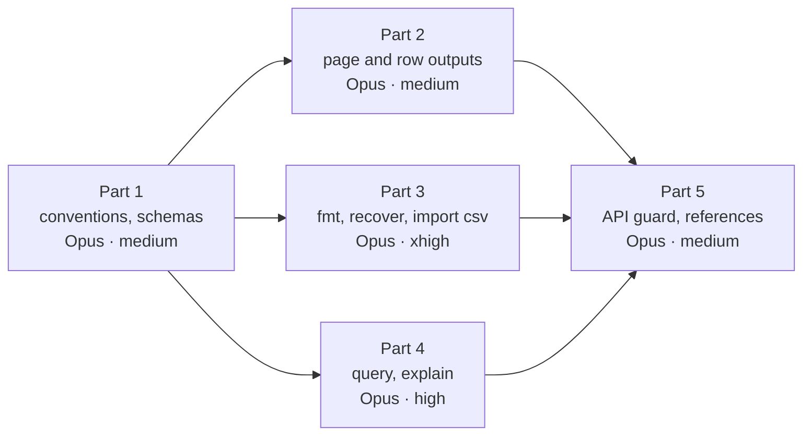

# WP-S1.22: CLI surface and API stability guard, the remaining scope (closed specification)

**Status:** specified in cycle 39 (documents only), an M2 package, for what remains after the subcommands built ahead
of it since cycle 12, in five parts: part 1 the CLI conventions and the result schemas (0.5 pw, D3 to D6), part 2 the
page and row outputs (0.4 pw, D7, D8), part 3 the format, recovery and import subcommands (0.5 pw, D9, D10), part 4
`ew query` with `--explain` and the query registry (0.5 pw, D11, D12), part 5 the API guard and the generated
references (0.4 pw, D13 to D15); part 1 first; parts 2, 3 and 4 after it in any order or side by side; part 5 last ·
**Part 1 built in cycle 39** (lane J39, decision log ID-906; CL-1 to CL-7; 17 result schemas; O1 decided: `boon` as a
dev-only validator, D5's as-built note) · **Part 2 built in cycle 40** (lane E40, decision log ID-925; OU-1 to OU-4 and OU-6 met, OU-5 built with its Linux proof recorded at the cycle's delivery; five result schemas; `--block` by ID or first folio; Golden A's `expected/png/102`, `106`, `204`, `205` and `206.png` re-blessed for OU-2's byte equality; doc 17 §3.3 and doc 18 CI-PR-05 as built; the label of §13 is `api-break`, ID-931) · **Date:** 2026-10-30 · **Work package:**
[WP-S1.22](../02-work-packages.md#wp-s122-cli-surface-and-api-stability-guard) · **Decision log:** ID-895 · **Part
of:** ElektraWatt plan, specifications

**Purpose.** WP-S1.22 has been built ahead of its package since cycle 12, one subcommand at a time, each beside the
package whose library it exposed: `ew check` (WP-S1.15), `ew sql` (WP-S1.10), `ew export cables|bom` and
`ew verify-derived` (cycle 14), `ew export pdf|svg` and `ew apply` (cycle 15), `ew lib` (WP-S1.19), `ew import qet` and
`ew import parts`, `ew project …` and `ew revision …`, and the generated command and rule pages of `cargo xtask
docs-gen` (cycle 16). What it never had is a specification of the rest: one convention for `--project` and `--json`,
published result schemas, the missing MVP subcommands of doc 17 §3.3, `ew query --explain`, and the compatibility
guard of NFR-MAINT-10. This document closes that. It is written against the code at `4772bf49` (§2.1). Where this
document and a design document differ, this document is the narrower and wins for the lanes; the design documents stay
the target and are updated at the design pass after each part (§13). A choice a lane meets that this document does not
settle is escalated, never guessed (`CLAUDE.md`, rule 2).

---

**Contents**
1. [Goal and non-goals](#1-goal-and-non-goals)
2. [Inputs and the code as it is](#2-inputs-and-the-code-as-it-is)
3. [Requirements traced](#3-requirements-traced)
4. [Decisions](#4-decisions)
5. [Part 1: CLI conventions and result schemas](#5-part-1-cli-conventions-and-result-schemas)
6. [Part 2: page and row outputs](#6-part-2-page-and-row-outputs)
7. [Part 3: format, recovery and import](#7-part-3-format-recovery-and-import)
8. [Part 4: `ew query`, `--explain` and the query registry](#8-part-4-ew-query---explain-and-the-query-registry)
9. [Part 5: the API guard and the generated references](#9-part-5-the-api-guard-and-the-generated-references)
10. [Files owned and what a lane may not decide](#10-files-owned-and-what-a-lane-may-not-decide)
11. [Risks](#11-risks)
12. [Size, order and routing](#12-size-order-and-routing)
13. [Open decisions, follow-ups and the documents to update](#13-open-decisions-follow-ups-and-the-documents-to-update)
14. [Sources](#sources)

---

## 1. Goal and non-goals

**Goal.** At the end of the package every MVP subcommand of doc 17 §3.3 that this package owns runs headless on
Golden A with the conventions of doc 17 §3.1 (`--project`, `--json` with a published `ew.<command>-result/1` schema,
the exit codes of §3.2); `ew render --page 103 --png` equals the golden PNG and runs in the headless container
(NFR-PLAT-04); `ew export report --block 908 --format csv` writes the 56 PLC rows; `ew fmt --check` exits 0 on the
canonical golden project and 1 after a record-order hand edit; `ew query device_tag tag:-101F1 --explain` names its
dependencies; `ew check --scheme pre-delivery --json` on Golden A with W-1 validates against its schema, exits 1 and
reports the built packs' rows of `findings_mvp.csv` (AC-21 as far as the packs exist); and a CI job fails a change that
breaks a published surface without a release-note line (NFR-MAINT-10), with the CLI, query, `api_v1` and format
references generated and checked for staleness (NFR-DOC-06).

**Non-goals** (each with its package):
- No `ew diff`, `ew upgrade`, `ew merge-driver`, `ew git setup` or `ew fmt --repair` (WP-S1.17 builds each with its
  library; FR-EXT-008's diff and upgrade, FR-COL-013). No `ew print` (WP-S3.07, FR-EXT-009). No `ew mcp` (WP-S1.23).
  No jobsets (WP-S1.32). No `ew script run` (1.0). Each joins the conventions of part 1 and the snapshot of part 5 when
  its package builds it (D2).
- No XLSX output (`ew export … --format xlsx`, `ew sql --format xlsx`): the writer is FT-61's (WP-S3.06), so FT-218
  and FT-241's XLSX half stay open (D2).
- No `--omit-personal-data` (FR-OUT-025, WP-S3.04; FT-255) and no `--lang` for page exports (FT-250, WP-S3.04): the
  library side is not built; the flags stay usage errors.
- No `ew check` options of FT-191 (`--gate`, `--integrity`, `--pages`, `--structure`, `--packs-as-of`,
  `--baseline`, JUnit, SARIF; WP-S1.15, WP-S1.30).
- No MCP tool-list snapshot (WP-S1.23), no WIT diff (1.x), no semver check of the permissive crates (open decision
  O2).
- No change to any exported byte of Golden A, to the project format or to a command's parameters.

## 2. Inputs and the code as it is

| Input | What the lanes take from it |
|---|---|
| [Extensibility](../../design/17-extensibility.md) §3.1 to §3.5, §11 | The conventions, the exit codes, the catalogue, the golden examples and `ew query --explain`'s output, command logs, the surfaces and their guards |
| [Quality](../../design/18-quality-security-release.md) §5.2 | CI-PR-05 (the headless container) and CI-PR-14 (the API guard) |
| [Project format](../../design/05-project-format-and-persistence.md) §3, §5, §7, §8 | The canonical encoding and line order, the save protocol, the lock, the journal and recovery (`ew fmt`, `ew recover`) |
| [Golden project](../../design/20-golden-project.md) §3.1, §11, §18.1, §22 | The acceptance CSVs, folio 908, `findings_mvp.csv`, AC-21 |
| ADR-0002, ADR-0011, ADR-0017, ADR-0024 | The memo engine (`--explain`), format versioning, `api_v1`, the permissive tool boundary (`xtask`) |
| Specifications | [WP-S1.16](WP-S1.16-mvp-rule-packs.md) D10 (the AC-21 subset), [WP-S1.21](WP-S1.21-plc-and-bus-model.md) (FT-721's tag forms) |
| Follow-ups | FT-27, FT-171, FT-191, FT-200, FT-218, FT-241, FT-247, FT-248, FT-249, FT-252, FT-253, FT-254, FT-255 |

### 2.1 What exists at `4772bf49` (the base contract)

The lanes rely on exactly these items. If one differs, the lane stops and reports it.

| Item | Where | Used here for |
|---|---|---|
| The hand-written parser, `Command` enum and `USAGE` text of every subcommand (no `clap`) | `bin/ew/src/cli.rs` (3,872 lines), `bin/ew/src/main.rs` | Every part |
| The CLI tests through `bin_exe()`, among them the PDF digest of G-M1-01 and the check, SQL and lib JSON | `bin/ew/tests/cli.rs` | Every part's tests |
| `ew.check-result/1` (`report::to_json`, hand-built `serde_json`) and `ew.sql-result/1` (`RowSet::to_json`) | `crates/ew-checks/src/report.rs`, `crates/ew-sqlview/src/result.rs` | Part 1 types them |
| `ew lib list --json` and `ew lib search --json` print a bare JSON array with no `$schema` | `bin/ew/src/cli.rs` (`LibAction::List`) | Part 1 (D3) |
| `--project` on `import parts`, `sql` and `sql dump` only, refused together with a positional directory | `bin/ew/src/cli.rs` | Part 1 extends it |
| The command-parameter schemas and `index.json`, an equality snapshot blessed with `EW_COMMANDS_BLESS=1` | `crates/ew-commands/schemas/`, `crates/ew-commands/tests/schemas.rs` | Part 5's command snapshot |
| `cargo xtask docs-gen [--check]`: command pages and rule pages from data files, linking no GPL crate | `xtask/src/docs_gen.rs`; `docs/book/src/reference/{commands,rules}/` | Part 5 adds pages |
| The `api_v1` views and columns (`VIEWS`, `PREVIEW_ADDITIONS`) and `schema_text()` for `ew sql schema` | `crates/ew-sqlview/src/schema.rs` | Part 5's column snapshot |
| `Session::run_script`, `CmdLogError::exit_code`, `Session::diff_from` | `crates/ew-api/src/cmdlog.rs` | Part 3 (FT-253) |
| `Store::recovery`, `Store::recover` | `crates/ew-store/src/store.rs` | Part 3 (`ew recover`) |
| The CPU renderer and its PNG encoder; the golden PNGs at 150 dpi (`expected/png/<folio>.png`), made by the test helper `page_png` | `crates/ew-render-cpu/src/`; `crates/ew-api/tests/page_output/golden_files.rs`; `golden/J-E-2416/expected/png/` | Part 2 (`ew render`, `ew export png`) |
| The report row sources and the golden CSV dialect (`ew_reports::export`, `ew_reports::csv`); `wire_list`, `terminal_diagram`, `plc_overview` kinds | `crates/ew-reports/src/` | Part 2 |
| The tables importer with `ImportContext.mode` (strict, lenient) | `crates/ew-import-tables/` | Part 3 (FT-27) |
| The memo families (`ew_derive::FAMILIES`, `ew_reports::FAMILIES`), the memo store's private dependency trail (`memo_trail`, used for oracle mismatches) | `crates/ew-derive/src/lib.rs`, `crates/ew-memo/src/store.rs` | Part 4 |
| The property rows' `via` provenance chains | `crates/ew-api/src/output/properties.rs` | Part 4's provenance lines |
| The AC-21 built-pack comparison (`ac21_four_pack_subset_equals_findings_mvp_csv`) and `findings_mvp.csv` with its `pending` column (rows pending WP-S1.20, WP-S1.21 part 4 and WP-S4.01) | `crates/ew-api/tests/checks_part5.rs`, `crates/ew-api/tests/expected/findings_mvp.csv` | Part 1 (AC-21 through the CLI) |
| CI-PR-05: `ew export pdf` in a bare Linux container, digest compared | `.github/workflows/ci.yml`, `ci/headless-export.sh` | Part 2 adds `ew render` |
| The RFC-reference step for `format-major`, `api-break` and `licence` pull requests | `.github/workflows/docs.yml` | Part 5 (D14) |

### 2.2 The code against the package's scope

| Scope item | State at `4772bf49` | Delivered by |
|---|---|---|
| `ew export` pdf, svg, bom, cables | Built (cycles 14, 15) | — |
| `ew export` png, wires, terminals, report; `--block` | Not built (FT-254, FT-241) | Part 2 |
| `ew render --page --png` | Not built | Part 2 |
| `ew query <name> <key> [--json] [--explain]` | Not built; no named query registry | Part 4 |
| `ew verify-derived` | Built (cycle 14); `--json` not built | Part 1 (`--json`) |
| `ew import` qet, parts | Built (cycles 11, 27) | — |
| `ew import csv` | Library only (FT-27) | Part 3 |
| `ew diff`, `ew upgrade` | Not built; the library is WP-S1.17's | WP-S1.17 (D2) |
| `ew fmt [--check]` | Not built | Part 3 |
| `ew apply` | Built (cycle 15); `--project`, `--json` (FT-249), FT-253's test open | Parts 1, 3 |
| `ew print` | Not built; `ew-print` is an empty crate | WP-S3.07 (D2) |
| `ew recover` | Not built (FT-252); the store function exists | Part 3 |
| `--json` with published schemas | Partly: `check` and `sql` print `$schema` objects with no schema file; `lib` prints a bare array; the others have none | Part 1 |
| Snapshots of the command, query and CLI registries (the guard) | Partly: the command-parameter schemas are an equality snapshot; no query, CLI, result-schema or `api_v1` snapshot, no breaking-change classification, no CI-PR-14 job | Parts 4, 5 |
| Generated reference docs | Partly: command and rule pages; no CLI, `api_v1`, query or format pages | Part 5 |
| AC-21 | Partly: the built packs' subset is compared in `ew-api`'s tests, not through the CLI; the full comparison waits for the pending rows' packages | Part 1 |

## 3. Requirements traced

The 12 rows of the package. "Built" names the cycle that delivered the row's part; the rest are delivered here.

| Requirement | What this package delivers | Part | Acceptance |
|---|---|---|---|
| FR-EXT-001 | Built in part (the CLI runs `Session` headless since cycle 12); the remaining MVP subcommands of this package | 1 to 4 | CL-1, OU-1 |
| FR-EXT-003 | Built: pdf, svg, bom, cables; here png, wires, terminals, report; XLSX with WP-S3.06 | 2 | OU-2 to OU-4 |
| FR-EXT-004 | `ew render --page <folio> --png [--dpi <n>]` | 2 | OU-1 |
| FR-EXT-005 | Built: `ew verify-derived`; here `ew query` with `--explain` | 4 | QU-1 to QU-4 |
| FR-EXT-008 | Built: `ew import qet`; here `ew import csv` and `ew fmt [--check]`; diff and upgrade with WP-S1.17 | 3 | FM-1 to FM-3, FM-6 |
| FR-EXT-009 | Not here: `ew print` with WP-S3.07's adapters (D2) | — | — |
| FR-EXT-024 | `--json` on every result-printing subcommand with a published schema | 1 | CL-2 to CL-5 |
| FR-EXT-027 | `ew export report --block <name or id> --format csv\|pdf`; XLSX with WP-S3.06 | 2 | OU-3 |
| FR-EXT-029 | Built (cycle 15); `--project`, `--json` (FT-249) and FT-253's journal test | 1, 3 | CL-1, FM-5 |
| NFR-MAINT-10 | The snapshots, the breaking-change classifier and CI-PR-14 | 4, 5 | QU-5, AG-1 to AG-5 |
| NFR-DOC-06 | The CLI, query, `api_v1` and format references generated with a staleness check; the keymap sheets with WP-S2.08 part 2 | 5 | AG-6 |
| NFR-PLAT-04 | `ew render --page 103 --png` in the container job of CI-PR-05 beside `ew export pdf` | 2 | OU-5 |
| (AC-21) | `ew check --scheme pre-delivery --json` on Golden A with W-1 through the CLI | 1 | CL-6 |

## 4. Decisions

Each is a lead ruling that the owner may reverse. The design pass records them under ID-895 (and the as-built entries
after each part).

| # | Decision | Reason and trade-off |
|---|---|---|
| D1 | **Remaining scope only.** The work built ahead since cycle 12 is taken as **0.8 pw** of the 3.1 pw PERT (an estimate: most of it was paid by the packages whose libraries it exposed); the five parts fill the remaining **2.3 pw** with no reserve and the de-scope rule of §12. The CSV is unchanged | The package was built in slices; a spec of the rest is what the lanes need |
| D2 | **Ownership by library.** A subcommand whose library belongs to another package is built by that package, with its CLI: `ew diff`, `ew upgrade`, `ew merge-driver`, `ew git setup`, `ew fmt --repair` (WP-S1.17), `ew print` (WP-S3.07), `ew mcp` (WP-S1.23), XLSX formats (FT-61's writer, WP-S3.06), `--omit-personal-data` (FR-OUT-025, WP-S3.04) and the page exports' `--lang` (FT-250). Each follows part 1's conventions and enters part 5's snapshot through the CLI table (D4) when it lands. `ew export png` (FT-254, assigned to WP-S3.04) is taken here, because `ew render` and it share one function | No subcommand is specified twice; the library's package knows its semantics |
| D3 | **The conventions** (doc 17 §3.1). (a) Every subcommand that reads or writes one project takes the project as its first positional argument or `--project <dir>`, never both (the existing message "`--project` cannot be combined with a positional project directory"), else the nearest ancestor holding `manifest.json`. (b) Every subcommand that prints a result takes `--json`: stdout is one JSON object whose first member is `"$schema": "ew.<command>-result/1"` (the command's words joined by `-`: `ew.export-pdf-result/1`, `ew.lib-list-result/1`), diagnostics stay on stderr, exit codes unchanged. (c) Where `--format json` exists (`check`, `sql`), `--json` is its alias; `--json` with another `--format` is a usage error. (d) `ew lib list --json` and `ew lib search --json` change from a bare array to `{"$schema", "libraries" | "hits": […]}`: a breaking change of a Preview surface, allowed before 1.0 with a release note (doc 17 §11) | One rule a script can rely on; the `lib` change is the only break and is cheapest now |
| D4 | **The CLI table.** `bin/ew/src/catalogue.rs` holds one entry per subcommand path (`["export", "pdf"]`): its flags (name, takes a value, repeatable), its exit codes with their meaning, its result schema name or none, and `stability: preview`. A test asserts that each `USAGE` synopsis line names exactly the flags of its entry. The table is the source of the CLI snapshot (D13) and the CLI reference (D15); the parser stays hand-written | The guard needs structured data; deriving it from prose would be brittle; a parser rewrite is out of scope |
| D5 | **Result schemas from types.** Each result is a `serde` struct with `schemars::JsonSchema` and `#[serde(deny_unknown_fields)]`, in the crate that builds it today (`ew-checks` for `check`, `ew-sqlview` for `sql`, `ew-api` module `cli_results` for the rest). A test writes `bin/ew/schemas/<schema>.schema.json` (`ew.check-result/1` → `ew.check-result-1.schema.json`) and `bin/ew/schemas/index.json`, equality-checked and blessed with `EW_CLI_BLESS=1`. "Validates against its published schema" (FR-EXT-024's acceptance) is asserted by deserialising the printed output into the type and re-serialising it byte-equal. `schemars` 1.2.3 is in `Cargo.lock` already (a direct dependency of `ew-commands` and `ew-schema`); its new direct dependents add no crate. An independent JSON Schema validator is open decision O1. *As built (cycle 39, ID-906):* O1 is decided: `boon` =0.6.1 (MIT OR Apache-2.0) is a dev-dependency of `bin/ew` only and validates every `--json` output against its schema file beside the round trip; "no new crate" holds for the product, while `Cargo.lock` gains 8 dev-only crates (`boon`, `appendlist`, `borrow-or-share`, `fluent-uri`, `form_urlencoded`, `idna`, `idna_adapter`, `url`); `borrow-or-share` is licensed MIT-0, accepted for a dev-only dependency and stated in `deny.toml`, not added to the global allow list | No new crate; the type is the schema, so they cannot drift |
| D6 | **Registry subcommands.** `ew commands [--json]` prints the command registry (the `index.json` entries: name, aliases, `params_version`, cost, exposure, confirmation, undoable, stability); `ew schema <name>` prints a command's parameter schema, or a result schema when `<name>` is an `ew.<…>-result/<n>` name; an unknown name exits 2 naming it | Doc 17 §3.3's Inspect row; the data exists |
| D7 | **Page raster.** `ew render [<project>] --page <folio> --png [--dpi <n>] [--out <file>]` renders one page through `ew-render-cpu` with the bundled fonts at 150 dpi by default (the golden PNGs' resolution), `--dpi` 72 to 600; without `--out` the PNG goes to `<folio>.png` in the working directory, never to stdout. `ew export png [<project>] --out <dir> [--pages <folios>] [--dpi <n>] [--threads <n>]` writes one `<folio>.png` per page with `ew export svg`'s directory rule (replaced as a whole; PNG files only). Both use one library function `ew_api::output::page_png` (the test helper moved), so the PNG bytes equal the golden files'. Exit 0, or 2 for usage, open, an unknown folio, writer and I/O errors | One path for the CLI, the golden test and the container job |
| D8 | **Row exports.** `ew export wires` (block kind `wire_list`, golden 907) and `ew export terminals [--strip <tag>]` (kind `terminal_diagram`, golden 903 to 905; without `--strip` every strip, each strip's rows after a heading row) in the golden CSV dialect; `--block <name or id>` on `bom`, `cables`, `wires`, `terminals` (a block of the wrong kind exits 2 naming its kind); `ew export report --block <name or id> --format csv\|pdf`: CSV through `ew_reports::export`, PDF through the page export restricted to the block's folios. `--format xlsx` stays a usage error naming FT-61 | FT-241's CSV half; FR-EXT-027 at MVP without the XLSX writer |
| D9 | **`ew fmt`.** `ew fmt [<project>] --check` (a reader: no lock) reads every project file, re-serialises its records in the canonical encoding and line order (doc 05 §3; `ew-format`), and exits 0 when every file is byte-equal, 1 listing each differing file, 2 on open errors; quarantined or unknown lines are reported, never dropped. `ew fmt [<project>]` (a writer: the lock) rewrites the differing files through the save protocol and exits 0; it refuses a project with a crashed session's journal (exit 2, as `ew apply`). It never changes a record's content, only order and form; a file whose records do not survive the round trip byte-for-byte in content is refused (exit 2). `--repair` stays with WP-S1.17 (D2) | FR-EXT-008's acceptance; the format's canonical form already exists in the save path |
| D10 | **`ew recover` and the readers' retry.** `ew recover [<project>] --replay\|--discard` (a writer; FT-252): `--replay` replays the journal through `Store::recover` and saves; `--discard` deletes the journal after printing its summary (the number of transactions and their labels) and asks for the typed word `discard` on a controlling terminal, exit 2 without one (like `project assets purge`); with neither flag it prints the summary and exits 0. Exit 0 done, 1 refused or not confirmed, 2 on usage, lock, open and save errors. **The readers' retry** (FT-200): `check`, `export`, `render`, `query`, `sql`, `verify-derived` and `fmt --check` retry the open for up to 5 s at 100 ms steps while the store reports a save in progress, then exit 2 naming it | Doc 17 §3.1 and §3.5 as written; discarding a journal loses work, so it is human-only like the other destructive subcommands |
| D11 | **The query registry.** `ew_api::queries::REGISTRY` lists the public queries, each with a name, a key grammar, an output type (`serde` and `schemars`, D5's rule) and `output_version: 1`. The MVP set is closed: `device_tag` (key `tag:`/`id:` of a device; full and displayed designations), `displayed_tag` (a device and a folio), `page_order` (no key, `-`; the folio list), `cell_of` (a function; folio and cell), `potential_name` (a wire or connection point by `id:`, or a potential by name), `wire_props_of` (a wire; cross-section, colour, each with its `via`), `xref_text_of` (a function), `channel_addresses` (a module by FT-721's `<module tag>`), `plc_address_text` (a function), `wire_numbers` (a page by `folio:`), `title_block` (a page by `folio:`), `bom_rows` (no key, `-`). Keys use the `.ewcmd` reference grammar (`tag:`, `id:`, `folio:`), resolved by `Session::resolve_reference`. `ew queries [--json]` lists the registry | A closed set keeps the snapshot meaningful; every entry has a golden example; more queries are additive later |
| D12 | **`--explain`.** `ew-memo` gains a public read-only `Store::explain(family, key) -> Explain` (policy, `verified_at`, `changed_at`, whether the read was a hit, and the dependency lines `memo_trail` already renders, bounded to 64 lines with an ellipsis); `ew query … --explain` prints the value, then `policy`, `depends on` (memo dependencies by family and described key; inputs by record kind and printed tag, folio or ID) and `provenance` (the property row's `via` chain where the query backs a property-grid row: `device_tag`, `wire_props_of`, `cell_of`; else no line). No wall-clock time is printed (doc 17 §3.1, determinism); revisions are the session's, so one fresh open prints one text. The file paths of doc 17 §3.4's example are not printed at MVP (proposed follow-up) | The trail exists for the oracle; making it public is a small, read-only change to a core crate |
| D13 | **The snapshots.** Five committed data files, each an equality snapshot regenerated by its test with a bless flag: the command registry (`crates/ew-commands/schemas/`, exists), the CLI (`bin/ew/api/cli.json` from D4's table), the result schemas (`bin/ew/schemas/`, D5), the query registry (`crates/ew-api/api/queries.json`: name, key grammar, output schema), and the `api_v1` columns (`crates/ew-sqlview/api/api_v1.json`: view, column, SQL type, preview flag) | Each beside its owner, read as data by the permissive `xtask` like `docs-gen` |
| D14 | **The guard** (NFR-MAINT-10, CI-PR-14). `cargo xtask api-guard [--base <rev>]` compares each snapshot at `<base>` (default: the merge base with `origin/main` on a pull request, `HEAD^` on a push) with the working tree and classifies each change: **breaking** is a removed or renamed command, query, subcommand, flag, view or column, a removed result or query output property, a changed type or `params_version` lowered, a changed exit-code meaning; **additive** is everything else. Before 1.0 every surface is Preview (doc 17 §11): a breaking change passes only when `docs/release-notes/unreleased.md` gains, in the same diff, a line `api-break: <surface> <item>` for each break; from 1.0 (`FROZEN` in the xtask, flipped at the 1.0 freeze) it also needs the `api-break` label and an ADR reference on the pull request (NFR-MAINT-10), checked by the workflow step. The job runs on pushes and pull requests in `ci.yml`. The label is the one of NFR-MAINT-10 and doc 17 §11; doc 18's CI-PR-14 row says `api-change` (a proposed fix of doc 18, §13) | The owner pushes to `main`, so a label-only guard would never run; the release-note line works on both paths and is the pre-1.0 rule as doc 17 states it |
| D15 | **The generated references** (NFR-DOC-06): `docs-gen` gains the CLI reference (`reference/cli/`, one page per subcommand group from `cli.json` and the result schemas), the query reference (`reference/queries.md` from `queries.json`), the `api_v1` view reference (`reference/api-v1.md` from `api_v1.json`) and the format reference (`reference/format/`, one page per record kind from `schemas/0.1/*.schema.json`); the WIT docs are 1.x and the keymap sheets WP-S2.08 part 2's | The same data-file pattern as the command and rule pages; `--check` covers them |
| D16 | **Parts 2 to 5 in the detail they need now.** Part 1 is closed to the flag; later parts are closed to their items, decisions and acceptance; each part is re-read against the delivered earlier parts at dispatch without reopening D1 to D15 | Part 1 dispatches first; the rest depend on its table and types |

No decision changes an ADR.

## 5. Part 1: CLI conventions and result schemas

**Scope.** D3 to D6, FT-249, AC-21 through the CLI. **0.5 pw.**

**Build list.**
1. `bin/ew/src/catalogue.rs`: the CLI table of D4 for every subcommand of `USAGE` at `4772bf49`, with the test that ties
   `USAGE`'s synopsis lines to it.
2. `--project` and `--json` on every subcommand per D3 (FT-249), in `bin/ew/src/cli.rs`; the `lib` JSON change of
   D3 (d) with a line in `docs/release-notes/unreleased.md` (created here, one heading and the line).
3. The result types of D5 and the schema files under `bin/ew/schemas/` with their test (`EW_CLI_BLESS=1`).
4. `ew commands [--json]` and `ew schema <name>` (D6).
5. The AC-21 CLI test (CL-6) in `bin/ew/tests/cli.rs`.

**Acceptance.**
- **CL-1** For every subcommand of the table that takes a project, the positional directory and `--project <dir>` give
  equal stdout and exit codes on Golden A's copy; both together exit 2 with D3's message; `ew apply --project <dir>
  <file.ewcmd>` replays as the positional form does (FT-249).
- **CL-2** For every result-printing subcommand, `--json` prints one object whose `$schema` names a file of
  `bin/ew/schemas/index.json`; the output deserialises into its type with `deny_unknown_fields` and re-serialises
  byte-equal (FR-EXT-024's acceptance: `ew check --json` validates against its published schema).
- **CL-3** `ew check --json --format md` exits 2; `ew check --json` equals `ew check --format json` byte for byte.
- **CL-4** `ew lib list --json` prints `{"$schema": "ew.lib-list-result/1", "libraries": […]}`; the release-note line
  exists.
- **CL-5** `ew commands --json` lists as many entries as `crates/ew-commands/schemas/index.json`, in its order;
  `ew schema fields.set` prints that schema file byte-equal; `ew schema ew.check-result/1` prints the result schema;
  `ew schema no.such` exits 2 naming it.
- **CL-6 (AC-21 through the CLI)** On Golden A's copy with W-1 (`ac21`'s fixture), `ew check --scheme pre-delivery
  --json` exits 1, and its findings of the built packs (EW-CORE, EW-IEC81346, EW-TERM, EW-POT, EW-PLC) equal the
  non-pending rows of `findings_mvp.csv` with FT-638's known excess, as the `ew-api` test asserts; the pending rows are
  listed by package in the test's output. The full equality (doc 20 §18.1: 42 errors, 32 warnings, 31 infos, 1
  waived) is asserted when the last pending package lands; the test then drops its pending list.
- **CL-7** Twice-run determinism of every `--json` output; `cargo nextest run -p ew -p ew-api -p ew-checks -p
  ew-sqlview`, the matching clippy and `cargo fmt --all --check`; `cargo xtask check-deps`.

## 6. Part 2: page and row outputs

**Scope.** D7, D8, FT-241's CSV half, FT-254, NFR-PLAT-04's render row. **0.4 pw.**

**Acceptance.** **OU-1** `ew render golden/J-E-2416.ew --page 103 --png --out 103.png` writes bytes equal to
`expected/png/103.png` (FR-EXT-004; the criterion of doc 20 is within the visual-diff tolerance, and equal bytes are
expected because the path is one); `--dpi 300` doubles both pixel dimensions; `--page 999` exits 2 naming it.
**OU-2** `ew export png --out <dir>` writes one PNG per folio of Golden A, each equal to its committed PNG, in 1 and 4
threads (`--threads` changes speed only); a non-PNG file in `<dir>` exits 2 (FT-254). **OU-3** `ew export report
--block 908 --format csv` writes the 56 channel rows of folios 908 to 908.2 (FR-EXT-027; doc 20 §11.3); `--format pdf`
writes a PDF of folios 908, 908.1 and 908.2 only; `--format xlsx` exits 2 naming FT-61. **OU-4** `ew export wires`
equals `expected/csv/wires.csv` (44 wires and 6 bridges); `ew export terminals --strip -X1031` equals
`expected/csv/terminals_X1031.csv`, and without `--strip` the three strips 1X1, -X1031 and -X1032 (3, 20 and 5 rows);
`ew export bom --block <id of 901>` equals the default. **OU-5** CI-PR-05 runs `ew render --page 103 --png` in the
container and compares the digest with `expected/png/103.png`'s (NFR-PLAT-04). **OU-6** `--json` results for each new
subcommand (part 1's rule); targeted checks for `ew`, `ew-api`, `ew-reports`.

## 7. Part 3: format, recovery and import

**Scope.** D9, D10, FT-27, FT-200, FT-252, FT-253. **0.5 pw.**

**Acceptance.** **FM-1** `ew fmt --check` on Golden A's copy exits 0 (FR-EXT-008); after swapping two lines of
`devices/<file>.jsonl` it exits 1 naming that file; `ew fmt` then rewrites it, `ew fmt --check` exits 0 and the files
equal the original bytes. **FM-2** A line with an unknown member survives `ew fmt` verbatim (ADR-0011's preservation);
a quarantined line is reported and kept. **FM-3** `ew fmt` on a project with a crashed session's journal exits 2 and
writes nothing. **FM-4** `ew recover` prints the journal's summary; `--replay` saves the journal's transactions and
removes it; `--discard` without a terminal exits 2 and changes nothing, with a terminal and a wrong word exits 1 (FT-252;
the test-build confirmation hook of FT-369). **FM-5** `ew apply` on a project with another session's journal exits 2
and the journal is still there afterwards; `Session::close` deletes only its own journal (FT-253). **FM-6** `ew import
csv <tables-dir> --out <new project dir> [--strict|--lenient]` (a writer of a new project; `--out` absent or empty)
imports `golden/J-E-2416/tables/` to a project that opens, holds the record counts the tables bootstrap gives in
`crates/ew-api/tests/golden_csv.rs`, and checks with the same findings as that bootstrapped model (FT-27); a refused
table row is reported as the library reports it (EW-IMP-002 under `--strict`, ID-375), and an unreadable table exits 2
with its line and column. Whether the written project equals `golden/J-E-2416.ew` byte for byte is reported, not
required. **FM-7** A reader started while a save is in progress (a test hook holds the save) waits and
succeeds when the save ends within 5 s, and exits 2 naming the save after 5 s (FT-200). **FM-8** Targeted checks for
`ew`, `ew-api`, `ew-store`, `ew-format`, `ew-import-tables`.

## 8. Part 4: `ew query`, `--explain` and the query registry

**Scope.** D11, D12, the query snapshot of D13. **0.5 pw.**

**Acceptance.** **QU-1** `ew query device_tag tag:-101F1` prints `=P01+J-E-2416-101F1` and the displayed `-101F1`
(FR-EXT-005); `--json` prints `ew.query-result/1` with the query's output object. **QU-2** `--explain` adds the
policy line, a `depends on` block naming the tag specification, the identifier set, the numbering rule, the main
representation (folio 101) and the structure (`=P01`, `+J-E-2416`), and a `provenance` line from the tag row's `via`
(FR-EXT-005's acceptance; doc 17 §3.4's example without the time and the file paths). **QU-3** Each registry entry
answers its golden example: `page_order -` 36 folios in order; `cell_of` of -101F1's main function folio 101 and its
cell; `channel_addresses` of -201U5 eight addresses; `wire_numbers folio:102` the folio's numbers; an unresolvable
key exits 2 with the replay's message. **QU-4** Two runs print the same text; `--explain` changes no memo state
(`ew verify-derived` after it reports zero differences). **QU-5** `crates/ew-api/api/queries.json` lists the twelve
entries with their output schemas (equality snapshot); `ew queries --json` prints it. **QU-6** Targeted checks for
`ew-memo`, `ew-api`, `ew`.

## 9. Part 5: the API guard and the generated references

**Scope.** D13 to D15, CI-PR-14. **0.4 pw.**

**Acceptance.** **AG-1** The CLI and `api_v1` snapshots exist and are equality-checked by their crates' tests (a
blessed change passes, an unblessed one fails). **AG-2** On a fixture repository (a test with two committed snapshot
states), `cargo xtask api-guard --base <rev>` reports: a removed command as breaking, a renamed `api_v1_wire` column as
breaking (NFR-MAINT-10's acceptance), a new flag as additive, a new query as additive. **AG-3** A breaking change
fails without the release-note line and passes with `api-break: api_v1 api_v1_wire.<column>` in
`docs/release-notes/unreleased.md`. **AG-4** With `FROZEN` set (a unit test), the same change also needs the label and
an ADR reference (the workflow's inputs are read from the event file, as docs.yml's RFC step does). **AG-5** The
`api-guard` job runs in `ci.yml` on push and pull request, after the build of the snapshot data (no GPL crate linked
by `xtask`); `cargo xtask check-workflows` passes. **AG-6** `cargo xtask docs-gen --check` covers the CLI, query,
`api_v1` and format pages; a changed flag without regeneration fails it (NFR-DOC-06). **AG-7** Targeted checks for
`xtask`, `ew`, `ew-sqlview`; `reuse lint` for the new files.

## 10. Files owned and what a lane may not decide

### 10.1 Files owned

**Part 1:** `bin/ew/**`, `crates/ew-api/src/cli_results.rs` (new) and its `lib.rs` line, `crates/ew-checks/src/report.rs`,
`crates/ew-sqlview/src/result.rs`, the `schemars` lines of those crates' `Cargo.toml`, `docs/release-notes/unreleased.md`
(new). **Part 2:** `bin/ew/**`, `crates/ew-api/src/output/**`, the moved helper in `crates/ew-api/tests/page_output/`,
`ci/headless-export.sh` and CI-PR-05's job in `.github/workflows/ci.yml`. **Part 3:** `bin/ew/**`, the reader-retry and
fmt functions in `crates/ew-api/src/`, `crates/ew-store/src/` (only a canonical-rewrite entry and the save-in-progress
probe), `crates/ew-format/src/` (only if the canonical form needs a public helper). **Part 4:** `crates/ew-memo/src/`
(only `Store::explain` and its types), `crates/ew-api/src/queries.rs` (new), `crates/ew-api/api/`, `bin/ew/**`.
**Part 5:** `xtask/src/api_guard.rs` (new), `xtask/src/docs_gen.rs`, `xtask/src/main.rs`, `crates/ew-sqlview/api/`,
`crates/ew-sqlview/tests/` (the snapshot test), `docs/book/src/reference/**` and `SUMMARY.md` (generated),
`.github/workflows/ci.yml` (the job), `REUSE.toml` (the new data paths).

Shared append-only files (registry lists, `REUSE.toml`, `docs/release-notes/unreleased.md`, `xtask/src/docs_gen.rs`'s
page lists) may be touched by other lanes; the second to integrate rebases. Read-only for every lane: other crates,
`golden/**`, `schemas/**`, `docs/**` except the generated reference pages and the release-note file. Each lane commits
on its own branch and does not merge or push.

### 10.2 What a lane may not decide

A lane stops and reports instead of choosing when:
1. a change needs a new workspace package, a new edge in `ci/dep-rules.toml` or a crate not in `Cargo.lock`;
2. an exported byte of Golden A, a project file or a command's parameters would change;
3. a published output changes in a way D3 (d) does not name (any other break of an existing subcommand's text, JSON or
   exit code);
4. a golden fact here (the 56 rows of 908, 44 wires and 6 bridges, the strips' 3, 20 and 5 rows, folio 103's PNG
   bytes, AC-21's rows) is contradicted by the data;
5. `ew fmt` would drop, reorder within a record, or rewrite the content of any line;
6. a query beyond D11's twelve, a subcommand beyond this document's, or a mutating method on `ew-memo` would be added;
7. the work of a later part, or of a package of D2, is reached (D16).

The lane decides freely: private helper names, module layout inside the owned files, the exact human-readable texts
beyond those quoted here, test fixtures.

## 11. Risks

| Risk | Likelihood · impact | Mitigation |
|---|---|---|
| R1 The `lib` JSON change breaks a user's script | Low · low | Preview surface; the release note; the only break (§10.2 item 3) |
| R2 The container's PNG differs from the committed bytes (a float or font path) | Medium · medium | OU-5 stops the lane; a tolerance comparator in the container is the fallback, as a follow-up |
| R3 `ew fmt` rewrites a file it should not | Low · high | D9's round-trip refusal, FM-1 to FM-3, part 3 at `xhigh` |
| R4 `Store::explain` disturbs memo state | Low · high | Read-only by construction; QU-4 with the oracle |
| R5 The guard's classifier misses a break | Medium · medium | AG-2's fixtures per surface; the equality snapshots still force a review of every change |

## 12. Size, order and routing

**Size.** 2.3 pw of the 3.1 pw PERT (D1): part 1 **0.5** (the CLI table 0.1, `--project`/`--json` 0.15, result types
and schemas 0.15, registry subcommands and AC-21 0.1), part 2 **0.4** (render and PNG export 0.15, row and report
exports 0.15, the container row and tests 0.1), part 3 **0.5** (`ew fmt` 0.2, `ew recover` 0.1, the retry 0.1,
`ew import csv` 0.1), part 4 **0.5** (`Store::explain` 0.15, the registry and adapters 0.25, `ew query` and tests 0.1),
part 5 **0.4** (snapshots 0.1, the classifier and job 0.2, the generated pages 0.1). **De-scope rule:** when a part is
projected (at its lane's midpoint report) or found (at its review) more than 20 % over its size, these items leave as
follow-ups without a further ruling, in this order: `ew export report --format pdf`, the format reference pages, the
`provenance` lines of `--explain`, the readers' retry; the lane reports which ones left.

**Order and routing** (Opus or Haiku only, ID-700):

Part 1 first, **Opus at `medium`** (a public contract, decided here to the flag); part 2 **Opus at `medium`**; part 3
**Opus at `xhigh`** (it rewrites project files and discards journals: data loss); part 4 **Opus at `high`** (a core
crate's public API); part 5 last, **Opus at `medium`** (CI and a permissive tool). The snapshot regeneration after each
merge is mechanical upkeep for **Haiku at `low`**. **Unblocks:** WP-S1.23 (MCP) reads part 4's registry; WP-S1.17,
WP-S3.07 and WP-S3.06 add their subcommands under part 1's conventions.

## 13. Open decisions, follow-ups and the documents to update

**Open decisions** (the owner's):
- **O1** *Decided in cycle 39 by the orchestrator (decision log ID-906): `boon` =0.6.1, a dev-dependency of `bin/ew`
  only (D5's as-built note).* An independent JSON Schema validator as a dev-dependency (for example `jsonschema` or `boon`; **verify**
  version and licence), so that CL-2 validates the output against the file rather than the type. Until then D5's
  round trip is the check.
- **O2** `cargo-semver-checks` (or an equivalent) in CI for the permissive crates' public API (doc 17 §11, doc 18
  CI-PR-14; a new CI tool, supply chain). Not part of this package's parts until decided.

**Follow-ups.** FT-27 (moved here from WP-S3.05), FT-200, FT-241's CSV half, FT-249, FT-252, FT-253 and FT-254 (moved
here from WP-S3.04) close with their parts. FT-171, FT-191, FT-218, FT-241's XLSX half, FT-247, FT-248, FT-250 and
FT-255 stay with the packages named in §1 and D2. Proposed (numbered at the design pass): doc 18's CI-PR-14 row names
the label `api-change`, NFR-MAINT-10 and doc 17 §11 name `api-break` (a document fix); `--explain` with the source
file of each input (doc 17 §3.4's file column); a tolerance comparator for the container's PNG if OU-5 needs one. A
de-scoped item becomes a new FT at the design pass.

**Documents.** **After part 1:** doc 17 §3.1 (as built: the conventions, the schema files), doc 17 §3.3 (`ew commands`,
`ew schema`). **After part 2:** doc 17 §3.3 (export and render rows as built), doc 18 §5.2 (CI-PR-05's render row).
**After part 3:** doc 17 §3.3 and §3.5 (fmt, recover, import csv), doc 05 §8.2 (recovery from the CLI). **After part
4:** doc 17 §3.3 and §3.4 (`ew query` as built), doc 04's `ew-memo` row. **After part 5:** doc 17 §11 (the guard as
built), doc 18 §5.2 (CI-PR-14), the user book's reference index.

---

## Sources

- [Work breakdown](../02-work-packages.md): WP-S1.22, WP-S1.17, WP-S1.23, WP-S3.04, WP-S3.05, WP-S3.06, WP-S3.07;
  Appendix B (FT-27, FT-171, FT-191, FT-200, FT-218, FT-241, FT-247 to FT-255, FT-638).
- [Decision log](../06-decision-log.md): ID-309, ID-356, ID-357, ID-362, ID-368, ID-370, ID-403, ID-546, ID-649,
  ID-700, ID-880, ID-895.
- [Extensibility](../../design/17-extensibility.md) §3, §11; [quality](../../design/18-quality-security-release.md)
  §5.2; [project format](../../design/05-project-format-and-persistence.md) §3, §5, §7, §8;
  [golden project](../../design/20-golden-project.md) §3.1, §11, §18.1, §22.
- [ADR-0002](../../adr/0002-derived-data-engine-ew-memo.md), [ADR-0011](../../adr/0011-format-versioning-and-migration.md),
  [ADR-0017](../../adr/0017-read-only-sql-projection-api-v1.md),
  [ADR-0024](../../adr/0024-licence-set-and-permissive-gpl-boundary.md).
