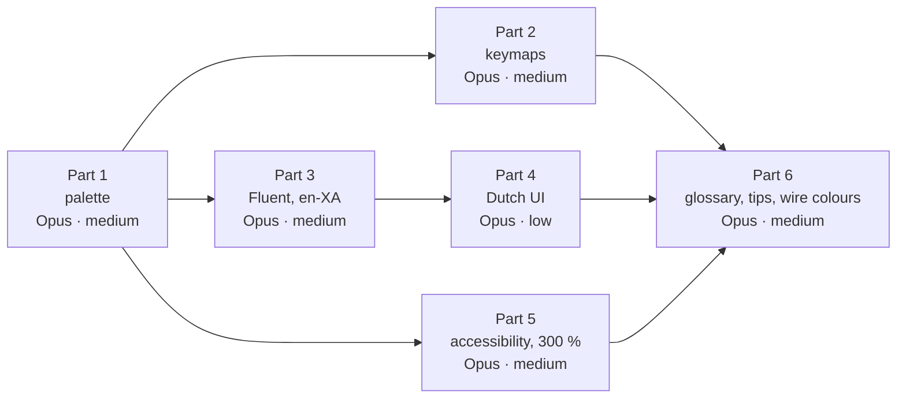

# WP-S2.08: command palette, keymaps, accessibility and UI localisation, the remaining scope (closed specification)

**Status:** specified in cycle 39 (documents only), an M2 package, for what remains after the shell (WP-S2.01), the
viewer (WP-S2.03), the editors (WP-S2.04, WP-S2.05) and the design language (WP-S2.17) built parts of it, in six parts:
part 1 the palette (0.5 pw, D2 to D5), part 2 keymaps (0.5 pw, D6 to D8), part 3 Fluent for the shell and the
pseudo-locale (0.4 pw, D9 to D11), part 4 the Dutch UI (0.2 pw, D12), part 5 accessibility and scaling (0.4 pw, D13 to
D15), part 6 the glossary panel, tips and the wire-colour view (0.4 pw, D16 to D18); part 1 first; parts 2, 3 and 5
after it in any order or side by side; part 4 after part 3; part 6 last · **Date:** 2026-10-30 · **Work package:**
[WP-S2.08](../02-work-packages.md#wp-s208-command-palette-keymaps-accessibility-and-ui-localisation) · **Decision
log:** ID-895 · **Part of:** ElektraWatt plan, specifications

**Purpose.** WP-S2.08 owns the behaviour of four cross-cutting layers: the palette, keymaps, accessibility and UI
localisation. Its look, its theming half and 4.3 pw of its estimate moved to [WP-S2.17](WP-S2.17-design-language-and-ui-polish.md)
(02's notes of 2026-10-28), and pieces of its behaviour were built by the packages that needed them: the palette's
part-1 subset (WP-S2.01), the registry's shortcut rules (WP-S2.03 to WP-S2.05), named widgets and the canvas's live
region (WP-S2.03), splitter names, the high-contrast themes and the contrast lint (WP-S2.17), Fluent messages for the
check rules with `ew check --lang` (WP-S1.16 part 5). What it never had is a specification of the rest. This document
closes that. It is written against the code at `4772bf49` (§2.1). Where this document and a design document differ,
this document is the narrower and wins for the lanes; the design documents stay the target and are updated at the
design pass after each part (§13). macOS is not a supported platform (decision log ID-880): there is no macOS keymap,
no macOS test row and no ⌘ binding to specify; the key display for macOS stays in `ew-ui` for portability only. A
choice a lane meets that this document does not settle is escalated, never guessed (`CLAUDE.md`, rule 2).

---

**Contents**
1. [Goal and non-goals](#1-goal-and-non-goals)
2. [Inputs and the code as it is](#2-inputs-and-the-code-as-it-is)
3. [Requirements traced](#3-requirements-traced)
4. [Decisions](#4-decisions)
5. [Part 1: the palette](#5-part-1-the-palette)
6. [Part 2: keymaps](#6-part-2-keymaps)
7. [Part 3: Fluent for the shell and the pseudo-locale](#7-part-3-fluent-for-the-shell-and-the-pseudo-locale)
8. [Part 4: the Dutch UI](#8-part-4-the-dutch-ui)
9. [Part 5: accessibility and scaling](#9-part-5-accessibility-and-scaling)
10. [Part 6: the glossary panel, tips and the wire-colour view](#10-part-6-the-glossary-panel-tips-and-the-wire-colour-view)
11. [Files owned and what a lane may not decide](#11-files-owned-and-what-a-lane-may-not-decide)
12. [Risks, size, order and routing](#12-risks-size-order-and-routing)
13. [Open decisions, follow-ups and the documents to update](#13-open-decisions-follow-ups-and-the-documents-to-update)
14. [Sources](#sources)

---

## 1. Goal and non-goals

**Goal.** At the end of the package a user on Golden A types "renum" in the palette and gets Renumber devices… with
Ctrl+Shift+N; "folio report" finds the interruption-point tool through a QET alias; `#103` opens folio 103 and
`:103-A1` its cell A1; the KiCad-like preset starts a wire with W and opens the properties with E; a keymap with two
equal chords in one context is refused, and every default binding is typable on QWERTY, QWERTZ and AZERTY without
AltGr; the whole shell switches to Dutch at run time and back, with no restart; a pseudo-localised build runs the core
flows with nothing clipped; selecting -102F1 announces its tag, kind and folio; the UI scales to 300 % from the
settings and the core dialogs fit at 300 % on a 3840 × 2160 display; and the four highlight slots stay
distinguishable under simulated protanopia, deuteranopia and tritanopia.

**Non-goals** (each with its package):
- No look: tokens, themes, the contrast lint, the palette's, tooltips' and menus' appearance (WP-S2.17, delivered).
- No EPLAN-like keymap, no German UI (WP-S2.14, WP-S7.07); no right-to-left locale.
- No KeyTips and no command-bar customisation (1.x, WP-S2.17's scope-out).
- No macOS keymap or override (ID-880; FT-431 withdrawn).
- No Weblate integration (NFR-I18N-01's statistics gate is a release item of WP-S6.07); the completeness gate here is a
  test over the shipped files.
- No NVDA and Orca manual run (NFR-A11Y-02's **M** row, a release item) and no WCAG scan of the documentation
  (NFR-A11Y-06, 1.0).
- No Describe page (FR-UI-046, 1.0) and no "Why?" panel (FR-UI-011, 1.0).
- No persisted view state (FT-357, FT-489: doc 16 §2.5's `view.json`, not this package's scope; re-homed at the design
  pass, §13).
- No change to any exported byte of Golden A and no change to the project format.

## 2. Inputs and the code as it is

| Input | What the lanes take from it |
|---|---|
| [UX/UI](../../design/16-ux-ui.md) §2.4, §4.2 to §4.4, §9.1, §10, §12, §15.1, §15.5, §15.6 | The registry, routing, the palette, keymaps, first run, accessibility, localisation, the palette ranking, the keymap rules, the colour-vision test |
| [Design language](../../design/16a-design-language.md) §6.14, §4.6 | The palette's look (built), the highlight hues |
| [Glossary](../../design/glossary.md) §4 | The EPLAN, QET and EW translation table the glossary file starts from |
| [Requirements](../../design/02c-nonfunctional-requirements.md) NFR-DOC-05 | The glossary terms |
| ADR-0014, ADR-0031 | egui and AccessKit; the design language and the task-ordered command bar |
| Specifications | [WP-S2.01](WP-S2.01-application-shell.md) (the registry, P3), [WP-S2.17](WP-S2.17-design-language-and-ui-polish.md) (what it delivered), [WP-S6.13](WP-S6.13-blind-drafter-harness.md) (the headless transcripts and their byte equality) |
| Follow-ups | FT-361, FT-426, FT-428, FT-433; FT-357 and FT-489 (out, §1) |

### 2.1 What exists at `4772bf49` (the base contract)

The lanes rely on exactly these items. If one differs, the lane stops and reports it.

| Item | Where | Used here for |
|---|---|---|
| The action registry `ACTIONS` (`ActionMeta`: `id`, `label_key`, `category`, `shortcut` as text, `context`, `params` signature, `needs_parameters`, `hidden`, `headless_only`, `placement`, `icon`), `breadcrumb`, `PaletteEntry`, `PaletteRun::{Action, Command}` | `crates/ew-viewmodel/src/actions.rs` | Parts 1, 2 |
| `Context` with five values (`Global`, `Canvas`, `Navigator`, `Properties`, `Find`); the registry tests: unique shortcuts per context and no Ctrl+Alt+letter | `crates/ew-viewmodel/src/actions.rs` | Part 2's conflict rules |
| `ShellModel::palette_entries`: a case-insensitive substring on label and ID, enabled first in registry order, no aliases, no recents, no prefixes, actions with `needs_parameters` left out | `crates/ew-viewmodel/src/shell.rs` | Part 1 replaces the matching |
| The palette popover (Ctrl+K, Ctrl+Shift+P), its rows as named buttons with their shortcuts | `crates/ew-ui/src/palette.rs` | Part 1 (behaviour only) |
| `keys::bindings`, `parse_shortcut`, `display`; `[` and `]` matched as physical keys | `crates/ew-ui/src/keys.rs`, `crates/ew-ui/src/app.rs` | Part 2 |
| Settings `keymap` (`ew` or `kicad`, the KiCad-like value recorded with no effect), `language` (`en` only), `ui_scale` (`UI_SCALES` 1.0, 1.25, 1.5, 2.0), `comes_from`; first run sets the keymap from the origin | `crates/ew-viewmodel/src/settings.rs`, `first_run.rs` | Parts 2, 3, 5 |
| The EW preset already binds M, R, Shift+R, W, E and Alt+Enter, X, Y, T, I, Home, as doc 16 §4.4 and 06 §6 give them | `crates/ew-viewmodel/src/actions.rs` | Part 2's presets |
| Help ▸ Keyboard shortcuts (`help.shortcuts`), a read-only list | `crates/ew-viewmodel/src/actions.rs`, `crates/ew-ui/` | Part 2 turns it into the editor |
| Every shell text a key of `strings::lookup` (1,573 keys in one `match`), `text` returning `&'static str`, `format` with `{0}` placeholders, `format_count` with a `-one` key | `crates/ew-viewmodel/src/strings.rs` | Part 3 |
| Fluent (`fluent-bundle` 0.16.0, `set_use_isolating(false)`) for the rule messages, en-GB complete and nl-NL for the twelve Golden A rules, `ew check --lang` | `crates/ew-checks/src/messages.rs`, `crates/ew-checks/messages/{en-GB,nl-NL}/rules.ftl` | Part 3's loader pattern |
| The accessible-name walker `assert_named` (every reachable node named; splitters counted), run by the kittest flows | `crates/ew-ui/tests/support/mod.rs` | Part 5 adds `assert_fits` |
| The canvas node, its polite live region with the cursor, the tool hint and `<n> selected` (`announce-selected`) | `crates/ew-ui/src/canvas.rs`, `crates/ew-viewmodel/src/strings.rs` | Part 5 |
| The main window at 300 % as a gated offscreen snapshot (`the_main_window_at_300_percent_for_review`, ppp 3.0, the system's scale); `ui_scale` stops at 200 % | `crates/ew-ui/tests/snapshots.rs` | Part 5 |
| The highlight slots `SLOT_COLOURS` (#A86F00, #CC79A7, #009E73, #D55E00, each ≥ 3:1 on white) with hatches at 45°, 135°, 0° and 90° | `crates/ew-viewmodel/src/highlight.rs`, `crates/ew-ui/tests/overlays.rs` | Part 5's colour-vision test |
| `Session::find`, `Session::page_rows`, `Session::resolve_goto`, the hidden `select.set`, `navigator.filter`, `messages.show` | `crates/ew-api/src/output/find.rs`, `navigation.rs`; `crates/ew-viewmodel/src/actions.rs` | Part 1's prefixes |
| The headless mode's transcripts and `ui.describe`, byte-equal per script (ID-474) | `crates/ew-viewmodel/`, `crates/ew-ui/src/headless.rs` | Every part keeps them equal in English |

### 2.2 The code against the package's scope

| Scope item | State at `4772bf49` | Delivered by |
|---|---|---|
| Fuzzy palette | Partly: substring match, enabled first | Part 1 |
| Palette modes (`>`, `@`, `#`, `:`, `?`) | Not built (FT-361) | Part 1 |
| Aliases (EPLAN and QET vocabulary) | Not built | Parts 1 (from the glossary file), 6 (the panel) |
| Recent commands | Not built | Part 1 |
| Parameter forms | Not built: actions that need parameters are left out | Part 1 |
| Keymaps EW and KiCad-like | Partly: the EW defaults live in the registry; KiCad-like is recorded, not applied | Part 2 |
| Conflict checks | Partly: unique per context and the Ctrl+Alt ban in a unit test; no user keymap, no shadowing report | Part 2 |
| QWERTZ and AZERTY reachability | Partly: `[` and `]` by physical key; no per-layout test | Part 2 |
| Glossary panel | Not built | Part 6 |
| Contextual tips | Not built | Part 6 |
| AccessKit names and roles | Built for every flow the walker runs (WP-S2.01 to WP-S2.17); FT-433's find list open | Part 5 (FT-433) |
| The selected object as a live region | Partly: "<n> selected", not the object's description | Part 5 |
| 300 % scaling | Partly: one 300 % snapshot at the system scale; the setting stops at 200 %; no minimum font size; no reduce-motion | Part 5 |
| Colour-vision safety | Partly: hues and hatches built (WP-S2.17, FT-506); the simulated test of §15.6 not built | Part 5 |
| Fluent with English and Dutch | Partly: the rule messages only; the shell's 1,573 strings are a Rust `match` in English | Parts 3, 4 |
| Pseudo-locale in CI | Not built | Part 3 |
| Wire-colour view | Not built | Part 6 |

## 3. Requirements traced

The 17 rows of the package.

| Requirement | What this package delivers | Part | Acceptance |
|---|---|---|---|
| FR-UI-012 | Ranking, aliases, recents, prefixes, parameter forms | 1 | PL-1 to PL-7 |
| FR-UI-013 | Keymap files, the two presets, conflicts, the editor, import and export | 2 | KM-1 to KM-6 |
| FR-UI-025 | Built: hues, hatches, severity icons (WP-S2.17); here the simulated colour-vision test; the wire codes in part 6 | 5, 6 | AX-6, GT-5 |
| FR-UI-026 | Built: names (the walker); here the selection's description as a live region and FT-433 | 5 | AX-1, AX-7 |
| FR-UI-027 | The setting to 300 %, the minimum font size, the core dialogs at 300 %; system light and dark and high contrast built (WP-S2.17) | 5 | AX-2 to AX-4 |
| FR-UI-032 | Fluent for the shell, Dutch complete, switched at run time | 3, 4 | LO-1 to LO-4, NL-1, NL-2 |
| FR-UI-045 | The glossary file, its book page and the panel (Should) | 1, 6 | PL-3, GT-1 |
| FR-UI-047 | The wire-colour view (Could) | 6 | GT-4 |
| FR-UI-048 | Three one-time tips (Could) | 6 | GT-2, GT-3 |
| NFR-A11Y-01 | The five core tasks without pointer events | 5 | AX-5 |
| NFR-A11Y-02 | Built: the walker on every flow; here the live description; the manual screen-reader run is a release item | 5 | AX-1 |
| NFR-A11Y-03 | The simulated colour-vision test | 5 | AX-6 |
| NFR-A11Y-04 | Built: the contrast lint (WP-S2.17); here 300 % snapshots of the core dialogs and reduce-motion | 5 | AX-3, AX-4 |
| NFR-I18N-01 | English and Dutch shipped complete; the completeness gate | 3, 4 | LO-3, NL-1 |
| NFR-I18N-02 | Every shell string from a Fluent key; the string-literal lint; the pseudo-locale flows | 3 | LO-1, LO-5, LO-6 |
| NFR-I18N-06 | The per-layout reachability test | 2 | KM-4 |
| NFR-UX-03 | Palette tests for each glossary term of NFR-DOC-05 (the EPLAN-like keymap is 1.0) | 1 | PL-3 |

## 4. Decisions

Each is a lead ruling that the owner may reverse. The design pass records them under ID-895 (and the as-built entries
after each part).

| # | Decision | Reason and trade-off |
|---|---|---|
| D1 | **Remaining scope only.** After the transfers to WP-S2.17 the package is 2.4 pw (PERT); the pieces built by WP-S2.01, WP-S2.03 to WP-S2.05, WP-S2.17 and WP-S1.16 were paid by those packages; the six parts fill the 2.4 pw with no reserve and the de-scope rule of §12. The CSV is unchanged | The built pieces were sized in their packages |
| D2 | **Ranking** as doc 16 §15.1 (best subsequence alignment, the bonuses and penalties, `rank = max(score(label), 0.9·score(alias), 0.8·score(id)) + min(20, 5·uses in the last 50) + 10 when enabled`), excluding no-alignment entries. The final tie-break is the lower-cased label by Unicode code point, then the ID, not ICU collation: `icu_collator` is not in `Cargo.lock` | Deterministic and dependency-free; collation is a polish item a new crate would buy (§13, O1) |
| D3 | **Recents** are the last 50 palette or shortcut invocations of the session, in memory; an empty query lists the eight most recent distinct actions, then the rest in rank order. Nothing is persisted | No new settings member; persistence is cheap later if the usability round asks |
| D4 | **Prefixes.** `>` (or none) actions; `@` objects through `Session::find` (tags, part numbers, potentials, wire IDs; at most 50 hits; Enter selects through `select.set` and shows the object's page); `#` pages through `Session::page_rows` by folio or title (Enter opens the page); `:` a cell through `Session::resolve_goto` (Enter as Go to, FR-UI-039; FT-361); `?` the rule IDs of the shipped catalogue with their titles (Enter runs `messages.show` and `navigator.filter` with the rule ID) and the Help menu's actions | Every prefix reuses an existing query; no new model call |
| D5 | **Parameter forms and the glossary file.** (a) An action with `needs_parameters` whose `params` signature has only `bool`, `uint`, `int`, `string` or enumerated types gets an inline form in the palette (one row per parameter, Enter runs, Escape returns to the list); one with a `path` or reference parameter stays listed, disabled, with the reason "needs a file or a selection: use its menu"; model commands (`PaletteRun::Command`) stay listed-disabled (their JSON-Schema forms are 1.0, §13). (b) **One glossary source:** `crates/ew-viewmodel/glossary/glossary.toml` (GPL, like the crate), one `[[term]]` per EW term with `ew` (the EW term), `labels` (`en-GB`, `nl-NL`), `eplan` and `qet` (lists of terms), `definition` (`en-GB`, `nl-NL`) and `actions` (action IDs it aliases); the palette's aliases are generated from it at build time; `docs-gen` writes the book page `reference/glossary.md` from it (FR-UI-045's "same source"); part 6's panel reads it. It starts with the NFR-DOC-05 terms and the rows of the design glossary §4 that map to an action | One file feeds palette, panel and documentation; a design document is never read at run time |
| D6 | **Keymap files** in doc 16 §4.4's TOML form (`[meta]` with `name`, `version = 1`; `[[bind]]` with `keys`, `action`, `context`, optional `alt`); `context` is one of the registry's five contexts in lower case; letters and digits bind by logical key, punctuation by physical key (`phys:BracketRight`). **The EW preset** is generated from `ActionMeta.shortcut` (the registry stays its source) and written as `crates/ew-viewmodel/keymaps/ew.toml` by a test (equality snapshot). **The KiCad-like preset** is `keymaps/kicad.toml`: the EW preset plus `A` → `tool.place` (replacing `I`) and `G` → `tool.move` (beside `M`), all in the canvas context; M, R, W, E, X, Y, T and Home are equal in both (FR-UI-013's acceptance holds in both). **The user's keymap** is `keymap.toml` in the settings directory: bindings that replace the preset's for the actions they name; an action ID this build does not know is kept and listed as unused | Doc 16 §4.4's file form; one source for the defaults avoids drift |
| D7 | **The EW preset gains doc 16 §4.4's missing shell bindings for actions that exist:** Ctrl+Shift+N for `devices.renumber`. Bindings whose action does not exist (Print Ctrl+P, Maximise canvas F11, Settings Ctrl+,) wait for their actions; the lane lists them | FR-UI-012's acceptance ("renum" shows the shortcut) needs it; doc 16 already gives the chord |
| D8 | **Conflicts and reachability** as doc 16 §15.5 over the five contexts, with `Global` the parent of the four others: equal chords in one context are an error; a child context's binding over a global one is shadowing (an info, listed in the editor); Ctrl+Alt+any key and the reserved chords Alt+F4, Alt+Tab, Win+anything are errors. **Reachability:** a table per layout (QWERTY-US, QWERTZ-DE, AZERTY-FR) of the characters on the base and Shift levels of each physical key; a binding is reachable when its key is on the base or Shift level without AltGr; every action bound in a preset needs one reachable binding per layout. A binding that needs Shift on a layout but has no Shift (a digit on AZERTY) is an error unless it binds by physical key; the lane reports each such binding and its fix (a `phys:` key or an `alt` binding) before changing it. A user keymap with an error is refused on load with a banner naming the chords, and the preset applies. **The editor** is Help ▸ Keyboard shortcuts (`help.shortcuts`) made editable: search, record a chord, conflicts and shadowing, reset per action, import and export of a keymap file. The Menu key is listed as unavailable while egui does not report it (FT-428 stays open) | §15.5 as written over the contexts that exist; no new menu place |
| D9 | **Fluent for the shell.** `crates/ew-viewmodel/locales/<locale>/shell.ftl` (en-GB the source, nl-NL in part 4) loaded with `fluent-bundle` 0.16.0, `set_use_isolating(false)`, as `ew-checks` does; `fluent-bundle` and `unic-langid` become direct dependencies of `ew-viewmodel` at the versions in `Cargo.lock` (no new crate). Keys keep their names; `{0}`, `{1}` become `{ $p0 }`, `{ $p1 }`; `format_count`'s `-one` keys stay two messages (a plural selector is not needed for English and Dutch). `text` keeps returning `&'static str`: each locale's no-argument messages are formatted once at load into a table that lives for the process (bounded: keys × shipped locales). The en-GB file is generated once from today's `match` by the lane, and a test asserts that every key's en-GB text equals the text at `4772bf49` (a committed snapshot), so transcripts, `ui.describe` and the blind runs stay byte-equal | Doc 16 §12's stack; the call sites do not change; English output cannot drift |
| D10 | **Locales and switching.** `LANGUAGES` becomes `["en", "nl"]` (settings values unchanged; `en` loads en-GB, `nl` nl-NL; fallback per message nl-NL → en-GB); View ▸ Language switches at run time and rebuilds the menus, the command bar and open panels without a restart; first run's step 1 offers both. The rule messages follow the UI language in the Messages pane (`ew-checks`'s nl-NL where it exists, en-GB otherwise); project text (`MlText`) never follows it (doc 16 §12's three axes) | FR-UI-032's switch "in the settings", at run time as §12 asks |
| D11 | **The pseudo-locale `en-XA`** is generated at load from en-GB (accented Latin letters for a–z and A–Z, each message padded to +35 % of its length, rounded up, with `⟦ ⟧` around it), never shipped as a file and not selectable in the settings; tests select it through `strings::set_locale`. **The fit check** `assert_fits` (beside `assert_named`): every visible labelled node lies inside the window and inside its parent's bounds (1 px slack), and no two interactive siblings overlap. **The string-literal lint** `cargo xtask check-ui-strings`: no string literal reaches an egui text call (`label`, `button`, `RichText::new`, `on_hover_text`, `WidgetInfo` names) in `crates/ew-ui/src` except an allowlist (`ci/ui-strings-allow.txt`: symbols, separators, digits) | NFR-I18N-02's two checks, in house; geometry from AccessKit is what the walker already reads |
| D12 | **The Dutch UI.** nl-NL translates every key of en-GB (100 %, so the locale is "supported" under NFR-I18N-01's threshold); terms follow IEC 60050 and NEN-EN-IEC 81346 Dutch usage (apparaat, functie, aansluitpunt, onderbrekingspunt, klemmenstrook, potentiaal, aderkleur), with the terminology table as the file's header comment; product and file names, rule IDs, shortcuts and identifiers are not translated (FR-I18N-002). The rule messages' nl-NL beyond the twelve Golden A rules stay FT-680 | A complete second language proves the mechanism; the terminology table is doc 16 §12's per-locale glossary |
| D13 | **The selection's live description** (NFR-A11Y-02, FR-UI-026): one selected device announces `<printed tag>, <kind>, folio <folio of its main representation>` and, for a device with connection points, `, <n> connection points, <m> wires`; a selected wire `<wire ID or number>, <potential>, <from> to <to>`; a selected page item its kind and text; two or more `<n> selected` as today. The text is a new `describe` line in the viewmodel, the canvas's live region shows it, and `ui.describe` lists it (one new word if the vocabulary needs one, counted). `<kind>` is the FnDef's category label, else the record kind's label | The NFR's example form with values the viewmodel already reads |
| D14 | **Scaling and motion.** `UI_SCALES` gains 2.5 and 3.0 (the setting reaches 300 %, FR-UI-027); a `min_font_pt` setting (0 = off, else 8 to 16) raises every text token below it at the theme's apply step; a `reduce_motion` setting (off by default, on by default with the CPU renderer) sets egui's animation time to zero and turns off smooth scrolling and animated zoom. **The core dialogs at 300 %** are opened at ppp 3.0 on a 1280 × 720-point window (a 3840 × 2160 display) and pass `assert_fits`: New project, Open, Export PDF, Renumber devices…, Renumber pages…, Find and replace, Settings switches, the first-run steps, the recovery dialog, the parts import card | FR-UI-027's acceptance as a fit check, not a pixel gate; the snapshots of WP-S2.17 stay as they are |
| D15 | **The colour-vision test** of doc 16 §15.6 in `ew-ui`'s tests, in house: the Machado et al. 2009 matrices at severity 1.0 in linear RGB for protanopia, deuteranopia and tritanopia applied to the four slot colours and the selection colour; CIEDE2000 ΔE ≥ 10 between every pair under each simulation (the doc's proposed threshold), and distinct hatch angles per slot asserted structurally; plus one CPU snapshot of folio 103 with 24VDC-1, 0V, PE and 24VDC-2 in slots 1 to 4 per simulation, blessed for review, not gated. If a pair fails the threshold the lane stops (a hue change is a design-language decision) | No image-library dependency; the pattern half already guarantees FR-UI-025 if a colour pair is weak |
| D16 | **The glossary panel** (FR-UI-045, Should): Help ▸ Glossary opens a bottom-dock pane "Glossary" (a navigator-style table: EW term, EPLAN, QET, definition) with a search field over every column in the UI language and in English; a row with actions offers them as buttons ("Interruption point" runs `tool.ip`) | Reuses the navigator framework; one more pane in the bottom dock |
| D17 | **Tips** (FR-UI-048, Could): three one-time tips as toasts with one action, switched on when first run's origin is EPLAN or QET and off by the setting `tips = false`, each remembered in `tips_seen` in `settings.toml`: (1) a Line tool segment ending on a connection point: "Lines do not connect. Draw a wire instead." with **Convert to connection** (undo the line and arm the Wire tool); (2) an edit refused on a derived tag: "Tags are derived from the structure and the counter." with **Renumber devices…**; (3) an edit refused on a generated page: "This page is generated from a report block." with **Show report block** (selects the block in Properties) | FR-UI-048's three habits, each with an existing action |
| D18 | **The wire-colour view** (FR-UI-047, Could): View ▸ Wire colours, a view toggle in the session's overlay layer (never in a display list): each connection stroked in its effective colour with its IEC 60757 code at the midpoint, WH and YE cased with a 1 px dark outline, GNYE as alternating green and yellow 2 mm dashes; off by default; the PDF and the PNG exports never see it | Doc 16 §10.3's view as specified; the overlay layer is where highlights live |
| D19 | **Parts 2 to 6 in the detail they need now.** Part 1 is closed to the field; later parts are closed to their items, decisions and acceptance; each part is re-read against the delivered earlier parts at dispatch without reopening D1 to D18 | Part 1 dispatches first |

No decision changes an ADR.

## 5. Part 1: the palette

**Scope.** D2 to D5, FT-361. **0.5 pw.**

**Build list.**
1. `crates/ew-viewmodel/src/palette.rs` (new): the scorer and ranking of D2, the recents of D3, the prefix dispatch of
   D4, with unit tests per bonus and penalty; `ShellModel::palette_entries` calls it.
2. The parameter forms of D5 (a): the form state in the viewmodel, its rows in `crates/ew-ui/src/palette.rs` in the
   existing look (`size.palette_row`, the field component of WP-S2.17 part 4).
3. `crates/ew-viewmodel/glossary/glossary.toml` with the NFR-DOC-05 terms and their actions, and its loader
   (`include_str!`, parsed once, a parse failure is a test failure).
4. `docs-gen`: the glossary page (`docs/book/src/reference/glossary.md`, a `SUMMARY.md` line) from the file.

**Acceptance.**
- **PL-1** On Golden A, "renum" ranks Renumber devices… and Renumber pages… first, each with its shortcut text (the
  devices one empty until part 2's D7, then Ctrl+Shift+N); "rnmdv" still finds Renumber devices… (a subsequence).
- **PL-2** Ranking is deterministic: for a fixed registry and query, two runs give one order; equal scores order by the
  lower-cased label, then the ID; a disabled action is listed after the enabled ones with its reason.
- **PL-3 (NFR-UX-03)** Each NFR-DOC-05 term finds its EW action through an alias: "folio report" → Interruption point
  (`tool.ip`), "master/slave" → the main and auxiliary function actions, "message management" → Messages
  (`messages.show`), "CDP" → Wire marker, "conductor" → Wire, "plot frame" → the page frame setting, "basic project" →
  New project from basic project; one test row per term; a term with no action is listed with no action and fails
  nothing.
- **PL-4** An empty query lists the last eight distinct actions invoked (most recent first), then the rest by rank; a
  shortcut invocation counts as a use.
- **PL-5** `#103` lists folio 103 first, Enter opens it; `#pneu` lists 106 and 200 (doc 16 §4.3's example); `:103-A1`
  opens folio 103 with A1 at the centre; `@-102F` lists -102F1 and -102F2, Enter selects; `?EW-POT-013` lists the
  rule with its title, Enter shows Messages filtered to it (FT-361).
- **PL-6** `devices.renumber` from the palette with a signature-typed parameter opens its form pre-filled from the
  defaults; Enter runs it; an action with a `path` parameter is disabled with D5's reason.
- **PL-7** The headless transcripts of the existing scripts are byte-equal (no word added unless counted and listed);
  `assert_named` passes with the form open; `cargo nextest run -p ew-viewmodel -p ew-ui`, the matching clippy,
  `cargo fmt --all --check`, `cargo xtask docs-gen --check`.

## 6. Part 2: keymaps

**Scope.** D6 to D8, FT-428's editor note. **0.5 pw.**

**Acceptance.** **KM-1** `keymaps/ew.toml` equals what the registry generates; `keymaps/kicad.toml` parses; with the
KiCad-like preset W starts a wire, E focuses Properties, A starts Place and G starts Move on the canvas (FR-UI-013's
acceptance). **KM-2** A user `keymap.toml` binding `Ctrl+Shift+W` to `tool.wire` in the canvas context replaces the
preset's binding for that action; an unknown action ID is kept and listed as unused; a file with two equal chords in
one context is refused with a banner naming them and the preset applies. **KM-3** The editor records a chord, shows a
conflict as an error and a canvas-over-global binding as shadowing, resets one action, and exports a file that imports
back equal. **KM-4 (NFR-I18N-06)** For each preset and each of QWERTY-US, QWERTZ-DE and AZERTY-FR, every bound action
has a reachable binding (the per-layout test of D8); the Ctrl+Alt ban and the reserved chords are errors. **KM-5**
Ctrl+Shift+N runs Renumber devices… (D7). **KM-6** The keymap sheet (`keymaps/sheet.json`: action, label key, context
and binding per preset) is written by a test, and `docs-gen` writes `reference/keymaps.md` from it (NFR-DOC-06's keymap
sheets); targeted checks for `ew-viewmodel`, `ew-ui`, `xtask`.

## 7. Part 3: Fluent for the shell and the pseudo-locale

**Scope.** D9 to D11. **0.4 pw.**

**Acceptance.** **LO-1** `strings.rs`'s `match` is gone; every key resolves through the en-GB bundle; a test compares
every key's text with the committed snapshot of `4772bf49` (equal); the headless transcripts and the blind reference
are byte-equal. **LO-2** View ▸ Language ▸ Nederlands switches the menus, the command bar and an open card without a
restart, and back (with part 4's file; before it, a two-key test file stands in). **LO-3** The completeness gate: a test
lists every en-GB key missing from a shipped locale and fails for nl-NL once part 4 lands (before it, the gate reports
and passes). **LO-4** The Messages pane shows the nl-NL text of a Golden A rule (EW-POT-013) with the UI in Dutch and
the en-GB text of a rule without one. **LO-5** In en-XA the core flows of the kittest suite (new project, place, wire,
a terminal strip, renumber, export PDF) pass `assert_named` and `assert_fits` after each step (NFR-I18N-02); each
failure found is fixed in the owned files or listed (§11.2 item 4). **LO-6** `cargo xtask check-ui-strings` passes on
the tree and fails on a fixture with `ui.label("Save")`. **LO-7** `fluent-bundle` and `unic-langid` resolve to the
versions already in `Cargo.lock` (`cargo xtask check-deps`, `cargo deny` unchanged); targeted checks for
`ew-viewmodel`, `ew-ui`, `xtask`.

## 8. Part 4: the Dutch UI

**Scope.** D12. **0.2 pw.**

**Acceptance.** **NL-1** `locales/nl-NL/shell.ftl` holds every en-GB key (LO-3's gate passes) with the placeholders of
the en-GB message (a test compares the variable sets per key). **NL-2** The terminology table heads the file; a test
asserts that the table's EW terms are used consistently (each table term's Dutch form appears and its rejected
alternatives do not). **NL-3** The first-run flow, the five core tasks and Settings in Dutch pass `assert_fits` at 100 %
and 200 %. **NL-4** The owner's read-through of the core flows in Dutch is a window-check item of the cycle that
delivers this part (not a lane item).

## 9. Part 5: accessibility and scaling

**Scope.** D13 to D15, FT-433. **0.4 pw.**

**Acceptance.** **AX-1 (FR-UI-026, NFR-A11Y-02)** Selecting -102F1 on Golden A sets the canvas's live region to its
tag, kind and folio (`-102F1, <kind>, folio 102`, with its connection points and wires); the values are asserted from
the model, and the line appears in `ui.describe`. **AX-2** The UI scale menu and first run offer 250 % and 300 %;
`settings.toml` round-trips both. **AX-3 (FR-UI-027)** Each core dialog of D14 at ppp 3.0 on a 1280 × 720-point window
passes `assert_fits` and `assert_named`; `min_font_pt = 14` raises the small text tokens to 14 pt and the dialogs still
fit at 100 %. **AX-4 (NFR-A11Y-04)** With `reduce_motion` on, egui's animation time is zero and zoom jumps; the CPU
renderer turns it on when the setting is absent. **AX-5 (NFR-A11Y-01)** One kittest runs the five core tasks on Golden
A's copy with key events only (place a symbol with I, the picker and Enter; a wire with W, `]` and Enter; a terminal
inserted in a strip from the Terminal strips navigator; Renumber devices… through the palette and Ctrl+Enter; Export
PDF through Ctrl+Shift+E to a test path); a step that cannot be done without a pointer stops the lane with the step
named. **AX-6 (NFR-A11Y-03, FR-UI-025)** The colour-vision test of D15 passes; the folio-103 renders are written for
review. **AX-7** The find pane's result list is built for the visible rows only, and the match markers move from the
accessible name to the description (FT-433). **AX-8** Targeted checks for `ew-viewmodel`, `ew-ui`.

## 10. Part 6: the glossary panel, tips and the wire-colour view

**Scope.** D16 to D18. **0.4 pw.**

**Acceptance.** **GT-1 (FR-UI-045)** Help ▸ Glossary opens the pane; "folio report" shows "Interruption point" with its
EPLAN and QET terms and an Insert button that arms `tool.ip`; with the UI in Dutch, "onderbrekingspunt" finds the same
row. **GT-2 (FR-UI-048)** With origin QET, a Line segment ending on a connection point shows tip 1 once with "Convert
to connection"; the button undoes the line and arms the Wire tool; the second time nothing is shown. **GT-3** With
`tips = false` none of the three tips appears; tips 2 and 3 appear once each on their refusals. **GT-4 (FR-UI-047)**
With View ▸ Wire colours on, W29 is stroked in its colour with "DBU" and W27 is striped green and yellow; the exported
PDF's digest equals `expected/pdf/sha256.txt` with the view on and off. **GT-5** `assert_named` with the pane open;
the transcripts gain only the counted words of the new action; targeted checks for `ew-viewmodel`, `ew-ui`.

## 11. Files owned and what a lane may not decide

### 11.1 Files owned

**Part 1:** `crates/ew-viewmodel/src/{palette.rs,shell.rs,actions.rs}`, `crates/ew-viewmodel/glossary/**`,
`crates/ew-ui/src/palette.rs`, the palette tests in `crates/ew-viewmodel/tests/` and `crates/ew-ui/tests/`,
`xtask/src/docs_gen.rs` (the glossary page), `docs/book/src/reference/glossary.md` and its `SUMMARY.md` line.
**Part 2:** `crates/ew-viewmodel/src/{actions.rs,settings.rs}`, `crates/ew-viewmodel/src/keymap.rs` (new),
`crates/ew-viewmodel/keymaps/**`, `crates/ew-ui/src/keys.rs`, the shortcuts dialog in `crates/ew-ui/src/`,
`xtask/src/docs_gen.rs` (the keymap page). **Part 3:** `crates/ew-viewmodel/src/strings.rs`,
`crates/ew-viewmodel/locales/**`, `crates/ew-viewmodel/Cargo.toml` (the two dependency lines), the Language submenu,
`crates/ew-ui/tests/support/mod.rs` (`assert_fits`), `xtask/src/` (`check-ui-strings`), `ci/ui-strings-allow.txt`.
**Part 4:** `crates/ew-viewmodel/locales/nl-NL/**` and its tests. **Part 5:** `crates/ew-viewmodel/src/{describe.rs,
settings.rs}`, `crates/ew-ui/src/{canvas.rs,find.rs,theme/**}`, `crates/ew-ui/tests/**`. **Part 6:** the glossary pane,
the tips and the view toggle in `crates/ew-viewmodel/src/` and `crates/ew-ui/src/`, `crates/ew-render2d/src/` only for
the view's strokes.

Shared append-only files (the action registry, the strings or Fluent files, `REUSE.toml`, `docs_gen.rs`'s page lists,
blessed snapshots) may be touched by other lanes; the second to integrate rebases. Read-only for every lane: other
crates, `golden/**`, `content/**`, `docs/**` except the generated reference pages. Each lane commits on its own branch
and does not merge or push.

### 11.2 What a lane may not decide

A lane stops and reports instead of choosing when:
1. a change needs a new workspace package, a new edge in `ci/dep-rules.toml` or a crate not in `Cargo.lock`;
2. an English text, a transcript line or a `ui.describe` line changes outside the counted additions this document
   names;
3. a default binding of the EW preset changes beyond D7, or a binding of a preset must change to pass D8 (the lane lists
   it with its fix first);
4. a layout fix for `assert_fits` would change a component of [16a](../../design/16a-design-language.md) (its size,
   spacing or type token) rather than a container's wrapping or scrolling;
5. a highlight or theme colour would change (D15);
6. a new command (in `ew-commands`) or a project-format member would be needed; the tips and the view use existing
   actions only;
7. the work of a later part is reached (D19).

The lane decides freely: private names, module layout inside the owned files, the exact Dutch wording within D12's
table, the exact tip texts beyond those quoted, test fixtures.

## 12. Risks, size, order and routing

| Risk | Likelihood · impact | Mitigation |
|---|---|---|
| R1 The Fluent move changes an English text and breaks the blind transcripts | Medium · high | D9's snapshot equality test, LO-1 |
| R2 `assert_fits` finds many clipped widgets in en-XA or at 300 % | Medium · medium | Fixes limited to wrapping and scrolling (§11.2 item 4); the rest listed and de-scoped by the rule below |
| R3 A slot pair fails ΔE ≥ 10 under a simulation | Low · medium | The pattern half holds; the lane stops (D15), the design pass decides |
| R4 The AZERTY digit rule flags many bindings | Medium · low | Listed before any change (§11.2 item 3) |
| R5 A Dutch term choice differs from the owner's usage | Medium · low | NL-4's read-through; terms are one table |

**Size.** 2.4 pw (D1): part 1 **0.5** (ranking and recents 0.15, prefixes 0.15, forms 0.1, the glossary file and page
0.1), part 2 **0.5** (files and presets 0.15, conflicts and layouts 0.15, the editor 0.15, the sheet 0.05), part 3
**0.4** (bundles and the switch 0.2, the pseudo-locale and `assert_fits` 0.1, the lint 0.1), part 4 **0.2**, part 5
**0.4** (the live description 0.1, scaling, font and motion 0.1, the core-task and 300 % tests 0.1, colour vision and
FT-433 0.1), part 6 **0.4** (the panel 0.15, tips 0.1, the view 0.15). **De-scope rule:** when a part is projected or
found more than 20 % over its size, these items leave as follow-ups without a further ruling, in this order: the
wire-colour view (Could), the tips (Could), the glossary panel (Should; the palette's aliases stay), the parameter
forms' enumerated types, the folio-103 colour-vision renders; the lane reports which ones left.

**Order and routing** (Opus or Haiku only, ID-700):

Part 1 first, **Opus at `medium`**; parts 2, 3 and 5 after it, side by side, each **Opus at `medium`** (part 3
touches every shell string and must keep the transcripts byte-equal; part 2's conflict rules and part 5's fit checks
need judgment); part 4 after part 3, **Opus at `low`** (a translation to a decided terminology table); part 6 last,
**Opus at `medium`**. The re-bless of snapshots and transcripts after each merge is mechanical upkeep for **Haiku at
`low`**. **Unblocks:** WP-S2.14's EPLAN-like keymap builds on part 2's files; WP-S7.07's German UI on part 3's bundles.

## 13. Open decisions, follow-ups and the documents to update

**Open decisions** (the owner's):
- **O1** ICU collation for the palette's tie-break (doc 16 §15.1) would add `icu_collator` (a new crate, **verify**
  version); D2 uses code-point order until then.
- **O2** The platform's double-click interval (FT-426) needs an OS call the workspace does not make today (a new
  dependency or `unsafe` code in `ew-ui`); FT-426 stays open until decided.

**Follow-ups.** FT-361 and FT-433 close with parts 1 and 5. FT-428 stays open (the editor lists the Menu key as
unavailable). FT-357 and FT-489 are not in this package's parts and should be re-homed at the design pass (proposed:
WP-S2.06 or WP-S2.03, which own the navigators' and tabs' state). Proposed (numbered at the design pass): the palette's
JSON-Schema forms for model commands (D5 (a), 1.0); persisted palette recents if the usability round asks (D3); the
EW preset's bindings for Print, Maximise canvas and Settings once their actions exist (D7). A de-scoped item becomes a
new FT at the design pass.

**Documents.** **After part 1:** doc 16 §4.3 and §15.1 (as built: the tie-break, the prefixes, the forms), the design
glossary's §4 note that the glossary file is the product's source. **After part 2:** doc 16 §4.4 and §15.5 (as built:
the files, the contexts, the layout tables, the editor's place). **After part 3:** doc 16 §12 (as built: the
interning, the pseudo-locale, the fit check, the lint). **After part 4:** doc 16 §12 (Dutch shipped). **After part
5:** doc 16 §10.1, §10.4, §10.5 and §15.6 (as built). **After part 6:** doc 16 §9.1 (tips), §10.3 (the wire-colour
view as built), §13 (the glossary pane).

---

## Sources

- [Work breakdown](../02-work-packages.md): WP-S2.08, WP-S2.01, WP-S2.03 to WP-S2.06, WP-S2.14, WP-S2.17, WP-S7.07;
  Appendix B (FT-357, FT-361, FT-426, FT-428, FT-431, FT-433, FT-489, FT-680).
- [Decision log](../06-decision-log.md): ID-474, ID-586, ID-626, ID-628, ID-634, ID-700, ID-726, ID-740, ID-748 to
  ID-751, ID-844, ID-880, ID-895.
- [UX/UI](../../design/16-ux-ui.md) §4.3, §4.4, §9.1, §10, §12, §15.1, §15.5, §15.6;
  [design language](../../design/16a-design-language.md); [glossary](../../design/glossary.md) §4.
- [ADR-0014](../../adr/0014-gui-toolkit-egui.md), [ADR-0031](../../adr/0031-design-language-and-task-ordered-command-bar.md).
