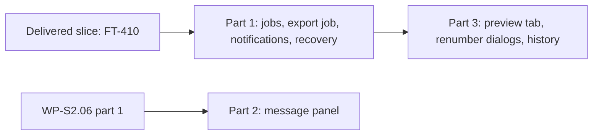

# WP-S2.09: messages, bulk previews, history, jobs and recovery UI (closed specification)

**Status:** amended 2026-10-31, cycle-39 design pass, part 2: §8.1's as-built Preview tab, a tab a card opened closes with its last card (decision log ID-916) · amended 2026-10-30, cycle-38 design pass, part 3: §7.6's `messages.show` toggles without `on` (decision log ID-889) · specified in cycle 30 (documents only) for three parts after the delivered first slice (FT-410, cycle 27,
ID-651): part 1 (jobs, the PDF export as a job with progress and cancel, the notifications log, the journal recovery
dialog, 1.15 pw, D5), part 2 (the message panel on WP-S2.06's navigator framework with pending completeness findings and
quick fixes, 0.85 pw, D3), part 3 (the bulk preview tab, the renumber dialogs, the history panel with context restore and
the GUI purge step, 1.2 pw, D4); part 1 may start now, part 2 after WP-S2.06 part 1's delivery, part 3 after part 1's;
one independent Opus review per cycle (ID-667); **part 1 delivered in cycle 30** (§6.9; decision log ID-714, ID-715), **parts 2
and 3 delivered in cycle 31** (§7.7, §8.8; decision log ID-730 to ID-732, ID-736), so the package is complete; FT-516, FT-518 and FT-519 built
in cycle 32 (ID-749, ID-753) · **Date:** 2026-10-29 · **Work package:**
[WP-S2.09](../02-work-packages.md#wp-s209-messages-bulk-previews-history-jobs-and-recovery-ui) · **Decision log:**
ID-690 to ID-699, the ten entries of §15.3 in order (follow-ups FT-494 to FT-498, the five of §15.4 in order) · **Part
of:** ElektraWatt plan, specifications

**Purpose.** This is the closed specification of the package that makes long operations, findings and history visible
and controllable: the PDF export runs as a job with progress and cancel, toasts are kept in a notifications log, a
project with a crashed session's journal offers recovery, findings are listed in a message panel that jumps to the
object and runs quick fixes as previews, every bulk change is previewed in one dockable tab, and the history panel lists
the undo steps with their origins and returns to where each was made. It is written against **WP-S2.03's, WP-S2.04's
and WP-S2.05's delivered contracts and WP-S2.06's specified one** (§2.1), not against their code. Where this document
and a design document differ, this document is the narrower and wins for the lanes; the design documents stay the target
of the whole work package, and the documents named in §15.6 are updated at the design pass after each part. A choice a
lane meets that this document does not settle is escalated, never guessed (`CLAUDE.md`, rule 2).

---

**Contents**
1. [Goal and non-goals](#1-goal-and-non-goals)
2. [Inputs](#2-inputs)
3. [The decisions of this specification](#3-the-decisions-of-this-specification)
4. [Crates, boundaries and the public items below the shell](#4-crates-boundaries-and-the-public-items-below-the-shell)
5. [Commands](#5-commands)
6. [Part 1: jobs, the export job, notifications, recovery](#6-part-1-jobs-the-export-job-notifications-recovery)
7. [Part 2: the message panel](#7-part-2-the-message-panel)
8. [Part 3: the preview tab, the renumber dialogs, the history panel](#8-part-3-the-preview-tab-the-renumber-dialogs-the-history-panel)
9. [Determinism, the headless mode and exact counts](#9-determinism-the-headless-mode-and-exact-counts)
10. [Acceptance checks](#10-acceptance-checks)
11. [Performance requirements and the gates](#11-performance-requirements-and-the-gates)
12. [Files owned](#12-files-owned)
13. [Out of scope](#13-out-of-scope)
14. [Review checklist for the Opus reviewer](#14-review-checklist-for-the-opus-reviewer)
15. [Size, order, routing and the documents to update](#15-size-order-routing-and-the-documents-to-update)
16. [Sources](#sources)

---

## 1. Goal and non-goals

**Goal.** At the end of the package File ▸ Export PDF runs off the UI thread with its progress in the status bar and the
Jobs pane, Cancel stops it within a page and leaves no file behind, and an existing file is replaced only after one
confirmation. Every toast also lands in a notifications log of the session's last 100 notifications, whose actions stay
usable while they are valid. Opening a project with the journal of a crashed session shows the recovery dialog: Recover,
Open read-only or Discard. The message panel lists the findings of the project's online check scheme grouped by severity
and rule, keeps completeness findings of the page being edited pending, jumps to the object, walks the findings with F8,
opens the rule page with F1 and runs a quick fix as a preview. Every bulk preview (the property grid's, find and
replace's, the parts import's, the navigators', a quick fix's and the two new renumber dialogs') opens in one dockable
Preview tab with its entity, tag, cross-reference and page lists, and Accept commits one transaction. The history panel
lists every step with its label, origin and pages, the marker lines of exports, saves and recoveries, undoes to any step,
and every undo or redo returns to the page, view and selection where the step was made. Everything runs headless
through `ew.uiscript/1` and reads back through the transcript and `ui.describe`, and the keyboard alone can do
everything (NFR-A11Y-01). The proofs are FR-UI-021 to FR-UI-024, FR-UI-041, FR-UI-042, FR-UI-050's recovery half and
AC-18's GUI path on Golden A (§10); NFR-PERF-08 and NFR-PERF-19 are shown structurally, their timings are not measured
(owner's rule, ID-512; §11).

**Non-goals** (each is named with its package in §13):
- **No waiver recording.** The `waiver` record kind is reserved in schema v0 and no command writes it; the panel shows
  the engine's waived state, and the Waive… action with its reason comes with the command in WP-S1.16 (D2; FT-494).
- **No crash reports.** FR-UI-050's crash-report half (crash records, the start-up dialog, the report folder, the
  summary, the payload, Help ▸ Diagnostics) needs WP-S6.05's capture; this package builds the journal half (D2;
  FT-495).
- **No rendered candidate pages** in the preview, no findings delta and no CSV export of a diff (D2; FT-496); the BOM
  and wire-list rows of a preview arrive with FT-248 (WP-S1.22) and are shown when it lands (§8.1).
- No finding markers on the canvas (doc 06 §3.10; FT-498), no finding-count badges on navigator rows (FT-488, moved to
  WP-S2.14), no OS notifications (1.x), no job pool, no memo snapshot in a job's fork (FT-497), no preview on a fork job
  (FT-358).
- No change to any exported byte of Golden A, to AC-15's command log, to the record logs, to the project or journal
  format or to the acceptance result; no new command, no new memoised family and no new package.

## 2. Inputs

| Input | What the lanes take from it |
|---|---|
| [WP-S2.03's specification](WP-S2.03-viewer-and-tool-framework.md) §6 and §7 as built | Tabs with jumps and back history, `Selection`, the focused tab, the host's preview and commit path (`preview_with`, `commit`, `run_script`), the transcript and describe rules, the exact-count counters (`SessionCalls`) |
| [WP-S2.05's specification](WP-S2.05-property-grid-find-replace-clipboard.md) §6.6, §7.4 as built | `Card`, `CardOrigin`, the stale-card rule, `preview.apply` and `preview.cancel`, the toast (`Toast`, `toast.undo`, `toast.dismiss`), FR-UI-044's policy |
| [WP-S2.06's specification](WP-S2.06-navigators-and-table-mode.md) §4.2, §6 (part 1) | `NavKind`, `NavRole`, `NavTable`, `NavNode`, `Session::navigator_table`, the framework's state, filter, keys, selection synchronisation, the `navigator.*` actions and describe lines, `PaneKind::Navigator(NavKind)` |
| Code at 21cf6c05 | `crates/ew-jobs/src/lib.rs` (an empty stub); `crates/ew-api/src/{lib.rs,import.rs,output/mod.rs,output/properties.rs}`; `crates/ew-commands/src/{history.rs,engine.rs,transaction.rs,meta.rs,commands/page.rs,commands/renumber.rs,commands/assets.rs}`; `crates/ew-checks/src/{engine.rs,finding.rs,rule.rs}`; `crates/ew-store/src/{store.rs,journal.rs}`; `crates/ew-viewmodel/src/{shell.rs,shell/properties.rs,properties.rs,status.rs,layout.rs,describe.rs,actions.rs,help.rs}`; `crates/ew-ui/src/{app.rs,dock.rs,status_bar.rs,properties.rs,parts_card.rs}`; `bin/elektrawatt/src/main.rs` |
| [Architecture](../../design/04-architecture.md) §2, §5.3, §5.4, §6.5, §9; [ADR-0008](../../adr/0008-transactions-undo-preview.md) | The thread model (the `Session` stays on the UI thread, jobs get snapshots, cooperative cancel, results tagged with `Rev`); undo restores page, view and selection; marker lines; preview is a fork; Class II freshness |
| [UX/UI](../../design/16-ux-ui.md) §3.4, §3.6, §7.5, §7.6, §8.1 to §8.4, §10, §13 | The bottom dock, the status bar, the bulk preview, the history panel, the notification classes, jobs and staleness, the message panel, accessibility, F1 |
| [Project format](../../design/05-project-format-and-persistence.md) §8; [schematic editor](../../design/06-schematic-editor.md) §3.10; [checks](../../design/15-checks-revisions-collaboration.md) §2.3 to §2.6, §3; [quality](../../design/18-quality-security-release.md) §12.3 | The journal, recovery and its dialog; pending completeness findings; rule kinds, findings, fingerprints, quick fixes, schemes; the panic strategy |
| [Golden project](../../design/20-golden-project.md) §2.2, §18.1 and `golden/J-E-2416/` | AC-18 (Golden B steps B1 and B2), EF-08, `expected/pdf/sha256.txt`, the variants `b1-page-based-tags.ewcmd` and `b2-renumber-pages.ewcmd` |
| Requirements | The 9 rows of the work package: FR-UI-021, FR-UI-022, FR-UI-023, FR-UI-024, FR-UI-041, FR-UI-042, FR-UI-050, NFR-PERF-08, NFR-PERF-19; with FR-UI-025, FR-UI-044, FR-CHK-008, FR-CHK-015, NFR-UX-07, NFR-A11Y-01 to NFR-A11Y-04, NFR-COMP-04, NFR-REL-07 where they touch it; FT-251, FT-313's rest, FT-417, FT-464, FT-466, FT-493 |

### 2.1 What the earlier packages provide (the base contract)

The lanes rely on exactly these items and on nothing of their code beyond them. If a delivered item differs, the lane
stops and reports it.

| Item | Where | Used here for |
|---|---|---|
| `Session::export_pdf`, `export_pdf_with`, `ExportOptions`, `ExportAssets`, `PdfExport { bytes, pages, .. }`; `Session::world() -> World`, `Session::query_over(&Model)` | `ew-api` `output/mod.rs`, `lib.rs` | The export job (§6.2): the same phases on a snapshot |
| `file.export_pdf { path? }` with `Prompt::SavePdf`, its toast `toast-export-pdf` (file name, pages, KiB; FT-485 item 11), the window's one-frame `Deferred` | `ew-viewmodel` `shell.rs`, `ew-ui` `app.rs` | Replaced by the job (§6.3) |
| `Session::open(dir, store, options, Recovery)`, `Recovery::{Keep, Apply, Discard}`, `OpenReport::recovery: Option<RecoveryInfo { transactions, base_matches, last_change_ms, .. }>`, `Session::store()`, `Store::recovery()` | `ew-api`, `ew-store` | The recovery dialog (§6.6) |
| The read-only open of a project with a leftover journal (`settle_open`, `readonly-recovery`, `banner-recovery`) and `file.discard_journal` with `Dialog::ConfirmJournalDiscard` (FT-313's first part, ID-486) | `ew-viewmodel` `shell.rs` | Kept; the dialog is added on top (D7) |
| `Session::check(scheme, CheckMode::Online) -> CheckReport`, `Session::project_check_scheme(mode)`, `checks::scheme(name)`, `Finding { rule, code, severity, state, targets, subject, page, message, fix, fingerprint }`, `RuleMeta { id, title, kind, .. }`, `checks::rule(id)` | `ew-api`, `ew-checks` | The message panel (§7) |
| `Session::history() -> &History`, `HistoryEntry { label(), origin(), is_step(), is_barrier(), merged(), rev(), changes() }`, `History::{entries, cursor, limits, bytes}`, `Origin::label()`; `Session::undo`, `redo` | `ew-commands`, re-exported by `ew-api` | The history panel (§8.4) |
| `Preview::{diff(), affected_pages(), candidate()}`, `Session::derived_diff`, `ModelDiff`, `EntityChange` | `ew-commands`, `ew-api` | The preview tab (§8.1) |
| `page.renumber { scope, start, step, keep_gaps }` and `numbering.renumber { scope, scheme, include_frozen, options }`, both `Bulk` | `ew-commands` | The renumber dialogs (§8.3) |
| `project.assets.purge` (`HumanOnly`, `Bulk`, a marker, `Confirmation::Destructive`), `Session::purge_preview() -> PurgePlan` | `ew-commands`, `ew-api` | The GUI purge step (§8.6, FT-417) |
| `Platform::open_url` (the system opener of F1's user guide) | `ew-ui` `app.rs`, `bin/elektrawatt` | Open PDF (§6.4) |
| `ew_api::import::parse_parts_tables` (the user path of `parts.import`; the golden bootstrap calls `ew_import_tables` directly) | `ew-api` `import.rs` | FT-464 (§6.7) |
| The navigator framework of WP-S2.06 part 1 (`NavKind`, `NavRole`, `NavTable`, the providers' contract, `navigator.*`, the chip line, the describe window of 50 rows) | WP-S2.06 §4.2, §6 | The message panel (§7); part 2 starts only after its delivery |

### 2.2 Gaps found below the shell (why the parts are shaped as they are)

| Gap at 21cf6c05 | Consequence |
|---|---|
| `ew-jobs` is an empty stub; the export is synchronous and the `Session` is not `Send` | A minimal job runner in `ew-jobs` and an `ExportJob` that carries a snapshot to a thread of its own (D3, D4; FT-251) |
| No waiver command; the `waiver` kind has no schema | Waiving is FT-494 (WP-S1.16) (D2) |
| No crash capture (no panic hook, no minidumps, no logs) | The crash-report half of FR-UI-050 is FT-495 (WP-S6.05) (D2) |
| The shell submits every command with an empty `TxContext`, so undo restores nothing | The shell keeps the context of each commit itself (D13) |
| No GUI path to `page.renumber` or `numbering.renumber` | Two dialogs (D12) |
| Previews hold no labelled entity list; `HistoryEntry` holds no pages | `Session::preview_entities` and `Session::history_view` (§4.2) |
| EW-POT-013 (FR-UI-021's and FR-UI-041's acceptance rule) is not built (FT-192) | The acceptance runs on built rules (D16) |

## 3. The decisions of this specification

Each is a lead ruling that the owner may reverse. The design pass records them as ID-690 to ID-699 (§15.3).

| # | Decision | Reason and trade-off |
|---|---|---|
| D1 | **Three parts after the delivered slice.** Part 1 jobs, the export job, notifications and the recovery dialog (1.15 pw, D5); part 2 the message panel (0.85 pw, D3); part 3 the preview tab, the renumber dialogs, the history panel and the purge step (1.2 pw, D4). Part 1 now; part 2 after WP-S2.06 part 1's delivery; part 3 after part 1's. The parts and the slice (0.4 pw) fill the PERT of 3.6 pw with **no reserve**; the de-scope rule of §15.1 replaces one | Part 1 serves the pilot first (G-PP-01 ends with the PDF export, and every dirty exit leaves a journal); part 2 waits for the framework it is built on; part 3 uses part 1's notifications and markers |
| D2 | **What leaves the package, with its owner.** Waiver recording (command, typed record, the Waive… action) to WP-S1.16 (FT-494); FR-UI-050's crash-report half and the start-up dialog to WP-S6.05 (FT-495); rendered candidate pages, the findings delta and the diff's CSV export to WP-S2.14 at 1.0 (FT-496); finding markers on the canvas to WP-S2.14 (FT-498); FT-488 to WP-S2.14 at 1.0; FT-463 to WP-S1.19a alone. **Kept:** FT-417 (part 3), FT-464 (part 1), FT-466 (part 3) | Each moved item needs a record kind, a capture process or a fork render path that a UI package should not build; the MVP still shows what changes (derived diffs and the page list) and every finding (the panel and the property header) |
| D3 | **`ew-jobs` is a minimal runner:** one named `std` thread per job, a cancel flag checked at checkpoints, a progress cell, a waker for the window, `catch_unwind` (a panic fails the job, the session is untouched), and a test gate; no rayon pool, no adopt-if-unchanged, no scheduler | Exactly what the export needs; a pool and adoption wait for a second kind of job and a measurement (FT-497); no new package |
| D4 | **The export job runs on a snapshot:** `Session::export_job` takes the `World`, the report engine and the asset bytes; the job builds a **cold** `Q` on its own thread and runs the three phases of the as-built export with a checkpoint after each page; its bytes equal `Session::export_pdf`'s. The file is written to a hidden sibling and renamed over the target; a cancel or a failure removes the sibling, so no partial file remains | The UI thread does no export work (NFR-PERF-19) and the PDF stays the AC-15 bytes; the cold `Q` re-derives every page instead of reusing the memo, a cost the release phase measures (FT-497) |
| D5 | **Replacing a file is confirmed once:** in the window the native save dialog's own overwrite prompt is that confirmation; a script must pass `replace: true`, else the action refuses. Headless, `file.export_pdf` waits for its job (deterministic transcripts) unless `wait: false`. Each export adds a history marker line and a notification; its result names the revision it ran on and, if the model moved meanwhile, the current one | FR-UI-023's and NFR-UX-07's "asks once" without a second dialog after the OS's own; scripts stay explicit |
| D6 | **Notifications:** at most three toasts on screen (8 s each on the window's clock); a toast with the key of a visible one replaces it; every toast also enters the **notifications log** (the session's last 100, newest first), whose actions (Undo, Open PDF) stay usable while valid: Undo while the step it undoes is the next undo step, Open while the job's file was written in this session | FR-UI-042 and NFR-A11Y-04: no action depends on a toast's display time |
| D7 | **The recovery dialog at an editing open** of a project with a leftover journal: the project still opens read-only first (as built), and the dialog shows the number of unsaved transactions, the time of the last change and whether the project changed on disk since. **Recover** re-opens with `Recovery::Apply`; a replay that fails (the leftover is still there) re-opens read-only with the reason. **Open read-only** keeps the journal and the read-only access; **Discard…** is the existing confirmation | Editing on top of an unrecovered journal moves its base and makes a later recovery a merge, and the merge panel is WP-S2.15; read-only until Recover or Discard is the safe reading of doc 05 §8.3's "Open without recovering" |
| D8 | **The message panel is the twelfth navigator,** `NavKind::Messages`, built on WP-S2.06's framework and opened in the bottom dock: severity → rule → finding, rows from `Session::check` of the project's **online scheme** (its `active_scheme`, else `drafting`), finding keys by fingerprint, records the finding's targets, Enter opening the finding's page with its targets selected. The counts sit in the pane's header line, not in the status bar | One view for findings (ID-682, FT-493); the memoised online checks make a per-revision table cheap; the status bar stays unchanged for every committed recording |
| D9 | **Pending findings (FR-UI-041):** a finding of rule kind `completeness` whose page is the **editing page** (the page of the focused tab on which the last commit was made, until that tab shows another page or Tools ▸ Run checks runs) carries the badge `pending`, is drawn muted and leaves the error, warning and info counts for its own `pending` count; safety, conflict, hygiene and integrity findings are never pending | The doc 06 §3.10 rule with a definition a test can follow; no change to the check engine |
| D10 | **Quick fixes always preview:** the finding's `QuickFix` (command, parameters) is previewed and opens the preview (the card, and with part 3 the tab), never commits directly; its history origin reads `quick fix <rule>`. F8 and Shift+F8 walk the findings; F1 on a finding opens its rule page (`reference/rules/<pack>.md#<rule>`); the detail lines show rule, title, kind, severity, message and fix; the remedy text arrives with WP-S1.16's messages; the footer states that checks do not replace engineering verification (NFR-COMP-04) | FR-UI-021's "quick fixes as previewed commands"; F1 reaches the generated rule pages that exist today |
| D11 | **One preview per window, shown in the Preview tab:** the existing card (every `CardOrigin`) is drawn in a `Preview` pane of the bottom dock with Summary, Entities, Tags, Xrefs, Pages and the origin's own counts; the origin pane keeps a one-line chip with Apply, Cancel and Show; Ctrl+Enter and Escape work in both. The preview stays synchronous on the UI thread (FT-358); the staleness rule is WP-S2.05's | FR-UI-022's dockable, non-modal preview without a second preview model; the card's describe line stays byte-equal |
| D12 | **Two renumber dialogs:** Page ▸ Renumber pages… (`page.renumber` for a section with start, step and keep gaps) and Tools ▸ Renumber devices… (`numbering.renumber` with scope, scheme, include frozen and only non-conforming); both are `Bulk`, so both always open the preview | AC-18's GUI path (Golden B) through the commands that `ew apply` already proves |
| D13 | **The history panel and context restore:** `Session::history_view` lists the steps (label, origin, pages, merged count); the shell adds **view-state marker lines** (save, export, recovery) ordered by revision; Undo to here walks undo or redo to the chosen step; every commit's page, view and selection before the gesture are kept by the shell per revision, and undo, redo and Undo to here restore those of the step they cross last | FR-UI-023 in the window and headless alike, with no change to `ew-commands` or the journal; the transaction's own `TxContext` stays unused by the shell |
| D14 | **The bottom dock:** Find, Messages, Preview, History and Jobs share one tab group below the page view (750 : 250), created by the first of them; the default workspaces do not change | One place for the bottom panes of doc 16 §3.4; committed `layout:` lines stay valid until a pane is opened |
| D15 | **The headless surface grows by 21 actions** (8, 5, 8 by part) **and up to 48 describe words** (§6.8, §7.6, §8.7; ID-474 extended, a reviewed transcript change); four new top-level sections `jobs`, `notifications`, `preview` and `history`, the messages lines under `navigator`; the blind help lists the new sections | The blind drafter reads the jobs, the log, the preview and the history as text; `look` needs no change (its sections are generic) |
| D16 | **Requirement texts the built rules and the data do not support:** FR-UI-021's and FR-UI-041's acceptance name EW-POT-013, which is not built (FT-192): the panel's acceptance runs on EF-08 (EW-CORE-033 on -3W1), EW-CORE-051 and EW-CORE-052, and EW-POT-013's assertions join FT-494; FR-UI-023's "undoing twice returns to the first edit's folio" contradicts its own rule (undo returns to where the undone step was made): undoing twice returns to the second edit's folio, a third undo to the first's; FR-UI-050 here is the recovery half; FR-UI-022's rendered candidate pages are 1.0 (FT-496). The design pass amends these texts | Lanes test against what exists; a requirement example that cannot run is a document fix, not a lane guess |

## 4. Crates, boundaries and the public items below the shell

### 4.1 Roles

| Crate | Layer | Part 1 | Part 2 | Part 3 |
|---|---|---|---|---|
| `ew-jobs` | GPL | the runner (§4.2) | — | — |
| `ew-api` | GPL | `pub use ew_jobs`, `ExportJob`, `Session::export_job`; FT-464 in `import.rs` | `NavKind::Messages`, the three roles, the Messages provider, `Session::online_scheme` | `Session::preview_entities`, `Session::history_view` |
| `ew-viewmodel` | GPL | `jobs.rs`, `notifications.rs`, the export action, the recovery dialog, `PaneKind::Jobs`, the bottom dock, actions, transcript, describe | `navigators/messages.rs`, pending, quick fix, F8, F1 anchors | `preview.rs`, `undo_history.rs`, the renumber and purge dialogs, context restore, card hosting |
| `ew-ui` | GPL | the Jobs pane, the toast stack, the log popup, the recovery dialog, the waker, Open PDF | the severity icons and the muted rows in the tree widget | the Preview and History panes, the chip, the dialogs |
| `elektrawatt` | GPL | the waker and the opener wiring; tests | tests | tests |

**Rules the lanes keep** (the earlier packages' rules stand: through `Session` only, `check-raw-read` green, no
`unsafe`, no unordered output, one clock, no egui name outside `ew-ui` and `elektrawatt`, no `ew-model` name in
`ew-viewmodel` or `ew-ui`):
1. **Only the public items of §4.2** are added below the shell, each first and in its own commit with tests. Any other
   missing item stops the lane.
2. **No new package and no new workspace edge.** `ew-api → ew-jobs` exists (`crates/ew-api/Cargo.toml`); `ew-viewmodel`
   names `ew-jobs` items only through `ew_api::ew_jobs`. `ew-jobs` stays dependency-free. `cargo tree -p elektrawatt`
   is unchanged; `cargo xtask check-deps` green.
3. **One mutation path.** Every model change is a registered command committed by the host path. Jobs, notifications,
   markers, the pending state, the history panel's state and the preview tab are view state and never a command.
4. **No change to `ew-commands`, `ew-checks`, `ew-store`, the project format or the journal format.**
5. **Golden A's outputs do not change**; no file under `golden/` changes; the golden, acceptance and AC-15 tests pass
   unmodified. The job's PDF is byte-equal to `expected/pdf/sha256.txt`.
6. **No path, time value, process ID or UUID** in a transcript, a describe line or a notification text (file base names
   only; IDs as aliases `@n`, ID-630).

### 4.2 The public items added below the shell

| Part | Crate | Item | Contract |
|---|---|---|---|
| 1 | `ew-jobs` | `pub struct Progress { pub done: u32, pub total: u32, pub phase: &'static str }` (`Default`, `Clone`, `Copy`, `PartialEq`, `Debug`) | The last reported progress; `total` 0 means indeterminate |
| 1 | `ew-jobs` | `pub struct Cancelled;` `pub enum JobError { Cancelled, Failed(String) }` with `From<Cancelled>` | What a job body returns on a cancel or a failure; the text is a cause in English with no path |
| 1 | `ew-jobs` | `pub type Waker = Arc<dyn Fn() + Send + Sync>` | Called after each progress report and once at the end (the window's repaint request) |
| 1 | `ew-jobs` | `pub struct Gate` (`Clone`): `Gate::new()`, `hold(&self, at: &'static str)`, `release(&self)`, `wait_reached(&self, at: &'static str)` | A test hook: a job whose checkpoint `at` is held blocks there until `release`; `wait_reached` blocks the caller until the job is blocked at `at`. Product code passes no gate |
| 1 | `ew-jobs` | `pub struct JobCtl` with `report(&self, p: Progress)` and `checkpoint(&self, at: &'static str) -> Result<(), Cancelled>` | `checkpoint` first waits on a held gate, then returns `Err(Cancelled)` if the job was cancelled |
| 1 | `ew-jobs` | `pub struct JobOptions { pub name: String, pub waker: Option<Waker>, pub gate: Option<Gate> }`; `pub enum JobEnd<T> { Done(T), Cancelled, Failed(String), Panicked }`; `pub struct Job<T>` with `spawn(options, body: F) -> std::io::Result<Job<T>>` where `F: FnOnce(&JobCtl) -> Result<T, JobError> + Send + 'static`, `T: Send + 'static`; `progress(&self) -> Progress`; `cancel(&self)`; `is_finished(&self) -> bool`; `try_end(&mut self) -> Option<JobEnd<T>>` (once, after the body returned); `wait(self) -> JobEnd<T>` | One thread named `ew-job-<name>`; the body runs under `catch_unwind(AssertUnwindSafe)`; a panic gives `Panicked`; `cancel` sets the flag only. Compile-time asserts: `Job<u8>: Send`, `Gate: Send + Sync` |
| 1 | `ew-api` | `pub use ew_jobs;` | The shell names the runner through `ew-api` |
| 1 | `ew-api` | `pub struct ExportJob` (`Send`); `pub fn Session::export_job(&self, options: &ExportOptions) -> ExportJob`; `pub fn ExportJob::run(self, ctl: &ew_jobs::JobCtl) -> Result<PdfExport, ew_jobs::JobError>` | Holds the current `World`, the report engine (`Arc`), the `ExportAssets` and the options. `run` builds `Q::new(&world.model).with_report_pages(reports)` on the calling thread and runs §6.2's phases; the result's bytes equal `Session::export_pdf(options)`'s on the same revision. If the report engine is not `Send + Sync`, the lane stops |
| 2 | `ew-api` | `NavKind::Messages` (word `messages`, the last of `ALL`); `NavRole::{Severity, Rule, Finding}` (words `severity`, `rule`, `finding`) | The twelfth navigator (§7.1) |
| 2 | `ew-api` | `pub fn Session::online_scheme(&self) -> &'static checks::Scheme` | `project_check_scheme(CheckMode::Online)`, else `checks::scheme("drafting")`; the property header's findings (`output/properties.rs`) use it too |
| 3 | `ew-api` | `pub struct PreviewEntity { pub change: &'static str, pub kind: String, pub id: Uuid, pub label: String, pub fields: Vec<String> }`; `pub fn Session::preview_entities(&self, preview: &Preview) -> Vec<PreviewEntity>` | One per `EntityChange` of `preview.diff()`: `change` is `added`, `removed` or `changed`; `label` the printed label by the property grid's label rule (the derived tag, the folio, the name; the candidate's for an added record, the current one's otherwise); `fields` the changed top-level members, sorted. Order: change (`added`, `changed`, `removed`), kind, label in natural order, ID |
| 3 | `ew-api` | `pub struct HistoryRow { pub index: usize, pub label: String, pub origin: String, pub step: bool, pub barrier: bool, pub merged: u32, pub rev: u64, pub pages: Vec<String> }`; `pub struct HistoryView { pub rows: Vec<HistoryRow>, pub cursor: usize, pub bytes: usize, pub max_bytes: usize, pub max_steps: usize }`; `pub fn Session::history_view(&self) -> HistoryView` | `rows` in entry order (oldest first); `origin` as §8.4; `pages` the folios, in page order, of the pages the entry's changes touch in the current model (a page itself; a representation, connection, page item or structure box: its page; a device or function: its representations' pages; others: none), at most 8 |

No other item below the shell is added. The view model's types (`JobsState`, `NotificationLog`, `MessagesState`,
`PreviewPane`, `HistoryPane`) are `ew-viewmodel` items and free to shape within §6 to §8.

## 5. Commands

No command is added or amended; the registered count is unchanged. Used as built: `page.renumber` and
`numbering.renumber` (§8.3), `project.assets.purge` (§8.6), the commands of the quick fixes (`fields.set`,
`rep.set_anchor_policy`; §7.4), and every command a card already previews.

## 6. Part 1: jobs, the export job, notifications, recovery

### 6.1 The runner (`ew-jobs`)

`Job::spawn` starts the thread and returns; the body gets a `JobCtl`. `JobCtl::report` stores the progress and calls the
waker; `checkpoint(at)` blocks while a gate holds `at`, then checks the cancel flag. `cancel` only sets the flag: a body
that never reaches a checkpoint is not interrupted. When the body returns, the end is stored, the waker is called once
and `is_finished` turns true; `try_end` hands the end over once. A panic inside the body is caught: the end is
`Panicked`, the panic message is not kept (it may hold project text, doc 18 §12.3), and the session is untouched because
the body holds only a snapshot. Tests: progress and end through `try_end`; cancel at a held gate gives `Cancelled`; a
panicking body gives `Panicked` while the spawning thread continues; `wait` returns the end; the waker count.

### 6.2 The export job (`ew-api`, FT-251)

`ExportJob::run` runs the as-built phases (`output/mod.rs`) with these checkpoints and reports:
1. **Scenes** (phase `"building"`): for page i of n of the selection, `report(i, n)`, build its scene through the cold
   `Q`, then `checkpoint("page")`.
2. **Pages** (phase `"drawing"`): the page phase on `par_map` as built; each item checks the cancel flag first and is
   skipped when cancelled; after the phase `checkpoint("drawn")` and `report(n, n)`.
3. **Writing** (phase `"writing"`, total 0): the PDF writer as built; `checkpoint("written")` after it.

The job never writes a file; the shell does (§6.3). Tests: the job's bytes equal `Session::export_pdf`'s on Golden A and
the digest of `expected/pdf/sha256.txt`; a cancel at the held gate `"page"` after page 2 returns `Cancelled`; an
`ExportJob` built, then the session edited, still exports the old revision's bytes (snapshot isolation).

### 6.3 The PDF export action

`file.export_pdf { path?, replace?, wait? }` (parameters added: `replace: bool` default false, `wait: bool` default true;
`wait` is ignored in the window):
1. No path: the native save dialog as built (`Prompt::SavePdf`); the answer carries `replace: true`, because the dialog
   asked about an existing file itself (D5).
2. The target exists and `replace` is false: refused `reason-file-exists` ("<name> exists; pass replace to overwrite
   it"). No project: refused as built. Another export job is running: refused `reason-export-running`.
3. Otherwise a job `pdf` starts on `session.export_job(&ExportOptions::default())` with the shell's waker; the jobs list
   gets entry n (counted from 1 per shell). The body runs the export, then writes the bytes to the hidden sibling
   `.<file name>.ew-part` in the target's directory, `sync_all`, and renames it over the target; any failure removes the
   sibling. A cancel seen at a checkpoint before the rename removes the sibling and ends `Cancelled`; after the rename
   the export is done.
4. Headless with `wait: true`, the action waits for the end before it returns; with `wait: false` it returns at once.
5. At the end (`ShellModel::poll_jobs`, called by the window every frame and by the script runner before each step):
   **Done** adds the notification "Exported <name>: <n> pages, <k> KiB" (the as-built toast text, key `export`, action
   Open), the history marker "Exported PDF to <name>" and, when the revision moved during the job, the result note
   "exported rev <r>; the model is now at rev <m>"; **Cancelled** notes "Export cancelled; no file written";
   **Failed** "Export failed: <cause>" (the cause from `OutputError` or the I/O error kind, never a path) with the remedy
   "check that the folder is writable and the file is not open in another program"; **Panicked** "Export failed: an
   internal error". The outcome of a waited headless step is `Done`, `Refused` or `Failed` accordingly.

The as-built `Deferred` one-frame export goes. The status bar's export field becomes the job field (§6.4).

### 6.4 Jobs pane, status bar and Open PDF

`PaneKind::Jobs` (workspace key `jobs`) in the bottom dock (D14). Each entry: kind word (`PDF export`), the file's base
name, `as of rev <r>`, the progress (`page 12 of 36`, or the phase text when indeterminate), the elapsed time (window
only), Cancel while running; a finished entry shows its result and keeps it (the last 20 entries, oldest dropped).
**Timing** (window clock, never in the transcript): a job that ends within 200 ms shows no status-bar field. The status
bar's last field while a job runs: `PDF export <p> %` (p = done × 100 / total, integer); clicking it shows the Jobs pane.
**Open PDF** (`jobs.open_result`): the window hands `file://` URL of the written file to `Platform::open_url`; headless it
refuses `reason-no-opener`. AccessKit: each running entry is a `ProgressIndicator` named `<kind> <name>` with its value.

### 6.5 Notifications

`ShellModel::notify(text, key, actions)` replaces the as-built single toast (`notify(text, undo)` callers map to key
`edit` with action Undo when `undo` is true): the toast is pushed to the visible stack (at most three; a toast of a key
that is visible replaces that one; a fourth pushes out the oldest) and to the log (at most 100, the oldest dropped).
Each log entry has a serial (from 1 per shell), the text, its actions and their validity:
- **Undo** is valid while `history.cursor()` equals the cursor right after the commit the toast reports and the entry
  at `cursor − 1` has that commit's revision; `notifications.run { entry, action: "undo" }` dispatches the registry's
  undo; an invalid action refuses `reason-action-expired`.
- **Open** is valid while the job's file was written in this session (the shell keeps its path, never printed).

The visible toasts close after 8 s each on the window's clock (never in the transcript); `toast.undo` and
`toast.dismiss` act on the newest visible toast as built. The status bar gains, when the log is not empty, the field
`Notifications <n>`, which opens the log popup (`notifications.show`); View ▸ Notifications does the same. The log popup
lists the entries with their actions as buttons; Escape closes it. Toasts and new log entries are announced in a polite
live region (NFR-A11Y-04).

### 6.6 The recovery dialog (FT-313's rest, FR-UI-050's recovery half)

When `settle_open` finds a leftover journal (as built: close, re-open read-only, `readonly-recovery`), it also opens
`Dialog::Recovery { name, transactions, base_matches, last_change_ms, failed: None }`:

```text
dialog "Recover unsaved changes"
  label "<project> has unsaved changes from a session that ended unexpectedly."
  recovery transactions 3 base matches
  button "Recover"
  button "Open read-only"
  button "Discard…"
```

The window shows how long ago the last change was ("Last change: 12 minutes ago"; just now, minutes, hours or days,
from `SystemTime`, with the UTC time on a small second line under it; never in the transcript), and "The project changed on disk
since" when `base_matches` is false. *Amended in cycle 31 (FT-503, decision log ID-736):* the specification asked for
local date and time, which needs a time-zone source the dependency rule does not allow; local clock time waits for the
first feature that needs real dates (the title block's revision dates), then `chrono` with its `clock` feature only. Escape is Open read-only.
- **Recover** (`journal.recover`): close the read-only session; open with `Recovery::Apply`. If the opened session's
  store still reports a recovery (`session.store().and_then(Store::recovery)` is `Some`), the replay failed: close that
  session (its own journal goes, the leftover stays), re-open read-only as before and show the dialog again with
  `failed: Some(reason)`, reason "the project changed on disk in the same places; recovery needs the merge panel" when
  `base_matches` was false, else "the journal could not be replayed"; the dialog then offers Open read-only and Discard…
  only, and its describe line reads `recovery transactions <n> base moved failed "<reason>"`. Otherwise the project is
  open for editing and dirty; the notification "Recovered <n> changes; save to keep them" (key `recovery`) and the
  history marker "Recovered <n> changes from the journal" are added.
- **Open read-only** (`journal.keep`): the dialog closes; access and banner as built.
- **Discard…** opens the as-built `Dialog::ConfirmJournalDiscard`; its Discard runs `file.discard_journal { confirm:
  true }` as built.

Headless the dialog is opened the same way, and `journal.recover`, `journal.keep` and `file.discard_journal { confirm:
true }` answer it; any other action while it is open refuses `reason-dialog-open` as dialogs do as built.

### 6.7 FT-464

`ew_api::import::parse_parts_tables` strips one leading U+FEFF from `parts_csv` and from each sibling table text before
parsing; the golden bootstrap (`ew_import_tables` directly) stays strict. Test: the golden `parts.csv` with a BOM
prefixed imports the same copies as without; `ew_import_tables`' own BOM test is unchanged.

### 6.8 Actions, transcript and describe of part 1 (8 new)

| ID | Kind | Label | Menu | Shortcut | Context | Params |
|---|---|---|---|---|---|---|
| `jobs.show` | View | Jobs | View | — | global | `on?:bool` |
| `jobs.cancel` | Command | Cancel job | — | — | global, hidden | `job?:uint` (default: the newest running) |
| `jobs.wait` | View | Wait for job | — | — | global, hidden, headless only | `job?:uint` |
| `jobs.open_result` | View | Open result | — | — | global, hidden | `job?:uint` (default: the newest done) |
| `notifications.show` | View | Notifications | View | — | global | `on?:bool` |
| `notifications.run` | Command | Run notification action | — | — | global, hidden | `entry:uint, action:text` |
| `journal.recover` | Command | Recover | — | — | dialog, hidden | `` |
| `journal.keep` | View | Open read-only | — | — | dialog, hidden | `` |

`file.export_pdf` gains `replace?:bool, wait?:bool`. A `jobs.*` action naming an unknown job refuses with the valid
numbers listed. New top-level sections, printed only while their pane or popup is open:

```text
jobs running 0
  job 1 pdf "golden.pdf" done pages 36 kib 812 rev 4
  job 2 pdf "golden.pdf" cancelled
  job 3 pdf "x.pdf" failed "the file is in use"
  job 4 pdf "y.pdf" done pages 36 kib 812 rev 4 now 6
notifications 2
  notification 2 "Exported golden.pdf: 36 pages, 812 KiB" open
  notification 1 "Set Part on 20 devices" undo expired
```

A running job prints `job <n> pdf "<name>" running` (no numbers: they depend on timing). Several visible toasts print
one `toast` line each, newest last. **New describe words (18, fewer by those already present when the part lands):**
`jobs`, `job`, `running`, `pdf`, `done`, `pages`, `kib`, `rev`, `now`, `cancelled`, `notifications`, `notification`,
`open`, `expired`, `recovery`, `transactions`, `base`, `matches`, `moved` (19 tokens, of which `pages` arrives with
WP-S2.06 part 1).

### 6.9 As built in cycle 30 (part 1)

**WP-S2.09 part 1 delivered in cycle 30 (lane M30; decision log ID-714, ID-715).** JB1 to JB9 pass; 55 commands, 223
actions and 303 describe words at the lane (225 and 309 on the merged tip with WP-S2.06 part 2, ID-716). Built as §6
says, with these points:

- **§6.1.** As specified, and a held checkpoint is a breakpoint: every arrival blocks until the next release, and the
  hold stays (deviation 2). `JobCtl` is `Send + Sync`.
- **§6.2.** The phases are one function, `export_pages_hooked`, used by both paths; the synchronous export uses
  `NoHooks`, so the bytes are identical by construction. Checkpoints: `page` after each scene, with `report(i, n,
  "building")` before page i; `draw` per item before it is drawn; `drawn`, followed by `report(n, n, "drawing")`;
  `written` after the writer (phase `writing`, total 0).
- **§6.3.** The body writes `.<name>.ew-part`, runs `sync_all`, passes `checkpoint("rename")` and renames; a drop guard
  removes the sibling on a cancel, a failure or a panic. Headless, the job field reads `PDF export` with no percentage
  (deviation 4). The I/O cause is the error kind's text, never a path. The `status-exporting` string and the "Exporting
  PDF" label go with the deferred export.
- **§6.4.** The Jobs pane is a group named "Jobs"; a running entry is a progress bar labelled `PDF export <name>` with
  Cancel, a finished one shows its result, and Done shows Open. The status-bar job field links to the pane and shows
  `PDF export <p> %` in the window after 200 ms. The bottom dock is `Layout::with_bottom` (renamed from `with_find`),
  `PaneKind::ALL` has 5 entries and `BOTTOM = [Find, Jobs]`.
- **§6.5.** `notify_with(text, key, undo)`; the log holds 100 entries, newest first; at most 3 toasts are visible. In
  the window toasts are an overlay with an 8 s timer each, and the log is a window opened by the `Notifications <n>`
  field. Undo from a toast or the log also requires the same project session; closing the project removes the visible
  toasts and expires their Undo (deviation 7). The stack replaces WP-S2.05's rule that the next committing action
  removes a toast, and FT-485's toasts share the key `edit` (deviation 8).
- **§6.6.** As specified, except: the time of the last change was shown in UTC (deviation 1); since cycle 31 it is the elapsed
  time with the UTC time on a second line (FT-503 closed, ID-736; §6.6 amended); the
  dialog also lets through `ui.dismiss` (Escape is Open read-only), `ui.describe`, `help.documentation` (F1 opens the
  `recovery` topic), `app.quit` and `view.canvas_resize` (deviation 5); Recover also fails when the re-open is not an
  editing one, and the Cancel of Discard… returns to the recovery dialog (deviation 6). As delivered, after Save As
  the original kept the journal of the edits that went into the copy, so reopening it showed this dialog (deviation
  10; FT-499); **fixed in the cycle-30 review round**: Save As closes the original cleanly once the copy exists (its
  journal deleted, its lock released), so the original reopens editable without the dialog; a failed Save As keeps
  it.
- **§6.7.** As specified (FT-464); `ew import parts` uses the same function, without a CLI test of its own (FT-504).
- **§6.8.** The 8 actions as the table lists them; `jobs.wait` is hidden in the window. `file.export_pdf`'s parameters
  are `path?:path, replace?:bool, wait?:bool`. 18 new words (`pages` was already present, as foreseen).
  `tools/blind/HELP.md` is version 4, with the `jobs` and `notifications` sections.

## 7. Part 2: the message panel

### 7.1 The provider (`NavKind::Messages`)

`navigator_table(Messages)` runs `self.check(self.online_scheme(), CheckMode::Online)` and builds, by WP-S2.06 §6.1's
contract:
- **Tree:** severity groups in the order Error, Warning, Info (role `severity`, labels "Errors", "Warnings", "Infos",
  key `severity:<word>`; a group without findings is left out) → rule groups in rule-ID order (role `rule`, label
  `<rule ID> <title>`, badge `<n>`, key `rule:<ID>`) → finding rows in the report's order (role `finding`, label
  `<subject>: <message>`, key `finding:<fingerprint>`). Waived findings stay in their severity group.
- **Table rows** (`table_row`): the finding rows, columns `severity`, `rule` (key column), `message`, `object` (the
  subject), `page_cell` (`<folio>-<cell>` of the primary target's first drawable on the finding's page, else the folio,
  else empty), `fix` (the quick fix's label or empty), `state` (`open` or `waived`), all read-only ("derived").
- **Badges:** the severity word (`error`, `warning`, `info`); `waived`; `fix` when a quick fix exists.
- **Facets:** `kind:<rule kind word>` (`safety`, `conflict`, `completeness`, `hygiene`, `integrity`), `page:<folio>` of
  the finding's page (`Finding::page`, else the page of the primary target's first drawable), `state:<open|waived>`.
- **Records:** the finding's target IDs; **drawables** by §6.1 item 6 of WP-S2.06; **open target:** the finding's page
  (else the first drawable's page) with the targets' drawables on it selected.

### 7.2 Pending (D9, FR-UI-041)

The shell keeps `editing_page: Option<PageId>`: set to the focused tab's page after every successful commit made while
that tab is focused; cleared when the focused tab shows another page, when the project closes and by `messages.check`
(Tools ▸ Run checks, which also refetches the table). A finding row is **pending** when its node has the facet
`kind:completeness`, its `page` facet names the editing page's folio and its state is open. A pending row gets the
badge `pending` (after its others), is painted muted, and counts in `pending`, not in its severity's count.

### 7.3 The pane, keys and the detail lines

The Messages pane is the framework's navigator pane in the bottom dock (D14), default view `tree`, opened by View ▸
Messages (`messages.show`). Its header line: `<scheme> · E <n> · W <n> · I <n> · waived <n> · pending <n>`; its footer:
"Checks support, but do not replace, engineering verification." Below the rows a **detail** block for the cursor's
finding: rule ID and title, kind, severity, the message, the quick fix's label with a Fix button, and the rule page link.
Severity is an icon plus a colour plus the word (FR-UI-025): error a filled circle in the theme's error colour, warning
a triangle in its warning colour, info a square in its info colour; a pending row uses the muted text colour and the
same icon outlined.

Keys: the framework's (Enter opens, Space marks, arrows move); **F8** (`messages.next`) and **Shift+F8**
(`messages.previous`) move the cursor to the next or previous finding row in visible order, wrapping, and open it; they
work from any context and open the pane first if it is closed. **F1** in the messages context with the cursor on a
finding or rule row opens `reference/rules/<pack in lower case>.md#<rule ID in lower case>` through the help system (the
pack page exists for every shipped rule; a new anchor test checks every shipped rule ID against the book).

*As built (cycle 37, lane E37, decision log ID-858; FT-674, FT-664, FT-675).* The detail block's title line carries **Waive…** (on a waived finding "Waived" and **Unwaive**) before the rule page link, so the block keeps its height in a short pane. `messages.waive` opens a prompt with Reason (at least ten characters) and Author, prefilled from the app preference `author_name` and saved back on commit, and commits `check.waive` with the date the window passes (its UTC date; the shell reads no clock, FT-697); the headless shell refuses it as human-only. `messages.unwaive` commits `check.unwaive`. The check toast carries the waived and pending counts in its title ("Check · 1 waived"), so the severity counts stay on one line; title and line truncate, never wrap. On the canvas, a potential with an open EW-POT-001 finding gets the `canvas.conflict` overlay (screen only; FT-696 for CP-keyed potentials).

### 7.4 Quick fixes (D10)

`messages.fix { key? }` (the cursor row by default) parses the finding's `QuickFix` (command name and parameters),
previews it with the host's path and opens the card with `CardOrigin::QuickFix { rule }` (word `fix`) in the Messages
pane (in the Preview tab once part 3 is in), whatever FR-UI-044's rules would say. Apply commits; the shell records the
commit's origin annotation `quick fix <rule ID>` for the history panel (§8.4). A finding without a fix refuses
`reason-no-fix`; a parse or preview failure shows the card's failure line as built. Golden A's built fixes:
EW-CORE-023's "drop override" (`fields.set` of `description_override` to null) and EW-CORE-053's "anchor at the graphics
centre" (`rep.set_anchor_policy`).

### 7.5 Updates and exact counts

The table follows WP-S2.06 §9 item 4: one `navigator_table(Messages)` per revision while the pane is open, which makes
one `Session::check`; changing the editing page re-marks the pending rows without a call. A closed pane makes no call.

### 7.6 Actions, transcript and describe of part 2 (5 new)

| ID | Kind | Label | Menu | Shortcut | Context | Params |
|---|---|---|---|---|---|---|
| `messages.show` | View | Messages | View | — | global | `on?:bool` |
| `messages.next` | View | Next finding | — | F8 | global | `` |
| `messages.previous` | View | Previous finding | — | Shift+F8 | global | `` |
| `messages.fix` | Command | Apply quick fix… | — | — | navigator, hidden | `key?:text` |
| `messages.check` | Command | Run checks | Tools | — | global | `` |

*As amended (cycle 38, fix round FX38d; decision log ID-889).* `messages.show` without `on` toggles the pane, as the History, Preview and Jobs actions do; `on: true` opens it and `on: false` closes it. A script or MCP client that sent `messages.show {}` to bring the pane forward now closes an open pane, and sends `{"on": true}` instead. Escape with the focus in Messages closes it once a tool at work has had its Escape.

The pane prints WP-S2.06 §6.10's lines with `kind messages`, then, indented under its header line:

```text
navigator "Messages" kind messages view tree sort "Label" ascending filter "" rows 9 showing 1 to 9
  messages scheme "drafting" errors 1 warnings 0 infos 3 waived 0 pending 0
  row level 1 severity "Errors" expanded
  row level 2 rule "EW-CORE-033 Cable without length" badge "1" expanded
  row level 3 finding "-3W1: cable without length" badge "error" selected cursor
  detail rule "EW-CORE-033" title "Cable without length" kind completeness severity error
  detail message "cable without length"
```

(The texts are illustrative; the lane's expected text is what the engine reports on Golden A.) A finding with a fix adds
`  detail fix "<label>"`. If the keymap test reports a conflict for F8 or Shift+F8, the lane stops. **New describe
words (16, fewer by those already present):** `messages`, `severity`, `rule`, `scheme`, `warnings`, `infos`, `waived`,
`detail`, `title`, `message`, `fix`, `completeness`, `safety`, `conflict`, `hygiene`, `integrity`.

### 7.7 As built in cycle 31 (part 2)

**WP-S2.09 part 2 delivered in cycle 31 (lane B31; decision log ID-730).** MS1 to MS6 pass (MS5 in kittest); 55
commands, 230 actions and 325 describe words at the lane (252 and 344 on the merged tip with part 3 and WP-S2.06 part 3,
ID-741). Built as §7 says, with these points:

- **Provider (§7.1).** `NavKind::Messages` (word `messages`) builds its rows from `Session::check(online_scheme(),
  Online)`; `online_scheme()` is the project's active scheme, else `drafting`, read once with the table; the property
  grid's header findings use it too. Severity groups `Errors`, `Warnings`, `Infos` (key `severity:<word>`; empty groups
  left out), rule groups in rule-ID order (label `<ID> <title>`, badge the count), findings in the report's order (key
  `…/finding:<fingerprint>`, label `<subject>: <message>`); the order comes from `natural[0]`, the node's rank. Badges:
  the severity, then `waived` and `fix`, then `pending`. Facets `kind`, `page`, `state`; columns severity, rule
  (the key column), message, object, page and cell, fix and state, all derived and read-only. The page facet and cell
  use the effective page: the finding's, else that of the primary target's first drawable; a finding with an empty
  subject is labelled by its message. Enter opens that page with the finding's drawables selected.
- **Pending (§7.2).** The editing page is set only by a commit (the revision moved in the same epoch and the history
  entry at cursor − 1 has the current revision), so undo and redo do not set it; switching page, a new project session
  and `messages.check` clear it. A pending row counts only in `pending`, not in its severity's count.
- **The pane (§7.3).** Docked at the bottom by View ▸ Messages (its own checked item, outside View ▸ Navigators) and
  `messages.show`; `navigator.show {kind: messages}` docks it there too. A header `<scheme> · E n · W n · I n · waived n
  · pending n` (a polite live region), the rows with severity icons (a filled circle, triangle and square in the
  error, warning and link colours; a pending row outlined and muted; the severity word always in the row's name), a
  detail block (rule and title, kind and severity, message, the fix's label with Fix…, a Rule page link) at most half
  the pane's height and scrolling, and the footer "Checks support, but do not replace, engineering verification."
  The Rule page link focuses the pane, then runs `help.documentation`. **The pane has no table mode** (decision log
  ID-732): `navigator.table {kind: messages}` fails with `error-nav-no-table`; FT-522 adds it.
- **Keys.** F8 and Shift+F8 walk the findings on show (inside collapsed groups, revealing the row, respecting the
  filter), wrap, and dock a closed pane without moving the focus; they open the finding as Enter does, and refuse
  `reason-no-findings` when none is on show. F1 on a finding or rule row opens `reference/rules/<pack>.html#<id>`.
- **Quick fixes (§7.4).** `messages.fix` is hidden and works only in a navigator; it re-runs the memoised check and
  matches the fingerprint (no new public `ew-api` item); a row without a finding or fix refuses `reason-no-fix`. The
  card opens in the Preview tab (part 3), its describe line ends ` fix "<rule>"`, Escape cancels it in navigator focus
  and Ctrl+Enter applies it; a stale card previews again on Apply; Apply commits in one undo step whose history origin
  is `quick fix <rule>` (through `note_history_origin`).
- **Counts (§7.5).** No new `SessionCalls` counter: Run checks drops the table and refetches it, so `navigator_table`
  rises by exactly 1.
- **Not built:** an `ew.uiscript/1` script test of the MS flows (§9 item 1), FT-516; the real window was not driven.
  *(Built in cycle 32, ID-753: `bin/elektrawatt` `tests/messages/scripts.rs` runs MS1 with MS4, MS2 and MS3 through
  the built binary twice, byte-identical, with the `--record` log replayed; FT-516 closed.)*

## 8. Part 3: the preview tab, the renumber dialogs, the history panel

### 8.1 The Preview tab (D11, FR-UI-022)

`PaneKind::Preview` (workspace key `preview`) in the bottom dock. Opening a card (any origin: `properties`, `find`,
`import`, and WP-S2.06's `reorder` and `table`, part 2's `fix`, this part's `bulk`) shows the tab and leaves the focus
where it was. The tab shows the card's preview:
- **Header:** "Preview: <command label> · as of rev <r>", the stale badge and "Preview updated" note as built, Accept
  (Ctrl+Enter) and Cancel (Escape).
- **Summary:** records added, changed, removed; tags; cross-reference texts; pages; for `import` the as-built created
  and skipped counts.
- **Entities:** `Session::preview_entities` (one call per card, kept with it), virtualised.
- **Tags** and **Xrefs:** the card's `DerivedDiff` (old → new; xrefs grouped by folio).
- **Pages:** `Preview::affected_pages()` as folios in page order.
- **BOM** and **Wire list:** shown only when FT-248 provides their rows; not built here.

The origin pane's inline card becomes a one-line chip: "Preview open: <summary> · Apply · Cancel · Show". The `card`
describe line stays byte-equal; the find pane's and the grid's own lines do not change. Closing the tab with a card
pending cancels it. FT-466: File ▸ Import QElectroTech project… moves into the File ▸ Import submenu, its ID unchanged.

### 8.2 Card origin `bulk`

`CardOrigin::Bulk` (word `bulk`) is the card of a `Bulk` command built by a dialog (§8.3). Its `targets` and `changes`
are the number of entity changes. Apply and the stale rule as built.

### 8.3 The renumber dialogs (D12)

- **Page ▸ Renumber pages…** (`pages.renumber`): fields Section (a choice of the sections that hold pages, default the
  current page's), Start (default the section's first folio number), Step (default 1), Keep gaps (default off). OK builds
  `page.renumber { scope: { section }, start, step, keep_gaps }` and opens the `bulk` card. Headless:
  `pages.renumber { section: text, start: uint, step?: uint, keep_gaps?: bool }`, where `section` is the section's number
  as text or `front`; without `start` the dialog opens.
- **Tools ▸ Renumber devices…** (`devices.renumber`): fields Scope (Project, Current page, Selection), Scheme (the
  values of `numbering.renumber`'s `scheme` schema), Include frozen tags (off), Only non-conforming (on). OK builds
  `numbering.renumber { scope, scheme, include_frozen, options: { only_nonconforming } }`. Headless: the same names as
  parameters; without `scheme` the dialog opens.

Golden B (AC-18, GUI): B1's settings step runs through `command.run` (its command, `project.settings.set`, is not this
package's); its renumber through `devices.renumber { scope: "project", scheme: "page_based", include_frozen: true,
only_nonconforming: true }`, whose preview lists exactly the 8 devices and 11 printed tags it changes (the 8 device
tags and 1X1's terminals :1, :2 and :PE) on 1 page; doc 20 §2.2's 10 tag changes include the strips -X1031 and -X1032,
which B1's settings step renames, not the renumber (amended in cycle 31, decision log ID-731); B2 through `pages.renumber {
section: "1", start: 101 }`, whose preview lists exactly 2 tag changes (-106W1 → -104W1, -106W2 → -104W2) and 14
cross-reference texts. Accept commits one transaction each; each undo restores the previous bytes (a save after the
undo equals the bytes before the step, `generation` aside).

### 8.4 The history panel (D13, FR-UI-023)

`PaneKind::History` (workspace key `history`) in the bottom dock, opened by Edit ▸ History (`history.show`). Its rows,
newest first, merge `Session::history_view` (one call per revision while open) with the shell's markers by revision (a
marker after the entry of the same revision):
- An entry row: its state (`redo` above the cursor, `now` for the entry right below it, `done` below), the label, the
  origin, the pages, `merged <k>` when k > 1, `not undoable` for a non-step. **Origin** text: the shell's annotation
  for that revision (`quick fix <rule>`) if any, else `GUI` for `Origin::Gui`, `script <base name>` for
  `Origin::CmdLog`, `external change` for `Origin::External`, `import` for `Origin::Import`, else `Origin::label()`.
- A **marker** row (view state, never in `History`): "Saved" after a successful save, "Exported PDF to <name>" (§6.3),
  "Recovered <n> changes from the journal" (§6.6).
- The header: "oldest kept: step <k> · <a> MB of <b> MB" (window only).

**Undo to here** (`history.undo_to { entry }`): undo while the cursor is above the entry's index + 1, or redo while it
is below; stop at a refusal (a barrier, a `HumanOnly` step from a script origin) with that reason. **Show changes**
(`history.changes { entry }`): the entry's records as `PreviewEntity` lines (kind, label, fields), at most 100, in a popup.
The history row cursor moves with `history.row { step?, to? }` and the arrow keys; Enter on a row is Undo to here.

### 8.5 Context restore

Before every commit the shell takes the **context**: the focused tab's page, its viewport and the window `Selection`
items. After a successful commit it stores the context under the commit's revision (at most 500 entries, the oldest
dropped, cleared when the project closes). An undo or redo restores the context stored under the revision of the step
it crossed (`history.entry(i).rev()`), and Undo to here that of the last step it crossed: the focused tab opens that
page as a jump (one back-history entry) if it still exists, sets that viewport (fit when the page is drawn at another
size), and sets the selection to those items that still exist, through `select.set`'s rules. A step without a stored
context (an external change, a recovery) restores nothing.

### 8.6 The GUI purge step (FT-417)

Tools ▸ Purge unused images… (`project.purge_assets`) opens `Dialog::ConfirmPurge` (title "Purge unused images")
listing `Session::purge_preview()`'s files, the unused image files under `assets/` (doc 05 §13.3; never `lib/` copies)
by base name, at most 20 then "and <n> more", with "These files are deleted and do not come back by undo." Purge
(`confirm: true`) commits `project.assets.purge` of exactly the listed hashes from the GUI origin (the command's own
marker line appears in the history); `confirm: true` without the open dialog refuses `reason-no-purge-dialog` ("Open
Purge unused images... first") and purges nothing; an empty plan refuses `reason-nothing-to-purge` ("No image is
unused"); an unreadable file names no path ("an image file could not be read"). Headless the action refuses
`reason-human-only` (the command is `HumanOnly`).

### 8.7 Actions, transcript and describe of part 3 (8 new)

| ID | Kind | Label | Menu | Shortcut | Context | Params |
|---|---|---|---|---|---|---|
| `preview.show` | View | Preview | — | — | global, hidden | `on?:bool` |
| `history.show` | View | History | Edit | — | global | `on?:bool` |
| `history.row` | View | Move in the history | — | — | history, hidden | `step?:int, to?:enum(first ¦ last)` |
| `history.undo_to` | Command | Undo to here | — | — | history, hidden | `entry?:uint` (default the row cursor) |
| `history.changes` | View | Show changes | — | — | history, hidden | `entry?:uint` |
| `pages.renumber` | Command | Renumber pages… | Page | — | global | `section?:text, start?:uint, step?:uint, keep_gaps?:bool` |
| `devices.renumber` | Command | Renumber devices… | Tools | — | global | `scope?:enum(project ¦ page ¦ selection), scheme?:text, include_frozen?:bool, only_nonconforming?:bool` |
| `project.purge_assets` | Command | Purge unused images… | Tools | — | global | `confirm?:bool` |

`preview.apply` and `preview.cancel` also work in the preview context. New top-level sections, printed while the pane is
open:

```text
preview "page.renumber" ready rev 4
  summary records 1 tags 2 xrefs 14 pages 6
  entity changed page "106" fields "folio"
  tag "-106W1" "-104W1"
  xref "103" "106-B3" "104-B3"
  page "103"
  more xref 13
history entries 3 cursor 3
  entry 3 now "Renumber pages (section 1)" origin "GUI" pages "103" "104"
  marker "Exported PDF to golden.pdf"
  entry 2 done "Set colour BN on W39" origin "script b2.ewui" pages "106"
```

Each list of the preview prints at most 20 lines, then `  more <list word> <n>`. An entry line ends with `merged <k>`
when k > 1 and with `marker` for a non-undoable entry (the window's "not undoable"). The renumber and purge dialogs use
the existing `field` and `item` lines. **New describe words (14, fewer by those already present):** `summary`, `entity`,
`added`, `removed`, `changed`, `fields`, `xref`, `more`, `entries`, `entry`, `origin`, `merged`, `saved`, `redo`. *As
built:* 13; `saved` is not needed, because marker texts are quoted, and the record kind is quoted in `entity` lines
(`entity changed "page" "106" …`), so the vocabulary stays closed (§8.8).

### 8.8 As built in cycle 31 (part 3)

**WP-S2.09 part 3 delivered in cycle 31 (lane D31, integrated by lane I31; decision log ID-731, ID-732).** PV1 to PV7
pass; 55 commands, 233 actions and 322 describe words at the lane (238 and 338 merged with part 2; 252 and 344 on the
tip, ID-741). Built as §8 says, with these points:

- **Below the shell (§4.2).** `output/preview.rs`: `PreviewEntity {change, kind, id, label, fields}` and
  `Session::preview_entities`, ordered added, changed, removed, then kind, then label in natural order, then bytes,
  then ID; an added record is labelled from the candidate model. `output/history.rs`: `HistoryRow {index, label,
  origin, step, barrier, merged, rev, pages}` (`merged` is the number of transactions in the step; at most 8 pages in
  page order; origins "GUI", "script <base name>", "external change", "import", else `label()`), `HistoryView {rows,
  cursor, bytes, max_bytes, max_steps}`, `Session::history_view` and, beyond §4.2's list, `Session::history_entities`
  for Show changes.
- **The Preview tab (§8.1).** `PaneKind::Preview` and `PaneKind::History` share the bottom dock with Find, Jobs and
  Messages. When its card ends, a tab the user opened by hand stays open and prints `preview none` ("No preview is open"), and a tab the card chain opened closes when its last card is applied or cancelled (cycle 39, ID-916: `PreviewPane::opened_by_card`; a paste choice's update card keeps who opened it); a new card brings
  it forward and leaves the focus where it was; a card is identified by (base rev, command, params, origin), and a
  stale card's rebuild counts as a new card. `preview.apply` and `preview.cancel` stay in the properties context and
  accept an open Preview tab. The quick-fix card and the table card open it too; the table card keeps its inline card
  in the navigator, because its per-cell Resolve and Drop live there (ID-732). Describe: `preview "<name>"
  <ready|stale> rev <r>` or `preview "<name>" failed "<msg>"`, `summary records N tags T xrefs X pages P` (plus
  `created c skipped s` for an import), `entity <change> "<kind>" "<label>" [fields "<f>"…]`, `tag "<old>" "<new>"`,
  `xref "<folio>" "<old>" "<new>"`, `page "<folio>"`, `more <list> <n>`; tags in natural order of the old tag, xrefs
  grouped by their page's order; at most 20 lines per list (`MAX_LIST`).
- **The renumber dialogs (§8.3).** Window-only, as FT-408's forms: headless, a missing `start` or `scheme` fails with
  `error-missing-param` naming it. Renumber pages' Section is a free-text field (a section number, or `front`),
  default the current page's section; Start defaults to the first folio number of the section's own pages, leaving out
  generated pages and the section divider (101 for Golden A's section 1); `front` sends the page IDs, a number the
  section's ID. Renumber devices' scopes: `page` (the current page; `reason-no-page` without one) and `selection` (a
  selected function or representation maps to its device; `reason-no-devices-selected` without one); the schemes are
  `page_based`. PV2's measured counts are §8.3's as amended.
- **The history panel (§8.4).** Entries numbered from 1; `history.undo_to {entry: n}` walks in one direction until the
  cursor is at n and restores the context of the last step crossed. `history.row`, `history.undo_to` and
  `history.changes` are global hidden actions enabled only while the panel is open (`reason-history-closed`); there is
  no `history` context. Describe: `history entries <n> cursor <c>`, entries newest first, the row cursor's entry ending
  ` cursor`; Show changes prints `changes entry <n> records <k>` and up to 100 `entity` lines (`MAX_CHANGES`), and
  Escape closes it. The Saved marker (`marker-saved`) sits at the save's revision; quick-fix origins come from
  `ShellModel::note_history_origin(rev, text)`, which is public. In the window each row has Undo to here and Show changes
  buttons and a double-click; arrow and Enter routing is not built (FT-519). The header shows "<n> steps · cursor at
  <c>" instead of "oldest kept: step k · a MB of b MB" (FT-518). *(Built in cycle 32 by WP-S2.17 part 3, ID-749: the
  header adds "oldest kept: step k · a MB of b MB", FT-518; with the panel focused (`ui.focus {area: history}`, F6)
  Up and Down are `history.row` and Enter is `history.undo_to`, and the row actions show on the cursor row, on hover
  and on focus only, FT-519.)*
- **Context restore (§8.5).** On the same page only the viewport moves, so the keyboard grid cursor survives; otherwise
  the page is shown at the exact viewport with one back-history entry; the selection is filtered to items that resolve
  as `id:<uuid>`; contexts are kept with `or_insert` per revision (a nested action keeps the nearer one), at most 500
  (`MAX_CONTEXTS`).
- **The purge step (§8.6).** The dialog lists base names (at most 20, `PURGE_LISTED`); `confirm: true` purges exactly the
  hashes the dialog listed; a failure is `error-purge` with a path-free text. FT-417 closed.
- **FT-466.** `file.import_qet` sits in the File ▸ Import submenu, which lists all of its items. Closed.
- **Blind help.** `tools/blind/HELP.md` names the `preview` and `history` sections.

## 9. Determinism, the headless mode and exact counts

1. **Every flow is a script.** Each acceptance flow of §10 that runs in kittest also runs as an `ew.uiscript/1` script
   through the built binary, byte-equal on two runs, except the flows that need a held gate (cancel), which run in
   `ew-viewmodel` tests with `ShellModel::set_job_gate_for_tests` (feature `testkit`).
2. **Headless jobs wait.** `file.export_pdf` waits for its job unless `wait: false`; no progress number, elapsed time or
   clock value is printed; the toasts' timeouts and the 200 ms rule are window-only.
3. **Every commit is reproducible.** The `--record` log of each script, applied with `ew apply` to the starting project,
   gives equal records (one test per part); quick fixes and renumber dialogs record their commands with explicit values.
4. **Tie-breaks are named:** findings in the report's order (`(code, fingerprint)`), groups by severity then rule ID;
   history rows by entry index with markers after their revision's entry; preview entities by §4.2's order; jobs and
   notifications by their serials. None depends on a hash map's order or on time (NFR-REL-07).
5. **Exact counts** (NFR-PERF-20; `SessionCalls` gains `export_job`, `preview_entities` and `history_view`): an export
   makes one `export_job` and no other `Session` call off the UI thread; a card makes one `preview_entities`; the
   History pane makes one `history_view` per revision while open and none while closed; the Messages pane as §7.5;
   polling jobs, opening the log and moving any cursor make no `Session` call.

## 10. Acceptance checks

All tests are ordinary nextest tests in the existing jobs, on temporary copies of Golden A (or a wizard project), with
`EW_CONFIG_DIR` and the state directory set to temporary directories. A golden fact of this document that the data
contradicts stops the lane for a lead ruling.

### 10.1 Part 1

| # | Check | Where | Proves |
|---|---|---|---|
| JB1 | The runner: progress and end; cancel at a held gate gives `Cancelled`; a panicking body gives `Panicked` and the test thread continues; the waker is called per report and once at the end; `Job<u8>: Send` | `ew-jobs` tests | D3, §6.1 |
| JB2 | The export job: bytes equal `Session::export_pdf`'s and the digest of `expected/pdf/sha256.txt`; a cancel at `"page"` after page 2 is `Cancelled`; a job built before an edit exports the earlier revision | `ew-api` tests | D4, §6.2 |
| JB3 | FR-UI-024's acceptance: `file.export_pdf` with a held gate shows `running` and the status-bar job field; `jobs.cancel`, then release: the job ends `cancelled`, neither the target nor the `.ew-part` sibling exists, the notification reads "Export cancelled; no file written" | `ew-viewmodel` test (testkit) | FR-UI-024, NFR-PERF-19 (structural) |
| JB4 | The replace rule (FR-UI-023's export half): a new file is written with no question and adds the marker; an existing file without `replace` refuses `reason-file-exists` and leaves it unchanged; with `replace: true` it is replaced; the window path from the save dialog carries `replace: true`; a second export while one runs refuses | `ew-viewmodel` tests; `ew-ui` test | D5, §6.3 |
| JB5 | Failure: a target in a missing directory ends `failed` with the cause and the remedy and no sibling left; a result after an edit during the job reads `rev <r> now <m>` | `ew-viewmodel` tests | §6.3 |
| JB6 | FR-UI-042's acceptance: after a direct grid commit on 20 devices the toast's Undo still works from the log after the toast is gone (`notifications.run`), and is `expired` after another commit; three toasts at most; a toast of a visible key replaces it; the log keeps 100 (the 101st drops the first) | `ew-viewmodel` tests | D6, §6.5 |
| JB7 | The recovery dialog: a dirty session dropped without close (`shutdown`) leaves a journal; the next open shows the dialog with the transaction count and `base matches`; Recover opens editable and dirty with the edits, the notification and the marker; Open read-only keeps the journal; Discard… confirms and opens editable without the edits; with the project saved by another session meanwhile so that a field collides, Recover fails, re-opens read-only and shows `base moved failed` | `ew-viewmodel` tests; `bin/elektrawatt/tests` script | D7, §6.6, FT-313 |
| JB8 | FT-464: a BOM-prefixed golden `parts.csv` imports the same copies through `parts.import` and `ew import parts` | `ew-api` test | §6.7 |
| JB9 | Transcript, describe, the new words, the 8 actions re-blessed in `tools/blind/reference/*.txt`; the expected transcripts whose status bar now carries the notifications field (any script with a toast) and whose menus gain the View items re-blessed in one reviewed commit that lists them; the scripts twice byte-identical; replay by `ew apply`; exact counts of §9 item 5; golden unchanged; targeted checks for `ew-jobs`, `ew-api`, `ew-viewmodel` with and without `testkit`, `ew-ui`, `elektrawatt`: nextest, clippy `-D warnings`, `cargo fmt --all --check`, `check-deps`, `check-features`, `check-raw-read`, `check-licence-map`, `reuse lint`; no new package; the accessible-name walker on the Jobs pane, the log popup and the dialog | lane; tests | §6.8, §9 |

### 10.2 Part 2

| # | Check | Where | Proves |
|---|---|---|---|
| MS1 | The provider: on Golden A the finding rows equal `Session::check(online_scheme, Online)`'s findings in order, each under its severity and rule; EF-08 (EW-CORE-033 on -3W1) is an error row whose Enter opens the page of -3W1's first drawable with it selected; keys stable across a no-op revision; the property header's findings unchanged on Golden A | `ew-api`, `ew-viewmodel` tests | D8, §7.1 |
| MS2 | FR-UI-041 (amended, D16): on folio 101 a placed interruption point with a new name (`ip.place`) gives EW-CORE-051 with the badge `pending` and `pending 1`, errors unchanged; switching the tab to 102 makes it an error; `messages.check` on 101 also ends pending; a second star source of an existing name on 101 gives EW-CORE-052 (conflict), never pending | `ew-viewmodel` tests; script | D9, §7.2 |
| MS3 | Quick fix: on a copy where folio 102 gets a description override (`fields.set`), EW-CORE-023 shows `fix`; `messages.fix` opens the card (or the tab with part 3); Apply removes the finding in the same commit; one undo step restores it; the history origin reads `quick fix EW-CORE-023` once part 3 is in | `ew-viewmodel` test | D10, §7.4 |
| MS4 | F8 and Shift+F8 walk and wrap and open the pane when closed; F1 on EW-CORE-033 resolves `reference/rules/ew-core.md#ew-core-033`; every shipped rule ID has its anchor in the book | `ew-viewmodel` tests | §7.3 |
| MS5 | Severity icons, the muted pending row and the AccessKit names (`<label>, finding, error[, pending]`); keyboard-only flows of MS1 to MS4 | `ew-ui` tests | FR-UI-025, NFR-A11Y-01 |
| MS6 | Transcript, describe, the new words, the 5 actions re-blessed; exact counts of §7.5; scripts twice byte-identical; golden unchanged; targeted checks as JB9 for `ew-api`, `ew-viewmodel`, `ew-ui`, `elektrawatt` | lane; tests | §7.6, §9 |

### 10.3 Part 3

| # | Check | Where | Proves |
|---|---|---|---|
| PV1 | `preview_entities`: added, changed and removed records with labels and fields in §4.2's order on a fixture command of each kind | `ew-api` tests | §4.2 |
| PV2 | FR-UI-022's and AC-18's GUI acceptance, kittest and script: B1 through `command.run` then `devices.renumber` previews exactly 8 devices and 11 printed tags on 1 page (§8.3); B2 through `pages.renumber` previews exactly 2 tags and 14 xref texts; the tab shows them with a page list; Accept commits one transaction each; a save after each undo equals the earlier bytes, `generation` aside | `ew-viewmodel`, `ew-ui` tests; `bin/elektrawatt/tests` | FR-UI-022, AC-18, D12 |
| PV3 | Every card origin opens in the tab and keeps its chip; the `card` line byte-equal to the as-built expected texts; staleness: a commit while a card is open shows `stale` and Accept rebuilds as built; closing the tab cancels | `ew-viewmodel` tests | D11 |
| PV4 | `history_view`: rows, origins, pages and merged counts on a fixture history of 4 GUI steps, a script step and an external change | `ew-api` test | §4.2 |
| PV5 | FR-UI-023's acceptance (amended, D16): three edits on 101, 102 and 103, each with a selection; one undo shows 103 with its selection, a second 102 with its selection; redo returns to 102's step context; Undo to here on the first entry leaves it applied by §8.4's stop rule and restores step 2's context (102), and one more undo shows 101 (amended in cycle 31, ID-731); markers for an export and a save sit at their revisions | `ew-viewmodel` tests; script | D13, §8.4, §8.5 |
| PV6 | The purge step: the dialog lists `purge_preview`'s files; Purge commits the marker; an empty plan refuses; headless refuses `reason-human-only` | `ew-viewmodel` test | §8.6, FT-417 |
| PV7 | Transcript, describe, the new words, the 8 actions re-blessed; the expected transcripts that a card now changes (the `layout:` line, the `preview` section) re-blessed in one reviewed commit listing them; scripts twice byte-identical; replay; exact counts; golden unchanged; targeted checks as JB9 | lane; tests | §8.7, §9 |

The workspace suite, the acceptance runner and the performance runs are not run by the lanes (testing policy, ID-512);
the integrating session runs `cargo xtask ci` at the cycle delivery.

## 11. Performance requirements and the gates

NFR-PERF-19 (no UI-thread operation over 100 ms; cancel within 500 ms) and NFR-PERF-08 (progress within 200 ms;
preview budgets) are the package's performance rows. Their timings **are not measured** during development (owner's
rule, ID-512). The package proves the structure: the export runs on a job thread with no `Session` call (JB2, §9 item 5),
the job checks its cancel flag after every page (JB3), the 200 ms indicator rule is in the window code. Previews stay on
the UI thread (FT-358) and the job's cold derivation is not compared with the memo (FT-497); the release phase measures
both, and until then perf claims read "not measured (owner's rule)". No gate criterion changes: G-PP-01 needs the PDF
export, which part 1 keeps byte-equal; AC-18 (GUI) gates at G-M2 and is proved by PV2.

## 12. Files owned

**Part 1:** `crates/ew-jobs/src/lib.rs` and its tests; `crates/ew-api/src/{lib.rs,import.rs}` (re-export, FT-464), a new
`crates/ew-api/src/output/job.rs`, `output/mod.rs` (the module and `Session::export_job`), ew-api tests;
`crates/ew-viewmodel/src/**` (new `jobs.rs` and `notifications.rs`; `shell.rs` for the export, the dialog and polling,
`shell/properties.rs` for `notify`, `layout.rs` for `PaneKind::Jobs` and the bottom dock, `status.rs`, `actions.rs`,
`describe.rs`, `strings.rs`, `script.rs`); `crates/ew-ui/src/**` (a new `jobs.rs`, `app.rs`, `dock.rs`, `status_bar.rs`,
`properties.rs` for the toast stack); `bin/elektrawatt/src/main.rs` (waker and opener wiring only) and `tests/**`;
`tools/blind/reference/*.txt` and `tools/blind/HELP.md` (the section list).
**Part 2:** `crates/ew-api/src/output/navigators.rs` (the Messages provider and the enum variants), `lib.rs`
(`online_scheme`), `output/properties.rs` (the header's scheme); `crates/ew-viewmodel/src/{navigators/messages.rs,help.rs}`
and the shared lists; `crates/ew-ui/src/navigator.rs` (icons, muted rows); `tools/blind/**` as part 1;
`bin/elektrawatt/tests/**`.
**Part 3:** new `crates/ew-api/src/output/{preview.rs,history.rs}`, `lib.rs` (methods and re-exports only); new
`crates/ew-viewmodel/src/{preview.rs,undo_history.rs}`, `shell.rs` (context, markers, dialogs), `shell/properties.rs`
(card hosting, `CardOrigin::Bulk`), `properties.rs`, `find.rs` and the shared lists; new `crates/ew-ui/src/{preview.rs,history.rs}`,
`properties.rs`, `find.rs`, `parts_card.rs`, `navigator.rs` (the chip), `dock.rs`, `app.rs`; the re-blessed expected
transcripts under `crates/*/tests/expected/**` and `bin/elektrawatt/tests/**`; `tools/blind/**` as part 1.

Shared append-only files (registry lists, `VOCABULARY`, transcript members, `PaneKind`, fuzzer arms) may be touched by
every part and by WP-S2.06's lanes; the second to integrate rebases onto the first. Read-only for the lanes: every other
crate, `golden/**`, `ci/**`, `deny.toml`, `supply-chain/**`, `.github/**`, `docs/**` except the generated reference pages.
Each lane commits on its own branch and does not merge or push.

## 13. Out of scope

| Item | Where it goes |
|---|---|
| Waiver recording: `check.waive` with a typed waiver record, the Waive… action with its reason and the author, FR-UI-021's and FR-UI-041's EW-POT-013 assertions | WP-S1.16 with FT-192 (FT-494) |
| Crash records (panic hook, minidumps, `report.json`, log tail), the start-up dialog over crash reports and the journals of projects not being opened, the report folder, the summary, the payload preview, Help ▸ Diagnostics | WP-S6.05 (FT-495) |
| Rendered before and after pages in the preview, the findings delta, the CSV export of a diff | WP-S2.14 at 1.0 (FT-496) |
| BOM and wire-list rows of a preview | WP-S1.22 (FT-248); the tab shows them when they exist |
| A job pool, adopt-if-unchanged, a memo snapshot in a job's fork; previews on a fork job | Release phase (FT-497, FT-358) |
| Finding markers on the canvas (doc 06 §3.10); finding-count badges on navigator rows | WP-S2.14 (FT-498, FT-488) |
| Free column mapping of the parts import | WP-S1.19a (FT-463) |
| The merge panel for a recovery whose base moved | WP-S2.15 |
| The remedy texts of the rules | WP-S1.16 (Fluent messages) |
| OS notifications; the check report export (FR-CHK-014) | 1.x; WP-S1.15 |

## 14. Review checklist for the Opus reviewer

1. **Boundaries.** Only the items of §4.2 below the shell; no new package or edge; no change to `ew-commands`,
   `ew-checks`, `ew-store` or any format; nothing under `golden/` changed.
2. **Thread safety.** The `Session` never leaves the UI thread; the export job holds only `World`, `Arc`s and bytes; no
   `Session` call off the UI thread; a panic in a job leaves the session untouched.
3. **No partial file.** Write to the sibling, sync, rename; every cancel and failure path removes the sibling; replace
   only with `replace: true` or the save dialog's answer.
4. **Recovery.** The read-only first open; Recover's failure detected and reported; no editing session left behind; the
   leftover journal never deleted except by Recover's success or Discard's confirmation.
5. **Notifications.** Three visible, 100 kept, actions valid exactly while valid.
6. **Messages.** Rows equal the engine's report; pending exactly as §7.2; quick fixes always previewed.
7. **Preview tab.** One card per window; every origin; the `card` line unchanged; Accept and staleness as built.
8. **History.** Origins, markers by revision, Undo to here's stops, context restore through the shell's map.
9. **Determinism and privacy.** No time, path or UUID in transcripts and notifications; headless jobs wait; replay
   equality.
10. **Accessibility.** Every gesture keyboard-only; progress roles; live regions; icons plus colour plus word.
11. **Scope.** Nothing of §13 half-done.

## 15. Size, order, routing and the documents to update

### 15.1 Size

WP-S2.09 keeps **3.6 pw PERT** (O 2.5 · L 3.5 · P 5); the CSV is unchanged. **Delivered slice:** FT-410, 0.4 pw (cycle
27). **Part 1, 1.15 pw:** the runner 0.15; the export job 0.15; the export action with the file rules and the replace
rule 0.2; the Jobs pane, the status field, Cancel and Open PDF 0.15; notifications 0.1; the recovery dialog 0.2; FT-464
0.05; actions, describe, scripts and tests 0.15. **Part 2, 0.85 pw:** the provider 0.25; pending 0.15; the detail
lines, F8 and F1 0.1; quick fixes 0.1; the online scheme, the header and the footer 0.1; actions, describe and tests
0.15. **Part 3, 1.2 pw:** the Preview tab with `preview_entities` and the chip 0.35; the renumber dialogs 0.15; the
history panel with `history_view`, markers, Undo to here and Show changes 0.25; context restore 0.15; the purge step 0.1;
actions, describe, re-blessing and tests 0.2. The parts and the slice sum to **3.6 pw: no reserve.** **De-scope rule:**
when a part is projected (at its lane's midpoint report) or found (at its review) more than 20 % over its size, the next
items in this order leave the package as follow-ups without a further ruling, until the projection fits: Show changes
(part 3), the purge step (part 3, back to FT-417), Open PDF (part 1), the F8 walk (part 2); the lane reports which left.

### 15.2 Order and routing



Part 1 starts now: it needs nothing undelivered. Part 2 starts after WP-S2.06 part 1's delivery (its framework) and in
any order with parts 1 and 3. Part 3 starts after part 1's delivery (notifications, markers). **Routing** (ID-667:
Claude subagents, model and effort per task): part 1 to a lead-programmer lane at **D5** (`opus`, `xhigh`): threads,
cancellation, file replacement and journal recovery, where a mistake loses data; part 3 to a lead-programmer lane at
**D4** (`opus`, `high`): it touches every commit path and every card; part 2 to a programmer lane at **D3** (`sonnet`,
`high`): a provider in WP-S2.06's decided pattern with the engine as the oracle. Each part is planned as one lane-cycle
plus the cycle's independent review and fix round.

### 15.3 Decision-log entries (recorded as ID-690 to ID-699)

1. **ID-690** WP-S2.09 specified in three parts after the delivered slice, with sizes, order and routing, no reserve and
   the de-scope rule (D1, §15.1, §15.2).
2. **ID-691** What leaves the package and where it goes (D2): FT-494 to FT-498; FT-463 to WP-S1.19a; FT-488 to WP-S2.14
   at 1.0; FT-417, FT-464 and FT-466 inside the parts.
3. **ID-692** The job runner and the export job (D3, D4, D5): a `std` thread per job with checkpoints, `catch_unwind` and a
   test gate; `ExportJob` on a snapshot with a cold `Q`, byte-equal; the hidden sibling and rename; replace once;
   headless waits; FT-251 closed by part 1 with its memo snapshot moved to FT-497.
4. **ID-693** Notifications (D6): three visible toasts, a log of 100 with actions valid while valid, the status field.
5. **ID-694** The recovery dialog (D7): read-only first; Recover through `Recovery::Apply` with failure detection; Open
   read-only keeps the journal; Discard… as built; FT-313 closed by part 1.
6. **ID-695** The message panel (D8, D9, D10): `NavKind::Messages` on WP-S2.06's framework with the online scheme,
   fingerprint keys and the counts in the pane; the pending rule; quick fixes always previewed; F8, F1, the footer;
   FT-493 closed by part 2.
7. **ID-696** The Preview tab and the renumber dialogs (D11, D12): one card per window in a dockable tab for every origin,
   the chip, `preview_entities`; Page ▸ Renumber pages… and Tools ▸ Renumber devices… for AC-18's GUI path.
8. **ID-697** The history panel and context restore (D13): `history_view`, origins, view-state markers, Undo to here,
   Show changes; context kept by the shell per revision; the GUI purge step (FT-417).
9. **ID-698** The bottom dock and the headless surface (D14, D15): one tab group below the page view; 21 actions, up to
   48 describe words, four new top-level sections.
10. **ID-699** The departures from the requirement texts (D16): FR-UI-021, FR-UI-041 (EW-POT-013 not built),
    FR-UI-023 (the second edit's folio), FR-UI-050 (the recovery half), FR-UI-022 (rendered candidates at 1.0).

### 15.4 Follow-up tasks (recorded as FT-494 to FT-498)

1. **FT-494** Waiver recording (FR-CHK-009, FR-UI-021): a `HumanOnly` command `check.waive` with a typed `waiver` record
   (schema, format, the engine reading it), the message panel's Waive… action requiring a reason and recording the
   author's display name, and FR-UI-021's and FR-UI-041's EW-POT-013 assertions once FT-192 builds the rule (WP-S1.16,
   M2).
2. **FT-495** FR-UI-050's crash-report half on WP-S2.09's dialog: crash records (the panic hook with the journal flush,
   minidumps, `report.json`, the log tail), the start-up dialog listing crash reports and the leftover journals of
   projects not being opened (Recover opens the project and WP-S2.09's dialog), Open report folder, Copy summary, Delete,
   the payload preview with 1.0 and Help ▸ Diagnostics (WP-S6.05, M2).
3. **FT-496** The preview tab's rendered before and after pages of the affected pages (on a job, changed regions
   hatched), the findings delta (new and resolved by fingerprint) and the CSV export of a diff (doc 16 §7.6) (WP-S2.14,
   1.0).
4. **FT-497** A memo snapshot in a job's fork, the rayon job pool and adopt-if-unchanged (ARCH §2), if the release-phase
   measurement of the export job or of a preview asks for them (WP-S6.03, release phase).
5. **FT-498** Finding markers on the canvas: a severity icon at each target's anchor with a patterned halo, hover
   showing message, rule and quick fixes, pending ones muted (doc 06 §3.10, FR-UI-025) (WP-S2.14, 1.0).

### 15.5 Open questions for the owner

None. Two rulings the owner may wish to reverse, each with the lead's recommendation to keep it: D7's read-only "Open
without recovering" (the alternative, editing on top of the journal, makes a later recovery a merge that no panel
resolves before WP-S2.15; keep it) and D2's moves of rendered candidate pages and canvas markers to 1.0 (the
alternative is a re-estimate of this package by about 0.6 pw before G-M2; keep them at 1.0 and revisit with the pilot's
R0 findings).

### 15.6 Documents the design passes update

**Now (cycle 30):** plan 02 (WP-S2.09's status, FT-494 to FT-498, the rows of FT-251, FT-313, FT-417, FT-463, FT-464,
FT-466, FT-488 and FT-493); decision log ID-690 to ID-699. **After each part:** architecture §2 and §3 (`ew-jobs` as
built: `std` threads, no rayon yet) and §5.3 (context kept by the shell); doc 05 §8.3 (the dialog as built, read-only
"Open without recovering"); doc 16 §3.4 (the bottom dock), §3.6 (the job and notifications fields), §7.5 and §7.6 (the
tab as built), §8.1 to §8.4 (history, notifications, jobs, messages as built); doc 06 §3.10 (pending as built, markers
with FT-498); doc 02b FR-UI-021, FR-UI-022, FR-UI-023, FR-UI-041, FR-UI-050 (D16's texts); doc 17 §2.1 (the action
count); doc 18 §3.17 (what the drafter reads); the traceability and the glossary (job, notifications log, pending
finding, editing page, marker line).

---

## Sources

- [Work breakdown](../02-work-packages.md): WP-S1.15, WP-S1.16, WP-S1.19a, WP-S1.22, WP-S2.03, WP-S2.05, WP-S2.06,
  WP-S2.09, WP-S2.14, WP-S2.15, WP-S6.03, WP-S6.05; Appendix B (FT-192, FT-248, FT-251, FT-313, FT-358, FT-410, FT-417,
  FT-463, FT-464, FT-466, FT-488, FT-493).
- [Decision log](../06-decision-log.md): ID-362, ID-474, ID-475, ID-486, ID-512, ID-536, ID-626, ID-630, ID-634, ID-651,
  ID-667, ID-681 to ID-689.
- [ADR-0008](../../adr/0008-transactions-undo-preview.md); [architecture](../../design/04-architecture.md) §2, §3, §5.3,
  §5.4, §6.5, §9; [project format](../../design/05-project-format-and-persistence.md) §8;
  [schematic editor](../../design/06-schematic-editor.md) §3.10; [checks](../../design/15-checks-revisions-collaboration.md)
  §2, §3; [UX/UI](../../design/16-ux-ui.md) §3, §7, §8, §10, §13; [quality](../../design/18-quality-security-release.md)
  §12.3; [golden project](../../design/20-golden-project.md) §2.2, §18.1.
- Requirements: FR-UI-021, FR-UI-022, FR-UI-023, FR-UI-024, FR-UI-025, FR-UI-041, FR-UI-042, FR-UI-044, FR-UI-050,
  FR-CHK-008, FR-CHK-009, FR-CHK-015, NFR-PERF-08, NFR-PERF-19, NFR-PERF-20, NFR-UX-07, NFR-A11Y-01 to NFR-A11Y-04,
  NFR-COMP-04, NFR-REL-07; AC-18.
