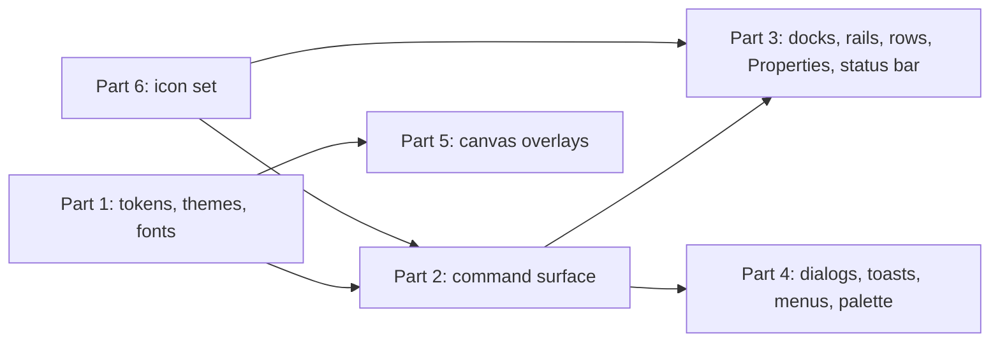

# WP-S2.17: design language and UI polish (closed specification)

**Status:** specified 2026-10-28 (documents only) for six parts, each one lane of one cycle, in three waves: part 1
(tokens, themes, fonts, 0.8 pw) ∥ part 6 (the icon set, 0.6 pw); then part 2 (the command surface, 1.2 pw) ∥ part 5
(canvas overlays, 0.9 pw); then part 3 (docks, rails, rows, the property grid, the status bar, the data grid and the
built panes, 1.5 pw) ∥ part 4 (cards, the Preview tab, toasts, dialogs, menus, palette, empty states, 0.9 pw); 5.9 pw
against a PERT of 6.0 pw (amended 2026-10-28 for the widgets built alongside doc 16a, §2.1 and §15.1); M-PP, before
G-PP; one independent Opus review per cycle (ID-667); **parts 1 and 6 delivered in cycle 31** (§5.1, §10.1; decision
log ID-740, ID-737); D7 amended to an in-house pixel gate (ID-739); **parts 2 to 5 delivered in cycle 32** (§6.1, §7.1,
§8.1, §9.1; decision log ID-747 to ID-750), so the package is complete (ID-751) · **Date:** 2026-10-29 · **Work package:**
[WP-S2.17](../02-work-packages.md#wp-s217-design-language-and-ui-polish) · **Design:**
[16a design language](../../design/16a-design-language.md), [ADR-0031](../../adr/0031-design-language-and-task-ordered-command-bar.md)
(Accepted) · **Visual reference:** the owner-approved [mockup](../../design/assets/design-language-mockup.html) · **Decision log:** the entries of §15.3, recorded as ID-724 to ID-727 and ID-739 at the cycle-31 design pass (part 6
ID-737, part 1 ID-740; follow-ups FT-519 to FT-523, §15.4); parts 2, 5, 3 and 4 as built ID-747 to ID-750 and the
package's completion ID-751 at the cycle-32 design pass (follow-ups FT-526 to FT-534, FT-536 and FT-537) · **Part of:**
ElektraWatt plan, specifications

**Purpose.** This is the closed specification of the package that gives the window its design language: one token
source with light, dark and high-contrast themes, the task-ordered command bar, the navigator rail with Properties
under the navigator, restyled rows, property grid, status bar, dialogs, toasts, menus and palette, canvas overlays
that never collide, and an icon set. It is written against the delivered shell of WP-S2.01 to WP-S2.06 and WP-S2.09
part 1 (§2.1), not against their code. Where this document and doc 16a differ, this document is the narrower and wins
for the lanes; doc 16a stays the target, and the owner-approved [mockup](../../design/assets/design-language-mockup.html) is the visual reference both are
read from: each part's acceptance compares its components with it (§12.0). A choice a lane meets that this document does not settle is escalated, never
guessed (`CLAUDE.md`, rule 2).

---

**Contents**
1. [Goal and non-goals](#1-goal-and-non-goals)
2. [Inputs](#2-inputs)
3. [The decisions of this specification](#3-the-decisions-of-this-specification)
4. [Crates, boundaries and the items added](#4-crates-boundaries-and-the-items-added)
5. [Part 1: tokens, themes and fonts](#5-part-1-tokens-themes-and-fonts)
6. [Part 2: the command surface](#6-part-2-the-command-surface)
7. [Part 3: docks, rails, rows, Properties and the status bar](#7-part-3-docks-rails-rows-properties-and-the-status-bar)
8. [Part 4: cards, toasts, dialogs, menus, palette and empty states](#8-part-4-cards-toasts-dialogs-menus-palette-and-empty-states)
9. [Part 5: canvas overlays](#9-part-5-canvas-overlays)
10. [Part 6: the icon set](#10-part-6-the-icon-set)
11. [Determinism, the headless mode and snapshots](#11-determinism-the-headless-mode-and-snapshots)
12. [Acceptance checks](#12-acceptance-checks)
13. [Files owned and out of scope](#13-files-owned-and-out-of-scope)
14. [Review checklist for the Opus reviewer](#14-review-checklist-for-the-opus-reviewer)
15. [Size, order, routing and the documents to update](#15-size-order-routing-and-the-documents-to-update)
16. [Sources](#sources)

---

## 1. Goal and non-goals

**Goal.** At the end of the package the window follows doc 16a and looks like the [mockup](../../design/assets/design-language-mockup.html). Every colour, size, radius and font comes from one
token module and passes a contrast test in light, dark and high-contrast themes; commands sit in a task-ordered command
bar generated from the action registry (Project, Page, Draw, Check, Output, View), with an app menu, quick access and
command search; navigators sit behind an icon rail with Properties docked under them; tree rows, table rows and
property rows each have one component; the property grid shows provenance only where a value is not authored and
hides internal fields under Advanced; the status bar shows its fields in a fixed order with exceptions emphasised;
dialogs, toasts, menus and the palette follow one anatomy each; canvas chips never overlap the ghost's label, each
other or the statistics panel; highlights meet 3:1 on the sheet; and every command, rail button and tool has an icon
from one vendored set. The pilot's G-PP task runs in the new window; the keyboard alone still reaches everything
(NFR-A11Y-01), every focusable node is named (NFR-A11Y-02), and the headless mode describes the new chrome
deterministically.

**Non-goals** (each with its place in §13):
- No change to any command, the model, the project format, the record logs, Golden A's outputs or the PDF; the sheet
  stays print-true.
- No new behaviour beyond what the restyle needs: the panes keep their models (WP-S2.06, WP-S2.09); new view actions
  only for density, the command bar, the rails and Advanced properties (§4.3).
- No keymap editor, no KeyTips, no customisation of the command bar (WP-S2.08 and 1.x), no 300 % pass beyond the
  snapshots of §12 (WP-S2.08), no dark-sheet view (1.0), no page thumbnails in the navigator (FT-492).
- No muda menus (FT-310): on macOS the app menu stays the in-window button until FT-310 lands.

## 2. Inputs

| Input | What the lanes take from it |
|---|---|
| [Doc 16a](../../design/16a-design-language.md) §3 to §9 | Pillars, tokens, layout, components, overlays, wording, command order: the target |
| [ADR-0031](../../adr/0031-design-language-and-task-ordered-command-bar.md) | The decisions and their alternatives |
| The [mockup](../../design/assets/design-language-mockup.html) (`docs/design/assets/design-language-mockup.html`) | The visual reference: token values in its `:root` and dark blocks, sizes and layout in its CSS, the Draw tab's commands and the status fields in its markup (§12.0) |
| [UX/UI](../../design/16-ux-ui.md) §2.4, §2.5, §3, §4, §6, §8, §10, §11 | The registry, settings, the shell as built, focus and keys, the property grid, notifications, accessibility, theming |
| [WP-S2.03](WP-S2.03-viewer-and-tool-framework.md), [WP-S2.04](WP-S2.04-placement-wiring-drawing-tools.md), [WP-S2.05](WP-S2.05-property-grid-find-replace-clipboard.md), [WP-S2.06](WP-S2.06-navigators-and-table-mode.md), [WP-S2.09](WP-S2.09-messages-bulk-previews-history-jobs-and-recovery-ui.md) as built | Tabs, tools and their hints, the ghost and chips, the property sheet and its rows, the navigator framework, jobs, notifications, the recovery dialog |
| Code at 78222b19, and the widgets of §2.1's last six rows as delivered in cycle 31 (2a59c054 and the WP-S2.06 part 3 and WP-S2.09 part 3 tips) | `crates/ew-ui/src/{app.rs,menu.rs,dock.rs,canvas.rs,canvas_area.rs,navigator.rs,properties.rs,status_bar.rs,palette.rs,picker.rs,notifications.rs,jobs.rs,messages.rs,fonts.rs,tool_view.rs,page_view.rs,parts_card.rs,start_page.rs,about.rs}`; `crates/ew-viewmodel/src/{actions.rs,layout.rs,status.rs,settings.rs,describe.rs,strings.rs,shell.rs,properties.rs}`; `assets/fonts/`; `REUSE.toml`; `xtask/` |
| Window checks | The cycle-30 screenshots named in doc 16a §10 |
| Requirements | FR-UI-001, FR-UI-018, FR-UI-025, FR-UI-027, FR-UI-034, FR-UI-043, NFR-A11Y-01 to NFR-A11Y-04, NFR-UX-07, NFR-PLAT-03; the follow-ups FT-338, FT-348, FT-390, FT-391, FT-425, FT-506, FT-507, FT-508, FT-509, FT-510 and FT-512's tooltip half |

### 2.1 What the delivered packages provide (the base contract)

| Item | Where | Used here for |
|---|---|---|
| The action registry: `ActionMeta` (id, kind, label key, category, chords, predicate with reason), dispatch | `ew-viewmodel` `actions.rs` | The command bar, the app menu and the palette are views of it (D3) |
| The menus drawn with egui from the registry, Alt mnemonics absent | `ew-ui` `menu.rs` | Becomes the app menu (part 2) |
| The workspace tree (`ew.workspace/1`), `PaneKind`, `Layout::with_bottom`, the egui_tiles `Behavior` | `ew-viewmodel` `layout.rs`, `ew-ui` `dock.rs` | Rails as views of tab groups; the default workspace (part 3) |
| The navigator framework (`NavKind`, rows, chip line, filter) | `ew-viewmodel` `navigators/`, `ew-ui` `navigator.rs` | Tree rows and the rail (part 3) |
| The property sheet (`Session::property_sheet`, rows with `provenance`, `route`, `category`) and the panel model | `ew-api`, `ew-viewmodel` `properties.rs`, `ew-ui` `properties.rs` | Property rows, Main and Advanced (part 3) |
| The status model (`status.rs`) and its describe line | `ew-viewmodel` | Field order and presence (part 3) |
| Tools with `status_hint`, the tool strip line, the Place ghost, FT-389's preview chips, highlights, the statistics panel | `ew-viewmodel` `tools/`, `ew-ui` `canvas.rs`, `tool_view.rs` | The HUD (part 2), overlays (part 5) |
| Toasts, the notifications log, the Jobs pane, the recovery dialog, the quit prompt | WP-S2.09 part 1 | Part 4 |
| `view.snapshot` (headless CPU PNG with overlays composited), `ui.describe`, `ew.uitranscript/1` | `ew-viewmodel`, `ew-ui` `headless.rs` | Deterministic overlay images and describe lines (§11) |
| egui_kittest 0.37 harness with the accessibility check and the name walker | `ew-ui` tests | Accessibility audits; snapshots with D7 |
| The table-mode data grid on egui_table: tool line (Table toggle, filter, Columns menu, error line), sortable header, frozen key column, cell cursor, marks, the cell editor, resize handles, the pattern fill and table cards (WP-S2.06 part 3) | `ew-ui` `nav_table.rs`, `navigator.rs`; `ew-viewmodel` `navigators/table.rs`, `shell/table.rs` | Doc 16a §6.21 (part 3; its cards part 4) |
| The message panel: severity groups and finding rows with severity icons, pending rows, the header counts, the detail block with Fix… and Rule page, the footer, the quick-fix card (WP-S2.09 part 2) | `ew-ui` `messages.rs`, `navigator.rs`; `ew-viewmodel` `navigators/messages.rs` | Doc 16a §6.24 (part 3; the card part 4) |
| The Preview tab and the "Preview open" strip (WP-S2.09 part 3) | `ew-ui` `preview.rs`; `ew-viewmodel` `preview.rs` | Doc 16a §6.23 (part 4) |
| The History panel with marker lines, Undo to here and the Show changes popup (WP-S2.09 part 3) | `ew-ui` `history.rs`; `ew-viewmodel` `undo_history.rs`, `shell/undo_panel.rs` | Doc 16a §6.24 (part 3) |
| The pick stack and its repeated-click walk, the hover outline (FT-500) | `ew-viewmodel` `tools::pick_stack`, `tools/select.rs`; `ew-ui` `canvas.rs` (`hover_rect`) | Doc 16a §7.1 and §6.25 (part 5); the chooser of §6.22 is a follow-up (§15.4) |
| The chip line "Not on this page" (WP-S2.06 part 1) | `ew-ui` `navigator.rs` (`chip_line`) | Doc 16a §6.24 (part 3) |

### 2.2 Gaps found

| Gap at 78222b19 | Consequence |
|---|---|
| No theme module: colours and sizes are egui defaults or literals in widget files | Part 1 builds the token module and a literal guard (D4) |
| `ActionMeta` has `icon: Option<IconId>` in the design but no placement data and no icon table | Part 2 adds `Placement`; part 6 adds the icon table (D3, D9) |
| Only Noto Sans Regular and Bold are bundled | Part 1 bundles SemiBold (D8) |
| The property sheet has no notion of a primary field | Part 3 marks primary fields in the viewmodel by kind (D11), not in `ew-api` |
| The chip placement of FT-389 knows the statistics panel but not the ghost label | Part 5 makes one placement function for every canvas chip (D13) |
| `egui_kittest` is built without `snapshot` and `wgpu` | D7 (as amended: an in-house pixel gate, no new package) |

## 3. The decisions of this specification

Each is a lead ruling; the design pass records them (§15.3). The taste choices were decided on 2026-10-28 (§15.5).

| # | Decision | Reason and trade-off |
|---|---|---|
| D1 | **Six parts in three waves**: wave 1 parts 1 and 6, wave 2 parts 2 and 5, wave 3 parts 3 and 4; 5.9 pw against a PERT of 6.0 pw (O 4.3 · L 5.8 · P 8.3; 5.7 before the built widgets were mapped, §15.1), 0.1 pw reserve; de-scope rule §15.1 | Tokens and icons are inputs of everything; parts 2 and 5 touch disjoint files (the chrome's top and the canvas); parts 3 and 4 touch the panes and the popups after the command bar has moved the menus |
| D2 | **The design language is doc 16a and ADR-0031 (Accepted), with the owner-approved mockup as the visual reference**; the lanes implement it as specified here; where 16a's text and the mockup differ on look the mockup wins and the lane reports the difference for 16a's correction; requirements override both (16a §11) | The owner approved the mockup; one picture to match is easier to hold than prose |
| D3 | **The command bar is generated from the registry**: `ActionMeta` gains `placement: Option<Placement>` (`tab: Tab`, `group: Group`, `order: u16`, `size: CommandSize { Large, Small }`, `bar_label: Option<&'static str>`, the short label without ellipsis) and `icon: IconId` becomes required for placed actions; `Tab` and `Group` are toolkit-neutral enums in `ew-viewmodel` with doc 16a §5.3's members and order; each tab names its next-step action (Draw: `check.run` as "Check project"; Check: PDF export; others none); the Draw tab holds exactly the mockup's fourteen commands and its next step; menus become the app menu over the same tree | One source; a test can prove that bar, menu, palette and mockup agree |
| D4 | **One token module in `ew-ui`** (`theme/`), with global ramps, alias tokens per theme and component sizes per density; `theme::apply` maps them onto egui; a dump `tests/expected/tokens.txt`; a source guard test fails on `Color32` constructors, hex literals and numeric `CornerRadius`, `Stroke` or `Margin` literals in `crates/ew-ui/src/**` outside `theme/` and `icons/generated.rs` | P7 made checkable |
| D5 | **Default theme follows the system** (egui's theme preference, doc 16 §11.1); light is the reference for snapshots and the mockup; the high-contrast themes are selectable in View ▸ Theme | As doc 16 decided; confirmed 2026-10-28 (§15.5) |
| D6 | **Two densities**, Comfortable default, stored as `density` in `settings.toml` and set by `view.density { value }`; Compact changes the row height, the command row and the command buttons' layout only, as in the mockup | JetBrains' compact-mode precedent; one switch, no per-panel densities |
| D7 | **Chrome snapshots by an in-house pixel gate** (*amended in cycle 31, decision log ID-739*: the first text, `egui_kittest`'s dev-features `snapshot` and `wgpu`, is **rejected**, because they brought 13 packages into the lock, among them a URL opener and two environment sniffers). Part 1's offscreen renderer (egui-wgpu on `ew-render2d`'s headless device, PNG through `ew-render-cpu`; no new package) draws the main window and the component gallery; an `ew-ui` test compares each image with a blessed PNG under `crates/ew-ui/tests/expected/snapshots/` (a pixel differs when a channel differs by more than a tolerance; at most a set number of differing pixels; a diff image written on failure; `EW_BLESS=1` re-blesses); the tests are `#[cfg(all(feature = "snapshots", windows))]` behind an `ew-ui` test feature and run in CI's `test-windows-3` (through `--all-features`) with WARP, uploading their images on failure; as built, a channel tolerance of 4/255 and at most 10 differing pixels over 8 gated images | Pixel snapshots are the only machine check of a look; one platform keeps them stable; a few dozen lines of comparison code cost less than thirteen packages in the development graph; the deterministic CPU `view.snapshot` covers the canvas overlays on every platform (§11) |
| D8 | **Asset decision: `NotoSans-SemiBold.ttf`** from the same Noto Sans release as the bundled Regular (OFL-1.1, `assets/fonts/`, the existing REUSE entry and `NOTICE` line extended); UI only (`FontFamily::Name("semibold")`); drawings unchanged | ADR-0028's family; a 13-px emphasis that Bold makes too heavy; no licence change |
| D9 | **Asset decision: Tabler Icons 3.50.0, vendored** as the SVG files actually used (about 110) under `assets/icons/tabler/` with `LICENSES/MIT.txt` and a `REUSE.toml` annotation naming Tabler's copyright line; the project's own glyphs under `assets/icons/ew/` (GPL-3.0-or-later, the application's licence); `cargo xtask gen-icons` converts both with `kurbo` (already in the lock) into `crates/ew-ui/src/icons/generated.rs` (committed, `--check` in CI); no runtime SVG parsing, no icon font, no new product dependency | Deterministic, testable, stroke width as a token; no wrapper crate that lags egui |
| D10 | **The default Schematic workspace changes**: left column = navigator group (rail-driven: Project with Pages and Devices, Terminal strips, Cables, Potentials, Structure, then the rest; History at the rail's foot) over Properties (50 : 50); right column = palettes group, closed; bottom group closed until opened; the workspace file format `ew.workspace/1` is unchanged and an old file still loads (its panes keep their places) | Doc 16a §5.1; the canvas gets 72 % of a 1280-px window |
| D11 | **Properties: Main and Advanced.** `ew-viewmodel` holds a per-kind list of primary field paths (Main, open by default) and a per-kind list of internal paths (Advanced: `$v`, ids, keys, source references, lineage, counters, form UUIDs) shown only when `show_advanced_properties` is on (`props.show_advanced { on }`, also the "Show advanced (n)" link at the panel's foot); provenance chips (one word: part, page, derived, override, frozen, library, generated) only for non-authored rows; no edit buttons (in-place editing as built through the existing edit routes); duplicate labels in one section are a test failure fixed by label keys, not by hiding rows | Doc 16a §6.8; P3, P6; no change to `ew-api`'s sheet |
| D12 | **The status bar's fields and order** are doc 16a §5.8's (the mockup's, with FR-UI-034's selection, cell, snap and renderer); the state field ("Ready") at the left; the tool hint moves to the HUD; the language and page fields leave the bar (start page and Settings keep the language switch); one findings field returns (WP-S2.09 D8 kept counts in the pane header; both now show them) | FR-UI-034; P3 |
| D13 | **One chip placement function** `place_chip(target: Rect, size: Vec2, obstacles: &[Rect], pointer: Option<Pos2>) -> ChipPlacement` (pure, in `ew-viewmodel`'s canvas module) for preview chips, ghost labels, highlight name chips and measurement readouts, with doc 16a §7.4's order and fallback; the ghost draws one label (FT-507); obstacles include the statistics panel, the HUD (always shown) and the zoom control (FT-508) | Collisions become a unit-tested function |
| D14 | **Highlights take doc 16 §10.3's hues** (#D55E00, #009E73, #CC79A7, #A86F00) with name chips filled with the hue and a black label (doc 16a §4.6), the selection the accent #0B63CE with 8-px handles; FT-506 closed; the CVD-render expected images re-blessed in one reviewed commit | NFR-A11Y-03's 3:1 on the sheet |
| D15 | **The headless surface**: `ui.describe` gains a `commandbar` section (the active tab, then one line per group with its actions, then the next step) and a `rail` line per side and a `hud` line (tool and prompt); the hint-strip line is removed; the status line follows D12; new actions `view.density`, `view.command_bar` (`collapsed: bool`), `view.command_tab { tab }`, `rail.show { side, pane }`, `props.show_advanced { on }`; every expected transcript that changes is re-blessed in one reviewed commit per part that lists them | The blind drafter and the scripts keep reading the window as text |
| D16 | **What the package absorbs**: FT-338 (named splitters, part 3), FT-348 (theme, icons, toolbar and window size and position memory; page thumbnails stay FT-492), FT-390 (the link preview's node, part 5), FT-391 (part 5), FT-425 (the picker's manufacturer headers, part 4), FT-506, FT-507, FT-508 (part 5), FT-509 (part 3), FT-510 (part 4), FT-512's tooltip half (part 5; the Connection points category stays with FT-512) | Each is a visual or naming defect of the surfaces this package redraws |

## 4. Crates, boundaries and the items added

### 4.1 Roles

| Crate | Layer | Parts |
|---|---|---|
| `ew-ui` | GPL | all: `theme/`, `icons/`, the command bar, rails, rows, dialogs, overlays |
| `ew-viewmodel` | GPL | 2: `Placement`, `Tab`, `Group`, registry placement data, the app-menu tree, HUD model, describe; 3: layout default, rail state, status order, Main and Advanced lists; 4: dialog specs, wording lint; 5: `place_chip` |
| `ew-render2d` | GPL | 5: FT-391's scale rule for overlay marks |
| `xtask` | GPL | 6: `gen-icons` |
| `elektrawatt` | GPL | tests; window size and position memory (part 3) |

**Rules the lanes keep** (the earlier packages' rules stand: through `Session` only, no `unsafe`, no unordered output,
no egui name outside `ew-ui` and `elektrawatt`, no `ew-model` name in `ew-viewmodel` or `ew-ui`):
1. **No change below the shell**: nothing in `ew-api`, `ew-commands`, `ew-model`, `ew-store` or any format crate.
2. **No new product dependency**; the assets of D8 and D9 are the only additions (D7 as amended adds no package);
   `cargo xtask check-deps`, `check-licence-map` and `reuse lint` stay green.
3. **Golden A's outputs do not change**; no file under `golden/` changes.
4. **No literal styling** outside `theme/` (D4's guard).

### 4.2 The types added

| Part | Crate | Item | Contract |
|---|---|---|---|
| 1 | `ew-ui` | `theme::Tokens` (all alias and component tokens of doc 16a §4 as fields), `theme::Theme { Light, Dark, HighContrastDark, HighContrastLight }`, `theme::Density { Comfortable, Compact }`, `theme::tokens(theme, density) -> Tokens`, `theme::apply(&Tokens, &egui::Context)`, `theme::contrast(a, b) -> f32` (WCAG 2.1) | Pure functions; `tokens` is deterministic; `apply` sets only what doc 16a §4.14 lists |
| 2 | `ew-viewmodel` | `enum Tab { Project, Page, Draw, Check, Output, View }`, `enum Group` (doc 16a §5.3's groups), `enum CommandSize { Large, Small }`, `struct Placement { tab, group, order: u16, size, bar_label: Option<&'static str> }`; `ActionMeta::placement: Option<Placement>`; `fn next_step(Tab) -> Option<ActionId>`; `fn command_bar(&ShellModel) -> CommandBarModel` (tabs, groups, buttons with bar label, enabled state and reason, the next step) | Toolkit-neutral; ordered by `(tab, group, order)` |
| 2 | `ew-viewmodel` | `struct HudModel { tool: ActionId, quick: [ActionId; 3], target: Option<String>, prompt: String }`, `fn hud(&ShellModel) -> HudModel` | Always present; with Select the prompt is the selection and its keys ("1 selected · Del deletes · R rotates") |
| 3 | `ew-viewmodel` | `RailState { left: PaneKind, right: Option<PaneKind> }` in the shell model; `StatusField` order per D12 | Rails are views of tab groups |
| 5 | `ew-viewmodel` | `fn place_chip(target: Rect, size: Vec2, obstacles: &[Rect], pointer: Option<Pos2>) -> ChipPlacement { rect, faded: bool }` (own small `Rect`/`Vec2`/`Pos2` types, no egui) | Doc 16a §7.4 |
| 6 | `ew-ui` | `icons::IconId` (one variant per icon, `snake_case` names), `icons::paint(painter, id, rect, color, stroke_px)`; `ew-viewmodel` names icons by a `&'static str` key that `ew-ui` maps, so `ew-viewmodel` stays egui-free | Generated table, static data only |

### 4.3 View actions added

`view.density { value: "comfortable" | "compact" }`, `view.command_bar { collapsed: bool }`, `view.command_tab {
tab }`, `rail.show { side: "left" | "right", pane }`, `props.show_advanced { on: bool }`; all view actions (no model
change, no history entry), all in the palette and in View. No command is added.

## 5. Part 1: tokens, themes and fonts

1. **The token module** `crates/ew-ui/src/theme/{mod.rs,tokens.rs,apply.rs}` with doc 16a §4.2 to §4.10's values,
   four themes and two densities; every alias has a value in every theme (a test).
2. **Contrast.** `theme::contrast` implements WCAG 2.1 relative luminance; the token test lists every declared pair
   (text on its surfaces, non-text on its surfaces, canvas slots on #FFFFFF) and asserts 4.5:1 for text, 3:1 for
   non-text, 7:1 for high-contrast text; doc 16a §4.5's table is the list of pairs.
3. **Apply.** `theme::apply` per doc 16a §4.14, called at start, on a theme change (system or View ▸ Theme) and on a
   density change; egui_tiles' `Behavior` reads its colours and sizes from `Tokens`.
4. **Fonts.** Bundle SemiBold (D8), register `FontFamily::Name("semibold")`, define the text styles of doc 16a §4.8
   (`Small`, `Body`, `Button`, `Heading`, `Monospace`, `Name("small")`, `Name("strong")`, `Name("display")`).
5. **Settings.** `theme` (`system | light | dark | hc-dark | hc-light`) and `density` in `settings.toml`; View ▸
   Theme and View ▸ Density; `view.density`.
6. **Migrate literals.** Every existing literal colour and size in `ew-ui` moves to a token (the guard test of D4
   passes); the window looks right in all four themes at this point, before the layout changes.
7. **A component gallery** (`ew-ui` test-only `gallery.rs`): buttons in every state, fields, rows, chips, a menu, a
   dialog and a toast, used by the snapshots of parts 1 and 4.

### 5.1 As built in cycle 31 (part 1)

**Part 1 delivered in cycle 31 (lane J31; decision log ID-740).** Commits cf52e7a9, f90a7e5e, 40be0315, 272d6a3a and
face6da6; the blind references re-blessed in 9af26fc2 (55 commands, 254 actions, 344 words).

- **Tokens** (`crates/ew-ui/src/theme/`): `tokens.rs` holds doc 16a v1.1's ramps, then aliases, then components
  (including §4.15's and §6.21 to §6.25's table, history and card tokens); `apply.rs` has `style_of`, `apply`,
  `apply_setting` and `font`; `mod.rs` has `Theme`, `Density`, `contrast`, `current(ctx)` and small helpers. The dump
  is blessed in `tests/expected/tokens.txt`; the literal guard (DL4) passes over `crates/ew-ui/src/**`.
- **Settings:** `theme` takes `system | light | dark | hc-dark | hc-light` (`system` installs Light and Dark in egui's
  two slots with the system preference); `density` takes `comfortable` (default) or `compact`; View ▸ Theme
  (`view.theme`, `value:text`, because `hc-dark` is not a word of the signature grammar) and View ▸ Density
  (`view.density`, an enum). Compact changes only the row height (24), the command row (36) and the large command size.
- **Fonts:** the `semibold` family is Noto Sans SemiBold, then Regular, then Math; the file comes from the same upstream
  commit as the bundled Regular and Bold and is pinned by its SHA-256 in a unit test, `NOTICE` and `REUSE.toml`.
- **Snapshots and the pixel gate (D7 as amended):** egui-wgpu on `ew-render2d`'s headless device renders the main
  window and the component gallery; 8 images are gated (the main window light and dark in both densities, the gallery
  in the four themes at ppp 1) against `tests/expected/snapshots/*.png` (about 801 KB) with a channel tolerance of
  4/255 and at most 10 differing pixels; the other images (high-contrast main windows, the gallery at ppp 2) are
  written for review only. Windows only, in `test-windows-3` through `--all-features`, with the images uploaded on
  failure. **Proven on local WARP only** (three identical runs); the first hosted run confirms it.
- **Migration:** every literal colour and size, including WP-S2.06 part 3's table, WP-S2.09 part 3's Preview tab and
  history panel and part 6's icons, takes a token. Gaps left to later parts are listed in §15.4.
- **Checks:** DL1 to DL8 pass (DL7: `dl7_density_and_theme_round_trip_through_settings_toml` and the settings unit
  test); IC6's role colours can now read the tokens (part 2 wires them with the placements).

## 6. Part 2: the command surface

1. **Placement data.** Every action of doc 16a §5.3 gets its `Placement`, bar label and icon key; each tab its next
   step; actions not in the table keep `placement: None`. The Insert menu's actions move to Draw; Tools dissolves per doc 16a §9.2.
2. **The command bar** (`ew-ui` `command_bar.rs`): the tab row (app menu button, quick access, tabs, command search)
   and the command row (groups, large, small and split buttons, toggles, the next-step primary), doc 16a §5.2's sizes
   per density and the mockup's look; collapse
   with Ctrl+F1 and a tab double-click; overflow into "More" below 1100 px; the bar never reflows on state changes.
3. **The app menu.** `menu.rs` becomes the app menu: one button opening the full tree in doc 16a §9.2's order; Alt and
   F10 open it; every registry action appears in it exactly once.
4. **Command search.** The field opens the existing palette anchored under it (the palette's restyle is part 4).
5. **The HUD** (`tool_view.rs`): doc 16a §5.5's pill from `HudModel`, always shown at the canvas bottom; it moves under
   the tab bar while the pointer is within 48 px; the tool strip line under the menu is removed. **The zoom control**
   of doc 16a §5.5 at the canvas's bottom right.
6. **AccessKit.** The tab row is a `TabList` of `Tab` nodes; groups are `Group` nodes named by the group; every button
   is named by its label and carries its shortcut; the HUD is a `Status` node with the tool and target.
7. **Describe and transcripts** per D15.

### 6.1 As built in cycle 32 (part 2)

Where the build differs from the text above (each item is a deviation for the cycle review to accept or send back):

- **The HUD** lives in its own `hud.rs` (not `tool_view.rs`); it is centred on the page-view pane's rectangle, not on
  the focused group's canvas. Its value reads `<tool>[ <target>] · <prompt>`. The Place prompt is
  `<target> · R rotates · V variant · Esc done`, the target being the predicted tag or terminal, else the strip.
- **The tool strip's fields** (IP name, Text binding, Wire marker fields, Structure box style and fields) moved into a
  floating "Tool options" card at the page view's top left, shown only while one of those tools runs.
- **The app menu** has ten menus: File, Edit, the six tabs' menus with their groups, Window and Help. Each action
  appears once, so File no longer holds Import ▸ and Export ▸ (doc 16a §9.2 lists them): the imports and exports sit in
  their tabs' groups. A group of more than three entries becomes a submenu, a smaller one a separated block.
- **Collapsed bar:** 33 px (the 32-px tab row and its 1-px line).
- **F6 ring:** command bar, navigator, canvas, properties; from no focus F6 starts at the navigator as before.
- **Pending commands** (no registry action yet) are drawn nowhere and listed by name in `command_bar::PENDING`.
- **Placed actions** without a topic of their own link to the "project-view" documentation topic.

**H32 (cycle 32, the seam to part 5 and CB7; recorded at the cycle-32 design pass, ID-747):**

- **Chrome obstacles (OV2, OV6).** The window reports the HUD's and the zoom control's frames, as drawn in the
  previous frame, through `CanvasHost::set_chrome_obstacles`, so `place_chip` keeps the chips off them. The OV2 window
  test `ov2_the_chips_keep_off_the_hud_and_the_zoom_control` aims the Place ghost so that its label's preferred spot
  lands on the HUD and the zoom control, and it was shown to fail without either half of the seam.
- **CB7.** `snapshots.rs` blesses the command bar for each of the six tabs in light Comfortable and dark Compact
  (`command-bar-<tab>-{light-comfortable,dark-compact}`, 12 gated images). Light Compact and dark Comfortable are not
  taken (FT-533).

## 7. Part 3: docks, rails, rows, Properties and the status bar

1. **Rails** (`ew-ui` `rail.rs`): left and right rails as views of their tab groups, whose own tab bars are not drawn
   (an egui_tiles `Behavior::tab_bar_height` of 0 for the containers the rails drive; if 0.18.0 cannot do this per
   container, the lane stops and reports, and the lead rules between a wrapper and egui side panels); doc 16a §5.4's
   order, names, keys (Ctrl+1 to Ctrl+9), the indicator bar, History at the foot and collapse; FT-509 closed.
2. **The default workspace** per D10; the panel header, the Pages | Devices segmented control (doc 16a §6.20) and the
   filter of doc 16a §5.4; Properties under the navigator; the bottom dock's look of doc 16a §5.7.
3. **Tree rows** (`navigator.rs`): doc 16a §6.6's anatomy for every navigator; the badges move from text to icon and
   caption badges; the current page row in `type.body.strong`.
4. **Table rows**: one row component for the Jobs, Messages and Find panes and every table, doc 16a §6.7, and the
   panes built alongside doc 16a (§2.1), each to its component in doc 16a §6.25, behaviour as built:
   - **the data grid** of table mode (`nav_table.rs`) per doc 16a §6.21: the tool line (the Table toggle as an icon
     button, the filter, the Columns menu with check icons and Move icon buttons, the error line), the header with the
     sort and derived icons, the frozen key column's edge, the row hover, marks, cursor row bar and cursor cell rings,
     the editing cell, the resize handle's hover line, the row height of `size.row`, and the component tokens of doc
     16a §4.15 (added to `theme/` as aliases if part 1 has not);
   - **Messages** per doc 16a §6.24: the severity icons at `size.severity_icon` with three distinct shapes, the group
     and rule rows, pending rows with their badge, the header's count badges, the detail block and the footer; in table
     mode the severity cell with icon and word;
   - **History** per doc 16a §6.24: the state icon and number columns, the badges, the undone tone, the row cursor,
     the icon-button row actions, the marker separators, the header, the empty state and Show changes in the dialog
     frame;
   - **the chip line** as jump chips (doc 16a §6.24).
5. **Properties** (`properties.rs`): the header, the filter when more than twelve rows, Main and Advanced (D11), the
   rows of doc 16a §6.8 with in-place value cells, the provenance chips, the row "…" menu; the duplicate labels of Golden A's sheets renamed.
6. **The status bar** (`status_bar.rs`, `status.rs`) per D12 and doc 16a §5.8, with the findings field and the
   renderer field's warning state.
7. **Canvas tabs and dock tabs** per doc 16a §5.5 and §6.4; the "Page view" and pane headings removed.
8. **FT-338**: the dock and canvas-area splitters get names ("Resize <pane> and <pane>"); the walker's skip removed.
9. **Window memory** (the rest of FT-348): the window's size, position and maximised state in `settings.toml`, restored
   at start and clamped to a visible monitor.

### 7.1 As built in cycle 32 (part 3)

Built: the rails, the default workspace, the panel headers with the segmented control, the named splitters
(FT-338), the page rows' badges, Properties' Main and Advanced groups, the status bar of D12, FT-518, FT-519 and
FT-523. The tests are `ew-ui` `tests/docks.rs` (DK1, DK2, DK3's window half, DK4's window half, DK8, FT-519),
`ew-viewmodel` `tests/docks.rs` (DK1's model half, DK3, DK4, DK5, FT-519's focus), `table_mode` (FT-509 through the
rail), `table_widget` TB7 (FT-523) and `command_surface` CB4 (65 % again).

- **Rails** are egui side panels outside the dock (`size.rail` each), views of `ew_viewmodel::rail`. egui_tiles 0.18
  has `Behavior::is_tab_bar_visible` per container, so the navigator group (the tab group that holds Pages, Devices or
  a rail navigator, or such a navigator alone) draws no tab bar; no wrapper was needed. The rail's active entry is
  derived from the layout (the pane shown in place of Pages); only the column's collapse is shell state
  (`rail_collapsed`, not persisted). `rail.show {side?, pane}` is hidden from the menus and the palette. The right
  rail's Symbols and Parts open the existing pickers (`tool.place`, `tool.place_part`): the palettes are not built,
  and `rail.show {side: right}` is refused with a reason.
- **The default workspace** is `split horizontal [split vertical ["Pages" 50%, "Properties" 50%] 23%, "Page view"
  77%]` in thousandths (233 : 767, 500 : 500), so the dock does not rewrite it on the first frame; 233 ‰ of the
  1,200 px between the rails is the mockup's 280-px column at 1280 × 800. A workspace file written before the package
  loads as it is (DK5). `with_properties` puts Properties under the column that holds Pages. The navigator's own
  tool row (New page, Table, Filter) stays as built under the segmented control; the bottom dock's look is unchanged.
- **Headers:** a pane outside a tab bar has the 32-px header (its title in `type.label`, upper case; the accessible
  name keeps its case), which is also its drag handle; the page view and the panes of a tab bar have none. The
  navigator group's header is its rail entry's name ("PROJECT" for Pages and Devices) with the segmented control
  (a `TabList` "Pages or devices" of two `Tab` nodes).
- **Splitters (FT-338):** the dock's and the canvas area's containers are not resizable for egui_tiles, and
  `crate::splitter` draws one named `Splitter` node per pair of shown neighbours ("Resize Pages and Properties"),
  named after each side's shown pane, with the accent line on hover and drag and a double click that evens the pair.
  The walker counts these nodes against `splitter_count` and lets no unnamed node through.
- **Tree rows:** the page rows' badges are caption chips (named `Label` nodes) after the text, not bracketed words;
  `ShownRow` gained `label` and `badges` (the describe lines keep `text` with brackets). The current page row is in
  `type.body.strong`. The expand glyphs stay "+" and "-" text, and the canvas tab titles keep their bracketed
  badges (the canvas tab bar is not restyled). *(Later in cycle 32: J32 below made the canvas tab badges chips; the
  chevron expanders are a window fix of W32, ID-756.)*
- **Properties:** the Main group (the kind's primary fields: page number, section, title, description; device tag,
  function text, parts, location; connection number, potential, cross-section, colour) comes first; the Advanced rows
  (`$v`, `id`, `source_ref`, `tag.counter`, `form`, by row path) show after "Show advanced (n)" at the foot
  (`props.show_advanced {on?}`, the setting `[properties] show_advanced`). Deviation from D11: the other categories
  stay open by default as built (their collapse is the user's, kept in the settings). The duplicate labels are
  renamed in the field labels ("… override", "Effective location", "Part use 2", "Connection point 1"). A value cell
  edits in place on a click (`props.row` then `props.edit`) with a hover border; an empty value is an em dash; the
  chip shows only for a value that is not authored, in short form ("f derived") with the whole text as its tooltip;
  the row's actions are one "…" icon button (`props.row_menu`) painted on the cursor row, on hover and on focus. The
  filter for more than twelve rows is not built.
- **Status bar:** `status::bar` gives D12's fields with a tone and a tooltip; the window and the describe line
  `status bar:` use it. The transcripts' `status` member keeps the older `fields()` (so the scripts' outputs are
  unchanged). The findings field reads the open Messages pane's counts, so it shows only while Messages is open.
  The save field says "Saved", "Unsaved changes" or "Read-only" (the reason in its tooltip). The findings, job and
  notifications fields are buttons (Messages, Jobs, the log); the rest are labels.
- **History:** the header adds "oldest kept: step `<k>` · `<a>` MB of `<b>` MB" (FT-518, MB = 10^6 bytes, one
  decimal). FT-519 adds `Focus::History` to the F6 ring (last, while the panel is shown) and `ui.focus {area:
  history}`: with that focus Up and Down are `history.row` and Enter is `history.undo_to`; a click on a row moves the
  row cursor there. The row actions stay text buttons; on the other rows they keep their nodes (Tab reaches them) but
  are not painted. The state icons, the badges and the dialog frame of doc 16a §6.24 are not built. *(Later in cycle
  32: K32 below built them, with the row actions as icon buttons.)*
- **Not built in this part:** Messages' restyle
  (DK10), History's icons (the rest of DK11), the DK12 snapshots, the dock tabs' restyle of doc 16a §6.4 and window
  memory (DK6, the rest of FT-348): candidates for the next cycle. *(Later in cycle 32: K32 built DK10, DK11's icons,
  the DK12 snapshots of Messages and History, and DK6 except the position clamp at start, FT-526; L32 built DK9, whose
  grid snapshots are FT-532. The dock tabs' restyle of doc 16a §6.4 and the Properties filter for more than twelve rows
  are still not built.)*

**J32 (cycle 32, the Properties, choice-list and canvas-tab side):**

- **Property rows (doc 16a §6.8, the mockup's `.prow` and `.psec`).** The label is painted left-aligned in
  `type.small` `color.text.secondary` in its `size.property_label` column (it was centred), ellipsised with the
  whole label as tooltip; the row has `space.4` side padding and `space.3` to the value cell. The value cell keeps its
  node and in-place edit; its hover border is now `color.border.control`, its padding `space.icon`, and a long value
  is ellipsised (the whole value as tooltip) instead of clipped; a read-only value shows its reason as tooltip. The
  provenance chip is a pill inside the value cell at its right end (`radius.pill`, `size.chip`, 1-px
  `color.border.default`, `type.caption` `color.text.tertiary`) holding one word, `properties::chip_word`: "page"
  (inherited from a page or a structure box on a page), "inherited" (any other inheritance), "derived", "override",
  "frozen", "library", "generated", "varies"; doc 16a's "part" has no source of its own in the model (a part's values
  arrive as Library or Derived) and "inherited" and "varies" are added: deviation, recorded here. The chip has no node;
  the row's description keeps the whole chip text. The cursor row takes the tree row's Selected state
  (`color.accent.subtle` and the 2-px accent bar) instead of accent label text. The editor is the value cell in its
  editing look (`color.surface.panel`, 1-px accent border and ring, `radius.sm`). Group headings are `type.small`
  SemiBold as written ("Main"), no longer `type.label` upper case. Main indents no row (its fields come from several
  levels without their parents); a category indents from its shallowest row. A row's error is the error icon and
  the message in `color.error`, `type.small` (no italics). Not done: the header's finding chips are still
  "[severity] rule message" text, and the actions popup is still drawn inline under the row (FT-530). Test: `ew-ui`
  `tests/properties.rs` `j32_property_rows_are_left_aligned_with_one_word_chips`; `ew-viewmodel`
  `the_chip_word_names_the_source`.
- **The choice editor's option list** is a popup (`egui::Area`, foreground) with doc 16a §6.22's look
  (`color.surface.raised`, `elevation.1`, `radius.md`, `space.2` padding, rows of `size.row`, at most
  `size.chooser` rows, 240 to 360 px wide, the active row in the hover overlay). `properties::choices_placement`
  opens it under the row when it fits above the status bar, else over the row, else on the larger side with its list
  cut to scroll; the bound is the central panel's rectangle (the window less the command bar, the rails and the
  status bar), which `app.rs` records each frame. Tests: the four placement unit tests in `properties.rs`, and
  `a_choice_editor_option_is_picked_with_the_mouse` now at 1280 × 800 (no longer 1000 × 1400) asserting the list and
  every option it shows lie inside the window and above the status bar, before and after typing.
- **Canvas tabs:** the badges ("QET grid", "generated") are the page rows' caption chip (now
  `components::caption_chip`, shared with the navigator) painted after the title; the tab's accessible name reads
  "<folio> <title>, QET grid". The title is `type.small`, secondary on an inactive tab and primary SemiBold on the
  active one, which has the `color.canvas.surround` fill and a 1-px `color.border.default` top and sides (the
  mockup's `.ctab`). Test: `tests/viewer.rs` `j32_canvas_tab_badges_are_chips_not_bracketed_words` (no label
  contains "[", the names end ", QET grid" and ", generated", the words are painted inside the tabs).
- **DK7 at 300 %:** `snapshots.rs` `the_main_window_at_300_percent_for_review` renders the main window (light,
  Comfortable, 1280 × 800 points) at 3 physical pixels per point, 3840 × 2400 pixels, for review and not gated (as the
  gallery at ppp 2). The setting `ui_scale` stops at 200 % (`UI_SCALES`), so the 300 % case is the system's display
  scale. The image is about 0.56 MB; gating it would be one argument, left off to keep re-blesses small (FT-537).
- **Snapshots re-blessed:** `main-{light,dark}-{comfortable,compact}` and the eight `part4-*` images (their window
  shows Properties and the canvas tab); nothing else changed.

**K32 (cycle 32, the second lane of part 3):** DK10, DK11's icon half, DK12 and DK6. Tests: `ew-ui`
`tests/rows_and_empty_states.rs` (DK10, DK11, DK6's restart), the unit tests of `messages.rs` (DK10's shapes, words
and colours), `history.rs` (DK11's state icons and undone tone) and `window_memory.rs` (DK6's recording and builder),
`ew-viewmodel` `window.rs` (DK6's clamp on three layouts) and `settings.rs` (`[window]`), and the DK12 snapshots.

- **Messages (DK10).** The severity icons are Tabler `circle-x`, `alert-triangle` and `info-circle` at
  `size.severity_icon` in `color.error`, `color.warning.icon` and `color.accent` (the filled shapes are gone); a
  finding row paints the icon and the severity word ("Error") in `type.small` SemiBold in the severity's text tone,
  the look of doc 16a §5.7's severity cell, in tree mode as well. A severity group row has its icon in place of the
  folder; it shows no count (the provider gives group rows none). A pending row draws icon, word and title in
  `color.text.tertiary` and carries the "Pending" status badge (neutral, `pencil`); `fix` and `waived` are the "Fix"
  (accent, `wand`) and "Waived" (neutral, `check`) status badges; a rule row's count is a count badge. In the Messages
  pane the badges are right-aligned and the title is cut with an ellipsis before them (the other navigators keep
  their as-built row layout). The header paints the scheme, one count badge per severity (12-px icon, subtle fill)
  and "waived n", "pending n" in tertiary; it is one `Label` node named by the as-built sentence, a polite live
  region. The detail block has a 1-px `color.border.subtle` rule, the rule ID and title in `type.body.strong`, the
  kind line in `type.small` secondary, Fix… as a Secondary button (disabled on a read-only project; its tooltip is
  `messages.fix`'s refusal reason when the action gives one) and Rule page as an accent link; the footer is
  `type.caption` tertiary under a rule line. The table-mode clause waits for FT-522 (ID-732). **Deviation:** Golden
  A's online scheme reports no warning, so the kittest proves an error, infos and a pending finding, and the
  warning's icon and colour are proved by the unit tests. **Fix:** the W31-1 rule that scrolls the cursor row back
  into view when the detail block shortens the list compared the cursor with last frame's rows; in the Messages pane
  it now compares with the rows that fit this frame (an opened detail block left the cursor row below the list).
- **History (DK11, DK12).** Rows of `size.row`: the state icon column (`arrow-right` in `color.accent` for the
  current entry, `arrow-back-up` in `color.history.undone` for an undone one), the number right-aligned in 28 px in
  `type.small` tertiary, the label in `type.body` (`type.body.strong` current, `color.history.undone` undone, secondary
  on the cursor row), origin and pages in `type.small` tertiary, the "merged n" caption badge and the "Not undoable"
  status badge (`lock`). The italics are gone (the icon carries the state; the name still ends ", undone"). The row
  cursor takes `color.accent.subtle`. The row actions are 24-px icon buttons with their as-built names as tooltips:
  Undo to here (`history`), Redo to here (`arrow-forward-up`, not named by doc 16a) and Show changes
  (`list-details`). A marker line is a `Splitter` node named by its text (AccessKit has no separator role), the text
  in `type.small` tertiary with a 1-px `color.border.subtle` rule to the row's end. The header is `type.small`
  secondary. Show changes is a non-modal `egui::Window` in the dialog frame's tokens (`color.surface.raised`,
  `radius.lg`, `elevation.2`, `space.5`), 440 px, its title painted in `type.title` (the window's node carries the
  name), the records as `size.row` rows, Close as a Secondary button; Escape closes it as built. **Not built:** the
  chip line's jump chips keep their as-built buttons (named "Open `<folio>-<cell>`"); their pill look is a follow-up
  (FT-531).
- **Snapshots (DK12).** Gated, light and dark at both densities, each cropped to its pane: `dk12-messages-*` (the
  rows with an error and a pending finding), `dk12-messages-detail-*` (the cursor on the pending finding with its
  detail block) and `dk12-history-*` (three steps, the save marker, one undone): twelve new images; no other image
  changed. The Terminal strips grid of DK12 is DK9's (lane L32), whose grid snapshots are not built (FT-532).
- **Window memory (DK6, FT-348).** `settings.toml` keeps `[window]` (`x`, `y`, `width`, `height` in whole points,
  `maximized`), written only once a window recorded it (at the end of the window, by `ShellModel::shutdown` in the GUI
  mode), so headless runs and tests keep their settings bytes; a table that cannot be read is dropped, not the file.
  `ew_viewmodel::window::restore` is the pure clamp (size at least 640 × 400 and at most the largest monitor; the
  position stays while a 48-px grip of the title bar lies on a monitor, else the window moves into the primary as
  close to its place as fits; maximised kept), tested on one monitor, two with one at negative coordinates, and a
  removed monitor, and idempotent over a grid. The window records its outer position and inner size each frame
  (only a real window: egui reports the monitor's size only there; a maximised window keeps its normal geometry);
  `elektrawatt` builds the viewport from the saved geometry. **Not built:** the position clamp at start runs with no
  monitor list (eframe 0.37 without its `persistence` feature exposes none before or after the window opens), so a
  window saved on a monitor that is gone opens off-screen until the list is wired; eframe still clamps the size to
  the largest monitor. A follow-up: FT-526.

**L32 (cycle 32, the data grid of doc 16a §6.21, DK9):**

- **Dispatch log first.** `App::dispatched_calls` keeps each dispatched action with its parameters (the names-only
  `dispatched` is unchanged). `tests/data_grid.rs` `dk9_every_key_dispatches_the_as_built_actions` drives every key
  of §6.21 (arrows, Tab, Shift+Tab, Home, End, Ctrl+Home, Ctrl+End, Shift+Up, Shift+Down, Enter, Ctrl+Enter, a
  printable character; in the editor Enter, Ctrl+Enter, Escape) and the pointer gestures (click, Ctrl+click,
  Shift+click, double click, two header clicks) on Golden A's Terminal strips table and compares the log with
  `tests/expected/table_keys.txt`, recorded from the grid before the restyle (its own commit) and unchanged after.
  As built and kept: Escape in the editor logs `ui.dismiss` then `table.commit`; Enter on a terminal row and Ctrl+Enter
  without a card dispatch nothing. The restyled columns are wider, so the test brings the next gesture's column into
  view through the shell (`table.cell`, not logged) where the old 40-px columns had it on show.
- **Header** (`nav_table.rs`): the `color.surface.sunken` band of `size.table_header` across the grid with a 1-px
  `color.border.subtle` line under it; each header cell is one button over the whole cell (name as built, FT-523's
  ", sorted ascending/descending" kept) with the hover overlay, its label in `type.small` SemiBold, secondary or
  primary when sorted, followed by the 16-px `arrow-narrow-up`/`-down` icon (the ↑ and ↓ characters are gone); a
  derived column's label by `math-function` in tertiary and the tooltip "Derived; read-only" (new string
  `table-derived`; the italics are gone). Resize handles are invisible at rest and a 1-px `color.accent` line on
  hover and drag (egui_table's widget strokes, scoped to the grid); they keep their "Resize <column> column" name.
- **Body:** cells are one click-sensing rect each (no selectable button), text in `type.small` with `space.4`
  padding cut with an ellipsis, derived cells in `color.text.secondary`; a marked row is `color.accent.subtle` across
  the row, the hovered row `color.state.hover`, one 1-px `color.border.subtle` line under each row; the cursor row
  paints the 2-px accent bar (`radius.mark`) at the key cell's left edge inset `space.2`; the cursor cell a 2-px
  `color.table.cursor` ring inside it while the grid has the keyboard (the shell's focus on the navigator and egui's
  on the grid) and a 1-px `color.table.cursor_idle` ring otherwise; the key column's 1-px `color.table.frozen_edge`
  line from the header to the last row. The editor is the value cell's editing look (inset `space.1`,
  `color.surface.panel`, 1-px accent border inside and ring outside, `radius.sm`, text in `type.small`).
- **Column widths:** a column starts at `size.table_column` and grows to its widest cell on show on the first frame
  (at most 480); as built egui_table's first-frame auto-size shrank every column to its 40-px minimum, so the cells
  showed "…". In the default left dock about two columns are on show; the TB7 and W31-3 tests now assert Strip and
  Terminal on show and bring Function text into view with the cursor.
- **Tests (`ew-ui` kittest, probes of the painted shapes):** `tests/data_grid.rs`
  `dk9_one_table_node_with_sort_buttons_and_the_sort_icon` (one `Table` node, the header's height and band, the sort
  icon's paths up and down, none on an unsorted header, `math-function` on the derived Potential header),
  `dk9_the_key_column_stays_and_paints_the_frozen_edge` (the edge line on the header and key cells before and after
  End, the key column's left unchanged), `dk9_marked_rows_the_cursor_row_bar_and_the_cursor_ring` (two marked rows'
  fills, the bar's rect, the 2-px ring and the 1-px ring after `ui.focus {area: canvas}`),
  `dk9_a_double_click_opens_the_editing_cell_with_the_accent_border` (the editor has the keyboard; inside and outside
  1-px accent strokes and the panel fill with `radius.sm`), `dk9_row_and_header_heights_in_both_densities`.
  `table_widget.rs` `w31_3_a_header_text_is_truncated_within_its_column` now checks that the header button covers its
  column and its painted label stays within the padding.
- **Not built in L32:** the tool line above the grid (the Table toggle as a 24-px `table` icon button, the Columns
  menu button as a Subtle button with a chevron, the move items as `arrow-left`/`arrow-right` icon buttons, the
  error line's icon), the focus ring around the whole grid, the pattern-fill and table cards (§6.9, §6.23 own
  them), and the DK12 grid snapshots (the review image `table-history-{light,dark}` shows the Devices table and is not
  gated; no gated snapshot changed). The tool line is FT-536; the focus ring, table mode's empty state and the grid
  snapshots are FT-532.

## 8. Part 4: cards, toasts, dialogs, menus, palette and empty states

1. **Dialogs**: one dialog frame in `ew-ui` (`dialog.rs`) for every modal of the shell (about, keyboard shortcuts, go
   to, save workspace, quit with unsaved changes, journal discard, recovery, renumber dialogs as they exist) with doc
   16a §6.12's anatomy; `ew-viewmodel` gives each dialog a `DialogSpec { title, body, primary, secondary, danger }`
   so the texts are tested headless. The quit prompt reads "Save changes to <project> before closing?" with Save,
   Don't save, Cancel; the recovery dialog reads "Recover unsaved changes?" with Recover, Open read-only, Discard….
2. **Toasts and the log** per doc 16a §6.10 (the canvas's top right); the log as the bell popover.
3. **Banners** per doc 16a §6.11.
4. **Menus and context menus** per doc 16a §6.13 (applies to the app menu of part 2).
5. **The palette** per doc 16a §6.14: no title, breadcrumbs, key chips, unrunnable actions not listed.
6. **The picker** (Insert ▸ Symbol, Device from part): rows with name and library in tertiary text, raw IDs only in the
   tooltip; part rows under manufacturer headers (FT-425).
7. **Empty states** for every list pane (doc 16a §6.17) and **outcome badges** for finished jobs (FT-510).
8. **Wording lint** (`ew-viewmodel` test over the registry labels, the dialog specs and the UI strings): no three
   full stops; an action whose dispatch opens a dialog or picker ends with "…" and no other does; sentence case with an
   allowlist of proper nouns, codes and acronyms (PDF, QET, EPLAN, IEC, PLC, CSV, CP, IP, PE, GPU, CPU, WARP).
9. **Cards** (doc 16a §6.9 and §6.23): every inline card (the property grid's, the quick fix's in `messages.rs`, the
   Pages reorder and the table card in `navigator.rs`, the pattern fill card in `nav_table.rs`, Find's replace, the
   parts import) with the title, the revision, the Stale and Failed status badges in place of the bracketed words, and
   Apply as the Primary; **the Preview tab** (`preview.rs`) with its header row, actions at the top right, collapsible
   lists with count badges and the list rows of doc 16a §6.23, and its empty state; **the "Preview open" strip**. Part 4
   edits only the card functions in part 3's files (`reorder_card`, `table_card`, `fix_card`, the pattern dialog); the
   second of the two lanes to integrate rebases.

### 8.1 As built in cycle 32 (part 4)

- **Dialogs.** `ew_viewmodel::dialogs::spec(&Dialog, &ShellModel) -> DialogSpec` covers every `Dialog` variant,
  including the creation and renumber forms; `DialogSpec` adds `asks` (the title ends with "?" exactly then) and
  `form` (the form width). `ew-ui/src/dialog.rs` draws them all on `egui::Modal` (the `color.backdrop` scrim): title
  in `type.title`, body, content, then the footer with the danger button at the left and the Primary and the others at
  the right in the platform's order. **Deviation:** in a confirmation of a destructive step (journal discard, purge)
  the Primary is Cancel (Enter keeps the data) and the step is the red danger button (`DangerPrimary`); the Primary is
  then drawn as a Secondary beside it. The headless `describe` output prints the spec's title and buttons in reading
  order. Being modal, the recovery dialog blocks the banner behind it until Escape closes it.
- **Toasts.** 300 px, `radius.lg`, `elevation.2`, `space.4` padding, at the canvas pane's top right (`space.4` in,
  under its tab bar), newest on top, `space.3` between them; each is a `Group` node named "Notification".
  **Deviations:** the notification model has no severity and no secondary line, so the icon is `circle_check`
  (success) when the toast offers an action and `info_circle` otherwise, and the line row is not drawn; the log's
  foot has Close, not Clear (the model has no clear action). The anchor uses the canvas pane's rectangle, so it is
  rechecked once part 3's dock headers land.
- **Menus.** Rows of `size.row` with a 16-px icon column (the action's icon, the check icon when checked, empty for
  submenus so labels align), the key in `type.small` secondary; the selection fill is off.
- **Palette.** An `Area` without a title, 560 px, anchored under the command bar's field; 32-px rows with icon,
  matched characters strong, breadcrumb (`tab · group`, else the menu path) in tertiary or the disabled reason in
  secondary, and key chips. Actions that need parameters and model commands are no longer listed (they stay reachable
  headless through `command.run`).
- **Picker.** Still an `egui::Window` (the global window style), rows as name plus tertiary library or function, raw
  IDs in the tooltip; part rows sorted by manufacturer (stable, part-number order within) with a header before each
  manufacturer (`Picker::header_before`); the filter also matches the manufacturer (FT-425).
- **Cards.** `components::inline_card` serves the property grid's, the quick fix's, the Pages reorder, Find's replace
  and the parts import card (an `Area` at the top centre, `elevation.1`); the table card has no strip; the pattern
  dialog uses `card_frame` with `apply_cancel_with`. Summaries no longer start with "Preview: "; the strip line is
  "`<title>` · `
`". **The Preview tab**: header row with "Preview: `<name>`", "as of rev `<r>`", the badge and
  Apply/Cancel at the right; collapsible sections with a count badge (accessible name "Tags (11)").
  **Deviation:** list rows are one `LayoutJob` (verb, kind, name, detail in their colours), not the 64-px change
  column. At 1280 px the strip in the Properties pane cuts its line to "Previ…" (ellipsis, full line in the tooltip);
  Apply, Cancel and Show stay whole.
- **Empty states and outcomes.** Built for the Jobs pane ("No jobs yet"), the Preview tab ("No preview is open") and
  the notifications log; Jobs rows carry Done, Cancelled or Failed badges (FT-510). **Not built:** the empty states
  of Messages, Find, History and the navigators: their files are part 3's (same cycle, other lane); the strings exist
  (`empty-find-*`, `empty-messages*`, `empty-history-text`) for that lane or a follow-up. *(Later in cycle 32: K32
  built them, below; table mode's empty state is FT-532.)*
- **Wording.** Every "..." in the strings, labels and tests became "…"; the quit prompt and the titles that ask end
  with "?". The lint's list of actions whose label ends with "…" is explicit in `tests/part4_dialogs.rs`
  (`OPENS_INPUT`). The banner and the floating Tool options card take the card frame and button kinds.
- **Snapshots (CP6, CP9).** Gated, light and dark: the quit prompt over the edit toast, the app menu's File submenu,
  the palette, and the Preview tab with the property grid's card and its strip. **Not taken:** the other dialogs one
  by one, the quick-fix card and the table card images (FT-533). The dialog footer's order on Linux and macOS has no
  test (FT-534). *(Integration: the palette shot was flaky behind the edit toast's wall-clock fade; the toast is
  dismissed before the menu and palette shots, 6bd0dbff, and the four images re-blessed.)*

**K32 (cycle 32, CP5's missing empty states):** `components::empty_state` now also serves the History panel
("Nothing to undo yet", `history` icon), the Messages pane ("No findings", `circle-check`), Find (before a search "Find
in the project", after one without hits `Nothing matches "<text>"`, `search`) and every navigator in tree mode (one
line per kind, "No devices yet" … "No report blocks yet", the rail's icon, and one shared sentence; Pages "No pages
yet" with its own). A navigator whose filter hides every row says `Nothing matches "<filter>"` with **Clear filter**
(Primary), which clears the filter (`pages.filter` or `navigator.filter`). Each is a `Group` node named by its line;
it shows only once the list's rows are built (a project is open, the navigator's table read). Test:
`tests/rows_and_empty_states.rs` `cp5_…` on a new project (History, the Pages filter and Clear filter, Devices,
Messages, Find before and after a search) with the walker. Strings added: `empty-nav-*`, `severity-*`, `badge-pending`,
`badge-waived`, `badge-fix`, `badge-not-undoable`, `messages-header-waived`, `messages-header-pending`; components
added: the `Pending`, `Waived`, `Fix` and `NotUndoable` status badges and `caption_badge`. **Not built:** the empty
state of a navigator in table mode (the data grid, DK9's file).

## 9. Part 5: canvas overlays

1. **Tokens on the canvas**: selection, hover, ghost, snap, CP rings, highlights, measurement and chips take doc 16a
   §4.6's tokens through the canvas host; highlights per D14 (FT-506).
2. **FT-391's scale rule** for every overlay mark at ppp 1, 1.5, 2 and 3.
3. **Selection** with its white casing and 8-px handles; hover dashed (doc 16a §7.1); highlight name chips in the hue
   with a black label (D14).
4. **`place_chip`** (D13) for every chip; the ghost's single label (FT-507); the statistics panel and the HUD as
   obstacles (FT-508).
5. **CP tooltip** (FT-512's tooltip half): hovering a CP shows its printed label, function kind and potential.
6. **The link preview popup's node** (FT-390): a named, non-focusable region with the target folio and cell.
7. **The statistics panel** restyled as a diagnostic chip (doc 16a §7.7).
8. **The pick stack's hover** (FT-500, doc 16a §6.25): the hover outline of the stack's first entity in `canvas.hover`
   per doc 16a §7.1, and the walked selection in `canvas.selection`; the walk, the pick order and the drag rule stay
   as built. The chooser list of doc 16a §6.22 is not built here (§15.4).

### 9.1 As built in cycle 32 (part 5)

**Part 5 delivered in cycle 32 (lane B32, Opus/medium, one fix round; decision log ID-748; recorded at the cycle-32
design pass).** Commits 2f6d90cc, 627f0de4 and 5769ceb2, with the test fix fc1fbd97; the chrome half of the obstacles
is part 2's seam (§6.1, H32).

- **Scale rule (FT-391, OV3).** `ew-render2d` `overlay::mark_scale` gives `s = max(1, ⌊ppp⌋)`: lines `s` px with 4s
  dashes, grid cross and junction 6s + 1, CP ring 8s + 1, hover `s`, selection 2s, cursor arms `s` wide; at ppp 1 the
  marks keep their sizes. Unit tests `ov3_the_scale_factor_is_the_whole_part_of_ppp`,
  `ov3_every_mark_follows_the_scale_rule` and `ov3_at_ppp_1_the_marks_keep_their_sizes`.
- **Selection (OV6).** A 2s-px outline in `canvas.selection` with an s-px white casing **on both sides** of it and four
  8s-px handles (accent rim, white face). **Deviation:** doc 16a §7.1 puts the casing outside the outline; the mockup
  draws it on both sides, and the mockup wins (ID-725).
- **Canvas tokens.** `LIGHT` and `DARK` take doc 16a §4.6's canvas tokens (accent #0B63CE for selection, hover, snap,
  cursor, and the ghost at 60 %); the window's canvas theme comes from the token module (`canvas_theme`); the page
  bounds are drawn in `color.border.default`, and the surround and grid dots moved to their tokens (the four
  main-window snapshots re-blessed).
- **`place_chip` (D13, OV2; FT-507, FT-508).** `ew_viewmodel::canvas::chip::place_chip(target, size, obstacles,
  pointer)` tries four candidates 8 points off the target, preferred above right, and rejects one that meets an
  obstacle (the caller passes the outside of the canvas as four, `chip::outside`) or the pointer's 16-point box; when
  all fail it returns the preferred anchor, faded.
  `canvas_chips` plans every chip with it against the statistics panel and the chrome a host reports
  (`CanvasHost::set_chrome_obstacles`). The Place ghost's label strips an earlier tag before appending the current one,
  so it names the tag once. Unit tests `ov2_*` in `canvas/chip.rs` (each branch, each obstacle, chips inside the
  canvas, successive chips never intersect).
- **Highlights (D14).** The name chips take their slot's hue with a black label and radius 4
  (`ov6_the_highlight_name_chips_take_their_hue_and_a_black_label`). They are drawn in the window only, not in the
  `view.snapshot` PNGs, so OV6's chip clause is proven on the overlay model and the window's shapes.
- **CP tooltip (FT-512's tooltip half, OV4).** The hovered CP's tooltip has the inverse look and reads
  `<printed label> · <symbol name> · <potential>` (`ew_viewmodel::canvas::cp_tip`; `1X1:1/a · terminal · L` on Golden
  A), a part the page tables do not know being left out. **Deviation:** doc 16a §7.2's example "-X1031 : 21 ·
  terminal · 24VDC-1" and OV4's text use another label form; the build prints the label of ID-711 and the
  representation's symbol name as the kind.
- **Link preview (FT-390, OV4).** A named, non-focusable image node with the target folio and cell
  (`ov4_the_link_preview_has_a_named_region`).
- **Statistics panel (doc 16a §7.7).** The canvas chip's look (`canvas.chip`, `radius.sm`) at the canvas's top right,
  `space.4` in. Its width follows its live text, so it jitters as the numbers change (FT-527).
- **Pick stack (OV7).** The hover outlines the stack's first entity, dashed in `canvas.hover`; a repeated click selects
  the next in `canvas.selection` (`ov7_the_pick_stacks_hover_outline_and_walk`); FT-500's tests pass unchanged.
- **Snapshots (OV5).** `ov5_ov6_the_overlay_snapshots_of_folio_101` blesses four canvas images under
  `tests/expected/canvas/` (`101-selection`, `101-selection-highlights`, `101-measure`, `101-ghost`), equal across two
  runs and to the blessed image within a channel tolerance of 4/255 and at most one differing pixel in 2,000. The
  test's `fn bless` (the `EW_BLESS` switch) is a reviewed `disallowed_methods` site.
- **Fix round (OV2 on the merged tip).** OV2's window test failed after part 3 landed: the CPU canvas draws, and places
  its chips, with the settled transform (dpi rounded, a whole-pixel origin), while the test mapped anchors with the
  model's exact zoom. `CanvasHost::drawn_screen_of` (hidden from the docs) gives a point as the last frame drew it;
  the OV2 and FT-502 tests use it, and OV2 checks the overlap condition on the same frame's statistics panel. The
  product was unchanged.

## 10. Part 6: the icon set

1. **Vendor** the Tabler 3.50.0 SVGs named in doc 16a's icon map (the lane derives the list from the placements of
   §5.3, the rail, the provenance icons, the severity icons and the status bar; about 110 files) into
   `assets/icons/tabler/`, with the licence and the REUSE annotation (D9). A name that does not exist in 3.50.0 stops
   the lane with a list; the lead picks substitutes.
2. **Draw the EW glyphs** Tabler lacks (cable, terminal strip, interruption point, black box, potential, structure box,
   QET grid badge) on Tabler's 24 grid: stroke-only `path` elements, round caps and joins, 2 px at 24; each with a
   one-line description in `assets/icons/ew/README.md`.
3. **`cargo xtask gen-icons`** parses the `d` attributes with `kurbo::BezPath::from_svg`, refuses any element other
   than `path` and any fill, flattens nothing (epaint strokes the cubic segments through its path tessellation),
   writes `crates/ew-ui/src/icons/generated.rs` sorted by name, and has `--check`. CI's `xtask ci` runs the check.
4. **`icons::paint`** draws an icon in a rect with the token stroke (doc 16a §4.11) scaled by ppp.
5. **An icon gallery** in the component gallery for the snapshots.

### 10.1 As built in cycle 31 (part 6)

**Part 6 delivered in cycle 31 (lane L31; decision log ID-737).** Commits 8a20bb68 and 44070459.

- **Vendored:** 96 outline SVGs of Tabler Icons 3.50.0 (fewer than item 1's estimate of about 110) from the npm
  package, the archive's SHA-256 in `NOTICE`; `focus-2` (Go to) holds a filled dot and is replaced by
  `current-location`. `REUSE.toml`, `NOTICE` and `ci/licence-map.toml` carry Tabler's copyright line as its MIT licence
  states it (ID-738).
- **EW glyphs:** black box, cable, interruption point, potential (a conductor with two node dots and taps ending in open
  circles, after one redraw), QET grid, structure box and terminal strip, keys `ew-<stem>`, annotated in `REUSE.toml`;
  dashes and dots are separate subpaths, never `stroke-dasharray`.
- **The generator:** `cargo xtask gen-icons [--check]` parses each `d` with `kurbo::BezPath::from_svg` (kurbo 0.13.1,
  `std` only; no new package or feature edge), refuses any element but `svg` and `path`, any fill, any `style`, a
  viewBox other than `0 0 24 24` and a `stroke="none"` path other than Tabler's bounding box (dropped), rounds to
  1/1000 and sorts by key; `generated.rs` (103 icons, `#[rustfmt::skip]`) is checked by `xtask ci` and the docs
  workflow.
- **In `ew-ui`:** `IconId` (snake_case variants, `ALL`, `KEYS`, `COUNT`, `from_key`, `key`), `icons::shapes(id, rect,
  color, stroke_px)` and `icons::paint`; round caps and joins are discs of half the stroke at every vertex (epaint has
  neither), curves flattened at 0.05 pt; the icon fills the rect's largest centred square; stroke, size and colour are
  parameters until part 1's tokens. The icon map (doc 16a names about 20 icons) is recorded in `tests/icons.rs`; part 2
  reuses it; the Potentials rail uses `ew-potential`, because `bolt` is the product mark.
- **Checks now:** IC1; IC2's generator half and table half (every key 16a names and the seven EW keys exist); IC3 (16,
  20 and 24 px at ppp 1 and 2, every vertex inside the rect plus one pixel); IC4 (the About notices name Tabler;
  `reuse lint` clean); IC6's metrics (16 and 20 px, 1.5-px stroke, cap discs of radius 0.75) and its names (every titled
  mockup control holding an icon is in a title-to-key table whose keys exist).
- **Deferred:** IC5, the icon gallery snapshot, to part 1's component gallery and D7's gate; IC2's "every key used by the
  registry and the rails", to part 2 (`IconId::from_key(meta.icon)` for each placed action); IC6's role colours as
  tokens (secondary at rest, accent when active), to part 1's token module.

## 11. Determinism, the headless mode and snapshots

1. **Transcripts and describe** stay deterministic: the command bar, rails and status lines are sorted by the
   registry's order; no pixel size appears in a describe line; each part re-blesses the expected transcripts it
   changes in one reviewed commit that lists them, and runs every script twice for byte equality.
2. **Canvas overlays** are proven on the deterministic CPU path: `view.snapshot` PNGs of folio 101 with a selection,
   a ghost with its chip, four highlights and a measurement, blessed under `crates/ew-ui/tests/expected/` and equal on
   every platform (as the existing canvas snapshots are).
3. **Chrome snapshots** (D7 as amended: part 1's offscreen renderer and the in-house pixel gate) run on Windows with
   WARP in one CI job and locally; elsewhere they are not compiled. Each part blesses its own images; the reviewer looks at them.
4. **No time, path, process ID or UUID** in any new describe line, notification or dialog text.

## 12. Acceptance checks

All are ordinary nextest tests in the existing jobs unless marked "snapshot" (D7). Targeted checks per lane (testing
policy): nextest, clippy `-D warnings` and `cargo fmt --all --check` for the crates changed, `check-deps`,
`check-features`, `check-licence-map`, `reuse lint` where touched.

### 12.0 Conformance with the mockup

The approved [mockup](../../design/assets/design-language-mockup.html) is checked by machine where it can be: **token values exactly**, and **geometry within
the tolerances below**. Rasterisers differ (a browser against epaint), so pixels are not compared across them; the
snapshots of D7 are reviewed side by side with the mockup at the same size, theme and density (§14 item 8). The
checks read the committed mockup file (`include_str!` from `docs/design/assets/`), so a new mockup version moves the
expected values in one reviewed commit.

**Token map.** The mockup's custom properties map one to one onto 16a's aliases: `--surface-chrome` →
`color.surface.chrome`, `--surface-panel`, `--surface-raised`, `--surface-sunken`, `--surface-inverse`,
`--text-primary` … `--text-on-inverse`, `--accent`, `--accent-hover`, `--accent-subtle`, `--border-subtle`,
`--border-default`, `--border-control`, `--hover`, `--pressed`, `--error` … `--success-subtle`, `--warning-icon`,
`--canvas-surround`, `--grid-dot`, `--selection`, `--shadow-1` → `elevation.1`, `--shadow-2` → `elevation.2`,
`--row` → `size.row`, `--bar-cmd` → `size.command_row`; the `:root` block is Light and Comfortable, `[data-theme=dark]`
is Dark, `[data-density=compact]` is Compact.

**Reference geometry** (1280 × 800, ppp 1, the default workspace on Golden A folio 101; from the mockup's CSS):

| # | Element | Mockup | Tolerance |
|---|---|---|---|
| G1 | Command bar height (tab row, command row, bottom line) | 85 (Compact 69) | ±1 px |
| G2 | Tab row; command row | 32; 52 (Compact 36) | ±1 px |
| G3 | Large command button; small command button | 46 high, ≥ 52 wide; 24 high | ±1 px |
| G4 | Command search field; quick-access button | 280 × 24; 28 × 24 | ±2 px |
| G5 | Left rail; left column; right rail | 40; 280; 40 | ±1 px |
| G6 | Rail button | 32 × 32 | ±1 px |
| G7 | Canvas-tab bar; status bar | 32; 26 | ±1 px |
| G8 | Canvas width as a share of the window | 71.9 % (920 px) | ±1 percentage point |
| G9 | Navigator : Properties heights | 50 : 50 | ±3 percentage points |
| G10 | Row height; property label column | 28 (Compact 24); 96 | exact; ±2 px |
| G11 | HUD: height; gap to the canvas bottom; centred | 36; 16; centre within 2 px | ±2 px |
| G12 | Zoom control: buttons; inset right and bottom | 28 × 28; 12 and 16 | ±2 px |
| G13 | Toast: width; inset top and right of the canvas | 300; 12 and 12 | ±2 px |
| G14 | Bottom dock when opened | 184 high, tab row 32 | ±1 px |
| G15 | Radii: icon buttons, value cells, chips 4; command, rail and primary buttons, fields 6; toasts and dialogs 8; HUD and badges pill | as listed | exact |

### 12.1 Part 1

| # | Check | Where | Proves |
|---|---|---|---|
| DL1 | `contrast` returns 5.19 for #0072B2 on #FFFFFF and 4.54 for #767676 on #FFFFFF (±0.01); every declared pair of every theme meets its floor (text 4.5, non-text 3, high-contrast text 7, canvas slots 3 on #FFFFFF) | `ew-ui` unit test | NFR-A11Y-03, NFR-A11Y-04 (the contrast lint) |
| DL2 | Every alias exists in all four themes and both densities; `tokens.txt` equals the blessed dump; two runs byte-identical | `ew-ui` test | D4 |
| DL3 | After `apply`, `ctx.style()` has `panel_fill`, `window_fill`, `selection.bg_fill`, `hyperlink_color`, `widgets.*.corner_radius`, `spacing.interact_size.y` and the text styles equal to the tokens, per theme and density | `ew-ui` test | §4.14 mapping |
| DL4 | The literal guard: no `Color32::from_rgb`, `from_rgba_*`, `from_hex`, named `Color32` constants, or numeric `CornerRadius`/`Stroke`/`Margin` constructors in `crates/ew-ui/src/**` outside `theme/` and `icons/generated.rs` | `ew-ui` test over the sources | D4, P7 |
| DL5 | SemiBold is registered; a `type.body.strong` label is laid out with the semibold family; `reuse lint` and `check-licence-map` pass with the new font | `ew-ui` test; lane | D8 |
| DL6 | Snapshot: the component gallery in the four themes at ppp 1 and 2 | snapshot | Doc 16a §6 states |
| DL7 | `view.density` and the theme setting round-trip through `settings.toml`; an unknown value is refused with its reason | `ew-viewmodel` test | D5, D6 |
| DL8 | **Matches the mockup's tokens:** every custom property of the token map (§12.0) parsed from the mockup's `:root`, dark and compact blocks equals the `Tokens` value of Light, Dark and Compact exactly (hex, alpha to 1/255, shadow offsets, blur and colours, sizes in px); G10 and G15's radii exactly | `ew-ui` test | D2, mockup |

### 12.2 Part 2

| # | Check | Where | Proves |
|---|---|---|---|
| CB1 | Registry: every placed action has an icon key, a label, a docs anchor; tabs and groups in doc 16a §5.3's order; Draw holds Select, Place, Connect, Annotate and Arrange; no action placed twice; at most two Large per group; every registry action appears exactly once in the app-menu tree | `ew-viewmodel` test | D3, P5 |
| CB2 | AccessKit: a `TabList` with six `Tab` nodes named Project to View; every command button named by its label with its shortcut; clicking each enabled button of the Draw tab dispatches its action (counted through the dispatch log) | `ew-ui` kittest | NFR-A11Y-02 |
| CB3 | Keys: Alt and F10 open the app menu; Ctrl+F1 collapses and restores; F6 from the canvas reaches the command bar in doc 16a §5.9's order; Left and Right move between tabs | `ew-ui` kittest | NFR-A11Y-01 |
| CB4 | Geometry at 1280 × 800, 100 %: G1 to G4 and G11 within tolerance in both densities; the canvas rect is at least 65 % of the window's width in the default workspace (part 3's layout) or the current one (before part 3) | `ew-ui` kittest | ADR-0031 decision 5, mockup |
| CB5 | HUD: always one `Status` node; with Select and one selected object its prompt reads "1 selected · Del deletes · R rotates"; arming Place on Golden A folio 101 names the tool and target and its key hints; no node of the former tool strip exists | `ew-ui` kittest | Doc 16a §5.5 |
| CB6 | Describe and transcripts re-blessed per D15; scripts twice byte-identical; `ew apply` replay unchanged | lane; tests | §11 |
| CB7 | Snapshot: the command bar for each tab, light and dark, Comfortable and Compact; reviewed beside the mockup | snapshot | Doc 16a §5.2 |
| CB8 | **Matches the mockup's command surface:** the Draw tab's buttons parsed from the mockup's command row (label, large or small, group order, the next-step button "Check project") equal `command_bar` for Draw (bar labels, sizes, order; a mockup command whose action is not yet in the registry, such as Align, is listed by name as pending and skipped, never reordered); the six tab labels equal the mockup's; the app button carries the name "ElektraWatt" and the accessible name "Menu" | `ew-viewmodel` test; kittest | D3, mockup |

### 12.3 Part 3

| # | Check | Where | Proves |
|---|---|---|---|
| DK1 | With every navigator shown, each has one named rail button, all reachable by Tab and by Ctrl+number; the accessible-name walker passes with no skip (FT-338, FT-509) | `ew-ui` kittest | FT-509, FT-338 |
| DK2 | Pages navigator rows on Golden A carry no "[QET grid]" or "[generated]" text; their badges are named nodes; the focused tab's page row uses the strong text style | `ew-ui` kittest | Doc 16a §6.6 |
| DK3 | Properties on Golden A for a page, a device, a terminal and a connection: no two rows of a section share a label; no authored row has a provenance description; no node named "edit"; Advanced rows (`$v`, ids, keys, lineage) absent until `props.show_advanced { on: true }`; Main open, other categories closed; an Enter edit commits exactly one command (the as-built mapping unchanged) | `ew-viewmodel`, `ew-ui` tests | D11, FR-UI-008 unchanged |
| DK4 | Status fields in D12's order, equal to the order of the mockup's status-bar fields; "Ready" at the left; findings shown only when non-zero, as one field; renderer field in warning style on `--no-gpu`; no language or page field | `ew-viewmodel` test; describe | D12, FR-UI-034, mockup |
| DK5 | The default workspace per D10; a workspace file written before the package loads with its panes in place; `ew.workspace/1` bytes for a saved default are deterministic | `ew-viewmodel` test | D10 |
| DK6 | Window size and position restored and clamped (a pure clamp function tested on three monitor layouts) | `elektrawatt` or `ew-ui` test | FT-348 |
| DK7 | Snapshot: the main window on Golden A folio 101 at 1280 × 800, light and dark, Comfortable and Compact, and at 300 % UI scale (light, Comfortable); reviewed beside the mockup | snapshot | Doc 16a §5, NFR-A11Y-04 |
| DK8 | **Matches the mockup's layout:** G5 to G10 and G14 within tolerance; the first five rail entries in the mockup's order (Project, Terminal strips, Cables, Potentials, Structure) with History at the foot; the Project entry shows the Pages and Devices segmented control | `ew-ui` kittest | D10, mockup |
| DK9 | Data grid on Golden A's Terminal strips navigator in table mode: the grid is one `Table` node; header cells are buttons "Sort by <column>" and the sorted one paints the sort icon; the key column stays at the left after a horizontal scroll and paints its `color.table.frozen_edge` line; a marked row paints `color.accent.subtle`, the cursor row the 2-px bar and the cursor cell the 2-px ring (1 px when the focus is elsewhere); a double click opens an editing cell with the accent border; every key of doc 16a §6.21 dispatches the same actions as before the restyle (the dispatch log equals the as-built expected log); row height `size.row` in both densities, header `size.table_header` | `ew-ui` kittest (probes of the painted shapes) | Doc 16a §6.21, as-built behaviour kept |
| DK10 | Messages on Golden A with one error, one warning and one pending completeness finding: the three severity icons are distinct shapes at 16 px in their colours; the pending row's icon and title use the tertiary tone and it carries a "Pending" badge node; every finding row's accessible name holds its severity word; the header's live value is the as-built sentence; Fix… is disabled with a reason on a read-only project; in table mode the severity cell paints icon and word (this clause waits for FT-522: as built the Messages pane has no table mode, decision log ID-732) | `ew-ui` kittest | Doc 16a §6.24, FR-UI-025 (not colour alone) |
| DK11 | History after three commits and one undo: the current entry paints `arrow-right` and the strong style, the undone entry `arrow-back-up` in `color.history.undone` and its name ends ", undone"; the row actions are named icon buttons; a marker line is a separator row; Show changes opens in the dialog frame and Escape closes it; the chip line's jump chips are buttons "Open <folio>-<cell>" | `ew-ui` kittest | Doc 16a §6.24 |
| DK12 | Snapshot: the Terminal strips grid in table mode (a sorted column, a derived column, two marked rows, the cursor cell, an editing cell), the Messages pane in tree mode (its table mode with FT-522, ID-732), and History, light and dark, Comfortable and Compact; the grid reviewed beside the mockup's component sheet | snapshot | Doc 16a §6.21, §6.24, mockup |

### 12.4 Part 4

| # | Check | Where | Proves |
|---|---|---|---|
| CP1 | Every `DialogSpec` has exactly one primary; no primary is destructive; titles end with "?" when they ask; Escape cancels every dialog (kittest) | `ew-viewmodel`, `ew-ui` tests | Doc 16a §6.12 |
| CP2 | Toasts: at most three, anchored at the canvas's top right, newest on top; the bell opens the log | `ew-ui` kittest | Doc 16a §6.10 |
| CP3 | Wording lint of §8 item 8 over the registry, the dialog specs and the UI strings | `ew-viewmodel` test | Doc 16a §8 |
| CP4 | Palette: an action without a GUI path is not listed; results carry breadcrumbs and key chips | `ew-viewmodel` test; kittest | Doc 16a §6.14 |
| CP5 | Every list pane shows its empty state as a named node; a finished job shows Done, Cancelled or Failed (FT-510); picker part rows under manufacturer headers (FT-425) | `ew-ui` kittest; `ew-viewmodel` test | FT-510, FT-425 |
| CP6 | Snapshot: each dialog, the toast stack, a menu and the palette, light and dark; the toast reviewed beside the mockup's | snapshot | Doc 16a §6 |
| CP7 | **Matches the mockup's toast:** G13 within tolerance; title, line and action in the mockup's text styles (strong, small secondary, small SemiBold accent); radius 8 and `elevation.2` from the tokens | `ew-ui` kittest | Doc 16a §6.10, mockup |
| CP8 | Cards and the Preview tab: a stale card on Golden A shows a "Stale" status badge node and no "[stale]" text, a failed one a "Failed" badge with its sentence; Apply is the Primary in every inline card; the Preview tab's Apply and Cancel sit in the header row; each list section is collapsible with a count badge and shows at most `size.preview_list` rows before it scrolls; without a card the tab shows its empty state; with the tab open the origin pane shows the "Preview open" strip with Apply, Cancel and Show, each dispatching as built | `ew-ui` kittest | Doc 16a §6.23 |
| CP9 | Snapshot: the Preview tab with a renumber card, the strip in the Properties pane, the quick-fix card and the table card, light and dark | snapshot | Doc 16a §6.23 |

### 12.5 Part 5

| # | Check | Where | Proves |
|---|---|---|---|
| OV1 | Highlight slots equal D14's hues and pass 3:1 on white; the CVD renders re-blessed | `ew-ui` test | FT-506, NFR-A11Y-03 |
| OV2 | `place_chip`: one test per branch (preferred, each fallback, all rejected → faded), obstacles of the statistics panel, the HUD and the pointer; on Golden A the Place ghost of a terminal draws its tag once and no two chips intersect, with statistics on and off | `ew-viewmodel` unit tests; `ew-ui` kittest | FT-507, FT-508 |
| OV3 | FT-391's scale rule at ppp 1, 1.5, 2 and 3; snapshots at ppp 1 unchanged except for the colours | `ew-render2d` unit tests | FT-391 |
| OV4 | Hovering -X1031's CP 21 on folio 101 shows a tooltip "-X1031 : 21 · terminal · <potential>"; the link preview has a named region node | `ew-ui` kittest | FT-512 (tooltip), FT-390 |
| OV5 | `view.snapshot` PNGs of §11 item 2 blessed and stable across two runs | `ew-ui` test | Doc 16a §7 |
| OV6 | **Matches the mockup's overlays:** at ppp 1 the selection is a 2-px outline in `canvas.selection` with a white casing and four 8-px handles, the highlight name chip is filled with its hue with a black label and radius 4, and the HUD and zoom control meet G11 and G12 (overlay model values and pixel probes of the CPU snapshot) | `ew-ui` test | D14, mockup |
| OV7 | Pick stack: on Golden A at FT-500's test point the hover outline is drawn dashed in `canvas.hover` around the stack's first entity; a repeated click selects the next entity in `canvas.selection`; FT-500's existing tests pass unchanged | `ew-ui` test; `ew-viewmodel` tests | Doc 16a §6.25, FT-500 kept |

### 12.6 Part 6

| # | Check | Where | Proves |
|---|---|---|---|
| IC1 | `cargo xtask gen-icons` twice gives the same bytes; `--check` fails on a stale table and passes on the committed one | `xtask` test | D9 |
| IC2 | Every icon key used by the registry, the rails and the components exists in the table; the generator refuses a non-path element and a fill | `ew-ui`, `xtask` tests | D9 |
| IC3 | Every icon paints at 16, 20 and 24 px at ppp 1 and 2 without panic and within its rect | `ew-ui` test | Doc 16a §4.11 |
| IC4 | `reuse lint` clean; the About dialog's third-party notices list Tabler Icons with its licence | lane; `ew-ui` test | ADR-0024 |
| IC5 | Snapshot: the icon gallery, light and dark | snapshot | Doc 16a §4.11 |
| IC6 | **Matches the mockup's icon metrics:** icons paint at 16 and 20 px with a 1.5-px stroke at ppp 1 (the mockup's `svg.i` and `svg.i16`), in the role colours of doc 16a §4.11 (secondary at rest, accent when active) | `ew-ui` test | Doc 16a §4.11, mockup |

The workspace suite, the acceptance runner and the performance runs are not run by the lanes (testing policy,
ID-512); the integrating session runs `cargo xtask ci` at the cycle delivery.

## 13. Files owned and out of scope

**Part 1:** new `crates/ew-ui/src/theme/**`, `crates/ew-ui/src/fonts.rs`, every `crates/ew-ui/src/*.rs` for literal
migration only, `crates/ew-ui/tests/{theme.rs,gallery.rs}` and `tests/expected/tokens.txt`, `crates/ew-viewmodel/src/settings.rs`
(theme and density), `assets/fonts/NotoSans-SemiBold.ttf`, `REUSE.toml` (the fonts entry), `NOTICE`, `crates/ew-ui/Cargo.toml`
(the `snapshots` test feature and an existing package as a dev-dependency for D7 as amended), `crates/ew-ui/tests/expected/snapshots/**`,
`.github/workflows/**` (the snapshot job), `supply-chain/**` only as the orchestrator directs.
**Part 6:** `assets/icons/**`, `LICENSES/MIT.txt` if a line is needed, `REUSE.toml` (the icons entry), `xtask/src/**`
(`gen-icons`), `crates/ew-ui/src/icons/**`, the About notices.
**Part 2:** `crates/ew-viewmodel/src/{actions.rs,command_bar.rs (new),describe.rs,strings.rs,shell.rs}` and the tool
hint plumbing; `crates/ew-ui/src/{command_bar.rs (new),menu.rs,app.rs,tool_view.rs,palette.rs (anchoring only)}`;
re-blessed transcripts.
**Part 5:** `crates/ew-viewmodel/src/canvas.rs` (`place_chip`), `crates/ew-ui/src/{canvas.rs,canvas_area.rs,junction.rs}`,
`crates/ew-render2d/src/**` (overlay scale only), the canvas expected images.
**Part 3:** `crates/ew-viewmodel/src/{layout.rs,status.rs,properties.rs,navigator.rs,navigators/**,undo_history.rs}` (presentation data
only), `crates/ew-ui/src/{rail.rs (new),dock.rs,navigator.rs,nav_table.rs,properties.rs,status_bar.rs,page_view.rs,jobs.rs,messages.rs,history.rs,find.rs}`,
`bin/elektrawatt/src/main.rs` (window memory), re-blessed transcripts.
**Part 4:** `crates/ew-viewmodel/src/{dialogs.rs (new),notifications.rs,jobs.rs,strings.rs,preview.rs (presentation data only)}`, `crates/ew-ui/src/{dialog.rs (new),notifications.rs,palette.rs,picker.rs,parts_card.rs,preview.rs,about.rs,start_page.rs,menu.rs (styling)}`, and the card functions named in §8 item 9 inside part 3's files.
**Part 5** restyles the pick stack's hover in `canvas.rs` only; `crates/ew-viewmodel/src/tools/**` stays read-only for it.

Shared append-only files (the registry list, `VOCABULARY`, transcript members) may be touched by every part; the
second lane to integrate rebases on the first. Read-only for the lanes: every crate below the shell, `golden/**`,
`.github/**`, `deny.toml`, `docs/**`.

| Out of scope | Where it goes |
|---|---|
| Muda global menus on macOS and Windows | FT-310 |
| KeyTips, command-bar customisation, keymap editor | WP-S2.08, 1.x |
| The full 300 % pass of every dialog, the minimum-font-size setting, the pseudo-locale | WP-S2.08 |
| Page thumbnails in the Pages navigator | FT-492 (WP-S2.14) |
| The Connection points category's data for terminals | FT-512's property half (WP-S2.05) |
| Finding markers on the canvas | FT-498 (WP-S2.14) |
| Dark-sheet view | 1.0 (doc 16 §11.3) |

## 14. Review checklist for the Opus reviewer

1. **Scope.** Nothing below the shell changed; no golden file; no product dependency and no new package for D7; assets
   exactly D8 and D9 with their licences and REUSE entries.
2. **Tokens.** The dump matches doc 16a §4; the contrast test covers every pair of §4.5 and §4.6; no literal outside
   `theme/`.
3. **Registry.** One placement per action; bar, app menu and palette agree; nothing reachable only by pointer.
4. **Accessibility.** Names on every new control (rails, command buttons, HUD, badges, splitters); focus ring visible
   in every theme; colour never alone.
5. **Stability.** No layout jump on state changes; no panel opens by itself; Escape behaviour unchanged.
6. **Determinism.** Describe and transcripts sorted and free of pixels, time and paths; the re-blessed files listed in
   their commits.
7. **Overlays.** `place_chip` covers every chip; FT-391 scale rule applied everywhere; highlight hues per D14.
8. **Look.** The conformance checks of §12.0 pass; the reviewer opens each snapshot beside the mockup at the same
   size, theme and density, names every visible difference (colour, size, spacing, radius, order) as a finding, and
   names any surface that still looks like egui's default.
9. **Built widgets.** The data grid, Messages, Preview, History, the chip line and the pick stack keep their as-built
   behaviour, actions and accessible names (doc 16a §6.25); none of §15.4's proposed follow-ups slipped in.

## 15. Size, order, routing and the documents to update

### 15.1 Size

**PERT 6.0 pw** (O 4.3 · L 5.8 · P 8.3, σ 0.7; 5.7 pw before the amendment of 2026-10-28 below). **Part 1, 0.8:** tokens and themes 0.3; apply and the egui_tiles behaviour
0.15; fonts 0.05; literal migration 0.15; gallery, tests, snapshots 0.15. **Part 6, 0.6:** vendoring and the EW glyphs
0.25; the generator 0.15; paint, gallery, tests, notices 0.2. **Part 2, 1.2:** placement data 0.2; the command bar
0.45; the app menu 0.15; the HUD 0.15; AccessKit, describe, re-blessing, tests 0.25. **Part 5, 0.9:** canvas tokens and
highlights 0.15; FT-391 0.15; `place_chip`, FT-507, FT-508 0.3; CP tooltip and FT-390 0.15; snapshots and tests 0.15.
**Part 3, 1.5:** rails and the default workspace 0.35; tree and table rows 0.25; Properties 0.35; status bar 0.1;
tabs, FT-338, window memory 0.1; tests, snapshots, re-blessing 0.15; **the built panes 0.2** (the data grid 0.1;
Messages, History and the chip line 0.05; DK9 to DK12 0.05). **Part 4, 0.9:** dialogs 0.25; toasts, banners,
menus 0.15; palette and picker 0.15; empty states and outcomes 0.1; wording lint and tests 0.15; **cards, the Preview
tab and the strip 0.1** (with CP8 and CP9). Sum 5.9 pw, reserve 0.1 pw.

*Amendment (2026-10-28, the built widgets).* The data grid of WP-S2.06 part 3, the message panel of WP-S2.09 part 2,
the Preview tab, the strip and History of WP-S2.09 part 3, the chip line and FT-500's hover were built alongside doc
16a and are mapped to its components in doc 16a §6.25; restyling them adds 0.3 pw (part 3 +0.2, part 4 +0.1, part 5
nothing beyond §9 item 8). The 0.3 pw come from WP-S2.08 as the first transfer did (O 1.5 · L 2.5 · P 4.5 to
O 1.2 · L 2.2 · P 4.2: the look of the table and list panes moves here with the palette's), so the plan's total is
unchanged (orchestrator's delegation, 2026-10-28). **De-scope rule:** when a part is projected or found more than 20 % over its size, these items leave as
follow-ups without a further ruling, in this order, until it fits: the Compact density's own sizes (part 1; Compact
keeps Comfortable's sizes), the command bar's overflow menu (part 2; the window's minimum width rises to 1280),
window memory (part 3, back to FT-348), the Parts palette's state counts (part 3), the high-contrast light theme
(part 1, it is a Should); the lane reports which left.

### 15.2 Order and routing

Wave 1 (parts 1 and 6) may start now; wave 2 (parts 2 and 5) after part 1's delivery (part 2 also after part 6's);
wave 3 (parts 3 and 4) after part 2's. WP-S2.09's parts 2 and 3 may run before or between the waves: they are built on
whatever tokens exist and are restyled by parts 3 and 4. **Routing** (ID-667, with Sonnet excluded, ID-700): part 1
Opus at `medium` (closed but with judgment in the egui mapping); part 6 Opus at `low` (the glyphs need taste, the
generator is closed); part 2 Opus at `high` (the registry, the chrome and every transcript); part 5 Opus at `medium`;
part 3 Opus at `medium`; part 4 Opus at `medium`. Each wave is one lane-cycle with the cycle's independent review and a
window check by a model that reads screenshots, at 1280 × 800 and 1920 × 1080, light and dark.

### 15.3 Decision-log entries (recorded at the cycle-31 design pass)

Items 1, 3 to 11 and 13 are ID-726 (item 13's plan also ID-724); items 2, 12 and 14 are ID-725; item 15 is ID-727;
item 5's D7 was rejected and amended by ID-739. Part 6 as built is ID-737; part 1 as built is ID-740. At the cycle-32
design pass: part 2 as built is ID-747, part 5 ID-748, part 3 ID-749 and part 4 ID-750; the package's completion and
its follow-ups are ID-751.

1. WP-S2.17 specified in six parts and three waves, 5.6 pw against a PERT of 5.7 pw, the de-scope rule (D1, §15).
2. The design language (doc 16a) and ADR-0031 Accepted; the owner-approved mockup committed as the visual reference
   (`docs/design/assets/design-language-mockup.html`), 16a aligned with it, and two corrections that requirements
   force (D2; 16a §11).
3. The command bar generated from the registry; the menus become the app menu; Tools dissolves; Insert becomes Draw
   (D3).
4. One token module with a dump, a contrast test and a literal guard; system-following default theme; two densities
   (D4 to D6).
5. Dependency and asset decisions: `egui_kittest` `snapshot` and `wgpu` dev-features; Noto Sans SemiBold; Tabler Icons
   3.50.0 vendored with an `xtask` generator (D7 to D9).
6. The default Schematic workspace: rails, Properties under the navigator, closed right and bottom docks (D10).
7. Properties: Main and Advanced, provenance only when not authored, no edit buttons (D11).
8. The status bar's fields and order; the language field leaves it; the findings field returns (D12).
9. One chip placement function; highlight hues and the selection colour (D13, D14).
10. The headless surface: the `commandbar` and `rail` describe sections and five view actions (D15).
11. The follow-ups absorbed (D16): FT-338, FT-348, FT-390, FT-391, FT-425, FT-506, FT-507, FT-508, FT-509, FT-510
    and FT-512's tooltip half.
12. The taste decisions of §15.5 (accent, density, theme, assets).
13. The plan: WP-S2.17's 5.7 pw taken from WP-S2.08 (4.0 pw) and WP-S2.16 (1.7 pw); the generated G-M2 stays at
    month 41.
14. Conformance with the mockup as acceptance (§12.0: the token map, the reference geometry and DL8, CB8, DK8, CP7,
    OV6, IC6).
15. The built widgets mapped (doc 16a v1.1, §4.15 and §6.21 to §6.25): the data grid, the chooser list (not built),
    the Preview card, tab and strip, finding rows, History rows and the chip line as components; eleven component
    tokens defined by aliases; the restyle in parts 3, 4 and 5 with DK9 to DK12, CP8, CP9 and OV7; 0.3 pw more from
    WP-S2.08 (PERT 6.0 pw); the mockup's component sheet; five proposed follow-ups (§15.4).

### 15.4 Follow-up tasks

None new at specification. Each lane reports the deviations it needs; the de-scope rule's items become follow-ups if
they leave.

*Proposed with the widget mapping (2026-10-28; none is part of this package), numbered at the cycle-31 design pass
(ID-727):* the five behaviour changes of doc 16a §6.25: (1) the pick-stack chooser on doc 16a §6.22, **FT-520**; (2)
the HUD's pick-stack hint, **FT-521**; (3) Messages opening in table mode with the mockup's five columns, **FT-522**;
(4) the sort state in a header's accessible name, **FT-523**; (5) History's row actions on demand, **FT-519** (with the
window's arrow and Enter routing of WP-S2.09 §8.4).

*Assigned inside the package at the cycle-31 design pass (ID-740; the part-1 lane's design-language gaps, no new
FT):* a property-indent token (part 3), a dock tab token (part 3), the link preview as a popover, the pattern card's
group frame and the Preview list as the card strip of 16a §6.23 (`size.card_strip` and `color.card.strip` are defined
but unused) (all part 4), the tool chip's padding, the statistics panel (16a §7.7), the highlight slot colours as tokens (D14) and `ew-render2d`'s overlay
theme (all part 5). FT-514, the stale hint after a dialog while the window is inactive, is absorbed by part 2 with the
HUD (ID-726).

*Numbered at the cycle-32 design pass (ID-751; the parts' "not built" items and the integration):* **FT-526** the
window's position clamp at start (DK6); **FT-527** tabular digits in the statistics panel (part 5); **FT-528**
`navigator.row` into a collapsed Messages group; **FT-529** W31-1's scroll rule in every navigator; **FT-530** the
Properties header's finding chips and actions popup; **FT-531** the chip line's jump chips; **FT-532** table mode's
empty state, the grid's focus ring and the DK12 grid snapshots; **FT-533** CB7's other two combinations and the rest
of CP6 and CP9; **FT-534** the dialog button order on Linux and macOS; **FT-536** the data grid's tool line;
**FT-537** whether to gate DK7's 300 % image. Of the gaps assigned inside the package at the cycle-31 design pass,
the statistics panel and the overlay theme from the tokens are built (§9.1); the lanes' notes do not say whether the
others were built (the property-indent and dock tab tokens, the link preview as a popover, the pattern card's group
frame, the Preview list as the card strip, the tool chip's padding, the highlight slot colours as tokens).

### 15.5 Decided (2026-10-28)

The owner approved the mockup; the orchestrator decided the rest under the owner's delegation: **ADR-0031 is
Accepted**; **the accent is Volt blue** #0B63CE (light) and #5AA2FF (dark); **the default density is
Comfortable**; **the default theme follows the system**; **Noto Sans SemiBold (OFL-1.1) and Tabler Icons 3.50.0
(MIT) are accepted** as assets (D8, D9). D7's dev-features were rejected at part 1 for an in-house pixel gate
(ID-739).

**Plan dates.** The calendar is unchanged: WP-S2.17's 5.7 pw are taken from WP-S2.08 (O 4.5 · L 6.5 · P 9.5 to
O 1.5 · L 2.5 · P 4.5, 4.0 pw: the theming, colour-vision and contrast half and the look of the palette, tooltips and
menus move here) and WP-S2.16 (O 2 · L 3 · P 4.5 to O 1 · L 1.3 · P 2.2, 1.7 pw: R2 reuses R1's protocol, and the
visual-polish share of its fix list is pre-empted); the widget mapping takes 0.3 pw more from WP-S2.08 (to
O 1.2 · L 2.2 · P 4.2, §15.1), so WP-S2.17 is 6.0 pw. The generated G-PP stays at month 26, G-M2 at month 41 and
G-M6 at month 65; the internal gates G-M3 and G-M5 come out one month later in the generated tables (48 and 60)
than in the hand-written gate prose (47 and 59), which is left as it is (the orchestrator's ruling).

### 15.6 Documents the design passes update

**At adoption:** plan 02 (the WP-S2.17 section, the rows of the absorbed FTs), the decision log (§15.3, and ADR-0031 in
Part B), the global plan's M-PP scope (generated) and the cycle candidates. **After each part:** doc 16 §3.2, §3.3,
§3.4, §3.6, §6.2, §10.1, §10.3 and §11.1 as built; doc 16a's "as built" notes where a value moved; doc 17 §2.1 (the
action count); doc 18 §3.17 (what the drafter reads); the glossary (command bar, app menu, rail, HUD, density, token).

---

## Sources

- [Doc 16a design language](../../design/16a-design-language.md); [ADR-0031](../../adr/0031-design-language-and-task-ordered-command-bar.md);
  [ADR-0014](../../adr/0014-gui-toolkit-egui.md); [ADR-0024](../../adr/0024-licence-set-and-permissive-gpl-boundary.md);
  [ADR-0028](../../adr/0028-default-drawing-fonts.md).
- [UX/UI](../../design/16-ux-ui.md) §2.4, §2.5, §3, §4, §6, §8, §10, §11.
- [Work breakdown](../02-work-packages.md): WP-S2.03, WP-S2.04, WP-S2.05, WP-S2.06, WP-S2.08, WP-S2.09, WP-S2.14,
  WP-S2.17; Appendix B (FT-310, FT-338, FT-348, FT-390, FT-391, FT-425, FT-492, FT-498, FT-506 to FT-510, FT-512).
- [Decision log](../06-decision-log.md): ID-474, ID-489, ID-512, ID-667, ID-700, ID-718.
- egui_kittest 0.37 (snapshots, accessibility check): https://docs.rs/egui_kittest/0.37.0/egui_kittest/
- egui_tiles 0.18 `Behavior`: https://docs.rs/egui_tiles/0.18.0/egui_tiles/trait.Behavior.html
- Tabler Icons (MIT, 3.50.0): https://github.com/tabler/tabler-icons
