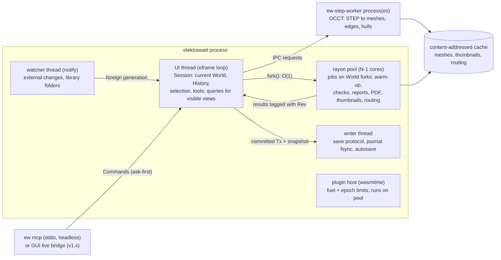
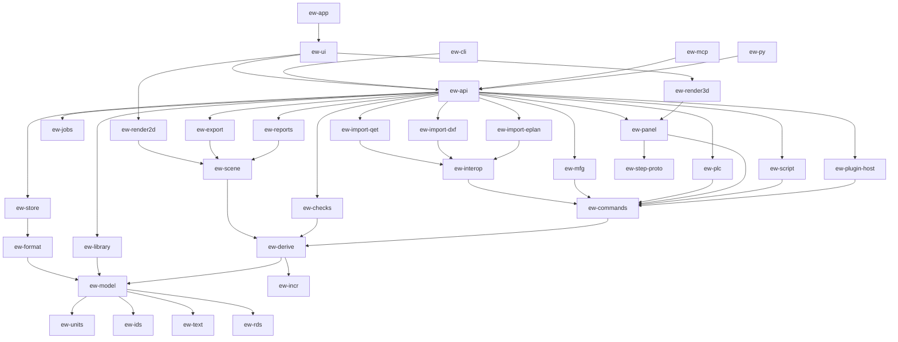
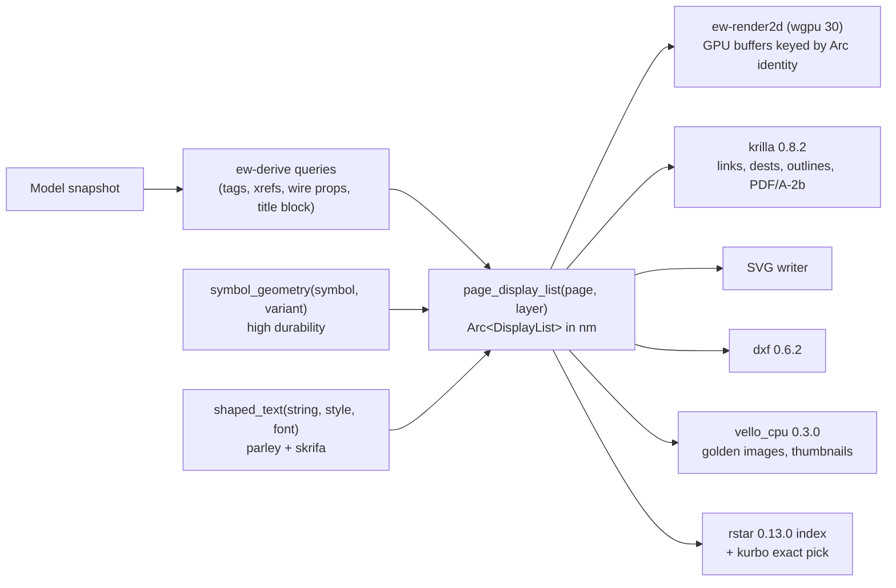

# Architecture proposal A: "Model-first, incremental computation"

**Status:** competing proposal for the architecture judge panel · **Date:** 2026-10-17
**Angle:** a typed Rust domain model in persistent immutable maps is the single source of truth. Every edit is a
typed operation, and a memoised query layer derives *everything else*. Stack A (egui/eframe shell, own wgpu 2D/3D
renderers). The project is a deterministic directory of text files. SQLite holds only catalogues and caches.

> Redaction note: this proposal follows the public-repo rules in the brief. The customer, end user, project reference,
> drawing id, people and the panel builder are written as placeholders ("the pilot panel builder", "<project ref>").
> Research notes are cited by file name, for example [gaps-and-corrections.md](../gaps-and-corrections.md) §G3.

---

## 1. Guiding principles and the core idea

**Core idea.** The worst defects in the reference set share one root cause: *a value that should have been
computed was stored as a copy, and the copy went stale.* Examples are -4W1 vs -3W1 (D-01), T51 vs T55 (D-02),
"V1"/"V1.0"/"V2.0" (D-05), the folio 101 description (D-06), "if not indicated, standard size" (D-08) and 5 vs 4
valves (D-10). Proposal A removes that root cause from the architecture. A project is an **immutable value**: typed
tables of plain Rust structs in `imbl` persistent maps, cloned in O(1). The value changes only through a
**transaction of typed operations**, which is also the undo record, the journal entry, the macro step and the diff.
Tags, cross-references, nets, potentials, wire properties, title blocks, TOC, BOM, terminal and PLC reports, layout
labels, check messages and display lists are **memoised queries** over that value. A derived value cannot go stale,
because no stored copy exists, and it is recomputed only when a recorded input changed. Immutability also makes the
expensive features cheap: background PDF export on a consistent snapshot, "preview before commit" for a
10,000-tag renumber, a crash journal, semantic git merges, and before/after change lists for manufacturing.

**Principles.**

1. **Store intent, derive presentation.** Only facts a human decided are persisted: a device exists, it has this
   part, this counter, this wire override. Every string printed on a page is a query result. The exception is
   **"derived by default, frozen on purpose"**: identifiers that leave the building (tags, wire numbers, PLC
   addresses) can be frozen explicitly, for example at release, and a check reports any frozen value that deviates
   from its rule.
2. **One writer, many readers.** GUI, CLI, rhai, importers, WASM plugins and MCP agents edit only through
   `Command → Transaction → Op`. Readers get lock-free snapshots.
3. **Identity is a UUID, never a tag.** Every reference is an `Id<T>`; tags are derived from structure.
4. **Typed, not property bags.** One Rust struct per entity kind, plus an `extra` map for unknown fields and
   user-defined properties. No EAV.
5. **Headless first.** Model, queries, commands, checks, reports and PDF run without a GUI.
6. **Determinism everywhere.** Ordered maps, integer nanometres, ID tie-breaks: same model, same bytes, same PDF.
7. **The incremental engine is verifiable.** Any incremental result can be checked against a cold recomputation
   (oracle mode). This guards against the one new failure mode the approach introduces: stale memos.

**Why not the obvious alternatives** (each is argued by another architect; this is my one-line case):

| Alternative | Why proposal A rejects it as the *source of truth* |
|---|---|
| ECS (bevy_ecs, hecs) | Optimised for per-frame iteration, not for snapshots, undo, deterministic persistence or referential invariants. A `World` cannot be cloned in O(1) for background jobs |
| SQLite as the live model | Every UI read becomes SQL. Snapshot isolation needs connections and WAL readers. Undo needs the session extension. There is no type safety on hot paths, and derived invalidation needs triggers. SQLite stays right for catalogues |
| CRDT document (Loro) | It merges into states that are well-formed but semantically invalid (`[rust-ecosystem.md](../rust-ecosystem.md) §8). Its logs are binary and opaque to git. The op log is designed to stay CRDT-ready instead |
| Retained scene graph as the model (the QET way) | This is exactly how QET produced defects D-01 to D-06 (`[oss-landscape.md](../oss-landscape.md) §2.3) |

---

## 2. Process and thread model



| Actor | Responsibility and rules |
|---|---|
| **UI thread** | Owns the `Session`; applies commands; runs the queries the visible panels need. Frame budget 16 ms: apply plus validation ≤ 2 ms, derivation ≤ 5 ms, render ≤ 5 ms. Anything predicted to exceed this becomes a job |
| **Job pool** (rayon 1.12.0) | Each job runs on a `World` fork (model plus memo tables, O(1)). Jobs never block edits and are never invalidated by them. Results carry their `Rev`, and the UI shows a staleness badge when `Rev < current`. Cancellation is cooperative. Memos from main-line forks are merged back |
| **Writer thread** | Serialises immutable snapshots (§7) and appends the journal. Saving never blocks the UI, because its snapshot cannot change underneath it |
| **Watcher** (notify 8.2.0) | Detects git pulls and foreign writes, ignoring its own by manifest generation. A foreign change is loaded on the pool, diffed entity by entity, and offered as one "external change" transaction |
| **STEP worker** | Out-of-process OCCT via occt-sys 7.8.1 + opencascade 0.3.0 (LGPL-2.1, [gaps-and-corrections.md](../gaps-and-corrections.md) C-5; cadrum 0.9.0 watch-list). Supervised with timeouts and restart; results cached by `sha256(file) + worker_version`. A crash or pathological vendor file cannot touch the model |
| **Plugins** | wasmtime 49.0.3 (pinned to the 48.x LTS line). Reads through query handles; writes only by submitting commands |
| **MCP** | `ew mcp` opens the project headless with the same `Session` API, read-only when the GUI holds the lock. GUI "live" bridge with ask-first writes in v1.x (G10) |

**Autosave and recovery.** Each commit appends `{command, field diffs, rev, base_generation}` to a JSONL journal in
the OS state directory (directories 6.0.0), never in the project, fsynced at least once per second. Every 2 minutes,
if the project is dirty, an autosave writes one of three rotating generations, as QET does (#1167). On restart the
app offers journal replay onto the last good generation.

---

## 3. Crate and workspace layout

One Cargo workspace with small crates. `ew-model`, `ew-incr`, `ew-derive` and `ew-commands` form the **spine**; no
GUI dependency reaches below `ew-api`. Licences follow the brief: the application is GPL-3.0-or-later, and crates
marked **(P)** are MIT OR Apache-2.0 so they can be reused.

| Crate | Responsibility | Key dependencies (version from the research) |
|---|---|---|
| `ew-units` **(P)** | `Nm(i64)`, `Pt2`, `Rect`, rational `Grid{num,den}`, `Orient2` (8 variants), `Pose3` (i64 nm + quaternion rounded to 1e-9) | serde 1.0.229; kurbo 0.13.1 and glam 0.34.1 conversions behind feature flags |
| `ew-ids` **(P)** | `Id<T>` (UUIDv7), deterministic seeded ID generator for imports and tests, per-session `u32` interner | uuid 1.28.0 |
| `ew-text` **(P)** | `MlText` with EPLAN semantics, BCP 47 `LangTag`, NFC normalisation, confusable detection | unicode-normalization 0.1.26, unicode-security 0.1.2 |
| `ew-rds` **(P)** | IEC 81346 parser and formatter, strict and lenient (`[standards.md](../standards.md) §1.3); identifier sets as data: 2009 single letters (default), 2019, IEC 60750 legacy | — |
| `ew-incr` **(P)** | Generic incremental query engine: revisions, memo tables, dependency recording, early cut-off, durability classes, fork/merge, LRU, tracing, oracle mode. It knows nothing about ECAD | imbl 7.0.2 (MPL-2.0), rayon 1.12.0 |
| `ew-model` | Entity structs, `Table<T>`, the `Model` snapshot, `Op` apply and invert, base reverse indexes, hard invariants | imbl 7.0.2, smol_str 0.3.6 (verify), indexmap 2.14.2 (verify) |
| `ew-derive` | All domain queries: structure, tags, anchors and cells, cross-references, nets and potentials, wire properties, terminals, cables, PLC addressing, BOM, TOC, title-block fields, layout labels | ew-incr, ew-model, ew-rds; icu 2.3.1 (natural-sort collation) |
| `ew-commands` | `Command` trait and handlers, `TxBuilder`, numbering engine, macro insertion, validation hooks, `History` (undo, redo, coalescing), previews | ew-model, ew-derive |
| `ew-checks` | Rule engine, rule packs as data, online checks as queries, offline check jobs, waivers | ew-derive, rhai 1.26.1, toml 1.1.8 |
| `ew-format` **(P)** | On-disk schema, canonical deterministic writer, reader with upgrade chain, manifest, JSON Schema export, 3-way entity merge | serde_json 1.0.154, schemars 1.2.3, serde_path_to_error 0.1.20, semver 1.0.28, sha2 (verify) |
| `ew-store` | Atomic save protocol, `.~ew.lock`, journal, autosave, recovery, file watching, `.ewz` transport | ew-format, notify 8.2.0, directories 6.0.0, zip 9.0.4 |
| `ew-library` | Parts, symbols, forms and macros catalogue in SQLite with FTS5; embedding of used items into projects | rusqlite 0.40.2 (`bundled`) |
| `ew-scene` | Display-list IR, per-page layer queries, symbol geometry, form rendering, text shaping, spatial index, hit-testing | parley 0.12.0, fontique 0.12.0, skrifa 0.48.0, harfrust 0.14.0, kurbo 0.13.1, rstar 0.13.0 |
| `ew-render2d` | wgpu 2D renderer: lyon tessellation once per symbol, instancing, screen-space lines, glyph atlas | wgpu 30.0.1, lyon_tessellation 1.0.22 |
| `ew-export` | PDF (links, named destinations, outlines, page labels, PDF/A-2b), SVG, DXF, PNG | krilla 0.8.2, krilla-svg 0.8.1, dxf 0.6.2, vello_cpu 0.3.0 |
| `ew-reports` | Report types, forms engine, pagination into generated pages, embedded report blocks, XLSX and CSV tables | ew-scene, rust_xlsxwriter 0.100.0, csv 1.4.0 |
| `ew-plc` | Address grammars, AML AR APC (CAEX 2.15 write, 2.15 and 3.0 read), TIA tag XLSX, PLCopen XML, GSDML | quick-xml 0.42.0, calamine 0.36.1 |
| `ew-panel` | Layout-space queries, collision reconciler, routing graph, negotiated-congestion routing, wire lengths, duct fill | parry3d 0.31.1, glam 0.34.1, pathfinding 4.16.0, petgraph 0.8.3 |
| `ew-render3d` | wgpu 3D renderer (instancing, edges, transparency, picking) | wgpu 30.0.1, meshopt 0.7.0, transform-gizmo-egui 0.11.0 |
| `ew-step-proto` **(P)** / `ew-step-worker` (bin) | IPC contract; OCCT worker | postcard 1.1.3, rkyv 0.8.18, gltf 1.4.1; occt-sys 7.8.1, opencascade 0.3.0 |
| `ew-mfg` | Production package `.ewpp`, wire lists, ferrules, labels, machine profiles | zip 9.0.4, rust_xlsxwriter, csv |
| `ew-interop` **(P)** | `Importer` and `Exporter` traits, `ImportReport`, provenance (`source_ref`) | — |
| `ew-import-qet` / `-dxf` / `-eplan` | QET `.qet`/`.qetz`; DXF (DWG behind a flag); EDZ, EPLAN parts XML and XLSX report imports | roxmltree 0.21.1, quick-xml; dxf 0.6.2, acadrust 0.6.4 (MPL-2.0); sevenz-rust2 0.24.0, zip, calamine |
| `ew-script` / `ew-plugin-host` | rhai bindings over the query and command API; WIT world and host | rhai 1.26.1; wasmtime 49.0.3 (48 LTS), wit-bindgen 0.63.0 |
| `ew-jobs` | Job scheduler, progress, cancellation, staleness tagging | rayon 1.12.0 |
| `ew-api` | The `Session` facade shared by all front-ends | all of the above |
| `ew-cli` (bin `ew`) | Batch commands, `ew query`, merge driver, textconv | clap (verify) |
| `ew-mcp` (bin) | MCP server over stdio | MCP SDK crate (verify) |
| `ew-ui` | egui widgets: property grid, query-backed navigators and tables, command palette, keymaps, tools | egui 0.37.0, egui_tiles 0.17.1, egui_table 0.10.0, egui_ltreeview 0.9.0 |
| `ew-app` (bin `elektrawatt`) | eframe shell, menus, dialogs, clipboard | eframe 0.37.0, egui-wgpu 0.37.0, muda 0.21.2, rfd 0.17.2, arboard 3.7.0 |
| `ew-testkit` | Golden J-E-2416 builder, synthetic S/M/L/XL generator, oracle comparator, insta helpers | insta 1.49.0, proptest 1.12.0, criterion 0.8.2 |
| `ew-py` (v1.x) | Python wheel of the headless core | pyo3 0.30.1 |



Arrows point to dependencies. `ew-incr` deliberately does not depend on `ew-model`. The model implements the
engine's `Input` trait, so the engine can be tested, benchmarked and published on its own.

---

## 4. Core domain model: storage and identity

### 4.1 Storage form: typed tables in persistent maps

```rust
pub struct Model {                        // one immutable snapshot; Clone is O(1)
    pub rev: Rev,                         // (branch, n): monotonic on the main line
    pub project: Row<Project>,            // singleton: master data, settings, profiles
    pub structure: Table<StructureNode>,  // IEC 81346 aspect trees (==, =, ++, +, -, %)
    pub pages: Table<Page>,
    pub devices: Table<Device>,           // incl. terminal strips, cables, assemblies, PLC stations
    pub functions: Table<Function>,       // logical: coil, contact, MCB poles, terminal, black-box pins, channel coil
    pub reps: Table<Representation>,      // a drawing of function(s) on a page: multi-line, overview, fluid, panel front
    pub connections: Table<Connection>,   // explicit logical connections with a route (G5)
    pub junctions: Table<Junction>,       // T-nodes with style and connection sequence (REF-034)
    pub bridges: Table<Bridge>,  pub conductors: Table<Conductor>,
    pub potential_defs: Table<PotentialDef>,  pub bonds: Table<Bond>,
    pub plc: PlcTables,                   // PlcProject, Station, Module, Channel, BusPort, LogicalNet, PhysicalNet
    pub fluid: FluidTables,               // Medium, TubeSpec (fluid lines are Connections of kind Fluid)
    pub layout: LayoutTables,             // LayoutSpace, Enclosure, MountingSurface, Carrier, Placement3D, RoutePath
    pub parts: Table<PartCopy>,  pub symbols: Table<SymbolDef>,  pub forms: Table<FormDef>,
    pub report_blocks: Table<ReportBlock>,  pub revisions: Table<Revision>,
    pub waivers: Table<Waiver>,  pub comments: Table<Comment>,  pub ext_refs: Table<ExternalRef>,
    pub idx: BaseIndexes,                 // reverse-FK indexes; maintained on apply, rebuilt on load, never saved
}
pub struct Table<T> { rows: imbl::OrdMap<Id<T>, Row<T>>, changed_at: Rev }
pub struct Row<T>   { value: Arc<T>, changed_at: Rev }
```

- **Why `imbl::OrdMap`:** deterministic ordered iteration, ID range scans, O(1) snapshots. imbl mutates uniquely
  owned nodes in place, so a 10k-op transaction copies each touched B-tree node once.
- **Base indexes** (`functions_by_device`, `reps_by_page`, `connections_by_cp`, `terminals_by_strip`,
  `channels_by_module`, …) are pure reverse-FK maps that almost every query reads. `Op::apply` maintains them by
  delta, each key with its own `changed_at`; debug builds re-derive and compare them after every transaction.
- **Tables are private.** Reads go through accessors generated by an `entities!` macro that record dependencies
  inside queries, so an **untracked read does not compile.**

### 4.2 The entities (concise)

| Concept | Representation | Notes and reference |
|---|---|---|
| Project | `Project { master: ProjectData, customer: Party, end_user: Party, supply: SupplySpec, settings, profile_refs }` | Customer and end user are separate typed roles (D-30). Supply is structured (REF-002) |
| Structure | `StructureNode { aspect, code, parent, description: MlText, order }` | One canonical `+J-E-2416` node; spelling is a property of that node (D-03) |
| Page | `Page { folio: Folio{section, number, label}, kind, structure: [Id], form, description: Option<MlText /*override*/>, rev_status }` | The description override is `None` by default, so the title block reads the project value (D-06) |
| Device | `Device { tag: TagSpec, parts: Vec<PartUse{part, qty}>, assembly_parent: Option<Id<Device>>, kind, tech_data, function_text: MlText, process_tag, extra }` | `TagSpec { scheme, letter, counter: Option<u32>, frozen: Option<FrozenTag> }`; the printed tag is derived |
| Function | `Function { device, def: FunctionDef, cps: SmallVec<CpDef{idx, designation, alias, kind, discipline}>, role: Main/Aux }` | A unique internal `idx` allows duplicate printed designations ("N", "N"; REF-029). Fluid ports are CPs with `discipline = Pneumatic` |
| Representation | `Representation { functions, page, symbol, variant, pos: Pt2, orient, rep_type, pin_map }` | One function, many drawings (main, overview, fluid, panel front). One strip drawn in two segments (D-42) |
| Connection | `Connection { a: Endpoint, b: Endpoint, route: SmallVec<Pt2>, kind: Wire/Core(Id<Conductor>)/Bridge/Fluid/Overview/Internal, overrides: WireOverrides, wire_no: NumberSpec }` | Overview connections are excluded from nets (EPLAN semantics) |
| Terminal / strip | A strip is a `Device` of kind Strip. A terminal is a `Function` with levels, CPs per level and side, and part | Designation uniqueness per strip is a hard invariant in "prevent" mode (D-12) |
| Cable / conductor | A cable is a `Device`. A `Conductor` has `{cable, core: CoreId, colour: ColourCode, csa, shield}` | `ColourCode` is an enum over the IEC 60757 table plus profile-defined custom codes (DBU). "BR" is unrepresentable (D-17) |
| Potential | `PotentialDef { at: Endpoint, name, ptype: L/N/PE/FE/L+/M/…, voltage, env }`; `Bond { a, b, kind: PELV }` | Potentials themselves are **derived**; only definitions and bonds are stored (D-22) |
| PLC | `Station`, `Module`, `Channel { address: Unassigned/Auto/Manual/Excluded, state: Used/Spare/Tbd, … }` as in [plc-bus-fluid.md](../plc-bus-fluid.md) §11 | `Auto` addresses are derived from the module start and the part's address map; `Tbd` is a first-class open item (D-15) |
| Layout and 3D | `Placement3D { device, function: Option, part, carrier, pose: Pose3, locked }`; `Carrier { kind: Rail/Duct/Busbar/Surface, part, path }` | **No tag text is stored** (D-02); poses are relative to the carrier |
| Library copies | `PartCopy`, `SymbolDef`, `FormDef`, each carrying `{library_id, item_id, version, sha256}` | The project opens without its libraries (`[gaps-and-corrections.md](../gaps-and-corrections.md) G2) |
| Revision | `Revision { index, date, author, checker, description, frozen_generation, archive_ref }` | One table and one format (D-05) |

### 4.3 Identity, coordinates and text

- **IDs:** UUIDv7 (uuid 1.28.0) in files, interned to dense `u32` per session for hot derived structures (union-find
  arrays). Imports use a seeded generator, so re-importing a QET file yields the same IDs; `source_ref` provenance
  allows update-in-place.
- **Coordinates:** i64 nanometres in model and files (C-12/G4), rational grids (QET 10 px = `7_937_500/3` nm
  exactly), snapping on grid indices; f64 mm (glam `DVec3`) only for 3D maths, f32 only in GPU buffers.
- **Multilingual text:** `MlText = Neutral(String) | Langs(BTreeMap<LangTag, String>)` with EPLAN's
  mutual-exclusion rules. Display language is a query key, so "PDF per language" is the same derivation with another
  key. Identifiers (tags, part numbers, addresses) are NFC strings and never translatable.

---

## 5. Editing: commands, transactions, undo, validation, preview, macros

**Three layers.**

| Layer | What it is | Who produces it | Persisted where |
|---|---|---|---|
| `Command` | Serialisable intent, for example `PlaceSymbol`, `Connect`, `RenumberDevices{scope, scheme}`, `AssignPart`, `ImportQet`, `InsertMacro` | GUI tools, CLI, rhai, plugins, MCP, importers | Journal; macro recorder |
| `Transaction` | `Vec<Op>` plus metadata `{command, origin, page/viewport, coalesce_key, undoable}` | `Command::run(&mut TxBuilder)` against a snapshot | Undo stack; journal |
| `Op` | `Put { key, before: Option<AnyRow>, after: Option<AnyRow> }` | `TxBuilder` | Undo stack (Arcs); journal (field diffs) |

```rust
pub trait Command: Serialize + DeserializeOwned + Send {
    fn run(&self, tx: &mut TxBuilder<'_>) -> Result<Outcome, CmdError>;   // deterministic in (snapshot, self)
}
impl Session {
    pub fn world(&self) -> World;                                  // O(1) clone: model + memo tables
    pub fn preview(&self, cmd: &dyn Command) -> Result<Preview>;   // candidate World + diff, nothing committed
    pub fn commit(&mut self, p: Preview) -> Result<Rev>;
    pub fn execute(&mut self, cmd: &dyn Command) -> Result<Rev>;   // preview + commit
    pub fn undo(&mut self) -> Result<Rev>;  pub fn redo(&mut self) -> Result<Rev>;
    pub fn spawn<J: Job>(&self, job: J) -> JobHandle<J::Output>;   // runs on a fork
}
```

- **Ops hold before/after row `Arc`s:** O(1) to create, exact inverse (swap). The journal writer computes field
  diffs off-thread ("csa: 0.75 → 1.5", G3). Undo applies inverse ops as a **new** revision, keeping `changed_at`
  monotonic, which is what makes memo validation sound (§6).
- **`TxBuilder`** is a scratch snapshot with read-your-writes. Handlers may query it (for example "next free counter
  on page 103"); the query fork is created lazily.
- **Validation hooks.** Hard invariants run on the candidate snapshot, limited to touched keys and their index
  neighbours: referential integrity, one main function per device, terminal designation unique per strip, channel
  address unique per area, acyclic assemblies. A violation rejects the transaction (EPLAN's "prevent" mode). Soft
  rules run afterwards as online checks (§12). The rule pack picks the mode.
- **Coalescing:** transactions with the same `coalesce_key` (one drag, typing into one cell) merge, so one gesture
  is one undo step. The stack is project-wide, bounded (500 steps or 256 MB), restores page, viewport and selection,
  and survives saving.
- **Concurrency:** importers, plugins and MCP build transactions on a fork at `Rn`. If no touched key changed since
  `Rn`, the ops apply; otherwise the deterministic command re-runs on the current snapshot. Optimistic, lock-free.
- **Preview of large changes is a fork, not a feature.** `preview(RenumberDevices)` yields a candidate `World`;
  `diff_query(current, candidate, device_tag)` shows old → new tags, and the same primitive yields BOM, wire-list
  and PLC-address diffs. Cancel drops the fork. A QET import is inspected the same way (migration report, rendered
  pages) before commit.
- **Macros:** window and page macros are project fragments in the same format. `InsertMacro{macro, at, value_set}`
  remaps IDs, numbers and validates, so folios 203–206 become one typical with four value sets. Recorded macros are
  command logs exported as rhai.
- **Not undoable:** library writes, exports, project-file operations (as in EPLAN), and bulk import into an empty
  project (a checkpoint).

---

## 6. Derived data: queries, invalidation, complexity

### 6.1 The engine (`ew-incr`)

The algorithm is salsa's red-green scheme (demand-driven, revision-based, early cut-off) applied to persistent
snapshots:

1. Every input row, index key and table has a `changed_at: Rev`. A memo stores
   `{value: Arc<V>, deps: [(DepKey, observed_changed_at)], verified_at, changed_at}`.
2. Read at revision R: `verified_at == R` is a hit. Otherwise dependencies are verified recursively; if none changed,
   the memo is re-stamped, else the query re-executes. If the new value equals the old one (`Eq` or a 128-bit hash),
   `changed_at` is **backdated** and dependents stay green. This early cut-off keeps a wire edit on folio 102 from
   touching folio 203.
3. **Durability classes:** library tables high, settings medium, drawing data low. Memos depending only on
   high-durability inputs skip verification during drawing (symbol geometry, form layout).
4. **Forking:** memo tables are `imbl` maps, so `World::fork()` is O(1). Forks evaluate in parallel with sharded
   locks. Main-line memos merge back; preview-branch memos are discarded (off-branch revisions).
5. **LRU** for bulky memos (display lists, pagination). **Cycle detection** panics in debug; the one legitimate
   fixpoint, a TOC whose page count depends on itself, iterates inside one query (≤ 3 rounds).
6. **Oracle mode** (CI, debug): after each transaction, sampled queries (all of them nightly) are recomputed cold and
   compared.

**Decision: a hand-rolled engine (about 4 kLOC), with salsa 0.28.5 as the M0 spike competitor.** Salsa is proven in
rust-analyzer but conflicts with this model three times:

- A salsa write cancels or blocks outstanding readers. Here, a 2,000-page export must keep running on its snapshot
  while the user edits.
- Salsa inputs are salsa structs, not our `imbl` tables, so the truth would exist twice.
- It is 0.x with API churn.

Query bodies are plain functions over a context trait, so porting either way is mechanical.

### 6.2 The query catalogue

| Query (key) | Depends on | Notes |
|---|---|---|
| `page_order()` incl. generated pages | pages (folio, section), report blocks | Source of prev/next and TOC (REF-073) |
| `device_tag(dev)` → `{full, displayed(page)}` | `TagSpec`, scheme, structure nodes, main rep's page folio, assembly parent | Identifier suppression as EPLAN `<20010>`; child tags `-201U3-QM1` (D-27, D-41) |
| `rep_anchor_cell(rep)` | rep position, symbol anchor policy, frame grid | Fixes "3-B0" (D-14) |
| `xref_text(rep)` | partners' anchor cells, xref format | Star/chain IPs; "(201-E1)", "∞ 203-B4" |
| `page_local_nets(page)` | connections, junctions, reps on the page | Union-find, a few thousand edges |
| `stitch_graph()` | local nets, IP names, bridges, conductors, terminal side links, bonds | Nodes are local nets (about 10–15 % of CPs) |
| `potential_partition()` | stitch graph, potential defs | `PotentialId` = definition point, else min CP id, so stable under unrelated edits. Bonds link without merging (D-22); canonical name plus IP aliases (D-24) |
| `wire_props(conn)` | overrides, potential type and voltage, profile | Every value carries **provenance** (override, potential, profile rule, default) (D-08) |
| `terminal_rows(strip)`, `cable_rows(cable)`, `plc_rows(station)`, `channel_address(ch)` | terminals, levels, bridges, conductors, module start, part address map | Sources of terminal, cable and PLC reports (REF-045/049/060) |
| `bom_rows(mode)` | parts on devices, assembly children, carriers, accessories | Aggregated with quantities; assembly and component modes (D-04) |
| `toc_rows()`, `title_block(page)`, `layout_label(placement)` | page order, project data, overrides, revisions, `device_tag` | Bound fields only; overrides explicit and flagged (D-05, D-06, D-02) |
| `page_display_list(page, layer)` | per-layer inputs | Layers (frame, symbols, wires, labels, highlights): a wire edit never rebuilds the title block |

### 6.3 Complexity for an XL project

The XL case is 2,000 pages, 50k devices, about 150k functions, 200k connections, about 500k connection points,
20k terminals and 10k channels. Costs are estimates for one 2018-class core; they are to be validated by the M1
performance harness against the [gaps-and-corrections.md](../gaps-and-corrections.md) G6 budgets.

| Operation | Work | Estimate |
|---|---|---|
| Open project: parse about 300 MB of JSON in parallel (per file), build tables and indexes | 4 cores | 1–2 s |
| Warm-up of tags, nets, potentials, wire properties and xrefs (job on a fork, page by page; the visible page first) | about 1.5M memos | 2–4 s in the background; the first page is interactive in under 1 s |
| Move a symbol within its grid cell | 1 rep op → page-local nets (unchanged, cut off) → page 103 display layers | under 1 ms + about 1 ms per layer re-tessellated |
| Move a symbol across cells | as above + `rep_anchor_cell` changes → `xref_text` of its partners re-execute (cut off elsewhere) | under 2 ms |
| Draw one wire | page-local nets for 1 page; `stitch_graph` re-run (about 50k nodes) → `potential_partition` | 5–10 ms (one global step); `wire_props` re-verify for affected potentials only |
| Renumber folio 103 → 104 | 1 page op → `page_order`, tags of devices on that page (about 25), xrefs pointing into 103, TOC, BOM folio column, prev/next ×3 | under 5 ms + preview diff |
| Change the colour of potential type "24 V DC" in the profile | medium-durability input → `wire_props` for all 24 V wires (about 60k) | about 30 ms, then the visible layers |
| Full BOM | 50k devices → aggregation | about 20 ms; per-part sub-queries make an edit O(parts of one device) |
| Full online check set, cold | per page and entity in parallel | 1–3 s as a job; incremental per edit under 5 ms |
| Memory: base model + indexes | about 250 MB; memos about 200 MB; LRU display lists about 100 MB | about 0.6–1 GB peak, within the 4 GB XL budget |

The one honest hotspot is **global connectivity**. `stitch_graph` and `potential_partition` are global, at about
5–10 ms at XL size. That is acceptable per committed edit but not per drag frame. Live potential highlighting while
dragging therefore uses the page-local nets of the candidate page, and the global update runs at commit time.

### 6.4 Three classes of derived data

| Class | Examples | Freshness contract |
|---|---|---|
| **I: synchronous incremental** | tags, xrefs, nets, wire properties, title blocks, TOC, BOM, display lists, online checks | Always fresh when read |
| **II: asynchronous derived** | routing and wire lengths, full 3D collision, offline checks, PDF export, thumbnails | Computed on forks, tagged with `Rev`, shown as stale when outdated ("810 mm, re-routing…"). Release exports require fresh results |
| **III: external derived** | STEP tessellation, edges, hulls | Content-addressed cache, never model data |

Routing is deliberately Class II: negotiated-congestion rip-up and re-route (`[panel-manufacturing.md](../panel-manufacturing.md) §6.7) is
global and takes seconds. It is cached by a hash of its inputs. Manual route overrides are model data keyed by wire
UUID, so they survive re-routing.

---

## 7. Persistence

### 7.1 Project directory

```text
J-E-2416.ew/                       # name chosen by the user; content is UUID-named
  manifest.json                    # written LAST: format "1.0", min_reader, generator, generation, sha256 per file
  project.json                     # Project row + settings + colour/size/numbering/xref profiles
  structure.json  revisions.json  report-blocks.json  waivers.json
  pages/<page-uuid>.json           # Page row + every row whose page_id = this page:
                                   #   reps, connections, junctions, potential defs, graphics, embedded report frames
  devices/<xx>.json                # 256 shards: devices, functions, conductors, bridges (sorted by id)
  plc/<xx>.json   layout/<space-uuid>.json
  lib/{symbols,parts,forms,macros}/<uuid>.json      # embedded library copies with source hash
  assets/<sha256>.<svg|png>        # logos, images
  .gitattributes  .gitignore       # merge=elektrawatt diff=elektrawatt; ignore .ew/
  .ew/                             # per-user view state + caches (git-ignored)
  .~ew.lock
```

- **Shard by the UUID's random tail, not its head.** UUIDv7 starts with a timestamp, so G1's `uuid[0..2]` would put
  a day's devices into one shard. 256 shards plus one file per page gives about 2,300 files at XL: few enough for
  Defender, OneDrive and git, local enough for merges.
- **Canonical writer:** schema field order, arrays sorted by ID, integer nm (no floats), defaults omitted, no
  timestamps in entities, UTF-8/LF. `ew fmt` re-canonicalises hand edits.
- **Only base tables are serialised.** No tag, xref, net, BOM or TOC is ever written, so two engineers adding devices
  on different pages cannot collide on a BOM or TOC: those do not exist on disk.
- **Incremental save:** each `Op` maps to file keys (old and new page for page-scoped rows), so the dirty set falls
  out of the log. The writer runs the G1 protocol (temp file, `sync_all`, rename, manifest last, directory sync) from
  the immutable snapshot; an M-class save is well under 200 ms and never blocks the UI.

### 7.2 Merge, locking, recovery, versioning

- **Git merge driver:** `ew merge-driver %O %A %B %P` merges 3-way per entity and field, keyed by ID. Cross-file
  semantics are validated at the next open, where post-merge problems (duplicate counters, an IP name used twice)
  surface as check messages with quick fixes. `ew diff --textconv` prints entity diffs with **derived** tags
  ("-102F1: part A9F78116 → …"), not UUIDs.
- **Locking:** `.~ew.lock` via `create_new` with `{user, host, pid, app_version, started_at}`; a held lock opens
  read-only; stale locks can be taken over; no OS byte-range locks over SMB.
- **Crash recovery:** on open, file hashes are checked against the manifest; a mismatch offers journal replay or the
  last good generation.
- **Versioning (G2):** additive minors and breaking majors; a never-pruned upgrade chain on `serde_json::Value`;
  `#[serde(flatten)] extra` on every entity; `generator` and `min_reader` stamps; JSON Schemas (schemars 1.2.3); one
  CI fixture per release.
- **Derivation is versioned too**, a consequence specific to this angle: recomputed outputs mean a changed rule
  changes old PDFs. Output-affecting rules (xref format, numbering, title-block bindings, wire inheritance) are
  versioned data pinned by the project (`derivation_profile = "2027.1"`), changes are opt-in, and released revisions
  archive their PDF (G2 "as-built").
- **Catalogues** live in SQLite (rusqlite 0.40.2, bundled, FTS5) at user or company level, fed from EDZ, BMEcat or
  ETIM. Projects never read them at render time: they embed a `PartCopy`, and "update from library" is a command
  with a preview diff.

---

## 8. Rendering pipeline



- **IR:** `DisplayList { items }` with `Path(kurbo::BezPath, Stroke, Brush)`, `Glyphs(Arc<ShapedRun>)`, `Image`,
  `Instance(SymbolGeomId, Transform)` and `Group`. Items carry an optional `EntityRef` (picking, highlight) and
  `LinkTarget` (xref → named destination), from which the PDF gets link annotations (D-07, D-33).
- **Early cut-off reaches the GPU:** a layer query returning the *same* (backdated) `Arc` lets the renderer keep its
  vertex buffers, so unchanged layers cost nothing.
- **Symbols:** `SymbolDef { prims (nm), pins: [PinDef{pos, dir, cp_idx}], text_slots: [Slot{Tag | PartNo |
  FunctionText | Prop(key), style}], variants }`, tessellated once per (symbol, variant) with lyon and drawn
  instanced. Lines are expanded to screen width in the shader, so zoom never re-tessellates. Line widths and Qt-like
  dashes match [reference-drawing.md](../reference-drawing.md) §5.4.
- **Text:** one stack for screen and paper (parley 0.12.0, harfrust 0.14.0, skrifa 0.48.0) with bundled OFL fonts
  (Noto/DejaVu Sans, optional osifont, never Tahoma; G14). `shaped_text` is memoised, so screen and PDF share glyph
  positions and line breaks, and krilla subsets the same font files. Text styles are model data (D-29).
- **Level of detail:** text under 2 px becomes a grey bar, hairlines clamp to 1 px, overview zoom shows cached
  vello_cpu thumbnails keyed by display-list hash.
- **Hit-testing:** `page_spatial_index(page)`, an rstar bulk-loaded R*-tree (under 1 ms for 5k items), then exact
  kurbo picking.
- **3D:** `layout_scene(space)` derives instances (mesh hash, pose, highlight) for `ew-render3d` on the same wgpu
  device (edges, transparent enclosure, CAD camera). Mutable acceleration structures (parry3d BVH, GPU instance
  buffers) are kept in step by a **reconciler** that diffs successive scene outputs by placement ID and applies
  `insert_or_update`/refit instead of rebuilding. Picking is a CPU ray cast. 2D panel pages project mounting surfaces
  through the same IR.
- **STEP pipeline:** the worker returns assembly tree, two LODs (meshopt 0.7.0), feature edges, bbox, hull and
  mounting frames, stored as glb or rkyv under the content hash. `PartCopy` references the hash, never the vendor
  file (`[panel-manufacturing.md](../panel-manufacturing.md) §6.5).

---

## 9. UI shell

**Toolkit: egui/eframe 0.37.0 (Stack A).** The argument specific to this angle: **immediate mode plus memoised
queries removes an entire layer.** A retained toolkit (Slint models, iced's Elm messages, a webview store) needs a
view-model kept in sync with the domain by change notifications: a second invalidation system with its own
staleness bugs. In egui, each frame calls `world.query(...)`; touched memos recompute, everything else returns in
O(1). The query layer *is* the view-model. The generic reasons also hold: one wgpu device for UI, 2D and 3D; Rerun's
proven pattern; AccessKit by default; egui_kittest and egui_mcp for testing. The costs are a non-native look, a
breaking minor every 6–10 weeks (about one day per upgrade), weaker text editing and DIY widgets. All UI code sits in
`ew-ui`, so the chrome could move without touching anything below `ew-api`.

| Element | Implementation |
|---|---|
| Docking | egui_tiles 0.17.1 (more than 2 children per split); saved workspaces (Schematic, PLC, Panel 3D, Manufacturing); egui viewports for second monitors |
| Navigators and tables | Page, device, terminal, cable, PLC, potential, messages: each a query returning `Arc<Vec<Row>>`, drawn virtualised by egui_table 0.10.0 or egui_ltreeview 0.9.0 (100k rows). Fill-down, pattern fill and Excel paste compile to **one** command |
| Property grid | Schema-driven; each value shows its query provenance (*"0.75 mm² · from potential 24VDC-1 via profile 'DBU/WH'"*), an override marker and "reset to derived"; `‹varies›` for multi-selection |
| Canvas | `egui_wgpu` callback into `ew-render2d`. Tools are state machines returning `Transient(overlay)`, `Preview(Command)` or `Commit(Command)`; drags use a GPU transform overlay, semantic ghosts (autoconnect, paste with renumber) a fork |
| Keyboard-first | Command palette over every `Command`; keymap presets "EW", "KiCad-like", "EPLAN-like"; grid-step cursor, "next unconnected point", back/forward over xref jumps; native macOS menu bar via muda 0.21.2 |
| Theming, accessibility | Dark/light/high-contrast; Okabe–Ito highlights with patterns; wire colour always shown as its IEC 60757 code; AccessKit 0.25.1 names enforced by kittest; selected-object description as a live region; UI scale to 300 % |
| UI i18n | fluent-bundle 0.16.0 + fluent-templates 0.15.1; icu 2.3.1 for report number and date formats; project content via `MlText` |

Rejected for this angle: Slint (no docking or tree, an unstable wgpu interop feature, a retained model to keep in
sync); iced (wgpu 27, no mainline accessibility); gpui (no custom GPU passes); Tauri (UI not in Rust, and IPC
serialisation of query results).

---

## 10. Extensibility

- **CLI `ew`** is the headless `Session`. Subcommands: `ew check [--scheme pre-delivery]` (CI exit codes),
  `ew export pdf|svg|dxf|bom|wires|terminals|cables|plc-aml|plc-xlsx|ewpp`, `ew import qet|dxf|edz`,
  `ew render --page 103 --png`, `ew diff`, `ew merge-driver`, `ew fmt`, `ew upgrade`, `ew script run`, `ew mcp`.
  Most distinctive is **`ew query <name> <key> --json`**: any derived value (a tag, a potential, `wire_props`, a
  BOM row) can be inspected, which makes derivation auditable for engineers and AI agents.
- **Scripting: rhai 1.26.1** for rules, tag and wire-number formulas, title-block formulas, report filters and
  recorded macros. Scripts *inside* queries are pure (no I/O, operation and depth limits) and read only through
  dependency-recording accessors, so a rhai formula is as incremental as Rust. Editing scripts submit commands.
  Scripts in received projects never auto-run (trust prompt, G10).
- **Plugins: WASM components** (v1.x) on wasmtime 49.0.3 (48 LTS line) with wit-bindgen 0.63.0. The WIT world
  exposes typed read queries (§6.2), `submit(command)`, `preview(command) → diff` and capability-scoped file handles,
  under fuel, epoch and `StoreLimits` controls. Manifests are signed and plugin edits are labelled in the undo history.
  The GPL plugin exception attaches to this WIT boundary; QET-derived code stays in crates plugins never link (C-8).
- **MCP / AI agents:** `ew-mcp` exposes `query`, `find`, `run_checks`, `preview_command` (a diff computed on a fork)
  and `commit_preview` (ask-first in live mode). An agent edit is an ordinary journalled, undoable transaction tagged
  `origin=mcp`, so "propose → preview → approve" is native, not bolted on.
- **Importer and exporter traits** (`ew-interop`):

  ```rust
  trait Importer { fn sniff(&self, head: &[u8]) -> Confidence;
                   fn import(&self, src: &mut dyn Source, tx: &mut TxBuilder, rep: &mut ImportReport) -> Result<()>; }
  trait Exporter { fn export(&self, w: &World, opts: &ExportOpts, sink: &mut dyn Sink) -> Result<ExportReport>; }
  ```

  Importers write through `TxBuilder`, so invariants and numbering apply, and the result is previewed before commit.
  An exporter is a pure function of a snapshot. It is trivially parallel, runs off the UI thread, and can be
  snapshot-tested.

---

## 11. Reports and forms engine

- **Report types are a fixed Rust enum**, as in EPLAN (`[eplan-features.md](../eplan-features.md) §7): title page, TOC, section divider,
  parts list (assembly/component), summarised parts list, device list, terminal diagram and strip overview, cable
  diagram and overview, wire list, PLC card overview and assignment list, bus, potential, structure-identifier and
  revision overviews, enclosure legend, tube list. Each type has a typed row query, such as
  `bom_rows(mode) -> Arc<Vec<BomRow>>`.
- **Forms** are declarative `FormDef` data in nm: header, data rows (6.52 mm in the reference), footer and
  continuation form; static graphics including drop-shadow boxes; cells with **typed placeholders** bound to row
  fields, project or page properties, or derived values (page, prev, next, revision). Title blocks are `Frame` forms
  reproducing [reference-drawing.md](../reference-drawing.md) §5.1 to ±0.2 mm.
- **Report blocks are model data; report pages are derived.** `ReportBlock {type, filter, sort, form, section,
  first_folio, folio_step}` is stored; `report_pages(block)` paginates rows into *virtual pages* that `page_order()`
  merges with drawn pages, so TOC, prev/next and PDF outline always include them. There is no "update reports"
  button because nothing can be outdated. A check guards folio collisions.
- **Embedded report blocks** are graphic items bound to a filtered row query: the "PART DATA" boxes on 201, 202 and
  902, and the cover's colour and size tables generated from the active profile (REF-005, D-08).
- **Freezing:** "complete revision" records the manifest generation and archives PDF and `.ewpp`; the revision diff
  (D-05) is `diff_query(frozen, current, …)`.
- **Tables out:** the same rows feed XLSX (rust_xlsxwriter 0.100.0), CSV and `.ewpp`, so the printed wire list and
  the machine file cannot disagree.

---

## 12. Checks and rule engine

- **A rule** is `{id: "EW001005", class, severity, mode: Online | Offline | Prevent, scope, impl: Rust fn | rhai,
  params}`. Classes mirror EPLAN (001 terminals, 003 cables, 005 connections, 017 numbering), plus EW classes for
  layout (L001–L010), PLC, fluid and EN 60204-1.
- **Rule packs are versioned data** (TOML) selecting rules and supplying thresholds and tables
  (`ruleset = "EN60204-1:2018+A1:2025"`); licensed values plug in per organisation, and the project records the
  versions it was checked against.
- **Online checks are queries**, `checks(scope) -> Arc<Vec<Message>>`, so the message panel is incremental: a wire
  edit re-evaluates only its page, potential and strip. **Prevent** rules are validation hooks (§5). **Offline**
  rules (PE continuity across rails, configurator validation, clearance) run as Class II jobs.
- **Waivers** are entities `{rule, target, reason, author, date}` shown in the release report. **Quick fixes** are
  previewed commands ("renumber to scheme", "move override to profile", "create incoming supply cable").
- **Release gate:** `ew check --scheme pre-delivery` must report zero errors (`Tbd` values, author = checker, stale
  Class II results, unplaced devices).

---

## 13. Testing strategy

| Layer | Technique | Specific to this angle |
|---|---|---|
| Golden project | `ew-testkit` builds J-E-2416 **through commands** (a Rust builder DSL) and also keeps it as a checked-in project directory. It asserts every item of [reference-drawing.md](../reference-drawing.md) §4.15: 22 IP pairs and 9 main/aux sets printed exactly, the §4.5 BOM, the §4.7 wire list, §4.8 terminals, and the frame to ±0.2 mm | The model is built without a GUI, so the golden test runs from week 6 |
| Derived snapshots | insta 1.49.0 snapshots of query outputs (`xref_text`, `bom_rows`, `wire_props`, `terminal_rows`, `plc_rows`) as JSON | Queries return plain data, so snapshots are cheap and readable |
| **Oracle differential** | proptest 1.12.0 generates random command sequences on the golden and synthetic projects. After every step, the incremental results must equal a cold recomputation | **The primary guard against stale memos** |
| Algebraic properties | `undo(all) ∘ apply(cmds) == identity` (model and derived); `load(save(m)) == m` byte-stable; `merge(o, a, a) == a`; `merge(o, o, b) == b`; renumber keeps all references; preview followed by commit equals execute | Persistent values make structural equality cheap |
| Visual | Golden PNG per page and symbol via vello_cpu 0.3.0, diffed with dify 0.8.0. The PDF is rasterised with hayro 0.8.0 and diffed. veraPDF validates PDF/A-2b | — |
| UI | egui_kittest 0.37.0 for flows and accessible names; `egui_mcp` only in test builds (G10) | — |
| Fuzzing | cargo-fuzz 0.13.2: QET, DXF, EDZ, AML, the STEP IPC decoder, the project reader and the merge driver | — |
| Performance gate | Synthetic S/M/L/XL projects made by replicating the golden model. criterion 0.8.2 benchmarks: open, warm-up, move, draw wire, renumber folio, profile change, BOM, full check, PDF of 500 pages, save. A nightly job fails on > 15 % regression. A memory gate covers memo count and bytes per query | Engine statistics (hits, re-verifications, re-executions, cut-offs per edit) are asserted, not just timed |

---

## 14. How the architecture prevents the reference defects

**Structurally impossible**, because the defect needs a stored derived copy or an unrepresentable state:

| Defect | Mechanism |
|---|---|
| D-01 stale tags after renumber | Tags are a query over `TagSpec` and the page folio; BOM, layout and xrefs read the same memo |
| D-02 layout T51 vs T55 | `Placement3D` and 2D layout reps reference `device`; labels come from `layout_label`; no tag text exists |
| D-04 BOM incomplete or duplicated | `bom_rows` aggregates parts from devices, assembly children, carriers and accessories; X1031 is one device, so one row with a quantity |
| D-05 revision formats | One `Revision` table and one format; the title block reads it |
| D-06 description drift | The title block is bound to the project property; a per-page override is an explicit field and is flagged |
| D-07, D-33 PDF navigation | xrefs are relations carrying `LinkTarget`s; outlines come from `page_order`; `/PageLabels` from folios; text runs are proper glyph runs |
| D-08 free-text wire rule | `wire_props` derives from potential type and profile, with provenance; cover tables come from the profile |
| D-10 overview 5 vs 4 valves | The overview representation is generated from the assembly's child devices |
| D-14 "3-B0" | `rep_anchor_cell` uses the symbol anchor policy |
| D-17 "BR" | `ColourCode` is an enum; free text cannot be stored |
| D-20 junction notation | `Junction` entities with style and sequence |
| D-22 0V–PE merge | `Bond` links potentials without merging them |
| D-24 several IP names on one net | A canonical potential name with aliases |
| D-27, D-41 untagged valves; assembly split across pages | Child devices of one assembly; child tags derived |
| D-29 tag text sizes | Text styles bound to slot kind |
| D-30 customer vs end user | Typed roles |
| D-35, D-36 description misuse; order code vs components | Separate part fields; assembly model with BOM modes |
| D-42 strip drawn twice | One strip device with several representations |

**Prevented by hard invariants** in "prevent" mode, configurable: D-11 (missing terminal designation) and D-12
(duplicate designations per strip).

**Detected by online checks**, since intent is the engineer's: D-03 (mixed schemes, frozen tags), D-13
(single-pole N switching, from potential types), D-15 (`Tbd`), D-16 (FE vs PE), D-18 (manufacturer master data,
typed units), D-19 (missing cable), D-21 (PE continuity incl. rail bonds), D-23 (unconnected CP), D-25 (channel
load summary), D-26 (part address map), D-28 (fluid completeness), D-31 (text height at print scale), D-32
(unplaced devices, L001), D-34 (author = checker), D-37 (profile basis), D-38 (PE sizing on derived csa), D-40
(configurator data, vendor-limited); D-39 gets a sort tool.

**Reproducing the golden project.** Golden A keeps the frozen tags S51, F55, T55, E55, S56, E56 and 1X1 as
`TagSpec{frozen}` and derives every other tag. It uses a QET-compatible frame form (17 columns from 0 × 8 rows; xref
format `%F-%l%c`) and the profile "DBU/WH 0.75/1.5". Golden B differs only by a `RenumberDevices` command, which is
exactly the test that renumbering keeps every reference. The QET importer's acceptance test is the same assertion
set run on the imported candidate world after its migration quick fixes.

---

## 15. Staffing and the spine

**The spine (weeks 0–10; 2 developers; nothing else can start without it):**

1. `ew-units`, `ew-ids`, `ew-text`, `ew-rds`.
2. `ew-model` with the golden subset of entities, `Op` apply and invert, base indexes and invariants.
3. `ew-incr`, with the **salsa spike as the M0 decision gate in week 3**: golden warm-up and edit latency on a
   synthetic L project, run on both engines.
4. `ew-commands`: `TxBuilder`, `History`, previews.
5. `ew-derive`: tags, xrefs, nets, potentials, wire properties, TOC and BOM for the golden project.
6. `ew-format` and `ew-store`: canonical writer, reader, save protocol.
7. `ew-scene` and `ew-export` for SVG and PNG, plus a CLI that renders the golden pages.

**Exit criterion for week 10:** `ew render golden/J-E-2416 --png` and `ew query bom_rows` pass the §4.15 snapshots
with the oracle on, still without a GUI.

**Parallel streams afterwards.** The query boundary is the contract: UI and output developers code against
`World` and the query catalogue, using golden data instead of mocks.

| Stream | Owns | With 4 developers | With 2 developers |
|---|---|---|---|
| S1 Core and derivation | model, incr, derive, commands, numbering, checks, reports logic, PLC and fluid domain | dev 1 | dev A |
| S2 Canvas and UI | egui shell, ew-render2d, tools, navigators, property grid, keymaps | dev 2 (from week 6, read-only viewer first) | dev B |
| S3 Documents and interop | forms and PDF (krilla), QET importer, DXF, EDZ, AML/XLSX/PLCopen, manufacturing exports, `.ewpp` | dev 3 (from week 8) | dev A after M2 |
| S4 Panel 3D | placements, STEP worker, ew-render3d, collision reconciler, routing, wire lengths | dev 4 (from month 4) | dev B after the 2D editor MVP |

S1 must remain the single owner of `ew-incr` and of the `Op` set, which are the bus-factor risk (§16).

---

## 16. Top 10 risks of this approach, and explicit non-goals

| # | Risk | Mitigation |
|---|---|---|
| 1 | **Stale memo bugs.** Incremental caches that go stale reproduce, invisibly, the very defect class we promise to remove | Untracked reads do not compile; oracle mode in CI and nightly; proptest differential tests; a user-facing "verify derived data" command that recomputes cold and reports differences |
| 2 | **Global invalidation cliffs.** Connectivity, `page_order` and numbering are global and could fan out | Two-level nets with stable `PotentialId`s; aggressive backdating; per-edit engine statistics asserted in the perf gate; the XL benchmark exists from month 2, not month 12 |
| 3 | **Memory overhead** of dependency lists (millions of edges), memo tables, persistent-map nodes and undo Arcs | Coarse queries where recomputation is cheaper than tracking; LRU for bulky memos; `u32` interning; memory gate in CI; an XL target of ≤ 4 GB with an expected ~1 GB |
| 4 | **Hand-rolled engine cost and bus factor**: about 4 kLOC of subtle code, one expert | Generic crate (P) with design notes; salsa-shaped API so either engine fits; spike gate in week 3; pair ownership by month 6 |
| 5 | **Derivation drift across versions.** A new EW version re-renders old projects differently | Versioned derivation profiles as data; golden output tests; archived PDFs per released revision |
| 6 | **Engineers want to override "derived" values** (a hand-written xref, a special tag) | Explicit typed overrides with provenance in the property grid, "derived by default, frozen on purpose", and checks listing all overrides |
| 7 | **Everything is a command.** Contributors and plugin authors must model edits as commands; huge imports produce huge transactions | Command derive macros and a generic `SetFields` command; bulk-import checkpoint outside undo; batch apply on uniquely owned imbl nodes |
| 8 | **Class II staleness confuses users** (wire lengths during re-routing) and threatens determinism | Explicit stale badges; deterministic tie-breaks by UUID; release exports blocked on stale results |
| 9 | **Semantic merge conflicts** after git merges (duplicate counters, double IP names) | Post-merge validation on open; conflict panel; quick-fix commands; counters assigned with branch-safe "next free" logic at insert |
| 10 | **egui churn and UX expectations** of EPLAN users (native docking, ribbon) | `ew-ui` isolation layer; quarterly lock-step upgrade of egui, wgpu and winit; command palette and keymap presets instead of a ribbon; usability tests with two EPLAN users and one QET user before M1 (G5) |

**What we explicitly do NOT build:**

- No CRDT or real-time co-editing in v1. The op log stays CRDT-ready.
- No ECS, no SQLite project store, and no stored derived data. Caches are git-ignored and rebuildable.
- No custom UI toolkit, no reactive signal framework, and no B-rep kernel (Fornjot's shutdown is the warning).
- No native dylib plugins and no embedded CPython. The Python wheel follows in v1.x.
- No autoconnect as model semantics. Autoconnect is an editing aid that *creates* explicit connections (G5).
- No EPLAN binary formats (`.elk`, `.edb`), and no undo for library or file-system operations.
- No live-salsa-style cancellation of long jobs: exports run to completion on their snapshot.
- No routing in the interactive path: routing is always a background job with cached results.
