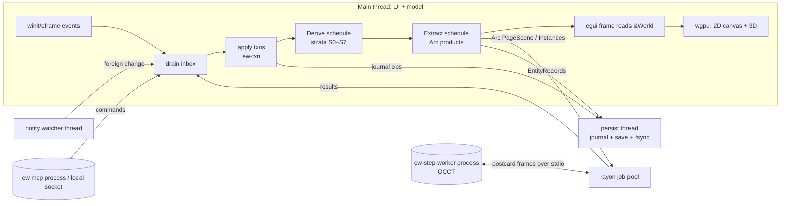
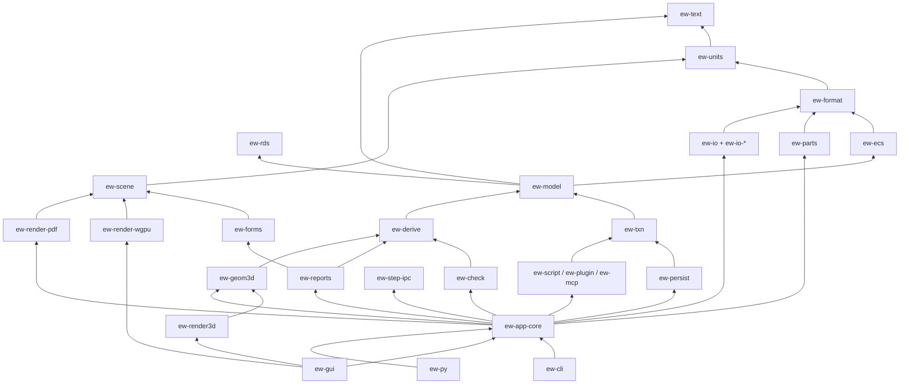

# Proposal B: ECS-centric architecture for ElektraWatt

> **Angle:** the in-memory engineering model is an Entity-Component-System world (`bevy_ecs` standalone), for v1 scope: Electric P8-class schematics, PLC/I-O, Fluid, 3D panel, manufacturing outputs, QET/EPLAN/DXF import.
> **Conventions:** "Golden project" = the reference project J-E-2416 (`[reference-drawing.md](../reference-drawing.md) §4); D-nn = its defects; G-n / C-n = items in [gaps-and-corrections.md](../gaps-and-corrections.md), which overrides the other notes. Versions come from the research notes; "(verify)" marks crates or facts not in them (some checked by me against crates.io or the bevy v0.20.0 source on 2026-10-17, still to be proven in a spike). No customer, person or company is named.

---

## 1. Guiding principles and core idea

**Core idea.** The project is a database of engineering entities, and every drawing is a query over it. One `bevy_ecs::World` holds every function, device, connection point, connection, terminal, cable, PLC channel, fluid port, placement, page and revision. Each one is an entity with a stable UUID and a set of components.

Components come in exactly two kinds:
- **Authored** components are what the engineer decided. They are the only data that is persisted, undone, merged and journalled.
- **Derived** components are everything the program concludes: device tags, cross-references, nets, potentials, effective wire properties, Prev/Next, report tables, check findings, display lists and 3D instance data. Deterministic systems compute them in a stratified schedule. Change sets from the transaction layer drive that schedule, backed by ECS change ticks.

An **extract** stage, modelled on Bevy's render-world extraction, publishes immutable `Arc` products: page scenes, 3D instance buffers and report tables. The 2D canvas, the 2D layout pages, the 3D panel, the PDF writer and the background jobs all read these products. The result is one device object with many representations, which removes the root cause of D-01, D-02, D-41 and D-42.

**Principles.**
1. **Authored vs derived is a type-level split.**
   - Authored components are `#[component(immutable)]`, so no `&mut` can ever exist to them. Every change is an insert that fires a hook, which makes "who changed what" observable and enforceable.
   - Derived components are mutable, tick-tracked and never written to disk.
2. **One writer.** Only the transaction layer (`ew-txn`) inserts or removes authored components. The GUI, CLI, rhai scripts, WASM plugins, MCP agents and importers all submit commands.
3. **Two identities, one rule.** `Uid` (UUIDv7) serves persistence, merge, journals, plugins and PDF links; `Entity` serves in-memory speed. Within a session an authored entity's `Entity` never changes, even across delete and undo (§5.3).
4. **Determinism by construction.** No output may depend on archetype iteration order, hash order or executor scheduling. Every emitter sorts by an explicit key, and CI shuffles spawn order to prove it.
5. **Incremental by default, full recompute always available.** Every derivation stratum has a `full()` path, which debug and CI builds use as the oracle for the incremental path. This keeps the "stale stored copy" class (D-01) dead.
6. **Extract, don't share.** Background jobs (PDF of 2,000 pages, routing, collision, plugin exporters) never touch the World; they consume extracted, immutable inputs.
7. **Bevy is a storage engine, not a framework.** We use `World`, `Query`, `Schedule`, components, relationships, hooks and change detection, not Bevy's `App`, renderer, assets, `bevy_reflect` or scenes. Every crate reaches `bevy_ecs` only through the facade `ew-ecs`.
8. **Headless core.** The CLI (`ew`), GUI, MCP server and a future Python wheel all share `ew-app-core::Session`.
9. **Composition mirrors EPLAN's property bags.** The Festo CPX node -201U1 is *one* entity carrying `DeviceCore + PlcStation + BusPort + Placement…`. Its pins are entities with `FluidPort` or `ChannelPin` components (REF-098). Nothing is subclassed.

### 1.1 Honest fit assessment

| Concern | Native ECS fit | What this architecture adds |
|---|---|---|
| Heterogeneous objects with optional aspects (EPLAN has thousands of optional properties) | **Excellent**: sparse composition | Typed components per aspect, plus `UserProps` for user-defined properties |
| Bulk passes over everything (checks, BOM, nets, reports) | **Excellent**: columnar storage, `par_iter` | Nothing |
| Change propagation | **Good**, but `Changed<T>` is an O(N) tick scan, not an index | Explicit `Dirty` sets (bitmaps per stratum) from the transaction log for the heavy strata |
| Ownership hierarchies (structure tree, device→functions, strip→terminals, station→module→channel, enclosure→plate→rail→placement) | **Good**: relationships with hook-maintained reverse lists (checked in v0.20.0 source) | Explicit `Order` components, because `Children` order is not a persisted ordering |
| Many-to-many and n-ary relations (connection between two points, device↔parts with quantity, conductor↔connection) | **Poor**: bevy relationships are one-to-many only ("A Relationship may only be one-to-many (or one-to-one)", bevy v0.20.0 source) | Reified edge entities (a connection is an entity), plus a `ManyRel` helper that keeps reverse indexes in hooks |
| Secondary indexes (by tag, IP name, folio, part) | **Absent** | Index resources kept in sync by hooks on immutable components, so they are exact at every point |
| Stable identity | **Absent**: `Entity` is index + generation and is reused | `Uid` component plus `UidIndex`; deterministic UUIDs for instantiated children |
| Transactions and undo | **Absent** | `ew-txn` op log; immutability makes bypassing it impossible |
| Cheap snapshots (preview, background consistency) | **Poor**: `World` is not `Clone` | Speculative apply-and-rollback for previews; the extract pattern for jobs |
| Deterministic persistence | **Absent** (bevy_scene is reflect-based and emits Entity IDs) | Own canonical format in an ECS-free crate (`ew-format`) |
| Fine-grained dependency tracking (salsa-style) | **Absent** | A stratified pipeline with declared inputs, plus the full-recompute oracle |

**Verdict.**
- ECS is the right *substrate* for roughly 70 % of the problem:
  - storage of a heterogeneous, mutation-heavy model;
  - change propagation into many derived products;
  - bulk rule evaluation;
  - one world feeding several renderers.
- It is a poor *relational database* and a poor *versioned store*. We close that gap with four thin layers: identity (`ew-ecs`), transactions (`ew-txn`), indexes (hooks) and extraction (`Arc` products). I estimate them at 5–7k lines of code.
- The alternatives pay similar costs elsewhere. Slotmap structs need hand-built change tracking, scheduling and parallel queries. Salsa plus imbl fights a mutation-heavy editor with immediate-mode UI reads. In-memory SQLite adds per-query overhead and a type mismatch on the render path.
- The facade keeps a fallback open. If the four-week spike (§15) fails, `hecs` 0.11.2 (verify) or plain slotmap storage can replace bevy_ecs under the same `Authored` registry, transaction layer and strata.

---

## 2. Process and thread model



| Thread / process | Owns | Notes |
|---|---|---|
| **Main** | `World`, `Schedule`s, `History`, egui, wgpu device | See the frame loop below |
| **Intra-schedule compute** | bevy_tasks `ComputeTaskPool` (cores − 1) | The Derive schedule uses the **SingleThreaded executor**: strata form a chain, so system-level parallelism buys little and costs determinism. Heavy systems parallelise *inside* via `Query::par_iter` (bevy_ecs `multi_threaded` feature) |
| **Job pool** | rayon 1.12.0 | Many-page scene builds, PDF/SVG/DXF export, report pagination, routing, collision batches, QET/EDZ parsing, STEP result loading, long plugin exporters. Inputs are extracted owned or `Arc` data; outputs come back as messages |
| **Persist thread** | journal file, save writer | Journal: group commit of JSONL transaction records every ≤ 500 ms or on idle, `sync_all`. Save: canonical serialisation, tmp-rename, manifest last (G1) |
| **Watcher** | notify 8.2.0 | Debounced 500 ms. The app's own writes are recognised by manifest generation. A foreign change offers reload or 3-way merge |
| **`ew-step-worker`** (process) | occt-sys 7.8.1 + opencascade 0.3.0 (LGPL-2.1, C-5) | Spawned lazily with a serial queue. Length-prefixed postcard 1.1.3 frames over stdin/stdout, timeouts, kill-and-restart on hang. Results go to a content-addressed cache |
| **`ew mcp`** (process) | its own headless `Session` | The GUI "live mode" is a local-socket endpoint, off by default and ask-first (G10) |

**Frame loop on the main thread:**
1. Drain the inbox: job results, watcher events, MCP and plugin submissions.
2. Apply queued commands as transactions.
3. Run Derive incrementally against a soft budget of 8 ms. Strata that overrun hand their pure tail to the job pool. For example, page scene rebuilds for 300 renumbered pages appear progressively.
4. Run Extract, which publishes `ArcSwap` (verify) per-page scenes.
5. egui builds panels by reading `&World` directly through cached `QueryState`s.
6. Paint callbacks render 2D and 3D from the extracted products.
7. Every 10k frames, call `world.check_change_ticks()` to handle tick wrap-around (`CHECK_TICK_THRESHOLD` = 518,400,000 in v0.20.0).

**Autosave = journal + checkpoint.** Every committed transaction goes to a journal in the OS state directory (etcetera 0.11.0, verify), never in the project. A checkpoint of the dirty shards is written every 10 minutes. Recovery = last saved generation + checkpoint + journal replay. The project directory is written only on save, or with the opt-in "autosave to project".

---

## 3. Crate / workspace layout

Licence split per the user decision:
- application crates are GPL-3.0-or-later;
- `ew-units`, `ew-text`, `ew-rds`, `ew-format`, `ew-io*` traits and `ew-step-ipc` are MIT OR Apache-2.0.

| Crate | Responsibility | Key dependencies (version) |
|---|---|---|
| `ew-units` | i64 nm coordinates, rational `Grid`, `Orient2` (rot90 × mirror), `Pose3` (nm + quaternion rounded to 1e-9), conversion to f64 mm | serde 1.0.229, glam 0.34.1 |
| `ew-text` | `MlText` (EPLAN neutral-vs-languages semantics), BCP 47 `LangTag`, NFC, confusables, natural sort | unicode-normalization 0.1.26, unicode-security 0.1.2, icu_collator 2.3.x, smol_str 0.3.6 (verify) |
| `ew-rds` | IEC 81346 parser/formatter; identifier sets as data (EN 81346-2:2009 single letters default, 2019 classes, IEC 60750 legacy) | — |
| `ew-format` | **ECS-free** on-disk schema: `EntityRecord`, canonical JSON, shard rules, manifest, per-component migration chain, JSON Schemas | serde_json 1.0.154, schemars 1.2.3, serde_path_to_error 0.1.20, semver 1.0.28, uuid 1.28.0, sha2 0.11.1 (verify) |
| `ew-ecs` | Facade over bevy_ecs: `Uid`, `UidIndex`, `Authored` trait and type-erased registry, `Dirty` sets, `ManyRel`, entity reservation for undo, determinism helpers (`sorted_by_uid`) | **bevy_ecs 0.20.0** (verify; MIT OR Apache-2.0, MSRV 1.95, no wgpu dependency; `default-features = false`, features `std`, `multi_threaded`), indexmap 2.14.2, roaring 0.11.5 (verify) |
| `ew-schema-derive` | `#[derive(Authored)]`: immutable `Component` + registry entry + serde + property-grid metadata (Fluent label key, unit, enum options) | syn / quote (verify) |
| `ew-model` | All authored component and relationship definitions, per domain module (project, structure, page, symbol, function, device, part, cp, connection, potential, terminal, cable, plc, bus, fluid, layout, revision, forms, checks); kind bundles; invariants | ew-ecs, ew-units, ew-text, ew-rds |
| `ew-txn` | Commands, `Tx`, ops, history (undo/redo, coalescing, memory bound, saved marker), speculative apply, prevent hooks, journal records, macro recorder | ew-model, ew-format |
| `ew-derive` | Strata S0–S7, incremental + `full()`, `VerifyDerived` oracle | ew-model, rayon 1.12.0, petgraph 0.8.3 |
| `ew-check` | Rule engine: TOML rule packs, Rust rule registry, rhai expressions, online/offline/prevent | ew-derive, rhai 1.26.1, toml 1.1.8 |
| `ew-parts` | Company/user parts DB (FTS5), EDZ ingest, project part snapshots | rusqlite 0.40.2 (bundled), sevenz-rust2 0.24.0 (C-1), zip 9.0.4, quick-xml 0.42.0 |
| `ew-persist` | World ⇄ files (two-phase load), incremental save, lock, journal and recovery, external-change detection, semantic 3-way merge, `.ewz` | ew-format, ew-txn, notify 8.2.0, etcetera 0.11.0 (verify), zip 9.0.4 |
| `ew-scene` | Display-list IR, text shaping, symbol geometry | parley 0.12.0, fontique 0.12.0, skrifa 0.48.0, kurbo 0.13.1, peniko 0.6.1 |
| `ew-forms` | Frames, title blocks, report forms → display lists | ew-scene |
| `ew-reports` | Report types → typed tables → paginated generated pages; CSV/XLSX | ew-derive, ew-forms, rust_xlsxwriter 0.100.0, csv 1.4.0 |
| `ew-render-wgpu` | 2D GPU renderer: instanced symbols, screen-space lines, glyph atlas | wgpu 30.0.1, lyon 1.0.19, vello_cpu 0.3.0 (glyph raster) |
| `ew-render-pdf` | PDF: outlines, links, named destinations, page labels, PDF/A-2b (C-10) | krilla 0.8.2 |
| `ew-render-raster` / `-svg` / `ew-export-dxf` | PNG (thumbnails, goldens, Windows print banding), SVG writer, DXF AC1015 | vello_cpu 0.3.0, dxf 0.6.2 |
| `ew-print` | Print adapters | ashpd 0.13.13, objc2-pdf-kit 0.3.2, windows 0.62.2 |
| `ew-geom3d` | Pose propagation, collision, routing graph, wire length, duct fill | parry3d 0.31.1, petgraph 0.8.3, pathfinding 4.16.0 |
| `ew-render3d` | 3D renderer: instancing, edges, CPU ray-cast picking, LOD | wgpu 30.0.1, meshopt 0.7.0 |
| `ew-step-ipc` / `ew-step-worker` | IPC contract and cache layout / OCCT worker binary | postcard 1.1.3, gltf 1.4.1, occt-sys 7.8.1, opencascade 0.3.0 |
| `ew-io` | `Importer` / `Exporter` traits, `ImportReport`, `SourceRef` provenance | ew-format |
| `ew-io-qet`, `-eplan`, `-dxf`, `-aml`, `-plc`, `-mfg` | QET (ported GPL logic allowed), EDZ/XML/XLSX, DXF (acadrust 0.6.4 behind a flag, C-4), AML CAEX 2.15 + AR APC 1.4.0 (C-2/C-3), TIA XLSX / PLCopen / CSV, `.ewpp` and Komax/Rittal profiles | roxmltree 0.21.1, quick-xml 0.42.0, calamine 0.36.1, dxf 0.6.2 |
| `ew-script`, `ew-plugin`, `ew-mcp` | rhai host; WASM component host (WIT); MCP server | rhai 1.26.1, wasmtime 48.x LTS, wit-bindgen 0.63.0, rmcp 3.5.1 (verify) |
| `ew-app-core` | `Session` (World + schedules + history + persistence + jobs + command registry) | everything above except the GUI |
| `ew-cli` (`ew`), `ew-gui`, `ew-py` (v1.x) | Binaries / wheel | clap 4.6.7 (verify); eframe/egui 0.37.0, egui_tiles 0.17.1, egui_table 0.10.0, egui_ltreeview 0.9.0, transform-gizmo-egui 0.11.0, muda 0.21.2, rfd 0.17.2, arboard 3.7.0, fluent-bundle 0.16.0; pyo3 0.30.1 |
| `ew-testkit` | Golden builder, S–XL generators, oracles | insta 1.49.0, proptest 1.12.0, criterion 0.8.2, dify 0.8.0 |

**Importers depend on `ew-format`, not on the ECS.** They emit `EntityRecord` batches, the same shape as the on-disk files. This has three consequences:
- third parties can reuse them;
- they can be fuzzed without a World;
- the World never sees a half-imported state.



---

## 4. Core domain model: storage and identity

### 4.1 Authored components, derived components, relationships

```rust
// ew-model::device — authored: immutable, persisted, undoable, merged per component
#[derive(Authored, Clone, PartialEq)]
#[authored(key = "ew.device.core", version = 1)]   // expands to Component + #[component(immutable)] + registry entry
pub struct DeviceCore {
    pub letter: Letter,          // from the project identifier set (2009 single letters by default)
    pub numbering: Numbering,    // Auto { counter: u32 } | Frozen(SmolStr)  e.g. Frozen("S51")
}

#[derive(Authored, Clone, PartialEq)]
#[authored(key = "ew.device.location", version = 1, relationship(target = LocatedHere))]
pub struct InLocation(pub Entity);   // persisted as the target's Uid; LocatedHere is derived

// ew-derive — derived: mutable, tick-tracked, never persisted, never in undo
#[derive(Component, Clone, PartialEq, Default)]
pub struct DisplayTag { pub full: SmolStr, pub shown: SmolStr }  // "=P01+J-E-2416-102G1" / "-102G1"
```

**Rules:**
- **No authored data in resources.** Project settings (colour/size profiles, numbering rules, identifier set, xref format) are components on the singleton `Project` entity, so they get undo, persistence and merge for free.
- Resources hold only indexes, caches and runtime state.
- **Relationship targets are always derived.** Bevy maintains them in hooks. Only the source side is authored.
- **Unknown components survive.** A record component that this build does not know is kept as `Unknown(BTreeMap<String, serde_json::Value>)` and written back verbatim. This gives minor-version forward compatibility (G2) almost for free in an ECS.

### 4.2 Domain mapping

| Domain object | Entity / components (authored unless marked *derived*) |
|---|---|
| **Project** | singleton: `ProjectProps` (typed, REF-001…004: customer and end-user roles separate, D-30), `SupplyDef`, `ColourProfile`, `SizeProfile`, `NumberingRules`, `XrefFormat`, `Languages` |
| **Structure trees** (`==`, `=`, `++`, `+`) | `StructNode { aspect, code, desc: MlText }` + `StructParent` relationship; *derived* `StructPath`. One canonical spelling per node (REF-026) |
| **Section / Page** | `SectionCore { number, folio_range, title }`; `PageCore { folio, page_type, form }`, `PageDesc(MlText)`, `PageStructure { func, loc }`, `InSection`; *derived* `PageNav { prev, next }`, `TitleFields`, `PageItems` |
| **Function** (placed or unplaced symbol) | `FunctionCore { def, role: Main/Aux, repr: Multiline/Overview/Single/Pair/Fluid/Topology }`, `OfDevice` (target *derived* `DeviceFunctions`), optional `Placed2D { page, at: Pt2, orient, symbol, variant }` + `OnPage` |
| **Device** | `DeviceCore`, `InFunction`, `InLocation`, `PartLines(SmallVec<PartLine { part, qty }>)` via `ManyRel`, `FunctionText(MlText)`, `TechData`, `ProcessTag`, `UserProps`; assemblies via `AssemblyOf(parent)` + `Order` (valves QM1…4 under -201U3, D-27/D-41) |
| **Part** | `PartSnapshot` entities: embedded copies `{library_id, item_id, version, sha256}` (G2), technical data, CP pattern, 3D refs. The catalogue itself lives in SQLite (`ew-parts`), not in the World |
| **ConnectionPoint** | entity per point: `CpCore { index, designation, aliases, kind }` + `CpOf(function)`. **Instantiated, not stored**: spawned from the function definition at load with Uid = v5(function Uid, index). Only overrides are persisted (`IntentionallyUnused`, D-23). Duplicate printed designations stay unique by index (REF-029) |
| **Connection** | edge entity: `ConnCore { a: Entity, b: Entity, kind: Wire/Bridge/Fluid/Bus/Internal }` (hooks maintain *derived* `CpConns` on both ends), `ConnRoute { page, points }`, optional `WireOverride { csa, colour, number }` (the CDP equivalent), `ConnSeq(u8)` |
| **Junction** | `JunctionCore { page, at, style: Dot/Bevel }`: a junction node that connections attach to. The sequence comes from `ConnSeq` (REF-034, D-20) |
| **Interruption point / external connection** | a function with `IpCore { name, direction }`; `ExternalRef { project, location, device, connection }` (REF-018) |
| **Potential / Net** | `PotentialDef { name, ptype: L/N/PE/FE/DC+/M/Signal/Bus, voltage, freq }` + `PotentialAt(cp)`; `Bond { a, b, kind }` (REF-038, D-22); *derived* `NetTable` resource (dense arrays keyed by entity index), `NetInfo { canonical_name, ptype, members }` (D-24) |
| **TerminalStrip / Terminal** | strip = device + `StripCore`; terminal = device + `TerminalCore { designation, part }` + `InStrip` + `Order`; levels and clamps are CPs (`level`, `side`, G4/panel §4.4); bridges are `ConnCore{kind: Bridge}` with part lines; drawn segments are functions with `repr = StripSegment` (one strip, many segments: D-42) |
| **Cable / Conductor** | cable = device + `CableCore { length: LengthSource }`; `ConductorCore { colour: ColourCode, number, csa, shield }` + `InCable` + `Order`; `CarriedBy(conductor)` on connections |
| **PLC Station / Module / Channel** | `PlcStation { role, plc_project, dd }` and `PlcModule { station, slot, type_ident, start: AddrValue, address_map }` on device entities; channel entity `ChannelCore { number, kind, data_type, address: Auto/Manual/Excluded, state }` + `InModule`; `ChannelPin` on CPs; *derived* `ChannelAddress` (start + address map, so readdressing is one edit); `AddrValue::Tbd` is a typed open item (D-15) |
| **Bus** | `BusPort { interface, bus, role, address: AddrValue }` on CP/device; `LogicalNet` / `PhysicalNet` entities; connector `Termination` (REF-061) |
| **FluidPort** | a CP plus `FluidPort { role: 1/2/3/4/5/12/14, size }`; fluid lines are connections plus `TubeSpec`; `Medium` entities propagate through the same net engine, filtered by discipline |
| **Placement** (2D/3D layout) | `LayoutSpace`, `Enclosure`, `MountingSurface`, `Rail`, `Duct` carriers with `OnCarrier` hierarchy; `Placement { of: device/function, pose: Pose3 (relative to carrier), variant, locked }` + `PlacementOf` (target *derived* `DevicePlacements`); *derived* `WorldPose`. It never stores tag text (panel §4.5) |
| **Revision** | `Revision { index, date, description, state: Open/Completed, author_role, checker_role }`; `CurrentRevision` on Project; per-page `PageRevStatus` (authored at completion, derived while open from the txn log) |
| **Forms / reports** | `FormDef`, `SymbolDef` (embedded library copies), `ReportBlock { kind, filter, sort, form, start_folio, section }`, `EmbeddedReport { kind, filter, form, page, at }` |
| **Notes** | `FreeText`, `Graphic`, `PropertyText { target, prop, style }` (content *derived*, REF-092), `Waiver`, `Comment` |

### 4.3 Identity

- **New objects:** UUIDv7 (uuid 1.28.0).
- **Instantiated children** (connection points, terminal levels): v5(parent, index).
- **Imported objects:** v5(namespace, source file hash, source id). Re-importing the same QET file therefore yields the same Uids, and diffs stay meaningful.
- **Generated pages:** v5(report block, page index), so PDF named destinations are stable.
- `Uid` is an immutable component. Its `on_add` and `on_remove` hooks maintain `UidIndex: HashMap<Uid, Entity>`.
- `Entity` values never leave the process. The `Authored` registry serialises every `Entity`-typed field through `UidIndex`.

### 4.4 Coordinates and text

- **Coordinates (G4):**
  - Every authored 2D and 3D linear coordinate is i64 **nanometres**.
  - Grids are rational. The QET grid is `num = 7_937_500, den = 3` nm; the native symbol grid is a project decision.
  - 3D rotations are quaternions rounded to 1e-9.
  - f64 mm (glam `DVec3`) exists only in derived components and GPU staging.
- **Multilingual text:** user-visible texts are `MlText` (G7). Identifiers (DTs, part numbers, PLC addresses, wire numbers) are not, and are NFC-normalised plus checked for confusables on input.

### 4.5 Memory estimate (XL: 2,000 pages, 50k devices, 200k connections)

Entity counts:

| Entities | Count |
|---|---|
| Functions | ~150k |
| CPs | ~600k |
| Connections | 200k |
| Texts and graphics | ~300k |
| Junctions | 30k |
| IPs | 20k |
| Terminals | 30k |
| Channels | 20k |
| Placements | 40k |
| **Total** | **≈ 1.4M** |

Memory, assuming about 250 B per entity across authored, derived and archetype overhead:

| Item | Memory |
|---|---|
| Entities | ≈ 350 MB |
| Scenes (LRU of 200 built pages) | ≈ 40 MB |
| Undo (bound) | 256 MB |
| **Total** | **< 1 GB**, inside G6's XL budget of 4 GB (estimate, to be measured in the spike) |

---

## 5. Editing: commands, transactions, undo, validation, preview, macros

### 5.1 Commands and `Tx`

- A **command** is a named, serialisable operation, for example `ew.place_symbol`, `ew.connect`, `ew.renumber`, `ew.set_prop`, `ew.import_qet` or `ew.route_wires`.
- Commands are registered in `CommandRegistry` with a JSON-schema'd argument struct. That makes them callable identically from GUI tools, the command palette, CLI, rhai, WIT plugins and MCP.
- A command runs against `Tx<'w>`, a wrapper over `&mut World` that records ops:

```rust
pub enum Op {
    Spawn   { e: Entity, uid: Uid, kind: Kind },
    Set     { e: Entity, comp: CompKey, before: Option<AnyAuthored>, after: Option<AnyAuthored> }, // insert/replace/remove
    Despawn { e: Entity, snapshot: Vec<AnyAuthored> },   // see 5.3
}
```

**Enforcement.**
- Authored components are immutable, so the only mutation path is `insert`/`remove`.
- For every authored type, the registry installs observers on the `Insert` and `Discard` lifecycle events (the v0.20.0 names). They check that a `TxGuard` is open, and fail the transaction otherwise (debug: panic).
- Derived systems physically cannot change engineering data. This is a compile-time-plus-runtime guarantee that a plain-struct model cannot give.

### 5.2 Commit pipeline

1. **Structural invariants** (always). Examples: connection ends exist, CP owned by a function, one main function per device. A violation aborts.
2. **Prevent-mode rules** on the change set. Example: a duplicate terminal designation in a strip (D-12) aborts with a message, which is EPLAN's "prevent errors" check type.
3. **Derive** incrementally (§6), then run **online checks** on the change set.
4. **Push to `History`** with label, page and viewport, selection, `merge_key` and a saved marker.
5. **Journal:** send the op record (Uid-based JSON) to the persist thread. The same record feeds crash recovery, macro recording, `ew diff` and the revision change log (G3).

```json
{"txn":1842,"cmd":"ew.renumber","ops":[{"set":"018f3a…","c":"ew.device.core",
 "before":{"letter":"W","numbering":{"auto":4}},"after":{"letter":"W","numbering":{"auto":3}}}]}
```

### 5.3 Undo, redo and stable `Entity`

- Undo applies inverse ops in reverse order, then runs Derive on the resulting change set. Derived data is never in history (G3).
- **Delete is a soft delete.** `Tx::delete` records and removes every authored component except `Uid`, including relationship sources, so reverse lists drop the entity. It then inserts `Deleted`, a custom disabling component registered with `World::register_disabling_component`.
  - Default query filters hide the entity everywhere.
  - Undo removes `Deleted` and re-inserts the snapshot. The `Entity` (index *and* generation) never changed, so history, selection and indexes stay valid.
- Tombstones (`Uid` + `Deleted`, a few bytes each) are purged when their history entry is dropped, and never written to disk.
- I rejected `try_despawn_no_free` + `spawn_empty_at`, although it looked like the ideal API. The v0.20.0 source says it "still increases the generation", so old `Entity` handles would not resolve after undo.
- Commit fails if any authored reference points at a `Deleted` entity. Cascades (deleting a function deletes or detaches its connections) are explicit in `Tx`. We never use `linked_spawn` on authored hierarchies.

**Coalescing and limits.**
- Drags of one selection merge.
- Typing in one property field merges until focus leaves.
- A table bulk edit is one transaction.
- History is capped at 500 steps or 256 MB.
- Saving never clears history.
- A foreign reload clears it, unless the reload was an EW-produced merge transaction.

### 5.4 Preview of large changes

- `Tx::speculate` applies the command, runs Derive and computes a `PreviewDiff`: the authored ops plus derived deltas (tags old → new, xref texts, BOM rows, affected folios).
- The canvas shows the speculative state with a highlight overlay; the UI is modal while previewing. *Confirm* pushes the already-applied transaction to history. *Cancel* rolls back and re-derives.
- This replaces a World clone, which ECS cannot provide cheaply. Renumbering 10k devices is about 10k ops and ~150 ms of derive, with page scenes rebuilt progressively on the pool.

### 5.5 Macros

- **Recorded macros** are command logs with parameter placeholders, replayed through the registry.
- **Page and window macros** (EPLAN-style reusable content, e.g. the four valve-manifold typicals on 203–206) are **fragments**: `EntityRecord` sets with local ids.
- `ew.insert_fragment` instantiates a fragment. It re-keys Uids (v7), resolves value-set placeholders (address, function text), and is one transaction.

---

## 6. Derived data

### 6.1 Strata (Derive schedule, fixed order, ambiguity detection = error)

| Stratum | Products (derived components / resources) | Inputs → invalidation |
|---|---|---|
| **S0 Indexes** | `UidIndex`, `StructIndex`, `FolioIndex` (BTreeMap), `IpByName`, `PartUsers`, `CpConns`, relationship targets | Maintained **in hooks** at insert time. Exact, O(1) per op |
| **S1 Structure and pages** | `StructPath`, `PageNav` (Prev/Next), section membership, TOC row data | Folio, page, section or structure change → recompute nav for the folio-sorted neighbours |
| **S2 Device tags** | `DisplayTag`, `FullTag`, `CpLabel` | DeviceCore / InLocation / InFunction; main function's page folio (page-based numbering `-<folio><letter><counter>`); struct node code (→ subtree via `LocatedHere`); numbering rules (→ all) |
| **S3 Connectivity** | `NetTable`: union-find over CP entity indices from connections, bridges, junctions, IP pairs by name and scope, function-definition internal links. Bonds are recorded, not merged | Connection add → `union`. Remove → the old net is marked dirty and only that component is re-flooded (BFS) |
| **S4 Potentials and wire properties** | `NetInfo` (canonical name, type, voltage, conflicts); `EffectiveWire { csa, colour, number, provenance }` per connection. Chain: `WireOverride` > potential definition > profile rule (type × voltage × circuit class) > project default | Dirty nets → their connections. Profile change → all |
| **S5 Cross-references and labels** | IP xref text `{folio}-{row}{col}`, using the anchor policy of REF-021 against the counterpart page's frame grid; main↔aux "(201-E1)" / "∞ 203-B4"; `PropertyText` content | **Coarse:** any IP, function placement, folio or frame change → recompute all pairs for the affected names or devices (cheap, see below) |
| **S6 Report data and title blocks** | `TitleFields` per page; `ReportTable`s (TOC, BOM in assembly or component mode, terminal, cable, wire, PLC, potential, revision) | Dirty flags per report kind. Computed when visible or exported |
| **S7 Generated pages and online checks** | Generated page entities (derived kind, deterministic Uids); `Findings`, `FindingIndex` | Report tables changed. TOC ↔ folio fixed-point capped at 3 rounds |
| **Extract E1–E4** | `Arc<PageScene>` for dirty pages; per-page rstar trees; 3D instance buffers; navigator sort indexes | Page dirty = any entity with `OnPage(p)` whose authored *or* derived visual components ticked. Derived writers use `set_if_neq`, so ticks move only on real change |

```rust
fn derive_tags(dirty: Res<Dirty>, ctx: TagCtx, mut out: Query<&mut DisplayTag>) {
    for e in dirty.iter(Stratum::Tags) {                 // O(changed), not O(N)
        let tag = ctx.format(e);                          // pure; same fn used by full()
        if let Ok(mut t) = out.get_mut(e) { t.set_if_neq(tag); }
    }
}
```

**Committed computations.** Some computed values must *not* silently change, because a shop floor relies on them:
- routed wire paths and lengths;
- frozen wire numbers;
- report snapshots of a completed revision.

These are authored outputs of commands (`ew.route_wires`), stored with an input hash. A check (`L011 route stale`) flags them when the inputs change. This keeps "derived = always fresh" honest without re-routing behind the user's back.

### 6.2 Correctness oracle

- `ew-derive::full(world) -> DerivedDigest` recomputes every stratum from scratch with the same pure functions.
- In debug builds with `EW_VERIFY_DERIVED=1`, and in the proptest suite after every random transaction, the incremental digest must equal the full digest.
- Hand-written invalidation is the main risk of this approach (§16). The oracle is what makes it acceptable.

### 6.3 Complexity at XL

These are estimates for the spike to confirm, on the G6 baseline machine.

| Product | Full recompute | Typical incremental |
|---|---|---|
| Tags (50k devices) | O(n·depth) ≈ 30–50 ms | page folio change: ~50 devices < 1 ms |
| Nets (≈ 800k nodes, 250k edges) | O((V+E)·α) ≈ 15–30 ms | add: O(α); remove: O(net size), a 5k-member PE net ≈ 0.5 ms |
| Effective wire properties (200k) | ≈ 20–40 ms | dirty nets only |
| Xrefs (20k IPs, 150k functions) | ≈ 10–30 ms, so coarse is fine | ≤ full |
| BOM (50k devices, aggregated) | ≈ 20–50 ms | full, but only when the report is needed |
| Page scene | 1–3 ms per page; 2,000 pages ≈ 0.5 s on 8 cores | 1–50 dirty pages |
| `Changed<T>` tick scan (600k CPs) | ≈ 0.3–0.5 ms per filter | — which is why heavy strata use `Dirty` sets |
| Offline check run | 5–30 s parallel (budget ≤ 60 s) | online: change set only |

---

## 7. Persistence

### 7.1 On-disk layout

The project is a directory of text files (G1). SQLite is used only for the parts catalogue and caches.

```text
<name>.ew/
  manifest.json            format "1.0", generator, generation, sha256 per file   (written LAST)
  project.json             Project entity, structure nodes, sections, revisions, profiles, rule overrides
  pages/<uid>.json         page entity + entities homed on it (functions, connections, junctions, texts, embedded reports)
  devices/<xx>.json        256 shards by Uid prefix: devices, strips, terminals, cables, conductors, PLC, bus nets
  layout/<uid>.json        one per layout space: enclosure, surfaces, carriers, placements
  parts/<x>.json           16 shards of embedded part snapshots
  library/{symbols,forms}/<uid>.json   embedded copies
  .ew/                     per-user view state (gitignored)
```

**Home file.**
- An entity's file is determined by ownership: an `OnPage` chain → page file; a layout chain → layout file; otherwise the Uid shard.
- File names are Uid-only lower-case hex, so no Windows reserved names and no case collisions (G1).

**Records.** One block per entity, sorted by Uid. Components are sorted by key, fields are in schema order, integers only (nm), two-space indent, LF.

```json
{ "uid": "018f3a2c-…", "kind": "Device",
  "c": { "ew.device.core": { "letter": "F", "numbering": { "auto": 1 } },
         "ew.device.location": "018f3a1b-…",
         "ew.device.part_lines": [ { "part": "018f39ff-…", "qty": 1 } ] } }
```

**Save.**
1. The main thread extracts `EntityRecord`s for the dirty home files, as a clone of the immutable components. This takes 10–50 ms incrementally.
2. The persist thread serialises the records, writes `*.tmp-<gen>`, calls `sync_all`, renames, and writes the manifest last.
3. Hash verification on open detects interrupted saves and hand or merge edits.

**Determinism tests.**
- Save without changes produces zero bytes of diff.
- save → load → save is byte-identical.
- Loading with shuffled spawn order gives identical files, derived digests and PDF bytes.

**Load (XL estimate).** Parallel parse of ~120 MB JSON (CPs are not stored) ≈ 1.5 s. Two-phase spawn (all entities with `Uid` via `spawn_batch`, then Uid → `Entity` resolution and relationship inserts) ≈ 1 s. Full derive ≈ 1.5 s. Scenes are built lazily. Total ≈ 5 s, against an XL budget of 20 s.

### 7.2 Versioning, migration, merge, locking

- **Versioning.** Two-part project format version (G2). Each component key also carries its own schema version (`ew.device.core` v1 → v2).
- **Migrations** are pure `serde_json::Value` functions **per component type**. This granularity is the ECS's natural one: a schema change touches one component kind, not a document tree. Steps are never pruned.
- **Fixtures.** The CI fixture corpus holds one project per released format.
- **Merge driver** (`ew merge-driver %O %A %B %P`):
  - It performs a 3-way merge per (Uid, component key), then field-wise inside struct components. Two engineers adding *different* components to the same device merge cleanly, which is a real ECS advantage.
  - A true conflict is written as an `ew.conflict` component holding both values. The file stays valid JSON, git gets a non-zero exit, and EW shows a resolution panel.
  - After the merge, a semantic validation pass reports dangling references and duplicate designations as findings.
- **Locking:** `.~ew.lock`, created with `create_new`, holding `{user, host, pid, app_version, started_at}`. A held lock means read-only open, with take-over once the lock is stale (G1).
- **Parts:** the company and user catalogue is a rusqlite DB with FTS5, outside the project. The project embeds snapshots of the parts it uses, so it opens without the library.
- **Transport:** `.ewz` is a zip of the directory.

---

## 8. Rendering pipeline

**Display-list IR (`ew-scene`).**
- `PageScene { items, symbol_refs, links, anchors, bounds }`.
- Items are `Path(kurbo::BezPath, stroke, brush)`, `Glyphs(run)`, `Image`, `Group(transform)`, `Link(target Uid)` and `Anchor(name)`. Each carries a `PickId(Uid)` and a layer.
- Symbol geometry is an `Arc<SymbolGeom>` per (symbol definition, variant, content hash), instanced by transform. That gives GPU instancing, and repeated drawing in the PDF.
- Text is **shaped once during extract**: parley 0.12.0 + fontique, skrifa 0.48.0, with bundled Noto/DejaVu Sans and osifont (G14). Screen, PDF, SVG and PNG therefore share identical metrics. Scenes are keyed by (page, display-language set) for "PDF per language".

| Backend | Implementation |
|---|---|
| Screen | `ew-render-wgpu` inside an `egui_wgpu` paint callback on the shared wgpu 30 device. Symbols tessellated once (lyon), instanced; screen-space-width lines in the vertex shader (no re-tessellation on zoom); glyph atlas rasterised with vello_cpu. LOD: below ~2 px, text becomes bars and hatches are skipped; page thumbnails from vello_cpu at 1/8 scale, cached |
| PDF | krilla 0.8.2. Outline per section and page (from S1); named destination per xref anchor and a link per xref text; `/PageLabels` equal to folio numbers; PDF/A-2b default, 3b/4f only with attachments (C-10); subset fonts. No optional-content layers (C-11) |
| SVG / DXF / PNG | own SVG writer; dxf 0.6.2 AC1015 with layer mapping; vello_cpu 0.3.0 for thumbnails, goldens and banded Windows printing |
| Print | PDF is the print master; `ew-print` adapters per OS |

**Hit-testing.** Extract builds an rstar 0.13.0 R*-tree of item bounding boxes per page. Exact picking uses kurbo. A pick returns a Uid → `UidIndex` → `Entity` → selection, so selection survives scene rebuilds.

**3D.**
- `ew-geom3d` propagates `Pose3` down the `OnCarrier` hierarchy into derived `WorldPose`. This is the same pattern as Bevy's transform propagation, written in i64/f64, and it runs only for changed subtrees.
- `ew-render3d` draws:
  - parametric prisms (enclosure, plate, rails, ducts) generated in Rust;
  - STEP-derived meshes from cache, instanced (the 25 PT 2.5-TWIN terminals share one mesh);
  - feature edges;
  - highlight state from the selection.
- Picking and collision use CPU parry3d 0.31.1 BVHs. Collision runs as a job on extracted hulls and meshes and writes back `CollisionFindings`.
- **STEP pipeline:** hash the part model → cache lookup → on a miss, the worker produces an assembly tree, 2 LOD meshes, edges, a hull and mounting frames → cached as glTF + rkyv 0.8.18 → a job loads it → GPU upload on the main thread.

---

## 9. UI shell

**Toolkit: egui/eframe 0.37.0.** The ECS angle makes this choice clearer, not just compatible:
- **Immediate mode reads the World directly** every frame: navigators, property grid and tables query `&World` through cached `QueryState`s. A retained toolkit (Slint, Qt) needs a view-model layer synced from change detection: a second copy of the model, which is the staleness class we are designing out.
- bevy_egui (0.43.1) and Rerun prove the egui-over-ECS and egui-plus-own-wgpu patterns. One wgpu device serves UI, 2D and 3D.
- AccessKit, egui_kittest (accessible-name enforcement) and egui_mcp (test builds only, G10).

Rejected: Slint (licence-compatible under GPL-3.0, but no docking or tree, and its wgpu interop changes with every wgpu major), iced (pinned to wgpu 27), gpui (no custom GPU passes), Tauri (the UI is not Rust).

| Element | Design |
|---|---|
| Docking | egui_tiles 0.17.1; saved workspaces: Schematic, PLC, Fluid, Panel 3D, Manufacturing (G5) |
| Navigators | egui_ltreeview 0.9.0 over derived, sorted, virtualised indexes (page, device, terminal, cable, PLC, potential, placement) with bidirectional canvas sync |
| Tables | egui_table 0.10.0 (wire list, I/O list, terminal editor): rows are views over queries; edits are commands (fill-down and paste-from-Excel are one transaction) |
| Property grid | Generated from `Authored` registry metadata. Derived values are shown greyed with their provenance ("0.75 mm² from potential 24VDC-1 via size profile"), with override and reset. Multi-select shows `‹varies›` |
| Canvas | Own widget. Tools are state machines that emit commands. Ghost previews are overlay scenes. Snapping on the rational grid. Back/forward xref navigation |
| Keyboard-first | Command palette over `CommandRegistry`; keymap presets (EW, KiCad-like, EPLAN-like); grid-step cursor; "next unconnected point" |
| Theming / a11y | Paper colours independent of UI theme; CVD-safe highlight palette with pattern plus colour; wire colours always with the IEC 60757 code; high-contrast theme; canvas selection exposed as an AccessKit live region (G8) |
| i18n | fluent-bundle 0.16.0 for the UI; ICU4X for formats; kept separate from `MlText` |
| macOS | muda 0.21.2 native menu bar |

---

## 10. Extensibility

**The ECS pay-off for extensibility is uniform reflection.** Every authored datum is addressable as `(uid, component_key) → JSON` with a published JSON Schema. One generic surface therefore serves CLI, rhai, WASM, MCP and Python, with no per-feature API retrofit (the KiCad lesson).

| Surface | Design |
|---|---|
| **CLI `ew`** | `ew export pdf\|bom\|wires\|terminals\|cables\|plc\|komax\|dxf`, `ew check --scheme release` (CI exit codes), `ew import qet\|edz\|dxf\|aml`, `ew diff`, `ew merge-driver`, `ew print`, `ew jobs run`, `ew script run`, `ew mcp`. All run on a headless `Session` |
| **Scripting** | rhai 1.26.1. Expressions in rules, tag formats, report columns and title-block formulas. Automation scripts call `ew.query(kind, filter)`, `ew.get(uid, key)` and `ew.run(cmd, args)`. Everything goes through commands, so it is undoable and journalled. Sandbox: `set_max_operations`, no I/O registered. Project-embedded scripts never auto-run (trust prompt, G10) |
| **Plugins** | WASM components on wasmtime 48.x LTS with wit-bindgen 0.63.0. WIT world `elektrawatt:plugin@1`: `model` (query and get as JSON), `ops` (submit a command or op batch), capability-scoped `io`; exports `importer`, `exporter`, `rule`, `report-column`. Plugin data lives in namespaced `plugin.<id>.*` keys inside a `PluginData` component: persisted, merged and undoable, with no runtime Rust types. Fuel and epoch limits, `StoreLimits`, signed manifests, and the plugin is shown in undo history |
| **MCP** | `ew-mcp` on rmcp 3.5.1 (verify). Tools: `query`, `get`, `describe_schema`, `check`, `preview` (speculative apply returning the `PreviewDiff`), `apply` (ask-first), `export`. Off by default; stdio or localhost only |

**Importer / exporter traits:**

```rust
pub trait Importer { fn sniff(&self, src: &Source) -> Confidence;
                     fn import(&self, src: &Source, ctx: &ImportCtx) -> Result<ImportBatch, ImportError>; }
pub struct ImportBatch { pub records: Vec<EntityRecord>, pub report: ImportReport, pub provenance: Vec<SourceRef> }
pub trait Exporter { fn export(&self, view: &ExportView, sink: &mut dyn Sink) -> Result<ExportReport, ExportError>; }
```

**Import and export flow.**
- Batches are applied as **one** transaction. The migration report is then simply the check run (interop Impl. 2).
- `ExportView` is extracted, owned data (report tables, records, scenes), so exporters run on the job pool while the user keeps editing.

---

## 11. Reports and forms engine

**Forms.**
- `FormDef` covers frames, title blocks and report forms.
- Each is a declarative template:
  - geometry in nm;
  - header, data and footer areas;
  - dynamic rows;
  - next-forms;
  - conditional sub-forms;
  - cells with typed placeholders (`{project.description}`, `{page.nav.next}`, `{rev.index}`, `{row.part.manufacturer}`).
- A QET-compatible 17 × 8 frame (columns from 0) and ISO 5457 frames ship as data. Line widths 0.13–1.3 mm and drop-shadow boxes reproduce the house style (REF-105).

**Report types** are a fixed Rust enum, following EPLAN's split: TOC, parts list and summarised parts list (assembly or component mode), device list, terminal diagram, line-up and strip overview, cable diagram and overview, wire list, PLC diagram, card overview and assignment list, potential, structure-identifier and revision overviews, enclosure legend, title page.

Each type is a system in S6 that builds a `ReportTable` of typed columns. Every row carries source Uids, which become PDF links and canvas jumps.

**Three outputs of one table:**
1. **Generated report pages.** An authored `ReportBlock` (kind, filter, sort, form, start folio, section) gives derived page entities. Pagination is deterministic. Folios 903–911 of the golden project come from here.
2. **Embedded reports** on interactive pages: the "PART DATA" boxes on 201, 202 and 902.
3. **Data exports:** CSV and XLSX (rust_xlsxwriter), and the `.ewpp` production package.

Because reports are derived, there is no "update reports" step to forget (defect 7 in the brief, D-09). Completing a revision can *freeze* the report snapshots for that revision as committed computations (§6.1).

---

## 12. Checks and rule engine

**Rules.**
- A rule pack is versioned TOML data, for example `ruleset = "EN60204-1:2018+A1:2025"`.
- Each rule entry holds:
  - id (EPLAN-style class plus number, e.g. `EW005019`);
  - severity;
  - allowed modes (online, offline, prevent);
  - scope kind;
  - parameters;
  - a Fluent message key;
  - a docs URL.
- The `impl` field names either a registered Rust `RuleImpl` (`n_switching`, `pe_sizing`, `dup_terminal_designation`, `unplaced_device`, `addr_scheme`) or a rhai expression over typed accessors.

**Online checks.**
- Rules declare their input components.
- The engine runs a rule only for entities in the change set that match its scope.
- Results are derived `Findings` plus a `FindingIndex` that feeds the message panel (jump, quick-fix commands, waivers).

**Offline checks.**
- A full run is a **chunked sweep** over all entities on the main thread, a few thousand per frame with `par_iter` inside each chunk.
- Transactions committed during the sweep are re-checked from their change sets at the end.
- The UI stays responsive without a snapshot. In CLI mode the sweep runs unchunked.

**Prevent mode.** Prevent rules run inside the commit (§5.2).

**Waivers and release.**
- `Waiver { rule, target, reason, role, date }` entities are authored.
- Completing a revision records the rule-pack versions checked against, and requires zero unwaived errors. The `release` scheme also enforces author ≠ checker (D-34).

**Shipped packs:** `EW-CORE` (tags, designations, pairing, unconnected, unparted, text height), `EW-ELEC` (N-switching D-13, PE continuity and sizing D-21/D-38, signal/potential conflict), `EW-LAYOUT` (L001–L011), `EW-PLC` (addresses, TBD, D-26), `EW-FLUID`.

---

## 13. Testing strategy

| Layer | Tests |
|---|---|
| **Golden J-E-2416** | Built twice: (a) by a Rust builder that issues *commands* (this tests the command layer); (b) as an on-disk fixture. Assertions: §4.3 page set and TOC; §4.13 cross-reference table (22 IP pairs and 9 main/aux sets, exact text); §4.5 BOM in both modes; §4.8 terminal tables; §4.7 wire list with effective properties; §4.10 PLC overview; PDF structure (outline, link per xref, page labels = folios, embedded fonts) checked by reading the output; frame geometry within ±0.2 mm; insta snapshots of every report table |
| **Golden B** | Renumber to page-based tags; no reference or BOM row breaks |
| **Visual** | vello_cpu PNG per page and per symbol, diffed with dify 0.8.0; krilla output rasterised with hayro 0.8.0; veraPDF on PDF/A |
| **ECS-specific properties** (proptest 1.12.0, random command sequences on golden and synthetic projects) | **P1** incremental derived digest = `full()`. **P2** undo-all restores the initial authored digest and redo-all restores the final one. **P3** save→load→save is byte-identical. **P4** shuffled spawn order gives identical files, findings and PDF bytes. **P5** single-threaded vs multi-threaded `par_iter` give identical digests. **P6** no authored insert outside `Tx` (observer assertion). **P7** the merge driver is commutative on non-conflicting edits. **P8** `Entity` stability across delete/undo |
| **Schedule hygiene** | `ScheduleBuildSettings` ambiguity detection = Error in CI |
| **Import** | QET examples corpus (24 files, C-14), the pilot user's `.qet` when provided, and EDZ/AML/DXF corpora; cargo-fuzz per importer and for the format loader and migration chain |
| **Performance gate** | Synthetic S/M/L/XL generated by replicating the golden project; criterion benchmarks for open, edit→derive latency, renumber, full check, PDF export and save; a nightly job fails on > 15 % regression (G6) |
| **UI** | egui_kittest with AccessKit names; a network-sandbox test (G12) |

---

## 14. How the architecture prevents the reference defects and reproduces the golden project

| Mechanism | Defects prevented |
|---|---|
| **Tags are derived components; files contain no tag strings** (only `Frozen` overrides, which are flagged) | D-01 (-3W1 can never print as -4W1), D-03 (one numbering rule set; `Frozen` reported, REF-025), D-29 (tags rendered by text style) |
| **One device entity, many representations** (`DeviceFunctions`, `DevicePlacements`); layout labels are `DisplayTag` | D-02 (no T51), D-32 (L001 unplaced device), D-41 (assembly tag + children), D-42 (one strip, segment functions) |
| **Canonical `StructNode`** | D-03 (+J-E-2416 spelled once) |
| **Title fields derived from project and revision entities; per-page overrides explicit and reported** | D-05, D-06, D-30 (customer and end user are separate roles) |
| **Derived nav, outline, links, page labels** | D-07, D-33 |
| **Effective wire properties with provenance** | D-08, D-38 (PE sizing rule on derived sizes) |
| **Report tables from the model** | D-04 (quantities, aggregation, layout objects with part lines), D-09 (all lists), D-35 (separate description and tech-data fields) |
| **Assembly model** (children with `Order`, generated overview embedded block) | D-10 (overview count = children), D-36, D-40 (validation against part data) |
| **Terminal designation authored, uniqueness as a prevent rule** | D-11, D-12 |
| **Potential types and nets** | D-13 (N-switching rule), D-16 (FE ≠ PE), D-21 (rail bond on PE terminals), D-22 (explicit `Bond`), D-24 (canonical name), D-25 (load per channel), D-37 (profile names its basis) |
| **Typed `AddrValue::Tbd`, part address maps** | D-15, D-26 |
| **Anchor policy in S5** | D-14 (3-B2, not 3-B0) |
| **`ColourCode` enum validated against cable part cores; cables as devices** | D-17, D-19 |
| **Junction entities with `ConnSeq`** | D-20 |
| **`IntentionallyUnused`** | D-23 |
| **Child tags and `ProcessTag`; fluid line properties** | D-27, D-28 |
| **Text-height check on extracted scenes at print scale** | D-31 |
| **Manufacturer master entities, unit formatting** | D-18 |
| **Release scheme** | D-34 |
| **IP sort/arrange command** | D-39 |

**Reproducing the reference project (Golden A).**
- Tags are kept via `Numbering::Frozen` for S51/F55/T55/E55/S56/E56/1X1.
- The 2009 single-letter identifier set is the default.
- The QET-compatible frame `FormDef` has 17 columns from 0 and rows A–H.
- The xref format is `{folio}-{row}{col}`, the equivalent of QET's `%F-%l%c` (C-15).
- The house colour profile (DBU/WH) and the size profile (0.75 / 1.5 mm²) generate folio 1's tables.
- Section dividers 100/200/900 are generated.
- Generated folios 903–911 are added.
- Tahoma is substituted by the bundled font, and the substitution is recorded (G14).

---

## 15. Staffing: the spine and the parallel streams

**Spine (months 0–4, all hands).** In build order:
1. `ew-units`
2. `ew-ecs` (facade, `Uid`, registry, `Dirty`)
3. `ew-schema-derive`
4. a core subset of `ew-model`: project, structure, page, function, device, CP, connection, potential, terminal
5. `ew-txn`
6. `ew-format` and `ew-persist` (save, load, journal)
7. `ew-derive` S0–S5
8. `ew-scene`, vello_cpu PNG and basic krilla PDF
9. `ew-testkit` with golden folios 101–103 built by commands
10. `ew export pdf`

**Weeks 1–4: ECS spike with kill criteria.** The spike must prove five things:
- the `Entity`-stable soft delete and undo (§5.3);
- immutable components plus `Tx` enforcement;
- P1–P4 green on folios 101–103;
- the XL synthetic project loads in ≤ 20 s;
- a single-symbol move derives in ≤ 16 ms at XL.

If any of these fails, keep the `Authored` registry, `Tx` and strata, and swap storage under `ew-ecs` (hecs or slotmap). The facade exists so that this costs weeks, not the project.

**Spine exit gate.** Folios 101–103 regenerate from the model via the CLI, with correct tags, all xrefs of §4.13 touching those folios, nets, effective wire properties and Prev/Next. The PNG goldens and PDF structure checks pass.

**Parallel streams after the spine:**

| Stream | Owns | First deliverable |
|---|---|---|
| **A Engine** | model breadth (cables, PLC, bus, fluid, assemblies, revisions), strata S6–S7, `ew-check`, merge driver, recovery | the full golden model + `ew check` |
| **B Output** | `ew-forms`, `ew-reports`, PDF/SVG/DXF, fonts, print | the 18 golden folios + 903–911 to PDF/A-2b |
| **C UX** | egui shell, canvas renderer and tools, navigators, property grid, tables, palette, i18n, a11y | editing folios 101–106 interactively |
| **D Interop & physical** | `ew-io-qet` **first**, then EDZ/parts DB, AML/PLC exports, DXF; then `ew-geom3d`, `ew-render3d`, the STEP worker, routing and `.ewpp` | QET import of the corpus, then 2D layout 902 driven by placements |

With two developers, merge A+B and C+D. QET import and PDF parity come before 3D.

The ECS helps parallel work: streams meet only at component definitions (`ew-model`) and extract products, and a new discipline (fluid, 3D) adds components and systems without editing other streams' code.

---

## 16. Top 10 risks of this approach, and what we do not build

| # | Risk | Mitigation |
|---|---|---|
| 1 | **Hand-written invalidation produces stale derived data**: the D-01 class reborn inside our own engine | Full-recompute oracle (P1) in CI and debug; coarse invalidation wherever the full stratum costs < 30 ms at XL; `set_if_neq` discipline |
| 2 | **Bevy churn:** bevy releases a breaking version about quarterly (0.18 → 0.19 → 0.20 in 2026) | Facade `ew-ecs`; a small API subset; bevy_ecs has **no wgpu coupling**, so we can skip releases for a year; a budget of 1–2 days per upgrade; hecs as the escape hatch |
| 3 | **Non-determinism** from archetype order, hashing or parallelism | Sort-before-emit rule enforced by review and P4 shuffle tests; SingleThreaded executor; clippy `disallowed_types` for std `HashMap` in emitters |
| 4 | **Dual identity bugs** (a dangling `Entity` after reload or undo) | Soft delete keeps `Entity` stable within a session; `Entity` never persisted; reload = rebuild the World and remap the selection by Uid; commit-time dangling-reference check; P8 |
| 5 | **No cheap World snapshot** makes preview and background consistency harder | Speculative apply/rollback; `Arc` extract products; chunked offline sweeps with change-set catch-up |
| 6 | **Relational awkwardness:** many-to-many via edge entities, hand-maintained indexes, verbose joins | `ManyRel` helper; hook-maintained indexes (exact at every point); a domain accessor layer (`DeviceView<'w>`) so domain code rarely writes raw queries |
| 7 | **Main-thread contention at L/XL**: the World lives with the UI | 8 ms soft budget, offloading of pure tails, progressive scenes, modal progress for bulk commands, the perf gate |
| 8 | **Mindset mismatch:** ECS reads as "game engine" to ECAD contributors, and systems sprawl | An architecture guide; one stratum per module; pure `fn` cores with thin system wrappers; domain docs in EPLAN vocabulary (G13) |
| 9 | **Hook and observer interplay** (relationship hooks, `TxGuard` observer, index hooks) creates ordering surprises | Relationship targets are never authored; hooks only update indexes; integration tests per relationship; the spike proves it |
| 10 | **Tick-scan cost and change-tick wrap-around** at XL | `Dirty` bitmaps for heavy strata; periodic `check_change_ticks`; a benchmark of `Changed<T>` filters in the perf gate |

**What we explicitly do NOT build:**
- **Engine pieces:** the Bevy engine (`App`, renderer, assets, `bevy_reflect`, `bevy_scene`, `bevy_transform`); our own ECS; salsa; a relational SQL store for the model; our own UI toolkit or B-rep kernel (OCCT stays out of process).
- **Extension mechanisms:** runtime-registered Rust component types from plugins (plugins use namespaced JSON); native dylib plugins.
- **Collaboration:** CRDT or real-time co-editing. Git plus semantic merge only; Uids and op logs keep a CRDT path open.
- **Formats:** EPLAN `.elk/.edb` binary access.
- **v1 scope:** Smart-Wiring-class guided wiring, NC machining exports, busbars, hydraulics, P&ID, safety calculations.
