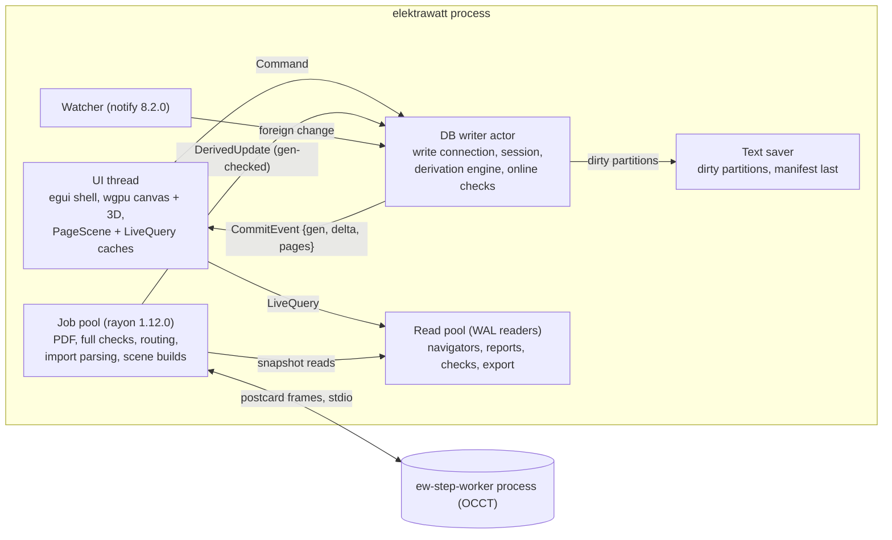
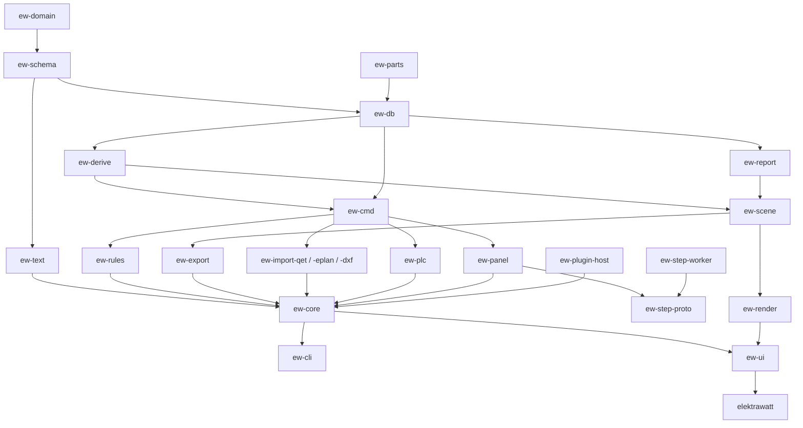

# Architecture proposal C: "Relational core — the project is a database"

**Status:** competing proposal for the architecture judge panel · **Date:** 2026-10-17
**Angle:** like EPLAN's project database, the live model is a **relational store**: SQLite in-process via
`rusqlite` 0.40.2 (bundled).
- Integrity rules are schema constraints.
- Undo, journal, diff and revision comparison come from the SQLite **session extension** (changesets).
- Reports and checks are **queries**, and users can write their own.
- At rest the project is a **deterministic, row-per-line text directory** for git. The database is rebuilt from it
  and is never committed.
- Shell: egui/eframe 0.37 with our own wgpu 2D/3D renderers (Stack A).

> Redaction note: this proposal follows the public-repo rules in the brief, with placeholders such as "the pilot
> panel builder". Research notes are cited by file name, e.g. [gaps-and-corrections.md](../gaps-and-corrections.md) §G3. Anything not in the
> research is marked **(verify)**.

---

## 1. Guiding principles and the core idea

**Core idea.** An EPLAN-class project is a **dense web of relations with integrity rules**:
- devices own functions, which own connection points;
- connections join points, and potentials span connections;
- terminals sit in strips, and channels sit in modules;
- placements bind devices to carriers.

Every deliverable is a **join plus an aggregation** over that web: BOM, TOC, wire list, terminal diagram, PLC
overview, title-block fields. The reference set's defects are what you get when that web is kept as drawings plus
copies:
- tags were stored as text and went stale (D-01, D-02);
- the BOM was not aggregated (D-04);
- designations were not unique (D-11, D-12);
- revision and description were typed per page (D-05, D-06).

Proposal C therefore holds the web in a relational engine:
- **authored facts** go in normalised tables guarded by `PRIMARY KEY`, `UNIQUE`, `CHECK` and `FOREIGN KEY`;
- **derived facts** are SQL views, or `d_*` tables that a Rust engine refreshes from each commit's changeset;
- **every report, check, navigator and export is a query.**

A user-defined report therefore needs a query and a form, not a new release. That turns an EPLAN limitation into
our headline feature: EPLAN report types "are predefined and cannot be user-created" (`[eplan-features.md](../eplan-features.md) §7). QET
users already write custom SQL tables, but QET runs them against a throw-away *copy* of the scene, so they go stale
(`[oss-landscape.md](../oss-landscape.md) §2.2). ElektraWatt queries the live model.

**Principles.**
1. **The schema is the architecture.** Entities, relations and invariants are declared once in Rust (§4.2). That
   declaration generates the DDL, row structs, text format, JSON Schema and docs. Code never re-implements a
   constraint the engine can enforce.
2. **Text canonical at rest, SQLite canonical in session.**
   - The project directory (git, SMB, archive) holds canonical text.
   - The working DB is local, disposable and rebuilt from the text.
   - Dump and load are inverses, proven byte for byte by property tests.
3. **Identity is a UUIDv7 primary key**, never a tag or a rowid. Changesets then stay valid across reloads,
   machines and branches.
4. **One writer, many snapshot readers.** WAL readers give background jobs consistent snapshots, which is the
   relational equivalent of `imbl`.
5. **The database is not in the frame loop.** The canvas paints cached scenes. SQL runs on commit, not per frame.
6. **SQL for joins and aggregates, Rust for graphs and geometry.**
   - Connectivity, xref cells, routing and tessellation are Rust; they write `d_*` tables that SQL joins.
   - Recursive CTEs are test oracles only. SQL with recursive CTEs is our Datalog; no separate engine is adopted.
7. **The public API is versioned views** (`api_v1_*`). Internal tables may change between minors; views may not.
8. **Headless first.** GUI, `ew` CLI, rhai, WASM plugins and MCP share one core.

**The standard objections, answered** (proposal A rejects "SQLite as the live model" on these grounds):

| Objection | Answer |
|---|---|
| "Every UI read becomes SQL" | No. The canvas reads cached `PageScene`s. Navigators read `LiveQuery` results that re-run only when a commit touches their read set (§9). Zero SQL per frame |
| "Snapshot isolation needs WAL readers" | Yes, and it is a feature: a WAL reader *is* an O(1) consistent snapshot, maintained by SQLite |
| "Undo needs the session extension" | Yes. It yields invertible field-level diffs keyed by primary key, exactly G3, as tested C code that ships with SQLite |
| "No type safety on hot paths" | Generated row structs. Every SQL string lives in a `.sql` file that CI prepares against the generated schema |
| "Derived invalidation needs triggers" | No trigger maintains derived data. The changeset is the invalidation signal (§6) |
| "It is a C dependency" | True and justified. SQLite is public domain and compiled in (`bundled`). rusqlite has 45M downloads in 90 days (crates.io) |

---

## 2. Process and thread model



| Thread / process | Notes |
|---|---|
| **UI** | Never blocks on SQL. A command is sent, and its `CommitEvent` arrives within one or two frames (≤ 2 ms typical at M, §5.6) |
| **Writer actor** | Owns the only write connection, the session object, the undo stack and the derivation engine. It processes one command at a time, so there is no write contention |
| **Read pool** | N connections with `query_only=ON`. A job holds one `BEGIN` snapshot: a 2,000-page PDF export sees one generation while the user keeps editing |
| **Job pool** | Heavy work on snapshots. Results return as `DerivedUpdate {based_on_gen}` and are applied only if the inputs have not changed since (optimistic check per input partition); otherwise the job reruns |
| **Text saver / watcher** | G1 save protocol. A foreign change (git pull) becomes a reload transaction (§7.4) |
| **`ew-step-worker`** | occt-sys 7.8.1 + opencascade 0.3.0 (LGPL-2.1, C-5), out of process. Length-prefixed postcard 1.1.3 frames, timeouts, kill and restart on hang. Meshes go to a content-addressed rkyv 0.8.18 cache **outside** the DB |

**Commit pipeline** (one SQLite transaction):
1. `BEGIN IMMEDIATE`; `SAVEPOINT cmd`. The session object records **authored** tables only (table filter).
2. The command writes rows through the typed repository layer. `defer_foreign_keys=ON` lets multi-row edits pass
   through transient states.
3. Constraints are checked. A violation rolls back to the savepoint and returns a typed error with the rule ID
   (EPLAN's "prevent errors").
4. Command validators read the changeset.
5. The derivation engine computes dirty keys from the changeset and refreshes the `d_*` tables.
6. Scoped online checks update `d_message`.
7. `COMMIT`. Readers never see authored rows without matching derived rows.
8. Push the undo entry, append the changeset to the journal, publish `CommitEvent`.

**Durability and autosave.**
- **Every commit is durable.** The working DB runs in WAL mode with `synchronous=NORMAL`, so commits survive an app
  crash (a power loss may lose the last few), with no custom journal needed.
- **Save** writes the text generation to the project directory. It is explicit by default (git-friendly), with an
  optional EPLAN-like "save on idle".
- **Second safety layer:** a changeset journal file. If the working DB is ever damaged, recovery is the last text
  generation plus replay of the portable changesets.

---

## 3. Crate and workspace layout

`ew-schema` and `ew-text` are format crates (MIT OR Apache-2.0). The rest is GPL-3.0-or-later.

| Crate | Responsibility | Key dependencies (research versions) |
|---|---|---|
| `ew-domain` | Value types: `Id<T>` (UUIDv7), `Nm` (i64), rational `Grid`, `MlText`, IEC 81346 RD grammar, `PlcAddress`, IEC 60757 codes, natural-sort keys | uuid 1.28.0, unicode-normalization 0.1.26, unicode-security 0.1.2, icu 2.3.1 |
| `ew-schema` | `table!` declarations → DDL, migrations, row structs, column metadata, `api_v1_*` views, JSON Schema, docs | serde 1.0.229, schemars 1.2.3 |
| `ew-db` | Pragmas, writer actor, read pool, session/changeset wrapper, undo, journal, SQL functions/collations, query sandbox, read-set capture | rusqlite 0.40.2 (`bundled`, `session`, `functions`, `vtab`, `backup`, `serialize`, `modern_sqlite`; plus `hooks`, `collation`, `limits` **(verify)**) |
| `ew-text` | Row-per-line dump/load, partitioning, manifest, upgrade chain, diff and merge-driver core | serde_json 1.0.154, serde_path_to_error 0.1.20, semver 1.0.28, sha2 **(verify)** |
| `ew-derive` | Changeset-driven dirty propagation; nets/potentials, tags, xrefs, effective wire properties, interruption-point pairing; oracle mode | rayon 1.12.0, petgraph 0.8.3 |
| `ew-cmd` | `Command`, `Tx`, validators, savepoint preview, coalescing, command and circuit macros | — |
| `ew-rules` | Rule packs (TOML + SQL + optional rhai), modes, waivers | rhai 1.26.1, toml 1.1.8 |
| `ew-report` | Report definitions (query + form), form engine, pagination | parley 0.12.0 |
| `ew-scene` | Display-list IR from the DB, symbol tessellation cache, title blocks, per-page spatial index | kurbo 0.13.1, lyon_tessellation 1.0.22, parley 0.12.0, skrifa 0.48.0, harfrust 0.14.0, rstar 0.13.0 |
| `ew-render` | wgpu 2D canvas and 3D renderer (one device) | wgpu 30.0.1, glam 0.34.1 |
| `ew-export` | PDF, SVG, DXF, PNG, XLSX, CSV, `.ewpp`, data-driven machine profiles | krilla 0.8.2, dxf 0.6.2, vello_cpu 0.3.0, rust_xlsxwriter 0.100.0, csv 1.4.0, zip 9.0.4 |
| `ew-import-qet` | `.qet`/`.qetz` → staging schema → mapping SQL (a separate crate because of C-8) | roxmltree 0.21.1, zip 9.0.4 |
| `ew-import-eplan`, `ew-import-dxf` | EDZ parts/macros, `.epj`; DXF (DWG behind a flag) | quick-xml 0.42.0, sevenz-rust2 0.24.0, dxf 0.6.2, acadrust 0.6.4 |
| `ew-plc` | AML CAEX 2.15 / AR APC 1.4.0, TIA tag XLSX, PLCopen GVL, GSD/GSDML | quick-xml 0.42.0, calamine 0.36.1 |
| `ew-panel` | Layout spaces, carriers, collision, routing, lengths, thermal | parry3d 0.31.1, pathfinding 4.16.0, glam 0.34.1 |
| `ew-step-proto` / `ew-step-worker` | IPC contract / OCCT worker binary | postcard 1.1.3, rkyv 0.8.18, meshopt 0.7.0, occt-sys 7.8.1, opencascade 0.3.0 |
| `ew-parts` | Catalogue DB (`*.ewparts`), FTS5, ECLASS/ETIM | rusqlite |
| `ew-plugin-host` | WASM component host; WIT world `query`/`submit` | wasmtime 48.x LTS (49.0.3 current), wit-bindgen 0.63.0 |
| `ew-core` | Facade `Session`: project + writer + pool + derivations + rules | all of the above except UI |
| `ew-ui` | Shell, navigators, property grid, query workbench | egui/eframe 0.37.0, egui_tiles 0.17.1, egui_table 0.10.0, egui_ltreeview 0.9.0, muda 0.21.2, rfd 0.17.2, arboard 3.7.0, fluent-bundle 0.16.0, transform-gizmo-egui 0.11.0 |
| `ew-cli` (bin `ew`), `elektrawatt` (GUI bin) | Headless commands, merge driver, MCP server; GUI | clap **(verify)**, MCP crate **(verify)** |
| `ew-testkit` | Golden fixtures, SQL acceptance runner, oracle, synthetic S–XL | insta 1.49.0, proptest 1.12.0, criterion 0.8.2, dify 0.8.0, hayro 0.8.0 |



**Rules.**
- Only `ew-db` links rusqlite.
- Only `ew-cmd` writes authored tables, and only `ew-derive` writes `d_*` tables.
- All SQL lives in `queries/*.sql` (`include_str!`). CI prepares every statement against a fresh schema, so a
  renamed column fails the build.
- Only `ew-ui` and `ew-render` know egui or wgpu.

---

## 4. Core domain model: storage and identity

### 4.1 Table families

| Family | Naming | Writer | In session (undo) | In text |
|---|---|---|---|---|
| Authored | `device`, `connection`, … | `ew-cmd` | yes | yes |
| Derived | `d_device_tag`, `d_net`, `d_xref`, `d_message` … | `ew-derive` | no | no |
| Public API views | `api_v1_*` (documented, stable within a major) | — | — | — |
| Scratch | `temp.selection`, `temp.dirty_*` | UI / engine | no | no |
| Attached | `parts.*` (catalogue), `staging.*` (imports), `cmp.*` (comparison), `ext_*` (linked projects) | various | no | separate |

### 4.2 One declaration, five artefacts

A `table!` macro in `ew-schema` generates five artefacts from each declaration:
- the DDL (`STRICT, WITHOUT ROWID`, with constraints and indexes);
- the row struct (`Id<Device>`, `Nm`, `Option<MlTextId>`);
- the text partition rule and column order;
- the JSON Schema;
- the docs page.

Every authored table has a 16-byte UUID primary key, except link tables, which use composite keys
(`junction_seq(junction_id, seq)`).

### 4.3 The entities

| Entity | Table(s) | Key constraints |
|---|---|---|
| Project | `project`, `project_party(role, …)` | customer and end user are separate role rows (D-30) |
| Structure trees | `structure_node(id, aspect, parent_id, identifier, description, sort_order)` | `aspect IN ('==','=','++','+','&','#')`; `UNIQUE(aspect, parent_id, identifier)`. Everything references ids, so each identifier has one spelling (D-03) |
| Page, Section | `page(id, folio, sort_key, page_type, struct_fn, struct_loc, form_id, grid_num, grid_den, description_override_ml, …)`, `section` | **no stored revision, prev/next or title-block text** |
| Function | `function(id, device_id, def_id, is_main, repr_type)` | partial unique index `ON function(device_id) WHERE is_main = 1` |
| Device | `device(id, parent_id, struct_fn, struct_loc, letter_code, counter, tag_mode, frozen_tag, function_text_ml, process_tag, tech_data_ml)` | `CHECK(tag_mode = 'frozen' OR frozen_tag IS NULL)`. No stored display tag (D-01) |
| Part | `part(id, lib_ref, lib_version, sha256, manufacturer_id, part_number, description_ml, tech_data_ml, unit, …)`, `device_part(device_id, part_id, qty)`, `assembly(device_id, config_code)` | manufacturer FK to a master table (D-18); embedded library copy (G2) |
| ConnectionPoint | `connection_point(id, function_id, idx, designation, alias, kind, intentionally_unused)` | `UNIQUE(function_id, idx)`. Printed designations may repeat (REF-029) |
| Connection, Junction | `connection(id, a_cp, b_cp, page_id, route, csa_override, colour_override, wire_no_override)`, `junction`, `junction_seq(junction_id, seq, cp_id)` | FKs to points; explicit T-node order (D-20) |
| Potential | `potential_def(id, name, ptype, voltage_mv, colour_code, csa_um2)`, `potential_def_point`, `bond(a_def, b_def, kind)` | `ptype IN ('L','N','PE','FE','P','M','BUS','SIG',…)`. Explicit bonds (D-22) |
| Net (derived) | `d_net`, `d_cp_net`, `d_potential(canonical_name, ptype, …)`, `d_cp_potential` | — |
| TerminalStrip / Terminal | `terminal_strip(device_id)`, `terminal(strip_id, seq, designation, part_id, function_text_ml, spare)`, `terminal_level`, `strip_bridge`, `strip_segment(strip_id, page_id, …)` | `UNIQUE(strip_id, designation)`, `CHECK(designation <> '')` (D-11, D-12). One strip, many drawn segments (D-42) |
| Cable / Conductor | `cable(device_id, part_id, length_mm, length_source)`, `conductor(cable_id, core_idx, colour_code, csa_um2, connection_id)` | colour-code FK (IEC 60757 plus flagged company codes such as DBU) (D-17) |
| PLC | `plc_project`, `plc_station`, `plc_module(station_id, slot_path, address_map_id)`, `plc_channel(module_id, number, kind, area, byte, bit, size, state, symbol, comment_ml)`, `bus_port`, `logical_net`, `physical_net`, `foreign_id(owner_id, system, guid)` | `state IN ('used','spare','reserved','tbd',…)`: "TBD" is a state, not text (D-15). Bit-range overlap is a rule |
| FluidPort | `fluid_port(cp_id, role, designation, size)`, `fluid_line(connection_id, kind, tube_spec_id, length_mm)`, `medium` | fluid ports *are* connection points, so one graph engine serves both disciplines |
| Placement | `layout_space`, `enclosure`, `mounting_surface`, `carrier(kind, part_id, path)`, `placement(device_id NOT NULL, carrier_id, px, py, pz, q0..q3, locked)` | `ON DELETE RESTRICT` to `device`: no orphans, no free rectangles (D-02) |
| Graphics, library copies | `symbol_placement(page_id, function_id, symbol_id, variant, x, y, orient)`, `page_item(page_id, kind, geom, style_id)`, `text_style`, `symbol_def`, `form_def` with `{lib_id, version, sha256}` | geometry stored as canonical integer JSON arrays |
| Revision | `revision(seq, label, date, author, checker, description, state)`, `revision_page(revision_id, page_id, change_kind)` | `CHECK(state <> 'released' OR (checker IS NOT NULL AND checker <> author))` (D-05, D-34) |
| Settings, waivers | `setting`, `numbering_rule`, `xref_format`, `colour_profile`, `size_profile`, `check_waiver(rule_id, object_id, reason, by, at)` | the company "basic project" is a text fixture of these tables |

```sql
CREATE TABLE terminal (                                   -- generated DDL excerpt
  id               BLOB PRIMARY KEY CHECK (length(id) = 16),
  strip_id         BLOB NOT NULL REFERENCES terminal_strip(id) ON DELETE CASCADE,
  seq              INTEGER NOT NULL,
  designation      TEXT NOT NULL CHECK (designation <> ''),
  part_id          BLOB REFERENCES part(id),
  function_text_ml BLOB REFERENCES ml_text(id),
  spare            INTEGER NOT NULL DEFAULT 0 CHECK (spare IN (0, 1)),
  extra            TEXT CHECK (extra IS NULL OR json_valid(extra)),
  UNIQUE (strip_id, designation), UNIQUE (strip_id, seq)
) STRICT, WITHOUT ROWID;
```

### 4.4 Identity, coordinates, text, properties

- **IDs.** UUIDv7 (uuid 1.28.0), stored as BLOB primary keys and written as lower-case hyphenated text.
  - They are time-ordered, so B-tree inserts are near-append and files grow at the end.
  - **Never rowids.** A rowid changes on reload; a UUID keeps every changeset valid in every copy of the project.
- **Coordinates.** `INTEGER` nanometres everywhere (G4).
  - Grids are rational; a QET 10 px grid is `7_937_500 / 3` nm, exactly.
  - 3D rotation is an integer quaternion (× 10⁹).
  - Schema lint forbids `REAL` columns in authored tables, so float noise cannot create diffs.
- **Multilingual text.** `ml_text(id, neutral)` plus `ml_text_value(text_id, lang, value, mt_status)`.
  - A RAISE-only trigger enforces EPLAN's neutral-xor-languages semantics (G7).
  - "Untranslated function texts for de-DE" is a `LEFT JOIN`, and XLIFF export/import is a query plus a command.
  - Identifiers (tags, part numbers, addresses) are never `ml_text`.
- **Collation.** `ew_natural` (ICU4X numeric collation) is registered with SQLite, so every report can use
  `ORDER BY tag COLLATE ew_natural` (X2 < X10; G7 notes the reference BOM's ASCII order).
- **User-defined properties.** `prop_def` + `prop_value` (EAV), used **only** for user properties; built-ins are
  real columns. A hot user property can be promoted to a column by migration.
- **Unknown fields.** An `extra` JSON column round-trips a newer minor version's unknown columns (G2 rule 1).

**Invariants enforced by the engine for every writer** (GUI, CLI, importer, plugin, merge result):
- one main function per device;
- unique terminal designations;
- placements always refer to devices;
- connections refer to existing points;
- unique structure identifiers;
- valid colour codes;
- released revisions have a checker who is not the author;
- integer geometry;
- a channel belongs to exactly one module.

About 40 such invariants cost no application code at all.

---

## 5. Editing: commands, transactions, undo, validation, preview, macros

### 5.1 Commands

```rust
pub trait Command: Serialize + DeserializeOwned {
    const NAME: &'static str;                       // "device.place", "numbering.renumber"
    fn apply(&self, tx: &mut Tx) -> Result<Outcome, CmdError>;
    fn coalesce_key(&self) -> Option<CoalesceKey> { None }
    fn undoable(&self) -> bool { true }
}
```

- **`Tx`.** It wraps the write connection inside `SAVEPOINT cmd` and offers typed calls (`insert`, `update::<T>`,
  `delete`). Sub-commands nest as savepoints, so "place part" = "create device" + "autoconnect", atomically.
- **The transaction record** is `{tx_id, command JSON (intent), changeset (effect), label, page, viewport,
  selection, author, plugin_id}`.
  - Intent drives macros and the audit trail.
  - Effect drives undo, the journal, diff, revision change status and merge preview.

  Replaying intent is right for macros; replaying state is right for recovery.

### 5.2 Undo and redo with the session extension

- **Record.** After the command, `sqlite3session_changeset` yields old and new values of **changed columns only**,
  keyed by primary key.
- **Undo** applies `sqlite3changeset_invert(cs)` in a new transaction.
  - The conflict handler **aborts**: a conflict can only mean a bug, since nothing else writes authored tables
    between stacked states.
  - The inverted changeset then flows through the normal derivation path. Redo applies the original.
- **Coalescing.** Drags and typing are merged with `sqlite3changegroup` into one entry.
- **Size.** A 10,000-tag renumber is roughly 250–400 KB (estimate). The stack is bounded at 500 steps or 256 MB
  (G3).
- **Scope.** One project-wide stack. Each entry restores page, viewport and selection.
- **External reload** arrives as a changeset too (§7.4), so the stack survives a git pull.

**Caveats** (verify against the SQLite docs):
- the session extension needs primary keys: all our tables have one;
- virtual tables are not recorded: FTS is derived anyway;
- RAISE-only validation triggers fire during apply, which is desired;
- **no trigger may write an authored table**, or apply would duplicate effects. This is enforced by schema lint.

rusqlite exposes `Session`, `Changeset` (invert/concat), `ChangesetIter` and `Connection::apply` **(verify exact
API)**.

### 5.3 Validation hooks

| Level | Mechanism | Blocks commit | EPLAN analogue |
|---|---|---|---|
| L0 Integrity | schema constraints | yes | "prevent errors" |
| L1 Command validators | Rust over the changeset (address overlap, cross-page connection without an interruption point) | yes | module-specific |
| L2 Online rules | rule packs scoped to dirty keys → `d_message` | no | online checks |
| L3 Release gate | full pack; `error` blocks the release export | release only | pre-delivery check |

### 5.4 Preview of large changes and macros

- **Savepoint dry-run.** Renumber, find & replace, re-address, "update parts from library" and imports run the
  *real* command, derivations and online rules inside `SAVEPOINT preview`.
- **The preview UI is queries** over that uncommitted state: tag before/after, BOM delta, new and resolved
  messages, affected pages. Accept = `RELEASE` + `COMMIT`; reject = `ROLLBACK TO`. The preview *is* the
  consequence.
- **Imports** load into an attached `staging` schema with the same DDL. Mapping runs as `INSERT … SELECT` with an
  id-remap function, and a reviewed diff then merges in one transaction.
- **What-if sandboxes** clone the DB via the backup / `serialize` API.
- **Command macros** are recorded command logs, parameterisable in rhai.
- **Circuit macros** (EPLAN window/page macros) are mini-projects in canonical text. Insertion is
  `ATTACH macro; INSERT INTO main.t SELECT ew_remap(id), ew_offset(x, :dx), … FROM macro.t`, with placeholder value
  sets as SQL parameters. It is one undoable, previewable command.

### 5.5 Interactive performance on SQL

The DB is **not in the 16 ms frame loop**:
- a drag moves a UI-local ghost;
- wires rubber-band in the UI;
- the commit happens on mouse release;
- property edits commit on Enter or focus loss.

| Gesture (commit) | Authored rows | Derivations | Latency M / XL (estimate; measured in the M0 spike) |
|---|---|---|---|
| Move a symbol | 1 + 2–6 route rows | xref cells of the moved items; one page scene | ≈ 0.3 ms / ≈ 1 ms |
| Place a part (device, functions, 8 CPs, 2 autoconnects) | ~15 | tag, net unions, xrefs | ≈ 1 ms / ≈ 3 ms |
| Delete a wire | 1–2 | net split (BFS of one component; a large PE net ≈ 5k members) | ≈ 1 ms / 5–20 ms |
| Change a potential's size | 1 | `d_wire_effective` for k ≤ 5k wires | ≈ 2 ms / ≈ 30 ms |
| Renumber 10k devices | 10k | tags, xref texts, ~300 page scenes | ≈ 80 / 150 ms (in preview) |
| Import a 300-page QET project | ~300k | full derive | 5–10 s, staged, background |

Assumptions: prepared and cached statements, primary-key lookups of a few µs, and hundreds of thousands of inserts
per second in one transaction (general SQLite experience). **Perf gate:** commit p99 ≤ 5 ms (M) and ≤ 20 ms (XL)
for the first four rows.

---

## 6. Derived data

### 6.1 Three mechanisms

| Mechanism | Used for | Freshness |
|---|---|---|
| **Plain view** | Cheap joins and aggregates: BOM, TOC, prev/next (`LAG`/`LEAD` window functions), title-block values, report bodies | always fresh |
| **Changeset-maintained `d_*` table**, written in the same transaction | Graph or geometry work, or values the canvas reads per frame: tags, nets, potentials, xrefs, effective wire properties, interruption-point pairing | fresh at commit, atomic |
| **Deferred `d_*` table** (job on a snapshot, gen-checked write-back) | Routing, wire lengths, duct fill, thermal, FTS index, full check pack | `d_stale(item, since_gen)`; the UI shows "lengths outdated, recomputing" |

**Dirty propagation.**
- Each derivation declares its inputs as `(table, columns)` plus a key-mapping query from input keys to output
  keys. For example: changed `connection` → its two points → their nets.
- The engine iterates the changeset (`sqlite3changeset_start`): table, operation, PK and changed-column mask.
- It fills `temp.dirty_<deriv>` and runs the derivations in topological order, for dirty keys only.

This is incremental view maintenance by hand, deliberately simpler than salsa. The DAG has about 20 nodes, and one
batch runs per commit.

### 6.2 Catalogue and XL cost

| Derived item | Inputs | Algorithm | XL full / incremental (estimate) |
|---|---|---|---|
| `d_net`, `d_cp_net` | connection, junction_seq, interruption points, bridges, function-internal links | union-find; a deletion recomputes one component | 600k CPs: ≈ 100 ms / ≤ 20 ms |
| `d_potential` | d_net, potential-passing functions, definition points, `bond` | union; type conflict without a bond → message (D-22) | ≈ 50 ms / ≤ 10 ms |
| `d_device_tag` | device, structure, page (page-based numbering), numbering rules | Rust IEC 81346 formatter; display form (identifier suppression) via SQL function `ew_display_tag(device, page)` | 50k: ≈ 60 ms / µs |
| `d_xref` | placements, interruption points, main/aux, frame grid, xref format | `ew_cell(page, anchor)` per anchor policy (D-14); star/chain pairing | ≈ 150 ms / per item |
| `d_wire_effective` | connection, potential defs, profiles, conductors | COALESCE chain cp → potential → net → connection → CDP, with an origin column (`[eplan-features.md](../eplan-features.md) §3.4) | 200k: ≈ 300 ms / per potential |
| BOM, TOC, terminal/cable/wire/PLC/potential reports | views over authored + `d_*` | joins, `GROUP BY` | 10–100 ms |
| `d_wire_route`, `d_wire_length`, `d_duct_fill` | placements, carriers, geometry, `d_wire_effective` | A* + negotiated congestion (`[panel-manufacturing.md](../panel-manufacturing.md) §6.7) | 2k wires ≤ 5 s (G6) |
| `PageScene` (memory, not SQL) | page rows + `d_*` | display-list build | ≤ 5 ms per dense page |

```sql
-- BOM, component mode (D-04): aggregated, natural tag order
SELECT m.name AS manufacturer, p.part_number, ew_ml(p.description_ml, :lang) AS description,
       SUM(dp.qty) AS qty, p.unit,
       group_concat(t.full, ', ' ORDER BY t.full COLLATE ew_natural) AS tags  -- SQLite ≥ 3.44 (verify bundled)
FROM device_part dp
JOIN part p         ON p.id = dp.part_id
JOIN manufacturer m ON m.id = p.manufacturer_id
JOIN d_device_tag t ON t.device_id = dp.device_id
GROUP BY p.id ORDER BY m.name, p.part_number COLLATE ew_natural;

-- Effective wire size with its origin (D-08); oracle for d_wire_effective
SELECT c.id,
       COALESCE(c.csa_override, pd.csa_um2, sp.csa_um2) AS csa_um2,
       CASE WHEN c.csa_override IS NOT NULL THEN 'connection'
            WHEN pd.csa_um2 IS NOT NULL THEN 'potential ' || pd.name
            ELSE 'profile ' || sp.name END            AS csa_source
FROM connection c
JOIN d_cp_potential cp ON cp.cp_id = c.a_cp
JOIN d_potential dp    ON dp.id = cp.potential_id
LEFT JOIN potential_def pd ON pd.id = dp.def_id
JOIN size_profile sp   ON sp.circuit_class = dp.circuit_class;
```

### 6.3 XL sizing (2,000 pages, 50k devices, 200k connections)

| Item | Estimate |
|---|---|
| Authored rows | ≈ 2M (150k functions, 600k CPs, 200k connections, 150k symbol placements, 500k page items, …) |
| DB size | 250–500 MB including indexes |
| Text size | 250–350 MB JSONL. Git copes; XL users need the merge driver and partial clones (honest weakness) |
| Memory | 256 MB page cache + mmap; scene LRU; union-find ≈ 10–20 MB. Peak ≈ 1.5–2.5 GB, within the 4 GB budget (G6) |
| Open, warm (working DB matches the manifest generation) | **≤ 1 s** |
| Open, cold | parse ≈ 1–2 s + bulk insert, indexes after load ≈ 3–6 s + parallel full derive ≈ 2–4 s → **≈ 8–14 s**, within the 20 s budget |
| Full check | rules in parallel on readers: expected 10–30 s, within the 60 s budget |

**Correctness.**
- Every `d_*` table has a from-scratch definition: a full Rust recompute, and for most tables an independent SQL
  oracle (connectivity via `WITH RECURSIVE`).
- Oracle mode (debug builds, CI, `ew check --oracle`) diffs incremental against scratch with `EXCEPT`.
- Derived tables are never persisted, so a restart always heals.

---

## 7. Persistence

### 7.1 Contract and layout

**Text at rest, DB in session.**
- The working DB lives in the local cache directory (`directories`/`etcetera` **(verify)**), never on the project
  share.
  - SQLite locking over network filesystems is unreliable (general SQLite guidance, **verify** wording).
  - Projects live on SMB and OneDrive (G1).
  - This also rules out a single `.db` file as the project format.
- The dumper is the only writer of project files.

```text
<project>/
  ew-project.json            manifest, written LAST: format, min_reader, generator, generation, sha256 per file
  settings/*.jsonl           numbering, xref format, colour/size profiles, user property definitions
  structure.jsonl            structure nodes, sections
  pages/<page-uuid>.jsonl    page-owned rows: page, symbol_placement, page_item, connection, junction(+seq),
                             interruption_point, strip_segment
  devices/<xx>.jsonl         device-owned rows: device, function, connection_point, device_part, terminal…
                             (xx = LAST UUID byte, 256 shards; v7's leading bytes are time, not random)
  plc/<xx>.jsonl  cables/<xx>.jsonl  layout/<space-uuid>.jsonl  text/<xx>.jsonl  parts.jsonl
  library/                   embedded symbol/form/frame/part copies (by sha256)
  revisions/<label>.ewsnap   released snapshot (zip of canonical text)
  .gitattributes             *.jsonl merge=elektrawatt diff=elektrawatt
  .~ew.lock                  G1 lock (gitignored)
```

**Partitioning by aggregate.**
- A typical edit rewrites 1–3 files.
- "Place a device" lands in one device shard and one page file.
- File names derive only from UUIDs and fixed words, so they avoid reserved Windows names and long paths (G1).

### 7.2 Canonical row-per-line format

```json
{"$t":"terminal","id":"018f3c2e-…","strip_id":"018f3c2d-…","seq":3,"designation":"3","part_id":"018e…","spare":false}
```

- One row per line, so git diffs and merges are row-level.
- Tables appear in schema order, rows in PK order, columns in schema order, and NULLs are omitted.
- Geometry is integers only, strings are NFC, and entities carry no timestamps. One dumper produces the canonical
  bytes.
- UUIDv7 means new rows append at the end of a file. Two branches appending to one shard therefore conflict at the
  end of the file in plain git. The `ew` merge driver resolves this by key, but it is honest friction for web-UI
  merges.

### 7.3 Save, open, recovery, external change

- **Save** rewrites only the dirty partitions (the union of `partition(table, pk)` over changesets since the last
  save), then the manifest last (G1 protocol). Estimate: XL incremental ≤ 500 ms, full save ≈ 3–5 s.
- **Open** verifies the manifest hashes, then takes the warm or cold path. A mismatch (interrupted save, hand edit,
  merge) means a full load plus an integrity report.
- **Crash recovery.** Reopen the working DB, where every commit is present. Offer "restore N unsaved transactions"
  or "discard". If the DB is damaged, take the last text plus a journal replay.
- **External change (git pull).**
  - Load the new text into an attached `incoming` schema.
  - **`sqlite3session_diff`** per table yields the changeset main → incoming.
  - Preview it ("Reload: 37 rows on 4 pages"), then apply it as one undoable transaction.

  This is exactly G3's "EW-generated merge with an explicit diff transaction", so the undo stack survives. Unsaved
  local edits that collide are shown row by row in the merge UI.

### 7.4 Git, locking, shares

- **Merge driver.** `ew merge-driver %O %A %B %P` does a 3-way merge per file by `($t, id)`, then per column.
  - Disjoint column edits on one row merge cleanly.
  - The same column edited on both sides becomes a `{"$conflict": …}` record that EW resolves in its merge UI.
- **Cross-file integrity.** Git calls drivers per file, so cross-file integrity is checked on open or by a
  `post-merge` hook (`ew check --integrity`): scratch load, `PRAGMA foreign_key_check`, unique constraints, the
  release rule pack.
- **Semantic conflicts become constraint violations or messages, with quick-fixes.**
  - Two branches each add a device that derives to -101F3 → the duplicate-tag rule offers a renumber.
  - Two branches each add terminal "5" to -X1031 → a UNIQUE violation offers a rename.

  The relational model gives merges a checker for free.
- **Semantic diff.** `ew diff --textconv` prints changes such as "device -101F1: part A9P52610 → …".
- **Locking.** G1 `.~ew.lock` (`create_new`, `{user, host, pid, app_version, started_at}`, read-only when held,
  stale takeover). The working DB is local, so SQLite's own locking is reliable. Cloud-folder and conflict-copy
  detection come from the manifest (G1).

### 7.5 Versioning and migration

- **Versions.** The format `major.minor` equals the schema version (`PRAGMA user_version`; `format` in the
  manifest).
  - Minors are additive (`ALTER TABLE ADD COLUMN`); old readers keep unknown columns in `extra`.
  - Majors rebuild tables.
- **Historic DDL is kept** (`ew-schema/history/v1_0.sql`, …) with migration steps `v1_0 → v1_1` (SQL plus optional
  Rust). An old project opens in four steps:
  1. create a DB with *its* historic schema;
  2. load its text;
  3. migrate in SQL;
  4. dump on the next save.

  One mechanism serves text and DB, and it is standard relational practice.
- **Steps are never deleted.** CI opens one fixture per released version (golden J-E-2416, QET examples) with every
  build (G2). `min_reader` guards forward compatibility, and JSON Schemas are published from `ew-schema`.

### 7.6 Parts database and revisions

- **Catalogue.** A company catalogue is `*.ewparts` (SQLite, schema `parts_v1`, FTS5, ECLASS/ETIM tables). Its git
  form is the same row-per-line text (Horizon's "JSON + SQLite index" pattern, [oss-landscape.md](../oss-landscape.md) §5.1).
  - A share copy is mirrored to local cache and **ATTACHed read-only**, so BOM queries can join price, stock or
    alternatives.
  - Projects embed the parts they use (`lib_ref`, `lib_version`, `sha256`). "Update from library" is a
    `session_diff` between `parts.part` and `main.part`, shown as a preview.
  - Foreign DBs (QETZ, third-party catalogues, EDZ staging) open read-only with `trusted_schema=OFF`, defensive
    mode and a schema check. A hostile file can carry views or triggers (`[interop-formats.md](../interop-formats.md) §1.11).
- **Revisions.** Releasing a revision:
  - runs the release gate;
  - stamps `revision.state = released`;
  - writes `revisions/<label>.ewsnap`;
  - derives `revision_page` from the changesets since the previous release.

  EPLAN's Pro-tier **property comparison** (`[eplan-features.md](../eplan-features.md) §10) = attach the snapshot as `cmp`, then
  `session_diff` per table → change list or revision clouds. The manufacturing "wires changed since V1.0" list
  (`[panel-manufacturing.md](../panel-manufacturing.md) §7.1) is the same diff restricted to `api_v1_wire`.

---

## 8. Rendering pipeline

- **IR.** `Path(kurbo::BezPath, stroke, brush)`, `GlyphRun`, `Image`, `Group(transform, children)`. Every item
  carries its entity UUID (`[rust-ecosystem.md](../rust-ecosystem.md) §3.4).
- **Scenes from the DB.** A `PageScene` is built from a few prepared queries keyed by `page_id`: placements, items,
  connections, junctions, xref texts, tags, and wire markers from `d_wire_effective`.
  - `CommitEvent.pages` lists the pages of changed page-owned rows **plus** pages that *display* changed derived
    values (tag change → `symbol_placement` by device → pages).
  - Only those scenes rebuild, in the job pool.
- **Symbols.**
  - Symbol definitions are rows with a sha256; they are tessellated once (lyon), cached by hash and drawn
    **instanced**.
  - Lines are screen-space-width shader segments, and text comes from a glyph atlas.
  - Nothing is re-tessellated on zoom.
  - LOD: text below 2 px becomes bars, symbols below 4 px become outlines, and page overviews use vello_cpu
    thumbnails cached per generation.
- **Hit-testing.** An rstar 0.13.0 tree per page, then exact kurbo distance tests. Checks that need geometry ("text
  overlaps frame", "xref anchor in an empty cell") read scene bounding boxes exported to `d_bbox`.
- **Backends from one IR:**
  - wgpu 30.0.1 via `egui_wgpu` callbacks;
  - **krilla 0.8.2** PDF: PDF/A-2b, outline from the TOC query, link annotations and named destinations from
    `d_xref`, `/PageLabels` = folio (D-07, D-33), no OCG (C-11);
  - SVG;
  - DXF (dxf 0.6.2, layer mapping);
  - PNG (vello_cpu 0.3.0).
- **Text.** parley 0.12.0 + skrifa 0.48.0 + harfrust 0.14.0 with bundled fonts (Noto Sans or DejaVu Sans; osifont
  optional; never Tahoma, G14). The same bytes are embedded in PDFs.
- **3D.**
  - An own wgpu renderer on the same device: instancing, edges, transparency, ortho/perspective.
  - The scene is built from `placement`/`carrier`/`enclosure` rows plus meshes from the STEP cache.
  - parry3d 0.31.1 BVHs for picking, collision and clearance.
  - STEP goes through the OCCT worker: assembly tree, two LODs (meshopt 0.7.0), feature edges, hulls, mounting
    frames.
  - **Meshes never enter the model DB**; only `part.model_ref {sha256, hint}` does.

---

## 9. UI shell

**Toolkit: egui/eframe 0.37.0** (Stack A). Why it fits the relational core:
1. **One wgpu device** for UI, 2D and 3D, with no texture copies.
2. **Schema-driven panels.** The property grid is generated from column metadata: type, unit, editability, and the
   `*_source` origin columns ("0.75 mm² — from potential 24VDC-1").
3. **egui_table 0.10.0 ("millions of rows") fits keyset pagination.** The table asks for rows N…N+k; we run
   `WHERE (sort_key, id) > (?, ?) LIMIT k`.
4. **Testability.** egui_kittest with accessible-name enforcement; egui_mcp in test builds only (G10).

**Rejected:**
- **Slint 1.18:** no docking or tree view; wgpu interop re-keyed per major; GPL-3.0-*only* complicates the
  plugin-exception plan.
- **Tauri:** the UI would not be Rust.
- **iced 0.14:** wgpu 27, no mainline accessibility.
- **gpui:** no stable channel, no custom GPU passes.

egui's costs are a non-native look and breaking minors. Mitigation: a thin `ew-ui` layer, quarterly lock-step
upgrades.

**`LiveQuery`, the bridge between immediate mode and SQL.**
- A `LiveQuery` holds `{sql_id, params, read_set, generation, rows: Arc<[Row]>}`.
- The read set is captured at prepare time with the SQLite **authorizer** (`SQLITE_READ` table/column callbacks)
  **(verify the rusqlite `hooks` API)**.
- On a `CommitEvent`, queries whose read set intersects the changed `(table, column)` set re-run on a reader.
- Old rows stay visible until the new ones arrive, so the UI never stalls.

**Shell features.**
- **Layout:** docking via egui_tiles 0.17.1, with workspaces (Schematic, PLC, Panel 3D, Manufacturing); muda for
  the macOS menu bar; command palette; keymap presets "EW", "KiCad-like" and "EPLAN-like" (G5).
- **Navigators are saved queries** over `api_v1_*` views, shown as egui_ltreeview 0.9.0 trees or tables. Users save
  their own filtered navigators.
- **Selection is a table** (`temp.selection`). "BOM of the selection", "terminals of the selected devices" and
  canvas ↔ navigator sync are plain joins.
- **Table editing.** Editable view columns map to `(authored table, column)`. A cell edit, fill-down or Excel paste
  becomes `SetField` commands in one previewed transaction.
- **Generic Excel round-trip:** export any view with its `id` column, edit it in Excel, import, review the diff,
  commit.
- **Query workbench:** SQL editor with schema browser, results with jump-to-object, "save as navigator / report /
  rule". A visual query builder follows in v1.x.
- **Keyboard-first CAD interaction:** every command is in the keymap and the palette; the canvas cursor moves by
  grid step; "next unconnected point" navigation (itself a query); click-to-jump on any cross-reference, with
  back/forward history (G5).
- **Theming:** light, dark and high-contrast UI themes on egui's style system (0.37 `StyleProvider`, experimental).
  The canvas colour scheme is separate from the UI theme, and print and PDF output always use paper colours.
- **Find & replace:** FTS5 plus filters, applied as a previewed transaction.
- **Accessibility** (G8): AccessKit names; tables as the accessible view of the schematic; wire colours always as
  IEC 60757 codes; a CVD-safe palette; full keyboard operation.
- **UI i18n:** fluent-bundle 0.16.0 via Weblate, kept separate from project-data multilinguality.

---

## 10. Extensibility

- **CLI `ew`** (headless):
  - `ew check|report|export pdf|dxf|ewpp`;
  - `ew query <project> "<sql>" --format csv|json|xlsx`;
  - `ew import qet|edz|dxf`;
  - `ew diff`, `ew merge-driver`, `ew print`, `ew mcp`.

  Panel builders can fail CI on `ew check --release`.
- **Read API = SQL against `api_v1_*` views, on a sandboxed read-only connection.** The sandbox uses:
  - `query_only`;
  - an authorizer that denies `ATTACH`, `PRAGMA` writes and `load_extension`;
  - a `progress_handler` deadline;
  - `SQLITE_LIMIT_*` limits **(verify the rusqlite APIs)**.
- **Write API = commands only.** `submit(command_json)` gets validation, undo and journalling like a GUI edit. User
  SQL can never break invariants, because it cannot write.
- **Scripting.** rhai 1.26.1 for rules, expressions, tag templates, title-block formulas and command macros; it gets
  `query()` and `submit()` and no I/O. SQL is the second, declarative scripting language.
- **Plugins.**
  - WASM components on the wasmtime 48 LTS line. The WIT world exposes `query`, `describe-schema`, `submit` and
    file capability handles.
  - Controls: fuel/epoch limits, `StoreLimits`, signed manifests, user-approved capabilities, and the plugin ID
    recorded in each transaction (G10).
- **Importer and exporter traits.**

  ```rust
  pub trait Importer { fn stage(&self, src: &Source, staging: &mut StagingTx) -> Result<ImportReport>; } // → preview → merge
  pub trait Exporter { fn export(&self, snap: &ReadSnapshot, profile: &Profile, out: &mut dyn Sink) -> Result<()>; }
  ```

  Many exporters are **pure data**. A machine profile (Komax via TopConvert CSV, Rittal WT CSV, TIA tag XLSX,
  label CSVs) is `{query, column map, limits, encoding}` over `api_v1_wire`/`api_v1_terminal`
  (`[panel-manufacturing.md](../panel-manufacturing.md) §8). A new machine format is often a TOML file.
- **MCP / AI agents.**
  - Tools: `describe_schema`, `query` (sandboxed), `explain_rule` and `submit_command` (ask-first, off by default,
    stdio/localhost).
  - LLMs are fluent in SQL. "Which 24 V potentials have loads but no protective device?" becomes one query against
    a documented schema, with no bespoke tool code.
  - Every agent write is an undoable transaction.

---

## 11. Reports and forms engine

- **A report is a query plus a form plus an output mode.** `report_def(kind, query, params, sort, filter, form_id,
  mode, target_section)` is authored data.
- **The built-in report pack** is `.sql` files plus forms (CC-BY-SA-4.0 with the design exception). It covers:
  - TOC and BOM (assembly and component modes);
  - device list, structure-identifier overview, open items, cut-out legend;
  - terminal diagram and terminal-strip overview;
  - cable overview and diagram, wire list;
  - PLC card overview and I/O list;
  - potential overview, revision overview.

  (`[eplan-features.md](../eplan-features.md) §7; REF-045/049/060/081/102/103.)
- **User reports** use the same mechanism with a user query against `api_v1_*` views. Examples: "24 V loads with
  their protective device and total current per MICO channel" (D-25), "terminals per cable with the PLC address at
  the far end", or a customer nameplate list. They live in the project or the company basic project. **This is the
  killer feature**: EPLAN cannot do it, and QET does it only on stale copies.
- **Forms** are declarative templates in nm:
  - header, data and footer areas; row height (6.52 mm in the reference, REF-100);
  - cells with `{column}` placeholders or rhai format expressions; styles and line widths;
  - next-forms for continuation pages;
  - group breaks: `GROUP BY strip_id` gives one terminal diagram per strip, EPLAN's "function-related" reports.
- **Title blocks** are forms bound to `v_titleblock(page_id, field, value)`: project and page properties, the
  managed revision label, prev/next, =/+ aspects and parties by role. **Per-page free-text title-block fields do not
  exist** (D-05, D-06, D-30).
- **Generated pages** are `page` rows (`page_type = report`). Their content is not stored but rendered from the
  query at scene-build time, so the TOC is current on every change (REF-012). Continuation pages are derived.
- **Embedded report blocks** are `page_item(kind = 'report_block')`. Examples: the "PART DATA" boxes on 201 and
  902, and the cover colour table on folio 1, which is a query over `colour_profile` (REF-005).
- **One query for both PDF and XLSX/CSV,** so the drawing set and the spreadsheet cannot disagree.
- **At release**, report outputs are frozen into the `.ewsnap`.

---

## 12. Checks and rule engine

**Rules are data**: TOML metadata plus a SQL query that returns violating rows.

```toml
[[rule]]
id = "EW-POT-013"            # stable ID → docs page, waivers
title = "Single-pole switching device in a neutral conductor"
severity = "error"
mode = "online"              # online | offline | release
query = "pot/013_neutral_switching.sql"
message = "{tag} switches neutral potential {potential} without a line-conductor pole"
```

```sql
-- D-13: T55 and S56 sit in N-55
SELECT f.device_id AS object_id, t.full AS tag, pa.canonical_name AS potential
FROM function f
JOIN function_def fd   ON fd.id = f.def_id AND fd.category = 'switching_contact'
JOIN connection_point a ON a.function_id = f.id
JOIN d_cp_potential ca ON ca.cp_id = a.id
JOIN d_potential pa    ON pa.id = ca.potential_id AND pa.ptype = 'N'
JOIN d_device_tag t    ON t.device_id = f.device_id
WHERE (:full OR f.id IN (SELECT id FROM temp.dirty_function))
  AND NOT EXISTS (SELECT 1 FROM function f2
                  JOIN connection_point b ON b.function_id = f2.id
                  JOIN d_cp_potential cb  ON cb.cp_id = b.id
                  JOIN d_potential pb     ON pb.id = cb.potential_id AND pb.ptype = 'L'
                  WHERE f2.device_id = f.device_id);
```

- **Rule packs** are versioned directories (TOML + SQL, optional rhai or native Rust for graph-heavy rules). Shipped
  packs: `EW-CORE`, `EW-IEC81346`, `EW-TERM`, `EW-POT`, `EW-PLC` (PLC-01…16), `EW-BUS`, `EW-FL`, `EW-LAYOUT`
  (L001–L010) and `EW-REL`. Companies add packs without forking.
- **Online checks** run in the commit pipeline, only when the changeset touches the rule's read set (authorizer
  capture). They join `temp.dirty_*` for scope. A rule over its 5 ms budget is demoted to deferred and logged.
- **Offline checks** run all rules in parallel on readers. The release gate adds all errors.
- **Messages.** `d_message` honours `check_waiver` (reason, by, at). The message panel offers jump and quick-fix
  (G5), and each rule ID has a docs page.
- **The prevent class is schema constraints.** A local, cheap rule can be promoted to a constraint.

---

## 13. Testing strategy

1. **Golden J-E-2416 as text plus SQL acceptance tests.**
   - `acceptance/*.sql` → `expected/*.csv` encode [reference-drawing.md](../reference-drawing.md) §4: pages/TOC (§4.3), tags (§4.4), BOM in
     both modes (§4.5), potentials (§4.6), wires (§4.7), terminals (§4.8), cables (§4.9), PLC (§4.10), and **the 22
     interruption-point pairs and 9 main/aux sets** (§4.13).
   - The pilot user can read and extend them.
   - **Golden B** runs the page-based renumber and asserts no orphans and identical topology.
2. **Golden output.**
   - vello_cpu PNGs per folio, diffed with dify 0.8.0;
   - the PDF rasterised with hayro 0.8.0, frame within ±0.2 mm (REF-096);
   - veraPDF for PDF/A-2b;
   - assertions on outline, link count and `/PageLabels`.
3. **Snapshots** (insta 1.49.0) of canonical text after importing the 24 QET examples; of report CSVs, AML output
   and DXF text.
4. **Property tests** (proptest 1.12.0) over random command sequences:
   - `load(dump(db))` is byte-identical;
   - `apply(invert(cs))` restores the prior dump;
   - incremental `d_*` equals the oracle;
   - no sequence violates `foreign_key_check` or `integrity_check`;
   - a disjoint 3-way merge equals sequential application;
   - a journal replay equals the live DB.
5. **Schema lint**:
   - UUID primary keys, `STRICT`, no `REAL`;
   - indexed FKs;
   - no trigger writes an authored table;
   - every `api_v1_*` view is documented and has an `id`;
   - every migration has a fixture.
6. **SQL compile test.** Every `.sql` file (core, rule packs, report pack) is prepared against the current schema,
   and an `EXPLAIN QUERY PLAN` lint flags full scans on L-sized tables.
7. **Fuzzing** (cargo-fuzz 0.13.2): text loader, merge driver, QET/QETZ, DXF, EDZ, AML, and the query sandbox
   (hostile SQL must not escape the authorizer).
8. **Perf gate.** Synthetic S–XL projects replicated from the golden project (G6). criterion 0.8.2 measures commit
   p99, warm and cold open, save, full derive, full check and BOM. Fail on > 15 % regression.
9. **UI tests:** egui_kittest with accessible names; a network-sandbox test (G12).

---

## 14. How the architecture prevents the reference defects

| Mechanism | Defects | How |
|---|---|---|
| **Derived, never stored** | D-01, D-02, D-06, D-07, D-08, D-14, D-24, D-33, D-41, D-42 | Tags exist only in `d_device_tag`, and layout labels read it (D-01, D-02). The description comes from `project`; a page override is an explicit, reported column (D-06). Wire size and colour come from `d_wire_effective` (potential → profile, with origin), and the cover tables are a query over the profile (D-08). PDF links, outline and page labels come from `d_xref` and the TOC (D-07, D-33). Xref anchors use scene bboxes, plus an empty-cell rule (D-14). Canonical potential names (D-24). Assembly tag with derived child tags (D-41). One strip row, many segments (D-42) |
| **Constraints** | D-03, D-05, D-11, D-12, D-17, D-18, D-20, D-22, D-27, D-29, D-30, D-34 | Structure identifiers by id, frozen tags explicit and reported (D-03). The revision label comes only from `revision` (D-05). `NOT NULL`/`UNIQUE` designations (D-11, D-12). Colour-code FK (D-17). Manufacturer FK (D-18). `junction_seq` (D-20). Potential type conflict without a `bond` (D-22). Valves are child devices (D-27). Text-style FK (D-29). Party roles (D-30). Checker ≠ author (D-34) |
| **Aggregating queries** | D-04, D-09, D-10, D-36 | `GROUP BY part` over devices, assembly children, carriers and terminal parts, in two modes (D-04, D-36). The missing reports are report-pack queries (D-09). Overviews are generated from assembly children, plus a count rule (D-10) |
| **Rule queries** | D-13, D-15, D-16, D-19, D-21, D-23, D-25, D-26, D-28, D-31, D-32, D-35, D-37, D-38 | N-switching (D-13). TBD blocks release (D-15). FE/PE types from part pin functions (D-16). External connection without a cable; NULL lengths at release (D-19). PE continuity via rail bonds (D-21). Unconnected CP unless intentionally unused (D-23). Load per channel (D-25). PLC-12 address map (D-26). FL-01/07/08 (D-28). Printed text height (D-31). L001 unplaced devices (D-32). Rating in description (D-35). Colour-profile basis (D-37). PE csa ≥ phase csa (D-38) |
| **Assisted only** (honest) | D-39, D-40 | Interruption-point sort tools (D-39). D-40 needs vendor configurator data, so it can only be a plugin rule pack |

**Reproducing the golden project.**
- The golden model is authored as canonical text first, bootstrapped by `ew import csv` from spreadsheets of
  [reference-drawing.md](../reference-drawing.md) §4.4–§4.10. No canvas is needed.
- It regenerates the 18 folios plus the §4.14 report pages.
- Golden A keeps S51, F55, T55, E55, S56, E56 and 1X1 as `tag_mode = 'frozen'`, listed in the numbering report.
- **Acceptance** = every acceptance query matches its CSV, the image and PDF checks pass, and `ew check --release`
  reports exactly the expected open items: D-13 unless corrected, D-26, the TBD address, and missing parts for S56
  and E56.

---

## 15. Staffing: the spine and the parallel streams

**Spine** (weeks 0–10, two developers):
1. `ew-domain` + `ew-schema` v0 for the electrical core (project, structure, page, device, function, CP,
   connection, junction, potentials, part, strip/terminal, ml_text, revision).
2. `ew-text` dump/load, partitions, manifest, G1 protocol, round-trip property test.
3. `ew-db` writer, read pool, session undo/redo, journal; `ew-cmd` with ~15 commands.
4. `ew-derive`: nets/potentials, tags, xrefs, effective wire properties, title-block view, oracle mode.
5. **Golden J-E-2416 as text**, with the BOM/xref/TOC acceptance queries green **before any canvas exists**.
6. **M0 perf spike** (weeks 2–4): a synthetic XL DB; measure commit p99, open and save. This settles risk 1 early.

**Streams** (2–4 developers):

| Stream | Scope |
|---|---|
| S1 Core & data | Schema steward, migrations, rule engine and packs, merge driver, PLC/bus/fluid tables, parts catalogue, plugin/MCP read API |
| S2 Interaction | egui shell, wgpu canvas, `LiveQuery`, navigators, property grid, symbol editor, query workbench |
| S3 Output & migration | Forms, report pack, PDF/SVG/DXF, golden images, QET importer, manufacturing outputs, machine profiles, `.ewpp` (CLI-only, no dependency on S2) |
| S4 Physical (4th developer) | Placements, 3D renderer, STEP worker, collision, routing, lengths, thermal |

With two developers: S1+S3 and S2+S4.

The relational core decouples streams unusually well:
- S3 builds reports against the golden DB with SQL alone;
- rule packs are SQL files;
- domain experts can contribute reports and rules without Rust.

The cost is a **schema steward** role: every schema change is a PR with a migration, a fixture and docs.

---

## 16. Top 10 risks of this approach, and what we do not build

| # | Risk | Mitigation |
|---|---|---|
| 1 | **Interactive latency** with SQL in the commit path (XL, big PE nets, cascades) | DB out of the frame loop; ghost drags; changeset-keyed incremental derivation; deferred heavy items; M0 spike plus a commit-p99 perf gate. Fallback: mirror hot `d_*` tables in Rust memory while the DB stays canonical |
| 2 | **Stringly-typed SQL** erodes type safety and refactoring | Generated row structs; SQL only in `.sql` files; CI prepares every statement; schema lint; typed writes only |
| 3 | **Session-extension edge cases** (rusqlite API maturity, trigger/FK behaviour during apply) | `ew-db` wrapper with invert/apply property tests. Fallback: preimage temp triggers (the classic SQLite undo pattern), keeping UUID-portable diffs |
| 4 | **The schema hardens into a public API** | Only versioned `api_v1_*` views are public, with deprecation windows; internal tables stay private |
| 5 | **Stale incremental `d_*`** | Oracle mode in CI and debug; "rebuild derived"; `d_*` never persisted |
| 6 | **Dump/load drift** | One dumper; byte-identity property test; JSON Schema from the same declaration |
| 7 | **Git ergonomics of normalised rows** (multi-file changes, append conflicts, XL size) | Aggregate partitioning; `ew diff --textconv`; merge driver plus integrity check; partial-clone/LFS guidance for XL |
| 8 | **User SQL footguns** (slow, version-fragile, hostile) | Sandbox (read-only, authorizer, deadline, limits); `EXPLAIN` lint; versioned views; visual builder in v1.x |
| 9 | **Graph algorithms do not fit SQL** | Explicitly Rust; SQL joins their outputs; recursive CTEs only as oracles |
| 10 | **Skills and a C core dependency** (SQLite internals, WAL growth during long exports, untrusted DB files) | One `ew-db` owner; checkpoint after long jobs; `trusted_schema=OFF` and defensive mode; SQLite in the SBOM (cargo-cyclonedx); `bundled` gives one tested version on every OS |

**Engines considered and rejected:**
- `libsql` 0.10.0: no v1 benefit.
- `redb` 4.4.0: key-value, no SQL.
- `sqlx` 0.9.0: async, overkill.
- Pure-Rust SQL engines (Turso/Limbo, GlueSQL) **(verify)**: young, no session extension.
- DuckDB **(verify)**: OLAP, poor at tiny transactions, no changesets.
- Datalog crates (ascent, crepe, differential-dataflow) **(verify)**: rules compiled into the binary cannot be user
  packs.

**Not built:**
- no server DB and no EPLAN-style live multi-user editing in v1 (git + merge driver + lock; Loro stays the CRDT
  candidate);
- no ORM;
- no SQL writes by users, scripts, plugins or agents;
- no business logic in triggers;
- no meshes, STEP or images in the model DB;
- no single-`.db` project file, and never a working DB on a share;
- no Datalog engine, no own query optimiser or storage engine;
- no geometry or routing in SQL;
- no CRDT in v1, no native dylib plugins.
