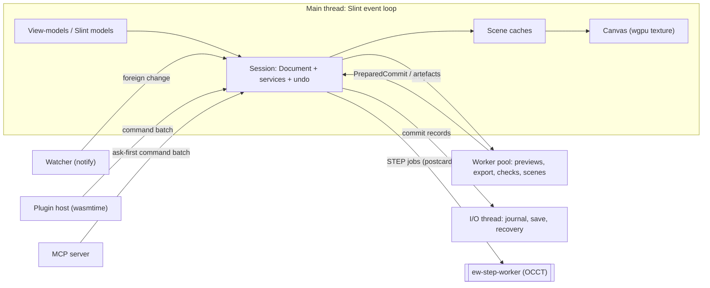
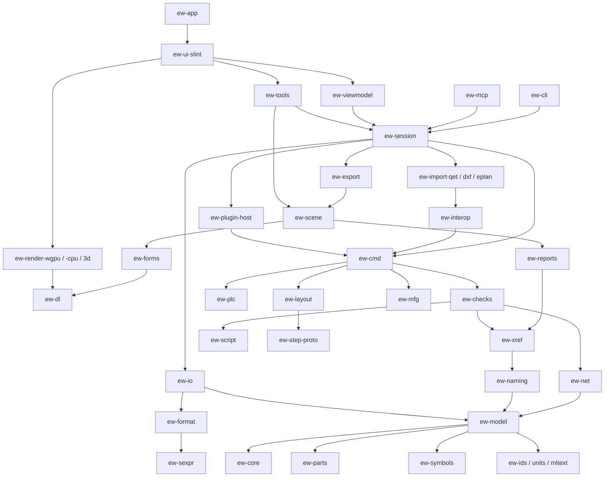

# Architecture proposal D: classic document/object model with a retained-mode UI

**Status:** competing proposal for the architecture judge panel · **Date:** 2026-10-17

**Angle:** ElektraWatt is built the way the long-lived tools of this class are built (KiCad, LibrePCB, QElectroTech,
FreeCAD, and EPLAN's own API):
- an explicit object graph of engineering entities in a `Document`;
- KiCad-style **commits** as the only way to mutate it;
- **change notifications** that drive incremental services and retained view-models;
- **Slint 1.18.1** for the chrome, around our own wgpu canvas;
- a canonical **S-expression project directory**.

> **Redaction note.** This proposal follows the public-repo rules in the brief. The customer, end user, project
> reference, drawing id, people and the panel builder appear only as placeholders. Research notes are cited by file
> name; [gaps-and-corrections.md](../gaps-and-corrections.md) (G-n, C-n) overrides the others. Anything not in the research is marked **(verify)**.

---

## 1. Guiding principles and the core idea

**Core idea.** The worst reference defects are *copies that should have been references*:
- -4W1 vs -3W1 (D-01);
- T51 vs T55 (D-02);
- a 5-valve overview vs a 4-valve detail (D-10);
- a terminal strip listed twice (D-42).

An explicit object graph removes that class directly:
- A layout placement, a BOM row, an overview symbol and a detail symbol each hold an `Id<Device>`, never text.
- Every derived value (tag string, cross-reference label, net, effective wire colour) has exactly **one named owner**.
  That owner is a *service* that subscribes to the document's change sets and keeps an incremental cache. The cache
  is never saved and never undone.
- Every edit is a **commit** in the KiCad `COMMIT` pattern: staged add/remove/modify with before-images, then
  `push(message)` or `revert()` (G3). The commit is also the undo step, the journal record, the macro step and the
  diff.
- **Retained view-models** in plain Rust (navigators, property grid, tables, messages) receive row-level
  notifications and feed Slint models. When nothing changes, nothing is recomputed or repainted.

From the immutable school we borrow only two cheap ideas:
- **chunked copy-on-write tables**, giving O(chunks) snapshots for background jobs;
- a **full-rebuild oracle**, which proves in tests that every incremental service equals its from-scratch result.

**Why this suits 2–4 developers and EPLAN-trained users.**
- **Proven shape.** EPLAN's API (functions, devices, connections, undo-step scopes; G1/G3) and QET's scene graph are
  object graphs. Importers, the scripting API and the docs can therefore map EPLAN vocabulary one-to-one.
- **Explicit cost.** The work an edit triggers is visible in code and in a stack trace. No framework decides when to
  recompute, or imposes data shapes. salsa is 0.28.5 and bevy_ecs breaks every quarter.
- **Stable dependencies.** Slint has had a stable 1.x API since 2023-04, with company backing. egui breaks on every
  minor release, every 6–10 weeks (`[rust-ecosystem.md](../rust-ecosystem.md) §2.3).
- **Native feel.** EPLAN users expect menus, dialogs, docked navigators and editable grids. Slint provides a native
  macOS menu bar, `KeyBinding`, Fluent/Cupertino styles and AccessKit; rfd provides native file dialogs.

**Principles.**
1. **Device-first.** Pages, BOM rows, layout placements and report lines are views that reference entities by ID.
2. **One writer.** Only `Commit::push` mutates the document. GUI, CLI, rhai, WASM plugins, MCP and importers submit
   commands.
3. **Stored = decided; derived = owned.** Derived values live in exactly one service cache. They are rebuilt on load
   and excluded from undo.
4. **Explicit links.** Links are typed `Id<T>` fields. Reverse links are maintained automatically, and each link
   declares a delete policy (`cascade`, `unlink`, `forbid`).
5. **Incremental with an oracle.** Every service has `apply(changes)` and `rebuild_all()`, and the tests compare
   them.
6. **Retained all the way up.** Commit → change set → services → derived changes → view-models → Slint models →
   repaint. Nothing polls.
7. **Deterministic text is the contract.** Canonical S-expressions, byte-identical saves, UUIDv7 keys, semantic
   diff/merge.
8. **Headless core.** `ew-session` is shared by the CLI, GUI, MCP server and a future Python wheel.

**What we give up.**
- Freshness is guaranteed by discipline and tests, not by construction.
- Services declare their inputs by hand.
- There are two UI languages (`.slint` and Rust).
- Docking, trees and the property grid must be built ourselves.
- Slint's wgpu interop is behind an *unstable* feature.
- The toolkit is GPL-3.0-only.

§16 treats each of these as a risk.

---

## 2. Process and thread model

| Thread / process | Owns | Rules |
|---|---|---|
| **Main/UI thread** (Slint event loop; macOS needs the main thread) | `Session`: Document, services, undo, selection, view-models, canvas renderers | **Only** writer of the Document. Commit plus incremental services must fit G6: 16 ms per frame; derived updates ≤ 50 ms (M) and ≤ 200 ms (L). Anything bigger becomes a job |
| **Worker pool** (rayon 1.12.0) | Jobs on **snapshots**: preview commits (renumber, import, auto-route), PDF/report export, offline checks, scene builds, thumbnails | Never touches the live Document. Model changes come back as a `PreparedCommit` (entity images + base generation) |
| **I/O thread** | Journal append (fsync batched ≤ 1 s), incremental save, recovery snapshots, optional git local history (gix 0.89.0) | Writes only through the `ew-io` save protocol (§7.4) |
| **Watcher thread** | notify 8.2.0 on the project and library folders | Debounces; ignores own writes by manifest generation; posts "foreign change" |
| **Plugin host** | One wasmtime store per call, with fuel/epoch limits | Reads a snapshot; writes are command batches sent to the UI thread |
| **MCP thread** | Server on stdio or localhost, off by default | Reads snapshots; writes are ask-first commits |
| **`ew-step-worker`** (1–2 pooled processes) | OCCT STEP import and tessellation | Crash-isolated, timeout-killed, results cached by content hash |

**Results come back as commits.** A `PreparedCommit` reaches the UI thread via `slint::invoke_from_event_loop`. It
applies directly if either holds:
- its base generation is still current;
- no entity in its recorded read set has changed since.

Otherwise the job reruns on a new snapshot: an optimistic rebase that preserves the single-writer rule.

**Snapshots are cheap.** Tables are chunked CoW arenas (§4.1), so `snapshot()` is about 20k `Arc` clones at XL
(< 1 ms). A later write copies only the 64-slot chunks it touches.



**Autosave is the journal.** Every commit is appended to an operation journal in the OS state directory
(etcetera/directories, **(verify)**). It is outside the project, so it never reaches git or cloud sync (G1). Full
recovery snapshots are written from a CoW snapshot every N minutes, and on restart the user is offered a replay.
Explicit saves rewrite only files that hold changed entities.

---

## 3. Crate and workspace layout

- **(P)** crates are MIT OR Apache-2.0 (format, SDK and IR); everything else is GPL-3.0-or-later.
- No crate below `ew-session` depends on Slint.
- Renderers see only the display-list IR, never the model.

| Crate | Responsibility | Key dependencies |
|---|---|---|
| `ew-ids`, `ew-units`, `ew-mltext` (P) | `Id<T>` (UUIDv7, seeded generator); `Nm(i64)`, rational `Grid`, `Orient2`, `Pose3`, fixed-point `Dec3`; `MlText` + BCP 47 + NFC/confusables | uuid 1.28.0; kurbo 0.13.1, glam 0.34.1 (feature-gated); unicode-normalization 0.1.26, unicode-security 0.1.2 |
| `ew-sexpr`, `ew-sexpr-derive` (P) | S-expression parser with spans, canonical writer, raw-node preservation; `#[derive(Sexpr)]` | syn, quote (verify) |
| `ew-format` (P) | Schema per file kind, manifest, upgrade chain on raw trees, published grammar | ew-sexpr, semver 1.0.28, sha2 (verify) |
| `ew-dl` (P) | Display-list IR: paths, glyph runs, images, groups, symbol instances, link targets, entity tags | kurbo 0.13.1, peniko 0.6.1 |
| `ew-step-proto` (P) | STEP worker IPC contract and cache format | serde 1.0.229, postcard 1.1.3, rkyv 0.8.18 |
| `ew-core` | CoW tables, link index, `Commit`, `ChangeSet` + field masks, undo, service registry, snapshots, debug read-tracking | ew-ids, smallvec (verify) |
| `ew-model` | Entity types (§4), link declarations, invariants, normalisers | ew-core, ew-units, ew-mltext |
| `ew-naming` | IEC 81346 grammar, identifier sets (2009 default, 2019, IEC 60750), numbering, `TagService` | icu 2.3.1 (natural sort) |
| `ew-net` | `NetService`, `PotentialService`, bonds, `WirePropService` (inheritance with origin) | ew-model |
| `ew-xref` | `XrefService` (anchor policy), `PageNavService` (Prev/Next, TOC rows, page labels) | ew-naming |
| `ew-symbols`, `ew-parts` | Symbols (variants A–H, IEC 60617, ISO 1219); parts catalogue, assemblies, embedding | usvg 0.48.1; rusqlite 0.40.2 (`bundled`, FTS5) |
| `ew-script`, `ew-checks` | rhai expressions and scripts; rule engine with packs, modes and waivers | rhai 1.26.1 |
| `ew-reports`, `ew-forms` | Report row providers; form templates, placeholder resolution, pagination | icu 2.3.1, parley 0.12.0 |
| `ew-plc` | Address profiles, AML AR APC (CAEX 2.15 write, 2.15/3.0 read), TIA XLSX, PLCopen XML | quick-xml 0.42.0, rust_xlsxwriter 0.100.0, calamine 0.36.1 |
| `ew-layout`, `ew-mfg` | Carriers, placements, collision, routing, lengths, duct fill; wire list, ferrules, Komax/Rittal/label templates, `.ewpp` | parry3d 0.31.1, petgraph 0.8.3, pathfinding 4.16.0; csv 1.4.0, zip 9.0.4 |
| `ew-scene` | Model → display list per page, text layout, LOD, spatial index, hit-testing | parley 0.12.0, fontique 0.12.0, skrifa 0.48.0, rstar 0.13.0 |
| `ew-render-wgpu`, `ew-render-cpu`, `ew-render3d` | GPU 2D renderer; CPU raster (fallback, thumbnails, golden PNGs); 3D renderer | wgpu 30.0.1, lyon_tessellation 1.0.22; vello_cpu 0.3.0; meshopt 0.7.0 |
| `ew-export` | PDF (outlines, links, page labels, PDF/A-2b), SVG, DXF, PNG | krilla 0.8.2, dxf 0.6.2 |
| `ew-interop` + `ew-import-qet`, `-dxf`, `-eplan` | Importer/Exporter traits, `ImportReport`, provenance; QET (only crate allowed to hold ported QET code, C-8); DXF/DWG; EDZ/EPLAN XML/XLSX | roxmltree 0.21.1, quick-xml 0.42.0; dxf 0.6.2, acadrust 0.6.4 (`dwg` feature); sevenz-rust2 0.24.0, zip 9.0.4, calamine 0.36.1 |
| `ew-io` | Directory I/O, save protocol, lock, journal, recovery, foreign-change reload, 3-way merge | notify 8.2.0, gix 0.89.0 (opt.) |
| `ew-cmd` | Serialisable `Command` enum and implementations, macro recorder/player, window/page macro insertion | model + services |
| `ew-session` | Headless core: `Session`, jobs, previews, selection, STEP client | rayon 1.12.0 |
| `ew-plugin-host`, `ew-mcp` | WIT world, capabilities, limits; MCP server | wasmtime 48.x LTS (49.0.3 current), wit-bindgen 0.63.0; serde_json 1.0.154, MCP SDK (verify) |
| `ew-viewmodel`, `ew-tools` | Toolkit-agnostic view-models; canvas tools as state machines, keymaps, command palette | ew-session, ew-scene |
| `ew-ui-slint` | `.slint` components, model adapters, dock system, canvas host (GPU + CPU), print adapters | slint 1.18.1, rfd 0.17.2, arboard 3.7.0, ashpd 0.13.13, objc2-pdf-kit 0.3.2, windows 0.62.2 |
| `ew-app` (bin `elektrawatt`), `ew-cli` (bin `ew`) | GUI entry, logging, crash dumps, opt-in updater; batch CLI, merge driver | tracing 0.1.44, crash-handler 0.8.1, minidumper 0.11.0, sentry 0.49.3, velopack 1.2.161; clap (verify) |
| `ew-step-worker` (bin) | OCCT STEP reader and tessellator (LGPL-2.1 boundary) | occt-sys 7.8.1, opencascade 0.3.0 |
| `ew-testkit`, `ew-py` (v1.x) | Golden builder, S–XL generator, oracle harness, command fuzzer; Python wheel | insta 1.49.0, proptest 1.12.0, criterion 0.8.2, dify 0.8.0, hayro 0.8.0; pyo3 0.30.1 |

Arrows point from a crate to its dependencies:



---

## 4. Core domain model: storage and identity

### 4.1 Storage

Entities are plain structs (`#[derive(Entity, Sexpr, Clone, PartialEq, Diff)]`), stored in typed tables of one
`Document`:

```rust
pub struct Document {
    generation: u64,                 // bumped per commit; stamped into the manifest on save
    project: Project,                // singleton
    tables: Tables,                  // macro-generated: one Table<T> per entity kind
    links: LinkIndex,                // reverse links, maintained from forward Id fields
    files: FileMap,                  // entity -> page file or shard; dirty set
}
pub struct Table<T> {
    chunks: Vec<Arc<Chunk<T>>>,      // 64 slots per chunk; Arc::make_mut = copy-on-write
    index: Arc<HashMap<Uuid, Slot>>, // cloned lazily on the first add/remove after a snapshot
}
```

This is the KiCad/LibrePCB object model (typed collections with explicit links) in Rust terms:
- links are IDs, never `Rc<RefCell<…>>`;
- mutation is gated by the commit;
- CoW chunks exist only to make snapshots cheap.

Hot services build private dense `u32` indexes inside their caches.

### 4.2 Identity and links

- **One identity everywhere.** `Id<T>(Uuid)`, UUIDv7, is used in memory, files, journal, plugins and PDF named
  destinations. Because v7 sorts by creation time, files sorted by ID produce append-mostly diffs.
- **Connection points.** They live inline in their function, but each has its own `CpId`. The link index maps
  `CpId → FunctionId`.
- **Not identity.** Tags, folios and wire numbers are properties, never identity.
- **Imports.** Importers derive IDs deterministically from a seeded generator and the source hash, so a re-import
  updates instead of duplicating. `source_ref` keeps the source identity.
- **Link visiting.** `#[derive(Entity)]` generates `visit_links()` from every `Id<_>` and `CpId` field. The commit
  updates reverse edges from before- and after-images, so nobody writes bidirectional bookkeeping by hand:

```rust
#[derive(Entity, Sexpr, Clone, PartialEq, Diff)]
pub struct SymbolPlacement {                        // one representation of a function on a page
    pub id: Id<SymbolPlacement>,
    #[link(on_delete = cascade)] pub page: Id<Page>,
    #[link(on_delete = unlink)]  pub function: Option<Id<Function>>, // removed -> "free graphic" check
    pub symbol: SymbolRef,                          // library item + variant A..H
    pub at: Pt2, pub orient: Orient2,               // i64 nm
    pub prop_texts: Vec<PropTextPlacement>,         // where the tag text goes, never its content
}
```

### 4.3 Entities: stored vs derived

| Entity | Stored (decided) | Derived (service) |
|---|---|---|
| `Project` | Typed properties (description, customer and end-user roles, object id, supply, control voltage, consumption), user property definitions, colour/size profiles, numbering rules, identifier set, languages, xref format | Title-block values (`PropertyResolver`) |
| `StructureNode` | Aspect (`==` `=` `++` `+` `&` `#`), canonical code ("+J-E-2416"), `MlText` description, parent | Full designations |
| `Section`, `Page` | Number, folio range, title; structured folio, page type, `=`/`+` refs, description (or *inherit*), form, scale | Dividers, Prev/Next, TOC rows, page labels, change status |
| Page items (`SymbolPlacement`, `ConnectionRoute`, `Junction`, `Text`, `Graphic`, `StructureBox`, `PlacedReport`) | Page, geometry (nm), refs, style refs | Display list |
| `Function` | Device, definition (MCB pole, PSU, terminal, PLC channel, valve coil, black box…), main/aux, inline CPs (designation, index, alias, kind: electrical/fluid/bus), internal links | Contact images, xref texts |
| `Device` | Numbering (`Frozen("S51")`, `PageBased{letter, counter}`, …), structure refs, parts + quantity, technical data, function text, process tag, assembly parent, state (used/spare/TBD) | Tag and full DT, BOM rows |
| `Connection` | Endpoints `a`, `b`; kind (wire, bridge, fluid line, bus); explicit csa/colour/number/type as `Option`; conductor | Effective properties + origin; net |
| `PotentialDef`, `Bond` | Name, type (L/N/PE/FE/+DC/0V/bus), voltage, environment; declared 0 V–PE bond point | Potential per net; bond checks |
| `TerminalStrip`/`Terminal`, `Cable`/`Conductor` | Designation, level, part, bridges, spare, function text; core colour, csa, shield | Terminal and cable diagram rows |
| `Station`/`Module`/`Channel`/`BusPort` | As in [plc-bus-fluid.md](../plc-bus-fluid.md) §11; the channel is the hub | Auto addresses, target tracking |
| `FluidPort`/`FluidLine`/`Medium` | Ports 1–5, 12/14; tube spec; medium | Medium propagation, tube defaults |
| `LayoutSpace`/`Carrier`/`Placement3D` | Carrier, device/function ref, pose relative to carrier | Collisions, lengths, 2D projections |
| `Revision`, `ReportBlock`, `ExternalRef` | Index, date, author, checker, released; report type, filter, form, start folio; target project/location/device | Page change status; report pages; stale check |

### 4.4 Coordinates, quantities, text, memory

- **Coordinates.** Every linear coordinate is **i64 nm** in the model and in files (G4).
  - 2D orientation is an enum; 3D rotation is a quaternion stored as integers ×1e9.
  - glam f64 mm appears only inside layout maths.
  - Grids are rational, so the QET 10 px grid is exactly `7_937_500/3` nm.
- **Electrical quantities** (mm², A, V) are fixed-point `Dec3`, so there is no float noise.
- **Text.** `MlText = Neutral | Langs(BTreeMap<LangTag, String>)`, with EPLAN semantics (G7). Identifiers (DTs, part
  numbers, addresses, wire numbers) are NFC strings, checked for confusables.
- **Memory at XL** (2,000 pages, 50k devices, 200k connections), estimated:

| Component | Estimate |
|---|---|
| Document | ~230 MB |
| Service caches | ~150 MB |
| Scene LRU | ≤ 300 MB |
| Undo | ≤ 256 MB |
| **Peak** | **≈ 1 GB** (G6 allows 4 GB) |

---

## 5. Editing: commits, undo/redo, validation, preview, macros

### 5.1 The commit

```rust
let mut c = session.begin("Move -102F1", Origin::Gui { page, viewport });
c.update(placement_id, |p: &mut SymbolPlacement| p.at += delta)?;   // first touch stores the before-image
c.add(Connection { a, b, ..Default::default() });
c.remove(old_route_id);                                            // applies declared delete policies
let receipt = c.push()?;                                           // or c.revert()
```

- The closure API (`update(id, |e| …)`) keeps the borrow checker happy. It is the Rust analogue of KiCad's
  `Modify(item)`.
- `Origin` (Gui, Cli, Script, Plugin(id), Mcp, Import) appears in the undo list, the journal and the revision log.

`push()` runs six steps:
1. **Normalise.** Deterministic normalisers may add to the same commit, at most three passes; non-convergence is a
   bug. Examples: online numbering of new devices, junction clean-up, turning autoconnect hints into explicit
   connections (G5), and conductor assignment.
2. **Validate.** Three layers:
   - referential integrity (forward links resolve; no dangling `forbid` links);
   - invariants (one main function per device; a CP belongs to at most one channel);
   - rule-pack **prevent** rules (§12).

   A failure reverts the commit with messages, and the services never see it.
3. **Record.** `derive(Diff)` yields a per-entity `FieldMask`, giving
   `ChangeSet {added, removed, modified: [(id, mask)]}`. The undo entry and the journal record are written.
4. **Link index and dirty files** are updated.
5. **Services** run in static topological order and emit typed `DerivedChanges`.
6. **View-models and scene caches** get one coalesced notification, then Slint repaints.

### 5.2 Undo and redo

- **Stack.** One project-wide stack with one entry per commit (G3). Each entry holds the **before- and after-images**
  of the touched entities, plus page and viewport.
  - This is whole-entity, KiCad style: simpler and harder to get wrong than field patches.
  - A 10k-tag renumber costs about 10 MB.
- **Undo is a push.** It applies the before-images through steps 3–6, so services and UI stay consistent for free.
  Derived data is never in undo.
- **Coalescing.** Drags of one selection merge into one entry. Typing in one field merges until focus leaves.
- **Bounds.** 500 steps / 256 MB. A saved marker drives the dirty flag.
- **Foreign reloads** become undoable diff commits (§7.4).

### 5.3 Preview of large changes

Renumbering 50k tags, QET import, PLC re-addressing and auto-routing run as **preview jobs**:
1. Fork a snapshot.
2. Apply the command on the fork in the pool.
3. Run the affected services on the fork.
4. Show the entity diff (tags, addresses) and the derived diff (BOM rows, xref texts that change).
5. On accept, apply the `PreparedCommit`. On cancel, drop the fork.

### 5.4 Macros: two kinds

- **Command macros.** The journal records serialisable `Command`s (`PlaceSymbol`, `Connect`, `SetProperty`,
  `Renumber{scope, rule}`…). A macro is a parameterised command list. rhai scripts call the same commands.
- **EPLAN-style window and page macros.** These are S-expression model fragments with placeholders. `InsertMacro`
  remaps every UUID, rebinds structure identifiers and lets the normalisers number the new devices. The acceptance
  case is folios 203–206: four copies of one valve-block typical. Value sets follow in v1.x.

---

## 6. Derived data: services, notifications, oracle

### 6.1 Service catalogue

```rust
pub trait Service: 'static {
    fn decl() -> ServiceDecl;  // name, reads: [(Kind, FieldMask)], upstream services
    fn rebuild_all(&mut self, doc: &Document, up: &Upstream);
    fn apply(&mut self, doc: &Document, cs: &ChangeSet, up: &Upstream, out: &mut DerivedChanges);
}
```

- The registry sorts services topologically at start-up; a cycle panics.
- Services **cannot mutate the document**. Anything that writes is a normaliser inside the commit.

| Service | Owns | Invalidated by | Incremental strategy |
|---|---|---|---|
| `TagService` | Tag and full DT per device; tag → devices index | Numbering, structure, node codes, rules, **folio of the main function's page** | Only touched devices and those under a renamed node or page |
| `NetService` | CP → net; interruption-point name groups | Connections, bridges, internal links, IP names, junctions | Add: merge the smaller net into the larger. Remove: BFS inside the old net and split if needed |
| `PotentialService` | Net → potential (type, voltage, canonical name), conflicts, bonds | Net changes, `PotentialDef`, `Bond` | Per affected net |
| `WirePropService` | Effective csa/colour per connection **with origin** | Potentials, profiles, explicit fields | Per connection in the affected nets |
| `XrefService` | Anchor cell per placement; IP and main↔aux texts ("(201-E1)", "∞ 203-B4") | Moves, folios, form grids, links, IP names | Changed placement plus its counterparts |
| `PageNavService` | Page order (stored + generated), Prev/Next, TOC, page labels | Pages, report page counts | O(pages) |
| `PropertyResolver` | Placeholder values (title blocks, PART DATA boxes) | Keys such as `project.description` | Key → dependent scenes map |
| `ReportRows` | Rows and page count per `ReportBlock` | Declared kinds per report type | Dirty flag; lazy |
| `PlcService`, `LayoutService` | Auto addresses, overlaps, target tracking; world poses, collisions, routes, lengths | Modules, channels, nets; placements, carriers, connections | Per station; per moved placement / affected wire |
| `CheckService` | Online findings | Each rule's declared reads | Per entity (§12) |
| `SceneCache` | `Arc<PageScene>` per page (display list + rstar + dependency keys) | Page-local changes, `DerivedChanges`, placeholder keys | Mark dirty; rebuild visible pages first |

**Tags show the split concretely.** A page-based device stores `PageBased{letter: 'W', counter: 1}`. The "3" in -3W1
is derived from its main function's folio. Moving folio 4 to 3 therefore changes every printed -4W1 to -3W1 at once
(D-01). Counter uniqueness is a normaliser and check concern, not string matching.

### 6.2 Notification mechanics

- **Granularity is the commit, never the setter.** Bulk edits cannot cause notification storms.
- **Two typed levels.** The document `ChangeSet` goes to services. Service `DerivedChange`s (`TagChanged(DeviceId)`,
  `XrefTextChanged(PlacementId)`, `NetMembersChanged`, `ReportPagesChanged`) go to dependants and view-models.
- **Scenes record the keys they read** (entities, derived keys, placeholder keys). An inverted `key → pages` map
  marks scenes dirty. Editing the project description dirties 2,000 scenes in O(pages) and rebuilds one.
- **Reports are lazy.** They recompute when visible or exported. A change in page count is itself a derived change,
  so the TOC and Prev/Next stay right.

### 6.3 Keeping the observer pattern honest

The classic failure is a missed subscription, which leaves a stale cache: exactly the D-01 class. Three guards:
1. **Oracle.** After each commit, `rebuild_all(doc)` must equal the incremental cache. This runs on proptest command
   sequences, the cargo-fuzz command fuzzer, golden replays, and debug builds (sampled).
2. **Read tracking.** In debug builds, every `Document::get` inside `apply` is recorded. A read outside the declared
   `reads` fails.
3. **Field-mask exhaustiveness.** A generated per-struct test fails when a field is added without reviewing the
   masks of the services that read that kind.

### 6.4 Complexity at XL (estimates; the perf gate enforces them)

| Operation | Work | Estimate |
|---|---|---|
| Open project | Parse ~1.2M entities (~250 MB text, files in parallel); links; `rebuild_all` for naming, nets, potentials, xrefs, navigation; scenes lazy | 6–12 s (G6: ≤ 20 s) |
| Move a symbol | 1 image; 1 scene; ≤ 10 xref texts; rstar update. **Connectivity untouched**, because connections are explicit | < 5 ms |
| Add or delete a wire | Net merge, or split BFS over ≤ 10k CPs (PE worst case); wire properties of one net | < 3 ms |
| Renumber a page (104 → 105) | ~25 tags; ≤ 200 xref texts; TOC; 3 × Prev/Next; scenes dirtied | < 10 ms |
| Edit the project description | 1 key; 2,000 scenes dirty; 1 rebuilt | < 5 ms + lazy |
| Renumber all devices | Preview job (50k images); apply on the UI thread | 0.5–1 s job; 150–300 ms apply |
| Offline check run / PDF of 2,000 pages | rayon over a snapshot / parallel scenes + serial krilla | ≤ 60 s / 30–60 s |

---

## 7. Persistence

### 7.1 Project directory

Users open the root `.ewp` file, as KiCad users open `.kicad_pro`:

```text
J-E-2416/
  J-E-2416.ewp              project properties, profiles, numbering rules, languages
  manifest.ews              written LAST: ew_format, min_reader, generator, generation, SHA-256 per file
  structure.ews  revisions.ews  reports.ews  checks.ews (rule packs, waivers with reasons)
  pages/<page-uuid>.ews     one file per page: placements, routes, junctions, texts, placed reports
  devices/<00..ff>.ews      256 shards by UUID prefix: devices, functions with CPs, part assignments
  connections/<00..ff>.ews  connections, bridges, potential defs, bonds
  terminals/<strip-uuid>.ews  cables/<00..ff>.ews  plc/<station-uuid>.ews  fluid/<00..ff>.ews  layout/<space-uuid>.ews
  library/{symbols,parts,forms,macros}/<uuid>.ews   embedded copies with {library_id, item_id, version, sha256}
  .gitattributes  .gitignore   (local/ holds per-user view state, ignored like KiCad's .kicad_prl)
```

This follows G1:
- file names are UUID hex only, which keeps paths short and avoids reserved names;
- sharding bounds the file count to about 1–3k at XL;
- an edit to page 101 touches one page file plus a few shards.

### 7.2 Why S-expressions

KiCad (`.kicad_sch`) and LibrePCB (`.lp`) both use S-expressions. They are the open-source EDA formats with the best
VCS track record (`[oss-landscape.md](../oss-landscape.md) §3.2, §4). Benefits:
- canonical one-node-per-line diffs;
- no quoting noise for `+J-E-2416`, `=P01` or `DBU`;
- comments for hand-written forms and rule packs;
- verbatim preservation of unknown nodes;
- a reader/writer of about 1,500 lines that we fully own.

```lisp
(device 0192f1c4-5a10-7c3e-8b21-6f0d9a4e2b10
  (numbering (page_based (letter G) (counter 1)))
  (structure (function 0192f0aa-…) (location 0192f0ab-…))
  (part (ref 0192e7d0-…) (qty 1))
  (function 0192f1c4-5a11-… (def ew:psu.1ac_dc) (main yes)
    (cp 0192f1c4-5a12-… (des "L") (n 1))
    (cp 0192f1c4-5a13-… (des "+") (n 4))
    (cp 0192f1c4-5a14-… (des "+") (n 5))
    (internal_link 4 5))
  (text function (ml (en-GB "Power supply 24 V DC"))))
(place 0192f2… (function 0192f1c4-5a11-…) (symbol ew-iec:psu_ac_dc (variant A))
  (at 95250000 63500000) (orient r0))
(connection 0192f3… (a 0192f1c4-5a13-…) (b 0192f4…) (csa 1.5) (colour DBU))
```

**Canonical writer rules:**
- struct declaration order;
- entities sorted by UUID;
- integers and `Dec3` literals only;
- LF line endings, NFC;
- no timestamps inside entities.

**Honest cost vs JSON.** JSON has jq, JSON Schema and universal viewers. We compensate with:
- a published grammar and generated type reference in `ew-format`;
- `ew export --json`;
- a permissively licensed reader crate.

kdl 6.7.1 is the fallback if an off-the-shelf node format is preferred.

### 7.3 Determinism, git, merge

- **Determinism.** Save → load → save is byte-identical and independent of insertion order (proptest).
- **Merge driver.** `.gitattributes` sets `*.ews merge=elektrawatt diff=elektrawatt`. `ew merge-driver %O %A %B %P`:
  - merges UUID-keyed entities field by field, using the same `Diff` masks as undo;
  - writes true conflicts as `(conflict (ours …) (theirs …))` nodes, listed in a *Merge conflicts* navigator;
  - runs the validators, so semantic clashes (two devices taking F1 on page 101) become check messages.
- **Diff.** `ew diff` prints changes by tag, e.g. "-102F1: csa 1.5 → 2.5".

### 7.4 Save, lock, recovery, external changes

- **Save (G1 protocol).**
  1. Write `name.tmp-<gen>` and `sync_all`.
  2. Rename it over the target.
  3. Write the manifest **last**, with SHA-256 per file.
  4. Sync the directory where supported.

  On open, the hashes are verified. A mismatch offers recovery from the journal or the last good generation.
- **Lock.** `.~ew.lock` is created with `create_new` and holds `{user, host, pid, app_version, started_at}`. A held
  lock opens read-only. Stale locks can be taken over. No byte-range locks over SMB.
- **Recovery.** A one-S-expression-per-line journal of commands and after-images, in the OS state directory. It is
  replayed on restart; gix-based local history is optional.
- **Foreign changes** (git pull, a colleague's edit):
  1. Load the new generation into a fresh document.
  2. Diff it against the last-saved snapshot held in memory.
  3. If the user has no conflicting unsaved edits, apply the diff as **one undoable "External change" commit**.
     Services update incrementally.
  4. Otherwise, run the 3-way merge.

  The commit architecture makes G3's special case the normal path.
- **Transport and sync.** Cloud-sync folders are detected and warned about. `.ewz` is a ZIP of the directory.

### 7.5 Versioning and migration

- **Manifest.** `(ew_format 1 3) (min_reader 1 0) (generator "ElektraWatt" "0.7.2")`.
  - A minor bump is additive. Unknown nodes survive in each struct's `#[sexpr(extra)]` bag.
  - A major bump refuses to open, or opens read-only.
- **Upgrade steps** are pure functions on raw trees, run before typed decoding. They are never deleted, and the CI
  corpus keeps one fixture per release.
- **Release policy.** Before 1.0, upgrade-on-read every release. After 1.0, format majors only in a yearly window
  (LibrePCB's rule).
- **Archive profile ("as-built").** Project + embedded libraries + PDF/A-2b + `.ewpp` + checksums (G2).

### 7.6 Parts database and libraries

- **Catalogue.** rusqlite 0.40.2 (`bundled`, FTS5) holds the company and user parts catalogue: EDZ part data,
  BMEcat/ETIM, CSV.
- **Caches.** Search indexes and tessellation caches (rkyv) live in the OS cache directory and can always be rebuilt.
- **Embedding.** Projects embed every symbol, part, form and macro they use. "Update from library" shows an entity
  diff and applies it as one commit.

---

## 8. Rendering pipeline

**One IR, many backends.**
- `ew-dl` holds an immutable `Arc<DisplayList>` per page, symbol variant and form.
- Item types: `Path(BezPath, Stroke, Brush)`, `GlyphRun`, `Image`, `Group`, `SymbolInstance`,
  `LinkSource`/`LinkTarget`.
- Every item carries an `EntityTag`.

| Backend | Crate | Notes |
|---|---|---|
| Screen (GPU) | `ew-render-wgpu`: wgpu 30.0.1 | Symbols tessellated once (lyon_tessellation 1.0.22) and **instanced**; screen-space-width lines in the vertex shader, so zoom never re-tessellates; glyph atlas |
| Screen fallback, thumbnails, golden PNGs | `ew-render-cpu`: vello_cpu 0.3.0 | GPU-less RDP/VDI, tests, overview |
| PDF | krilla 0.8.2 | PDF/A-2b default (3b only with attachments, C-10); outlines per section and folio; a **named destination per xref target**; link annotations; `/PageLabels` = folios; font subsets; no OCG (C-11) |
| SVG / DXF | own writer / dxf 0.6.2 (AC1015) | Snippets; layer-mapped pages |

**Scenes, LOD, hit-testing.**
- `PageScene` = display list + rstar 0.13.0 tree + dependency keys, built in the pool and cached per page.
- **LOD:** small text becomes bars, hairlines stay ≥ 1 device pixel, and overview uses CPU thumbnails.
- **Picking:** rstar broadphase, then exact kurbo tests (`nearest`, `contains`, stroke distance) → `EntityTag` → `Id`.
  Selection is an observable, so navigators and the property grid follow.

**Text.**
- Canvas and outputs share parley 0.12.0 + fontique 0.12.0 + skrifa 0.48.0, with vello_cpu-rasterised glyph atlases
  (the egui 0.34+ combination).
- krilla embeds the same font files, so screen and PDF metrics match.
- Fonts: Noto/DejaVu Sans as default, osifont as an ISO 3098 option. Tahoma is never bundled, and substitutions are
  recorded (G14).
- Slint renders chrome text with its own stack. No chrome text reaches a deliverable.

**3D and STEP.**
- **Renderer.** `ew-render3d` is our own wgpu renderer, shown through the same canvas host. It provides instancing (the
  PT 2.5 terminals on -X1031 share one mesh), feature edges, transparency, ortho/perspective and CAD camera
  conventions.
- **Picking and collision.** parry3d 0.31.1 BVH ray casts.
- **Gizmo.** We write our own, about 800 lines, because transform-gizmo-egui is egui-only. This is an honest cost.
- **STEP worker** (`ew-step-worker`):
  - occt-sys 7.8.1 / opencascade 0.3.0, per C-5; cadrum stays evaluated only, because it downloads binaries at build
    time;
  - postcard frames over stdio;
  - outputs: assembly tree, two mesh LODs (meshopt 0.7.0), feature edges, hulls, mounting frames;
  - an rkyv cache keyed by STEP SHA-256 plus the worker version.
- **Routing and lengths.** petgraph 0.8.3 / pathfinding 4.16.0 over the duct graph feed the wire list.

---

## 9. UI shell

### 9.1 Toolkit: Slint 1.18.1

| Criterion | Slint 1.18.1 (chosen) | egui 0.37.0 | iced 0.14.0 |
|---|---|---|---|
| API stability | Stable 1.x since 2023-04 | Breaking every 6–10 weeks | "Experimental"; ~10 months without a release |
| Native feel | Native macOS `MenuBar`; Fluent and Cupertino; `ContextMenuArea`; `KeyBinding` | Custom look | Custom look |
| Accessibility | AccessKit via winit | AccessKit, strong progress | None in mainline (unverified) |
| Canvas | `unstable-wgpu-30` texture import (**unstable**) | Shared-device callbacks (excellent) | Pinned to wgpu 27 |
| Docking / tree / table | DIY / DIY / `StandardTableView` (100k rows unverified) | egui_dock / egui_ltreeview / egui_table | DIY |
| Licence | GPL-3.0-only route (fits GPL-3.0-or-later) | MIT/Apache | MIT |

**Where retained mode and object graphs beat immediate mode with derived queries:**
1. **Widget state belongs to widgets.** This covers IME composition, focus, caret and selection in inline cell
   editors, scroll positions and multi-step modal property sheets (EPLAN's tabbed "Properties (components)"). In
   immediate mode the app re-declares them every frame and must keep IDs stable. That is solvable, but it is constant
   friction in form-heavy CAD dialogs.
2. **Notifications map one-to-one onto models.** A `slint::Model` with row notifications (`ModelNotify`, verify the
   exact API) receives "row 1,234 changed" from a `DerivedChange`. Immediate mode re-queries every visible cell each
   frame, which pushes the design towards a query engine; our services make that unnecessary.
3. **Zero idle cost.** This matters on laptops and over RDP.
4. **Design is separate from logic.** `.slint` has live preview and is easy for designers and AI tools to generate.
   The logic stays in headless-testable Rust view-models.
5. **Five-year stability.** A small team cannot spend a day every 6–10 weeks on UI upgrades.
6. **Familiarity.** EPLAN users get menus with shortcuts, context menus, dockable panes, modal dialogs and editable
   grids, in Fluent style.

**Where immediate mode is better, honestly:** egui already has docking, tables, trees, kittest and `egui_mcp`; it
shares wgpu without friction; it is permissively licensed; and it is one language. We accept about 12 dev-weeks of DIY
UI infrastructure and one unstable interop module in exchange.

**Rejected and fallback toolkits.**
- Rejected: iced (wgpu lag, no a11y), gpui (no stable channel), Tauri (UI not Rust; IPC), GTK/Qt (toolchains).
- `ew-viewmodel` is toolkit-agnostic, so a later chrome swap replaces only `ew-ui-slint`.

### 9.2 Shell structure

- **Layout (G5).**
  - Centre: canvas.
  - Left dock: page, device, terminal, cable, PLC and potential navigators.
  - Right dock: property grid.
  - Bottom dock: messages, search, table editors.
  - Saved **workspaces**: Schematic, PLC, Panel 3D, Manufacturing.
- **Docking (DIY, about 3–4 dev-weeks).** Dock regions with tab stacks, splitters and collapse; *detach to a native
  window* (Slint supports multiple windows); serialised workspaces. Free drag-and-drop dock trees are not in v1.
- **Trees (about 1–2 weeks).** A flattened, virtualised `ListView` with expanders. The `TreeViewModel` emits row
  inserts and removes from `DerivedChange`s.
- **Tables (about 3–4 weeks).** Virtualised rows with column chooser, sort, filter, inline editors, fill-down, pattern
  fill and paste from Excel. Every edit is **one commit**.
- **Property grid (about 2–3 weeks).** Schema-driven typed rows with `‹varies›` for multi-selection. **Inherited and
  derived values are greyed and show their origin**, taken directly from the `WirePropService` and `TagService`
  origins, with "reset to inherited" (G5).
- **Message panel.** Grouped by severity and rule, with jump-to and quick-fix commands.

### 9.3 Canvas embedding

- **GPU path.** The canvas renders into a `wgpu::Texture` on Slint's device (femtovg-on-wgpu renderer with
  `unstable-wgpu-30`; exact feature names **(verify)**) in the rendering notifier. The texture is shown with
  `slint::Image::try_from(texture)` under a `TouchArea`/`FocusScope` that forwards events to `ew-tools`.
- **CPU path (always built).** vello_cpu renders the same display list into a `SharedPixelBuffer` → `slint::Image`.
  This is LibrePCB's proven route. It works with any Slint renderer, including the software renderer for GPU-less RDP
  (desktop combination **(verify)**). wgpu on DX12 WARP is tried first.
- **Isolation.** All Slint–wgpu glue is one module of about 300 lines. Slint and wgpu are pinned and upgraded together
  every quarter.

### 9.4 Keyboard-first interaction

- **Tools** in `ew-tools` are state machines: Select, Move, PlaceSymbol, DrawConnection, PlaceInterruption, Measure,
  PlaceLayout. Each consumes events and emits an overlay display list plus commands.
- **While placing:** rotate and mirror, **cycle variants A–H** (binding to agree with EPLAN users, **(verify)**),
  switch representation, and preview autoconnect hints that become explicit connections (G5).
- **Keymaps.** Presets: EW default, KiCad-like (M/R/W/E) and EPLAN-like. One keymap file drives `KeyBinding` and
  `MenuItem.shortcut`. A fuzzy **command palette** shows each command with its shortcut.
- **No-mouse navigation.** Grid-step cursor, next connection point, next unconnected point, and xref jump with
  back/forward history.

### 9.5 Theming, accessibility, i18n

- **Theming.**
  - Fluent (Windows/Linux) or Cupertino (macOS), each in dark, light and high-contrast.
  - The canvas has its own "paper" and "dark" token sets.
  - Highlights use Okabe–Ito colours **plus patterns**; wire colours always show their IEC 60757 code; GNYE is drawn
    striped (G8).
- **Accessibility.**
  - Every interactive element sets `accessible-role` and `accessible-label` (verify names). A CI test walks the
    testing backend's element tree and fails on unnamed inputs. We build what egui_kittest gives for free.
  - The canvas exposes the selected object's description as a live region. Navigators and tables are the accessible
    representation of the schematic.
- **UI i18n.**
  - Slint `@tr()` with gettext catalogues (verify bundling). Rust strings use the **same PO files** via a small `tr!`
    wrapper: one Weblate-native format, aligned with the docs (G13).
  - icu 2.3.1 formats report numbers and dates.
  - Project-content languages (`MlText`) are a separate concern.

---

## 10. Extensibility

- **CLI `ew`** (over `ew-session`):
  - `ew check` (CI exit codes);
  - `ew export pdf|bom|wires|terminals|cables|plc|aml|komax|dxf|svg`;
  - `ew render --page 101 --png` (CPU backend: ideal for CI and agents);
  - `ew jobs run release.ewjobs` (KiCad-style jobsets);
  - `ew import qet|dxf|edz`, `ew diff`, `ew merge-driver`, `ew fmt --check`, `ew upgrade`, `ew print`, `ew mcp`.
- **rhai 1.26.1 (v1).** Rule expressions, numbering formats, title-block formulas, and scripts that call `Command`s.
  - Operation, depth and size limits; no I/O registered.
  - Scripts in received projects **never auto-run**; they need a per-project trust prompt (G10).
- **WASM components (v1.x).** wasmtime **LTS 48.x**, wit-bindgen 0.63.0. The WIT world `elektrawatt:plugin@1`
  mirrors the object model by ID:
  - `model-read`: get by ID, iterate a kind, follow links, read derived values (tags, nets, effective wire
    properties);
  - `commands`: a batch becomes one undoable commit tagged `Origin::Plugin(id)`;
  - `files`: capability handles;
  - `forms`: **declarative** dialogs rendered by the host. Plugins never build Slint UI, which avoids exposing Slint
    APIs and our UI churn;
  - `importer`, `exporter`, `report-rows`.

  Limits: fuel/epoch deadlines, `StoreLimits`, and signed manifests with declared capabilities. Plugins run on
  snapshots.
- **MCP (`ew-mcp`).**
  - Tools: `ew_query`, `ew_check`, `ew_diff`, `ew_render_page`, `ew_apply_commands`.
  - Off by default; stdio or localhost; ask-first writes.
  - Every write is a normal commit.
  - Debug inspection endpoints are never in release builds.
- **Python (v1.x).** A pyo3 0.30.1 wheel of `ew-session`; no embedded interpreter.

```rust
pub trait Importer: Send + Sync {
    fn id(&self) -> &'static str;
    fn sniff(&self, head: &[u8], path: &Path) -> Confidence;
    fn import(&self, src: &mut dyn ImportSource, cx: &mut ImportCx) -> Result<ImportReport>;
} // ImportCx = forked snapshot + commit builder; result = one PreparedCommit with preview
pub trait Exporter: Send + Sync {
    fn id(&self) -> &'static str;
    fn export(&self, snap: &Snapshot, opts: &ExportOptions, out: &mut dyn ExportSink) -> Result<ExportReport>;
}
```

**Importers write through commands**, so normalisers, validators and services run exactly as for UI edits.
- Each imported object keeps `source_ref`.
- Parsers enforce size, depth and entry limits, and are fuzzed.
- The **QET importer is the v1 anchor**: folio reports map to interruption points, master/slave to main/aux,
  potentials are rebuilt from connectivity, and each project's own `%F`/`%f` formulas are read (C-15).

---

## 11. Reports and forms engine

- **Report types.** A Rust enum with one `RowProvider` per type:
  - TOC, parts list (assembly or component mode), summarised parts list, device list;
  - terminal diagram and overview, cable overview and diagram, wire list;
  - PLC overview, card overview, assignment list;
  - potential overview, structure-identifier overview, revision overview, title page, open items.
- **Forms.** S-expression templates in nm, edited in a form editor that reuses the canvas. A form defines:
  - the frame variant (grid or none, column count, **0-based** columns, rows A–H);
  - title-block cells as **label + bound placeholder** (`project.description`, `page.prev`, `rev.current`,
    `project.customer`, `project.end_user`…);
  - header, data and footer regions with row templates, widths, shading, row height (6.52 mm in the reference) and
    continuation forms.
- **`ReportBlock` entities** are persisted: type, filter, sort, form, section, start folio. Their pages are derived
  and join the page order via `PageNavService`, so the TOC, Prev/Next and outlines include them. The golden 903–911
  pages are simply blocks.
- **Embedded blocks.** The "PART DATA" boxes on folios 201, 202 and 902 are `PlacedReport` items that render
  assembly order codes or enclosure parts live.
- **Pagination** measures text with parley. Cell overflow leads to shrink-to-fit with a minimum height, or a check
  message (G7).
- **Output.** Display lists, so screen, PDF, SVG and PNG are identical. XLSX (rust_xlsxwriter 0.100.0) and CSV for
  tables.
- **Release.** Freezing writes PDF/A and `.ewpp` into the archive profile. Projects never store report rows.

---

## 12. Checks and rule engine

- **Rule packs are data.** S-expression files (`ew-core.ewrules`, `ew-layout.ewrules`, company packs) define, per
  rule:
  - an EPLAN-style ID (`EW001005` terminals, `EW017xxx` numbering, `EW-L001` layout);
  - a multilingual title and message template;
  - severity, modes (`online` / `offline` / `prevent`), parameters, and an implementation reference.
- **Implementations.** Rust functions registered by ID (`ew:net.n_switching`, `ew:naming.duplicate_tag`), or
  **rhai expressions** for simple company rules (e.g. "letter T requires a temperature-sensing definition").
- **Online** rules are services. They declare `reads`, receive change sets, re-evaluate only the affected entities,
  and push findings to the message panel.
- **Offline** rules run in the pool over a snapshot (rayon) within the G6 budgets.
- **Prevent** rules are commit validators (§5.1): they reject the commit with their message.
- **Waivers** are stored in `checks.ews` with a reason and author, and appear in "open items". The pre-release scheme
  blocks release while TBD values remain (D-15). Every rule ID has a documentation page, and quick-fixes are commands.

---

## 13. Testing strategy

| Layer | What | Tools |
|---|---|---|
| **Golden J-E-2416** | Built **through commands** and compared with a checked-in S-expression fixture. Regenerates folios 1–902 plus 903–911 and asserts [reference-drawing.md](../reference-drawing.md) §4.15: §4.13 xref texts exactly (22 IP pairs, 9 main/aux sets, -201U1 → **3-B2**), BOM §4.5 in both modes, terminals §4.8, wires §4.7, frame ±0.2 mm on the display list, PDF outline, links, labels and fonts | insta 1.49.0, hayro 0.8.0, veraPDF |
| **Golden B / QET** | Full page-based renumber keeps everything consistent; the pilot's `.qet` (when supplied) and QET's 24 examples import with D-01…D-42 reported | insta |
| **Oracle and round trips** | Incremental == `rebuild_all` per service; save→load→save byte-identical; undo∘redo = id; merge(b, x, x) = x; journal replay = live state | proptest 1.12.0 |
| **Fuzzing** | `ew-sexpr`, every importer (QET, DXF, EDZ 7z/ZIP, AML, EPLAN XML), merge driver, **command-sequence fuzzer** | cargo-fuzz 0.13.2 |
| **Visual** | Golden PNG per symbol and golden page (CPU); GPU/CPU parity samples | vello_cpu 0.3.0, dify 0.8.0 |
| **View-models** | Navigators, property grid (`‹varies›`, origins), table edits → commits; all headless | nextest 0.9.148 |
| **UI smoke + a11y** | Each window opens in Slint's testing backend; accessible labels everywhere (verify API) | Slint testing backend |
| **Perf gate** | Synthetic S/M/L/XL from the golden project; G6 budgets; nightly fails at > 15 % regression | criterion 0.8.2 |
| **Supply chain / privacy** | Licences, advisories, SBOM, no build-time downloads; network-sandboxed run (G12) | cargo-deny 0.20.2, cargo-audit 0.22.2, cargo-vet 0.10.2, cargo-about 0.9.2, cargo-cyclonedx 0.5.9, cargo-auditable 0.7.7 |

---

## 14. How the architecture prevents the reference defects

Mechanisms:
- **View by ID:** a representation holds an ID, never copied text.
- **Owned derived:** one service computes the value, and it is never stored.
- **Validator:** a commit invariant or prevent rule.
- **Rule:** an online or offline check.
- **Bound form:** a placeholder bound to one property.

| Defects | Mechanism in Proposal D |
|---|---|
| D-01, D-41 | **Owned derived:** `TagService` derives the page part of the tag from the main function's folio. The assembly is an entity tree, with child numbering under the assembly tag |
| D-02, D-32 | **View by ID:** layout placements hold `Id<Device>`, so the label is the device's tag. Rules L001 (unplaced) and L002 (orphan) |
| D-03, D-29 | Numbering rules per project; flagged `Frozen` tags; canonical `StructureNode` codes ("+J-E-2416" only); referenced text styles |
| D-04, D-35, D-36, D-40 | `ReportRows` aggregate part assignments with numeric quantities; assembly and component modes; separate description and technical-data fields; configured-assembly rule |
| D-10 | Overview front view **generated** from the assembly's children; REF-087 rule for hand-drawn overviews |
| D-42, D-11, D-12 | One `TerminalStrip`, drawn in several segments; designation uniqueness as a validator or prevent rule |
| D-05, D-06, D-30, D-34 | **Bound form:** one `Revision` entity and project properties; explicit, reported per-page overrides; separate customer and end-user roles; checker ≠ author at release |
| D-07, D-33 | krilla outlines, named destinations, links, `/PageLabels`; searchable glyph runs |
| D-08, D-37, D-38 | `WirePropService` inheritance with origin; profiles name their basis; PE sizing rule |
| D-13 | `PotentialService` types nets; rule `ew:net.n_switching` |
| D-14 | `XrefService` anchors on visible graphics → "3-B2", not "3-B0" |
| D-16, D-21, D-22, D-24, D-25 | FE vs PE from part pin functions; PE rail bonding; an explicit `Bond` entity; canonical potential names; load summary per channel |
| D-17, D-19, D-20, D-39 | Conductor colours validated against the cable part; cables as devices plus an open-items rule; `Junction` entities with connection sequence; arrange tools for interruption points |
| D-15, D-23, D-26, D-27, D-28 | `Tbd` address blocks release; unconnected-CP rule; address map from part data plus PLC-12; child tags `-201U3-QM1…`; process tags; fluid-line properties |
| D-18, D-31, D-09 | Manufacturer master list; icu unit formatting; minimum-text-height rule; report blocks 903–911 |

**Golden reproduction.**
- Golden A keeps the frozen S51, F55, T55, E55, S56, E56 and 1X1, plus the page-based -101F1 … -202U3.
- -X1031 and -X1032 print at +J-E-2416 with identifier suppression.
- Forms reproduce the 0–16 × A–H frame and the §5.1 cells in nm.
- `XrefService` emits all 22 pairs in `%F-%l%c` format.
- Row providers produce the BOM, terminal, wire and PLC tables.

The §13 suite compares every printed string.

---

## 15. Staffing: the spine first, then parallel streams

**Spine (weeks 1–10, whole team):**
1. `ew-ids`, `ew-units`, `ew-mltext`; `ew-sexpr` and `ew-format` with manifest and upgrade-chain skeleton.
2. `ew-core`: CoW tables, `Commit`, masks, undo, service registry, **oracle harness and read tracking**.
3. A minimal `ew-model`: Project, StructureNode, Page, Function + CPs, Device, Connection, SymbolPlacement,
   ConnectionRoute.
4. `ew-dl`, `ew-render-cpu`, a minimal `ew-scene`; `ew render --png` works headless.
5. `ew-session` with a snapshot job and `PreparedCommit` round trip.
6. A Slint window with **both canvas paths** and one navigator through `ew-viewmodel`.

**M0 spikes (weeks 1–4)**, each with a kill criterion:
- Slint + wgpu 30 texture sharing on Windows, macOS, Linux and WARP;
- a 100k-row Slint table;
- synthetic XL saved in ≤ 2 s and opened in ≤ 20 s;
- the oracle over 10k random commits.

| Stream | Owns | First deliverables |
|---|---|---|
| **S1 Model & services** | `ew-model`, `ew-naming`, `ew-net`, `ew-xref`, `ew-checks`, revisions, `ew-cmd` | Golden A via commands; §4.13 xrefs pass |
| **S2 Graphics & outputs** | `ew-scene`, `ew-forms`, `ew-render-wgpu`, `ew-export`, `ew-reports`, symbol editor | Frame ±0.2 mm; PDF with links and outlines; TOC and BOM blocks |
| **S3 UI & interaction** | `ew-ui-slint`, `ew-viewmodel`, `ew-tools`, docks, navigators, property grid, tables, a11y, i18n | Place, wire, move and undo on the canvas; device navigator; property grid with origins |
| **S4 Interop, PLC & manufacturing** | QET/DXF/EPLAN importers, `ew-parts`, `ew-plc`, `ew-mfg`; later 3D (`ew-layout`, `ew-render3d`, STEP worker) with S2 | QET corpus import; EDZ part data; AML/TIA XLSX; wire list + Komax CSV |

- **With 2 developers:** A = S1 + S4, B = S2 + S3. 3D starts after golden 2D acceptance.
- **With 3 developers:** S3 splits off and 3D starts earlier.

Streams meet only at `Command`, `ChangeSet`, `DerivedChange` and `ew-dl`. All four are small and reviewable, which
makes the parallelism safe.

---

## 16. Top 10 risks, and what we do not build

| # | Risk | Mitigation |
|---|---|---|
| 1 | **Stale caches from a missed subscription**: the observer pattern's classic bug, and the D-01 class itself | Oracle in proptest, fuzzing, golden replays and sampled debug asserts; read tracking; field-mask exhaustiveness tests |
| 2 | **Ordering or re-entrancy bugs** between services | Static service DAG; services cannot write; writes only in normalisers inside the commit; one coalesced notification per commit |
| 3 | **Slint wgpu interop is unstable** (`-wgpu-26` → `-30` in about 12 months) | One isolated module; quarterly lock-step upgrades; the CPU path is always built and tested; LibrePCB proves the image route |
| 4 | **DIY docking, tree, table and property grid** (~12 dev-weeks) | v1 docking = regions + tabs + detach; one virtualised-list core for tree and table; scheduled in S3 from week 6 |
| 5 | **Licence coupling** (Slint GPL-3.0-only; no plugin exception covers Slint code) | Plugins are WASM behind WIT and never link Slint or see its API; declarative plugin UI; counsel reviews the exception; `ew-viewmodel` keeps a toolkit switch possible |
| 6 | **Slint at 100k rows and huge trees unverified** | M0 kill-criterion spike; fallback is a grid drawn by our own canvas renderer |
| 7 | **Snapshot cost** under heavy jobs | Measured in the spine; lazy index copies; `imbl::HashMap` 7.0.2 as an index-only fallback |
| 8 | **Own S-expression format** (less tooling than JSON; parser upkeep) | Small fuzzed crate; published grammar; `ew export --json`; `ew fmt --check`; kdl 6.7.1 fallback |
| 9 | **Two UI languages; drift in AI-generated `.slint`** | One component library; Slint live preview and LSP; a11y lint; logic kept in headless-tested view-models |
| 10 | **Main-thread budget** with large commits | G6 perf gate; preview jobs for anything big; lazy scenes and reports; puffin 0.20.0 / tracy-client 0.19.0 hooks |

Two more risks are handled in passing:
- **Undo memory on huge imports:** the 256 MB cap, and an import entry is compactable to its command plus the source
  hash.
- **Borrow-checker friction:** IDs instead of references, closure updates, and no `Rc<RefCell>`.

**We explicitly do NOT build in v1:**
- **Core and tooling:** no salsa or other generic query engine; no ECS; no CRDT or real-time co-editing (Loro stays the
  candidate); no custom UI toolkit; no B-rep kernel (Fornjot and CADmium are the warnings); no embedded Python; no
  native dylib plugins.
- **UI:** no free-form drag-and-drop docking; no ribbon; no Qt backend.
- **Interop:** no EPLAN `.elk`/`.edb` reading or round-trip export; no LibreDWG FFI (acadrust plus the ODA converter
  instead); no HPGL; no TIA Openness in the core.
- **Distribution and data:** no cloud services; no telemetry; no bundled QET elements or EDZ content.
