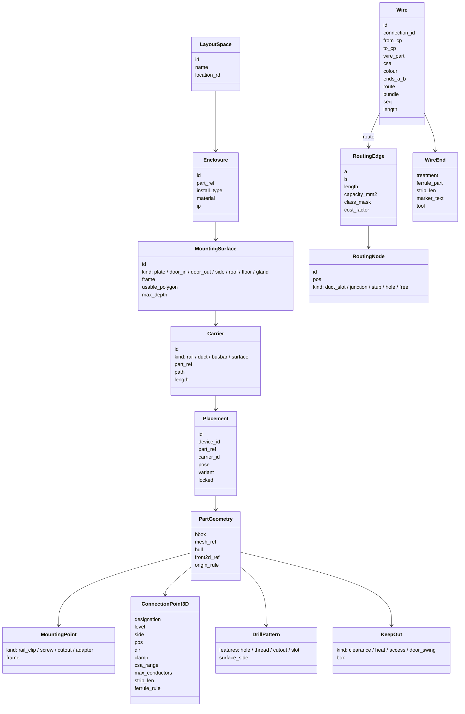
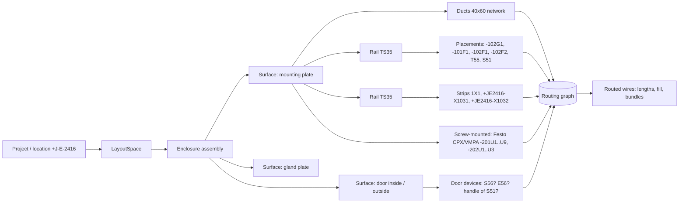

# Panel layout (2D + 3D) and manufacturing outputs: research for ElektraWatt

> Scope: the EPLAN Pro Panel / Smart Wiring / Smart Production domain, the Rittal (RiPanel, Rittal Therm, Rittal
> Automation Systems), Komax, Weidmüller, Phoenix Contact and Steinhauer manufacturing chain, and what ElektraWatt
> (EW) needs to cover it in v1. This covers 2D mounting layouts like reference folio 902, 3D cabinet layout, wire
> routing and lengths, NC and drilling data, thermal sizing, and the outputs a panel shop runs on. State: 2026-10-17.
>
> Companion files in this folder: `eplan-features.md` §15–16 (EPLAN feature inventory), `interop-formats.md` §6–7
> (machine, marking, NC and 3D formats), `standards.md` §7–8 (EN 60204-1, IEC 61439, IEC TR 60890 maths) and
> `rust-ecosystem.md` §4–5 (renderer, OCCT/STEP, parry3d). This file avoids repeating them and goes deeper on data
> model, algorithms, scope and pitfalls.

---

## 0. Method, evidence quality and caveats

- **The web was unavailable to this agent.** The workflow's shared WebSearch budget ("limit: 200 WebSearch calls per
  turn") was used up before this agent started. Every WebFetch attempt failed with `getaddrinfo ENOTFOUND`
  (eplan.help, se.com, docs.rs). The facts in this file therefore come from four sources:
  1. **Sibling research files** written earlier in this run with web access. Facts taken from them keep the primary
     citations they verified.
  2. **The crates.io snapshot** the sibling agents saved today ((working notes)) and the parry
     CHANGELOG they downloaded ((working notes)). Crate versions, dates and licences below
     come from those files.
  3. **This agent's own measurement** of the reference PDF's vector geometry (pdfplumber on folio 902, page 18 of
     the PDF). See §2.
  4. **Domain knowledge.** Every claim from this source that a developer might hard-code (dimensions, colour codes,
     clause numbers, machine limits, product names) is marked **(unverified)**. These values must be checked against
     the primary source before they ship in master data or rule packs.
- **Terminology.** "Placement" means a device occurrence in a layout space. "Connection point" (CP) means a pin or
  terminal clamp. "Route" means the path of one wire through the routing network. "Wire" means a single conductor
  made in the shop. A "cable" is a multi-core product, often pre-assembled.

---

## 1. Executive summary

1. **Folio 902 is not a scale drawing, and nothing links it to the schematic.** Every coordinate sits on QElectroTech's
   5.22 mm grid. The scales implied by individual objects run from about 1:3.4 to about 1:10. There are no
   dimensions, no DIN rails and no scale note. Several devices are missing (F55, E55, S56, E56), and labels are typed
   by hand ("T51" for T55, "X1031" for "+JE2416-X1031"). EW's first win is unspectacular: a true-scale 2D layout whose
   objects *are* the schematic devices. That fixes brief defect 2 by construction.
2. **One geometric model serves three outputs: 2D, 3D and manufacturing.** A placement is a pose of a *device*
   (stable UUID) on a *mounting carrier* (rail, plate, door, busbar). It uses the *part's* geometry and connection-
   point pattern. The 2D layout page, the 3D view, the routing network, the wire lengths, the drilling data and the
   thermal input are all derived from this model. None of them is drawn independently.
3. **Connection-point 3D data is the critical part data, and it is the scarcest.** Wire lengths, routing, Smart
   Wiring-style guidance and any future robot wiring need, per pin, the position, insertion direction, clamp type,
   admissible cross-sections and strip length. Manufacturer STEP files almost never carry this. EW needs:
   - a macro editor that picks connection points on the 3D model;
   - a generated fallback (bounding box with CPs spread over its faces);
   - import from EDZ connection-point patterns where the data's licence allows it.
4. **Routing is graph search, not geometry.** Build a graph from duct centrelines, duct slots, rail-to-duct stubs and
   user routing paths. Route each wire with A*/Dijkstra, using costs for length, free-air travel and duct fill. Resolve
   congestion with a few negotiated-congestion iterations (PathFinder-style). This is a few thousand nodes for a
   typical cabinet. **Length = stub A + path + stub B + vertical offsets + per-end allowance + reserve**, rounded up
   to the machine's increment.
5. **Manufacturing output is one canonical production data set, rendered through templates.** That set holds:
   - wires with both ends, wire end treatment, marking, route, bundle and sequence;
   - terminal-strip assemblies;
   - labels;
   - drilling and cut-outs per surface;
   - checklists.

   Machine formats (Komax TopConvert CSV, Rittal WT, Weidmüller WPC, Schleuniger, marking software) are column maps
   over it. EW should define an **open "production package"** (zip with JSON/CSV, glTF, DXF, PDF/A) that also feeds
   a guided-wiring viewer.
6. **Collision and clearance checking with parry3d is straightforward.** Use a BVH broad phase, then convex hull or
   triangle-mesh narrow phase, with clearance zones as inflated boxes. Since 0.30, `sweep_time_of_impact` covers door
   swing. Expect the hard problems elsewhere: filtering legitimate contacts (device on rail, duct on plate) and
   keeping vendor meshes small.
7. **Thermal sizing (IEC TR 60890 / IEC 61439-1 10.10, Rittal Therm-like) belongs in v1 as a calculation, not a CFD
   simulation.** The 3D model supplies the enclosure dimensions, the installation type and the sum of placed-device
   losses. The TR's k/c curves are copyrighted, so they must be supplied as data (see `standards.md` §8.2).
8. **MVP order:**
   1. true-scale 2D layout bound to devices;
   2. 3D with box or STEP models, rails and ducts;
   3. collision and clearance checks;
   4. routing with lengths and duct fill;
   5. the canonical wire list plus CSV/XLSX templates and labels;
   6. DXF drilling export;
   7. checklists.

   Copper busbar bending, NC formats (Perforex), AML for the RiPanel Processing Center, the tablet wiring assistant
   and robot-grade connection data come later.

---

## 2. Forensic analysis of reference folio 902 (cabinet layout)

Vector extraction of PDF page 18 (folio 902) with pdfplumber gives 87 rectangles, 15 lines, no curves and no
dimension entities. Text is Tahoma 5.18 pt (≈ 1.83 mm), with narrow devices labelled in rotated text.

| Observation | Measurement / evidence | Consequence for EW |
|---|---|---|
| Everything is grid-snapped | Outline 88.72 × 127.87 mm on paper = 17 × 24.5 units of **5.22 mm**. Ducts 5.22 mm wide. Frame columns 15.66 mm (3 units), rows 20.88 mm (4 units) | The layout is a sketch on the QET schematic grid, not a scale drawing. EW layouts must be modelled at 1:1 in mm and *viewed* at a scale |
| No consistent scale | Both MCBs (-101F1 A9P52610, -102F1 A9F78116; 18 mm modules **(unverified)**) are drawn 3.91 mm wide, about 1:4.6. -102G1 (Phoenix 2904602, about 70 mm wide **(unverified)**) is 7.83 mm, about 1:9. A "40x60" duct is 5.22 mm, about 1:7.7 (if 40 mm wide). X1031 (more than 12 PT 2.5-TWIN at 5.2 mm **(unverified)**) is 8.35 mm, about 1:8–1:10 | No space check is possible from this drawing: neither "does it fit" nor "how much reserve" |
| Aspect ratio does not match the enclosure | Drawn 1.44 (H/W). NSYPLA1074G by Schneider naming is 1000 × 750 × 420 mm **(unverified)**, i.e. 1.33 | Enclosure and plate dimensions must come from part data (NSYPLA1074G, NSYPMM107), not from a hand-typed "PART DATA" box |
| Tags typed by hand | "T51" (schematic T55, folio 101). "S51", "1X1" without a prefix. "X1031", "X1032" without "+JE2416-" | Defect 2. Placement labels must be **rendered from the device's DT**, never stored as text |
| Missing placements | F55 (5SY4 204-7), E55 (heater SK 3102.000), S56 and E56 (door switch, lamp; no part data, defect 4) and -201U9 (end plate) are not shown. 201U3–U8 are shown although the part list misses U4–U8 | EW needs an **"unplaced devices"** report and check, plus BOM ↔ placement consistency |
| No DIN rails drawn | Devices float between ducts. Small rectangles beside 1X1 and X1032 are end brackets | Rails must be first-class objects: cut length, part number, end clamps |
| Duct notation | "40x60" text placed by hand. Width/height order is ambiguous (W×H or H×W; manufacturers differ **(unverified)**) | Ducts are parts with explicit `width` and `height` fields. The label is generated (e.g. "BxH 40×60") |
| No door view, no cut-outs, no gland plate | — | A door layout and cut-out/drilling outputs are needed for manufacturing (v1 decision 2) |
| Title block "Next:" empty, revision "V1.0" | Defects 5–7 | Layout pages are ordinary pages of the page model, so the title block is driven from the project |

**Derived requirements.**

| ID | Requirement |
|---|---|
| R-902-1 | Model at 1:1 in mm. Views carry a scale from the ISO 5455 series (1:2, 1:5, 1:10, 1:20 **(unverified series list)**). The title block shows the scale |
| R-902-2 | The layout "PART DATA" box is a generated legend: enclosure, plate, rails, ducts and all placements, with DT, part number, description and quantity (EPLAN's `.f18` legend equivalent, `eplan-features.md` §15) |
| R-902-3 | Each placement references `DeviceId`. Its label is a live DT. Placing a device that has no schematic function is allowed only as an explicit "layout-only part" (e.g. duct, rail, cover) |
| R-902-4 | Checks: unplaced device with mountable part; placement whose part ≠ device part; placement outside its carrier; overlap; clearance violation; duct over fill limit |
| R-902-5 | Migration: when importing QET layouts (rectangles + text), match labels to devices fuzzily. "T51" is proposed as T55, because S51/F55/E55 share the "5x" group on folio 101. The user confirms each match in a review queue |

---

## 3. The product landscape and what each tool consumes

| Product (vendor) | Role | Consumes | Produces | Openness for EW |
|---|---|---|---|---|
| **EPLAN Pro Panel** | 3D layout of enclosure, plate, rails, ducts and devices. Collision checks, routing, duct fill, wire lengths, model views, NC export, copper | P8 project + part data with 3D macros, connection-point patterns, drilling patterns | Placements, routed connections, 2D model views, NC/AML/production exports ([Pro Panel](https://www.eplan.com/de-en/products/eplan-pro-panel); 2026 *Wiring Manager* [news](https://www.eplan.help/en-US/Infoportal/Content/Plattform/2026/Content/htm/news_p_propanel_verdrahtungsmanager_488766.htm)) | Closed. Feature benchmark |
| **EPLAN Copper** (Pro Panel module) | Busbar bending and unfolds for bending machines | Rail macro, path, bend radius | Unfolds, NC ([help](https://eplan.help/en-us/Infoportal/Content/Plattform/2.9/Content/htm/copper_k_abwicklung.htm)) | Closed |
| **EPLAN Smart Wiring** | Guided manual wiring on PC or tablet, red/yellow/green status, multi-technician server | Pro Panel data **or Excel wire lists from other ECAD** ([product](https://eplan.com/us-en/products/eplan-smart-wiring.html)) | Status and production report | Excel input: an EW XLSX could feed it (mapping unverified) |
| **EPLAN Smart Production** | Web app for enclosure production | **EPDZ** (layout spaces + pages + routed connections + AML + E3D) ([help](https://eplan.help/en-us/infoportal/content/Plattform/2024/Content/htm/edaexportgui_k_start.htm)) | Machine jobs, Rittal WT C link | EPDZ closed. Not a target |
| **Rittal RiPanel** | Online enclosure/accessory configurator | User configuration | BOM, CAD data (EPLAN macros, STEP) **(unverified details)** | Source of enclosure models (licence check needed) |
| **Rittal RiPanel Processing Center** | CAM front-end for Rittal Automation Systems machines | **AML** layout-space export from Pro Panel 2.9 SP1 Upd. 7+ / 2022+ ([FAQ](https://www.rittal.eplan.com/int/en/support/rittal-processing-center.html)) | Drilling/milling jobs; rail and duct cutting jobs | AML dialect undocumented publicly. Later target |
| **Rittal Perforex** (BC milling; others) | Machining of plates, doors, side walls | NC from EPLAN (`*.PBT/*.PVB/*.PKU`) or **DXF** via workshop programming ([EPLAN NC](https://eplan.help/en-us/Infoportal/Content/Plattform/2.9/Content/htm/ncgui_d_einstellungenncexportkiesling.htm); [RAS brochure](https://www.rittal.com/us_en/apps/download/img/uploads/RittalAutomationSystemsBrochure_US337-BR-TR_SingleWeb.pdf)) | Machined parts | **DXF route open**; NC closed |
| **Rittal Secarex** | Cutting of DIN rails and ducts to length **(unverified model names)** | Cut lists (via Processing Center) | Cut parts | Cut list as CSV is trivial; native job format unknown |
| **Rittal Wire Terminal WT 24 / WT 36 / WT C** | Automatic wire processing: cut, strip, crimp ferrule, mark. 0.5–2.5 mm², 24/36 wire types ([RAS brochure](https://www.rittal.com/us_en/apps/download/img/uploads/US445%20RAS%20Wire%20Processing%20Machines%206.19.pdf)) | Template CSV made with Rittal "Wire Cockpit"; feedback CSV with magazine/position ([EPLAN ESW help](https://www.eplan.help/en-us/Infoportal/Content/ESW/2022/Content/htm/smartwiring_wire_terminal_WT.htm)) | Wires in bundle/wiring order | Template-driven CSV. Exact columns unverified |
| **Rittal Therm** | Climate sizing (IEC TR 60890 surface model, Rittal device selection) ([manual](https://electrical-engineering-portal.com/academy/wp-content/uploads/2021/08/Rittal-Therm-Manual.pdf)) | Enclosure dimensions, installation type, Q_V, temperatures | Required cooling/heating, device proposals | Method public; device data per vendor |
| **Komax Zeta 6x0 / Kappa / TopWin** | Wire-set processing (Zeta) and cut-and-strip (Kappa) | **WPCS** (customer-channel spec). **TopConvert** turns customer CSV into WPCS ([TopConvert](https://www.komaxgroup.com/en/products/wire-processing/software-and-networking/topconvert); [TopWin WPCS](https://komtech.co.za/wp-content/uploads/2020/07/0068407_0_PRO_TopWin_WPCS_EN.pdf)) | Wire sets, feedback | **CSV → TopConvert is open** |
| **Schleuniger** (CAYMAN, Easy ProductionServer) | Wire processing | Excel cable lists ([CAYMAN](https://www.schleuniger.com/en-us/cayman-toolbox)) | — | Excel route open |
| **Weidmüller WPC** | Wire processing centre | Excel template, CSV, or direct ECAD ([Weidmüller](https://www.weidmueller.com/int/service/engineering_data.jsp)) | — | Template public via WPC tool |
| **Weidmüller M-Print PRO**, **Phoenix MARKING system**, Brady, Murrplastik | Marking (terminal, wire, device markers) | CSV/XML/Excel import wizards ([M-Print PRO](https://www.weidmueller.com/int/products/workplace_accessories/software/m_print_pro.jsp); [MARKING system](https://www.phoenixcontact.com/en-pc/products/software-marking-system-software-1669297)) | Printed markers | Open via CSV |
| **Phoenix clipx ENGINEER** | Terminal-strip configurator; pre-assembled strips ordered from Phoenix | AML from EPLAN; legacy CLIP `.klp`; project XML ([cxE help](https://www.phoenixcontact.com/cxe/help/en/DataExchange.htm)) | Assembly, BOM, marking, order | AML/XML exchange. Schema to obtain |
| **Steinhauer** (PWA, ModCenter) | Wiring assistant; machining | EPLAN exports, CNC with decimal point/comma ([EPLAN](https://www.eplan.help/en-us/Infoportal/Content/Plattform/2.9/Content/htm/ncgui_r_allgemeinexportsteinhauer.htm)) | — | Closed **(unverified)** |
| **Rittal ePOCKET** | Cloud document pocket per enclosure (QR code) ([FAQ](https://rittal.eplan.com/int/en/support/rittal-epocket.html)) | Any files | — | Manual upload only |

**Competitive calibration (unverified, from product knowledge).** Zuken E3.panel, SEE Electrical 3D Panel, SOLIDWORKS
Electrical 3D and WSCAD's cabinet module all offer:
- rail/duct snapping;
- collision checks;
- shortest-path routing with lengths;
- wire-list exports.

AutoCAD Electrical's panel layout is 2D footprint-based. "EPLAN-class" therefore means 3D placement bound to devices,
automatic routing with fill levels, and production exports. It does not require CFD or FEM.

---

## 4. Shared data model for layout and manufacturing

### 4.1 Coordinates, units, identity

- **Units:** `f64` millimetres in the model (`glam::DVec3` / `DAffine3`, [glam 0.34.1](https://crates.io/crates/glam)),
  `f32` only in GPU buffers. Angles in degrees in files and radians in memory. Store poses as translation +
  rotation; quantise rail and plate placements to 0.1 mm on save, which keeps diffs stable.
- **Frames (right-handed):**
  - `LayoutSpace` (one per cabinet or bayed suite) holds `Enclosure` assemblies. The enclosure frame has its origin at
    the bottom-left-rear outside corner, X right, Y up, Z towards the door.
  - Each **mounting surface** has a local 2D frame: u, v in the surface plane, w = outward normal. 2D layout pages are
    projections of a surface frame.
  - Placement poses are stored **relative to their carrier** (rail, surface, busbar, another device). Moving a rail
    therefore moves everything on it.
- **Identity:** every enclosure, surface, rail, duct, placement, routing node, route and wire has a UUID (v7 or ULID;
  [uuid 1.28.0](https://crates.io/crates/uuid)). Wires take their ID from the schematic *connection*, not from the
  wire number, so renumbering never breaks production feedback.

### 4.2 Entities



### 4.3 Part master data needed for layout and production

These fields extend the part model of `eplan-features.md` §6.

| Field | Unit | Used for | Typical source |
|---|---|---|---|
| `width`, `height`, `depth` (W along rail, H on plate, D out of plate) | mm | 2D footprint, 3D fallback box, packing | Data sheet; ECLASS; EDZ part XML |
| `mount_kind` | enum: TS35×7.5, TS35×15, TS32 (G-rail), TS15, screw, busbar adapter (60 mm system), door cut-out, base | Snapping, validation | Data sheet |
| `rail_offset` | mm (vector) | Device origin relative to the rail clip point (rail centreline, rail top surface) | Derived from STEP or data sheet |
| `clearance` | mm: top, bottom, left, right, front | Keep-out zones (e.g. PSU convection space) | Manufacturer manual **(values per device)** |
| `mass` | kg | Door load, plate load | Data sheet |
| `p_loss_rated`, `i_rated` | W, A | Thermal: P_eff = P_n·(I_b/I_n)² (`standards.md` §8.2) | Data sheet; ECLASS |
| `t_amb_max` / derating curve | °C | Hot-spot check at mounting height | Data sheet |
| `model_3d` | STEP/glTF ref + hash | 3D | Manufacturer download (do not redistribute; §6.5) |
| `front_2d` | 2D outline (DXF/SVG) | 2D layout symbol at scale | Generated from 3D or vendor DXF |
| `cp_pattern` | list of `ConnectionPoint3D` (§4.4) | Routing, lengths, guidance | Macro editor; EDZ connection-point pattern |
| `drill_pattern` / `cutout` | features in mounting frame | NC/DXF, door cut-outs | EDZ `<drillingPosition>` ([interop-formats.md](interop-formats.md) §2.2); manual |
| `marker_carriers` | positions + label type | Labels on device, terminal markers | Data sheet |
| Duct-specific: `inner_w`, `inner_h`, `slot_pitch`, `finger_w`, `wall` | mm | Fill level, slot nodes | Duct data sheet |
| Rail-specific: `profile`, `perforation`, `std_length` | — | Cut lists, BOM | Data sheet |
| Wire-specific: `outer_diameter`, `class` (IEC 60228 class 5 flexible), `insulation` (PVC H05V-K/H07V-K, multi-standard), `colour` | mm | Fill, machine keys | Wire data sheet |

**Where the data comes from.**
- **EDZ** packages can carry connection-point patterns, drilling patterns and 3D (`.e3d`), per the
  [Data Portal FAQ](https://www.eplan.com/en/support/data-portal.html). Their terms reportedly restrict use to EPLAN
  products (`interop-formats.md` §2.2), so EW may only read factual data the user imports themselves.
- **ECLASS** "Advanced" content can describe geometry and connection points per product **(unverified that
  connection-point 3D positions are commonly populated)**. That would be the licence-clean, vendor-neutral path
  (`standards.md` §10).

### 4.4 Connection point in 3D: the critical record

```text
ConnectionPoint3D {
  designation: "L" | "+" | "Out 1" | "1+" ...   // must equal the schematic CP designation (validated)
  function_ref: FunctionTemplateId               // which schematic function / pin it belongs to
  level: u8, side: a|b|c...                      // multi-level and multi-clamp terminals (PT 2.5-TWIN = 1 in / 2 out)
  pos: DVec3 (part frame, mm)                    // entry point of the clamp opening
  dir: DVec3 (unit)                              // insertion direction (into the clamp)
  clamp: screw | spring | push_in | idc | ring_stud(Mx) | plug
  csa_min/max_solid, csa_min/max_fine, csa_max_with_ferrule: mm²
  max_conductors: u8, twin_ferrule_ok: bool
  strip_len: mm, insertion_depth: mm             // the per-end allowance in the length formula
  torque_nm: f32                                 // checklist and routine verification 11.6
  test_access: bool                              // probe point for continuity tests
}
```

**Why `level` and `side` are mandatory.** Folio 103 shows four wires on "1+" of +JE2416-X1031 (24VDC-1 feed plus
24VDC-AIR1…AIR4), which are PT 2.5-TWIN terminals. A wire end of `X1031:1+` alone does not say which clamp or which
terminal of a bridged group it lands on. Wire lists and machine data need `strip:terminal:level:clamp`. IEC 61666 is
the basis for terminal identification syntax (`standards.md` §13).

### 4.5 Placement ↔ schematic binding (prevents defect 2)

- A `Placement` stores `device_id` and an optional `function_id` (e.g. a single terminal of a strip). It **never
  stores DT text**. The 2D/3D label is a view of the device's current DT, so renumbering (defect 1) updates the
  layout automatically.
- When the device's part changes, the placement geometry is re-resolved. If the new footprint collides, the
  placement is flagged, not silently moved.
- **Check set (rule pack `EW-LAYOUT`):**

| Code | Check | Severity |
|---|---|---|
| L001 | Device with a mountable part has no placement in the layout space of its location (+J-E-2416) | Warning (error at release) |
| L002 | Placement whose device was deleted ("orphan") | Error |
| L003 | Placement part ≠ device part (e.g. a different variant) | Error |
| L004 | Device location (+) ≠ the placement's layout-space location | Warning |
| L005 | Connection-point pattern designations do not cover the schematic CPs of the device | Error for routing |
| L006 | Overlap / collision (§6.4) | Error |
| L007 | Clearance zone violated | Warning |
| L008 | Duct over fill limit (§6.7) | Warning, or error above a hard limit |
| L009 | Wire unroutable (no path) | Error |
| L010 | Device mounted on the wrong carrier type (TS35 device on a G-rail) | Error |

---

## 5. 2D panel / mounting layout (folio 902 done properly)

### 5.1 Enclosure and mounting-plate selection

**Families EW must model** (product facts from domain knowledge, **(unverified)**):

| Family | Type | Relevant layout facts |
|---|---|---|
| **Rittal VX25** | Bayable floor-standing frame enclosure, sheet steel | Frame profile with **25 mm pitch system punching** on all levels. Mounting plate adjustable in depth. Partial plates and rails fix to the frame. Many widths, heights and depths. Rittal publishes STEP and EPLAN macros |
| **Rittal AX** (and KX terminal boxes) | Compact wall-mounted enclosure, steel / stainless | Mounting plate as accessory or included. Fixed plate depth position. Gland plates or knock-outs |
| **Schneider Spacial SF / SM / S3D** | Floor (SF) and wall (SM, S3D) steel enclosures | Plate per size; NSY… part numbers |
| **Schneider Thalassa PLA / PLM** | Polyester (glass-fibre reinforced) wall enclosures | **NSYPLA1074G** (folio 902) with mounting plate **NSYPMM107**. Polyester has a lower heat-transfer coefficient than steel (thermal, §6.10). Typically no system punching, so ducts and rails are screwed to the plate |

**Data model.** An `EnclosurePart` has:
- outer dimensions;
- wall thickness;
- door count and hinge side;
- door opening angle;
- `MountingSurface` templates, each with:
  - its frame relative to the enclosure;
  - a usable polygon (the plate minus the edge margin);
  - an admissible depth range (`z_min..z_max` between the plate and the closed door's inner face, minus door
    reinforcement);
  - a punching grid if any;
- the installation type for thermal (free-standing, wall, bayed end/middle; seven IEC TR 60890 cases);
- material + `k` (W/m²K);
- IP / IK.

**Selection assistant (v1.x).** Given the set of devices for a location, propose enclosures where:
- Σ footprint (incl. clearance) + duct area + reserve ≤ usable plate area. The reserve is a user policy, often 20–30 %
  **(unverified practice)**.
- max(device depth + rail height) + door-device depth ≤ usable depth.
- The thermal check (§6.10) passes or a climate device fits.

The ranking is by price or size. This is a filter over the catalogue, not optimisation.

### 5.2 DIN rails

- **Profiles per EN/IEC 60715:** TS 35 × 7.5, TS 35 × 15 (deep, for heavy devices), TS 32 G-rail, TS 15 mini
  **(edition/clauses unverified)**. Rails are perforated (slots for screws/rivets, lighter) or unperforated. Standard
  stock length is 2 m **(unverified)**.
- **Model:** `Rail { profile, perforation, start, end (on a surface), height_above_plate (7.5/15), part_ref }`. The rail
  axis is a 1-D coordinate space, `s ∈ [0, L]`.
- **Outputs:**
  - cut list: length rounded to the cutting increment, part number, fixing-hole positions;
  - BOM (metres or pieces);
  - fixing screws or rivets on the plate (drilling pattern, §6.9).

### 5.3 Cable / wiring ducts

- **Naming ambiguity.** Folio 902's "40x60" could be width × height or height × width, and manufacturers differ
  **(unverified)**. EW stores `width` and `height` explicitly. The label template defaults to "W×H".
- **Model:** `Duct { width, height, inner_w, inner_h, slot_pitch, finger_width, cover: bool, path (polyline on
  surface), joints (mitre / T / cross), part_ref }`.
- **Inner cross-section:** usable area ≈ `inner_w × inner_h`, which is smaller than the nominal W×H because of the wall
  thickness and finger stubs. Use the data-sheet value if one is given. Otherwise use 0.85 × nominal **(heuristic)**.
- **Layout rules:**

  | Rule | Typical default (heuristic, user-configurable) |
  |---|---|
  | Clear wiring space between a device's CP row and the duct edge | 25–40 mm, for bending radius and access **(unverified)** |
  | Ducts at the plate border | Often run along the edges (folio 902: top, left, right) |
  | Horizontal ducts | Between rail rows |
  | Spacing of duct fixings | Every ≤ 300–500 mm **(unverified)** |
  | Separate ducts or partitions | Required for segregated circuits (§6.7) |

### 5.4 Placing devices by real dimensions; snapping

**Rail snapping algorithm (1-D interval model).**
1. While dragging, cast the cursor onto candidate rails in the active surface. Take the nearest rail axis within the
   snap distance.
2. Map the device to an interval `[s, s + W]` on the rail. Validate `mount_kind` against `rail.profile` (L010).
3. Occupancy is a sorted `Vec<(s0, s1, placement_id)>` per rail. Resolve the insertion with one of three modes:
   - **free:** snap to the nearest gap ≥ W;
   - **push:** shift neighbours right by the overlap, cascading up to the rail end, then fail;
   - **swap:** exchange positions with the device dropped onto.
4. Apply clearance zones in rail direction as interval padding. End clamps (accessories of the strip or rail) are
   auto-inserted at strip boundaries.
5. Snap targets along `s`: other devices' edges, the rail start, the plate grid (default 1 mm; 5 mm coarse), and
   alignment with a device on the rail above (column alignment).
6. Off-rail plate placement: snap to the 2D grid, other objects' edges and centres, and duct edges. Rotate in 90°
   steps; free rotation only for door items.

**Bulk placement.**
- "Place unplaced devices of +J-E-2416 on rail R in DT order", or in schematic page/column order.
- "Auto-fill rail": a greedy left-to-right fill with gaps for clearance. The user can then reorder by drag.
- Terminal strips are placed **as a whole**: terminals in strip order, with accessories (end plates, end clamps,
  bridges, markers) generated from the strip definition. This also gives the strip length for the rail cut list.

### 5.5 Scale drawings, views and annotation

- **Model space vs paper space.**
  - The layout page holds a *view* of a surface (front of the plate, inside of the door, outside of the door, gland
    plate) at a scale.
  - Text height, arrowheads and line weights are paper-space constants (annotation scaling).
  - Geometry is model-space mm × scale.
  - ISO 128 line types (visible continuous, hidden dashed, centre chain) and ISO 5456-2 orthographic projection
    (first angle in Europe) **(standard editions unverified)**.
- **View content.**
  - Outlines come from `front_2d` if present. Otherwise use the projected bounding box, or silhouette edges derived
    from 3D (§6.8).
  - Labels are live DTs. Style options: full DT `+JE2416-X1031` or abbreviated `-X1031` when the location equals the
    page's location (configurable, consistent with IEC 81346 abbreviation; `standards.md` §1).
  - Item balloons link to the legend.
- **Legend / placement list** (the `.f18` equivalent). Columns:
  - position no.;
  - DT;
  - manufacturer, part number, description;
  - quantity, or length for rails and ducts.

  It is generated per surface and replaces folio 902's hand-made "PART DATA" box.

### 5.6 Door layouts and cut-outs

- The **door outside surface** holds operator devices: push-buttons, pilot lights, selector switches, the main-switch
  handle, HMIs, filter fans and outlet filters, door locks.
- The **door inside surface** holds the depth envelope of those devices, a document pocket, lamps and door switches
  (S56/E56 on folio 101 are a door switch and cabinet lamp, which are often door- or frame-mounted).
- **Cut-out features:**

  | Feature | Size |
  |---|---|
  | 22 mm-class push-buttons | Ø 22.3 (+0.4) mm hole with optional anti-rotation notch about 3.2 mm **(unverified)** |
  | 30 mm-class (NEMA) | Ø 30.5 mm **(unverified)** |
  | HMI and filter-fan cut-outs | Rectangular, with corner radius, from part data. Rittal TopTherm filter fans exist in about 5–6 cut-out sizes from about 92 mm to about 292 mm square **(unverified)** |
  | Metric cable glands in gland plates | Clearance holes slightly above the nominal thread (M20 → about 20.5 mm, M25 → about 25.5 mm) **(unverified)** |

- **Door checks:**
  - no cut-out inside the door's reinforcement / edge keep-out;
  - door devices + plate devices do not collide with the door closed;
  - door-swing sweep (§6.4);
  - door mass limit;
  - **main-switch handle ↔ switch-body axis alignment**, when S51 is a door-coupled rotary switch (shaft-length range
    from part data);
  - operator heights (EN 60204-1 11.2.1: operating devices about 0.4–2.0 m above the servicing level, terminals ≥
    0.2 m **(clause and values unverified)**), using the enclosure's installation height above floor.

### 5.7 Dimensioning

- **Associative dimensions:** dimension objects reference model features (rail axis, duct edge, hole centre, cut-out
  edge) and update on change.
- **Auto-dimension presets:**
  1. *Plate overview*: ordinate dimensions of rails and ducts from the plate datum (bottom-left), in X and Y;
  2. *Drilling drawing*: ordinate dimensions or a **hole table** (ID, X, Y, Ø/thread, tool) per surface;
  3. *Door cut-out drawing*: ordinate + cut-out sizes.
- Dimension style per ISO 129-1 **(edition unverified)**. Tolerances only on cut-outs if required by part data.

### 5.8 Algorithms, MVP scope, pitfalls (2D)

| Item | MVP (v1) | Later |
|---|---|---|
| Enclosure + plate from part data, surfaces | Yes (box enclosures; plate + door in/out) | Bayed suites; side walls, roof and gland as separate surfaces |
| Rails, ducts as parametric parts | Yes (straight segments, butt/mitre joints) | Duct cover, partition and corner parts in BOM |
| Rail snapping, push mode, strip placement | Yes | Auto-arrange optimiser |
| Views at scale, live labels, legend | Yes | Section views |
| Associative dims, hole table | Yes (ordinate) | Chain/baseline variants |
| Door cut-outs + DXF | Yes | NC formats |

**Pitfalls.**
- Treating the layout as a drawing: users will want to "just draw a rectangle". Allow layout-only graphics, but count
  only bound placements in checks and BOM.
- Device origin conventions differ between vendors and EPLAN macros. Normalise on import to EW's rail-clip origin
  (§4.1) and keep the vendor transform.
- Terminal strip length grows when accessories are added later, and the rail overflows silently. Recompute and check
  on every strip change.
- Mixed units in vendor DXF (inch/mm, `$INSUNITS` missing). Validate the extents against the part W/H.

---

## 6. 3D panel layout

### 6.1 Scene structure



### 6.2 Enclosure models and mounting planes

- **Parametric first, STEP optional.** A parametric generator (box + door + plate + gland plate, with wall thickness)
  is enough for layout, collision, routing and thermal. The vendor STEP is shown for realism and MCAD export, but it
  does not drive the semantics. The semantic surfaces and frames come from the `EnclosurePart` template (§5.1), so a
  bad STEP file never breaks routing.
- **VX25-style system punching:** model it as a lattice of snap points on frame members (25 mm pitch **(unverified)**).
  Rails, partial plates and duct holders fixed to the frame snap to the lattice.
- **Mounting depth:** plates in frame enclosures are depth-adjustable. Expose `plate_z` as a parameter that drives the
  door-clearance checks.

### 6.3 Placement rules (rule engine over the 3D scene)

| Rule class | Example rule | Data | Hard / soft |
|---|---|---|---|
| Geometric containment | Placement inside its surface's usable polygon and depth range | Surface template | Hard |
| Collision | No solid intersection, except parent/child mount contacts | Meshes / hulls | Hard |
| Clearance | Keep-out boxes from `clearance` (PSU convection space, VFD 100 mm above/below **(device-specific, unverified)**) | Part data | Soft (warning) |
| Wiring space | CP rows ≥ x mm from duct edge; CP faces not blocked within the stub length | CP pattern, ducts | Soft |
| Thermal zoning | Heat sources (PSU, VFD, braking resistor) in the upper zone; heat-sensitive electronics (PLC, fieldbus nodes) below or away; device `t_amb_max` ≥ predicted air temperature at its height (§6.10) | `p_loss`, `t_amb_max`, TR 60890 profile | Soft |
| EMC / segregation | Power and VFD output wiring separated from signal/bus ducts; distance ≥ x mm or partition | Wire class, duct class | Soft or hard by policy |
| Accessibility / ergonomics | Operator heights; adjustable devices accessible from the front; main switch operable | Install height | Soft |
| Mass | Door mass ≤ door rating; plate load | `mass` | Soft |
| Entry zone | Cable entry area kept free; terminal strips for field cables near entry (bottom) | Gland plate | Soft |

Rules are data (rule packs, as in `standards.md`), evaluated incrementally. Re-check only placements whose AABB changed.

### 6.4 Collision detection

**Pipeline** (using [parry3d 0.31.1](https://crates.io/crates/parry3d), Apache-2.0):

1. **Proxies per placement.**
   - L0: oriented box from W/H/D.
   - L1: convex hull, or a convex decomposition for L-shaped parts.
   - L2: simplified triangle mesh (meshopt-decimated, [meshopt 0.7.0](https://crates.io/crates/meshopt)).
   - Keep-out zones are separate box proxies flagged `soft`.
2. **Broad phase:** one scene BVH over L0 AABBs. parry 0.30 added incremental and parallel `Bvh` updates
   (`refit_partial`, `insert_or_update_batch_partially_parallel`, …), so dragging one device refits a leaf instead of
   rebuilding ([parry CHANGELOG](https://github.com/dimforge/parry/blob/master/CHANGELOG.md)).
3. **Narrow phase:** `intersection_test` on L1, then L2 only where L1 intersects.
   - Since 0.31, intersection/distance results report the sub-shape that was hit, so a violation can be shown on
     the exact part of a compound (CHANGELOG 0.31.0/0.31.1).
   - Note that **0.31.0 was yanked**; use 0.31.1 (`rust-ecosystem.md` §5.2).
4. **Allowed contacts:** skip pairs (child, carrier) and pairs of carriers that are joined (duct T-joints, rail on
   plate). Apply a 0.1 mm penetration tolerance for touching neighbours on a rail (devices are W apart by design).
5. **Clearance:** `distance` between soft zones and solids, reported with the violating amount.
6. **Door swing:** a swept test of door-mounted solids from closed to open, against plate-mounted solids. Two options:
   - discretise into 5° steps and run (2)–(3) on each pose;
   - use parry's `sweep_time_of_impact` (added in 0.30.0; conservative advancement between two poses with rotation
     nlerp, per the CHANGELOG). Hinge rotation is not linear, so split the swing into ≤ 15° sub-sweeps.

**Performance budget.** A cabinet has about 100–500 placements. Hulls cost microseconds per pair and the broad phase
cuts pairs to O(n). Full re-check under 10 ms is realistic. Vendor STEP meshes are the risk: 200k–2M triangles for a
VFD is common **(unverified)**. Hence the L2 decimation target of ≤ 5–20k triangles per part.

**Pitfalls.**
- Vendor STEP origins are arbitrary and models sometimes have unit errors (inch). Validate the mesh bbox against W/H/D
  ±5 %.
- Snap-on clips penetrate the rail in the vendor model. Exclude the rail contact via the allowed-contact rule, not via
  tolerance.
- Labels and terminal markers modelled as thin solids make false positives. Ignore solids thinner than 0.3 mm in
  collision.
- Do not run triangle-mesh collision on every mouse move. Check on drag-end, and show L0/L1 results live.

### 6.5 3D device models and macros

**STEP ingestion** (per `rust-ecosystem.md` §5.1):
- STEP files from manufacturers (Phoenix, Siemens, Schneider, Festo, Rittal, Murrelektronik, Eaton; mostly AP214,
  increasingly AP242) go through an **out-of-process OCCT worker**. The candidates are
  [cadrum 0.9.0](https://crates.io/crates/cadrum) (MIT wrapper, prebuilt OCCT 8.0.1) and
  [opencascade 0.3.0](https://crates.io/crates/opencascade) / [occt-sys 7.8.1](https://crates.io/crates/occt-sys)
  (LGPL-2.1).
- The worker returns:
  - assembly tree and names;
  - tessellated meshes at two LODs, plus feature edges;
  - bbox and convex hull;
  - detected cylindrical holes and planar faces (for CP picking).
- Results are cached by content hash.
- [gltf 1.4.1](https://crates.io/crates/gltf) serves as the on-disk cache and exchange format.

**A 3D macro (EW "panel macro") is more than geometry:**

| Element | Purpose | Authoring aid |
|---|---|---|
| Origin + `mount_kind` + `rail_offset` | Correct snapping | Auto-detect the rail clip slot (a 35 mm wide groove at the back) **(heuristic)**; user confirms |
| `cp_pattern` (§4.4) | Routing, lengths, guidance | Click a hole or face to place a CP. Auto-suggest from detected cylinders/rectangular openings on top/bottom faces. Map designations from the schematic function template (e.g. PSU L, N, PE, +, +, −, −) by drag-assign |
| Drilling/cut-out pattern | NC/DXF | From EDZ or data sheet; 2D sketch tool |
| Keep-out zones | Clearance, heat | Parameterised boxes from `clearance` |
| 2D front outline | 2D layout | Generated: project feature edges onto the XY plane (§6.8) |
| Marker carrier positions | Labels | Point + label type |

**Fallback "box macro"** (critical for coverage): if no STEP exists, generate a box from W/H/D with CPs evenly spread
on the top face (inputs) and the bottom face (outputs) in pin-list order. Mark it `geometry_quality = generated`, so
reports show which lengths rest on estimated CP positions.

**Licensing.** Vendor CAD downloads generally allow use in the customer's designs but not redistribution **(unverified;
per vendor)**. EW must not bundle vendor STEP. It ships a downloader/importer and a per-user cache. Project files embed
only the decimated mesh needed to reopen the project, if the vendor terms allow it; otherwise only a hash plus
re-download hint. This needs a policy decision (Open questions).

### 6.6 Copper busbar systems

- **Busbar systems as carriers.** 60 mm systems (Rittal RiLine 60, Wöhner 60Classic; 60 mm centre-to-centre spacing
  **(unverified product facts)**) behave like rails:
  - busbar supports are placements on the plate;
  - flat copper bars (E-Cu, e.g. 12×5 … 30×10 mm **(unverified range)**) span the supports;
  - **component adapters** snap onto the bar system at the system pitch and carry devices (MCCBs, MPCBs) on their own
    rails.

  The data model is `Carrier { kind: busbar_system, phases: [L1, L2, L3, (N), (PE)], pitch, bar_section }`. Adapters
  are placements with `mount_kind = busbar_adapter` and a CP mapping from adapter contacts to phases (the electrical
  link is to the schematic's busbar potential).
- **Free copper (bent bars)** belongs to EPLAN Copper ([unfolds](https://eplan.help/en-us/Infoportal/Content/Plattform/2.9/Content/htm/copper_k_abwicklung.htm)):
  - a path with flat or edgewise bends;
  - **developed length** `L = Σ straight_i + Σ (π·α_j/180)·(r_j + k·t)`, with k ≈ 0.33–0.5 for copper
    **(unverified)**;
  - hole patterns;
  - unfold drawing + NC for the bending/punching machine.
- Busbar ampacity tables (DIN 43671 **(unverified)**) and IEC 61439-1 Annex H losses feed the thermal model.
- **MVP:** busbar systems as carriers with straight bars, plus BOM. **Later:** bent copper, unfolds, NC,
  short-circuit support spacing.

### 6.7 Wire routing

**Routing network construction** (automatic, editable). All nodes are in the LayoutSpace frame.

1. **Duct segments.** For each straight duct segment, add a centreline polyline at mid-depth (`z = plate + height/2`).
   Add **slot nodes** on both long sides every `max(slot_pitch, 25 mm)` (configurable), connected to the centreline by
   short edges (half duct width). End nodes and joints (T, cross, corner) connect adjacent segments.
2. **Device stubs.** For each CP:
   - go from `pos` along `−dir` (out of the clamp) by `escape_len` (default 15 mm), to make room for the
     ferrule/strip length and bend;
   - then run an orthogonal (plate-parallel) path to the **nearest slot node on a duct side facing the CP**, preferring
     the duct the CP face points to (top-face CPs → duct above);
   - validate line of sight with ray casts against the scene BVH. On failure, try the next k slot nodes;
   - the stub is a short edge chain marked `free_air`.
3. **Door transitions.** A user-placed **hinge bundle path** (plate → hinge → door) with a configurable loop allowance
   (e.g. 300 mm **(heuristic)**).
4. **User routing paths:**
   - free-air segments, e.g. along the side wall to a gland plate;
   - **wiring holes** (through-plate passages) for wiring to the plate's rear side;
   - rails used as routing guides where the shop allows it.
5. **Edge attributes:**
   - `length`;
   - `capacity_mm2` (duct inner area; ∞ for free air, but penalised);
   - `class_mask` (which wire classes may use it);
   - `cost_factor` (1.0 duct, 1.5–3 free air, ∞ forbidden).

The result is typically 1–5k nodes. A routing-network debug view (kiss3d or EW's own renderer) is invaluable.

**Path search.**
- A* with a Euclidean heuristic on `cost = length × cost_factor + bend_penalty + congestion_penalty`, using
  [pathfinding 4.16.0](https://crates.io/crates/pathfinding) or [petgraph 0.8.3](https://crates.io/crates/petgraph).
- Yen k-shortest paths (pathfinding has `yen`) gives alternatives for the user to pick from.
- **Multi-wire routing with capacity (negotiated congestion, after PathFinder for FPGA routing):**
  1. Order wires by decreasing cross-section × estimated length. Large and long wires constrain the most.
  2. Route each wire. Edge cost = `base × (1 + h_e) × p_e`:
     - `p_e` grows with the current fill over its limit;
     - `h_e` is a history term incremented on edges that were over capacity in earlier iterations.
  3. Repeat with rip-up and re-route for 3–10 iterations until there is no overflow or no progress. Report the
     remaining overflow (L008).
  4. Deterministic tie-breaking (by wire UUID) keeps results stable across runs.
- **Segregation classes (policy, not hard-coded):** e.g. `MAINS_AC` (230/400 V), `SELV_DC` (24 V), `ANALOG_SHIELDED`,
  `BUS` (Profibus -3W1), `SAFETY`. A duct carries a class set. Mixing is allowed only if the policy says so.

  EN 60204-1 permits conductors of different circuits side by side in one duct when they are insulated for the
  highest voltage present **(clause 13.1.3; unverified)**. Many shops still separate them for EMC.
- **Pre-assembled cables** (e.g. -106W1 Festo NEBU-…-K-2-…, where "K-2" reads as a 2 m cable **(unverified decoding)**):
  - route the cable as one object with its outer diameter;
  - check `route_length ≤ cable_length − connector allowances`;
  - generate wire-end treatment only for open ends (LE5).

**Duct fill level.**
- `fill(e) = Σ_{w ∈ e} (π/4)·OD_w² / A_inner(e)`.
- The limit comes from shop policy. 50–60 % is common to leave room for later changes; EPLAN shows the fill
  percentage per duct ([Pro Panel](https://www.eplan.com/de-en/products/eplan-pro-panel)).
- Compute fill **per edge**, since fill varies along a duct, and show a heat-map. Use the `outer_diameter` from wire
  part data. Defaults when missing:

  | Wire | Default OD (mm) **(unverified)** |
  |---|---|
  | H05V-K 0.5 / 0.75 / 1.0 | ≈ 2.5 / 2.7 / 2.9 |
  | H07V-K 1.5 / 2.5 / 4 / 6 | ≈ 3.3 / 3.9 / 4.6 / 5.3 |

  Flag defaults in the report.
- A packing factor adds a correction: round wires never fill 100 %. Leave that to the policy limit rather than
  modelling packing.

### 6.8 Automatic wire length

`L_wire = L_stubA + L_path + L_stubB + Δz_A + Δz_B + a_A + a_B + L_reserve`, then round up.

| Term | Meaning | Source |
|---|---|---|
| `L_stub` | CP escape + orthogonal run to the duct slot | Routing (§6.7) |
| `L_path` | Graph path length along duct centrelines and transitions | Routing |
| `Δz` | Height difference between the CP plane (device front, e.g. 50–120 mm above the plate) and the duct mid-depth. Easy to forget, and it causes systematic short wires | 3D positions |
| `a_end` | Per-end allowance: strip length + insertion depth + bending allowance (e.g. 2 × wire OD for a 90° bend into the clamp) | CP `strip_len`, `insertion_depth`; ferrule |
| `L_reserve` | Service loop: fixed (e.g. +50…150 mm) or proportional (+5…10 %), per policy, with optional extra for door wiring | Project policy |
| Rounding | Up to the machine increment (1, 5 or 10 mm) or the shop's length classes | Machine profile |

**Worked example (illustrative; geometry assumed, not measured).** The wire is -102F2 `Out 1` → +JE2416-X1031 `1+`
(potential 24VDC-1, folio 102 → 103). Inputs:
- CP on the top face of MICO, 95 mm above the plate;
- duct 40×60 above it, mid-depth at 30 mm;
- path along the top duct and the left vertical duct, then the middle horizontal duct to X1031.

| Term | Value |
|---|---|
| Stub A | 15 + 30 (to the duct slot) = 45 mm |
| Δz_A | 95 − 30 = 65 mm |
| Path | 140 + 260 + 90 = 490 mm |
| Stub B | 15 + 25 = 40 mm |
| Δz_B | 60 − 30 = 30 mm |
| Allowances | 2 × (10 strip + 2 insertion + 6 bend) = 36 mm |
| Reserve | 100 mm |
| **Total** | 806 mm, rounded up to **810 mm** at a 10 mm increment |

**Calibration.** Shops report systematic offsets between computed and real lengths **(unverified anecdote)**. Expose a
per-project calibration factor and per-device-family offsets, and log feedback from wiring ("too short by x mm") into
the production package (§7.7).

### 6.9 Bundles and wiring sequence

- **Bundle** = wires produced and delivered together, for one wiring step. Rittal WT C and Komax lines sort output by
  bundle and wiring order ([Smart Production](https://www.eplan.com/content/dam/eplan/corporate/performance-descriptions/2026/en/performance-description-eplan-smart-production.pdf);
  `interop-formats.md` §6.2).
- **Default grouping algorithm:**
  1. Group wires by (start device group or strip) × (first duct entry node).
  2. Split groups above the max bundle size (machine or bin capacity).
  3. Order bundles by wiring zone:
     - bottom to top, so that later wires do not cover earlier terminations;
     - within a strip, the lower terminal level first on multi-level terminals **(practice; unverified)**;
     - long wires before short ones in the same duct, so short wires sit on top;
     - door wiring last.
  4. Sequence numbers are `bundle.seq`.
- Users override per wire or bundle. Overrides survive re-routing, keyed by wire UUID.

### 6.10 2D drawings derived from 3D

- **View types:**
  - orthographic front/top/side views of a surface or the whole enclosure;
  - isometric view (for assembly instructions);
  - section view (later);
  - detail view.
- **Edge extraction:**
  - **Exact:** OCCT hidden-line removal (`HLRBRep_Algo` / `HLRBRep_PolyAlgo`) in the worker, returning visible and
    hidden 2D edges per view (cached per placement and view direction; placements are 90°-rotated instances, so the
    per-part projections can be reused).
  - **Fallback (pure Rust):** project feature edges (dihedral angle > 30°) and silhouette edges, and resolve
    visibility with a depth pre-pass. For plate front views, painter's order by z of the placement boxes is usually
    sufficient.
- **Annotations:** associative dims (§5.7), balloons, a legend, and duct fill or wire-count labels (optional).
- **Pages:** a 3D-derived view is placed on a normal page ("model view" page type). It updates on model change, with
  a "view out of date" indicator if regeneration is deferred. That fixes the "Next:" and title-block issues (defects
  5–7), because layout pages are ordinary pages.

### 6.11 Drilling, cut-out patterns and NC export

**Feature model** (per surface, in surface u/v coordinates, with side = front/back):

```text
Hole { d, through: true }              Thread { size: M4|M5|M6|M8, core_d, depth }
Cutout { w, h, corner_r, rotation }   Slot { w, l, rotation }   Keyhole { ... }   Custom { polyline }
Origin: placement (device pattern), carrier fixing (rail/duct screws), enclosure (gland holes), user
```

- **Aggregation:** collect features from placements' patterns (transformed to the surface), carrier fixings (rail and
  duct fixing holes at the policy pitch, or tapped holes when screwing into a plate), and user features.
- **Checks:**
  - feature-to-feature and feature-to-edge minimum webs;
  - duplicate holes (two devices sharing a fixing) merged;
  - holes behind or under other devices.
- ISO metric coarse tap-drill core diameters: M4 → 3.3, M5 → 4.2, M6 → 5.0 mm **(unverified)**.

**Exports:**

| Target | v1 | Notes |
|---|---|---|
| **DXF per surface** ([dxf 0.6.2](https://crates.io/crates/dxf), MIT) | Yes | `CIRCLE` for holes, closed `LWPOLYLINE` for cut-outs, one layer per tool/feature class (e.g. `DRILL_4.2`, `TAP_M5`, `CUT`), plate outline on its own layer, origin at the machine's datum corner, units in mm (`$INSUNITS=4`). Rittal Perforex workshop programming imports DXF (`interop-formats.md` §6.4). The layer convention must be configurable, because EPLAN's import uses layer mapping to 802–805 ([EPLAN DXF drilling patterns](https://www.eplan.help/en-us/infoportal/content/Plattform/2024/Content/htm/propanelmasterdata_h_bohrbildausdxfdaten.htm)) |
| Hole table (PDF/CSV) | Yes | Manual machining |
| Rail/duct cut list (CSV) | Yes | Length, part, quantity, fixing positions |
| Perforex NC, Steinhauer CNC | Later | Proprietary. Needs samples/specs from Rittal and Steinhauer |
| AML for RiPanel Processing Center | Later | CAEX via [quick-xml 0.42.0](https://crates.io/crates/quick-xml). Dialect needs Rittal cooperation |

### 6.12 Heat dissipation and climate sizing (IEC TR 60890 / IEC 61439-1 10.10, Rittal Therm-like)

The method, coefficients and caveats are in `standards.md` §8.2. This section covers what the **3D layout adds**.

1. **Q_V from placements**, not a typed number: `Q_V = Σ_placed P_eff + P_wires + P_busbars`, with
   `P_eff = P_n·(I_b/I_n)²` per device. I_b comes from the load model, or a user simultaneity/RDF factor, or the
   rated value as a conservative default. Wire losses come from routed lengths × the IEC 61439-1 Annex H loss per
   metre (once the table is verified).
2. **Effective surface A_e** from the enclosure dimensions and **installation type**, which the 3D scene knows: wall
   versus free-standing, bayed neighbours (side covered), roof covered by a ceiling.
3. **Temperature profile:** IEC TR 60890 gives Δt at 0.5 and 1.0 of the height (and 0.75 interpolated). In 3D, each
   placement gets a predicted ambient at its height, checked against `t_amb_max` (rule in §6.3). This is a key
   differentiator over a separate Rittal Therm run, which knows nothing about device positions.
4. **Climate device sizing** (formulas from the Rittal handbook, cited in `standards.md` §8.2):

   | Device | Formula |
   |---|---|
   | Filter fan | `V = f·Q_V/ΔT` (f = 3.1…3.5 m³K/Wh by altitude) |
   | Cooling unit | `Q_E = Q_V − k·A·(T_i − T_u)` |
   | Air/air heat exchanger | `q_W = Q_E/(T_i − T_u)` (W/K) |
   | Heater | `Q_H = k·A·(T_i,min − T_u,min)` |

   Selection lists come from climate-device part data: cooling capacity at L35/L35 per EN 14511 **(unverified rating
   point)**, air flow (free/with filter), cut-out size, mounting surface (door, side, roof). Placing the chosen fan
   creates its door cut-out (§6.11), a P_loss entry and a placement.
5. **Worked example for the reference cabinet (illustrative; all inputs assumed).** Inputs:
   - NSYPLA1074G taken as 1.0 × 0.75 × 0.42 m, wall-mounted;
   - polyester k ≈ 3.5 W/m²K **(unverified; vendor value needed)**.

   Surface: `A = 1.4·W·(H+D) + 1.8·D·H = 1.4·0.75·1.42 + 1.8·0.42·1.0 = 2.25 m²` (coefficients unverified, see
   `standards.md`).

   Losses:

   | Source | Loss |
   |---|---|
   | QUINT4 20 A PSU at 8 A × 24 V, η ≈ 0.93 | ≈ 14.5 W |
   | 3 MCBs | ≈ 6 W |
   | MICO | ≈ 3 W |
   | CPX/VMPA with 28 coils, 50 % on at ≈ 1 W | ≈ 14 W |
   | Wiring and terminals | ≈ 5 W |
   | **Q_V** | **≈ 43 W** |

   Results:
   - ΔT_mean ≈ 43 / (3.5·2.25) ≈ 5.5 K, so no active cooling at T_u = 35 °C if all devices allow ≥ 45 °C.
   - Condensation heater for T_i,min = +10 °C at T_u,min = −10 °C: Q_H ≈ 3.5·2.25·20 ≈ 158 W.

   Compare this with E55 (SK 3102.000, folio 101) once its rating is known. The value of the example is the **data
   list**: P_n per part, k of polyester, installation type and temperature limits.

**MVP:** single-compartment calculation (10.10.4.2 route and TR 60890 with user-supplied k/c data), climate-device
sizing, and a per-placement temperature check. **Later:** multi-compartment, forced-ventilation curves, and an export
of a Rittal-Therm-equivalent report.

---

## 7. Manufacturing outputs

All outputs below are **views over one canonical production data set**, computed from:
- the connection model (schematic);
- potential-based wire properties (fixes defect 8);
- the routed 3D layout;
- the part data.

Every output carries the project revision and a content hash, so the shop can tell which revision a wire set
belongs to.

### 7.1 Production wire list

**Record (one row per wire; superset of `interop-formats.md` §6.1):**

| # | Field | Example (illustrative, folio 102/103) | Notes |
|---|---|---|---|
| 1 | `wire_id` (UUID) / `wire_no` | `W0007` | Wire number per numbering scheme (connection- or potential-oriented, `eplan-features.md` §3.4) |
| 2 | `bundle`, `seq` | `B03`, `0007` | §6.9 |
| 3 | `from.dt`, `from.cp`, `from.level/clamp` | `-102F2`, `Out 1`, `1/a` | Full RD option: `=P01+J-E-2416-102F2:Out 1` |
| 4 | `to.dt`, `to.cp`, `to.level/clamp` | `+JE2416-X1031`, `1+`, `1/b` | §4.4: the clamp is mandatory for TWIN terminals |
| 5 | `potential`, `signal` | `24VDC-1` | Drives colour and cross-section |
| 6 | `csa_mm2`, `colour`, `colour_code` | `0.75`, dark blue, `DBU` | IEC 60757 codes (folio 1 table) |
| 7 | `wire_part` | H05V-K 0.75 DBU (part no.) | Needed for machine magazine matching |
| 8 | `length_mm` (+ `length_source`: routed / estimated / manual) | `810`, routed | §6.8 |
| 9 | `end_A.treatment`, `end_A.ferrule_part`, `end_A.strip_mm`, `end_A.twin_with` | ferrule, insulated 0.75 × 10 mm (grey, DIN code), 10 | §7.3 |
| 10 | `end_B.*` | same | |
| 11 | `marker_A`, `marker_B` | `-X1031:1+` / `-102F2:Out 1` | §7.2 |
| 12 | `route` | `D-TOP › D-LEFT › D-MID1` | Duct IDs/names |
| 13 | `target_pos_A/B` (mm, plate frame) | `(212.0, 640.5, 95.0)` | For guided wiring and robots |
| 14 | `torque_A/B` (Nm) | `—` (push-in) | From CP data |
| 15 | `page_ref_A/B` | `102-F4`, `103-A2` | Cross-reference to the schematic (IEC 61082 format) |
| 16 | `flags` | `door`, `twisted`, `shielded`, `pre-assembled`, `estimated_cp` | |
| 17 | `status` | `open / cut / wired / tested / problem` | Fed back from production |

**Variants:**
- **Wire list for manual wiring:** sorted by bundle and sequence, grouped by device.
- **Wire set for machine:** sorted by machine order: magazine changeovers minimised, i.e. grouped by wire type, then by
  bundle.
- **Connection list per device:** device connection diagram.
- **Change list between revisions:** wires added, removed, or changed in length, end treatment or marker. This is very
  valuable for rework.

**Formats:** PDF report pages, XLSX ([rust_xlsxwriter 0.100.0](https://crates.io/crates/rust_xlsxwriter)), CSV
([csv 1.4.0](https://crates.io/crates/csv)), and JSON in the production package (§8).

### 7.2 Wire marking and labels

- **Marking schemes** (configurable per project):
  1. **Wire-number marking:** the same number on both ends (`W0007`).
  2. **Destination marking:** each end shows the *remote* end (`-X1031:1+` at the MICO end). This is popular in
     European panel shops **(practice; unverified)**.
  3. **Source/destination:** both ends show `local / remote`.
  4. **Potential marking** (`24VDC-1`).

  IEC 62491 covers cable and core labelling (`standards.md` §13). EN 60204-1 13.2.1 requires conductors to be
  identifiable at each termination in line with the documentation (`standards.md` M-12).
- **Media:** clip-on marker carriers, heat-shrink sleeves, wrap-around labels, and direct print on the insulation by
  machines (Komax/Rittal/Weidmüller units mark during processing **(unverified per model)**).
- **Constraints:** maximum characters per line and number of lines per marker type. EW must abbreviate DTs
  deterministically: drop the location prefix when it equals the cabinet's, as on folio 103 where "+JE2416-" is
  implied inside the cabinet. Warn on truncation.
- **Other label sets from the same engine:**
  - terminal markers (per terminal, per level);
  - device markers (DT on plate and device);
  - cable markers (both ends, e.g. -106W1);
  - door/front engraved plates (function text "Main switch");
  - rating plate data (IEC 61439-2 / EN 60204-1 16.4, §7.8).
- **Export:** CSV/XLSX in the import layout of the marking software (Weidmüller M-Print PRO, Phoenix MARKING system,
  Brady, Murrplastik; `interop-formats.md` §6.3). One row per label, one column per line, and a column for the
  marker part number (the label stock), as EPLAN's labeling schemes do
  ([EPLAN labeling](https://www.eplan.help/en-us/infoportal/content/Plattform/2026/Content/htm/labelgui_k_start.htm)).

### 7.3 Ferrule (wire-end sleeve) selection

**Standards:** DIN 46228-1 (uninsulated ferrules) and DIN 46228-4 (with plastic collar). Two colour schemes are in use:
DIN and "French" **(both tables below unverified; verify against DIN 46228-4 and a vendor catalogue before shipping)**.

| mm² | 0.5 | 0.75 | 1.0 | 1.5 | 2.5 | 4 | 6 | 10 | 16 | 25 |
|---|---|---|---|---|---|---|---|---|---|---|
| DIN 46228-4 colour | white | grey | red | black | blue | grey | yellow | red | blue | yellow |
| French colour | white | blue | red | black | grey | orange | green | brown | ivory | black |

- **Sleeve lengths:** commonly 6 / 8 / 10 / 12 / 18 mm. Push-in and spring terminals specify the ferrule length range
  they accept (e.g. "8–10 mm" **(unverified per terminal)**).
- **Twin ferrules:** 2 × 0.5 … 2 × 2.5 mm². Use them only where `twin_ferrule_ok`, and count them as one conductor
  against `max_conductors`. This interacts with EN 60204-1 13.1.1 (one conductor per terminal unless designed for
  more; `standards.md` M-08).
- **Selection algorithm (per wire end):**
  1. Treatment rule by wire class and clamp:
     - fine-stranded (IEC 60228 class 5/6) into screw/push-in → ferrule;
     - spring clamp → ferrule optional per policy;
     - ring/fork lug for studs (PE bars, busbars);
     - pin lug where specified.

     EPLAN 2027 assigns wire-end sleeves *by wire class* (`eplan-features.md` §1.2).
  2. Candidate ferrules with `csa == wire.csa`, `insulated` per policy, `sleeve_len ∈ cp.ferrule_len_range`, and a
     total length/collar diameter that fits the clamp opening (if specified).
  3. If two wires land on the same clamp and `twin_ferrule_ok`: choose a twin ferrule for (csa₁ = csa₂). Otherwise
     flag a violation.
  4. Prefer ferrules available in the **machine profile** (magazine/reel set of the Komax/WT/WPC line), then the
     shop's standard set.
  5. Set `strip_len = sleeve_len` (+ 0…1 mm per vendor recommendation **(unverified)**), and `crimp_profile` from
     ferrule data (trapezoidal/square/hexagonal) for the tool.
- **Data:** `Ferrule { part_no, csa, twin, insulated, colour_scheme, colour, sleeve_len, total_len, collar_d,
  crimp_profile, packaging: loose|belt|reel }`. Belt/reel packaging matters for machines.

**Pitfalls.**
- The colour scheme must be a project property. DIN grey (0.75) and French blue (0.75) mean different things, and
  mixing them on one panel is a classic error.
- AWG wires (UL 508A panels) need AWG-sized ferrules. Keep csa and AWG as separate keys.

### 7.4 Terminal-strip assembly lists

**Content per strip** (+JE2416-X1031, folio 103):
- position;
- terminal part (e.g. Phoenix PT 2.5-TWIN; PE: PT 2.5-TWIN-PE);
- designation and level;
- accessories in position: end plate, end clamp, plug-in bridges (e.g. FBS-type for 1+…1+), partition plates, test
  plugs;
- markers (text per terminal);
- strip length = Σ widths;
- rail cut length;
- "Spare" terminals flagged.

**Bridges are not wires.** Bridged terminals appear as bridges in the assembly list and the terminal diagram, not in
the wire list. The connection model must distinguish *jumper/bridge* from *wire* (`eplan-features.md` §3.9).

**Outputs:**
- terminal diagram (report);
- assembly list (PDF/XLSX);
- marker export (§7.2);
- **configurator export** for Phoenix clipx ENGINEER (AML/XML; it exchanges AML with EPLAN and exports project XML,
  [cxE help](https://www.phoenixcontact.com/cxe/help/en/DataExchange.htm)) and Weidmüller's configurator
  **(format unverified)**, so strips can be ordered pre-assembled and marked from the vendor.

Re-import of the configurator result (part numbers of accessories chosen there) is v1.x.

### 7.5 Device labels

- Device markers: DT text, abbreviated per §7.2, with the position on the device from `marker_carriers`.
- Plate labels next to devices (for when devices are swapped).
- Door labels: function text, multilingual (`eplan-features.md` §11).
- QR code on the enclosure label linking to the documentation (ePOCKET-like); content is a URL or a document ID.

### 7.6 Wire-processing machine exports

**Approach.** A *machine profile* holds:
- the column map;
- the delimiter/encoding (many Windows HMIs expect CP1252 or UTF-8 with BOM **(unverified)**);
- the units;
- the wire-type key format;
- magazine contents (wire types, ferrules);
- length increment;
- maximum length;
- csa range.

Profiles are shareable files and versioned.

| Machine | Route | Key mappings |
|---|---|---|
| **Komax Zeta 6x0** | CSV → **TopConvert** → WPCS ([TopConvert](https://www.komaxgroup.com/en/products/wire-processing/software-and-networking/topconvert)) | `WireKey` = csa + colour (EPLAN example "2.5 blk"), `FontKey` for marking ([EPLAN Komax tab](https://eplan.help/en-us/Infoportal/Content/Plattform/2022/Content/htm/productionwiringgui_r_draehtekomax.htm)), plus end-processing keys per side |
| **Rittal WT 24/36, WT C** | Template CSV defined with "Wire Cockpit". Feedback CSV with magazine and position ([EPLAN ESW help](https://www.eplan.help/en-us/Infoportal/Content/ESW/2022/Content/htm/smartwiring_wire_terminal_WT.htm)) | Machine limits 0.5–2.5 mm², 24/36 wire types (RAS brochure). Wires outside the range → manual list |
| **Weidmüller WPC** | Excel template with fixed parameter order ([Weidmüller](https://www.weidmueller.com/int/service/engineering_data.jsp)) | WPC checks length, end processing, quantity and marking |
| **Schleuniger** | Excel / CAYMAN ([CAYMAN](https://www.schleuniger.com/en-us/cayman-toolbox)) | Schleuniger part numbers required |
| **Generic** | CSV/XLSX "General wires parts list" equivalent ([EPLAN](https://www.eplan.help/en-us/Infoportal/Content/Plattform/2026/Content/htm/productionwiringgui_k_start.htm)) | Any field from §7.1 |

**Pre-flight checks before export:**
- every wire has a routed or explicitly estimated length;
- csa and wire type are in the machine range;
- ferrule is in the magazine;
- marker text fits;
- no duplicate `wire_no`;
- the bundle fits the bin size.

The export writes a sidecar report of wires excluded (for manual processing).

**Feedback import:**
- the machine's production CSV (WT feedback; Komax WPCS feedback via TopWin) is matched on `wire_id`/`wire_no`;
- it sets `status = cut`;
- it records the actual length and machine timestamp for traceability.

### 7.7 Guided wiring (Smart Wiring-like digital wiring assistant)

EPLAN Smart Wiring is the benchmark: step-by-step guidance, optional 3D view, red/yellow/green status, PC or tablet,
schematic access per connection, production report, and a multi-technician server. It also works from **Excel wire
lists of other ECAD systems** ([product](https://eplan.com/us-en/products/eplan-smart-wiring.html);
[2.9 news](https://eplan-software.com/company/news/eplan-smart-wiring-2-9-wiring-made-easy)).

**EW design ("EW Wiring Viewer"):**
- **Input:** the production package (§8). It works offline and opens read-only: no project file and no part database
  needed.
- **Screens:**
  - work queue by bundle and sequence, with filters (device, duct, strip, door, status);
  - per wire: from/to with 3D highlight of both CPs (camera auto-framed), route highlighted in the ducts, wire data
    (csa, colour, ferrules, length, markers), schematic snippet (the PDF page region around `page_ref`, rendered from
    the PDF/A);
  - action buttons: *done*, *problem* (with reason codes such as "too short" or "CP blocked", optional photo), *skip*.
- **Input aids:** barcode/QR scanning of wire markers (when markers carry a code) or of the bundle bag label, to jump
  to the wire. Large touch targets and dark mode for the shop floor.
- **Status storage:** an append-only event log (JSON Lines, one event per action, with technician, timestamp and
  device ID) inside a `status/` folder next to the package. Multiple tablets merge logs by union, with last-writer-
  wins per wire. No CRDT library is needed. Optional sync via a shared folder or a later small server.
- **Report:** a wiring-completion report (PDF) per order, with problem list. Feedback flows back to engineering as
  "redline" items attached to wires and devices (`eplan-features.md` §20 comments).
- **Tech:**
  - same Rust core plus 3D renderer, built natively (Windows/macOS/Linux tablets);
  - **wasm build** (wgpu → WebGPU/WebGL2) for iPad/Android browsers later;
  - the package must be self-contained (glTF + JSON) to make the wasm build cheap.

### 7.8 Test and inspection checklists

**EN 60204-1 clause 18 (verification)** (clause structure per IEC 60204-1:2016; test values from domain knowledge,
**(unverified; verify against EN 60204-1:2018+A1:2025)**):

| Clause | Test | What EW generates |
|---|---|---|
| 18.1 | Verification that the equipment complies with its technical documentation | Checklist: devices vs BOM (part no. per DT), labels present, documentation revision |
| 18.2.2 | **Test 1:** continuity of the protective bonding circuit (test current 0.2–10 A from a PELV source **(unverified)**) | **List of every PE-bonded part and PE conductor** from the PE potential net (X1032, PE-1.1…1.4, PE-AIR1/2, PE-0VDC), with expected path and a result field (Ω) |
| 18.2.3 | **Test 2:** fault-loop impedance and suitability of overcurrent protection | Per protective device: type, In, characteristic (-101F1 10 A C, -102F1 16 B, F55 4 A C); required max Zs field |
| 18.3 | Insulation resistance: 500 V DC between power circuits and the protective bonding circuit, ≥ 1 MΩ **(unverified)** | **List of devices to disconnect** before the test (PSU, electronics, SPDs, MICO), from part flags `insulation_test_disconnect` |
| 18.4 | Voltage test (where applicable) | Same disconnect list; test voltage field |
| 18.5 | Protection against residual voltages | Devices with stored energy (capacitors, VFDs) |
| 18.6 | Functional tests, especially safety functions | **I/O checklist from the PLC model**: each address (Q0.1 → valve TA05-V-15, folio 203) with expected effect; safety-function list |
| 18.7 | Retesting after modification | Change list (§7.1) narrows retest scope |

**IEC 61439-1/-2 clause 11 (routine verification, per assembly)** (sub-clause numbering from Ed. 2 / 2020 text
**(verify)**):

| Clause | Item | EW support |
|---|---|---|
| 11.2 | Degree of protection of enclosures | Checklist with IP from enclosure part; cut-outs with sealed devices only |
| 11.3 | Clearances and creepage distances | Checklist; flag devices or bars with declared minimums |
| 11.4 | Protection against electric shock and integrity of protective circuits | PE continuity list (as 18.2.2) |
| 11.5 | Incorporation of built-in components | Placement vs BOM vs installation instructions |
| 11.6 | Internal electrical circuits and connections | **Torque checklist** per clamp type (sampled), wire-by-wire point-to-point continuity checklist from the wire list |
| 11.7 | Terminals for external conductors | Field terminal list (1X1, X1031, X1032) with csa range |
| 11.8 | Mechanical operation | Door, locks, main-switch interlock |
| 11.9 | Dielectric properties | Test values field; disconnect list |
| 11.10 | Wiring, operational performance and function | Wiring-complete report (§7.7), functional checklist |

**Format:** generated PDF (printable) plus a structured JSON in the production package. The viewer app can fill in the
JSON (result, measured value, technician, timestamp, instrument serial). Sign-off fields per section; serial number of
the assembly.

### 7.9 Quality documentation (as-built)

- **As-built package:**
  - PDF/A drawing set at the released revision (`standards.md` §12);
  - BOM with quantities (fixes defect 4);
  - wire list with actual lengths (from feedback);
  - terminal diagrams;
  - layout views;
  - test reports (§7.8);
  - change list since the last delivery.
- **Assembly marking data:**
  - IEC 61439-2 designation marking: manufacturer, type designation or ID, means to identify date of manufacture,
    standard reference **(list unverified)**;
  - EN 60204-1 16.4 nameplate items (`standards.md` M-13).

  Both are generated from project properties (folio 1 already has the supply data).
- **Declarations:**
  - IEC 61439 design verification record (`standards.md` §8.4);
  - templates for the EU declaration of conformity (Low Voltage Directive 2014/35/EU, EMC Directive 2014/30/EU, and
    Machinery Regulation (EU) 2023/1230 from 2027-01-20 where applicable;
    [EU-OSHA](https://osha.europa.eu/en/legislation/directive/regulation-20231230eu-machinery)).
- **Traceability:** a production package hash in every report footer; serial number ↔ revision ↔ package hash; machine
  feedback logs and wiring logs archived with the package.

---

## 8. Proposal: an open "EW production package"

One open, documented hand-off format avoids N proprietary exports as the only way out. It also makes the guided
wiring viewer and third-party tools possible.

```text
<project>-<revision>.ewpp  (zip, deterministic order, UTF-8)
  manifest.json            schema version, project ids, revision, created, generator, sha256 of every member
  project.json             project properties (customer, supply, ratings), structure (=P01, +J-E-2416)
  devices.json             DT, part, location, placement pose, CP list with 3D positions
  wires.json / wires.csv   §7.1 records (CSV for humans/Excel, JSON canonical)
  cables.json              cables, cores, pre-assembled flags, lengths
  terminals.json           strips, terminals, levels, bridges, accessories
  labels/*.csv             one file per label type (wire, terminal, device, cable)
  layout/*.glb             decimated 3D per layout space (glTF 2.0), node names = placement UUIDs
  surfaces/*.dxf           drilling/cut-out per surface + hole tables (csv)
  cutlists.csv             rails, ducts, bars
  checklists.json          §7.8 templates (+ results when filled)
  docs/*.pdf               PDF/A drawing set and reports
  status/*.jsonl           wiring/test events (append-only; may be absent)
  machine/*                rendered machine-profile exports (Komax CSV, WT CSV, WPC XLSX)
```

The format is versioned with a JSON Schema per member. It is CC-BY-licensed documentation, while the code licence
follows the project. A diff tool compares two packages and produces the rework list (§7.1 change list).

---

## 9. Rust implementation map

| Function | Crate (version, date, licence; from the saved crates.io snapshot) | Notes |
|---|---|---|
| Math, poses | [glam](https://crates.io/crates/glam) 0.34.1 (2026-10-06, MIT/Apache-2.0) | `DVec3`/`DAffine3` in the model, f32 for GPU |
| Collision, ray casts, distance, sweep | [parry3d](https://crates.io/crates/parry3d) 0.31.1 (2026-09-18, Apache-2.0) | BVH incremental updates, `sweep_time_of_impact` (0.30+). 0.31.0 yanked |
| 2D footprint ops (surfaces, cut-outs, keep-outs) | [parry2d](https://crates.io/crates/parry2d) 0.31.1; [i_overlay](https://crates.io/crates/i_overlay) 9.1.0 (2026-10-14, MIT/Apache-2.0); [geo](https://crates.io/crates/geo) 0.33.1 | Polygon booleans for usable plate area minus cut-outs |
| Spatial index (2D pages) | [rstar](https://crates.io/crates/rstar) 0.13.0 | Hit-testing on layout pages |
| Routing graph, A*, Dijkstra, Yen | [petgraph](https://crates.io/crates/petgraph) 0.8.3 (MIT/Apache-2.0); [pathfinding](https://crates.io/crates/pathfinding) 4.16.0 (2026-09-07, MIT/Apache-2.0) | Negotiated-congestion loop is EW code (about 500 lines) |
| Parallelism | [rayon](https://crates.io/crates/rayon) 1.12.0 | Parallel narrow phase, per-wire A* within one iteration |
| STEP / B-rep / HLR | OCCT via [cadrum](https://crates.io/crates/cadrum) 0.9.0 (MIT wrapper, OCCT LGPL-2.1, prebuilt OCCT 8.0.1) or [opencascade](https://crates.io/crates/opencascade) 0.3.0 + [occt-sys](https://crates.io/crates/occt-sys) 7.8.1 (LGPL-2.1) | Out-of-process worker (`rust-ecosystem.md` §5.1). truck/monstertruck on the watch-list |
| Mesh processing | [meshopt](https://crates.io/crates/meshopt) 0.7.0 (2026-10-17); [gltf](https://crates.io/crates/gltf) 1.4.1 (2024-05-10); [stl_io](https://crates.io/crates/stl_io) 0.11.0 | LOD, cache, package `.glb` |
| Renderer, gizmo | wgpu 30.0.1 (own renderer); [transform-gizmo-egui](https://crates.io/crates/transform-gizmo-egui) 0.11.0 | `rust-ecosystem.md` §4 |
| DXF out (drilling, cut-outs) | [dxf](https://crates.io/crates/dxf) 0.6.2 (2026-10-03, MIT) | Layers per tool |
| XLSX / CSV | [rust_xlsxwriter](https://crates.io/crates/rust_xlsxwriter) 0.100.0 (2026-10-17, MIT/Apache-2.0); [csv](https://crates.io/crates/csv) 1.4.0; [calamine](https://crates.io/crates/calamine) 0.36.1 (read templates/feedback) | Machine profiles |
| AML / XML | [quick-xml](https://crates.io/crates/quick-xml) 0.42.0 (MIT) | clipx / RiPanel AML later |
| Package zip | [zip](https://crates.io/crates/zip) 9.0.4 (2026-10-16, MIT) | Deterministic member order |
| PDF reports | [krilla](https://crates.io/crates/krilla) 0.8.2 (2026-06-04, MIT/Apache-2.0) | PDF/A (`rust-ecosystem.md` §6.2) |
| Incremental recompute | [salsa](https://crates.io/crates/salsa) 0.28.5 (2026-09-24) | Layout → routing → lengths → reports dependency chain |

---

## 10. Scope: MVP (v1) vs later

| Capability | v1 (must) | v1.x | Later |
|---|---|---|---|
| True-scale 2D layout bound to devices, live labels, legend, checks L001–L010 | ✔ | | |
| Enclosure/plate/door surfaces; rails/ducts as parametric parts; rail snapping; strip placement | ✔ | Bayed suites, side/roof surfaces | |
| 3D view with box macros + STEP via OCCT worker; LOD; picking | ✔ | | |
| Collision (hulls, mesh), clearance zones; door-closed check | ✔ | Door swing sweep | |
| Macro editor: origin, rail offset, CP picking, drilling pattern | ✔ (basic) | Auto-suggest CPs from holes | ECLASS Advanced CP import |
| Routing network (ducts, stubs, user paths), A*, fill levels, negotiated congestion | ✔ | Segregation policies UI, wiring holes | Robot-grade paths |
| Automatic wire lengths + calibration | ✔ | Feedback-based calibration | |
| Bundles and sequence | Basic (grouping) | Editable sequencing UI | Optimisation |
| Canonical wire list (PDF/XLSX/CSV), change list between revisions | ✔ | | |
| Ferrule selection by rules + machine profile | ✔ | Twin-ferrule optimisation | |
| Labels (wire/terminal/device/cable) CSV/XLSX | ✔ | Direct printer-software templates | |
| Terminal assembly list + terminal diagram | ✔ | clipx ENGINEER / Weidmüller export | Re-import of configurator result |
| Machine exports: generic, Komax-TopConvert CSV, WT CSV, WPC XLSX | ✔ (generic + 1–2 profiles) | More profiles, feedback import | Native WPCS |
| DXF drilling/cut-out per surface, hole tables, cut lists | ✔ | | Perforex/Steinhauer NC, RiPanel AML |
| Thermal (single compartment, TR 60890 with user data), climate sizing, per-placement temp check | ✔ | Multi-compartment | Forced-ventilation curves |
| Checklists (EN 60204-1 cl. 18, IEC 61439 cl. 11) PDF + JSON | ✔ | Filling in the viewer | Instrument data import |
| Production package `.ewpp` | ✔ | | |
| Guided wiring viewer | Read-only viewer (native) | Status logging, barcode | wasm/tablet build, server sync |
| Copper busbars | Systems as carriers + straight bars | | Bent copper, unfolds, NC |
| 2D views from 3D (HLR) | Plate front view (painter's/silhouette) | OCCT HLR for all views | Sections |

---

## 11. Consolidated pitfalls

1. **DT text in layouts.** This is the root cause of defect 2. Bind to `DeviceId` and render labels.
2. **CP designation mismatch.** Macro CP names differ from schematic CP names ("+" vs "24V", "Out1" vs "Out 1").
   Validate on assignment (L005) and provide a mapping table per macro.
3. **Multi-level / TWIN terminal clamps.** If they are not modelled, the wire list cannot tell clamps apart (folio 103
   "1+" ×4).
4. **The Δz term.** Forgetting CP height above the plate and duct depth makes systematically short wires.
5. **Default ODs.** Wire ODs and duct inner areas from defaults make fill levels optimistic. Flag defaults.
6. **Vendor STEP.** Huge meshes, wrong origins or units, snap clips penetrating rails, label solids. Normalise,
   decimate, validate against W/H/D.
7. **Non-determinism.** Routing must be reproducible: stable ordering, fixed tie-breaks, a seeded RNG if any.
   Otherwise every regeneration changes lengths and machine files.
8. **Overrides lost on regeneration.** Manual routes, bundle overrides and locked placements must be keyed by UUID and
   survive recompute.
9. **Machine limits.** csa ranges, magazine contents and max length. Pre-flight check and split into machine and manual
   lists.
10. **Colour schemes.** Ferrule colour scheme (DIN vs French) and conductor colour codes (IEC 60757 two-letter codes,
    folio 1) are project properties, never global.
11. **Licence traps.** Bundling vendor STEP/EDZ content; reverse-engineering closed NC/AML dialects without
    permission. Prefer DXF/CSV routes and vendor cooperation.
12. **Scope creep into MCAD.** No free-form solid modelling. Enclosure modifications are features (holes, cut-outs) on
    surfaces, not B-rep booleans in the core.

---

## Implications for ElektraWatt

1. **Make the placement the single source of truth for physical design.** Use `Placement { device_id, part_ref,
   carrier_id, pose }` with live DT labels. All layout pages (2D), the 3D view, routing, lengths, drilling, thermal
   and BOM checks derive from it. Ship checks L001–L010 in the first layout release. This removes defect 2 and the
   folio 902 omissions (F55, E55, S56, E56, -201U9) by construction.
2. **Model at 1:1 in mm; view at scale.** 2D layout pages are projections of mounting surfaces (plate, door in/out,
   gland plate), with ISO scales, associative ordinate dims, hole tables and a generated legend replacing the "PART
   DATA" box.
3. **Invest early in the part/macro data model for layout:** dimensions, `mount_kind`, `rail_offset`, clearances,
   `p_loss`, `t_amb_max`, drilling/cut-out pattern, and above all `ConnectionPoint3D` with level/clamp, direction,
   strip length, csa range, max conductors and torque. Build a **macro editor** (CP picking on the 3D model) and a
   **generated box-macro fallback**, so every device is routable from day one.
4. **Run STEP import and HLR in an out-of-process OCCT worker** (cadrum or opencascade-rs), with content-hash caching
   and two LODs. Never redistribute vendor CAD. Store hashes and re-download hints, and embed decimated meshes only
   where the terms allow.
5. **Collision:** parry3d 0.31.1 with an incremental BVH, hull → mesh narrow phase, soft keep-out zones,
   parent/child contact filtering, a door-closed check in v1 and door-swing sweep in v1.x.
6. **Routing:** an auto-generated, user-editable routing graph (duct centrelines + slot nodes + CP stubs + user paths
   and wiring holes). A* via pathfinding/petgraph. Negotiated-congestion rip-up/re-route for fill limits.
   Segregation classes as policy. Deterministic results. Per-edge fill heat-map. Expect about 2–3 developer-months
   for routing + lengths + UI **(estimate)**.
7. **Wire length formula** = stubs + path + Δz + per-end allowances + reserve, rounded to the machine increment, with a
   per-project calibration factor and `length_source` flag (routed / estimated / manual) on every wire.
8. **Define and publish the open production package (`.ewpp`)** as the canonical manufacturing hand-off: wires,
   terminals, labels, cut lists, DXF per surface, glTF, checklists, PDF/A, status logs. Implement machine exports as
   **machine profiles** (column maps + limits + magazines) over it. Start with Generic CSV/XLSX, Komax-via-TopConvert
   CSV and Rittal WT CSV.
9. **Ferrule and end-treatment engine:** rules by wire class × clamp type × csa, constrained by terminal acceptance
   and machine magazine. Twin-ferrule logic tied to EN 60204-1 13.1.1. A project-level colour scheme (DIN/French).
10. **Terminal strips as assemblies** with accessories and bridges (not wires), length computation feeding rail cut
    lists, terminal diagrams, and an export to Phoenix clipx ENGINEER (AML/XML) in v1.x.
11. **Thermal in v1:** Q_V from placed devices, effective surface from the 3D installation type, TR 60890
    temperature profile with user- or vendor-supplied curve data, climate-device sizing, and a per-placement ambient
    check. Ship no copyrighted TR figures.
12. **Generate verification checklists** (EN 60204-1 clause 18; IEC 61439 clause 11) from the model: PE continuity
    list from the PE net, disconnect list for insulation tests, torque list from CP data, I/O functional list from
    the PLC model. Output as PDF + JSON.
13. **Ship a read-only "EW Wiring Viewer" in v1** on the same Rust core and renderer. Add status logging and barcode
    jump in v1.x, and a wasm/tablet build later. EPLAN Smart Wiring's acceptance of Excel wire lists also gives users
    an immediate bridge.
14. **Keep NC (Perforex, Steinhauer), RiPanel AML, bent copper and robot-grade connection data out of v1.** Design the
    data model so they need no schema break: surface features with tool classes; busbar carriers; CP accuracy fields.

---

## Open questions

1. **NSYPLA1074G / NSYPMM107 dimensions and the polyester heat-transfer coefficient.** Not verified in this session.
   Get Schneider data sheets (and STEP) to validate the folio 902 re-creation and the thermal example.
2. **Rittal WT / WT C CSV and Wire Cockpit template.** Can the pilot user or Rittal provide a sample template and feedback file?
   Same for Komax TopConvert spec sheets and the Weidmüller WPC template. Which machines does the pilot user actually use, if
   any?
3. **Shop policies to encode as defaults:** marking scheme (wire number vs destination), reserve length, duct fill
   limit, ferrule colour scheme, duct naming (W×H), bundle size, wiring order. These are user decisions for the pilot user.
4. **Vendor CAD licensing:** may decimated meshes of vendor STEP files be embedded in project files that are shared
   with customers? This needs a per-vendor review (Phoenix, Schneider, Siemens, Festo, Rittal, Murrelektronik).
5. **ECLASS Advanced connection-point geometry:** how complete is it in practice for terminals, MCBs and PSUs? Could it
   replace EDZ connection-point patterns as the licence-clean source?
6. **Rittal RiPanel Processing Center AML dialect and Perforex NC formats:** is Rittal willing to document them for an
   open-source tool, or provide a test machine or partner shop?
7. **Phoenix clipx ENGINEER exchange schema** (AML/XML). Is the import schema documented for third parties?
8. **IEC TR 60890 curve data:** licence a digitised k/c data set, or ask users to enter vendor-provided effective
   coefficients? The latter is simpler but less accurate.
9. **Standard clause and value verification:** EN 60204-1 clause 18 test values, 11.2.1 heights and 13.1.3 mixing
   rule, and IEC 61439-1 clause 11 numbering in the 2020 edition. All are marked unverified here and need a check
   against the purchased standards.
10. **Is a wasm tablet viewer needed in v1,** or do Windows tablets with the native build suffice for the pilot user's shop
    floor?
11. **Pre-assembled cable handling** (Festo NEBU -106W1/W2): confirm the decoding of Festo order codes (cable length)
    or require a length field in part data.
12. **Robot wiring readiness:** should v1 record CP positional accuracy and insertion direction tolerances, so later
    robot integrations need no schema break?
