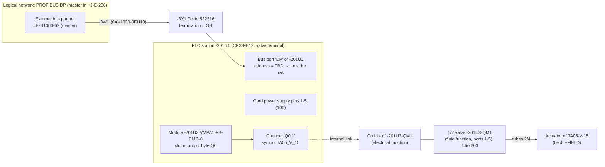
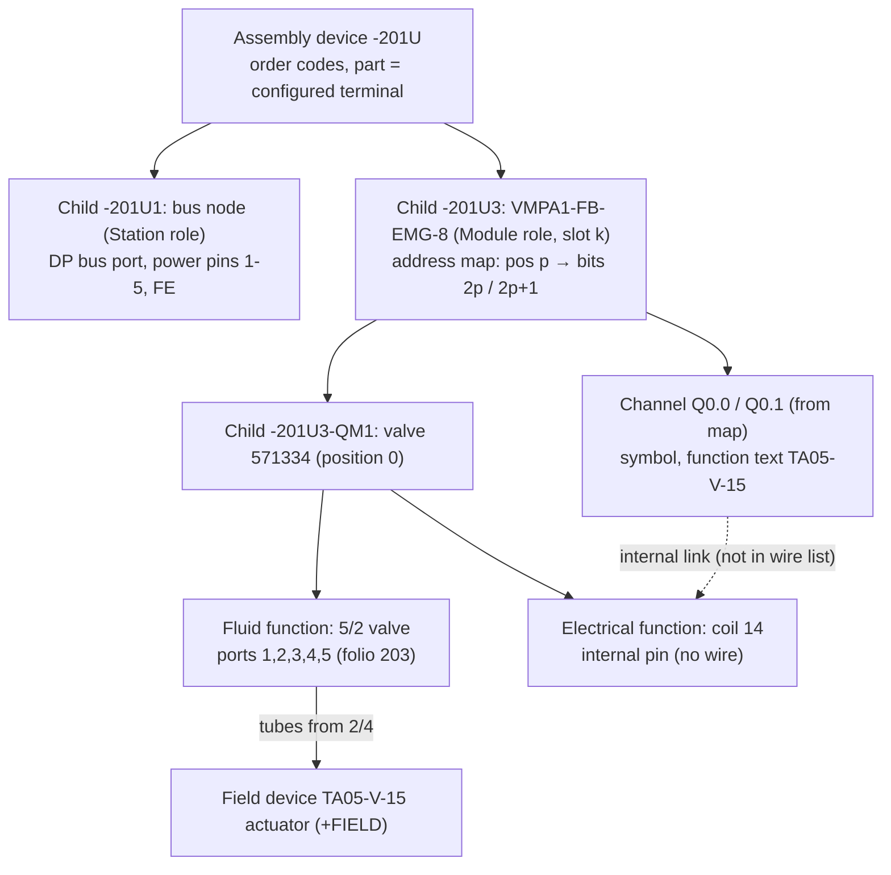

# PLC / I/O, fieldbus and fluid-power engineering in ElektraWatt

> Research input for the ElektraWatt (EW) design documents. Topic: PLC and I/O modelling, PLC-software exchange
> (TIA Portal, CODESYS, TwinCAT, Studio 5000), device descriptions, bus topology, IO-Link, safety I/O, valve
> terminals, ISO 1219 fluid power and links to process plants. Written 2026-10-17. Reference set:
> <drawing id> (folios 3, 106, 201–206). Companion files in the same folder:
> `eplan-features.md` (§3.12 PLC, §17 Fluid, §18 Preplanning), `interop-formats.md` (§4 AML, §5 device
> descriptions), `standards.md` (§5 ISO 1219, §10 IEC 62424, §11 IEC 61131-3) and `reference-drawing.md`
> (§4.10–4.11 golden PLC and fluid data). This file goes deeper and, where it differs, corrects them (§3.1).

---

## 0. Method, evidence and caveats

**What limited the research.**
- During this session the shared WebSearch budget was used up.
- The vendor and standards sites (eplan.help, docs.tia.siemens.cloud, infosys.beckhoff.com,
  helpme-codesys.com, automationml.org, iso.org, festo.com, profibus.com) did not resolve from the sandbox.

**Evidence used instead.** Only GitHub and crates.io were reachable, so I worked from primary *artefacts*
hosted there:
- a real **TIA Portal V21 CAx export** (`TIA_Export.aml`) and a **TIA Selection Tool 2025 export**
  ([JBuschkind/Interoperabilit-tsprojekt](https://github.com/JBuschkind/Interoperabilit-tsprojekt/blob/HEAD/Testing-Files/TIA_Export.aml),
  [TST](https://github.com/JBuschkind/Interoperabilit-tsprojekt/blob/HEAD/prototypes/TagGenerator/TST_Export.aml));
- a TIA Openness tag-table XML
  ([example](https://github.com/bulaofen0036-coder/TIA_Portal_Openness_MCP/blob/HEAD/templates/mcp-full-e2e-verify/import/MCP_E2E_Tags.xml));
- a mirror of the **EPLAN 2026 API reference**: the property list with IDs, the `FunctionCategory` enum and the
  `BusTerminal` class
  ([binfen1/Eplan_2026_IA_MCP_scripts](https://github.com/binfen1/Eplan_2026_IA_MCP_scripts/tree/HEAD/Eplan_2026_RAG_mcp/Eplan_DOCS/Api/Asm)).
  It was mirrored from `eplan.help/en-us/Infoportal/Content/api/2026/…`;
- real device-description files: GSD, GSDML (with PROFIsafe), ESI, EDS and IODD;
- PLCopen XML (Beremiz/OpenPLC and CODESYS flavours);
- Rockwell L5X files;
- the QElectroTech pneumatic element collection;
- crates.io metadata.

**Citations and confidence.**
- Facts verified by sibling agents are re-cited with their links.
- Statements from domain knowledge that could not be checked here are marked **(unverified)**. The data model
  and the recommendations do not depend on any single unverified fact, but every number marked (unverified)
  must be checked against the vendor manual before it becomes a check-rule constant.

### 0.1 Key findings (one line each)

1. EPLAN models valve terminals with dedicated function categories:
   - **`PLCBoxFluid` (6201)** and **`PLCTerminalFluid` (6200)**, next to `PLCBox` (301), `PLCTerminal` (300)
     and the bus-port class `BusTerminal`.
   - So a PLC output lives *on the ISO 1219 valve symbol itself* (§2.1, §8). EW needs the same "dual nature".
2. EPLAN 2026 has a large, stable PLC property set (≈ 200 properties, IDs 20097–20669).
   - It covers channel designation, symbolic address (manual / automatic / determined), data type, station ID,
     rack, slot, subslot, CPU, PLC-specific settings, logical and physical network, bus ID, PROFINET device name,
     subnet mask, safety source/target addresses, UDT symbols and **up to 12 sub-devices per function**.
   - This is a ready checklist for the EW schema (§2.1).
3. **TIA Portal V21 still writes CAEX 2.15** (not 3.0) and declares **AR APC 1.4.0**.
   - Its CAx export **does contain PLC tags**. They are linked to channels by `InternalLink` (*Channel_DO_0 ↔
     Ventil_Stanze*). This corrects `interop-formats.md` §4.2, which said tags are not part of CAx.
   - The TIA Selection Tool export also carries **`LocationIdentifier IEC` / `ProductDesignation IEC`**
     (IEC 81346 `+`/`-` tags) and accessories (§3.1).
4. In AR APC the module address is an `Address` ordered list of `{StartAddress, Length (bits), IoType}`. The
   channel is `{Type, IoType, Number, Length}`. The tag carries `LogicalAddress="0.0"` without an area letter;
   the area comes from `IoType`.
5. The TIA tag Excel layout has 10 fixed columns on sheet "PLC Tags": Name, Path, Data Type, Logical Address,
   Comment, Hmi Visible, Hmi Accessible, Hmi Writeable, Typeobject ID, Version ID. Openness XML uses
   `%I0.0` / `%Q0.0` (§3.2).
6. PLCopen TC6 v2.01 carries absolute addresses as `<variable name="…" address="%IX0.1">`. CODESYS adds a
   `Device` block in `addData` (§3.3).
7. Device descriptions give channels, sizes and slot rules, but no pins. One exception is useful:
   - **IODD** describes the connector (`M12-4ConnectionT`) and each wire's function and colour (BN L+, WH, BU L−,
     BK C/Q). EW can auto-create IO-Link device pins and core colours from it.
   - **ESI** gives per-terminal **`EBusCurrent`** (EL1008: 90 mA), which enables an E-bus current-budget check
     (§4).
8. The GSDML PROFIsafe block (`F_ParameterRecordDataItem`) defines `F_Dest_Add` / `F_Source_Add` (1..65534),
   `F_WD_Time` (1..65535) and `F_SIL` (§7).
9. QElectroTech's pneumatic library has 326 elements under `50_pneumatic`, plus `30_hydraulic`. The 5/2-valve
   terminals are **unnamed `Generic` terminals** with `link_type="simple"`. QET import therefore yields geometry,
   but no port numbers and no coil-to-valve link (§9.2).
10. Rust crates exist for some formats: PROFIBUS GSD (`gsd-parser` 0.6.0), ESI (`taktora-ethercat-esi` 0.5.3),
    IODD (`ioddengine` 0.1.3), PLCopen (`plcopen` 0.3.1) and L5X (`l5x` 0.6.0). There is **no crate for GSDML,
    CIP-EDS or AML/CAEX**; EW must write these on `quick-xml` (§14).

---

## 1. What the reference set demands

| Folio | Content | What a PLC/fluid model must represent | Defects or gaps it reveals |
|---|---|---|---|
| 3 | -201U1 "Festo 51E-F13GCQP-D+H2GG / CPX FB13 / Node TBD" with DP port; plug -3X1 Festo 532216 "Switch to ON"; cable -3W1; "DP" arrow to external box "To J-E-206 / JE-N1000-03" | Bus port (PROFIBUS DP, slave) with station address, bus connector with termination state, bus cable, external bus partner (master in another cabinet) | Station address "TBD" (D-15); BOM lists -4W1 / -4X1 (defect 1); no master or baud rate |
| 106 | -201U1 / -202U1 "FESTO CPX" pins 1–5 (0V Val, 0V El, PE, 24V El, 24V Val) + FE; cables -106W1/W2 | Card power supply connection points of a PLC station, separated into electronics and valve (load) supply | Supply pairs crossed; all from one 6 A MICO channel (D-25); FE vs PE (D-16) |
| 201–202 | Front view of the CPX/VMPA manifold, modules -201U1…U9, -202U1…U3, "PART DATA" order codes | Rack/slot structure of a PLC station whose modules are pneumatic and electrical at once; configurator order code | Manifold continues over two pages; part/topology doubts (D-40) |
| 203–206 | 28 ISO 1219 5/2 valves, each with **Q0.1 … Q6.7** and function text **TA05-V-xx** or "Spare" | PLC output channel = valve solenoid; process tag; spare channels | Only odd bits used (D-26); valves untagged (D-27); no I/O list, no PLC overview (defect 9) |

This leads to two consequences:
- The PLC model is not an add-on to the schematic. It is the **data source** for folios 3, 106, 201–206 and for
  the missing reports.
- A valve on folio 203 is simultaneously a fluid function (ports 1–5), an electrical function (coil) and a PLC
  channel (Q0.1) of a module (-201U3) in a station (-201U1) on a network (PROFIBUS, master in +J-E-206).



---

## 2. PLC modelling

### 2.1 EPLAN's object model, read from the 2026 API

**Function categories** (`Eplan.EplApi.Base.Enums.FunctionCategory`, 2026; [mirror](https://github.com/binfen1/Eplan_2026_IA_MCP_scripts/blob/HEAD/Eplan_2026_RAG_mcp/Eplan_DOCS/Api/Asm/FunctionCategory.md)):

| Value | Member | Meaning for EW |
|---|---|---|
| 301 | `PLCBox` | PLC box: the device frame of a CPU, head station, card or compact I/O |
| 300 | `PLCTerminal` | PLC connection point (I/O, supply, multi-function) |
| — | `BusTerminal` (class) | Bus port. Its API exposes `BusAddress`, `BusSystemKind`, `IsPlcMaster`, `Network`, `ConfigurationProject` ([BusTerminal](https://github.com/binfen1/Eplan_2026_IA_MCP_scripts/blob/HEAD/Eplan_2026_RAG_mcp/Eplan_DOCS/Api/Asm/BusTerminal.md)) |
| **6201** | **`PLCBoxFluid`** | PLC box for fluid: a valve terminal, which is a PLC device *and* a fluid device |
| **6200** | **`PLCTerminalFluid`** | PLC connection point drawn as or with a fluid symbol (the valve solenoid's channel) |
| 6003 / 6002 / 6001 / 6100 | `BlackboxFluid`, `DeviceEndTerminalFluid`, `UndefinedFluid`, `SensorFluid` | Fluid black boxes and their connection points, fluid sensors (pressure switches) |
| 5200–5204, 5500–5504, 5400–5402, 5900–5903, 5000–5002, 5100–5105 | Directional, pressure, flow and check valves (`…HYP`); cylinders, motors and actuators; accumulator, filter, separator; distributor, accessories, plug-in connector, control valve/screw connection; pumps and compressor; filters, controller, logic, operating element | The ISO 1219 symbol families EW must classify |
| 10000–11306 | `ProcessVessel`, `ProcessPump`, `ProcessPiping`, `ProcessControlFitting`, `ProcessMeasuring`, … | P&ID / Preplanning objects live in the *same* function model (§10) |

**PLC properties** ([FunctionPropertyList, 2026](https://github.com/binfen1/Eplan_2026_IA_MCP_scripts/blob/HEAD/Eplan_2026_RAG_mcp/Eplan_DOCS/Api/Asm/FunctionPropertyList/Properties.md);
original pattern e.g. [FUNC_PLCADDRESS on eplan.help](https://www.eplan.help/en-us/Infoportal/Content/api/2026/Eplan.EplApi.DataModelu~Eplan.EplApi.DataModel.FunctionPropertyList~FUNC_PLCADDRESS().html)).
A selection grouped by concern:

| Concern | EPLAN property (ID) | EW interpretation |
|---|---|---|
| Address | PLC address (20400); Address range (STEP 7 Classic) (20432, 20299); Start address of PLC card (20419, 20255, `…_INDIRECT` 20423/20298) | Channel address; card start address; vendor-specific range keyword |
| Symbol | Symbolic address (manual 20402 / automatic 20404 / determined 20403); Symbolic address: Group (20610); UDT name (20618) and UDT data type (20619) | Three-state symbol (manual overrides automatic). Structured tags (UDT) as in AR APC 1.3+ |
| Type | Data type (20405); Signal range (20388) | `Bool`, `Int`, `Word` …; "4..20 mA" |
| Channel | Channel designation (manual 20407 / automatic 20428 / determined 20436); Plug designation (20406, 20431); connection point designation with plug (20435, 20183) | Channel name and the connector it sits on (e.g. X2 of a module) |
| Station / rack / slot | PLC station: ID (20408), Type (20409); rack ID (20410) and own Rack (20427); Position (slot/module) (20411); Subslot (20312); card name (20437); PLC type designation (20416); Version (20418) | Station → rack → slot → subslot path; firmware |
| Device role | CPU (20167); CPU name (20433/20253); Bus coupler / head station (20164); Power supply (20184); Bus distribution device (20189); Integrated module (20289); Card is placed on head station (20444) | Role flags of a PLC box |
| Device description | Device description: file name (20415), index in file (20381); PLC device TemplateIdentifier (20580) | Link to GSDML/GSD/ESI/EDS and to the module entry in it |
| Sub-devices | PLC subdevice 1–12: name, position, type designation, DD index, start address inputs/outputs, data length inputs/outputs, safety target/source/upper/lower address (20521–20669) | One function can carry **up to 12 sub-devices**, e.g. a compact IO-Link master or a valve-terminal node with fixed modules |
| Network | Bus system (20308); Bus ID / item number (20311, 20386); Logical network: Name (20414), Bus port is master (20310); Physical network: Name (20413); Bus interface: Name (20447), Main bus port (20448); Data transfer rate (20313); Ignore missing bus ID (20412); MasterSystemID (20334) | Bus port addressing, master flag, logical vs physical network |
| Ethernet | DNS/PROFINET device name (20309); Subnet mask (20446); Standard gateway (20613); MAC address (20128); Start/End IP address (20165/20169); Use DHCP (20182); Domain postfix (20181) | PROFINET / EtherNet/IP node data and IP planning |
| Export scope | Configuration project at PLC boxes and bus ports (20161, automatic 20581, indirect 20108); PLC-specific settings (20315) | Which PLC-software project a station belongs to, and which vendor addressing scheme applies |
| Safety | Safety function (20216); Safety address: Target (20439), Source (20615), Upper value (20616), Lower value (20617) | PROFIsafe F-destination/F-source addresses and allowed ranges |
| Spare / exclusions | Deactivated I/O connection point (20438); Do not include in addressing (20380) | Spare and reserved channels; points skipped by auto-addressing |
| Overview | Overview cross-reference (20301); PLC diagram form (20187) | Cross-reference between overview and multi-line representation; per-card report form |
| Derivation | Connection point logic: Target tracking (PLC) to (20449); Without sensor/actuator search for symbolic address (20196); Connected PLC address at terminals (manual 20854 / automatic 20855); Numbered using PLC data (20812); Continue numbering with PLC data (20813); Prevent numbering with PLC data (20430) | EPLAN **follows the net from a PLC point to the field device** to derive the symbol. It **shows the PLC address on terminals**, and can **number DTs and connections from PLC addresses** |

**Navigation and behaviour** (verified in sibling research, `eplan-features.md` §3.12):
- PLC navigator under *Project data > PLC*, with unplaced points;
- addressing and re-addressing ([2.8 news](https://eplan.help/en-us/infoportal/content/Plattform/2.8/Content/htm/news_p_sps_weiteres_195263.htm));
- bus-configuration transfer;
- PLC overview pages;
- AML AR APC 1.0–1.4 exchange with GUIDs, plus vendor converters (`PlcDcExchangerSiemensTIA17AML`, `…TSTAML`,
  `PlcDcAMLExchangerGeneral`) and a CSV address overview
  ([TechTip PLC data exchange](https://www.eplan.help/techtipps/en-us/SPS/TechTip-PLC-data-exchange.pdf);
  [plcservice action](https://www.eplan.help/en-us/Infoportal/Content/Plattform/2024/Content/htm/availableactions_o_plcservice.htm));
- schematic generation from PLC data (`PlcService.GenerateSchematic`).

**Lessons for EW.**
1. PLC data sits on **functions** (connection points, boxes), not on graphics.
2. Many properties come in triples: manual / automatic / determined. "Determined" is the value shown: manual if
   set, else automatic. EW should apply this pattern to symbol, channel designation and plug designation, the
   same way it handles function text.
3. "Indirect" properties are values inherited from the PLC box or station. EW should compute them, not copy them.
4. Because of target tracking, the symbolic address does not need typing. It comes from the connected sensor or
   actuator, which removes a whole class of inconsistencies.

### 2.2 Vocabulary mapping across tools

| EW concept | EPLAN | TIA Portal / AML AR APC | TwinCAT 3 | Rockwell Logix (L5X) | CODESYS |
|---|---|---|---|---|---|
| PLC project (export scope) | Configuration project (20161) | TIA project / `AutomationProject` role | TwinCAT solution | Controller (`<Controller>`) | Project / Application |
| Station | PLC box with station ID; CPU or head-station flag | `Device` (`TypeIdentifier System:Device.S71500`) | EtherCAT box / coupler (EK1100) | `<Module>` with Ethernet `Port` | Device in device tree |
| Rack | Rack ID (20410) | `DeviceItem` with `TypeName=Rack` (`Profilschiene_0`) | — (terminal stack) | Chassis (ICP backplane, `Port Type="ICP"`) | — |
| Module / card | PLC box (card), position (slot) 20411, subslot 20312 | `DeviceItem` with `PositionNumber`, `TypeIdentifier OrderNumber:…`; sub-`DeviceItem` for submodules | Terminal `Term n (EL1008)` | `<Module CatalogNumber ParentModule ParentModPortId>` | Sub-device / I/O module |
| Channel | PLC connection point, channel designation | `ExternalInterface` class `…InterfaceClassLib/Channel` {Type, IoType, Number, Length} | PDO entry (`TxPdo/Entry` Index:SubIndex, BitLen) | Module-defined tag member (`Local:1:I.Data.0`, `…:I.Pt00.Data`) | I/O mapping row |
| Address | PLC address 20400 | `Address` {StartAddress, Length, IoType} at module; `LogicalAddress` at tag | Process image offset (assigned by TwinCAT) | none (tag-based) | `%IX0.0` (auto or fixed) |
| Symbol | Symbolic address 20402–20404 | `ExternalInterface` class `…/Tag` {DataType, IoType, LogicalAddress, Comment}; `InternalLink` Channel ↔ Tag | Variable `AT %I*` linked to the PDO | Alias tag (`AliasFor`) | GVL variable mapped to the channel |
| Bus port | `BusTerminal` | `CommunicationInterface`, `CommunicationPort` (Label `P1R`), `Node` / `NodeEthernet` {NetworkAddress, SubnetMask} | EtherCAT port A/B | `Port Type="Ethernet" Address="192.168.1.2"` | Ethernet / fieldbus adapter |

Sources: the TIA V21 and TST exports listed in §0; L5X from
[hutcheb/acd](https://github.com/hutcheb/acd/blob/HEAD/resources/ACDTestsWithAOI.L5X) (`Module Name="ETH_MODULE"
CatalogNumber="1756-EN2T" ParentModule="Local" ParentModPortId="1"`, ports `Address="1" Type="ICP"
Upstream="true"` and `Address="192.168.1.2" Type="Ethernet"`); ESI from
[taktora](https://github.com/patdhlk/taktora/blob/HEAD/examples/ethercat-stepper/esi/beckhoff_el1008.xml).

### 2.3 Connection-point (pin) types on PLC devices

| Type | Typical pins per channel | Key properties | Example |
|---|---|---|---|
| Digital input (DI) | 1 (signal); plus sensor supply and M for 2-/3-wire sensors | Channel no., address (bit), symbol, function text, input delay | S7-1500 DI 16x24VDC HF (`Channel_DI_0…15`) |
| Digital output (DO / DQ) | 1 (signal); plus M | Address (bit), current per channel (e.g. 0.5 A), PM/PP switching for safety | DQ 16x24VDC/0.5A HF; CPX/VMPA solenoid outputs (internal, no pins) |
| Analog input (AI) | 2–4 (+, −, supply, shield) | Word address, signal range (20388), resolution, measurement type (U/I/RTD/TC) | "4..20 mA" |
| Analog output (AO) | 2–4 | Word address, signal range | 0..10 V |
| Multi-function | 1+ (configurable DI/DO/IO-Link) | Mode per channel; IO-Link port data | IO-Link master port (§6) |
| Counter / position | 2–6 (A, B, N, supply) | Address range (DWord) | encoder input |
| Card power supply | L+/M per load group (1L+, 2L+, 1M, 2M); electronics vs load supply | Potential, rated current, group of channels it feeds | CPX pins "24V El / 0V El" and "24V Val / 0V Val" (folio 106) |
| Bus port | 1 per physical port (or per connector) | Bus system, interface name (X1, DP), port label (P1R), address, master flag, networks | CPX "DP" port (folio 3) |
| Shield / FE | 1 | Potential type FE | CPX FE screw (folio 106) |

Rules:
- Connection-point designations are unique within a PLC box. Descriptions may repeat at card power supplies
  ([TechTip PLC properties](https://www.eplan.help/techtipps/en-US/SPS/TechTip-Overview-of-the-PLC-properties.pdf),
  via `eplan-features.md`).
- **Internal channels** have no physical pin. Examples: valve-terminal solenoid outputs and the outputs of IO-Link
  devices. They must still be first-class channels. EW should represent them as channels whose "pins" are
  *internal connection points*. Such points are excluded from wire and terminal lists but included in the PLC
  overview and I/O list.

### 2.4 Channel concept

A **channel** is the logical I/O unit.
- It has exactly one address (bit or word), one symbol, one data type and one state: used, spare, reserved or
  deactivated.
- It groups **1..n connection points** (signal, supply, M, shield).
- Channel *number* (0-based on most cards, as in AML `Number="0"`), channel *designation* (e.g. "DI 0", "Ch1",
  "X1:4") and *address* (`I0.0`) are three different things. Keep them in three fields.
- One device can host channels from several cards and sub-devices (EPLAN sub-devices 1–12).
- The channel is the join point of:
  - the electrical net (its pins);
  - the PLC address space (its address);
  - the PLC software (its tag);
  - the function served (sensor, actuator or valve coil, via target tracking);
  - the process (process tag, e.g. TA05-V-15).

### 2.5 Address formats per vendor

| Vendor / platform | Bit input | Bit output | Word / analog | Structure | Notes |
|---|---|---|---|---|---|
| IEC 61131-3 directly represented (CODESYS, Beremiz, many) | `%IX0.0` | `%QX0.1` | `%IW64`, `%QD8`, `%MD10` | `%` + I/Q/M + X/B/W/D/L + byte.bit | Verified in PLCopen: `address="%IX0.1"` ([OpenPLC sample](https://github.com/Srg-Blmv/ics_labs/blob/HEAD/plc/PLC_PROJECT/plc.xml)); Ed. 4.0 2025 (`standards.md` §11) |
| Siemens S7-1200/1500 (TIA, international mnemonics) | `I0.0`, displayed `%I0.0` | `Q0.1`, displayed `%Q0.1` | `IW64` / `%IW64`, `QW80`; `:P` = peripheral access | byte.bit; word addresses even bytes by convention | Openness XML `<LogicalAddress>%I0.0</LogicalAddress>` ([sample](https://github.com/bulaofen0036-coder/TIA_Portal_Openness_MCP/blob/HEAD/templates/mcp-full-e2e-verify/import/MCP_E2E_Tags.xml)); AML tag `LogicalAddress="0.0"` + `IoType` |
| Siemens (German mnemonics) | `E0.0` | `A0.1` | `EW64`, `AW80` | same | Project-level display option (unverified naming in TIA) |
| Siemens STEP 7 Classic (S7-300/400) | `I0.0` | `Q4.0` | `PIW256` (analog slot 4 default) | slot-based default addresses | EPLAN keeps a separate "Address range (SIEMENS STEP 7 Classic)" property (20432) |
| Beckhoff TwinCAT 3 | `bIn AT %I* : BOOL;` | `bOut AT %Q* : BOOL;` | `nVal AT %I* : INT;` | Address allocated by TwinCAT; variable linked to the PDO in the I/O tree | ECAD should export *symbol + terminal/channel link*, not absolute addresses (unverified details of TE1120 mapping) |
| Rockwell Logix (ControlLogix/CompactLogix) | `Local:1:I.Data.0` | `Local:2:O.Data.1` | `Local:3:I.Ch0Data` | `<module>:<slot>:<I/O/C>.<member>[.bit]`; 5069/5094 modules use `…:I.Pt00.Data` | Tag-based, no absolute bit addresses; symbol is an **alias tag** (`AliasFor`); remote: `<adapterName>:<slot>:I.Data.3` (unverified for each module family) |
| Mitsubishi (FX / iQ-R) | `X0` (octal on FX, hex on iQ-R) | `Y0` | `D0` (data register) | Device + number | (unverified) |
| Omron (CJ/NJ) | `CIO 0.00` | `CIO 100.00` | `D0` | Word.bit (bit 00–15) | NJ/NX are tag-based (unverified) |
| Schneider (M340/M580) | `%I0.1.3` | `%Q0.2.1` | `%IW0.3.0` | Topological rack.slot.channel | (unverified) |

**EW design consequences.**
- An `AddressProfile` per configuration project (EPLAN calls this "PLC-specific settings", 20315). It defines:
  - the parse and render grammar;
  - the number base (decimal, octal, hexadecimal);
  - bits per addressable unit (8 for byte-oriented S7, 16 for Omron words, 32 for Rockwell DINT data);
  - word alignment, default start addresses, the mnemonic set, and whether absolute addresses exist at all
    (Rockwell and TwinCAT: symbol-first).
- **Store the address canonically.** Use `{area, size, byte, bit}` with the profile ID. Render on demand.
  Converting a project from Siemens to IEC notation is then a display change, not a data migration.
- For tag-based platforms, store `{module_ref, member_path}` and generate the tag string (`Local:1:I.Data.0`) from
  the station/slot model. This way a slot move updates every address.

### 2.6 Symbolic addresses and data types

- **Symbol name** (TIA "tag", CODESYS variable, Rockwell alias, TwinCAT variable).
  - Must be unique per **CPU / configuration project**, not per project.
  - Must be a valid identifier of the target: IEC 61131-3 identifiers (letters, digits, single underscores; no
    leading digit) are the safe common subset.
  - TIA allows more characters, e.g. spaces in quoted names (unverified exact rule). Offer a "strict IEC" mode by
    default.
- **Automatic symbol** (EPLAN 20404 with target tracking 20449).
  - Generated from a template over the *connected target*, e.g. `{target.process_tag|target.dt}_{signal}`:
    `TA05_V_15` or `201U3_QM1_Y14`.
  - Re-computed on renumbering. A manual value (20402) wins.
  - This prevents the folio 1/901 class of defects (stale tags after renumbering) for PLC symbols.
- **Data types**: `Bool` (bit channel), `Byte`, `Word`, `Int`, `DInt`, `Real`, plus structured (UDT) for IO-Link
  process data and drives.
  - EPLAN supports UDT symbols (20618/20619); AR APC 1.3 added user-defined structured variables
    (`interop-formats.md` §4.1).
  - EW should keep `data_type` as a string from the profile's vocabulary, plus a canonical bit width for checks.
- **Comment** is multilingual. AML carries `Comment` with `aml-lang=de-DE` sub-attributes (TIA V21 export), so the
  EW multilingual text model maps 1:1.

### 2.7 Representations: overview, multi-line, single-line, fluid

| Representation | Shows | Page type | Cross-reference |
|---|---|---|---|
| **Multi-line (main)** | Channel pins wired in the schematic (DI to sensor, DO to coil) or the valve-coil channel on a fluid page (203) | Schematic multi-line; fluid | Main representation, at most one per channel |
| **PLC overview** | One card (or station) with *all* channels, addresses, symbols, function texts, used/spare; no autoconnect | Overview (generated or hand-placed) | "Overview cross-reference" (EPLAN 20301) to the multi-line location of each channel |
| **Single-line / topology** | Station with bus ports, bus cables, connectors, network names and addresses | Single-line / topology (folio 3) | DT cross-reference to the main device |
| **Assembly / front view** | Slot order of a rack or valve terminal with part numbers (201–202) | Overview or graphics | "∞ 203-B4" pointers to detail pages |

Rules:
1. A channel may be **unplaced**: it exists in the navigator and reports but not on any page. Spare channels are
   typically unplaced.
2. Placing a channel symbol binds it to the channel, never to a copy of its properties.
3. Every representation renders the *same* address, symbol and function text.

### 2.8 PLC navigator (UI)

- **Tree**: Configuration project → Station (with role icon: CPU, head station, valve terminal, IO-Link master) →
  Rack → Module (slot) → Channel. Bus ports appear under the station.
- **Grid view** (spreadsheet-like, the main editing surface for I/O work). Columns:
  - station, rack, slot, card DT, channel no., designation, kind, address, symbol, data type, function text,
    process tag, state, safety, target DT, placed-on (page/column), signal range, comment.
- Supports multi-select, fill-down and pattern fill (`TA05_V_{n:02}`), plus paste from Excel.
- **Filters**: unassigned address, duplicate address, spare, unplaced, safety, per bus, per configuration project,
  "TBD" values.
- **Actions**:
  - place channel / place card overview (generates the overview page);
  - address card / address selection / re-address;
  - mark spare;
  - assign target (pick a device function);
  - import/export (§3).
- Drag a channel onto a schematic or a fluid valve symbol to bind it there.

### 2.9 Address assignment and renumbering

Algorithm (per configuration project):
1. Order the stations, then the modules by (rack, slot, subslot), or by manifold order for valve terminals.
2. For each module, take its I/O ranges from the device description or part (bits in/out) and the profile's
   alignment. Compute the module start address:
   - **Manual** start addresses are locked.
   - **Automatic** start addresses come from the profile's default scheme, e.g. sequential from 0, analog from
     IW64/IW256, or the vendor scheme imported from TIA.
3. Each channel address = module start + **address map** offset.
   - The address map is part data. The default is linear (channel n → bit n).
   - Non-linear maps cover cases such as 2 bits per valve position (Festo MPA, §8) or analog channels as words.
4. Channels marked "do not include in addressing" (EPLAN 20380) keep or clear their address.
5. Show a **preview diff**: old → new address, affected pages, symbol changes. Then commit as one undoable
   transaction. Imported TIA addresses (`ImportOrigin::Tia`) are protected unless the user unlocks them.

Renumbering triggers:
- moving a module;
- inserting a slot;
- changing the profile;
- importing from TIA (addresses become authoritative from the PLC side; see §3.7).

### 2.10 I/O list (assignment table)

The deliverable that folio 203–206 implies but the set lacks (defect 9).

| Column | Source |
|---|---|
| Configuration project, CPU | station |
| Station / bus address | bus port |
| Rack.Slot(.Subslot), module DT, module part | module |
| Channel no., designation, kind | channel |
| Address (rendered in profile) | channel |
| Symbol, data type, comment | channel |
| Function text, process tag (TA05-V-15) | channel / target |
| Target DT and pin (e.g. `-201U3-QM1:14`), target page/column | target tracking |
| Terminal(s) passed | net trace |
| Signal range, safety (F-address) | channel |
| State (used / spare / reserved / TBD) | channel |

Exports: XLSX (round-trip with a hidden stable-ID column), CSV and PDF report.
Import: same columns, keyed by the stable ID or by (station, slot, channel no.).

---

## 3. Exchange with PLC software

### 3.1 AutomationML AR APC: what a real TIA V21 export contains

From `TIA_Export.aml` (`WriterName` "Totally Integrated Automation Portal", `WriterVersion` 2100, `WriterRelease`
2100.0.121.1, written 2026-02-03) and `TST_Export.aml` (TIA Selection Tool 2025.12):

**File level:** `CAEXFile SchemaVersion="2.15"` with `CAEX_ClassModel_V2.15.xsd`; `AutomationMLVersion="2.0"`;
`<Document DocumentIdentifier="AR APC" Version="1.4.0"/>`. The role-class and interface-class libraries are
*referenced by path only* and are not embedded. Paths in use:

- Role classes:
  - `AutomationProjectConfigurationRoleClassLib/` with `AutomationProject`, `Device`, `DeviceItem`, `TagTable`,
    `CommunicationInterface`, `CommunicationPort`, `Node`, `DeviceUserFolder`;
  - `AutomationProjectConfigurationEthernetRoleClassLib/NodeEthernet`.
- Interface classes:
  - `AutomationProjectConfigurationInterfaceClassLib/` with `Channel`, `Tag`, `CommunicationPortInterface`;
  - `CommunicationInterfaceClassLib/LogicalEndPoint`.

**Hierarchy (TIA):**

```text
Projekt-01                                   (AutomationProject)
└─ S7-1500/ET200MP-Station_1                 Device  TypeIdentifier=System:Device.S71500
   └─ Profilschiene_0                        DeviceItem TypeName=Rack PositionNumber=0 TypeIdentifier=OrderNumber:6ES7 590-1***0-0AA0
      ├─ PM 70W 120/230VAC                   PositionNumber=0 OrderNumber:6EP1332-4BA00
      ├─ PLC_1                               DeviceItemType=CPU PositionNumber=1 OrderNumber:6ES7 511-1AK02-0AB0 FirmwareVersion=V2.8
      │  ├─ Standard-Variablentabelle        (TagTable)
      │  ├─ Eingänge und Ausgänge            (TagTable)
      │  │   ├─ ExternalInterface Tag "Taster_Start"  DataType=Bool IoType=Input  LogicalAddress=0.0 Comment(+aml-lang=de-DE)
      │  │   └─ ExternalInterface Tag "Ventil_Stanze" DataType=Bool IoType=Output LogicalAddress=0.0
      │  └─ PROFINET-Schnittstelle_1         Label=X1 PositionNumber=32768 BuiltIn=true
      │     ├─ E1                            Node/NodeEthernet: NetworkAddress=192.168.0.10 SubnetMask=255.255.255.0 IpProtocolSelection=Project Type=Ethernet
      │     ├─ Port_1                        Label=P1R PositionNumber=32769
      │     └─ Port_2                        Label=P2R PositionNumber=32770
      ├─ DI 16x24VDC HF_1                    PositionNumber=2 OrderNumber:6ES7 521-1BH00-0AB0 FirmwareVersion=V2.2
      │  └─ (submodule, BuiltIn) Address = OrderedList[1]{StartAddress=0, Length=16, IoType=Input}
      │      └─ ExternalInterface Channel "Channel_DI_0".."_15"  Type=Digital IoType=Input Number=0..15 Length=1
      └─ DQ 16x24VDC/0.5A HF_1               PositionNumber=3 … Channel_DO_0..15
InternalLink "Link To Tag_1": <DI submodule ID>:Channel_DI_0  ↔  <tag table ID>:Taster_Start
InternalLink "Link To Tag_2": <DQ submodule ID>:Channel_DO_0  ↔  <tag table ID>:Ventil_Stanze
```

**Findings that matter for EW:**
1. **CAEX 2.15 is still current in TIA V21 and TST 2025.** EW's AML writer must emit CAEX 2.15 and should also read
   CAEX 3.0 (IEC 62424:2016), e.g. for newer EPLAN or other tools.
2. **Tags are in the CAx export.** They are linked to channels with `InternalLink`
   (`RefPartnerSideA="<InternalElement-ID>:<InterfaceName>"`). This is the I/O assignment table in AML form.
   EW can therefore *export* channel symbols to TIA, and *import* a TIA hardware configuration with its tags.
3. **Module `Address`** is an `OrderedListType` of `{StartAddress (int), Length (int, bits: 16 for a DI 16),
   IoType}`, not a string. Channels carry only `Number` and `Length`. The absolute channel address is derived
   (start + number). EW's canonical address model matches this.
4. **Element `ID`s are GUIDs.** EW must persist them per station, module, channel and tag to make the second
   import an update instead of a duplicate (EPLAN does the same, `eplan-features.md` §3.12).
5. **`PositionNumber`** values 32768/32769/32770 are the PROFINET interface and port subslots (0x8000, 0x8001,
   0x8002). They match GSDML `SubslotNumber` (§4).
6. **The TIA Selection Tool adds `LocationIdentifier IEC` (`+`) and `ProductDesignation IEC` (`-UF01`, `-K01`,
   `-K02`) per device item, plus `DeviceItemType="Accessory"` items** (front connectors, memory card, cables).
   - EW should **write its IEC 81346 tags into these attributes** on export and **read them on import**. A TIA
     module is then bound to EW device -201U3 by tag, not by guesswork.
   - Accessories feed the BOM.

**EW ⇄ AR APC mapping (v1):**

| EW | AML element | Attributes |
|---|---|---|
| Configuration project | `InternalElement` (role `AutomationProject`) | Name |
| Station | `InternalElement` (`Device`) | `TypeIdentifier` (`System:Device.<family>` or `OrderNumber:<MLFB>`) |
| Rack | `DeviceItem` TypeName=Rack | PositionNumber, TypeIdentifier |
| Module / submodule | `DeviceItem` | PositionNumber, TypeName, TypeIdentifier `OrderNumber:…`, FirmwareVersion, DeviceItemType (CPU/Accessory), BuiltIn, `Address` list, `LocationIdentifier IEC`, `ProductDesignation IEC` |
| Channel | `ExternalInterface` `…/Channel` | Type (Digital/Analog), IoType, Number, Length |
| Symbol | `ExternalInterface` `…/Tag` in a `TagTable` element | DataType, IoType, LogicalAddress, Comment (multilingual) |
| Channel ↔ symbol | `InternalLink` | RefPartnerSideA/B |
| Bus interface / port / node | `CommunicationInterface` / `CommunicationPort` (Label) / `Node[Ethernet]` | NetworkAddress, SubnetMask, IpProtocolSelection, Type; PROFIBUS address and subnet per AR APC (unverified attribute names, to test) |

**Tests required:**
- round-trip against TIA V19–V21 CAx import;
- TST import;
- EPLAN AML import with AR APC 1.2.0 and 1.4.0;
- AML.Engine / AutomationML Editor validation;
- a PROFIBUS example. The sample above is PROFINET; the reference needs DP.

**Prior art:** [TINF17C/GSD2AML-Converter](https://github.com/TINF17C/GSD2AML-Converter) turns GSDML into AML
library elements (student project; licence unverified).

### 3.2 Siemens TIA Portal routes

| Route | Format | Content | Requirements | EW v1 |
|---|---|---|---|---|
| CAx import/export | AML AR APC (CAEX 2.15), §3.1 | Stations, racks, modules, I/O address ranges, PROFINET/PROFIBUS nodes, tags + channel links, IEC tags (TST) | TIA installed on the PLC engineer's PC; a newer AML does not import into older TIA (`interop-formats.md` §4.2) | **Export + import** |
| PLC tag table import/export | XLSX, sheet "PLC Tags", columns `Name, Path, Data Type, Logical Address, Comment, Hmi Visible, Hmi Accessible, Hmi Writeable, Typeobject ID, Version ID` ([generator](https://github.com/blevin04/Factory_I0_Tags_to_Excel_1.1/blob/HEAD/main.py); [TIA course notes](https://github.com/PeMan68/TIA_portal-grundkurs/blob/HEAD/docs/10-projekthantering/exportera-taggar.md)) | Tags only (address `%I0.0` style) | None on the EW side; the user imports in TIA | **Export + import** (simplest path, no AML) |
| Openness | .NET API (`Siemens.Engineering`); tag tables as SimaticML XML `<Document><Engineering version="V21"/><SW.Tags.PlcTagTable><ObjectList><SW.Tags.PlcTag><AttributeList><DataTypeName>Bool</DataTypeName><LogicalAddress>%I0.0</LogicalAddress><Name>…` | Everything scriptable | Windows-only, TIA licence, user in "Siemens TIA Openness" group | **Later**: optional C# bridge tool outside the Rust core |
| TIA Selection Tool | AML (AR APC 1.4.0 in TST 2025) | Hardware selection with IEC tags and accessories | — | **Import** (creates stations/modules with order numbers before the schematic exists) |

### 3.3 CODESYS

- **PLCopen XML TC6 v2.01** (namespace `http://www.plcopen.org/xml/tc6_0201`).
  - Global variable lists in `instances/configurations/configuration/resource/globalVars/variable`, with
    `address="%IX0.1"` and `<type><BOOL/></type>`. Comments go in `documentation`.
  - CODESYS writes extra data under `addData`:
    - libraries (`http://www.3s-software.com/plcopenxml/libraries`);
    - a `Device` block with `DeviceIdentification {Type 4096, Id "0000 0004", Version 3.5.20.0}` and `Connector`
      entries ([sample](https://github.com/Bleebop/IXL_project/blob/HEAD/translators/data_to_PLC/PLCopen_mold.xml)).
  - **Practical v1 output:** a GVL "IO_ElektraWatt" with one variable per used channel (`name` = symbol,
    `address` = IEC address, `documentation` = function text + DT). CODESYS imports it with *Project > Import
    PLCopenXML*.
- **I/O mapping** is per device in the CODESYS device tree (`devdesc` XML). Mapping an existing variable to a
  channel is done in the device's I/O-mapping tab. CSV export/import of mappings exists in recent versions
  (unverified). There may be an AutomationML import/export of the device tree in recent versions (unverified):
  this is an open question.
- **IEC 61131-10** XML (CODESYS "Export/Import IEC61131-10", hidden commands) is not needed for v1.
- Crates: `plcopen` 0.3.1 (MIT, parser) can validate EW output in tests. Writing is simple templated XML on
  `quick-xml`.

### 3.4 Beckhoff TwinCAT 3

- **TE1120 XCAD Interface**: AML-based, "incremental, bidirectional", and still accepts the older Beckhoff XML
  ([TE1120](https://www.beckhoff.com/en-us/products/automation/twincat/texxxx-twincat-3-engineering/te1120.html)).
  It exchanges the EtherCAT I/O topology (couplers, terminals), variables and links, and can generate a PLC
  program skeleton (from `interop-formats.md` §4.2). TwinCAT 2: TS1120.
- **Addressing.**
  - Addresses are *not* engineered in ECAD. PLC variables are declared `AT %I*` / `AT %Q*` and *linked* to PDO
    entries.
  - EW's job: export the terminal list (box/terminal order, product codes from ESI) + channel ↔ symbol links.
- **ESI-based modelling** (§4) gives terminal channels and E-bus current. EtherCAT terminal stacks are
  rack-like: position = order after the coupler.

### 3.5 Rockwell Studio 5000 Logix Designer

- **L5X**: `RSLogix5000Content SchemaRevision="1.0" SoftwareRevision="36.00"`, `Controller ProcessorType="1756-L85E"`.
  - Modules: `<Module Name CatalogNumber Vendor ProductType ProductCode Major Minor ParentModule ParentModPortId>`
    with `<Port Id Address Type="ICP|Ethernet" Upstream>`
    ([RockwellAutomation/ra-logix-cicd](https://github.com/RockwellAutomation/ra-logix-cicd);
    [hutcheb/acd](https://github.com/hutcheb/acd/blob/HEAD/resources/ACDTestsWithAOI.L5X)).
  - The slot is the `Address` of the module's upstream ICP port. The IP is the `Address` of an Ethernet port.
- **Symbols** are alias tags (`<Tag Name="TA05_V_15" TagType="Alias" AliasFor="Local:3:O.Data.1"/>`; the exact
  form depends on the module family, unverified).
- **EW v1**: export an L5X fragment with the module tree (catalog numbers, slots, IPs) and alias tags. Validate
  with the `l5x` 0.6.0 crate (MIT). AML exchange with Studio 5000 exists via EPLAN
  ([Rockwell KB](https://support.rockwellautomation.com/cc/okcsFattachCustom/get/1086730_4)): later.

### 3.6 Generic CSV / XLSX

Universal fallback and the format most panel builders actually use. Rules:
- fixed column set (§2.10);
- one row per channel;
- UTF-8 with BOM for Excel;
- semicolon or comma configurable;
- a **stable-ID column** to allow lossless re-import.

Libraries: `csv` 1.4.0 (Unlicense/MIT), `rust_xlsxwriter` 0.100.0 (MIT/Apache) for writing, and `calamine`
0.36.1 (MIT) for reading. `umya-spreadsheet` 3.1.1 (MIT) is an option where an existing workbook must be modified
in place.

### 3.7 Round-trip identity and conflict resolution

- **Ownership per field.**
  - ECAD owns: DTs, pins, wiring, function texts, part numbers and process tags.
  - PLC owns: addresses (after the first TIA import), symbols (configurable), firmware, IPs.
  - Configurable: symbol, comment.
- **Matching order:**
  1. persisted foreign ID (AML GUID);
  2. IEC tag (`ProductDesignation IEC`);
  3. (station, rack, slot, subslot, channel no.);
  4. order number + position.
- **Three-way merge** against the last exchanged snapshot, stored in the EW project. The result is a change report:
  added, removed, changed, conflicting. Show it in a diff dialog; apply as one transaction.
- **Unmatched foreign objects** go to an "unplaced" area. This is the equivalent of TIA's "ParkingLot". They are
  never silently created on pages.

---

## 4. Device descriptions → auto-create stations, cards and channels

| Format | Bus | Verified structure (sample) | What EW extracts | Missing for ECAD | Rust |
|---|---|---|---|---|---|
| **GSD** (ASCII keywords) | PROFIBUS DP | `#Profibus_DP`, `Vendor_Name`, `Model_Name`, `OrderNumber`, `Ident_Number=0x4224`, `Station_Type`, `Fail_Safe`, `DPV1_Slave`; baud support keys `9.6_supp … 12M_supp`; `Modular_Station=1`, `Max_Module=32`, `Max_Input_Len`, `Max_Output_Len`; `Module="dummy input module" 0x10 … EndModule` ([pyprofibus sample](https://github.com/mbuesch/pyprofibus/blob/HEAD/misc/dummy_modular.gsd)) | Ident number, supported baud rates, module catalogue with config bytes (I/O lengths), max modules | Pins, connector, termination | **`gsd-parser` 0.6.0** (MIT/Apache-2.0, [rahix/profirust](https://github.com/rahix/profirust)) |
| **GSDML** (XML, ISO 15745 profile) | PROFINET | `DeviceIdentity VendorID="0x001A" DeviceID="0x0003"`; `DeviceAccessPointItem ID PhysicalSlots="0..2" FixedInSlots="0" ModuleIdentNumber DNS_CompatibleName="FENA"`; `ModuleInfo/OrderNumber`; `UseableModules/ModuleItemRef ModuleItemTarget AllowedInSlots="1"`; `ModuleItem ModuleIdentNumber` → `VirtualSubmoduleItem` → `IOData/Input|Output/DataItem DataType="Unsigned16"`; `InterfaceSubmoduleItem SubslotNumber="32768"`; `PortSubmoduleItem SubslotNumber="32769" MAUTypes="16"`; PROFIsafe `F_ParameterRecordDataItem` ([ABB FENA GSDML V2.31](https://github.com/siamect/proview/blob/HEAD/profibus/exp/gsd/src/GSDML-V2.31-ABB-FENA-20140901.xml)) | DAP choice, slot rules (fixed/allowed), module/submodule catalogue with I/O sizes and data types, port count (topology), order numbers, default device name, F-parameters | Pins, terminal designations, current | None (`pnio` 0.1.0 *writes* GSDML). Write on `quick-xml` + serde |
| **ESI** (XML `EtherCATInfo`) | EtherCAT | `Vendor/Id=2`; `Device Physics="KK"`; `Type ProductCode="#x03f03052" RevisionNo="#x00100000"` EL1008; `GroupType=DigIn`; `Info/Electrical/EBusCurrent=90`; `Sm`, `Fmmu`; `TxPdo Index=#x1a00 Name="Channel 1"` → `Entry Index=#x6000 SubIndex=1 BitLen=1 DataType=BOOL` ([taktora sample](https://github.com/patdhlk/taktora/blob/HEAD/examples/ethercat-stepper/esi/beckhoff_el1008.xml)) | Product code/revision, channels = PDO entries (bit lengths, types), **E-bus current consumption** | Pins (the terminal's push-in contacts) | **`taktora-ethercat-esi` 0.5.3** (Apache-2.0 OR MIT, 2026); `ethercat-esi` 0.2.0 (2020) |
| **EDS** (CIP, INI-like) | EtherNet/IP | `[File] [Device] VendCode ProdType ProdTypeStr ProdCode MajRev ProdName`, `[Device Classification]`, `[TCP/IP Interface Class]`, `[Params]`, `[Connection Manager] Connection1 = …`, `[Assembly] Assem100x = …` ([eds_pie demo](https://github.com/omidbimo/eds_pie/blob/HEAD/demo.eds)) | Identity, assemblies (I/O sizes), connections (RPI ranges) | Pins; per-channel semantics are often only in the assembly member names | None for CIP EDS (`canopen-host` parses CANopen EDS only). Hand-written INI parser |
| **IODD** (XML 1.1) | IO-Link | `DeviceIdentity vendorId="888" deviceId="393780" vendorName="Balluff"`; `DeviceVariant productId`; `ProcessDataIn bitLength="88"`, `ProcessDataOut bitLength="80"`; `CommNetworkProfile iolinkRevision="V1.1"`; `PhysicalLayer bitrate="COM3" minCycleTime="1700" sioSupported="false"`; **`Connection xsi:type="M12-4ConnectionT"` with `Wire1 function="L+" color="BN"`, `Wire2 "Other" WH`, `Wire3 "L-" BU`, `Wire4 "C/Q" BK`** ([Balluff IODD](https://github.com/domdeger/IOLink.NET/blob/HEAD/samples/iodds/Balluff-BISM4A308240107S4-CCM-20210928-IODD1.1.xml)) | Identity, process-data layout (→ UDT symbol), bitrate, SIO capability, **connector type and pin/wire colours** | Dimensions | **`ioddengine` 0.1.3** (MIT, 2024; old, assess) |
| CODESYS devdesc | CODESYS | XML device description (unverified details) | Device tree of CODESYS-based controllers | — | none |

**Import pipeline.**
1. The user adds a DD file to the part library. EW stores the file hash, origin and vendor licence note. It does
   not redistribute vendor files unless their licence allows it.
2. EW parses the file into a **device type**: DAPs/variants, module catalogue, slot rules, I/O widths, ports,
   F-parameters, E-bus current, IODD connector.
3. The part record links `{order number} ↔ {DD file, DAP/module ID}` and adds what the DD lacks:
   - pin designations;
   - the channel → pin map;
   - the channel address map;
   - electrical data;
   - macro/symbol.
4. A **rack/slot editor** places modules into slots of the station, validated against `FixedInSlots`,
   `AllowedInSlots`, `Max_Module` and `Max_Input_Len`. EW then expands modules into cards, channels and pins.
5. The schematic macros for the cards become placeable. Channels start unplaced and appear in the PLC navigator.

---

## 5. Station structure and bus topology

### 5.1 Station model

- **Station** = one addressable participant (CPU, head station/bus coupler, IO device, drive, valve terminal,
  IO-Link master, HMI).
  - It owns racks, modules, bus ports and card power supplies.
  - It has a role (EPLAN flags: CPU 20167, head station 20164, power supply 20184, bus distribution device 20189).
- **Integrated (built-in) modules** (EPLAN 20289; AML `BuiltIn="true"`) are created with the station and cannot be
  deleted. Examples: the CPU's PROFINET interface, the onboard I/O of an S7-1200, the CPX bus node's diagnostic
  module.
- **Station identity** is distinct from the **device**. The station -201U1 is a *role* of device -201U1. The
  station is also the scope for local channel numbering and, for remote I/O, the owner of an address window in
  the CPU's process image.

### 5.2 Networks: logical vs physical

EPLAN separates **logical network** (20414: master system / IO system, e.g. "DP master system (1)", with a master
flag 20310) from **physical network** (20413: the cable segment(s) and bus IDs). EW should keep both:
- **Logical network** = {bus system, name, master port, baud/cycle, address space}. All address-uniqueness checks
  run against it.
- **Physical network** = {segments: ordered list of bus ports, connectors, cables, repeaters/switches}. Termination,
  length and stub checks run against it.

A logical network may span several physical segments (repeaters, switches). On folio 3 it continues into another
cabinet: the master is an **external bus partner**. It is a placeholder station that belongs to another drawing
(J-E-206 / JE-N1000-03): it has an address but no parts and is excluded from the BOM. It is shown in topology
and in network lists.

### 5.3 Bus systems: facts relevant to ECAD

| Bus | Physical layer / topology | Address | Typical limits | Cable / connector | Device description | ECAD-relevant checks |
|---|---|---|---|---|---|---|
| **PROFIBUS DP** | RS-485, line with short or no stubs; baud **9.6 / 19.2 / 45.45 / 93.75 / 187.5 / 500 kbit/s, 1.5 / 3 / 6 / 12 Mbit/s** (the GSD `*_supp` keys) | Station address set on the device (DIL switches or software); 0–125 usable, 126 default/commissioning, 127 broadcast (unverified) | 32 stations per segment incl. repeaters; segment length ≈ 1200 m ≤ 93.75 k, 1000 m at 187.5 k, 400 m at 500 k, 200 m at 1.5 M, 100 m at 3–12 M (cable type A) (unverified) | 2-core shielded, violet sheath, e.g. Siemens 6XV1830-0EH10 (folio 3 BOM); Sub-D 9 (pin 3 = B, pin 8 = A) or M12 B-coded; cores A green / B red (unverified) | GSD | Address set and unique; termination ON at exactly both segment ends; baud supported by every slave (GSD); segment length per baud; no stubs at > 1.5 Mbit/s (unverified) |
| **PROFINET IO** | 100BASE-TX full duplex, line / star / ring (MRP) via integrated switch ports | **Device name** (DNS-compatible) + IP / mask; ports P1/P2 for topology | 100 m per copper segment | 4-core (2×2) green, e.g. 6XV1840-2AH10 (unverified); RJ45 or M12 D-coded | GSDML (`DNS_CompatibleName`, port submodules 0x8001…) | Name unique and valid; IP unique within subnet; port-to-port topology complete; ring has a manager (unverified rule) |
| **EtherCAT** | 100 Mbit/s Ethernet frames, line/tree via junctions; E-bus inside terminal stacks | Auto-increment position; configured station address / alias (unverified) | 100 m between nodes (unverified) | Cat 5e; RJ45/M8/M12; E-bus via terminal contacts | ESI | **E-bus current budget** (sum of `EBusCurrent` ≤ coupler supply, e.g. EK1100 2000 mA, unverified); terminal order |
| **EtherNet/IP** | 100BASE-TX, star / DLR ring | IP address (+ mask) | 100 m copper | Cat 5e, RJ45 / M12 D | EDS | IP unique; RPI within EDS range |
| **IO-Link** (IEC 61131-9) | Point-to-point 3-wire (+2 for class B), COM1/COM2/COM3 = 4.8 / 38.4 / 230.4 kbit/s (unverified rates; COM3 in IODD) | Master port number (no device address) | 20 m unshielded (unverified) | M12 A-coded 4/5-pin; IODD gives wires BN L+, WH (pin 2), BU L−, BK C/Q | IODD | Port class A/B matches device; port mode = IO-Link; cable ≤ max; process-data size ≤ port maximum (32 bytes, unverified) |
| **AS-Interface** | Unshielded 2-wire flat cable carrying data + power (yellow), auxiliary power on black cable; any topology | Slave address 1–31 (standard) or 1A–31B (A/B, 62 slaves); 0 = new slave (unverified) | 100 m per segment, more with repeaters (unverified) | Yellow/black profiled cable, piercing connectors | Slave profile `S-x.y.z` (IO/ID codes) (unverified) | Unique address; A/B rules; segment length; AS-i power supply present |
| Modbus TCP / RTU, CANopen, IO-Link Wireless, OPC UA FX | — | IP+unit ID / node-ID 1–127 / — | — | — | — / CANopen EDS-XDD | Later |

### 5.4 Bus cables and connectors (folio 3)

- **Bus connector** (-3X1, Festo 532216, a Sub-D PROFIBUS plug with switchable terminating resistor; the part
  identification is unverified) = a plug device with:
  - two cable entries (in/out) and a device side (the station's DP port);
  - a **termination state** property {On, Off} that the drawing renders ("Switch to ON") and that is checked;
  - optionally a PG/diagnostic socket.
- **Bus cable** (-3W1, 6XV1830-0EH10) = a cable with cores (A, B), shield, length and colour. It is drawn
  **single-line** on the topology page (REF-048) while it remains a full cable in cable lists.
- The topology page is **generated or validated from data**: bus ports, connectors and cables of a physical
  network. The external partner box comes from the external-bus-partner station.
- **Defect 1 is prevented** by construction: -3X1 / -3W1 are DTs of real devices referenced by the BOM. There is
  no separate free text that can go stale.

### 5.5 Bus reports

- **Bus topology overview** (graphical, generated per logical network): stations in order, addresses, ports,
  connectors with termination, cables with lengths, external partners.
- **Network address list**: logical network, station DT, device type, address / device name / IP, master flag,
  baud, configuration project.
- **Bus cable list**: subset of the cable list with bus system and segment.

---

## 6. IO-Link masters and devices

- **Master** = a PLC station or module with N ports.
  - Each port is a **multi-function channel**: mode IO-Link / DI / DQ / deactivated, plus port class A or B.
  - Class A (unverified pin use): pin 1 L+, 2 DI/DQ, 3 L−, 4 C/Q. Class B: pins 2/5 = second, isolated supply.
  - EPLAN models the master's sub-devices with "PLC subdevice 1–12" properties (start addresses, data lengths,
    type designation per sub-device), which suits an 8-port master.
- **Device** = a field device with an IODD.
  - Its process data occupies a window in the master's address range: `ProcessDataIn bitLength=88` → 11 bytes in.
  - Its *symbol* is structured (UDT): one channel per port with a struct type, or several sub-channels
    (EW: `Channel` with `data_type = Struct(IoddRef)`).
- **Wiring from the IODD.** The device's connector pins and core colours come straight from `Connection/WireN`.
  An M12 cable then gets core colours BN/WH/BU/BK automatically. This is the same "potential-based automatic wire
  properties" principle as for power wiring (brief, defect 8).
- **Checks.** Port class matches; the device on a port in IO-Link mode has an IODD; process data ≤ port window;
  cable length ≤ 20 m (unverified); master port supply current (L+ per port and total) ≤ rating.
- **Reports.** IO-Link port list: master DT, port, mode, device DT, vendor/device ID, IODD file, process-data
  layout, cable.

---

## 7. Safety PLC and F-addresses

**PROFIsafe parameters, verified in the GSDML F-parameter block:**
- `F_Dest_Add` and `F_Source_Add`, each `AllowedValues="1..65534"`;
- `F_WD_Time` 1..65535 ms;
- `F_SIL` SIL1–SIL3;
- `F_CRC_Length`, `F_Block_ID`, `F_Par_CRC`;
- the output data ends in `F_MessageTrailer4Byte`.

**EPLAN** has "Safety function" (20216) and "Safety address: Target / Source / Upper value / Lower value"
(20439, 20615–20617, plus per sub-device 20622–20669).

**ECAD responsibilities (v1):**
1. Mark safety channels and modules (`safety: Some(SafetyChannel { f_dest_addr, evaluation, pair })`). Show them
   in a distinct style in overviews.
2. **F-destination address uniqueness**: unique per network, and in practice across the whole plant (Siemens
   recommends plant-wide uniqueness, unverified). The address must lie within the module's allowed range from the
   GSDML. Hardware address switches (DIP) on some F-modules must match the configured value: show the value as a
   property text at the module.
3. **Two-channel evaluation (1oo2)**: channel pairs, e.g. F-DI channel n with n+8 on some modules (unverified
   per module; take it from the part's channel map). Both channels must connect to the same safety device's two
   contacts. Check that the pair is complete and comes from the same device.
4. **Sensor supply / test pulses**: F-DI channels often require the module's own sensor supply (VSn) for
   cross-circuit detection (unverified per module). Check that the sensor's supply comes from the paired VS pin.
5. **F-DQ switching type** (PM / PP) and load return to the module's M: check the wiring topology.
6. **Report**: safety I/O list (F-address, module, channel pair, sensor/actuator DT, SIL/PL requirement field, test
   pulse source).
7. **Out of scope**: SIL/PL calculation (SISTEMA-like) and F-program generation. Field placeholders only.

Other safety buses:
- **FSoE** on EtherCAT has an FSoE address set by switch (unverified).
- **CIP Safety** has a safety network number (unverified).
- **AS-i Safety at Work** uses code-sequence slaves (unverified).

The same `SafetyChannel` struct carries the bus-specific address field.

---

## 8. Valve terminals: PLC I/O and pneumatic device at once

### 8.1 Festo CPX/VMPA as drawn (folios 3, 106, 201–206)

| Module (reference) | Festo part | Role | PLC view | Fluid view |
|---|---|---|---|---|
| -201U1 (top) | 195740 **CPX-FB13** | PROFIBUS DP bus node (station) | Station + DP bus port | — |
| -201U1 (bottom), -202U1 | 550208 **CPX-M-GE-EV-S-7/8-5POL** | Interlinking block with 7/8" 5-pin power supply (24V El, 24V Val, 0V El, 0V Val, PE/FE) | Card power supply connection points (folio 106) | — |
| -201U2 | 552286 **VMPA-FB-EPLM-G** | Pneumatic interface (CPX ↔ MPA) | Possibly a diagnostic/I/O module (unverified) | Supply/exhaust ports (unverified) |
| -201U3 … -201U8, -202U2 | 533361 **VMPA1-FB-EMG-8** + 4 × 571334 valves | Electronic sub-base: 4 valve positions, 8 outputs (1 output byte) | Module with 8 output channels; channel = solenoid coil | 4 valve positions (5/2, ports 1–5) |
| -201U9, -202U3 | 533354 **VMPA1-FB-SP** | Supply plate (or end plate, D-40/C7) | — | Port 1 supply, 3/5 exhaust |

**Address assignment.**
- Festo's MPA documentation assigns **two output addresses per valve position**: the lower to pilot solenoid 14,
  the higher to pilot solenoid 12 **(unverified; check the CPX-MPA manual)**. If so, single-solenoid 5/2 valves
  (14 only) use **even** bits (Q0.0, Q0.2 …).
- The reference's **odd** bits (Q0.1, Q0.3 …) would then address unused coil-12 outputs, which is a functional
  bug, not a style choice (D-26).
- EW must therefore **derive** valve addresses from a **part-defined address map**:
  - `VMPA1-FB-EMG-8: position p (0..3) → coil14 = bit 2p, coil12 = bit 2p+1`;
  - the valve part `571334` declares `solenoids = [14]`.
- Typing addresses by hand, as in the reference, cannot catch this error. Check PLC-12 (§13) does.

**The order code.** The "PART DATA" box shows configurator codes: 51E-F13GCQP-D+H2GG for the CPX and
32P-VGL-R-MAHAHAHA… for the MPA.
- Each character position encodes a module or valve position (unverified decoding).
- EW stores the order code on the **assembly** device and expands it into the module and valve child list using a
  vendor-specific **configurator decoder** (plugin, later). In v1 the user builds the slot list manually; the
  order code is stored verbatim.
- Festo and SMC provide EPLAN macros/data for configured terminals (unverified for exact deliverables). An EDZ
  import path (brief, v1 item 4) may bring these in.

### 8.2 Other valve terminals EW must also handle (same model)

| Product | Bus node / interface | Notes (all unverified) |
|---|---|---|
| SMC **EX600** | SI unit per bus (PROFINET, EtherNet/IP, EtherCAT, PROFIBUS …) + digital/analog I/O units + valve manifold (SY/JSY/VQC) | SI unit drives up to 32 solenoids; valve outputs are a separate output area from the I/O units |
| Festo **CPX-AP-I / CPX-AP-A**, **VTUX**, **MPA-L** | AP system with bus interface; IO-Link for some valve terminals | Same dual model; addresses per module |
| Bürkert **AirLINE 8652**, Emerson/Aventics **AES/AV**, Parker **Moduflex** | Bus node + valve slices | Same |

### 8.3 The EW model for valve terminals



**Principles:**
1. **One device tree, several disciplines.** The valve position is a child device with a fluid function and an
   electrical (coil) function. EPLAN expresses this with `PLCBoxFluid` / `PLCTerminalFluid`.
2. **Internal links.** The channel-to-coil connection is a device-internal link. It is excluded from the wire list,
   terminal plan and wire-length calculation. It is included in the PLC overview, I/O list and target tracking, so
   the symbol can be derived from the process tag of the actuator the valve drives.
3. **Child DTs** (-201U3-QM1 … QM4) fix D-27: the valves get tags without manual work.
4. **Spare positions** are real channels (state Spare) and real valve positions (blanking plate or valve fitted but
   unused). The BOM and slot table show the difference.
5. **Representations** are bound to the same objects:
   - assembly front view (201–202), generated from the slot list (manifold order, part numbers, "∞ 203-B4"
     pointers);
   - fluid schematic per position (203–206);
   - power connector (106);
   - bus port (3);
   - generated PLC overview (new folio 908 in the golden spec).

### 8.4 Valve-terminal checks

- Slot sequence vs order code and vendor rules (FL-03; D-40 is the motivating case).
- Coil count vs channels (FL-02); address map (PLC-12).
- **Supply separation**: valve supply (24V Val) and electronics supply (24V El) on separate, as-designed potentials
  (D-25 review). The total coil current must be within the supplying channel's rating (e.g. MICO 4.10 channel at
  6 A, folio 102). The coil power per solenoid comes from part data (≈ 0.3–1 W typical, unverified).

---

## 9. Fluid-power engineering

### 9.1 Standards

| Standard | Content | Status |
|---|---|---|
| ISO 1219-1:2012 + Amd 1:2016 | Graphical symbols for fluid power (pneumatics and hydraulics) | Verified (`standards.md` §5, [ISO](https://www.iso.org/standard/60184.html)) |
| ISO 1219-2:2012 | Circuit diagrams; component identification = installation, medium, circuit, component number | Verified ([ANSI preview](https://webstore.ansi.org/preview-pages/ISO/preview_ISO+1219-2-2012.pdf)) |
| ISO 1219-3:2016 | Symbol modules and connected symbols in circuit diagrams | (unverified) |
| ISO 5599-3 (withdrawn) / ISO 11727:1999 | Pneumatic port and control-mechanism identification: 1 supply, 2/4 working, 3/5 exhaust, 12/14 pilot, 82/84 pilot exhaust | Numbering verified ([Tubes International](https://www.tubes-international.com/?p=138822)); ISO 11727 edition (unverified) |
| ISO 9461 | Hydraulic port identification: P, T, A, B, X, Y, L | (unverified) |
| ISO 4414:2010 | Pneumatics: general rules and safety requirements | (unverified edition) |
| ISO 8573-1:2010 | Compressed-air purity classes (particles, water, oil) | (unverified edition) |
| ISO 14743 | Push-in connectors for thermoplastic tubes | (unverified) |
| IEC 81346-2:2019 | Letter codes: QM (valves), MM (cylinders/actuators), BG (sensors), GP (pumps/compressors), CM (accumulators), HQ (filters), WP (tubes/pipes), XM (fluid connectors) | Codes from `reference-drawing.md` §4.4; full list (unverified) |

### 9.2 Symbol catalogue (pneumatic MVP)

| Family | Symbols | Ports (pneumatic) | Electrical sub-functions |
|---|---|---|---|
| Directional valves | 2/2 NC/NO, 3/2 NC/NO, 4/2, 5/2, 5/3 closed / exhausted / pressurised centre, 2×3/2 | 1, 2, (3), 4, (5); pilots 12/14 | Solenoid coil(s) 12/14 (pins or internal channel) |
| Actuation | Solenoid (single winding), solenoid-pilot, manual override (push/detent), spring, air spring, pushbutton, lever, roller, detent | — | coil |
| Cylinders | Single-acting (spring return), double-acting, cushioning (fixed/adjustable), magnetic piston, through rod, rodless, guided | Unnamed or vendor ports | Position sensors (reed / magnetoresistive) as child sensor functions `-MM1-BG1/2` |
| Rotary / grippers / vacuum | Semi-rotary drive, parallel/angle gripper, ejector (vacuum generator), suction cup, vacuum switch | 1, 2 / 1, 3 (ejector) | vacuum switch |
| Air preparation (service unit) | Filter, regulator (relieving), lubricator, FRL, on/off valve (3/2 lockable), soft-start/dump valve, pressure gauge | 1 in, 2 out, 3 exhaust | pressure switch/sensor, soft-start solenoid |
| Flow and logic | Throttle, one-way flow control, check valve, quick-exhaust, shuttle (OR), two-pressure (AND), silencer | — | — |
| Lines and fittings | Working line, pilot line (dashed), exhaust/drain line, flexible line, junction, crossing, plug, quick coupling, mechanical linkage, enclosure (dash-dot) | — | — |

**QElectroTech library evidence.** `qelectrotech-elements/50_pneumatic` contains:
- `5010_compressed_air`: air generation, tank, treatment, control, pipes & connections, function components,
  indicator, air/vacuum;
- `5020_velves` [sic]: control incl. `50201060_5_2_way`, logic, prop, relief;
- `5030_actuators`: rotary, motor, gripper, special;
- `5040_sensors`: pressure switch, pressure sensor.

That is 326 element files; there are also 30_hydraulic pumps, cylinders and tanks
([repo](https://github.com/qelectrotech/qelectrotech-elements/tree/HEAD/50_pneumatic)). The 5/2 valve definition
`502010601000_5_2_way.elmt` ("5/2p [pneu]-[spring]") has **six terminals, all `type="Generic"` and `name=""`**,
and `link_type="simple"`
([file](https://github.com/qelectrotech/qelectrotech-elements/blob/HEAD/50_pneumatic/5020_velves/502010_control/50201060_5_2_way/5020106010_pneu/502010601000_5_2_way.elmt)).

Consequences:
- A QET import of the user's pneumatic pages yields correct geometry but **no port semantics** (1–5, 14), no
  medium, and no link from the valve to its coil or PLC channel.
- EW needs an importer **symbol-mapping table**: QET element UUID/path → EW fluid symbol, with a terminal-position
  → port-designation map.
- The folio 203 valves were probably drawn with an equivalent element and free texts for "3 15", "2", "4",
  Q-address and TA05 tag. Those texts should be converted to properties where the importer can recognise them
  (heuristic, with a review list).

### 9.3 Port designations and port data

- **Designation**: pneumatic numeric (1, 2, 3, 4, 5, 12, 14, 82, 84, 10, X), hydraulic letters (P, T, A, B, X, Y,
  L), vendor-specific on cylinders. Store it as a string with a `PortRole` enum for checks.
- **Physical port data** (part, per port): thread (M5, G1/8, G1/4, NPT), or push-in size (QS-6 for 6 mm OD,
  unverified Festo naming), and nominal flow. This drives tube selection and the fitting BOM.

### 9.4 Fluid connections (tubes, hoses, pipes)

| Property | Example | Note |
|---|---|---|
| Line tag | `-WP12` or `1.4` (ISO 1219-2 line numbering) | (format unverified) |
| Line kind | working / pilot / exhaust / drain / flexible | Drives line style |
| Medium | Compressed air 6 bar | §9.5 |
| Outer × inner diameter, wall | 6 × 4 mm (OD 3, 4, 6, 8, 10, 12, 16 mm metric; 1/8"–1/2" imperial) | Typical sizes (unverified list) |
| Material | PU, PA, PE, PTFE, PVC, steel/stainless (hydraulics) | — |
| Colour | BU, BK, NT (natural), SR, RD, YE | Use IEC 60757 letter codes (the same codes as conductors); Festo uses its own codes, e.g. "-BL" for blue (unverified) |
| Part / order no. | e.g. Festo PUN-H-6X1-BL (unverified example) | BOM by length |
| Length | computed (3D routing later) or manual | Cut list |
| End fittings | fitting part per end; port they enter | Fitting BOM |
| Pressure / temperature rating | from part | Check vs medium |
| Hydraulics (later) | **Pipe class** (EPLAN 20863), **hose line length** (20866), **hose line identification** (20867), **manufacturing date** (20868) | EPLAN property names verified (§2.1 source). Hose ID/date are a hydraulic inspection requirement |

Reports:
- **tube list**: tag, from (device:port), to (device:port), OD, material, colour, length, fittings;
- **tube cut list** per type and colour;
- **tube labels** (marker sleeves).

### 9.5 Fluid "potentials" (media)

Treat media the way EW treats electrical potentials:
- A **medium definition** sets name, discipline (pneumatic, vacuum, hydraulic, lubrication, cooling), nominal
  pressure, quality class (ISO 8573-1), temperature range, and **default tube spec and colour**.
- A **medium source** (compressed-air supply, service-unit outlet, pump, vacuum generator) sets the medium on its
  outlet port. The medium **propagates** through lines and passive components, as potentials propagate through
  wires and terminals.
- Components **change** the medium: a regulator changes pressure level (6 → 4 bar is a new medium "air 4 bar"), an
  ejector creates vacuum, a valve passes it through to its working ports and its exhaust ports go to "exhaust".
  These transformations come from the symbol's internal flow paths.
- **Benefits**:
  - automatic tube colour and size by medium (the fluid analogue of defect 8);
  - a medium overview report;
  - checks: a tube's pressure rating ≥ the medium pressure; no direct connection of two different media;
    exhausts silenced.

### 9.6 Devices that are electrical and fluid at once

| Device | Fluid function(s) | Electrical function(s) | Link |
|---|---|---|---|
| Solenoid valve | valve symbol (ports) | coil(s) 12/14 with pins (A1/A2, or connector pins 1/2/PE) or internal channel | Same device; cross-reference coil ↔ valve; coil carries the PLC channel binding |
| Valve terminal | valves, supply/exhaust plate | bus node, power, outputs | §8 |
| Cylinder with sensors | cylinder | 2 × position sensor (3-wire PNP, M8) | Child DTs `-MM1-BG1/BG2`; sensors bound to DI channels |
| Pressure switch / sensor | sensing port | switch contact or 4–20 mA output | Same device |
| Proportional valve / regulator | valve | setpoint (AO), feedback (AI), supply | Same device |
| Service unit with soft-start | FRL + soft-start | solenoid of the dump/soft-start valve | — |

Cross-references:
- **Electrical page** shows the coil with "→ 203-B4" (the fluid location).
- **Fluid page** shows the valve with the coil's PLC address and electrical location.
- **PLC overview** shows both.

### 9.7 Parts lists for fluid

- Fluid devices go into the common BOM.
- Additional **consumables by length** (tubes) and **quantity aggregation** of fittings, silencers and blanking
  plugs are required. Folio 901 shows the problem of missing aggregation (defect 4).
- **Configured assemblies** (valve terminals, service-unit combinations) appear as a header line (order code) with
  component lines. `reference-drawing.md` §4.5 rows 19–20.6 give the golden example.

### 9.8 Hydraulics (later)

- Same graph model, with letter ports (P/T/A/B), hydraulic power units, accumulators, hoses (ID and manufacturing
  date), pipe classes, flow and pressure data.
- Symbols from ISO 1219-1. The QET `30_hydraulic` set is small (pumps, cylinders, tanks).
- Not needed by the reference set: schedule after v1.

---

## 10. Process-plant links (P&ID, instrument lists)

### 10.1 Process tags

`TA05-V-15` (folio 203) is a **plant/process tag**: area/unit TA05, type V (valve), number 15.
- It follows the plant owner's convention, in ISA-5.1 / IEC 62424 style. It is **not** an IEC 81346 reference
  designation and must not replace the DT.
- EW stores it as `process_tag` on the field device (TA05-V-15 actuator and valve) and, by target tracking, shows
  it on the controlling channel and valve.
- A configurable **tag scheme** (regex + parts) allows parsing (area, kind, number) for sorting, symbol generation
  (`TA05_V_15`) and checks.
- The plant aspect can additionally be modelled as an IEC 81346 functional or location aspect (e.g. `=TA05` or
  `+FIELD`, see the golden spec §4.2). Whether the user wants that is an open question.

### 10.2 EPLAN Preplanning (reference only)

- EPLAN Preplanning offers:
  - **structure segments** and **planning objects** in a Pre-planning navigator;
  - PCT loops and PCT-loop functions, containers, connection planning objects (piping, cable);
  - structure boxes on Pre-planning and P&I pages;
  - function templates and macros attached to planning objects, so that the schematic can be generated from the
    plan
  ([help 2026](https://www.eplan.help/en-us/infoportal/content/Plattform/2026/Content/htm/planninggui_d_navigator.htm);
  [macro tab](https://eplan.help/en-us/infoportal/content/Plattform/2024/Content/htm/planninggui_r_makro.htm);
  via `eplan-features.md` §18).
- The 2027 release added automatic symbol arrangement and process-flow direction.
- The 2026 API shows P&ID objects as normal functions (process categories 10000–11306, "Function exists with
  'P&I diagram' representation type" 20474).
- **Segment templates** are planning objects with predefined child functions and macros. Example: "on/off valve
  with double-acting actuator, 2 limit switches, 1 solenoid" expands into a valve position, two DI channels, one
  DO channel and their schematic macros.

### 10.3 Standards and exchange formats

- **IEC 62424:2016** (CAEX 3.0) has two jobs. It represents **PCE requests** (process control engineering
  requests: the instrument and control functions placed in a P&ID) and defines their exchange between P&ID tools
  and PCE/CAE tools. CAEX is the same container AML uses (`standards.md` §10).
- **DEXPI** (Proteus-XML-based P&ID exchange, versions 1.3 / 2.0) is the process-industry P&ID exchange standard
  (unverified versions and status).
- **ISA-5.1** for instrument identification letters; **ISO 10628-1/-2** for flow diagrams; **ISO 14617** for
  process symbols (all unverified editions here).

### 10.4 Scope suggestion

| Stage | Feature |
|---|---|
| **v1** | `process_tag` property with tag-scheme parsing. Target tracking shows the process tag on channels and valves. **Instrument / I-O list import (CSV/XLSX)**: tag, description, signal type (DI/DO/AI/AO), range, field location, preferred station. It creates field-device placeholders and **pre-assigns spare channels**, so the I/O list drives the design. Process-tag column in I/O list, BOM and tube list |
| v1.x | Loop grouping (one tag → several channels: open/closed feedback + solenoid); segment-template-like **"function macros"** that expand one process tag into devices + channels + pages (EW's macro system) |
| Later | P&ID page type and process symbol library (ISO 10628/14617); IEC 62424 PCE-request import/export via CAEX; DEXPI import; Preplanning-style planning navigator; generation of schematics from planning objects |

---

## 11. Data model sketch (Rust)

```rust
// --- PLC ---------------------------------------------------------------------------
pub struct PlcProject {              // EPLAN "configuration project"; one TIA/CODESYS/TwinCAT/L5X project
    pub id: PlcProjectId,
    pub name: String,
    pub profile: AddressProfileId,   // vendor grammar + defaults (EPLAN "PLC-specific settings")
    pub foreign_ids: ForeignIdMap,   // AML GUIDs etc. for round trip (§3.7)
    pub last_exchange: Option<SnapshotId>,
}

pub struct Station {
    pub id: StationId,
    pub device: DeviceId,            // the IEC 81346 product, e.g. -201U1
    pub project: PlcProjectId,
    pub role: StationRole,           // Cpu | HeadStation | IoDevice | ValveTerminal | IoLinkMaster | Drive | ExternalPartner
    pub dd: Option<DeviceDescRef>,   // {file hash, kind: Gsd|Gsdml|Esi|Eds|Iodd|DevDesc, dap_or_variant}
    pub racks: Vec<RackId>,
    pub bus_ports: Vec<BusPortId>,
    pub firmware: Option<String>,
}

pub struct Module {                  // "PLC card"; AML DeviceItem
    pub id: ModuleId,
    pub device: DeviceId,            // same as station (integrated) or a child device (-201U3)
    pub station: StationId,
    pub slot: SlotPath,              // rack, slot, subslot (u16 each); valve terminals: manifold order
    pub type_ident: TypeIdent,       // order number + DD module ident (ModuleIdentNumber / ProductCode)
    pub io: Vec<IoRange>,            // {dir: In|Out, start: AddrStart (Auto|Manual(u32)|Imported(u32)), bits: u32}
    pub address_map: AddressMapId,   // part data: channel → bit offset (linear by default)
    pub integrated: bool,
    pub ebus_current_ma: Option<u32>,// ESI EBusCurrent, for budget checks
}

pub struct Channel {
    pub id: ChannelId,
    pub module: ModuleId,
    pub number: u16,                           // AML Channel/Number
    pub designation: Derived<String>,          // manual / automatic / determined
    pub kind: ChannelKind,                     // Di | Do | Ai | Ao | Counter | MultiFunction | IoLinkPort | PowerSupply
    pub data_type: PlcDataType,                // Bool, Int, Word, Real, Struct(UdtRef) …
    pub address: AddressSlot,                  // Unassigned | Auto(PlcAddress) | Manual(PlcAddress) | Excluded
    pub symbol: Derived<String>,               // manual wins; automatic from target tracking template
    pub comment: MlText,
    pub function_text: Derived<MlText>,
    pub state: ChannelState,                   // Used | Spare | Reserved | Deactivated | Tbd
    pub signal_range: Option<String>,
    pub safety: Option<SafetyChannel>,         // {dest_addr: u16, source_addr: Option<u16>, pair: Option<ChannelId>, sil: Option<u8>}
    pub pins: Vec<PinId>,                      // physical or internal connection points of the device
    pub target: Derived<Option<FunctionId>>,   // traced sensor/actuator/coil
}

pub struct PlcAddress { pub area: Area, pub size: Size, pub byte: u32, pub bit: Option<u8> } // canonical
pub enum Area { I, Q, M, PI, PQ }
pub enum Size { Bit, Byte, Word, DWord, LWord }
pub enum TagAddress { Absolute(PlcAddress), ModuleMember { module: ModuleId, member: String } } // Rockwell/TwinCAT

// --- Bus ---------------------------------------------------------------------------
pub struct BusPort {
    pub id: BusPortId, pub device: DeviceId, pub pins: Vec<PinId>,
    pub interface: String,                     // "DP", "X1"
    pub port_label: Option<String>,            // "P1R"
    pub bus: BusSystem,                        // ProfibusDp | Profinet | EtherCat | EthernetIp | IoLink | Asi | ModbusTcp | CanOpen …
    pub role: PortRole,                        // Master | Slave | Controller | Device | Passive (switch, repeater)
    pub address: AddrValue<NetAddress>,        // value | Tbd (open item) | NotApplicable
    pub logical_net: Option<LogicalNetId>,
    pub physical_net: Option<PhysicalNetId>,
}
pub enum NetAddress {
    Profibus(u8), Profinet { name: String, ip: Option<Ipv4Addr>, mask: Option<Ipv4Addr> },
    EtherCat { station: u16 }, EthernetIp { ip: Ipv4Addr, mask: Ipv4Addr },
    Asi { addr: u8, ab: Option<AsiAb> }, IoLinkPort(u8), CanOpen(u8), ModbusTcp { ip: Ipv4Addr, unit: u8 },
}
pub struct LogicalNet { pub id: LogicalNetId, pub name: String, pub bus: BusSystem, pub master: Option<BusPortId>, pub rate: Option<BusRate> }
pub struct PhysicalNet { pub id: PhysicalNetId, pub name: String, pub segments: Vec<Segment> } // ordered ports, connectors (termination), cables, repeaters

// --- Fluid -------------------------------------------------------------------------
pub enum Discipline { Electrical, Pneumatic, Vacuum, Hydraulic, Lubrication, Cooling, Process }
pub struct FluidPort { pub pin: PinId, pub role: FluidPortRole, pub designation: String, pub size: Option<PortSize> } // "1","2","4","P","A"; G1/8, QS-6
pub struct Medium { pub id: MediumId, pub name: String, pub discipline: Discipline, pub p_nom_bar: Option<f32>,
                    pub quality: Option<String>, pub default_tube: Option<TubeSpecId> }
pub struct FluidLine { pub id: ConnectionId, pub a: PinId, pub b: PinId, pub kind: LineKind /* Working|Pilot|Exhaust|Drain|Flexible */,
                       pub tube: Derived<Option<TubeSpecId>>, pub length_mm: Option<u32>, pub tag: Option<String> }
pub struct ValveModel { pub ports: Vec<FluidPortRole>, pub positions: Vec<FlowMatrix>, pub left: Vec<Actuator>, pub right: Vec<Actuator> }

// --- Cross-discipline --------------------------------------------------------------
pub struct InternalLink { pub a: PinId, pub b: PinId } // device-internal, excluded from wire/terminal lists
pub struct ProcessTag { pub raw: String, pub scheme: TagSchemeId } // parts derived on demand
```

**Key invariants:**
1. A channel belongs to exactly one module.
2. A channel address is unique within its project and area. Overlap is checked on bit ranges, not strings.
3. A pin belongs to at most one channel.
4. Station roles do not change device identity.
5. Every derived value (`Derived<T>`) is recomputed on change. The manual value wins.
6. Removing a module removes its channels only after confirmation if they are placed or exchanged.

---

## 12. UI summary

| View | Purpose | Key interactions |
|---|---|---|
| **PLC navigator** (tree + grid) | Stations, modules, channels; the I/O-list editing surface | Address, re-address with diff, fill patterns, place channel/overview, mark spare, assign target |
| **Rack / slot editor** | Build stations from DD catalogues; valve-terminal slot list | Drag modules into allowed slots; DD validation; order-code field |
| **Bus navigator / topology view** | Logical and physical networks, ports, addresses, connectors | Set addresses, master, termination; open generated topology page |
| **Exchange dialog** | AML / Excel / PLCopen / L5X import-export | Profile and version choice (CAEX 2.15/3.0, AR APC 1.2/1.4), three-way diff, ownership rules |
| **Fluid navigator** | Fluid devices, lines/tubes, media | Tube spec by medium, length entry, tube list |
| **Process-tag navigator** | Tags, instrument-list import, mapping to devices/channels | Import CSV, auto-assign spare channels, show unassigned tags |
| **Message/check panel** | All PLC/BUS/FL/PRC findings | Jump to object; "prevent" vs "report" levels (EPLAN check types, `eplan-features.md` §9) |

---

## 13. Checks (consolidated)

PLC-01…06 and FL-01…04 keep the meanings defined in `standards.md` §5 and §11. New IDs continue from them.

| ID | Rule | Default level |
|---|---|---|
| PLC-01 | Duplicate address (bit-range overlap within project and area, incl. word/bit overlap such as `IW0` vs `I1.3`) | Error |
| PLC-02 | Address outside the module's I/O range | Error |
| PLC-03 | Bit index outside 0–7, or outside the profile's unit width | Error |
| PLC-04 | Channel kind ≠ connected function (DO wired to a sensor, AI to a contact) | Warning |
| PLC-05 | Symbol not a valid identifier for the target profile | Error at export |
| PLC-06 | Spare/unassigned channels listed (report, not error) | Info |
| PLC-07 | Duplicate symbol within a CPU/configuration project | Error |
| PLC-08 | Used channel (connected pin or bound coil) without address | Warning; Error at export |
| PLC-09 | Channel with address/symbol but no connection and not marked spare | Warning |
| PLC-10 | Data type width ≠ channel width (e.g. `Bool` on a 16-bit AI) | Error |
| PLC-11 | Module in a slot not allowed by its DD (`AllowedInSlots`, `FixedInSlots`, `Max_Module`) | Error |
| PLC-12 | Channel address ≠ address from the part's address map (e.g. a valve on coil-12 bits, D-26) | Error |
| PLC-13 | Card power supply group unconnected, or fed from a wrong potential type (FE/PE mix-ups, D-16) | Warning |
| PLC-14 | Output load current (sum of connected loads from part data) > channel rating, or > module/group rating | Warning |
| PLC-15 | TBD values (address, device name, IP, station address) present at release | Error at release gate (D-15) |
| PLC-16 | Exchange drift: project changed since last export, or foreign file newer than snapshot | Info |
| BUS-01 | Bus address missing or duplicate in logical network | Error |
| BUS-02 | Address outside valid range of the bus (PROFIBUS 1–125, AS-i 1–31/1A–31B, CANopen 1–127; ranges unverified) | Error |
| BUS-03 | PROFINET name invalid/duplicate; IP duplicate within subnet; IP outside subnet | Error |
| BUS-04 | Termination: not ON at exactly the two physical segment ends (PROFIBUS, RS-485 buses) | Error |
| BUS-05 | Baud rate not supported by a slave (from GSD `*_supp`) | Error |
| BUS-06 | Segment length / station count over the limit for the rate (table from §5.3, to be verified) | Warning |
| BUS-07 | Logical network without master/controller (an external partner counts) | Warning |
| BUS-08 | EtherCAT E-bus current budget exceeded (Σ `EBusCurrent` > coupler supply) | Error |
| BUS-09 | Bus port connected with a non-bus cable or the wrong connector type | Warning |
| IOL-01 | IO-Link port class mismatch; port mode ≠ IO-Link while an IODD device is connected | Error |
| IOL-02 | Process data > port window; cable length > maximum | Warning |
| SAF-01 | F-destination address missing, duplicate (network/plant) or outside the DD-allowed range | Error |
| SAF-02 | 1oo2 channel pair incomplete or connected to different devices | Error |
| SAF-03 | F-DI sensor not supplied from the module's test-pulse supply (where the module requires it) | Warning |
| FL-01 | Unconnected working port (unless plugged/blanked) | Warning |
| FL-02 | Number of solenoids per valve ≠ PLC channels bound | Error |
| FL-03 | Manifold slot occupancy ≠ configurator order code / vendor rules | Warning |
| FL-04 | Spare valve positions reported | Info |
| FL-05 | Two different media connected directly | Error |
| FL-06 | Tube pressure rating < medium pressure; tube OD ≠ port push-in size | Warning |
| FL-07 | Fluid line without tube spec when a medium default is absent | Warning |
| FL-08 | Exhaust port open without silencer/collector (configurable) | Info |
| FL-09 | Valve coil voltage ≠ supplying channel/potential voltage | Error |
| PRC-01 | Process tag not matching the tag scheme; duplicate process tag on different devices | Warning |
| PRC-02 | Instrument-list tag without assigned device/channel | Info (open item) |

---

## 14. Reports

| Report | Content | Source objects | Reference motivation |
|---|---|---|---|
| **PLC diagram** (graphical, per card) | Card with all channels, address, symbol, function text, target DT and page/column | Module + channels + target tracking | Defect 9 |
| **PLC card overview** (table) | All modules: station, rack/slot, part, DD module, address ranges, used/spare count | Modules | — |
| **I/O assignment list** (XLSX/PDF) | §2.10 | Channels | 203–206 data |
| **Tag/symbol table** | Export formats §3 | Channels | TIA/CODESYS exchange |
| **Bus topology overview** (generated page) | §5.5 | Logical/physical networks | Folio 3 |
| **Network address list** | §5.5 | Bus ports | "Node TBD" |
| **IO-Link port list** | §6 | IO-Link masters/devices | — |
| **Safety I/O list** | §7 | Safety channels | — |
| **Valve-terminal configuration** | Slot table: position, module part, valve part, coil(s), address, process tag, spare | Assembly + children | 201–206 |
| **Tube list / cut list / labels** | §9.4 | Fluid lines | Missing in set |
| **Fluid BOM** (within the BOM) | Aggregated fittings, tubes by length, assemblies | Parts | Defect 4 |
| **Open items** | All `Tbd` values, unassigned tags, unplaced used channels | All | D-15 |

---

## 15. MVP vs later

| Area | v1 (MVP) | v1.x | Later |
|---|---|---|---|
| PLC objects | Station/rack/module/channel model, internal links, card power supply, bus ports; address profiles **Siemens TIA (intl)** and **IEC 61131-3/CODESYS**; Rockwell tag rendering | German S7 mnemonics, Mitsubishi/Omron/Schneider profiles | — |
| Addressing | Auto/manual/imported addresses, part address maps, preview diff, re-address | DT/connection numbering from PLC data (EPLAN 20812) | — |
| Symbols | Manual + automatic via target tracking; multilingual comments | UDT/structured symbols | — |
| Navigators | PLC navigator (tree + grid), rack/slot editor, bus navigator | Process-tag navigator | Planning navigator |
| Representations | Multi-line channel symbols, generated PLC overview page, fluid-page channel binding, assembly front view from slot list | Generated topology page | — |
| Exchange | **AML AR APC export + import (CAEX 2.15; AR APC 1.4.0, test 1.2.0)**, **TIA "PLC Tags" XLSX** export/import, **PLCopen XML GVL** export, generic CSV/XLSX round-trip | L5X export, TwinCAT TE1120 AML/XML, TST import, CAEX 3.0 read | Openness bridge (C#), CODESYS AML (if it exists) |
| Device descriptions | **GSD** (crate), **GSDML** (own parser), **IODD** pins/colours | ESI (crate) with E-bus budget, CIP EDS | CODESYS devdesc |
| Buses | PROFIBUS DP, PROFINET, IO-Link, EtherCAT (structure + addresses + checks) | EtherNet/IP, AS-i | CANopen, Modbus, OPC UA FX |
| Safety | Safety flags, F-addresses, pair/uniqueness checks, safety I/O list | — | SIL/PL calculation integration |
| Valve terminals | Assembly + children, address maps, Festo CPX/MPA and SMC EX600 part data examples | Configurator order-code decoders (plugins) | Vendor configurator round-trip |
| Fluid | Pneumatic ISO 1219 MVP symbol set, ports with designations, media propagation, tube spec/colour/length, tube list, fluid BOM, QET pneumatic import mapping | 3D tube routing with Pro-Panel-class layout | Hydraulics (hoses, pipe classes) |
| Process | Process-tag property + scheme, instrument-list import → channel pre-assignment | Function macros per tag (segment-template-like) | P&ID pages, IEC 62424 CAEX, DEXPI |

---

## 16. Rust building blocks

| Need | Crate (version, licence, last update) | Assessment |
|---|---|---|
| XML read/write (AML, GSDML, ESI, IODD, PLCopen, L5X, SimaticML) | `quick-xml` 0.42.0 (MIT, 2026-08) with serde; `roxmltree` 0.21.1 (MIT/Apache) for read-only DOM | Standard choice; write typed CAEX 2.15/3.0 structs |
| PROFIBUS GSD | `gsd-parser` 0.6.0 (MIT OR Apache-2.0, [rahix/profirust](https://github.com/rahix/profirust)) | Use directly |
| EtherCAT ESI | `taktora-ethercat-esi` 0.5.3 (Apache-2.0 OR MIT, 2026-07); `ethercat-esi` 0.2.0 (2020) | Use taktora; check that IR keeps `EBusCurrent` |
| IO-Link IODD | `ioddengine` 0.1.3 (MIT, 2024-04) | Small, old; likely write own serde model of the needed subset |
| PLCopen TC6 | `plcopen` 0.3.1 (MIT, parser) | Test-time validation of EW output |
| Rockwell L5X | `l5x` 0.6.0 (MIT, 2026-03) | Test-time validation; maybe import |
| IEC 61131-3 identifiers/ST | `iec61131` 0.7.0 (MIT) | Optional for symbol validation |
| CANopen EDS (later) | `canopen-host` 0.6.1 (MIT/Apache) | — |
| GSDML, CIP EDS, AML/CAEX | **none** (crates.io search 2026-10-17) | Write `ew-aml`, `ew-gsdml`, `ew-eds` crates; consider publishing them (community value) |
| XLSX/CSV | `rust_xlsxwriter` 0.100.0 (MIT/Apache), `calamine` 0.36.1 (MIT), `umya-spreadsheet` 3.1.1 (MIT), `csv` 1.4.0 (Unlicense/MIT) | Proven |

Sources: crates.io API, queried 2026-10-17.

---

## Implications for ElektraWatt

1. **Make the channel the hub object.** `Channel` (in `Module`, in `Station`, in `PlcProject`) carries address,
   symbol, data type, state, safety data, pins and a traced target. Every page symbol, report and export reads
   from it. Never store a PLC address as free text on a symbol. This fixes folio 203–206 by construction.
2. **Adopt EPLAN's property semantics, not its UI.** Use the 2026 property list (§2.1) as the schema checklist:
   - manual / automatic / determined triples;
   - indirect (inherited) station data;
   - logical vs physical network;
   - configuration project;
   - PLC-specific settings;
   - safety addresses;
   - up to N sub-devices.

   Map EW fields 1:1 to these IDs in the EPLAN importer (brief, v1 item 4).
3. **Implement target tracking** (EPLAN 20449): follow nets from channel pins through terminals to the field device.
   - Derive automatic symbol, function text and process tag from it.
   - Show the connected PLC address on terminals (EPLAN 20854/20855).
   - This removes the manual re-typing that produced the reference set's inconsistencies.
4. **Model valve terminals as one assembly with child devices in two disciplines.** Use internal links between
   channels and coils, a part-defined address map, and generated front-view, fluid and overview representations.
   Use the Festo CPX/VMPA in folios 201–206 as the acceptance test. Make the odd-bit question (D-26) a check
   (PLC-12), not a convention.
5. **Ship AML AR APC with CAEX 2.15 first.**
   - Real TIA V21 and TST 2025 files are 2.15 with AR APC 1.4.0. Export and import stations, modules, `Address`
     lists, channels, tags and `InternalLink`s, plus the `LocationIdentifier IEC` / `ProductDesignation IEC`
     attributes.
   - Persist GUIDs; do a three-way merge.
   - Build a test corpus from the two GitHub files plus user-supplied TIA V19–V21, TST and EPLAN exports.
6. **Offer the low-friction routes in v1 as well:**
   - TIA "PLC Tags" XLSX (10 fixed columns);
   - PLCopen XML GVL with `address` attributes for CODESYS;
   - generic CSV/XLSX I/O list round-trip with a stable-ID column.

   Many integrators will use these before AML.
7. **Use device descriptions to create cards.**
   - GSD (crate) and GSDML (own parser) in v1 because the reference set is PROFIBUS and the next projects are
     likely PROFINET. IODD in v1 for pins and core colours. ESI in v1.x with an E-bus current check.
   - The part record supplies what DDs lack: pins, channel → pin map, address map, macro.
   - Do not redistribute vendor DD files.
8. **Separate logical and physical networks.** Model bus connectors with a termination state, bus cables as real
   cables drawn single-line, and external bus partners as placeholder stations. Generate the topology page and
   network address list. Treat "TBD" as a first-class open-item value that blocks release (PLC-15).
9. **Fluid power: reuse the electrical graph engine with typed ports and media.**
   - Media propagate like potentials and drive tube defaults (colour, size), checks and reports (tube list, cut
     list, labels, fluid BOM).
   - Pneumatics in v1, hydraulics later.
   - Draw an own ISO 1219 symbol set (CC-BY/CC0, consistent with `standards.md` recommendation 15), with port
     designations and electrical sub-functions built in.
10. **QET import of fluid pages needs a mapping table.** QET pneumatic elements have unnamed generic terminals and
    no master/slave link. Map element paths to EW symbols and terminal positions to port designations. Convert
    recognisable free texts (Q-addresses, port numbers, TA05 tags) to properties, with a review list.
11. **Process scope for v1 = process tags + instrument-list import.** A configurable tag scheme, target-tracked
    display, and spare-channel pre-assignment from an instrument/I-O list. P&ID pages, IEC 62424 and DEXPI come
    later.
12. **Safety: data and checks only.** F-addresses (range from GSDML), channel pairs, test-pulse supply, safety I/O
    list. No SIL/PL calculation in v1.
13. **Write and publish small Rust crates** for AML/CAEX, GSDML and CIP EDS. Nothing exists on crates.io; this is a
    visible community contribution of an open-source ECAD project.
14. **Keep TIA Openness out of the Rust core.** If needed later, provide an optional Windows-only C# bridge that
    calls Openness and exchanges AML/XLSX files with EW.

---

## Open questions

1. **Festo address assignment.** Does VMPA1-FB-EMG-8 assign the lower output bit to coil 14 (making Q0.0/0.2/…
   correct for monostable valves)? Or is the reference's Q0.1/0.3/… right for this module? This needs the
   CPX/MPA manual or the user's PLC program. It decides check PLC-12 for the golden test.
2. **PLC targets at the pilot user.** Which PLC platforms and tool versions does the user's customer base use (TIA V18–V21?
   CODESYS 3.5 SPxx? TwinCAT? Rockwell)? Who owns addresses: ECAD first or PLC first? This sets the default
   ownership rules in §3.7.
3. **PROFIBUS details for the golden project.** What are the station address of -201U1, the master (JE-N1000-03?)
   and the baud rate? Is -201U1 really a segment end (termination ON)? Is the cable length known?
4. **AR APC PROFIBUS attributes.** The verified sample is PROFINET-only. A TIA export of a PROFIBUS DP master
   system (with a CPX-FB13 or ET 200 slave) is needed to fix attribute names for DP addresses and subnets.
5. **CODESYS AutomationML.** Does current CODESYS (3.5 SP2x) import/export the device tree as AML, and with which
   profile? If yes, AML could replace PLCopen XML for CODESYS hardware exchange.
6. **Symbol naming policy.** Should automatic symbols use the process tag (`TA05_V_15`), the DT (`201U3_QM1_Y14`),
   or a user template? Should TIA-specific characters be allowed or strict IEC identifiers enforced?
7. **Valve-terminal configurators.** Can the user provide Festo/SMC configurator exports (EPLAN macros, EDZ, order
   code tables)? These would let order codes such as 51E-F13GCQP-D+H2GG be decoded into slot lists instead of
   being entered manually.
8. **Fluid identification.** Should pneumatic devices keep IEC 81346 DTs (-201U3-QM1), as in the rest of the set,
   or also show ISO 1219-2 component codes? Which tube colour convention per medium does the pilot user use?
9. **Process-tag scheme.** What is the structure of `TA05-V-15` (area-type-number?)? Does the end user (<end user>
   Energy) supply an instrument list (CSV/XLSX) that EW should import?
10. **Safety scope.** Are F-PLCs (PROFIsafe) or safety relays used in the pilot user projects today? Which safety data must
    the ECAD documentation carry (F-addresses, PL/SIL per function)?
11. **DD file licensing.** Under what terms may EW bundle or download GSD/GSDML/ESI/IODD files (vendor sites,
    IODDfinder)? Or must users always provide them?
12. **Unverified constants.** Before the checks in §13 can use them, verify all numbers marked (unverified):
    PROFIBUS address ranges and segment lengths, IO-Link rates, port classes and cable length, AS-i ranges, the
    EK1100 E-bus supply, and PROFINET name rules. Verify them against PI, IO-Link Community, AS-International,
    Beckhoff and Siemens manuals.
