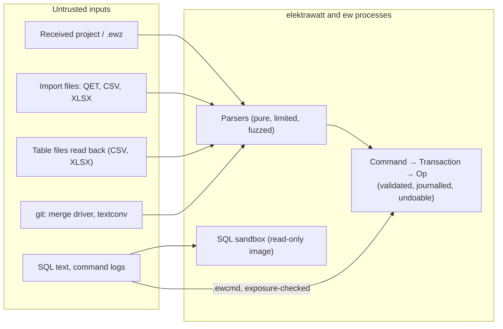

<!--
SPDX-FileCopyrightText: 2026 The ElektraWatt contributors
SPDX-License-Identifier: CC-BY-4.0
-->

# Threat model

**Status:** maintained (NFR-SEC-01) · **Release:** 0.1.0 · **Part of:** ElektraWatt security documents, beside
[`SECURITY.md`](../../SECURITY.md)

**Purpose.** This file states what ElektraWatt (EW) 0.1.0 does against each threat: the assets and trust boundaries,
the threats TM-01 to TM-19 with their state in this release, the controls as built and the evidence that proves them,
a row for every parser of external bytes and every extension point, and the review log that the release checklist's
RC-01 reads. The design form of the model, the target of 1.0, stays in
[doc 18 §11.1](../design/18-quality-security-release.md#111-threat-model); where the two differ, this file says what
the release does. Paths are relative to the repository root, with the line where the control stands.

**Contents**
1. [Assets and trust boundaries](#1-assets-and-trust-boundaries)
2. [Threats](#2-threats)
3. [Parsers of external bytes](#3-parsers-of-external-bytes)
4. [Extension points](#4-extension-points)
5. [Native code and `unsafe`](#5-native-code-and-unsafe)
6. [Review rule and review log](#6-review-rule-and-review-log)

## 1. Assets and trust boundaries

**Assets:**
- the confidentiality of projects (customer work, personal data);
- the **integrity of engineering data**: a silently changed cross-section or protective device is a safety hazard,
  not only a data problem;
- the integrity of EW binaries and their release files;
- the availability of the user's session.

**Trust boundaries.** Every byte that EW did not write in this session is hostile: a received project or `.ewz`, an
import file, a table file read back, an asset in a project's `assets/`, a command log, a query text, and the content
git hands to the merge driver and textconv after a fetch. The parsers are pure (they execute no content), bounded by
the limits of NFR-SEC-02 and fuzzed (NFR-SEC-03). The user's own settings, keymap and configuration folder are
trusted: they are the user's, not a received file's.

0.1.0 has no plugins, no MCP server, no rhai engine, no STEP worker that does work, no update check and no signing
identity; the boxes of doc 18's diagram for them are absent here and their threats are marked in §2.

## 2. Threats

States: *in force* (the control ships in 0.1.0), *1.0* or *1.x* (the threat arrives with that release), *not shipped*
(0.1.0 has no surface for it).

| ID | Threat | 0.1.0 state | Controls as built | Verified by |
|---|---|---|---|---|
| TM-01 | Hostile project or import file: memory exhaustion, decompression bombs, deep nesting, NaN geometry, panics; also reached without a click through the git merge driver and textconv | in force | The loader's limits (`crates/ew-format/src/limits.rs:10 (Limits)`: 16 MiB lines, depth 64, 100,000 files); the archive limits (`crates/ew-zip/src/lib.rs:95 (ZipLimits)`: 2 GiB, 512 MiB per entry, 200 : 1); the merge driver under `catch_unwind` (`bin/ew/src/cli/merge_driver.rs:66 (drive)`); the importers' limits (`crates/ew-interop-api/src/importer.rs:163 (default)`: depth 256, 1,000,000 nodes, 8,192 attributes per element, 1 MiB text nodes, 200 : 1 per archive entry; the element preset at `:112 (element_definition)`) and the one front door, which refuses an input over them before the importer runs and turns an importer's panic into a refusal (`crates/ew-api/src/import.rs:132 (front_door)`); `ew sql`'s statement and the table round trip's read under `catch_unwind` (`bin/ew/src/cli.rs:875 (guarded_query)`, `crates/ew-api/src/output/table_io.rs:218 (guard_table_read)`) | CI-PR-08 `fuzz-smoke` (`.github/workflows/ci.yml:916 (fuzz-smoke)`), CI-N-03 (`.github/workflows/deep-nightly.yml:283 (fuzz)`), the targets of §3; the hostile corpus (`crates/ew-testkit/hostile/README.md:6 (The hostile corpus)`), refused file by file within 256 MiB of extra allocation each (`crates/ew-testkit/tests/hostile_corpus/main.rs:6 (256 MiB of extra)`); WP-S3.09's IC-4, an importer that panics (`crates/ew-api/tests/it/front_door.rs:202 (an_importer_that_panics_is_refused_with_t1)`); SE-9's guards (`crates/ew-api/tests/it/table_round_trip.rs:166 (a_panicking_read_gives_s2_and_changes_nothing)`, `bin/ew/tests/cli.rs:762 (sql_a_panicking_statement_ends_with_s1_and_changes_nothing)`) |
| TM-02 | Archive path traversal or symbolic links (`.ewz`, XLSX); an import that reads files beside its source | in force | Entry-name rules: no colon, no absolute path, no empty, `.` or `..` segment (`crates/ew-zip/src/lib.rs:211 (name_problem)`); the `.ewz` reader (`crates/ew-store/src/ewz.rs:261 (read)`); the workbook reader's names (`crates/ew-import-catalog/src/xlsx.rs:82 (open)`, `crates/ew-interop-api/src/input.rs:97 (check_archive_name)`); the project reader follows no link (`crates/ew-store/src/vfs.rs:110 (is_symlink)`, NFR-SEC-16); an importer names no file access (WP-S3.09's purity check, `xtask/src/deps.rs:524 (check_confined_manifests)`; NFR-SEC-18) | `ewz_read`, `parts_table`; the zip crate's name tests (`crates/ew-zip/src/lib.rs:689 (bad_names_are_refused)`); the corpus's `ewz/` and `xlsx/` and its symbolic link (`crates/ew-testkit/tests/hostile_corpus/main.rs:424 (a_page_file_that_is_a_symbolic_link_is_not_followed)`); the network sandbox's rule `foreign-file` over both import flows (`ci/sandbox-check.py:86 (foreign)`, CI-N-06) |
| TM-03 | Hostile SQLite (QETZ, catalogues) with views or triggers | not shipped | 0.1.0 reads no foreign SQLite file (QETZ is 1.x); EW's own library index is opened with `trusted_schema=OFF` in defensive mode (`crates/ew-library/src/index.rs:4 (search index)`) | — |
| TM-04 | Automation embedded in a received project: rhai scripts, SQL reports, rule packs | not shipped | Nothing in a received project executes at 0.1.0: `ew-rhai` is a doc line without the `rhai` dependency (`crates/ew-rhai/src/lib.rs:4 (operation limits)`), no project SQL report runs, no rule pack loads; the trust gate (NFR-SEC-05) arrives with WP-S1.15's remainder | — |
| TM-05 | Resource exhaustion by formulas or SQL | in force for SQL; rhai not shipped | `ew sql`'s sandbox: one read-only statement, the authorizer, `SQLITE_LIMIT_*` (`crates/ew-sqlview/src/sandbox.rs:106 (LIMITS)`), the deadline and the result caps of each profile (`crates/ew-sqlview/src/sandbox.rs:49 (EW_SQL)`); the rhai limits are WP-S1.15's (NFR-SEC-06) | `crates/ew-sqlview/src/sandbox_tests.rs:4 (security tests of the sandbox)`; `sql_sandbox` |
| TM-06 | Plugin exfiltration or tampering | 1.x | No plugin host runs at 0.1.0 (`crates/ew-plugin-host/src/lib.rs:4 (WebAssembly plugin host)`) | — |
| TM-07 | MCP misuse, including prompt injection through project text | not shipped | `ew mcp` is not built; `egui_mcp` is a banned crate, reachable from test builds only (`ci/dep-rules.toml:35 (banned_crates)`) | CI-PR-09 `check-features` (`.github/workflows/ci.yml:1154 (check-features)`) |
| TM-08 | Exploitation of OCCT through a vendor STEP file | not shipped | `ew-step-worker` prints its version and exits (`bin/ew-step-worker/src/main.rs:8 (main)`); no STEP file is read | — |
| TM-09 | Silent tampering with a received project's engineering data | in force as documentation | `ew diff` and its textconv (`bin/ew/src/cli/diff.rs:4 (ew diff --textconv)`); the as-built archive's SHA-256 in the revision tag (`crates/ew-api/src/release_run.rs:20 (ew/rev/<label>)`); the install guide's verification steps | Documentation |
| TM-10 | Debug or remote-control endpoints in release binaries | in force | `EW_DEBUG_PANIC` only under `debug_assertions` (`bin/elektrawatt/src/main.rs:722 (debug_assertions)`); the canary scan (`ci/sandbox-check.py:148 (canary)`); a binary listing a test-only crate fails (`ci/audit-data.py:31 (BANNED)`); no `listen` call in the installed tree (`ci/no-listen.sh:5 (listening-socket canary)`) | CI-R-09, CI-N-06 |
| TM-11 | Dependency compromise or typosquatting | in force | `cargo deny` and `cargo vet` on every pull request (`.github/workflows/ci.yml:1135 (cargo vet --locked)`, `:1131 (cargo deny --locked check)`); the reviewed build scripts (`ci/build-scripts.allowlist:64 (libsqlite3-sys)`) | CI-PR-09 |
| TM-12 | CI or release pipeline compromise | in force without the two-person publish (1.0) | Read-only default permissions (`.github/workflows/ci.yml:22 (permissions)`); actions pinned by commit; `persist-credentials: false` (`.github/workflows/ci.yml:68 (persist-credentials: false)`); build provenance in the one job with `id-token: write` (`.github/workflows/release.yml:135 (id-token: write)`) | Scorecard, review |
| TM-13 | Update spoofing or MITM | 1.0 | 0.1.0 has no update check and no network code (WP-S6.05 D3; the network clients banned at `ci/dep-rules.toml:35 (banned_crates)`) | — |
| TM-14 | Local disclosure through journal, recovery snapshots, crash logs or logs | in force | User-only modes on Unix: the project writer (`crates/ew-store/src/vfs.rs:238 (0o600)`), the settings (`crates/ew-viewmodel/src/settings.rs:659 (user_only_options)`, `:675 (write_user_only)`), the crash log (`bin/elektrawatt/src/crash.rs:176 (append)`); no automatic upload (NFR-PRIV-04) | CI-PR-02, WP-S6.05's tests |
| TM-15 | Signing-key compromise | 1.0 | 0.1.0 is unsigned and holds no signing key (ID-1187) | — |
| TM-16 | A user-configured external converter fed a hostile file | 1.0 | No converter runs at 0.1.0 | — |
| TM-17 | Unexpected process spawn by a dependency: rfd starts `zenity` from `PATH` when the desktop portal fails | in force, FT-332 open | The shell asks rfd only when a session bus is there for the portal (`bin/elektrawatt/src/main.rs:206 (session_bus_present)`); removing the fallback is FT-332 | Review; FT-332 |
| TM-18 | A hostile SVG in the asset store | in force | `sniff` (`crates/ew-schema/src/asset.rs:273 (sniff)`) runs `svg_hazard` (`crates/ew-schema/src/asset.rs:662 (svg_hazard)`) before any parse: internal subsets, entities, scripts, `on*`, `foreignObject` and external `href`s refused; usvg parses inside `catch_unwind` (`crates/ew-scene/src/images.rs:92 (catch_unwind)`) | The SVG hazard tests and the exporter corpus (`crates/ew-schema/tests/fixtures/svg-exporters/`); `svg_asset` |
| TM-19 | A hostile raster in the asset store | in force | One decoder, `decode_image` (`crates/ew-render-cpu/src/image.rs:39 (decode_image)`): `MAX_IMAGE_PIXELS` before allocation (`crates/ew-render-cpu/src/image.rs:14 (MAX_IMAGE_PIXELS)`), the decode inside `catch_unwind` (`crates/ew-render-cpu/src/image.rs:45 (catch_unwind)`) | `png_pdf`, `image_decode`; the raster exporter corpus (`crates/ew-export/tests/fixtures/raster-exporters/`) |

New threats take TM-20 onward.

## 3. Parsers of external bytes

Every parser of external bytes that 0.1.0 ships, with its fuzz target (NFR-SEC-03). A row without a target is a gap
in plain sight.

| Parser | Crate and entry point | Limits | Target | Target's owner |
|---|---|---|---|---|
| JSONL loader and the open path | `ew-format`, `ew_format::load` | `crates/ew-format/src/limits.rs:10 (Limits)` | `jsonl_loader`, `migration_chain` | WP-S0.05a, built |
| `.ewz` | `ew-store`, `ew_store::ewz::read` (`crates/ew-store/src/ewz.rs:261 (read)`) | `crates/ew-zip/src/lib.rs:95 (ZipLimits)` | `ewz_read` | WP-S1.17, built |
| Three-way merge of the merge driver | `ew-format`, `ew_format::merge_file` | The loader's | `merge_file` | WP-S1.17, built |
| textconv | `ew-api`, `ew_api::output::textconv` (`crates/ew-api/src/output/project_diff.rs:232 (textconv)`) | The loader's | `textconv` | WP-S6.04 |
| QET project and element importers | `ew-import-qet`, through the front door (`crates/ew-api/src/import.rs:132 (front_door)`): `import_qet` (`crates/ew-api/src/import.rs:400 (import_qet)`) | `crates/ew-interop-api/src/importer.rs:163 (default)`, the element preset `:112 (element_definition)` | `qet_project`, `qet_element` | WP-S3.09 |
| The golden tables and the parts table | `ew-import-tables`, `ew-import-catalog`, through the front door: `import_tables` (`crates/ew-api/src/import.rs:1413 (import_tables)`), `parse_parts` (`crates/ew-api/src/catalog.rs:307 (front_door)`) | `crates/ew-import-catalog/src/table.rs:16 (table_limits)`, the bootstrap's `crates/ew-interop-api/src/importer.rs:125 (bootstrap_tables)` | `golden_tables`, `parts_table` | WP-S3.09 |
| The table round trip's read | `ew-api`, `Session::table_import` (`crates/ew-api/src/output/table_io.rs:567 (table_import)`) | `ew_import_catalog::table_limits` | `table_round_trip` | WP-S6.04 |
| SVG assets | `ew-schema`, `sniff` (`crates/ew-schema/src/asset.rs:273 (sniff)`); `ew-scene`'s usvg parse | `crates/ew-schema/src/asset.rs:662 (svg_hazard)` | `svg_asset` | WP-S6.04 |
| PNG and JPEG assets | `ew-render-cpu`, `decode_image` (`crates/ew-render-cpu/src/image.rs:39 (decode_image)`) | `crates/ew-render-cpu/src/image.rs:14 (MAX_IMAGE_PIXELS)` | `png_pdf`, `image_decode` | FT-436, built; WP-S6.04 |
| SQL text | `ew-sqlview`, `Reader::query` (`crates/ew-sqlview/src/sandbox.rs:434 (query)`) | `crates/ew-sqlview/src/sandbox.rs:106 (LIMITS)` | `sql_sandbox` | WP-S6.04 |
| Command logs (`.ewcmd`) | `ew-api`, `Session::run_script` (`crates/ew-api/src/cmdlog.rs:287 (run_script)`) | The command schemas | `command_log` | WP-S6.04 |
| Library documents of a project's `lib/` | `ew-format`, the `LibDocument` reader of the loader | The loader's | `jsonl_loader` | WP-S0.05a, built |
| A `.ewlib` folder: `library.json`, the record shards, `library.lock` | `ew-library`, `LibManifest::parse` (`crates/ew-library/src/manifest.rs:65 (parse)`), the shard reader (`crates/ew-library/src/record.rs:314 (parse_records)`), `LockRecord::parse` (`crates/ew-library/src/lock.rs:125 (parse)`), through `Registry::open` (`crates/ew-library/src/registry.rs:447 (open)`) | The loader's (`crates/ew-library/src/lib.rs:15 (the limits of doc 05)`) | `ewlib_read` | WP-S6.04 (ID-1354) |
| `ew.symbol/1` authoring JSON | `ew-api`, `SymbolDraft::parse` (`crates/ew-api/src/symbols.rs:325 (parse)`), through `symbols::open` and the front door (`crates/ew-api/src/symbols.rs:168 (front_door)`) under `Limits::element_definition()` | `crates/ew-api/src/symbols.rs:27 (MAX_BYTES)`, `:29 (MAX_ITEMS)` | `symbol_authoring` | WP-S2.10 |
| EDZ archives, 7z and ZIP | `ew-import-eplan`, `read` (`crates/ew-import-eplan/src/lib.rs:56 (read)`) and `archive::read` (`crates/ew-import-eplan/src/archive.rs:23 (read)`); a 7z header is walked by EW first (`crates/ew-import-eplan/src/seven.rs:401 (check)`), then read by sevenz-rust2 0.24.2; through `symbols::import_eplan` (`crates/ew-api/src/symbols.rs:906 (import_eplan)`) and the front door | `crates/ew-import-eplan/src/lib.rs:17 (MAX_INPUT)`, `:19 (MAX_FILE)`, `:21 (MAX_TOTAL)`; the 7z counts, coders, dictionaries and ratio (`crates/ew-import-eplan/src/seven.rs:18 (MAX_COUNT)`); the element preset's 16 MiB | `symbol_authoring` | WP-S2.10 |
| PXF macro XML (`.pxf`, `.ema`, `.ems`, `.esl`) | `ew-import-eplan`, `pxf::xml` (`crates/ew-import-eplan/src/pxf.rs:66 (xml)`) and `pxf::read` (`:125 (read)`), through `read` | The counts of `pxf::xml` and its depth scan before parsing (`crates/ew-import-eplan/src/pxf.rs:12 (MAX_DEPTH)`); the read budget (`crates/ew-import-eplan/src/lib.rs:139 (Budget)`) | `symbol_authoring` | WP-S2.10 |
| EPLAN parts XML | `ew-import-eplan`, `parts` (`crates/ew-import-eplan/src/lib.rs:164 (parts)`), through `read` | As PXF's | `symbol_authoring` | WP-S2.10 |
| EPLAN SLK 1.2 libraries: the descriptor and the eight tables of its `.sdb` folder | `ew-import-eplan`, `slk::directory` (`crates/ew-import-eplan/src/slk.rs:32 (directory)`) and `slk::read` (`:312 (read)`), through `symbols::open` (`crates/ew-api/src/symbols.rs:813 (open)`) and the front door | 8 KiB for the descriptor, `MAX_FILE` for each table and `MAX_TOTAL` for all; only the tables of `crates/ew-import-eplan/src/slk.rs:14 (FILES)`, in the descriptor's own folder, never through a parent path or a link (NFR-SEC-18, ID-1461); the read budget | `symbol_slk` | WP-S2.10 |

## 4. Extension points

| Extension point | 0.1.0 state | Controls | Evidence |
|---|---|---|---|
| SQL through `ew sql` | in force | The sandbox of TM-05 under the `ew sql` profile (`bin/ew/src/cli.rs:819 (EW_SQL)`) | `sql_sandbox`; the sandbox tests |
| Command logs through `ew apply` | in force | Every line looked up and checked against its exposure class before line 1 runs, so a `HumanOnly` command is refused (`crates/ew-api/src/cmdlog.rs:297 (exposure)`) | `command_log`; the `HumanOnly` replay test (doc 18 §11.5) |
| The headless script runner (`--headless --script`) | in force | Actions only, through the same action table as the window (`crates/ew-viewmodel/src/script.rs:233 (parse)`) | The script tests; the fuzz target `ewui_script` (FT-1452) |
| git's merge driver and textconv, run by git on fetched content (TM-01) | in force | The merge under `catch_unwind` (`bin/ew/src/cli/merge_driver.rs:66 (drive)`); textconv is pure over the bytes | `merge_file`, `textconv` |
| rhai | not shipped | WP-S1.15's remainder adds the engine with its limits (NFR-SEC-06) | — |
| The trust gate | not shipped | WP-S1.15's remainder (NFR-SEC-05) | — |
| Plugins | 1.x | — | — |
| MCP | not shipped | TM-07 | — |
| The external converter | 1.0 | TM-16 | — |

### Symbol authoring and EPLAN inputs (0.2 feature branch)

The `ew.symbol/1` reader (`ew-api::symbols`) bounds bytes, JSON structure, geometry and item counts before
preview/publication. GUI, CLI and scripts use the same validator. Publishing uses the existing library transaction;
export writes a temporary sibling and links it to a new destination, never truncating an existing draft.

`ew-import-eplan` reads untrusted EDZ 7z/ZIP and PXF/parts XML. It never extracts archive members, opens linked files,
executes embedded content or follows URLs. Compressed input is at most 32 MiB, one member/XML 4 MiB, total unpacked
content 64 MiB. Every symbol import runs through WP-S3.09's front door under `Limits::element_definition()`, which
also bounds the input at 16 MiB and turns a panic into a refusal. The 7z header is walked under EW's own bounds before
sevenz-rust2 reads it (counts, declared sizes, dictionaries up to 64 MiB, the ratio; copy, LZMA and LZMA2 only), and
decoding uses one thread; ZIP validates central/local headers, names, ranges and CRC, refusing encryption/ZIP64 and
unsupported compression. XML forbids DTD/entity expansion and bounds nodes and attributes, and its depth by a flat
scan before parsing. One budget bounds a read: 4,096 graphics and 4,096 connection points per symbol, 65,536 of both
per read, 512 symbols. Unsupported records and archive members are reported for review; missing connection directions
block publication. Downloading does not grant a licence: EPLAN imports require source terms.

Native SLK import reads only eight fixed drawing-table filenames beneath the descriptor's single sibling `.sdb`
directory (NFR-SEC-18 as ID-1461 amends it). Traversal, links (the folder or a table), unknown table layouts, duplicate
identities/continuation chunks, invalid compressed data and excessive records/bytes are refused. It never reads
user/lock tables or invokes EPLAN. Each file is bounded to 4 MiB, decoded streams to 64 MiB total, and the read budget
holds. Source provenance hashes the descriptor and all consumed tables; no embedded workstation data enters the draft.
Unsupported native graphics and connection structures are explicit findings and require author review.

Evidence: `ew-import-eplan/tests/it/reader.rs`, `ew-api/tests/it/symbol_authoring.rs`, the hostile corpus's `eplan/`
class, the `symbol_authoring` and `symbol_slk` fuzz targets. The downloaded manufacturer sample stays outside the public
repository. sevenz-rust2 0.24.2 and lzma-rust2 0.23.0 carry `cargo vet` audits (`supply-chain/audits.toml`, ID-1460).

## 5. Native code and `unsafe`

- **`unsafe`.** The allowlist `ci/unsafe-allowlist.toml` names what the code uses, with the count of the keyword in
  each file: `ew-print`'s Windows print adapter (`ci/unsafe-allowlist.toml:16 (ew-print)`) and `ew-testkit`'s
  counting allocator, the global allocator of the hostile corpus test only
  (`ci/unsafe-allowlist.toml:18 (ew-testkit)`; `ew-testkit`'s library keeps `#![forbid(unsafe_code)]`,
  `crates/ew-testkit/src/lib.rs:7 (forbid)`).
  `cargo xtask check-unsafe` (`.github/workflows/ci.yml:128 (check-unsafe)`) fails on the keyword in a file outside
  the list, in the workspace and in the fuzz crate, and on a listed file whose count differs from the list's
  (NFR-SEC-04, FT-1151).
- **Third-party `unsafe` on a hostile-input path.** lzma-rust2 0.23.0 decodes 7z streams of EDZ archives in process.
  The `optimization` feature that sevenz-rust2 forces adds `unsafe`: two inline-assembly loops of its range decoder
  (`decode_direct_bits` for x86_64 and aarch64), which clamp every read to the buffer, and the encoder's match
  finders, which decoding never reaches. Its `cargo vet` audit (`supply-chain/audits.toml`, ID-1460) records what was
  read; EW bounds the 7z header before it decodes (§3's EDZ row) and runs the import under `catch_unwind`.
- **Test-only crates.** `egui_mcp`, `ew-testids` and `ew-testkit` are banned from the shipped binaries' normal and
  build graph (`ci/dep-rules.toml:35 (banned_crates)`); the fuzz crate is outside the workspace.
- **C.** The only build script of the shipped graph that compiles C is `libsqlite3-sys`'s, the bundled SQLite
  (`ci/build-scripts.allowlist:64 (libsqlite3-sys)`). OCCT is not shipped at 0.1.0.

## 6. Review rule and review log

**Rule.** This file's first review is the 0.1.0 entry below. Every minor release adds a row before its release
(RC-01 of the [release checklist](../release/checklist.md)). A pull request that adds a parser of external bytes or an
extension point adds its row to §3 or §4 in the same change ([CONTRIBUTING](../../CONTRIBUTING.md#pull-request-checklist)).

| Date | Release | Reviewer | Parsers and extension points added since the last review | Result |
|---|---|---|---|---|
| 2026-11-04 | 0.1.0 (in progress) | WP-S6.04's lanes, read by the cycle's reviewer | First review: every row of §3 and §4, the importer rows from WP-S3.09's code (its front door, limits, purity check and four targets; IC-4 its panic evidence). Found: `ew-library`'s `.ewlib` reader parses `library.json`, its shards and `library.lock` with its own code, not through the loader's `LibDocument` reader; it gained the target `ewlib_read` (ID-1354). Added: the hostile corpus with its allocation bound, the sandbox's rule `foreign-file`, the panic guards of `ew sql` and the table round trip's read | Every parser of §3 has a target; complete for 0.1.0 once the delivery's CI runs `fuzz-smoke`, the deep nightly and the network sandbox green |
