1. Keep or drop
7/10 - I'd keep it: wiring by named connection points, junctions that come out right on their own, and parts list, terminal diagram and wire lists generated from the drawing beat QET. But placing terminals and IPs one at a time costs a lot of steps.

2. Where it lost me
- picker.choose designation=S51 was refused with "reason-no-strip: No terminal strip to add to". Designation means a terminal designation, not a device tag.
- select.set refs '-101Q1' failed. It wants 'tag:-101Q1', which the help did not say.
- Placing T55 and E55 autoconnected wires I never asked for (5 -> -101F2:2, L -> -101B1:3). I only learned about Alt+Enter from the hint afterwards.
- canvas.activate alt=true while wire hints were showing: the ghost stays and nothing says the symbol was placed. Only the page text told me.
- IP tool: after each placement the ghost flips direction (source/target) by itself. N-1 on 102 went in as target although I had set source.
- A placed IP's direction is read-only ("no command edits this member yet"). tool.ip_direction was refused with "Only while placing an interruption point", so I had to delete and re-place it. The delete silently took its wire with it.
- strip.bridge was refused ("Select two or more terminals of one strip") with four -X1031 terminals selected by tag. It worked only with shift-clicked symbols. Selecting the same terminals two ways gives two different things.
- strip.bridge and messages.check both answer a bare "done": no toast, no count of findings.
- I found no way to hide the printed tag of -XPE, and no field for a terminal's printed label or group label. I used Function text for 1+/1-/PE. Group labels (Pneumatics/Spare) are not set.
- Black boxes: the cps are packed at 2.6 mm pitch along the box edge, whatever size I drew.
- Potential names are taken from the first cp ('S51:1', 'F55:N'). The whole 0V net is called 'PE-1.1' because of the 0V/PE bond. That's correct, but confusing.

3. What the tool is
A cabinet-schematic CAD where every device, terminal and wire is a record, not a picture. You place symbols on QET-style folios with cells, wire from named terminal to named terminal, and it works out potentials, wire numbers, cross-references for interruption points, junctions, and the generated folios (parts list, terminal diagram, wire lists, potential overview) by itself. It has a full keyboard and command interface, so you can drive it without a mouse.

4. Broken
Nothing was marked broken. Refused steps:
- picker.choose designation=S51 (reason-no-strip)
- select.set '-101Q1' (needs 'tag:' prefix)
- tool.ip_direction on a placed IP (reason-ip-tool-only)
- strip.bridge with a selection by tag (reason-bridge-selection)
- the harness refused one batch of 21 steps (my mistake)

5. The drawing set against the design language
Folios 101, 102 and 103 were created in section 1 with their titles, every device anchored on the cell from the sheet. Tags as written: S51, F55, T55, E55, S56, E56 and 1X1 frozen. -101F1 came from numbering; -102G1 and -102F2 came from changing the tag letter. All parts were set: Eaton, Schneider, Siemens and Rittal, and the black boxes and terminals came from their parts. Every connection in the tables is drawn.
- J1/J2 are dot/star, and J3-J6 bevel, with J5/J6 star, all in the sheet's sequences.
- 2.5 mm² overrides are on the four supply wires on 101 and 1.5 mm² on the ten junction legs on 102. Marker mode is set to explicit.
- The IPs carry the sheet's names and directions, and the externals point at +J-E-206 / JE-N1000-03.
- Bridges BR1, BR5 and BR6 are done.
Departures: -XPE prints its tag, group labels are missing, and printed terminal labels went in as function text. Terminal 1 of -X1031 sits in A2 rather than A3. Several IPs share one cell and sit 2.6-5 mm apart, which may look crowded. I can't see the routing or the marker look from text alone.
Time: a QET veteran with his own collection would draw these three folios in about 1.5-2 hours, plus maybe an hour of lists by hand. I needed 67 turns and about 690 steps. That is slower in step count, but the lists, wire numbers and xrefs came for free.

6. Flow chart

```mermaid
flowchart TD
  A[Read help, look] --> B[Folios + location + external refs in one batch: smooth]
  B --> C[Place S51: picker designation refused]
  C --> D[Place OK, tag -101Q1]
  D --> E[select.set needs tag: prefix]
  E --> F[Freeze S51, part by number: pleasant]
  F --> G[Batch place MCBs, T55, E55]
  G --> H[Unasked autoconnect wires: delete them]
  H --> I[Retag + parts batch: smooth]
  I --> J[Strip 1X1, terminals]
  J --> K[Wire tool with cp snap labels: very smooth]
  K --> L[Branch from wire = junction, correct sequences]
  L --> M[IPs + externals]
  M --> N[Cross-section override on 4 wires at once]
  N --> O[102 black boxes by two corners]
  O --> P[IP direction flips by itself]
  P --> Q[N-1 wrong direction: read-only, delete + redo]
  Q --> R[Junction editor: bevel/star, smooth]
  R --> S[103: 15 terminals and 20 IPs one by one: long and repetitive]
  S --> T[Bridge refused by tag selection, works by shift-click]
  T --> U[No printed/group label field: function text workaround]
  U --> V[Save + export set.pdf 16 pages: clear]
```

7. Good
- The page description lists every cp with its position, its wire count and its potential. I could work blind from it.
- The wire tool snaps and names the cp ('S51:1') before I commit. A wire started on a wire makes a junction, and the sequences came out right without any dialog.
- The parts library resolves a typed part number ('533356' -> Eaton).
- Multi-select plus one property set (parts, cross section, function text, rail bonded), with a toast saying how many records changed.
- The external-ref toast tells you how to use it, and ip.external flips the IP to target by itself.
- Choosing bevel turns wiring to chain on its own.
- Save and PDF give a plain confirmation ("Exported set.pdf: 16 pages, 61 KiB"). The parts list, terminal diagram, wire lists and potential overview are generated without asking.
