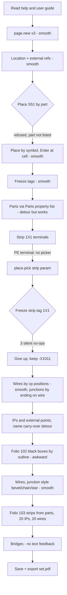

1. Keep or drop
7 - once I learned place.pick + Go to cell + Enter and the wire tool on cp positions, the three folios came together faster than in QET, and it hands me a PDF; the silent no-ops and the strip-tag failure keep it from an 8+.

2. Where it lost me
- Device from part (Shift+I) and place.pick part=533356 offered only 4 of the 14 project parts; the Eaton/Schneider/Siemens/Rittal parts were only reachable afterwards via the Parts property list.
- Freezing the strip tag 1X1: props.set device/tag.frozen, edit/input/commit and Freeze + tag.frozen.text all reported done; the strip stays -X1011 (frozen as X1011). No error, no reason.
- The PE terminal symbol / PT 2.5-TWIN-PE part never opens the strip picker (plain terminal does); I had to guess place.pick strip=-X??.
- The external point kept the previous IP's name (PE-1.1) and I had two PE-1.1 on folio 101 until I undid it.
- Black box needs an outline drawn by two corners; I had to invent a size.
- Bridges: page text has no bridge lines; only a toast (overwritten by the next one) and later a "bridged already" refusal told me they existed.
- Did not get to: hand-set wire markers (2.5 / 1.5 mm2), potential names/types, bond B1, marker mode. -XPE prints its tag (could not find "without tag").

3. What the tool is
An ECAD program for control-cabinet schematics, in the QET mould (folios, cells A-H/0-16, strips, IPs as cross-references), but with a real device/part/potential model behind the drawing: tags are proposed per folio (-101F1), parts are copies in the project, wires know their potentials across folios via interruption points, junctions have a style, wiring and sequence, and it exports a PDF and parts list. Fully driveable by keyboard/commands.

4. Broken
- Strip tag freeze to 1X1 (steps 83-88): accepted, no effect.
- place.pick part=533356 refused reason-unknown-symbol although the part is in the project (step 10).
- Nothing was marked broken by the harness.

5. The drawing set against the design language
101: all devices at their cells (S51 B2, -101F1 B8, F55 B12, T55 C12, E55 E12, S56 D14, E56 E14, -XPE D5), strip -X1011 (should be 1X1) terminals 1, 2, PE at D2-D4, three external points +J-E-206 at G0/G1, IPs L-1/N-1 at H16 and PE-1.1 at G15, 21 connections, J1/J2 dots/star with the sheet's sequences. 102: -102G1 and -102F2 black boxes from parts, -102F1 with A9F78116, nine IPs, 19 connections, J3-J6 bevel with chain/chain/star/star. 103: -X1031 (11 terminals, A3-A13) and -X1032 (4, F3-F6) from PT 2.5 parts, 20 IPs, 20 connections, bridges 1-4, 11-14 and PE 1-4. Missing: wire markers, potential names, bond. A QET veteran would need about 2-3 hours for this set by drag and drop; I needed 54 turns (~560 steps), roughly comparable in effort, faster for terminals and junctions, slower for anything needing coordinates.

6. Flow chart

7. Good
- page text with exact cp positions and "wires n": I could draw blind with confidence.
- The wire route line naming from/end, and the end naming the wire it will split (@101-C12 F55:2 -> E55:L) before Enter.
- Junctions created by ending on a wire, with the sequence printed exactly as my sheet writes it.
- Terminal placement with strip + designation in one step; strip tags -X1031/-X1032 came out right on their own.
- Tag freezing on devices in one props.set; parts list choice commits at once.
- Clear toasts (Placed -101F1 at 101-B8, Exported set.pdf: 16 pages, 60 KiB).
