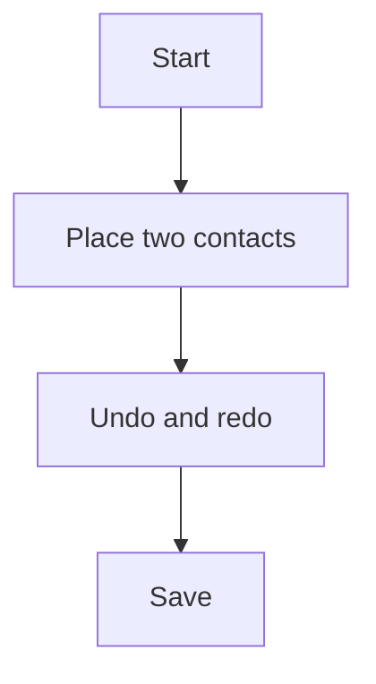

## 1. Keep or drop
8 - the self-test kept going.
## 2. Where it lost me
none
## 3. What the tool is
A drawing program for control cabinets.
## 4. Broken
none
## 5. My design against the brief
Two contacts on page 101, saved.
## 6. Flow chart

## 7. Good
The picker opened with one click.
## 8. What I could not read
The contacts' tags at the first zoom (t0002, 640,390,280,40).
