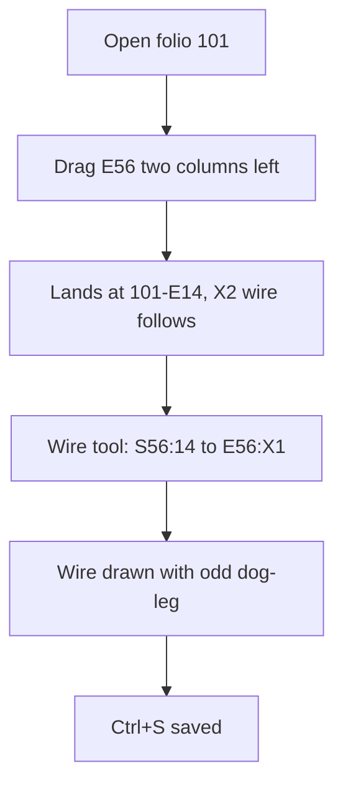

1. Keep or drop
7 - for this job it was as quick as QET: drag, two clicks for a wire, Ctrl+S.
2. Where it lost me
Nowhere really; the status message "2 objects overlap here" after the drag (t0001) was puzzling.
3. What the tool is
A QET-like schematic editor for control cabinets with folios, cells and tags, plus a properties panel and checks.
4. Broken
The new wire S56:14 to E56:X1 takes a rectangular detour right and back instead of a straight drop (t0002, around 1215,495).
5. My design against the brief
E56 moved to 101-E14 under S56, X2 wire kept (it rubber-banded along), X1 wired to S56:14, saved. About a minute in QET; about the same here, three turns. I would still straighten the wire.
6. Flow chart

7. Good
Drag-to-move with wires following, cell shown in properties (101-E14), clear status bar hints for the active tool, save state in title and status bar.
8. What I could not read
Terminal numbers at S56 and E56 are tiny (t0001, around 1210,470,40,90); the title block and left-edge cross-reference texts are too small at 69 % (t0000, 490,640,100,60).
