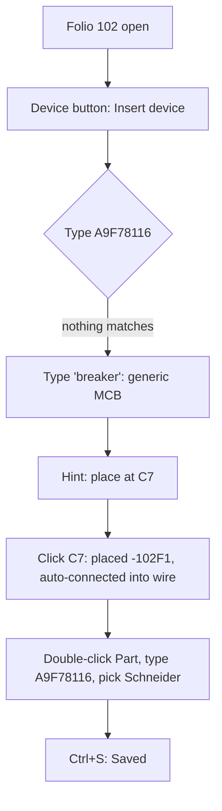

1. Keep or drop
7 - Placing a breaker by part number took nine turns, about as fast as QET, and I got the tag for free; I'd keep trying it.

2. Where it lost me
- t0002: Insert device said "Nothing matches the filter" for A9F78116, though the part exists (the Part field offered it later, t0007).
- t0005: the toast said it had connected the breaker into the wire I dropped it on. I didn't ask for that.
- t0009: the page badge went from "5 Warnings" to "5 Pending", meaning unclear.

3. What the tool is
A schematic drawing program like QET, but it knows devices and parts: you insert a device, it gets the next tag (-102F1) and a manufacturer part, and it shows folio-cell positions (102-C7) itself.

4. Broken
- t0002 vs t0007: the part search in Insert device and in the Part field disagree; the Schneider part is only findable after placing a generic one.
- t0005: it connected the device into an existing wire on its own.

5. My design against the brief
-102F1, 1-pole MCB, part A9F78116 Schneider, at 102-C7 between -102G1 and -102F2, tag from the numbering, project saved. Nothing left to do for the brief. QET: about 3-4 minutes; here 9 turns, similar, with one detour through the generic part.

6. Flow chart

7. Good
- The automatic tag -102F1 and the 102-C7 location in properties.
- The status-bar hints in place mode (R rotates, Esc done).
- The part field combo with live filter; the labels on the sheet update at once.
- The clear Saved / Unsaved changes indicator and the * in the title.

8. What I could not read
- t0009 region 830,410,130,35: the breaker's labels (Schneider Electric, A9F78116, B16) are tiny and cramped against the wire.
- t0000: the titles in the page list are cut off ("102 Power Supply 2 - Con...").
- t0000 drawing: the terminal and cross-reference texts at 69 % are too small to read.
