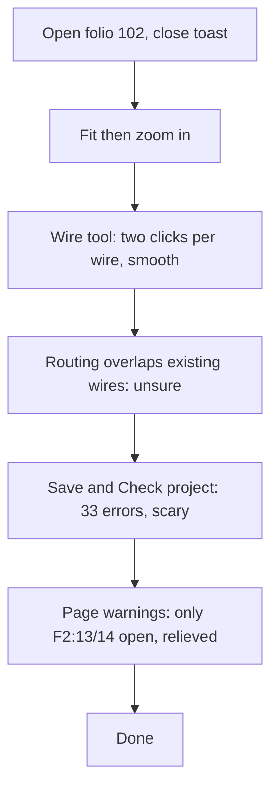

1. Keep or drop
7 - Wiring was as quick as QET or quicker; I would keep trying it if the routing got tidier.
2. Where it lost me
- t0004: after the six clicks I could not tell by eye where the new wires ended; they ran over the existing minus wires and the bus line.
- t0005: Check project said 33 errors, and I had to open the page's warnings to see my wires were fine.
3. What the tool is
It's a schematic program like QET with a page tree on the left and a ribbon on top. A wire tool goes pin to pin in two clicks and routes the corners for you, and a checker tells you which pins are left open.
4. Broken
Nothing broke. The auto-routing put the new wires on top of other wires and across the bus line (t0004). If it joined them to those wires, the checker didn't say so.
5. My design against the brief
I drew four wires: both + of -102G1 to -102F1:1, and -102F1:2 to both 24VDC inputs of -102F2. Then I saved. The page check only lists F2:13 and F2:14 as open, and those aren't part of the job. I would still move the wire runs off the existing wires so the wiremen can read them. In QET this takes about 3 minutes. Here it took 7 turns with no hint.
6. Flow chart

7. Good
- Wiring pin to pin in two clicks.
- The status line tells you what the tool expects.
- The page warnings are filtered to my folio and name the exact pin.
- Saved state is shown clearly in the title and the status bar.
8. What I could not read
- t0001: at the fit-page zoom the pin labels and the title block are too small to read.
- t0003: the pin numbers 1 and 2 on -102F1 are tiny, even at 188 %.
