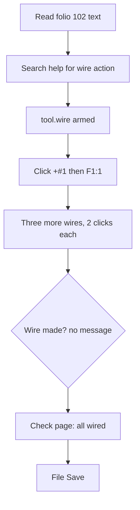

1. Keep or drop
8 - for wiring like this it is as quick as QET's drag, with clear status prompts, so I would keep trying it.
2. Where it lost me
- After each second click there is no "wire created" message; only canvas.route null and the tool re-arming, so I checked the page to be sure.
- The output potential of -102F1 is named "-102F1:2" and not after the 24 V it carries, which is odd for wire numbers.
3. What the tool is
An ECAD program for control cabinets in the QET style (folios, cells A-H/0-16, tags like -102F1). You arm a Wire tool and click terminal to terminal; it tracks potentials and junctions for you.
4. Broken
Nothing failed or was refused.
5. The drawing set against the design language
Folio 102 reads like a QET folio: cell addresses, tags, interruption points to other folios, star junctions for 0V. The new wires got stored routes with 4-6 bends, which I cannot judge without a picture. A QET veteran needs about 2 minutes for four wires; I needed 10 steps in 3 turns, about the same.
6. Flow chart

7. Good
The status line telling the next click, the tool staying armed between wires, the snap to the named connection point, and the page text with wire counts per terminal.
