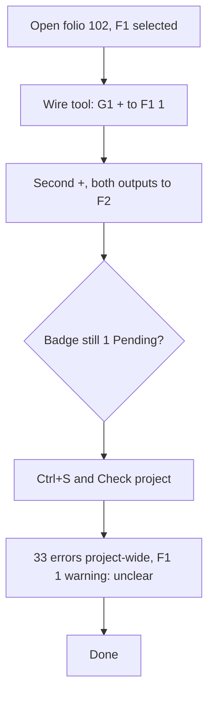

1. Keep or drop
7 - Wiring took two clicks per wire, as quick as QET, so I would keep trying it if the check results were clearer.
2. Where it lost me
- t0002: after four wires the F1 badge still said "1 Pending", and nothing said what was pending.
- t0003: Check project gave 33 errors and 51 warnings for the whole project, and F1 "1 Warning", without saying which, if any, were mine.
3. What the tool is
An ECAD program for control-cabinet schematics, set out like QET: folios with QET grids, devices with tags and part data, wires drawn terminal to terminal, and a project check.
4. Broken
Nothing failed. The auto-routed wires (t0002) zigzag across the existing 0V wires around F1. That is ugly but works.
5. My design against the brief
Four wires: both + outputs of G1 to F1 terminal 1, and F1 terminal 2 to both 24VDC inputs of F2. The project is saved. I would still tidy the routes and check what F1's warning is. In QET this takes about 2 minutes. Here it took 3 turns, about the same.
6. Flow chart

7. Good
Two clicks per wire, and the wire snaps to the terminal. The status bar hint says what to click. The QET grid and the cell positions (102-C7) feel familiar. The Saved indicator is clear.
8. What I could not read
t0002: the F2 terminal labels are cut off at the bottom of the view (y around 940). The small terminal numbers 1 and 2 on F1 (around x 942, y 575 and 643) are tiny.
